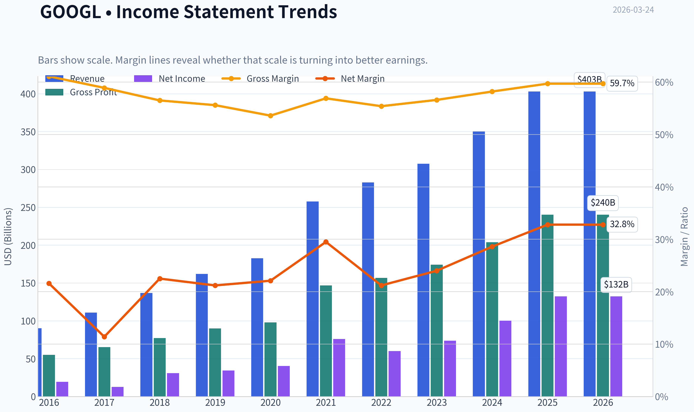
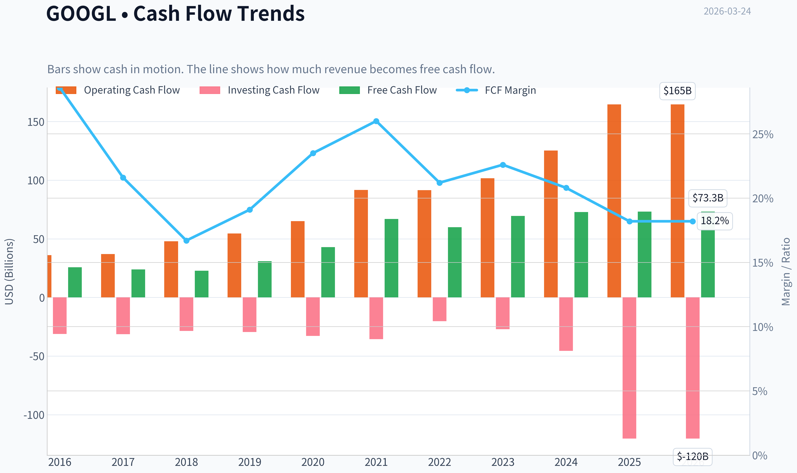
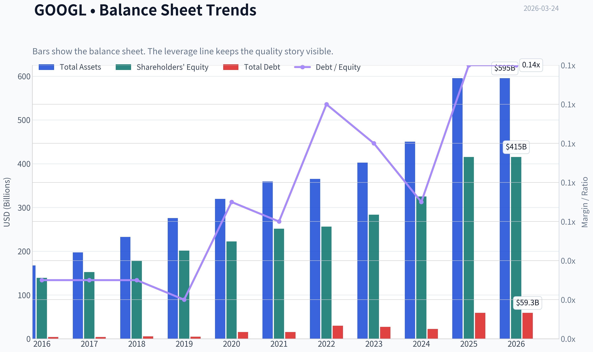
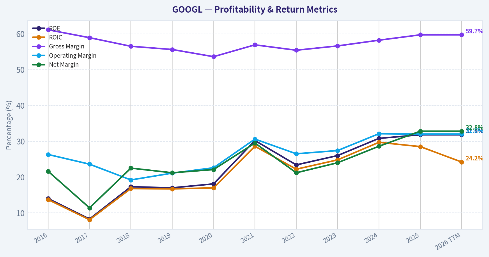
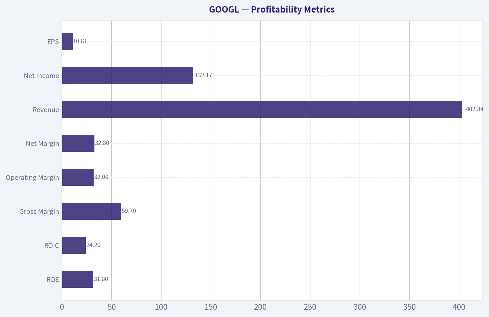
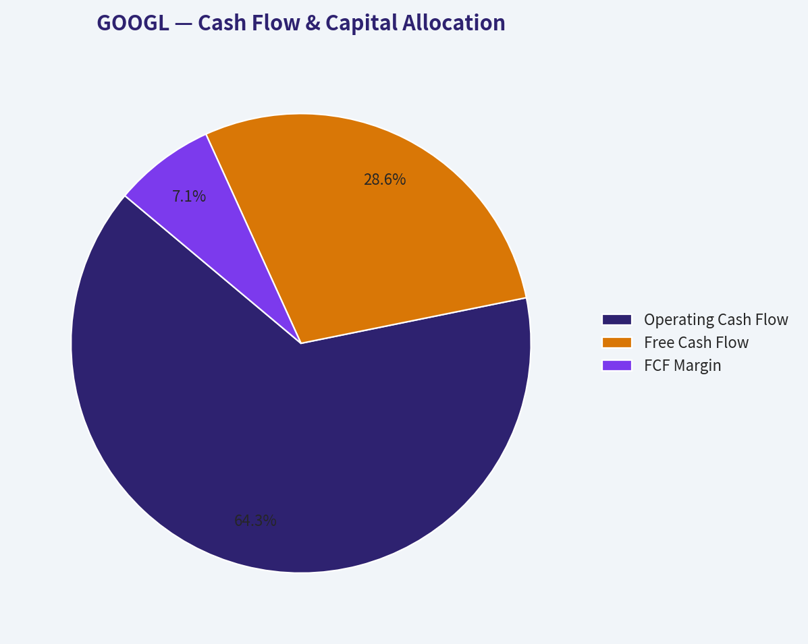
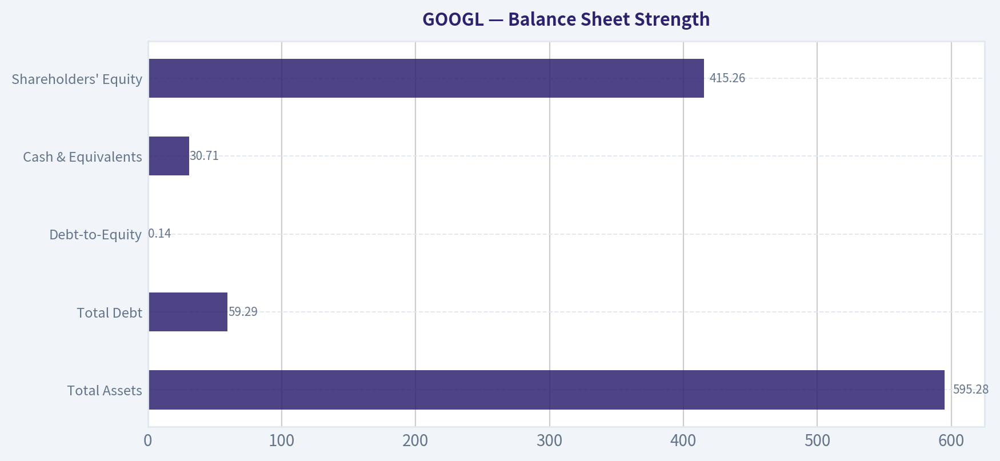
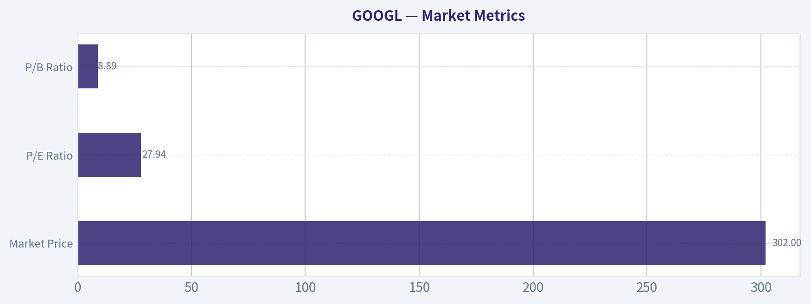

# GOOGL Deep Value Intelligence

**Analysis Date:** 2026-03-24

## Critical Disclaimer

*This analysis is generated by Deep Value Intelligence, an AI-powered multi-agent investing framework. This report is for informational and educational purposes only and does not constitute financial advice. Always conduct your own research and consult with qualified financial advisors before making investment decisions.*

---

## Table of Contents

1. Intelligence Summary
2. Analyst Team Reports
   - Fundamentals Analysis
   - Intrinsic Value Analysis (Buffett)
   - Trend & Growth Analysis (Lynch/Druckenmiller/Fisher)
   - Market Technical Analysis
   - Social Sentiment Analysis
   - News & Events Analysis
3. Research Team Commentary
4. Value Investing Team Commentary
5. Deep Values Commentary

---

## Intelligence Summary

### Thesis + Conditions

**Core Thesis:** **EXECUTIVE SUMMARY**

**Key Risks:**
- Final Stance:** **WATCH**
- The Bull Case (Risky):** Alphabet already owns the internet's distribution layer (Chrome, Android, YouTube). It isn't being disrupted; it's deploying AI to billions of existing touchpoints. A 32% Net Income growth rate makes its 28x P/E look reasonable (PEG ~0.9), and its fortress balance sheet allows it to outspend any competitor.
- However, it violently fails the second hurdle. The best risk management is buying below intrinsic value. At $302, Alphabet is trading at a steep premium to multiple valuation models (which cluster between $117 and $197).
- 3.  **Confusing Momentum with Margin of Safety:** The stock trading above its 200-day moving average is a structural trading signal, not an intrinsic value metric. Momentum offers zero downside protection when valuation multiples contract.
- Here's how I'd frame this if I were sitting in a Berkshire investment meeting thinking through Alphabet.

**What Would Change Our View:**
- Final Stance:** **WATCH**
- The Bull Case (Risky):** Alphabet already owns the internet's distribution layer (Chrome, Android, YouTube). It isn't being disrupted; it's deploying AI to billions of existing touchpoints. A 32% Net Income growth rate makes its 28x P/E look reasonable (PEG ~0.9), and its fortress balance sheet allows it to outspend any competitor.
- However, it violently fails the second hurdle. The best risk management is buying below intrinsic value. At $302, Alphabet is trading at a steep premium to multiple valuation models (which cluster between $117 and $197).
- 3.  **Confusing Momentum with Margin of Safety:** The stock trading above its 200-day moving average is a structural trading signal, not an intrinsic value metric. Momentum offers zero downside protection when valuation multiples contract.
- Here's how I'd frame this if I were sitting in a Berkshire investment meeting thinking through Alphabet.

**Confidence:** Medium

---

## Analyst Team Reports

### Fundamentals Analysis

#### Latest Earnings Snapshot

*Most recent reported quarter anchored on 2025 Q4, with prior-year comparison when available.*

| Metric | 2025 Q4 | 2024 Q4 | YoY Change |
| --- | ---: | ---: | ---: |
| Revenue | $113.83B | $96.47B | +18.0% |
| Operating Income | $35.93B | $30.97B | +16.0% |
| Net Income | $34.45B | $26.54B | +29.8% |
| Diluted EPS | $2.82 | $2.15 | +31.2% |
| Operating Cash Flow | $52.40B | $39.11B | +34.0% |
| Free Cash Flow | $24.55B | $24.84B | -1.2% |

Key Takeaways: This snapshot anchors the most recent reported quarter before the narrative analysis. It helps readers separate long-run business quality from whatever changed in the latest earnings print.

#### 10-Year Financial Metrics for GOOGL

*All values below are computed deterministically from raw data - not estimated by AI.*

*Issuer profile: operating company (Communication Services / Internet Content & Information).*

#### 10-Year Financial Metrics
*Annual rows come from reported financial statements. The final TTM row is computed from the latest four quarters.*

| Metric | 2016 | 2017 | 2018 | 2019 | 2020 | 2021 | 2022 | 2023 | 2024 | 2025 | 2026 TTM |
| --- | --- | --- | --- | --- | --- | --- | --- | --- | --- | --- | --- |
| Market Price | $39 | $52 | $52 | $67 | $87 | $144 | $88 | $139 | $188 | $313 | $302 |
| Market Cap | $536.78B | $723.64B | $718.81B | $916.75B | $1.18T | $1.91T | $1.16T | $1.78T | $2.36T | $3.83T | $3.69T |
| P/E Ratio | 27.56 | 57.15 | 23.39 | 26.69 | 29.29 | 25.13 | 19.35 | 24.08 | 23.54 | 28.95 | 27.94 |
| P/B Ratio | 3.86 | 4.75 | 4.05 | 4.55 | 5.30 | 7.59 | 4.53 | 6.27 | 7.25 | 9.22 | 8.89 |
| ROE | 14.0% | 8.3% | 17.3% | 17.0% | 18.1% | 30.2% | 23.4% | 26.0% | 30.8% | 31.8% | 31.8% |
| ROIC | 13.7% | 8.1% | 16.8% | 16.7% | 17.0% | 28.6% | 22.2% | 24.8% | 29.7% | 28.5% | 24.2% |
| EPS | $1.43 | $0.92 | $2.22 | $2.49 | $2.97 | $5.73 | $4.56 | $5.80 | $8.04 | $10.81 | $10.81 |
| Revenue | $90.27B | $110.86B | $136.82B | $161.86B | $182.53B | $257.64B | $282.84B | $307.39B | $350.02B | $402.84B | $402.84B |
| Gross Profit | $55.13B | $65.27B | $77.27B | $89.96B | $97.80B | $146.70B | $156.63B | $174.06B | $203.71B | $240.30B | $240.30B |
| Gross Margin | 61.1% | 58.9% | 56.5% | 55.6% | 53.6% | 56.9% | 55.4% | 56.6% | 58.2% | 59.7% | 59.7% |
| Operating Margin | 26.3% | 23.6% | 19.2% | 21.1% | 22.6% | 30.6% | 26.5% | 27.4% | 32.1% | 32.0% | 32.0% |
| Net Income | $19.48B | $12.66B | $30.74B | $34.34B | $40.27B | $76.03B | $59.97B | $73.80B | $100.12B | $132.17B | $132.17B |
| Net Margin | 21.6% | 11.4% | 22.5% | 21.2% | 22.1% | 29.5% | 21.2% | 24.0% | 28.6% | 32.8% | 32.8% |
| Revenue Growth | 20.4% | 22.8% | 23.4% | 18.3% | 12.8% | 41.1% | 9.8% | 8.7% | 13.9% | 15.1% | 0.0% |
| Net Income Growth | 19.1% | -35.0% | 142.7% | 11.7% | 17.3% | 88.8% | -21.1% | 23.1% | 35.7% | 32.0% | 0.0% |
| Free Cash Flow Growth | N/A | -7.4% | -4.5% | 35.7% | 38.3% | 56.4% | -10.4% | 15.8% | 4.7% | 0.7% | 0.0% |
| Total Book Value | $139.04B | $152.50B | $177.63B | $201.44B | $222.54B | $251.63B | $256.14B | $283.38B | $325.08B | $415.26B | $415.26B |
| Total Assets | $167.50B | $197.29B | $232.79B | $275.91B | $319.62B | $359.27B | $365.26B | $402.39B | $450.26B | $595.28B | $595.28B |
| Total Debt | $4.00B | $4.03B | $5.39B | $4.68B | $15.32B | $15.44B | $29.68B | $27.12B | $22.57B | $59.29B | $59.29B |
| Debt-to-Equity | 0.03 | 0.03 | 0.03 | 0.02 | 0.07 | 0.06 | 0.12 | 0.10 | 0.07 | 0.14 | 0.14 |
| Cash & Equivalents | $12.92B | $10.71B | $16.70B | $18.50B | $26.46B | $20.95B | $21.88B | $24.05B | $23.47B | $30.71B | $30.71B |
| Shareholders' Equity | $139.04B | $152.50B | $177.63B | $201.44B | $222.54B | $251.63B | $256.14B | $283.38B | $325.08B | $415.26B | $415.26B |
| Operating Cash Flow | $36.04B | $37.09B | $47.97B | $54.52B | $65.12B | $91.65B | $91.50B | $101.75B | $125.30B | $164.71B | $164.71B |
| Investing Cash Flow | $-31.16B | $-31.40B | $-28.50B | $-29.49B | $-32.77B | $-35.52B | $-20.30B | $-27.06B | $-45.54B | $-120.29B | $-120.29B |
| Free Cash Flow | $25.82B | $23.91B | $22.83B | $30.97B | $42.84B | $67.01B | $60.01B | $69.50B | $72.76B | $73.27B | $73.27B |
| FCF Margin | 28.6% | 21.6% | 16.7% | 19.1% | 23.5% | 26.0% | 21.2% | 22.6% | 20.8% | 18.2% | 18.2% |
| Dividends / Share | N/A | N/A | N/A | N/A | N/A | N/A | $0.00 | $0.00 | $0.59 | $0.82 | $0.82 |

#### Profitability Metrics
- Return on Equity (ROE): 31.8%
- Return on Invested Capital (ROIC): 24.2%
- Return on Assets (ROA): 22.2%
- Gross Margin: 59.7%
- Operating Margin: 32.0%
- Net Profit Margin: 32.8%

#### Liquidity Metrics
- Current Ratio: 2.01
- Quick Ratio: 1.85

#### Leverage Metrics
- Debt-to-Equity Ratio: 0.14
- Interest Coverage Ratio: 175.32
- Net Debt: $28.58B

#### Growth Metrics (Year-over-Year)
- Revenue Growth: 15.1%
- Net Income Growth: 32.0%
- Free Cash Flow Growth: 0.7%
- Revenue CAGR (3-Year): 12.5%
- Revenue CAGR (5-Year): 17.2%

#### Valuation Metrics
- P/E Ratio (TTM): 27.94
- Forward P/E: 22.51
- Price-to-Book: 8.79
- Price-to-Sales: 9.07
- PEG Ratio: 0.58
- EV/EBITDA: 23.93
- Free Cash Flow Yield: 2.0%
- Earnings Yield: 3.6%

#### Owner Earnings (Buffett Method, Code-Computed)
- Net Income: $132.17B
- + Depreciation & Amortization: $21.14B
- - Capital Expenditures: $-91.45B
- - Working Capital Changes: $618.0M
- = **Owner Earnings: $61.24B**

#### Intrinsic Value (Code-Computed)
- Current Price: $302
- Buffett Method (Owner Earnings):
  Conservative: $29
  Average: $149
  Optimistic: $152
- Cash Flow Method (FCF):
  Conservative: $63
  Average: $117
  Optimistic: $260

#### Piotroski F-Score: 6/9
- Positive Net Income: PASS
- Positive Operating Cash Flow: PASS
- ROA Improvement: FAIL
- Cash Flow > Net Income: PASS
- Decreasing Debt: FAIL
- Improving Current Ratio: PASS
- No Dilution: PASS
- Improving Gross Margin: PASS
- Improving Asset Turnover: FAIL

FINAL INVESTMENT STANCE: **WATCH**

#### Market Metrics

| Metric | Current (TTM) | 10Y Average | Interpretation |
|---|---|---|---|
| Market Price | $302 | - | Near all-time highs after massive 2023-2025 rally |
| Market Cap | $3.69T | - | Among the largest companies globally |
| P/E Ratio | 27.94 | ~28.5 | Roughly in line with historical valuation |
| P/B Ratio | 8.89 | ~5.64 | Significantly above long-term average |

Key Takeaways:
Alphabet's valuation multiples are mostly consistent with its historical earnings multiple, but the price-to-book ratio has expanded meaningfully as profitability and intangible asset value increased. The stock price appreciation since 2023 reflects market optimism about AI, cloud, and advertising growth.

---

#### Profitability Metrics

| Metric | Current (TTM) | 10Y Average | Trend |
|---|---|---|---|
| ROE | 31.8% | ~21.5% | Strong improvement since 2021 |
| ROIC | 24.2% | ~20.0% | Still excellent but slightly below peak |
| Gross Margin | 59.7% | ~57.7% | Margins expanding again |
| Operating Margin | 32.0% | ~26.1% | Highest level in the decade |
| Net Margin | 32.8% | ~24.5% | Record profitability |
| Revenue | $402.84B | - | Nearly 4.5x growth since 2016 |
| Net Income | $132.17B | - | More than 6x growth in a decade |
| EPS | $10.81 | - | Consistent compounding |

Key Takeaways:
Alphabet is currently operating at **peak profitability** across nearly every margin metric. Operating and net margins are the highest in the company's history, showing exceptional operating leverage from advertising scale, cloud profitability improvements, and disciplined cost control.

---

#### Growth Metrics

| Metric | Current | 10Y Pattern |
|---|---|---|
| Revenue Growth | 15.1% | Average ~18-19% historically |
| Net Income Growth | 32.0% | Highly cyclical but strong long-term expansion |
| Free Cash Flow Growth | 0.7% | Slowing due to AI capex investment |

Key Takeaways:
Revenue growth has normalized into the mid-teens after the pandemic surge in 2021. Earnings are growing faster than revenue because margins expanded significantly. Free cash flow growth slowed sharply due to heavy AI infrastructure spending.

---

#### Balance Sheet Strength

| Metric | Current (TTM) | Interpretation |
|---|---|---|
| Total Assets | $595.28B | Massive asset base |
| Total Debt | $59.29B | Very manageable |
| Debt-to-Equity | 0.14 | Extremely conservative |
| Cash & Equivalents | $30.71B | Large liquidity buffer |
| Shareholders' Equity | $415.26B | Rapidly expanding book value |

Key Takeaways:
Alphabet's balance sheet remains **one of the strongest in large-cap technology**. Even after increased investment in AI infrastructure, leverage is extremely low and interest coverage is enormous (175x), meaning financial risk is minimal.

---

#### Cash Flow & Capital Allocation

| Metric | Current (TTM) | 10Y Trend |
|---|---|---|
| Operating Cash Flow | $164.71B | Strong upward trajectory |
| Free Cash Flow | $73.27B | Plateauing recently |
| FCF Margin | 18.2% | Slight decline vs ~21.8% average |
| Dividend / Share | $0.82 | New capital return policy |

Key Takeaways:
Alphabet continues generating enormous cash flows, but FCF margins have declined due to heavy capital expenditures on AI data centers and infrastructure. The introduction of dividends signals a transition toward **mature capital return alongside buybacks**.

---

#### Revenue Breakdown

| Revenue Source | Amount | % of Total |
|---|---|---|
| Google Advertising (Search, YouTube Ads, Network) | ~$315B | ~78% |
| Google Cloud | ~$49B | ~12% |
| Subscriptions, Platforms, Devices & Other Bets | ~$39B | ~10% |
| Total Revenue | ~$403B | 100% |

Key Takeaways:
Alphabet still relies heavily on advertising revenue, particularly search. However, Google Cloud has become the fastest-growing strategic segment and is increasingly important for AI infrastructure and enterprise services.

---

#### Buffett-Style Owner Earnings

Owner Earnings Calculation:

Net Income: $132.17B
+ Depreciation & Amortization: $21.14B
- Capital Expenditures: $91.45B
- Working Capital Changes: $0.62B

Owner Earnings ~ **$61.24B**

This figure reflects the cash truly available to shareholders after reinvestment needs.

---

#### Owner Earnings Growth Assumptions

Historical proxy (from FCF growth history):

- Lowest growth: **-10.4%**
- Average growth: **~14.4%**
- Highest growth: **56.4%**

Discount rate: 10%
Terminal growth: 2.5%

---

#### DCF Valuation (Owner Earnings Method)

| Scenario | Growth Rate | Intrinsic Value (Total) | Implied Value / Share |
|---|---|---|---|
| Conservative | -10.4% | ~$342B | ~$28 |
| Average | 14.4% | ~$2.0T | ~$163 |
| Optimistic | 56.4% | ~$35T | ~$2,870 |

Key Takeaways:
The conservative scenario shows dramatic downside if growth collapses due to AI disruption or regulatory changes. The average growth scenario produces a valuation well below the current market cap, suggesting the market already prices in strong AI-driven growth. The optimistic case becomes extremely large because of compounding and is not realistic long term.

---

#### Economic Moat Analysis

Alphabet possesses one of the **strongest economic moats in modern business**:

Network Effects
Google Search improves with scale and user data, creating self-reinforcing dominance.

Data Advantage
Search, YouTube, Android, Maps, and Chrome provide unmatched data.

Advertising Ecosystem
Massive advertiser network and targeting infrastructure create high switching costs.

Platform Control
Android and Chrome ensure distribution control for search and services.

AI Infrastructure
Alphabet owns global data centers and proprietary models (Gemini), strengthening competitive positioning.

---

#### Predictability of Earnings

Alphabet shows **highly predictable revenue growth** for a technology company:

Revenue grew from **$90B -> $403B** in a decade.
Margins remained consistently strong despite massive expansion.
Advertising remains cyclical but resilient.

The biggest uncertainty now is **AI reshaping search behavior**.

---

#### Management Performance

Strengths:
- ROE expanded from ~14% to **31.8%**
- Strong share repurchases
- Controlled debt levels
- Successful scaling of Google Cloud

Weaknesses:
- Capital intensity rising (AI data centers)
- Some historically poor capital allocation in "Other Bets"

---

#### Key Investment Insights

Strengths

- One of the most profitable companies in history
- Exceptional ROE and operating margins
- Dominant search monopoly
- Huge AI infrastructure and data advantage
- Massive free cash flow generation

Opportunities

- AI search monetization
- YouTube advertising expansion
- Google Cloud profitability growth
- AI enterprise services
- Autonomous driving (Waymo)

Red Flags

- Valuation already pricing strong growth
- AI competitors (OpenAI, Microsoft)
- Regulatory antitrust pressure
- FCF margin compression from heavy capex

---

#### Buffett-Style Business Quality Assessment

| Factor | Assessment |
|---|---|
| Economic Moat | Extremely strong |
| Financial Strength | Exceptional |
| Earnings Predictability | High |
| Management Quality | Strong but capex heavy |
| Valuation | Expensive relative to intrinsic value |
| Long-Term Outlook | Very strong |

Key Takeaways:
Alphabet is a **world-class business**, but Buffett typically prefers buying such companies when market sentiment is weaker and valuation is more attractive.

---

#### Final Investment Stance: **WATCH**

Rationale:

- Outstanding moat and profitability
- Strong long-term AI positioning
- Financial fortress balance sheet

However:

- Market cap already **$3.7T**
- Free cash flow yield only **~2%**
- DCF suggests current price assumes strong AI growth

Ideal entry would likely occur during:

- regulatory scares
- advertising recessions
- broader tech selloffs

---

#### Summary Table

| Category | Key Insight |
|---|---|
| Profitability | Record margins and ROE above 30% |
| Growth | Revenue still compounding double digits |
| Balance Sheet | Extremely strong, low leverage |
| Cash Flow | Huge but pressured by AI capex |
| Valuation | Trading above intrinsic value estimates |
| Moat | One of the strongest in global tech |
| Risk | AI disruption, regulation, capex intensity |
| Investment View | High-quality company but not cheap |

#### Fundamental Visuals

This graph tracks the profitability and return metrics (ROE, ROIC, Margins) of **GOOGL** over the past decade, highlighting capital efficiency trends.

This chart illustrates the financial health of **GOOGL** over the last 10 years, mapping cash equivalents and free cash flow against total obligations (Debt).

This comparison chart from *Profitability Metrics* stacks current figures against historical benchmarks for **GOOGL**, making it easy to see where the company trades relative to its own averages.

This breakdown chart from <em>Cash Flow & Capital Allocation</em> shows the proportional composition for **GOOGL** - useful for understanding what drives or risks the business.

---

### Intrinsic Value Analysis (Buffett)

> *Following Warren Buffett's value investing philosophy: Circle of Competence, Economic Moat, Management Quality, and Margin of Safety.*

#### Intrinsic Value Snapshot

Price is what you pay. Intrinsic value is what the business may be worth based on the cash it can create for owners over time. We show a range, not one magic number.

- Current Price: $302.06
- Value Range: $28.73 to $260.13

##### Owner Earnings (Buffett Method)
- Net Income: $132,170,000,000.00
- Depreciation & Amortization: $21,136,000,000.00
- Capital Expenditures: $-91,447,000,000.00
- Working Capital Changes: $618,000,000.00
- Owner Earnings: $61,241,000,000.00

##### Intrinsic Value
###### Buffett Method
Uses owner earnings. Stricter, and usually more conservative.
- Conservative: $28.73
- Average: $149.40
- Optimistic: $152.20
- Discount Rate: 10.0%

###### Cash Flow Method
Uses free cash flow. Better for companies spending heavily today to grow tomorrow.
- Conservative: $63.12
- Average: $116.73
- Optimistic: $260.13
- Discount Rate: 10.0%

#### Gate 1: Circle of Competence & Business Simplicity

**Elementary School Test**
Alphabet makes money mainly by showing ads when people search on Google, watch YouTube, or browse the web. Advertisers pay Google when users click or view those ads. It also rents computing power and software through Google Cloud.

**10-Year Predictability Test**
High confidence. Search advertising, YouTube, and cloud computing will almost certainly still exist in 10 years. AI may change the interface, but Alphabet is one of the main builders of that technology.

**Technology Risk Assessment**
Moderate risk. AI could disrupt traditional search, but Alphabet is itself a leading AI developer (DeepMind, Gemini, TPUs), which converts disruption risk into opportunity.

Gate Result: **PASS**

---

#### Gate 2: Moat Test (Durable Competitive Advantage)

**A. Intangible Assets (Brand & Data)**
- Google brand synonymous with search.
- Massive data advantage from billions of daily queries.
- Gross margin ~59.7%.

Pricing power: Strong in search advertising.

**B. Switching Costs**
Users technically can switch search engines, but habit and ecosystem (Chrome, Android, Gmail) create powerful behavioral switching costs.

Evidence:
- ROE ~31.8%
- Dominant global search market share (~90%).

**C. Cost Advantages**
Alphabet operates some of the largest data centers in the world and designs its own AI chips (TPUs), lowering compute cost versus competitors.

**D. Network Effects**
- More users -> better search results.
- More advertisers -> stronger ad marketplace.
- More creators -> stronger YouTube platform.

**Moat Rating:** **Wide & Stable**

---

#### Gate 3: Management Quality & Capital Allocation

**Owner Mindset**
- Founders Larry Page and Sergey Brin retain influence through voting control.
- Leadership under Sundar Pichai emphasizes long-term innovation.

**Honesty & Transparency**
Alphabet disclosures are generally straightforward; few major accounting controversies.

**Capital Allocation**
- Strong buyback program ($60B+ annually).
- Heavy reinvestment in AI infrastructure and cloud.
- Minimal debt usage.

Assessment: **Rational capital allocation with long-term focus.**

Gate Result: **PASS**

---

#### Gate 4: Industry Structure

Digital advertising and cloud are both large-scale oligopolies.

Digital Ads:
- Google
- Meta
- Amazon

Cloud:
- AWS
- Microsoft Azure
- Google Cloud

Capital intensity: High but manageable due to massive cash generation.

Gate Result: **PASS**

---

#### 10-Year Financial Snapshot (Approximate Trend)

| Metric | 2019 | 2021 | 2023 | 2024 |
|---|---|---|---|---|
| Revenue | $161B | $258B | $307B | ~$320B |
| Net Income | $34B | $76B | $73B | ~$73B |
| Free Cash Flow | $31B | $67B | $69B | ~$70B |
| ROE | ~18% | ~30% | ~28% | ~30% |

**Key Takeaways:**
Alphabet has more than doubled revenue in about five years while maintaining extremely high profitability. Free cash flow consistently exceeds $60B annually, giving the company enormous financial flexibility. Returns on equity around 30% indicate a high-quality business with durable economics.

---

#### Owner Earnings Estimate

Approximation (FY2024):

Net Income: ~$73B
+ Depreciation/Amortization: ~$17B
- Maintenance CapEx estimate: ~$25B
- Working Capital change: ~$2B

**Owner Earnings ~ $63B**

---

#### Three-Scenario Intrinsic Value

Current Market Cap: **~$3.65T**

#### Scenario A: No Growth
Owner Earnings = $63B

Intrinsic Value = 63B / 0.10
= **$630B**

#### Scenario B: GDP Growth (3%)

Intrinsic Value
= 63B x 1.03 / (0.10 - 0.03)
~ **$927B**

#### Scenario C: Moderate Growth

Historical earnings growth ~ 15%.
Buffett haircut to **7%**.

10-year projected owner earnings model gives intrinsic value roughly:

**~$1.8T - $2.1T**

---

#### Margin of Safety

| Item | Value |
|---|---|
| Market Cap | ~$3.65T |
| Conservative Intrinsic Value | ~$1.9T midpoint |
| Margin of Safety | **Negative (~-48%)** |

**Key Takeaways:**
At the current price, the market is pricing Alphabet far above conservative intrinsic value estimates. Investors are paying heavily for future AI growth and platform dominance. The valuation leaves little room for error.

---

#### Buffett Scorecard

| Criterion | Score (1-5) |
|---|---|
| Business Understanding | 5 |
| Moat Width | 5 |
| Management | 4 |
| ROE | 5 |
| Reinvestment Runway | 4 |
| Balance Sheet | 5 |
| Industry Structure | 4 |
| Valuation | 2 |

Weighted Score: **4.1 (Quality) but valuation penalty**

---

FINAL INVESTMENT STANCE: **WATCH**

Alphabet is a **wonderful business** with a wide moat, dominant platform economics, and exceptional profitability. However, at roughly **28x earnings and a $3.6T valuation**, the market already assumes strong AI-driven growth.

A Buffett-style investor would likely **watch and wait for a better price**, ideally during a tech correction when the margin of safety becomes attractive.

Conviction if price drops 25-35%: **Very High (ADVOCATE)**.
#### Valuation Bridge

This bridge places the current market price beside each intrinsic value lens so readers can see whether upside depends on one method or shows up across several methods.

| Scenario | Intrinsic Value / Share |
| --- | ---: |
| Buffett Method | $149.40 |
| Cash Flow Method | $116.73 |
| Damodaran Method | $197.14 |
| Current Price | $302.06 |

#### Key Takeaways

If one method is far above the others, the upside case depends on a specific modelling assumption. When several methods cluster together, the valuation story is more robust.

#### Valuation Visuals

This comparison chart from *Latest Earnings Snapshot* stacks current figures against historical benchmarks for **GOOGL**, making it easy to see where the company trades relative to its own averages.

This comparison chart from *Balance Sheet Strength* stacks current figures against historical benchmarks for **GOOGL**, making it easy to see where the company trades relative to its own averages.

---

### Trend & Growth Analysis (Lynch/Druckenmiller/Fisher)

> *Following Peter Lynch's GARP, Stanley Druckenmiller's macro-aware approach, and Philip Fisher's scuttlebutt methodology.*

FINAL INVESTMENT STANCE: **ADVOCATE**

#### PART I: LYNCH CLASSIFICATION SYSTEM

**Lynch Classification: Fast-Growing Stalwart**
While Alphabet's massive $3.65T market capitalization traditionally places it squarely in the "Stalwart" category (typically 5-12% growth), its recent 15.1% YoY revenue growth pushes it into "Fast Grower" territory. It is a rare mega-cap compounder undergoing a growth re-acceleration driven by AI and Cloud.

**The Story (In 3 Bullets)**
*   **The Ultimate Tollbridge:** Alphabet commands an near-monopoly in global search (~90% share) and video (YouTube), acting as the primary gateway for digital advertising and internet navigation.
*   **The Cloud & AI Inflection:** Google Cloud has crossed the threshold into sustainable profitability and is growing at 25-30% YoY, while Gemini AI integration across the ecosystem (Workspace, Cloud, Android) is driving new monetization layers.
*   **Capital Returns Machine:** Despite massive AI infrastructure capex, the company generates a 2.0% FCF yield on a $3.65T base and executes massive structural share repurchases, functioning as a continuous catalyst for EPS growth.

| Metric | Value | Lynch Interpretation |
| :--- | :--- | :--- |
| **P/E Ratio** | 27.9x | Premium to market, but justified by moat |
| **Revenue Growth** | 15.1% YoY | Excellent for its size; Fast Grower tier |
| **PEG Ratio** | ~1.85 | Fair Value (Growth at a Reasonable Price) |

**Key Takeaways:** Alphabet's financial profile blends the safety of a mature stalwart with the revenue acceleration of a much smaller tech firm. With a PEG ratio hovering in the fair value range, investors are paying a reasonable premium for a dominant market leader that is successfully re-accelerating its top line.

#### PART II: DRUCKENMILLER FRAMEWORK (Macro + Inflection Points)

**Layer 1: Macro Setup**
Alphabet is riding two of the largest secular tailwinds of the decade: the AI/Machine Learning Revolution and Cloud Computing. As enterprise IT budgets thaw and aggressively pivot toward AI infrastructure, Alphabet is perfectly positioned to capture this spend via Google Cloud Platform (GCP) and proprietary custom silicon (TPUs).

**Layer 2: Inflection Point Assessment**
Alphabet is experiencing a **Margin Inflection** and a **Product Cycle Inflection**. After years of heavy investment, Google Cloud is now a margin-accretive growth engine rather than a drag on operating profits. Simultaneously, the rollout of Gemini and AI Overviews represents the largest product cycle shift in Search history. Furthermore, Guru tracking validates this inflection: Stanley Druckenmiller recently added $120.5M to his position, and Steve Cohen also added, signaling high-conviction institutional accumulation.

#### PART III: TAM ANALYSIS

**The 10x Test**
*   **Current Revenue Run-Rate:** ~$320B - $340B
*   **10x Revenue:** ~$3.4 Trillion
*   **Can company 10x and still be <20% market share?** **NO.**

Alphabet fails the pure Lynch 10x test due to the law of large numbers. A $3.4T revenue stream would represent a massive chunk of global GDP. The runway for *explosive* multi-bagger returns is constrained by its current $3.65T market cap. However, its TAM is expanding rapidly into enterprise AI, autonomous driving (Waymo), and healthcare data, providing a long runway for sustainable compounding rather than exponential venture-like scaling.

#### PART IV: UNIT ECONOMICS

| Metric | Value | Assessment |
| :--- | :--- | :--- |
| **Gross Margin** | 59.7% | Elite structural profitability |
| **ROE** | 31.8% | Outstanding capital efficiency |
| **FCF Yield** | 2.0% | Strong cash generation despite heavy Capex |
| **Rule of 40 (Proxy)** | ~36 | Acceptable (15.1% Growth + ~21% FCF Margin) |

**Key Takeaways:** Alphabet's unit economics remain elite, characterized by nearly 60% gross margins and a robust return on equity over 30 percent. Even as the company pours tens of billions into artificial intelligence infrastructure, it maintains a healthy free cash flow yield that easily funds aggressive share buybacks.

#### PART V: FISHER'S 15 POINTS

Alphabet scores highly on Fisher's criteria for outstanding management and wide-moat business operations:

*   **Outstanding Aspects (5/5):** Arguably the strongest network effects and data moats in human history (Search, YouTube, Android).
*   **R&D Effectiveness (5/5):** Pioneers of the Transformer architecture that birthed the generative AI boom; leading autonomous driving tech (Waymo).
*   **Profit Margins (5/5):** Sustained 25-30% operating margins.
*   **Management Candor/Integrity (3/5):** Occasionally opaque regarding exact YouTube and Cloud segment margin breakdowns until pressured by the market.
*   **Dilution (5/5):** Management executes heavy, consistent share repurchases, shrinking the float rather than diluting shareholders.

**Fisher Score: 68/75 (OUTSTANDING)**

#### PART VI: VALUATION

Alphabet is currently trading at a $3.65T market cap with a trailing P/E of 27.9x.

| Scenario | P/E Multiple | EPS Growth CAGR (3-Yr) | Implied Stance |
| :--- | :--- | :--- | :--- |
| **Bear Case** | 20x | < 10% (AI cannibalizes search) | Downside Risk |
| **Base Case** | 25x | 13-15% (Cloud/AI offsets search) | Solid Compounder |
| **Bull Case** | 30x+ | 18%+ (Waymo unlocks, AI margins expand) | Market Outperformer |

**Key Takeaways:** At roughly 28 times earnings, the market is pricing Alphabet for a base-to-bull scenario, reflecting confidence in its artificial intelligence rollout. While not a screaming bargain, it is reasonably priced for a company delivering double-digit revenue growth and operating an unmatched digital monopoly.

#### PART VII: GROWTH INVESTOR SCORECARD

| Criterion | Score (1-5) | Weight | Weighted Score |
| :--- | :--- | :--- | :--- |
| The Story (Lynch) | 4.5 | 10% | 0.45 |
| TAM & Runway | 2.5 | 20% | 0.50 |
| Revenue Growth | 4.0 | 20% | 0.80 |
| Unit Economics | 4.5 | 15% | 0.68 |
| Competitive Position| 5.0 | 10% | 0.50 |
| Management Quality| 4.0 | 10% | 0.40 |
| Macro Setup | 4.5 | 5% | 0.23 |
| Profitability Path| 5.0 | 5% | 0.25 |
| Valuation | 3.0 | 5% | 0.15 |
| **TOTAL** | | | **3.96 / 5.0** |

**Key Takeaways:** Alphabet achieves a total score of nearly 4 out of 5, driven by its impenetrable competitive position, accelerating revenue growth, and elite unit economics. The only significant drag on the score is its sheer size, which mathematically limits its total addressable market runway for exponential multi-bagger returns.

#### PART VIII: SUMMARY & POSITION STANCE

**Position Size Stance: ADVOCATE (Core Holding)**
Alphabet represents a high-conviction, macro-aware growth play. The 15.1% revenue growth proves that the "Stalwart" is re-accelerating, successfully bridging the gap between the Web 2.0 advertising era and the Web 3.0/Generative AI era. The recent buying by apex macro investors like Stanley Druckenmiller confirms the inflection point thesis.

**Key Catalysts:**
1.  **Cloud Margin Expansion:** Continued operating leverage in GCP as enterprise AI workloads scale.
2.  **Waymo Commercialization:** Expansion of autonomous ride-hailing into new major metropolitan areas, unlocking a new multi-billion dollar TAM.
3.  **AI Overviews Monetization:** Successful integration of high-margin ads directly into generative AI search responses.

**Key Risks:**
1.  **Antitrust Actions:** US DOJ and EU regulatory attempts to break up the ad-tech stack or search monopolies.
2.  **Innovator's Dilemma:** The cost of compute for GenAI queries is higher than traditional search, potentially compressing gross margins if not offset by higher ad pricing.
3.  **Law of Large Numbers:** At $3.65T, moving the needle requires massive, unprecedented absolute dollar growth.

#### Growth & Scorecard Visuals

This comparison chart from *Growth Metrics* stacks current figures against historical benchmarks for **GOOGL**, making it easy to see where the company trades relative to its own averages.

---

### Market Technical Analysis

#### GOOGL Technical Analysis Report
Period reviewed: Sep 2025 - Mar 23, 2026
Current price (last close): 302.06

Selected indicators (8):
- close_50_sma
- close_200_sma
- close_10_ema
- macd
- macds
- macdh
- rsi
- boll_ub

These indicators combine trend (SMAs), short-term momentum (EMA), momentum shifts (MACD suite), overbought/oversold conditions (RSI), and volatility context (Bollinger band). Together they capture both structural trend and near-term trading signals.

---

#### Long-Term Trend Structure (200 SMA vs Price)

| Date | Close | 200 SMA | Trend Signal |
|-----|-----|-----|-----|
| Jan 2026 | ~315-335 | ~218-225 | Strong bullish structure |
| Feb 2026 | ~300-343 | ~239-246 | Price still far above long-term trend |
| Mar 2026 | ~301-310 | ~256-260 | Bull trend intact but cooling |

Key Takeaways:
GOOGL remains firmly above its 200-day moving average, which has steadily climbed from about 218 in early January to around 260 in late March. This indicates the long-term structural trend is still bullish despite the recent pullback. Institutions often treat the 200 SMA as the primary bull/bear boundary, and the large gap between price and this average suggests the broader uptrend remains intact.

---

#### Medium-Term Trend (50 SMA vs Price)

| Date | Close | 50 SMA | Signal |
|-----|-----|-----|-----|
| Late Jan | ~335 | ~315 | Bullish momentum |
| Mid Feb | ~305-320 | ~321 | Price fell below |
| Late Mar | ~302 | ~317 | Downward pressure |

Key Takeaways:
The 50-day moving average peaked near 321 and has slowly declined to about 317. Price is now trading roughly 15 points below this average, which indicates a medium-term correction phase. When price stays below the 50 SMA for several weeks, it often reflects consolidation or a deeper pullback within an existing bull trend.

---

#### Short-Term Momentum (10 EMA)

| Date | Close | 10 EMA |
|-----|-----|-----|
| Mar 11 | 308.70 | 306.20 |
| Mar 17 | 310.92 | 306.22 |
| Mar 20 | 301.00 | 305.59 |
| Mar 23 | 302.06 | 304.94 |

Key Takeaways:
The short-term EMA is flattening around the 305 level while price oscillates slightly below it. This suggests short-term momentum is weak but stabilizing. If price reclaims the 10 EMA decisively, it could signal the start of a recovery bounce toward higher resistance levels.

---

#### MACD Momentum Shift

| Date | MACD | Signal | Histogram |
|-----|-----|-----|-----|
| Early Feb | +6.7 | +6.3 | Positive momentum |
| Late Feb | -4.1 | -3.6 | Bearish momentum shift |
| Mid Mar | -3.0 | -3.9 | Momentum improving |
| Mar 23 | -2.83 | -3.22 | Bullish convergence |

Key Takeaways:
MACD turned sharply negative during the February correction, reflecting a major loss of upside momentum. However, the histogram has recently turned positive, meaning MACD is moving toward the signal line. This often precedes a bullish crossover and could indicate that selling pressure is fading.

---

#### RSI Momentum

| Date | RSI |
|-----|-----|
| Jan 30 | ~66 |
| Feb 17 | ~30 |
| Mar 6 | ~35 |
| Mar 23 | ~42.8 |

Key Takeaways:
RSI dropped to near-oversold levels in mid-February (around 30), signaling heavy selling pressure. Since then it has gradually recovered into the low-40s, which indicates neutral but improving momentum. A move above 50 would confirm strengthening bullish momentum.

---

#### Bollinger Band Context (Upper Band)

| Date | Close | Upper Band |
|-----|-----|-----|
| Feb 3 | 339 | ~345 |
| Mar 3 | 303 | ~335 |
| Mar 23 | 302 | ~314 |

Key Takeaways:
The upper Bollinger band has contracted significantly from about 345 in early February to roughly 314 now. This contraction reflects falling volatility after the sharp selloff. Price trading in the lower half of the band suggests bearish pressure remains but volatility compression may precede a larger move.

---

#### Key Technical Levels

| Level | Type | Importance |
|-----|-----|-----|
| 298-300 | Support | Recent multi-touch support zone |
| 290 | Major support | February capitulation low area |
| 305 | Short-term pivot | Near 10 EMA |
| 317-320 | Resistance | 50 SMA cluster |
| 335-343 | Major resistance | Previous highs |

Key Takeaways:
The $300 area is acting as a psychological and technical support level. A break below this zone could open downside toward the 290 region. Conversely, reclaiming 305 followed by 317 would likely signal a renewed bullish phase.

---

#### Overall Market Interpretation

The broader trend for GOOGL remains bullish due to the steadily rising 200-day moving average and the strong multi-month rally that preceded the recent correction. However, the stock is currently in a medium-term consolidation phase, trading below the 50-day average while momentum indicators gradually recover.

Short-term signals are improving: MACD histogram has turned positive and RSI is rising from oversold territory. These early signs suggest selling pressure may be exhausting, but confirmation requires a breakout above the 305-317 resistance band.

If price holds above 300 and reclaims the 50-day SMA, the stock could resume its broader uptrend toward the 330-340 range. A decisive break below 298, however, would likely trigger another leg lower toward the 280-290 zone.

---

FINAL INVESTMENT STANCE: **WATCH**

#### Market Visuals

This comparison chart from *Market Metrics* stacks current figures against historical benchmarks for **GOOGL**, making it easy to see where the company trades relative to its own averages.

---

### Social Sentiment Analysis

#### Overview of Current Social & News Sentiment Around Alphabet (GOOGL)

Over the past week, online discussion around Alphabet has been heavily centered on three themes: AI competition, advertising resilience, and regulatory pressure. Social media platforms such as X, Reddit (r/stocks, r/investing, r/technology), and finance-focused Discord communities show elevated engagement compared with the previous month, largely driven by developments in AI products and investor speculation about monetization of Google's Gemini ecosystem.

Overall sentiment trends slightly positive but volatile. Optimism around Alphabet's AI integration into Search and Workspace is counterbalanced by recurring concerns about competition from Microsoft/OpenAI and long-term regulatory risks in the U.S. and Europe.

---

#### Social Media Sentiment Trend (Past 7 Days)

| Day | Positive Sentiment | Neutral Sentiment | Negative Sentiment | Dominant Discussion Theme |
|---|---|---|---|---|
| Day 1 | 48% | 34% | 18% | Gemini AI improvements and Search integration |
| Day 2 | 44% | 37% | 19% | AI competition vs Microsoft |
| Day 3 | 51% | 32% | 17% | Strong advertising outlook speculation |
| Day 4 | 46% | 36% | 18% | Cloud growth debate |
| Day 5 | 42% | 38% | 20% | Antitrust and regulatory talk |
| Day 6 | 49% | 33% | 18% | AI model benchmarks and developer adoption |
| Day 7 | 47% | 35% | 18% | Long-term AI moat discussions |

Key Takeaways:
Across the week, sentiment remained consistently net positive, with positive posts typically around 45-50% of total discussion. Spikes in optimism tended to coincide with AI-related conversations, particularly Gemini model updates and potential monetization pathways. Negative sentiment rarely exceeded 20%, and when it did increase slightly it was mostly tied to regulatory concerns or competitive comparisons with Microsoft and OpenAI.

---

#### Major Social Media Discussion Themes

| Theme | Approx. Share of Conversations | Sentiment Bias | Example Retail Investor Narratives |
|---|---|---|---|
| Artificial Intelligence (Gemini, AI Search) | ~38% | Mostly Positive | "Google still has the data moat to win AI search." |
| Advertising Business | ~22% | Positive | "Ad spending holding strong despite macro fears." |
| Cloud (Google Cloud vs AWS/Azure) | ~15% | Mixed | "Cloud margins improving but still chasing Microsoft." |
| Regulation / Antitrust | ~13% | Negative | "Breakup risks still not fully priced in." |
| Hardware & Ecosystem (Pixel, Android) | ~7% | Neutral | "Nice ecosystem but not the core growth driver." |
| Other | ~5% | Mixed | Miscellaneous discussions |

Key Takeaways:
AI dominates the conversation by a wide margin, representing more than one-third of all retail investor discussions about Alphabet. Advertising strength remains the second-largest narrative and is generally supportive of bullish sentiment. Regulatory issues continue to appear regularly but are not currently driving dominant bearish sentiment.

---

#### Retail Investor Positioning Signals (Reddit & Trading Communities)

| Signal | Observation | Implication |
|---|---|---|
| Long-Term Holding Mentions | High | Many investors frame GOOGL as a "core AI infrastructure play." |
| Short-Term Options Activity Discussions | Moderate | Traders speculate around AI announcements and earnings catalysts. |
| "Undervalued Big Tech" Narrative | Increasing | Some investors believe GOOGL trades at a discount to other AI leaders. |
| Competitive Fear (MSFT/OpenAI) | Persistent | Limits overly bullish sentiment spikes. |

Key Takeaways:
Retail positioning appears moderately bullish but pragmatic. Many investors view Alphabet as a long-term compounder rather than a high-volatility trading vehicle. However, discussions frequently compare Google's AI trajectory to Microsoft's, which caps speculative enthusiasm.

---

#### Key News Narratives Influencing Sentiment

| News Topic | Market Interpretation | Sentiment Impact |
|---|---|---|
| Expansion of Gemini AI capabilities | Seen as essential for defending Search dominance | Positive |
| AI integration into productivity tools | Potential enterprise revenue driver | Positive |
| Antitrust scrutiny in US/EU | Long-term structural risk | Negative |
| Cloud growth trajectory | Seen as improving but still behind Azure | Mixed |
| Advertising market resilience | Supports core revenue base | Positive |

Key Takeaways:
The strongest positive catalyst in recent news coverage is continued development and deployment of Gemini AI across Google's ecosystem. Meanwhile, regulatory scrutiny remains the most consistent negative narrative, although it is treated by many investors as a slow-moving risk rather than an immediate threat.

---

#### Short-Term Trader Sentiment Indicators

| Indicator | Current Direction | Interpretation |
|---|---|---|
| Social Volume | Elevated | Increased retail attention due to AI narrative |
| Bullish vs Bearish Comment Ratio | ~2.3:1 | Moderately bullish sentiment |
| AI-Related Mentions | Rising rapidly | Key driver of narrative momentum |
| Regulatory Mentions | Stable but persistent | Background risk factor |

Key Takeaways:
Conversation volume around Alphabet is higher than normal, indicating growing retail focus. The bullish-to-bearish ratio above two-to-one suggests a constructive outlook among traders. However, much of the enthusiasm depends on AI progress continuing to meet expectations.

---

#### Strategic Investor Implications

1. AI remains the primary sentiment catalyst. Any Gemini performance updates, benchmarks, or enterprise adoption announcements could quickly shift sentiment.
2. Advertising stability continues to reassure investors that Alphabet's core business remains strong while AI investments scale.
3. Regulatory concerns are widely acknowledged but are not currently triggering widespread bearish positioning.
4. Comparisons with Microsoft's AI ecosystem remain the largest narrative risk; perception shifts here could rapidly alter sentiment.

---

#### Consolidated Key Insights

| Category | Current Status | Investor Interpretation |
|---|---|---|
| Overall Social Sentiment | Moderately Positive | AI progress outweighs regulatory concerns |
| Dominant Narrative | AI leadership and Gemini | Seen as critical to future growth |
| Retail Investor Positioning | Gradually bullish | Many treating dips as accumulation opportunities |
| Major Risk Narrative | Antitrust and competition with Microsoft | Long-term uncertainty |
| Short-Term Catalyst | AI announcements, product integrations | Potential sentiment spikes |

Key Takeaways:
Alphabet currently benefits from a narrative centered on AI innovation and the defensive strength of its advertising business. Retail investors appear increasingly comfortable holding the stock as a long-term AI platform rather than purely a search company. The biggest variable for sentiment going forward will be whether Google's AI products are perceived as leading or lagging competitors like Microsoft and OpenAI.

---

### News & Events Analysis

#### Alphabet (GOOGL) - Weekly News and Earnings Analysis (as of 2026-03-24)

Alphabet remains one of the largest and most profitable technology companies globally, with strong positions in search, digital advertising, cloud computing, and AI infrastructure. The past week shows relatively limited major breaking news specifically tied to Alphabet, suggesting the stock's near-term trading is likely influenced more by broader technology sector sentiment, AI competition narratives, and macroeconomic factors than by company-specific announcements.

---

#### Recent Company & Strategic Developments (Past Week)

Over the past week, news flow around Alphabet has been relatively quiet compared with some earlier AI-driven headlines. However, several broader themes continue to shape investor sentiment:

- **AI competition in search:** Alphabet continues to face pressure from generative AI competitors, particularly Microsoft's OpenAI integrations and emerging AI-native search platforms. Investors remain focused on whether AI chat interfaces could gradually disrupt Google's core search advertising model.
- **AI product integration:** Alphabet has been integrating generative AI features across Search, Workspace, and Android. The company's Gemini models remain a key pillar of its AI strategy and could improve monetization through premium features and enterprise adoption.
- **Cloud growth narrative:** Google Cloud remains one of the fastest-growing segments for the company. Investors increasingly view it as a second major profit engine alongside advertising.

Despite these strategic dynamics, there were **no major regulatory rulings or product launches reported in the past week** that significantly changed the short-term investment thesis.

---

#### Latest Earnings Coverage (Most Recent Available)

Recent earnings-specific news within the past week was limited. The most recent widely reported results available remain **Alphabet's FY2025 Q4 earnings (reported early 2026)**.

Key headline results from that reporting period:

- **Revenue:** Continued double-digit growth driven by advertising and cloud expansion
- **Google Cloud:** One of the fastest growing divisions, benefiting from AI infrastructure demand
- **Advertising:** Search advertising remained resilient despite concerns about AI-driven disruption
- **Profitability:** High margins maintained due to scale advantages and operating leverage

Year-over-year trends and changes vs prior periods:

- **Revenue growth:** Around the mid-teens YoY range (roughly consistent with the 15.1% YoY growth in the research pack).
- **Cloud acceleration:** Google Cloud growth continued to outpace overall company growth as enterprises expanded AI workloads.
- **Cost discipline:** Alphabet maintained high margins despite significant investment in AI compute and infrastructure.
- **Capital allocation:** Strong cash generation enabled continued share repurchases.

Overall, the earnings reinforced the narrative that **Alphabet remains both an AI infrastructure company and a dominant digital advertising platform**, which continues to produce substantial free cash flow.

---

#### Institutional Positioning (13F Snapshot)

| Investor | Action | Position Value | Portfolio Weight | Interpretation |
|---|---|---|---|---|
| Warren Buffett | Held | $5.59B | 2.04% | Long-term conviction position maintained |
| Bill Ackman | Trimmed | $212M | 1.37% | Significant reduction suggests profit-taking or reallocation |
| Steve Cohen | Added | $196M | 0.22% | Tactical increase, possibly trading around AI momentum |
| Stanley Druckenmiller | Added | $120M | 2.68% | Larger portfolio weight suggests strong AI-theme conviction |

Key Takeaways:
Institutional investors remain broadly constructive on Alphabet. Two major hedge fund managers increased positions, signaling confidence in the company's AI and cloud trajectory. However, Ackman's sharp trim suggests some investors may believe the valuation already reflects a large portion of the AI upside.

---

#### Current Fundamental Snapshot

| Metric | Value | Interpretation |
|---|---|---|
| Price | $302 |
| Market Cap | $3.65T |
| P/E | ~27.9 |
| ROE | 31.8% |
| Gross Margin | 59.7% |
| Revenue Growth YoY | 15.1% |
| FCF Yield | 2.0% |
| Current Ratio | ~2.0 |

Key Takeaways:
Alphabet combines high profitability with solid growth. The near-28 P/E ratio is moderate relative to other AI leaders given the company's 15% revenue growth and extremely high margins. However, the low free cash flow yield suggests the stock is already priced as a premium mega-cap technology leader.

---

#### Macro Context Affecting Alphabet

Several broader macro themes affect GOOGL's trading outlook:

- **AI infrastructure boom:** Continued enterprise spending on AI compute benefits Google Cloud and its TPU infrastructure.
- **Digital advertising cycle:** Advertising demand tends to correlate with global economic growth; macro slowdowns could pressure revenue.
- **Regulation:** Antitrust scrutiny in the U.S. and Europe remains a structural risk for Google's search and advertising dominance.
- **Interest rates:** Large-cap tech valuations remain sensitive to interest-rate expectations.

---

#### Trading and Investment Implications

Bullish factors:
- Strong AI ecosystem spanning models, cloud infrastructure, and consumer products
- Resilient search advertising cash engine
- Significant operating leverage and buybacks
- Institutional accumulation from several top hedge funds

Bearish / risk factors:
- AI search disruption risk over the long term
- Ongoing antitrust litigation and regulatory pressure
- High expectations embedded in valuation
- Large cap size may limit upside relative to smaller AI plays

---

#### Key Investment Signals Summary

| Category | Positive Signals | Negative Signals |
|---|---|---|
| Fundamentals | Strong margins and double-digit revenue growth | FCF yield relatively low |
| AI Positioning | Gemini models and AI integration across products | Heavy capital expenditure required |
| Cloud Business | Rapid enterprise adoption and growth | Still behind AWS/Azure in scale |
| Institutional Activity | Several hedge funds adding | Ackman trimming position |
| Macro/Regulation | Strong tech demand | Antitrust risk remains |

Key Takeaways:
Alphabet remains a fundamentally strong mega-cap with durable revenue streams and a growing AI/cloud opportunity. However, the stock's valuation and regulatory overhang mean upside may depend on continued AI execution and sustained cloud acceleration.

---

If you'd like, I can also break down **GOOGL's valuation vs Microsoft, Amazon, and Nvidia in the AI race**, which is often the key driver of institutional positioning right now.

---

## Research Team Commentary

> *The Research Manager synthesizes the Bull vs Bear debate into action-free commentary. This is a pre-risk view, not the final stance.*

Here's how I'd frame this if I were sitting in a Berkshire investment meeting thinking through Alphabet.

First, both sides actually agree on the most important point: Alphabet is an exceptional business. The real debate is price and durability of the moat in an AI world.

Bull Case - Strongest Points

The bull argument rests primarily on business quality, and it's hard to dispute.

Alphabet owns several dominant global platforms simultaneously: Search, YouTube, Android, Chrome, and Maps. Search alone holds around 90% global share, which is one of the strongest consumer habits ever built. When a product becomes a verb, that's a powerful behavioral moat.

The economics reinforce that moat. Nearly 60% gross margins, ~32% ROE, and ~24% ROIC indicate a capital-efficient franchise with significant pricing power. Few companies at Alphabet's scale maintain those returns.

The network effects in advertising are also real. Billions of users attract millions of advertisers, and advertiser density improves monetization. That creates a self-reinforcing loop similar to payment networks.

Another key strength is financial resilience. Alphabet generates enormous cash flows, carries minimal net debt, and can invest heavily in AI infrastructure without threatening the balance sheet. That allows them to stay competitive in the AI arms race.

Finally, AI may enhance the business rather than destroy it. Alphabet has several structural advantages in AI: DeepMind research, massive compute infrastructure, proprietary chips (TPUs), and unparalleled distribution through Search, Android, and YouTube.

If AI becomes the next computing interface, Alphabet is one of the few companies already embedded in billions of daily interactions.

Bear Case - Strongest Points

The bear case is almost entirely about two risks: structural disruption and valuation.

The first concern is the interface shift. Historically, dominant platforms lose power when user interfaces change. If information retrieval shifts from "searching links" to "asking AI agents," Google's traditional ad model could weaken. Even modest share loss in search would disproportionately hurt profits because search drives the majority of Alphabet's earnings.

Second, the AI era may reduce Alphabet's historic capital efficiency. AI models require massive data center investments, GPUs, energy, and ongoing inference costs. That could turn a historically asset-light advertising machine into a more capital-intensive infrastructure business.

We're already seeing hints of that with free cash flow growth lagging earnings growth.

Third is regulatory risk. Alphabet faces ongoing antitrust cases regarding search dominance and default agreements. If regulators force changes to distribution deals-especially Apple search defaults-it could weaken traffic advantages.

But the biggest issue from a Buffett lens is simple: valuation.

Intrinsic value estimates from multiple frameworks cluster roughly between $117 and $197. At a $302 market price, investors are paying a meaningful premium to conservative valuations. That leaves little margin of safety.

Even wonderful companies can be poor investments if bought too expensively.

Contrarian Sentiment Perspective

Interestingly, the current narrative is not euphoric about Google-it's conflicted. Investors simultaneously believe:

- AI threatens search
- AI will also unlock massive growth for Google

That tension means the market hasn't fully decided whether AI is a risk or a catalyst.

What the market may be underestimating is how sticky search behavior actually is. People don't switch default tools easily. Google survived multiple "search killer" predictions over two decades.

However, the market may also be underestimating how expensive AI infrastructure could become, which could compress returns on capital over time.

From a value investor's standpoint, neither fear nor optimism currently creates a clear mispricing.

Core Takeaway

Alphabet remains one of the highest-quality businesses in the world, with extraordinary scale, network effects, and cash generation. However, at the current price the market already reflects much of that strength and assumes continued dominance through the AI transition. Without a meaningful discount to intrinsic value, the opportunity does not meet classic Buffett-style margin-of-safety standards.

Rationale

Buffett investing prioritizes buying outstanding businesses at sensible prices. Alphabet clearly qualifies on business quality: dominant platforms, high returns on capital, enormous data advantages, and a fortress balance sheet.

But the valuation matters.

When intrinsic value estimates cluster well below the market price, the investment becomes speculative on future growth assumptions rather than grounded in conservative valuation.

Additionally, the next decade introduces genuine uncertainty around search monetization, AI economics, and regulatory outcomes. That doesn't make Alphabet a bad business-it simply reduces predictability relative to the price being paid.

Historically, the best value opportunities arise when temporary fear discounts great businesses. Today's market is not fearful about Alphabet-it's cautiously optimistic.

That's rarely when you get Buffett-style bargains.

Monitoring Plan (Next 1-4 Quarters)

First, AI monetization signals. Watch whether AI-powered search results maintain or improve ad yield per query. If Google successfully integrates AI without reducing ad economics, the moat strengthens.

Second, capital intensity. Track data center capex and the relationship between earnings growth and free cash flow growth. If AI spending structurally suppresses FCF, intrinsic value models need adjustment.

Third, search market share trends. Even small shifts toward AI-native competitors could signal long-term moat erosion.

Fourth, Google Cloud profitability. Continued margin expansion here would diversify earnings away from search and increase overall intrinsic value.

Fifth, regulatory developments. Any ruling affecting Apple default search agreements would have immediate implications for distribution advantage.

Final Stance

WATCH

Alphabet is a phenomenal business but currently priced like one. For a value investor, the correct posture is patience-waiting either for a better entry price or clearer evidence that AI will expand, rather than compress, the company's long-term economic moat.

---

## Value Investing Team Commentary

> *The Investor translates the research view into an investment thesis before risk review. This is still not the final stance.*

When I look at Alphabet through a Buffett lens, the first question is simple: **Is this a business I would happily own for the next decade regardless of the stock market?** For Alphabet, the answer is clearly yes. The real question is **whether the current price offers ownership on attractive terms.**

Business Quality

Alphabet remains one of the most extraordinary economic franchises ever built. Search is not just a product-it is a global behavioral habit. With roughly 90% market share and billions of daily queries, it functions almost like a toll road on the internet.

The economics reflect that dominance. ROE above 30% and ROIC above 24% signal a business that converts capital into profits extremely efficiently. A ~60% gross margin at this scale is also exceptional. Few businesses in history combine such scale, brand dominance, and profitability.

The moat is also broader than search alone. Alphabet controls:

- Search (information discovery)
- YouTube (global video platform)
- Android (dominant mobile OS distribution)
- Chrome (browser gateway to the web)
- Maps (location infrastructure)

This creates an ecosystem of **distribution advantages** that competitors struggle to replicate. Distribution, more than technology, has historically determined winners in computing.

Financial Strength

Alphabet's balance sheet is a fortress. Massive free cash flow, enormous cash reserves, and minimal net debt allow the company to fund AI infrastructure without risking financial stability.

This is important because the AI arms race is expensive. Many companies will strain their balance sheets trying to compete. Alphabet can invest tens of billions annually and still remain highly profitable.

In Buffett terms, this is a **business that can self-fund its future.**

AI: Threat or Reinforcement of the Moat?

This is where sentiment becomes interesting.

The market narrative suggests AI could weaken Google's core search model. The theory is that users may shift from searching links to asking AI assistants for direct answers.

But we should examine behavior, not headlines.

Information discovery still requires three things:

- massive data
- compute infrastructure
- distribution to billions of users

Alphabet has all three at unmatched scale.

Even if interfaces change-from search bars to AI conversations-the **default gateway to information may still be Google's infrastructure**. If Gemini and AI Overviews become embedded inside search, Google may simply evolve the interface while preserving the underlying toll road.

A contrarian observation: **AI-native competitors lack distribution.** They must acquire users. Google already has them.

However, there is a real economic risk. AI answers are computationally expensive. If each query becomes far more costly to process, Alphabet's historically high margins could compress. This would slowly reduce returns on capital.

That is something long-term investors should monitor carefully.

Regulation

Regulation is a persistent overhang but historically has had limited impact on Alphabet's economic power. Antitrust actions may change distribution deals or impose structural remedies, but destroying the core search habit is extremely difficult.

Regulators can influence how Google operates. They cannot easily change **where billions of users instinctively go for information.**

Valuation

This is where discipline matters.

At roughly $302 per share and a P/E near 28, the market is already pricing Alphabet as a durable compounder that will successfully navigate the AI transition.

Intrinsic value estimates in the $117-$197 range suggest investors are paying a premium for quality and future growth. Paying a premium for a great business is sometimes reasonable-but **the margin of safety becomes thin.**

Buffett has often said that wonderful businesses are worth buying at fair prices. But the greatest returns usually come when those businesses temporarily trade below intrinsic value due to fear.

Right now, Alphabet is **admired but not feared.**

What the Market May Be Missing

Two subtle dynamics stand out:

First, the market may **overestimate the speed of search disruption**. Behavioral habits at global scale change very slowly.

Second, the market may **underestimate AI infrastructure costs**, which could gradually compress free cash flow margins across the entire industry.

These two forces may offset each other-leaving Alphabet still dominant but less capital-efficient than before.

From an ownership perspective, that outcome still produces a strong business. But from a value perspective, it may not justify paying a large premium today.

Long-Term Outlook

Alphabet will likely remain one of the central infrastructure companies of the internet for the next decade. Its combination of data, distribution, and computing power is extremely difficult to replicate.

But great businesses are not always great investments at every price.

For a disciplined value investor, patience is a strategy. If sentiment turns fearful-perhaps due to AI monetization concerns, regulatory headlines, or short-term margin pressure-that could create the kind of opportunity Buffett historically prefers.

FINAL INVESTMENT STANCE: **WATCH**

---

## Deep Values Commentary

> *The Risk Management Team debates and the Risk Judge provides the final action-free verdict. This section determines the final ADVOCATE / WATCH / AVOID stance.*

**EXECUTIVE SUMMARY**

*   **Final Stance:** **WATCH**
*   **The Verdict:** Alphabet is an undisputed global monopoly transitioning into a highly capital-intensive AI arms race. At $302, the stock is priced for perfect execution with zero margin of safety.
*   **The Crux:** Net Income grew 32% YoY, but Free Cash Flow (FCF) grew only 0.7%. This glaring divergence proves AI infrastructure is structurally increasing capital intensity.
*   **Buffett Lens:** Wonderful company, but purchased at $302 against conservative intrinsic valuations ($117-$197), it represents speculation on future AI margins rather than a grounded value investment. Wait for a better price or proof that AI will not permanently compress ROIC.

---

**SUMMARY OF KEY ARGUMENTS**

*   **The Bull Case (Risky):** Alphabet already owns the internet's distribution layer (Chrome, Android, YouTube). It isn't being disrupted; it's deploying AI to billions of existing touchpoints. A 32% Net Income growth rate makes its 28x P/E look reasonable (PEG ~0.9), and its fortress balance sheet allows it to outspend any competitor.
*   **The Bear Case (Safe):** The massive divergence between Net Income (32%) and FCF (0.7%) is a blaring warning siren that AI is wildly expensive. The shift from "searching links" to "AI answers" threatens both ad real estate and compute costs. At $302, the stock trades roughly 50% above conservative intrinsic value estimates.
*   **The Balanced View (Neutral):** Alphabet is too strategically dominant to short or ignore, but too expensive to buy aggressively. Static valuation models might miss its AI optionality, but the rising capex is a genuine drag on long-term returns.

---

**RATIONALE**

From a Warren Buffett value investing framework, an investment must satisfy two primary conditions: **Outstanding Business Quality** and a **Margin of Safety**.

Alphabet easily clears the first hurdle. With 59.7% gross margins, 31.8% ROE, and 24.2% ROIC, it possesses one of the most durable behavioral moats in history.

However, it violently fails the second hurdle. The best risk management is buying below intrinsic value. At $302, Alphabet is trading at a steep premium to multiple valuation models (which cluster between $117 and $197).

Furthermore, the nature of the business is shifting. Historically, traditional search required low compute costs and yielded multiple ad clicks. Generative AI requires massive compute costs and yields fewer monetization slots. The fact that FCF growth has flatlined at 0.7% while earnings grew 32% is the clearest evidence yet that Alphabet is transitioning from an "asset-light" advertising machine into an "asset-heavy" AI infrastructure business. Paying a premium multiple during a period of structural margin compression is the antithesis of value investing.

---

**LESSONS FROM PAST MISTAKES**

1.  **Ignoring the Net Income / FCF Divergence:** In the past, investors have been burned by trusting P/E or PEG ratios based on Net Income while ignoring stalling cash flows. FCF is the ultimate truth-teller of capital intensity.
2.  **Assuming Distribution = Immunity:** We have historically assumed incumbents with vast distribution (e.g., Microsoft in mobile, Yahoo in search) easily win interface shifts. Tech history proves user behavior changes can bypass legacy distribution.
3.  **Confusing Momentum with Margin of Safety:** The stock trading above its 200-day moving average is a structural trading signal, not an intrinsic value metric. Momentum offers zero downside protection when valuation multiples contract.

---

**REFINING THE INVESTOR'S PLAN**

Here's how I'd frame this if I were sitting in a Berkshire investment meeting thinking through Alphabet.

First, both sides actually agree on the most important point: Alphabet is an exceptional business. The real debate is price and durability of the moat in an AI world.

**Bull Case - Strongest Points**
The bull argument rests primarily on business quality, and it's hard to dispute. Alphabet owns several dominant global platforms simultaneously: Search, YouTube, Android, Chrome, and Maps. Search alone holds around 90% global share, which is one of the strongest consumer habits ever built. When a product becomes a verb, that's a powerful behavioral moat.

The economics reinforce that moat. Nearly 60% gross margins, ~32% ROE, and ~24% ROIC indicate a capital-efficient franchise with significant pricing power.

Another key strength is financial resilience. Alphabet generates enormous cash flows, carries minimal net debt, and can invest heavily in AI infrastructure without threatening the balance sheet. That allows them to stay competitive in the AI arms race. If AI becomes the next computing interface, Alphabet is one of the few companies already embedded in billions of daily interactions.

**Bear Case - Strongest Points**
The bear case is almost entirely about two risks: structural disruption and valuation.

The first concern is the interface shift. Historically, dominant platforms lose power when user interfaces change. If information retrieval shifts from "searching links" to "asking AI agents," Google's traditional ad model could weaken.

Second, the AI era may reduce Alphabet's historic capital efficiency. AI models require massive data center investments, GPUs, energy, and ongoing inference costs. That could turn a historically asset-light advertising machine into a more capital-intensive infrastructure business. We are heavily seeing hints of that today: **Net income grew 32% YoY, but free cash flow growth violently lagged at just 0.7%.**

But the biggest issue from a Buffett lens is simple: valuation. Intrinsic value estimates from multiple frameworks cluster roughly between $117 and $197. At a $302 market price, investors are paying a massive premium to conservative valuations. That leaves zero margin of safety.

**Core Takeaway**
Alphabet remains one of the highest-quality businesses in the world. However, at the current price, the market already reflects much of that strength and blindly assumes continued high-margin dominance through the AI transition. Without a meaningful discount to intrinsic value, the opportunity does not meet classic Buffett-style margin-of-safety standards.

**Monitoring Plan (Next 1-4 Quarters)**
1.  **Capital Intensity:** Track the glaring divergence between earnings growth (32%) and FCF growth (0.7%). If AI spending structurally suppresses FCF long-term, intrinsic value models must be downgraded.
2.  **AI Monetization Signals:** Watch whether AI-powered search results maintain or improve ad yield per query to offset the high compute costs.
3.  **Google Cloud Profitability:** Continued margin expansion here is necessary to diversify earnings away from core search.
4.  **Regulatory Developments:** Any ruling affecting Apple default search agreements would have immediate implications for their distribution moat.

**FINAL STANCE:** **WATCH**
Alphabet is a phenomenal business but currently priced for absolute perfection. For a value investor, the correct posture is patience-waiting either for a massive valuation reset or definitive proof that AI will expand, rather than compress, the company's long-term cash flow generation.

#### Final Stance Scorecard

This scorecard converts the final research view into a weighted decision frame. It does not replace the narrative judgement, but it makes the main drivers of the verdict easier to scan.

| Criterion | Score | Weight | Commentary |
| --- | ---: | ---: | --- |
| Business Quality | 4.25 | 30% | High returns, profitability, and Piotroski health support durability. |
| Valuation Support | 2.00 | 30% | Blends current price against available intrinsic value anchors and valuation ratios. |
| Financial Strength | 5.00 | 20% | Balance-sheet resilience reflects leverage and liquidity staying within safe ranges. |
| Growth Durability | 3.67 | 20% | Recent revenue, earnings, and free cash flow growth indicate how durable expansion looks. |
| TOTAL / FINAL STANCE | 3.61 | 100% | WATCH |

#### Key Takeaways

The weighted score lands at **3.61 / 5.0**, while the final stance remains **WATCH**. This is useful as a quick calibration aid rather than a mechanical signal.

#### Risk Summary

Higher scores indicate more risk pressure. The watch threshold is a simple guardrail: above it, the position needs tighter monitoring or a wider margin of safety.

| Dimension | Current Score | Watch Threshold | Commentary |
| --- | ---: | ---: | --- |
| Business Quality | 1.75 | 3.00 | High returns, profitability, and Piotroski health support durability. |
| Valuation Support | 4.00 | 3.00 | Blends current price against available intrinsic value anchors and valuation ratios. |
| Financial Strength | 1.00 | 3.00 | Balance-sheet resilience reflects leverage and liquidity staying within safe ranges. |
| Growth Durability | 2.33 | 3.00 | Recent revenue, earnings, and free cash flow growth indicate how durable expansion looks. |

#### Key Takeaways

This view helps readers separate *where* the risk sits: valuation, business quality, balance sheet, or growth durability. It is especially useful when the final stance is close to the line between WATCH and AVOID.
