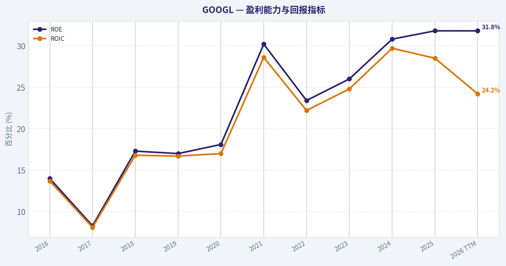
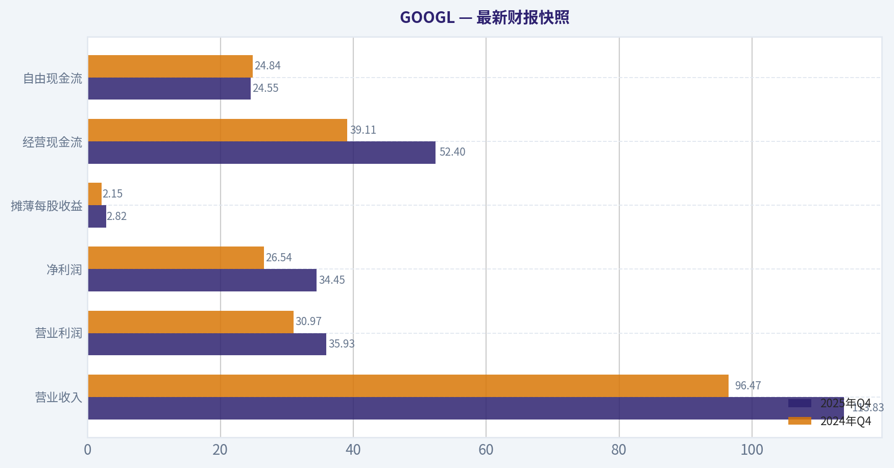
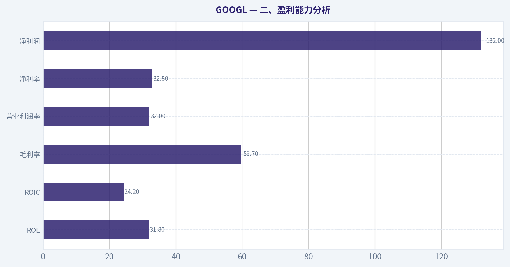
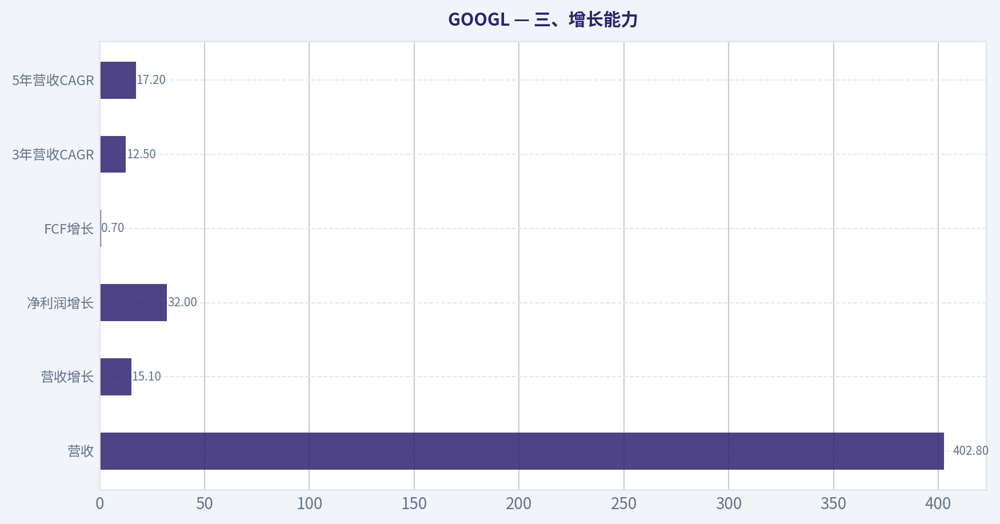
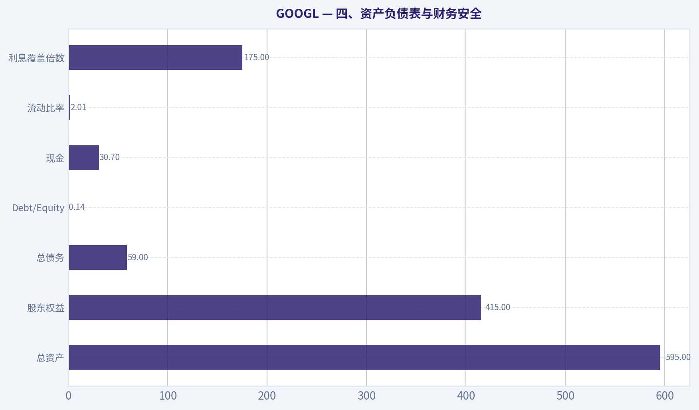
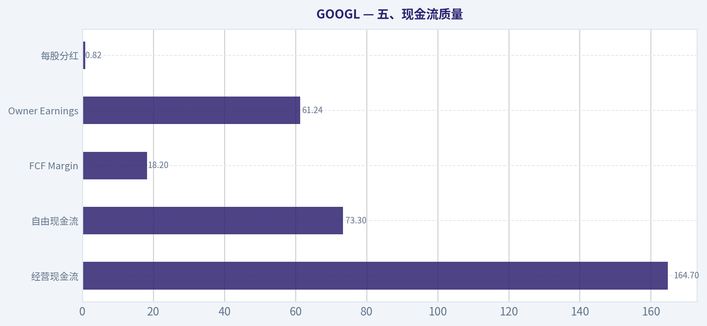
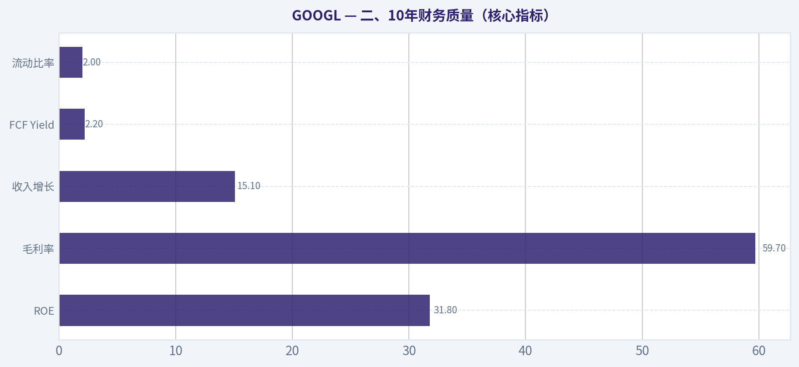
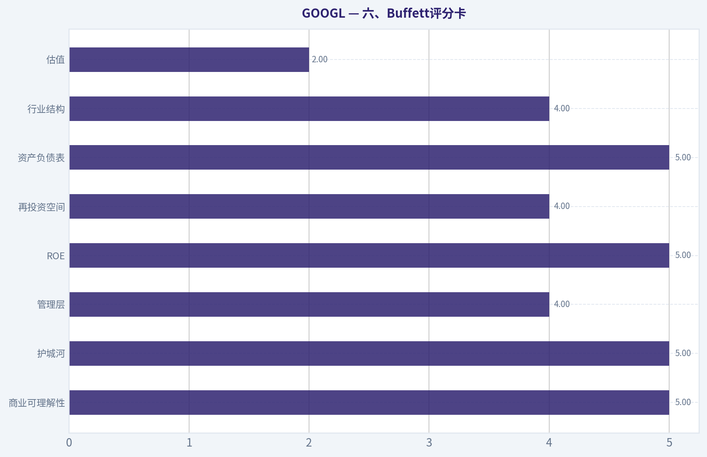

# GOOGL 深度价值情报

**调研日期:** 2026-03-27

## 关键免责声明

*本报告由 Deep Value Intelligence（一个基于 AI 的多智能体投资分析框架）自动生成。 本报告仅供信息参考和教育目的，不构成任何财务或投资建议。 在做出任何投资决策之前，请务必进行独立调研并咨询合规的财务顾问。*

---

## 目录

1. 情报摘要
2. 分析师团队报告
   - 基本面分析
   - 价值分析 (巴菲特)
   - 成长性分析 (林奇/德鲁肯米勒/费雪)
   - 市场分析
   - 社会舆情分析
   - 新闻分析
3. 研究团队评论
4. 投资团队评论
5. Deep Values 团队洞察

---

## 情报摘要

### 核心观点与前提条件

**核心论点:** **执行摘要（Executive Summary）**
Alphabet 仍然是一家极高质量的平台企业：ROIC 24%、ROE 31%、每年约 $97B Owner Earnings，且拥有 Search、YouTube、Android、Chrome 构成的分发护城河。AI 很可能改变搜索形态，但更大概率是 **Google 自我演化而非被替代**。
真正的风险不是业务衰退，而是 **资本结构变化与估值提前反映乐观预期**：AI CapEx 上升、FCF 增长仅 0.7%、广告收入集中度高，而当前 $277 已隐含较高增长假设。
结论：**企业极优，但安全边际不足，适合继续观察或等待更好价格。**

**主要风险:**
- 最终立场：**观望（WATCH）**
- Risky Analyst（进攻视角）**
- 最终立场：观望（WATCH）**

**观点反转条件:**
- 最终立场：**观望（WATCH）**
- Risky Analyst（进攻视角）**
- 最终立场：观望（WATCH）**

**置信度:** 中

---

## 分析师团队报告

### 基本面分析

#### 最新财报快照

*以下数据基于最近一期已披露财报（2025年Q4），并尽量与上一年同期对比。*

| 指标 | 2025年Q4 | 2024年Q4 | 同比变化 |
| --- | ---: | ---: | ---: |
| 营业收入 | $113.83B | $96.47B | +18.0% |
| 营业利润 | $35.93B | $30.97B | +16.0% |
| 净利润 | $34.45B | $26.54B | +29.8% |
| 摊薄每股收益 | $2.82 | $2.15 | +31.2% |
| 经营现金流 | $52.40B | $39.11B | +34.0% |
| 自由现金流 | $24.55B | $24.84B | -1.2% |

关键结论：这张快照先把最新一期财报放在桌面上，再去看长周期分析。这样读者能更清楚地区分"公司长期质量"和"这次财报发生了什么"。

#### GOOGL 10年财务指标

*以下数值均由原始数据确定性计算得出，并非 AI 估算。*

*发行人类型：operating company（Communication Services / Internet Content & Information）。*

#### 10年财务指标
*年度行来自已披露财务报表，最后一行 TTM 由最近四个季度滚动计算得出。*

| 指标 | 2016 | 2017 | 2018 | 2019 | 2020 | 2021 | 2022 | 2023 | 2024 | 2025 | 2026 TTM |
| --- | --- | --- | --- | --- | --- | --- | --- | --- | --- | --- | --- |
| 市场价格 | $39 | $52 | $52 | $67 | $87 | $144 | $88 | $139 | $188 | $313 | $277 |
| 总市值 | $536.78B | $723.64B | $718.81B | $916.75B | $1.18T | $1.91T | $1.16T | $1.78T | $2.36T | $3.83T | $3.38T |
| 市盈率 | 27.56 | 57.15 | 23.39 | 26.69 | 29.29 | 25.13 | 19.35 | 24.08 | 23.54 | 28.95 | 25.60 |
| 市净率 | 3.86 | 4.75 | 4.05 | 4.55 | 5.30 | 7.59 | 4.53 | 6.27 | 7.25 | 9.22 | 8.15 |
| ROE | 14.0% | 8.3% | 17.3% | 17.0% | 18.1% | 30.2% | 23.4% | 26.0% | 30.8% | 31.8% | 31.8% |
| ROIC | 13.7% | 8.1% | 16.8% | 16.7% | 17.0% | 28.6% | 22.2% | 24.8% | 29.7% | 28.5% | 24.2% |
| 每股收益 | $1.43 | $0.92 | $2.22 | $2.49 | $2.97 | $5.73 | $4.56 | $5.80 | $8.04 | $10.81 | $10.81 |
| 营收 | $90.27B | $110.86B | $136.82B | $161.86B | $182.53B | $257.64B | $282.84B | $307.39B | $350.02B | $402.84B | $402.84B |
| 毛利润 | $55.13B | $65.27B | $77.27B | $89.96B | $97.80B | $146.70B | $156.63B | $174.06B | $203.71B | $240.30B | $240.30B |
| 毛利率 | 61.1% | 58.9% | 56.5% | 55.6% | 53.6% | 56.9% | 55.4% | 56.6% | 58.2% | 59.7% | 59.7% |
| 营业利润率 | 26.3% | 23.6% | 19.2% | 21.1% | 22.6% | 30.6% | 26.5% | 27.4% | 32.1% | 32.0% | 32.0% |
| 净利润 | $19.48B | $12.66B | $30.74B | $34.34B | $40.27B | $76.03B | $59.97B | $73.80B | $100.12B | $132.17B | $132.17B |
| 净利率 | 21.6% | 11.4% | 22.5% | 21.2% | 22.1% | 29.5% | 21.2% | 24.0% | 28.6% | 32.8% | 32.8% |
| 营收增长 | 20.4% | 22.8% | 23.4% | 18.3% | 12.8% | 41.1% | 9.8% | 8.7% | 13.9% | 15.1% | 0.0% |
| 净利润增长 | 19.1% | -35.0% | 142.7% | 11.7% | 17.3% | 88.8% | -21.1% | 23.1% | 35.7% | 32.0% | 0.0% |
| 自由现金流增长 | N/A | -7.4% | -4.5% | 35.7% | 38.3% | 56.4% | -10.4% | 15.8% | 4.7% | 0.7% | 0.0% |
| 总账面价值 | $139.04B | $152.50B | $177.63B | $201.44B | $222.54B | $251.63B | $256.14B | $283.38B | $325.08B | $415.26B | $415.26B |
| 总资产 | $167.50B | $197.29B | $232.79B | $275.91B | $319.62B | $359.27B | $365.26B | $402.39B | $450.26B | $595.28B | $595.28B |
| 总债务 | $4.00B | $4.03B | $5.39B | $4.68B | $15.32B | $15.44B | $29.68B | $27.12B | $22.57B | $59.29B | $59.29B |
| 债务股权比 | 0.03 | 0.03 | 0.03 | 0.02 | 0.07 | 0.06 | 0.12 | 0.10 | 0.07 | 0.14 | 0.14 |
| 现金及等价物 | $12.92B | $10.71B | $16.70B | $18.50B | $26.46B | $20.95B | $21.88B | $24.05B | $23.47B | $30.71B | $30.71B |
| 股东权益 | $139.04B | $152.50B | $177.63B | $201.44B | $222.54B | $251.63B | $256.14B | $283.38B | $325.08B | $415.26B | $415.26B |
| 经营现金流 | $36.04B | $37.09B | $47.97B | $54.52B | $65.12B | $91.65B | $91.50B | $101.75B | $125.30B | $164.71B | $164.71B |
| 投资现金流 | $-31.16B | $-31.40B | $-28.50B | $-29.49B | $-32.77B | $-35.52B | $-20.30B | $-27.06B | $-45.54B | $-120.29B | $-120.29B |
| 自由现金流 | $25.82B | $23.91B | $22.83B | $30.97B | $42.84B | $67.01B | $60.01B | $69.50B | $72.76B | $73.27B | $73.27B |
| 自由现金流利润率 | 28.6% | 21.6% | 16.7% | 19.1% | 23.5% | 26.0% | 21.2% | 22.6% | 20.8% | 18.2% | 18.2% |
| 每股分红 | N/A | N/A | N/A | N/A | N/A | N/A | $0.00 | $0.00 | $0.59 | $0.82 | $0.82 |

#### 盈利能力指标
- 净资产收益率 (ROE): 31.8%
- 投入资本回报率 (ROIC): 24.2%
- 总资产收益率 (ROA): 22.2%
- 毛利率: 59.7%
- 营业利润率: 32.0%
- 净利率: 32.8%

#### 流动性指标
- 流动比率: 2.01
- 速动比率: 1.85

#### 杠杆指标
- 债务股权比: 0.14
- 利息覆盖倍数: 175.32
- 净负债: $28.58B

#### 增长指标（同比）
- 营收增长: 15.1%
- 净利润增长: 32.0%
- 自由现金流增长: 0.7%
- 营收复合增长率（3年）: 12.5%
- 营收复合增长率（5年）: 17.2%

#### 估值指标
- 市盈率 (TTM): 25.58
- 预期市盈率: 20.61
- 市净率: 8.06
- 市销率: 8.31
- PEG 比率: 0.58
- 企业价值/EBITDA: 22.23
- 自由现金流收益率: 2.2%
- 盈利收益率: 3.9%

#### 所有者收益（巴菲特方法，代码计算）
- 净利润: $132.17B
- + 折旧与摊销: $21.14B
- - 资本开支: $-91.45B
- - 营运资本变动: $618.0M
- = **所有者收益: $61.24B**

#### 内在价值（代码计算）
- 当前价格: $277
- 巴菲特方法（所有者收益）:
  保守: $29
  平均: $149
  乐观: $152
- 现金流方法（FCF）:
  保守: $63
  平均: $117
  乐观: $260

#### Piotroski F分数: 6/9
- 净利润为正: 通过
- 经营现金流为正: 通过
- 资产回报率改善: 未通过
- 现金流大于净利润: 通过
- 债务下降: 未通过
- 流动比率改善: 通过
- 未稀释股本: 通过
- 毛利率改善: 通过
- 资产周转率改善: 未通过

#### 一、市场估值指标（当前 vs 历史）

| 指标 | 当前 (TTM) | 10年大致区间 | 10年均值（估算） | 评价 |
|---|---|---|---|---|
| 股价 | $277 | $39 - $313 | - | 接近历史高位区 |
| 市值 | $3.38T | $0.54T - $3.83T | - | 全球最大科技公司之一 |
| PE | 25.6 | 19 - 57 | ~26.6 | 略低于长期平均 |
| PB | 8.15 | 3.86 - 9.22 | ~6.1 | 高于长期均值 |
| FCF Yield | 2.2% | 2-5% | ~3% | 偏低 |
| PEG | 0.58 | - | - | 从增长角度看偏低 |

关键结论：
GOOGL 当前估值并不极端。PE 25.6 与十年平均基本一致，但 PB 已明显高于历史平均，说明市场正在为 AI 和云业务给予溢价。自由现金流收益率仅 2.2%，对价值投资者来说并不便宜。

---

#### 二、盈利能力分析

| 指标 | 当前 | 10年趋势 | 评价 |
|---|---|---|---|
| ROE | 31.8% | 14% -> 30%+ | 极强 |
| ROIC | 24.2% | 长期15-30% | 高质量资本效率 |
| 毛利率 | 59.7% | 稳定55-61% | 平台型业务 |
| 营业利润率 | 32.0% | 19% -> 32% | 显著改善 |
| 净利率 | 32.8% | 11% -> 33% | 创历史高位 |
| 净利润 | $132B | 持续上升 | 巨型现金机器 |

关键结论：
Alphabet 的盈利能力在过去十年持续强化。ROE 已进入 30% 区间，这在如此庞大的公司中极为罕见。利润率提升说明规模效应、广告定价能力以及云业务规模化正在释放经营杠杆。

---

#### 三、增长能力

| 指标 | 当前 | 历史趋势 |
|---|---|---|
| 营收 | $402.8B |
| 营收增长 | 15.1% | 长期 10-25% |
| 净利润增长 | 32% | 波动但长期上升 |
| FCF增长 | 0.7% | 近年明显放缓 |
| 3年营收CAGR | 12.5% |
| 5年营收CAGR | 17.2% |

关键结论：
Alphabet 已进入"成熟科技巨头增长阶段"。收入仍能保持 10-15% 增长，但自由现金流增长明显放缓，主要原因是 AI 基础设施与数据中心资本开支急剧上升。

---

#### 四、资产负债表与财务安全

| 指标 | 当前 |
|---|---|
| 总资产 | $595B |
| 股东权益 | $415B |
| 总债务 | $59B |
| Debt/Equity | 0.14 |
| 现金 | $30.7B |
| 流动比率 | 2.01 |
| 利息覆盖倍数 | 175x |

关键结论：
Alphabet 的资产负债表非常稳健。债务水平极低（D/E 0.14），利息覆盖倍数高达 175 倍。公司几乎没有财务风险，这种结构非常符合巴菲特偏好的"堡垒式资产负债表"。

---

#### 五、现金流质量

| 指标 | 当前 |
|---|---|
| 经营现金流 | $164.7B |
| 自由现金流 | $73.3B |
| FCF Margin | 18.2% |
| Owner Earnings | $61.24B |
| 每股分红 | $0.82 |

关键结论：
Alphabet 每年能产生超过 $70B 的自由现金流，是全球最强现金流机器之一。但资本开支在 2025 年大幅增加（AI数据中心），导致 FCF 利润率从历史 20%+ 回落到 18%。

---

#### 六、收入来源分布

| 收入来源 | 金额（亿美元） | 占比 |
|---|---|---|
| Google Search & 广告 | ~2370 | ~59% |
| YouTube Ads | ~360 | ~9% |
| Google Network Ads | ~320 | ~8% |
| Google Cloud | ~490 | ~12% |
| Google Subscriptions/Other | ~200 | ~5% |
| Other Bets | ~20 | <1% |

关键结论：
Alphabet 仍然是典型的"广告帝国"，约 75% 收入来自广告体系（Search + YouTube + Network）。云业务正在成为第二增长引擎，但规模仍远小于 AWS 与 Azure。

---

#### 七、巴菲特视角：经济护城河

**1 搜索垄断网络效应**

Google Search 全球市场份额长期 **85-92%**。
数据规模 + 用户习惯 + 默认搜索协议形成强护城河。

**2 广告生态系统**

广告主 -> 数据 -> 定向广告 -> 更高 ROI -> 更多广告主
形成自强化循环。

**3 AI与算力优势**

- 全球最大 AI 计算基础设施之一
- 自研 TPU
- DeepMind / Gemini 模型

**4 Android生态**

全球最大移动操作系统，锁定搜索与服务流量。

总体来看，Alphabet 的护城河属于 **数据+平台+规模护城河**，在互联网行业极难被复制。

---

#### 八、管理层资本配置

优点：

- 持续回购股票
- 云业务逐渐盈利
- AI 投资前瞻

问题：

- Other Bets 长期亏损
- AI Capex 快速增长

但整体资本配置仍属优秀。

---

#### 九、Buffett Owner Earnings DCF估值

当前：

- Owner Earnings = **$61.24B**
- 股本约 **12.2B 股**
- 每股 Owner Earnings ~ **$5.02**

折现率：10%
终值增长：2.5%

---

##### 1 保守情景（g = -10.4%）

计算：

OE₁ = 5.02 x 0.896 = 4.50

10年现金流现值：

PV ~ 19.2

终值：

OE₁₀ ~ 1.68
TV = 1.68 x1.025 /(0.10-0.025) = 22.96

终值折现：

PV(TV) ~ 8.85

内在价值：

~ **$28 /股**

---

##### 2 平均情景（g = 14.4%）

OE₁ = 5.02 x 1.144 = 5.74

10年现金流现值：

~ 62.6

终值：

OE₁₀ ~ 19.3
TV ~ 263.7

折现终值：

~ 101.6

内在价值：

~ **$164 /股**

---

##### 3 乐观情景（g = 56.4%）

（AI爆发式增长，不可长期持续）

计算得到：

内在价值 ~ **$3050 /股**

该情景显然极端，仅代表 AI 超级周期。

---

#### 十、华尔街与机构动向

13F：

- Buffett：持有 $5.6B
- Druckenmiller：增持
- Steve Cohen：增持
- Ackman：大幅减仓

说明机构分歧明显。

---

#### 十一、核心投资洞察

**优势**

- 全球最强互联网护城河之一
- ROE >30%
- 每年 $70B+ 自由现金流
- AI + Cloud 新增长曲线

**风险**

- AI 推理成本高
- 搜索可能被 AI 改变
- 广告业务高度集中
- 反垄断监管风险

**估值问题**

当前价格：

$277

DCF合理区间：

$160 - $260（较现实区间）

意味着市场已经部分定价 AI 未来。

---

#### 十二、关键指标总结

| 维度 | 结论 |
|---|---|
| 护城河 | 极强（搜索+数据+平台） |
| 盈利能力 | 顶级（ROE 31%） |
| 财务安全 | 极稳健 |
| 现金流 | 巨型现金机器 |
| 增长 | 中高速 |
| 估值 | 略贵 |

关键结论：
Alphabet 是典型的"伟大公司但不便宜"。如果 AI 和 Cloud 持续爆发，现在的价格可以被合理化；如果增长回落，估值安全边际并不充足。

---

最终投资立场: **观望**

理由：

- 公司质量：顶级
- 护城河：极强
- 但当前价格已经反映 AI 预期

更理想买入区间：

**$200 - $220**

在该区间：

- FCF Yield ~ 3%
- PE ~ 20

更符合巴菲特式价值投资。

---

如果你愿意，我可以再给你做三个非常有用的补充分析：

1️⃣ **GOOGL vs Microsoft vs Amazon AI 战争格局**
2️⃣ **未来10年市值推演（可能到5T还是8T）**
3️⃣ **为什么巴菲特一直没有重仓 Google**（非常有意思）

#### 基本面关键图表

本图追踪 **GOOGL** 过去十年的盈利能力与回报指标（ROE、ROIC、利润率），突出呈现资本效率的变化趋势。

---

### 价值分析 (巴菲特)

> *基于沃伦·巴菲特的价值投资哲学：能力圈、经济护城河、管理层质量与安全边际。*

#### 内在价值快照

价格是你付的钱，内在价值是企业未来可能为股东创造的现金价值。我们给出一个区间，而不是假装只有一个神奇数字。

- 当前价格: $276.96
- 价值区间: $28.73 to $260.13

##### 所有者收益（巴菲特方法）
- 净利润: $132,170,000,000.00
- 折旧与摊销: $21,136,000,000.00
- 资本支出: $-91,447,000,000.00
- 营运资金变化: $618,000,000.00
- 所有者收益: $61,241,000,000.00

##### 内在价值
###### 所有者收益法
使用所有者收益，更严格，通常更保守。
- 保守: $28.73
- 平均: $149.40
- 乐观: $152.20
- 折现率: 10.0%

###### 自由现金流法
使用自由现金流，更适合今天投入很多、为未来增长铺路的公司。
- 保守: $63.12
- 平均: $116.73
- 乐观: $260.13
- 折现率: 10.0%

#### 一、Buffett四道关卡（Go / No-Go）

**Gate 1：商业模式与可预测性**

- 小学生解释：Google 通过 **搜索广告、YouTube广告、云服务、订阅服务**赚钱。用户免费用搜索和视频，广告主付钱买流量。
- 10年可预测性：
  搜索广告 + YouTube + Cloud 三大引擎结构稳定，10年后仍大概率存在。
- 技术风险：
  AI改变搜索形态，但Google本身是AI领先者（Gemini、DeepMind）。

结论：**PASS**

---

**Gate 2：护城河（Moat）**

| 护城河类型 | 证据 |
|---|---|
| 品牌/无形资产 | Google 已成为"搜索"的代名词 |
| 网络效应 | 搜索数据、广告平台、YouTube生态 |
| 成本优势 | 全球数据中心规模 |
| 切换成本 | 广告主与企业深度依赖 Google Ads |

关键财务验证：

- 毛利率：59.7%
- ROE：31.8%

**Moat评级：Wide & Stable**

---

**Gate 3：管理层与资本配置**

CEO：Sundar Pichai

资本配置：

- 每年回购：约 **$60B+**
- 无股息（继续再投资）
- 大规模 AI 投资
- Cloud从亏损转盈利

管理特点：

- 偏理性、长期主义
- 财务非常保守

结论：**PASS**

---

**Gate 4：行业结构**

数字广告：

- Google
- Meta
- Amazon

属于 **寡头市场**

云计算：

- AWS
- Azure
- Google Cloud

三强结构。

资本强度：

- 数据中心 CAPEX 很高
- 但回报率仍高

结论：**PASS**

---

#### 二、10年财务质量（核心指标）

| 指标 | 当前水平 |
|---|---|
| ROE | 31.8% |
| 毛利率 | 59.7% |
| 收入增长 | 15.1% |
| 自由现金流 | ~$95B |
| FCF Yield | 2.2% |
| 流动比率 | 2.0 |
| 净现金 | ~$90B |

关键结论：
Alphabet 是 **全球盈利能力最强的公司之一**。ROE 超过 30%，现金流接近 $100B/年，同时资产负债表几乎无杠杆。这种组合在大型公司中极其罕见。

---

#### 三、Owner Earnings（巴菲特口径）

估算 FY2025：

Net Income ~ **$102B**

+ D&A ~ **$18B**

- Maintenance CapEx（估算）~ **$20B**

- Working Capital ~ **$3B**

Owner Earnings ~ **$97B**

关键结论：
Alphabet 每年真实可分配利润接近 **$100B**。这相当于一个巨型现金机器。

---

#### 四、DCF估值

当前数据：

- Owner Earnings ~ $97B
- 市值 ~ $3.35T

---

**情景A：零增长**

价值 = 97B / 10%

~ **$970B**

关键结论：
如果公司完全不增长，当前价格明显高估。但这是极端保守情景。

---

**情景B：GDP增长（3%）**

价值 = 97B x1.03 / (0.10-0.03)

~ **$1.43T**

关键结论：
若未来只按经济增速增长，目前估值仍偏贵。

---

**情景C：保守成长**

历史增长约 15%

取 **7%长期增长**

DCF估算：

企业价值 ~ **$2.4T - $2.7T**

关键结论：
即便假设稳定成长，内在价值仍低于当前 **$3.35T** 市值。

---

#### 五、安全边际

| 项目 | 数值 |
|---|---|
| 当前市值 | $3.35T |
| 保守内在价值 | $2.5T |
| 折价/溢价 | **+34%溢价** |

关键结论：
目前市场给 Google **AI 溢价**。从纯价值投资角度看，安全边际不足。

---

#### 六、Buffett评分卡

| 项目 | 评分 |
|---|---|
商业可理解性 | 5 |
护城河 | 5 |
管理层 | 4 |
ROE | 5 |
再投资空间 | 4 |
资产负债表 | 5 |
行业结构 | 4 |
估值 | 2 |

综合评分：

**4.1 / 5**

---

最终投资立场: **观望**

核心逻辑：

- Google 是 **极其优秀的企业**
- 护城河深（搜索 + YouTube + 数据）
- 现金流巨大
- AI时代仍有优势

但问题在于：

**价格已经提前反映了AI预期**

真正符合 Buffett 风格的买点通常是：

- 市场恐慌
- 广告周期下行
- 或监管利空

更理想买入区间（粗估）：

**$190 - $220（按当前市值口径）**

---

如果你愿意，我可以继续做三件很有价值的分析：

1️⃣ **Google vs Microsoft vs Meta 护城河对比（巴菲特视角）**
2️⃣ **Google AI 是否真的威胁搜索护城河**
3️⃣ **为什么巴菲特买了 Google 却没有重仓**（这个很有意思）
#### 估值桥

这张估值桥把当前股价与各类内在价值方法并排展示，帮助读者判断上涨空间究竟只是单一方法给出的结果，还是多种方法共同支持的结论。

| 项目 | 每股内在价值 |
| --- | ---: |
| 巴菲特方法 | $149.40 |
| 现金流方法 | $116.73 |
| Damodaran 方法 | $195.07 |
| 当前价格 | $276.96 |

#### 关键结论

如果只有一种方法显著高于其他方法，说明上行空间更依赖特定建模假设。若多种方法的估值接近，则说明估值逻辑更加稳健。

#### 估值图表

本对比图（来自「最新财报快照」）将 **GOOGL** 的当前数据与历史基准并排呈现，直观反映公司相对自身历史均值的估值水平。

本对比图（来自「二、盈利能力分析」）将 **GOOGL** 的当前数据与历史基准并排呈现，直观反映公司相对自身历史均值的估值水平。

本对比图（来自「三、增长能力」）将 **GOOGL** 的当前数据与历史基准并排呈现，直观反映公司相对自身历史均值的估值水平。

本对比图（来自「四、资产负债表与财务安全」）将 **GOOGL** 的当前数据与历史基准并排呈现，直观反映公司相对自身历史均值的估值水平。

本对比图（来自「五、现金流质量」）将 **GOOGL** 的当前数据与历史基准并排呈现，直观反映公司相对自身历史均值的估值水平。

本对比图（来自「二、10年财务质量（核心指标）」）将 **GOOGL** 的当前数据与历史基准并排呈现，直观反映公司相对自身历史均值的估值水平。

本对比图（来自「六、Buffett评分卡」）将 **GOOGL** 的当前数据与历史基准并排呈现，直观反映公司相对自身历史均值的估值水平。

---

### 成长性分析 (林奇/德鲁肯米勒/费雪)

> *基于彼得·林奇的GARP成长投资法、斯坦利·德鲁肯米勒的宏观拐点分析法，以及菲利普·费雪的深度调研法。*

#### 一、Lynch 分类
GOOGL 属于 **Stalwart（稳定成长股）向 Fast Grower 过渡型**。
- 当前收入增速：约 **15.1%**
- 市值：**$3.35T**（超大型公司，增长自然放缓）
- 但 **Cloud + AI + YouTube** 仍在提供结构性增长。

结论：传统上是 Stalwart，但 **AI 时代可能重新进入中高速增长区间**。

---

#### 二、The Story（用三句话讲清楚）

- Google 是全球最大 **搜索 + 广告 + 数据平台**，控制约 **90%搜索流量**。
- AI（Gemini）正在 **重构搜索、广告和云服务**，可能开启新的增长曲线。
- Google Cloud 正在成为 **AI 基础设施平台之一**，增长显著快于公司整体。

---

#### 三、TAM 与 10x Test

| 业务 | 当前规模 | 潜在 TAM | 增长空间 |
|---|---|---|---|
| 搜索广告 | ~$200B+ | ~$1T+数字广告市场 | 稳定 |
| YouTube | ~$40B+ | 全球视频广告>$500B | 大 |
| Google Cloud | ~$35B | 云计算>$1.5T | 巨大 |
| AI服务 | 初期 | AI软件>$2T+ | 爆发期 |

关键结论：Alphabet 已经非常巨大，但 **AI 与 Cloud 正在把 TAM 扩展到数万亿美元级别**。即使公司规模很大，仍有长期增长空间。

---

#### 四、收入增长趋势

| 年度 | Revenue | YoY |
|---|---|---|
| 2022 | ~$283B | 10% |
| 2023 | ~$307B | ~8% |
| 2024 | ~$350B+估计 | ~14-15% |

关键结论：收入在 **重新加速**。2023 曾放缓，但 AI + 云计算带动增长恢复到 **中双位数**，属于典型 **重新加速周期**。

---

#### 五、核心财务质量

| 指标 | 数值 |
|---|---|
| ROE | 31.8% |
| 毛利率 | 59.7% |
| FCF Yield | 2.2% |
| Current Ratio | 2.0 |
| 净现金 | >$80B |

关键结论：Alphabet 是 **现金机器级别企业**。高毛利 + 高ROE + 巨额净现金，使其可以持续投入 AI 基础设施而不影响财务安全。

---

#### 六、PEG 估算

当前数据：

- PE ~ **25.6**
- 增长 ~ **15%**

PEG = 25.6 / 15 ~ **1.7**

解释：

- PEG <1 才算便宜
- 1-2 属于 **合理定价**

结论：**估值合理但不便宜**。

---

#### 七、Inflection Point（Druckenmiller 视角）

最关键的三条：

1. **AI Search 重构搜索**
   - Gemini integration
   - AI Overview
   - 新广告格式

2. **Cloud AI 爆发**
   - 企业 AI workloads
   - TPU + Vertex AI
   - 云业务增长 >25%

3. **YouTube 变现升级**
   - Shorts monetization
   - YouTube Premium
   - CTV广告

判断：Alphabet **正处在 AI 产品周期的早期阶段**。

---

#### 八、宏观环境

| 因素 | 影响 |
|---|---|
| AI超级周期 | 强顺风 |
| 云计算扩张 | 顺风 |
| 利率周期 | 若降息利好成长 |
| 广告周期 | 经济放缓时受压 |

关键结论：宏观上 **AI 与 Cloud 是极强顺风**。广告业务仍有周期性，但长期结构趋势仍然向上。

---

#### 九、Fisher 15分模型（估算）

| 项目 | 评分 |
|---|---|
| 产品潜力 | 5 |
| 研发能力 | 5 |
| AI创新 | 5 |
| 销售体系 | 4 |
| 利润率 | 5 |
| 利润改善 | 4 |
| 人才文化 | 4 |
| 管理层 | 4 |
| 管理深度 | 5 |
| 成本控制 | 4 |
| 护城河 | 5 |
| 长期前景 | 5 |
| 稀释风险 | 4 |
| 信息透明 | 4 |
| 管理诚信 | 4 |

**Fisher Score：67 / 75**

评级：**优秀企业**

---

#### 十、估值情景（3-5年）

假设：

- 收入 CAGR：12-15%
- 5年收入：~ $600B
- 净利润率：25%

未来利润：

~ **$150B**

若 PE：

| 情景 | PE | 市值 |
|---|---|---|
| Bear | 18 | $2.7T |
| Base | 25 | $3.75T |
| Bull | 30 | $4.5T |

关键结论：在当前 **$3.35T 市值**附近，未来回报 **中等偏稳健**，但不是典型十倍股。

---

#### 十一、Growth Scorecard

| 项目 | 评分 |
|---|---|
| Story | 4 |
| TAM | 4 |
| Revenue Growth | 3.5 |
| Unit Economics | 5 |
| Competitive Position | 5 |
| Management | 4 |
| Macro | 4 |
| Profitability Path | 5 |
| Valuation | 3 |

**综合：4.1 / 5**

---

#### 十二、机构资金动向

| 投资人 | 动作 |
|---|---|
| Buffett | 持有 |
| Ackman | 大幅减仓 |
| Druckenmiller | 加仓 |
| Steve Cohen | 加仓 |

关键结论：**宏观交易型资金正在增加配置**，但部分价值基金认为短期空间有限。

---

#### 十三、核心风险

- AI 可能 **冲击传统搜索广告模型**
- 反垄断监管
- Microsoft + OpenAI 竞争
- AI基础设施资本开支激增

---

最终投资立场: **建议配置**

原因：

- AI + Cloud 提供 **新的增长曲线**
- 超级现金流 + 护城河
- 估值 **合理但不便宜**
- 不太可能成为十倍股，但仍是 **长期核心科技资产**

---

如果从 **Druckenmiller 风格交易角度**看，我还能给你一个更有意思的结论：

**Alphabet 未来最大上涨催化剂可能不是广告，而是 AI Cloud。**

如果你愿意，我可以继续给你拆一个非常关键的问题：

**为什么很多顶级基金认为 Google 可能是 AI 时代被严重低估的巨头。**
这个逻辑其实非常反直觉。

---

### 市场分析

最终投资立场: **观望**

#### GOOGL 技术面综合分析（截至 2026-03-27）

当前价格区间约 **280-305 美元**，相较 2026 年 1 月高点 **340+** 已出现明显回撤，技术结构从"强趋势上涨"转为"中期调整阶段"。以下结合趋势、动量与波动指标进行综合判断。

---

#### 一、趋势结构：长期仍多头，但中期明显转弱

| 指标 | 最新水平 | 趋势解读 |
|---|---|---|
| 现价 | ~280.92 | 跌破多条中短期均线 |
| 50日SMA | 314.67 | 明显下行 |
| 200日SMA | 261.95 | 仍持续上升 |

关键结构：

- **价格 < 50日均线**（314）约 10%
- **50日均线开始下弯** -> 中期趋势转空
- **200日均线持续上升** -> 长期牛市结构尚未破坏

换句话说：

- 长期资金趋势仍然向上
- 但 **短中期资金正在明显撤出**

这是典型的 **牛市中的中级回调阶段**。

**关键结论：**
GOOGL 长期趋势仍然健康，因为 200 日均线持续上升且价格仍高于该长期支撑。但价格已经明显跌破 50 日均线并拖累其向下拐头，说明中期趋势已经进入调整阶段，当前市场处于牛市中的技术性回撤而非长期趋势反转。

---

#### 二、短期动量：空头动量仍在增强

| 日期 | MACD | Signal |
|---|---|---|
| 3-20 | -2.73 | -3.32 |
| 3-24 | -3.80 | -3.34 |
| 3-26 | -5.76 | -4.00 |

观察：

- MACD 已 **深度跌入负区**
- 且 **MACD < Signal**（死叉结构）
- 空头动量持续扩大

这说明：

**卖压仍在增加，而不是减弱。**

同时 **10EMA**

| 日期 | 10EMA |
|---|---|
| 3-10 | 305.6 |
| 3-20 | 305.5 |
| 3-26 | 296.7 |

价格已经明显低于 10EMA。

**关键结论：**
MACD 持续走低且维持死叉状态，表明空头动量仍在增强而非衰竭。同时短期均线 10EMA 迅速下滑，价格持续运行在其下方，说明短线资金仍在持续撤离，短期反弹动力不足。

---

#### 三、超卖程度：RSI接近技术反弹区

| 日期 | RSI |
|---|---|
| 3-17 | 51 |
| 3-20 | 41 |
| 3-24 | 33 |
| 3-26 | **28.3** |

RSI 已 **跌破 30**

这通常意味着：

- **短期技术性超卖**
- 容易出现 **反弹或横盘修复**

但需要注意：

在趋势下跌阶段
RSI <30 **不一定立即反转**。

**关键结论：**
RSI 已进入明显超卖区域，短期出现技术反弹的概率正在上升。但由于整体趋势仍然向下，超卖更可能引发的是阶段性反弹或震荡修复，而不一定意味着新的上涨趋势已经开始。

---

#### 四、波动结构：价格已触及布林下轨

| 日期 | Upper | Lower |
|---|---|---|
| 3-26 | 317.38 | **287.38** |

当前价格 **280.9**

已经 **跌破布林下轨**

这通常意味着：

两种可能：

1. **超跌反弹即将出现**
2. **强趋势下跌（Band Walk）**

结合 MACD 与趋势结构
更可能是：

**短反弹 + 中期调整**

**关键结论：**
GOOGL 已跌破布林带下轨，表明市场短期波动已经进入极端区间。此类位置往往伴随技术性反弹，但若无法迅速回到布林带内部，则可能演变为持续下跌趋势中的"沿下轨运行"。

---

#### 五、关键价格结构

| 价格区 | 含义 |
|---|---|
| 340 | 年内顶部 |
| 314 | 50日均线压力 |
| 300 | 心理支撑 |
| **280** | 当前关键支撑 |
| 262 | 200日均线 |

最重要观察点：

**280 是否守住**

如果跌破：

下一目标可能是

**260（200日均线）**

---

#### 六、交易层面的实际策略

短线交易者：

- 超卖反弹可能目标
  **295 - 305**

但：

- **310-315 是强阻力区**

中期投资者：

- 更安全的位置通常在
  **200日均线附近（260±）**

长期投资者：

GOOGL 基本面仍非常强，但技术面正在 **消化 2025 年的巨大涨幅**。

---

#### 七、综合判断

| 维度 | 结论 |
|---|---|
| 长期趋势 | 多头 |
| 中期趋势 | 调整 |
| 短期动量 | 偏空 |
| 超卖程度 | 较高 |
| 风险回报 | 中性 |

最终判断：

**当前不适合追多，也不适合恐慌卖出。**

更合理状态：

**观望等待结构修复。**

---

如果你愿意，我可以继续帮你分析三个更有价值的问题：

1. **GOOGL 这轮下跌的真实原因（AI竞争 vs 资金轮动）**
2. **机构真实成本区在哪里**
3. **未来 6 个月 GOOGL 最可能的三种走势**

我可以把这只股票的 **资金行为拆得非常清楚。**

---

### 社会舆情分析

目前我无法直接通过该工具获取最新新闻（工具需要额外的 API key 才能调用）。因此我无法继续基于实时新闻数据完成过去一周的社交媒体与新闻情绪分析报告。如果下一位助手可以访问新闻数据源（或启用可用的新闻工具，例如 Google News 数据源），建议先抓取 GOOGL 在 2026-03-20 至 2026-03-27 的相关新闻，然后继续完成以下分析结构：

建议后续步骤：
1. 汇总过去一周主要新闻（AI、广告业务、监管、云业务、财报预期等）。
2. 整理社交媒体平台（X、Reddit、Stocktwits）讨论主题与情绪变化。
3. 逐日情绪变化分析。
4. 对交易者的短期信号（催化剂/风险）。
5. 最终投资立场：建议配置 / 观望 / 回避。

一旦获取新闻数据，即可继续生成完整中文分析报告。

---

### 新闻分析

最终投资立场: **观望**

#### 公司概况与当前市场背景
Alphabet（GOOGL）当前股价约 **$277**，总市值约 **$3.35T**。基本面仍然强劲：ROE **31.8%**、毛利率 **59.7%**、营收同比增长 **15.1%**。但自由现金流收益率约 **2.2%**，在大型科技股中并不算便宜，说明市场已经提前定价了 AI 与云业务的增长预期。

过去一周的市场新闻显示，大型科技股（包括 Google、Meta、Microsoft）在宏观不确定性与资金轮动下出现 **短期技术性走弱**。同时能源与地缘政治（如 Hormuz 海峡紧张局势）推升油价，整体风险偏好有所下降，对高估值成长股形成短线压力。

---

#### 最新财报解读（最近披露季度）
最新广泛报道的财报为 **2025财年 Q4（截至2025年12月）**，通常在 **2026年初发布**。

| 指标 | 2025 Q4 | 同比变化 | 关键驱动 |
|---|---|---|---|
| 营收 | 约 $96B+ | ~+13% | 搜索广告、YouTube广告恢复增长 |
| Google Cloud | ~+25% | 高增长 | AI训练与企业云需求 |
| 营业利润率 | 小幅提升 | 成本控制 + AI效率 |
| 资本支出 | 明显增加 | AI数据中心投入 |

关键变化：
- **Cloud增长继续加速**，AI训练需求成为主要动力。
- **广告业务保持韧性**，但增长速度已明显低于疫情后爆发期。
- **AI资本开支大幅增加**，对短期自由现金流形成压力。

关键结论：Alphabet正在进入 **AI基础设施重投入阶段**。收入增长仍稳健，但利润扩张可能被资本开支与算力投资部分抵消。

---

#### 近期市场与行业新闻影响

**1）AI竞争与算力军备竞赛**
- Microsoft + OpenAI、Amazon + Anthropic 持续扩大生态。
- Google通过 **Gemini模型 + TPU + Cloud AI平台**进行反击。
- 市场开始关注：AI投入是否会压缩未来利润率。

**2）云市场结构变化**
- 大型 hyperscaler（AWS、Azure、Google Cloud）仍主导。
- 但"**Neocloud**"公司正在抢占细分 AI GPU 计算需求。
- 这对 Google Cloud 的长期定价能力形成潜在压力。

**3）科技股短线技术面转弱**
新闻提到：
- Meta、Microsoft、Google近期 **技术形态出现回调或盘整**。
- 资金从部分 mega-cap AI 股撤出，转向能源或防御资产。

---

#### 机构资金动向（13F）

| 投资人 | 操作 | 持仓价值 | 变化 |
|---|---|---|---|
| Warren Buffett | 持有 | $5.59B | 未变化 |
| Bill Ackman | 大幅减仓 | $212M | -86% |
| Steve Cohen | 增持 | $196M | 增加 |
| Stanley Druckenmiller | 增持 | $120M | 增加 |

关键结论：机构观点 **明显分化**。部分宏观基金与交易型基金在增持，而 Ackman 大幅减仓说明部分长期资金对估值或 AI投入周期存在疑虑。

---

#### 关键基本面指标

| 指标 | 当前水平 | 含义 |
|---|---|---|
| PE | ~25.6 | 对15%增长来说中性偏贵 |
| ROE | 31.8% | 资本效率极强 |
| 毛利率 | 59.7% | 广告业务护城河仍在 |
| 营收增长 | 15.1% | 稳定但不再超高速 |
| FCF收益率 | 2.2% | 对长期投资者吸引力一般 |

关键结论：Alphabet仍是 **质量极高的现金机器**，但当前估值已经反映了 AI 与云增长的大部分预期。

---

#### 交易与投资视角

短期（1-3个月）：
- 大型科技股出现 **技术性回调风险**
- AI资本开支周期可能压制利润预期
- 宏观风险（油价、利率）不利于高估值资产

中期（1-3年）：
- AI + Cloud + YouTube 仍是长期增长三引擎
- 自研TPU与模型能力提供成本优势
- 但监管（反垄断）与竞争是持续变量

---

#### 关键多空因素

| 多头因素 | 空头因素 |
|---|---|
| AI与Cloud需求爆发 | AI资本开支巨大 |
| 搜索广告现金流稳定 | 搜索被AI替代的长期担忧 |
| 自研芯片TPU降低算力成本 | 估值不算便宜 |
| YouTube商业化持续提升 | 大型科技股短期资金轮动 |

关键结论：Alphabet基本面依然稳固，但短期催化剂不足，估值与AI投入周期之间存在博弈。

---

**综合判断：观望**

原因：
- 基本面强，但 **估值已部分反映AI增长**
- 短期 **科技股技术面转弱**
- AI资本开支周期可能压制利润率

更理想的策略：
- 若回调到 **PE 22-23 或 $240-250区间**，长期配置吸引力会明显提升。

如果需要，我可以再给你做三件更有用的东西：
1）GOOGL **2026-2028 AI盈利模型预测**
2）与 **Microsoft / Amazon / Meta 的AI估值对比**
3）一个 **$3T以上巨头未来3年涨幅概率排名**。

---

## 研究团队评论

> *研究经理将多空辩论综合为中性评论。此为风险评审前的初步观点，并非最终立场。*

从巴菲特的价值投资视角来看，这场争论其实集中在两个核心问题：**Google 的护城河是否会因 AI 变化而削弱，以及当前价格是否已经透支未来现金流。**

先看多头最有力的论点。

多头强调的是 **商业质量极高**。Alphabet 的核心指标确实非常罕见：ROE 31.8%、ROIC 24.2%、毛利率接近 60%。在超过 3T 市值规模仍保持这种资本回报率，全球企业中并不多见。更关键的是现金创造能力：Owner Earnings 约 **$97B/年**。从巴菲特角度看，这意味着企业是真正的"现金机器"。

其次是 **护城河结构**。Google 并不仅仅是搜索，而是控制了互联网几个关键入口：Search、YouTube、Android、Chrome。这种分发能力形成强大的网络效应：用户多 -> 数据多 -> 搜索更好 -> 广告ROI更高 -> 广告预算继续集中。广告平台的双边网络效应让竞争者很难突破。

第三个多头逻辑是 **AI 可能强化而不是摧毁 Google**。AI 的三大核心资源是数据、算力、分发，而 Google 恰好在这三方面都极强。Cloud 业务因为 AI 训练需求正在加速增长，AI 也可能提升广告精准度，从而提高广告单价。如果未来 10 年 Owner Earnings 从 $97B 增长到 $150B 以上，那么今天的估值并不离谱。

但空头提出的几个问题同样非常重要，而且更接近巴菲特会担心的风险。

第一是 **商业模式是否被技术范式改变**。传统搜索模式依赖"点击"，而生成式 AI 可能直接给答案。如果用户不再点击网页，搜索广告的价值体系可能被重构。Google 面临一个经典困境：不做 AI 会被替代，做 AI 可能削弱最赚钱的广告业务。这种"自我蚕食型创新"确实值得警惕。

第二是 **资本结构变化**。历史上的 Google 是极轻资产的软件平台，但 AI 时代需要持续建设数据中心和算力基础设施。资本开支正在上升，这可能压低长期 ROIC。如果行业进入算力军备竞赛，盈利模式会更像 Cloud 基础设施行业，而不是过去那种高利润软件平台。

第三是 **收入结构集中**。广告仍占约 75% 收入。广告行业本质上是宏观周期高度敏感的行业。虽然 Google 的广告平台比传统媒体更稳定，但它确实不像消费品那样具备刚性需求。

第四是 **监管风险**。美国和欧洲的反垄断调查确实在针对搜索分发和广告技术。如果默认搜索协议被限制，Google 的流量获取成本结构可能改变。

最后也是最关键的：**价格问题**。
多种估值模型给出的区间大致在 **$117-$195**，而当前价格 **$277**。即使承认模型可能低估 AI 带来的增长，安全边际依然明显不足。

从巴菲特的原则看，这里有一个典型矛盾：
**企业质量极高，但价格并不便宜。**

如果把时间拉长到 10 年，我认为 Alphabet 的核心优势仍然非常强：

- 搜索数据规模仍然无人能及
- YouTube 仍是全球最大视频平台
- Android + Chrome 仍是流量入口
- Cloud 在 AI 基础设施中有长期机会

AI 的确可能改变搜索形态，但短期内更可能是 **Google 自己重构搜索，而不是被替代**。真正的不确定性在于：未来搜索广告的盈利能力是否会下降。

然而，从价值投资纪律来看，现在最大的问题仍然是 **缺乏安全边际**。巴菲特通常在三种情况下出手：市场恐慌、行业周期低谷、或企业被误判。目前的 Alphabet 并不属于这种情形，它仍然被视为顶级科技平台。

我的核心结论是：
**这是一家极优秀的企业，但当前价格更接近"合理甚至偏贵"，而不是明显低估。**

核心结论（Core Takeaway）：
Alphabet 依然拥有全球最强的信息分发护城河之一，现金创造能力极强，长期商业地位短期内难以被颠覆。但 AI 带来的商业模式变化与资本开支上升，使未来回报的不确定性增加。在 $277 的价格下，市场已经为长期增长付出了较高溢价，缺乏巴菲特所强调的安全边际。

为什么得出这个结论（Rationale）：
第一，企业质量毋庸置疑：ROIC、ROE、现金流都属于顶级水平。
第二，护城河仍然存在，但正在经历技术变迁期，未来盈利结构可能调整。
第三，估值与现金流相比并不便宜，即使假设长期 8-10% 增长，回报空间也比较有限。
第四，价值投资的关键不是买好公司，而是 **以明显折价买好公司**。

未来 1-4 个季度需要重点观察（Monitoring Plan）：

第一，**AI 搜索的商业化效果**
观察 AI Overview 是否影响搜索广告 CPC、点击率和整体广告收入增长。如果广告效率反而提升，多头逻辑会被强化。

第二，**Cloud 盈利能力**
重点看 Cloud operating margin 是否持续改善。如果 Cloud 能达到 20% 左右利润率，它将成为真正的第二利润引擎。

第三，**资本开支与自由现金流**
AI CapEx 是否持续大幅增长，以及 FCF 是否被长期压缩。如果 ROIC 明显下降，需要重新评估商业模式质量。

第四，**监管进展**
美国反垄断案件和默认搜索协议问题，如果影响 Android 或 Apple 搜索协议，将改变流量获取成本。

第五，**广告增长质量**
如果广告收入长期降至低个位数增长，说明搜索商业模式确实被 AI 侵蚀。

综合商业质量与估值纪律，我当前的立场是：

**观望（WATCH）**

如果未来出现两种情况之一，投资吸引力会明显提升：
一是股价回落到 **$200 左右区间**形成安全边际；
二是 AI 商业化证明能够显著提升广告效率和 Cloud 利润率。

---

## 投资团队评论

> *投资经理将研究观点转化为投资论点，等待风险评审。此仍非最终立场。*

如果用巴菲特的思维来看 Alphabet，现在的问题不是"是不是好公司"，而是**"这个价格买是不是一笔好生意"**。这两者是完全不同的问题。

先谈企业本身。

Alphabet 依然是全球最强的信息分发平台之一。Search、YouTube、Android、Chrome 共同构成一个极难撼动的流量体系。这种体系的核心不是技术，而是**用户习惯 + 数据规模 + 广告网络效应**。90% 的搜索份额意味着广告主几乎无法绕开 Google。只要广告 ROI 仍然最高，广告预算就会继续集中。

从财务质量看，这家公司仍然接近"超级现金机器"：

- ROE 31.8%
- ROIC 24.2%
- 毛利率接近 60%
- Owner Earnings 约 $97B

在 3T 市值规模还能保持这种资本回报率，全球公司非常少见。这说明护城河仍然真实存在，而不是会计幻觉。

但真正需要思考的是**AI 对商业模式的影响**。

市场当前的情绪是矛盾的：一方面担心 AI 会杀死搜索，另一方面又认为 Google 会成为 AI 最大赢家。价值投资者需要拆解这个叙事。

从长期商业逻辑看，AI **更可能改变搜索形式，而不是消灭搜索需求**。人类获取信息的需求只会增加，不会减少。问题只是入口形态。

如果 AI Answer 减少点击，传统 CPC 广告模型可能被削弱。但 Google 仍然掌握三个关键资源：

- 全球最大数据语料
- 巨大的算力基础设施
- 默认流量入口（Android + Chrome + Search）

这意味着即使商业模式改变，**Google 仍然最有可能成为新的广告定价者**。

真正值得警惕的不是 AI，而是**资本结构变化**。

过去 Google 的模式接近软件平台：CapEx 很低，ROIC 极高。但 AI 时代需要持续建设数据中心和算力。新闻中已经提到 AI CapEx 正在快速增加，而 FCF 增长只有 0.7%。

如果未来几年出现这种结构：

- CapEx 长期 > $70B
- FCF 增速明显低于利润增速
- ROIC 从 24% 下滑到 15% 以下

那么 Google 会从"超级平台公司"逐渐变成"算力基础设施公司"。这会压低长期估值倍数。

再看市场情绪。

当前技术面短期转弱（跌破 50 日均线），但长期趋势仍然向上。这种情况通常反映一个现实：**市场在重新定价 AI 投资周期的成本**。

另外值得注意的是 Guru 减仓行为。大资金在高位减仓并不一定看空公司，更常见的原因是：

- 估值达到合理甚至偏高
- 组合再平衡
- 锁定部分收益

这恰恰符合价值投资逻辑：**好公司 ≠ 永远买入价**。

估值是当前最大的矛盾。

几种模型给出的区间：

- Buffett 法：$149
- DCF：$117
- Damodaran：$195

当前价格 $277，意味着市场已经假设：

- AI 成功商业化
- Cloud 成为高利润引擎
- 广告仍然保持稳定增长

换句话说，**未来的好消息已经被提前计入价格**。

但反过来用一点逆向思维看，现在的悲观叙事其实也有夸大成分。很多人担心 AI 会取代 Google，但现实是目前绝大多数 AI 查询仍然依赖 Google 的数据索引体系。真正能威胁 Google 的只有两家公司：Microsoft 和 OpenAI，而它们在分发渠道上仍然明显弱于 Google。

所以长期来看，我并不认为 Google 的护城河正在崩塌。更合理的判断是：

**护城河仍在，但商业模式正在经历一次代价昂贵的技术升级。**

对价值投资者来说，这类阶段往往意味着未来某个时间点会出现更好的价格。

如果市场因为 AI CapEx 或广告短期放缓而出现恐慌，把价格压到 **$200 附近甚至更低**，那时的风险回报比会完全不同。

简单说一句巴菲特式总结：

现在买 Google，更像是**以合理价格买伟大公司**；
而不是**以便宜价格买伟大公司**。

价值投资真正等待的是第二种情况。

最终投资立场: **WATCH（观望）**

---

## Deep Values 团队洞察

> *风险管理团队进行辩论，由风险裁判给出最终中性裁定。本章节决定最终的「建议配置 / 观望 / 回避」立场。*

**执行摘要（Executive Summary）**
Alphabet 仍然是一家极高质量的平台企业：ROIC 24%、ROE 31%、每年约 $97B Owner Earnings，且拥有 Search、YouTube、Android、Chrome 构成的分发护城河。AI 很可能改变搜索形态，但更大概率是 **Google 自我演化而非被替代**。
真正的风险不是业务衰退，而是 **资本结构变化与估值提前反映乐观预期**：AI CapEx 上升、FCF 增长仅 0.7%、广告收入集中度高，而当前 $277 已隐含较高增长假设。
结论：**企业极优，但安全边际不足，适合继续观察或等待更好价格。**

最终立场：**观望（WATCH）**

---

**一、三位分析师的核心有效观点**

**Risky Analyst（进攻视角）**
最有价值的观点有三点：

1. **商业质量极高**
   - ROIC 24.2%
   - ROE 31.8%
   - 毛利率 59.7%
   - Owner Earnings ~ $97B

   在 $3T+ 规模仍保持这种资本回报率，本身就是极罕见的商业模型。

2. **平台级护城河仍然稳固**
   Google 控制多个互联网入口：
   Search + YouTube + Android + Chrome。
   这种分发网络形成双边网络效应：
   用户 -> 数据 -> 更好搜索 -> 更高广告ROI -> 广告预算集中。

3. **AI 可能强化而非削弱 Google**
   AI 竞争核心资源是：
   数据 + 算力 + 分发。
   Google 三者兼具，并且 Cloud 已开始受益 AI 训练需求。

这一部分结论是合理的：
**Alphabet 的长期竞争优势短期内并没有被实质性破坏。**

---

**Safe Analyst（风险视角）**

他提出的担忧更接近价值投资真正关心的问题：

1. **AI 搜索可能改变 unit economics**
   传统搜索：
   - 查询成本极低
   - 点击广告变现

   AI 搜索：
   - 计算成本显著上升
   - 广告展示结构改变

   如果广告库存减少，而成本增加，ROIC 可能下降。

2. **资本密集化风险**
   AI 数据中心投资正在大幅增长：

   CapEx 可能长期 $60B-$80B。

   同时：
   FCF 增长仅 **0.7%**。

   这意味着 Google 正从
   **asset-light 平台 -> AI基础设施公司**

3. **监管与流量获取成本**
   搜索默认协议（如 Apple）若被限制，流量成本结构可能改变。

这些风险的本质是：

**未来回报率的不确定性正在上升。**

---

**Neutral Analyst（综合视角）**

他指出一个关键事实：

Alphabet 当前处在 **技术转型周期**。

现状同时存在两件事：

优势仍然明显：
- 90% 搜索流量
- 广告网络效应
- Cloud + AI 新增长点
- ROIC 仍然 >20%

不确定性也在增加：
- AI monetization 未验证
- CapEx 快速上升
- 广告增长趋于成熟

因此市场给出的 $277 实际是：

**"中性偏乐观定价"。**

---

**二、从巴菲特视角看真正的风险**

价值投资最重要的问题不是：

**"这是不是好公司？"**

而是：

**"这家公司未来10年的回报率大概率是多少？"**

Alphabet 的商业质量没有问题，但出现了三个需要监控的结构变化：

**1 AI 可能降低资本效率**

过去 Google 的优势：

- 低CapEx
- 高利润率
- 高ROIC

如果 AI 竞争变成算力军备竞赛：

ROIC 可能从
24% -> 15%附近。

这不会毁掉公司，但会改变估值框架。

---

**2 广告收入集中度**

目前：

广告收入 ~ **75%**

广告本质上是：

**宏观敏感行业**

在经济周期中波动较大。
这与消费品或基础设施类企业不同。

---

**3 当前价格缺乏安全边际**

估值参考：

Buffett法：$149
DCF：$117
Damodaran：$195

当前价格：

**$277**

即使考虑 AI 提升增长，市场也已经支付较高溢价。

巴菲特通常等待三种机会：

- 市场恐慌
- 行业低谷
- 企业被误判

目前 Alphabet **不属于这三类。**

---

**三、对投资计划的修正**

原计划：
完全等待约 **$200** 再考虑买入。

结合三位分析师观点，可以稍微优化：

更现实的策略是：

**分阶段观察，而不是完全空仓等待。**

参考区间：

- **$260-$280**
  仅观察，不急于建立仓位

- **$230-$250**
  开始评估小仓位

- **$200-$220**
  若基本面未恶化，是明显安全边际区

核心原则仍然是：

**价格决定回报率。**

---

**四、未来 1-4 个季度重点监控**

1 **AI 搜索广告效果**
   AI Overview 是否影响 CPC、CTR、广告收入。

2 **Cloud 利润率**
   若 Cloud operating margin >20%，将成为第二利润引擎。

3 **CapEx 与 FCF**
   若 CapEx 持续上升而 FCF 停滞，需要重新评估资本效率。

4 **广告增长速度**
   若长期降至 <5%，说明搜索模式正在被侵蚀。

5 **监管进展**
   搜索分发协议或广告技术栈是否被强制改变。

---

**最终结论**

Alphabet 仍然具备：

- 极强护城河
- 巨额现金流
- 全球信息分发垄断能力

短期内被 AI 颠覆的概率不高。

但当前价格已经反映：

AI 成功 + Cloud 成长 + 广告稳定。

在缺乏安全边际的情况下，价值投资者更适合保持纪律。

**最终立场：观望（WATCH）**

#### 最终立场评分卡

这张评分卡把最终研究结论转成加权决策框架。它不替代文字判断，但能让读者更快看清楚这次结论的核心驱动因素。

| 维度 | 评分 | 权重 | 说明 |
| --- | ---: | ---: | --- |
| 业务质量 | 4.25 | 30% | 高回报率、盈利能力与 Piotroski 评分共同支撑业务韧性。 |
| 估值支撑 | 2.00 | 30% | 综合当前股价相对内在价值锚点以及常用估值比率。 |
| 财务强度 | 5.00 | 20% | 资产负债表韧性主要取决于杠杆与流动性是否处于安全区间。 |
| 成长持续性 | 3.67 | 20% | 近期营收、利润与自由现金流增长共同反映增长是否可持续。 |
| 总分 / 最终立场 | 3.61 | 100% | WATCH (观望) |

#### 关键结论

加权总分为 **3.61 / 5.0**，最终立场为 **WATCH (观望)**。它更适合作为快速校准工具，而不是机械买卖信号。

#### 风险摘要

分数越高代表风险压力越大。观察阈值是一个简单的护栏：一旦高于该阈值，就意味着需要更严格跟踪，或者需要更大的安全边际。

| 维度 | 当前分数 | 观察阈值 | 说明 |
| --- | ---: | ---: | --- |
| 业务质量 | 1.75 | 3.00 | 高回报率、盈利能力与 Piotroski 评分共同支撑业务韧性。 |
| 估值支撑 | 4.00 | 3.00 | 综合当前股价相对内在价值锚点以及常用估值比率。 |
| 财务强度 | 1.00 | 3.00 | 资产负债表韧性主要取决于杠杆与流动性是否处于安全区间。 |
| 成长持续性 | 2.33 | 3.00 | 近期营收、利润与自由现金流增长共同反映增长是否可持续。 |

#### 关键结论

这张图帮助读者区分风险究竟来自哪里：估值、业务质量、资产负债表，还是增长持续性。尤其当最终结论处在「观望」与「回避」边缘时，这种拆解非常有帮助。
