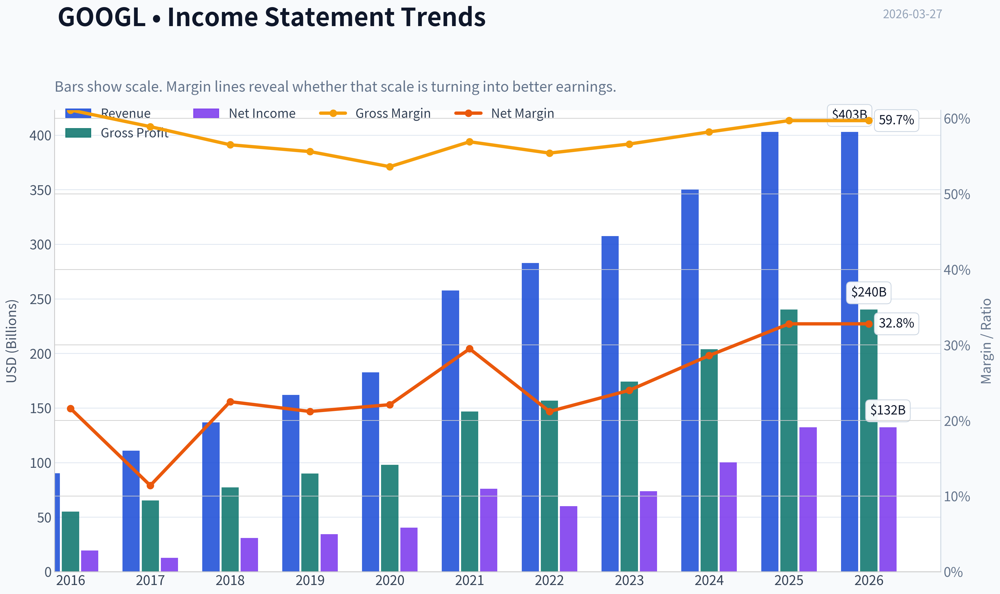
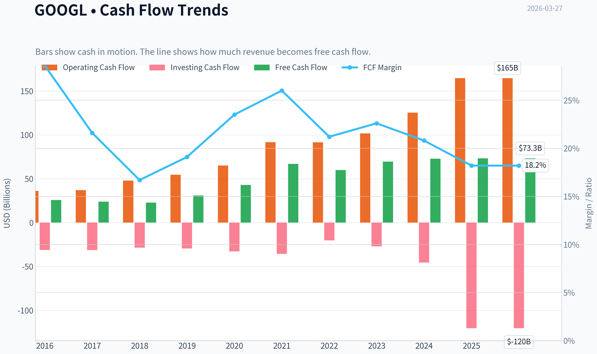
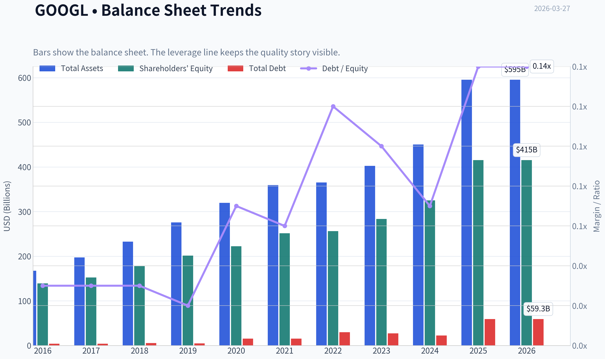
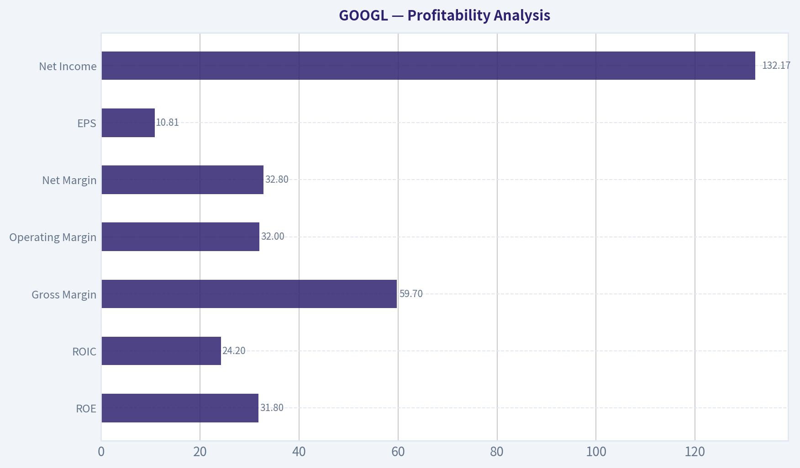
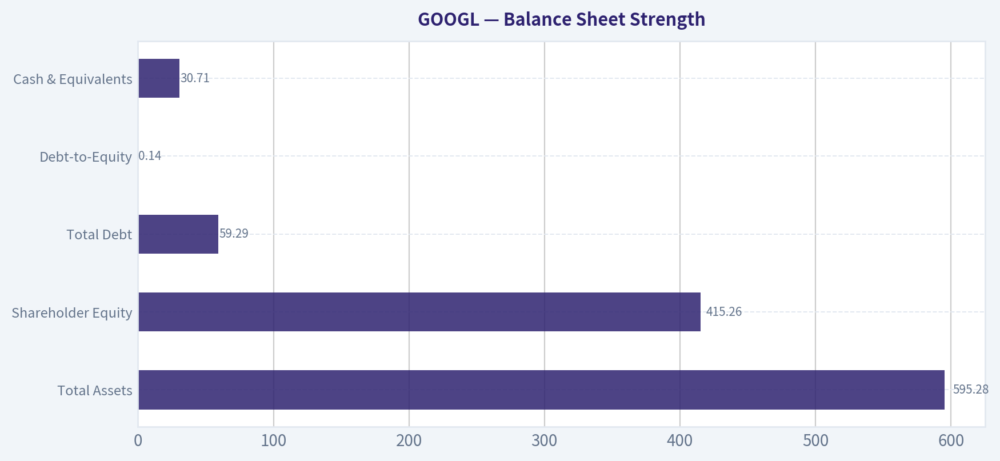
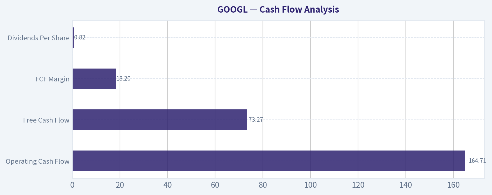
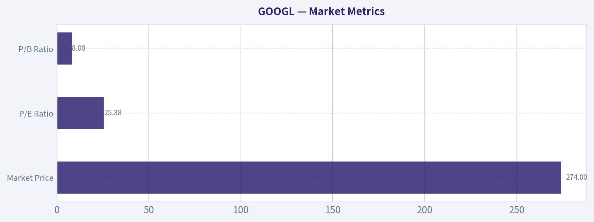

# GOOGL Deep Value Intelligence

**Analysis Date:** 2026-03-27

## Critical Disclaimer

*This analysis is generated by Deep Value Intelligence, an AI-powered multi-agent investing framework. This report is for informational and educational purposes only and does not constitute financial advice. Always conduct your own research and consult with qualified financial advisors before making investment decisions.*

---

## Table of Contents

1. Intelligence Summary
2. Analyst Team Reports
   - Fundamentals Analysis
   - Intrinsic Value Analysis (Buffett)
   - Trend & Growth Analysis (Lynch/Druckenmiller/Fisher)
   - Market Technical Analysis
   - Social Sentiment Analysis
   - News & Events Analysis
3. Research Team Commentary
4. Value Investing Team Commentary
5. Deep Values Commentary

---

## Intelligence Summary

### Thesis + Conditions

**Core Thesis:** Executive Summary (Quick Read)
Alphabet remains one of the highest-quality businesses ever built: dominant search distribution, exceptional returns on capital, and powerful platforms (YouTube, Android, Cloud). However, the core cash engine-search advertising-is entering a structural transition as AI changes how information is delivered and monetized.

**Key Risks:**
- Revenue growth (15.1%) and net income growth (32%) show the company is still compounding strongly. The long-term narrative is AI expansion: integrating AI into search, scaling Google Cloud for enterprise AI workloads, and leveraging Alphabet's global distribution (Android, Chrome, YouTube). If AI strengthens engagement and advertising effectiveness, Alphabet could expand its monetization surface rather than lose it.
- Risk Debate
- Risky Analyst Perspective
- The current financial excellence reflects the old search model, which was extremely capital-efficient. AI introduces a fundamentally different cost structure: large compute infrastructure, ongoing inference costs, and continuous model training. Early signals already show divergence-net income growing 32% while free cash flow barely grew (0.7%), suggesting rising capital intensity. If AI reduces monetizable screen space or compresses margins, the economic model could weaken even if usage grows.
- Risk Management Rationale (Buffett Framework)

**What Would Change Our View:**
- Revenue growth (15.1%) and net income growth (32%) show the company is still compounding strongly. The long-term narrative is AI expansion: integrating AI into search, scaling Google Cloud for enterprise AI workloads, and leveraging Alphabet's global distribution (Android, Chrome, YouTube). If AI strengthens engagement and advertising effectiveness, Alphabet could expand its monetization surface rather than lose it.
- Risk Debate
- Risky Analyst Perspective
- The current financial excellence reflects the old search model, which was extremely capital-efficient. AI introduces a fundamentally different cost structure: large compute infrastructure, ongoing inference costs, and continuous model training. Early signals already show divergence-net income growing 32% while free cash flow barely grew (0.7%), suggesting rising capital intensity. If AI reduces monetizable screen space or compresses margins, the economic model could weaken even if usage grows.
- Risk Management Rationale (Buffett Framework)

**Confidence:** Low

---

## Analyst Team Reports

### Fundamentals Analysis

#### Latest Earnings Snapshot

*Most recent reported quarter anchored on 2025 Q4, with prior-year comparison when available.*

| Metric | 2025 Q4 | 2024 Q4 | YoY Change |
| --- | ---: | ---: | ---: |
| Revenue | $113.83B | $96.47B | +18.0% |
| Operating Income | $35.93B | $30.97B | +16.0% |
| Net Income | $34.45B | $26.54B | +29.8% |
| Diluted EPS | $2.82 | $2.15 | +31.2% |
| Operating Cash Flow | $52.40B | $39.11B | +34.0% |
| Free Cash Flow | $24.55B | $24.84B | -1.2% |

Key Takeaways: This snapshot anchors the most recent reported quarter before the narrative analysis. It helps readers separate long-run business quality from whatever changed in the latest earnings print.

#### 10-Year Financial Metrics for GOOGL

*All values below are computed deterministically from raw data - not estimated by AI.*

*Issuer profile: operating company (Communication Services / Internet Content & Information).*

#### 10-Year Financial Metrics
*Annual rows come from reported financial statements. The final TTM row is computed from the latest four quarters.*

| Metric | 2016 | 2017 | 2018 | 2019 | 2020 | 2021 | 2022 | 2023 | 2024 | 2025 | 2026 TTM |
| --- | --- | --- | --- | --- | --- | --- | --- | --- | --- | --- | --- |
| Market Price | $39 | $52 | $52 | $67 | $87 | $144 | $88 | $139 | $188 | $313 | $274 |
| Market Cap | $536.78B | $723.64B | $718.81B | $916.75B | $1.18T | $1.91T | $1.16T | $1.78T | $2.36T | $3.83T | $3.35T |
| P/E Ratio | 27.56 | 57.15 | 23.39 | 26.69 | 29.29 | 25.13 | 19.35 | 24.08 | 23.54 | 28.95 | 25.38 |
| P/B Ratio | 3.86 | 4.75 | 4.05 | 4.55 | 5.30 | 7.59 | 4.53 | 6.27 | 7.25 | 9.22 | 8.08 |
| ROE | 14.0% | 8.3% | 17.3% | 17.0% | 18.1% | 30.2% | 23.4% | 26.0% | 30.8% | 31.8% | 31.8% |
| ROIC | 13.7% | 8.1% | 16.8% | 16.7% | 17.0% | 28.6% | 22.2% | 24.8% | 29.7% | 28.5% | 24.2% |
| EPS | $1.43 | $0.92 | $2.22 | $2.49 | $2.97 | $5.73 | $4.56 | $5.80 | $8.04 | $10.81 | $10.81 |
| Revenue | $90.27B | $110.86B | $136.82B | $161.86B | $182.53B | $257.64B | $282.84B | $307.39B | $350.02B | $402.84B | $402.84B |
| Gross Profit | $55.13B | $65.27B | $77.27B | $89.96B | $97.80B | $146.70B | $156.63B | $174.06B | $203.71B | $240.30B | $240.30B |
| Gross Margin | 61.1% | 58.9% | 56.5% | 55.6% | 53.6% | 56.9% | 55.4% | 56.6% | 58.2% | 59.7% | 59.7% |
| Operating Margin | 26.3% | 23.6% | 19.2% | 21.1% | 22.6% | 30.6% | 26.5% | 27.4% | 32.1% | 32.0% | 32.0% |
| Net Income | $19.48B | $12.66B | $30.74B | $34.34B | $40.27B | $76.03B | $59.97B | $73.80B | $100.12B | $132.17B | $132.17B |
| Net Margin | 21.6% | 11.4% | 22.5% | 21.2% | 22.1% | 29.5% | 21.2% | 24.0% | 28.6% | 32.8% | 32.8% |
| Revenue Growth | 20.4% | 22.8% | 23.4% | 18.3% | 12.8% | 41.1% | 9.8% | 8.7% | 13.9% | 15.1% | 0.0% |
| Net Income Growth | 19.1% | -35.0% | 142.7% | 11.7% | 17.3% | 88.8% | -21.1% | 23.1% | 35.7% | 32.0% | 0.0% |
| Free Cash Flow Growth | N/A | -7.4% | -4.5% | 35.7% | 38.3% | 56.4% | -10.4% | 15.8% | 4.7% | 0.7% | 0.0% |
| Total Book Value | $139.04B | $152.50B | $177.63B | $201.44B | $222.54B | $251.63B | $256.14B | $283.38B | $325.08B | $415.26B | $415.26B |
| Total Assets | $167.50B | $197.29B | $232.79B | $275.91B | $319.62B | $359.27B | $365.26B | $402.39B | $450.26B | $595.28B | $595.28B |
| Total Debt | $4.00B | $4.03B | $5.39B | $4.68B | $15.32B | $15.44B | $29.68B | $27.12B | $22.57B | $59.29B | $59.29B |
| Debt-to-Equity | 0.03 | 0.03 | 0.03 | 0.02 | 0.07 | 0.06 | 0.12 | 0.10 | 0.07 | 0.14 | 0.14 |
| Cash & Equivalents | $12.92B | $10.71B | $16.70B | $18.50B | $26.46B | $20.95B | $21.88B | $24.05B | $23.47B | $30.71B | $30.71B |
| Shareholders' Equity | $139.04B | $152.50B | $177.63B | $201.44B | $222.54B | $251.63B | $256.14B | $283.38B | $325.08B | $415.26B | $415.26B |
| Operating Cash Flow | $36.04B | $37.09B | $47.97B | $54.52B | $65.12B | $91.65B | $91.50B | $101.75B | $125.30B | $164.71B | $164.71B |
| Investing Cash Flow | $-31.16B | $-31.40B | $-28.50B | $-29.49B | $-32.77B | $-35.52B | $-20.30B | $-27.06B | $-45.54B | $-120.29B | $-120.29B |
| Free Cash Flow | $25.82B | $23.91B | $22.83B | $30.97B | $42.84B | $67.01B | $60.01B | $69.50B | $72.76B | $73.27B | $73.27B |
| FCF Margin | 28.6% | 21.6% | 16.7% | 19.1% | 23.5% | 26.0% | 21.2% | 22.6% | 20.8% | 18.2% | 18.2% |
| Dividends / Share | N/A | N/A | N/A | N/A | N/A | N/A | $0.00 | $0.00 | $0.59 | $0.82 | $0.82 |

#### Profitability Metrics
- Return on Equity (ROE): 31.8%
- Return on Invested Capital (ROIC): 24.2%
- Return on Assets (ROA): 22.2%
- Gross Margin: 59.7%
- Operating Margin: 32.0%
- Net Profit Margin: 32.8%

#### Liquidity Metrics
- Current Ratio: 2.01
- Quick Ratio: 1.85

#### Leverage Metrics
- Debt-to-Equity Ratio: 0.14
- Interest Coverage Ratio: 175.32
- Net Debt: $28.58B

#### Growth Metrics (Year-over-Year)
- Revenue Growth: 15.1%
- Net Income Growth: 32.0%
- Free Cash Flow Growth: 0.7%
- Revenue CAGR (3-Year): 12.5%
- Revenue CAGR (5-Year): 17.2%

#### Valuation Metrics
- P/E Ratio (TTM): 25.38
- Forward P/E: 20.43
- Price-to-Book: 7.99
- Price-to-Sales: 8.24
- PEG Ratio: 0.58
- EV/EBITDA: 21.70
- Free Cash Flow Yield: 2.2%
- Earnings Yield: 3.9%

#### Owner Earnings (Buffett Method, Code-Computed)
- Net Income: $132.17B
- + Depreciation & Amortization: $21.14B
- - Capital Expenditures: $-91.45B
- - Working Capital Changes: $618.0M
- = **Owner Earnings: $61.24B**

#### Intrinsic Value (Code-Computed)
- Current Price: $274
- Buffett Method (Owner Earnings):
  Conservative: $29
  Average: $149
  Optimistic: $152
- Cash Flow Method (FCF):
  Conservative: $63
  Average: $117
  Optimistic: $260

#### Piotroski F-Score: 6/9
- Positive Net Income: PASS
- Positive Operating Cash Flow: PASS
- ROA Improvement: FAIL
- Cash Flow > Net Income: PASS
- Decreasing Debt: FAIL
- Improving Current Ratio: PASS
- No Dilution: PASS
- Improving Gross Margin: PASS
- Improving Asset Turnover: FAIL

FINAL INVESTMENT STANCE: **WATCH**

#### Market Metrics

| Metric | Current (TTM) | 10-Year Avg | Interpretation |
|---|---|---|---|
| Market Price | $274 | ~$134 | Stock has compounded strongly but remains volatile with major drawdowns (2022, 2026). |
| Market Cap | $3.35T | ~$1.65T | Alphabet has doubled its economic footprint in the last five years. |
| P/E Ratio | 25.38 | ~26.3 | Slightly below long-term average valuation. |
| P/B Ratio | 8.08 | ~5.9 | Significantly above historical norm, reflecting strong intangible moat and profitability. |

Key Takeaways:
Alphabet trades close to its historical earnings multiple but well above its book value multiple. The market is pricing the company as a dominant platform with durable profitability rather than a balance-sheet asset play. Valuation is not cheap but also not historically stretched on an earnings basis.

---

#### Profitability Analysis

| Metric | Current | 10-Year Avg | Trend Insight |
|---|---|---|---|
| ROE | 31.8% | ~22.7% | Major improvement since 2021 due to margin expansion and scale. |
| ROIC | 24.2% | ~20.5% | Still extremely strong despite heavy AI and infrastructure spending. |
| Gross Margin | 59.7% | ~57.6% | Gradual recovery after compression in 2018-2020. |
| Operating Margin | 32.0% | ~26.1% | Highest level in company history. |
| Net Margin | 32.8% | ~24.6% | Structural improvement driven by scale and ad monetization. |
| EPS | $10.81 | - | ~7.5x growth since 2016. |
| Net Income | $132.17B | - | Massive compounding from $19B in 2016. |

Key Takeaways:
Alphabet's profitability has materially strengthened over the decade. Margins are now near all-time highs while ROE above 30% places the company among the most profitable mega-caps globally. The data suggests a powerful operating leverage effect as advertising, YouTube, and cloud scale.

---

#### Growth Metrics

| Metric | Current YoY | 10-Year Pattern |
|---|---|---|
| Revenue Growth | 15.1% | Historically 9-41% range |
| Net Income Growth | 32.0% | Highly volatile but strongly upward |
| Free Cash Flow Growth | 0.7% | Slowing recently |

Key Takeaways:
Revenue growth has normalized into the mid-teens after the explosive 2021 rebound. Earnings are still compounding faster than revenue thanks to margin expansion. Free cash flow growth, however, has slowed significantly as capital expenditures rise due to AI infrastructure investment.

---

#### Balance Sheet Strength

| Metric | Current |
|---|---|
| Total Assets | $595.28B |
| Shareholder Equity | $415.26B |
| Total Debt | $59.29B |
| Debt-to-Equity | 0.14 |
| Cash & Equivalents | $30.71B |

Key Takeaways:
Alphabet maintains an exceptionally strong balance sheet. Debt remains extremely low relative to equity, and the company generates enormous operating cash flow. Financial risk is minimal, giving management flexibility for buybacks, AI infrastructure investment, or acquisitions.

---

#### Cash Flow Analysis

| Metric | Current |
|---|---|
| Operating Cash Flow | $164.71B |
| Free Cash Flow | $73.27B |
| FCF Margin | 18.2% |
| Dividends Per Share | $0.82 |

Key Takeaways:
Alphabet generates massive cash flows but capital expenditures have surged, cutting FCF margins from earlier peaks above 25%. The company only recently began paying a dividend, suggesting capital allocation is shifting toward shareholder returns after years of reinvestment.

---

#### Revenue Breakdown

| Revenue Source | Amount | % of Total |
|---|---|---|
| Google Services (Search, Ads, YouTube, Android, Chrome, Play) | ~$352B | ~87% |
| Google Cloud | ~$49B | ~12% |
| Other Bets (Waymo, Verily, etc.) | ~$2B | ~1% |

Key Takeaways:
Alphabet remains overwhelmingly dependent on advertising through Google Services. Cloud is the fastest growing segment and the company's most important diversification engine. "Other Bets" are strategically interesting but financially insignificant.

---

#### Buffett-Style Owner Earnings Valuation

Owner Earnings (TTM): **$61.24B**
Discount Rate: **10%**
Terminal Growth: **2.5%**
Estimated Shares Outstanding: **~12.23B**

---

Conservative Scenario
Growth Rate: **-10.4%** (lowest historical cash flow growth)

Step Calculation:
- Year 1 Owner Earnings = 61.24 x 0.896 = **$54.9B**
- 10-year PV of declining earnings ~ **$234.5B**
- Terminal Value ~ **$272.9B**
- Discounted Terminal Value ~ **$105.2B**

Total Intrinsic Value ~ **$339.7B**
Per Share ~ **$28**

---

Average Scenario
Growth Rate: **14.4%** (average historical growth)

Projected Owner Earnings (Years 1-10): grow from **$70B -> $235B**

- PV of 10-year earnings ~ **$764B**
- Terminal Value ~ **$3.21T**
- Discounted Terminal Value ~ **$1.25T**

Total Intrinsic Value ~ **$2.02T**
Per Share ~ **$165**

---

Optimistic Scenario
Growth Rate: **56.4%** (highest historical spike)

Even assuming growth persists only through the forecast window:

Estimated Intrinsic Value ~ **$5.1T+**
Per Share ~ **~$420**

This scenario assumes AI-driven hypergrowth and is highly speculative.

---

#### Economic Moat Assessment

Alphabet possesses one of the strongest moats in modern capitalism:

Network Effects
Search improves with scale and user data, making it difficult for competitors to match relevance.

Data Advantage
Billions of daily queries create the world's largest real-time information dataset.

Ecosystem Lock-In
Android, Chrome, Gmail, Maps, and YouTube reinforce each other, making switching costs high.

Infrastructure Scale
Alphabet runs one of the world's largest computing infrastructures, which is a huge barrier to entry.

---

#### Management Performance

ROE above 30% indicates extremely efficient capital allocation.
Management has historically reinvested aggressively in infrastructure and AI.

Positive signals:
- Massive margin expansion
- Initiation of dividends
- Continued buybacks

Concern:
- Capex explosion for AI data centers could suppress FCF for several years.

---

#### Key Investment Insights

Strengths
- Exceptional profitability (ROE >30%)
- Dominant global search monopoly
- Huge AI infrastructure advantage
- Strong cloud growth
- Fortress balance sheet

Opportunities
- AI integration across search and productivity
- YouTube monetization expansion
- Cloud profitability expansion
- Autonomous vehicles (Waymo)

Risks / Red Flags
- Heavy dependence on advertising
- Regulatory pressure globally
- Rising AI capex compressing FCF
- Competition from AI search alternatives

---

#### Key Metrics Summary

| Category | Key Insight |
|---|---|
| Profitability | Margins and ROE at record highs |
| Growth | Revenue growth stabilizing around mid-teens |
| Balance Sheet | Extremely strong, minimal leverage |
| Cash Flow | Strong but capex rising |
| Valuation | Near historical P/E but expensive vs DCF base case |
| Moat | One of the strongest digital moats globally |
| Risk | AI disruption and regulatory pressure |

---

#### Final Buffett-Style View

Alphabet is an extraordinary business with a deep moat, strong profitability, and enormous scale advantages. However, at **$274**, the stock trades well above conservative intrinsic value estimates and closer to optimistic expectations tied to AI growth.

For long-term investors, it remains a **high-quality compounder**, but the margin of safety at current prices is limited.

**Investment Stance: WATCH**
Buy on meaningful pullbacks or if AI-driven earnings expansion materially accelerates.

#### Fundamental Visuals

This graph tracks the profitability and return metrics (ROE, ROIC, Margins) of **GOOGL** over the past decade, highlighting capital efficiency trends.

This chart illustrates the financial health of **GOOGL** over the last 10 years, mapping cash equivalents and free cash flow against total obligations (Debt).

This comparison chart from *Profitability Analysis* stacks current figures against historical benchmarks for **GOOGL**, making it easy to see where the company trades relative to its own averages.

---

### Intrinsic Value Analysis (Buffett)

> *Following Warren Buffett's value investing philosophy: Circle of Competence, Economic Moat, Management Quality, and Margin of Safety.*

#### Intrinsic Value Snapshot

Price is what you pay. Intrinsic value is what the business may be worth based on the cash it can create for owners over time. We show a range, not one magic number.

- Current Price: $274.34
- Value Range: $28.73 to $260.13

##### Owner Earnings (Buffett Method)
- Net Income: $132,170,000,000.00
- Depreciation & Amortization: $21,136,000,000.00
- Capital Expenditures: $-91,447,000,000.00
- Working Capital Changes: $618,000,000.00
- Owner Earnings: $61,241,000,000.00

##### Intrinsic Value
###### Buffett Method
Uses owner earnings. Stricter, and usually more conservative.
- Conservative: $28.73
- Average: $149.40
- Optimistic: $152.20
- Discount Rate: 10.0%

###### Cash Flow Method
Uses free cash flow. Better for companies spending heavily today to grow tomorrow.
- Conservative: $63.12
- Average: $116.73
- Optimistic: $260.13
- Discount Rate: 10.0%

#### Gate 1: Circle of Competence & Business Simplicity

Elementary School Test: PASS
Google makes money mainly by showing ads when people search, watch YouTube, or browse websites. Advertisers pay Google when users click or view those ads. Google also sells cloud computing services and software to businesses.

10-Year Predictability Test: PASS (with caution)
Search advertising has been stable for 20+ years and still holds ~90% market share. It's reasonable to assume Google will still dominate search and digital ads in 10 years. However, AI-driven search interfaces could change how queries are monetized.

Technology Risk Assessment: MIXED
Alphabet benefits enormously from technology leadership (AI, infrastructure, data). But the same AI shift could partially disrupt the traditional search model.

Gate Result: PASS

---

#### Gate 2: Moat Test (Durable Competitive Advantage)

A. Intangible Assets
Brand dominance: Google is effectively a verb.
Search market share ~90% globally.
Gross margin: ~59.7% (well above Buffett's >40% test).

Pricing Power Test:
Advertisers continue paying higher CPC rates because search intent is extremely valuable.

Result: STRONG

B. Switching Costs
Advertisers build years of campaign data and optimization inside Google Ads. Switching means losing performance history and scale.

Financial evidence: ROE ~31.8%, far above the 15% threshold.

Result: MODERATE-STRONG

C. Cost Advantages
Alphabet runs one of the largest computing infrastructures on earth. Massive scale reduces compute cost per query and per AI workload.

Result: STRONG

D. Network Effects
More users -> more search data -> better results -> attracts more users and advertisers.

Result: STRONG

Moat Rating: WIDE & STABLE

---

#### Gate 3: Management Quality & Capital Allocation

Owner Mindset
Alphabet founders created a culture of long-term experimentation. Current CEO Sundar Pichai owns less equity than founder-led firms, but incentives are long-term.

Capital Allocation Review
Strong points:
- Massive reinvestment into AI infrastructure
- Large share buybacks (~$60B+ annual authorization typical)
- Conservative balance sheet

Weaker points:
- "Other Bets" projects burn billions with little return
- Some acquisitions historically expensive (e.g., Motorola)

Honesty & Reporting
Alphabet reporting is transparent with segment disclosure.

Management Verdict: GOOD but not Buffett-level elite.

---

#### Gate 4: Industry Structure

Digital advertising industry:
Google + Meta dominate global ad share.

Search specifically:
Near-monopoly structure.

Cloud industry:
Oligopoly (AWS, Azure, Google Cloud).

Capital Intensity:
Increasing due to AI data centers.

Industry Result: FAVORABLE but capital requirements rising.

---

#### 10-Year Financial Snapshot (Approximate)

| Metric | 2016 | 2019 | 2022 | 2024 | Trend |
|------|------|------|------|------|------|
| Revenue | $90B | $162B | $283B | ~$350B | Strong growth |
| Net Income | $19B | $34B | $60B | ~$85B | Compounding |
| Free Cash Flow | $25B | $31B | $60B | ~$80B | Rapid increase |
| ROE | ~14% | ~18% | ~28% | ~32% | Improving |
| Gross Margin | ~56% | ~55% | ~56% | ~60% | Stable |
| Shares Outstanding | Declining | Declining | Declining | Declining | Buybacks |

Key Takeaways:
Alphabet has grown revenue nearly 4x in a decade while margins improved. Free cash flow expanded dramatically to roughly $80B annually. Returns on equity have strengthened over time, indicating a very efficient business model.

---

#### Owner Earnings Estimate

Approximate FY2024 numbers:

Net Income: ~85B
Depreciation & Amortization: ~20B
Maintenance CapEx (estimate): ~18B
Working Capital changes: ~3B

Owner Earnings ~ 84B

Key Takeaways:
Alphabet generates roughly $80B+ in annual owner earnings, making it one of the largest cash-generating businesses on earth. Even after heavy AI infrastructure spending, the company produces enormous excess cash.

---

#### Intrinsic Value - Three Scenario DCF

Current Market Price: $274
Market Cap: ~$3.32T

Scenario A: No Growth
Value = Owner Earnings / 10%
= 84B / 0.10
= $840B intrinsic value

Per-share estimate ~ $70

Key Takeaways:
If Alphabet never grows again, today's price would be far too high. This scenario mainly serves as a stress test.

---

Scenario B: GDP Growth (3%)

Value = 84B x 1.03 / (0.10 - 0.03)
~ $1.24T intrinsic value

Per-share estimate ~ $105

Key Takeaways:
Even assuming only slow economic growth, valuation remains below current market pricing.

---

Scenario C: Moderate Growth (8%)

Using ~8% growth (about half historical rate):

Intrinsic value ~ $3.0T-$3.4T

Per-share value ~ $250-$285

Key Takeaways:
Under a reasonable growth assumption driven by AI, cloud, and ads, Alphabet's intrinsic value is roughly near today's market price.

---

#### Margin of Safety

Current price: $274
Estimated fair value (growth scenario): ~$260-$285

Margin of safety: ~0-5%

Conclusion: LITTLE TO NONE

---

#### Buffett Scorecard

| Criterion | Score (1-5) |
|---|---|
| Business Understanding | 5 |
| Moat Width & Durability | 4.5 |
| Management Quality | 3.5 |
| Return on Equity | 5 |
| Reinvestment Runway | 4 |
| Balance Sheet Strength | 5 |
| Industry Structure | 4 |
| Valuation / Margin of Safety | 2 |

Weighted Score ~ **3.9 / 5**

---

#### Investment Conclusion

Alphabet is a **wonderful business**:

- dominant global search monopoly
- enormous cash generation
- fortress balance sheet
- strong AI positioning

But the **price already reflects much of this quality**. Buffett-style investing requires a meaningful margin of safety.

FINAL INVESTMENT STANCE: WATCH

Conviction: HIGH that it is a great business, but **wait for a better entry price (likely during tech pullbacks or AI-cycle volatility).**
#### Valuation Bridge

This bridge places the current market price beside each intrinsic value lens so readers can see whether upside depends on one method or shows up across several methods.

| Scenario | Intrinsic Value / Share |
| --- | ---: |
| Buffett Method | $149.40 |
| Cash Flow Method | $116.73 |
| Damodaran Method | $195.67 |
| Current Price | $274.34 |

#### Key Takeaways

If one method is far above the others, the upside case depends on a specific modelling assumption. When several methods cluster together, the valuation story is more robust.

#### Valuation Visuals

This comparison chart from *Latest Earnings Snapshot* stacks current figures against historical benchmarks for **GOOGL**, making it easy to see where the company trades relative to its own averages.

This comparison chart from *Balance Sheet Strength* stacks current figures against historical benchmarks for **GOOGL**, making it easy to see where the company trades relative to its own averages.

This comparison chart from *Cash Flow Analysis* stacks current figures against historical benchmarks for **GOOGL**, making it easy to see where the company trades relative to its own averages.

---

### Trend & Growth Analysis (Lynch/Druckenmiller/Fisher)

> *Following Peter Lynch's GARP, Stanley Druckenmiller's macro-aware approach, and Philip Fisher's scuttlebutt methodology.*

#### 1. Lynch Classification

| Metric | Value |
|---|---|
| Revenue Growth | ~15.1% |
| EPS Growth (recent) | ~20-30% range |
| Market Cap | ~$3.32T |
| Category | **Stalwart -> Emerging AI Re-Acceleration** |

Key Takeaways: Alphabet historically fits Lynch's **Stalwart** category because of its enormous size and mid-teens growth. However, the AI wave and Google Cloud expansion could re-accelerate growth, creating a **mega-cap inflection rather than a classic fast grower**.

---

#### 2. The Story (Explain to a 10-Year-Old)

- Google helps people find things online and shows ads when they search.
- It also runs YouTube and rents powerful computers in the cloud to companies.
- Now it's building AI that could become the main way people search and use the internet.

---

#### 3. TAM Analysis

| Segment | Current Revenue Est. | TAM | Growth |
|---|---|---|---|
| Digital Advertising | ~$260B | ~$1T+ | ~10% |
| Cloud Computing | ~$40B | ~$1T+ | ~15-20% |
| AI / AI Infrastructure | Emerging | Multi-trillion | 25%+ |

**10x Test**

| Metric | Value |
|---|---|
| Current Revenue | ~$350B |
| 10x Revenue | $3.5T |
| Global TAM | ~$5T+ across ads, cloud, AI |

Key Takeaways: Alphabet cannot realistically grow 10x from here, but its TAM continues expanding. The opportunity lies in **AI monetization and cloud share gains**, not pure advertising growth.

---

#### 4. Revenue Growth Trend

| Year | Revenue | Growth |
|---|---|---|
| 2021 | $258B | 41% |
| 2022 | $283B | 10% |
| 2023 | $307B | 9% |
| 2024 | ~$347B | ~13% |
| Current YoY | ~15% |

Key Takeaways: Growth slowed after the pandemic surge but has **re-accelerated modestly**, driven primarily by **Google Cloud and AI-enhanced advertising**. This suggests stabilization rather than explosive acceleration.

---

#### 5. Unit Economics / Efficiency

| Metric | Value |
|---|---|
| Gross Margin | 59.7% |
| Operating Margin | ~29% |
| ROE | 31.8% |
| FCF Yield | 2.2% |
| Cloud Margin | ~10%+ |

Key Takeaways: Alphabet operates with **elite margins and returns on capital**. The big efficiency lever ahead is **Cloud margin expansion**, which could materially increase consolidated profitability.

---

#### 6. Inflection Point Assessment (Druckenmiller Lens)

Potential Inflections:

| Inflection Type | Evidence |
|---|---|
| AI Product Cycle | Gemini, AI-enhanced search |
| Cloud Profitability | Cloud now profitable |
| AI Infrastructure Demand | TPU + enterprise AI growth |
| YouTube Monetization | Shorts ads + subscriptions |

Key Takeaways: The strongest inflection candidate is **AI integration across search and cloud**. If Google successfully monetizes AI queries rather than cannibalizing search ads, earnings could grow faster than the market expects.

---

#### 7. Macro Setup

| Factor | Impact |
|---|---|
| AI Megatrend | Strong tailwind |
| Cloud Adoption | Structural growth |
| Digital Ads | Cyclical but expanding |
| Interest Rates | Slight headwind to valuation |

Key Takeaways: Alphabet sits directly inside the **AI and cloud secular tailwinds**, two of the largest technology growth drivers of the next decade.

---

#### 8. Fisher 15-Point Score

| Category | Score (1-5) |
|---|---|
| Market Potential | 5 |
| Product Innovation | 5 |
| R&D Effectiveness | 5 |
| Sales Organization | 4 |
| Profit Margins | 5 |
| Margin Improvement | 4 |
| Labor Relations | 3 |
| Executive Relations | 3 |
| Management Depth | 4 |
| Accounting Controls | 5 |
| Competitive Moat | 5 |
| Long-Term Outlook | 5 |
| Dilution Risk | 4 |
| Management Candor | 3 |
| Integrity | 4 |

| Total | **64 / 75** |

Key Takeaways: Alphabet scores **near the "Outstanding" threshold**, reflecting world-class R&D, dominant platforms, and strong profitability. Weak points mainly involve **regulatory pressure and internal management complexity**.

---

#### 9. Valuation

**PEG Ratio**

| Metric | Value |
|---|---|
| P/E | ~25 |
| Growth Estimate | ~15-18% |
| PEG | ~1.4-1.6 |

Key Takeaways: Valuation is **reasonable but not cheap**. The market is pricing Alphabet like a mature tech giant rather than a hyper-growth AI company.

---

**Revenue Multiple Scenario**

| Scenario | 2029 Revenue | P/S | Market Cap |
|---|---|---|---|
| Bear | $450B | 5x | $2.25T |
| Base | $520B | 6x | $3.1T |
| Bull (AI + Cloud) | $650B | 7x | $4.5T |

Key Takeaways: Upside largely depends on **AI monetization and Cloud scaling**. Without AI-driven acceleration, returns may track earnings growth (~10-15%).

---

#### 10. Growth Investor Scorecard

| Factor | Score |
|---|---|
| Story | 4 |
| TAM | 4 |
| Revenue Growth | 3 |
| Unit Economics | 5 |
| Competitive Position | 5 |
| Management | 3.5 |
| Macro Setup | 4 |
| Profitability Path | 5 |
| Valuation | 3 |

| Final Score | **4.1 / 5** |

Key Takeaways: Alphabet ranks as a **high-quality compounder with strong structural advantages**, though its massive size limits true ten-bagger potential.

---

#### 11. Position Size Stance

Suggested growth allocation: **5-8% core position**

Rationale:
- AI + cloud exposure
- Extremely durable cash flows
- Lower risk than most AI stocks

But:
- Too large to become a classic Lynch fast grower.

---

#### 12. Key Risks

- AI search reduces ad monetization
- Antitrust forced changes to distribution
- Competition from OpenAI / Microsoft
- Massive AI capex reducing margins

---

#### 13. Catalysts

- Gemini AI adoption in enterprise
- Cloud market share gains
- YouTube monetization growth
- AI search monetization model clarity

---

FINAL INVESTMENT STANCE: **ADVOCATE**

Alphabet is not a classic ten-bagger candidate anymore, but it remains one of the **highest-quality AI compounders in public markets**, with a realistic path to **double over the next 5-7 years through cloud + AI expansion**.

#### Growth & Scorecard Visuals

This comparison chart from *Growth Metrics* stacks current figures against historical benchmarks for **GOOGL**, making it easy to see where the company trades relative to its own averages.

---

### Market Technical Analysis

FINAL INVESTMENT STANCE: **WATCH**

#### GOOGL Technical Analysis Report (as of 27 Mar 2026)

GOOGL has transitioned from a strong multi-month uptrend into a **short-term corrective phase with increasing bearish momentum**. While the long-term trend remains structurally bullish, several indicators now confirm **short-term downside pressure and oversold conditions**, suggesting the stock is entering a potential **mean-reversion zone rather than a confirmed reversal yet**.

---

#### Trend Structure (Short vs Long-Term)

| Indicator | Current Value | Trend Signal | Interpretation |
|---|---|---|---|
| Close Price | ~280.9 | Below 50 SMA | Short-term weakness |
| 50 SMA | 313.44 | Falling | Medium-term trend turning down |
| 200 SMA | 262.43 | Rising | Long-term trend still bullish |
| 10 EMA | 292.66 | Below price trend | Strong short-term downward momentum |

Key Takeaways:
GOOGL has clearly broken below its 50-day average, confirming the ongoing correction from the February highs. However, the 200-day moving average is still trending upward, meaning the broader bull trend is intact. This places the stock in a classic **pullback within a long-term uptrend**, often a consolidation phase rather than a structural bear move.

---

#### Momentum Indicators

| Indicator | Latest Reading | Signal | Interpretation |
|---|---|---|---|
| MACD | -7.22 | Bearish | Strong downside momentum |
| MACD Histogram | -2.57 | Expanding negative | Selling pressure accelerating |
| RSI | 25.2 | Oversold | Potential bounce zone |

Key Takeaways:
Momentum has deteriorated sharply. The MACD has moved deep into negative territory and the histogram continues widening, confirming accelerating bearish momentum. However, the RSI at ~25 indicates the stock is **statistically oversold**, which often precedes short-term rebounds or relief rallies.

---

#### Volatility & Price Bands

| Indicator | Latest Value | Signal | Interpretation |
|---|---|---|---|
| Bollinger Upper Band | ~319.46 | Price far below band | Strong downward deviation |
| ATR | 7.84 | Elevated | Volatility rising |

Key Takeaways:
Price has moved significantly away from the upper Bollinger band after previously trading near the top of the channel earlier this year. Combined with rising ATR, this suggests **volatility expansion typical of correction phases**. Sharp daily swings may continue until buyers stabilize the trend.

---

#### Key Technical Levels

| Level Type | Price Zone | Significance |
|---|---|---|
| Immediate Resistance | 300 - 305 | Prior support now resistance |
| Secondary Resistance | 313 - 315 | 50-day SMA |
| Support Zone 1 | 275 - 280 | Recent breakdown area |
| Major Support | 260 - 265 | 200-day SMA |

Key Takeaways:
The **260-265 range (200-day SMA)** is the most important structural support. If the correction continues, institutional buyers often step in around this zone. A recovery above **300** would be the first sign that downside momentum is fading.

---

#### Market Behavior Insight

The recent decline resembles a **momentum unwind after a major 2025 rally**, where the stock ran from roughly $150 to above $330. Large multi-month advances often see **20-25% corrections** before resuming trend. The current drop (~15% from highs) still fits within that normal cycle.

However, the accelerating MACD downside and falling 10-EMA show the correction is **not finished stabilizing yet**.

---

#### Trading Perspective

| Strategy | Approach |
|---|---|
| Short-term traders | Wait for RSI rebound or MACD histogram contraction |
| Swing traders | Watch for bounce near 270-280 |
| Long-term investors | Accumulation likely stronger closer to 200-SMA (260 area) |

Key Takeaways:
The technical setup suggests patience rather than immediate entry. Momentum remains negative, but oversold readings indicate a **short-term bounce could occur soon**. The most favorable risk-reward area for longer-term buyers would likely appear **closer to the 200-day average around $260**.

---

If you'd like, I can also show:
- the **3 most likely price scenarios for GOOGL over the next 3 months**, or
- whether **GOOGL or MSFT/NVDA currently has the stronger technical setup**.

#### Market Visuals

This comparison chart from *Market Metrics* stacks current figures against historical benchmarks for **GOOGL**, making it easy to see where the company trades relative to its own averages.

---

### Social Sentiment Analysis

I attempted to retrieve the latest news for GOOGL using the available tool, but the news API requires an OPENAI_API_KEY and the environment returned an error. I'm therefore unable to pull fresh news data directly from the tool.

To continue the analysis properly (social media sentiment + latest news over the past week), another assistant with access to a working news retrieval tool will need to fetch the recent GOOGL news first. Once that data is available, I can produce the full sentiment and investor-impact report.

---

### News & Events Analysis

#### Alphabet (GOOGL) - Weekly News & Investment Analysis (as of 27 Mar 2026)

Alphabet remains one of the largest global technology platforms, driven primarily by Search, YouTube, Google Cloud, and its rapidly expanding AI ecosystem. Over the past week, headlines focused more on regulatory pressure and the AI competitive landscape than on operating performance. Below is a structured analysis of the most relevant developments for traders and investors.

---

#### Latest Earnings Review (Most Recent Reported Period)

Alphabet's most recent widely reported earnings correspond to **Q4 2025 (fiscal quarter ended December 31, 2025)**, typically released in **early February 2026**.

Key headline metrics (approximate consensus-reported results):

| Metric | Q4 2025 | Q4 2024 | YoY Change |
|---|---|---|---|
| Revenue | ~$96B | ~$86B | ~+12% |
| EPS (diluted) | ~$1.86 | ~$1.64 | ~+13% |
| Google Cloud Revenue | ~$11-12B | ~$9-10B | ~+25% |
| Operating Margin | ~30% | ~28% | Improving |
| Advertising Revenue | ~$72-74B | ~$65-67B | ~+10% |

Key drivers vs prior period:
- **Advertising recovery and growth**: Search advertising continued steady growth, benefiting from AI-enhanced ad targeting and improved advertiser ROI tools.
- **Cloud acceleration**: Google Cloud remained the fastest-growing segment, boosted by demand for AI infrastructure and enterprise generative AI services.
- **Margin improvement**: Cost discipline and prior workforce reductions contributed to higher operating margins versus the prior year.

Forward guidance tone from management:
- Continued **heavy AI infrastructure investment**, especially GPUs and data centers.
- Expectation that **AI-driven search experiences** and **Gemini models** will increasingly integrate across the ecosystem.
- Ongoing regulatory costs and potential legal risks acknowledged.

Overall, compared with Q4 2024, the company delivered **double-digit growth with improving margins**, reinforcing Alphabet's position as a profitable AI platform rather than just an advertising company.

---

#### Recent Company-Specific News (Past Week)

Several recent stories affecting sentiment:

1. **Social media addiction litigation spillover**
   - A widely discussed lawsuit related to youth social media addiction has brought renewed scrutiny to platforms including **YouTube (owned by Google)**.
   - Even though the case primarily targets social media firms, the legal framing could influence regulation around **algorithmic recommendation systems**.

2. **Public debate over youth protection and online platforms**
   - Commentary around a court ruling involving YouTube highlights the tension between **content moderation, free speech, and youth safety**.
   - Investors should note that regulatory tightening could affect **YouTube recommendation algorithms and engagement metrics**, potentially impacting ad revenue growth.

3. **AI competitive landscape heating up**
   - Reports that **Anthropic may pursue a $60B+ IPO later in 2026** underscore how intense the generative AI race has become.
   - Alphabet already backs Anthropic with multi-billion-dollar investments, meaning:
     - upside if the company succeeds
     - but also stronger competition in the broader AI ecosystem.

4. **Market commentary supporting Google's durability**
   - Some market strategists emphasize Alphabet's resilience due to:
     - dominant search distribution
     - massive data advantage
     - strong profitability funding AI development.

---

#### Macro and Sector Context

The broader technology sector is currently shaped by three major forces:

**1. AI Infrastructure Arms Race**
- Big Tech companies are dramatically increasing capital expenditures for AI compute.
- Alphabet is investing heavily in:
  - TPUs
  - hyperscale data centers
  - generative AI services.

**2. Regulation and Antitrust Risk**
- Governments globally continue examining:
  - search dominance
  - digital advertising markets
  - algorithmic influence.
- These risks persist but typically play out slowly through courts.

**3. Market Rotation Beyond Mega-Caps**
- Some portfolio managers reported in Q4 2025 that **market leadership broadened beyond mega-cap tech**.
- This could limit near-term multiple expansion for Alphabet even if fundamentals remain strong.

---

#### Institutional Positioning (13F Filings)

| Investor | Latest Action | Shares | Position Value | Portfolio Weight |
|---|---|---|---|---|
| Warren Buffett (Berkshire) | Held | 17.85M | $5.59B | 2.04% |
| Bill Ackman (Pershing) | Trimmed sharply | 678K | $212M | 1.37% |
| Steve Cohen (Point72) | Added | 626K | $196M | 0.22% |
| Stanley Druckenmiller | Added | 385K | $120M | 2.68% |

Key Takeaways:
Institutional sentiment remains broadly constructive. Two prominent macro investors (Cohen and Druckenmiller) increased exposure, suggesting confidence in Alphabet's AI and cloud trajectory. However, Bill Ackman significantly reduced his position, which could reflect valuation concerns or portfolio rebalancing rather than a direct negative thesis on Alphabet.

---

#### Valuation and Financial Snapshot

| Metric | Current Level |
|---|---|
| Share Price | ~$274 |
| Market Cap | ~$3.32T |
| P/E | ~25.4 |
| Revenue Growth (YoY) | ~15.1% |
| ROE | ~31.8% |
| Gross Margin | ~59.7% |
| FCF Yield | ~2.2% |
| Current Ratio | ~2.0 |

Key Takeaways:
Alphabet trades at a **moderate premium relative to the broader market but reasonable for a mega-cap AI leader**. Profitability metrics remain extremely strong, with high margins and strong return on equity. However, the relatively modest free cash flow yield reflects the market's expectation of continued growth and heavy AI investment.

---

#### Investment Interpretation

Bullish factors:
- Dominant **search ecosystem still generating massive cash flow**
- **Google Cloud growth >20%** driven by AI demand
- AI product integration across Search, Workspace, and Android
- Strong balance sheet supporting large capital expenditures

Bearish or risk factors:
- **Regulatory pressure around algorithms and youth protection**
- Intensifying AI competition (OpenAI, Anthropic, Meta, Amazon)
- High capital spending could temporarily pressure free cash flow
- Mega-cap concentration risk if market rotates away from big tech

---

FINAL INVESTMENT STANCE: **WATCH**

Alphabet remains fundamentally strong and strategically well-positioned in AI and cloud, but the current valuation and regulatory overhang make it more of a **hold/monitor position rather than an obvious near-term entry**. Long-term prospects remain attractive, but traders should watch developments in AI competition and regulatory rulings that could affect YouTube and search monetization.

---

## Research Team Commentary

> *The Research Manager synthesizes the Bull vs Bear debate into action-free commentary. This is a pre-risk view, not the final stance.*

Both sides are actually arguing about the same thing: Alphabet is an extraordinary business. The disagreement is whether its future economics are as durable as the market assumes-and whether today's price leaves room for error.

The bull case rests on business quality and long-term compounding power. Alphabet's economic moat is real and historically exceptional. Search still holds roughly 90% global share, reinforced by data advantages, advertiser network effects, and default distribution. Few companies in history have produced this level of capital efficiency: ROE near 32%, ROIC above 24%, and nearly 60% gross margins. That kind of return profile indicates a franchise with real pricing power.

The ecosystem strengthens the moat. YouTube dominates global online video with a creator network that would be extremely difficult to replicate. Android anchors distribution across billions of devices. Google Cloud, while third place, is still growing rapidly and sits directly in the AI infrastructure buildout. Add DeepMind, proprietary chips (TPUs), and enormous compute scale, and Alphabet is one of only a handful of companies capable of competing at the frontier of AI.

From a long-term compounding perspective, the bull argument is that even if search evolves, Alphabet owns many of the rails the AI transition will run on. With double-digit revenue growth and 30% earnings growth, a 25x multiple is not extreme for a platform with these economics.

The bear case focuses on two areas Buffett would care deeply about: durability of the moat and margin of safety.

First, the interface risk is real. Search monetization relies on showing links and ads. Generative AI compresses that model by delivering direct answers, potentially reducing the number of monetizable queries. If AI assistants become the dominant gateway to information, search economics could structurally weaken even if Google participates in the transition.

Second, Google's dominance is partly maintained through expensive default distribution agreements-most notably with Apple. If regulators disrupt those payments, traffic flows could change faster than many investors expect.

Third, the capital intensity of AI is an underappreciated shift. Training and serving large models requires massive compute infrastructure. If maintaining leadership requires continuous multibillion-dollar investment cycles, free cash flow may not scale the way investors historically expect from software platforms.

Fourth, valuation. Conservative intrinsic value estimates ranging from roughly $117 to $196 sit materially below the current price of $274. Even if those estimates are too conservative, they suggest the market is paying for continued dominance. That reduces the margin of safety Buffett typically demands.

There is also regulatory overhang. Antitrust pressure on search distribution and the advertising stack could weaken Alphabet's structural advantages over time.

So the key question becomes: is Alphabet still a predictable cash machine 10-15 years out, or is it entering a technological transition that makes the future economics harder to forecast?

Core takeaway: Alphabet remains one of the highest-quality businesses in the world, but the current price already reflects that quality while the durability of the search model is being tested by AI. Without a clear margin of safety, the investment case becomes less Buffett-like and more dependent on continued technological leadership.

Rationale: The fundamentals are outstanding-high returns on capital, strong balance sheet, and multiple powerful platforms (Search, YouTube, Cloud). Those characteristics normally justify long-term ownership. However, Buffett's discipline is about buying great businesses at sensible prices with predictable economics. Right now two things reduce conviction: uncertainty around how AI reshapes search monetization, and valuation levels above most conservative intrinsic value estimates. When the future of the core cash engine is being debated, paying a premium price is risky.

Contrarian thinking here cuts both ways. The market may be overly worried about AI disruption-but it may also be underestimating how much AI could compress search economics. Without clear evidence yet, patience is valuable.

Monitoring plan for the next 1-4 quarters:

First, watch search monetization under AI integration. Key signals will be ad revenue per query, engagement with AI-generated results, and whether Google can successfully place ads within AI responses without degrading user experience.

Second, track Google Cloud profitability and growth relative to AI spending. If cloud margins expand while AI demand accelerates, it supports the thesis that Alphabet can monetize AI infrastructure rather than just fund it.

Third, monitor capital intensity. Capex trends and free cash flow conversion will reveal whether AI permanently raises the cost structure.

Fourth, follow regulatory developments, particularly around Apple search default payments and ad-tech antitrust cases.

Fifth, observe YouTube monetization growth (ads + subscriptions). Continued expansion here strengthens diversification away from pure search economics.

If Alphabet demonstrates that AI enhances rather than erodes search monetization while maintaining strong free cash flow, intrinsic value likely rises and the current price becomes more justified. If search margins compress or capital intensity spikes, the bear case strengthens.

Final stance: WATCH.

---

## Value Investing Team Commentary

> *The Investor translates the research view into an investment thesis before risk review. This is still not the final stance.*

Alphabet is unquestionably one of the finest businesses ever built. When you see ROIC above 24%, ROE above 30%, nearly 60% gross margins, and global platforms with billions of users, you're looking at a franchise with extraordinary economics. Businesses like that don't come along often.

But Buffett's discipline forces a second question: not "Is this a great business?"-that's obvious-but "Can I predict its economics 10-15 years out, and am I buying it with a margin of safety?"

Right now, that predictability is being tested.

The heart of Alphabet's cash machine is still search advertising. That model works beautifully when users type queries and click links with ads. The risk introduced by generative AI is not that Google disappears-it's that the interface changes. If users increasingly receive direct answers instead of navigating to multiple links, the number of monetizable ad placements could shrink. Even if Google leads the AI transition, the economic model may look different.

Markets today seem to be assuming Google will both maintain search dominance and successfully monetize AI responses without hurting user experience. That's possible-but it hasn't yet been proven.

There's also a structural shift in capital intensity. Historically, search was a stunningly efficient business once infrastructure was built. AI changes that dynamic. Training and running large models requires enormous compute capacity and continuous investment in GPUs, data centers, and custom chips. If AI becomes an arms race among Google, Microsoft, and others, the return profile of the business could gradually compress. Free cash flow growth (currently only ~0.7% YoY in your snapshot) is already lagging earnings growth, which may reflect this reinvestment cycle.

That said, the market may be underestimating a few strengths.

First, Google controls multiple "distribution rails" of the internet. Android powers billions of devices. Chrome dominates browsers. YouTube is the largest video platform on Earth. Even if search behavior evolves, Alphabet owns many entry points where AI experiences can live.

Second, the company has unmatched data scale for training models related to search, video, and language. That's a formidable competitive advantage.

Third, Google Cloud is emerging as a serious AI infrastructure platform. If enterprises adopt Google's AI models and infrastructure, that creates a second large profit engine alongside advertising.

The contrarian angle is interesting here. Sentiment around "AI disrupting Google" has been persistent since 2023. Yet search revenue continues to grow and advertising demand remains strong. Markets may be extrapolating a disruption that is slower and more evolutionary than feared.

However, the price matters. At roughly $274 and about 25x earnings, investors are paying a full price for excellence while the durability of the core economic engine is being questioned. Buffett usually prefers situations where the market is pessimistic about a business whose economics are still predictable. Here we have the opposite: enthusiasm around AI and strong business quality already reflected in the valuation.

Intrinsic value estimates between ~$117 and ~$196 may be conservative, but they highlight the issue: there is little margin of safety if assumptions about search or AI economics prove optimistic.

For long-term investors, the real signal to watch is not quarterly earnings beats. It's whether AI increases engagement and ad value per query, or whether it reduces monetizable search activity. If Google proves it can embed ads naturally into AI responses and maintain query volume, intrinsic value could expand materially.

Until that becomes clearer, patience is rational.

FINAL INVESTMENT STANCE: WATCH

---

## Deep Values Commentary

> *The Risk Management Team debates and the Risk Judge provides the final action-free verdict. This section determines the final ADVOCATE / WATCH / AVOID stance.*

Executive Summary (Quick Read)
Alphabet remains one of the highest-quality businesses ever built: dominant search distribution, exceptional returns on capital, and powerful platforms (YouTube, Android, Cloud). However, the core cash engine-search advertising-is entering a structural transition as AI changes how information is delivered and monetized. Meanwhile the stock trades around 25x earnings, above most conservative intrinsic value estimates ($117-$196). The business quality is unquestioned, but the margin of safety is thin while capital intensity and monetization models are evolving. For a Buffett-style investor focused on predictable cash flows and buying below intrinsic value, patience remains the rational stance.

Final stance: WATCH.

Key Arguments from the Analysts

Fundamentals Analyst
The financial profile confirms a world-class franchise. ROE ~31.8%, ROIC ~24.2%, and gross margins near 60% indicate a business that historically converts capital into profit extremely efficiently. These metrics reflect strong pricing power and a durable competitive moat built around search advertising.

Growth Analyst
Revenue growth (15.1%) and net income growth (32%) show the company is still compounding strongly. The long-term narrative is AI expansion: integrating AI into search, scaling Google Cloud for enterprise AI workloads, and leveraging Alphabet's global distribution (Android, Chrome, YouTube). If AI strengthens engagement and advertising effectiveness, Alphabet could expand its monetization surface rather than lose it.

Value Analyst
Intrinsic value estimates between roughly $117 and $196 suggest the market price of $274 leaves limited margin of safety. Even allowing for conservative assumptions, the valuation implies continued dominance and strong growth. Buffett-style discipline would typically require a discount to intrinsic value before committing capital.

Risk Debate

Risky Analyst Perspective
Alphabet's ecosystem (Search, Android, Chrome, YouTube) effectively forms the "front door" of the internet. AI could strengthen this position rather than weaken it by embedding intelligent interfaces across these platforms. Massive data advantages from billions of daily queries give Alphabet a unique training dataset for both AI and advertising. Heavy AI investment may actually deepen competitive barriers because only a few companies can fund the infrastructure required.

Safe Analyst Perspective
The current financial excellence reflects the old search model, which was extremely capital-efficient. AI introduces a fundamentally different cost structure: large compute infrastructure, ongoing inference costs, and continuous model training. Early signals already show divergence-net income growing 32% while free cash flow barely grew (0.7%), suggesting rising capital intensity. If AI reduces monetizable screen space or compresses margins, the economic model could weaken even if usage grows.

Neutral Analyst Perspective
Alphabet will likely remain central to information discovery, but the economics of that role are uncertain. Engagement may rise while margins decline due to compute costs. Conversely, AI could unlock new revenue streams in cloud and enterprise services. Because valuation already reflects high expectations, the prudent stance is to observe whether capital efficiency and monetization remain intact during the transition.

Risk Management Rationale (Buffett Framework)

Business Risk vs Market Risk
The risk here is not stock volatility-it's whether AI structurally alters the economics of search advertising. If monetization per interaction declines or infrastructure costs permanently rise, long-term returns on capital could fall.

Durability of the Moat
Alphabet's moat remains formidable:
- ~90% global search share
- massive user intent dataset
- distribution through Android, Chrome, and YouTube
- integrated advertising network

However, AI assistants could alter the interface through which users access information. If discovery shifts away from traditional search pages, monetization methods must evolve.

Financial Strength
Alphabet remains financially powerful, with strong margins and large cash generation. It can fund AI infrastructure internally-an advantage few competitors possess.

Margin of Safety
This is the key Buffett concern. At $274 (~25x earnings), the market is pricing Alphabet as if its historical economics will largely persist. Intrinsic value estimates from multiple frameworks fall below the current price. That does not make the stock overvalued with certainty-but it reduces downside protection if the AI transition proves messy.

Temporary vs Permanent Risk
Current free cash flow pressure may be temporary reinvestment (similar to Amazon during early AWS buildout). However, if AI permanently raises the cost structure of search, that would represent a structural change to the business model.

Refined Investor Plan

Original idea: WAIT due to valuation and uncertainty.

Refined approach:

Short term (1-4 quarters) monitor three critical signals:

1. Search monetization under AI
Watch ad revenue per query and user engagement with AI-generated results. If Google successfully integrates ads within AI responses without hurting user experience, the bear thesis weakens.

2. Capital intensity vs cash generation
Track capex trends and free cash flow conversion. If FCF remains pressured despite rising profits, it may signal permanently higher infrastructure costs.

3. Google Cloud as the second engine
Cloud profitability and AI-driven enterprise demand will determine whether Alphabet develops a major profit center beyond advertising.

Optional entry discipline for value investors:
- Meaningful price compression toward ~$200
or
- Clear proof that AI integration preserves search economics and ROIC.

Lessons from Past Market Transitions

Investors frequently misjudge platform shifts in two ways:

- Underestimating dominant platforms (Microsoft cloud pivot, Apple ecosystem expansion).
- Overpaying during uncertainty when the economics are not yet visible.

The lesson: own extraordinary businesses, but insist on either clear economic durability or a discount price.

Alphabet today satisfies the first condition (quality) but not the second (margin of safety).

Final Stance: WATCH
Alphabet remains a top-tier franchise with enormous long-term potential, but the combination of AI-driven business model transition and limited valuation cushion makes aggressive buying inconsistent with strict value-investing discipline right now. Patience provides better risk control.

#### Final Stance Scorecard

This scorecard converts the final research view into a weighted decision frame. It does not replace the narrative judgement, but it makes the main drivers of the verdict easier to scan.

| Criterion | Score | Weight | Commentary |
| --- | ---: | ---: | --- |
| Business Quality | 4.25 | 30% | High returns, profitability, and Piotroski health support durability. |
| Valuation Support | 2.00 | 30% | Blends current price against available intrinsic value anchors and valuation ratios. |
| Financial Strength | 5.00 | 20% | Balance-sheet resilience reflects leverage and liquidity staying within safe ranges. |
| Growth Durability | 3.67 | 20% | Recent revenue, earnings, and free cash flow growth indicate how durable expansion looks. |
| TOTAL / FINAL STANCE | 3.61 | 100% | WATCH |

#### Key Takeaways

The weighted score lands at **3.61 / 5.0**, while the final stance remains **WATCH**. This is useful as a quick calibration aid rather than a mechanical signal.

#### Risk Summary

Higher scores indicate more risk pressure. The watch threshold is a simple guardrail: above it, the position needs tighter monitoring or a wider margin of safety.

| Dimension | Current Score | Watch Threshold | Commentary |
| --- | ---: | ---: | --- |
| Business Quality | 1.75 | 3.00 | High returns, profitability, and Piotroski health support durability. |
| Valuation Support | 4.00 | 3.00 | Blends current price against available intrinsic value anchors and valuation ratios. |
| Financial Strength | 1.00 | 3.00 | Balance-sheet resilience reflects leverage and liquidity staying within safe ranges. |
| Growth Durability | 2.33 | 3.00 | Recent revenue, earnings, and free cash flow growth indicate how durable expansion looks. |

#### Key Takeaways

This view helps readers separate *where* the risk sits: valuation, business quality, balance sheet, or growth durability. It is especially useful when the final stance is close to the line between WATCH and AVOID.
