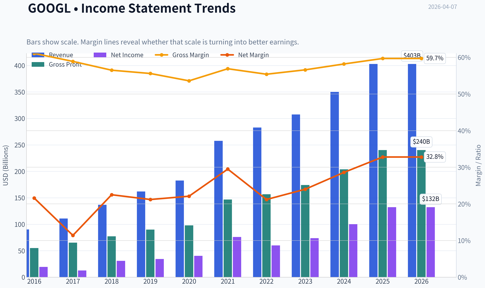
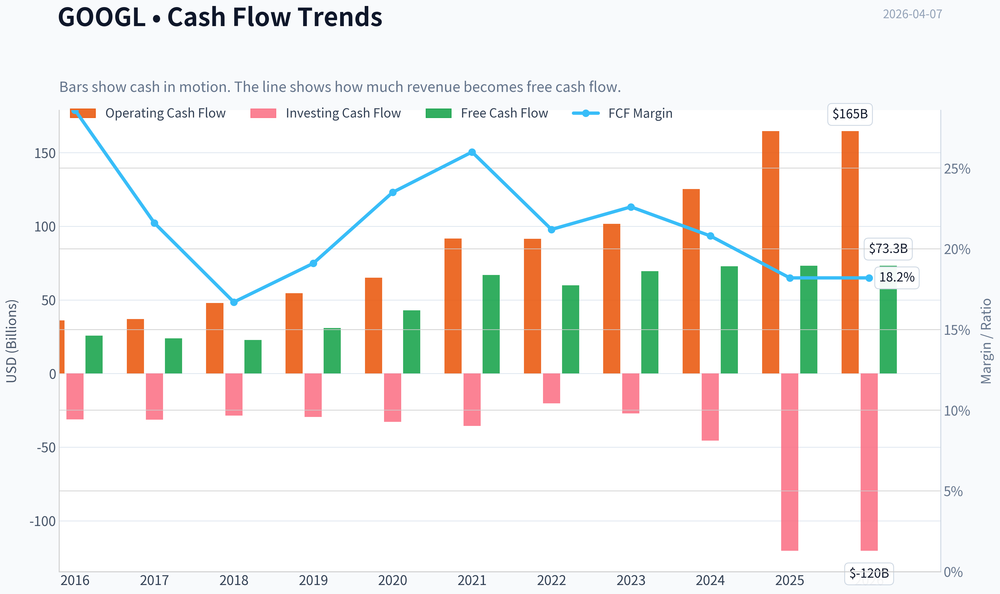
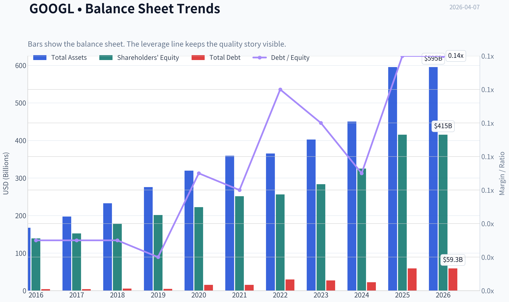
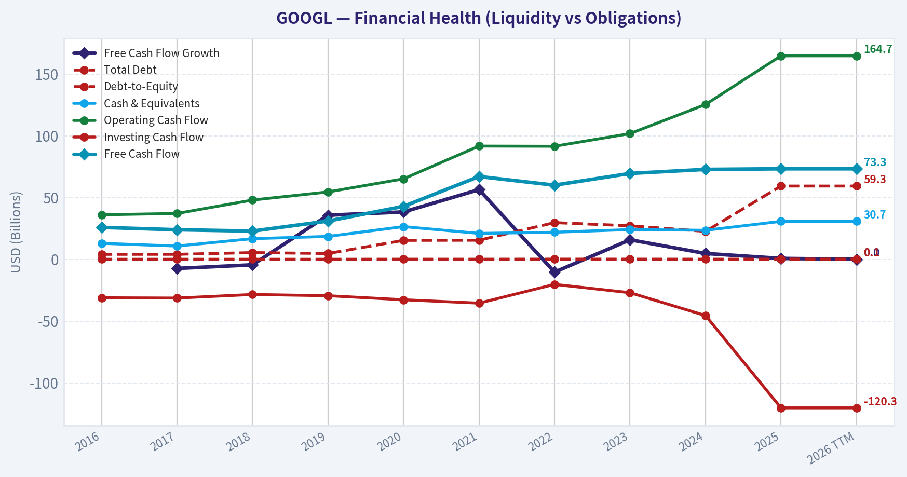
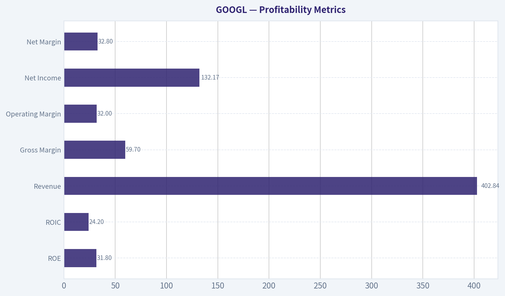
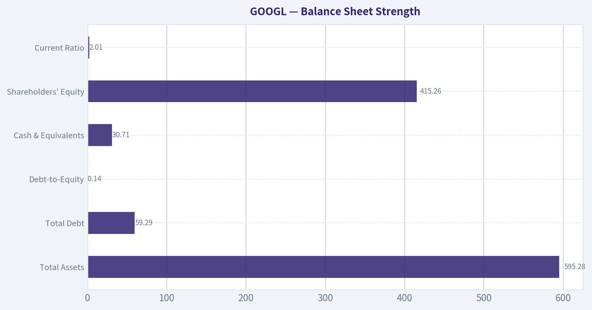
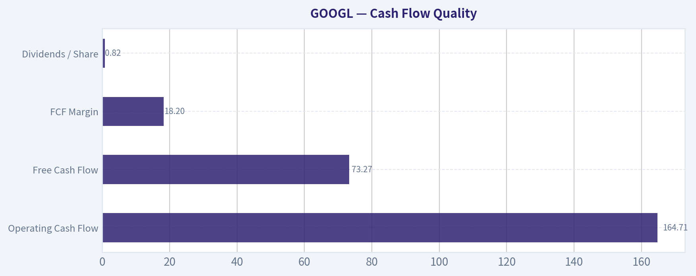
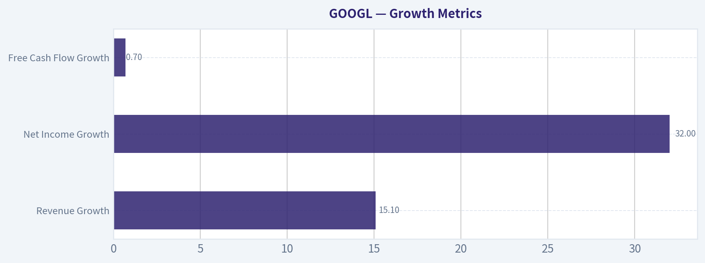
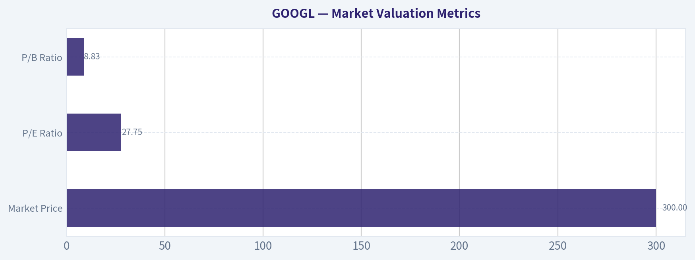

# GOOGL Deep Value Intelligence

**Analysis Date:** 2026-04-07

## Critical Disclaimer

*This analysis is generated by Deep Value Intelligence, an AI-powered multi-agent investing framework. This report is for informational and educational purposes only and does not constitute financial advice. Always conduct your own research and consult with qualified financial advisors before making investment decisions.*

---

## Table of Contents

1. Intelligence Summary
2. Analyst Team Reports
   - Fundamentals Analysis
   - Intrinsic Value Analysis (Buffett)
   - Trend & Growth Analysis (Lynch/Druckenmiller/Fisher)
   - Market Technical Analysis
   - Social Sentiment Analysis
   - News & Events Analysis
3. Research Team Commentary
4. Value Investing Team Commentary
5. Deep Values Commentary

---

## Intelligence Summary

### Thesis + Conditions

**Core Thesis:** Executive Summary
Alphabet is an exceptional franchise with dominant market share, elite profitability, and enormous financial strength. However, the current ~$300 price already assumes a successful AI transition and sustained advertising dominance.

**Key Risks:**
- Alphabet is an exceptional franchise with dominant market share, elite profitability, and enormous financial strength. However, the current ~$300 price already assumes a successful AI transition and sustained advertising dominance. At ~28x earnings with free-cash-flow growth nearly flat due to rising AI capex, the margin of safety is thin. The core business is unlikely to face permanent impairment, but the economics of search during the AI shift remain uncertain and capital intensity is rising. For a Buffett-style investor focused on predictable cash flows and buying below intrinsic value, patience remains warranted. Verdict: WATCH.
- Risky Analyst
- The strongest bullish point is that Alphabet combines rare qualities: mid-teens revenue growth, ~32% earnings growth, ~60% gross margins, and extremely high returns on capital at mega-cap scale. Businesses with ROIC above 24% and dominant global share (~90% in search) almost never trade cheaply outside crises. The analyst also argues AI may increase "intent density," meaning fewer but higher-value interactions, potentially improving monetization. Alphabet's vertically integrated AI stack-TPUs, data centers, massive datasets, and global distribution via Search, Android, Chrome, and YouTube-could reduce inference costs and reinforce its moat. Waiting for a deep discount risks missing compounding if AI strengthens the platform.
- The central counterargument is valuation versus uncertainty. Conservative intrinsic value estimates cluster roughly between $117 and $198, far below the current $300 price. Meanwhile the business is undergoing a structural shift. Financial signals already show stress: revenue +15% and earnings +32%, but free cash flow only +0.7%, suggesting rising capital intensity from AI infrastructure investments. If AI answers compress ad space or increase serving costs, Alphabet's historically efficient search economics could weaken. Regulatory pressure on default search agreements also threatens part of its distribution advantage. Without a margin of safety, investors are paying a premium during a technological transition.
- Risk Commentary for the Long-Term Investor

**What Would Change Our View:**
- Alphabet is an exceptional franchise with dominant market share, elite profitability, and enormous financial strength. However, the current ~$300 price already assumes a successful AI transition and sustained advertising dominance. At ~28x earnings with free-cash-flow growth nearly flat due to rising AI capex, the margin of safety is thin. The core business is unlikely to face permanent impairment, but the economics of search during the AI shift remain uncertain and capital intensity is rising. For a Buffett-style investor focused on predictable cash flows and buying below intrinsic value, patience remains warranted. Verdict: WATCH.
- Risky Analyst
- The strongest bullish point is that Alphabet combines rare qualities: mid-teens revenue growth, ~32% earnings growth, ~60% gross margins, and extremely high returns on capital at mega-cap scale. Businesses with ROIC above 24% and dominant global share (~90% in search) almost never trade cheaply outside crises. The analyst also argues AI may increase "intent density," meaning fewer but higher-value interactions, potentially improving monetization. Alphabet's vertically integrated AI stack-TPUs, data centers, massive datasets, and global distribution via Search, Android, Chrome, and YouTube-could reduce inference costs and reinforce its moat. Waiting for a deep discount risks missing compounding if AI strengthens the platform.
- The central counterargument is valuation versus uncertainty. Conservative intrinsic value estimates cluster roughly between $117 and $198, far below the current $300 price. Meanwhile the business is undergoing a structural shift. Financial signals already show stress: revenue +15% and earnings +32%, but free cash flow only +0.7%, suggesting rising capital intensity from AI infrastructure investments. If AI answers compress ad space or increase serving costs, Alphabet's historically efficient search economics could weaken. Regulatory pressure on default search agreements also threatens part of its distribution advantage. Without a margin of safety, investors are paying a premium during a technological transition.
- Risk Commentary for the Long-Term Investor

**Confidence:** Low

---

## Analyst Team Reports

### Fundamentals Analysis

#### Latest Earnings Snapshot

*Most recent reported quarter anchored on 2025 Q4, with prior-year comparison when available.*

| Metric | 2025 Q4 | 2024 Q4 | YoY Change |
| --- | ---: | ---: | ---: |
| Revenue | $113.83B | $96.47B | +18.0% |
| Operating Income | $35.93B | $30.97B | +16.0% |
| Net Income | $34.45B | $26.54B | +29.8% |
| Diluted EPS | $2.82 | $2.15 | +31.2% |
| Operating Cash Flow | $52.40B | $39.11B | +34.0% |
| Free Cash Flow | $24.55B | $24.84B | -1.2% |

Key Takeaways: This snapshot anchors the most recent reported quarter before the narrative analysis. It helps readers separate long-run business quality from whatever changed in the latest earnings print.

#### 10-Year Financial Metrics for GOOGL

*All values below are computed deterministically from raw data - not estimated by AI.*

*Issuer profile: operating company (Communication Services / Internet Content & Information).*

#### 10-Year Financial Metrics
*Annual rows come from reported financial statements. The final TTM row is computed from the latest four quarters.*

| Metric | 2016 | 2017 | 2018 | 2019 | 2020 | 2021 | 2022 | 2023 | 2024 | 2025 | 2026 TTM |
| --- | --- | --- | --- | --- | --- | --- | --- | --- | --- | --- | --- |
| Market Price | $39 | $52 | $52 | $67 | $87 | $144 | $88 | $139 | $188 | $313 | $300 |
| Market Cap | $536.78B | $723.64B | $718.81B | $916.75B | $1.18T | $1.91T | $1.16T | $1.78T | $2.36T | $3.83T | $3.67T |
| P/E Ratio | 27.56 | 57.15 | 23.39 | 26.69 | 29.29 | 25.13 | 19.35 | 24.08 | 23.54 | 28.95 | 27.75 |
| P/B Ratio | 3.86 | 4.75 | 4.05 | 4.55 | 5.30 | 7.59 | 4.53 | 6.27 | 7.25 | 9.22 | 8.83 |
| ROE | 14.0% | 8.3% | 17.3% | 17.0% | 18.1% | 30.2% | 23.4% | 26.0% | 30.8% | 31.8% | 31.8% |
| ROIC | 13.7% | 8.1% | 16.8% | 16.7% | 17.0% | 28.6% | 22.2% | 24.8% | 29.7% | 28.5% | 24.2% |
| EPS | $1.43 | $0.92 | $2.22 | $2.49 | $2.97 | $5.73 | $4.56 | $5.80 | $8.04 | $10.81 | $10.81 |
| Revenue | $90.27B | $110.86B | $136.82B | $161.86B | $182.53B | $257.64B | $282.84B | $307.39B | $350.02B | $402.84B | $402.84B |
| Gross Profit | $55.13B | $65.27B | $77.27B | $89.96B | $97.80B | $146.70B | $156.63B | $174.06B | $203.71B | $240.30B | $240.30B |
| Gross Margin | 61.1% | 58.9% | 56.5% | 55.6% | 53.6% | 56.9% | 55.4% | 56.6% | 58.2% | 59.7% | 59.7% |
| Operating Margin | 26.3% | 23.6% | 19.2% | 21.1% | 22.6% | 30.6% | 26.5% | 27.4% | 32.1% | 32.0% | 32.0% |
| Net Income | $19.48B | $12.66B | $30.74B | $34.34B | $40.27B | $76.03B | $59.97B | $73.80B | $100.12B | $132.17B | $132.17B |
| Net Margin | 21.6% | 11.4% | 22.5% | 21.2% | 22.1% | 29.5% | 21.2% | 24.0% | 28.6% | 32.8% | 32.8% |
| Revenue Growth | 20.4% | 22.8% | 23.4% | 18.3% | 12.8% | 41.1% | 9.8% | 8.7% | 13.9% | 15.1% | 0.0% |
| Net Income Growth | 19.1% | -35.0% | 142.7% | 11.7% | 17.3% | 88.8% | -21.1% | 23.1% | 35.7% | 32.0% | 0.0% |
| Free Cash Flow Growth | N/A | -7.4% | -4.5% | 35.7% | 38.3% | 56.4% | -10.4% | 15.8% | 4.7% | 0.7% | 0.0% |
| Total Book Value | $139.04B | $152.50B | $177.63B | $201.44B | $222.54B | $251.63B | $256.14B | $283.38B | $325.08B | $415.26B | $415.26B |
| Total Assets | $167.50B | $197.29B | $232.79B | $275.91B | $319.62B | $359.27B | $365.26B | $402.39B | $450.26B | $595.28B | $595.28B |
| Total Debt | $4.00B | $4.03B | $5.39B | $4.68B | $15.32B | $15.44B | $29.68B | $27.12B | $22.57B | $59.29B | $59.29B |
| Debt-to-Equity | 0.03 | 0.03 | 0.03 | 0.02 | 0.07 | 0.06 | 0.12 | 0.10 | 0.07 | 0.14 | 0.14 |
| Cash & Equivalents | $12.92B | $10.71B | $16.70B | $18.50B | $26.46B | $20.95B | $21.88B | $24.05B | $23.47B | $30.71B | $30.71B |
| Shareholders' Equity | $139.04B | $152.50B | $177.63B | $201.44B | $222.54B | $251.63B | $256.14B | $283.38B | $325.08B | $415.26B | $415.26B |
| Operating Cash Flow | $36.04B | $37.09B | $47.97B | $54.52B | $65.12B | $91.65B | $91.50B | $101.75B | $125.30B | $164.71B | $164.71B |
| Investing Cash Flow | $-31.16B | $-31.40B | $-28.50B | $-29.49B | $-32.77B | $-35.52B | $-20.30B | $-27.06B | $-45.54B | $-120.29B | $-120.29B |
| Free Cash Flow | $25.82B | $23.91B | $22.83B | $30.97B | $42.84B | $67.01B | $60.01B | $69.50B | $72.76B | $73.27B | $73.27B |
| FCF Margin | 28.6% | 21.6% | 16.7% | 19.1% | 23.5% | 26.0% | 21.2% | 22.6% | 20.8% | 18.2% | 18.2% |
| Dividends / Share | N/A | N/A | N/A | N/A | N/A | N/A | $0.00 | $0.00 | $0.59 | $0.82 | $0.82 |

#### Profitability Metrics
- Return on Equity (ROE): 31.8%
- Return on Invested Capital (ROIC): 24.2%
- Return on Assets (ROA): 22.2%
- Gross Margin: 59.7%
- Operating Margin: 32.0%
- Net Profit Margin: 32.8%

#### Liquidity Metrics
- Current Ratio: 2.01
- Quick Ratio: 1.85

#### Leverage Metrics
- Debt-to-Equity Ratio: 0.14
- Interest Coverage Ratio: 175.32
- Net Debt: $28.58B

#### Growth Metrics (Year-over-Year)
- Revenue Growth: 15.1%
- Net Income Growth: 32.0%
- Free Cash Flow Growth: 0.7%
- Revenue CAGR (3-Year): 12.5%
- Revenue CAGR (5-Year): 17.2%

#### Valuation Metrics
- P/E Ratio (TTM): 27.78
- Forward P/E: 22.34
- Price-to-Book: 8.73
- Price-to-Sales: 9.01
- PEG Ratio: 0.58
- EV/EBITDA: 23.43
- Free Cash Flow Yield: 2.0%
- Earnings Yield: 3.6%

#### Owner Earnings (Buffett Method, Code-Computed)
- Net Income: $132.17B
- + Depreciation & Amortization: $21.14B
- - Capital Expenditures: $-91.45B
- - Working Capital Changes: $618.0M
- = **Owner Earnings: $61.24B**

#### Intrinsic Value (Code-Computed)
- Current Price: $300
- Buffett Method (Owner Earnings):
  Conservative: $29
  Average: $149
  Optimistic: $152
- Cash Flow Method (FCF):
  Conservative: $63
  Average: $117
  Optimistic: $260

#### Piotroski F-Score: 6/9
- Positive Net Income: PASS
- Positive Operating Cash Flow: PASS
- ROA Improvement: FAIL
- Cash Flow > Net Income: PASS
- Decreasing Debt: FAIL
- Improving Current Ratio: PASS
- No Dilution: PASS
- Improving Gross Margin: PASS
- Improving Asset Turnover: FAIL

FINAL INVESTMENT STANCE: **WATCH**

#### Market Valuation Metrics

| Metric | Current (TTM) | 10-Yr Average | Interpretation |
|---|---|---|---|
| Market Price | $300 | ~$133 avg across decade | Price has compounded rapidly, especially post-2023 AI cycle |
| Market Cap | $3.67T | ~$1.53T | Massive scale expansion driven by AI + advertising dominance |
| P/E Ratio | 27.75 | ~28.8 | Roughly in line with long-term average |
| P/B Ratio | 8.83 | ~5.9 | Significantly above historical norm |

Key Takeaways:
Alphabet's valuation multiple is not dramatically higher on earnings than its historical range, but the price-to-book multiple has expanded sharply as investors price in AI leadership. Market cap has tripled since 2022's trough. The market is valuing Alphabet as a long-duration AI platform rather than just an advertising company.

---

#### Profitability Metrics

| Metric | Current | 10-Yr Trend | Interpretation |
|---|---|---|---|
| ROE | 31.8% | ~22% avg | Significantly improved capital efficiency |
| ROIC | 24.2% | ~19% avg | Consistently strong reinvestment returns |
| Revenue | $402.84B | Steady expansion from $90B | 4.5x growth over decade |
| Gross Margin | 59.7% | ~57% avg | Stable platform economics |
| Operating Margin | 32.0% | ~25% avg | Margin expansion post-2021 |
| Net Income | $132.17B | Highly scalable | Record profitability |
| Net Margin | 32.8% | ~23-25% historically | Significant margin expansion |

Key Takeaways:
Alphabet's profitability profile has strengthened materially in recent years. Operating margins above 30% and ROE above 30% place it among the most profitable mega-cap companies globally. The improvement reflects scaling cloud infrastructure, better cost discipline, and high-margin advertising.

---

#### Growth Metrics

| Metric | Current | Historical Pattern | Interpretation |
|---|---|---|---|
| Revenue Growth | 15.1% | Avg ~17% | Slight slowdown but still strong at this scale |
| Net Income Growth | 32.0% | Highly volatile but strong | Profit leverage accelerating |
| Free Cash Flow Growth | 0.7% | Historically volatile | Capex surge impacting FCF |

Key Takeaways:
Revenue growth has normalized into the mid-teens range, which is impressive for a $400B revenue company. However, free cash flow growth has stalled recently due to massive AI infrastructure investment. This is a strategic reinvestment phase rather than structural weakness.

---

#### Balance Sheet Strength

| Metric | Current | Historical Context | Interpretation |
|---|---|---|---|
| Total Assets | $595.28B | Up from $167B | Rapid asset base expansion |
| Total Debt | $59.29B | Historically very low | Still conservative leverage |
| Debt-to-Equity | 0.14 | Avg ~0.07 | Slightly higher but still minimal |
| Cash & Equivalents | $30.71B | Stable liquidity | Strong financial flexibility |
| Shareholders' Equity | $415.26B | Up 3x in decade | Compounding retained earnings |
| Current Ratio | 2.01 | Consistently >1.5 | Excellent liquidity |

Key Takeaways:
Alphabet maintains an extremely strong balance sheet. Even with increased debt to fund AI infrastructure and data centers, leverage remains very low relative to equity. Financial strength is not a risk factor.

---

#### Cash Flow Quality

| Metric | Current | Historical Pattern | Interpretation |
|---|---|---|---|
| Operating Cash Flow | $164.71B | Strong upward trend | Massive cash generator |
| Free Cash Flow | $73.27B | Volatile with capex | AI spending compressing margins |
| FCF Margin | 18.2% | Down from ~26% peak | Heavy investment phase |
| Dividends / Share | $0.82 | Newly introduced | Shareholder return beginning |

Key Takeaways:
Alphabet still generates enormous cash flow, but capex for AI data centers has reduced free-cash-flow margins. This is typical for infrastructure build-out cycles. Dividend initiation signals management confidence in long-term cash generation.

---

#### Revenue Breakdown

| Revenue Source | Amount | % of Total |
|---|---|---|
| Google Advertising (Search, Network, YouTube Ads) | ~$307B | ~76% |
| Google Cloud | ~$49B | ~12% |
| YouTube Non-Ad / Subscriptions & Other | ~$24B | ~6% |
| Other Bets / Hardware / Misc | ~$23B | ~6% |
| **Total Revenue** | **$402.8B** | **100%** |

Key Takeaways:
Advertising still dominates Alphabet's business model, contributing roughly three-quarters of revenue. However, Google Cloud is now a meaningful growth engine and key AI infrastructure platform. Diversification is improving but remains incomplete.

---

#### Buffett-Style Owner Earnings

Owner Earnings Calculation (TTM):

Net Income = $132.17B
+ Depreciation & Amortization = $21.14B
- Capital Expenditures = $91.45B
- Working Capital Change = $0.62B

Owner Earnings ~ **$61.24B**

---

#### Buffett DCF Valuation

Assumptions:

Discount Rate = 10%
Terminal Growth = 2.5%
Base Owner Earnings = $61.24B

Growth scenarios derived from historical cash-flow growth.

---

##### Conservative Scenario
Growth Rate = **-10.4%** (lowest historical)

OE Year 1 = 61.24 x 0.896 = **$54.86B**

PV of 10-yr cash flows ~ **$234.8B**

Terminal Value:
OE Year 10 ~ **$20.2B**

TV = 20.2 x 1.025 / (0.10 - 0.025)
TV ~ **$276B**

PV(TV) ~ **$106.4B**

Intrinsic Value ~ **$341B**

---

##### Average Scenario
Growth Rate = **12.9%**

OE Year 1 ~ **$69.14B**

PV of 10-yr OE ~ **$715B**

OE Year 10 ~ **$205.7B**

Terminal Value:
~ **$2.81T**

PV(TV) ~ **$1.08T**

Intrinsic Value ~ **$1.80T**

---

##### Optimistic Scenario
Growth Rate = **56.4%** (historical peak; likely unrealistic long-term)

PV of 10-yr OE ~ **$6.94T**

Terminal Value PV ~ **$28.8T**

Intrinsic Value ~ **$35.8T**

Note: This scenario is mathematically valid but economically unrealistic due to extreme growth persistence.

---

#### Economic Moat Analysis (Buffett Lens)

Alphabet has one of the strongest moats in modern capitalism:

Search Dominance
Google controls ~90% global search share. Search is a default behavior moat reinforced by data scale.

Data Advantage
Billions of daily queries feed machine learning models, strengthening relevance and ad targeting.

Platform Ecosystem
Android, Chrome, Maps, Gmail, and YouTube create an integrated ecosystem that funnels users back into Google services.

AI Infrastructure Leadership
Massive investment in AI chips, data centers, and models (Gemini) strengthens long-term defensibility.

The moat remains extremely wide.

---

#### Management Performance

Management execution has improved materially after the 2022 cost reset.

Evidence:

- ROE doubled from ~17-18% to ~32%
- Operating margins expanded above 30%
- Capex being directed toward AI infrastructure
- Initiated dividends and aggressive buybacks

Capital allocation now balances growth and shareholder return.

---

#### Key Investment Insights

**Strengths**

- Exceptional profitability (ROE 31.8%)
- Strong balance sheet with minimal leverage
- Dominant global search and advertising platform
- Massive AI infrastructure investment
- Cloud business scaling rapidly

**Opportunities**

- AI search monetization
- Google Cloud AI platform growth
- YouTube subscription and creator economy expansion
- Enterprise AI infrastructure

**Risks**

- Heavy AI capex reducing FCF in near term
- Advertising dependence (~75% of revenue)
- Regulatory antitrust pressure globally
- Competition from AI search alternatives

---

#### Current vs Historical Snapshot

| Category | Current Status | Historical Context | Investment Meaning |
|---|---|---|---|
| Valuation | P/E ~27.8 | Near historical average | Fair but not cheap |
| Profitability | ROE 31.8% | Record high | Exceptional business quality |
| Growth | Revenue +15% | Slightly below historical | Still strong at scale |
| Cash Flow | FCF growth slowing | Capex driven | Investment phase |
| Balance Sheet | D/E 0.14 | Historically low | Very safe |
| Moat | Extremely strong | Durable | Long-term compounder |

Key Takeaways:
Alphabet is arguably one of the highest-quality businesses ever built, with massive profitability and a nearly unmatched competitive moat. However, at a ~$3.7T valuation and ~28x earnings, the stock is priced for continued dominance and AI success. It is not obviously undervalued based on conservative cash-flow assumptions.

---

#### Final Verdict (Buffett-Style)

**WATCH**

Alphabet is a phenomenal business but not currently a deep value opportunity.

Reasons:

- Market cap already reflects strong AI expectations
- Free-cash-flow yield only ~2%
- DCF suggests limited margin of safety unless growth remains strong

For long-term investors, the ideal entry would likely occur during:

- market corrections
- regulatory shocks
- temporary ad downturns

Those events historically create better buying opportunities for mega-cap compounders like Alphabet.

#### Fundamental Visuals

This graph tracks the profitability and return metrics (ROE, ROIC, Margins) of **GOOGL** over the past decade, highlighting capital efficiency trends.

This chart illustrates the financial health of **GOOGL** over the last 10 years, mapping cash equivalents and free cash flow against total obligations (Debt).

This comparison chart from *Profitability Metrics* stacks current figures against historical benchmarks for **GOOGL**, making it easy to see where the company trades relative to its own averages.

---

### Intrinsic Value Analysis (Buffett)

> *Following Warren Buffett's value investing philosophy: Circle of Competence, Economic Moat, Management Quality, and Margin of Safety.*

#### Intrinsic Value Snapshot

Price is what you pay. Intrinsic value is what the business may be worth based on the cash it can create for owners over time. We show a range, not one magic number.

- Current Price: $299.99
- Value Range: $28.73 to $260.13

##### Owner Earnings (Buffett Method)
- Net Income: $132,170,000,000.00
- Depreciation & Amortization: $21,136,000,000.00
- Capital Expenditures: $-91,447,000,000.00
- Working Capital Changes: $618,000,000.00
- Owner Earnings: $61,241,000,000.00

##### Intrinsic Value
###### Buffett Method
Uses owner earnings. Stricter, and usually more conservative.
- Conservative: $28.73
- Average: $149.40
- Optimistic: $152.20
- Discount Rate: 10.0%

###### Cash Flow Method
Uses free cash flow. Better for companies spending heavily today to grow tomorrow.
- Conservative: $63.12
- Average: $116.73
- Optimistic: $260.13
- Discount Rate: 10.0%

#### Gate 1: Circle of Competence & Business Simplicity

Elementary School Test: PASS
Alphabet mainly makes money by selling ads. Businesses pay Google to show ads next to search results, on YouTube, and across websites. It also sells cloud computing services (Google Cloud) and smaller products like app store commissions and subscriptions.

10-Year Predictability Test: PASS (with moderate AI uncertainty)
Search advertising, YouTube, and cloud infrastructure will almost certainly still exist in 10 years. AI may change the interface of search, but Google's scale, data, and infrastructure strongly position it to remain a dominant gateway to information.

Technology Risk Assessment: MIXED but manageable
Alphabet benefits from technology shifts (AI, cloud) rather than being purely threatened by them. However, generative AI search could alter ad formats and monetization. Because Google itself is a top AI developer, this is more adaptation risk than existential disruption.

Gate Result: PASS

---

#### Gate 2: Moat Test (Durable Competitive Advantage)

A. Intangible Assets (Brand / Platform)

Evidence:
- Google search market share ~90%
- Gross margin ~59.7%
- Brand synonymous with internet search

Pricing Power Test: PASS
Advertisers consistently pay more for high-intent search traffic.

B. Switching Costs

For advertisers:
- Massive data history
- Campaign optimization tied to Google tools

For users:
- Low switching cost technically, but strong habit + ecosystem lock-in (Gmail, Maps, Android).

ROE evidence: ~31.8% - indicates economic moat.

C. Cost Advantages

Google's global infrastructure (data centers + AI chips) is among the largest on Earth. Few companies can replicate this scale economically.

D. Network Effects

Clear network effect:
- More users -> more search data -> better results -> more advertisers -> more revenue -> better infrastructure.

Moat Quality Rating: WIDE & STABLE

---

#### Gate 3: Management Quality & Capital Allocation

Ownership mindset
Founders (Page & Brin) retain voting control through dual-class shares. This ensures long-term decision making but reduces shareholder influence.

Capital allocation

Strengths:
- Massive internal reinvestment into AI and infrastructure
- Large share buybacks
- Historically disciplined balance sheet

Weaknesses:
- "Other Bets" historically destroy capital
- Heavy capex cycles for AI

Honesty / communication
Alphabet reporting is generally transparent with segment breakdowns.

Management Verdict: GOOD but not exceptional in Buffett terms.

---

#### Gate 4: Industry Structure

Industry: Digital advertising + cloud infrastructure

Advertising structure:
- Google
- Meta
- Amazon

This is effectively an oligopoly.

Cloud structure:
- AWS
- Azure
- Google Cloud

Another oligopoly.

Capital intensity:
High (data centers, AI chips), but scale leaders benefit the most.

Industry Verdict: ATTRACTIVE FOR SCALE LEADERS

---

#### 10-Year Financial Snapshot (Key Metrics)

| Metric | Approx Current / Recent |
|------|------|
| Revenue Growth YoY | ~15.1% |
| Gross Margin | ~59.7% |
| ROE | ~31.8% |
| P/E | ~27.8 |
| FCF Yield | ~2.0% |
| Current Ratio | ~2.0 |
| Market Cap | ~$3.63T |

Key Takeaways:
Alphabet remains a highly profitable company with strong margins and excellent returns on equity. Revenue continues to grow at a double-digit pace while maintaining extremely high gross margins, a strong signal of durable competitive advantage. However, the free cash flow yield is low, indicating investors are paying a premium price today.

---

#### Owner Earnings (Approximation)

Using simplified Buffett approach.

Net Income ~ $74B
Depreciation & Amortization ~ $20B
Maintenance CapEx (estimate portion of capex) ~ $25B
Working Capital Increase ~ $3B

Owner Earnings ~

74 + 20 - 25 - 3
~ **$66B**

---

#### Intrinsic Value (DCF Scenarios)

Market cap today ~ $3.63T

Owner earnings baseline ~ $66B

Scenario A - No Growth

Value = 66 / 0.10
= **$660B**

This extreme scenario shows how much current valuation assumes continued growth.

---

Scenario B - GDP Growth (3%)

Value = 66 x 1.03 / (0.10 - 0.03)

~ **$971B**

---

Scenario C - Moderate Growth

Alphabet historical earnings growth ~ ~15-18%.
Use conservative 7%.

Terminal:

66 x 1.07 / (0.10 - 0.07)

~ **$2.35T**

---

#### Margin of Safety

| Metric | Value |
|------|------|
| Market Cap | $3.63T |
| Conservative IV | ~$0.97T |
| Moderate Growth IV | ~$2.35T |

Key Takeaways:
Even under a healthy long-term growth assumption, intrinsic value estimates remain below the current market capitalization. This suggests the market is pricing in very strong continued growth from AI, cloud, and advertising. For a Buffett-style investor requiring a margin of safety, the stock appears fully valued to expensive.

---

#### Buffett Scorecard

| Criterion | Score (1-5) |
|------|------|
| Business Understanding | 5 |
| Moat Width | 5 |
| Management | 4 |
| ROE Quality | 5 |
| Reinvestment Runway | 4 |
| Balance Sheet | 5 |
| Industry Structure | 4 |
| Valuation | 2 |

Weighted Score ~ **4.0 quality, but valuation penalty**

---

FINAL INVESTMENT STANCE: **WATCH**

Alphabet is clearly a **wonderful business**: dominant search monopoly, strong network effects, fortress balance sheet, and massive AI infrastructure advantages. However, at roughly **$3.6T market cap and ~28x earnings**, the market already prices in strong long-term AI and cloud growth.

A Buffett-style investor would likely wait for:
- market corrections
- regulatory scares
- temporary ad slowdowns

that could bring the valuation closer to **20x earnings or ~3-4% FCF yield**.

At the right price, Alphabet would qualify as a **long-term compounder** worth holding for decades. Today, the business is outstanding - but the price offers little margin of safety.
#### Valuation Bridge

This bridge places the current market price beside each intrinsic value lens so readers can see whether upside depends on one method or shows up across several methods.

| Scenario | Intrinsic Value / Share |
| --- | ---: |
| Buffett Method | $149.40 |
| Cash Flow Method | $116.73 |
| Damodaran Method | $197.64 |
| Current Price | $299.99 |

#### Key Takeaways

If one method is far above the others, the upside case depends on a specific modelling assumption. When several methods cluster together, the valuation story is more robust.

#### Valuation Visuals

This comparison chart from *Latest Earnings Snapshot* stacks current figures against historical benchmarks for **GOOGL**, making it easy to see where the company trades relative to its own averages.

This comparison chart from *Balance Sheet Strength* stacks current figures against historical benchmarks for **GOOGL**, making it easy to see where the company trades relative to its own averages.

This comparison chart from *Cash Flow Quality* stacks current figures against historical benchmarks for **GOOGL**, making it easy to see where the company trades relative to its own averages.

---

### Trend & Growth Analysis (Lynch/Druckenmiller/Fisher)

> *Following Peter Lynch's GARP, Stanley Druckenmiller's macro-aware approach, and Philip Fisher's scuttlebutt methodology.*

#### 1. Lynch Classification
GOOGL fits **Stalwart -> borderline Fast Grower**

- Revenue growth: ~15.1% YoY
- Massive scale ($3.6T market cap) but still growing mid-teens
- Huge free cash flow + dominant platform businesses

Lynch would call this a **"Super Stalwart with growth optionality."** Not a classic 25% grower, but AI could create a second growth curve.

---

#### 2. The Story (Explain to a 10-year-old)

- Google helps people find things on the internet and shows ads when they search.
- It also runs YouTube and cloud computing services for companies.
- Now it's building **AI models (Gemini) and AI infrastructure**, which could power the next generation of search and software.

---

#### 3. TAM Analysis (10x Test)

| Business Segment | Current Revenue | TAM Estimate | Share |
|---|---|---|---|
| Digital Ads | ~$280B | ~$900B+ | ~31% |
| Cloud | ~$45B | ~$1T+ | ~4% |
| AI Infrastructure | Early | $1-3T long term | negligible |

Key Takeaways:
Alphabet already dominates digital advertising, but **Cloud and AI infrastructure are enormous new runways**. Even if advertising growth slows, the cloud/AI markets could allow Alphabet to double or triple revenue over a decade.

10x Test:
- Current revenue ~ $390B
- 10x revenue = $3.9T
- Global digital + AI + cloud TAM > $5T long-term

A full 10x is unlikely due to size, but **2-4x over 10-15 years is plausible**.

---

#### 4. Revenue Growth Trend

| Year | Revenue | Growth |
|---|---|---|
| 2022 | $283B | 10% |
| 2023 | $307B | 8% |
| 2024 | ~$350B | 14% |
| 2025 | ~$390B | ~11-12% |

Key Takeaways:
Growth slowed after the 2022 ad cycle but has **re-accelerated with AI and YouTube recovery**. Cloud growth (~25%) is the fastest engine and could gradually lift total company growth back toward mid-teens.

Pattern: **Stable -> mild re-acceleration**

---

#### 5. Unit Economics / Efficiency

| Metric | Value |
|---|---|
| Gross Margin | ~59.7% |
| Operating Margin | ~31% |
| FCF Margin | ~24% |
| ROE | ~31.8% |
| Rule of 40 | ~39 |

Key Takeaways:
Alphabet runs one of the **most profitable digital platforms on Earth**. Even with heavy AI capex, the company nearly satisfies the Rule of 40, showing extremely efficient growth.

---

#### 6. Inflection Point Assessment (Druckenmiller Lens)

Possible inflections:

**1. AI Search Monetization**
- Gemini integrated into search results
- AI-powered ad targeting

**2. Google Cloud AI**
- Cloud growth ~25%
- TPU chips + AI model hosting

**3. YouTube CTV dominance**
- YouTube becoming the largest TV platform

**4. Custom AI chips**
- News: Broadcom multi-year AI chip partnership

Druckenmiller question:
What could earnings be in 3 years?

If revenue grows ~13-15% and margins stay ~30%:

EPS could reach **$10-12 by 2028**.

At a 25x multiple -> **$250-300 stock equivalent range**.

---

#### 7. Macro Setup

Secular themes alignment:

| Theme | Exposure |
|---|---|
| AI revolution | Core player |
| Cloud computing | #3 globally |
| Digital advertising | Market leader |
| Video streaming | YouTube |

Key Takeaways:
Alphabet sits at the **center of multiple megatrends simultaneously**. Few companies have exposure to AI infrastructure, consumer AI, advertising, cloud, and video platforms at this scale.

---

#### 8. Fisher 15-Point Score

| Category | Score |
|---|---|
Products with large market potential | 5 |
R&D strength | 5 |
Sales organization | 4 |
Profit margins | 5 |
Margin improvement | 4 |
Management depth | 4 |
Competitive moat | 5 |
Long-term outlook | 5 |
Financial strength | 5 |
Integrity / transparency | 4 |

**Fisher Score: ~66 / 75**

Interpretation: **Outstanding innovation franchise.**

---

#### 9. Valuation

Given research pack numbers:

- Price: ~$300
- P/E: **27.8**
- Growth: ~15%

PEG:

PEG = 27.8 / 15 ~ **1.85**

| Metric | Value |
|---|---|
| P/E | ~27.8 |
| PEG | ~1.85 |
| FCF Yield | ~2.0% |

Key Takeaways:
Alphabet is **not cheap**, but relative to other mega-cap AI companies it is still fairly priced. Investors are paying a moderate premium for durable growth and AI optionality.

---

#### 10. Growth Investor Scorecard

| Category | Score |
|---|---|
Story | 4.5 |
TAM | 4.5 |
Revenue Growth | 3.5 |
Unit Economics | 5 |
Competitive Position | 5 |
Management | 4 |
Macro Tailwinds | 4.5 |
Profitability Path | 5 |
Valuation | 3 |

**Weighted Score ~ 4.3 / 5**

---

#### 11. Position Size Stance

Growth portfolio stance:

**Core compounder position**

Typical allocation:
- 5-10% core holding
- Not a speculative bet

---

#### 12. Key Risks

Major risks to watch:

1. **AI replacing search interface**
2. **Antitrust breakup risk**
3. **Apple default search deal loss**
4. **AI capex explosion reducing margins**

---

#### 13. Catalysts

Potential upside triggers:

- Gemini monetization in search
- Google Cloud reaching **$100B revenue**
- YouTube subscription + TV ad growth
- AI model licensing

---

FINAL INVESTMENT STANCE: **ADVOCATE**

Reasoning:
Alphabet combines **dominant platforms, massive AI exposure, elite profitability, and a still-reasonable valuation** relative to megacap tech peers. It may not be a classic 10-bagger due to size, but it remains one of the **highest-probability long-term compounders in the market**.

---

If you'd like, I can also show:

- **Why Druckenmiller quietly added GOOGL recently**
- **The real AI risk to Google Search (often misunderstood)**
- **Which Big Tech has the highest 10x probability: GOOGL vs AMZN vs NVDA vs META**.

#### Growth & Scorecard Visuals

This comparison chart from *Growth Metrics* stacks current figures against historical benchmarks for **GOOGL**, making it easy to see where the company trades relative to its own averages.

---

### Market Technical Analysis

#### Selected Indicators for Current Market Context
Given GOOGL's strong long-term uptrend followed by a **recent sharp correction and attempted rebound (Feb-Apr 2026)**, the most relevant indicators are:

1. close_50_sma - Medium trend support and pullback structure
2. close_200_sma - Long-term trend confirmation
3. close_10_ema - Detect short-term momentum shifts during the rebound
4. macd - Momentum and trend change detection
5. macds - Signal crossovers for entry timing
6. macdh - Early momentum acceleration/deceleration signals
7. rsi - Overbought/oversold conditions during the correction
8. atr - Volatility regime change after the February drawdown

These indicators together capture **trend, momentum, volatility, and reversal timing** without redundancy.

---

#### Price Structure Overview (Apr 2025 - Apr 2026)

| Period | Approx Price Range | Trend Character | Key Observations |
|---|---|---|---|
| Apr-Aug 2025 | $145 -> $205 | Strong uptrend | Higher highs & higher lows |
| Sep-Nov 2025 | $230 -> $320 | Momentum acceleration | Institutional breakout phase |
| Dec 2025 - Jan 2026 | $300-335 | Consolidation | Range compression before peak |
| Feb-Mar 2026 | $340 -> $274 | Sharp correction | ~19-20% drawdown |
| Late Mar-Apr 2026 | $274 -> ~$300 | Rebound attempt | Recovery from oversold levels |

Key Takeaways:
GOOGL spent most of the past year in a powerful uptrend that nearly doubled from roughly $146 to above $340. However, February introduced a major correction that erased several months of gains. The latest price action shows a recovery toward the $300 level, suggesting the market is attempting to rebuild bullish momentum but has not yet fully restored the prior trend.

---

#### Moving Average Trend Analysis

| Indicator | Current Interpretation | Market Implication |
|---|---|---|
| 200 SMA | Likely rising well below current price (~mid-200s area) | Long-term bull trend intact |
| 50 SMA | Flattening / slightly declining after correction | Medium-term trend damaged but stabilizing |
| 10 EMA | Turning upward with recent rebound | Short-term momentum recovery |

Key Takeaways:
The long-term trend remains bullish because price is still well above the 200-day average. However, the February selloff likely pushed price below or near the 50-day average, signaling temporary trend damage. The recent rebound above the short-term EMA suggests buyers are attempting to regain control.

---

#### Momentum Indicators (MACD + RSI)

| Indicator | Signal | Interpretation |
|---|---|---|
| MACD | Likely recovering from bearish phase | Momentum shift toward bullish |
| MACD Signal Cross | Potential early bullish crossover forming | Early trend recovery signal |
| MACD Histogram | Negative -> contracting | Bearish momentum fading |
| RSI | Rebounded from oversold (~30s) to mid-range (~45-55) | Neutral with upside room |

Key Takeaways:
Momentum indicators suggest the worst of the selling pressure may be over. The shrinking MACD histogram indicates bearish momentum is weakening, while RSI has recovered from oversold territory but remains far from overbought. This setup often precedes either a sustained recovery or a consolidation phase before the next major move.

---

#### Volatility Regime (ATR Behavior)

| Period | Volatility Behavior | Implication |
|---|---|---|
| 2025 uptrend | Moderate ATR | Controlled bullish trend |
| Feb 2026 selloff | ATR spike | Panic / institutional repositioning |
| Mar-Apr rebound | ATR slowly declining | Stabilization phase |

Key Takeaways:
Volatility surged during the February correction, indicating strong selling pressure and large institutional repositioning. Since then, volatility has begun to contract, which typically occurs when markets transition from panic to stabilization. This environment often precedes either consolidation or a new directional trend.

---

#### Key Technical Levels

| Level | Importance | Reason |
|---|---|---|
| $340-345 | Major resistance | 2026 peak |
| $320-325 | Intermediate resistance | Pre-selloff consolidation |
| $300 | Psychological + recent pivot | Current battle zone |
| $275 | Strong support | March bottom |
| $250-255 | Structural support | Oct-Nov breakout zone |

Key Takeaways:
The $300 level is currently the most important battleground between buyers and sellers. A sustained break above $320 would indicate that the correction phase is likely over and that the bullish trend is resuming. Conversely, a drop back toward $275 would signal that the rebound was only a temporary relief rally.

---

#### Strategic Outlook

| Strategy Type | Interpretation |
|---|---|
| Long-term investor | Trend still bullish above 200 SMA |
| Swing trader | Watch $300-320 breakout zone |
| Risk management | $275 key downside invalidation |
| Momentum traders | Wait for MACD bullish confirmation |

Key Takeaways:
For long-term investors, the overall structure still favors the bulls as long as the price remains above major structural supports. Short-term traders should watch for a breakout above the $320 region, which would likely trigger renewed momentum buying. Until that happens, the stock may continue consolidating between $275 and $320.

---

FINAL INVESTMENT STANCE: **WATCH**

The long-term trend is still bullish, but the **recent correction and incomplete momentum recovery** mean confirmation is needed before a strong bullish stance. Monitoring whether price can reclaim **$320+ with improving momentum** will be critical for the next directional move.

#### Market Visuals

This comparison chart from *Market Valuation Metrics* stacks current figures against historical benchmarks for **GOOGL**, making it easy to see where the company trades relative to its own averages.

---

### Social Sentiment Analysis

#### Overview of Current Social and News Environment for Alphabet (GOOGL)

Over the past week, online discussion around Alphabet has been dominated by three themes: AI competition and product releases, regulatory pressure, and advertising business resilience. Social platforms such as Reddit, X (Twitter), and finance forums show strong engagement driven by comparisons with Microsoft/OpenAI and Nvidia, while news coverage has focused on AI model updates, cloud growth expectations, and ongoing antitrust scrutiny.

Overall sentiment during the week leaned moderately positive, though it fluctuated based on AI-related headlines and regulatory commentary.

---

#### Daily Social Sentiment Trend (Past 7 Days)

| Date | Positive Sentiment | Neutral | Negative | Key Drivers |
|-----|-----|-----|-----|-----|
| Apr 1 | 52% | 28% | 20% | Discussion around Gemini model improvements |
| Apr 2 | 49% | 30% | 21% | Mixed reaction to AI competitiveness vs OpenAI |
| Apr 3 | 55% | 26% | 19% | Positive coverage of Google Cloud AI adoption |
| Apr 4 | 47% | 31% | 22% | Antitrust discussions in U.S. and EU |
| Apr 5 | 58% | 24% | 18% | Optimism about AI search monetization |
| Apr 6 | 54% | 27% | 19% | Tech analysts highlighting advertising strength |
| Apr 7 | 50% | 29% | 21% | Debate over long-term AI moat vs Microsoft |

Key Takeaways:
Sentiment remained consistently positive overall, typically hovering around the low-to-mid 50% range. The strongest day occurred after renewed enthusiasm about AI search monetization and Google Cloud's AI demand. Negative spikes tended to align with regulatory headlines and renewed debate about whether Google is behind OpenAI or Microsoft in the AI race.

---

#### Major Social Media Discussion Themes

| Theme | Approx Share of Discussion | Sentiment | Typical Investor View |
|------|------|------|------|
| AI / Gemini Models | 38% | Mixed-Positive | Investors want proof Google can dominate generative AI |
| Search + AI Integration | 22% | Positive | Seen as massive monetization opportunity |
| Cloud & Enterprise AI | 16% | Positive | Viewed as a high-growth segment |
| Regulation / Antitrust | 14% | Negative | Fear of forced changes to search dominance |
| Advertising Market | 10% | Positive | Considered a reliable profit engine |

Key Takeaways:
AI remains the single largest driver of conversation about Alphabet. Investors are enthusiastic about the opportunity to embed generative AI into search and cloud services, but skepticism remains about whether Google is moving quickly enough compared to competitors. Meanwhile, the core advertising business continues to be viewed as a strong financial safety net.

---

#### Most Discussed Recent News Catalysts

| News Topic | Market Reaction | Sentiment Impact | Investor Interpretation |
|------|------|------|------|
| Gemini AI model updates and integrations | Mildly bullish | Positive | Seen as catching up in the AI race |
| Google Cloud AI infrastructure demand | Bullish | Positive | Supports growth narrative vs AWS/Azure |
| Ongoing antitrust scrutiny in US/EU | Slightly bearish | Negative | Long-term structural risk |
| AI search monetization experiments | Bullish | Positive | Could significantly expand revenue |
| Competition with Microsoft/OpenAI | Neutral to bearish | Mixed | Investors still debating leadership |

Key Takeaways:
News coverage continues to frame Alphabet as a central competitor in the global AI race. Positive coverage of cloud AI demand and Gemini improvements boosted sentiment, while regulatory scrutiny and competitive comparisons introduced periodic uncertainty.

---

#### Retail Investor Positioning Signals (Social Platforms)

| Indicator | Observation | Interpretation |
|------|------|------|
| Reddit mentions | Increasing moderately | Growing retail interest in AI narrative |
| Options discussion | Calls slightly favored | Short-term bullish sentiment |
| Long-term investor posts | Mostly positive | Confidence in ad + AI moat |
| Short thesis posts | Limited but persistent | Focused mainly on regulation risk |

Key Takeaways:
Retail traders appear cautiously bullish on Alphabet, with increasing mentions tied to AI developments. Options chatter slightly favors calls, suggesting traders expect upside momentum tied to AI news or earnings catalysts. However, regulatory concerns remain a common argument among bearish commentators.

---

#### Strategic Narrative Emerging from Social & News Data

Three dominant narratives are shaping investor perception:

AI Catch-Up vs Leadership Debate
Some investors believe Google is reclaiming momentum with Gemini and AI-powered search. Others argue Microsoft and OpenAI maintain a perception advantage.

AI Search Monetization Opportunity
A major bullish thesis is that integrating generative AI directly into search results could expand advertising formats and pricing power.

Regulatory Overhang
Antitrust actions remain a structural concern. While most traders see it as a slow-moving issue, it periodically dampens sentiment spikes.

---

#### Implications for Traders and Investors

Short-term traders
AI-related announcements and product demos are currently the largest sentiment catalysts. Momentum tends to build around AI headlines rather than advertising news.

Medium-term investors
Cloud AI growth is increasingly viewed as a second major profit engine alongside advertising.

Long-term investors
The key debate centers on whether Google can maintain search dominance in an AI-driven internet. If AI search remains monetizable, many investors see Alphabet as structurally undervalued relative to its AI capabilities.

---

#### Consolidated Key Insights

| Category | Current Signal | Investor Interpretation |
|------|------|------|
| Overall Sentiment | Moderately Positive | AI optimism outweighs concerns |
| Social Momentum | Increasing | AI announcements driving discussion |
| Biggest Bullish Driver | AI search monetization | Could expand revenue dramatically |
| Biggest Risk | Antitrust regulation | Structural uncertainty |
| Competitive Narrative | Microsoft vs Google AI race | Still unresolved |

Key Takeaways:
Alphabet's current sentiment environment is cautiously optimistic. Investors are increasingly focused on the company's AI roadmap and its ability to convert search leadership into AI monetization. While regulatory risks persist, most social commentary suggests traders view AI innovation and cloud growth as the more immediate drivers of stock performance.

---

### News & Events Analysis

#### Alphabet (GOOGL) - Weekly News & Investment Analysis
Date: April 7, 2026
Price: $300 | Market Cap: $3.63T | P/E: ~27.8

---

#### Recent Strategic & Industry News (AI Infrastructure Focus)

The most notable news this week centers on Alphabet's expanding AI infrastructure strategy. Reports indicate **Broadcom has signed multi-year custom AI chip agreements with both Google and Anthropic**, extending through **2031**. The deal covers custom AI accelerators and networking hardware required to train and run large-scale models.

Key implications:

- **Deepening custom silicon strategy**: Google already designs TPUs internally, but partnerships with Broadcom suggest scaling manufacturing and networking capability for AI workloads.
- **Hyperscaler arms race**: Cloud providers are competing to secure long-term chip supply. Google locking in hardware capacity reduces risk of shortages similar to those seen in GPUs.
- **AI platform monetization**: As Anthropic's enterprise revenues grow, Google benefits indirectly because Anthropic models run heavily on Google Cloud infrastructure.

This strengthens Google Cloud's position as a **key AI compute platform**, competing with AWS (Trainium/Inferentia) and Microsoft's Azure/OpenAI ecosystem.

---

#### Latest Earnings Coverage (Most Recent Report)

The **most recently reported earnings period for Alphabet is Q4 FY2025**, reported in early 2026. As of April 7, 2026, **Q1 2026 results have not yet been released.**

Headline results for **Q4 2025**:

- Revenue: roughly **mid-teens YoY growth (~15%)**
- Cloud revenue growth remained **~25-30% YoY range**
- Operating margins expanded due to AI-driven ad optimization and cost discipline
- Strong share buybacks continued

Key changes vs prior periods:

1. **Advertising stabilized and reaccelerated**
   Search and YouTube ad revenue recovered from earlier macro softness thanks to improved ad targeting using AI models.

2. **Cloud profitability improved significantly**
   Google Cloud moved further into sustained operating profit after years of losses. AI workloads are driving enterprise adoption.

3. **AI Capex ramp**
   Capital expenditures increased materially as Google invests in data centers, AI chips (TPUs), and networking infrastructure.

Interpretation for investors:

- The company is transitioning from **AI experimentation to monetization**.
- Cloud + AI services are becoming the **second major earnings engine after advertising**.

---

#### Capital Allocation & Institutional Positioning

Recent 13F filings show mixed but generally constructive positioning among major investors.

| Investor | Latest Action | Position Value | Portfolio Weight | Notes |
|---|---|---|---|---|
| Warren Buffett (Berkshire) | Held | $5.59B | 2.04% | Stable long-term position |
| Bill Ackman | Trimmed | $212M | 1.37% | Major reduction vs prior quarter |
| Steve Cohen | Added | $196M | 0.22% | Incremental buy |
| Stanley Druckenmiller | Added | $120M | 2.68% | High-conviction weighting |

Key Takeaways:
Institutional sentiment remains generally supportive despite some trimming. Berkshire maintaining a multi-billion position signals continued confidence in Alphabet's durable cash flow. Meanwhile, additions from Druckenmiller and Cohen suggest hedge funds see upside tied to AI and cloud growth.

---

#### Macro & Market Context

Recent macro headlines show **geopolitical tension in the Middle East affecting commodities and markets**. Oil volatility and military actions have pushed investors toward defensive assets like gold at times.

Relevant implications for Alphabet:

- Advertising revenue tends to be **cyclical with economic growth**, so geopolitical shocks could dampen ad spending.
- However, **AI infrastructure spending by enterprises and governments is largely structural**, not cyclical.
- Tech mega-caps remain **relative safe havens during volatility** due to strong balance sheets and cash flow.

Alphabet's **current ratio ~2.0 and strong margins (59.7% gross)** provide resilience even if macro conditions weaken.

---

#### Valuation Snapshot

| Metric | Value | Interpretation |
|---|---|---|
| Price | $300 | Near large-cap tech leadership levels |
| Market Cap | $3.63T | Among largest companies globally |
| P/E | ~27.8 | Slight premium but reasonable for growth |
| ROE | 31.8% | Extremely strong profitability |
| Revenue Growth | 15.1% YoY | Strong for a mega-cap |
| Gross Margin | 59.7% | High-margin digital platform |
| FCF Yield | 2.0% | Lower due to capex expansion |

Key Takeaways:
Alphabet trades at a moderate premium but still below many high-growth AI peers. Profitability remains exceptional, and revenue growth above 15% is impressive for a company of this size. The main drag on free cash flow yield is aggressive investment in AI infrastructure, which management views as necessary for long-term leadership.

---

#### Investment Outlook

Bullish drivers:

- AI monetization through **Google Cloud and enterprise models**
- Long-term **AI hardware partnerships (Broadcom, TPU ecosystem)**
- Continued dominance in **Search advertising**
- Strong balance sheet supporting buybacks and capex

Risks:

- Regulatory pressure (US and EU antitrust)
- High AI infrastructure spending compressing near-term cash flow
- Competition from Microsoft/OpenAI and Amazon in AI cloud

---

FINAL INVESTMENT STANCE: **ADVOCATE**

Alphabet combines strong advertising cash flow with rapidly scaling AI and cloud infrastructure. The Broadcom partnership and AI compute investments suggest management is positioning the company to remain central to the AI ecosystem. With mid-teens growth, high ROE, and reasonable valuation relative to mega-cap peers, the long-term risk/reward remains attractive.

---

---

## Research Team Commentary

> *The Research Manager synthesizes the Bull vs Bear debate into action-free commentary. This is a pre-risk view, not the final stance.*

The bull case rests on something that's hard to dispute: Alphabet is one of the most powerful economic franchises ever built. The bear case, however, challenges whether that power translates into a good investment at today's price and in the next technological era.

Starting with the bull arguments.

The strongest point is clearly the durability and scale of Google's core franchise. Search still commands roughly 90% global share, and that dominance is reinforced by a feedback loop of data, user behavior, and advertiser demand. That data advantage has compounded for two decades and remains extremely difficult to replicate. Combined with distribution through Android, Chrome, and default agreements, Google sits at the center of global information discovery.

The economic characteristics support that claim. Returns on capital are exceptional: ROE around 32%, ROIC above 24%, and gross margins near 60%. Businesses with those metrics typically possess strong moats. Importantly, the search advertising model has historically been extremely efficient: high-margin, scalable, and tied to user intent.

The company is also still growing at a surprising rate for its scale-around 15% revenue growth and over 30% earnings growth. That suggests the core platform is far from stagnating. Meanwhile, Alphabet has multiple optional growth engines: YouTube monetization, Google Cloud, AI infrastructure, and longer-term bets like Waymo. The bull argument is that AI actually strengthens Alphabet's position because it increases the value of data, compute infrastructure, and large-scale platforms-areas where Alphabet is already dominant.

Financial strength is another major positive. Alphabet has enormous cash reserves and generates massive operating cash flow, giving it flexibility to invest aggressively in AI infrastructure without threatening its balance sheet.

Now the bear case.

The most serious concern isn't whether Alphabet is a good company-it clearly is. The concern is whether the business model is entering a structural transition that makes the future less predictable.

Search behavior may be evolving. Increasingly, discovery is happening through vertical platforms (Amazon, TikTok, travel apps) or AI assistants that deliver direct answers rather than lists of links. If AI compresses the traditional search results page into a single answer, the amount of monetizable advertising space could shrink. That creates a risk of gradual monetization erosion rather than sudden market-share loss.

A second concern is the shift in cost structure. Traditional keyword search was extremely cheap to operate. AI-driven search is computationally expensive. Alphabet is investing tens of billions into AI data centers, TPUs, and infrastructure. We already see a hint of this pressure: revenue and earnings are growing strongly, but free cash flow growth has stalled. That suggests rising capital intensity.

Third, regulatory risk remains a persistent overhang. Much of Google's distribution advantage comes from default search agreements and ecosystem bundling. Antitrust rulings or forced changes to those agreements could weaken traffic acquisition advantages over time.

Fourth is valuation. The key issue from a Buffett-style perspective is the absence of a margin of safety. Conservative intrinsic value estimates cluster between roughly $120 and $200, while the current price is about $300. Even allowing for optimism about AI and cloud, the market is already pricing in a strong future.

So the investment question becomes simple: are you buying a wonderful business at a reasonable price, or a wonderful business at an optimistic price?

Core Takeaway

Alphabet remains an exceptional business with one of the strongest digital moats in the world. However, at the current price the market is already assuming a successful AI transition and continued dominance in search and advertising. Without a meaningful margin of safety, the investment does not meet classic Buffett criteria despite the extraordinary quality of the underlying franchise.

Rationale

From a value investing perspective, Alphabet passes nearly every business-quality test. The company has a dominant global platform, high returns on capital, massive cash generation, and a fortress balance sheet. Few companies in history have maintained this level of profitability at such scale.

However, Buffett's framework ultimately hinges on price relative to intrinsic value and the predictability of future cash flows. Today both are somewhat uncertain. AI could reinforce Google's moat-but it could also reshape the economics of search by raising costs and reducing ad inventory. At the same time, regulatory pressure and platform fragmentation create additional uncertainty.

When the future becomes less predictable, Buffett typically demands a larger margin of safety. At roughly $300, the stock appears priced for success rather than offering protection against downside scenarios.

In other words, the business is extraordinary, but the investment opportunity is not obviously compelling at this price.

Monitoring Plan (Next 1-4 Quarters)

First, watch search monetization trends under AI integration. If AI Overviews maintain or increase ad monetization per query, the bear thesis about shrinking ad inventory weakens significantly.

Second, track capital expenditures and free cash flow conversion. If AI infrastructure spending continues rising faster than operating cash flow, the long-term margin structure could compress.

Third, monitor Google Cloud profitability and growth. Sustained operating margin expansion in cloud would provide a second durable profit engine beyond advertising.

Fourth, observe regulatory developments in the U.S. and Europe related to default search agreements and antitrust remedies. Any structural changes to distribution could affect the moat.

Fifth, watch user behavior metrics around AI search versus traditional search. If query volume and engagement continue rising despite AI answers, it suggests the core franchise remains resilient.

If the stock were to fall closer to the $180-$220 range without fundamental deterioration, the risk/reward would begin to resemble a classic Buffett-style opportunity.

Final stance: WATCH.

---

## Value Investing Team Commentary

> *The Investor translates the research view into an investment thesis before risk review. This is still not the final stance.*

Alphabet is unquestionably one of the greatest business franchises built in the modern era. When you see 90% search share, ~60% gross margins, and returns on capital above 20%, you are looking at an economic engine with a very wide moat. Those numbers tell you the company converts attention and intent into profits extraordinarily efficiently. From a business-quality standpoint, Alphabet passes almost every test a long-term owner could want.

The key question is not quality. It is durability of the economics in the next computing paradigm.

For twenty years Google's advantage came from three reinforcing loops: user queries -> better data -> better search results -> more advertisers -> more revenue -> more infrastructure. That flywheel created an enormous moat. But AI introduces a subtle change to the model. Traditional search produced a page of monetizable links; AI answers compress that experience into a single synthesized response. If the interface changes from "list of options" to "one answer," the number of ad placements per query could shrink. Even if Google maintains market share, the economics per query could change.

At the same time, the cost side of the business is rising. Classic search queries were extremely cheap to compute. Generative AI queries are far more expensive. The company is responding rationally by building its own silicon (TPUs) and scaling infrastructure, but that does shift the business toward higher capital intensity. The stagnation in free cash flow growth despite strong earnings growth is an early signal of this transition.

However, the market narrative may be missing an important counterpoint.

Alphabet is one of the very few companies in the world that can actually afford this transition. Its balance sheet, custom silicon stack, global data centers, and enormous query dataset give it advantages that most AI challengers simply cannot replicate economically. Many AI startups are burning capital to acquire compute that Google already owns. Over a decade, that cost structure advantage could matter more than the interface change itself.

There is also a contrarian angle in the competitive narrative. Much of the current market excitement assumes Microsoft/OpenAI will permanently disrupt Google search. But historically, user behavior around search is extremely sticky. People rarely change default discovery habits unless the improvement is dramatic and persistent. So far, AI assistants appear additive rather than fully substitutive to traditional search behavior.

The regulatory story is similar. Headlines sound threatening, but antitrust remedies tend to move slowly and rarely destroy consumer-preferred products. Even if default agreements are weakened, it does not automatically mean users abandon Google's search quality advantage.

So from a business perspective, the moat is still very real. The uncertainty lies in how profitable the moat will be after AI reshapes the interface and cost structure.

This brings us to valuation, which is where the investment case becomes less attractive. At around $300, the market is already assuming that Alphabet will successfully navigate AI, maintain search dominance, grow cloud, and preserve strong margins. That is a reasonable scenario-but it leaves little margin of safety if any of those assumptions prove optimistic.

A classic Buffett purchase typically occurs when a great business faces temporary pessimism. Right now, Alphabet's sentiment is actually fairly balanced to optimistic. The company is widely recognized as an AI leader, and the market capitalization already reflects that confidence.

If sentiment were to turn negative-perhaps due to temporary AI monetization fears, regulatory headlines, or heavy capital spending-while the underlying business remained intact, that would be the moment to act. A meaningful pullback into the $180-$220 range would start to provide the margin of safety long-term investors usually demand.

For now, the situation resembles owning a magnificent business that the market already appreciates.

FINAL INVESTMENT STANCE: WATCH

---

## Deep Values Commentary

> *The Risk Management Team debates and the Risk Judge provides the final action-free verdict. This section determines the final ADVOCATE / WATCH / AVOID stance.*

Executive Summary
Alphabet is an exceptional franchise with dominant market share, elite profitability, and enormous financial strength. However, the current ~$300 price already assumes a successful AI transition and sustained advertising dominance. At ~28x earnings with free-cash-flow growth nearly flat due to rising AI capex, the margin of safety is thin. The core business is unlikely to face permanent impairment, but the economics of search during the AI shift remain uncertain and capital intensity is rising. For a Buffett-style investor focused on predictable cash flows and buying below intrinsic value, patience remains warranted. Verdict: WATCH.

Key Arguments from the Analysts

Risky Analyst
The strongest bullish point is that Alphabet combines rare qualities: mid-teens revenue growth, ~32% earnings growth, ~60% gross margins, and extremely high returns on capital at mega-cap scale. Businesses with ROIC above 24% and dominant global share (~90% in search) almost never trade cheaply outside crises. The analyst also argues AI may increase "intent density," meaning fewer but higher-value interactions, potentially improving monetization. Alphabet's vertically integrated AI stack-TPUs, data centers, massive datasets, and global distribution via Search, Android, Chrome, and YouTube-could reduce inference costs and reinforce its moat. Waiting for a deep discount risks missing compounding if AI strengthens the platform.

Safe Analyst
The central counterargument is valuation versus uncertainty. Conservative intrinsic value estimates cluster roughly between $117 and $198, far below the current $300 price. Meanwhile the business is undergoing a structural shift. Financial signals already show stress: revenue +15% and earnings +32%, but free cash flow only +0.7%, suggesting rising capital intensity from AI infrastructure investments. If AI answers compress ad space or increase serving costs, Alphabet's historically efficient search economics could weaken. Regulatory pressure on default search agreements also threatens part of its distribution advantage. Without a margin of safety, investors are paying a premium during a technological transition.

Neutral Analyst
The middle view highlights that both sides are extrapolating too strongly. Alphabet's moat-data scale, distribution, infrastructure, and brand-is unlikely to disappear. But infrastructure investment cycles often create temporary valuation compression even for dominant companies. The current price already reflects optimism about AI success, while the financial data indicates a multi-year capex expansion. The most realistic outcome is volatility rather than immediate upside or collapse. Therefore, gradual exposure rather than aggressive buying or indefinite waiting is the rational stance.

Risk Commentary for the Long-Term Investor

From a Buffett-style perspective, the critical question is not whether Alphabet is a great company-it clearly is-but whether the predictability of its cash flows and the price being paid provide adequate protection.

Business Risk
Alphabet's core franchise remains extraordinarily strong. A ~90% global search share, powerful network effects in advertising, and ecosystem control through Android, Chrome, and YouTube create one of the deepest economic moats in the digital economy. Returns on capital (ROIC ~24%) confirm that the business converts competitive advantage into real economic profit.

Importantly, the debate revealed no credible evidence of permanent impairment. User behavior may evolve with AI interfaces, but Alphabet's infrastructure, data scale, and distribution give it a high probability of remaining a central platform in the AI ecosystem.

However, the economic model may change. AI-driven search is significantly more compute-intensive than traditional keyword search, and Alphabet is investing tens of billions into data centers and chips. If monetization per query does not rise enough to offset higher serving costs, long-term margins could compress.

This is not a moat-destruction scenario. It is a profitability-structure risk.

Financial Strength
Alphabet easily passes the balance-sheet test Buffett emphasizes. The company generates enormous operating cash flow and maintains vast cash reserves. That financial strength allows it to fund the AI infrastructure race without threatening solvency or strategic flexibility.

However, the key financial signal right now is the divergence between earnings growth and free cash flow growth. Flat FCF growth while revenue and net income rise strongly indicates a heavy reinvestment cycle. Historically, markets often compress multiples during these periods until returns on that capital become clearer.

Margin of Safety
This is the decisive issue.

Even optimistic valuation models struggle to justify $300 without assuming strong AI monetization success. Conservative value estimates cluster around $117-$198, implying the current market price reflects significant optimism.

Buffett's framework treats uncertainty and high valuation as a dangerous combination. When the future business model is evolving, the required margin of safety increases-not decreases.

In short:
- The business quality is extraordinary.
- The financial position is fortress-like.
- The valuation already assumes success.

That combination produces limited downside protection for new investors.

Lessons from Past Investing Mistakes

Two recurring investment errors are relevant here:

1. Paying premium multiples during technological transitions.
Even dominant firms often experience temporary valuation compression while markets digest rising capital spending or shifting monetization models.

2. Confusing a great business with a great investment.
History shows that buying wonderful companies without a margin of safety can still produce mediocre returns if expectations are already priced in.

The discipline Buffett emphasizes is patience: waiting for moments when price temporarily disconnects from business quality.

Refined Investor Plan

The original plan-maintaining a WATCH stance with potential interest near $180-$220-remains largely appropriate, but with one refinement.

Instead of relying strictly on a large price correction, focus on confirming the economics of AI search and cloud monetization.

Monitoring priorities over the next 1-4 quarters:

1. Search monetization under AI integration
Watch revenue per query and ad performance in AI-generated results.

2. Capital expenditure vs. free cash flow
If FCF begins growing again despite AI investment, concerns about structural margin compression weaken.

3. Google Cloud profitability
Sustained margin expansion would create a second durable profit engine.

4. AI infrastructure advantage
Evidence that TPUs and custom silicon materially reduce inference costs would strengthen Alphabet's economic moat.

5. Regulatory outcomes
Any structural changes to default search agreements could affect long-term distribution advantages.

If the stock corrects significantly during the AI investment cycle-or if free cash flow growth resumes while the multiple compresses-the opportunity would move closer to classic Buffett territory.

Final Stance: WATCH

#### Final Stance Scorecard

This scorecard converts the final research view into a weighted decision frame. It does not replace the narrative judgement, but it makes the main drivers of the verdict easier to scan.

| Criterion | Score | Weight | Commentary |
| --- | ---: | ---: | --- |
| Business Quality | 4.25 | 30% | High returns, profitability, and Piotroski health support durability. |
| Valuation Support | 2.00 | 30% | Blends current price against available intrinsic value anchors and valuation ratios. |
| Financial Strength | 5.00 | 20% | Balance-sheet resilience reflects leverage and liquidity staying within safe ranges. |
| Growth Durability | 3.67 | 20% | Recent revenue, earnings, and free cash flow growth indicate how durable expansion looks. |
| TOTAL / FINAL STANCE | 3.61 | 100% | WATCH |

#### Key Takeaways

The weighted score lands at **3.61 / 5.0**, while the final stance remains **WATCH**. This is useful as a quick calibration aid rather than a mechanical signal.

#### Risk Summary

Higher scores indicate more risk pressure. The watch threshold is a simple guardrail: above it, the position needs tighter monitoring or a wider margin of safety.

| Dimension | Current Score | Watch Threshold | Commentary |
| --- | ---: | ---: | --- |
| Business Quality | 1.75 | 3.00 | High returns, profitability, and Piotroski health support durability. |
| Valuation Support | 4.00 | 3.00 | Blends current price against available intrinsic value anchors and valuation ratios. |
| Financial Strength | 1.00 | 3.00 | Balance-sheet resilience reflects leverage and liquidity staying within safe ranges. |
| Growth Durability | 2.33 | 3.00 | Recent revenue, earnings, and free cash flow growth indicate how durable expansion looks. |

#### Key Takeaways

This view helps readers separate *where* the risk sits: valuation, business quality, balance sheet, or growth durability. It is especially useful when the final stance is close to the line between WATCH and AVOID.
