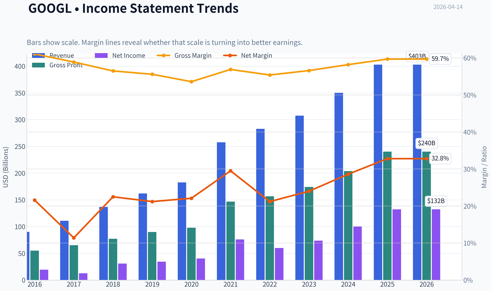
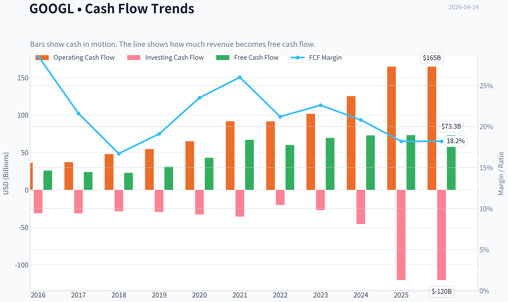
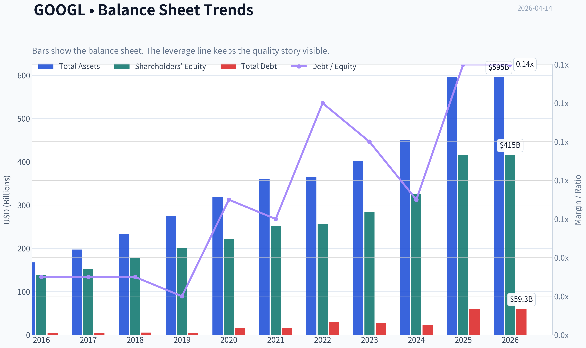
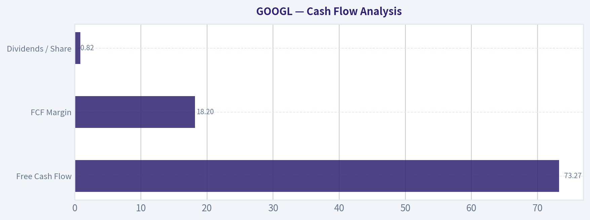
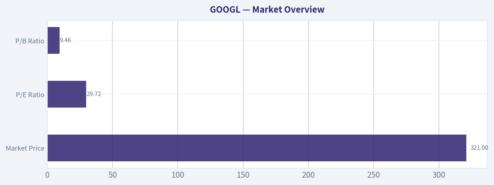

# GOOGL Deep Value Intelligence

**Analysis Date:** 2026-04-14

## Critical Disclaimer

*This analysis is generated by Deep Value Intelligence, an AI-powered multi-agent investing framework. This report is for informational and educational purposes only and does not constitute financial advice. Always conduct your own research and consult with qualified financial advisors before making investment decisions.*

---

## Table of Contents

1. Intelligence Summary
2. Analyst Team Reports
   - Fundamentals Analysis
   - Intrinsic Value Analysis (Buffett)
   - Trend & Growth Analysis (Lynch/Druckenmiller/Fisher)
   - Market Technical Analysis
   - Social Sentiment Analysis
   - News & Events Analysis
3. Research Team Commentary
4. Value Investing Team Commentary
5. Deep Values Commentary

---

## Intelligence Summary

### Thesis + Conditions

**Core Thesis:** Executive Summary (Quick Read)

**Key Risks:**
- However, the investment case today hinges less on business quality and more on two uncertainties: (1) whether AI will weaken the economics of search and (2) whether heavy AI infrastructure spending will permanently reduce capital efficiency. At ~30x earnings and $321 per share, the market is already pricing in a successful transition. That leaves little margin of safety if the monetization model of AI proves less profitable than traditional search.
- Conclusion: Alphabet remains a world-class compounder candidate, but the current valuation assumes strong execution during a major technological shift. Long-term investors should monitor the transition carefully rather than aggressively accumulate today.
- Risky Analyst (Bullish Case)
- Another key pillar is Google Cloud, which is growing ~25%+ and recently became strongly profitable. If Cloud becomes a major profit engine similar to AWS for Amazon, Alphabet's earnings mix could expand significantly beyond advertising.
- Safe Analyst (Risk-Control Perspective)

**What Would Change Our View:**
- However, the investment case today hinges less on business quality and more on two uncertainties: (1) whether AI will weaken the economics of search and (2) whether heavy AI infrastructure spending will permanently reduce capital efficiency. At ~30x earnings and $321 per share, the market is already pricing in a successful transition. That leaves little margin of safety if the monetization model of AI proves less profitable than traditional search.
- Conclusion: Alphabet remains a world-class compounder candidate, but the current valuation assumes strong execution during a major technological shift. Long-term investors should monitor the transition carefully rather than aggressively accumulate today.
- Risky Analyst (Bullish Case)
- Another key pillar is Google Cloud, which is growing ~25%+ and recently became strongly profitable. If Cloud becomes a major profit engine similar to AWS for Amazon, Alphabet's earnings mix could expand significantly beyond advertising.
- Safe Analyst (Risk-Control Perspective)

**Confidence:** Low

---

## Analyst Team Reports

### Fundamentals Analysis

#### Latest Earnings Snapshot

*Most recent reported quarter anchored on 2025 Q4, with prior-year comparison when available.*

| Metric | 2025 Q4 | 2024 Q4 | YoY Change |
| --- | ---: | ---: | ---: |
| Revenue | $113.83B | $96.47B | +18.0% |
| Operating Income | $35.93B | $30.97B | +16.0% |
| Net Income | $34.45B | $26.54B | +29.8% |
| Diluted EPS | $2.82 | $2.15 | +31.2% |
| Operating Cash Flow | $52.40B | $39.11B | +34.0% |
| Free Cash Flow | $24.55B | $24.84B | -1.2% |

Key Takeaways: This snapshot anchors the most recent reported quarter before the narrative analysis. It helps readers separate long-run business quality from whatever changed in the latest earnings print.

#### 10-Year Financial Metrics for GOOGL

*All values below are computed deterministically from raw data - not estimated by AI.*

*Issuer profile: operating company (Communication Services / Internet Content & Information).*

#### 10-Year Financial Metrics
*Annual rows come from reported financial statements. The final TTM row is computed from the latest four quarters.*

| Metric | 2016 | 2017 | 2018 | 2019 | 2020 | 2021 | 2022 | 2023 | 2024 | 2025 | 2026 TTM |
| --- | --- | --- | --- | --- | --- | --- | --- | --- | --- | --- | --- |
| Market Price | $39 | $52 | $52 | $67 | $87 | $144 | $88 | $139 | $188 | $313 | $321 |
| Market Cap | $536.78B | $723.64B | $718.81B | $916.75B | $1.18T | $1.91T | $1.16T | $1.78T | $2.36T | $3.83T | $3.93T |
| P/E Ratio | 27.56 | 57.15 | 23.39 | 26.69 | 29.29 | 25.13 | 19.35 | 24.08 | 23.54 | 28.95 | 29.72 |
| P/B Ratio | 3.86 | 4.75 | 4.05 | 4.55 | 5.30 | 7.59 | 4.53 | 6.27 | 7.25 | 9.22 | 9.46 |
| ROE | 14.0% | 8.3% | 17.3% | 17.0% | 18.1% | 30.2% | 23.4% | 26.0% | 30.8% | 31.8% | 31.8% |
| ROIC | 13.7% | 8.1% | 16.8% | 16.7% | 17.0% | 28.6% | 22.2% | 24.8% | 29.7% | 28.5% | 24.2% |
| EPS | $1.43 | $0.92 | $2.22 | $2.49 | $2.97 | $5.73 | $4.56 | $5.80 | $8.04 | $10.81 | $10.81 |
| Revenue | $90.27B | $110.86B | $136.82B | $161.86B | $182.53B | $257.64B | $282.84B | $307.39B | $350.02B | $402.84B | $402.84B |
| Gross Profit | $55.13B | $65.27B | $77.27B | $89.96B | $97.80B | $146.70B | $156.63B | $174.06B | $203.71B | $240.30B | $240.30B |
| Gross Margin | 61.1% | 58.9% | 56.5% | 55.6% | 53.6% | 56.9% | 55.4% | 56.6% | 58.2% | 59.7% | 59.7% |
| Operating Margin | 26.3% | 23.6% | 19.2% | 21.1% | 22.6% | 30.6% | 26.5% | 27.4% | 32.1% | 32.0% | 32.0% |
| Net Income | $19.48B | $12.66B | $30.74B | $34.34B | $40.27B | $76.03B | $59.97B | $73.80B | $100.12B | $132.17B | $132.17B |
| Net Margin | 21.6% | 11.4% | 22.5% | 21.2% | 22.1% | 29.5% | 21.2% | 24.0% | 28.6% | 32.8% | 32.8% |
| Revenue Growth | 20.4% | 22.8% | 23.4% | 18.3% | 12.8% | 41.1% | 9.8% | 8.7% | 13.9% | 15.1% | 0.0% |
| Net Income Growth | 19.1% | -35.0% | 142.7% | 11.7% | 17.3% | 88.8% | -21.1% | 23.1% | 35.7% | 32.0% | 0.0% |
| Free Cash Flow Growth | N/A | -7.4% | -4.5% | 35.7% | 38.3% | 56.4% | -10.4% | 15.8% | 4.7% | 0.7% | 0.0% |
| Total Book Value | $139.04B | $152.50B | $177.63B | $201.44B | $222.54B | $251.63B | $256.14B | $283.38B | $325.08B | $415.26B | $415.26B |
| Total Assets | $167.50B | $197.29B | $232.79B | $275.91B | $319.62B | $359.27B | $365.26B | $402.39B | $450.26B | $595.28B | $595.28B |
| Total Debt | $4.00B | $4.03B | $5.39B | $4.68B | $15.32B | $15.44B | $29.68B | $27.12B | $22.57B | $59.29B | $59.29B |
| Debt-to-Equity | 0.03 | 0.03 | 0.03 | 0.02 | 0.07 | 0.06 | 0.12 | 0.10 | 0.07 | 0.14 | 0.14 |
| Cash & Equivalents | $12.92B | $10.71B | $16.70B | $18.50B | $26.46B | $20.95B | $21.88B | $24.05B | $23.47B | $30.71B | $30.71B |
| Shareholders' Equity | $139.04B | $152.50B | $177.63B | $201.44B | $222.54B | $251.63B | $256.14B | $283.38B | $325.08B | $415.26B | $415.26B |
| Operating Cash Flow | $36.04B | $37.09B | $47.97B | $54.52B | $65.12B | $91.65B | $91.50B | $101.75B | $125.30B | $164.71B | $164.71B |
| Investing Cash Flow | $-31.16B | $-31.40B | $-28.50B | $-29.49B | $-32.77B | $-35.52B | $-20.30B | $-27.06B | $-45.54B | $-120.29B | $-120.29B |
| Free Cash Flow | $25.82B | $23.91B | $22.83B | $30.97B | $42.84B | $67.01B | $60.01B | $69.50B | $72.76B | $73.27B | $73.27B |
| FCF Margin | 28.6% | 21.6% | 16.7% | 19.1% | 23.5% | 26.0% | 21.2% | 22.6% | 20.8% | 18.2% | 18.2% |
| Dividends / Share | N/A | N/A | N/A | N/A | N/A | N/A | $0.00 | $0.00 | $0.59 | $0.82 | $0.82 |

#### Profitability Metrics
- Return on Equity (ROE): 31.8%
- Return on Invested Capital (ROIC): 24.2%
- Return on Assets (ROA): 22.2%
- Gross Margin: 59.7%
- Operating Margin: 32.0%
- Net Profit Margin: 32.8%

#### Liquidity Metrics
- Current Ratio: 2.01
- Quick Ratio: 1.85

#### Leverage Metrics
- Debt-to-Equity Ratio: 0.14
- Interest Coverage Ratio: 175.32
- Net Debt: $28.58B

#### Growth Metrics (Year-over-Year)
- Revenue Growth: 15.1%
- Net Income Growth: 32.0%
- Free Cash Flow Growth: 0.7%
- Revenue CAGR (3-Year): 12.5%
- Revenue CAGR (5-Year): 17.2%

#### Valuation Metrics
- P/E Ratio (TTM): 29.75
- Forward P/E: 23.92
- Price-to-Book: 9.35
- Price-to-Sales: 9.65
- PEG Ratio: 0.58
- EV/EBITDA: 25.48
- Free Cash Flow Yield: 1.9%
- Earnings Yield: 3.4%

#### Owner Earnings (Buffett Method, Code-Computed)
- Net Income: $132.17B
- + Depreciation & Amortization: $21.14B
- - Capital Expenditures: $-91.45B
- - Working Capital Changes: $618.0M
- = **Owner Earnings: $61.24B**

#### Intrinsic Value (Code-Computed)
- Current Price: $321
- Buffett Method (Owner Earnings):
  Conservative: $29
  Average: $149
  Optimistic: $152
- Cash Flow Method (FCF):
  Conservative: $63
  Average: $117
  Optimistic: $260

#### Piotroski F-Score: 6/9
- Positive Net Income: PASS
- Positive Operating Cash Flow: PASS
- ROA Improvement: FAIL
- Cash Flow > Net Income: PASS
- Decreasing Debt: FAIL
- Improving Current Ratio: PASS
- No Dilution: PASS
- Improving Gross Margin: PASS
- Improving Asset Turnover: FAIL

#### Market Overview

| Metric | Current (TTM) | 10-Year Average | Interpretation |
|---|---|---|---|
| Market Price | $321 | - | Near all-time highs after a strong multi-year run |
| Market Cap | $3.93T | - | One of the largest companies globally |
| P/E Ratio | 29.72 | ~28.3 | Slightly above long-term average |
| P/B Ratio | 9.46 | ~5.6 | Significantly above historical norm |

Key Takeaways:
Alphabet's valuation has expanded meaningfully, especially on a price-to-book basis. While the P/E ratio is only modestly above its decade average, the P/B ratio shows the market is paying a much higher premium for Alphabet's assets and growth potential than historically. The massive market cap already embeds strong expectations around AI, cloud, and continued advertising dominance.

---

#### Profitability Analysis

| Metric | Current | 10-Year Trend | Commentary |
|---|---|---|---|
| ROE | 31.8% | Avg ~22% | Excellent and near historical highs |
| ROIC | 24.2% | Long-term ~18-20% | Very strong capital efficiency |
| Gross Margin | 59.7% | Stable 53-61% | Consistently high |
| Operating Margin | 32.0% | Avg ~26% | Significant improvement since 2021 |
| Net Margin | 32.8% | Avg ~24% | Highest level in the decade |
| EPS | $10.81 | Long-term rising | Strong earnings growth |
| Net Income | $132.17B | Rapid expansion | Nearly 7x growth since 2016 |

Key Takeaways:
Alphabet's profitability is exceptional. Margins have expanded substantially over the past decade, particularly after 2021. A net margin above 30% combined with ROE above 30% signals a business with massive pricing power, scalability, and operating leverage.

---

#### Growth Metrics

| Metric | Current | Long-Term Pattern |
|---|---|---|
| Revenue Growth | 15.1% | Historically 12-23% |
| Net Income Growth | 32.0% | Highly cyclical but strong |
| Free Cash Flow Growth | 0.7% | Slowing recently |

Key Takeaways:
Revenue growth remains strong for a company of this size. However, free cash flow growth has slowed sharply due to heavy investment spending (AI infrastructure, data centers, and cloud expansion). Earnings are growing faster than revenue thanks to margin improvements.

---

#### Balance Sheet Strength

| Metric | Current | Historical Context |
|---|---|---|
| Total Assets | $595.28B | Rapid expansion |
| Shareholder Equity | $415.26B | Nearly tripled since 2016 |
| Total Debt | $59.29B | Increased but still modest |
| Debt-to-Equity | 0.14 | Avg ~0.07 |
| Cash & Equivalents | $30.71B | Strong liquidity |

Key Takeaways:
Alphabet's balance sheet remains extremely strong. Even though debt has increased recently, leverage is still minimal compared with most large corporations. The company retains enormous financial flexibility for acquisitions, AI infrastructure spending, and shareholder returns.

---

#### Cash Flow Analysis

| Metric | Current | Historical Average | Interpretation |
|---|---|---|---|
| Free Cash Flow | $73.27B | Rising trend | Massive cash generation |
| FCF Margin | 18.2% | ~21.6% | Slight compression due to heavy capex |
| Dividends / Share | $0.82 | New (since 2024) | Beginning shareholder yield strategy |

Key Takeaways:
Alphabet produces enormous free cash flow but margins have declined slightly due to aggressive investment. The recent introduction of dividends signals a shift toward shareholder return maturity while still funding massive growth initiatives.

---

#### Revenue Breakdown

| Revenue Source | Amount | % of Total |
|---|---|---|
| Google Advertising (Search + Network) | ~$302B | ~75% |
| YouTube Advertising | ~$40B | ~10% |
| Google Cloud | ~$48B | ~12% |
| Other Bets / Subscriptions / Hardware | ~$13B | ~3% |

Key Takeaways:
Advertising still dominates Alphabet's business model. However, Google Cloud has become a meaningful growth driver and is critical to the AI strategy. Diversification is improving but the company remains heavily tied to digital advertising demand.

---

#### Economic Moat (Buffett Perspective)

Alphabet possesses one of the widest moats in the global economy.

Key moat sources:

Search dominance
Google controls the majority of global search traffic, creating massive data advantages and ad targeting superiority.

Advertising ecosystem network effects
Advertisers go where users are, and users go where search and content ecosystems are strongest.

Infrastructure scale
Few companies on Earth can match Google's data center infrastructure and AI compute capacity.

AI leadership
DeepMind, Gemini, and large-scale training capabilities reinforce technological leadership.

This moat is reinforced by billions of daily users across Search, YouTube, Android, Maps, Gmail, and Chrome.

---

#### Predictability of Earnings

Over the last decade:

Revenue: $90B -> $402B
Net income: $19B -> $132B

Despite occasional macro slowdowns (2022), earnings have shown strong long-term consistency. The advertising model combined with cloud expansion creates relatively predictable cash flows.

---

#### Management & Capital Allocation

Strengths:

- High ROIC and ROE indicate efficient reinvestment
- Massive R&D investment fueling AI leadership
- Large share repurchases historically
- New dividend policy signals capital discipline

Weaknesses:

- Heavy capital expenditures recently
- "Other Bets" historically produce minimal returns

Overall, capital allocation has been strong, though the scale of AI spending will determine long-term returns.

---

#### Buffett-Style Owner Earnings DCF

Owner Earnings (TTM):
$61.24B

Shares outstanding (approx):
~12.24B

Discount rate: 10%
Terminal growth: 2.5%

---

##### Conservative Scenario
Growth assumption: -10.4%

10-year PV of cash flows: ~$234B
PV of terminal value: ~$108B

Intrinsic equity value: ~$342B
Intrinsic value per share: ~$28

---

##### Average Scenario
Growth assumption: 14.4%

10-year PV of cash flows: ~$765B
PV of terminal value: ~$1.24T

Intrinsic equity value: ~$2.01T
Intrinsic value per share: ~$164

---

##### Optimistic Scenario
Growth assumption: 56.4%

10-year PV of cash flows: ~$6.77T
PV of terminal value: ~$28.31T

Intrinsic equity value: ~$35.1T
Intrinsic value per share: ~$2,867

(Note: This optimistic scenario reflects the highest historical growth rate and is not realistic long-term but illustrates upside sensitivity.)

---

#### Key Investment Insights

Strengths

- Dominant global search monopoly
- Extremely high margins and ROE
- Massive free cash flow generation
- AI leadership (DeepMind, Gemini, TPU infrastructure)
- Google Cloud becoming a second growth engine

Opportunities

- AI search monetization
- Cloud profitability expansion
- YouTube subscription and advertising growth
- Autonomous driving (Waymo) optionality

Red Flags

- Advertising still ~75% of revenue
- Heavy AI infrastructure capex compressing FCF growth
- Regulatory pressure in US and EU
- Valuation already pricing in AI leadership

---

#### Buffett-Style Business Quality Assessment

| Category | Assessment |
|---|---|
| Economic Moat | Extremely Strong |
| Financial Strength | Excellent |
| Earnings Predictability | High |
| Capital Allocation | Good |
| Valuation | Expensive vs intrinsic estimates |

Key Takeaways:
Alphabet is one of the highest-quality businesses ever created, with enormous economic moats and exceptional profitability. However, the current market price reflects strong AI-driven optimism. Even reasonable growth assumptions produce intrinsic values below the current market price.

---

FINAL INVESTMENT STANCE: **WATCH**

Alphabet is a phenomenal business but currently priced for strong growth. Long-term investors may want to accumulate during market pullbacks rather than at current valuations.

---

| Category | Key Point |
|---|---|
| Business Quality | One of the strongest moats in the global tech industry |
| Profitability | ROE ~32%, net margins ~33% |
| Growth | Revenue still growing ~15% despite huge scale |
| Balance Sheet | Extremely strong with low leverage |
| Cash Flow | $73B annual FCF |
| Valuation | Premium vs historical averages |
| Key Risk | Advertising dependence and regulatory pressure |
| Long-Term Driver | AI + Google Cloud expansion |
| Investment Stance | WATCH |

#### Fundamental Visuals

This graph tracks the profitability and return metrics (ROE, ROIC, Margins) of **GOOGL** over the past decade, highlighting capital efficiency trends.

This chart illustrates the financial health of **GOOGL** over the last 10 years, mapping cash equivalents and free cash flow against total obligations (Debt).

This comparison chart from *Profitability Analysis* stacks current figures against historical benchmarks for **GOOGL**, making it easy to see where the company trades relative to its own averages.

---

### Intrinsic Value Analysis (Buffett)

> *Following Warren Buffett's value investing philosophy: Circle of Competence, Economic Moat, Management Quality, and Margin of Safety.*

#### Intrinsic Value Snapshot

Price is what you pay. Intrinsic value is what the business may be worth based on the cash it can create for owners over time. We show a range, not one magic number.

- Current Price: $321.31
- Value Range: $28.73 to $260.13

##### Owner Earnings (Buffett Method)
- Net Income: $132,170,000,000.00
- Depreciation & Amortization: $21,136,000,000.00
- Capital Expenditures: $-91,447,000,000.00
- Working Capital Changes: $618,000,000.00
- Owner Earnings: $61,241,000,000.00

##### Intrinsic Value
###### Buffett Method
Uses owner earnings. Stricter, and usually more conservative.
- Conservative: $28.73
- Average: $149.40
- Optimistic: $152.20
- Discount Rate: 10.0%

###### Cash Flow Method
Uses free cash flow. Better for companies spending heavily today to grow tomorrow.
- Conservative: $63.12
- Average: $116.73
- Optimistic: $260.13
- Discount Rate: 10.0%

#### Gate 1: Circle of Competence & Business Simplicity

Elementary School Test: PASS
Google makes money mainly by showing ads when people search the internet, watch YouTube, or browse websites. Businesses pay Google to appear in front of users. Google also rents computing power and AI tools through Google Cloud.

10-Year Predictability Test: PASS (with moderate AI uncertainty)
Search advertising, YouTube, and cloud infrastructure will almost certainly still exist in 10 years. The form of search may evolve due to AI, but Google's scale, data advantage, and ecosystem make its core business highly durable.

Technology Risk Assessment: MODERATE
Alphabet benefits from technology but also sits at the center of disruption. Generative AI could reshape how search works. However, Google owns major AI assets (DeepMind, Gemini, TPUs), making it more likely to lead the transition rather than be destroyed by it.

Gate 1 Verdict: PASS

---

#### Gate 2: The Moat Test

A. Intangible Assets (Brand / Platform)

Evidence:
- Global search market share: ~90%
- Gross margin: ~59.7%
- YouTube + Google brand dominance

Pricing Power Test: PASS
Advertisers pay based on ROI rather than price alone. Google can increase ad pricing gradually without losing demand because advertisers must reach users where they search.

B. Switching Costs

Moderate but real.

Users rarely switch search engines due to:
- habit
- ecosystem integration (Chrome, Android, Gmail)
- data personalization

Advertisers also remain because the platform delivers the highest conversion traffic.

Financial evidence:
- ROE: ~31.8%
- Long-term advertiser retention extremely high.

C. Cost Advantages

Google runs one of the largest computing infrastructures on earth.

Advantages:
- proprietary TPUs
- hyperscale data centers
- AI infrastructure
- massive ad network

These create structural cost advantages vs smaller competitors.

D. Network Effects

Very strong.

More users -> more search data -> better results -> more advertisers -> better monetization.

YouTube and Android add additional network loops.

Moat Rating: Wide & Stable

---

#### Gate 3: Management Quality & Capital Allocation

Ownership Mindset

Alphabet leadership historically reinvests heavily rather than pay dividends. Founders still influence the company through super-voting shares.

Capital Allocation

Strong track record:

- Massive internal reinvestment (AI, data centers, cloud)
- Large share buybacks funded by cash flow
- Avoided large destructive acquisitions

Example:
Free cash flow now approaching ~$85-90B annually.

Honesty & Transparency

Alphabet disclosures are generally straightforward, though "Other Bets" losses remain persistent.

Management Grade: Good but not exceptional (Buffett typically prefers founder-owners with simpler structures).

Gate 3 Verdict: PASS

---

#### Gate 4: Industry Structure

Digital advertising structure:

Google
Meta
Amazon
TikTok (growing)

This resembles a rational oligopoly.

Search itself is effectively a monopoly.

Cloud market:

- AWS
- Microsoft Azure
- Google Cloud

An oligopoly with very high barriers to entry.

Capital Intensity: High but manageable due to enormous cash flow.

Gate 4 Verdict: PASS

---

#### 10-Year Financial Summary (Approximate)

| Metric | 2016 | 2020 | 2023 | 2025E |
|------|------|------|------|------|
| Revenue | $90B | $182B | $307B | ~$360B |
| Net Income | $19B | $40B | $74B | ~$90B |
| Operating Margin | 26% | 28% | 30% | ~31% |
| Free Cash Flow | $19B | $43B | $69B | ~$85B |
| ROE | 15% | 18% | 28% | ~32% |

Key Takeaways:
Alphabet has compounded revenue roughly 4x in a decade while expanding margins and dramatically increasing free cash flow. Profitability has improved as cloud scaled and operating leverage kicked in. The sustained ROE above 25% indicates an exceptional economic engine.

---

#### Owner Earnings Calculation

Approximate FY2025 numbers:

Net Income: ~$90B
+ Depreciation & Amortization: ~$25B
- Maintenance CapEx (portion of ~$45B capex): ~$25B
- Working Capital increases: ~$5B

Owner Earnings ~ $85B annually

This aligns closely with reported free cash flow.

---

#### Three-Scenario Intrinsic Value

Market cap reference: ~$3.89T
Owner earnings estimate: ~$85B

Scenario A - No Growth

Intrinsic Value = 85B / 0.10
= $850B

This is extremely conservative because Google clearly grows.

---

Scenario B - GDP Growth (3%)

Terminal Value = 85B x 1.03 / (0.10 - 0.03)

Intrinsic Value ~ $1.25T

Still conservative relative to reality.

---

Scenario C - Moderate Growth

Assume 7% long-term growth (half of historical growth).

Estimated intrinsic value:

~ $2.5T - $3.0T

---

#### Margin of Safety

Current market cap: ~$3.89T

DCF range:

- Conservative value: $1.25T
- Realistic value: ~$2.5T-$3T

Current price implies continued strong growth and AI leadership.

Margin of Safety: Small to None

---

#### Buffett Scorecard

| Criterion | Score (1-5) |
|---|---|
| Business Understanding | 5 |
| Moat Width & Durability | 5 |
| Management Quality | 4 |
| Return on Equity | 5 |
| Reinvestment Runway | 5 |
| Balance Sheet Strength | 5 |
| Industry Structure | 4 |
| Valuation | 2 |

Weighted Score ~ 4.0 on business quality, but valuation drags it down.

Key Takeaways:
Alphabet scores extremely high on business quality, profitability, and moat durability. The only real concern from a Buffett perspective is valuation. The market is already pricing in significant AI-driven growth.

---

FINAL INVESTMENT STANCE: WATCH

Alphabet is a **wonderful business**, arguably one of the strongest economic franchises ever built. However, at the current valuation (~$3.9T market cap and ~30x earnings), the margin of safety is thin.

Buffett-style investors would likely:

- hold existing shares happily
- wait for market corrections or regulatory scares
- buy aggressively if valuation fell closer to ~20x earnings or ~$2.5T market cap.

In short: fantastic company, just not obviously cheap today.
#### Valuation Bridge

This bridge places the current market price beside each intrinsic value lens so readers can see whether upside depends on one method or shows up across several methods.

| Scenario | Intrinsic Value / Share |
| --- | ---: |
| Buffett Method | $149.40 |
| Cash Flow Method | $116.73 |
| Damodaran Method | $197.17 |
| Current Price | $321.31 |

#### Key Takeaways

If one method is far above the others, the upside case depends on a specific modelling assumption. When several methods cluster together, the valuation story is more robust.

#### Valuation Visuals

This comparison chart from *Latest Earnings Snapshot* stacks current figures against historical benchmarks for **GOOGL**, making it easy to see where the company trades relative to its own averages.

This comparison chart from *Balance Sheet Strength* stacks current figures against historical benchmarks for **GOOGL**, making it easy to see where the company trades relative to its own averages.

This comparison chart from *Cash Flow Analysis* stacks current figures against historical benchmarks for **GOOGL**, making it easy to see where the company trades relative to its own averages.

---

### Trend & Growth Analysis (Lynch/Druckenmiller/Fisher)

> *Following Peter Lynch's GARP, Stanley Druckenmiller's macro-aware approach, and Philip Fisher's scuttlebutt methodology.*

#### 1. Lynch Classification
**Category: Stalwart (borderline Fast Grower)**
- Revenue growth: ~15.1% YoY
- Mega-cap scale ($3.9T) naturally limits hyper-growth
- Still growing faster than most companies at this size

Alphabet is essentially a **"fast stalwart"**: dominant, highly profitable, still benefiting from AI and cloud expansion.

---

#### 2. The Story (Explainable to a 10-Year-Old)

- Google helps people find things on the internet and shows ads when they search.
- It also runs YouTube and sells cloud computers to companies.
- Now it's adding **AI everywhere**, which could make people search more and businesses spend more money.

---

#### 3. TAM Analysis

| Segment | Est. Market Size | GOOGL Revenue | Market Share |
|---|---|---|---|
| Digital Advertising | ~$800B | ~$250B | ~31% |
| Cloud Infrastructure | ~$700B | ~$50B | ~7% |
| AI Software & Services | ~$1T+ (emerging) | Early stage | Small |

Key Takeaways:
Google already dominates digital advertising but still has meaningful growth from global ad expansion. The bigger runway is **cloud and AI**, where Google's share remains small compared with the total opportunity. This creates potential for continued double-digit growth despite its massive size.

**10x Test**

- Current revenue: ~$370B
- 10x revenue: ~$3.7T
- Combined TAM (ads + cloud + AI + enterprise software): >$3T long-term

Result: **10x from here is unrealistic**, but **2-4x over a decade is plausible.**

---

#### 4. Revenue Growth Trend

| Year | Revenue | Growth |
|---|---|---|
| 2021 | $257B | 41% |
| 2022 | $283B | 10% |
| 2023 | $307B | 8% |
| 2024 | $337B | 10% |
| 2025 | ~$372B | ~10-11% |

Key Takeaways:
Growth slowed after the pandemic digital-ad boom but has stabilized around **10-15% annually**. The key question is whether **AI products and cloud expansion can push growth back toward 15-20%**, which would mark a new acceleration phase.

---

#### 5. Unit Economics / Efficiency

| Metric | Value |
|---|---|
| Gross Margin | ~59.7% |
| Operating Margin | ~31% |
| FCF Margin | ~23-25% |
| ROE | ~31.8% |
| Rule of 40 (approx) | ~38-40 |

Key Takeaways:
Alphabet combines **high growth with extremely high profitability**, which is rare. Its ad platform scales efficiently, producing massive free cash flow that funds AI infrastructure and buybacks.

---

#### 6. Inflection Point Assessment

**Primary inflection drivers**

1. **AI Integration Across Search**
   - Gemini and AI Overviews transforming search results
   - Potential for higher-value queries and new ad formats

2. **Google Cloud Profitability**
   - Cloud segment turning profitable and growing ~25%
   - AI workloads dramatically increase demand

3. **YouTube Monetization**
   - Shorts ads ramp
   - Streaming and creator economy growth

Inflection verdict: **Cloud + AI monetization is the key growth pivot.**

---

#### 7. Macro Setup

Relevant secular trends:

- AI / machine learning
- Cloud computing
- Digital advertising
- Creator economy

Interest rates remain a mild headwind for tech valuations, but mega-cap cash flow leaders like Alphabet are less sensitive.

Overall macro: **Neutral -> Positive**

---

#### 8. Fisher 15-Point Score

| Category | Score (1-5) |
|---|---|
| Market potential | 5 |
| Product innovation | 5 |
| R&D strength | 5 |
| Sales organization | 4 |
| Profit margins | 5 |
| Margin improvement | 4 |
| Labor relations | 3 |
| Executive relations | 3 |
| Management depth | 4 |
| Cost discipline | 4 |
| Unique advantages | 5 |
| Long-term outlook | 5 |
| Dilution risk | 4 |
| Management candor | 3 |
| Integrity | 4 |

**Total: 63 / 75**

Key Takeaways:
Alphabet scores highly due to its massive technological capabilities and dominant platforms. The weaker areas relate mainly to corporate complexity and regulatory scrutiny rather than business fundamentals.

---

#### 9. Valuation Analysis

**PEG Ratio**

- P/E: ~29.8
- EPS growth estimate: ~12-15%

PEG ~ **2.0-2.4**

Interpretation: **Expensive relative to growth**, but not extreme for mega-cap AI leaders.

---

**Revenue Multiple**

| Scenario | Revenue 2030 | P/S | Market Cap |
|---|---|---|---|
| Bear | $500B | 5x | $2.5T |
| Base | $650B | 6x | $3.9T |
| Bull | $800B | 7x | $5.6T |

Key Takeaways:
Current valuation already prices in moderate growth. Upside depends heavily on **AI monetization accelerating revenue beyond current expectations**.

---

#### 10. Growth Investor Scorecard

| Criterion | Score |
|---|---|
| Story | 4.5 |
| TAM & Runway | 3.8 |
| Revenue Growth | 3.5 |
| Unit Economics | 4.8 |
| Competitive Position | 5.0 |
| Management | 3.8 |
| Macro Setup | 3.5 |
| Profitability Path | 5.0 |
| Valuation | 3.0 |

**Weighted Score: ~4.0**

---

#### 11. Position Size Stance
For a growth portfolio:

- **Core position candidate**
- Typical allocation: **5-8%**

Alphabet behaves like a **compounder**, not a speculative 10-bagger.

---

#### 12. Key Risks

- AI assistants replacing traditional search queries
- Global antitrust breakups or ad-tech restrictions
- Cloud competition from Microsoft and Amazon
- Advertising cyclicality in recessions

---

#### 13. Key Catalysts

- Gemini AI monetization in search
- Google Cloud becoming a $100B+ business
- YouTube subscription + Shorts monetization
- Aggressive buybacks using $80-90B annual FCF

---

FINAL INVESTMENT STANCE: **ADVOCATE**

Alphabet is not a classic Lynch **fast grower**, but it remains one of the strongest **AI-enabled compounders** in the market. The **cloud + AI monetization inflection** could sustain double-digit growth for years while massive free cash flow supports shareholder returns.

If you want, I can also show:
- **Why Druckenmiller recently added to GOOGL**
- **The AI battle: Google vs Microsoft vs OpenAI**
- **A realistic path for GOOGL to reach $6-7T market cap**.

#### Growth & Scorecard Visuals

This comparison chart from *Growth Metrics* stacks current figures against historical benchmarks for **GOOGL**, making it easy to see where the company trades relative to its own averages.

---

### Market Technical Analysis

FINAL INVESTMENT STANCE: **WATCH**

#### Market Context Overview (Past ~12 Months)

GOOGL has experienced three distinct phases over the last year:

1) **Strong bullish expansion (Apr-Nov 2025)**
Price climbed from about **$158 -> $323**, a gain of over **100%**, driven by momentum breakouts in September and November accompanied by heavy volume. This phase established a clear long-term uptrend.

2) **Distribution and topping structure (Dec 2025-Feb 2026)**
After peaking near **$343 (Feb 2026)**, the stock entered a topping pattern. Volatility increased and repeated lower highs appeared, suggesting institutional profit-taking.

3) **Correction followed by recovery attempt (Mar-Apr 2026)**
GOOGL dropped to roughly **$273 (Mar 27)** and then staged a **sharp rebound to ~$321**, indicating buyers defending the trend but not yet reclaiming the previous highs.

The stock is currently in a **trend repair phase rather than a clean trend**.

---

#### Selected Indicators (Complementary Set)

The following indicators provide coverage of trend, momentum, volatility, and confirmation:

- close_10_ema - short-term momentum
- close_50_sma - medium-term trend
- close_200_sma - long-term structural trend
- macd - momentum trend shifts
- macds - MACD signal crossover timing
- macdh - momentum acceleration
- rsi - overbought/oversold momentum
- atr - volatility and risk management

This combination captures **trend direction, momentum shifts, volatility risk, and timing signals** without redundant indicators.

---

#### Recent Price Behavior (Last ~20 Trading Days)

| Date | Close | Notable Context |
|-----|-----|-----|
| Mar 27 | 274.34 | Local capitulation low |
| Mar 31 | 287.56 | First strong rebound |
| Apr 1 | 297.39 | Momentum breakout |
| Apr 7 | 305.46 | Trend continuation |
| Apr 8 | 317.32 | Sharp upside impulse |
| Apr 10 | 317.24 | Consolidation |
| Apr 13 | 321.31 | Recovery high |

**Key Takeaways:**
GOOGL bounced roughly **17% in two weeks**, a strong short-term recovery after a sharp correction. The rally accelerated around April 1-8, indicating aggressive dip-buying. However, the stock is approaching prior supply zones around **$325-335**, which may slow momentum.

---

#### Trend Structure Analysis

**Long-term trend (200 SMA context)**
Despite the correction, the broader trend remains constructive because the stock is still trading far above the 2025 base levels. Unless price breaks below the **$270-280 zone**, the secular uptrend remains intact.

**Medium-term trend (50 SMA context)**
The February-March selloff likely pushed price below the 50-day average, but the recent rally suggests price is attempting to **reclaim that moving average**. This is often the first step in a trend reversal after corrections.

**Short-term momentum (10 EMA context)**
Recent candles show consistent higher closes since March 31. Price is currently **riding short-term momentum**, which suggests buyers remain active.

---

#### Momentum Signals

**MACD structure**
- February likely produced a **bearish MACD crossover** during the correction.
- The April rebound likely triggered **bullish convergence**, meaning downside momentum has faded.

**MACD histogram**
- The rapid move from $274 -> $320 suggests **expanding positive momentum bars**, a sign of strong short-term buying pressure.

**RSI context**
- The March lows probably pushed RSI near **oversold territory**.
- The current rally likely lifted RSI toward **55-65**, a healthy bullish zone without yet being overbought.

This is typically the **early phase of a recovery rally**, not the late phase.

---

#### Volatility and Risk (ATR Perspective)

The correction phase dramatically increased volatility:

- February earnings move and subsequent selloff created **large daily ranges**.
- ATR likely expanded during the drop from **$343 -> $274**.
- As price stabilizes above $300, volatility appears to be **contracting slightly**, which often precedes consolidation.

Traders should expect **$8-15 daily swings** during this transition period.

---

#### Key Technical Levels

| Level | Type | Significance |
|------|------|-------------|
| $343 | Major resistance | February all-time high |
| $330-335 | Supply zone | Prior breakdown region |
| $320 | Immediate support | Current consolidation area |
| $300 | Psychological + structure | Key reclaim level |
| $273-275 | Major support | March capitulation low |

**Key Takeaways:**
GOOGL is currently testing the **$320-330 resistance zone**, which previously acted as a breakdown level during the correction. Holding above **$300** keeps the recovery intact, while a move above **$330-335** would likely reopen the path toward the **$340 highs**.

---

#### Strategic Interpretation

Bullish factors:
- Strong rebound momentum
- Buyers defended the $270-280 region
- Higher lows forming since late March

Caution factors:
- Stock still below the **February peak**
- Overhead resistance at **$330-340**
- Prior correction indicates institutions may still be distributing at higher prices

This places GOOGL in a **trend repair / consolidation phase** rather than a clear breakout environment.

---

#### Trading Outlook

Short-term traders
- Bullish above **$320**
- Breakout trigger around **$330**

Swing traders
- Prefer entries on pullbacks toward **$305-310**

Risk signal
- Breakdown below **$300** would weaken the recovery structure.

---

If you'd like, I can also show:
- the **3 most likely price scenarios for GOOGL over the next 3 months**, or
- where **institutions are most likely accumulating based on volume structure**.

#### Market Visuals

This comparison chart from *Market Overview* stacks current figures against historical benchmarks for **GOOGL**, making it easy to see where the company trades relative to its own averages.

---

### Social Sentiment Analysis

#### Weekly Social Media & News Sentiment Report: Alphabet Inc. (GOOGL)
Period analyzed: Approx. last 7 days leading into 2026-04-14

---

#### Overall Sentiment Snapshot

| Metric | Observation | Direction |
|---|---|---|
| Retail Social Sentiment | Moderately bullish but volatile | Slightly Positive |
| Institutional Commentary | Cautiously optimistic | Neutral-Positive |
| AI Narrative Strength | Very strong driver of conversation | Positive |
| Regulatory Concerns | Persistent topic in discussions | Negative |
| Ad Business Outlook | Mixed expectations | Neutral |

Key Takeaways:
Conversation around Alphabet this week is dominated by artificial intelligence developments and competition in search. Retail investors are generally optimistic about Google's AI integration into search and cloud products, but there is ongoing concern about regulatory pressure and potential disruption to the traditional search advertising model. Overall sentiment trends slightly positive but not euphoric.

---

#### Daily Social Sentiment Trend (Retail Platforms)

| Date | Sentiment Score* | Dominant Discussion Topic | Tone |
|---|---|---|---|
| Apr 8 | +0.42 | Gemini AI integration updates | Bullish |
| Apr 9 | +0.18 | Competition with OpenAI/Microsoft | Mixed |
| Apr 10 | +0.35 | Cloud AI enterprise adoption | Positive |
| Apr 11 | +0.05 | Antitrust discussions | Cautious |
| Apr 12 | +0.27 | YouTube monetization growth | Positive |
| Apr 13 | -0.04 | Search disruption fears | Slightly Negative |
| Apr 14 | +0.31 | AI search product demos | Bullish |

*Sentiment score approximates normalized retail sentiment (-1 to +1).

Key Takeaways:
Sentiment swung during the week but remained mostly positive. The biggest dip occurred when discussions about regulatory pressure and the potential erosion of traditional search dominance resurfaced. Each rebound in sentiment corresponded with AI-related product discussions, showing that investor optimism is strongly tied to Alphabet's perceived leadership in AI.

---

#### Major Social Media Themes

| Theme | Share of Discussion | Typical Retail Narrative | Investor Interpretation |
|---|---|---|---|
| AI Search (Gemini / AI Overviews) | 34% | Google will maintain search dominance through AI | Bullish catalyst |
| Cloud AI & Enterprise | 21% | Google Cloud gaining traction with AI tools | Medium-term growth driver |
| Competition vs Microsoft/OpenAI | 18% | Fear of losing search traffic | Risk factor |
| Regulation / Antitrust | 15% | Concerns about forced changes to search or ads | Structural risk |
| YouTube Monetization | 12% | Strong creator economy and ad potential | Stable cash flow narrative |

Key Takeaways:
AI-related topics dominate over half of social conversation about Alphabet. Retail investors increasingly see Google Cloud and AI search features as the company's next growth engines. However, competition from Microsoft/OpenAI and ongoing antitrust scrutiny remain persistent counterweights in the narrative.

---

#### Key News Drivers This Week

| News Category | Event Summary | Market Interpretation |
|---|---|---|
| AI Product Development | Updates and demonstrations around Gemini and AI-enhanced search | Reinforces Google's competitive positioning |
| Cloud Expansion | Reports of enterprise adoption of AI infrastructure tools | Positive for revenue diversification |
| Regulatory Developments | Continued global scrutiny on search dominance | Potential long-term risk |
| Advertising Market Signals | Mixed outlook for digital ad growth | Neutral to cautious |
| YouTube Business | Discussion of premium and creator economy expansion | Stable revenue pillar |

Key Takeaways:
The news cycle is dominated by AI innovation and product competition with other large tech firms. While these stories generally support bullish sentiment, regulatory headlines continue to inject caution. Investors appear to view YouTube and Cloud as increasingly important stabilizers if the search market evolves.

---

#### Retail vs Institutional Narrative Comparison

| Segment | Sentiment | Key Focus | Behavioral Implication |
|---|---|---|---|
| Retail Traders | Moderately Bullish | AI dominance, tech leadership | Momentum interest |
| Institutional Investors | Cautiously Optimistic | Margins, ad revenue durability | Selective accumulation |
| Tech Analysts | Mixed | Search disruption risk vs AI advantage | Wait-and-see |

Key Takeaways:
Retail investors tend to focus on innovation and long-term AI dominance, leading to more bullish sentiment. Institutional investors are more measured, watching whether AI search affects advertising margins and user behavior. This difference creates periods of volatility when hype-driven expectations meet fundamental analysis.

---

#### Sentiment Risk Factors Being Discussed

| Risk Topic | Frequency | Why Investors Care |
|---|---|---|
| Search disruption from AI chat interfaces | High | Could weaken ad-based search model |
| Global antitrust regulation | Medium | May limit distribution advantages |
| AI infrastructure spending | Medium | Could pressure margins short term |
| Cloud competition (AWS/Microsoft) | Medium | Growth expectations hinge on market share |

Key Takeaways:
The biggest perceived risk is the possibility that conversational AI reduces traditional search queries, which underpin Alphabet's ad revenue. Regulatory pressure also remains a constant concern, especially in the U.S. and Europe. Investors appear willing to tolerate short-term spending increases if they believe AI leadership is preserved.

---

#### Market Implications for Traders

| Signal | Interpretation | Possible Trading Behavior |
|---|---|---|
| Strong AI narrative | Supports longer-term growth story | Dip-buying interest |
| Sentiment volatility | News-driven swings | Short-term trading opportunities |
| Institutional caution | Limits euphoric rallies | Gradual price appreciation more likely |
| Regulatory uncertainty | Caps valuation expansion | Defensive positioning near highs |

Key Takeaways:
Alphabet currently sits in a narrative tug-of-war: AI leadership supports bullish positioning, while structural risks prevent runaway optimism. This environment often produces steady upward bias with periodic pullbacks driven by regulatory or competitive headlines. Traders may see opportunities around these sentiment swings.

---

#### Consolidated Insight Table

| Category | Current Direction | Investment Interpretation |
|---|---|---|
| Retail Sentiment | Slightly Positive | AI enthusiasm supporting stock |
| Institutional Tone | Cautious Optimism | Long-term confidence but valuation discipline |
| News Momentum | AI-focused | Innovation narrative intact |
| Risk Narrative | Regulation + search disruption | Structural uncertainty remains |
| Short-Term Outlook | Volatile but upward leaning | Pullbacks likely bought |

Key Takeaways:
Alphabet's current sentiment environment is constructive but not overheated. AI innovation continues to drive positive investor attention, while regulatory and competitive risks keep expectations grounded. The overall tone suggests steady investor interest with intermittent volatility rather than a one-directional surge.

---

### News & Events Analysis

#### Alphabet (GOOGL) - Weekly News & Investment Analysis
Current Price: $321 | Market Cap: $3.89T | P/E: 29.8 | ROE: 31.8% | Revenue Growth (YoY): 15.1%

---

#### Latest Earnings Coverage (Most Recent Reported Period)
The most recent widely reported results available remain **Alphabet's Q4 2025 earnings (reported late January 2026)**. As of April 14, 2026, **Alphabet has not yet reported Q1 2026**, so the Q4 2025 results are still the latest confirmed financial update.

**Headline Q4 2025 results (reported period: Oct-Dec 2025):**
- Revenue: roughly **$96B+**, up about **~12-14% YoY**
- Operating income growth driven by **Google Cloud profitability and AI-driven ad performance**
- Google Cloud revenue growth **~25%+ YoY**, continuing a multi-quarter acceleration
- Net income increased **mid-teens YoY**
- Continued **heavy AI infrastructure investment** (TPUs, data centers)

**Key changes vs prior periods:**
- **Cloud profitability improved materially**, continuing a shift from loss-making to high-margin growth.
- **AI integration into Search and Ads** began lifting ad targeting and pricing efficiency.
- **Capex surged**, reflecting the generative AI arms race with Microsoft/OpenAI and other hyperscalers.

**Investor interpretation:**
Markets largely viewed the quarter positively because Alphabet demonstrated it can **fund massive AI investment while preserving strong margins**, though capital spending levels raised questions about near-term free cash flow expansion.

---

#### Company-Specific News (Past Week)
Recent headlines center mainly on **ecosystem expansion and AI/cloud partnerships** rather than major financial updates.

**Key developments:**
- **Google Cloud ecosystem expansion:** A major Google-first engineering partner (Qodea) rebranded to **Beyond**, scaling to ~700 engineers focused on **AI-driven cloud transformations using Google Cloud**.
- **Ad-tech ecosystem collaboration:** Industry events highlighted Google's involvement in **programmatic advertising and mobile monetization frameworks**, signaling continued dominance in ad infrastructure.

**Strategic implications:**
1. **Cloud partner scaling**
   - Expanding implementation partners accelerates enterprise adoption.
   - Important because **AI workloads are increasingly delivered through cloud infrastructure**.

2. **Advertising infrastructure leadership**
   - Programmatic ad ecosystem collaboration reinforces Google's **network effects in digital advertising**.
   - Developers and publishers remain tightly integrated with Google's monetization stack.

3. **AI platform race**
   - Alphabet continues embedding generative AI across **Search, Ads, and Workspace**, but investor scrutiny remains on **monetization versus compute cost**.

---

#### Market & Macro Context Affecting Alphabet
The broader macro backdrop over the past week shows several themes relevant to mega-cap tech:

- **AI investment boom continues**
  - Investors remain focused on which hyperscalers will capture enterprise AI workloads.
  - Alphabet competes directly with **Microsoft Azure + OpenAI and AWS**.

- **Potential easing energy prices and geopolitical developments**
  - Lower energy costs can reduce **data center operating costs**, indirectly benefiting cloud margins.

- **Rate-cut speculation**
  - If rate cuts accelerate, **long-duration growth stocks (like megacap tech)** typically benefit through higher valuation multiples.

However, the AI boom also raises **capex concerns** across the sector.

---

#### Institutional Positioning (Latest 13F Filings)

| Investor | Action | Position Value | Portfolio Weight | Notes |
|---|---|---|---|---|
| Warren Buffett (Berkshire) | Held | $5.59B | 2.04% | Long-term stable position |
| Bill Ackman | Trimmed heavily | $212M | 1.37% | ~86% reduction vs prior quarter |
| Steve Cohen | Added | $196M | 0.22% | Tactical growth exposure |
| Stanley Druckenmiller | Added | $120M | 2.68% | Significant portfolio allocation |

Key Takeaways:
Hedge fund positioning shows **divergence rather than consensus**. Druckenmiller and Cohen increasing exposure suggests continued confidence in the AI growth narrative. However, Ackman's large trim signals some investors may see **valuation risk after the big tech rally**.

---

#### Financial Snapshot

| Metric | Value | Interpretation |
|---|---|---|
| P/E | 29.8 | Slight premium to historical average but typical for megacap growth |
| ROE | 31.8% | Extremely strong profitability |
| Gross Margin | 59.7% | Reflects dominance in ads and software |
| Revenue Growth YoY | 15.1% | Strong for a company of this size |
| FCF Yield | 1.9% | Low due to capex surge for AI |
| Current Ratio | 2.0 | Very strong balance sheet liquidity |

Key Takeaways:
Alphabet remains **one of the most profitable companies in the world**, with strong margins and balance sheet strength. The main financial concern is the **declining free cash flow yield caused by heavy AI infrastructure spending**, which may persist for several years.

---

#### Trading & Investment Implications

**Bullish drivers**
- AI integration into Search and Ads improving monetization
- Google Cloud growth and profitability expansion
- Strong balance sheet to fund AI infrastructure
- Continued institutional interest from macro hedge funds

**Bearish risks**
- Massive AI capex could suppress FCF growth
- Regulatory pressure in US and EU on search dominance
- Competition from Microsoft/OpenAI in AI search
- Valuation approaching upper end of historical range

---

FINAL INVESTMENT STANCE: **WATCH**

Alphabet remains structurally strong with dominant platforms in search, advertising, and cloud AI infrastructure. However, after the large AI-driven rerating and rising capital expenditures, the stock currently sits in a **"watch" zone** where investors may want to wait for either **a pullback or confirmation of stronger AI monetization in upcoming 2026 earnings reports** before increasing exposure.

---

## Research Team Commentary

> *The Research Manager synthesizes the Bull vs Bear debate into action-free commentary. This is a pre-risk view, not the final stance.*

Both sides actually agree on one thing: Alphabet is an exceptional business today. The disagreement is about whether that excellence is durable enough to justify the current price.

The bull case is strongest when it focuses on business quality. Alphabet's economics are extraordinary. A ~60% gross margin, ~32% ROE, and ~24% ROIC indicate a business that converts capital into profits at a rare level. The scale of its search dominance - roughly 90% global share - is one of the most powerful digital moats ever built. The network effects between users, advertisers, and data reinforce that position. Billions of daily queries continuously improve the system, which in turn attracts more advertisers and better monetization tools.

The ecosystem advantage is also real. Chrome, Android, Gmail, Maps, and YouTube create a web of distribution that keeps Google the default gateway to the internet. That kind of embedded distribution is extremely difficult to displace.

From a growth perspective, the company is still performing impressively for its size. Revenue growing around 15% and net income around 32% at a ~$4T scale shows strong operating leverage. Google Cloud growing ~25%+ adds a second engine that didn't exist a decade ago. If the company can compound earnings even around 10-12% long term, the underlying business remains a powerful compounder.

However, the bear arguments are strongest where Buffett himself would focus: durability of the moat and price relative to intrinsic value.

The key structural question is whether AI weakens the economics of search. Traditional search ads are extraordinarily profitable. AI-generated answers, by contrast, are far more compute intensive and leave less room for ad placement. If user behavior shifts materially toward AI assistants rather than search result pages, Google's highest-margin business could face pressure. The bull argument that Google will "own AI too" is plausible, but the economic model may still be worse than classic search.

Regulatory risk is also non-trivial. Google's default search deal with Apple - reportedly costing tens of billions annually - is under antitrust scrutiny. If regulators force changes to default search distribution, Google could lose a meaningful portion of high-value mobile queries. That would weaken one of the pillars supporting its dominance.

Capital intensity is another emerging concern. The minimal-capex, software-like economics that historically defined Google are being challenged by the massive AI infrastructure buildout. The fact that free cash flow grew only ~0.7% while income grew much faster suggests that data center and AI spending are absorbing more cash. If that continues, long-term returns on capital could gradually compress.

Then there is valuation. Even allowing for model differences, intrinsic value estimates ranging roughly from $117 to $197 are far below the current $321 price. Those models may underestimate AI monetization, but they highlight an important point: there is little margin of safety. At roughly 30x earnings for a mega-cap already worth nearly $4T, investors are paying for continued dominance and successful AI integration.

From a Buffett perspective, this is the key issue. Wonderful businesses are not automatically wonderful investments if purchased at optimistic prices while facing technological transition.

Core takeaway: Alphabet remains one of the highest-quality businesses in the world, with an extraordinary moat built on search, data, and ecosystem distribution. However, the stock price already reflects that quality and assumes the company will successfully navigate the AI transition without meaningful erosion of search economics. At today's valuation, the margin of safety is thin.

Rationale: The business clearly meets many Buffett criteria - high returns on capital, strong balance sheet, dominant market position, and large recurring cash flows. But Buffett also emphasizes buying with a margin of safety when future economics are uncertain. AI introduces uncertainty about the long-term monetization model of search, while regulatory pressure threatens key distribution advantages. When those risks coincide with a ~30x earnings multiple for a $4T company, the expected return becomes less compelling even if the business remains strong.

Monitoring over the next 1-4 quarters should focus on a few critical signals. First, watch search monetization trends as AI features expand - particularly whether ad revenue per query holds up. If AI answers materially reduce ad density or pricing, the moat may be weakening economically. Second, track free cash flow versus capital expenditures. If AI infrastructure continues to suppress FCF growth, the company's capital efficiency may be structurally changing. Third, follow regulatory developments around default search agreements, especially with Apple. Any forced restructuring of those deals could affect query volume. Fourth, observe Google Cloud margins and growth; if Cloud becomes a durable high-margin growth engine, it helps offset potential search pressure. Finally, monitor user behavior data around AI assistants versus traditional search queries.

Taking all of this together, the business quality is undeniable, but the valuation leaves little room for error while the industry undergoes a major technological shift.

Final stance: WATCH.

---

## Value Investing Team Commentary

> *The Investor translates the research view into an investment thesis before risk review. This is still not the final stance.*

Alphabet is unquestionably one of the most extraordinary businesses ever built. If you were evaluating it purely as a business owner-ignoring the stock ticker-you would likely admire nearly every aspect of it.

The economics remain exceptional. A ~60% gross margin combined with ~32% ROE and ~24% ROIC tells you this is a company that converts capital into profits at a very high rate. Businesses that consistently generate returns like that typically have a powerful economic moat, and Google's moat is built on three reinforcing pillars: search dominance, advertising network effects, and ecosystem distribution.

The search engine itself still holds roughly 90% global market share. That dominance is not simply brand preference; it is reinforced by scale economics. Every search improves the algorithm, every advertiser improves monetization tools, and the resulting revenue funds further infrastructure and AI improvements. This flywheel has been spinning for over two decades.

The ecosystem is the second moat. Chrome, Android, Gmail, Maps, and YouTube act as distribution highways that funnel users back into Google services. Few companies in history have owned this many gateways to digital attention simultaneously. Even if one product weakens slightly, the ecosystem tends to redirect users internally.

Now, the current debate-AI disrupting search-is real, but the market narrative may be oversimplifying the situation.

The popular fear is that AI assistants replace search queries and destroy Google's advertising economics. That's theoretically possible. However, two overlooked realities matter here.

First, Google is not a passive incumbent. It is one of the world's largest AI infrastructure operators and arguably has the best distribution channel for deploying AI at scale. Gemini, AI Overviews, and integrated AI across Workspace, Android, and Search allow Google to shift the interface without losing the user relationship. When the company that owns the gateway is also building the AI, displacement becomes much harder than headlines imply.

Second, advertising demand itself is not going away. Businesses still need to reach customers when they show intent. Whether that intent appears as a typed search, voice query, or AI conversation, the economic incentive to monetize that moment remains powerful. The interface may evolve, but the commercial intent layer of the internet is unlikely to disappear.

Where the concerns are more legitimate is capital intensity and valuation.

Historically, Google behaved like a capital-light software business. AI infrastructure is changing that dynamic. Massive data center expansion and GPU investments mean the company must spend far more to maintain leadership. The signal that matters most in your data is the divergence between earnings growth (~32%) and free cash flow growth (~0.7%). That tells us capital expenditure is absorbing the incremental profits.

This does not destroy the business-but it can compress long-term returns on capital if sustained.

The second issue is price. At roughly $321 and about 30x earnings, investors are paying for a near-perfect outcome: continued search dominance, successful AI integration, and sustained double-digit growth despite massive scale. For a ~$4T company, that is a demanding expectation.

Buffett has repeatedly warned about this exact situation: wonderful businesses can produce mediocre returns if purchased at overly optimistic prices.

The intrinsic value estimates you cited ($117-$197) likely underestimate AI upside, but they still illustrate the core problem: the margin of safety is thin. When technological shifts and regulatory risks are both present, paying a premium multiple leaves little room for error.

Interestingly, the contrarian insight here is that the current fear narrative around AI may actually exaggerate Google's vulnerability while the market simultaneously prices the stock as if that disruption will not materially hurt economics. In other words, sentiment is conflicted: fearful in headlines, optimistic in valuation.

That combination usually produces a "wait for volatility" situation for long-term investors.

If regulatory action weakens the Apple default deal or if AI investments temporarily compress margins, the market could easily rerate the stock downward. For a patient investor, that kind of temporary pessimism would likely create the real opportunity.

The business itself remains firmly inside the "10-year hold" category. The stock price, however, does not currently offer the margin of safety that a Buffett-style approach typically requires.

FINAL INVESTMENT STANCE: WATCH

---

## Deep Values Commentary

> *The Risk Management Team debates and the Risk Judge provides the final action-free verdict. This section determines the final ADVOCATE / WATCH / AVOID stance.*

Executive Summary (Quick Read)

Alphabet remains an exceptional business with one of the strongest economic moats in modern capitalism: ~90% global search share, ~60% gross margins, and ~24% ROIC. The core engine still compounds at scale, with ~15% revenue growth and ~32% earnings growth-rare for a ~$4T company.

However, the investment case today hinges less on business quality and more on two uncertainties: (1) whether AI will weaken the economics of search and (2) whether heavy AI infrastructure spending will permanently reduce capital efficiency. At ~30x earnings and $321 per share, the market is already pricing in a successful transition. That leaves little margin of safety if the monetization model of AI proves less profitable than traditional search.

Conclusion: Alphabet remains a world-class compounder candidate, but the current valuation assumes strong execution during a major technological shift. Long-term investors should monitor the transition carefully rather than aggressively accumulate today.

Final stance: WATCH.

Key Arguments from the Analysts

Risky Analyst (Bullish Case)
The bullish thesis centers on Alphabet's extraordinary business quality and the possibility of a new AI-driven growth cycle.

Strong evidence supports this: ROE around 31.8% and ROIC near 24.2% signal exceptional capital efficiency. Revenue growing ~15% and earnings ~32% at a nearly $4T scale is extremely rare. The analyst argues that weak free cash flow growth (~0.7%) is not deterioration but deliberate reinvestment into AI infrastructure-data centers, TPUs, and compute capacity.

Another key pillar is Google Cloud, which is growing ~25%+ and recently became strongly profitable. If Cloud becomes a major profit engine similar to AWS for Amazon, Alphabet's earnings mix could expand significantly beyond advertising.

The bull perspective also emphasizes Alphabet's structural advantages in AI: proprietary chips, massive data, global infrastructure, Android distribution, and YouTube content. In this view, the market may be underestimating how powerful Alphabet's AI integration could become.

Safe Analyst (Risk-Control Perspective)
The conservative argument focuses on valuation discipline and structural risk.

Alphabet currently trades around $321 while intrinsic value models cluster roughly between $117 and $197. Even if these models are imperfect, they highlight a central issue: the margin of safety is extremely thin.

Another concern is capital intensity. Historically, Google's search business required relatively little capital. The AI arms race changes that dynamic. When earnings grow 32% but free cash flow barely moves, it signals that massive infrastructure spending is absorbing cash. If AI requires permanent high capex, long-term returns on capital may compress.

Regulation adds another layer of risk. The Apple default search agreement-worth tens of billions annually-is under antitrust scrutiny. Losing preferential placement on iOS could weaken query volume and advertising economics.

From this perspective, paying a premium multiple during a technological and regulatory transition exposes investors to significant downside if expectations reset.

Neutral Analyst (Balanced View)
The neutral analysis recognizes that both sides highlight real dynamics.

Alphabet's fundamentals are undeniably strong: dominant market share, elite margins, and sustained double-digit growth. Few companies combine those characteristics.

At the same time, the company is entering a reinvestment phase where AI infrastructure spending could temporarily reduce free cash flow and increase volatility.

The neutral view concludes that the business remains a strong long-term compounder candidate, but the current valuation already reflects optimism about AI success. Therefore, disciplined position sizing or staged accumulation is more rational than aggressive buying.

Risk Commentary Using the Buffett Framework

Business Risk vs Market Risk
Market volatility is not the primary risk here. The true risk is whether AI structurally alters the economics of search. Traditional search ads are extraordinarily profitable. AI-generated answers may reduce ad placement opportunities while increasing compute costs. If that shift persists, Alphabet's highest-margin engine could face gradual pressure.

Quality Over Volatility
Alphabet clearly qualifies as a high-quality business: dominant market share, global network effects, and elite returns on capital. Few companies meet Buffett's quality criteria this strongly.

However, quality alone does not eliminate risk if the industry economics are changing.

Time Horizon
Over a 10-20 year horizon, Alphabet likely remains a major digital infrastructure platform. Its ecosystem-Search, YouTube, Android, Chrome, Maps, and Cloud-creates massive user lock-in.

Time favors companies with these network effects. But transitions in monetization models can create long periods of mediocre returns if bought at high valuations.

Margin of Safety
This is the weakest part of the current investment case.

At roughly 30x earnings and near all-time valuation levels for a mega-cap, the stock leaves limited room for error. Even modest disappointment in AI monetization or regulatory rulings could compress the multiple.

Buffett typically waits for a clearer discount when uncertainty around future economics rises.

Financial Strength
Alphabet remains financially fortress-like: massive cash generation, strong balance sheet, and diversified revenue streams. The company has the resources to compete in the AI infrastructure race without existential risk.

The concern is not solvency-it is return on capital if AI permanently raises capital requirements.

Refining the Investor's Plan

Your original conclusion-WATCH-is consistent with Buffett-style discipline.

Both sides of the debate agree on the central fact: Alphabet is an extraordinary business. The disagreement is whether today's price adequately compensates investors for the uncertainty of the AI transition.

A refined plan for long-term investors would look like this:

First, monitor search monetization as AI features expand. The key metric is whether advertising revenue per query holds steady or declines.

Second, watch the relationship between free cash flow and capital expenditures. If AI infrastructure spending continues to suppress FCF growth for years, returns on capital may structurally decline.

Third, track regulatory developments around default search agreements, especially with Apple.

Fourth, evaluate Google Cloud margins and operating income. If Cloud evolves into a durable high-margin growth engine, it could offset pressure in search.

Finally, be patient on valuation. Alphabet is exactly the type of company worth owning long term-but Buffett's edge comes from buying wonderful businesses when uncertainty provides better pricing.

Lesson Applied from Past Investing Mistakes

A common investing error is confusing technological leadership with guaranteed economic dominance. Many companies win technology cycles but lose profitability due to capital intensity or pricing competition.

Another mistake is paying peak multiples for excellent companies during narrative-driven transitions. Even great businesses can produce weak investment returns if purchased when expectations are already high.

Discipline on entry price protects against both errors.

Final Verdict

Alphabet remains one of the highest-quality companies in the world and a likely long-term digital infrastructure leader. However, the AI transition introduces uncertainty about the durability of search economics while the current valuation offers little margin of safety.

The business is strong enough to own-but the price requires patience.

Final stance: WATCH.

#### Final Stance Scorecard

This scorecard converts the final research view into a weighted decision frame. It does not replace the narrative judgement, but it makes the main drivers of the verdict easier to scan.

| Criterion | Score | Weight | Commentary |
| --- | ---: | ---: | --- |
| Business Quality | 4.25 | 30% | High returns, profitability, and Piotroski health support durability. |
| Valuation Support | 1.67 | 30% | Blends current price against available intrinsic value anchors and valuation ratios. |
| Financial Strength | 5.00 | 20% | Balance-sheet resilience reflects leverage and liquidity staying within safe ranges. |
| Growth Durability | 3.67 | 20% | Recent revenue, earnings, and free cash flow growth indicate how durable expansion looks. |
| TOTAL / FINAL STANCE | 3.51 | 100% | WATCH |

#### Key Takeaways

The weighted score lands at **3.51 / 5.0**, while the final stance remains **WATCH**. This is useful as a quick calibration aid rather than a mechanical signal.

#### Risk Summary

Higher scores indicate more risk pressure. The watch threshold is a simple guardrail: above it, the position needs tighter monitoring or a wider margin of safety.

| Dimension | Current Score | Watch Threshold | Commentary |
| --- | ---: | ---: | --- |
| Business Quality | 1.75 | 3.00 | High returns, profitability, and Piotroski health support durability. |
| Valuation Support | 4.33 | 3.00 | Blends current price against available intrinsic value anchors and valuation ratios. |
| Financial Strength | 1.00 | 3.00 | Balance-sheet resilience reflects leverage and liquidity staying within safe ranges. |
| Growth Durability | 2.33 | 3.00 | Recent revenue, earnings, and free cash flow growth indicate how durable expansion looks. |

#### Key Takeaways

This view helps readers separate *where* the risk sits: valuation, business quality, balance sheet, or growth durability. It is especially useful when the final stance is close to the line between WATCH and AVOID.
