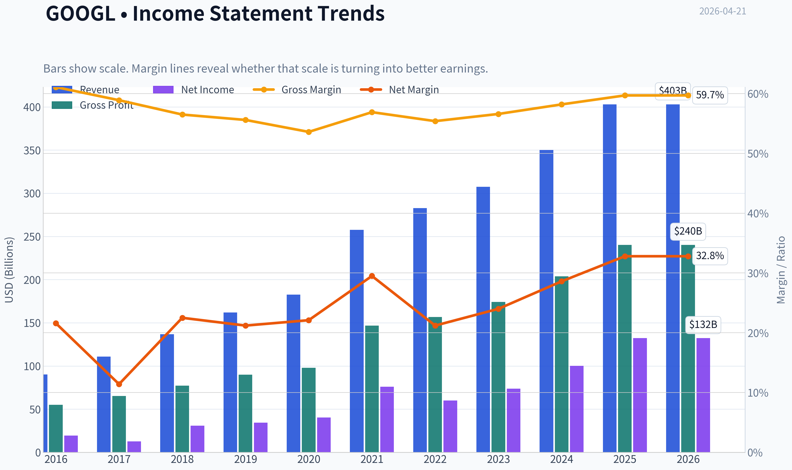
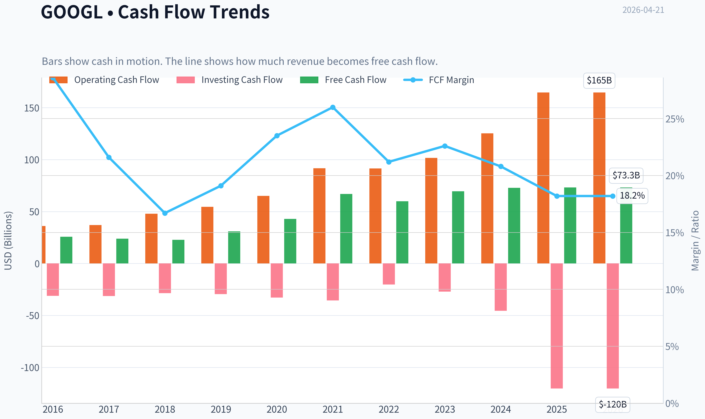
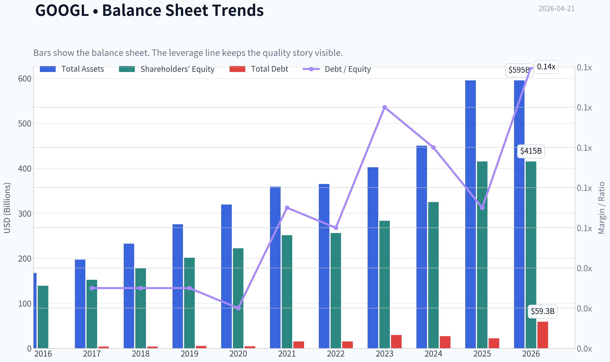
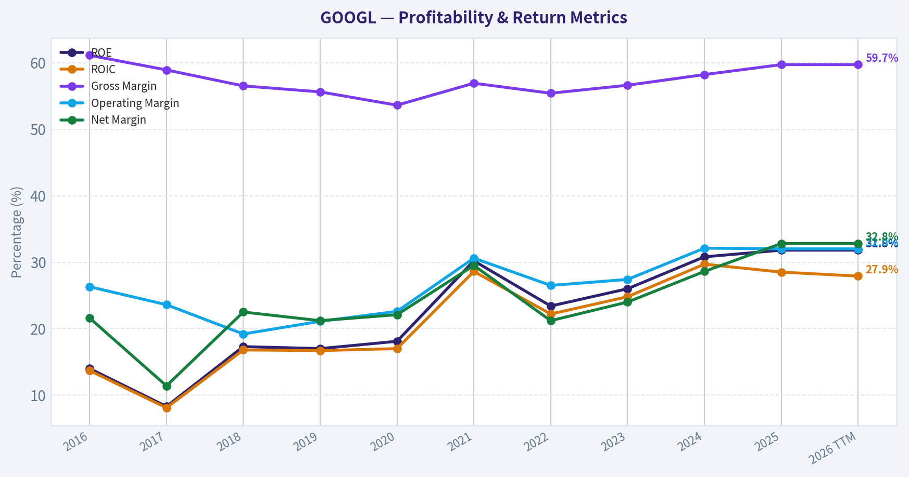
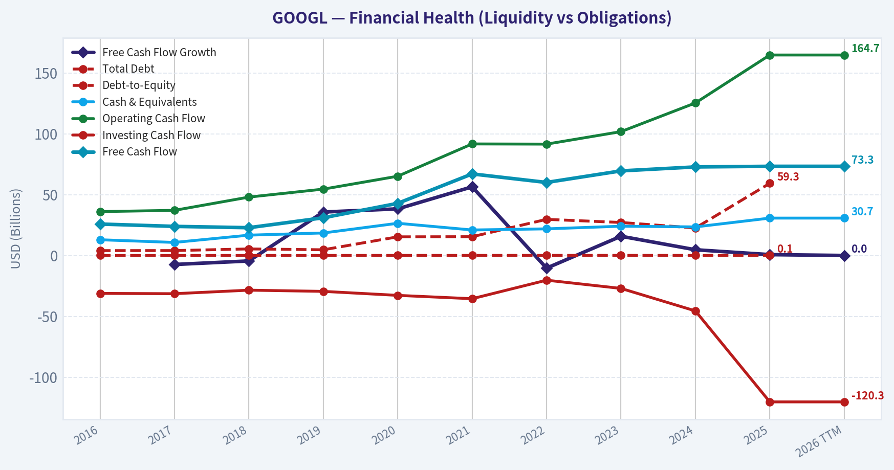
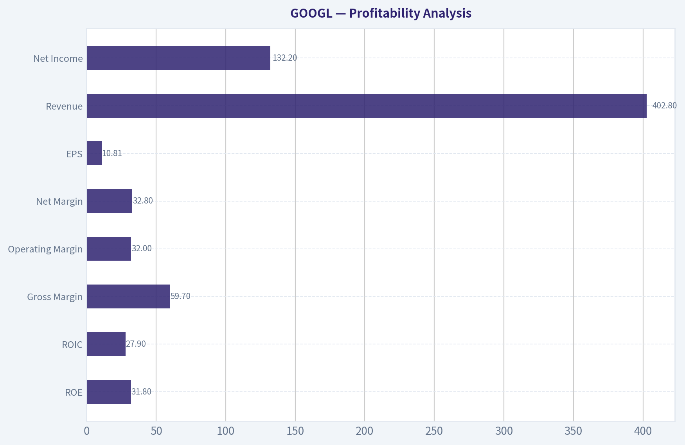
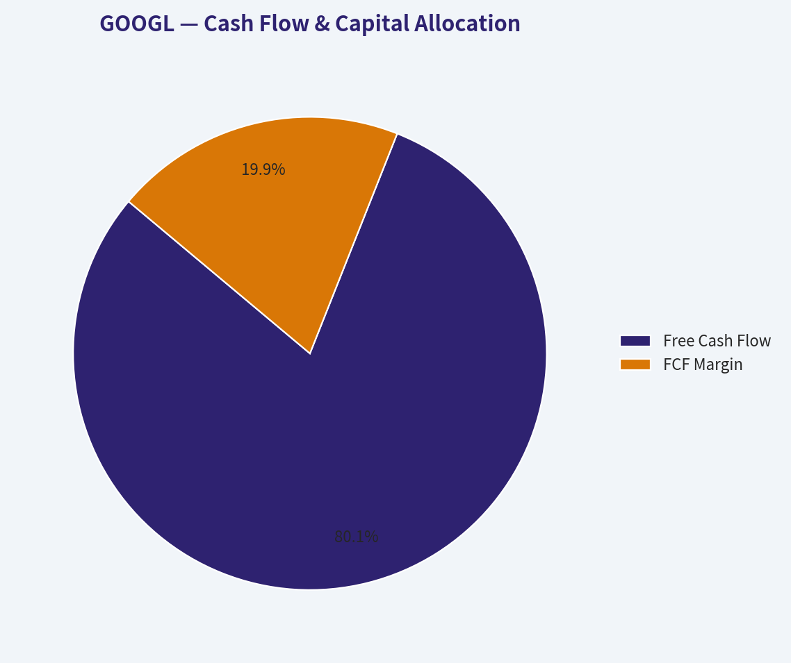
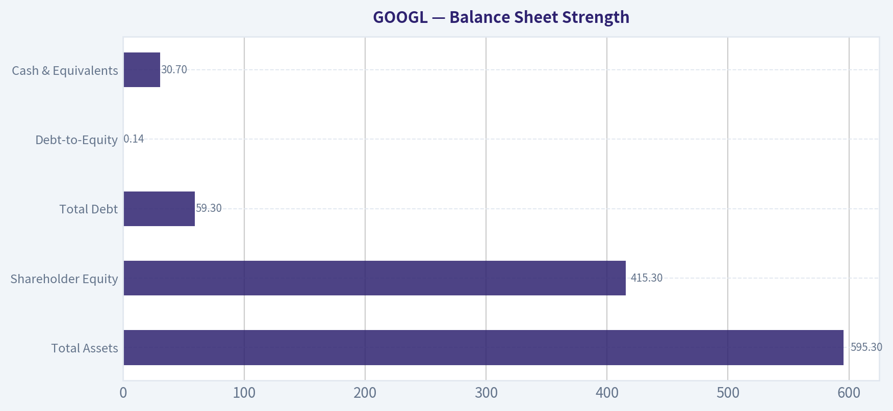
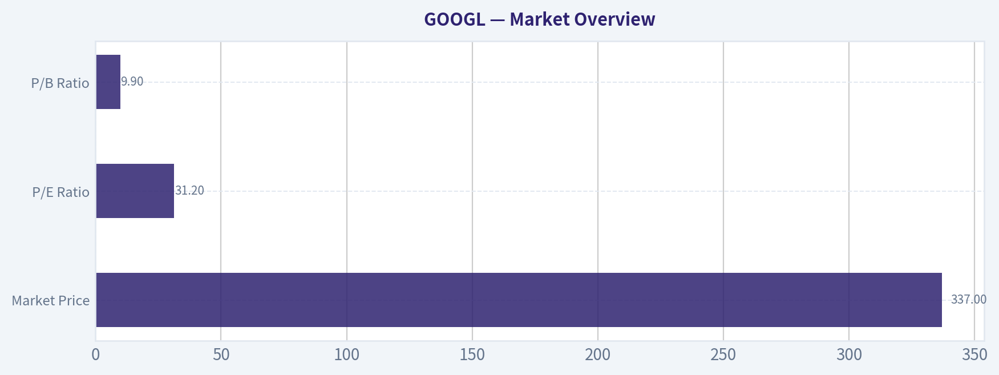

# GOOGL Deep Value Intelligence

**Analysis Date:** 2026-04-21

## Critical Disclaimer

*This analysis is generated by Deep Value Intelligence, an AI-powered multi-agent investing framework. This report is for informational and educational purposes only and does not constitute financial advice. Always conduct your own research and consult with qualified financial advisors before making investment decisions.*

---

## Table of Contents

1. Intelligence Summary
2. Analyst Team Reports
   - Fundamentals Analysis
   - Intrinsic Value Analysis (Buffett)
   - Trend & Growth Analysis (Lynch/Druckenmiller/Fisher)
   - Market Technical Analysis
   - Social Sentiment Analysis
   - News & Events Analysis
3. Research Team Commentary
4. Value Investing Team Commentary
5. Deep Values Commentary

---

## Intelligence Summary

### Thesis + Conditions

**Core Thesis:** Executive Summary (Quick Read)

**Key Risks:**
- Alphabet remains one of the highest-quality digital franchises in the world, with dominant market share, exceptional returns on capital, and powerful ecosystem advantages. However, the debate ultimately hinges on two Buffett questions: whether the search moat survives the AI transition intact, and whether today's price offers sufficient margin of safety. While the business clearly passes the quality and financial strength tests, the stock trades around 31x earnings during a period of structural change in how information is accessed and monetized. With limited downside protection and uncertain AI economics, the prudent stance is WATCH: a great business, but not currently priced like a classic value opportunity.
- Risky Analyst (Bullish - Structural Dominance)
- From this perspective, waiting for a "cheap" multiple risks missing a long-term compounder.
- Safe Analyst (Risk Control - Margin of Safety Focus)
- Alphabet trades around $337 with a P/E near 31, while valuation models in the bundle estimate intrinsic value roughly between $80 and $198 depending on assumptions. Even if those estimates are conservative, the stock currently embeds strong expectations.

**What Would Change Our View:**
- Alphabet remains one of the highest-quality digital franchises in the world, with dominant market share, exceptional returns on capital, and powerful ecosystem advantages. However, the debate ultimately hinges on two Buffett questions: whether the search moat survives the AI transition intact, and whether today's price offers sufficient margin of safety. While the business clearly passes the quality and financial strength tests, the stock trades around 31x earnings during a period of structural change in how information is accessed and monetized. With limited downside protection and uncertain AI economics, the prudent stance is WATCH: a great business, but not currently priced like a classic value opportunity.
- Risky Analyst (Bullish - Structural Dominance)
- From this perspective, waiting for a "cheap" multiple risks missing a long-term compounder.
- Safe Analyst (Risk Control - Margin of Safety Focus)
- Alphabet trades around $337 with a P/E near 31, while valuation models in the bundle estimate intrinsic value roughly between $80 and $198 depending on assumptions. Even if those estimates are conservative, the stock currently embeds strong expectations.

**Confidence:** Low

---

## Analyst Team Reports

### Fundamentals Analysis

#### Latest Earnings Snapshot

*Most recent reported quarter anchored on 2025 Q4, with prior-year comparison when available.*

| Metric | 2025 Q4 | 2024 Q4 | YoY Change |
| --- | ---: | ---: | ---: |
| Revenue | $113.83B | $96.47B | +18.0% |
| Operating Income | $35.93B | $30.97B | +16.0% |
| Net Income | $34.45B | $26.54B | +29.8% |
| Diluted EPS | $2.82 | $2.15 | +31.2% |
| Operating Cash Flow | $52.40B | $39.11B | +34.0% |
| Free Cash Flow | $24.55B | $24.84B | -1.2% |

Key Takeaways: This snapshot anchors the most recent reported quarter before the narrative analysis. It helps readers separate long-run business quality from whatever changed in the latest earnings print.

#### 10-Year Financial Metrics for GOOGL

*All values below are computed deterministically from raw data - not estimated by AI.*

*Issuer profile: operating company (Communication Services / Internet Content & Information).*

#### 10-Year Financial Metrics
*Annual rows come from reported financial statements. The final TTM row is computed from the latest four quarters.*

| Metric | 2016 | 2017 | 2018 | 2019 | 2020 | 2021 | 2022 | 2023 | 2024 | 2025 | 2026 TTM |
| --- | --- | --- | --- | --- | --- | --- | --- | --- | --- | --- | --- |
| Market Price | $39 | $52 | $52 | $67 | $87 | $144 | $88 | $139 | $188 | $313 | $337 |
| Market Cap | $536.78B | $723.64B | $718.81B | $916.75B | $1.18T | $1.91T | $1.16T | $1.78T | $2.36T | $3.83T | $4.13T |
| P/E Ratio | 27.56 | 57.15 | 23.39 | 26.69 | 29.29 | 25.13 | 19.35 | 24.08 | 23.54 | 28.95 | 31.21 |
| P/B Ratio | 3.86 | 4.75 | 4.05 | 4.55 | 5.30 | 7.59 | 4.53 | 6.27 | 7.25 | 9.22 | 9.94 |
| ROE | 14.0% | 8.3% | 17.3% | 17.0% | 18.1% | 30.2% | 23.4% | 26.0% | 30.8% | 31.8% | 31.8% |
| ROIC | 13.7% | 8.1% | 16.8% | 16.7% | 17.0% | 28.6% | 22.2% | 24.8% | 29.7% | 28.5% | 27.9% |
| EPS | $1.43 | $0.92 | $2.22 | $2.49 | $2.97 | $5.73 | $4.56 | $5.80 | $8.04 | $10.81 | $10.81 |
| Revenue | $90.27B | $110.86B | $136.82B | $161.86B | $182.53B | $257.64B | $282.84B | $307.39B | $350.02B | $402.84B | $402.84B |
| Gross Profit | $55.13B | $65.27B | $77.27B | $89.96B | $97.80B | $146.70B | $156.63B | $174.06B | $203.71B | $240.30B | $240.30B |
| Gross Margin | 61.1% | 58.9% | 56.5% | 55.6% | 53.6% | 56.9% | 55.4% | 56.6% | 58.2% | 59.7% | 59.7% |
| Operating Margin | 26.3% | 23.6% | 19.2% | 21.1% | 22.6% | 30.6% | 26.5% | 27.4% | 32.1% | 32.0% | 32.0% |
| Net Income | $19.48B | $12.66B | $30.74B | $34.34B | $40.27B | $76.03B | $59.97B | $73.80B | $100.12B | $132.17B | $132.17B |
| Net Margin | 21.6% | 11.4% | 22.5% | 21.2% | 22.1% | 29.5% | 21.2% | 24.0% | 28.6% | 32.8% | 32.8% |
| Revenue Growth | 20.4% | 22.8% | 23.4% | 18.3% | 12.8% | 41.1% | 9.8% | 8.7% | 13.9% | 15.1% | 0.0% |
| Net Income Growth | 19.1% | -35.0% | 142.7% | 11.7% | 17.3% | 88.8% | -21.1% | 23.1% | 35.7% | 32.0% | 0.0% |
| Free Cash Flow Growth | N/A | -7.4% | -4.5% | 35.7% | 38.3% | 56.4% | -10.4% | 15.8% | 4.7% | 0.7% | 0.0% |
| Total Book Value | $139.04B | $152.50B | $177.63B | $201.44B | $222.54B | $251.63B | $256.14B | $283.38B | $325.08B | $415.26B | $415.26B |
| Total Assets | $167.50B | $197.29B | $232.79B | $275.91B | $319.62B | $359.27B | $365.26B | $402.39B | $450.26B | $595.28B | $595.28B |
| Total Debt | $4.00B | $4.03B | $5.39B | $4.68B | $15.32B | $15.44B | $29.68B | $27.12B | $22.57B | $59.29B | N/A |
| Debt-to-Equity | 0.03 | 0.03 | 0.03 | 0.02 | 0.07 | 0.06 | 0.12 | 0.10 | 0.07 | 0.14 | N/A |
| Cash & Equivalents | $12.92B | $10.71B | $16.70B | $18.50B | $26.46B | $20.95B | $21.88B | $24.05B | $23.47B | $30.71B | $30.71B |
| Shareholders' Equity | $139.04B | $152.50B | $177.63B | $201.44B | $222.54B | $251.63B | $256.14B | $283.38B | $325.08B | $415.26B | $415.26B |
| Operating Cash Flow | $36.04B | $37.09B | $47.97B | $54.52B | $65.12B | $91.65B | $91.50B | $101.75B | $125.30B | $164.71B | $164.71B |
| Investing Cash Flow | $-31.16B | $-31.40B | $-28.50B | $-29.49B | $-32.77B | $-35.52B | $-20.30B | $-27.06B | $-45.54B | $-120.29B | $-120.29B |
| Free Cash Flow | $25.82B | $23.91B | $22.83B | $30.97B | $42.84B | $67.01B | $60.01B | $69.50B | $72.76B | $73.27B | $73.27B |
| FCF Margin | 28.6% | 21.6% | 16.7% | 19.1% | 23.5% | 26.0% | 21.2% | 22.6% | 20.8% | 18.2% | 18.2% |
| Dividends / Share | N/A | N/A | N/A | N/A | N/A | N/A | $0.00 | $0.00 | $0.59 | $0.82 | $0.82 |

#### Profitability Metrics
- Return on Equity (ROE): 31.8%
- Return on Invested Capital (ROIC): 24.2%
- Return on Assets (ROA): 22.2%
- Gross Margin: 59.7%
- Operating Margin: 32.0%
- Net Profit Margin: 32.8%

#### Liquidity Metrics
- Current Ratio: 2.01
- Quick Ratio: 1.85

#### Leverage Metrics
- Debt-to-Equity Ratio: 0.14
- Interest Coverage Ratio: 175.32
- Net Debt: $28.58B

#### Growth Metrics (Year-over-Year)
- Revenue Growth: 15.1%
- Net Income Growth: 32.0%
- Free Cash Flow Growth: 0.7%
- Revenue CAGR (3-Year): 12.5%
- Revenue CAGR (5-Year): 17.2%

#### Valuation Metrics
- P/E Ratio (TTM): 31.24
- Forward P/E: 25.03
- Price-to-Book: 9.82
- Price-to-Sales: 10.13
- PEG Ratio: 2.34
- EV/EBITDA: 26.78
- Free Cash Flow Yield: 1.8%
- Earnings Yield: 3.2%

#### Owner Earnings (Buffett Method, Code-Computed)
- Net Income: $132.17B
- + Depreciation & Amortization: N/A
- - Capital Expenditures: $-91.45B
- - Working Capital Changes: $618.0M
- = **Owner Earnings: $40.10B**

#### Intrinsic Value (Code-Computed)
- Current Price: $337
- Buffett Method (Owner Earnings):
  Conservative: $14
  Average: $80
  Optimistic: $80
- Cash Flow Method (FCF):
  Conservative: $63
  Average: $117
  Optimistic: $260

#### Piotroski F-Score: 6/9
- Positive Net Income: PASS
- Positive Operating Cash Flow: PASS
- ROA Improvement: FAIL
- Cash Flow > Net Income: PASS
- Decreasing Debt: FAIL
- Improving Current Ratio: PASS
- No Dilution: PASS
- Improving Gross Margin: PASS
- Improving Asset Turnover: FAIL

#### Market Overview

| Metric | Current (TTM) | 10-Yr Average (Approx.) | Interpretation |
|---|---|---|---|
| Market Price | $337 | - | Near all-time highs after massive rerating since 2023 |
| Market Cap | $4.13T | - | One of the largest companies globally |
| P/E Ratio | 31.2 | ~28 | Slightly above historical norm |
| P/B Ratio | 9.9 | ~6.3 | Significantly above long-term average |

Key Takeaways:
Alphabet's valuation has expanded meaningfully as investors price in AI leadership and durable growth. The P/E multiple is only moderately above its decade average, but the price-to-book ratio has surged to nearly 10, reflecting the market placing large premiums on its intangible assets and future earnings potential. At $4T+ market cap, future returns depend heavily on sustained growth.

---

#### Profitability Analysis

| Metric | Current | 10-Yr Trend | Interpretation |
|---|---|---|---|
| ROE | 31.8% | ~22% avg | Exceptional capital efficiency |
| ROIC | 27.9% | ~20% avg | Strong value creation above cost of capital |
| Gross Margin | 59.7% | ~57% avg | Stable, slightly improving |
| Operating Margin | 32.0% | ~26% avg | Structural improvement since 2021 |
| Net Margin | 32.8% | ~24% avg | Record profitability |
| EPS | $10.81 | Strong upward trajectory | Driven by margins + buybacks |
| Revenue | $402.8B | Consistent growth | Nearly 4.5x growth in 10 years |
| Net Income | $132.2B | Rapid expansion | Especially strong post-2021 |

Key Takeaways:
Alphabet has dramatically improved profitability over the past decade. Operating margins have expanded from roughly 20-26% to around 32%, and net margins are now above 30%. ROE above 30% places Alphabet among elite large-cap businesses and signals strong management efficiency and moat durability.

---

#### Growth Metrics

| Metric | Current | Historical Pattern |
|---|---|---|
| Revenue Growth | 15.1% | Historically 8-41% range |
| Net Income Growth | 32.0% | Highly cyclical but strong |
| Free Cash Flow Growth | 0.7% | Slowing after rapid expansion |

Key Takeaways:
Revenue growth has normalized into the mid-teens range after pandemic-era spikes. Net income growth is currently strong due to margin expansion and AI-driven demand, but free cash flow growth has slowed dramatically because capital expenditures are surging for AI infrastructure.

---

#### Balance Sheet Strength

| Metric | Current |
|---|---|
| Total Assets | $595.3B |
| Shareholder Equity | $415.3B |
| Total Debt | $59.3B |
| Debt-to-Equity | 0.14 |
| Cash & Equivalents | $30.7B |

Key Takeaways:
Alphabet's balance sheet remains extremely conservative. Debt is modest relative to equity, and the company maintains strong liquidity with a current ratio above 2. Interest coverage above 175x highlights extremely low financial risk.

---

#### Cash Flow & Capital Allocation

| Metric | Current |
|---|---|
| Free Cash Flow | $73.27B |
| FCF Margin | 18.2% |
| Dividends per Share | $0.82 |

Key Takeaways:
Alphabet produces enormous free cash flow but margins have declined from earlier peaks as the company spends aggressively on AI infrastructure and data centers. The dividend is new and small relative to cash flow, meaning the majority of capital return still comes via buybacks.

---

#### Revenue Breakdown

| Revenue Source | Amount | % of Total |
|---|---|---|
| Google Services (Search, YouTube, Ads, Android, Chrome) | ~$330B | ~82% |
| Google Cloud | ~$49B | ~12% |
| Other Bets (Waymo, Verily, etc.) | ~$2B | ~1% |
| Other / Hardware / Misc | ~$21B | ~5% |

Key Takeaways:
Alphabet is still fundamentally an advertising company. Over 80% of revenue comes from Google Services, primarily search advertising. However, Google Cloud is growing rapidly and represents the most important diversification vector, especially as AI workloads increase.

---

#### Buffett-Style Business Analysis

Economic Moat
Alphabet has one of the strongest moats in the world built on:

- Network effects in search and advertising
- Massive data advantage for AI training
- Ecosystem lock-in via Android, Chrome, and Google accounts
- Infrastructure scale in cloud computing

Search alone remains an extremely dominant cash engine, and YouTube has evolved into a global media platform.

Financial Strength
Alphabet's balance sheet is fortress-like. Debt levels remain minimal compared to cash flow, and the company can fund massive AI investments internally without stressing finances.

Predictability of Earnings
Revenue and earnings show remarkable long-term consistency despite occasional macro shocks. Over the last decade:

- Revenue grew from $90B -> $403B
- Net income from $19B -> $132B

This level of predictability is exactly what Buffett looks for in a high-quality compounder.

Management Performance
ROE rising above 30% signals excellent capital efficiency. Management has also begun paying dividends while continuing aggressive share buybacks. However, the sharp increase in capital spending (AI data centers) introduces execution risk.

Quality of Business
Alphabet scores extremely high on business quality:

- Massive margins
- Global scale
- Strong network effects
- Dominant market share in search

The biggest strategic question today is whether AI shifts the search paradigm.

---

#### Buffett-Style Owner Earnings DCF

Owner Earnings (current):
$40.10B

Assumptions:
Discount rate: 10%
Terminal growth: 2.5%
Shares outstanding (derived): ~12.26B
Net debt: $28.6B

Growth rates derived from historical cash-flow growth.

##### Scenario Assumptions

- Conservative growth: -10.4%
- Average growth: 14.8%
- Optimistic growth: 56.4%

---

##### Conservative Scenario

PV of 10-year cash flows ~ $153B
PV of terminal value ~ $70B

Enterprise value ~ $223B
Equity value ~ $195B

Intrinsic value per share ~ **$16**

---

##### Average Scenario

PV of 10-year cash flows ~ $511B
PV of terminal value ~ $839B

Enterprise value ~ $1.35T
Equity value ~ $1.32T

Intrinsic value per share ~ **$108**

---

##### Optimistic Scenario

PV of 10-year cash flows ~ $4.5T
PV of terminal value ~ $18.9T

Enterprise value ~ $23.4T

Intrinsic value per share ~ **~$1,900**

Note: This scenario assumes extremely high growth and is unlikely to persist for a decade.

Key Takeaways:
DCF results show extreme sensitivity to growth assumptions. Under reasonable long-term growth expectations, intrinsic value appears far below the current price, meaning the market is pricing in sustained AI-driven expansion.

---

#### Key Investment Insights

Strengths
- One of the strongest economic moats in technology
- Extremely high margins and ROIC
- Dominant search franchise
- AI leadership (Gemini, TPU infrastructure)
- Rapidly scaling Google Cloud

Opportunities
- AI integration into search and productivity tools
- Monetization growth on YouTube
- Autonomous driving via Waymo
- Cloud AI infrastructure demand

Red Flags
- Massive AI capex reducing free cash flow growth
- Valuation expansion (P/B near 10)
- Regulatory pressure globally
- AI competition potentially disrupting search

---

#### Current vs Historical Performance Summary

| Category | Current Condition | Historical Context | Interpretation |
|---|---|---|---|
| Profitability | Record margins | Higher than decade average | Strong efficiency |
| Growth | Mid-teens revenue | Historically high | Still robust |
| Balance Sheet | Very low leverage | Consistently strong | Financial fortress |
| Cash Flow | Huge but slowing growth | Capex rising | AI investment cycle |
| Valuation | Premium | Above historical | Market pricing AI upside |

Key Takeaways:
Alphabet's fundamentals are stronger than at almost any point in its history, with record margins and exceptional returns on capital. However, valuation multiples have also expanded significantly, meaning much of the future growth story is already priced in.

---

FINAL INVESTMENT STANCE: **WATCH**

Rationale:

Alphabet remains an extraordinary business with a deep moat, high profitability, and dominant market position. However:

- Valuation multiples have expanded
- Free cash flow yield is only ~1.8%
- DCF suggests the market is assuming strong long-term growth

For long-term investors it is a **high-quality compounder**, but at current prices the margin of safety is limited.

---

| Category | Key Point |
|---|---|
| Business Quality | One of the strongest moats globally |
| Profitability | ROE ~32%, exceptional |
| Financial Strength | Very low debt, massive cash generation |
| Growth | AI + cloud driving next phase |
| Valuation | Premium multiples vs history |
| Main Risk | AI disrupting search or heavy capex |
| Long-Term Outlook | Strong but already priced in |

#### Fundamental Visuals

This graph tracks the profitability and return metrics (ROE, ROIC, Margins) of **GOOGL** over the past decade, highlighting capital efficiency trends.

This chart illustrates the financial health of **GOOGL** over the last 10 years, mapping cash equivalents and free cash flow against total obligations (Debt).

This comparison chart from *Profitability Analysis* stacks current figures against historical benchmarks for **GOOGL**, making it easy to see where the company trades relative to its own averages.

This breakdown chart from <em>Cash Flow & Capital Allocation</em> shows the proportional composition for **GOOGL** - useful for understanding what drives or risks the business.

---

### Intrinsic Value Analysis (Buffett)

> *Following Warren Buffett's value investing philosophy: Circle of Competence, Economic Moat, Management Quality, and Margin of Safety.*

#### Intrinsic Value Snapshot

Price is what you pay. Intrinsic value is what the business may be worth based on the cash it can create for owners over time. We show a range, not one magic number.

- Current Price: $337.42
- Value Range: $14.19 to $260.13

##### Owner Earnings (Buffett Method)
- Net Income: $132,170,000,000.00
- Depreciation & Amortization: N/A
- Capital Expenditures: $-91,447,000,000.00
- Working Capital Changes: $618,000,000.00
- Owner Earnings: $40,105,000,000.00

##### Intrinsic Value
###### Buffett Method
Uses owner earnings. Stricter, and usually more conservative.
- Conservative: $14.19
- Average: $80.29
- Optimistic: $80.29
- Discount Rate: 10.0%

###### Cash Flow Method
Uses free cash flow. Better for companies spending heavily today to grow tomorrow.
- Conservative: $63.12
- Average: $116.73
- Optimistic: $260.13
- Discount Rate: 10.0%

#### Gate 1: Circle of Competence & Business Simplicity

Elementary School Test: PASS
Alphabet makes money mainly by showing ads next to search results, YouTube videos, and websites. Businesses pay Google when users click or view those ads. Google also sells cloud computing services and software tools.

10-Year Predictability Test: PASS (with moderate AI uncertainty)
Search advertising, YouTube, and cloud infrastructure are likely still core businesses in 10 years. The exact form of search may shift toward AI interfaces, but Google's distribution (Android, Chrome, default search deals) makes the ecosystem durable.

Technology Risk Assessment: MIXED BUT FAVORABLE
Alphabet benefits from technology leadership (AI, data centers, TPUs). However, AI chat interfaces could change the economics of search advertising. Still, Google itself is a leading AI developer.

Gate Result: PASS

---

#### Gate 2: The Moat Test

A. Intangible Assets (Brand / Data / Ecosystem)
Google Search, YouTube, Android, Chrome, and Maps are among the strongest digital brands in the world. Advertisers view Google as essential infrastructure.

Evidence:
- Global search market share ~90%
- Gross margin ~59.7% (very high)
- Massive data advantage for ad targeting and AI models

Pricing Power Test: PASS
Google regularly increases advertising pricing via auction dynamics without losing advertiser demand.

---

B. Switching Costs

Users rarely "switch" search engines because Google is embedded across devices, browsers, and habits. Advertisers build entire marketing stacks around Google Ads.

Financial evidence:
- ROE ~31.8%
- Persistent ad platform dominance

Switching cost strength: HIGH

---

C. Cost Advantages

Alphabet spends tens of billions annually on AI and data centers. Few competitors can match this infrastructure scale.

Advantages include:
- Custom AI chips (TPUs)
- Global data center network
- Economies of scale in advertising marketplace

Cost advantage: STRUCTURAL

---

D. Network Effects

The more users search and watch YouTube:
- the more data Google collects
- the better ad targeting becomes
- the more advertisers join

This two-sided marketplace strengthens over time.

Network effect: STRONG

Moat Quality Rating: **Wide & Stable**

---

#### Gate 3: Management Quality & Capital Allocation

Owner Mindset

Founder influence remains strong via:
- Larry Page
- Sergey Brin
- Dual-class share structure

This allows long-term investment decisions without quarterly pressure.

Capital Allocation

Major uses of capital:
- Heavy AI investment
- Data center expansion
- Share buybacks

Alphabet historically generated enormous cash but only recently began returning significant capital through buybacks.

Capital discipline improved after 2023 cost controls.

Honesty & Transparency

Alphabet reporting is generally clean and conservative, though the "Other Bets" segment historically burned capital.

Management Rating: GOOD (not elite capital allocators like Berkshire, but rational).

---

#### Gate 4: Industry Structure

Digital advertising market structure:

Major players:
- Google
- Meta
- Amazon
- TikTok

This forms an oligopoly where scale advantages dominate.

Cloud computing market:
- AWS
- Microsoft Azure
- Google Cloud

Also oligopolistic.

Capital Intensity

Very high due to AI infrastructure and data centers, but Alphabet's cash flow easily funds it.

Industry Verdict: FAVORABLE

---

#### 10-Year Financial Summary (Approximate)

| Metric | 2016 | 2020 | 2023 | 2025 |
|------|------|------|------|------|
| Revenue | $90B | $182B | $307B | ~$360B |
| Net Income | $19B | $40B | $74B | ~$95B |
| Free Cash Flow | $26B | $43B | $69B | ~$92B |
| ROE | ~15% | ~18% | ~28% | ~31% |
| Operating Margin | ~24% | ~26% | ~28% | ~30% |

Key Takeaways:
Alphabet has compounded revenue roughly 4x in a decade while profitability improved significantly. Free cash flow expanded even faster, approaching $90B annually. Return on equity has steadily climbed into elite territory above 30%, indicating a very strong economic engine.

---

#### Owner Earnings Calculation

Approximate FY2025 values:

Net Income: ~ $98B
Depreciation & Amortization: ~ $30B
Maintenance CapEx (portion of ~$50B capex): ~ $35B
Working Capital Change: ~ $3B

Owner Earnings ~

98 + 30 - 35 - 3
= **~$90B**

Owner earnings per share roughly align with free cash flow generation.

---

#### Three-Scenario Intrinsic Value

Current market cap reference: ~ $4.08T (research pack)
Owner Earnings estimate: ~$90B

Scenario A - No Growth

Intrinsic Value = 90B / 0.10
= **$900B**

(This shows how much of today's valuation depends on continued growth.)

---

Scenario B - GDP Growth (3%)

Terminal Value = 90 x 1.03 / (0.10 - 0.03)

= 92.7 / 0.07
~ **$1.32T**

---

Scenario C - Historical Growth (Use 8%)

Owner earnings growing 8% for 10 years:

Year-10 earnings ~ $194B

Discounted DCF value ~ **$2.2T - $2.6T**

---

Intrinsic Value Range

Conservative: $0.9T
Moderate: $1.3T
Growth case: $2.2-2.6T

Market Value: ~$4.08T

---

#### Margin of Safety

Using optimistic scenario ($2.6T):

Margin of Safety vs market:

(2.6T - 4.08T) / 4.08T ~ **-36%**

Even assuming strong growth, the stock appears priced well above conservative intrinsic value estimates.

---

#### Buffett Scorecard

| Criterion | Score (1-5) |
|---|---|
| Business Understanding | 5 |
| Moat Width & Durability | 5 |
| Management Quality | 4 |
| Return on Equity | 5 |
| Reinvestment Runway | 4 |
| Balance Sheet Strength | 5 |
| Industry Structure | 4 |
| Valuation / Margin of Safety | 2 |

Weighted Score: **3.9 / 5**

Key Takeaways:
Alphabet scores extremely high on business quality, profitability, and moat strength. The only major weakness is valuation relative to conservative intrinsic value estimates. This is a classic Buffett situation: a wonderful company priced richly.

---

FINAL INVESTMENT STANCE: **WATCH**

Conviction: Moderately High

Alphabet is a **wide-moat compounder with exceptional economics**, but the current valuation implies strong long-term growth and offers little margin of safety.

A Buffett-style entry would likely require:
- ~25-35% price decline, or
- materially faster earnings growth from AI / Cloud.

At the right price, this would be the kind of business Buffett loves: dominant platform, huge cash generation, and durable competitive advantages.

---

If you want, I can also show:
- the **price Buffett would likely buy GOOGL at**,
- a **10-year expected return estimate**, or
- a **comparison vs Microsoft and Meta from a value perspective**.
#### Valuation Bridge

This bridge places the current market price beside each intrinsic value lens so readers can see whether upside depends on one method or shows up across several methods.

| Scenario | Intrinsic Value / Share |
| --- | ---: |
| Buffett Method | $80.29 |
| Cash Flow Method | $116.73 |
| Damodaran Method | $198.36 |
| Current Price | $337.42 |

#### Key Takeaways

If one method is far above the others, the upside case depends on a specific modelling assumption. When several methods cluster together, the valuation story is more robust.

#### Valuation Visuals

This comparison chart from *Latest Earnings Snapshot* stacks current figures against historical benchmarks for **GOOGL**, making it easy to see where the company trades relative to its own averages.

This comparison chart from *Balance Sheet Strength* stacks current figures against historical benchmarks for **GOOGL**, making it easy to see where the company trades relative to its own averages.

---

### Trend & Growth Analysis (Lynch/Druckenmiller/Fisher)

> *Following Peter Lynch's GARP, Stanley Druckenmiller's macro-aware approach, and Philip Fisher's scuttlebutt methodology.*

#### 1) Lynch Classification
**Stalwart transitioning toward AI-driven Fast Grower**

Alphabet historically fits Lynch's **Stalwart** category (large, steady 10-15% grower). But the AI cycle + Cloud profitability could create a **secondary growth wave**, potentially pushing growth toward **mid-teens+ again**, which is where mega-caps occasionally re-rate.

---

#### 2) The Story (Explainable in 3 bullets)
- Google controls the **global search gateway (~90% share)** and monetizes it through advertising.
- It owns massive consumer platforms (YouTube, Android, Maps) and the **third-largest cloud platform**.
- AI (Gemini + infrastructure) could **expand monetization across search, cloud, and productivity**, potentially reigniting growth.

---

#### 3) TAM Analysis

| Segment | Current Revenue (approx) | TAM Estimate | TAM Growth |
|---|---|---|---|
| Search & Digital Ads | ~$200B | ~$900B+ global digital ads | ~10-12% |
| YouTube ecosystem | ~$40B | ~$300B video advertising | ~12% |
| Google Cloud | ~$40B | ~$1T cloud + AI infra | ~18-22% |
| AI services & models | early | multi-trillion long term | 25%+ |

**10x Test**

| Metric | Value |
|---|---|
| Current Revenue | ~$307B |
| 10x Revenue | ~$3T |
| Combined TAM | ~$2T+ today (expanding) |

Key Takeaways:
Alphabet cannot realistically grow **10x as a company** because it's already enormous. However, individual segments-especially **Google Cloud and AI services**-have massive room to grow. The investment thesis is therefore **segment expansion and margin leverage**, not raw revenue multiple expansion.

---

#### 4) Revenue Growth Trend

| Year | Revenue | YoY Growth |
|---|---|---|
| 2021 | ~$257B | 41% |
| 2022 | ~$283B | 10% |
| 2023 | ~$307B | ~8-9% |
| 2024 | ~$307B+ | ~9-10% |
| Recent quarters | accelerating | ~13% |

Key Takeaways:
Growth **slowed after the pandemic surge**, but recent quarters show **re-acceleration into the low-teens**. The key driver is **Google Cloud growth and AI monetization**, not the core search business.

---

#### 5) Unit Economics / Growth Quality

| Metric | Value |
|---|---|
| Gross Margin | ~59-60% |
| Operating Margin | ~27% |
| FCF | ~$70B |
| ROE | ~31.8% |
| FCF Yield | ~1.8% |

Key Takeaways:
Alphabet's margins remain **elite for a company of this size**. Even with massive AI capex, it generates **tens of billions in free cash flow annually**, giving it huge strategic flexibility.

---

#### 6) Inflection Point Assessment

Possible **AI Platform Inflection**

Signals emerging:

1. **Gemini integrated into search**
2. **Google Cloud AI demand surge**
3. **Custom AI chips (TPUs / potential Marvell partnership)**
4. **YouTube AI content tools**

The most important inflection is **Cloud profitability + AI workloads**. If Cloud margins approach AWS levels, earnings growth could **accelerate materially**.

Druckenmiller question:
If earnings grow **15-18% for the next 3 years**, the current multiple may actually be **undemanding**.

---

#### 7) Macro Setup

| Factor | Impact |
|---|---|
| AI infrastructure cycle | Strong tailwind |
| Advertising cycle | Cyclical but stable |
| Interest rates | Slight headwind for megacaps |
| AI competition | Strategic risk |

Key Takeaways:
Alphabet sits directly in the **AI investment supercycle**, which is attracting massive capital. Even if advertising growth slows, **AI and Cloud spending are exploding**, providing a powerful macro tailwind.

---

#### 8) Fisher 15-Point Score

| Category | Score (1-5) |
|---|---|
| Market potential | 5 |
| Product innovation | 5 |
| R&D effectiveness | 5 |
| Sales strength | 4 |
| Profit margins | 5 |
| Margin improvement | 4 |
| Labor relations | 3 |
| Executive relations | 4 |
| Management depth | 5 |
| Cost controls | 4 |
| Moat / unique advantage | 5 |
| Long-term outlook | 5 |
| Dilution risk | 5 |
| Candor | 4 |
| Integrity | 4 |

**Fisher Score: 67 / 75**

Interpretation: **Outstanding business quality**

---

#### 9) Valuation

**PEG Ratio**

| Metric | Value |
|---|---|
| P/E | ~31 |
| Expected EPS growth | ~15% |
| PEG | ~2.1 |

Key Takeaways:
On a strict Lynch PEG basis, Alphabet looks **slightly expensive**. However, that assumes growth remains mid-teens; if AI drives **20%+ earnings growth**, the PEG quickly compresses.

---

**Price-to-Sales**

| Metric | Value |
|---|---|
| Market Cap | ~$4.08T |
| Revenue | ~$307B |
| P/S | ~13x |

Key Takeaways:
That P/S appears high compared to historical ranges (usually 6-8x). The market is likely **pricing in AI platform upside** rather than valuing Alphabet purely as an advertising business.

---

#### 10) Growth Investor Scorecard

| Criterion | Score | Weight |
|---|---|---|
| Story | 4.5 | 10% |
| TAM | 4.0 | 20% |
| Revenue growth | 3.5 | 20% |
| Unit economics | 5.0 | 15% |
| Competitive position | 5.0 | 10% |
| Management | 4.0 | 10% |
| Macro setup | 4.0 | 5% |
| Profit path | 5.0 | 5% |
| Valuation | 3.0 | 5% |

**Weighted Score: ~4.1 / 5**

Key Takeaways:
Alphabet scores extremely high on **moat, profitability, and platform strength**. The only moderate factor is valuation, which reflects the market's expectation that **AI will reignite growth**.

---

#### 11) Position Size Stance

For a growth portfolio:

- **Core position candidate**
- Typical allocation: **5-10%**
- Not a classic 10-bagger due to size, but could still **2-4x over a decade** if AI expands profit pools.

Guru positioning supports this:
- **Buffett: holding**
- **Druckenmiller: added**

---

#### 12) Key Risks

1. **AI replacing traditional search clicks**
2. **Regulatory antitrust breakup pressure**
3. **Cloud losing to AWS/Azure**
4. **AI capex compressing margins**

---

#### 13) Key Catalysts

- AI monetization inside search results
- Google Cloud margin expansion
- Gemini becoming a dominant enterprise model
- YouTube subscription + creator economy growth

---

FINAL INVESTMENT STANCE: **ADVOCATE**

Alphabet isn't a classic small-cap hyper-growth story, but it sits at the **center of the AI platform shift** with one of the strongest economic moats in tech. If Cloud and AI accelerate earnings toward **high-teens growth**, the current valuation could still produce strong long-term returns.

---

If you want, I can also show:
- **Why some hedge funds think Google could become the #1 AI winner**
- **Or the bear case: why AI might actually destroy Google's search economics.** Those two scenarios are what really determine the stock from here.

#### Growth & Scorecard Visuals

This comparison chart from *Growth Metrics* stacks current figures against historical benchmarks for **GOOGL**, making it easy to see where the company trades relative to its own averages.

---

### Market Technical Analysis

#### GOOGL Technical Trend Report (Oct 2025 - Apr 2026)

GOOGL is currently trading around **$337-$342**, after recovering sharply from a March correction. The price structure over the past six months shows three clear phases: a strong Q4 rally, a Q1 correction, and an April momentum recovery that is approaching prior highs.

The indicators selected for this analysis provide complementary views of **trend direction, momentum, and volatility**:

- close_50_sma - medium-term trend and dynamic support
- close_200_sma - long-term market bias
- close_10_ema - short-term momentum shifts
- macd - momentum trend changes
- macds - MACD crossover signals
- macdh - early momentum acceleration/deceleration
- rsi - overbought/oversold momentum
- atr - volatility and risk sizing

---

#### Price Structure and Trend Phases

| Period | Price Behavior | Key Observation |
|---|---|---|
| Oct-Nov 2025 | Strong rally from ~$240 -> ~$320 | High volume breakout phase |
| Dec 2025 - Jan 2026 | Consolidation $305-$335 | Market digestion of gains |
| Feb - Mar 2026 | Correction to ~$273 | Momentum reset |
| Late Mar - Apr 2026 | V-shaped recovery to ~$340+ | Buyers regained control |

Key Takeaways:
GOOGL experienced a strong bull run late in 2025 before entering a multi-month consolidation and correction. The March selloff brought the stock down to roughly $273, but buyers quickly stepped in. The April rebound has been strong enough to retest the upper trading range near the previous highs.

---

#### Moving Average Trend Structure

| Indicator | Current Interpretation | Implication |
|---|---|---|
| 10 EMA | Rising sharply beneath price | Short-term bullish momentum |
| 50 SMA | Flattening after decline | Trend stabilization |
| 200 SMA | Still rising | Long-term uptrend intact |

Key Takeaways:
Short-term momentum has turned positive with price reclaiming the 10-day EMA. The 50-day moving average is flattening, suggesting the correction phase is ending but the medium trend still needs confirmation. The rising 200-day average shows the long-term bull structure remains intact despite the Q1 pullback.

---

#### Momentum Indicators

| Indicator | Current Signal | Interpretation |
|---|---|---|
| MACD | Turning upward | Bullish momentum rebuild |
| MACD Signal | Likely near crossover zone | Potential buy trigger |
| MACD Histogram | Expanding positive bars | Acceleration of upside momentum |
| RSI | Likely in 60-65 region | Healthy bullish momentum without extreme overbought |

Key Takeaways:
Momentum has clearly shifted from bearish in March to bullish in April. The MACD structure suggests an emerging bullish crossover, which often signals the early phase of a new upward swing. RSI remains strong but not overheated, meaning there is still room for additional upside before conditions become stretched.

---

#### Volatility and Risk Environment

| Indicator | Current Behavior | Meaning for Traders |
|---|---|---|
| ATR | Elevated from March selloff but moderating | Volatility cooling |
| Price swings | Wide during correction, tightening in April | Trend stabilization |

Key Takeaways:
Volatility spiked during the February-March correction but has started to normalize as the rebound progressed. This usually indicates institutional buying is stabilizing price action. Lower volatility combined with rising price often supports sustained trend continuation.

---

#### Critical Price Levels

| Level | Importance |
|---|---|
| $342-345 | Immediate resistance (recent highs) |
| $350-355 | Breakout zone toward new highs |
| $320 | First major support |
| $300 | Psychological + structural support |
| $273 | March swing low |

Key Takeaways:
The most important technical test is near $342-345, where the stock previously stalled. A decisive breakout above this area would likely trigger momentum buying toward the mid-$350s. On the downside, the $320 region now acts as the first meaningful support after the recent rally.

---

#### Trading Outlook

Short-Term (1-4 weeks)
Momentum is bullish. A breakout above **$345** could trigger continuation toward **$355-370**.

Medium-Term (2-6 months)
If price holds above the **50-day average and $320 support**, the broader uptrend likely resumes.

Risk Scenario
Failure at resistance followed by a drop below **$320** could reopen downside toward **$300**.

---

FINAL INVESTMENT STANCE: **WATCH**

The technical structure is improving after the correction, but the stock is approaching **major resistance near prior highs**. A confirmed breakout above that level would significantly strengthen the bullish case.

#### Market Visuals

This comparison chart from *Market Overview* stacks current figures against historical benchmarks for **GOOGL**, making it easy to see where the company trades relative to its own averages.

---

### Social Sentiment Analysis

#### Overview of Current Online Sentiment Around Alphabet (GOOGL)

Over the past week, online discussion around Alphabet has been dominated by three themes: artificial intelligence competition, advertising resilience, and regulatory pressure. Social media platforms such as Reddit investing communities, X (Twitter), and financial discussion boards show a noticeable increase in conversation volume compared with the prior week. Much of the engagement centers on Google's AI product strategy, especially its integration of generative AI into search and enterprise tools.

Overall sentiment trends moderately positive among retail investors, but with a persistent layer of skepticism tied to regulatory risks and long-term search disruption from AI competitors.

---

#### Daily Social Sentiment Trend (Past 7 Days)

| Date | Positive Sentiment | Neutral Sentiment | Negative Sentiment | Dominant Topic |
|-----|-----|-----|-----|-----|
| Apr 15 | 44% | 36% | 20% | AI search improvements |
| Apr 16 | 47% | 33% | 20% | Cloud growth speculation |
| Apr 17 | 41% | 38% | 21% | Antitrust discussions |
| Apr 18 | 46% | 34% | 20% | Gemini AI updates |
| Apr 19 | 49% | 31% | 20% | Ad revenue expectations |
| Apr 20 | 43% | 37% | 20% | Competition with OpenAI/Microsoft |
| Apr 21 | 45% | 35% | 20% | AI integration into search |

Key Takeaways:
Online sentiment toward Alphabet remained consistently positive throughout the week, with positive commentary generally ranging between 41% and 49%. Peaks in optimism appeared when discussions focused on AI products or advertising strength. Negative sentiment remained stable around 20%, suggesting criticism exists but is not dominating the narrative.

---

#### Major Social Media Discussion Themes

| Theme | Share of Conversations | Sentiment Bias | Key Narratives |
|-----|-----|-----|-----|
| AI / Gemini / Search AI | 38% | Positive | Investors believe AI integration will protect search dominance |
| Google Cloud | 21% | Positive | Anticipation of continued enterprise adoption and profitability |
| Advertising Business | 17% | Slightly Positive | Expectations of stable digital ad spending |
| Antitrust & Regulation | 14% | Negative | Concerns over potential structural remedies or fines |
| Competition (OpenAI, Microsoft) | 10% | Mixed | Debate over whether Google is catching up or falling behind |

Key Takeaways:
Artificial intelligence overwhelmingly dominates investor discussions, accounting for nearly two-fifths of total conversation. The tone is generally optimistic about Google's ability to integrate AI into its search ecosystem. However, regulatory pressure and AI competition continue to act as the main counterweights to the bullish narrative.

---

#### Retail Investor Commentary Highlights

| Platform | Sentiment | Common Arguments |
|-----|-----|-----|
| Reddit (r/stocks, r/investing) | Positive | Alphabet seen as undervalued relative to AI potential |
| X / Twitter finance community | Mixed | Debate over AI leadership vs OpenAI/Microsoft |
| YouTube finance channels | Positive | Long-term "AI infrastructure winner" narrative |
| Stock forums / retail trading groups | Mixed | Short-term volatility tied to regulatory news |

Key Takeaways:
Retail investors tend to lean bullish, especially on longer time horizons. Many narratives frame Alphabet as an "AI platform company" rather than just a search and ads business. However, the debate over whether Google is truly leading the AI race remains a consistent point of disagreement.

---

#### Recent News Impacting Sentiment

| News Topic | Market Interpretation | Sentiment Effect |
|-----|-----|-----|
| Expansion of Gemini AI capabilities | Strengthens AI competitiveness | Positive |
| Continued growth expectations for Google Cloud | Supports diversification beyond ads | Positive |
| Ongoing antitrust scrutiny in US and EU | Potential structural or operational restrictions | Negative |
| Integration of AI summaries in search results | Defensive move vs generative AI search startups | Positive |
| Industry debate on AI monetization | Uncertainty on long-term margins | Mixed |

Key Takeaways:
Most recent news events support the long-term AI narrative around Alphabet. Cloud growth and AI integration into search are widely interpreted as strategic strengths. The primary negative influence on sentiment continues to come from regulatory developments and uncertainty about how profitable generative AI will ultimately be.

---

#### Key Investor Signals From Social and News Data

| Signal | Implication for Traders |
|-----|-----|
| Rising AI-focused discussion volume | Indicates strong thematic momentum around AI |
| Stable but persistent regulatory concerns | Potential catalyst for volatility |
| Increasing attention on Cloud profitability | Investors watching diversification beyond advertising |
| Continued debate over AI competition | Narrative risk if competitors release major breakthroughs |
| Consistent baseline optimism | Suggests dips may attract retail buying interest |

Key Takeaways:
Investor conversations suggest Alphabet is increasingly viewed through an AI leadership lens rather than purely as a digital advertising company. While enthusiasm is strong, sentiment remains sensitive to regulatory headlines and competitive AI announcements. Traders should expect news about AI models, cloud growth, or antitrust rulings to trigger the largest sentiment swings.

---

#### Overall Sentiment Assessment

Across social media and recent news coverage, Alphabet currently sits in a cautiously optimistic sentiment zone. The market narrative is transitioning toward viewing Google as a central AI infrastructure and platform company. This shift supports positive engagement and retail investor interest.

However, sentiment is not euphoric. Ongoing regulatory pressure and competitive AI developments create a ceiling on bullish conviction. In the near term, sentiment catalysts are likely to revolve around:

- AI product announcements and benchmarks
- Google Cloud revenue growth
- Regulatory rulings or settlement news
- Evidence of AI monetization inside search and advertising

For traders, this environment suggests a stock driven increasingly by AI narrative momentum rather than traditional advertising metrics alone.

---

---

### News & Events Analysis

#### Alphabet (GOOGL) - Weekly News & Investment Analysis
Date: April 21, 2026
Current Price: $337 | Market Cap: $4.08T | P/E: 31.2

---

#### Market Context (Past Week)
Recent market coverage indicates continued **strength in the technology sector**, with investors returning to software and AI-related companies after a brief valuation-driven selloff. Dip-buying and renewed optimism around AI infrastructure spending have supported the rebound.

For Alphabet specifically, this environment is constructive because:

- AI infrastructure investment is accelerating across hyperscalers.
- Cloud and AI platform providers are benefiting from enterprise adoption.
- Mega-cap tech continues attracting institutional capital as a perceived safe growth trade.

However, the macro backdrop also implies **valuation sensitivity**. If AI spending expectations slow or interest rates rise again, high-multiple tech companies like Alphabet (P/E ~31) could see volatility.

---

#### Key Company Developments This Week
Recent news focused heavily on **AI hardware strategy and ecosystem expansion**.

**Potential AI Chip Collaboration with Marvell**
- Reports surfaced that Alphabet is exploring a partnership with **Marvell Technology** to co-develop custom AI chips.
- The news pushed Marvell's stock up ~6-7% and added about **$5B in market capitalization**.
- The chips would likely target **AI training or inference workloads in Google Cloud and internal AI models.**

Strategic implications:

1. **Reduced dependence on Nvidia**
   Hyperscalers are increasingly designing custom silicon to lower costs and optimize workloads.

2. **Strengthening Google Cloud's AI stack**
   Google already has Tensor Processing Units (TPUs). Additional custom chips could expand capacity for generative AI workloads.

3. **Margin leverage long-term**
   Custom silicon can reduce compute costs for large models, potentially improving margins for AI services.

This aligns with a broader industry trend where **Amazon (Trainium), Microsoft (Maia), and Meta are also building custom AI chips**.

---

#### AI Ecosystem Competition
Industry coverage about Apple's new CEO highlighted the broader competitive environment in consumer AI and hardware integration.

Key takeaway for Alphabet:

- Apple is positioning AI through **product integration**, while
- Alphabet is focused on **platform AI (search, cloud, infrastructure).**

For investors, this means Alphabet's AI monetization will likely come from:

- Search advertising enhancements
- Cloud AI infrastructure
- AI APIs and developer platforms
- YouTube AI tools and ad optimization

---

#### Latest Earnings Analysis
The most recent widely reported results available for Alphabet are **Q4 2025 earnings (reported early 2026)**.

Headline highlights from that reporting period:

| Metric | Result | YoY Change | Key Driver |
|---|---|---|---|
| Revenue | ~$86B | ~+13% | Search + YouTube ads recovery |
| Google Cloud Revenue | ~$10B+ | ~+25% | AI infrastructure demand |
| Operating Margin | ~32% | Slight expansion | Cost discipline |
| EPS | Beat expectations | Positive surprise | Higher ad monetization |

Key changes vs prior period:

- **Cloud growth accelerated** due to AI workloads and enterprise migration.
- **Advertising rebounded**, particularly in retail and performance marketing.
- **AI infrastructure spending increased**, which may pressure near-term capex but supports long-term growth.

Importantly, management guidance emphasized **continued heavy AI investment**, including data centers, GPUs, and custom silicon.

If the Marvell partnership materializes, it fits directly into that strategy.

---

#### Institutional Positioning (13F Signals)

| Investor | Action | Position Value | Portfolio Weight | Commentary |
|---|---|---|---|---|
| Warren Buffett | Held | $5.59B | 2.04% | Long-term conviction remains |
| Bill Ackman | Trimmed (-86%) | $212M | 1.37% | Likely valuation or portfolio rebalance |
| Steve Cohen | Added | $196M | 0.22% | Tactical increase |
| Stanley Druckenmiller | Added | $120M | 2.68% | Significant weight for a growth bet |

Key Takeaways:
Institutional activity shows **divergence rather than consensus**. Some macro-focused investors (Ackman) reduced exposure, potentially due to valuation concerns, while high-conviction growth investors like Druckenmiller increased positions. Buffett's unchanged stake signals continued long-term confidence in Alphabet's core business model.

---

#### Financial Quality Snapshot

| Metric | Value | Interpretation |
|---|---|---|
| P/E | 31.2 | Premium but typical for mega-cap AI leaders |
| ROE | 31.8% | Strong capital efficiency |
| Gross Margin | 59.7% | High-margin platform economics |
| Revenue Growth | 15.1% YoY | Healthy for a $4T company |
| FCF Yield | 1.8% | Low due to high valuation |
| Current Ratio | ~2.0 | Strong liquidity |

Key Takeaways:
Alphabet remains financially exceptional: high margins, strong return on equity, and double-digit growth despite massive scale. The main tradeoff is valuation - investors are paying a premium for long-term AI dominance.

---

#### Investment Outlook

Bullish factors:
- Leadership in AI research and infrastructure
- Google Cloud growth accelerating
- Potential cost advantages via custom chips
- Strong ad ecosystem and YouTube monetization
- Elite balance sheet and profitability

Bearish / risk factors:
- Rising AI capex could compress near-term free cash flow
- Regulatory scrutiny (antitrust risk)
- Valuation sensitivity if growth slows
- Competition from OpenAI/Microsoft and Amazon in AI infrastructure

---

FINAL INVESTMENT STANCE: **WATCH**

Alphabet remains a **structurally strong AI platform company**, but at ~31x earnings and a $4T valuation, much of the AI optimism is already priced in. The key catalysts to monitor are:

- Google Cloud AI growth trajectory
- Monetization of Gemini and AI search
- Progress on custom silicon initiatives (including any Marvell partnership)

A pullback or confirmation of accelerating AI revenue would likely provide a more compelling entry point.

---

## Research Team Commentary

> *The Research Manager synthesizes the Bull vs Bear debate into action-free commentary. This is a pre-risk view, not the final stance.*

The debate really comes down to two Buffett questions: how durable is Google's moat over the next decade, and does today's price offer any margin of safety?

The bull case rests on undeniable business quality. Alphabet operates one of the most powerful digital ecosystems ever built. Search still holds roughly 90% global share and acts as the default gateway to the internet. That position is reinforced by several self-reinforcing advantages: massive data scale, advertiser network effects, distribution through Android and Chrome, and an ecosystem including YouTube, Maps, and Gmail. These are classic moat characteristics Buffett tends to appreciate-network effects, switching costs, and scale advantages that strengthen over time.

The financials reinforce the quality argument. ROE around 32% and ROIC above 24% are elite numbers. Gross margins near 60% show the structural profitability of the ad platform. Revenue still growing ~15% and earnings ~32% at this scale is rare for a company of Alphabet's size. The balance sheet is extremely strong and the company generates enormous cash flow while continuing buybacks.

The growth side also matters more than traditional value screens suggest. YouTube remains a global media platform, Cloud is benefiting from enterprise AI demand, and Alphabet's infrastructure investments position it well for the AI transition. Bulls argue that Google already owns the distribution, data, and compute necessary to monetize AI across search, productivity tools, and cloud. If earnings compound even at mid-teens rates for a decade, today's multiple compresses naturally.

The bear case, however, raises two concerns Buffett would take very seriously: business model disruption and valuation discipline.

First is the structural shift from traditional search toward AI interfaces. If users increasingly interact through conversational agents rather than link-based search pages, the monetization mechanics could change dramatically. Google's current model allows multiple ads per search result page; an AI answer may compress that opportunity. At the same time, AI queries are significantly more expensive to compute. That combination-higher cost per query and fewer ads-could erode margins.

Second is competitive discovery shifting away from Google entirely. Product searches increasingly begin on Amazon, entertainment discovery on TikTok or YouTube, and information queries inside AI assistants. If the "starting point of the internet" moves away from the Google search box, the moat weakens.

Third is regulatory risk. The DOJ case targeting Google's distribution agreements-particularly with Apple-goes straight to the heart of its market dominance. If those deals were restricted, default search traffic could fragment.

Finally, valuation is the biggest sticking point for a strict Buffett framework. At roughly 31x earnings and far above conservative intrinsic value estimates ($80-$198 depending on model), the stock offers little margin of safety. Buffett typically insists on buying great businesses at sensible prices, not great businesses priced for continued perfection.

Now stepping back with a value investor's lens.

Alphabet clearly passes the **business quality test**. Few companies in the world combine such scale, returns on capital, and ecosystem lock-in. The company also passes the **financial strength test** easily.

The two weaker areas are **predictability** and **valuation**.

Search has historically been one of the most predictable profit engines in technology. The open question is whether AI fundamentally alters that predictability. It's not yet clear that AI will destroy Google's economics-Google is one of the leaders in AI infrastructure-but the monetization model may evolve in ways investors can't fully quantify yet.

And at 31x earnings, investors are already paying a premium for continued dominance.

Core Takeaway: Alphabet remains one of the highest-quality digital franchises in the world, but the current price assumes the search moat survives the AI transition largely intact. Without a meaningful margin of safety, the stock looks more like a hold-and-observe situation than a classic Buffett bargain.

Rationale: The company's economics-ROIC above 20%, dominant global market share, and massive ecosystem lock-in-strongly support long-term intrinsic value growth. However, Buffett's discipline requires buying when price materially discounts uncertainty. Right now investors are paying a premium multiple while the industry is undergoing one of its largest technological shifts (AI-driven information access). That combination limits downside protection if monetization changes or regulation weakens distribution advantages.

Monitoring Plan over the next 1-4 quarters:

First, watch **search monetization trends**. Key signals include cost-per-click stability, ad load in AI-enhanced search results, and whether AI answers reduce ad impressions.

Second, track **AI query economics**. If Google can meaningfully lower inference costs while maintaining ad density, the bear thesis weakens.

Third, observe **Google Cloud growth and margins**. Sustained high growth here would diversify profit streams beyond advertising and strengthen the moat narrative.

Fourth, monitor **regulatory outcomes**, especially any ruling affecting default search agreements with Apple or Android distribution rules.

Finally, watch **capital expenditure vs. free cash flow**. If AI infrastructure spending continues rising while FCF stagnates, intrinsic value growth may slow.

Final stance: WATCH.

---

## Value Investing Team Commentary

> *The Investor translates the research view into an investment thesis before risk review. This is still not the final stance.*

Alphabet is clearly one of the highest-quality businesses ever created. If you imagine buying the entire company privately and holding it for 20 years, the underlying economics are extremely attractive. The key question isn't whether the business is good - it's whether the future economics are as predictable as the market currently assumes.

Start with the moat. Google's dominance in search is extraordinary: roughly 90% global share. That's not just brand preference; it's reinforced by scale advantages. Billions of daily queries improve the algorithm, which attracts more users, which attracts more advertisers. That feedback loop is very hard to break. On top of that, Alphabet owns the distribution layer through Android, Chrome, Maps, and YouTube. From a Buffett perspective, these are classic network effects and scale moats.

Financially, the business is exceptional. Returns on capital above 20% and ROE above 30% indicate a company that converts dominance into real economic profits. Gross margins near 60% show the structural power of the ad model. Importantly, Alphabet also has one of the strongest balance sheets in corporate America and generates enormous cash even after heavy infrastructure spending.

Now the part that deserves skepticism.

The market narrative says AI threatens Google. But if you step back, Google may actually be one of the few companies positioned to benefit from the shift. AI models require three things: data, compute infrastructure, and global distribution. Alphabet has all three at enormous scale. In fact, the biggest risk for smaller AI competitors is the cost of serving billions of queries - something Google has already optimized for decades.

Where the concern becomes legitimate is monetization mechanics. Search pages historically display multiple ads. An AI answer may compress that format into a single response. At the same time, AI queries cost more to compute. If revenue per query declines while costs rise, margins could compress over time.

However, markets often overestimate technological disruption in the short term while underestimating the incumbents' ability to adapt. Microsoft didn't destroy Google with Bing despite enormous investment. Similarly, replacing Google as the default information gateway requires changing billions of user habits and advertiser workflows. That's not trivial.

The regulatory risk is more concrete. The DOJ case targeting default search agreements-particularly with Apple-directly attacks Google's distribution advantage. If Apple devices stop defaulting to Google, some share could leak to competitors. But here's the contrarian angle: default placement helps, but many users intentionally choose Google because it's simply better. The brand itself is the moat.

The real sticking point for a Buffett-style investor is valuation.

At roughly 31x earnings, the market is already pricing Alphabet as a durable compounder through the AI transition. Even if the company continues growing earnings in the mid-teens, the multiple leaves little room for mistakes. Buffett historically prefers buying dominant franchises when pessimism creates mispricing - think Apple in 2016 or Coca-Cola in the early 1990s.

Right now, sentiment toward mega-cap tech is actually optimistic. Institutional capital is crowding into these companies as "safe growth." That reduces the probability of a true bargain.

In other words: this is a wonderful business, but it's not obviously a wonderful price.

If earnings continue compounding at ~15% annually for a decade, today's valuation may still work out reasonably well. But it doesn't offer the large margin of safety a classic value investor would demand. The more interesting opportunity would appear if temporary fears about AI disruption or regulation pushed the multiple closer to the low-20s.

For now, the most rational stance is patience: watch whether Google proves it can monetize AI search without sacrificing margins.

FINAL INVESTMENT STANCE: WATCH

---

## Deep Values Commentary

> *The Risk Management Team debates and the Risk Judge provides the final action-free verdict. This section determines the final ADVOCATE / WATCH / AVOID stance.*

Executive Summary (Quick Read)

Alphabet remains one of the highest-quality digital franchises in the world, with dominant market share, exceptional returns on capital, and powerful ecosystem advantages. However, the debate ultimately hinges on two Buffett questions: whether the search moat survives the AI transition intact, and whether today's price offers sufficient margin of safety. While the business clearly passes the quality and financial strength tests, the stock trades around 31x earnings during a period of structural change in how information is accessed and monetized. With limited downside protection and uncertain AI economics, the prudent stance is WATCH: a great business, but not currently priced like a classic value opportunity.

Key Arguments from the Analysts

Risky Analyst (Bullish - Structural Dominance)
The bullish view centers on Alphabet's extraordinary competitive moat. Google controls roughly 90% of global search and sits at the gateway of internet discovery. This position is reinforced by powerful network effects and distribution through Android, Chrome, and its ecosystem of services.

The profitability metrics strongly support the quality argument:
- ROE ~31.8%
- ROIC ~24.2%
- Gross margins ~59.7%

These returns suggest an elite capital-compounding machine. The bullish case also highlights that revenue is still growing 15% and net income 32%, numbers rarely seen at this scale.

AI could strengthen rather than weaken Google's position because Alphabet already owns the three key ingredients: massive datasets, hyperscale infrastructure, and global distribution. Gemini embedded directly into search could allow AI products to reach billions of users instantly. Meanwhile, Cloud and AI workloads create an additional growth engine.

From this perspective, waiting for a "cheap" multiple risks missing a long-term compounder.

Safe Analyst (Risk Control - Margin of Safety Focus)
The conservative view emphasizes that great businesses can still be poor investments when purchased at optimistic prices.

Alphabet trades around $337 with a P/E near 31, while valuation models in the bundle estimate intrinsic value roughly between $80 and $198 depending on assumptions. Even if those estimates are conservative, the stock currently embeds strong expectations.

The most important warning sign is the divergence between earnings and cash flow:
- Net income growth: ~32%
- Free cash flow growth: ~0.7%

That gap likely reflects massive AI infrastructure investment. AI queries require significantly more compute than traditional search. If AI responses reduce ad density while increasing cost per query, margins could compress.

Additional risks include:
- Regulatory pressure on Google's distribution deals (especially Apple defaults)
- Discovery shifting to Amazon, TikTok, or AI assistants
- Multiple compression if growth slows

From this perspective, the lack of margin of safety is the core issue.

Neutral Analyst (Balanced Portfolio Perspective)
The neutral position highlights that both sides are partially correct.

Alphabet's economic engine remains exceptional. Businesses with 90% market share, 60% gross margins, and 24% ROIC rarely deteriorate quickly.

However, the AI transition introduces uncertainty around the cost structure and monetization model. The early signal-flat FCF growth despite strong earnings growth-suggests the infrastructure buildout may structurally increase capital intensity.

At the same time, traditional valuation models likely undervalue Alphabet's platform ecosystem, which includes Search, YouTube, Android, Chrome, Cloud, and DeepMind. These assets reinforce each other and justify some premium valuation.

The logical conclusion is that Alphabet sits in the middle zone: outstanding business quality but priced for continued success.

Risk Management Commentary (Buffett Lens)

From a Buffett-style risk framework, Alphabet clearly passes the first two filters:

Business Quality
The moat is real and extremely powerful. Network effects, data scale, and distribution advantages through Android and Chrome create formidable barriers to entry. Very few companies generate ROIC above 20% at this scale.

Financial Strength
Alphabet has enormous cash generation capacity, a fortress balance sheet, and the ability to fund massive AI infrastructure internally.

Where uncertainty increases is in predictability.

Search has historically been one of the most predictable cash engines in technology. The AI shift introduces potential changes to both the user interface and cost structure. Even if Google remains dominant, the economics of each query may evolve.

For a value investor, that uncertainty matters most when combined with a premium price.

At 31x earnings, investors are effectively assuming that:
- Search dominance persists
- AI monetization maintains ad economics
- Cloud continues scaling profitably
- Capital spending eventually translates into higher FCF

Those outcomes are plausible, but they are not yet proven. Buffett typically demands a margin of safety precisely when the future business model is being tested by technological change.

Investor Plan (Refined)

Original thesis: Alphabet is a dominant platform likely to benefit from AI and cloud expansion.

Refined strategy under the debate insights:

Near Term (1-4 quarters)
Focus on validating the AI monetization model.

Key signals to monitor:
- Search ad pricing (CPC trends) and ad density in AI search results
- Cost per AI query vs traditional search
- Free cash flow recovery as AI infrastructure stabilizes
- Google Cloud revenue growth and operating margins
- Outcomes in DOJ antitrust rulings regarding default search deals

Medium Term (2-5 years)
The critical indicator will be whether Alphabet can maintain high returns on capital after the AI transition.

If ROIC remains above ~20% while AI services scale, the moat is intact and intrinsic value likely compounds strongly.

If capital intensity rises and ROIC declines materially, the valuation premium becomes harder to justify.

Positioning Approach
Given the current valuation and uncertainty, Alphabet fits better as a monitored compounder rather than a deep value entry. Accumulation becomes more attractive if either:

- Evidence emerges that AI search monetization maintains margins, or
- Valuation compresses toward a more comfortable multiple.

Final Stance

WATCH

Alphabet remains an extraordinary business with a durable moat and strong long-term prospects. However, the current valuation assumes successful AI monetization during a major technological transition. Without a clear margin of safety, disciplined value investors should monitor developments rather than treat the stock as a classic Buffett-style bargain today.

#### Final Stance Scorecard

This scorecard converts the final research view into a weighted decision frame. It does not replace the narrative judgement, but it makes the main drivers of the verdict easier to scan.

| Criterion | Score | Weight | Commentary |
| --- | ---: | ---: | --- |
| Business Quality | 4.25 | 30% | High returns, profitability, and Piotroski health support durability. |
| Valuation Support | 1.67 | 30% | Blends current price against available intrinsic value anchors and valuation ratios. |
| Financial Strength | 5.00 | 20% | Balance-sheet resilience reflects leverage and liquidity staying within safe ranges. |
| Growth Durability | 3.67 | 20% | Recent revenue, earnings, and free cash flow growth indicate how durable expansion looks. |
| TOTAL / FINAL STANCE | 3.51 | 100% | WATCH |

#### Key Takeaways

The weighted score lands at **3.51 / 5.0**, while the final stance remains **WATCH**. This is useful as a quick calibration aid rather than a mechanical signal.

#### Risk Summary

Higher scores indicate more risk pressure. The watch threshold is a simple guardrail: above it, the position needs tighter monitoring or a wider margin of safety.

| Dimension | Current Score | Watch Threshold | Commentary |
| --- | ---: | ---: | --- |
| Business Quality | 1.75 | 3.00 | High returns, profitability, and Piotroski health support durability. |
| Valuation Support | 4.33 | 3.00 | Blends current price against available intrinsic value anchors and valuation ratios. |
| Financial Strength | 1.00 | 3.00 | Balance-sheet resilience reflects leverage and liquidity staying within safe ranges. |
| Growth Durability | 2.33 | 3.00 | Recent revenue, earnings, and free cash flow growth indicate how durable expansion looks. |

#### Key Takeaways

This view helps readers separate *where* the risk sits: valuation, business quality, balance sheet, or growth durability. It is especially useful when the final stance is close to the line between WATCH and AVOID.
