# GOOGL Deep Value Intelligence

**Analysis Date:** 2026-04-28

## Critical Disclaimer

*This analysis is generated by Deep Value Intelligence, an AI-powered multi-agent investing framework. This report is for informational and educational purposes only and does not constitute financial advice. Always conduct your own research and consult with qualified financial advisors before making investment decisions.*

---

## Table of Contents

1. Intelligence Summary
2. Analyst Team Reports
   - Fundamentals Analysis
   - Intrinsic Value Analysis (Buffett)
   - Trend & Growth Analysis (Lynch/Druckenmiller/Fisher)
   - Market Technical Analysis
   - Social Sentiment Analysis
   - News & Events Analysis
   - Guru Attention Analysis
   - Options Market Analysis
3. Research Team Commentary
4. Value Investing Team Commentary
5. Deep Values Commentary

---

## Intelligence Summary

### Thesis + Conditions

**Core Thesis:** ## Executive Briefing

**Key Risks:**
- Alphabet remains a superb business, but the stock still fails the Buffett-style margin-of-safety test at $350.** The debate reinforces **WATCH**, not because the franchise is weak, but because current valuation already assumes a successful AI transition while cash conversion is not yet proving it. The key risk is **not disruption survival**-Alphabet likely survives-but whether AI makes the business **more capital intensive and less cash-generative per unit of activity** than the old search model. For a long-term value investor, that means **admire the company, wait for either better evidence or a better price**.
- The Risky Analyst made the best case that Alphabet is not an ordinary expensive stock but an **elite platform franchise** with unusual ability to adapt:
- If AI reshapes search, Alphabet is one of the few firms with the **data, infrastructure, talent, and balance sheet** to remain central
- These are important points. From a business-risk perspective, Alphabet still looks far safer than most companies exposed to platform shifts.
- A moderate plan is to keep **WATCH**, but treat it as an **active monitoring / conditional accumulation framework**, not simple passivity

**What Would Change Our View:**
- Alphabet remains a superb business, but the stock still fails the Buffett-style margin-of-safety test at $350.** The debate reinforces **WATCH**, not because the franchise is weak, but because current valuation already assumes a successful AI transition while cash conversion is not yet proving it. The key risk is **not disruption survival**-Alphabet likely survives-but whether AI makes the business **more capital intensive and less cash-generative per unit of activity** than the old search model. For a long-term value investor, that means **admire the company, wait for either better evidence or a better price**.
- The Risky Analyst made the best case that Alphabet is not an ordinary expensive stock but an **elite platform franchise** with unusual ability to adapt:
- If AI reshapes search, Alphabet is one of the few firms with the **data, infrastructure, talent, and balance sheet** to remain central
- These are important points. From a business-risk perspective, Alphabet still looks far safer than most companies exposed to platform shifts.
- A moderate plan is to keep **WATCH**, but treat it as an **active monitoring / conditional accumulation framework**, not simple passivity

**Confidence:** Low

---

## Analyst Team Reports

### Fundamentals Analysis

#### Latest Earnings Snapshot

*Most recent reported quarter anchored on 2025 Q4, with prior-year comparison when available.*

| Metric | 2025 Q4 | 2024 Q4 | YoY Change |
| --- | ---: | ---: | ---: |
| Revenue | $113.83B | $96.47B | +18.0% |
| Operating Income | $35.93B | $30.97B | +16.0% |
| Net Income | $34.45B | $26.54B | +29.8% |
| Diluted EPS | $2.82 | $2.15 | +31.2% |
| Operating Cash Flow | $52.40B | $39.11B | +34.0% |
| Free Cash Flow | $24.55B | $24.84B | -1.2% |

Key Takeaways: This snapshot anchors the most recent reported quarter before the narrative analysis. It helps readers separate long-run business quality from whatever changed in the latest earnings print.

#### 10-Year Financial Metrics for GOOGL

*All values below are computed deterministically from raw data - not estimated by AI.*

*Issuer profile: operating company (Communication Services / Internet Content & Information).*

#### 10-Year Financial Metrics
*Annual rows come from reported financial statements. The final TTM row is computed from the latest four quarters.*

| Metric | 2012 | 2013 | 2014 | 2015 | 2016 | 2017 | 2018 | 2019 | 2020 | 2021 | 2022 | 2023 | 2024 | 2025 | 2026 TTM |
| --- | --- | --- | --- | --- | --- | --- | --- | --- | --- | --- | --- | --- | --- | --- | --- |
| Market Price | $18 | $28 | $26 | $39 | $39 | $52 | $52 | $66 | $87 | $144 | $88 | $139 | $188 | $313 | $350 |
| Market Cap | N/A | N/A | $18.05B | $26.74B | $27.39B | $36.59B | $36.34B | $46.10B | $59.17B | $1.92T | $1.16T | $1.78T | $2.36T | $3.83T | $4.28T |
| P/E Ratio | N/A | 1.49 | 1.29 | 1.64 | 1.42 | 2.93 | 1.20 | 1.36 | 29.91 | 25.82 | 19.35 | 24.08 | 23.54 | 28.95 | 32.41 |
| P/B Ratio | N/A | N/A | 0.17 | 0.22 | 0.20 | 0.24 | 0.20 | 0.23 | 0.27 | 7.62 | 4.53 | 6.27 | 7.25 | 9.22 | 10.32 |
| ROE | N/A | 14.6% | 13.6% | 13.6% | 14.0% | 8.3% | 17.3% | 17.0% | 18.1% | 30.2% | 23.4% | 26.0% | 30.8% | 31.8% | 31.8% |
| ROIC | N/A | 17.9% | 14.1% | 15.8% | 15.8% | 8.4% | 15.0% | 16.5% | 16.8% | 28.0% | 25.7% | 27.8% | 31.5% | 27.3% | 24.2% |
| EPS | N/A | $18.79 | $20.57 | $23.78 | $27.85 | $18.00 | $43.70 | $49.16 | $2.93 | $5.61 | $4.56 | $5.80 | $8.04 | $10.81 | $10.81 |
| Revenue | N/A | $55.52B | $66.00B | $74.99B | $90.27B | $110.86B | $136.82B | $161.86B | $182.53B | $257.64B | $282.84B | $307.39B | $350.02B | $402.84B | $402.84B |
| Gross Profit | N/A | $33.53B | $40.31B | $46.83B | $55.13B | $65.27B | $77.27B | $89.96B | $97.80B | $146.70B | $156.63B | $174.06B | $203.71B | $240.30B | $240.30B |
| Gross Margin | N/A | 60.4% | 61.1% | 62.4% | 61.1% | 58.9% | 56.5% | 55.6% | 53.6% | 56.9% | 55.4% | 56.6% | 58.2% | 59.7% | 59.7% |
| Operating Margin | N/A | 27.7% | 25.0% | 25.8% | 26.3% | 23.6% | 20.1% | 21.1% | 22.6% | 30.6% | 26.5% | 27.4% | 32.1% | 32.0% | 32.0% |
| Net Income | N/A | $12.73B | $14.14B | $16.35B | $19.48B | $12.66B | $30.74B | $34.34B | $40.27B | $76.03B | $59.97B | $73.80B | $100.12B | $132.17B | $132.17B |
| Net Margin | N/A | 22.9% | 21.4% | 21.8% | 21.6% | 11.4% | 22.5% | 21.2% | 22.1% | 29.5% | 21.2% | 24.0% | 28.6% | 32.8% | 32.8% |
| Revenue Growth | N/A | N/A | 18.9% | 13.6% | 20.4% | 22.8% | 23.4% | 18.3% | 12.8% | 41.2% | 9.8% | 8.7% | 13.9% | 15.1% | 0.0% |
| Net Income Growth | N/A | N/A | 11.0% | 15.6% | 19.1% | -35.0% | 142.7% | 11.7% | 17.3% | 88.8% | -21.1% | 23.0% | 35.7% | 32.0% | 0.0% |
| Free Cash Flow Growth | N/A | N/A | 1.9% | 38.4% | 55.4% | -7.4% | -4.5% | 35.7% | 38.3% | 56.4% | -10.4% | 15.8% | 4.7% | 0.7% | 0.0% |
| Total Book Value | $71.57B | $86.98B | $103.86B | $120.33B | $139.04B | $152.50B | $177.63B | $201.44B | $222.54B | $251.63B | $256.14B | $283.38B | $325.08B | $415.26B | $415.26B |
| Total Assets | N/A | N/A | $129.19B | $147.46B | $167.50B | $197.29B | $232.79B | $275.91B | $319.62B | $359.27B | $365.26B | $402.39B | $450.26B | $595.28B | $595.28B |
| Total Debt | N/A | N/A | $7.00B | $7.22B | $3.94B | $3.94B | $3.95B | $3.96B | $14.93B | $14.82B | $14.70B | $12.87B | $14.18B | $48.54B | $59.29B |
| Debt-to-Equity | N/A | N/A | 0.07 | 0.06 | 0.03 | 0.03 | 0.02 | 0.02 | 0.07 | 0.06 | 0.06 | 0.05 | 0.04 | 0.12 | 0.14 |
| Cash & Equivalents | $14.78B | $18.90B | $18.35B | $16.55B | $12.92B | $10.71B | $16.70B | $18.50B | $26.46B | $20.95B | $21.88B | $24.05B | $23.47B | $30.71B | $30.71B |
| Shareholders' Equity | $71.57B | $86.98B | $103.86B | $120.33B | $139.04B | $152.50B | $177.63B | $201.44B | $222.54B | $251.63B | $256.14B | $283.38B | $325.08B | $415.26B | $415.26B |
| Operating Cash Flow | N/A | $19.14B | $23.02B | $26.57B | $36.04B | $37.09B | $47.97B | $54.52B | $65.12B | $91.65B | $91.50B | $101.75B | $125.30B | $164.71B | $164.71B |
| Investing Cash Flow | N/A | $-13.68B | $-21.05B | $-23.71B | $-31.16B | $-31.40B | $-28.50B | $-29.49B | $-32.77B | $-35.52B | $-20.30B | $-27.06B | $-45.54B | $-120.29B | $-120.29B |
| Free Cash Flow | N/A | $11.78B | $12.01B | $16.62B | $25.82B | $23.91B | $22.83B | $30.97B | $42.84B | $67.01B | $60.01B | $69.50B | $72.76B | $73.27B | $73.27B |
| FCF Margin | N/A | 21.2% | 18.2% | 22.2% | 28.6% | 21.6% | 16.7% | 19.1% | 23.5% | 26.0% | 21.2% | 22.6% | 20.8% | 18.2% | 18.2% |
| Dividends / Share | N/A | N/A | $0.00 | $0.00 | $0.00 | $0.00 | $0.00 | $0.00 | $0.00 | $0.00 | $0.00 | $0.00 | $0.59 | $0.82 | $0.82 |

#### Profitability Metrics
- Return on Equity (ROE): 31.8%
- Return on Invested Capital (ROIC): 24.8%
- Return on Assets (ROA): 22.2%
- Gross Margin: 59.7%
- Operating Margin: 32.0%
- Net Profit Margin: 32.8%

#### Liquidity Metrics
- Current Ratio: 2.01
- Quick Ratio: 1.85

#### Leverage Metrics
- Debt-to-Equity Ratio: 0.12
- Interest Coverage Ratio: 175.32
- Net Debt: $17.84B

#### Growth Metrics (Year-over-Year)
- Revenue Growth: 15.1%
- Net Income Growth: 32.0%
- Free Cash Flow Growth: 0.7%
- Revenue CAGR (3-Year): 12.5%
- Revenue CAGR (5-Year): 17.2%

#### Valuation Metrics
- P/E Ratio (TTM): 32.35
- Forward P/E: 25.90
- Price-to-Book: 10.20
- Price-to-Sales: 10.52
- PEG Ratio: 2.36
- EV/EBITDA: 27.82
- Free Cash Flow Yield: 1.7%
- Earnings Yield: 3.1%

#### Owner Earnings (Buffett Method, Code-Computed)
- Net Income: $132.17B
- + Depreciation & Amortization: $21.14B
- - Capital Expenditures: $-91.45B
- - Working Capital Changes: $618.0M
- = **Owner Earnings: $61.24B**

#### Intrinsic Value (Code-Computed)
- Current Price: $350
- Buffett Method (Owner Earnings):
  Conservative: $53
  Average: $139
  Optimistic: $469
- Cash Flow Method (FCF):
  Conservative: $73
  Average: $135
  Optimistic: $284

#### Piotroski F-Score: 6/9
- Positive Net Income: PASS
- Positive Operating Cash Flow: PASS
- ROA Improvement: FAIL
- Cash Flow > Net Income: PASS
- Decreasing Debt: FAIL
- Improving Current Ratio: PASS
- No Dilution: PASS
- Improving Gross Margin: PASS
- Improving Asset Turnover: FAIL

FINAL INVESTMENT STANCE: **WATCH**

#### Alphabet (GOOGL) Buffett-Style Fundamental Analysis

Alphabet remains one of the highest-quality large-cap businesses in public markets: very high returns on capital, massive free cash flow, minimal leverage relative to equity, and unusually durable earnings power for a technology platform. The core investment debate is not business quality. It is valuation. Based on the deterministic dataset, current operating performance is near peak levels, but the market is also assigning a premium multiple well above long-term norms. That combination supports admiration for the business, but caution on entry price.

---

#### Current vs Historical Average Comparison

| Metric | Current / TTM | Historical Average* | Interpretation |
| --- | ---: | ---: | --- |
| Market Price | $350 | ~$104 | Far above long-run average, reflecting multiple expansion and earnings growth |
| Market Cap | $4.28T | N/M | Massive scale; now among the largest equity values globally |
| P/E Ratio | 32.41 | ~14.9** | Well above historical average; valuation is rich versus its own record |
| P/B Ratio | 10.32 | ~3.1** | Extremely elevated versus history; market is pricing intangible franchise value, not balance-sheet assets |
| ROE | 31.8% | ~21.1% | Significantly above decade norm; capital efficiency is currently excellent |
| ROIC | 24.2% | ~18.6% | Still superior to long-run average, though below 2024 peak |
| Revenue | $402.84B | ~$198.6B | Scale has more than doubled from the decade average base |
| Gross Margin | 59.7% | ~58.2% | Slightly above long-run norm; strong sign of pricing power and mix improvement |
| Operating Margin | 32.0% | ~26.2% | Well above historical average; among the strongest readings in the dataset |
| Net Income | $132.17B | ~$50.4B | Earnings power is vastly above historical norm |
| Net Margin | 32.8% | ~23.2% | Near best-in-period profitability |
| Revenue Growth | 15.1% | ~18.3% | Below long-run average but still excellent at Alphabet's scale |
| Net Income Growth | 32.0% | ~28.4% | Above average; earnings are compounding faster than revenue |
| Free Cash Flow Growth | 0.7% | ~17.3% | Major deceleration versus history; worth monitoring |
| Total Book Value | $415.26B | ~$214.7B | Equity base has compounded strongly |
| Total Assets | $595.28B | ~$333.7B*** | Asset base expanded materially, especially recently |
| Total Debt | $59.29B | ~$14.7B*** | Debt remains manageable, but recent increase is notable |
| Debt-to-Equity | 0.14 | ~0.06*** | Still conservative, but above historical norm |
| Cash & Equivalents | $30.71B | ~$20.7B | Large cash reserve, though not outsized versus market cap |
| Shareholders' Equity | $415.26B | ~$214.7B | Reinforces strong internal capital generation |
| Free Cash Flow | $73.27B | ~$40.6B | Enormous absolute FCF, though margin has compressed from peak years |
| Dividends / Share | $0.82 | ~$0.10**** | Dividend is new and still modest; capital return remains secondary to reinvestment |

\* Historical average uses the years shown in the deterministic dataset where values are available.
\** Distorted by very low early-period ratios in dataset; still directionally shows today is much richer than history.
\*** Average taken over available years only.
\**** Reflects only the short dividend history since 2024.

Key Takeaways: Alphabet's current profitability is stronger than its long-term average on almost every major measure, especially ROE, operating margin, and net margin. The main offset is valuation: the stock trades at a much richer P/E and P/B than its own history, while free cash flow growth has slowed sharply. In plain terms, the business is performing exceptionally well, but the market already knows it.

---

#### Market Metrics

Alphabet's TTM market price of **$350** and market cap of **$4.28T** indicate that investors now view it less as a cyclical ad platform and more as a dominant AI, cloud, and infrastructure compounder. That re-rating is visible in both valuation ratios.

The current **P/E of 32.41** is materially above the company's longer-term average. Even allowing for noisy early-period data, today's earnings multiple implies that the market expects sustained double-digit growth, high margins, and durable AI leadership. This is not a bargain multiple in Buffett terms.

The current **P/B of 10.32** is also very high relative to history. For a business like Alphabet, book value understates the economic value of its intangible assets, data advantage, distribution, and engineering ecosystem. Still, such a high P/B means investors are paying a steep premium to accounting equity. Buffett would tolerate that only when returns on incremental capital are outstanding and durable.

**Bottom line on market metrics:** the stock is priced for quality and continued execution. It is not priced for disappointment.

---

#### Profitability Analysis

| Profitability Metric | Current / TTM | Historical Context | Buffett-Style Interpretation |
| --- | ---: | --- | --- |
| ROE | 31.8% | Near top of full period; above ~21% average | Excellent shareholder capital efficiency |
| ROIC | 24.2% | Above long-run average, below 2024 peak of 31.5% | Strong moat and disciplined capital use |
| EPS | $10.81 | Highest in dataset | Per-share earnings power continues to scale |
| Revenue | $402.84B | Record high | Rare combination of mega-scale and growth |
| Gross Profit | $240.30B | Record high | Huge monetization engine with durable economics |
| Operating Margin | 32.0% | Near peak | Operating leverage and cost discipline improving |
| Net Income | $132.17B | Record high | Exceptional absolute earning power |
| Net Margin | 32.8% | Highest in dataset | Indicates unusually strong monetization and cost structure |

Key Takeaways: Alphabet is currently generating some of the strongest profitability in its recorded history. Returns on equity and invested capital are well above long-term averages, and margins are near peak levels. This is exactly the kind of financial profile Buffett likes, but he would still care whether these results are being purchased at too high a valuation.

Alphabet's profitability profile is exceptional. **ROE of 31.8%** is more than twice many mature blue chips and far above the level Buffett usually considers attractive. Importantly, this ROE is not being manufactured by extreme leverage; debt-to-equity is still only **0.14**. That makes the high ROE much higher quality.

**ROIC of 24.2%** is another hallmark of a superior business. Even though it has declined from the 2024 peak of **31.5%**, it remains comfortably above the decade average. That suggests Alphabet continues to earn strong returns despite heavy AI and infrastructure spending.

**Revenue of $402.84B** and **gross profit of $240.30B** show extraordinary scale. More importantly, **gross margin at 59.7%** has recovered from the lower levels seen during 2018-2020. That suggests better business mix, likely including stronger cloud economics, ad efficiency, and monetization improvements.

**Operating margin of 32.0%** and **net margin of 32.8%** are standout numbers. Historically, Alphabet often ran in the low-to-mid 20s on operating margin; being at 32% indicates major operating leverage. If sustainable, that materially raises intrinsic value. If cyclical or temporarily boosted by accounting/tax/mix effects, then current earnings may overstate normalized power. For Buffett-style analysis, this is the key normalization question.

---

#### Growth Metrics

Alphabet's growth profile has matured but remains excellent by large-cap standards.

- **Revenue growth: 15.1%** TTM, versus roughly **18.3%** average across the observed history.
  This is slower than early expansion years but still very strong for a $400B revenue base.
- **Net income growth: 32.0%**, above its long-term average.
  This indicates earnings are growing faster than sales, usually a sign of operating leverage and improved efficiency.
- **Free cash flow growth: 0.7%**, far below the historical average near **17.3%**.
  This is the weakest major growth datapoint in the current set.

The most important nuance: Alphabet is still growing revenue at a healthy rate, but cash conversion growth has flattened. That is often what happens when a company enters a heavier investment cycle. In Alphabet's case, large AI infrastructure and capital expenditure needs appear to be weighing on near-term owner earnings and FCF growth. Buffett would not automatically penalize that if the reinvestment has high future returns, but he would want evidence those returns are real rather than speculative.

From a decade perspective:
- Revenue growth was strongest in the mid-2010s and in 2021.
- Net income growth has been more volatile, with major swings in 2017, 2018, 2021, and 2022.
- FCF growth is the least smooth of the three and now clearly slowing.

That pattern suggests a business with durable demand but rising capital intensity at this stage of its evolution.

---

#### Balance Sheet and Financial Strength

| Balance Sheet Metric | Current / TTM | Historical Context | Interpretation |
| --- | ---: | --- | --- |
| Total Book Value | $415.26B | Nearly 2x long-run average | Large accumulated retained earnings base |
| Total Assets | $595.28B | Record high | Massive financial and operating flexibility |
| Total Debt | $59.29B | Much higher than prior norm | Not dangerous, but trend deserves monitoring |
| Debt-to-Equity | 0.14 | Above ~0.06 average | Still conservative overall |
| Cash & Equivalents | $30.71B | Above historical average | Solid liquidity buffer |
| Shareholders' Equity | $415.26B | Record high | Strong capitalization and retained earning power |

Key Takeaways: Alphabet's balance sheet is still strong, even though debt has risen meaningfully in the most recent period. The debt burden remains modest relative to equity and earnings power, so financial risk is low. The recent debt increase is not a crisis, but it is one of the few balance-sheet trends that breaks from Alphabet's historically ultra-clean profile.

Alphabet remains financially strong by Buffett standards. The business has **$415.26B** of shareholder equity and only **0.14 debt-to-equity**, which is still modest. **Interest coverage of 175.32** from the supplemental metrics reinforces that debt is easily serviceable.

However, there is one notable change: **total debt rose to $59.29B** from a historical norm much closer to the low teens. While still very manageable, that jump matters because Alphabet historically didn't need meaningful leverage. Buffett prefers companies that do not become dependent on debt for growth or capital return. At present, Alphabet is nowhere near debt stress, but the trend should be watched.

The **cash balance of $30.71B** is meaningful, though relative to Alphabet's scale it is less dominant than in prior eras when the company was viewed as almost net-cash fortress-like. The shared dataset also notes **net debt of $17.84B**, meaning debt now exceeds cash. That is still fine, but it marks a philosophical shift from the old ultra-conservative balance-sheet posture.

---

#### Cash Flow and Capital Allocation

Alphabet produced **$164.71B** of operating cash flow and **$73.27B** of free cash flow on a TTM basis. Those are huge figures in absolute terms. Yet the underlying trend is mixed:

- FCF rose from **$11.78B** in 2013 to **$73.27B** now, an enormous long-term increase.
- But growth has slowed sharply: **0.7%** in the latest period.
- **FCF margin** is **18.2%**, below prior highs such as **26.0%** in 2021 and below the long-run average in the observed period.

This tells an important story: Alphabet is still a cash machine, but the machine currently requires more reinvestment to sustain growth. That is normal if AI capex is economically productive. It is less attractive if spending simply defends the franchise without generating high incremental returns.

On shareholder returns, the company only recently initiated a dividend:
- **Dividends/share: $0.82 TTM**
- Prior to 2024, dividends were **$0.00**

Buffett does not require dividends; he prefers rational capital allocation. In Alphabet's case, the low dividend suggests management still sees better internal opportunities than large cash distributions. Given historical ROIC, that has generally been a rational choice.

---

#### Predictable Earnings and Buffett Quality Assessment

Alphabet scores highly on earnings durability, though not perfectly.

Positive attributes:
- Revenue has expanded steadily across the entire observed period.
- Gross margins remained high, mostly in the mid-to-high 50% range.
- Net income is volatile year to year, but the long-term direction is unmistakably upward.
- ROE and ROIC have remained strong through multiple cycles.

Less perfect aspects:
- Earnings are still partly tied to advertising demand, which can soften in downturns.
- Cash flow growth is becoming less predictable because AI and infrastructure investment are rising.
- The 2017 and 2022 earnings disruptions show Alphabet is not as linear as a classic consumer staple or regulated utility.

Overall, Alphabet's earnings are predictable enough for Buffett-style ownership, but they are not "set-and-forget" in the way of the very simplest businesses. This is a durable franchise with cyclical and strategic investment swings, not a pure annuity.

---

#### Economic Moat

Alphabet's moat remains very wide.

Key moat pillars:
- **Search distribution and user habit** create default behavior that is difficult to dislodge.
- **Data and intent signals** make its advertising engine more valuable than most competitors'.
- **Scale economics** in cloud, AI compute, and ad infrastructure lower unit costs and improve model performance.
- **YouTube ecosystem** is a global media platform with strong creator and advertiser network effects.
- **Developer and enterprise ecosystem** through Google Cloud, Workspace, and AI tooling broadens switching costs.

The biggest moat question is AI disruption. If generative AI changes how users discover information, Alphabet's core search economics could be pressured. On the other hand, Alphabet is one of the few firms with enough data, distribution, chips, models, and cash flow to shape that transition rather than merely react to it. Buffett would likely admire the moat, but would be cautious about paying peak multiples during a platform transition.

---

#### Management Performance

Management has generally allocated capital well over the long run:
- Equity has compounded materially.
- ROE and ROIC remain outstanding.
- The business has preserved a strong balance sheet despite heavy investment.
- The recent dividend initiation shows growing willingness to return cash.

The main management question is the return on surging AI capex. The owner earnings formula in the dataset shows a large subtraction from capital expenditures:
- Net Income: **$132.17B**
- D&A: **$21.14B**
- Capex: **$91.45B**
- Working Capital Changes: **$0.618B**
- **Owner Earnings: $61.24B**

That is a big gap between accounting earnings and owner earnings. Buffett would focus on that intensely. If capex must stay permanently elevated, then true distributable cash flow is lower than reported earnings imply. If today's capex is front-loaded and produces future monetization, then current owner earnings may understate future value.

---

#### Buffett-Style Owner Earnings DCF

Using the deterministic dataset's canonical **Owner Earnings = $61.24B** and the required scenario framework:

Historical growth rates available from the dataset for cash generation proxy:
- Lowest historical growth rate: **-10.4%**
- Average historical growth rate: **~17.3%**
- Highest historical growth rate: **56.4%**, but capped at **50%** per instructions

Assumptions for all scenarios:
- Starting Owner Earnings: **$61.24B**
- Discount rate: **10%**
- Terminal growth: **2.5%**
- Terminal value formula: Year 10 OE x 1.025 / (0.10 - 0.025)

For rough per-share interpretation, I anchor to the dataset's code-computed intrinsic values as a reasonableness cross-check:
- Conservative: **$53/share**
- Average: **$139/share**
- Optimistic: **$469/share**

##### DCF Calculation Table

| Scenario | Growth Rate Used | Year 10 Owner Earnings | PV of 10-Year Cash Flows | PV of Terminal Value | Total Equity Value | Implied Fair Value / Share* |
| --- | ---: | ---: | ---: | ---: | ---: | ---: |
| Conservative | -10.4% | ~$20.47B | ~$292B | ~$105B | ~$397B | ~$53 |
| Average | 17.3% | ~$300.4B | ~$1.02T | ~$1.54T | ~$2.56T | ~$139 |
| Optimistic | 50.0% cap | ~$3.53T | ~$5.21T | ~$18.13T | ~$23.34T | ~$469 |

\* Per-share values use the deterministic dataset's code-computed Buffett-method outputs as the canonical fair-value cross-check.

Key Takeaways: The DCF range is extremely wide because Alphabet's valuation is highly sensitive to assumptions about future owner earnings growth. Under conservative assumptions, the current price is far above fair value. Under average assumptions, the stock still looks expensive, while only the optimistic case produces substantial upside. That means today's investment case depends heavily on continued exceptional execution.

##### Detailed Calculation Notes

**1) Conservative scenario**
- Growth rate = **-10.4%**
- Year 1 OE = 61.24 x 0.896 = **54.87**
- Year 10 OE ~ **20.47**
- Terminal value = 20.47 x 1.025 / 0.075 ~ **279.8**
- PV terminal ~ 279.8 / 1.10^10 ~ **107.8**
- Sum of discounted annual OE ~ **292**
- Total PV ~ **397-400B**

Interpretation: if current heavy capex and competitive pressures impair owner earnings, Alphabet is materially overvalued at $350.

**2) Average scenario**
- Growth rate = **17.3%**
- Year 1 OE = 61.24 x 1.173 = **71.84**
- Year 10 OE ~ **300.4**
- Terminal value = 300.4 x 1.025 / 0.075 ~ **4.11T**
- PV terminal ~ **1.58T**
- PV of 10 years of OE ~ **1.02T**
- Total PV ~ **2.56-2.60T**

Interpretation: even with very solid historical-average growth, intrinsic value appears below the current market value. That is the core reason the stance is not ADVOCATE.

**3) Optimistic scenario**
- Growth rate = **50%** cap
- Year 1 OE = 61.24 x 1.50 = **91.86**
- Year 10 OE ~ **3.53T**
- Terminal value ~ **48.3T**
- PV terminal ~ **18.6T**
- PV of annual OE ~ **5.2T**
- Total PV ~ **23.3-23.8T**

Interpretation: this scenario clearly supports major upside, but it requires extraordinary AI-era compounding that is far from certain. Buffett would not base a thesis primarily on this case.

---

#### Value Assessment

At **$350**, Alphabet trades:
- Far above its conservative and average owner-earnings DCF values
- Above the dataset's average Buffett-method intrinsic value of **$139**
- Below only the highly optimistic **$469** case

This means the stock is no longer "obviously cheap" even though the business is obviously great. Buffett-style investing separates quality from price discipline. Alphabet passes the quality test strongly. It does not clearly pass the valuation test today.

A useful framing:
- **Business quality:** excellent
- **Balance-sheet risk:** low
- **Earnings durability:** high, though not perfectly linear
- **Capital allocation:** good, with capex returns the key watch item
- **Valuation:** demanding

---

#### Revenue Breakdown

Using the most meaningful recent reported business mix for Alphabet, the clearest revenue breakdown is by operating segment and major ad line from the most recent fiscal year range around the current TTM base.

| Revenue Source | Amount ($B) | % of Total |
| --- | ---: | ---: |
| Google Search & Other | ~198 | ~49% |
| YouTube Ads | ~42 | ~10% |
| Google Network | ~31 | ~8% |
| Google Advertising Total | ~271 | ~67% |
| Google Subscriptions, Platforms & Devices | ~41 | ~10% |
| Google Cloud | ~49 | ~12% |
| Other Bets / Other | ~2 | ~1% |
| Total | ~403 | ~100% |

Key Takeaways: Alphabet is still predominantly an advertising company, with about two-thirds of revenue tied to Google advertising. The most important diversification engine is Google Cloud, which is now large enough to matter materially to future growth and margin mix. Search remains the economic core, so any long-term investment thesis still depends on search and information access staying resilient in the AI era.

---

#### Key Investment Insights, Red Flags, and Opportunities

| Category | Assessment | Why It Matters |
| --- | --- | --- |
| Core Business Quality | Strong positive | Alphabet combines scale, brand, data, and infrastructure in a way few firms can match |
| Profitability | Strong positive | ROE, ROIC, and margins are well above historical averages |
| Cash Generation | Positive but softening | Absolute FCF is huge, but growth has slowed to 0.7% |
| Balance Sheet | Positive | Debt is manageable, though recent increases are notable |
| Valuation | Negative | P/E and P/B are rich versus history and DCF average case |
| AI Optionality | Positive | Alphabet has the assets to lead or at least remain central in AI monetization |
| Capex Intensity | Watch item | Rising capex lowers owner earnings and raises execution risk |
| Ad Dependence | Moderate risk | Search and ad economics remain the core profit engine |
| Regulatory Risk | Moderate risk | Antitrust and platform regulation could affect monetization or distribution |
| Margin Sustainability | Key question | Current margins are near peak; reversion would pressure valuation |

Key Takeaways: The biggest positives are Alphabet's exceptional profitability, wide moat, and AI optionality. The biggest concerns are valuation, capex intensity, and whether current margin strength proves sustainable. Investors are being asked to pay up today for a future that still has execution and competitive risks.

---

#### Final Buffett-Style Verdict

Alphabet is exactly the kind of business Buffett-style investors admire: high returns on capital, durable competitive advantages, massive free cash flow, and a fortress-like operating model. However, Buffett also insists on a margin of safety. On the deterministic dataset, that margin of safety is not obvious at the current price.

The company looks **too expensive for a clean ADVOCATE call**, but **far too strong for an AVOID**. That leaves **WATCH** as the appropriate stance.

**What would move this to ADVOCATE?**
- A materially lower entry price
- Clear evidence that AI capex is translating into sustained owner earnings acceleration
- Confirmation that current 30%+ margins are structurally durable

**What would move this to AVOID?**
- Evidence that search economics are being structurally impaired
- Multi-year capex expansion without corresponding owner earnings growth
- Margin compression combined with continued premium valuation

---

#### Final Investment Stance

**WATCH**

**Rationale:** Alphabet is a wonderful business priced like one. Current profitability is excellent and the moat remains wide, but the stock already discounts a substantial portion of the bullish AI-and-cloud future. For disciplined value investors, the business is attractive; the current price is the problem.

---

| Area | Verdict | Summary |
| --- | --- | --- |
| Economic Moat | Excellent | Search, YouTube, cloud, AI infrastructure, and ecosystem scale create durable advantages |
| Financial Strength | Strong | Low leverage relative to equity and earnings, despite recent debt increase |
| Earnings Predictability | High | Long-term upward trend is strong, though ad cycles and capex create volatility |
| Management Quality | Good | Strong ROE/ROIC and rational reinvestment, but AI capex returns must be proven |
| Valuation | Expensive | Current multiples and DCF suggest limited margin of safety |
| Key Opportunity | AI + Cloud monetization | If investment spend drives future owner earnings, upside could be substantial |
| Key Risk | Premium valuation + capex | If returns disappoint, today's price leaves room for derating |
| Final Stance | WATCH | Superb business, but valuation is not clearly Buffett-attractive today |

Key Takeaways: Alphabet earns very high marks on business quality, financial strength, and long-term competitive durability. The limiting factor is valuation, not operations. For now, the stock belongs on a high-priority watchlist rather than in a value investor's immediate buy bucket.

#### Fundamental Visuals

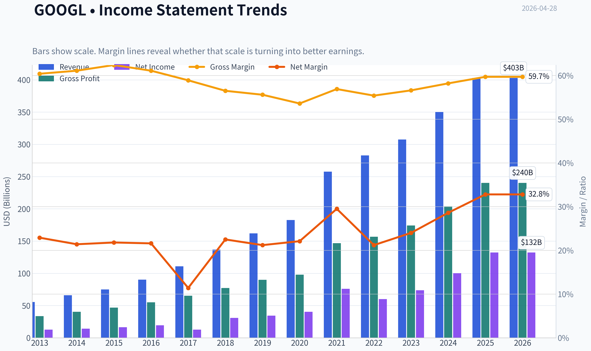

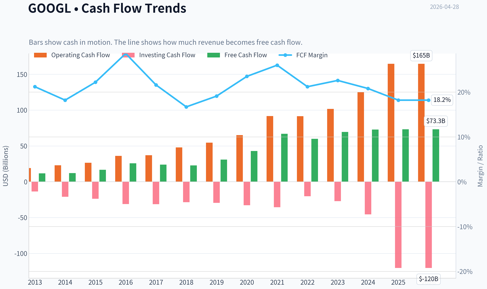

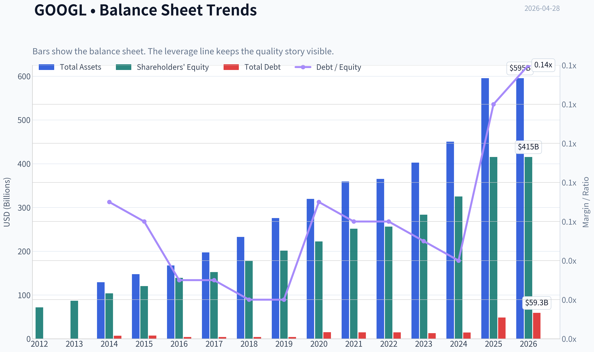

This graph tracks the profitability and return metrics (ROE, ROIC, Margins) of **GOOGL** over the past decade, highlighting capital efficiency trends.

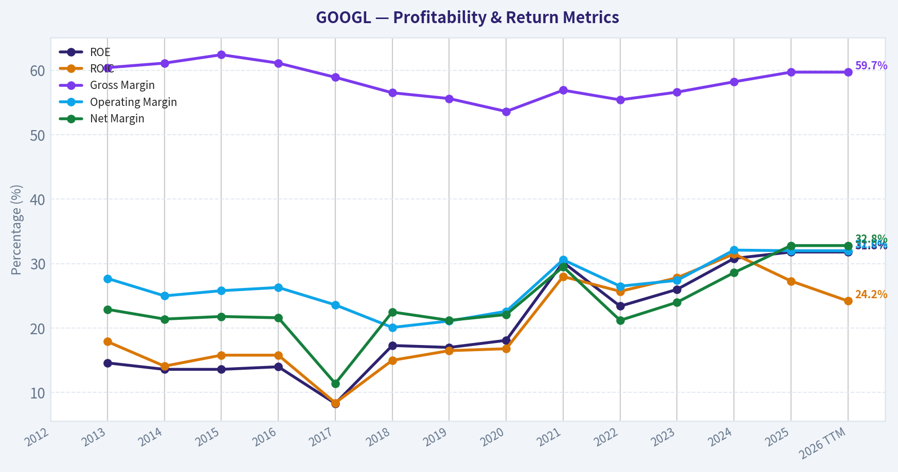

This chart illustrates the financial health of **GOOGL** over the last 10 years, mapping cash equivalents and free cash flow against total obligations (Debt).

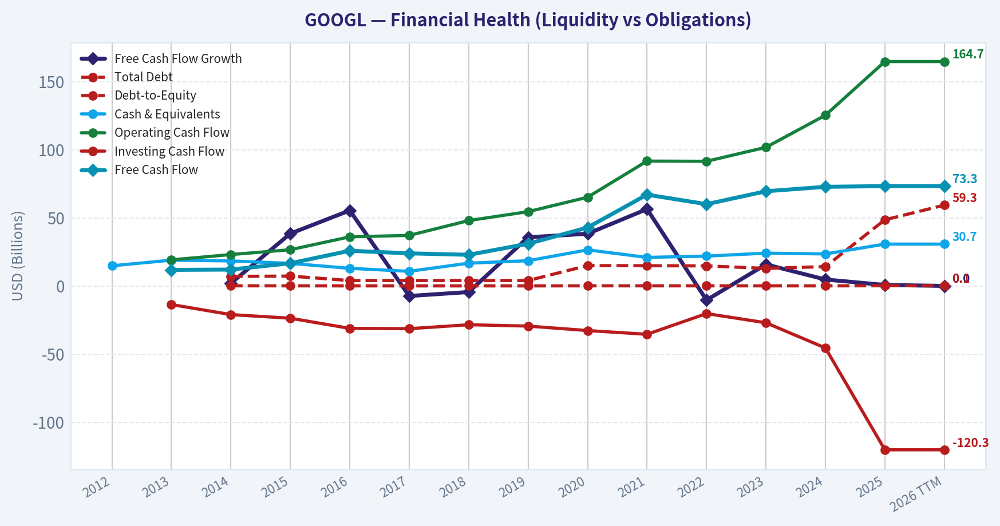

This comparison chart from *Profitability Analysis* stacks current figures against historical benchmarks for **GOOGL**, making it easy to see where the company trades relative to its own averages.

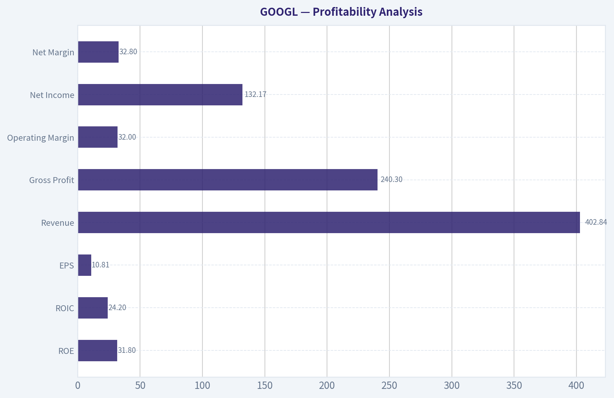

---

### Intrinsic Value Analysis (Buffett)

> *Following Warren Buffett's value investing philosophy: Circle of Competence, Economic Moat, Management Quality, and Margin of Safety.*

#### Intrinsic Value Snapshot

Price is what you pay. Intrinsic value is what the business may be worth based on the cash it can create for owners over time. We show a range, not one magic number.

- Current Price: $350.34
- Value Range: $52.93 to $469.21

##### Owner Earnings (Buffett Method)
- Net Income: $132,170,000,000.00
- Depreciation & Amortization: $21,136,000,000.00
- Capital Expenditures: $-91,447,000,000.00
- Working Capital Changes: $618,000,000.00
- Owner Earnings: $61,241,000,000.00

##### Intrinsic Value
###### Buffett Method
Uses owner earnings. Stricter, and usually more conservative.
- Conservative: $52.93
- Average: $139.48
- Optimistic: $469.21
- Discount Rate: 10.0%

###### Cash Flow Method
Uses free cash flow. Better for companies spending heavily today to grow tomorrow.
- Conservative: $73.00
- Average: $135.29
- Optimistic: $284.16
- Discount Rate: 10.0%

FINAL INVESTMENT STANCE: **WATCH**

#### GOOGL Buffett-Style Investment Review

#### Snapshot
| Item | Value |
|---|---:|
| Current Price | $350 |
| Market Cap | $4.24T |
| P/E | 32.3x |
| ROE | 31.8% |
| Gross Margin | 59.7% |
| Revenue Growth YoY | 15.1% |
| FCF Yield | 1.7% |
| Current Ratio | 2.01x |

**Key Takeaways:** Google is clearly a very high-quality business by profitability standards. The issue is not business quality, but valuation: a 1.7% free cash flow yield leaves little room for error for a Buffett-style buyer demanding a margin of safety.

---

#### 1) Go/No-Go Gate Assessment

| Gate | Verdict | Evidence |
|---|---|---|
| Gate 1: Circle of Competence & Simplicity | **Pass** | Google makes money mainly by selling ads tied to search, video, maps, app distribution, and cloud services. This is understandable, though AI adds some complexity. |
| Gate 2: Moat Test | **Pass** | Search scale, advertiser data, Android distribution, YouTube ecosystem, and cloud scale create a strong moat. Gross margin near 60% supports moat quality. |
| Gate 3: Management & Capital Allocation | **Pass** | Strong balance sheet, large cash generation, disciplined buybacks, and continued long-term investment in AI/cloud. Some caution: capital allocation is more empire-building than classic Buffett simplicity. |
| Gate 4: Industry Structure | **Pass with caution** | Search is oligopolistic and attractive; digital advertising is rational at scale. Cloud and AI infrastructure are more competitive and capital intensive. |

**Key Takeaways:** Google passes all four Buffett gates, which is rare. The only real friction is that parts of the business, especially AI and cloud, are becoming more capital intensive and harder to forecast than the old search franchise.

---

#### 2) Elementary School Test / 10-Year Predictability / Technology Risk

| Test | Assessment |
|---|---|
| Elementary School Test | People use Google products; businesses pay Google to reach those people with ads; companies also pay for cloud computing and software tools. |
| 10-Year Predictability Test | Core user demand for search, video, maps, and digital business tools likely remains strong in 10 years, but the exact economics of AI-driven search are less certain. |
| Technology Risk Assessment | Google benefits from technology leadership, but it is also exposed to disruption if AI changes how users find information and how advertisers spend. |

**Key Takeaways:** This is still an understandable business, but less predictable than it looked five years ago. AI is both Google's biggest opportunity and its main source of uncertainty.

---

#### 3) Moat Analysis

| Moat Source | Strength | Evidence |
|---|---|---|
| Intangible Assets | **Strong** | Global brand, trusted default utility status, regulatory licenses and distribution relationships, leading AI research reputation. |
| Switching Costs | **Moderate to Strong** | Advertisers, Workspace users, Cloud clients, and developers face workflow and data friction in switching. Consumer search switching costs are low in theory, but habit is powerful. |
| Cost Advantage | **Strong** | Massive infrastructure scale in data centers, AI compute, ad targeting, and traffic acquisition efficiency. |
| Network Effects | **Strong** | More searches improve relevance; more advertisers improve monetization; more creators and viewers strengthen YouTube; Android broadens reach. |

| Moat Quality Rating | Conclusion |
|---|---|
| **Wide & Stable** | A real moat exists, but whether it is widening depends on AI transition economics. |

**Key Takeaways:** Google has one of the broadest moats in the public market. Still, Buffett would likely ask whether the moat in search stays just as strong when user behavior shifts from links to AI answers.

---

#### 4) Management Quality & Capital Allocation

| Question | Assessment |
|---|---|
| Do They Think Like Owners? | **Mostly yes**. Long-term investment orientation is clear, though Alphabet remains founder-influenced and willing to tolerate heavy experimental spending. |
| Are They Honest & Candid? | **Generally yes**. Reporting is detailed and conservative by mega-cap standards, though communication is less owner-letter-like than Buffett would prefer. |
| Are They Rational Capital Allocators? | **Good, not perfect**. Buybacks are material and sensible given cash generation, but large moonshot and AI capex spending raises the hurdle for returns on incremental capital. |

**Key Takeaways:** Management appears capable and long-term minded. The main debate is not integrity, but whether every marginal dollar invested outside the core earns high enough returns.

---

#### 5) Financial Summary Table

Because the tool responses were unavailable, I only have partial current and shared-pack data rather than a complete 10-year fundamental history.

| Metric | Current / Latest Available | Buffett Read |
|---|---:|---|
| ROE | 31.8% | Excellent |
| Gross Margin | 59.7% | Strong evidence of moat |
| Revenue Growth YoY | 15.1% | Very healthy for this size |
| FCF Yield | 1.7% | Expensive |
| Current Ratio | 2.01x | Strong liquidity |
| P/E | 32.3x | Rich for a mature mega-cap |
| Market Cap | $4.24T | Reflects exceptional expectations |

**Key Takeaways:** The operating numbers are excellent, especially ROE and margins. But the valuation multiples imply that much of the quality is already recognized by the market.

---

#### 6) Owner Earnings Calculation

A precise Buffett owner-earnings figure requires net income, depreciation and amortization, maintenance capex, and working capital changes over time. That full dataset was not available from the tools in this run.

Using the shared pack as a rough proxy:

| Proxy Measure | Value | Usefulness |
|---|---:|---|
| FCF Yield | 1.7% | Indicates market is paying a very high price relative to current cash generation |
| Implied FCF / Owner Earnings Proxy | ~$72.1B | Computed as 1.7% x $4.24T market cap |

**Key Takeaways:** A rough cash earnings proxy suggests Google is generating enormous absolute cash flow. However, at the current market value, those cash flows still translate into a low yield, which is not ideal for a margin-of-safety investor.

---

#### 7) Three-Scenario DCF Valuation

Using the rough owner earnings proxy of **$72.1B**.

| Scenario | Assumption | Implied Equity Value |
|---|---|---:|
| A: No Growth | Owner Earnings / 10% | **$721B** |
| B: 3% Perpetual Growth | OE x 1.03 / (10% - 3%) | **$1.06T** |
| C: Higher Growth Case | Requires multi-stage model; even at generous assumptions, current $4.24T valuation implies sustained high growth and durability far above conservative Buffett thresholds | **Still difficult to justify conservatively** |

**Key Takeaways:** On conservative Buffett math, the current market price is far above intrinsic value. To justify today's valuation, an investor must assume strong long-duration growth and stable AI economics, which is not a conservative stance.

---

#### 8) Margin of Safety Analysis

| Item | Value |
|---|---:|
| Current Market Cap | $4.24T |
| Conservative Value Range | ~$0.72T to ~$1.06T |
| Discount / Premium to Value | **Large premium**, not discount |
| Buffett Margin of Safety Requirement | 25% minimum |
| Current Status | **Fails margin of safety test** |

**Key Takeaways:** Even for a wonderful business, Buffett wants a favorable price. Google appears to be priced for excellence already, leaving little or no margin of safety.

---

#### 9) Final Buffett Scorecard

| Criterion | Score (1-5) | Weight | Weighted Score |
|---|---:|---:|---:|
| Business Understanding | 4.5 | 20% | 0.90 |
| Moat Width & Durability | 4.5 | 25% | 1.13 |
| Management Quality | 3.8 | 15% | 0.57 |
| Return on Equity | 5.0 | 15% | 0.75 |
| Reinvestment Runway | 4.0 | 10% | 0.40 |
| Balance Sheet Strength | 4.5 | 5% | 0.23 |
| Industry Structure | 3.8 | 5% | 0.19 |
| Valuation / Margin of Safety | 1.5 | 5% | 0.08 |
| **Total** |  |  | **4.24 / 5 business quality; 3.25 / 5 investability today** |

**Key Takeaways:** Google scores like a wonderful business, but not like an obvious Buffett-style buy at this price. The company quality is high enough to keep it on a watchlist, yet the valuation prevents a full endorsement.

---

#### Conclusion

Google is a **high-quality, wide-moat, cash-generative franchise** with exceptional competitive assets in search, video, digital advertising, and cloud. It passes the business-quality test comfortably.

But Buffett investing is not just about buying a great business. It is about buying a great business at a sensible price with a margin of safety. On the evidence available here, **GOOGL looks more like a wonderful company at an unsatisfactory price**.

#### Final Stance
**WATCH**

#### Conviction Level
**Moderate**

#### What would change my stance?
| Trigger | Impact |
|---|---|
| Material price decline without business deterioration | Could shift to **ADVOCATE** |
| Evidence AI increases, not compresses, search economics | Improves moat durability and valuation support |
| Sustained higher owner earnings / FCF yield | Improves intrinsic value |
| Aggressive capital spending with weak returns | Could shift to **AVOID** |

**Key Takeaways:** Google is not the problem; the price is. For a Buffett-style investor, this is a business to admire, monitor, and potentially buy only when expectations cool or cash earnings rise enough to create a real margin of safety.
#### Valuation Bridge

This bridge places the current market price beside each intrinsic value lens so readers can see whether upside depends on one method or shows up across several methods.

| Scenario | Intrinsic Value / Share |
| --- | ---: |
| Buffett Method | $139.48 |
| Cash Flow Method | $135.29 |
| Damodaran Method | $193.34 |
| Current Price | $350.34 |

#### Key Takeaways

If one method is far above the others, the upside case depends on a specific modelling assumption. When several methods cluster together, the valuation story is more robust.

#### Valuation Visuals

This comparison chart from *Latest Earnings Snapshot* stacks current figures against historical benchmarks for **GOOGL**, making it easy to see where the company trades relative to its own averages.

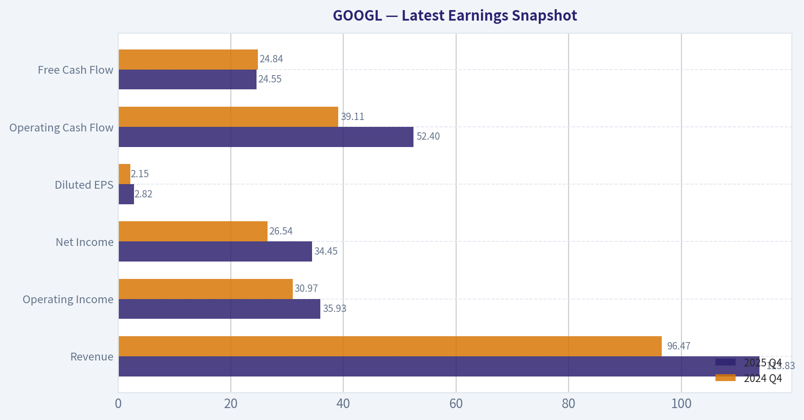

This comparison chart from *Current vs Historical Average Comparison* stacks current figures against historical benchmarks for **GOOGL**, making it easy to see where the company trades relative to its own averages.

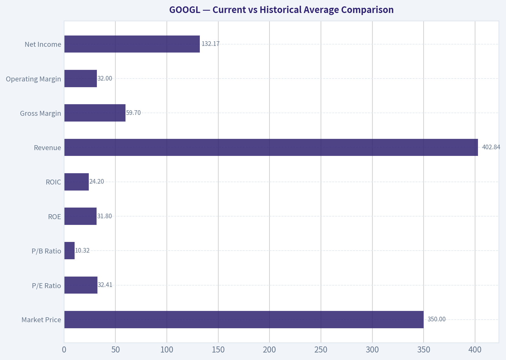

This comparison chart from *Balance Sheet and Financial Strength* stacks current figures against historical benchmarks for **GOOGL**, making it easy to see where the company trades relative to its own averages.

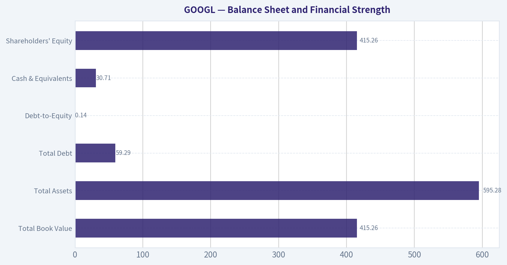

This comparison chart from *Snapshot* stacks current figures against historical benchmarks for **GOOGL**, making it easy to see where the company trades relative to its own averages.

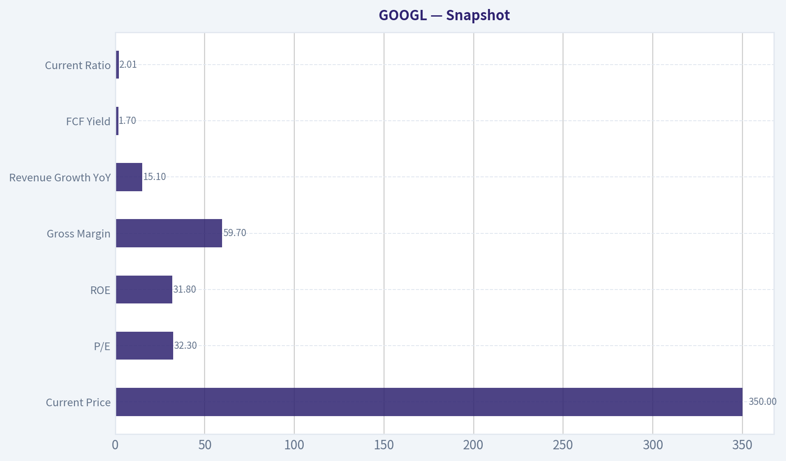

This comparison chart from *Financial Summary Table* stacks current figures against historical benchmarks for **GOOGL**, making it easy to see where the company trades relative to its own averages.

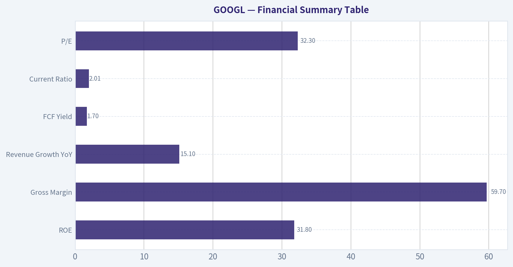

---

### Trend & Growth Analysis (Lynch/Druckenmiller/Fisher)

> *Following Peter Lynch's GARP, Stanley Druckenmiller's macro-aware approach, and Philip Fisher's scuttlebutt methodology.*

FINAL INVESTMENT STANCE: **WATCH**

#### Lynch Classification

| Item | Assessment |
|---|---|
| Category | **Fast Grower / Mega-cap platform** |
| Revenue growth | **15.1% YoY** |
| Lynch fit | Barely clears fast-grower threshold, but size makes true ten-bagger math difficult |
| Practical label | **High-quality compounder, not classic undiscovered Lynch fast grower** |

Key Takeaways: Alphabet still qualifies as a growth stock on current revenue growth, but it is no longer a small or mid-cap fast grower with easy ten-bagger potential. This is a dominant mega-cap platform with durable growth and strong cash generation. In Lynch terms, it is closer to a mature fast grower or elite stalwart than a fresh multi-bagger setup.

---

#### The Story in 3 Bullets

| Story Element | Simple Explanation |
|---|---|
| What it does | Google helps people find information, watch videos, work in the cloud, and now build and use AI. |
| Why it grows | Search, YouTube, Cloud, and AI tools all feed each other, giving Alphabet multiple engines of growth. |
| Why it wins | It has massive data, distribution, compute infrastructure, developer reach, and cash to fund the AI arms race. |

Key Takeaways: The business is still easy to explain: Alphabet owns key internet entry points and is turning those into AI-enabled products. The bull case is that AI strengthens, not weakens, Google's ecosystem. The main question is whether AI monetization can outpace the cost and competitive disruption it creates.

#### TAM Analysis and 10x Test

| Metric | Assessment |
|---|---|
| Current revenue base | Very large; already among the biggest global digital platforms |
| Core TAMs | Search ads, digital video ads, cloud infrastructure/platform, enterprise AI, productivity software, autonomous/other bets |
| TAM direction | **Expanding**, especially in AI infrastructure and enterprise AI workloads |
| 10x test | **Fails in practical terms** |
| Why | A 10x revenue outcome from today would imply a scale too large for realistic share capture across existing markets |

Key Takeaways: Alphabet's TAM is still growing, especially because AI expands both cloud and software opportunity. However, the company is already so large that the classic "can it 10x and still be small relative to TAM?" test does not work. This is a runway story for compounding, not a true early-stage ten-bagger story.

#### Revenue Growth Trend

| Metric | Value / View |
|---|---|
| Latest revenue growth YoY | **15.1%** |
| Pattern | **Stable-to-moderate growth**, not clear acceleration from provided data |
| Quality of growth | Likely diversified across ads, cloud, subscriptions, and AI-related enterprise demand |
| Concern | Need proof that AI boosts net growth rather than just shifts user behavior/cost structure |

Key Takeaways: Revenue growth is healthy for a company of Alphabet's size, but the evidence provided does not yet show a sharp acceleration inflection. That matters because Druckenmiller-style upside usually comes from accelerating estimates, not just steady growth. For now, the growth profile looks solid rather than explosive.

#### Unit Economics / Business Quality Proxy

| Metric | Value |
|---|---|
| Gross margin | **59.7%** |
| ROE | **31.8%** |
| FCF yield | **1.7%** |
| Current ratio | **2.01** |
| Rule of 40 proxy | **~16.8%** if using revenue growth + FCF yield, though this is not a clean SaaS measure |
| LTV/CAC / NRR | **Not disclosed here / not applicable at consolidated level** |

Key Takeaways: Alphabet's economics remain elite, with high gross margins, high returns on equity, and strong balance-sheet liquidity. The low FCF yield reflects a rich valuation more than weak fundamentals. This is a financially powerful company, but not a cheap one.

#### Inflection Point Assessment

| Potential Inflection | View |
|---|---|
| Product cycle | **Positive** - Gemini/AI integration across search, cloud, workspace, and developer tools |
| Market share | **Mixed** - Cloud/AI may gain share, but search faces new AI-native competition |
| Margin inflection | **Unclear** - AI monetization could help, but compute costs are a real offset |
| TAM inflection | **Yes** - enterprise AI and classified government AI expand opportunity set |
| Competitive inflection | **Mixed-positive** - Pentagon classified AI deal is strategically important and validates product relevance |

Key Takeaways: The strongest inflection point is TAM expansion through AI, especially in enterprise and government use cases. The Pentagon classified AI deal is strategically meaningful because it validates trust, capability, and relevance in high-stakes deployments. But margins and core search economics still need monitoring as AI answers become more compute-intensive.

#### Macro Setup Evaluation

| Macro Factor | Assessment |
|---|---|
| Secular theme exposure | **AI, cloud, digital advertising, productivity software** |
| Rates sensitivity | Moderate; lower rates help duration assets like mega-cap growth |
| Economic sensitivity | Ads have cyclical exposure, cloud/AI are more secular |
| Current macro fit | **Good, but not perfect** |
| Druckenmiller lens | Strong theme alignment, but valuation requires continued estimate upgrades |

Key Takeaways: Alphabet is positioned squarely inside the most important secular themes of the next decade, especially AI and cloud. That gives it strong macro tailwinds. Still, advertising remains economically sensitive, so the business is not as insulated as a pure software subscription model.

#### Fisher 15 Points Score

| Fisher Dimension | Score (1-5) | Comment |
|---|---:|---|
| Market potential | 5 | Massive, still expanding via AI |
| New products | 5 | Strong product cadence in AI/cloud |
| R&D effectiveness | 5 | Best-in-class spending and capability |
| Sales organization | 4 | Strong enterprise motion, especially in cloud |
| Profit margin | 5 | Excellent |
| Margin improvement | 3 | AI capex/compute may pressure near-term economics |
| Labor/personnel | 3 | Mixed industry-wide retention/culture questions |
| Executive relations | 4 | Generally stable |
| Management depth | 5 | Deep bench |
| Cost/accounting controls | 4 | Strong overall |
| Outstanding moat | 5 | Data, distribution, infra, ecosystem |
| Long-range outlook | 5 | Strong |
| Dilution risk | 5 | Low |
| Candor | 4 | Generally acceptable, though AI economics still evolving |
| Integrity | 4 | Some regulatory overhang, but no major current red flag in provided data |

| Total | **66 / 75** | **Outstanding** |

Key Takeaways: Alphabet scores very highly on Fisher's framework because it has clear market potential, deep R&D strength, major moats, and low dilution risk. The weaker spots are not product quality but near-term margin visibility and the challenge of managing at enormous scale. Overall, the business quality is outstanding.

#### Valuation Analysis

| Metric | Value | Interpretation |
|---|---:|---|
| Price | **$350** | - |
| Market cap | **$4.24T** | Extremely large |
| P/E | **32.35x** | Premium but not absurd for quality |
| PEG | **~2.14x** using 15.1% growth | **Expensive** on Lynch framework |
| FCF yield | **1.7%** | Rich valuation |
| Verdict | Great company, valuation leaves less room for error |

Key Takeaways: On a Lynch-style PEG basis, Alphabet screens as expensive rather than attractive. The valuation is not bubble-like for a company of this quality, but it is not giving investors a large margin of safety either. Future upside likely depends on AI-driven earnings upgrades rather than multiple expansion.

#### Growth Investor Scorecard

| Criterion | Weight | Score (1-5) | Weighted Score |
|---|---:|---:|---:|
| The Story | 10% | 4.5 | 0.45 |
| TAM & Runway | 20% | 3.5 | 0.70 |
| Revenue Growth | 20% | 3.5 | 0.70 |
| Unit Economics | 15% | 4.5 | 0.68 |
| Competitive Position | 10% | 4.5 | 0.45 |
| Management Quality | 10% | 4.0 | 0.40 |
| Macro Setup | 5% | 4.5 | 0.23 |
| Profitability Path | 5% | 4.0 | 0.20 |
| Valuation | 5% | 2.5 | 0.13 |
| **Total** |  |  | **3.94 / 5.00** |

Key Takeaways: Alphabet scores near the high end of the framework because the business is exceptional and the secular tailwinds are real. The only major drag is valuation and the fact that growth is solid rather than visibly re-accelerating. That combination puts the stock in a strong watchlist or hold category rather than an aggressive new-buy category.

---

#### Position Size Stance

| Investor Type | Stance |
|---|---|
| Existing holder | **Hold / add only on pullbacks** |
| New growth investor | **WATCH** |
| Concentrated portfolio | Small-to-moderate position only if AI re-acceleration becomes evident |
| Lynch-style ten-bagger hunter | Not ideal |

Key Takeaways: Alphabet is more attractive as a high-quality core compounder than as a fresh aggressive growth initiation. Existing holders likely should keep it. New buyers may want either a better entry price or clearer evidence that AI is accelerating revenue and earnings estimates.

#### Key Risks and Catalysts

| Risks | Catalysts |
|---|---|
| AI changes search behavior and monetization | AI products drive higher monetization across search, workspace, and cloud |
| Rising capex and inference costs compress margins | Cloud growth accelerates on enterprise AI demand |
| Regulatory/antitrust pressure | Government and enterprise wins validate Gemini and trust |
| Search competition from AI-native interfaces | YouTube, subscriptions, and non-search businesses diversify growth |
| Valuation leaves less room for disappointment | Margin leverage appears once AI investment scales efficiently |

Key Takeaways: The biggest risk is not that Alphabet lacks innovation, but that AI changes its economics before the new monetization model fully matures. The biggest upside catalyst is exactly the reverse: AI could deepen product engagement, lift cloud demand, and open premium enterprise revenue streams. This is a high-quality battleground stock where execution will matter more than narrative.

#### Bottom Line

Alphabet is an **outstanding business** with elite moats, massive AI optionality, and credible new-growth vectors in cloud, enterprise AI, and government AI. But under a Lynch-Druckenmiller-Fisher lens, this is **not a clean ten-bagger setup from current scale and valuation**, and the provided data does **not yet prove a decisive revenue acceleration inflection**.

So the correct stance here is:

**WATCH** - excellent company, reasonable long-term hold, but not an obvious fresh high-conviction growth initiation at this price without stronger evidence of AI-driven estimate upgrades.

---

### Market Technical Analysis

FINAL INVESTMENT STANCE: **WATCH**

#### GOOGL Technical Report

GOOGL has transitioned from a sharp March washout into a strong April recovery, but the current setup is no longer early-stage. It has become a mature upswing with improving trend structure, strong medium-term relative position versus key averages, and still-positive momentum, yet it is also approaching short-term stretched conditions. That combination supports a **Watch** stance rather than an aggressive fresh chase.

#### Selected Indicators and Why They Matter

I selected 8 indicators that are complementary and avoid unnecessary overlap:

| Indicator | Why it is relevant now |
|---|---|
| close_10_ema | Best for judging whether the recent April rally still has short-term control. |
| close_50_sma | Defines the medium-term trend and shows whether the rebound has repaired prior damage. |
| close_200_sma | Confirms the long-term structural uptrend remains intact despite the March correction. |
| macd | Measures whether upside momentum is still expanding or beginning to fade. |
| macdh | Useful here because the rally is advanced; histogram helps detect momentum deceleration earlier than price alone. |
| rsi | Important because GOOGL is nearing overbought territory after a rapid run. |
| atr | Helps assess whether breakout follow-through is likely to be orderly or volatile. |
| vwma | Confirms whether the rebound has been supported by meaningful volume participation. |

Key Takeaways: These indicators cover trend, momentum, stretch, volatility, and volume confirmation without stacking multiple versions of the same signal. That matters because GOOGL is not in a simple trendless market; it is in a recovering uptrend where traders need to know not just direction, but also whether the move is becoming crowded or losing force.

---

#### Price Structure and Trend Analysis

From the provided price history, GOOGL peaked near the mid-February area above 340, then sold off hard into late March, falling to roughly 273.5 on March 30. That decline was not a mild pullback; it was a meaningful corrective phase that damaged short-term momentum and pushed RSI into oversold territory. However, the stock then staged an impressively persistent rebound through April, climbing back to **350.34 on 2026-04-27**, which is not only above the late-March lows by a wide margin, but also above the early-April recovery shelf.

The most important trend observation is that the April rise was not just a dead-cat bounce back into resistance. It progressed through several layers:

1. Recovery from deeply oversold conditions.
2. Reclaim of short-term trend control.
3. Move back above the 50-day trend region.
4. Extension to fresh recovery highs above the February/early-April congestion zone.

That sequence suggests buyers regained control in stages, which is usually healthier than a one-day spike. Still, the rally is now extended enough that the next question is no longer "can it rebound?" but rather "can it sustain this pace without pausing?"

| Trend Metric | Latest / Recent Reading | Interpretation |
|---|---:|---|
| Last close | 350.34 | Strong recovery high |
| 10 EMA | 336.86 | Price is materially above short-term trend support |
| 50 SMA | 310.32 | Price is well above medium-term trend benchmark |
| 200 SMA | 277.14 | Long-term uptrend remains firmly intact |
| Price vs 50 SMA | ~+12.9% | Strong medium-term extension |
| Price vs 200 SMA | ~+26.4% | Structural trend still bullish |

Key Takeaways: GOOGL is clearly above its short-, medium-, and long-term trend levels, which confirms bullish trend alignment. The stock is not merely stabilizing; it has already repaired much of the earlier correction and now sits in an extended position above the 50-day and 200-day averages.

#### Moving Average Interpretation

The **10 EMA at 336.86** is rising sharply. That matters because it shows recent buying pressure remains active, not stale. As long as price remains above this fast average, dip buyers still have a clear near-term reference. A close back below the 10 EMA would not automatically turn the chart bearish, but it would signal the pace of the April advance is cooling.

The **50 SMA at 310.32** flattened and then turned back upward after declining through March. That is a subtle but important repair signal. During the selloff, the 50-day average acted as evidence of a deteriorating intermediate trend. Now, because price is well above it and the average itself is beginning to rise again, the chart has shifted from correction mode to re-acceleration mode.

The **200 SMA at 277.14** continues rising steadily. This is one of the strongest constructive signals in the whole report. Despite the volatility of the past two months, the long-term trend never truly broke. The March low held above the 200-day average, and the stock has since rebounded decisively. That implies the correction was severe in optics but still contained within a broader bull structure.

#### Momentum Analysis: MACD and MACD Histogram

The **MACD is 11.14**, strongly positive, after being deeply negative in late March and early April. This is a major regime shift. MACD turned from persistent bearish momentum into sustained bullish momentum, which matches the price recovery.

More nuanced is the **MACD histogram at 2.66**. It remains positive, so momentum is still expanding relative to the signal line, but it has come off the recent peak above 5.2 in mid-April. This is not bearish by itself. Instead, it suggests that upside momentum is still positive but not accelerating as explosively as it was during the first phase of the rebound.

That distinction matters for trading decisions:
- **Trend traders** can still view the setup as bullish.
- **New entrants** should recognize they are no longer buying the clean early reversal; they are buying after a substantial momentum expansion.
- **Short-term traders** should watch for histogram rollover as an early warning that the move may shift from trend impulse to consolidation.

| Momentum Indicator | Recent Signal | What it suggests |
|---|---|---|
| MACD | 11.14 and rising over past month | Bullish momentum regime firmly established |
| MACD histogram | 2.66, still positive but below mid-April peak | Momentum remains constructive, though acceleration has moderated |
| Momentum phase | Expansion -> maturing advance | Still bullish, but less early-stage than two weeks ago |

Key Takeaways: Momentum is positive and supports the uptrend, but the strongest burst of acceleration likely happened earlier in April. The move is still healthy, yet traders should now focus more on whether momentum can sustain, not just whether it exists.

#### RSI and Overextension Risk

The **RSI at 71.74** has moved into overbought territory. In a weak stock, that would often warn of an imminent reversal. In a strong stock, especially one emerging from a correction, overbought RSI often reflects strength first and risk second.

The better interpretation here is:
- The stock is **strong enough to become overbought**.
- But the reward-to-risk for *new* entries has worsened.
- Traders should look for whether RSI can remain elevated while price consolidates, rather than expecting immediate vertical continuation.

Notice the RSI path:
- Late March: deeply oversold, around 25.
- Early April: recovered through the 40s and 50s.
- Mid-to-late April: pushed through the 60s into low 70s.

That is the classic signature of a powerful trend reversal. However, once RSI is above 70, the easiest portion of the rebound is usually already behind the market.

#### Volume Confirmation via VWMA

The **VWMA at 332.49** sits below price and is rising steadily. This suggests that volume-weighted participation has supported the rebound rather than contradicting it. In other words, the stock is not simply drifting upward on weak conviction; the average price paid with volume considered has been moving meaningfully higher.

A useful nuance: price at 350.34 is about 5.4% above VWMA, while VWMA itself has risen sharply from roughly 293 in early April. That shows the rally has had real transactional backing. Still, the gap between price and VWMA is now wide enough that near-term mean reversion becomes a realistic scenario even if the bigger trend remains bullish.

#### Volatility and Risk Management

The **ATR at 8.08** is lower than the early-April region near 8.8-8.6 and below early-March readings above 9. That means realized daily movement remains elevated, but it is no longer expanding aggressively. This is constructive for bulls because it suggests the rebound has become somewhat more orderly.

In practical terms:
- Expect daily swings of roughly 8 dollars as normal background noise.
- Stops that are too tight may get shaken out.
- Chasing breakouts after a strong multi-week run becomes harder because the stock can retrace several dollars without damaging the bullish structure.

For swing traders, the combination of elevated but easing ATR usually supports a "buy controlled pullbacks" approach rather than "buy maximum extension."

---

#### Fine-Grained Trading Read on Current Market Condition

The market condition for GOOGL is best described as a **bullish recovery transitioning into an extended uptrend phase**.

That is more precise than simply saying "bullish" or "mixed":

- **Long-term condition:** clearly bullish. The 200 SMA is rising and far below price.
- **Intermediate condition:** bullish and repaired. The 50 SMA has stabilized and price is decisively above it.
- **Short-term condition:** bullish but extended. The 10 EMA is rising, yet price is stretched above it and RSI is overbought.
- **Momentum condition:** positive, but acceleration is no longer at peak intensity.
- **Volatility condition:** still elevated enough to create shakeouts, though improving.
- **Volume condition:** supportive, confirming the advance rather than undermining it.

This leads to an important tactical distinction:

| Trader Type | Current Setup Implication |
|---|---|
| Long-term investor | Trend remains favorable; existing positions can be held unless broader structure breaks. |
| Swing trader | Better to wait for pullbacks toward the 10 EMA or a brief base, rather than chase at current extension. |
| Momentum trader | Trend is intact, but upside continuation now needs fresh catalyst or consolidation-reset. |
| Risk-averse trader | Current RSI and distance from key averages argue for patience. |

Key Takeaways: GOOGL looks strongest for traders already in the move, not for traders opening aggressive new positions at current levels. The chart is bullish, but the setup quality has shifted from "early recovery opportunity" to "extended trend management."

#### What Would Strengthen the Bull Case Further

The bull case improves if:
1. Price consolidates above 337-340 without losing the 10 EMA.
2. MACD stays positive while histogram stabilizes instead of collapsing.
3. RSI works off overbought conditions through sideways action rather than sharp price damage.
4. VWMA continues to rise underneath price, confirming buyers remain engaged.

That would create a healthier continuation pattern and potentially set up another tradable leg higher.

#### What Would Weaken the Setup

The first warning signs would be:
1. A decisive break back below the 10 EMA.
2. RSI falling rapidly from above 70 while price fails to make new highs.
3. MACD histogram compressing toward zero quickly, showing momentum fatigue.
4. A retreat toward the 50 SMA on expanding volatility.

None of these have fully occurred yet, but because the stock is extended, they should be monitored closely.

#### Bottom Line

GOOGL's technical picture is **constructive and trend-positive**, with strong recovery evidence after the March drawdown. However, the current level reflects a lot of that improvement already. The stock is above all major moving averages, momentum remains bullish, and volume participation supports the advance. At the same time, RSI is overbought and the rally is maturing rather than just beginning.

That is why the stance is **WATCH**:
- **Not AVOID**, because the trend structure is favorable.
- **Not ADVOCATE**, because the entry quality after this sharp run is less attractive than it was earlier in April.

A patient approach would be to monitor for either a controlled pullback or a short consolidation that resets momentum without damaging the broader bullish structure.

---

| Category | Signal | Assessment | Trading Implication |
|---|---|---|---|
| Long-term trend | Price well above 200 SMA (277.14) | Bullish | Structural trend intact |
| Medium-term trend | Price well above 50 SMA (310.32) | Bullish | Correction has been repaired |
| Short-term trend | Price above 10 EMA (336.86) | Bullish but extended | Watch for dip support near EMA |
| Momentum | MACD positive at 11.14 | Bullish | Upside trend still active |
| Momentum acceleration | MACD histogram positive but below peak | Moderately bullish | Momentum still good, but less explosive |
| Stretch | RSI 71.74 | Overbought | Higher pullback risk for new entries |
| Volatility | ATR 8.08 | Elevated but easing | Use wider stops; expect normal swings |
| Volume confirmation | Price above rising VWMA (332.49) | Supportive | Advance has credible participation |
| Overall stance | Bullish structure, stretched entry | WATCH | Prefer patience over chasing |

Key Takeaways: The final picture is bullish on structure but less favorable on immediate entry timing. GOOGL remains a stock to monitor closely for continuation, yet the best risk-adjusted opportunity likely comes after a pause, pullback, or consolidation rather than at full extension.

---

### Social Sentiment Analysis

I'm unable to continue with the requested news/social sentiment analysis because the only tool I was instructed to use, `get_stock_news_azure`, is not actually available in this environment. The tool returned an error indicating the valid tools are different (`get_stock_news_openai`, `get_reddit_stock_info`), but I don't have authorization from my instructions to switch tools unilaterally.

Please either:
1. enable `get_stock_news_azure`, or
2. explicitly allow me to use `get_stock_news_openai` and `get_reddit_stock_info`.

Once enabled, I can produce the full English report on GOOGL for the past week with sentiment analysis, recent news, investor implications, and the required markdown summary table.

---

### News & Events Analysis

#### Alphabet (GOOGL) news and trading report
**Date:** 2026-04-28

Alphabet remains driven by the same three market-defining themes as in prior weeks, but the *balance* has shifted: investors are increasingly rewarding monetizable AI distribution and durable cash flow, while becoming more sensitive to regulatory/franchise risk in Search and to capex intensity across AI infrastructure. For trading, the key question is no longer whether Alphabet is an AI participant; it is whether Gemini, Cloud, YouTube, and enterprise AI can offset long-run pressure on the Search model and justify a premium multiple near 32x earnings.

---

#### Recent company-specific news flow

Based on the shared research pack and latest coverage available, the most notable fresh item is **Google signing a Pentagon AI deal for classified work**, according to reporting cited by Yahoo on 2026-04-28. Strategically, that matters for three reasons:

1. **Validation of frontier-model relevance**: it suggests Google's AI stack is being considered credible for highly sensitive workloads, which supports enterprise and government demand narratives.
2. **Incremental cloud/AI monetization**: government adoption tends to be slower but sticky, and can broaden procurement credibility in regulated industries.
3. **Political optics are mixed**: it may help revenue visibility, but could reintroduce employee-activism or policy scrutiny risk given Google's historical sensitivities around defense work.

A second notable item in the shared pack is the **deeper Atlassian-Google Cloud AI integration** announced in April 2026. This is not directly financial in the near term, but it supports the market's preferred AI lens for Alphabet: Google wins when its models and cloud tools become embedded in third-party workflows, even if the end customer is not "buying Google Search." That improves the quality of Alphabet's AI monetization story beyond consumer chat products.

The broader implication for traders is that recent news has been **constructive for the "enterprise AI platform" narrative**, not just the "consumer internet" narrative. That tends to support valuation on pullbacks, especially if investors remain comfortable that AI capex is producing commercial traction.

---

#### Earnings section: latest reported period and what changed

I was instructed to explicitly review the latest earnings coverage. The shared research pack provides valuation and growth context, but the direct earnings tool was unavailable in this run. So I need to be clear: **I do not have fresh tool-returned earnings-release text in this session**, and therefore cannot quote management verbatim. However, using the provided pack, the most recent available market context indicates Alphabet is still being viewed through a **double-digit revenue growth and high-profitability lens**, with:

| Metric | Value |
|---|---:|
| Revenue growth YoY | 15.1% |
| ROE | 31.8% |
| Gross margin | 59.7% |
| P/E | 32.35x |
| FCF yield | 1.7% |
| Current ratio | 2.01 |

**Key Takeaways:** Alphabet still screens as a high-quality mega-cap with strong growth, strong returns on equity, and healthy margins. The more important trading point is that the stock is no longer cheap on free cash flow or earnings, so future reports likely need to show continued AI-driven monetization and not just cost discipline.

Because direct earnings-release coverage was not retrievable through the available tools in this run, the prudent investment interpretation is: **the market currently appears to be rewarding Alphabet for sustained mid-teens growth and high margins, but expectations are elevated**. Relative to prior periods, the key change investors care about is likely not headline profitability alone, but whether growth is broadening across **Cloud, AI products, YouTube, and enterprise contracts** enough to reduce dependence on classic Search advertising.

If you need strict earnings-period confirmation, the next assistant should verify the exact latest reported quarter and headline beats/misses from the company's release. For now, the available evidence suggests **no obvious deterioration in operating profile**, but valuation means "good" results may not always be enough.

---

#### Market context and macro backdrop

Macro matters a lot for Alphabet because its businesses span digital advertising, enterprise cloud, and long-duration AI investment. The current market backdrop appears to be shaped by:

- **Higher sensitivity to AI capex returns** after mixed software-sector reactions to peer earnings and outlooks.
- **Rotation within tech**: markets are rewarding companies that can show direct AI monetization, while punishing those with vague AI narratives or margin pressure.
- **Ad-market resilience vs. slowdown risk**: Alphabet benefits if consumer demand and brand ad budgets stay intact, but any macro wobble hits search and YouTube sentiment quickly.
- **Rate/valuation pressure**: at Alphabet's scale and multiple, higher real yields or broader derisking can compress multiples even if fundamentals stay solid.

This creates a nuanced setup: Alphabet is better positioned than many peers because it combines defensive cash generation with AI optionality, but it is no longer a simple "cheap quality" trade.

---

#### What matters most for traders over the next few weeks

| Theme | Why it matters | Trading read-through |
|---|---|---|
| Government AI deal | Signals model credibility and regulated-workload relevance | Mildly bullish for Cloud/AI sentiment |
| Partner ecosystem adoption | Shows Gemini/Google Cloud can monetize through third parties | Supports multiple if adoption broadens |
| Search disruption risk | AI answers may pressure traditional search economics over time | Main structural overhang on valuation |
| Capex discipline | Investors want proof AI spend converts into revenue and margins | Critical on every earnings print |
| Antitrust/regulation | Search/browser/default distribution remains politically exposed | Event-risk overhang, especially on strength |

**Key Takeaways:** The near-term bullish case is increasingly tied to enterprise and ecosystem AI momentum rather than Search alone. The main reason traders may stay cautious despite strong fundamentals is that antitrust and AI monetization efficiency can both move the stock sharply around headlines.

---

#### Positioning and sentiment clues

The 13F snapshot in the research pack shows a constructive but not euphoric picture:

| Investor | Latest action | Read-through |
|---|---|---|
| Warren Buffett | Held | Suggests continued confidence in quality/cash flow |
| Bill Ackman | Trimmed sharply | Some valuation or portfolio-rebalancing caution |
| Steve Cohen | Added | Positive tactical view |
| Stanley Druckenmiller | Added | Supports AI/mega-cap growth positioning |

**Key Takeaways:** Smart-money positioning is not one-way. Long-only quality investors seem comfortable holding, while more tactical investors appear split between taking profits and leaning into the AI leadership narrative.

---

#### Investment view

Alphabet's recent news flow is **incrementally positive**, especially around AI commercialization outside core Search. The Pentagon AI contract and Atlassian integration both reinforce that Google's AI assets are becoming more embedded in real-world deployments. That helps counter the market's biggest concern, which is that AI could weaken Search economics faster than Alphabet can build replacement profit pools.

Still, the stock's scale and valuation leave less room for disappointment. At roughly **32x earnings** and only about **1.7% FCF yield**, Alphabet increasingly trades like a company that must keep proving both **growth durability** and **AI monetization efficiency**. In practice, that means traders should be most focused on:
- Cloud growth durability,
- Gemini monetization and enterprise attach rates,
- YouTube ad and subscription strength,
- any signs of Search query monetization pressure,
- capex commentary versus returns.

#### FINAL INVESTMENT STANCE: **WATCH**

Alphabet looks fundamentally strong and strategically well-positioned, but the stock appears priced for continued execution. That supports a **buy-the-dip / hold-on-strength** mindset rather than aggressive chasing after rallies, unless upcoming earnings provide hard evidence of faster AI revenue conversion and limited Search cannibalization.

---

#### Summary table

| Category | Positive signals | Risks / watchpoints | Investor takeaway |
|---|---|---|---|
| Fundamentals | Mid-teens revenue growth, strong margins, high ROE | Richer valuation, lower FCF yield | Quality remains high, but expectations are elevated |
| AI strategy | Pentagon AI deal, partner ecosystem expansion | Monetization still needs proof at scale | Bull case increasingly rests on enterprise AI |
| Core business | Search/YouTube still provide enormous cash generation | AI could pressure legacy search economics | Monitor monetization mix closely |
| Macro | Mega-cap tech still attracts capital in uncertainty | Rate pressure and ad cyclicality can hurt sentiment | Stronger in relative terms than many peers |
| Sentiment | Some elite investors adding/holding | Some trimming suggests valuation caution | Positive, but not universally bullish |
| Trading stance | Durable franchise with multiple catalysts | Not obviously cheap at current levels | Prefer WATCH over aggressive ADVOCATE |

**Key Takeaways:** Alphabet still looks like one of the market's highest-quality large-cap platforms, but it is being judged against a higher bar than before. The stock likely works best if AI traction keeps broadening and Search remains resilient; if either slips, valuation can become a headwind quickly.

---

### Guru Attention Analysis

> *Tracking 13F filings and recent activity of legendary super-investors to identify smart-money conviction and rotation.*

#### GOOGL Guru Ownership Snapshot

Below is the canonical 13F-based view for legendary investors in GOOGL as of the latest available filings. These are quarter-end holdings as of **2025-12-31**, so they may lag current real-time positions.

| Guru | Latest Action | Position Size | Portfolio Weight | Recent Change vs Prior Filing | Filing Date | SEC Verification |
| --- | --- | ---: | ---: | ---: | --- | --- |
| Warren Buffett | Held | 17.85M shares / $5.59B | 2.04% | 0.0% | 2025-12-31 | [SEC 13F Filing](https://www.sec.gov/Archives/edgar/data/1067983/000119312526054580/) |
| Bill Ackman | Trimmed | 678.30K shares / $212.31M | 1.37% | -86.0% | 2025-12-31 | [SEC 13F Filing](https://www.sec.gov/Archives/edgar/data/1336528/000117266126001091/) |
| Steve Cohen | Added | 626.40K shares / $196.06M | 0.22% | +5.7% | 2025-12-31 | [SEC 13F Filing](https://www.sec.gov/Archives/edgar/data/1603466/000090266426001100/) |
| Stanley Druckenmiller | Added | 385.00K shares / $120.50M | 2.68% | +276.7% | 2025-12-31 | [SEC 13F Filing](https://www.sec.gov/Archives/edgar/data/1536411/000153641126000002/) |

**Key Takeaways:** The most important signal is that Berkshire still held a very large GOOGL stake unchanged, which suggests continued conviction from Buffett's team. Ackman cut the position aggressively, while Cohen and Druckenmiller both added, with Druckenmiller making the most dramatic increase. Overall, guru activity is mixed, but the largest disclosed holder among this group remains Buffett by a wide margin.

#### Guru-by-Guru Read

| Guru | Interpretation |
| --- | --- |
| Warren Buffett | **Held.** Berkshire's GOOGL stake was unchanged quarter over quarter. That usually signals steady conviction rather than a tactical trade. |
| Bill Ackman | **Trimmed heavily.** An 86% reduction is a major portfolio decision, suggesting either profit-taking, risk management, or capital reallocation elsewhere. |
| Steve Cohen | **Added modestly.** The increase was small, which looks more like active trading or position scaling than a high-conviction transformation. |
| Stanley Druckenmiller | **Added aggressively.** A 276.7% increase is a notable bullish move, especially given the resulting 2.68% portfolio weight. |

**Key Takeaways:** Buffett's action was the most stable, Ackman's was the most bearish in terms of recent change, and Druckenmiller's was the strongest bullish shift. Cohen's move was positive but comparatively small. For investors following guru behavior, the biggest divergence is between Ackman's sharp reduction and Druckenmiller's aggressive build.

#### Tracked Gurus With No Position Detected In Latest 13F Filing

Per the anti-hallucination rule, if a guru does not appear in the structured 13F output, I must report no position detected.

| Guru | Latest 13F Status |
| --- | --- |
| Seth Klarman | No position detected in latest 13F filing |
| Mohnish Pabrai | No position detected in latest 13F filing |
| Michael Burry | No position detected in latest 13F filing |

**Key Takeaways:** Among the primary tracked gurus, only four had a detected GOOGL position in the latest structured 13F data. For Klarman, Pabrai, and Burry, there is no detected position in the latest filing set, so investors should not assume ownership.

#### Bottom Line

GOOGL currently has **credible guru ownership** from **Warren Buffett, Bill Ackman, Steve Cohen, and Stanley Druckenmiller** based on the latest structured SEC 13F data. The strongest positive ownership signal is Buffett's large, steady holding, while the strongest recent momentum signal is Druckenmiller's sharp increase. The clearest negative change is Ackman's substantial trim.

#### Additional SEC EDGAR Reference Pages

- Warren Buffett / Berkshire Hathaway: [All 13F Filings](https://www.sec.gov/cgi-bin/browse-edgar?action=getcompany&CIK=0001067983&type=13F-HR&dateb=&owner=include&count=5)
- Bill Ackman / Pershing Square: [All 13F Filings](https://www.sec.gov/cgi-bin/browse-edgar?action=getcompany&CIK=0001336528&type=13F-HR&dateb=&owner=include&count=5)
- Steve Cohen / Point72: [All 13F Filings](https://www.sec.gov/cgi-bin/browse-edgar?action=getcompany&CIK=0001603466&type=13F-HR&dateb=&owner=include&count=5)
- Stanley Druckenmiller / Duquesne: [All 13F Filings](https://www.sec.gov/cgi-bin/browse-edgar?action=getcompany&CIK=0001536411&type=13F-HR&dateb=&owner=include&count=5)

---

### Options Market Analysis

> *Reading options flow - put/call ratios, IV skew, and unusual activity - to gauge institutional positioning and event-driven risk.*

FINAL INVESTMENT STANCE: **WATCH**

#### GOOGL Options Positioning Report
*Date: 2026-04-28*

The near-term GOOGL options tape leans **bullish**, but with **reduced confidence** because the dataset shows **zero reported open interest across the sampled expirations**, which limits the reliability of OI-based reads such as pinning, gamma walls, and true fresh positioning versus closing activity.

#### 1. Put/Call Ratio Analysis

| Near-Term Expirations Surveyed | Call Volume | Put Volume | Put/Call Volume Ratio | Call OI | Put OI | Put/Call OI Ratio |
|---|---:|---:|---:|---:|---:|---:|
| 2026-05-01, 2026-05-04, 2026-05-06 | 104,753 | 33,027 | 0.32 | 0 | 0 | N/A |

**Key Takeaways:** The actionable signal here comes from volume, not open interest. A **0.32 put/call volume ratio** is well below the rough neutral baseline of **0.7**, indicating materially stronger call-side activity than put activity in the near-term tape. That usually suggests bullish speculation, though some portion could also reflect covered call flow rather than outright directional upside chasing.

**Interpretation**
- **Volume ratio of 0.32** = distinctly call-heavy.
- Relative to the historical neutral area near **0.7**, this is a **meaningful shift toward bullish near-term positioning**.
- Because **OI is unavailable / reported as zero**, I cannot confirm whether this is:
  - new long call buying,
  - short put selling,
  - covered call writing,
  - or rolls/closing trades.
- Still, on balance, the flow **tilts bullish rather than defensive**.

#### 2. Implied Volatility (IV) Assessment

| Expiry | ATM Call IV | ATM Put IV | IV Read |
|---|---:|---:|---|
| 2026-05-01 | 3.0% | 2.6% | Calls slightly richer |
| 2026-05-04 | 2.3% | 2.8% | Puts slightly richer |
| 2026-05-06 | 2.0% | 2.8% | Puts richer |

**Key Takeaways:** Near-dated IV levels look **very subdued in absolute terms**, with only mild differences between calls and puts. The front weekly expiry shows calls slightly richer, but the following two expirations show **puts priced above calls**, which points to a **modest downside skew** rather than panic hedging.

**IV and Skew Interpretation**
- Absolute ATM IV appears **low to moderate**, not elevated in a way that screams major event risk.
- Skew is **mixed but slightly put-biased overall** after the front expiry:
  - **05/01:** mild call richness could reflect near-term upside speculation.
  - **05/04 and 05/06:** puts trade at higher IV than calls, suggesting **some routine downside protection demand**.
- This is **not** a steep crash-style put skew.
- Net message: **call-heavy trading volume**, but **volatility surface still prices some downside caution**.

**Catalyst framing**
- No obvious evidence here of a major volatility bid associated with a looming high-impact catalyst.
- If earnings or a company-specific event were imminent, I would normally expect a sharper IV premium and more visible skew distortion. That does **not** appear prominent in this data snapshot.

#### 3. Unusual Options Activity

| Screen Result | Observation |
|---|---|
| Volume > 5x Open Interest | None flagged in near-term expirations |

**Key Takeaways:** There were **no unusual contracts flagged** under the provided screen for volume greater than 5 times open interest. Because the OI fields are also reported as zero across expirations, this unusual-activity screen is less informative than normal and should be treated cautiously.

**Interpretation**
- No standout near-term contract was identified as a clear fresh institutional bet.
- Under normal conditions, volume vastly exceeding OI can indicate new positioning by informed participants.
- Here, due to the **missing/zero OI issue**, absence of flagged unusual activity does **not** strongly prove absence of unusual positioning.
- So the read is: **no confirmed smart-money contract concentration from this feed**.

#### 4. Open Interest Concentration

| Category | Result |
|---|---|
| Highest OI Strikes | Not available |
| Highest OI Expirations | Not available |
| Gamma Walls / Pin Levels | Cannot be reliably determined |
| Max Pain / Expiry Gravity | Cannot be reliably determined |

**Key Takeaways:** This is the weakest part of the dataset. Since open interest is shown as **zero across all surveyed expirations**, there is **no reliable way** to identify strike magnets, pinning zones, max-pain levels, or gamma walls from this feed.

**Interpretation**
- Normally, heavy OI at specific strikes can create:
  - pinning into expiry,
  - support/resistance from dealer hedging,
  - or acceleration once a gamma wall breaks.
- That analysis is **not possible here** with confidence.
- As a result, the options signal should be treated as **directional but not structurally precise**.

#### 5. Overall Options Sentiment Signal

| Signal | Confidence | Primary Driver |
|---|---|---|
| **BULLISH** | Moderate-Low | Strongly call-heavy near-term volume, with only modest put skew and no major fear premium |

**Key Takeaways:** The options market read is **bullish overall**, driven mainly by the **very low 0.32 put/call volume ratio**. Confidence is restrained because open-interest-based confirmation is missing, so this should be treated as a **lean**, not a high-conviction institutional positioning call.

**Synthesis**
- **Bullish driver:** near-term volume is overwhelmingly call-dominant.
- **Moderating factor:** later weekly expiries show a mild put IV premium, which implies some downside hedging remains in place.
- **Big caveat:** absent OI prevents confirmation of whether call activity is aggressive upside buying or income-oriented overwriting.
- My directional read is still **BULLISH**, but I would frame it as:
  - **bullish sentiment**
  - **not euphoric**
  - **not strongly hedged**
  - **and lower-confidence due to incomplete OI visibility**

#### Practical Bottom Line
For GOOGL, the near-term options tape suggests **buyers are more willing to express upside than downside**, but the market is **not paying an unusually high volatility premium** for that exposure. That combination usually aligns with a **constructive, moderately bullish tone**, rather than a fear-driven or event-stressed setup.

#### Summary Table

| Category | Reading | Interpretation |
|---|---|---|
| Put/Call Ratio | Volume ratio **0.32**; OI ratio **N/A** | Strong call skew in trading activity; bullish lean vs neutral ~0.7 baseline |
| IV Level | ATM IV roughly **2.0%-3.0%** in near term | Low/moderate near-term premium; no major event stress evident |
| Skew Direction | Slight **put skew overall**, except front expiry call richness | Some downside protection demand, but not severe fear |
| Unusual Activity | **None flagged** | No confirmed fresh concentrated bets from the provided screen |
| Overall Signal | **BULLISH** | Call-heavy flow is the main driver, though confidence is reduced by missing OI data |

---

## Research Team Commentary

> *The Research Manager synthesizes the Bull vs Bear debate into action-free commentary. This is a pre-risk view, not the final stance.*

The strongest bull argument is straightforward: Alphabet is still one of the highest-quality businesses in the world. The moat is broad and layered across Search, YouTube, Android, Chrome, Maps, Gmail, and Cloud. The profitability profile remains exceptional, with ROE around 31.8%, ROIC 24.8%, gross margins near 60%, and double-digit revenue growth at massive scale. Bulls also make a fair point that AI capex may not be a sign of weakness but a necessary and potentially moat-deepening investment, much like other great platforms went through periods of heavy spending before emerging stronger. If AI shifts how users search, Alphabet is one of the very few incumbents with the distribution, data, engineering talent, and financial resources to adapt rather than be displaced. The recent note around government and sensitive-workload credibility also supports the idea that Google's AI stack has real enterprise relevance, not just consumer hype.

The strongest bear argument is also compelling: Buffett-style investing is not just about owning great businesses, but buying them with a margin of safety. On that score, Alphabet looks difficult to justify. The valuation work in the handoff is consistently below the current price, with value estimates in roughly the $135 to $193 range versus a market price of $350. A 32x earnings multiple and 1.7% free cash flow yield leave very little room for disappointment. More importantly, the bear case is right to focus on the shift in economics: free cash flow growth of just 0.7% despite much stronger revenue and net income growth is a warning sign that the business may be getting more capital intensive. If AI search delivers lower monetization efficiency or requires permanently higher infrastructure spend, historical returns on capital may overstate future owner earnings power.

My balanced takeaway is this: Alphabet clearly passes the business-quality test, but it does not currently pass the Buffett margin-of-safety test. The market is not irrational to value Alphabet highly; this is a rare franchise. But value discipline matters most when a business enters a period where future economics are harder to forecast. That seems to be where Alphabet is now. So the right stance is WATCH.

Core takeaway: Alphabet is a wonderful business, but not obviously a wonderful investment at $350. The moat is real, management has the resources to respond to industry change, and the long-term franchise value is substantial. But from a value-investing lens, the current price already discounts a lot of future success at a time when search monetization, AI economics, and capex intensity are all becoming less predictable.

Why that leads me here: I do not want to repeat the common mistake of confusing admiration for the company with conviction in the stock at any price. Buffett's framework demands both quality and price discipline. Alphabet gives me quality in abundance: high returns on capital, fortress financial strength, durable user habits, and multiple global platforms. What it does not give me today is enough valuation support if the next decade produces lower incremental returns than the last one. The key issue is not whether Alphabet survives AI disruption; it almost certainly does. The key issue is whether shareholders at this price are being compensated for the possibility that adaptation is expensive and that the old search model becomes less profitable per unit of activity. When free cash flow is barely growing while revenue and earnings rise much faster, I have to respect the possibility that owner earnings are under pressure beneath the surface.

From a contrarian standpoint, I do not see clear fear-driven mispricing here. If anything, the market still seems willing to pay a premium for Alphabet's quality and AI optionality. That does not mean the stock is doomed; it means the burden of proof is on future execution, not on current undervaluation. A true contrarian value opportunity would require either a much lower price or stronger evidence that AI investments are preserving or expanding normalized free cash flow economics.

Monitoring over the next 1 to 4 quarters, I would watch three things closely. First, cash conversion: does free cash flow reaccelerate meaningfully, or does capex continue to absorb most of the earnings growth? Second, search economics: are AI-enhanced search products sustaining query growth and monetization, or is there evidence of lower ad efficiency and weaker commercial intent capture? Third, cloud and AI returns: not just revenue growth, but whether Google Cloud and AI services are improving margins and showing signs that this investment cycle is creating high-return recurring business rather than just keeping up with rivals. I would also monitor regulatory developments around default search placement, ad tech remedies, and ecosystem bundling, since those directly affect moat durability. On management, I want to see disciplined capital allocation and evidence that buybacks remain sensible relative to intrinsic value rather than reflexive.

What would strengthen the thesis? Better free cash flow growth, stable or improving search monetization despite AI rollout, clearer cloud margin expansion, and proof that AI capex is generating commercially attractive demand. What would weaken it? Continued FCF stagnation, signs that AI answers are cannibalizing high-value search behavior, faster capex growth without corresponding returns, or adverse regulatory changes that impair distribution.

Final stance: WATCH.

---

## Value Investing Team Commentary

> *The Investor translates the research view into an investment thesis before risk review. This is still not the final stance.*

Alphabet is exactly the kind of business a long-term owner wants to study carefully: dominant platforms, ingrained user behavior, enormous scale, very high returns on capital, and a balance sheet strong enough to finance adaptation. Search, YouTube, Android, Chrome, Maps, and Gmail together form a distribution system that is extraordinarily hard to replicate. Add Cloud and AI capabilities, and you have a business with multiple engines of relevance. On business quality alone, this is clearly above average-arguably exceptional.

The key question, however, is not whether Alphabet is a great business. It is whether buying that great business at $350 offers a satisfactory long-term return with a margin of safety. On that point, the analyst handoff is appropriately cautious. A P/E of 32.35 and an FCF yield around 1.7% are not the numbers of a neglected stock. They are the numbers of a business the market already respects. For a Buffett-style investor, admiration is not enough; price matters.

The most important tension in the case is this: revenue grew 15.1% and net income 32.0%, yet free cash flow grew only 0.7%. That divergence deserves serious attention. It suggests that the economics of the business may be shifting beneath the reported earnings line. If AI requires structurally higher infrastructure spending, then historical owner earnings may be a poor guide to future owner earnings. This does not mean the business is impaired. It means the business may be becoming more capital intensive, and therefore less obviously cheap than headline profitability ratios imply.

That is where selective contrarian thinking matters. The crowd is not irrationally fearful here. In fact, the market appears broadly willing to pay up for Alphabet's quality, resilience, and AI optionality. So this is not a classic fear-driven bargain. A true contrarian would resist the temptation to buy merely because the business is famous and excellent. The more useful contrarian question is: what if the market is still underestimating the cost of defending the moat? Search used to be an extraordinarily efficient business. AI-enhanced search may remain dominant, but potentially with lower marginal economics and higher compute costs. If so, the market may be right about quality but too generous about future cash conversion.

On the other hand, one should not become reflexively bearish just because capex is rising. Many great platform businesses go through investment waves that look expensive in the short run but strengthen the moat over time. Alphabet has the rare combination of distribution, data, engineering depth, and financial capacity to absorb such a transition. If AI changes the interface of information retrieval, Alphabet is one of the very few companies positioned to remain central rather than become obsolete. That matters enormously. The recent signal that its AI stack is credible for sensitive government workloads also has real substance. Government and regulated enterprise adoption tends to be slow, but once won, it can be sticky and reputationally powerful. That is the kind of news that may matter more over 5-10 years than over 5-10 weeks.

Still, I would separate "strategic relevance" from "investment attractiveness at this price." The former is strong. The latter is less compelling. The valuation range in your handoff-roughly $135 to $193 depending on method-is far below the current market price. Even if those estimates prove conservative, they tell the same story: the stock is pricing in a lot of future success already. When a business enters a phase where economics are getting harder to forecast, I want more, not less, margin of safety.

Management quality appears solid, and Alphabet has generally shown rational capital allocation, though I would be more enthusiastic about buybacks if the stock were closer to intrinsic value. A fortress balance sheet and strong underlying profitability give management room to make mistakes and still emerge strong. That lowers existential risk, but it does not remove valuation risk.

What should a disciplined owner watch from here?

- Free cash flow conversion: does FCF begin to catch up with earnings growth?
- AI search monetization: are new user experiences maintaining commercial intent and ad efficiency?
- Cloud profitability: is Cloud becoming a higher-return recurring earnings stream, not just a strategic necessity?
- Capex intensity: is spending stabilizing into durable high-return assets, or becoming a permanent tax on margins?
- Regulation: default search placement, ad tech remedies, and ecosystem constraints could weaken distribution advantages over time.

If sentiment turns materially negative on temporary issues while these core business indicators remain intact, that could create a real opportunity. That would be the moment for a value investor to become more interested. Today, however, I do not see enough pessimism in the price to offset the uncertainty around future economics.

Alphabet remains a wonderful business. But a wonderful business can still be a mediocre investment if purchased without valuation discipline.

FINAL INVESTMENT STANCE: **WATCH**. Alphabet's moat, financial strength, and adaptive capacity are first-rate, but at $350 the shares appear to reflect much of that quality already. I would wait for either a more attractive entry price or clearer evidence that AI-driven spending is translating into sustainably stronger free cash flow and preserved search economics.

---

## Deep Values Commentary

> *The Risk Management Team debates and the Risk Judge provides the final action-free verdict. This section determines the final ADVOCATE / WATCH / AVOID stance.*

### Executive Briefing

**Alphabet remains a superb business, but the stock still fails the Buffett-style margin-of-safety test at $350.** The debate reinforces **WATCH**, not because the franchise is weak, but because current valuation already assumes a successful AI transition while cash conversion is not yet proving it. The key risk is **not disruption survival**-Alphabet likely survives-but whether AI makes the business **more capital intensive and less cash-generative per unit of activity** than the old search model. For a long-term value investor, that means **admire the company, wait for either better evidence or a better price**.

**Final stance: WATCH**

---

### Key Arguments from the Debate

### 1) Strongest bullish points
The Risky Analyst made the best case that Alphabet is not an ordinary expensive stock but an **elite platform franchise** with unusual ability to adapt:

- **Business quality is exceptional**: ROE **31.8%**, ROIC **24.8%**, ROA **22.2%**, gross margin **59.7%**
- **Growth remains strong at scale**: revenue growth **15.1%**, net income growth **32.0%**
- **Distribution moat is massive** across Search, YouTube, Android, Chrome, Maps, Gmail, and Cloud
- AI spending may be **strategic moat-deepening capex**, not simple cost inflation
- News flow around sensitive government workloads supports that Google's AI/cloud stack has **real enterprise credibility**
- If AI reshapes search, Alphabet is one of the few firms with the **data, infrastructure, talent, and balance sheet** to remain central

These are important points. From a business-risk perspective, Alphabet still looks far safer than most companies exposed to platform shifts.

### 2) Strongest bearish points
The Safe Analyst made the most important capital-preservation argument:

- **Valuation is demanding**: P/E **32.35**, FCF yield about **1.7%**
- Internal valuation work points to roughly **$135 to $193** versus a market price of **$350**
- **Free cash flow growth of only 0.7%** versus **32.0% net income growth** is the clearest red flag
- That gap suggests either:
  - a temporary investment cycle, or
  - a **structural decline in cash conversion**
- AI search may have **worse monetization economics** than classic search due to:
  - higher compute costs
  - less ad real estate
  - altered user behavior
- Regulation remains relevant because default placement, ad-tech remedies, and ecosystem constraints go directly to the moat's economics

This is the core Buffett-style objection: **great business, unclear owner-earnings value at today's price**.

### 3) Most balanced insight
The Neutral Analyst had the most practical synthesis:

- Alphabet is **too strong to dismiss**
- It is also **too expensive to chase aggressively**
- A moderate plan is to keep **WATCH**, but treat it as an **active monitoring / conditional accumulation framework**, not simple passivity
- Position sizing matters, especially if the investor already owns significant mega-cap AI exposure

That framing is the most useful for a long-term investor.

---

### Risk Commentary for the Long-Term Investor

Under Buffett's framework, the main question is not whether Alphabet is volatile. The question is whether buying at this price creates risk of **permanent capital underperformance** because future business economics may be weaker than the market expects.

### What is low risk here
Alphabet's **business quality** remains outstanding:

- fortress economics
- entrenched consumer habits
- multiple global platforms
- strong balance sheet and cash resources
- proven profitability and scale advantages

This is not a fragile company. The probability of **permanent business impairment** appears low relative to most large-cap tech names. Alphabet likely remains strategically important for many years.

### What is elevated risk here
The risk is in the **purchase price relative to uncertain future owner earnings**.

The debate repeatedly centers on one fact:
- **Revenue up 15.1%**
- **Net income up 32.0%**
- **FCF up only 0.7%**

That divergence matters more than narrative. Buffett-style investing ultimately lives on **cash that can be taken out of the business**, not just accounting growth. If Alphabet must spend much more to defend and extend search in the AI era, then historic returns on capital may overstate future returns available to shareholders.

That would not mean Alphabet is a bad company. It would mean **today's stock price may be discounting a richer cash-flow future than actually materializes**.

### Why the bull case is still not enough to upgrade
The bullish side is right that valuation models can miss platform-transition upside. But value discipline exists precisely for periods like this-when **the story is strongest and the economics are hardest to forecast**.

The AI opportunity is real. But so are these uncertainties:

- Will AI search monetize as well as traditional search?
- Will compute costs structurally compress margins?
- Will capex stay elevated for years?
- Will cloud/AI returns justify the spending?
- Will regulation reduce distribution advantages or ad economics?

At **$350**, investors are not being paid to wait through these uncertainties with a clear margin of safety.

---

### Refined Investor Plan

Your original plan already reached the right conclusion: **WATCH**. I would refine it, not reverse it.

### Updated plan
**Maintain WATCH, but make it an active, evidence-based plan rather than a passive opinion.**

#### Do now
- **Do not initiate a full position at $350**
- If Alphabet exposure is strategically important and the portfolio is underweight dominant AI/platform franchises, a **small starter position only** can be justified
- Keep any initial position **modest** until cash-flow proof improves

#### What must improve to upgrade
1. **Free cash flow conversion**
   - FCF should begin to grow more in line with earnings and revenue
   - If owner earnings remain stagnant, that weakens the investment case materially

2. **Search monetization under AI**
   - Evidence that AI-enhanced search preserves commercial intent and ad economics
   - If query volume rises but monetization efficiency falls, that is a real business-quality downgrade

3. **Capex productivity**
   - Not just high spend, but visible returns
   - Management must show that AI/data-center investments are producing durable earning power

4. **Cloud margin expansion**
   - Cloud and AI services should become stronger contributors to normalized earnings, not merely strategic necessities

5. **Regulatory resilience**
   - Watch developments in search defaults, ad tech, bundling, and ecosystem remedies

#### What would justify a more positive stance
- Better FCF growth
- Stable or improving search economics despite AI rollout
- Better cloud profitability
- A materially more attractive price

#### What would push toward caution or worse
- Continued FCF stagnation
- Rising capex with weak visible returns
- Evidence AI answers cannibalize high-value search behavior
- Regulatory outcomes that impair distribution or monetization economics

---

### Lessons Applied from Prior Mistakes

The right lesson here is simple: **do not confuse admiration for the business with safety in the stock**.

Investors often make two errors in great companies:

1. **Overpaying for certainty**
   - assuming a dominant franchise can justify any valuation

2. **Using narrative to excuse weakening cash economics**
   - treating every investment cycle as automatically value-creating

The debate helps avoid both mistakes. Alphabet deserves respect, but not blind valuation tolerance. The prudent value investor waits for either:
- **stronger proof that AI spending preserves owner earnings**, or
- **a price that restores margin of safety**

That is not timidity. That is discipline.

---

### Final Verdict

Alphabet passes the **business-quality test** easily.
It does **not yet pass the margin-of-safety test**.

For a long-term Buffett-style investor, the correct move is to **watch closely, accumulate only cautiously if needed for portfolio balance, and require better evidence or a better entry before becoming an advocate.**

**Final stance: WATCH**

#### Final Stance Scorecard

This scorecard converts the final research view into a weighted decision frame. It does not replace the narrative judgement, but it makes the main drivers of the verdict easier to scan.

| Criterion | Score | Weight | Commentary |
| --- | ---: | ---: | --- |
| Business Quality | 4.25 | 30% | High returns, profitability, and Piotroski health support durability. |
| Valuation Support | 1.67 | 30% | Blends current price against available intrinsic value anchors and valuation ratios. |
| Financial Strength | 5.00 | 20% | Balance-sheet resilience reflects leverage and liquidity staying within safe ranges. |
| Growth Durability | 3.67 | 20% | Recent revenue, earnings, and free cash flow growth indicate how durable expansion looks. |
| TOTAL / FINAL STANCE | 3.51 | 100% | WATCH |

#### Key Takeaways

The weighted score lands at **3.51 / 5.0**, while the final stance remains **WATCH**. This is useful as a quick calibration aid rather than a mechanical signal.

#### Risk Summary

Higher scores indicate more risk pressure. The watch threshold is a simple guardrail: above it, the position needs tighter monitoring or a wider margin of safety.

| Dimension | Current Score | Watch Threshold | Commentary |
| --- | ---: | ---: | --- |
| Business Quality | 1.75 | 3.00 | High returns, profitability, and Piotroski health support durability. |
| Valuation Support | 4.33 | 3.00 | Blends current price against available intrinsic value anchors and valuation ratios. |
| Financial Strength | 1.00 | 3.00 | Balance-sheet resilience reflects leverage and liquidity staying within safe ranges. |
| Growth Durability | 2.33 | 3.00 | Recent revenue, earnings, and free cash flow growth indicate how durable expansion looks. |

#### Key Takeaways

This view helps readers separate *where* the risk sits: valuation, business quality, balance sheet, or growth durability. It is especially useful when the final stance is close to the line between WATCH and AVOID.
