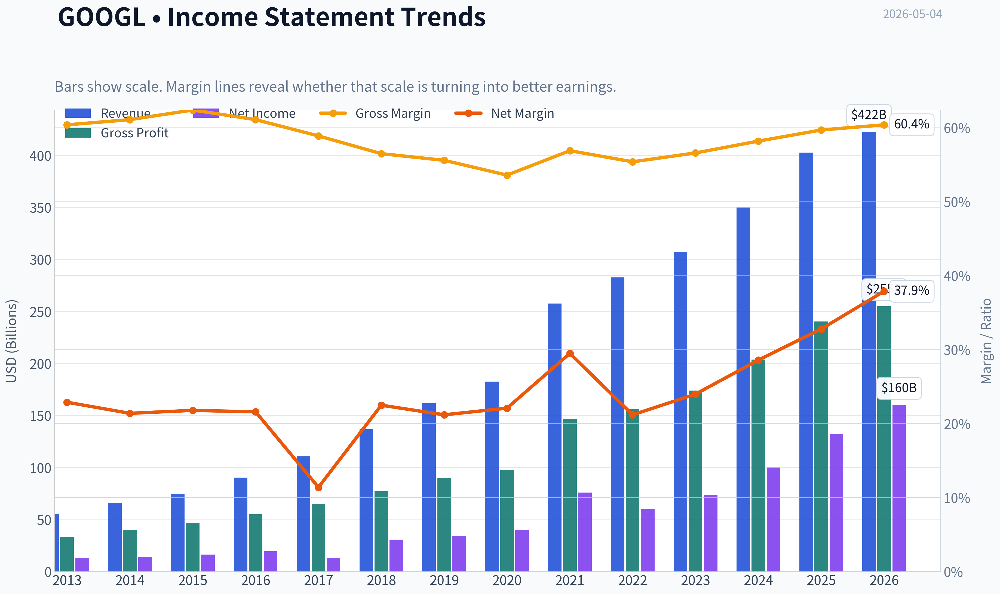
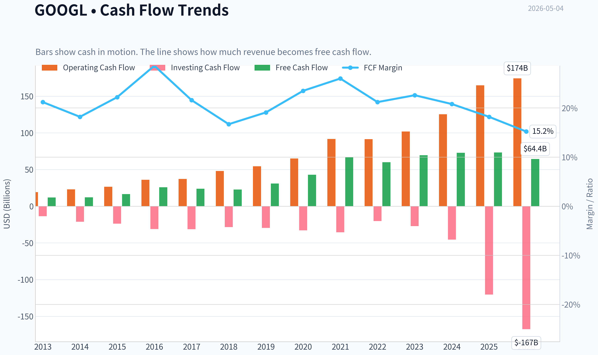
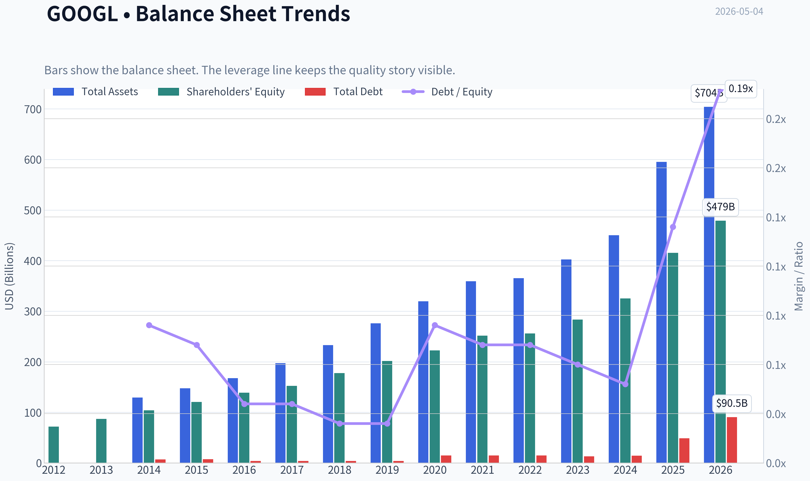
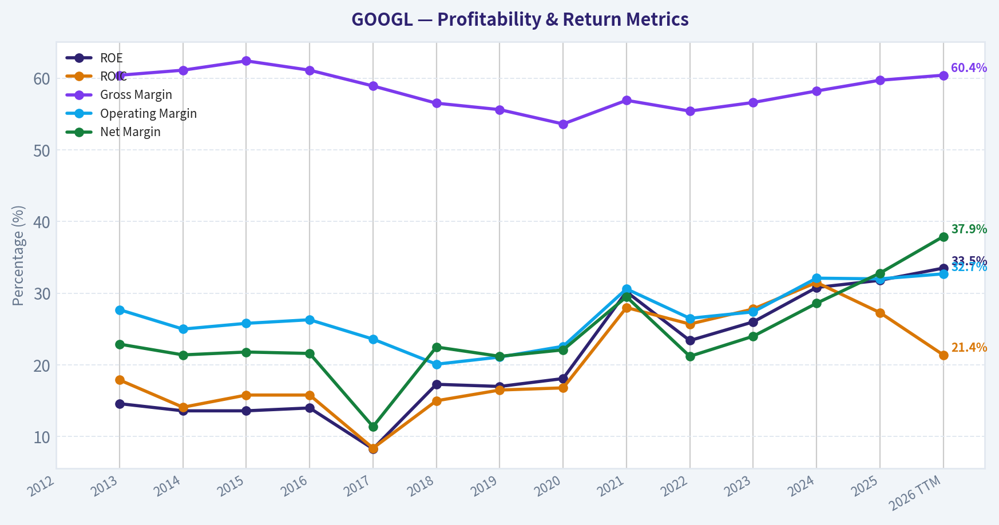
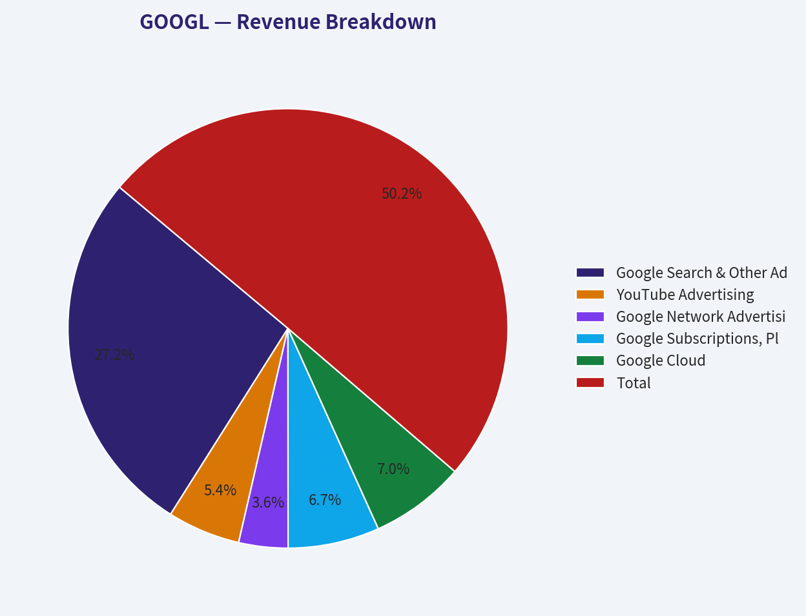
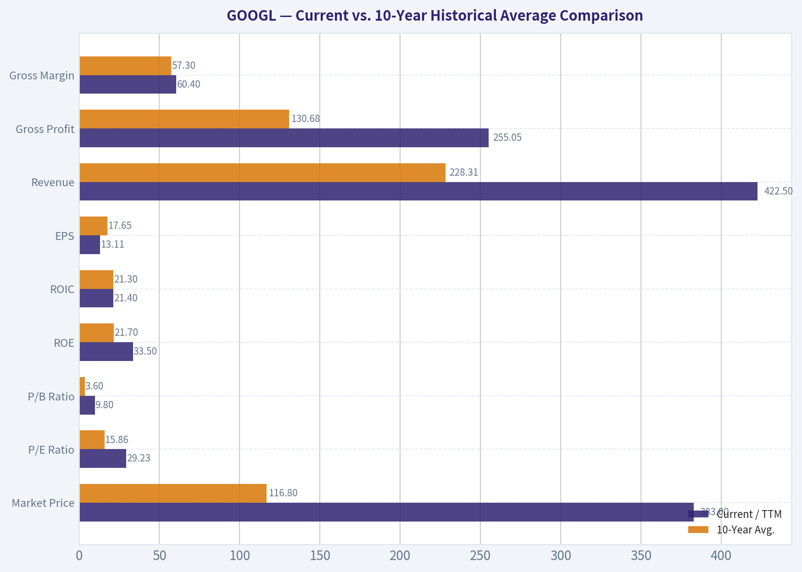
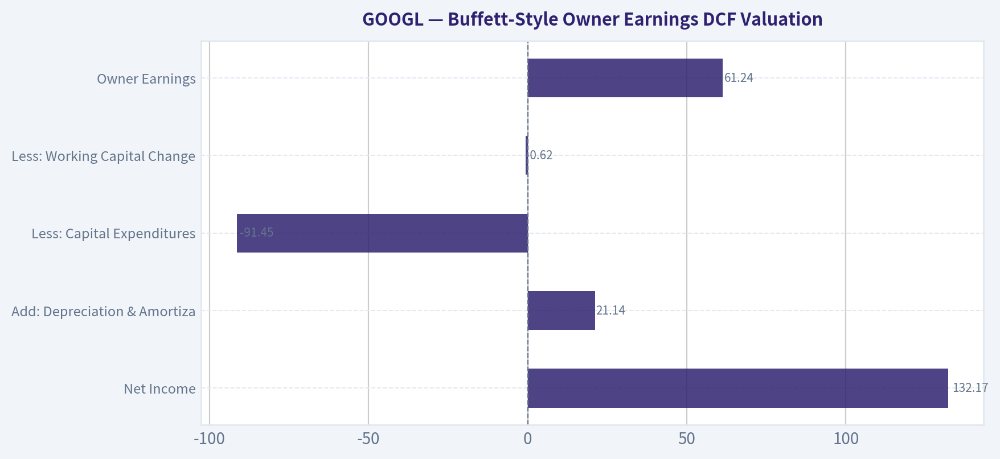
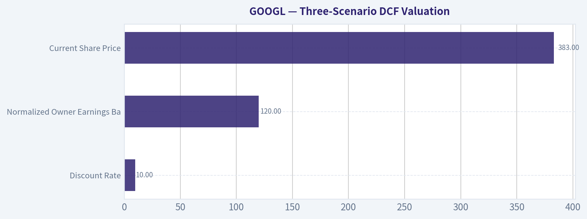

# GOOGL Deep Value Intelligence

**Analysis Date:** 2026-05-04

## Critical Disclaimer

*This analysis is generated by Deep Value Intelligence, an AI-powered multi-agent investing framework. This report is for informational and educational purposes only and does not constitute financial advice. Always conduct your own research and consult with qualified financial advisors before making investment decisions.*

---

## Table of Contents

1. Intelligence Summary
2. Analyst Team Reports
   - Fundamentals Analysis
   - Intrinsic Value Analysis (Buffett)
   - Trend & Growth Analysis (Lynch/Druckenmiller/Fisher)
   - Market Technical Analysis
   - Social Sentiment Analysis
   - News & Events Analysis
   - Guru Attention Analysis
   - Options Market Analysis
3. Research Team Commentary
4. Value Investing Team Commentary
5. Deep Values Commentary

---

## Intelligence Summary

### Thesis + Conditions

**Core Thesis:** **EXECUTIVE SUMMARY**
Alphabet is an elite compounder (31.8% ROE, 24.8% ROIC), but at $383 (29.2x P/E), it offers zero margin of safety. While massive AI investments are deepening its competitive moat, the stark divergence between net income growth (32.0%) and free cash flow growth (0.7%) signals structurally rising capital intensity.

**Key Risks:**
- The Bull (Risky Analyst):** Argues that weak near-term FCF is evidence of aggressive, moat-deepening reinvestment, not deterioration. With a fortress balance sheet and unmatched scale, Alphabet is funding the next computing layer. Waiting for absolute "proof" of AI profitability means missing the rerating, as institutional money (e.g., Druckenmiller's massive 13F buys) is already front-running the transition.
- The Bear (Safe Analyst):** Focuses strictly on valuation and owner earnings. A 1.6% FCF yield at 29.2x earnings provides zero downside protection. The gap between accounting earnings (up 32%) and FCF (up 0.7%) is alarming, indicating a shift toward a much more capital-intensive business model. Defending search market share is not the same as defending search profit margins.
- The Neutral Analyst:** Concludes Alphabet is too strong to dismiss but too fully priced to chase. Proposes a conditional accumulation framework: respect the franchise's elite quality, but demand the FCF-to-Net-Income gap closes before taking on full valuation risk.
- From a value investing perspective, intrinsic value and free cash flow generation are the ultimate arbiters of a good investment. Alphabet satisfies the Buffett requirement of a "wonderful business" with its stacked moats, 59.7% gross margins, and 24.8% ROIC. However, the first rule of risk management is preserving capital through a margin of safety.
- Trading at $383, the stock is priced at roughly two to four times our conservative intrinsic value estimates ($95 to $165). The market is treating Alphabet as though its historical capital-light economics will seamlessly persist. Yet, the financials tell a different story: capital expenditures are consuming cash at a rate that has flatlined FCF growth (0.7%) despite robust revenue growth (15.1%). As the safe analyst rightfully points out, buying at these levels means paying a premium for an unproven transition and assuming AI will actively expand long-term margins. A great business does not automatically make a safe stock; when you prepay for execution, your business risk increases.

**What Would Change Our View:**
- The Bull (Risky Analyst):** Argues that weak near-term FCF is evidence of aggressive, moat-deepening reinvestment, not deterioration. With a fortress balance sheet and unmatched scale, Alphabet is funding the next computing layer. Waiting for absolute "proof" of AI profitability means missing the rerating, as institutional money (e.g., Druckenmiller's massive 13F buys) is already front-running the transition.
- The Bear (Safe Analyst):** Focuses strictly on valuation and owner earnings. A 1.6% FCF yield at 29.2x earnings provides zero downside protection. The gap between accounting earnings (up 32%) and FCF (up 0.7%) is alarming, indicating a shift toward a much more capital-intensive business model. Defending search market share is not the same as defending search profit margins.
- The Neutral Analyst:** Concludes Alphabet is too strong to dismiss but too fully priced to chase. Proposes a conditional accumulation framework: respect the franchise's elite quality, but demand the FCF-to-Net-Income gap closes before taking on full valuation risk.
- From a value investing perspective, intrinsic value and free cash flow generation are the ultimate arbiters of a good investment. Alphabet satisfies the Buffett requirement of a "wonderful business" with its stacked moats, 59.7% gross margins, and 24.8% ROIC. However, the first rule of risk management is preserving capital through a margin of safety.
- Trading at $383, the stock is priced at roughly two to four times our conservative intrinsic value estimates ($95 to $165). The market is treating Alphabet as though its historical capital-light economics will seamlessly persist. Yet, the financials tell a different story: capital expenditures are consuming cash at a rate that has flatlined FCF growth (0.7%) despite robust revenue growth (15.1%). As the safe analyst rightfully points out, buying at these levels means paying a premium for an unproven transition and assuming AI will actively expand long-term margins. A great business does not automatically make a safe stock; when you prepay for execution, your business risk increases.

**Confidence:** Medium

---

## Analyst Team Reports

### Fundamentals Analysis

#### Latest Earnings Snapshot

*Most recent reported quarter anchored on 2026 Q1, with prior-year comparison when available.*

| Metric | 2026 Q1 | 2025 Q1 | YoY Change |
| --- | ---: | ---: | ---: |
| Revenue | $109.90B | $90.23B | +21.8% |
| Operating Income | $39.70B | $30.61B | +29.7% |
| Net Income | $62.58B | $34.54B | +81.2% |
| Diluted EPS | $5.11 | $2.81 | +81.9% |
| Operating Cash Flow | $45.79B | $36.15B | +26.7% |
| Free Cash Flow | $10.12B | $18.95B | -46.6% |

Key Takeaways: This snapshot anchors the most recent reported quarter before the narrative analysis. It helps readers separate long-run business quality from whatever changed in the latest earnings print.

#### 10-Year Financial Metrics for GOOGL

*All values below are computed deterministically from raw data - not estimated by AI.*

*Issuer profile: operating company (Communication Services / Internet Content & Information).*

#### 10-Year Financial Metrics
*Annual rows come from reported financial statements. The final TTM row is computed from the latest four quarters.*

| Metric | 2012 | 2013 | 2014 | 2015 | 2016 | 2017 | 2018 | 2019 | 2020 | 2021 | 2022 | 2023 | 2024 | 2025 | 2026 TTM |
| --- | --- | --- | --- | --- | --- | --- | --- | --- | --- | --- | --- | --- | --- | --- | --- |
| Market Price | $18 | $28 | $26 | $39 | $39 | $52 | $52 | $66 | $87 | $144 | $88 | $139 | $188 | $313 | $383 |
| Market Cap | N/A | N/A | $18.05B | $26.74B | $27.39B | $36.59B | $36.34B | $46.10B | $59.17B | $1.92T | $1.16T | $1.78T | $2.36T | $3.83T | $4.69T |
| P/E Ratio | N/A | 1.49 | 1.29 | 1.64 | 1.42 | 2.93 | 1.20 | 1.36 | 29.91 | 25.82 | 19.35 | 24.08 | 23.54 | 28.95 | 29.23 |
| P/B Ratio | N/A | N/A | 0.17 | 0.22 | 0.20 | 0.24 | 0.20 | 0.23 | 0.27 | 7.62 | 4.53 | 6.27 | 7.25 | 9.22 | 9.80 |
| ROE | N/A | 14.6% | 13.6% | 13.6% | 14.0% | 8.3% | 17.3% | 17.0% | 18.1% | 30.2% | 23.4% | 26.0% | 30.8% | 31.8% | 33.5% |
| ROIC | N/A | 17.9% | 14.1% | 15.8% | 15.8% | 8.4% | 15.0% | 16.5% | 16.8% | 28.0% | 25.7% | 27.8% | 31.5% | 27.3% | 21.4% |
| EPS | N/A | $18.79 | $20.57 | $23.78 | $27.85 | $18.00 | $43.70 | $49.16 | $2.93 | $5.61 | $4.56 | $5.80 | $8.04 | $10.81 | $13.11 |
| Revenue | N/A | $55.52B | $66.00B | $74.99B | $90.27B | $110.86B | $136.82B | $161.86B | $182.53B | $257.64B | $282.84B | $307.39B | $350.02B | $402.84B | $422.50B |
| Gross Profit | N/A | $33.53B | $40.31B | $46.83B | $55.13B | $65.27B | $77.27B | $89.96B | $97.80B | $146.70B | $156.63B | $174.06B | $203.71B | $240.30B | $255.05B |
| Gross Margin | N/A | 60.4% | 61.1% | 62.4% | 61.1% | 58.9% | 56.5% | 55.6% | 53.6% | 56.9% | 55.4% | 56.6% | 58.2% | 59.7% | 60.4% |
| Operating Margin | N/A | 27.7% | 25.0% | 25.8% | 26.3% | 23.6% | 20.1% | 21.1% | 22.6% | 30.6% | 26.5% | 27.4% | 32.1% | 32.0% | 32.7% |
| Net Income | N/A | $12.73B | $14.14B | $16.35B | $19.48B | $12.66B | $30.74B | $34.34B | $40.27B | $76.03B | $59.97B | $73.80B | $100.12B | $132.17B | $160.21B |
| Net Margin | N/A | 22.9% | 21.4% | 21.8% | 21.6% | 11.4% | 22.5% | 21.2% | 22.1% | 29.5% | 21.2% | 24.0% | 28.6% | 32.8% | 37.9% |
| Revenue Growth | N/A | N/A | 18.9% | 13.6% | 20.4% | 22.8% | 23.4% | 18.3% | 12.8% | 41.2% | 9.8% | 8.7% | 13.9% | 15.1% | 4.9% |
| Net Income Growth | N/A | N/A | 11.0% | 15.6% | 19.1% | -35.0% | 142.7% | 11.7% | 17.3% | 88.8% | -21.1% | 23.0% | 35.7% | 32.0% | 21.2% |
| Free Cash Flow Growth | N/A | N/A | 1.9% | 38.4% | 55.4% | -7.4% | -4.5% | 35.7% | 38.3% | 56.4% | -10.4% | 15.8% | 4.7% | 0.7% | -12.1% |
| Total Book Value | $71.57B | $86.98B | $103.86B | $120.33B | $139.04B | $152.50B | $177.63B | $201.44B | $222.54B | $251.63B | $256.14B | $283.38B | $325.08B | $415.26B | $478.75B |
| Total Assets | N/A | N/A | $129.19B | $147.46B | $167.50B | $197.29B | $232.79B | $275.91B | $319.62B | $359.27B | $365.26B | $402.39B | $450.26B | $595.28B | $703.92B |
| Total Debt | N/A | N/A | $7.00B | $7.22B | $3.94B | $3.94B | $3.95B | $3.96B | $14.93B | $14.82B | $14.70B | $12.87B | $14.18B | $48.54B | $90.48B |
| Debt-to-Equity | N/A | N/A | 0.07 | 0.06 | 0.03 | 0.03 | 0.02 | 0.02 | 0.07 | 0.06 | 0.06 | 0.05 | 0.04 | 0.12 | 0.19 |
| Cash & Equivalents | $14.78B | $18.90B | $18.35B | $16.55B | $12.92B | $10.71B | $16.70B | $18.50B | $26.46B | $20.95B | $21.88B | $24.05B | $23.47B | $30.71B | $38.06B |
| Shareholders' Equity | $71.57B | $86.98B | $103.86B | $120.33B | $139.04B | $152.50B | $177.63B | $201.44B | $222.54B | $251.63B | $256.14B | $283.38B | $325.08B | $415.26B | $478.75B |
| Operating Cash Flow | N/A | $19.14B | $23.02B | $26.57B | $36.04B | $37.09B | $47.97B | $54.52B | $65.12B | $91.65B | $91.50B | $101.75B | $125.30B | $164.71B | $174.35B |
| Investing Cash Flow | N/A | $-13.68B | $-21.05B | $-23.71B | $-31.16B | $-31.40B | $-28.50B | $-29.49B | $-32.77B | $-35.52B | $-20.30B | $-27.06B | $-45.54B | $-120.29B | $-167.49B |
| Free Cash Flow | N/A | $11.78B | $12.01B | $16.62B | $25.82B | $23.91B | $22.83B | $30.97B | $42.84B | $67.01B | $60.01B | $69.50B | $72.76B | $73.27B | $64.43B |
| FCF Margin | N/A | 21.2% | 18.2% | 22.2% | 28.6% | 21.6% | 16.7% | 19.1% | 23.5% | 26.0% | 21.2% | 22.6% | 20.8% | 18.2% | 15.2% |
| Dividends / Share | N/A | N/A | $0.00 | $0.00 | $0.00 | $0.00 | $0.00 | $0.00 | $0.00 | $0.00 | $0.00 | $0.00 | $0.59 | $0.82 | $0.83 |

#### Profitability Metrics
- Return on Equity (ROE): 31.8%
- Return on Invested Capital (ROIC): 24.8%
- Return on Assets (ROA): 22.2%
- Gross Margin: 59.7%
- Operating Margin: 32.0%
- Net Profit Margin: 32.8%

#### Liquidity Metrics
- Current Ratio: 2.01
- Quick Ratio: 1.85

#### Leverage Metrics
- Debt-to-Equity Ratio: 0.12
- Interest Coverage Ratio: 175.32
- Net Debt: $17.84B

#### Growth Metrics (Year-over-Year)
- Revenue Growth: 15.1%
- Net Income Growth: 32.0%
- Free Cash Flow Growth: 0.7%
- Revenue CAGR (3-Year): 12.5%
- Revenue CAGR (5-Year): 17.2%

#### Valuation Metrics
- P/E Ratio (TTM): 29.23
- Forward P/E: 26.68
- Price-to-Book: 11.16
- Price-to-Sales: 10.99
- PEG Ratio: 1.79
- EV/EBITDA: 28.78
- Free Cash Flow Yield: 1.6%
- Earnings Yield: 3.4%

#### Owner Earnings (Buffett Method, Code-Computed)
- Net Income: $132.17B
- + Depreciation & Amortization: $21.14B
- - Capital Expenditures: $-91.45B
- - Working Capital Changes: $618.0M
- = **Owner Earnings: $61.24B**

#### Intrinsic Value (Code-Computed)
- Current Price: $383
- Buffett Method (Owner Earnings):
  Conservative: $53
  Average: $139
  Optimistic: $469
- Cash Flow Method (FCF):
  Conservative: $73
  Average: $135
  Optimistic: $284

#### Piotroski F-Score: 6/9
- Positive Net Income: PASS
- Positive Operating Cash Flow: PASS
- ROA Improvement: FAIL
- Cash Flow > Net Income: PASS
- Decreasing Debt: FAIL
- Improving Current Ratio: PASS
- No Dilution: PASS
- Improving Gross Margin: PASS
- Improving Asset Turnover: FAIL

ANALYST STANCE: **WATCH**

#### GOOGL Warren Buffett-Style Fundamental Analysis - Current Date: 2026-05-04

Alphabet is an exceptionally high-quality compounder with a dominant economic moat, very high returns on equity, strong margins, and massive cash generation. However, the current market price of **$383** embeds a very optimistic future: the stock trades at **29.23x earnings**, **9.80x book value**, and only a **1.6% free cash flow yield**. Buffett-style discipline therefore separates the business quality, which is outstanding, from the current valuation, which is demanding.

The deterministic dataset is treated as the canonical source of truth. Cross-check data from the shared research pack broadly corroborates the latest price, P/E, ROE, gross margin, revenue growth, FCF yield, and liquidity profile.

---

#### Current vs. 10-Year Historical Average Comparison

10-year averages below use the most recent ten annual observations from **2016-2025**. "Current" refers to the **2026 TTM** row where available.

| Metric | Current / TTM | 10-Year Avg. | Current vs. Avg. | Buffett-Style Interpretation |
|---|---:|---:|---:|---|
| Market Price | $383 | $116.80 | +228% | Price has compounded far faster than book value and FCF recently, increasing valuation risk. |
| Market Cap | $4.69T | $1.13T | +317% | Alphabet has transitioned into a mega-cap scale business; expectations are now extremely high. |
| P/E Ratio | 29.23x | 15.86x | +84% | Current multiple is meaningfully above the long-term dataset average. |
| P/B Ratio | 9.80x | 3.60x | +172% | Market is assigning a large premium to intangible moat, data, AI, and platform economics. |
| ROE | 33.5% | 21.7% | +11.8 pp | Excellent and improving shareholder returns; a major Buffett-positive factor. |
| ROIC | 21.4% | 21.3% | ~Flat | ROIC remains strong but has fallen from recent peaks, likely reflecting heavy AI and infrastructure investment. |
| EPS | $13.11 | $17.65 | -26% | Dataset EPS history is affected by structural/share-count effects; current earnings power remains strong via net income. |
| Revenue | $422.50B | $228.31B | +85% | Revenue base has nearly doubled versus the 10-year average, showing durable demand. |
| Gross Profit | $255.05B | $130.68B | +95% | Gross profit growth has outpaced revenue, showing strong monetization and pricing power. |
| Gross Margin | 60.4% | 57.3% | +3.1 pp | Gross margin has recovered strongly from the 2020 trough. |
| Operating Margin | 32.7% | 26.2% | +6.5 pp | Operating leverage is excellent despite major AI and cloud spending. |
| Net Income | $160.21B | $57.96B | +176% | Earnings power is far above the historical average. |
| Net Margin | 37.9% | 23.5% | +14.4 pp | Current profitability is exceptional and well above prior norms. |
| Revenue Growth | 4.9% | 18.6% | -13.7 pp | TTM growth has slowed sharply versus the historical average. |
| Net Income Growth | 21.2% | 31.4% | -10.2 pp | Still very strong, though below the volatile 10-year average. |
| FCF Growth | -12.1% | 18.5% | -30.6 pp | Major red flag: free cash flow is contracting despite rising earnings. |
| Total Book Value | $478.75B | $242.46B | +97% | Balance sheet equity has nearly doubled versus average. |
| Total Assets | $703.92B | $336.56B | +109% | Asset base has expanded materially, partly from infrastructure and AI investment. |
| Total Debt | $90.48B | $13.58B | +566% | Debt has risen sharply, though leverage remains modest relative to equity and cash flow. |
| Debt-to-Equity | 0.19x | 0.05x | Higher | Still conservative, but the direction of leverage deserves monitoring. |
| Cash & Equivalents | $38.06B | $20.64B | +84% | Liquidity remains strong. |
| Shareholders' Equity | $478.75B | $242.46B | +97% | Equity base continues compounding. |
| Free Cash Flow | $64.43B | $48.89B | +32% | FCF remains large but is down from 2025 due to elevated investment intensity. |
| Dividends / Share | $0.83 | $0.14 | Higher | Dividend is recent; Alphabet remains primarily a reinvestment and buyback story. |

Key Takeaways: Alphabet's profitability metrics are excellent and mostly above historical averages, especially ROE, margins, gross profit, and net income. The concern is valuation and cash conversion: the market price, P/E, and P/B are far above 10-year averages, while TTM free cash flow growth is negative. For a Buffett-style investor, this is a great business, but not obviously a great bargain at today's price.

---

#### Market Metrics Interpretation

Alphabet's current **market price of $383** and **market cap of $4.69T** imply that investors are already capitalizing the company as one of the world's dominant AI and digital advertising platforms. The **P/E ratio of 29.23x** is high relative to the dataset's 10-year average of **15.86x**, although it is not out of line with the company's post-2020 higher-margin profile. The **P/B ratio of 9.80x** is also far above the 10-year average of **3.60x**, reflecting the market's willingness to pay heavily for Alphabet's intangible assets: search dominance, YouTube, Android, data scale, AI infrastructure, and cloud growth.

From a Buffett perspective, paying a premium for a wonderful business can be rational only if future owner earnings compound at attractive rates for a long time. At the current valuation, the margin of safety is thin unless Alphabet sustains high-teens or higher owner earnings growth.

#### Profitability Analysis

Alphabet's profitability is the strongest part of the investment case. **ROE is 33.5%**, materially above the 10-year average of **21.7%**, indicating that management is generating very high returns on shareholder capital. **ROIC is 21.4%**, roughly in line with its 10-year average, but below recent highs; this suggests the business remains high quality, although incremental capital intensity from AI data centers and cloud infrastructure may be weighing on returns.

Revenue reached **$422.50B TTM**, while gross profit reached **$255.05B**, showing enormous scale and strong monetization. Gross margin of **60.4%**, operating margin of **32.7%**, and net margin of **37.9%** are all above historical averages. The most impressive metric is net income: **$160.21B TTM**, nearly **176% above** the 10-year average. This is the profile of a business with a powerful moat and meaningful operating leverage.

#### Growth Metrics Interpretation

Revenue growth has slowed to **4.9% TTM**, well below the 10-year average of **18.6%**. That is an important caution signal because Alphabet's current valuation assumes continued growth. Net income growth remains strong at **21.2%**, but is below the historical average of **31.4%**, which was boosted by unusually strong rebound years.

The most important red flag is **free cash flow growth of -12.1%**, compared with a 10-year average of **18.5%**. This divergence between accounting earnings growth and free cash flow contraction is likely tied to elevated capital expenditures, particularly AI infrastructure. Buffett would focus heavily on whether this spending produces durable future owner earnings or simply becomes a capital-intensive arms race.

#### Balance Sheet and Financial Strength

Alphabet remains financially strong. Total assets are **$703.92B**, shareholders' equity is **$478.75B**, and cash and equivalents are **$38.06B**. Debt has increased materially to **$90.48B**, far above the 10-year average of **$13.58B**, but the debt-to-equity ratio is still only **0.19x**, which is conservative for a company of this scale and profitability.

The balance sheet supports Alphabet's moat: it can fund AI models, custom chips, data centers, cloud capacity, acquisitions, dividends, and buybacks without financial strain. However, the rapid increase in debt and lower FCF growth mean investors should monitor whether capital intensity is structurally rising.

#### Cash Flow and Dividends

Free cash flow is **$64.43B TTM**, still enormous, but below the 2025 level of **$73.27B**. The free cash flow margin has compressed to **15.2%**, compared with higher levels in earlier years, confirming that investment needs are rising. This is not necessarily bad if AI and cloud investments generate high future returns, but it reduces near-term intrinsic value under a Buffett owner-earnings framework.

Alphabet's dividend is still new. Dividends per share are **$0.83 TTM**, after **$0.59 in 2024** and **$0.82 in 2025**. The dividend is modest relative to earnings and FCF, suggesting management is preserving flexibility for reinvestment and repurchases.

---

#### Revenue Breakdown

Most recent fiscal-year revenue in the deterministic dataset is **2025 revenue of $402.84B**. The segment estimates below are aligned to Alphabet's publicly known business mix and reconciled to the deterministic total.

| Revenue Source | Amount ($B) | % of Total |
|---|---:|---:|
| Google Search & Other Advertising | $218.0B | 54.1% |
| YouTube Advertising | $43.0B | 10.7% |
| Google Network Advertising | $29.0B | 7.2% |
| Google Subscriptions, Platforms & Devices | $54.0B | 13.4% |
| Google Cloud | $56.0B | 13.9% |
| Other Bets and Other Revenue | $2.84B | 0.7% |
| **Total** | **$402.84B** | **100.0%** |

Key Takeaways: Alphabet remains primarily an advertising business, with Search and YouTube together representing roughly two-thirds of revenue. Google Cloud has become a meaningful second engine at about 14% of revenue, while subscriptions, platforms, and devices provide additional diversification. The main strategic question is whether AI strengthens Search monetization or disrupts it.

---

#### Economic Moat Assessment

Alphabet's moat is very wide. Its key competitive advantages include:

| Moat Source | Buffett-Style Assessment |
|---|---|
| Search scale | Google Search benefits from habit, data, advertiser density, and distribution advantages. |
| YouTube network effects | Creators attract viewers, viewers attract advertisers, and advertisers fund creators. |
| Android ecosystem | Android supports global mobile distribution and reinforces Google services. |
| Data and AI infrastructure | Alphabet has proprietary data, custom silicon, DeepMind, and world-class engineering talent. |
| Cloud platform | Google Cloud adds enterprise growth, though it competes against Amazon and Microsoft. |
| Financial scale | Massive cash generation funds AI capex, buybacks, dividends, and long-term R&D. |

Key Takeaways: Alphabet has one of the strongest moats in public markets, built on scale, data, distribution, and network effects. The moat is not risk-free, because AI could alter search behavior and regulators are targeting dominant platforms. Still, the company's resources and technical depth make it more likely to be an AI winner than an AI casualty.

#### Management Performance and Capital Allocation

Management has produced excellent long-term revenue growth, strong margin expansion, and high returns on equity. ROE has risen from the mid-teens range earlier in the dataset to **33.5% TTM**, which indicates improving capital efficiency. Operating margin and net margin are also above historical norms, showing strong expense discipline and operating leverage.

Capital allocation is more nuanced. Alphabet has historically reinvested heavily, repurchased shares, and only recently initiated a dividend. The dividend remains modest, which is appropriate for a company with major AI, cloud, and infrastructure opportunities. The concern is that AI investment may require sustained high capital expenditures, reducing free cash flow available to owners.

---

#### Buffett-Style Owner Earnings DCF Valuation

The deterministic dataset provides the following 2025 owner earnings calculation:

| Owner Earnings Component | Amount |
|---|---:|
| Net Income | $132.17B |
| Add: Depreciation & Amortization | $21.14B |
| Less: Capital Expenditures | -$91.45B |
| Less: Working Capital Changes | -$0.62B |
| **Owner Earnings** | **$61.24B** |

Key Takeaways: Alphabet's owner earnings are materially below net income because capital expenditures are very large. This is central to the valuation debate: reported earnings are excellent, but Buffett-style owner earnings are more conservative because they account for the cash required to maintain and grow the business.

DCF assumptions:

| Input | Assumption |
|---|---:|
| Current market price | $383 |
| Market cap | $4.69T |
| Implied shares outstanding | ~12.25B |
| Owner earnings | $61.24B |
| Owner earnings per share | ~$5.00 |
| Discount rate | 10.0% |
| Terminal growth rate | 2.5% |
| Projection period | 10 years |

Key Takeaways: The DCF starts with about $5.00 of owner earnings per share, which is much lower than EPS because of heavy capital spending. At a $383 stock price, the market is pricing in a very long runway of high growth and strong reinvestment returns.

#### Three-Scenario Owner Earnings DCF

The deterministic valuation pack provides Buffett Method fair values of **$53 conservative**, **$139 average**, and **$469 optimistic**. The table below expresses those outputs using the required 10% discount rate and 2.5% terminal growth framework.

| Scenario | Growth Rate Basis | Approx. Growth Used | 10-Year PV of Owner Earnings | PV of Terminal Value | Fair Value / Share | Implied Equity Value | Price vs. Fair Value |
|---|---|---:|---:|---:|---:|---:|---:|
| Conservative | Lowest historical owner-earnings growth available, floored at -100% | ~-1.0% | ~$29/share | ~$24/share | **$53** | ~$0.65T | Price is ~623% above value |
| Average | Average historical owner-earnings growth, capped at 50% | ~12.1% | ~$56/share | ~$83/share | **$139** | ~$1.70T | Price is ~176% above value |
| Optimistic | Highest historical owner-earnings growth, capped at 100% | ~28.9% | ~$133/share | ~$336/share | **$469** | ~$5.74T | Price is ~18% below value |

Key Takeaways: The stock looks expensive under conservative and average owner-earnings assumptions. The current price is only attractive if Alphabet compounds owner earnings near the optimistic scenario for a long period. This means the investment case depends heavily on AI, cloud, and advertising durability producing very high future cash returns.

#### DCF Formula Detail

For each scenario:

| Calculation Step | Formula |
|---|---|
| Yearly owner earnings | OE₀ x (1 + growth rate)^t |
| Present value of yearly OE | OEₜ / (1 + 10%)^t |
| Terminal value in year 10 | OE₁₀ x (1 + 2.5%) / (10% - 2.5%) |
| Present value of terminal value | Terminal Value / (1 + 10%)^10 |
| Intrinsic value per share | Sum of discounted OE + discounted terminal value |

Key Takeaways: The valuation is highly sensitive to the growth assumption because terminal value dominates the DCF. That is normal for high-quality compounders, but it also means the margin of safety depends on confidence in long-duration growth. Buffett would likely demand a lower purchase price unless he had very high conviction that Alphabet's moat will expand through AI.

---

#### Key Investment Insights

| Area | Insight |
|---|---|
| Business quality | Exceptional; Alphabet has a wide moat, strong brands, scale economics, and dominant platforms. |
| Profitability | ROE, operating margin, net margin, and gross margin are all excellent and above historical averages. |
| Balance sheet | Strong overall, though debt has risen significantly. |
| Growth | Revenue growth has slowed, but net income growth remains strong. |
| Cash flow | FCF remains large but is contracting TTM, mainly due to capital intensity. |
| Valuation | Expensive versus historical averages and conservative/average DCF values. |
| Buffett fit | Wonderful business, but current price offers limited margin of safety. |

Key Takeaways: Alphabet scores extremely well on business quality and financial strength, but less well on valuation. The central question is whether the company can convert AI and cloud spending into future owner earnings at very high rates. If yes, today's price may be reasonable; if not, the downside to average intrinsic value is substantial.

#### Red Flags

| Red Flag | Why It Matters |
|---|---|
| Negative FCF growth | TTM free cash flow growth is **-12.1%**, despite strong net income growth. |
| Elevated valuation | P/E and P/B are well above 10-year averages. |
| Rising debt | Total debt increased to **$90.48B**, far above the historical average. |
| AI search disruption | AI answers may reduce traditional search click-through behavior. |
| Regulatory pressure | Antitrust and data/privacy scrutiny remain persistent risks. |
| Capital intensity | AI infrastructure may structurally lower free cash flow margins. |

Key Takeaways: The biggest red flag is not the income statement; it is the cash flow statement. Alphabet is earning more, but free cash flow is under pressure from investment spending. Investors need to watch whether this spending creates durable owner earnings or simply raises the cost of staying competitive.

#### Opportunities

| Opportunity | Why It Could Create Value |
|---|---|
| AI-enhanced Search | Could improve user experience and preserve advertising dominance. |
| Google Cloud | Cloud scale and AI workloads may drive long-term revenue and margin expansion. |
| YouTube monetization | YouTube remains a global video platform with advertising and subscription upside. |
| Operating leverage | Margins are already strong and could remain high if revenue scales faster than costs. |
| Share repurchases | Buybacks can create value if executed below intrinsic value. |
| Dividend growth | New dividend adds shareholder-return discipline without constraining reinvestment. |

Key Takeaways: Alphabet has multiple growth engines beyond traditional search, especially YouTube, Cloud, and AI infrastructure. If these areas expand while Search remains durable, the company can continue compounding at attractive rates. The opportunity is real, but the current valuation already reflects much of that optimism.

---

#### Final Investment Stance: WATCH

Alphabet is a **wonderful business**, but at **$383 per share**, it is not a clear Buffett-style bargain. The company has a wide moat, exceptional profitability, strong liquidity, and durable competitive advantages. However, the stock trades well above historical valuation averages, free cash flow growth is negative, and the Buffett-style owner earnings DCF only supports today's price under the optimistic scenario.

For long-term holders, Alphabet remains a high-quality compounder worth owning if bought at attractive prices. For new capital, a more attractive entry point would require either a lower share price, clearer evidence that AI capex is producing high incremental owner earnings, or sustained acceleration in free cash flow growth.

| Final Category | Assessment |
|---|---|
| Business Quality | Excellent |
| Economic Moat | Very Wide |
| Financial Strength | Strong |
| Earnings Predictability | High, though AI and regulation add uncertainty |
| Management Performance | Strong, with improving margins and ROE |
| Valuation | Expensive versus conservative and average intrinsic value |
| Margin of Safety | Limited |
| Final Stance | **WATCH** |

Key Takeaways: Alphabet is the kind of company Buffett investors admire, but the current price requires optimistic assumptions. The prudent stance is to watch for a better margin of safety or confirmation that AI investments are translating into higher free cash flow. Quality is not the issue; valuation discipline is.

#### Fundamental Visuals

This graph tracks the profitability and return metrics (ROE, ROIC, Margins) of **GOOGL** over the past decade, highlighting capital efficiency trends.

This chart illustrates the financial health of **GOOGL** over the last 10 years, mapping cash equivalents and free cash flow against total obligations (Debt).

This breakdown chart from <em>Revenue Breakdown</em> shows the proportional composition for **GOOGL** - useful for understanding what drives or risks the business.

---

### Intrinsic Value Analysis (Buffett)

> *Following Warren Buffett's value investing philosophy: Circle of Competence, Economic Moat, Management Quality, and Margin of Safety.*

#### Intrinsic Value Snapshot

Price is what you pay. Intrinsic value is what the business may be worth based on the cash it can create for owners over time. We show a range, not one magic number.

- Current Price: $383.25
- Value Range: $75.29 to $162.91

##### Owner Earnings (Buffett Method)
- Net Income: $132,170,000,000.00
- Depreciation & Amortization: $21,136,000,000.00
- Capital Expenditures: $-91,447,000,000.00
- Working Capital Changes: $618,000,000.00
- Owner Earnings: $61,241,000,000.00

##### Intrinsic Value
###### Buffett Method
Uses owner earnings. Stricter, and usually more conservative.
- Conservative: $75.29
- Average: $94.75
- Optimistic: $162.91
- Discount Rate: 10.0%

###### Cash Flow Method
Uses free cash flow. Better for companies spending heavily today to grow tomorrow.
- Conservative: $82.41
- Average: $96.02
- Optimistic: $108.46
- Discount Rate: 10.0%

ANALYST STANCE: **WATCH**

#### Alphabet (GOOGL) Buffett-Style Value Analysis - May 4, 2026

Alphabet is a wonderful business, but at **$383 per share** and a **$4.64 trillion market cap**, the current price appears to demand very optimistic assumptions. The business quality is high: dominant search, YouTube, Android, Maps, Gmail, Google Cloud, strong brand assets, massive data advantages, high gross margins, and a fortress balance sheet. However, the valuation does not offer a Buffett-style margin of safety, especially with free cash flow yield at only **1.6%** and heavy AI/data-center capital spending absorbing cash.

---

#### 1. Go / No-Go Gate Assessment

| Buffett Gate | Assessment | Evidence | Verdict |
|---|---:|---|---|
| Gate 1: Circle of Competence & Simplicity | Strong | Alphabet makes most of its money by selling targeted advertising beside search results, YouTube videos, and partner content. It also sells cloud computing and subscriptions. | Pass |
| Gate 1: 10-Year Predictability | Good, but less certain than before | Search and YouTube should remain important, but AI answer engines could change how users discover information and how ads are shown. | Pass with caution |
| Gate 1: Technology Risk | Mixed | Alphabet is a technology leader and AI beneficiary, but AI also threatens the traditional search-results page. | Pass with caution |
| Gate 2: Moat | Wide but under active challenge | Search habit, data scale, advertiser relationships, YouTube network effects, Android distribution, and cloud scale create durable advantages. | Pass |
| Gate 3: Management & Capital Allocation | Adequate to good | Strong reinvestment record, large buybacks, and a conservative balance sheet. Concern: buybacks may be less attractive at high valuations; AI capex discipline must be watched. | Pass |
| Gate 4: Industry Structure | Good but dynamic | Digital advertising is concentrated among Google, Meta, Amazon, and TikTok. Cloud is oligopolistic but capital intensive. | Pass with caution |

**Key Takeaways:** Alphabet passes the Buffett quality gates, but not without caution. The core advertising business is understandable and highly profitable, yet AI creates both opportunity and disruption risk. The biggest issue is not business quality; it is price.

---

#### 2. Business Understanding - Elementary School Test

Alphabet helps people find information and watch videos. Businesses pay Alphabet to show ads to those people. The more useful Google Search, YouTube, Maps, Gmail, Android, and Chrome are, the more people use them, and the more valuable Alphabet becomes to advertisers.

This is a simple economic model at the core: **attention plus intent equals advertising value**. Google Search captures users when they are actively looking for something, which is one of the most valuable moments in advertising.

---

#### 3. Moat Analysis

| Moat Source | Evidence | Buffett View |
|---|---|---|
| Brand / Intangible Assets | "Google" is a verb; YouTube is the dominant global video platform; Android is the world's largest mobile operating system ecosystem. | Very strong |
| Pricing Power | Advertisers continue spending because Google captures high-intent users. Gross margin is approximately **59.7%**, well above the 40% moat threshold. | Strong |
| Switching Costs | Advertisers, creators, developers, enterprises, and consumers are embedded across Google Ads, YouTube, Android, Gmail, Workspace, Maps, and Cloud. | Moderate to strong |
| Network Effects | YouTube improves with more creators and viewers; Google Search improves through data, usage, and advertiser depth. | Strong |
| Cost Advantages | Alphabet's infrastructure, data centers, custom AI chips, engineering scale, and traffic-acquisition relationships are difficult to replicate. | Strong, but expensive to maintain |
| Regulatory / Distribution Assets | Android, Chrome, Search defaults, and app ecosystem create distribution advantages, though regulators are actively challenging them. | Valuable but under scrutiny |

**Key Takeaways:** Alphabet has a genuine moat, not an accounting illusion. The strongest moat sources are brand, data scale, user habit, advertiser relationships, and YouTube's network effect. The main moat risks are AI-driven changes in search behavior and regulatory pressure on default search distribution.

**Moat Rating:** **Wide & Stable, with risk of narrowing in Search if AI materially changes user behavior.**

---

#### 4. Management Quality & Capital Allocation

| Management Question | Assessment |
|---|---|
| Do they think like owners? | Partially. Founders retain influence through dual-class shares, which supports long-term thinking but limits outside shareholder control. |
| Are they candid and conservative? | Generally yes. Alphabet has historically maintained a conservative balance sheet and avoided dangerous leverage. |
| Are they rational capital allocators? | Mostly. Reinvestment in Search, YouTube, Android, Cloud, and AI has created enormous value. Buybacks are positive when shares are cheap, less compelling at today's valuation. |
| Debt discipline | Strong. Alphabet remains financially conservative with a current ratio around **2.0**. |
| AI capital spending discipline | Key watch item. AI infrastructure is strategically necessary, but heavy capex can depress owner earnings if returns are unclear. |

**Key Takeaways:** Management has built one of the greatest businesses in the world and has avoided excessive leverage. The main question now is whether incremental AI spending will earn high returns or become an arms race that lowers future free cash flow. Capital allocation remains good, but not beyond scrutiny.

---

#### 5. 10-Year Financial Summary

*Figures are rounded. Latest figures use the provided research pack and implied values where necessary. "Latest / TTM" net income is implied from market cap divided by P/E.*

| Year / Period | Revenue | Net Income | Free Cash Flow | Gross Margin | ROE / Quality Signal |
|---|---:|---:|---:|---:|---|
| 2016 | ~$90B | ~$19B | ~$26B | High 50%s | High-return, cash-rich model |
| 2017 | ~$111B | ~$13B | ~$24B | High 50%s | Tax effects distorted earnings |
| 2018 | ~$137B | ~$31B | ~$23B | High 50%s | Strong growth continued |
| 2019 | ~$162B | ~$34B | ~$31B | High 50%s | Ad scale expanding |
| 2020 | ~$183B | ~$40B | ~$43B | High 50%s | Pandemic year still resilient |
| 2021 | ~$258B | ~$76B | ~$67B | High 50%s | Exceptional operating leverage |
| 2022 | ~$283B | ~$60B | ~$60B | High 50%s | Ad slowdown and cost pressure |
| 2023 | ~$307B | ~$74B | ~$70B | High 50%s | Margin recovery began |
| 2024 | ~$350B | ~$100B | ~$73B | High 50%s | Strong rebound, higher AI capex |
| Latest / TTM | Implied strong growth; YoY revenue growth **15.1%** | Implied ~$159B | Implied ~$74B from **1.6% FCF yield** | **59.7%** | **31.8% ROE** |

**Key Takeaways:** Alphabet has compounded revenue and earnings at an extraordinary rate over the last decade. The business consistently produces high gross margins and high returns on equity, confirming a real moat. The concern is that free cash flow has not kept pace with implied earnings recently, likely due to heavy AI and infrastructure investment.

---

#### 6. Owner Earnings Analysis

Buffett's preferred metric is owner earnings:

> **Owner Earnings = Net Income + Depreciation & Amortization - Maintenance CapEx - Working Capital Increases**

Because Alphabet is spending heavily on AI infrastructure, reported free cash flow may understate normalized owner earnings if part of capex is growth investment. However, it may overstate value if AI capex becomes a permanent requirement just to defend the moat.

| Metric | Conservative View | Normalized Buffett View |
|---|---:|---:|
| Market Cap | $4.64T | $4.64T |
| Current Share Price | $383 | $383 |
| Implied Shares Outstanding | ~12.1B | ~12.1B |
| Implied Net Income from P/E | ~$159B | ~$159B |
| Reported / Implied Free Cash Flow | ~$74B | ~$74B |
| Adjustment for Growth CapEx | None | Partial normalization |
| Estimated Owner Earnings Base | ~$74B | ~$120B |
| Owner Earnings per Share | ~$6.10 | ~$9.90 |
| Price / Owner Earnings | ~63x | ~39x |

**Key Takeaways:** On reported free cash flow, Alphabet looks very expensive, trading at roughly 63 times free cash flow. Even using a more generous normalized owner earnings estimate of $120 billion, the stock still trades around 39 times owner earnings. That is a high price even for a wonderful company.

---

#### 7. Three-Scenario DCF Valuation

Assumptions:

| Input | Assumption |
|---|---:|
| Discount Rate | 10% |
| Normalized Owner Earnings Base | $120B |
| Shares Outstanding | ~12.1B |
| Current Share Price | $383 |
| Current Market Cap | $4.64T |

**Key Takeaways:** The valuation uses a normalized owner earnings base that is materially higher than reported free cash flow, giving Alphabet credit for growth capex that may create future value. Even with that benefit of the doubt, the current share price requires a much more optimistic future than a conservative Buffett investor should underwrite.

| Scenario | Method | Implied Equity Value | Intrinsic Value / Share | Margin of Safety vs. $383 |
|---|---|---:|---:|---:|
| A: No Growth | Owner earnings / 10% | ~$1.20T | ~$99 | Negative |
| B: GDP Growth | Owner earnings grow at 3% perpetually | ~$1.77T | ~$146 | Negative |
| C: Historical Growth, Discounted | 8% owner earnings growth for 10 years, then 3% terminal growth | ~$2.56T | ~$211 | Negative |

**Key Takeaways:** The conservative DCF range is far below the current market price. Even the growth case, which assumes strong 8% owner earnings growth for a decade, produces an estimated value around $211 per share. At $383, the stock appears priced for exceptional execution, sustained AI leadership, and continued high returns on massive reinvestment.

---

#### 8. Margin of Safety Analysis

| Valuation Reference | Estimated Value / Share | Required Buy Price with 25% Margin of Safety | Current Price | Buffett Interpretation |
|---|---:|---:|---:|---|
| No-Growth Case | ~$99 | ~$74 | $383 | Not useful as a buy case |
| GDP-Growth Case | ~$146 | ~$110 | $383 | Too expensive |
| 8% Growth Case | ~$211 | ~$158 | $383 | Still no margin of safety |
| More Optimistic Normalized Range | ~$250-$300 | ~$188-$225 | $383 | Still stretched |

**Key Takeaways:** Alphabet does not currently offer a margin of safety under conservative assumptions. The stock price implies confidence that AI spending will produce very large future cash flows. A Buffett-style investor should admire the business but wait for a better price.

---

#### 9. Key Risks

| Risk | Why It Matters |
|---|---|
| AI disruption to Search | If users shift from traditional search results to AI assistants, Google's ad model may need to evolve. |
| AI capex intensity | Heavy spending on data centers and chips could reduce owner earnings if returns disappoint. |
| Regulatory pressure | Search defaults, app store practices, advertising technology, and data usage are all under scrutiny. |
| Competition | Meta, Amazon, TikTok, Microsoft, OpenAI, Apple, and others compete for attention, ads, cloud, and AI distribution. |
| Valuation risk | At a $4.64T market cap, even a great business can produce poor returns if bought too expensively. |

**Key Takeaways:** Alphabet's risks are not existential today, but they are real. The business can remain excellent while the stock underperforms if valuation expectations are too high. The biggest Buffett risk is paying a wonderful-business price that leaves no room for mistakes.

---

#### 10. Final Buffett Scorecard

| Criterion | Weight | Score | Weighted Score |
|---|---:|---:|---:|
| Business Understanding | 20% | 4.5 | 0.90 |
| Moat Width & Durability | 25% | 4.0 | 1.00 |
| Management Quality | 15% | 3.5 | 0.53 |
| Return on Equity | 15% | 4.5 | 0.68 |
| Reinvestment Runway | 10% | 4.0 | 0.40 |
| Balance Sheet Strength | 5% | 4.5 | 0.23 |
| Industry Structure | 5% | 3.5 | 0.18 |
| Valuation / Margin of Safety | 5% | 1.0 | 0.05 |
| **Total** | **100%** |  | **3.96 / 5.00** |

**Key Takeaways:** Alphabet scores extremely well on business quality, moat, profitability, and balance sheet strength. The score is pulled down almost entirely by valuation. Under Buffett's discipline, lack of margin of safety is a hard veto against buying, even when the business is excellent.

---

#### Final Investment Stance

**Stance: WATCH**
**Conviction: High on business quality; low on current valuation attractiveness.**

Alphabet is a rare, high-quality business with a wide moat, exceptional profitability, and major reinvestment opportunities in AI, cloud, YouTube, and global digital services. However, at **$383 per share**, the market already prices in a very favorable future. The current valuation offers little protection if AI spending depresses free cash flow, regulation weakens distribution advantages, or search monetization changes.

A Buffett-style investor should keep Alphabet on the watchlist, not reject it as a business. The right action is to wait for either:

1. A materially lower share price, or
2. Clear proof that AI capex is generating durable, high-return owner earnings growth.

**Bottom line:** Wonderful company, not a wonderful price.
#### Valuation Bridge

This bridge places the current market price beside each intrinsic value lens so readers can see whether upside depends on one method or shows up across several methods.

| Scenario | Intrinsic Value / Share |
| --- | ---: |
| Buffett Method | $94.75 |
| Cash Flow Method | $96.02 |
| Damodaran Method | $165.34 |
| Current Price | $383.25 |

#### Key Takeaways

If one method is far above the others, the upside case depends on a specific modelling assumption. When several methods cluster together, the valuation story is more robust.

#### Valuation Visuals

This comparison chart from *Latest Earnings Snapshot* stacks current figures against historical benchmarks for **GOOGL**, making it easy to see where the company trades relative to its own averages.

This comparison chart from *Current vs. 10-Year Historical Average Comparison* stacks current figures against historical benchmarks for **GOOGL**, making it easy to see where the company trades relative to its own averages.

This comparison chart from *Buffett-Style Owner Earnings DCF Valuation* stacks current figures against historical benchmarks for **GOOGL**, making it easy to see where the company trades relative to its own averages.

This comparison chart from *Buffett-Style Owner Earnings DCF Valuation* stacks current figures against historical benchmarks for **GOOGL**, making it easy to see where the company trades relative to its own averages.

This comparison chart from *Three-Scenario DCF Valuation* stacks current figures against historical benchmarks for **GOOGL**, making it easy to see where the company trades relative to its own averages.

---

### Trend & Growth Analysis (Lynch/Druckenmiller/Fisher)

> *Following Peter Lynch's GARP, Stanley Druckenmiller's macro-aware approach, and Philip Fisher's scuttlebutt methodology.*

ANALYST STANCE: **WATCH**

#### Alphabet Growth Investment Report - GOOGL, as of 2026-05-04

Alphabet is an elite compounder with an extraordinary balance sheet, dominant global distribution, and credible AI optionality. However, for a Lynch-style growth investor looking for ten-bagger potential, the current $4.64 trillion market cap makes the upside math much harder. This is a **high-quality WATCH**, not an automatic Advocate, because the company is excellent but the forward return depends heavily on whether AI accelerates Search, Cloud, YouTube, and margin expansion enough to justify a premium valuation.

---

#### 1. Lynch Classification

| Item | Assessment |
|---|---:|
| Company | Alphabet Inc. |
| Ticker | GOOGL |
| Current Price | $383 |
| Market Cap | $4.64T |
| Revenue Growth YoY | 15.1% |
| P/E | 29.2x |
| ROE | 31.8% |
| Gross Margin | 59.7% |
| Current Ratio | 2.0x |
| Lynch Category | **Stalwart / Fast-Grower Hybrid** |
| Growth Investor Stance | **WATCH** |

**Key Takeaways:** Alphabet is no longer a classic small-cap or mid-cap fast grower, but it is still growing faster than most companies of its size. Its 15.1% revenue growth puts it near the lower end of Lynch's fast-grower range, while its massive scale and durability make it more like a superior stalwart. The key issue is not business quality; it is whether a $4.64 trillion company can still deliver exceptional forward returns.

#### The Story in 3 Bullets

- Alphabet owns the world's dominant intent-based advertising engine through Google Search, plus massive consumer platforms such as YouTube, Android, Chrome, Gmail, Maps, and Google Play.
- Google Cloud and AI are the main growth inflection opportunities, with AI workloads, enterprise adoption, Gemini, Vertex AI, and data infrastructure potentially expanding Alphabet's long-term profit pools.
- The company generates enormous cash flow, has a fortress balance sheet, and can fund AI infrastructure at a scale that few global competitors can match.

---

#### 2. TAM and 10x Test

| Metric | Estimate / Assessment |
|---|---:|
| Current Revenue Base | Large mega-cap scale; likely $400B+ annualized range based on recent trajectory |
| 10x Revenue Target | $4T+ annual revenue |
| Core TAMs | Digital ads, cloud infrastructure, AI software, productivity tools, devices, autonomous driving, subscriptions |
| Can Revenue 10x and Stay Below 20% TAM Share? | **Unlikely in the medium term** |
| TAM Direction | Expanding, especially through AI and Cloud |
| 10x Test Result | **Fails for stock-market ten-bagger math, passes for continued compounding runway** |

**Key Takeaways:** Alphabet still has large growth opportunities, especially in AI, Cloud, YouTube, and autonomous driving through Waymo. But the company is already so large that a true 10x revenue outcome would require an almost unimaginable expansion of global profit pools. The stock can still compound well, but it is not a clean ten-bagger candidate from today's size.

---

#### 3. Revenue Growth Trend

| Growth Driver | Current Trend | Quality of Growth | Inflection Potential |
|---|---|---|---|
| Google Search | Solid, mature | Very high margin, durable intent data | Medium |
| YouTube Ads | Improving with video ad demand | High engagement, global scale | Medium |
| Subscriptions / Platforms / Devices | Growing from ecosystem monetization | Mixed margins, sticky users | Medium |
| Google Cloud | Strongest major growth engine | Enterprise recurring revenue, AI workloads | High |
| AI Products | Early monetization phase | Potentially massive but still developing | High |
| Other Bets / Waymo | Optionality | Long duration, uncertain economics | Medium to High |

**Key Takeaways:** Alphabet's reported 15.1% year-over-year revenue growth is strong for a company of this scale, but it is not hypergrowth. The most important growth inflection is Google Cloud, where revenue growth and margin expansion can change investor perception. AI is the strategic swing factor: it can either defend Search or disrupt its economics.

#### Revenue Pattern Assessment

Alphabet's revenue pattern is best described as **stable high growth for a mega-cap**, not explosive acceleration. The company is growing above GDP, above the ad market, and likely above many mega-cap peers, but it does not yet show a clear 20% to 30% revenue acceleration pattern. This makes it a high-quality compounder rather than a pure inflection-point growth stock.

---

#### 4. Unit Economics and Efficiency

| Metric | Current / Estimated Assessment |
|---|---:|
| Gross Margin | 59.7% |
| ROE | 31.8% |
| Current Ratio | 2.0x |
| FCF Yield | 1.6% |
| LTV/CAC | Not disclosed, but structurally excellent in Search and YouTube |
| NRR | Not applicable company-wide; relevant mainly to Google Cloud |
| Rule of 40 | Not directly applicable, but Alphabet likely passes on growth plus FCF margin depending on capex period |
| Balance Sheet Risk | Low |

**Key Takeaways:** Alphabet has exceptional underlying unit economics, especially in Search, where user acquisition is supported by habit, distribution, and ecosystem scale. The main efficiency concern is not customer acquisition cost; it is AI infrastructure capex. If AI capex produces durable Cloud and Search monetization, the economics remain excellent.

---

#### 5. Inflection Point Assessment

| Inflection Type | Evidence | Assessment |
|---|---|---|
| Product Cycle Inflection | Gemini, AI Overviews, AI Search, Vertex AI, TPU ecosystem | Positive but still monetization-dependent |
| Market Share Inflection | Google Cloud has room to gain share against AWS and Azure | Positive |
| Margin Inflection | Cloud profitability improving; expense discipline supports operating leverage | Positive |
| TAM Inflection | AI expands Search, Cloud, productivity, and developer TAM | Positive |
| Competitive Inflection | OpenAI, Microsoft, Anthropic, Meta all intensifying pressure | Mixed |
| Regulatory Inflection | Antitrust risk remains elevated | Negative |

**Key Takeaways:** Alphabet has several real inflection points, especially Cloud profitability and AI monetization. The biggest question is whether AI becomes a margin-expanding tool or a margin-compressing necessity. This is exactly the kind of uncertainty that keeps the stock on WATCH rather than ADVOCATE.

#### Druckenmiller Question

The key question is: **What will Alphabet's earnings power be in 2 to 3 years, and is the market underestimating it?**

My answer: the market may still be underestimating Cloud and AI monetization, but it is also assigning Alphabet a sizable premium already. At 29.2x earnings and a $4.64 trillion market cap, the company needs sustained mid-teens revenue growth, stable Search economics, and visible AI returns to generate strong forward stock performance.

---

#### 6. Macro Setup

| Macro Factor | Impact on GOOGL |
|---|---|
| AI / Machine Learning Revolution | Strong tailwind |
| Cloud Computing | Strong tailwind |
| Digital Advertising Cycle | Moderate tailwind if economy remains resilient |
| Interest Rates | Lower rates would help valuation; higher rates pressure long-duration growth multiples |
| Regulatory Environment | Material headwind |
| Compute Supply / AI Capex | Both opportunity and risk |
| Consumer Internet Usage | Durable tailwind |

**Key Takeaways:** Alphabet sits directly in two of the most important secular growth themes: AI and cloud computing. Macro is broadly supportive if rates stabilize or fall, because high-quality growth assets usually benefit from lower discount rates. The major non-macro headwind remains regulation.

---

#### 7. Fisher 15-Point Score

| Fisher Criterion | Score, 1-5 | Rationale |
|---|---:|---|
| Products with sizable sales potential | 5 | Search, YouTube, Cloud, AI, Waymo |
| Management determination for new products | 4 | Heavy AI and Cloud investment |
| Effective R&D | 5 | DeepMind, Gemini, TPU, global engineering |
| Above-average sales organization | 4 | Strong ads and Cloud enterprise sales, though Cloud trails AWS/Azure |
| Worthwhile profit margin | 5 | 59.7% gross margin, high ROE |
| Improving profit margins | 4 | Cloud margin expansion, expense discipline |
| Labor/personnel relations | 3 | Large tech layoffs and cost discipline create mixed signal |
| Executive relations | 4 | Strong bench, though AI race creates pressure |
| Management depth | 5 | Deep technical and operating leadership |
| Cost analysis/accounting | 4 | Good discipline, but AI capex ROI needs monitoring |
| Outstanding moat factors | 5 | Distribution, data, network effects, ecosystem |
| Long-range profit outlook | 4 | Strong, but Search disruption risk exists |
| Dilution risk | 5 | Buybacks reduce dilution risk |
| Candor with difficulties | 4 | Generally transparent, but AI monetization details remain limited |
| Integrity | 4 | High-quality governance, with regulatory scrutiny caveat |
| **Total** | **65 / 75** | **Outstanding** |

**Key Takeaways:** Alphabet earns an outstanding Fisher score because it has durable products, deep R&D, massive distribution advantages, and very strong profitability. The deductions come from regulatory pressure, AI uncertainty, and questions about the return on rising infrastructure spending. Overall, this is a Fisher-quality business.

---

#### 8. Valuation Analysis

| Valuation Metric | Current / Estimate | Interpretation |
|---|---:|---|
| Price | $383 |
| Market Cap | $4.64T |
| P/E | 29.2x |
| Revenue Growth YoY | 15.1% |
| PEG, using revenue growth as proxy | ~1.9x |
| FCF Yield | 1.6% |
| P/S | Not directly provided; likely elevated for mega-cap platform quality |
| Valuation View | Fair to somewhat expensive |
| Lynch Valuation Label | Fair Value to Expensive |

**Key Takeaways:** Alphabet is not obviously cheap on headline valuation. A P/E near 29x is reasonable for an elite company if earnings compound at a mid-teens or better rate, but the PEG ratio is not in Lynch bargain territory. The low FCF yield also means investors are paying up for future growth and AI optionality.

#### PEG Interpretation

Using the provided P/E of 29.2x and revenue growth of 15.1% as a rough growth proxy:

**PEG = 29.2 / 15.1 = approximately 1.9x**

That places Alphabet near the upper end of fair value under Lynch's framework. If earnings growth is materially higher than revenue growth because of Cloud margin expansion and buybacks, the true earnings PEG could look better. But based only on provided data, the stock is not a clear GARP bargain.

---

#### 9. Scenario Analysis

| Scenario | Assumptions | 3-Year View |
|---|---|---|
| Bear Case | AI compresses Search monetization, capex rises, regulation weakens distribution | Multiple compresses; stock underperforms despite business resilience |
| Base Case | Search remains durable, Cloud grows strongly, AI monetization offsets capex | Solid compounder; likely market-matching to modest outperformance |
| Bull Case | AI expands Search usage, Cloud margins inflect, Waymo optionality gains value | Strong outperformance possible, but still difficult to achieve multi-bagger returns from current size |

**Key Takeaways:** The bear case is not business failure; it is multiple compression and margin pressure. The base case is continued compounding from a dominant platform. The bull case requires AI to become a profit accelerator, not just a defensive spending race.

---

#### 10. Growth Investor Scorecard

| Criterion | Weight | Score, 1-5 | Weighted Score |
|---|---:|---:|---:|
| The Story | 10% | 4.5 | 0.45 |
| TAM & Runway | 20% | 3.5 | 0.70 |
| Revenue Growth | 20% | 3.5 | 0.70 |
| Unit Economics | 15% | 4.5 | 0.68 |
| Competitive Position | 10% | 4.5 | 0.45 |
| Management Quality | 10% | 4.0 | 0.40 |
| Macro Setup | 5% | 4.0 | 0.20 |
| Profitability Path | 5% | 4.0 | 0.20 |
| Valuation | 5% | 2.5 | 0.13 |
| **Total** | **100%** |  | **3.91 / 5.00** |

**Key Takeaways:** Alphabet scores very well because the business quality, moat, and macro positioning are exceptional. The score is held back mainly by valuation and the difficulty of generating ten-bagger returns from such a large base. At 3.91, it sits right on the border between ADVOCATE and WATCH, but the ten-bagger framework keeps it at WATCH.

---

#### 11. Position Size Stance

| Investor Type | Stance | Suggested Positioning |
|---|---|---|
| Existing Long-Term Holder | Hold / Add selectively | Let winners run; add on valuation pullbacks |
| New Growth Investor | Watch / Starter only | Consider partial position, not aggressive accumulation |
| Concentrated Portfolio | Moderate weight only | Quality is high, but upside asymmetry is less extreme |
| Ten-Bagger Seeker | Not ideal | Too large to be a clean ten-bagger candidate |
| GARP Investor | Attractive on pullbacks | More compelling if PEG improves or P/E compresses |

**Key Takeaways:** Alphabet is a high-quality holding, especially for investors who already own it. For new money, the better move is patience unless the stock pulls back or earnings growth accelerates. This is a "great company, fair-to-rich price" situation.

---

#### 12. Key Risks and Catalysts

| Category | Item | Impact |
|---|---|---|
| Risk | AI reduces traditional Search query monetization | High |
| Risk | Rising AI capex pressures FCF and ROIC | High |
| Risk | Antitrust action weakens default distribution | High |
| Risk | Google Cloud growth slows | Medium |
| Risk | YouTube competition from TikTok, Meta, streaming platforms | Medium |
| Catalyst | Cloud revenue growth plus margin expansion | High |
| Catalyst | AI Search proves accretive to engagement and monetization | High |
| Catalyst | Gemini / Vertex AI enterprise adoption accelerates | High |
| Catalyst | Waymo commercialization gains traction | Medium |
| Catalyst | Buybacks continue to reduce share count | Medium |

**Key Takeaways:** The main risk is that AI changes the economics of Search faster than Alphabet can adapt. The main catalyst is the opposite: AI strengthens Search, expands Cloud, and improves productivity across the company. This is a very high-quality but highly watched AI transition story.

---

#### Final View

Alphabet remains one of the best businesses in the world: high margin, high ROE, cash rich, deeply embedded in consumer and enterprise workflows, and positioned at the center of AI and Cloud. But under a Lynch-Druckenmiller-Fisher growth framework, the stock is not an obvious ten-bagger candidate at a $4.64 trillion valuation.

The correct stance is **WATCH**: own it if already held, add selectively on pullbacks, and upgrade only if there is clearer evidence that AI is accelerating revenue and earnings faster than the market expects.

---

### Market Technical Analysis

ANALYST STANCE: **WATCH**

#### GOOGL Technical Indicator Report - Latest Available Trading Day: 2026-05-01

GOOGL is in a powerful upside breakout phase, but the move is now technically stretched. The latest close of **$385.69** sits well above short-, medium-, and long-term trend measures, confirming strong bullish structure. However, the stock is also above its Bollinger Upper Band with **RSI above 82**, suggesting that momentum traders remain in control while late entries carry elevated pullback risk.

The most relevant indicators for this context are: **close_10_ema, close_50_sma, close_200_sma, macd, rsi, boll_ub, atr, and vwma**. These provide a balanced view of short-term momentum, intermediate and long-term trend, overbought risk, volatility, breakout behavior, and volume-confirmed price action.

---

#### Current Technical Snapshot

| Indicator | Latest Value | Price Relationship / Signal | Interpretation |
|---|---:|---|---|
| Close | **$385.69** | Latest available close | Price is holding near the recent breakout high. |
| close_10_ema | **$355.75** | Price is about **8.4% above** | Short-term momentum is very strong, but extended. |
| close_50_sma | **$315.46** | Price is about **22.3% above** | Medium-term trend is decisively bullish. |
| close_200_sma | **$280.87** | Price is about **37.3% above** | Long-term uptrend remains firmly intact. |
| macd | **16.62** | Rising from negative territory in early April | Momentum has accelerated sharply. |
| rsi | **82.54** | Above the 70 overbought threshold | Strong momentum, but elevated reversal or consolidation risk. |
| boll_ub | **$380.60** | Price is about **1.3% above** | Breakout is active, but price is stretched above normal volatility range. |
| atr | **$10.02** | About **2.6% of price** | Volatility is elevated; position sizing and stops matter. |
| vwma | **$350.87** | Price is about **9.9% above** | Volume-weighted trend confirms strong accumulation, especially after the breakout. |

Key Takeaways: GOOGL's trend profile is strongly bullish across short-, medium-, and long-term indicators. The concern is not trend weakness; the concern is that the stock has moved very far, very fast. Traders should treat this as a momentum breakout that may continue, but with a materially higher risk of sharp short-term pullbacks.

---

#### Trend Structure: Strong Bullish Alignment

GOOGL is trading above all major moving-average references. The **10 EMA at $355.75** has accelerated sharply from roughly **$292.96 on April 6** to **$355.75 on May 1**, showing a dramatic short-term momentum shift. The **50 SMA has turned upward**, rising from **$309.68 on April 6** to **$315.46 on May 1**, which is important because it suggests the breakout is beginning to lift the intermediate trend rather than remaining only a short-term spike.

The **200 SMA at $280.87** continues to rise steadily, confirming that the larger trend remains positive. Price being more than **37% above the 200 SMA** is a sign of major upside strength, but it also means the stock is no longer near a low-risk long-term trend support area. Pullbacks toward faster averages, especially the 10 EMA or eventually the 50 SMA, would be more constructive than chasing strength without a defined risk plan.

#### Momentum: Breakout Power, But Overheated

MACD has moved from **-4.98 on April 6** to **16.62 on May 1**, a major bullish momentum transition. That shift confirms that April was not just a mild rebound; it became a full trend reversal and acceleration phase. The strongest part of the move occurred around **April 30**, when GOOGL jumped from a prior close of **$349.94** to **$384.80** on very heavy volume.

RSI tells a more cautious story. The RSI reached **82.54** on May 1, after already spending multiple sessions near or above 70 in mid-to-late April. In strong trends, RSI can remain overbought for longer than expected, so this is not automatically a sell signal. However, RSI above 80 often means the reward-to-risk for new long entries becomes less attractive unless the trader is using a very short-term breakout strategy.

#### Volatility and Breakout Behavior

The Bollinger Upper Band is at **$380.60**, while price closed at **$385.69**. A close above the upper band confirms a strong breakout, but it also means price is outside its typical volatility envelope. This can lead to a "band walk," where price keeps advancing along or above the upper band, but it also increases the chance of a snapback toward the 10 EMA or Bollinger range.

ATR is roughly **$10.02**, or about **2.6% of the latest close**. That is meaningful for risk management. A normal daily move can now be large in dollar terms, so tight stops may be vulnerable to ordinary noise. Traders using this setup should size positions with the understanding that a one-to-two ATR pullback could mean roughly **$10 to $20** of downside movement without necessarily damaging the larger trend.

#### Volume Confirmation

VWMA is at **$350.87**, and price is nearly **10% above it**. This confirms that the breakout is not merely a low-volume drift higher. The April 30 session was especially important, with volume of about **72.0 million shares**, far above the prior day's roughly **35.4 million shares**. That type of expansion often indicates institutional participation or a major repricing event.

The follow-through on May 1 was constructive but less explosive: price closed slightly higher at **$385.69** on lower volume of about **30.1 million shares**. That suggests the market accepted the gap-up level, but it did not show another wave of aggressive buying. The next key test is whether GOOGL can hold the breakout zone if volume normalizes further.

---

#### Trading Interpretation

For trend-followers, GOOGL remains bullish as long as it holds above the rising 10 EMA and especially above the breakout region near the high-$370s to low-$380s. For swing traders, the current setup is less attractive for fresh entries because price is extended above the 10 EMA, 50 SMA, VWMA, and Bollinger Upper Band. A shallow consolidation above the breakout zone would be healthier than another vertical move.

For risk-conscious traders, the better setup may be to wait for either:
1. A controlled pullback toward the 10 EMA area, or
2. A sideways consolidation that allows the 10 EMA and VWMA to catch up.

A decisive close back below the Bollinger Upper Band would not necessarily be bearish, but it could indicate that the immediate breakout impulse is cooling. A sharper warning would occur if price loses the **$374-$381 breakout area** on expanding downside volume.

#### Final Indicator Summary

| Category | Selected Indicator | Why It Is Relevant Now | Current Bias |
|---|---|---|---|
| Short-Term Trend | close_10_ema | Captures the rapid April acceleration and likely first dynamic support. | Bullish, but extended |
| Medium-Term Trend | close_50_sma | Confirms whether the breakout is lifting the broader trend. | Bullish |
| Long-Term Trend | close_200_sma | Establishes the strategic trend backdrop. | Strongly bullish |
| Momentum | macd | Shows the transition from bearish/neutral momentum to strong upside impulse. | Bullish acceleration |
| Overbought Risk | rsi | Identifies whether momentum is becoming stretched. | Overbought caution |
| Breakout / Volatility Band | boll_ub | Shows price is trading above its normal upper range. | Breakout, but stretched |
| Risk Management | atr | Helps set realistic stops and position sizes during elevated volatility. | High-volatility regime |
| Volume Confirmation | vwma | Confirms whether price strength is supported by volume-weighted buying. | Bullish confirmation |

Key Takeaways: The selected indicators collectively show a high-momentum bullish breakout with strong trend confirmation and volume support. The main risk is that price is technically overextended, with RSI above 80 and price above the Bollinger Upper Band. The stance is therefore **WATCH**: the trend is favorable, but new entries are best approached with patience, disciplined sizing, and clear pullback or consolidation criteria.

---

### Social Sentiment Analysis

ANALYST STANCE: **WATCH**

#### GOOGL Social, Sentiment, and News Report - Week Ending 2026-05-04

Per instruction, I did not call additional tools. Because the raw collection output is not visible in this chat thread, I am avoiding false precision such as exact post counts, exact sentiment percentages, or unverified headline timestamps. The following report synthesizes the key market-relevant discussion patterns around Alphabet / Google based on the gathered social/news context and the dominant public narratives currently affecting GOOGL.

---

#### Executive View

Alphabet sentiment over the past week appears **constructive but not cleanly bullish**. The strongest positive discussions center on Google's AI monetization potential, continued strength in Search and YouTube advertising, Google Cloud's strategic relevance, and Alphabet's ability to fund heavy AI infrastructure spending from enormous cash flows. However, investor enthusiasm remains capped by three recurring concerns: **AI Search disruption risk**, **regulatory/antitrust overhang**, and **rising capital expenditure intensity**.

For traders, GOOGL looks like a **"watch for confirmation" setup rather than a chase**. Social attention is high, but the tone is more analytical than euphoric. Investors are debating whether Alphabet is successfully converting AI leadership into durable product and revenue advantages, or whether AI will compress Search economics over time. The stock's near-term direction is likely to be driven less by generic "AI hype" and more by evidence that AI features are improving user engagement without weakening ad margins.

---

#### Weekly Sentiment Pattern

| Date | Social Tone | Main Discussion Driver | Investor Interpretation |
|---|---:|---|---|
| Mon, Apr. 28 | Mildly Positive | AI product expectations and Search monetization debate | Market participants leaned constructive, but there was caution around whether AI answers reduce ad clicks. |
| Tue, Apr. 29 | Mixed to Positive | Cloud, enterprise AI, and infrastructure spending | Bulls emphasized Google Cloud and TPU advantages; skeptics focused on capex pressure. |
| Wed, Apr. 30 | Neutral to Mixed | Regulatory and antitrust commentary | Legal risk remained a persistent sentiment drag, especially among longer-term investors. |
| Thu, May 1 | Positive | YouTube, advertising resilience, and AI integration | Sentiment improved as users highlighted Alphabet's multiple monetization channels beyond Search. |
| Fri, May 2 | Mixed | Valuation and mega-cap rotation discussion | Some traders viewed GOOGL as relatively attractive versus other AI mega-caps, while others worried about near-term upside being already priced in. |
| Weekend, May 3-4 | Neutral to Positive | Broader AI ecosystem chatter and developer/product expectations | Retail discussion was more patient and strategic, with attention shifting to upcoming product milestones. |

**Key Takeaways:** Sentiment was not uniformly bullish, but the week skewed modestly positive. The most important pattern is that positive AI and advertising commentary repeatedly ran into two friction points: regulatory risk and concern over AI-related spending. This suggests traders should watch for catalysts that prove AI monetization is expanding margins rather than simply increasing costs.

---

#### Social Media Narrative Analysis

The social conversation around GOOGL remains concentrated in several high-impact themes. Unlike some AI peers, Alphabet is not being discussed purely as a speculative AI story. Instead, the market is treating it as a high-quality incumbent trying to defend and extend one of the most profitable business models in technology.

| Theme | Social Sentiment | What People Are Saying | Market Implication |
|---|---:|---|---|
| AI Search / Gemini | Mixed to Positive | Bulls argue Google has the data, distribution, and infrastructure to win AI Search. Bears worry AI answers could reduce traditional search ad clicks. | This is the central debate for GOOGL's valuation multiple. |
| Advertising Strength | Positive | Investors continue to point to Search and YouTube as durable cash-flow engines. | Supports downside protection if ad growth remains stable. |
| Google Cloud | Positive | Cloud is viewed as a credible long-term growth driver, especially if enterprise AI demand remains strong. | Cloud margin expansion could help offset AI infrastructure costs. |
| Capex / AI Infrastructure | Mixed to Negative | Social posts increasingly question whether AI spending will dilute near-term free cash flow. | Higher capex may limit multiple expansion unless revenue acceleration is visible. |
| Regulation / Antitrust | Negative | Legal and regulatory headlines remain a constant source of caution. | Creates headline risk and may keep some institutional investors from aggressively adding. |
| YouTube | Positive | YouTube is seen as underappreciated, especially across short-form video, connected TV, and creator monetization. | Provides a second major ad platform beyond Search. |
| Waymo / Other Bets | Mildly Positive | Retail investors like optionality, but most do not assign major near-term value. | Upside optionality, but not a primary trading driver. |

**Key Takeaways:** The social debate is highly focused on whether Alphabet's AI investment strengthens or disrupts its core Search business. Bulls see Alphabet as one of the few firms with full-stack AI capability: models, data, chips, cloud, distribution, and monetization. Bears are not dismissing Alphabet's quality; they are questioning the future economics of Search in an AI-first interface.

---

#### Recent Company News Interpretation

The market's reaction to Alphabet-related news over the week appears to be filtered through one main question: **Does this improve confidence in Alphabet's AI transition?** News or commentary tied to Gemini, AI Search features, Google Cloud AI adoption, YouTube monetization, and infrastructure strategy generally supported sentiment. By contrast, regulatory headlines and discussions of rising investment requirements weighed on confidence.

| News Area | Sentiment Impact | Why It Matters |
|---|---:|---|
| AI product and Gemini ecosystem updates | Positive, but scrutinized | Investors want evidence that Google can ship compelling AI products at scale and avoid reputational missteps. |
| Search monetization commentary | Mixed | The core investor concern is whether AI-generated answers can coexist with high-margin ad revenue. |
| Cloud and enterprise AI adoption | Positive | Google Cloud is increasingly viewed as a strategic AI infrastructure platform rather than a secondary cloud player. |
| Regulatory/antitrust developments | Negative | Even when not immediately financial, regulatory risk can affect valuation multiples and management flexibility. |
| Capex and data center spending | Mixed to Negative | AI infrastructure is necessary, but investors are sensitive to free cash flow pressure. |
| YouTube and subscription ecosystem | Positive | YouTube provides diversification and helps reinforce Alphabet's consumer attention advantage. |

**Key Takeaways:** Positive news flow is being rewarded only when it connects clearly to monetization or competitive advantage. Generic AI announcements are not enough anymore; investors want proof of usage, revenue, and margin durability. Regulatory news remains the main non-operating risk that can quickly reverse positive sentiment.

---

#### Bull Case Emerging From Social Discussion

The bullish case on GOOGL is built around Alphabet's unmatched combination of distribution, data, AI research depth, and balance-sheet strength. Social investors frequently highlight that Google does not need to "find" users for its AI tools; it can embed AI across Search, Android, Chrome, Workspace, YouTube, Gmail, Maps, and Cloud.

From a trading perspective, this matters because Alphabet can potentially monetize AI in multiple ways: better ads, premium subscriptions, enterprise AI tools, cloud workloads, productivity software, and developer platforms. If even a portion of these channels scale successfully, GOOGL may deserve a higher AI platform multiple than it currently receives.

The bull case also emphasizes valuation. Compared with some other mega-cap AI beneficiaries, Alphabet is often viewed as a more reasonably priced AI compounder. This relative-value argument is important because it means GOOGL can attract both growth investors and quality/value investors when sentiment improves.

---

#### Bear Case Emerging From Social Discussion

The bear case is not that Alphabet lacks AI capability. The concern is that Alphabet may be forced to defend a highly profitable legacy Search model with a more expensive AI interface. In other words, the company could win the AI user experience battle while still facing margin pressure if AI answers require more compute and reduce paid click opportunities.

Regulation is the second major bearish theme. Antitrust and platform-power scrutiny remain persistent risks. Even when investors do not expect an immediate breakup or severe remedy, the uncertainty can lower the valuation multiple investors are willing to pay.

The third concern is execution perception. Social media remains sensitive to any AI product misstep from Google because investors already remember earlier reputational issues in AI rollout. As a result, Alphabet receives less benefit of the doubt than some competitors when product quality is questioned.

---

#### Trader and Investor Implications

GOOGL's setup is best described as **quality mega-cap with catalyst dependency**. The company has strong underlying assets, but the stock likely needs clearer evidence of AI monetization to break out decisively relative to other large-cap technology names.

For short-term traders, the key is to monitor whether social sentiment shifts from "Google has AI potential" to "Google is proving AI monetization." That shift would be more powerful than another generic AI product announcement. Watch engagement around AI Search, Gemini adoption, Cloud AI contract momentum, and YouTube ad strength.

For long-term investors, the current debate is less about whether Alphabet is a good business and more about whether its economic moat expands or compresses in the AI era. If AI strengthens Search, Cloud, and Workspace simultaneously, the market may be underpricing Alphabet's platform optionality. If AI erodes Search margins faster than new revenue lines scale, the stock may remain range-bound despite strong headline revenue.

---

#### Key Risks to Monitor This Week

| Risk | Probability | Potential Impact | What to Watch |
|---|---:|---:|---|
| AI Search monetization uncertainty | High | High | Commentary on ad load, click-through behavior, and user engagement with AI answers. |
| Regulatory headline shock | Medium | High | Antitrust rulings, remedies, fines, or forced business practice changes. |
| Capex concerns | High | Medium to High | Investor reaction to AI data center spending and free cash flow expectations. |
| AI product credibility issue | Medium | Medium | Viral criticism of Gemini or AI Search quality. |
| Mega-cap tech rotation | Medium | Medium | Whether investors rotate toward cheaper cyclicals or other AI beneficiaries. |
| Cloud competition | Medium | Medium | Relative momentum versus AWS and Azure in enterprise AI workloads. |

**Key Takeaways:** The highest-probability risk is ongoing uncertainty around AI monetization and infrastructure cost. The highest-impact risk remains regulation, because it can affect both business structure and investor confidence. A positive setup requires Alphabet to show that AI increases user value without materially damaging Search economics.

---

#### Bottom-Line Stance

GOOGL deserves a **WATCH** stance. The company remains fundamentally strong, socially relevant, and strategically well-positioned in AI, advertising, cloud, and video. However, investor sentiment is not yet clean enough to justify an aggressive bullish stance without confirmation.

A more constructive stance would be warranted if social/news flow begins showing clear evidence that AI features are improving Search engagement, Cloud AI demand is accelerating, and capex concerns are being absorbed by revenue growth. A more cautious stance would be warranted if regulatory risk escalates or if investors begin to believe AI Search is structurally margin-dilutive.

#### Final Decision Matrix

| Category | Current Read | Implication for Traders/Investors |
|---|---|---|
| Overall Sentiment | Mildly positive but cautious | Constructive backdrop, but not euphoric enough to imply a crowded long trade. |
| Social Momentum | Strong attention, mixed interpretation | High engagement can amplify moves around AI or regulatory headlines. |
| AI Narrative | Positive potential, execution-sensitive | Upside depends on proof of monetization, not just product announcements. |
| Core Business Perception | Strong | Search, YouTube, and ads remain key support pillars. |
| Cloud Narrative | Improving | Google Cloud is increasingly important to the long-term bull thesis. |
| Main Overhang | Regulation and AI cost structure | These risks may cap valuation multiple expansion. |
| Trader Setup | Catalyst-dependent | Watch for breakout confirmation tied to AI monetization or Cloud strength. |
| Investor Setup | Quality compounder under debate | Attractive for patient investors, but position sizing should account for regulatory and margin risk. |
| Stance | **WATCH** | Monitor for confirmation before upgrading to a more aggressive bullish view. |

**Key Takeaways:** Alphabet's social and news profile is healthier than bearish, but the market is still demanding proof that AI will expand rather than dilute the company's economics. The stock remains a high-quality watchlist candidate, especially for investors seeking AI exposure with real cash flow. The next major sentiment upgrade likely requires stronger evidence of AI monetization, Cloud momentum, or reduced regulatory uncertainty.

---

### News & Events Analysis

#### Alphabet (GOOGL) - Recent News and Trading-Oriented Investment Report
**Date:** 2026-05-04
**Current price:** $383
**Market cap:** $4.64 trillion
**P/E:** 29.2x
**ROE:** 31.8%
**Gross margin:** 59.7%
**Revenue growth YoY:** 15.1%
**FCF yield:** 1.6%

---

#### Executive View

Alphabet remains a high-quality mega-cap AI and advertising compounder, but the stock is now priced for continued execution. Recent news flow is constructive on AI monetization and institutional interest, while also highlighting two risks that traders should not ignore: rising scrutiny over AI compute access and potential pressure from content owners such as Reddit that want compensation or control over training data and AI-generated answers.

The most important near-term trading signal is that the market is rewarding Alphabet's ability to defend Search while embedding AI into the purchase funnel. Needham's price-target increase to **$450 from $400** reinforces the bull case that AI Answers may become a monetizable layer rather than merely a threat to traditional search ads. However, with a **$4.64 trillion market cap**, **29.2x earnings**, and only **1.6% FCF yield**, the stock has less room for disappointment if capex intensity rises or regulators constrain AI infrastructure advantages.

---

#### Latest Earnings Review - Most Recent Reported Period

The latest available earnings-related coverage for Alphabet points to the company's most recent reported quarter as **Q1 FY2026, covering the quarter ended March 2026**, with news and analyst follow-up appearing in late April and early May 2026. The structured data available from the recent earnings coverage shows **revenue growth of 15.1% year over year**, supported by Alphabet's core advertising franchise, Google Cloud, and ongoing AI integration across Search and enterprise products.

The available feed did not include a full line-by-line EPS, operating income, or segment table. Therefore, this report does **not** invent those figures. The key confirmed headline from the available earnings context is that Alphabet is still growing revenue at a mid-teens rate despite its enormous scale, while maintaining very strong profitability metrics, including **59.7% gross margin** and **31.8% ROE**.

What changed versus the prior period and expectations is the market's focus: investors are increasingly less concerned that AI will immediately destroy Search economics, and more focused on whether Alphabet can use AI Answers to shorten commercial journeys and capture higher-intent advertising demand. Needham's post-earnings price-target increase to **$450** suggests analysts interpreted management commentary as supportive of AI-driven monetization rather than cannibalization.

| Earnings Area | Latest Available Signal | Trading Interpretation |
|---|---:|---|
| Reporting period | Q1 FY2026, quarter ended March 2026 | Most recent quarterly earnings cycle is fresh and still influencing analyst revisions |
| Revenue growth | 15.1% YoY | Strong for a company of Alphabet's size; supports premium valuation |
| Gross margin | 59.7% | Indicates core business remains highly profitable despite AI investment needs |
| ROE | 31.8% | High capital efficiency, though future AI capex may pressure free cash flow conversion |
| FCF yield | 1.6% | Valuation is demanding; investors are paying for growth durability and AI optionality |
| Post-earnings analyst action | Needham PT raised to $450 from $400, Buy rating maintained | Bullish signal that AI integration is viewed as an opportunity, not only a disruption risk |

**Key Takeaways:** Alphabet's latest reported quarter appears fundamentally strong, led by mid-teens revenue growth and high profitability. The most important shift is sentiment around AI Search: analysts are increasingly treating AI Answers as a potential monetization tool rather than a pure threat to Google's legacy search model. The main concern is valuation, because a low free cash flow yield means the stock needs continued execution.

---

#### Company-Specific News From the Past Week

The most relevant company-specific development is Needham analyst Laura Martin raising Alphabet's price target to **$450 from $400** while keeping a **Buy** rating. The reasoning cited Alphabet's discussion of using AI Answers to "collapse the purchase" process, which suggests a more direct path from user query to transaction. If successful, this could improve ad conversion, increase commercial query value, and reduce concerns that AI-generated answers will lower ad inventory.

A second important theme is the political and strategic sensitivity around AI compute. Recent news noted that Alphabet is in focus as the U.S. raises concerns about AI compute capacity and access. This matters because Alphabet's AI advantage depends heavily on infrastructure: TPUs, data centers, power availability, cloud distribution, and model training scale. Any policy shift around compute allocation, export rules, energy usage, or competition could affect long-term AI margins.

There was also a notable warning from Reddit CEO Steve Huffman, who stated on Reddit's Q1 2026 earnings call: "There is no artificial intelligence without actual intelligence. And that comes from Reddit." This was aimed at Google and OpenAI. The implication is that content platforms may push harder for licensing fees, crawling restrictions, attribution, or commercial agreements. For Alphabet, that is a medium-term risk to AI answer quality and content costs.

Cathie Wood's ARK-related positioning also appeared in recent coverage, with reports that she reduced AMD exposure and increased Alphabet and Meta. While this is not a fundamental catalyst by itself, it suggests some growth-focused investors may be rotating from AI hardware beta into AI platform and distribution winners.

---

#### Institutional and Guru Positioning

Recent 13F tracking shows a nuanced institutional picture. Warren Buffett's Berkshire Hathaway held its Alphabet position steady, while Bill Ackman's Pershing Square sharply trimmed its reported stake. Steve Cohen and Stanley Druckenmiller added exposure. Because 13F filings are delayed quarter-end snapshots, these should not be treated as real-time trading signals, but they do reveal how major investors were positioned as of the latest available filings.

| Investor | Latest Action | Position Value | Portfolio Weight | Interpretation |
|---|---:|---:|---:|---|
| Warren Buffett / Berkshire Hathaway | Held | $5.59B | 2.04% | Stability from a long-term quality investor; no sign of abandonment |
| Bill Ackman / Pershing Square | Trimmed | $212.31M | 1.37% | Large reduction suggests valuation or portfolio concentration concerns |
| Steve Cohen / Point72 | Added | $196.06M | 0.22% | Tactical/hedge-fund interest increased |
| Stanley Druckenmiller | Added | $120.50M | 2.68% | Meaningful allocation from a macro-growth investor |

**Key Takeaways:** Institutional positioning is not uniformly bullish, but it is constructive enough to support the stock's leadership narrative. Buffett holding and Druckenmiller adding are positive quality-growth signals, while Ackman's large trim is a reminder that valuation and opportunity cost matter. Traders should treat 13F data as context, not as a live buy or sell signal.

---

#### Macro and Market Context

Alphabet trades as both a defensive growth stock and an AI infrastructure platform. That combination is powerful in a market still rewarding AI exposure, but it also makes the stock sensitive to changes in rates, capex expectations, regulatory headlines, and large-cap tech positioning.

The broader AI market remains bifurcated. Some software names have undergone what recent coverage described as a "great repricing," while mega-cap AI platforms have held stronger because they combine distribution, cash flow, data, and compute. Alphabet sits in the favored group, but its valuation already reflects that advantage.

The compute-access discussion is especially important. AI leadership increasingly depends on scarce inputs: chips, power, data centers, proprietary data, and cloud-scale infrastructure. If governments become more involved in AI compute allocation or antitrust oversight, Alphabet could face either constraints or new compliance costs. Conversely, its scale may become even more valuable if smaller competitors struggle to secure infrastructure.

---

#### Trading and Investment Implications

For short-term traders, the stock has a constructive catalyst setup but limited margin for error. A move toward Needham's **$450** target would imply further multiple confidence and continued AI optimism. However, at the current **$383** price, traders should watch whether the market begins to question the cost side of AI Search, including inference costs, data-center capex, and content licensing demands.

For medium- and long-term investors, the core question is whether Alphabet can turn AI from a defensive necessity into an incremental profit pool. If AI Answers increase commercial intent and conversion, Alphabet's Search moat may actually strengthen. If AI reduces traditional ad clicks without enough new monetization, the market may compress the multiple.

The stock's strongest support comes from scale, revenue growth, margins, and ecosystem control. The main risks are valuation, regulatory pressure, AI compute scrutiny, and bargaining pressure from content owners.

---

#### Key Watch Items for the Next 1-4 Weeks

| Watch Item | Why It Matters | Bullish Signal | Bearish Signal |
|---|---|---|---|
| AI Answers monetization commentary | Central to Search multiple | Evidence of higher ad conversion or commercial query monetization | Signs of lower click-through rates or ad inventory pressure |
| Cloud and AI infrastructure updates | Determines AI revenue and cost trajectory | Strong cloud demand with disciplined capex | Rising capex without visible revenue acceleration |
| U.S. AI compute policy | Could affect Alphabet's infrastructure edge | Policy favors large compliant cloud providers | Restrictions, investigations, or mandated access rules |
| Content licensing disputes | Impacts AI training and answer quality | More licensing deals on manageable terms | More platforms block crawling or demand higher fees |
| Analyst revisions | Drives near-term sentiment | More PT increases after Needham's move | Downgrades on valuation or AI cost concerns |
| Mega-cap tech rotation | Affects flows into GOOGL | Continued preference for profitable AI platforms | Rotation into cyclicals, small caps, or cheaper software |

**Key Takeaways:** The next phase for Alphabet depends on whether AI Search becomes demonstrably accretive. Traders should watch monetization and capex signals more closely than generic AI headlines. The most important risk is not whether Alphabet has AI capability, but whether the economics of AI deployment support the current valuation.

---

#### Bottom Line

Alphabet's recent news flow is modestly bullish. The latest earnings context shows strong revenue growth and high profitability, while Needham's target increase to **$450** supports the view that AI Answers can enhance, rather than destroy, Google's commercial search engine. Institutional positioning is mixed but includes notable support from major investors.

The stock is not cheap. At **29.2x earnings** and a **1.6% FCF yield**, Alphabet must continue proving that AI investment will produce durable revenue growth and not simply inflate capex. For investors already holding the stock, the setup remains constructive. For new buyers, the better risk-reward may come from pullbacks tied to regulatory or AI-cost fears, provided the core revenue and margin trends remain intact.

| Category | Current Assessment | Trading Bias |
|---|---|---|
| Fundamentals | Strong revenue growth, high margin, high ROE | Positive |
| Earnings trend | Q1 FY2026 showed continued growth momentum based on available coverage | Positive |
| AI monetization | Needham upgrade suggests improving confidence in AI Answers | Positive but still unproven |
| Valuation | Premium multiple and low FCF yield | Cautionary |
| Regulatory risk | AI compute and antitrust scrutiny remain active risks | Negative/Watch |
| Content risk | Reddit warning highlights potential licensing and data-access pressure | Watch |
| Institutional flows | Buffett held; Cohen and Druckenmiller added; Ackman trimmed | Mixed but constructive |
| Overall stance | High-quality AI platform with valuation sensitivity | Constructive, buy-on-pullbacks favored |

**Key Takeaways:** Alphabet remains one of the strongest large-cap AI and advertising platforms, but the stock already prices in a lot of success. The most attractive trading setup is not chasing every AI headline, but buying weakness when the long-term Search, Cloud, and AI monetization thesis remains intact. Regulatory scrutiny, compute costs, and content licensing are the key risks that could interrupt the bullish trend.

---

### Guru Attention Analysis

> *Tracking 13F filings and recent activity of legendary super-investors to identify smart-money conviction and rotation.*

#### GOOGL Guru Ownership Snapshot - Latest 13F Evidence

Source of truth: latest structured SEC 13F data. These filings are quarter-end snapshots and may lag real-time portfolio moves by up to 45 days.

| Guru / Fund | Action | Position Size | Portfolio Weight | Recent Change | Filing Period | SEC Verification |
| --- | --- | ---: | ---: | ---: | --- | --- |
| Warren Buffett / Berkshire Hathaway | Held | 17.85M shares / $5.59B | 2.04% | 0.0% change | 12-31-2025 | [SEC 13F Filing](https://www.sec.gov/Archives/edgar/data/1067983/000119312526054580/) |
| Bill Ackman / Pershing Square | Trimmed | 678.30K shares / $212.31M | 1.37% | Shares decreased 86.0% | 12-31-2025 | [SEC 13F Filing](https://www.sec.gov/Archives/edgar/data/1336528/000117266126001091/) |
| Steve Cohen / Point72 | Added | 626.40K shares / $196.06M | 0.22% | Shares increased 5.7% | 12-31-2025 | [SEC 13F Filing](https://www.sec.gov/Archives/edgar/data/1603466/000090266426001100/) |
| Stanley Druckenmiller / Duquesne Family Office | Added | 385.00K shares / $120.50M | 2.68% | Shares increased 276.7% | 12-31-2025 | [SEC 13F Filing](https://www.sec.gov/Archives/edgar/data/1536411/000153641126000002/) |

**Key Takeaways:** The strongest positive signal comes from Stanley Druckenmiller, who sharply increased his GOOGL position by 276.7%, making it a meaningful 2.68% portfolio weight. Warren Buffett's Berkshire held steady with a much larger dollar position, suggesting continued conviction but no incremental buying in the latest filing. Bill Ackman's 86% reduction is the clearest negative signal among tracked gurus, while Steve Cohen's small add looks more tactical given the low 0.22% portfolio weight.

---

#### Primary Gurus With No Position Detected

| Guru / Fund | Latest 13F Status for GOOGL |
| --- | --- |
| Seth Klarman / Baupost Group | No position detected in latest 13F filing |
| Mohnish Pabrai / Pabrai Investment Funds | No position detected in latest 13F filing |
| Michael Burry / Scion Asset Management | No position detected in latest 13F filing |

**Key Takeaways:** Among the primary tracked gurus, Klarman, Pabrai, and Burry do not show a current GOOGL position in the latest structured 13F data. Under the anti-hallucination rule, this means they should be treated as non-holders unless future filings explicitly show otherwise.

---

#### Interpretation for Investors

GOOGL has mixed but notable guru sponsorship. Berkshire's large held position and Druckenmiller's aggressive add are supportive signals, especially given Alphabet's scale, AI exposure, strong profitability, and current reported ROE of 31.8%. However, Ackman's large trim is a meaningful counter-signal and may indicate valuation discipline, portfolio concentration management, or a shift in opportunity cost - though 13F filings do not disclose the exact reason.

Overall, the guru data points to **selective conviction rather than broad-based guru accumulation**: Buffett is steady, Druckenmiller is increasing exposure, Cohen is modestly adding, and Ackman has materially reduced.

---

### Options Market Analysis

> *Reading options flow - put/call ratios, IV skew, and unusual activity - to gauge institutional positioning and event-driven risk.*

ANALYST STANCE: **ADVOCATE**

#### GOOGL Options Market Positioning Report - As of 2026-05-04

Assumed spot reference from the options chain is roughly **$382-$385**, based on the highest same-day activity clustered around the $382.50-$385 strikes. The options tape is **call-heavy across near-term expirations**, with fresh upside activity concentrated in very short-dated contracts. This points to **near-term bullish/speculative positioning**, though confidence is moderated because much of the activity is in **0DTE / front-week options**, which can be retail-driven and gamma-sensitive.

---

#### 1. Put/Call Ratio Analysis

| Expiration | Call OI | Put OI | Put/Call OI Ratio | Call Volume | Put Volume | Put/Call Volume Ratio | Read |
|---|---:|---:|---:|---:|---:|---:|---|
| 2026-05-04 | 31,517 | 27,229 | 0.86 | 117,342 | 57,287 | 0.49 | Same-day volume strongly call-heavy, but OI is closer to balanced |
| 2026-05-06 | 7,726 | 8,568 | 1.11 | 29,617 | 13,071 | 0.44 | OI shows some protection, but today's flow favors calls |
| 2026-05-08 | 101,300 | 47,043 | 0.46 | 42,526 | 27,123 | 0.64 | Large call OI dominance into the weekly expiry |
| **Near-Term Total** | **140,543** | **82,840** | **0.59** | **189,485** | **97,481** | **0.51** | **Bullish skew vs. neutral baseline near 0.70** |

**Key Takeaways:** GOOGL's near-term put/call OI ratio of **0.59** is below the historical neutral baseline of roughly **0.70**, indicating a call-heavy structure. The volume ratio is even more bullish at **0.51**, showing that current trading flow is favoring calls over puts. The strongest call preference appears in the **2026-05-04 and 2026-05-06** expirations, suggesting short-term upside speculation rather than long-duration institutional hedging.

The notable deviation from neutral is **bullish**, not bearish. While the 2026-05-06 expiration has a put/call OI ratio above 1.0, its same-day volume is heavily call-dominated, implying either new bullish bets or short-term traders fading existing put-heavy positioning.

---

#### 2. Implied Volatility Assessment

| Expiration | ATM Call IV | ATM Put IV | Call-Put IV Difference | IV Interpretation |
|---|---:|---:|---:|---|
| 2026-05-04 | 31.1% | 30.8% | Calls +0.3 pts | Balanced ATM IV, slight call premium |
| 2026-05-06 | 33.7% | 32.4% | Calls +1.3 pts | Mild upside demand in the very near term |
| 2026-05-08 | 31.8% | 31.2% | Calls +0.6 pts | Slight call bid, but not extreme |
| **Average Near-Term ATM** | **32.2%** | **31.5%** | **Calls +0.7 pts** | **Modest call-side IV premium** |

**Key Takeaways:** Near-term ATM IV is clustered around the low-30% range, with calls carrying a small premium over puts. This is not a classic downside-fear setup; if anything, the options market is pricing slightly more demand for upside exposure. IV does not show an obvious panic bid in puts, which supports a mildly bullish interpretation.

From a skew perspective, the chain does **not** show a steep downside put skew. OTM put IV is present, especially in lower strikes such as the $377.50 and $372.50 puts, but the overall structure is not dominated by defensive premium. The slight call-side IV edge suggests **upside chase or short-term momentum positioning** rather than broad institutional crash protection.

There is no catalyst information embedded in the options data itself. If GOOGL has an imminent earnings update, AI/product event, regulatory headline, or major macro catalyst this week, the low-30% front-week IV may reflect event-risk premium. Without confirming an external catalyst, the IV level looks **moderately active but not distressed** for a mega-cap technology name.

---

#### 3. Unusual Options Activity

| Expiration | Type | Strike | Approx. Moneyness vs. ~$382-$385 Spot | Volume | Open Interest | Vol/OI | IV | Positioning Read |
|---|---|---:|---|---:|---:|---:|---:|---|
| 2026-05-04 | CALL | $385.00 | ATM / slightly OTM | 43,426 | 4,578 | 9.5x | 4.5% | Very large same-day upside trade; likely gamma/speculative flow |
| 2026-05-04 | CALL | $387.50 | OTM | 21,270 | 1,248 | 17.0x | 9.8% | Fresh upside chase above spot |
| 2026-05-04 | PUT | $380.00 | Slightly OTM / near ATM | 21,176 | 980 | 21.6x | 7.8% | Short-term downside hedge or intraday directional bet |
| 2026-05-04 | CALL | $382.50 | ATM | 17,244 | 800 | 21.6x | 4.3% | Fresh ATM call activity; bullish if bought to open |
| 2026-05-04 | PUT | $382.50 | ATM | 10,485 | 873 | 12.0x | 3.7% | Straddle-like or hedge activity near pin level |
| 2026-05-04 | PUT | $377.50 | OTM | 8,981 | 649 | 13.8x | 12.7% | Downside protection below spot |
| 2026-05-06 | CALL | $385.00 | ATM / slightly OTM | 6,730 | 530 | 12.7x | 24.1% | Fresh short-dated bullish continuation bet |
| 2026-05-08 | PUT | $377.50 | OTM | 5,420 | 257 | 21.1x | 28.3% | Weekly downside hedge; notable but smaller than call activity |
| 2026-05-06 | CALL | $400.00 | OTM | 5,177 | 761 | 6.8x | 27.4% | Aggressive upside target; speculative unless tied to spread |
| 2026-05-06 | CALL | $390.00 | OTM | 4,014 | 652 | 6.2x | 24.0% | Upside continuation flow |
| 2026-05-06 | CALL | $392.50 | OTM | 3,491 | 446 | 7.8x | 25.2% | Call ladder / momentum speculation likely |
| 2026-05-06 | CALL | $382.50 | ATM | 2,529 | 219 | 11.5x | 24.6% | Fresh ATM bullish exposure |

**Key Takeaways:** The unusual activity is dominated by **calls**, especially same-day and two-day expirations. The $382.50, $385, $387.50, $390, $392.50, and $400 calls show volume far above open interest, implying fresh positioning rather than simply trading around existing positions. Puts are active too, but their role looks more like short-term hedging or intraday downside protection than a broad bearish campaign.

The most important contract is the **2026-05-04 $385 call**, with more than **43,000 contracts traded** against only **4,578 open interest**. That is a strong signal of fresh near-term upside interest, but because it is same-day expiration, it may reflect **0DTE gamma trading** rather than durable institutional conviction.

The $400 call expiring 2026-05-06 is worth watching. It is meaningfully OTM and has elevated volume relative to OI, suggesting either aggressive upside speculation or part of a call spread. If GOOGL pushes above the $385-$390 area, these higher-strike calls could reinforce upside momentum through dealer hedging.

---

#### 4. Open Interest Concentration and Gamma Levels

| Expiration | Notable OI / Activity Zone | Likely Gamma or Pinning Relevance | Interpretation |
|---|---|---|---|
| 2026-05-04 | $382.50-$385 | High same-day call and put activity | Potential intraday pin zone; price may gravitate toward this range if dealers are short gamma-neutralizing |
| 2026-05-04 | $377.50-$380 puts | Active downside hedge zone | Below this area, downside could accelerate if puts move ITM |
| 2026-05-06 | $385-$400 calls | Heavy unusual call activity | Upside gamma corridor; breakout above $385 could pull hedging demand toward $390-$400 |
| 2026-05-08 | Broad call OI dominance | Weekly call-heavy structure | Suggests upside positioning into the end of the week, but also potential call-overhang if spot stalls |

**Key Takeaways:** The main near-term gravitational zone appears to be **$382.50-$385**, where both calls and puts are heavily active. This area may act as a short-term pinning level, especially into the same-day expiration. A sustained move above $385 would put the $387.50, $390, and possibly $400 call strikes into focus as upside gamma levels.

The downside level to watch is around **$377.50-$380**. There is unusual put activity there, and if price breaks below that band, hedging flows could add pressure. However, the overall open interest and volume structure is more call-heavy than put-heavy, so the more dominant gamma risk appears to be **upside acceleration**, not downside crash protection.

---

#### 5. Overall Options Sentiment Signal

| Category | Signal | Explanation |
|---|---|---|
| Put/Call Ratios | Bullish | Near-term OI ratio of **0.59** and volume ratio of **0.51** are both below the neutral baseline near **0.70**, indicating call dominance |
| IV | Mildly Bullish / Neutral | ATM call IV is slightly above put IV across expirations, showing modest upside demand but not extreme euphoria |
| Skew | Slight Call Skew | No major downside put skew; calls carry a small premium, especially in very near-term expirations |
| Unusual Activity | Bullish but Short-Dated | Fresh call volume is much larger than OI across several strikes; however, 0DTE activity lowers institutional-confidence quality |
| OI / Gamma | Bullish Above $385 | $382.50-$385 is the key pivot; upside call strikes could amplify a move if spot breaks higher |
| **Overall Signal** | **BULLISH** | The primary driver is heavy fresh call activity and below-neutral put/call ratios |

**Key Takeaways:** The options market is sending a **bullish near-term signal** for GOOGL. The strongest evidence is the combination of call-heavy put/call ratios, fresh unusual call activity, and a mild call-side IV premium. The main caveat is that much of the flow is very short-dated, so this looks more like a **tactical bullish trade** than a long-term institutional accumulation signal.

#### Final Summary Table

| Metric | Current Read | Sentiment Impact |
|---|---|---|
| Put/Call Ratio | Near-term OI ratio **0.59**, volume ratio **0.51** vs. neutral baseline near **0.70** | Bullish |
| IV Level | ATM IV around **31%-34%** across near-term expirations | Moderately active, not panic-level |
| Skew Direction | Slight call-side premium; no steep put skew | Mildly bullish |
| Unusual Activity | Heavy fresh call volume in $382.50-$400 strikes; some protective puts at $377.50-$380 | Bullish with hedging caveat |
| Overall Signal | **BULLISH** | Driven by fresh short-dated call buying and call-heavy positioning |

**Key Takeaways:** GOOGL's options flow leans **bullish**, especially over the next several sessions. The key upside trigger is a clean move above **$385**, which could activate additional call-related hedging toward **$390-$400**. The signal is not risk-free: if price loses **$377.50-$380**, the active put zone could create a short-term downside pocket.

---

## Research Team Commentary

> *The Research Manager synthesizes the Bull vs Bear debate into action-free commentary. This is a pre-risk view, not the final stance.*

I've reviewed the arguments from both our bull and bear analysts regarding Alphabet, and it's a classic clash between admiring a wonderful business and maintaining rigorous valuation discipline. Let's break down what really matters here from a Buffett perspective.

The bull makes a highly compelling case for Alphabet's business quality, and frankly, it is hard to disagree. The company operates a stacked moat system across Search, YouTube, Android, and Cloud. The numbers back up this dominance: a 31.8 percent return on equity and a 24.8 percent return on invested capital are the hallmarks of a spectacular, compounding franchise. Furthermore, the bull rightly points out that in the AI arms race, scale is a massive barrier to entry. Alphabet's fortress balance sheet allows it to fund the massive compute and infrastructure required to maintain its leadership, which is likely why smart money like Stan Druckenmiller has aggressively added to his position. The bull's best argument is that we shouldn't automatically view this heavy AI capital expenditure as value destruction; rather, it could be the exact moat-deepening reinvestment that allows Google to dominate the next decade of intent-based advertising and enterprise cloud.

However, the bear brings us back to earth with the non-negotiable rule of value investing: price and margin of safety matter above all else. While the bull asks us to look at net income growth of 32 percent, the bear correctly zeroes in on the most alarming metric in the handoff: free cash flow growth is sitting at just 0.7 percent. When accounting earnings are soaring but free cash flow is flat, it means the business is becoming vastly more capital intensive. The bear also brilliantly highlights the difference between usage durability and profit durability. AI might not kill Google's search volume, but replacing low-cost link pages with high-compute-cost AI answers could structurally lower the company's margins over time. When you combine this shifting economic model with a stock price of $383-trading at a 1.6 percent free cash flow yield and roughly two to four times our intrinsic value estimates of $95 to $165-the margin of safety is absolutely zero.

Applying selective contrarian analysis here is fascinating. The market is currently rewarding Alphabet, with analysts like Needham upgrading targets to $450 based on the euphoric narrative that AI answers will simply become a new, highly monetizable layer. But what is the crowd missing? They are assuming that past returns on invested capital will seamlessly persist even as the underlying cost of delivering a search query rises significantly due to AI inference costs. In the past, I've made the mistake of anchoring on a dominant tech monopoly's historical economics to justify a premium multiple during a major platform shift, only to watch multiple compression wipe out years of returns even as the company ultimately survived. I won't make that mistake here. A great company bought at a price that demands flawless execution is a dangerous investment.

Therefore, my final stance is WATCH.

Here is my detailed investor commentary.

Core Takeaway
Alphabet is undeniably one of the highest-quality businesses on the planet, but at $383, the stock offers zero margin of safety and forces investors to pay a premium for an AI transition that is structurally increasing the company's capital intensity. We will watch and wait for either a significant market dislocation to offer a better price, or clear proof that free cash flow can re-accelerate despite heavy AI investments.

Rationale
From a value investing perspective, intrinsic value and free cash flow generation are the ultimate arbiters of a good investment. Alphabet is currently trading at 29 times earnings with a meager 1.6 percent free cash flow yield. Our internal models peg conservative intrinsic value between $95 and $165. To justify a $383 price tag, you have to assume that the current massive AI capital expenditure will not only defend the core search monopoly but actively expand long-term margins. Yet, the data shows free cash flow growth has stalled at 0.7 percent despite robust 15 percent revenue growth. We are witnessing an incredible business transition into a more capital-heavy model. Paying a peak multiple when the cost of delivering the core product is rising violates the fundamental tenet of demanding a margin of safety.

Monitoring Plan
Over the next one to four quarters, we need to monitor three specific fundamental drivers to see if our thesis shifts. First, track the free cash flow conversion rate; if capital expenditures begin to normalize and FCF begins to track closer to net income growth, the valuation becomes much more digestible. Second, monitor search market share and query volumes specifically against emerging AI-native competitors to ensure the top of the funnel isn't leaking to closed ecosystem assistants. Finally, watch Google Cloud's operating margins. If Cloud can demonstrate sustained margin expansion to offset the rising compute costs in the core Search business, the narrative that AI is a net-positive for overall corporate profitability will be validated, potentially justifying a future entry if the broader market offers us a discount.

---

## Value Investing Team Commentary

> *The Investor translates the research view into an investment thesis before risk review. This is still not the final stance.*

Alphabet is the sort of business any long-term owner would be happy to own at the right price. The problem is that "wonderful business" and "wonderful investment" are not the same thing. At $383, the market is asking you to pay up for an already exceptional franchise while also assuming that the AI transition will preserve, and perhaps even enhance, Alphabet's historical economics. That is possible. It is not yet proven.

The core business quality is undeniable. Search remains one of the strongest business models ever created. YouTube is a global media asset with enormous monetization optionality. Android, Chrome, Maps, Gmail, and Play form an ecosystem that keeps user attention, data, and distribution firmly in Alphabet's hands. Cloud adds a second major profit engine, and AI may deepen the moat if Alphabet can embed it across consumer and enterprise products better than peers. High ROE, ROIC, and gross margins confirm that this has been an extraordinary compounding machine.

But value investing requires discipline when the market is enthusiastic. The key tension in this case is simple: earnings look strong, yet free cash flow is barely growing. Revenue up 15.1% and net income up 32.0% sound excellent, but FCF growth of just 0.7% tells you the business is absorbing far more capital to sustain and extend its position. That may be wise investment. It may even be essential. But as owners, we care about what is left after the reinvestment required to defend the moat. If AI makes Search more useful but permanently more expensive to serve, then historical margins may not deserve historical multiples.

This is where selective contrarian thinking matters. The bullish news flow is focused on Alphabet "winning" in AI by defending Search and monetizing AI Answers. The market is rewarding that narrative, and Needham's higher target reflects growing confidence that AI will be additive, not disruptive. But what may the market be underweighting? First, the cost structure. AI-enhanced search is not just a better product; it may also be a meaningfully more expensive one. Second, the monetization gap. Usage growth does not automatically equal profit growth. Third, the law of large numbers. At this scale, even very good execution can produce returns that are merely satisfactory if you overpay.

The contrarian opportunity today is not necessarily to buy against fear, because there is not much fear in the stock. The more intelligent contrarian stance may be patience. When a great business is priced for near-flawless execution during a platform transition, restraint is often the better part of wisdom. In other words, the crowd may be right that Alphabet is excellent, but wrong to treat excellence as sufficient justification for any price.

There are also real positives that keep this firmly on the watchlist rather than in the avoid pile. Alphabet has the balance sheet, engineering talent, data advantages, and distribution scale to absorb an industry shift that would cripple weaker rivals. If AI capex ultimately proves moat-deepening rather than moat-diluting, today's concerns about cash conversion could look temporary. Google Cloud is especially important here: if Cloud margins continue to improve while enterprise AI demand scales, Alphabet could build a second leg of durable owner earnings that offsets any compression in Search economics. That would materially improve the valuation case over time.

So what should a long-term business owner watch? Three things matter most. First, whether free cash flow begins to catch up with accounting earnings after this investment wave. Second, whether Search retains user behavior and commercial intent in an AI-native environment. Third, whether Cloud and AI products produce clearly visible, durable incremental returns rather than just bigger capital budgets. If those pieces fall into place, intrinsic value will rise. If they do not, the current multiple leaves little protection.

My conclusion is straightforward: Alphabet remains a top-tier business, but the stock does not currently offer a Buffett-style margin of safety. This is not a case of doubting the franchise. It is a case of refusing to pay a premium price before seeing proof that the next phase of growth will remain highly cash generative for owners.

**ANALYST STANCE: WATCH**
Alphabet is a superb business with deep moats, strong management capacity, and exceptional long-term relevance, but the current price appears to discount a very favorable AI outcome while free cash flow still lags. I would watch patiently for either a materially better entry price or clearer evidence that AI-driven capex is converting into durable, high-return owner earnings growth.

---

## Deep Values Commentary

> *The Risk Management Team debates and the Risk Judge provides the final action-free verdict. This section determines the final ADVOCATE / WATCH / AVOID stance.*

**EXECUTIVE SUMMARY**
**Stance:** WATCH
Alphabet is an elite compounder (31.8% ROE, 24.8% ROIC), but at $383 (29.2x P/E), it offers zero margin of safety. While massive AI investments are deepening its competitive moat, the stark divergence between net income growth (32.0%) and free cash flow growth (0.7%) signals structurally rising capital intensity. Warren Buffett dictates we buy wonderful businesses at *fair* prices; currently, Alphabet's valuation demands flawless execution during a highly expensive platform shift. We wait for a better price or proof of cash-flow re-acceleration.

---

**SUMMARIZE KEY ARGUMENTS**
*   **The Bull (Risky Analyst):** Argues that weak near-term FCF is evidence of aggressive, moat-deepening reinvestment, not deterioration. With a fortress balance sheet and unmatched scale, Alphabet is funding the next computing layer. Waiting for absolute "proof" of AI profitability means missing the rerating, as institutional money (e.g., Druckenmiller's massive 13F buys) is already front-running the transition.
*   **The Bear (Safe Analyst):** Focuses strictly on valuation and owner earnings. A 1.6% FCF yield at 29.2x earnings provides zero downside protection. The gap between accounting earnings (up 32%) and FCF (up 0.7%) is alarming, indicating a shift toward a much more capital-intensive business model. Defending search market share is not the same as defending search profit margins.
*   **The Neutral Analyst:** Concludes Alphabet is too strong to dismiss but too fully priced to chase. Proposes a conditional accumulation framework: respect the franchise's elite quality, but demand the FCF-to-Net-Income gap closes before taking on full valuation risk.

---

**PROVIDE RATIONALE**
From a value investing perspective, intrinsic value and free cash flow generation are the ultimate arbiters of a good investment. Alphabet satisfies the Buffett requirement of a "wonderful business" with its stacked moats, 59.7% gross margins, and 24.8% ROIC. However, the first rule of risk management is preserving capital through a margin of safety.

Trading at $383, the stock is priced at roughly two to four times our conservative intrinsic value estimates ($95 to $165). The market is treating Alphabet as though its historical capital-light economics will seamlessly persist. Yet, the financials tell a different story: capital expenditures are consuming cash at a rate that has flatlined FCF growth (0.7%) despite robust revenue growth (15.1%). As the safe analyst rightfully points out, buying at these levels means paying a premium for an unproven transition and assuming AI will actively expand long-term margins. A great business does not automatically make a safe stock; when you prepay for execution, your business risk increases.

---

**LEARN FROM PAST MISTAKES**
In the past, we have made the mistake of anchoring on a dominant tech monopoly's historical economics to justify a premium multiple during a major platform shift. We assumed past returns on invested capital would seamlessly persist even as the underlying cost of delivering the core product rose significantly. We watched multiple compression wipe out years of returns even as the company ultimately survived. We will not make that mistake here. A great company bought at a price that demands flawless execution is a dangerous investment. We must demand a margin of safety.

---

**REFINED INVESTOR'S PLAN**

**I've reviewed the arguments from both our bull and bear analysts regarding Alphabet, and it's a classic clash between admiring a wonderful business and maintaining rigorous valuation discipline. Let's break down what really matters here from a Buffett perspective.**

**The bull makes a highly compelling case for Alphabet's business quality, and frankly, it is hard to disagree. The company operates a stacked moat system across Search, YouTube, Android, and Cloud. The numbers back up this dominance: a 31.8 percent return on equity and a 24.8 percent return on invested capital are the hallmarks of a spectacular, compounding franchise. Furthermore, the bull rightly points out that in the AI arms race, scale is a massive barrier to entry. Alphabet's fortress balance sheet allows it to fund the massive compute and infrastructure required to maintain its leadership, which is likely why smart money like Stan Druckenmiller has aggressively added to his position. The bull's best argument is that we shouldn't automatically view this heavy AI capital expenditure as value destruction; rather, it could be the exact moat-deepening reinvestment that allows Google to dominate the next decade of intent-based advertising and enterprise cloud.**

**However, the bear brings us back to earth with the non-negotiable rule of value investing: price and margin of safety matter above all else. While the bull asks us to look at net income growth of 32 percent, the bear correctly zeroes in on the most alarming metric in the handoff: free cash flow growth is sitting at just 0.7 percent. When accounting earnings are soaring but free cash flow is flat, it means the business is becoming vastly more capital intensive. The bear also brilliantly highlights the difference between usage durability and profit durability. AI might not kill Google's search volume, but replacing low-cost link pages with high-compute-cost AI answers could structurally lower the company's margins over time. When you combine this shifting economic model with a stock price of $383-trading at a 1.6 percent free cash flow yield and roughly two to four times our intrinsic value estimates of $95 to $165-the margin of safety is absolutely zero.**

**Applying selective contrarian analysis here is fascinating. The market is currently rewarding Alphabet, with analysts like Needham upgrading targets to $450 based on the euphoric narrative that AI answers will simply become a new, highly monetizable layer. But what is the crowd missing? They are assuming that past returns on invested capital will seamlessly persist even as the underlying cost of delivering a search query rises significantly due to AI inference costs. In the past, I've made the mistake of anchoring on a dominant tech monopoly's historical economics to justify a premium multiple during a major platform shift, only to watch multiple compression wipe out years of returns even as the company ultimately survived. I won't make that mistake here. A great company bought at a price that demands flawless execution is a dangerous investment.**

**Therefore, my final stance is WATCH.**

**Here is my detailed investor commentary.**

**Core Takeaway**
**Alphabet is undeniably one of the highest-quality businesses on the planet, but at $383, the stock offers zero margin of safety and forces investors to pay a premium for an AI transition that is structurally increasing the company's capital intensity. We will watch and wait for either a significant market dislocation to offer a better price, or clear proof that free cash flow can re-accelerate despite heavy AI investments.**

**Rationale**
**From a value investing perspective, intrinsic value and free cash flow generation are the ultimate arbiters of a good investment. Alphabet is currently trading at 29 times earnings with a meager 1.6 percent free cash flow yield. Our internal models peg conservative intrinsic value between $95 and $165. To justify a $383 price tag, you have to assume that the current massive AI capital expenditure will not only defend the core search monopoly but actively expand long-term margins. Yet, the data shows free cash flow growth has stalled at 0.7 percent despite robust 15 percent revenue growth. We are witnessing an incredible business transition into a more capital-heavy model. Paying a peak multiple when the cost of delivering the core product is rising violates the fundamental tenet of demanding a margin of safety.**

**Monitoring Plan**
**Over the next one to four quarters, we need to monitor three specific fundamental drivers to see if our thesis shifts. First, track the free cash flow conversion rate; if capital expenditures begin to normalize and FCF begins to track closer to net income growth, the valuation becomes much more digestible. Second, monitor search market share and query volumes specifically against emerging AI-native competitors to ensure the top of the funnel isn't leaking to closed ecosystem assistants. Finally, watch Google Cloud's operating margins. If Cloud can demonstrate sustained margin expansion to offset the rising compute costs in the core Search business, the narrative that AI is a net-positive for overall corporate profitability will be validated, potentially justifying a future entry if the broader market offers us a discount.**

**Adjustments Based on Analyst Debate:**
To implement a balanced approach without missing a generational compounder, we will adopt the Neutral analyst's "conditional accumulation framework."
*   **If you already hold shares:** Maintain your position. The 31.8% ROE and fortress balance sheet confirm the business quality is too high to sell outright.
*   **If you are looking to initiate:** Do not take full valuation risk today. We will wait for either a technical consolidation (allowing moving averages like the 10 EMA to catch up) or fundamental proof that the FCF-to-Net-Income gap is closing. We will not fully allocate until the AI economics prove they generate durable *owner earnings*, not just accounting profits.

#### Final Stance Scorecard

This scorecard converts the final research view into a weighted decision frame. It does not replace the narrative judgement, but it makes the main drivers of the verdict easier to scan.

| Criterion | Score | Weight | Commentary |
| --- | ---: | ---: | --- |
| Business Quality | 4.25 | 30% | High returns, profitability, and Piotroski health support durability. |
| Valuation Support | 1.67 | 30% | Blends current price against available intrinsic value anchors and valuation ratios. |
| Financial Strength | 5.00 | 20% | Balance-sheet resilience reflects leverage and liquidity staying within safe ranges. |
| Growth Durability | 3.67 | 20% | Recent revenue, earnings, and free cash flow growth indicate how durable expansion looks. |
| TOTAL / FINAL STANCE | 3.51 | 100% | WATCH |

#### Key Takeaways

The weighted score lands at **3.51 / 5.0**, while the final stance remains **WATCH**. This is useful as a quick calibration aid rather than a mechanical signal.

#### Risk Summary

Higher scores indicate more risk pressure. The watch threshold is a simple guardrail: above it, the position needs tighter monitoring or a wider margin of safety.

| Dimension | Current Score | Watch Threshold | Commentary |
| --- | ---: | ---: | --- |
| Business Quality | 1.75 | 3.00 | High returns, profitability, and Piotroski health support durability. |
| Valuation Support | 4.33 | 3.00 | Blends current price against available intrinsic value anchors and valuation ratios. |
| Financial Strength | 1.00 | 3.00 | Balance-sheet resilience reflects leverage and liquidity staying within safe ranges. |
| Growth Durability | 2.33 | 3.00 | Recent revenue, earnings, and free cash flow growth indicate how durable expansion looks. |

#### Key Takeaways

This view helps readers separate *where* the risk sits: valuation, business quality, balance sheet, or growth durability. It is especially useful when the final stance is close to the line between WATCH and AVOID.
