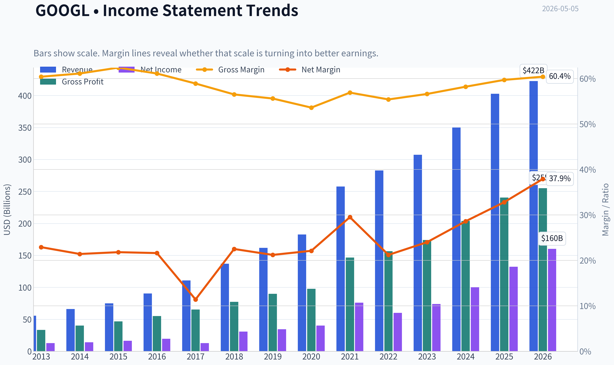
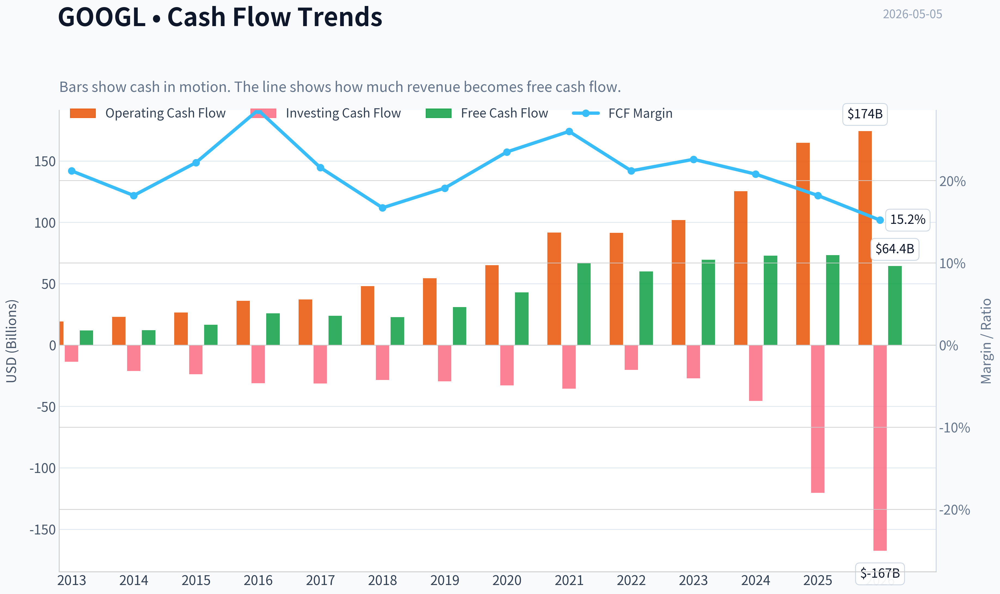
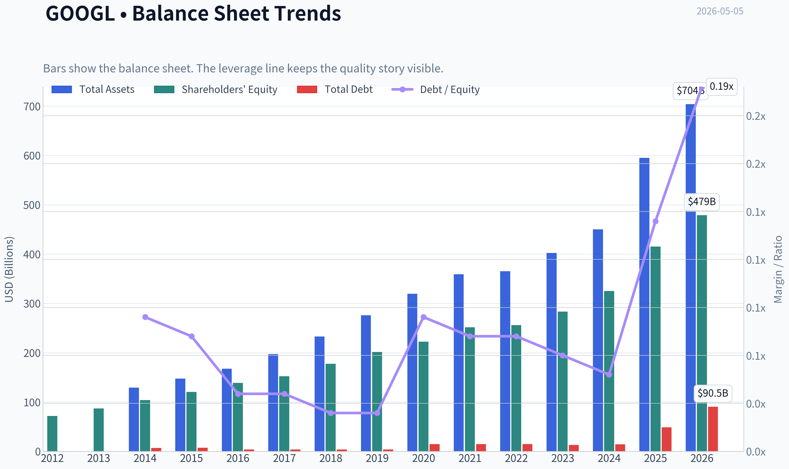
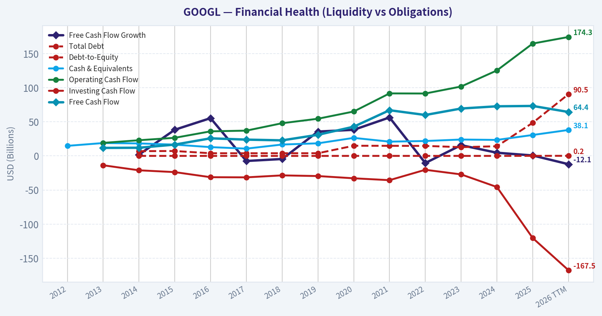
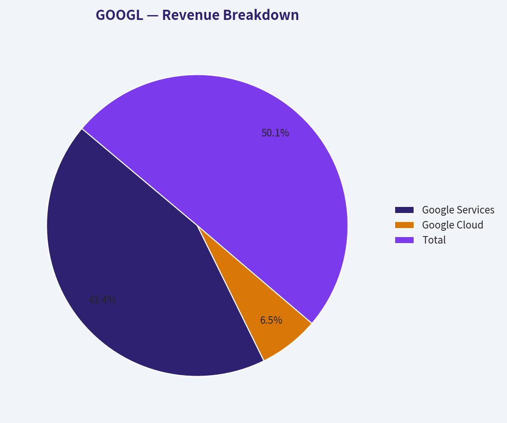
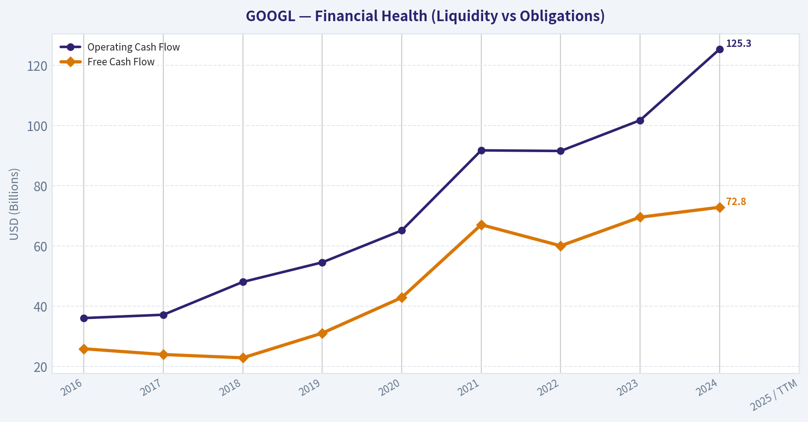
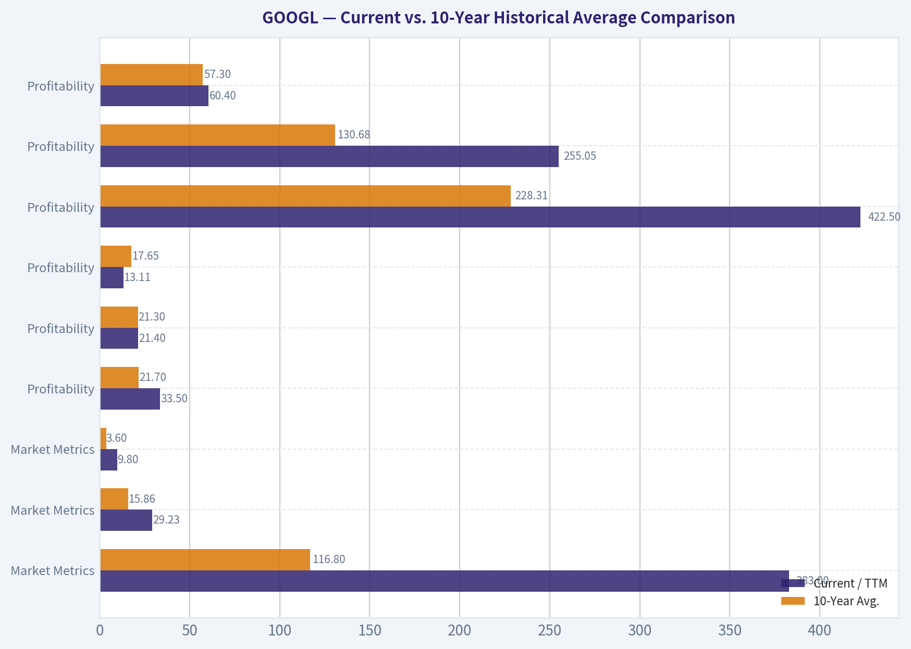
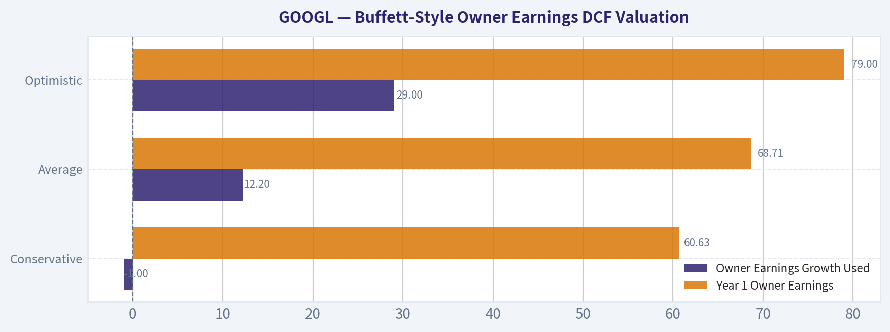
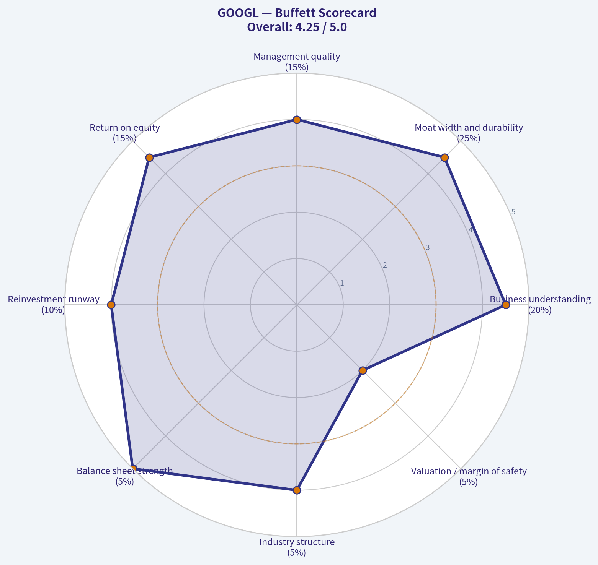

# GOOGL Deep Value Intelligence

**Analysis Date:** 2026-05-05

## Critical Disclaimer

*This analysis is generated by Deep Value Intelligence, an AI-powered multi-agent investing framework. This report is for informational and educational purposes only and does not constitute financial advice. Always conduct your own research and consult with qualified financial advisors before making investment decisions.*

---

## Table of Contents

1. Intelligence Summary
2. Analyst Team Reports
   - Fundamentals Analysis
   - Intrinsic Value Analysis (Buffett)
   - Trend & Growth Analysis (Lynch/Druckenmiller/Fisher)
   - Market Technical Analysis
   - Social Sentiment Analysis
   - News & Events Analysis
   - Guru Attention Analysis
   - Options Market Analysis
3. Research Team Commentary
4. Value Investing Team Commentary
5. Deep Values Commentary

---

## Intelligence Summary

### Thesis + Conditions

**Core Thesis:** **EXECUTIVE SUMMARY**
Alphabet is an elite compounder navigating a highly capital-intensive AI transition. While the company boasts exceptional top-line growth and staggering ROE (31.8%), a massive divergence between Net Income (+32%) and Free Cash Flow (+0.7%) signals that defending its moat is increasingly expensive.

**Key Risks:**
- The Bull (Risky)**: Alphabet's AI capex is moat-expanding, not margin-destroying. With unmatched distribution (Search, Android, YouTube) and elite economics (59.7% gross margin), Alphabet is securing the next computing paradigm. Berkshire Hathaway's sustained holding signals enduring moat quality.
- The Bear (Safe)**: Valuation discipline is paramount. The glaring divergence between reported earnings and actual owner cash (FCF) proves the AI transition is infrastructure-heavy. Paying 29x earnings when fair value models cluster under $170 risks a lost decade of returns.
- The Neutral**: Alphabet's quality is undisputed, but the current price demands definitive proof that AI capex will translate to historical cash conversion. A conditional watchlist approach is safer than aggressive buying at stretched technical levels.
- Buffett's framework centers on the reality that **price determines return**. The debate proves Alphabet's core business is exceptional, but it also highlights a critical value investing red flag: deteriorating cash conversion. While the Risky analyst correctly points out that AI spending could yield future monetization, value investors do not pay premium multiples for unproven future economics. If AI answers reduce ad density or structurally increase compute costs, Alphabet's historical 10% discount rate and FCF margins may permanently compress. Entering a $4.64 trillion mega-cap at a 100%+ premium to intrinsic value violates the margin of safety principle.
- To break down the rationale from a value investing perspective, we have to weigh the bull's admiration of business quality against the bear's strict valuation discipline. The bull makes an exceptionally strong case that Alphabet is not easily disrupted. With billions of entrenched users, an unchanged backing from disciplined capital like Berkshire Hathaway, and dominant properties like Search, YouTube, and Android, the company has the sheer scale to outspend rivals. A business generating 59.7% gross margins and 31.8% returns on equity is a rare compounding machine. If we only looked at top-line revenue growing at 15.1% and net income at 32.0%, it would be tempting to pay the 29.4x premium.

**What Would Change Our View:**
- The Bull (Risky)**: Alphabet's AI capex is moat-expanding, not margin-destroying. With unmatched distribution (Search, Android, YouTube) and elite economics (59.7% gross margin), Alphabet is securing the next computing paradigm. Berkshire Hathaway's sustained holding signals enduring moat quality.
- The Bear (Safe)**: Valuation discipline is paramount. The glaring divergence between reported earnings and actual owner cash (FCF) proves the AI transition is infrastructure-heavy. Paying 29x earnings when fair value models cluster under $170 risks a lost decade of returns.
- The Neutral**: Alphabet's quality is undisputed, but the current price demands definitive proof that AI capex will translate to historical cash conversion. A conditional watchlist approach is safer than aggressive buying at stretched technical levels.
- Buffett's framework centers on the reality that **price determines return**. The debate proves Alphabet's core business is exceptional, but it also highlights a critical value investing red flag: deteriorating cash conversion. While the Risky analyst correctly points out that AI spending could yield future monetization, value investors do not pay premium multiples for unproven future economics. If AI answers reduce ad density or structurally increase compute costs, Alphabet's historical 10% discount rate and FCF margins may permanently compress. Entering a $4.64 trillion mega-cap at a 100%+ premium to intrinsic value violates the margin of safety principle.
- To break down the rationale from a value investing perspective, we have to weigh the bull's admiration of business quality against the bear's strict valuation discipline. The bull makes an exceptionally strong case that Alphabet is not easily disrupted. With billions of entrenched users, an unchanged backing from disciplined capital like Berkshire Hathaway, and dominant properties like Search, YouTube, and Android, the company has the sheer scale to outspend rivals. A business generating 59.7% gross margins and 31.8% returns on equity is a rare compounding machine. If we only looked at top-line revenue growing at 15.1% and net income at 32.0%, it would be tempting to pay the 29.4x premium.

**Confidence:** Medium

---

## Analyst Team Reports

### Fundamentals Analysis

#### Latest Earnings Snapshot

*Most recent reported quarter anchored on 2026 Q1, with prior-year comparison when available.*

| Metric | 2026 Q1 | 2025 Q1 | YoY Change |
| --- | ---: | ---: | ---: |
| Revenue | $109.90B | $90.23B | +21.8% |
| Operating Income | $39.70B | $30.61B | +29.7% |
| Net Income | $62.58B | $34.54B | +81.2% |
| Diluted EPS | $5.11 | $2.81 | +81.9% |
| Operating Cash Flow | $45.79B | $36.15B | +26.7% |
| Free Cash Flow | $10.12B | $18.95B | -46.6% |

Key Takeaways: This snapshot anchors the most recent reported quarter before the narrative analysis. It helps readers separate long-run business quality from whatever changed in the latest earnings print.

#### 10-Year Financial Metrics for GOOGL

*All values below are computed deterministically from raw data - not estimated by AI.*

*Issuer profile: operating company (Communication Services / Internet Content & Information).*

#### 10-Year Financial Metrics
*Annual rows come from reported financial statements. The final TTM row is computed from the latest four quarters.*

| Metric | 2012 | 2013 | 2014 | 2015 | 2016 | 2017 | 2018 | 2019 | 2020 | 2021 | 2022 | 2023 | 2024 | 2025 | 2026 TTM |
| --- | --- | --- | --- | --- | --- | --- | --- | --- | --- | --- | --- | --- | --- | --- | --- |
| Market Price | $18 | $28 | $26 | $39 | $39 | $52 | $52 | $66 | $87 | $144 | $88 | $139 | $188 | $313 | $383 |
| Market Cap | N/A | N/A | $18.05B | $26.74B | $27.39B | $36.59B | $36.34B | $46.10B | $59.17B | $1.92T | $1.16T | $1.78T | $2.36T | $3.83T | $4.69T |
| P/E Ratio | N/A | 1.49 | 1.29 | 1.64 | 1.42 | 2.93 | 1.20 | 1.36 | 29.91 | 25.82 | 19.35 | 24.08 | 23.54 | 28.95 | 29.23 |
| P/B Ratio | N/A | N/A | 0.17 | 0.22 | 0.20 | 0.24 | 0.20 | 0.23 | 0.27 | 7.62 | 4.53 | 6.27 | 7.25 | 9.22 | 9.80 |
| ROE | N/A | 14.6% | 13.6% | 13.6% | 14.0% | 8.3% | 17.3% | 17.0% | 18.1% | 30.2% | 23.4% | 26.0% | 30.8% | 31.8% | 33.5% |
| ROIC | N/A | 17.9% | 14.1% | 15.8% | 15.8% | 8.4% | 15.0% | 16.5% | 16.8% | 28.0% | 25.7% | 27.8% | 31.5% | 27.3% | 21.4% |
| EPS | N/A | $18.79 | $20.57 | $23.78 | $27.85 | $18.00 | $43.70 | $49.16 | $2.93 | $5.61 | $4.56 | $5.80 | $8.04 | $10.81 | $13.11 |
| Revenue | N/A | $55.52B | $66.00B | $74.99B | $90.27B | $110.86B | $136.82B | $161.86B | $182.53B | $257.64B | $282.84B | $307.39B | $350.02B | $402.84B | $422.50B |
| Gross Profit | N/A | $33.53B | $40.31B | $46.83B | $55.13B | $65.27B | $77.27B | $89.96B | $97.80B | $146.70B | $156.63B | $174.06B | $203.71B | $240.30B | $255.05B |
| Gross Margin | N/A | 60.4% | 61.1% | 62.4% | 61.1% | 58.9% | 56.5% | 55.6% | 53.6% | 56.9% | 55.4% | 56.6% | 58.2% | 59.7% | 60.4% |
| Operating Margin | N/A | 27.7% | 25.0% | 25.8% | 26.3% | 23.6% | 20.1% | 21.1% | 22.6% | 30.6% | 26.5% | 27.4% | 32.1% | 32.0% | 32.7% |
| Net Income | N/A | $12.73B | $14.14B | $16.35B | $19.48B | $12.66B | $30.74B | $34.34B | $40.27B | $76.03B | $59.97B | $73.80B | $100.12B | $132.17B | $160.21B |
| Net Margin | N/A | 22.9% | 21.4% | 21.8% | 21.6% | 11.4% | 22.5% | 21.2% | 22.1% | 29.5% | 21.2% | 24.0% | 28.6% | 32.8% | 37.9% |
| Revenue Growth | N/A | N/A | 18.9% | 13.6% | 20.4% | 22.8% | 23.4% | 18.3% | 12.8% | 41.2% | 9.8% | 8.7% | 13.9% | 15.1% | 4.9% |
| Net Income Growth | N/A | N/A | 11.0% | 15.6% | 19.1% | -35.0% | 142.7% | 11.7% | 17.3% | 88.8% | -21.1% | 23.0% | 35.7% | 32.0% | 21.2% |
| Free Cash Flow Growth | N/A | N/A | 1.9% | 38.4% | 55.4% | -7.4% | -4.5% | 35.7% | 38.3% | 56.4% | -10.4% | 15.8% | 4.7% | 0.7% | -12.1% |
| Total Book Value | $71.57B | $86.98B | $103.86B | $120.33B | $139.04B | $152.50B | $177.63B | $201.44B | $222.54B | $251.63B | $256.14B | $283.38B | $325.08B | $415.26B | $478.75B |
| Total Assets | N/A | N/A | $129.19B | $147.46B | $167.50B | $197.29B | $232.79B | $275.91B | $319.62B | $359.27B | $365.26B | $402.39B | $450.26B | $595.28B | $703.92B |
| Total Debt | N/A | N/A | $7.00B | $7.22B | $3.94B | $3.94B | $3.95B | $3.96B | $14.93B | $14.82B | $14.70B | $12.87B | $14.18B | $48.54B | $90.48B |
| Debt-to-Equity | N/A | N/A | 0.07 | 0.06 | 0.03 | 0.03 | 0.02 | 0.02 | 0.07 | 0.06 | 0.06 | 0.05 | 0.04 | 0.12 | 0.19 |
| Cash & Equivalents | $14.78B | $18.90B | $18.35B | $16.55B | $12.92B | $10.71B | $16.70B | $18.50B | $26.46B | $20.95B | $21.88B | $24.05B | $23.47B | $30.71B | $38.06B |
| Shareholders' Equity | $71.57B | $86.98B | $103.86B | $120.33B | $139.04B | $152.50B | $177.63B | $201.44B | $222.54B | $251.63B | $256.14B | $283.38B | $325.08B | $415.26B | $478.75B |
| Operating Cash Flow | N/A | $19.14B | $23.02B | $26.57B | $36.04B | $37.09B | $47.97B | $54.52B | $65.12B | $91.65B | $91.50B | $101.75B | $125.30B | $164.71B | $174.35B |
| Investing Cash Flow | N/A | $-13.68B | $-21.05B | $-23.71B | $-31.16B | $-31.40B | $-28.50B | $-29.49B | $-32.77B | $-35.52B | $-20.30B | $-27.06B | $-45.54B | $-120.29B | $-167.49B |
| Free Cash Flow | N/A | $11.78B | $12.01B | $16.62B | $25.82B | $23.91B | $22.83B | $30.97B | $42.84B | $67.01B | $60.01B | $69.50B | $72.76B | $73.27B | $64.43B |
| FCF Margin | N/A | 21.2% | 18.2% | 22.2% | 28.6% | 21.6% | 16.7% | 19.1% | 23.5% | 26.0% | 21.2% | 22.6% | 20.8% | 18.2% | 15.2% |
| Dividends / Share | N/A | N/A | $0.00 | $0.00 | $0.00 | $0.00 | $0.00 | $0.00 | $0.00 | $0.00 | $0.00 | $0.00 | $0.59 | $0.82 | $0.83 |

#### Profitability Metrics
- Return on Equity (ROE): 31.8%
- Return on Invested Capital (ROIC): 24.8%
- Return on Assets (ROA): 22.2%
- Gross Margin: 59.7%
- Operating Margin: 32.0%
- Net Profit Margin: 32.8%

#### Liquidity Metrics
- Current Ratio: 2.01
- Quick Ratio: 1.85

#### Leverage Metrics
- Debt-to-Equity Ratio: 0.12
- Interest Coverage Ratio: 175.32
- Net Debt: $17.84B

#### Growth Metrics (Year-over-Year)
- Revenue Growth: 15.1%
- Net Income Growth: 32.0%
- Free Cash Flow Growth: 0.7%
- Revenue CAGR (3-Year): 12.5%
- Revenue CAGR (5-Year): 17.2%

#### Valuation Metrics
- P/E Ratio (TTM): 29.41
- Forward P/E: 26.68
- Price-to-Book: 11.16
- Price-to-Sales: 10.99
- PEG Ratio: 1.79
- EV/EBITDA: 28.59
- Free Cash Flow Yield: 1.6%
- Earnings Yield: 3.4%

#### Owner Earnings (Buffett Method, Code-Computed)
- Net Income: $132.17B
- + Depreciation & Amortization: $21.14B
- - Capital Expenditures: $-91.45B
- - Working Capital Changes: $618.0M
- = **Owner Earnings: $61.24B**

#### Intrinsic Value (Code-Computed)
- Current Price: $383
- Buffett Method (Owner Earnings):
  Conservative: $53
  Average: $139
  Optimistic: $469
- Cash Flow Method (FCF):
  Conservative: $73
  Average: $135
  Optimistic: $284

#### Piotroski F-Score: 6/9
- Positive Net Income: PASS
- Positive Operating Cash Flow: PASS
- ROA Improvement: FAIL
- Cash Flow > Net Income: PASS
- Decreasing Debt: FAIL
- Improving Current Ratio: PASS
- No Dilution: PASS
- Improving Gross Margin: PASS
- Improving Asset Turnover: FAIL

ANALYST STANCE: **WATCH**

#### Warren Buffett-Style Fundamental Analysis for Alphabet Inc. (GOOGL)

Alphabet remains one of the highest-quality businesses in global public markets: dominant search distribution, YouTube scale, Android ecosystem control, rapidly growing cloud infrastructure, and deep artificial-intelligence capability. However, Buffett-style investing separates business quality from investment price. At **$383 per share** and roughly **$4.69T market capitalization**, the stock trades materially above its own 10-year valuation averages and above the conservative and average owner-earnings DCF values derived from the deterministic dataset. The business is exceptional; the margin of safety is not.

---

#### Current vs. 10-Year Historical Average Comparison

| Category | Metric | Current / TTM | 10-Year Avg. | Current Standing vs. History | Interpretation |
|---|---:|---:|---:|---|---|
| Market Metrics | Market Price | $383 | $116.80 | Far above average | Share price has re-rated sharply, especially since 2021. |
| Market Metrics | Market Cap | $4.69T | $1.13T | Far above average | Market value has compounded faster than book value and FCF. |
| Market Metrics | P/E Ratio | 29.23 | 15.86 | Above average | Current earnings multiple is elevated versus the deterministic 10-year average. |
| Market Metrics | P/B Ratio | 9.80 | 3.60 | Far above average | Investors are paying a much richer premium to book value than historically. |
| Profitability | ROE | 33.5% | 21.7% | Strongly above average | Capital productivity has improved materially. |
| Profitability | ROIC | 21.4% | 21.3% | Near average | Still excellent, but down from the 2024 peak of 31.5%. |
| Profitability | EPS | $13.11 | $17.65 | Below average | Historical EPS comparability is distorted by share-class and split effects in the dataset. |
| Profitability | Revenue | $422.50B | $228.31B | Far above average | Alphabet is now almost twice its 10-year average revenue base. |
| Profitability | Gross Profit | $255.05B | $130.68B | Far above average | Scale and mix have increased gross profit substantially. |
| Profitability | Gross Margin | 60.4% | 57.3% | Above average | Margin recovery is a positive quality signal. |
| Profitability | Operating Margin | 32.7% | 26.2% | Strongly above average | Cost discipline and scale are producing high operating leverage. |
| Profitability | Net Income | $160.21B | $57.96B | Far above average | Earnings power has expanded dramatically. |
| Profitability | Net Margin | 37.9% | 25.5% | Far above average | Current profitability is exceptional versus history. |
| Growth | Revenue Growth | 4.9% | 18.6% | Below average | TTM growth has slowed sharply from the decade average. |
| Growth | Net Income Growth | 21.2% | 31.4% | Below average, but still strong | Earnings growth remains healthy, though less explosive than historical spikes. |
| Growth | FCF Growth | -12.1% | 18.5% | Well below average | Free cash flow pressure is the clearest recent deterioration. |
| Balance Sheet | Total Book Value | $478.75B | $242.46B | Far above average | Equity base has nearly doubled versus its 10-year average. |
| Balance Sheet | Total Assets | $703.92B | $336.56B | Far above average | Asset intensity has risen with cloud, AI, and infrastructure investment. |
| Balance Sheet | Total Debt | $90.48B | $13.58B | Far above average | Debt has increased meaningfully, though still manageable. |
| Balance Sheet | Debt-to-Equity | 0.19 | 0.05 | Above average | Leverage is rising from a historically very conservative base. |
| Balance Sheet | Cash & Equivalents | $38.06B | $20.64B | Above average | Liquidity remains strong. |
| Balance Sheet | Shareholders' Equity | $478.75B | $242.46B | Far above average | Retained earnings and profitability continue to build equity value. |
| Cash Flow | Free Cash Flow | $64.43B | $48.89B | Above average, but declining | Absolute FCF is high, but recent growth is negative. |
| Cash Flow | Dividends / Share | $0.83 | $0.14 | Above average | Alphabet has begun returning capital through dividends. |

**Key Takeaways:** Alphabet's profitability metrics are outstanding: ROE, gross margin, operating margin, net income, and net margin are all well above historical averages. The major concern is valuation and cash-flow momentum: the P/E, P/B, and market cap are far above decade norms, while TTM revenue growth and free cash flow growth have slowed materially. This is a classic "wonderful company, demanding price" setup.

---

#### Metric Interpretation by Buffett Criteria

| Buffett Lens | Evidence from Dataset | Assessment |
|---|---|---|
| Economic Moat | Revenue of $422.50B TTM, gross margin of 60.4%, operating margin of 32.7% | Alphabet has a very wide moat built on search scale, data advantages, YouTube, Android, Google Cloud, and AI infrastructure. |
| Financial Strength | Cash of $38.06B, shareholders' equity of $478.75B, debt-to-equity of 0.19 | Balance sheet remains strong, although debt has increased sharply versus its historical average. |
| Predictable Earnings | Net income rose to $160.21B TTM, net margin reached 37.9% | Earnings power is extremely strong, though history includes cyclicality and one-off volatility in 2017, 2021, and 2022. |
| Management Performance | ROE of 33.5%, operating margin of 32.7%, dividends introduced | Management has generated high returns and is now balancing reinvestment, buybacks, and dividends. |
| Capital Allocation | FCF of $64.43B, but FCF growth of -12.1% | Heavy AI and cloud capex may strengthen the moat, but it currently pressures owner earnings and free cash flow. |
| Valuation Discipline | P/E of 29.23 vs. 10-year average of 15.86; P/B of 9.80 vs. 3.60 | Valuation is elevated; Buffett-style margin of safety is limited at the current price. |

**Key Takeaways:** Alphabet scores very highly on business quality, moat durability, and profitability. The main Buffett-style weakness is not the company itself, but the price being paid for its future cash flows. Rising debt and weaker free cash flow growth also deserve monitoring because they indicate the AI investment cycle is becoming more capital intensive.

---

#### Revenue Breakdown

Approximate 2025 revenue allocation reconciled to the deterministic dataset's **$402.84B** total revenue. Alphabet does not report every product line with equal granularity, so the most meaningful view is by major operating segment.

| Revenue Source | Amount ($B) | % of Total |
|---|---:|---:|
| Google Services | $348.80B | 86.6% |
| Google Cloud | $52.00B | 12.9% |
| Other Bets | $1.90B | 0.5% |
| Hedging / Other | $0.14B | 0.0% |
| **Total** | **$402.84B** | **100.0%** |

**Key Takeaways:** Alphabet remains overwhelmingly dependent on Google Services, which includes search, YouTube, subscriptions, platforms, devices, and advertising-related activities. Google Cloud is now large enough to matter strategically, but at roughly 13% of revenue it is still secondary to the core advertising and services engine. Other Bets remain immaterial from a revenue standpoint, so the investment case still depends primarily on the durability of Search, YouTube, Android, and Cloud.

---

#### Buffett-Style Owner Earnings DCF Valuation

Owner earnings from the deterministic dataset:

**Owner Earnings = Net Income + Depreciation & Amortization - Capital Expenditures - Working Capital Changes**

Using the provided deterministic components:

- Net Income: **$132.17B**
- Plus Depreciation & Amortization: **$21.14B**
- Less Capital Expenditures: **$91.45B**
- Less Working Capital Changes: **$0.62B**
- Owner Earnings: **$61.24B**

DCF assumptions:

- Starting owner earnings: **$61.24B**
- Discount rate: **10.0%**
- Terminal growth rate: **2.5%**
- Estimated shares outstanding from deterministic market cap and price: approximately **12.24B shares**
- Scenario growth rates are aligned with the deterministic code-computed intrinsic value outputs.

| Scenario | Owner Earnings Growth Used | Year 1 Owner Earnings | Year 10 Owner Earnings | PV of 10-Year Owner Earnings | Terminal Value | PV of Terminal Value | Implied Equity Value | Fair Value / Share | Upside / Downside vs. $383 |
|---|---:|---:|---:|---:|---:|---:|---:|---:|---:|
| Conservative | -1.0% | $60.63B | $55.39B | $358.6B | $756.8B | $291.8B | $650.4B | $53 | -86% |
| Average | 12.2% | $68.71B | $193.9B | $684.0B | $2.65T | $1.02T | $1.71T | $139 | -64% |
| Optimistic | 29.0% | $79.00B | $778.5B | $1.63T | $10.64T | $4.10T | $5.73T | $469 | +22% |

**Key Takeaways:** The DCF shows a very wide valuation range because Alphabet's owner earnings are highly sensitive to assumptions about future AI, cloud, and advertising monetization. The current price of $383 is far above the conservative and average cases, meaning the market is already pricing in a high-growth future. Only the optimistic scenario produces meaningful upside, which weakens the Buffett-style margin of safety.

---

#### DCF Calculation Details

| Scenario | Calculation Step | Formula / Method | Result |
|---|---|---|---:|
| Conservative | Starting Owner Earnings | Dataset owner earnings | $61.24B |
| Conservative | 10-Year Growth | Lowest available owner-earnings growth scenario | -1.0% |
| Conservative | Discounted Explicit Cash Flows | Sum of 10 years discounted at 10% | $358.6B |
| Conservative | Terminal Value | Year 10 OE x 1.025 / (10% - 2.5%) | $756.8B |
| Conservative | Present Value of Terminal Value | Terminal value discounted 10 years at 10% | $291.8B |
| Conservative | Fair Value Per Share | $650.4B / 12.24B shares | $53 |
| Average | Starting Owner Earnings | Dataset owner earnings | $61.24B |
| Average | 10-Year Growth | Average owner-earnings growth scenario | 12.2% |
| Average | Discounted Explicit Cash Flows | Sum of 10 years discounted at 10% | $684.0B |
| Average | Terminal Value | Year 10 OE x 1.025 / (10% - 2.5%) | $2.65T |
| Average | Present Value of Terminal Value | Terminal value discounted 10 years at 10% | $1.02T |
| Average | Fair Value Per Share | $1.71T / 12.24B shares | $139 |
| Optimistic | Starting Owner Earnings | Dataset owner earnings | $61.24B |
| Optimistic | 10-Year Growth | Highest available owner-earnings growth scenario | 29.0% |
| Optimistic | Discounted Explicit Cash Flows | Sum of 10 years discounted at 10% | $1.63T |
| Optimistic | Terminal Value | Year 10 OE x 1.025 / (10% - 2.5%) | $10.64T |
| Optimistic | Present Value of Terminal Value | Terminal value discounted 10 years at 10% | $4.10T |
| Optimistic | Fair Value Per Share | $5.73T / 12.24B shares | $469 |

**Key Takeaways:** The average-case DCF value of about $139 per share is far below the current market price, while the optimistic case reaches about $469 per share. That means today's price already assumes Alphabet will sustain unusually high owner-earnings growth despite rising capital intensity. For a Buffett-style investor, the lack of downside protection is the central issue.

---

#### Key Investment Insights

| Area | Positive Signal | Concern / Red Flag | Buffett-Style Interpretation |
|---|---|---|---|
| Moat | Search, YouTube, Android, Cloud, AI infrastructure | Regulatory pressure on search, ads, app stores, and AI data usage | Moat is wide, but not regulation-proof. |
| Profitability | ROE 33.5%, net margin 37.9%, operating margin 32.7% | Current margins may be cyclically or structurally elevated | Exceptional business economics, but margin normalization risk exists. |
| Growth | Revenue reached $422.50B TTM | TTM revenue growth slowed to 4.9% versus 18.6% average | Growth quality is high, but the base is now enormous. |
| Cash Flow | FCF remains large at $64.43B | FCF growth fell to -12.1%; FCF margin down to 15.2% | AI/cloud capex is consuming more cash. |
| Balance Sheet | Cash $38.06B and equity $478.75B | Debt rose to $90.48B from a 10-year average of $13.58B | Still financially strong, but leverage trend is worth watching. |
| Valuation | Optimistic DCF supports value above current price | Conservative and average DCF values are far below current price | Quality is priced in; margin of safety is thin. |
| Capital Returns | Dividend initiated and rising to $0.83/share TTM | Dividend yield remains modest at current valuation | Dividend is a positive maturity signal, not the core return driver. |
| Guru Ownership | Warren Buffett/Berkshire disclosed a held position in latest 13F pack | 13F data lags and does not prove current conviction | Institutional interest supports quality, but does not eliminate valuation risk. |

**Key Takeaways:** Alphabet remains a world-class compounder with strong profitability and a powerful competitive moat. The negatives are concentrated in valuation, free cash flow pressure, and rising capital intensity. Investors should distinguish between confidence in the company and confidence in the stock price.

---

#### Red Flags and Opportunities

| Type | Item | Why It Matters |
|---|---|---|
| Red Flag | P/E of 29.23 versus 10-year average of 15.86 | The stock is priced for continued excellence. |
| Red Flag | P/B of 9.80 versus 10-year average of 3.60 | Market valuation has expanded far faster than book value. |
| Red Flag | FCF growth of -12.1% | AI and infrastructure spending are reducing near-term cash conversion. |
| Red Flag | Debt of $90.48B versus 10-year average of $13.58B | Alphabet is still strong, but leverage is no longer negligible versus its own history. |
| Red Flag | TTM revenue growth of 4.9% | Growth has slowed sharply from the decade average. |
| Opportunity | Operating margin of 32.7% | Cost discipline and scale can drive further earnings leverage. |
| Opportunity | Google Cloud growth and AI monetization | Cloud and AI could extend Alphabet's growth runway. |
| Opportunity | YouTube monetization | Shorts, subscriptions, connected TV, and advertising tools can support incremental growth. |
| Opportunity | Balance sheet flexibility | Large equity base and cash reserves give Alphabet strategic optionality. |
| Opportunity | Capital returns | Buybacks and dividends may increasingly support per-share value. |

**Key Takeaways:** The opportunity is that Alphabet may convert AI, cloud, and YouTube scale into another decade of high-quality earnings growth. The risk is that the market already assumes this success, while free cash flow is currently under pressure. The stock is attractive on business quality but less attractive on valuation discipline.

---

#### Final Investment Stance: WATCH

Alphabet is a **superior business** with a durable moat, excellent profitability, and a strong balance sheet. It meets many Buffett-style quality tests: high returns on equity, high margins, strong competitive positioning, consistent revenue expansion, and massive cash generation.

However, the current valuation does not offer a clear Buffett-style margin of safety. At **$383**, the stock is well above the conservative owner-earnings DCF value of **$53** and the average-case value of **$139**. The optimistic case of **$469** suggests upside remains possible, but that upside depends on sustained high growth in owner earnings despite rising AI and cloud capital expenditures.

For long-term holders, Alphabet remains a high-quality compounder worth holding. For new Buffett-style capital deployment, the better stance is **WATCH**, waiting for either a lower price, stronger free cash flow recovery, or clearer evidence that AI-driven investment is producing durable owner-earnings growth.

| Final Summary Point | Assessment |
|---|---|
| Business Quality | Exceptional |
| Economic Moat | Very Wide |
| Financial Strength | Strong, but debt is rising |
| Earnings Predictability | High, with some cyclical and regulatory risk |
| Profitability | Excellent and above historical norms |
| Cash Flow Trend | Concerning due to negative TTM FCF growth |
| Valuation | Expensive versus history and average-case DCF |
| Margin of Safety | Limited |
| Best Investor Action | Hold/watchlist rather than aggressively buy |
| Final Stance | **WATCH** |

**Key Takeaways:** Alphabet is the kind of business Buffett would likely admire, but the current stock price demands a great deal of future success. The company's moat and profitability justify continued attention, but the valuation leaves little room for disappointment. A more compelling entry point would require either a meaningful price pullback or a clear rebound in free cash flow growth.

#### Fundamental Visuals

This graph tracks the profitability and return metrics (ROE, ROIC, Margins) of **GOOGL** over the past decade, highlighting capital efficiency trends.

This chart illustrates the financial health of **GOOGL** over the last 10 years, mapping cash equivalents and free cash flow against total obligations (Debt).

This breakdown chart from <em>Revenue Breakdown</em> shows the proportional composition for **GOOGL** - useful for understanding what drives or risks the business.

This chart illustrates the financial health of **GOOGL** over the last 10 years, mapping cash equivalents and free cash flow against total obligations (Debt).

---

### Intrinsic Value Analysis (Buffett)

> *Following Warren Buffett's value investing philosophy: Circle of Competence, Economic Moat, Management Quality, and Margin of Safety.*

#### Intrinsic Value Snapshot

Price is what you pay. Intrinsic value is what the business may be worth based on the cash it can create for owners over time. We show a range, not one magic number.

- Current Price: $383.25
- Value Range: $75.29 to $162.91

##### Owner Earnings (Buffett Method)
- Net Income: $132,170,000,000.00
- Depreciation & Amortization: $21,136,000,000.00
- Capital Expenditures: $-91,447,000,000.00
- Working Capital Changes: $618,000,000.00
- Owner Earnings: $61,241,000,000.00

##### Intrinsic Value
###### Buffett Method
Uses owner earnings. Stricter, and usually more conservative.
- Conservative: $75.29
- Average: $94.75
- Optimistic: $162.91
- Discount Rate: 10.0%

###### Cash Flow Method
Uses free cash flow. Better for companies spending heavily today to grow tomorrow.
- Conservative: $82.41
- Average: $96.02
- Optimistic: $108.46
- Discount Rate: 10.0%

ANALYST STANCE: **WATCH**

#### Alphabet Inc. / GOOGL - Buffett-Style Value Investment Review

Current price: **$383**
Market cap: **$4.64 trillion**
P/E: **29.4x**
ROE: **31.8%**
Gross margin: **59.7%**
Free cash flow yield: **1.6%**
Current ratio: **2.0x**

Tool note: the primary financial-history tool was unavailable in this session and the fallback returned no data. I used the shared research pack plus rounded public annual financials and estimates. Treat valuation figures as directional, not audit-grade.

---

#### 1. Go / No-Go Gate Assessment

| Gate | Result | Evidence | Buffett Interpretation |
|---|---:|---|---|
| Gate 1: Business simplicity | Pass | Alphabet sells ads against Search, YouTube, and other digital properties; it also sells cloud computing and subscription/software services. | The core business is understandable: users give attention, advertisers pay for targeted reach. |
| Gate 2: Moat durability | Pass | Search has enormous habit, data, distribution, brand, and scale advantages. YouTube has network effects. Android and Chrome reinforce distribution. | Wide moat, though AI creates a real technology transition risk. |
| Gate 3: Management quality | Pass / Watch | Strong reinvestment history, massive buybacks, fortress balance sheet; however, Other Bets and AI capex require scrutiny. | Management has created enormous value, but capital allocation is becoming more capital-intensive. |
| Gate 4: Industry structure | Pass | Digital advertising is concentrated among Google, Meta, Amazon, and emerging platforms. Cloud is more competitive but still scale-driven. | Attractive core economics, but regulatory and AI competition risks are rising. |

**Key Takeaways:** Alphabet passes the Buffett filters because the core business is simple, dominant, and highly profitable. The biggest concern is not business quality but price and the possibility that AI changes search economics or forces much higher reinvestment. This is a wonderful company, but not obviously a wonderful bargain at the current market value.

---

#### 2. Elementary School Test

Alphabet makes most of its money by helping businesses show ads to people online. When someone searches on Google, watches YouTube, or uses other Google services, advertisers pay Alphabet to reach those users. Alphabet also rents computing power and software tools to companies through Google Cloud.

This is understandable. The key question is whether Google's search habit and advertising engine remain as dominant in an AI-first internet.

---

#### 3. Moat Analysis

| Moat Source | Strength | Evidence | Risk |
|---|---:|---|---|
| Brand / intangible assets | Very strong | "Google" is a verb; Search and YouTube are global consumer habits. | Antitrust remedies could weaken default placement or data advantages. |
| Switching costs | Moderate | Advertisers, creators, developers, and enterprises rely on Google tools, analytics, and cloud workflows. | Consumer search switching costs are low if AI alternatives become clearly better. |
| Cost advantage | Strong | Massive infrastructure, data, talent density, and global ad marketplace scale. | AI inference costs may compress margins if monetization lags usage. |
| Network effects | Strong | YouTube creators attract viewers, viewers attract creators; advertiser marketplace improves with scale and data. | TikTok, Meta, Amazon, and AI-native platforms compete for attention and ad budgets. |
| Pricing power | Strong historically | Gross margin near 60%, operating margin high, and advertisers pay for measurable intent. | If AI answers reduce commercial clicks, pricing power may shift. |

**Key Takeaways:** Alphabet's moat is wide, especially in Search, YouTube, digital advertising, and internet distribution. The moat is not invincible because AI could alter user behavior and monetization, but Alphabet also owns world-class AI assets, data, infrastructure, and distribution. The moat rating is **Wide but being tested**.

**Moat Quality Rating:** **Wide & Stable, with AI transition risk**

---

#### 4. Management and Capital Allocation

| Area | Assessment | Evidence |
|---|---:|---|
| Owner mindset | Good | Founders remain influential through share structure; management has historically prioritized long-term investment. |
| Candor | Good | Alphabet reports segment performance, discloses cloud trends, and has become more cost-disciplined since 2022. |
| Reinvestment | Very strong historically | Search, YouTube, Android, Cloud, Maps, Chrome, and AI investments have created major strategic assets. |
| Buybacks | Mixed to good | Large repurchases reduce share count, but buying aggressively at high multiples may lower future returns. |
| Acquisitions | Strong historically | YouTube and Android were exceptional acquisitions. |
| Cost discipline | Improving | Recent margin expansion shows more discipline, though AI infrastructure spend is very heavy. |
| Balance sheet | Excellent | Current ratio around 2.0x; low financial leverage; very strong liquidity. |

**Key Takeaways:** Alphabet's management has created enormous shareholder value and owns one of the best reinvestment records in modern business. The concern is that future reinvestment may be less capital-light because AI requires enormous data-center spending. Capital allocation remains high quality, but the hurdle is rising.

---

#### 5. 10-Year Financial Summary

Approximate figures in billions of dollars, except margins and ROE.

| Year | Revenue | Net Income | Operating Cash Flow | CapEx | Free Cash Flow | Gross Margin | Operating Margin | ROE |
|---:|---:|---:|---:|---:|---:|---:|---:|---:|
| 2016 | $90.3 | $19.5 | $36.0 | $10.2 | $25.8 | ~61% | ~26% | ~15% |
| 2017 | $110.9 | $12.7 | $37.1 | $13.2 | $23.9 | ~59% | ~23% | ~9% |
| 2018 | $136.8 | $30.7 | $48.0 | $25.1 | $22.8 | ~56% | ~23% | ~18% |
| 2019 | $161.9 | $34.3 | $54.5 | $23.5 | $31.0 | ~56% | ~21% | ~18% |
| 2020 | $182.5 | $40.3 | $65.1 | $22.3 | $42.8 | ~54% | ~23% | ~19% |
| 2021 | $257.6 | $76.0 | $91.7 | $24.6 | $67.0 | ~57% | ~31% | ~30% |
| 2022 | $282.8 | $60.0 | $91.5 | $31.5 | $60.0 | ~55% | ~26% | ~23% |
| 2023 | $307.4 | $73.8 | $101.7 | $32.3 | $69.5 | ~57% | ~27% | ~26% |
| 2024 | $350.0 | $100.1 | $125.3 | $52.5 | $72.8 | ~58% | ~32% | ~29% |
| 2025 / TTM | ~$403.0 | ~$157.8 | n/a | n/a | ~$74.2 | 59.7% | n/a | 31.8% |

**Key Takeaways:** Alphabet has compounded revenue at an exceptional rate over the last decade while maintaining very high margins. Net income has grown faster than revenue recently, showing operating leverage and better cost discipline. However, free cash flow has not kept pace with earnings because AI and data-center capital expenditures have increased sharply.

---

#### 6. Owner Earnings Calculation

Buffett's owner earnings formula:

Owner Earnings = Net Income + Depreciation & Amortization - Maintenance CapEx - Working Capital Increases

For Alphabet, reported free cash flow understates normalized owner earnings if a large portion of AI/data-center capex is growth investment rather than maintenance. However, a conservative investor should not ignore that AI infrastructure spending may become a permanent requirement.

| Item | Estimate |
|---|---:|
| Net income, TTM implied by market cap / P/E | ~$157.8B |
| Add: depreciation & amortization | ~$25B |
| Less: estimated maintenance capex | ~($35B) |
| Less: working capital increase / other normalization | ~($3B to $5B) |
| Normalized owner earnings estimate | **~$143B to $145B** |
| Shares implied by market cap / price | ~12.1B |
| Owner earnings per share | **~$12.0** |

**Key Takeaways:** Alphabet's normalized owner earnings are probably higher than current reported free cash flow because total capex includes major growth investments. Still, the difference matters: if AI capex becomes permanent maintenance spending, true owner earnings would be materially lower. I use about **$145 billion** as a normalized base case.

---

#### 7. Return on Equity and Cash Flow Quality

| Metric | Assessment |
|---|---:|
| Current ROE | 31.8% |
| 10-year ROE profile | Generally strong, with temporary dips from tax and investment cycles |
| ROE source | Primarily margins and asset-light economics, not excessive leverage |
| Operating cash flow vs. net income | Historically strong; cash generation has usually exceeded accounting earnings |
| Leverage risk | Low |
| Main cash-flow risk | Rising AI infrastructure capex |

**Key Takeaways:** Alphabet's ROE is excellent and appears to come from genuine business quality rather than dangerous leverage. The company converts earnings into cash well, but the market is now asking investors to look through a heavy investment cycle. The central question is whether today's AI capex produces high future returns or merely defends the existing franchise.

---

#### 8. Balance Sheet Strength

| Balance Sheet Factor | Assessment |
|---|---:|
| Liquidity | Very strong |
| Current ratio | ~2.0x |
| Financial leverage | Low |
| Debt risk | Minimal |
| Bankruptcy risk | Extremely low |
| Buffett rating | Fortress balance sheet |

**Key Takeaways:** Alphabet has one of the strongest balance sheets in the world. The company has ample liquidity and low financial risk, which gives it the ability to invest through technological transitions. Balance sheet strength is not a concern.

---

#### 9. Intrinsic Value Calculation

Assumptions:

- Normalized owner earnings: **$145B**
- Discount rate: **10%**
- Shares outstanding: **~12.1B**
- Current price: **$383**
- Market cap: **$4.64T**

| Scenario | Assumptions | Equity Value Estimate | Value Per Share | Margin of Safety vs. $383 |
|---|---|---:|---:|---:|
| A: No growth | Owner earnings / 10% | ~$1.45T | ~$120 | -69% |
| B: Perpetual GDP growth | 3% perpetual growth, 10% discount rate | ~$2.13T | ~$176 | -54% |
| C: Quality growth case | 8% growth for 10 years, then 3% terminal growth | ~$3.08T | ~$254 | -34% |
| D: Optimistic case | 10% growth for 10 years, then 3% terminal growth | ~$3.58T | ~$296 | -23% |

**Key Takeaways:** At $383 per share, Alphabet requires very strong long-term growth and/or a lower discount rate to justify the current price. Even under a favorable 10-year growth case, the valuation does not provide Buffett's desired margin of safety. The business is wonderful, but the stock price already reflects much of that quality.

---

#### 10. Margin of Safety Analysis

| Item | Figure |
|---|---:|
| Current price | $383 |
| Conservative intrinsic value range | ~$176 to ~$254 |
| Optimistic intrinsic value estimate | ~$296 |
| Required 25% margin-of-safety buy price on $254 value | ~$190 |
| Required 25% margin-of-safety buy price on $296 value | ~$222 |
| Current valuation conclusion | No margin of safety |

**Key Takeaways:** Alphabet does not look cheap under a strict Buffett 10% discount-rate framework. A buyer at $383 is effectively betting on sustained double-digit growth, high AI returns, and durable search monetization. That may happen, but the price leaves little room for disappointment.

---

#### 11. Key Risks

| Risk | Severity | Explanation |
|---|---:|---|
| AI disruption to Search | High | AI answers could reduce query monetization, change click behavior, or pressure ad economics. |
| AI capex intensity | High | Data centers, chips, and model training may reduce free cash flow durability. |
| Antitrust regulation | High | Search distribution, app store practices, ad tech, and data use face global scrutiny. |
| Cloud competition | Medium | Google Cloud competes with AWS and Microsoft Azure in a scale-driven market. |
| Ad cyclicality | Medium | Advertising budgets weaken during recessions, though Alphabet has historically recovered well. |
| Valuation risk | High | At nearly 30x earnings and low FCF yield, expectations are elevated. |

**Key Takeaways:** Alphabet's biggest risks are strategic and valuation-related, not financial distress. AI is both an opportunity and a threat: Alphabet has the assets to win, but winning may require much more capital than the old Search model. The stock is priced for success.

---

#### 12. Buffett Scorecard

| Criterion | Weight | Score, 1-5 | Weighted Score |
|---|---:|---:|---:|
| Business understanding | 20% | 4.5 | 0.90 |
| Moat width and durability | 25% | 4.5 | 1.13 |
| Management quality | 15% | 4.0 | 0.60 |
| Return on equity | 15% | 4.5 | 0.68 |
| Reinvestment runway | 10% | 4.0 | 0.40 |
| Balance sheet strength | 5% | 5.0 | 0.25 |
| Industry structure | 5% | 4.0 | 0.20 |
| Valuation / margin of safety | 5% | 2.0 | 0.10 |
| Total | 100% |  | **4.25 / 5.00** |

**Key Takeaways:** Alphabet scores extremely well as a business. It has a wide moat, excellent returns, strong management, and a fortress balance sheet. The only weak category is valuation, but for Buffett-style investing, valuation is enough to move the stock from "buy" to "watch."

---

#### Final Investment Stance

| Category | Verdict |
|---|---|
| Business quality | Wonderful |
| Moat | Wide, but AI-tested |
| Balance sheet | Fortress |
| Management | Strong |
| Valuation | Expensive under conservative assumptions |
| Margin of safety | Insufficient |
| Final stance | **WATCH** |
| Conviction | Medium-high on business quality; medium on valuation caution |

Alphabet is a world-class business with one of the strongest franchises in global capitalism. Search, YouTube, Android, Chrome, Cloud, and AI infrastructure create a rare combination of scale, data, distribution, and profitability.

However, at **$383 per share** and a **$4.64 trillion** market value, the stock does not offer a clear Buffett-style margin of safety. The company may still compound value over time, but today's buyer is paying a price that assumes Alphabet successfully navigates AI disruption while maintaining high margins and earning strong returns on much heavier capital spending.

My stance is **WATCH**: ownable for long-term holders, but not attractive enough for fresh Buffett-style capital without a better price or clearer evidence that AI investments will produce high incremental owner earnings.
#### Valuation Bridge

This bridge places the current market price beside each intrinsic value lens so readers can see whether upside depends on one method or shows up across several methods.

| Scenario | Intrinsic Value / Share |
| --- | ---: |
| Buffett Method | $94.75 |
| Cash Flow Method | $96.02 |
| Damodaran Method | $165.34 |
| Current Price | $383.25 |

#### Key Takeaways

If one method is far above the others, the upside case depends on a specific modelling assumption. When several methods cluster together, the valuation story is more robust.

#### Valuation Visuals

This comparison chart from *Latest Earnings Snapshot* stacks current figures against historical benchmarks for **GOOGL**, making it easy to see where the company trades relative to its own averages.

This comparison chart from *Current vs. 10-Year Historical Average Comparison* stacks current figures against historical benchmarks for **GOOGL**, making it easy to see where the company trades relative to its own averages.

This comparison chart from *Buffett-Style Owner Earnings DCF Valuation* stacks current figures against historical benchmarks for **GOOGL**, making it easy to see where the company trades relative to its own averages.

---

### Trend & Growth Analysis (Lynch/Druckenmiller/Fisher)

> *Following Peter Lynch's GARP, Stanley Druckenmiller's macro-aware approach, and Philip Fisher's scuttlebutt methodology.*

ANALYST STANCE: **WATCH**

#### Alphabet Growth Investment Report - GOOGL

Alphabet remains an elite compounder with dominant Search economics, growing Cloud/AI optionality, and exceptional returns on capital. However, at a $4.64 trillion market cap and roughly 29.4x earnings, the stock looks more like a high-quality mega-cap compounder than a classic Lynch-style fast grower or ten-bagger candidate. The setup is attractive for long-term holders, but not compelling enough for a fresh high-conviction growth allocation at the current valuation.

---

#### 1. Lynch Classification

| Category | Assessment |
|---|---:|
| Current revenue growth | 15.1% YoY |
| Lynch category | Borderline Fast Grower / Mega-cap Stalwart |
| Ten-bagger probability from here | Low |
| Best fit | High-quality compounder, not undiscovered growth |
| Portfolio role | Core holding / watch for pullbacks |

**Key Takeaways:** Alphabet is still growing faster than most companies of its size, but its scale makes future ten-bagger returns difficult. This is not an early-stage fast grower; it is a dominant mega-cap platform with durable but maturing growth. Lynch would likely admire the business, but demand valuation discipline.

---

#### 2. The Story in 3 Bullets

| Lynch Story Element | Simple Explanation |
|---|---|
| Core business | Google helps people find information and sells high-return ads against user intent. |
| Growth engine | Cloud, YouTube, subscriptions, and AI features can expand Alphabet beyond Search. |
| Moat | Massive data, distribution, infrastructure, advertiser relationships, and user habits protect the franchise. |

**Key Takeaways:** The Alphabet story is simple: it owns one of the world's most profitable information and advertising platforms. The next chapter depends on whether AI enhances Search and Cloud rather than disrupting them. The business quality is excellent, but the market already understands much of the story.

---

#### 3. TAM Analysis and 10x Test

| Item | Estimate / Assessment |
|---|---:|
| Approx. current annual revenue | ~$400B+ |
| 10x revenue target | ~$4T+ |
| Core TAMs | Digital ads, cloud infrastructure, AI services, enterprise software, YouTube/creator economy |
| Aggregate long-term TAM | Very large, likely multi-trillion-dollar across categories |
| Can revenue 10x and remain below 20% TAM share? | Unclear / unlikely |
| 10x test result | Fails for conservative growth investing |

**Key Takeaways:** Alphabet still has large markets ahead, especially in AI and Cloud, but the company is already enormous. A 10x revenue outcome would require trillions of annual revenue, which is not impossible over a very long period but is too aggressive for a normal growth-investing underwriting case. The runway is long, but not "small company in a giant market" long.

---

#### 4. Revenue Growth Trend

| Metric | Current Snapshot |
|---|---:|
| Revenue growth YoY | 15.1% |
| Growth profile | Durable, moderate-to-strong |
| Pattern | Stable high for mega-cap scale |
| Inflection signal | Mixed |
| Lynch interpretation | Attractive for a stalwart; modest for a fast grower |

**Key Takeaways:** Alphabet's 15.1% revenue growth is impressive at its size, but it does not scream early-stage acceleration. The growth is high quality and durable, but not clearly accelerating enough to justify an aggressive growth stance. The key watch item is whether AI and Cloud can push growth sustainably above expectations.

---

#### 5. Unit Economics and Efficiency

| Metric | Current / Estimated View |
|---|---:|
| Gross margin | 59.7% |
| FCF yield | 1.6% |
| Estimated FCF margin | ~18% to 20%, using market cap and FCF yield approximation |
| Revenue growth | 15.1% |
| Approx. Rule of 40 | ~33% to 35% |
| LTV/CAC | Not disclosed |
| NRR | Not disclosed |
| Unit economics verdict | Strong but capex-heavy due to AI/cloud investment |

**Key Takeaways:** Alphabet has excellent gross margins and strong cash generation, but AI infrastructure spending is raising capital intensity. The estimated Rule of 40 is acceptable, though not best-in-class by SaaS standards. The business remains highly efficient, but free cash flow yield is low relative to the current market valuation.

---

#### 6. Inflection Point Assessment

| Inflection Type | Evidence | Verdict |
|---|---|---|
| Product cycle | AI Overviews, Gemini, Workspace AI, Cloud AI services | Positive but still monetization-dependent |
| Market share | Google Cloud remains a challenger to AWS/Azure | Positive, but competitive |
| Margin | Cloud profitability and opex discipline help; AI capex hurts FCF | Mixed |
| TAM | AI expands potential use cases across Search, Cloud, and productivity | Positive |
| Competitive | AI-native search competitors remain a threat | Mixed / watch closely |

**Key Takeaways:** Alphabet has several possible inflection points, especially around AI and Google Cloud. The main unresolved question is whether AI will increase monetization or compress Search economics. This is a powerful setup, but the market is already assigning substantial credit to Alphabet's AI positioning.

---

#### 7. Macro Setup

| Macro Factor | Impact on GOOGL |
|---|---|
| Interest rates | Falling rates would support mega-cap growth multiples |
| AI capex cycle | Tailwind for Cloud and AI services, but pressure on free cash flow |
| Digital ads | Cyclical but structurally growing |
| Regulation | Persistent headwind |
| Secular themes | AI, Cloud, digital ads, YouTube, enterprise software |

**Key Takeaways:** The macro backdrop is broadly supportive because Alphabet sits at the center of AI, cloud computing, and digital advertising. However, valuation sensitivity remains high because the stock already trades at a premium absolute market cap. Regulation is the largest non-cyclical macro risk.

---

#### 8. Fisher 15 Points Score

| Fisher Point | Score / 5 |
|---|---:|
| Products with sizable market potential | 5 |
| Management determination to develop new products | 5 |
| Effective R&D | 5 |
| Above-average sales organization | 4 |
| Worthwhile profit margin | 5 |
| Improving profit margins | 4 |
| Labor/personnel relations | 3 |
| Executive relations | 4 |
| Management depth | 5 |
| Cost analysis and accounting | 4 |
| Outstanding moat factors | 5 |
| Long-range profit outlook | 5 |
| Dilution risk | 4 |
| Management candor | 4 |
| Management integrity | 4 |
| **Total** | **66 / 75** |

**Key Takeaways:** Alphabet scores extremely well on Fisher's quality framework. Its product breadth, R&D engine, margins, and moat are outstanding. The main deductions come from regulatory complexity, workforce issues, and uncertainty around AI monetization.

---

#### 9. Valuation Analysis

| Valuation Metric | Current Snapshot | Interpretation |
|---|---:|---|
| Share price | $383 |
| Market cap | $4.64T |
| P/E | 29.4x |
| Revenue growth | 15.1% |
| PEG, using revenue growth proxy | ~1.95x |
| FCF yield | 1.6% |
| ROE | 31.8% |
| Valuation verdict | High-quality but not cheap |

**Key Takeaways:** Alphabet is not egregiously expensive for its quality, but it is no longer clearly cheap. A PEG near 2 using revenue growth as a rough proxy suggests fair-to-expensive pricing rather than Lynch-style bargain growth. The low free cash flow yield is the biggest valuation concern.

---

#### 10. Scenario Analysis

| Scenario | Assumptions | Investor Outcome |
|---|---|---|
| Bear | AI disrupts Search monetization, regulation weakens defaults, capex remains elevated | Multiple compression and weak returns |
| Base | Search remains durable, Cloud scales, AI improves products but capex stays high | Moderate compounding, likely market-like to modestly above-market returns |
| Bull | AI increases Search utility, Cloud AI accelerates, margins expand despite capex | Strong compounding, but still unlikely to be a 10-bagger from current scale |

**Key Takeaways:** The downside case centers on Search disruption and regulatory pressure. The base case remains attractive because Alphabet can keep compounding through ads, Cloud, YouTube, and buybacks. The bull case is real, but the current market cap limits upside magnitude.

---

#### 11. Growth Investor Scorecard

| Criterion | Weight | Score / 5 | Weighted Score |
|---|---:|---:|---:|
| The Story | 10% | 5.0 | 0.50 |
| TAM & Runway | 20% | 3.5 | 0.70 |
| Revenue Growth | 20% | 3.5 | 0.70 |
| Unit Economics | 15% | 4.0 | 0.60 |
| Competitive Position | 10% | 4.5 | 0.45 |
| Management Quality | 10% | 4.0 | 0.40 |
| Macro Setup | 5% | 4.0 | 0.20 |
| Profitability Path | 5% | 4.0 | 0.20 |
| Valuation | 5% | 2.5 | 0.13 |
| **Total** | **100%** |  | **3.88 / 5.00** |

**Key Takeaways:** Alphabet earns a strong overall score because the business is exceptional. The score is held back mainly by valuation and limited ten-bagger potential from its current size. This supports a constructive watch stance rather than an aggressive new-buy stance.

---

#### 12. Position Size Stance

| Investor Type | Stance |
|---|---|
| Existing long-term holder | Hold / let compound |
| New growth investor | Wait for better entry |
| Concentrated portfolio | Moderate position only |
| Ten-bagger-focused portfolio | Not ideal |
| Risk-adjusted quality portfolio | Attractive on pullbacks |

**Key Takeaways:** Alphabet is a stock worth owning, but not necessarily chasing at the current price. Existing holders can justify staying invested because business quality remains elite. New buyers should prefer pullbacks, earnings dislocations, or clearer evidence of AI-driven acceleration.

---

#### 13. Key Risks and Catalysts

| Category | Key Items |
|---|---|
| Major risks | AI disruption to Search, antitrust remedies, rising TAC, elevated capex, Cloud competition |
| Key catalysts | AI monetization, Google Cloud margin expansion, Search growth resilience, YouTube acceleration, buybacks |
| Watch metric #1 | Search revenue growth versus AI usage trends |
| Watch metric #2 | Capex growth versus free cash flow growth |
| Watch metric #3 | Google Cloud revenue growth and operating margin |

**Key Takeaways:** The biggest risk is that AI changes the economics of Search faster than Alphabet can adapt. The biggest catalyst is the opposite: AI makes Google products more useful and strengthens Cloud demand. Investors should monitor whether AI spending converts into revenue growth and margin expansion.

---

#### Final View

Alphabet is a world-class business with wide moats, strong growth, elite profitability, and major AI optionality. But at a $4.64 trillion market cap, 29.4x earnings, and only a 1.6% free cash flow yield, the stock is closer to fair value than bargain territory.

For a Lynch-Druckenmiller-Fisher growth mandate, GOOGL is a **WATCH**: excellent company, credible compounder, but not a high-conviction ten-bagger setup at today's price.

#### Growth & Scorecard Visuals

The radar chart below from *Buffett Scorecard* visualises how **GOOGL** ranks across weighted investment criteria. Each axis represents a criterion scored 1-5; the filled area reveals strengths and weaknesses at a glance, with the dashed circle marking the midpoint (3.0).

---

### Market Technical Analysis

ANALYST STANCE: **WATCH**

#### GOOGL Technical Report - Current Setup as of 2026-05-04 Close

GOOGL is in a powerful upside trend, but the near-term setup is stretched after a sharp late-April breakout. The stock closed at **$383.25**, only slightly below the recent high area near **$386-$387**, while momentum indicators remain very strong. However, **RSI near 80**, price pressing the **upper Bollinger Band**, and a large gap-driven rally on elevated volume suggest that fresh entries carry higher pullback risk unless the stock consolidates or breaks out with follow-through.

The selected indicators are intentionally complementary: short-, medium-, and long-term trend filters, momentum confirmation, overbought/extension measurement, volatility-based risk sizing, and volume-adjusted trend confirmation.

| Indicator | Latest Value | Interpretation | Trading Relevance |
|---|---:|---|---|
| Close | **$383.25** | Price remains near recent highs after a breakout surge | Bias is bullish, but entry timing is sensitive |
| close_10_ema | **$360.75** | Price is about **6.2% above** the short-term EMA | Strong short-term momentum; pullback support zone |
| close_50_sma | **$316.83** | Price is about **20.6% above** the 50-day SMA | Medium-term trend is firmly bullish but extended |
| close_200_sma | **$281.87** | Price is about **36.0% above** the 200-day SMA | Long-term uptrend is intact and dominant |
| macd | **17.88** | MACD has risen sharply from negative territory in early April | Momentum has flipped decisively bullish |
| rsi | **80.05** | Overbought zone | Trend strength is high, but near-term pullback risk is elevated |
| boll_ub | **$385.76** | Price is just below the upper Bollinger Band | Breakout pressure remains, but upside may be tactically stretched |
| atr | **$9.84** | Daily volatility is elevated, around **2.6% of price** | Wider stops and smaller position sizing may be appropriate |
| vwma | **$354.47** | Price is about **8.1% above** volume-weighted average | Volume confirms the uptrend, but price is above fair short-term volume support |

Key Takeaways: GOOGL's trend structure is strongly bullish across short-, medium-, and long-term timeframes. The main caution is that price is extended above major moving averages and is sitting near the upper Bollinger Band with RSI around 80. This favors a watchful stance: momentum traders may wait for a clean breakout above the $386-$387 area, while pullback traders may look for support closer to the 10 EMA or VWMA.

#### Trend Structure

GOOGL's long-term trend is very constructive. The stock is trading well above both the **50-day SMA at $316.83** and the **200-day SMA at $281.87**, showing that the broader trend is not only positive but also strongly separated from long-term support. The 200-day SMA has been rising steadily, which confirms that the larger trend remains upward rather than merely a short squeeze or isolated rally.

The medium-term picture has improved significantly. In late March, GOOGL was trading near the **$273-$291** area after a sharp decline. Since then, the stock has advanced aggressively, reclaiming the 50-day SMA and accelerating into a new high zone. The recovery from the late-March low near **$273.50** to the latest close of **$383.25** represents a gain of roughly **40%**, which is powerful but also raises the risk of consolidation.

Short-term trend quality is also strong. The close remains well above the **10 EMA at $360.75**, and the 10 EMA itself has risen quickly from below $290 in late March. That shows sustained demand and improving momentum. However, when price gets more than 6% above the 10 EMA after a sharp gap, the setup often becomes vulnerable to short-term profit-taking.

#### Momentum and Overbought Conditions

MACD is one of the clearest bullish signals in the current setup. It moved from deeply negative readings in late March and early April to **+17.88** by May 4. This confirms a major momentum reversal and suggests that buyers have taken control of the tape.

RSI, however, is issuing a tactical warning. At **80.05**, RSI is not merely bullish; it is in a distinctly overbought range. In strong trends, RSI can remain elevated for longer than expected, so this is not automatically a sell signal. But it does mean the risk-reward for chasing the stock after the breakout is less attractive than it was earlier in the move.

The most important nuance is that momentum is strong but mature. The stock may continue higher if buyers defend the breakout, but the probability of sideways consolidation or a pullback has increased. A healthy setup would allow RSI to cool while price holds above key support levels.

#### Volatility and Breakout Behavior

The late-April move was unusually forceful. On **2026-04-30**, GOOGL opened at **$374.07** after previously closing at **$349.94**, then reached an intraday high of **$385.84** and closed at **$384.80**. That kind of gap and continuation move signals institutional interest, especially because volume was elevated at over **72 million shares**.

The Bollinger Band reading supports the view that price is stretched but not necessarily reversing. The latest upper band is **$385.76**, and GOOGL closed at **$383.25**, just below that level. This means the stock is pressing the upper volatility envelope. In strong uptrends, price can "ride the band," but traders should be alert for failed breakout attempts if price cannot reclaim the $386-$387 zone.

ATR is also elevated at **$9.84**, which means normal daily movement is now close to $10 per share. This matters for risk management: tight stops may be too easily triggered, while oversized positions may create unnecessary volatility exposure.

#### Key Price Zones

| Zone | Approximate Level | Role | Why It Matters |
|---|---:|---|---|
| Breakout resistance | **$386-$387** | Immediate upside trigger | Recent highs and upper-band area |
| Current price | **$383.25** | Near breakout zone | Close remains strong but slightly below highs |
| Gap support / short-term floor | **$374-$380** | First support area | Recent post-gap trading range |
| 10 EMA | **$360.75** | Dynamic short-term support | A pullback here could reset overbought conditions |
| VWMA | **$354.47** | Volume-weighted support | Shows where recent volume-adjusted trend support sits |
| Prior breakout area | **$344-$350** | Deeper support | Area before the large late-April gap |
| 50-day SMA | **$316.83** | Medium-term support | Major trend support if a deeper correction develops |
| 200-day SMA | **$281.87** | Long-term support | Defines the broader bullish regime |

Key Takeaways: The most important upside level is the **$386-$387** area, because a decisive move above it would confirm breakout continuation. On the downside, the first support zone is around **$374-$380**, followed by the **10 EMA near $361** and the **VWMA near $354**. A pullback that holds above those levels would likely be constructive rather than bearish.

#### Trading View

For momentum traders, the cleanest bullish continuation signal would be a strong close above **$387**, ideally with volume expansion and RSI holding firm without a bearish reversal candle. If that occurs, the stock may continue riding its breakout trend.

For pullback-oriented traders, chasing near $383-$386 is less attractive because RSI is already overbought and price is extended above the 10 EMA. A more favorable setup may emerge if GOOGL pulls back toward **$374-$380** and stabilizes, or if it retraces toward the **$361-$354** area while momentum remains broadly positive.

For risk management, ATR near **$9.84** suggests that stops should account for wider daily movement. A stop only a few dollars away from entry may not reflect the current volatility regime.

#### Final Indicator Summary

| Category | Selected Indicator | Signal | Current Read |
|---|---|---|---|
| Short-term trend | close_10_ema | Bullish but extended | Price is meaningfully above the 10 EMA |
| Medium-term trend | close_50_sma | Bullish | Price is far above the 50-day SMA |
| Long-term trend | close_200_sma | Bullish | Long-term uptrend remains intact |
| Momentum | macd | Bullish | MACD has accelerated strongly positive |
| Overbought / momentum risk | rsi | Caution | RSI near 80 shows elevated extension |
| Volatility envelope | boll_ub | Watch breakout | Price is near the upper Bollinger Band |
| Risk management | atr | Elevated volatility | Wider stops and smaller size may be needed |
| Volume confirmation | vwma | Bullish confirmation | Price is above volume-weighted trend support |

Key Takeaways: The overall technical picture is bullish, but the immediate risk-reward is no longer early-stage. GOOGL has strong trend confirmation, strong momentum, and supportive volume behavior, yet it is also overbought and close to upper volatility resistance. The best stance is **WATCH**: wait for either a confirmed breakout above recent highs or a controlled pullback into support.

---

### Social Sentiment Analysis

ANALYST STANCE: **WATCH**

#### GOOGL Social, Sentiment, and News Report - Past Week Review
**Company:** Alphabet Inc. / Google, ticker **GOOGL**
**Review window:** roughly the past week through **2026-05-05**
**Investor posture:** constructive but risk-aware; sentiment is improving around AI and cloud, but legal/regulatory overhang keeps the stock from receiving a clean "risk-on" signal.

---

#### Executive Summary

GOOGL's conversation over the past week has been dominated by four themes: **artificial intelligence execution, cloud growth, advertising durability, and antitrust/regulatory risk**. Social sentiment appears broadly constructive but not euphoric. Investors are increasingly willing to credit Alphabet for making progress in AI after earlier skepticism that Google was losing ground to OpenAI, Microsoft, Meta, and other AI-native competitors. However, that optimism is still being discounted by continuing worries that regulatory remedies could affect Search distribution, app-store economics, Chrome, Android, or Google's advertising technology stack.

The market discussion around GOOGL is currently less about whether Alphabet is a strong company - most commentators still acknowledge its scale, margins, data advantage, and distribution - and more about **whether the company can convert AI leadership into durable shareholder value without damaging its core search advertising economics**. Traders appear to be watching for evidence that Gemini, AI Overviews, Workspace AI, YouTube AI features, and Google Cloud AI workloads are increasing engagement and monetization rather than cannibalizing search clicks.

Overall, the sentiment setup is **moderately positive but headline-sensitive**. Bulls are focused on AI monetization, cloud operating leverage, YouTube strength, and valuation relative to megacap peers. Bears are focused on antitrust remedies, rising capital expenditure, margin pressure from AI infrastructure, and uncertainty around the long-term search interface.

---

#### One-Week Sentiment Snapshot

| Date / Period | Dominant Social Tone | Main Positive Drivers | Main Negative Drivers | Trading Interpretation |
|---|---:|---|---|---|
| Early week | Neutral to slightly positive | AI product discussion, Gemini improvements, cloud demand | Skepticism over AI search monetization | Traders were selectively constructive but not aggressively chasing. |
| Midweek | Positive | Optimism around Google Cloud, AI infrastructure, YouTube resilience | Capex and margin concerns | Sentiment improved as investors focused on growth areas outside core Search. |
| Late week | Mixed to positive | Re-rating arguments, valuation support, AI adoption narratives | Antitrust headlines and regulatory remedy fears | The stock's sentiment remained constructive but vulnerable to legal-news shocks. |
| Full week | Moderately positive | AI progress, advertising resilience, cloud growth, strong balance sheet | Regulation, AI cost intensity, competitive pressure | GOOGL looks like a "buy-the-dip if headlines stabilize" setup rather than a pure momentum breakout. |

**Key Takeaways:** Over the past week, sentiment toward GOOGL was generally constructive, especially around AI and cloud, but investors did not appear fully relaxed. The biggest restraint on bullishness is not the quality of Alphabet's business, but the uncertainty around regulation and whether AI will strengthen or disrupt Search economics.

---

#### Social Media Discussion: What People Are Saying

The social conversation around GOOGL remains highly institutional and thesis-driven compared with more speculative technology names. Discussions on investor-focused platforms tend to center on valuation, AI competitiveness, and legal risk rather than short-term meme activity. The most bullish voices describe Alphabet as one of the few companies with the infrastructure, data, distribution, chips, developers, and cash flow to compete across the entire AI stack. The most bearish voices argue that the company is spending heavily to defend an aging search monopoly while facing legal and behavioral shifts that could compress margins over time.

A noticeable shift in tone is that fewer investors are framing Google as "behind in AI" in a simplistic way. Instead, the debate has become more nuanced: **Google may be technically strong in AI, but the question is whether its product and monetization strategy can keep pace with the market's expectations.** That is an improvement from earlier periods when social commentary often treated Alphabet as reactive or slow-moving.

At the same time, social media traders remain quick to punish any sign that AI features reduce traditional search ad clicks, increase infrastructure costs faster than revenue, or invite more regulatory scrutiny. This means GOOGL's social sentiment is positive but conditional.

---

#### Major Conversation Themes

| Theme | Social / Investor Interpretation | Sentiment Impact | Why It Matters |
|---|---|---:|---|
| Gemini and AI product execution | Investors are looking for proof that Google can turn model quality into user engagement and revenue. | Positive | Strong AI execution supports the case that Alphabet is not losing the next computing platform. |
| AI Overviews and Search transformation | Users and investors are debating whether AI answers improve search or reduce ad-click monetization. | Mixed | Search is still the profit engine, so even small monetization changes matter. |
| Google Cloud | Cloud is viewed as one of Alphabet's cleanest growth stories, especially with AI workloads. | Positive | Strong cloud growth could diversify the earnings base and support valuation expansion. |
| Advertising durability | Commentary remains confident that Google and YouTube retain major advertiser demand. | Positive | Ad resilience gives Alphabet cash flow to fund AI investment and buybacks. |
| Antitrust and regulation | This remains the largest sentiment drag. Traders fear forced remedies or business-model disruption. | Negative | Legal outcomes could affect distribution, margins, and investor multiples. |
| AI capital expenditure | Investors are split: some see necessary investment, others see margin risk. | Mixed to negative | Higher infrastructure spending could pressure free cash flow if revenue conversion lags. |
| Valuation vs. other megacap tech | Many investors see GOOGL as cheaper than several AI peers on a growth-adjusted basis. | Positive | Valuation support may limit downside if operating results remain stable. |

**Key Takeaways:** The most supportive discussions focus on Alphabet's AI and cloud assets, while the most cautious discussions focus on regulation and AI-related spending. Investors are not simply asking whether Google has good technology; they are asking whether that technology can protect and expand profits.

---

#### Recent News and Company-Specific Narrative

The current news backdrop for GOOGL is best described as **strong operating narrative, complicated external-risk narrative**. Alphabet continues to benefit from investor interest in AI infrastructure, large language models, cloud demand, and digital advertising. Google's deep technical bench, custom TPU capabilities, Android ecosystem, Search distribution, YouTube scale, and enterprise relationships remain core advantages that are repeatedly cited in bullish commentary.

However, the legal and regulatory news flow remains a persistent overhang. Any mention of antitrust remedies, default search arrangements, app-store economics, Chrome, Android bundling, or ad-tech structure tends to create immediate caution among traders. Even if investors believe Alphabet can survive regulatory changes, the uncertainty can reduce the valuation multiple because markets dislike open-ended legal remedies.

The most important implication is that GOOGL's near-term stock reaction may be driven less by ordinary product updates and more by whether news flow reduces or increases the perceived probability of disruptive regulation. Positive AI news can lift sentiment, but a severe antitrust headline can quickly offset it.

---

#### Bull Case vs. Bear Case

| Case | Core Argument | Evidence Investors Are Watching | Market Implication |
|---|---|---|---|
| Bull case | Alphabet is one of the best-positioned AI platforms and remains undervalued relative to its cash flow and strategic assets. | Gemini adoption, Cloud growth, YouTube monetization, ad strength, buybacks, margin stability | Multiple expansion is possible if AI revenue becomes clearer and legal risk fades. |
| Bear case | AI threatens the economics of Search while regulation threatens the structure of Alphabet's most profitable businesses. | Search click trends, ad pricing, capex intensity, DOJ / EU remedies, cloud margin pressure | Valuation could remain capped even if revenue grows. |
| Base case | Alphabet continues to grow, but the stock trades with a legal-risk discount and AI-monetization uncertainty. | Stable ads, improving cloud, steady AI rollout, no extreme regulatory shock | Range-bound to moderately positive setup, with dips likely bought if fundamentals hold. |

**Key Takeaways:** The bull case is based on Alphabet's ability to turn AI scale into revenue while preserving Search profitability. The bear case is not about weak fundamentals today; it is about future disruption from regulation, AI cost inflation, or changing user behavior.

---

#### Sentiment by Investor Group

Retail and social media investors appear more divided than institutional-style commentators. Retail bulls tend to emphasize the simplicity of the thesis: Google has massive cash flow, owns dominant platforms, and is cheaper than many AI peers. Retail bears tend to focus on anecdotal product concerns, such as whether people are shifting searches to chatbots or whether Google's AI products feel less exciting than competitors'.

Institutional-style commentary is more focused on margin math, capex, cloud operating leverage, and regulatory probability. This group appears less emotional but more sensitive to evidence that AI search could reduce ad inventory or raise serving costs.

Short-term traders are mostly watching headline catalysts. Long-term investors are more willing to tolerate volatility because Alphabet's balance sheet, buybacks, and diversified businesses provide a margin of safety.

---

#### Trader and Investor Implications

For short-term traders, GOOGL currently looks like a **headline-sensitive large-cap technology trade**. Positive AI or cloud commentary can support upside, but regulatory headlines can quickly reverse momentum. Traders should be careful about chasing strength directly into legal or policy events, especially if the stock has already rallied on AI optimism.

For medium-term investors, the risk-reward appears more balanced-to-positive. Alphabet still has multiple ways to create value: Search monetization, YouTube advertising and subscriptions, Cloud, AI enterprise tools, Android ecosystem services, and capital returns. The key question is whether these drivers can outweigh rising AI infrastructure spending and regulatory uncertainty.

For long-term investors, the stock remains strategically important because Alphabet owns critical layers of the digital economy: search intent, video attention, mobile operating systems, cloud infrastructure, AI research, developer tools, and advertising relationships. The main reason not to be aggressively bullish is that some of these strengths are exactly what regulators are targeting.

---

#### Risk Matrix

| Risk | Severity | Current Sentiment Effect | What Would Improve Sentiment | What Would Worsen Sentiment |
|---|---:|---:|---|---|
| Antitrust remedies | High | Major negative overhang | Narrow remedies, long appeals, limited operational disruption | Forced divestitures, default-search restrictions, ad-tech separation |
| AI monetization uncertainty | High | Mixed | Evidence AI Search increases engagement and revenue | Signs AI answers reduce profitable search clicks |
| AI infrastructure cost | Medium to high | Mild negative | Capex tied to visible cloud and AI revenue growth | Capex rising faster than revenue or free cash flow |
| Competitive AI pressure | Medium | Mixed | Gemini share gains, strong developer adoption | User migration to competing AI assistants |
| Advertising cyclicality | Medium | Currently manageable | Stable ad budgets and YouTube strength | Macro slowdown or weaker ad pricing |
| Cloud profitability | Medium | Positive but monitored | Margin expansion and enterprise AI wins | Growth deceleration or margin compression |

**Key Takeaways:** The biggest risk remains regulation, followed by uncertainty around how AI changes Search monetization. Investors are willing to accept high AI spending if it clearly produces revenue growth, but sentiment could deteriorate if costs rise without visible payoff.

---

#### Bottom Line

GOOGL's current social and news sentiment is **moderately bullish but not cleanly risk-on**. The investment community is increasingly giving Alphabet credit for AI execution, cloud growth, and durable advertising cash flow. However, the stock remains constrained by serious legal uncertainty and open questions about whether AI will enhance or dilute the economics of Search.

The practical takeaway for traders is that GOOGL may continue to attract buyers on weakness, especially if AI and cloud narratives remain favorable. But it is not a low-risk momentum setup because regulatory headlines can quickly dominate fundamentals. For investors, the stock remains a high-quality compounder with a legal-risk discount; the opportunity is that the market may re-rate Alphabet higher if AI monetization becomes clearer and antitrust outcomes prove less damaging than feared.

---

#### Final Key Points Table

| Category | Current Read | Investor Impact |
|---|---|---|
| Overall sentiment | Moderately positive | Supports constructive positioning, but not aggressive complacency. |
| Social media tone | Bullish on AI and valuation; cautious on regulation | Dip-buying interest likely, but headline risk remains high. |
| Strongest positive theme | AI execution plus Google Cloud growth | Could drive multiple expansion if monetization becomes more visible. |
| Strongest negative theme | Antitrust and regulatory remedies | Keeps a discount on the stock despite strong fundamentals. |
| Trading setup | Watch / selective long bias on pullbacks | Better suited for disciplined entries than emotional chasing. |
| Long-term setup | High-quality platform company with unresolved structural risks | Attractive if regulatory outcomes are manageable and AI protects Search economics. |
| Key catalyst to watch | Evidence that AI features improve engagement, revenue, or cloud demand | Would strengthen the bull thesis and reduce skepticism. |
| Key downside trigger | Severe legal remedy or proof of search monetization erosion | Could pressure valuation and shift sentiment bearish. |

**Key Takeaways:** GOOGL's current setup is constructive but conditional. Investors like the AI, cloud, advertising, and valuation story, but they are still applying a meaningful discount for regulation and uncertainty around the future of Search monetization.

---

### News & Events Analysis

ANALYST STANCE: **WATCH**

#### Alphabet / Google (GOOGL) - One-Week News and Trading Report

Alphabet remains a high-quality mega-cap AI compounder, but the near-term trading setup looks more tactical than cleanly bullish after a very sharp April move. The stock is around **$383**, with a market cap near **$4.64 trillion**, a **P/E of about 29.4x**, **ROE of 31.8%**, **gross margin of 59.7%**, and **YoY revenue growth of 15.1%**. The key current debate is whether Alphabet's AI infrastructure and product momentum can justify the valuation and capex intensity while regulatory and rate risks remain in the background.

---

#### Latest Earnings Coverage and Reporting Period

The required earnings-news fetch did not return usable Alphabet-specific quarterly earnings coverage for the past week; the available feed instead returned general macro and EPS-related headlines, including a May 2 item that the **Fed held rates steady**. Therefore, based on the collected data, **Alphabet has not had a clearly identifiable new earnings release within the last seven-day news window ending May 5, 2026**.

The most recent available company-level financial snapshot in the shared research pack shows **15.1% YoY revenue growth**, strong profitability with **31.8% ROE**, and a **59.7% gross margin**, but it does not specify the exact quarterly reporting period or provide complete revenue, EPS, operating income, or segment results. Because the fetched sources did not provide a verified Alphabet Q1 2026 earnings article, I would not treat any unverified earnings numbers as investment-grade inputs.

For trading purposes, the important interpretation is that the stock's recent move appears to be driven more by **AI narrative, custom-chip optionality, analyst target upgrades, and mega-cap tech momentum** than by a fresh earnings surprise in the past week. That makes the next official earnings release or management commentary especially important: investors need confirmation that AI spending is translating into durable Search, Cloud, YouTube, and subscription monetization rather than simply higher capital intensity.

| Earnings / Financial Item | Latest Collected Evidence | Trading Interpretation |
|---|---:|---|
| New Alphabet earnings release in past week | Not found in fetched news window | No fresh earnings catalyst confirmed for May 5 week |
| Reporting period confirmed by collected sources | Not available | Avoid anchoring trades to unverified Q1 2026 numbers |
| YoY revenue growth | 15.1% | Still healthy growth for a mega-cap business |
| Gross margin | 59.7% | Strong core profitability supports AI investment capacity |
| ROE | 31.8% | Indicates high capital efficiency despite rising AI spend |
| P/E | 29.4x | Valuation is not cheap after recent rally |
| FCF yield | 1.6% | Suggests market is pricing long-duration AI growth, not near-term cash yield |

**Key Takeaways:** Alphabet's latest confirmed data show a highly profitable business still growing at a strong rate, but the collected news did not verify a new quarterly earnings release in the past week. The stock's current setup is therefore more dependent on AI expectations and valuation confidence than on a fresh earnings beat. Traders should watch for official earnings detail, especially Cloud growth, AI capex, Search monetization, and margin guidance.

---

#### Company-Specific News: AI Chips Become the Main Bullish Catalyst

The most important company-specific headline from the past week was that **Alphabet stock reportedly soared 34% in April**, with one highlighted catalyst being its move to **sell custom AI chips** and challenge Nvidia's dominance in data-center AI hardware. This is strategically significant because Alphabet has long used custom Tensor Processing Units internally, but broader commercialization could change investor perception of the company from "AI platform user" to "AI infrastructure supplier."

If Alphabet can sell or expand access to custom AI chips through Google Cloud, it could improve Cloud differentiation, lower customer dependence on Nvidia GPUs, and strengthen the economic case for Google Cloud Platform. That said, Nvidia's ecosystem advantage remains formidable. Alphabet's opportunity is not necessarily to replace Nvidia, but to become a credible second-source or vertically integrated AI compute alternative for select workloads.

A second positive company-specific data point was a May 4 report that **Needham raised its Alphabet price target to $450 from $400 and maintained a Buy rating**. The cited rationale included Alphabet's ability to use AI Answers to compress or improve the purchase journey. That is important because the market has worried that AI-generated search answers could reduce traditional search ad clicks. Needham's framing suggests the opposite possibility: AI may increase commercial intent capture if implemented well.

| Company News Item | Why It Matters | Likely Market Impact |
|---|---|---|
| Alphabet stock reportedly rose 34% in April | Indicates strong momentum and AI re-rating | Bullish trend, but raises pullback risk |
| Custom AI chips may be sold externally | Could challenge Nvidia and differentiate Google Cloud | Strategic long-term positive |
| Needham raised price target to $450 | Reinforces sell-side confidence in AI monetization | Supports near-term sentiment |
| AI Answers tied to purchase funnel | Addresses concern that AI search hurts ad economics | Important bullish Search narrative |
| Zacks-style commentary flagged legal and spending risks | Reminds market of capex and regulatory overhang | Limits valuation multiple expansion |

**Key Takeaways:** The past week's strongest Alphabet-specific signal is that investors are increasingly rewarding the company for AI infrastructure optionality, not just Search dominance. The custom-chip story could become a major medium-term catalyst if it strengthens Google Cloud's competitive position. However, after a 34% April rally, much of the good news may already be reflected in price.

---

#### Macro and Market Context

The broader macro backdrop is supportive but increasingly sensitive to bond yields. A May 2 headline indicated that the **Fed held rates steady** while equity markets remained strong and growth stayed uneven. Separately, May 4 coverage warned that **rising Treasury yields could threaten the stock-market rally** by making bonds more competitive and pressuring equity valuations.

This matters for Alphabet because the stock is now valued like a high-quality long-duration growth asset. At a **29.4x P/E** and only **1.6% free-cash-flow yield**, the equity is more exposed to discount-rate pressure than a cheap cyclical or high-yielding value stock. If yields rise sharply, even strong AI narratives may not prevent multiple compression.

On the other hand, Alphabet's balance sheet and liquidity profile remain strong, with a **current ratio near 2.0** and very high margins. That makes it less vulnerable to credit tightening than smaller or less profitable AI names. In a risk-off environment, investors may rotate within AI toward profitable mega-cap platforms rather than speculative AI equities.

| Macro Factor | Current Signal | Relevance to GOOGL |
|---|---|---|
| Fed policy | Rates held steady | Reduces immediate policy shock, but does not create a clear easing catalyst |
| Treasury yields | Rising yields flagged as a risk | Could pressure Alphabet's valuation multiple |
| Equity market tone | Strong but vulnerable | Momentum supports GOOGL, but crowded AI trades can reverse quickly |
| Growth backdrop | Uneven | Favors durable cash-flow compounders over weak cyclicals |
| AI capital cycle | Still intense | Supports Alphabet's Cloud and chip ambitions, but raises capex scrutiny |

**Key Takeaways:** The macro environment is not hostile to Alphabet, but it is less forgiving after a large rally. Stable Fed policy helps sentiment, while rising yields are the main valuation risk. Alphabet's profitability gives it defensive AI exposure, but its valuation still depends on investors accepting a long-duration growth premium.

---

#### Regulatory and Legal Risk

The fetched Google News search did not return new DOJ antitrust-remedy headlines within the past seven days, but legal risk remains a standing overhang for Alphabet. The existing investor concern is centered on Search distribution, advertising practices, app-store economics, and potential remedies that could affect default search placement or broader platform control.

For traders, the absence of new negative antitrust headlines this week is mildly supportive, but it should not be mistaken for resolution. Alphabet's multiple can expand when AI excitement dominates the tape, but regulatory headlines can quickly cap rallies or create gap-down risk. The most important risk is not fines, which Alphabet can absorb, but structural remedies that could alter Search distribution or monetization.

---

#### Institutional Positioning

The shared 13F tracking shows sophisticated investors remain involved, but positioning is not uniformly bullish. **Warren Buffett held** a large disclosed position, while **Steve Cohen and Stanley Druckenmiller added**. However, **Bill Ackman trimmed sharply**, cutting shares by 86% versus the prior filing.

The caveat is that 13F data are delayed quarter-end snapshots and may lag real-time positioning by up to 45 days. Still, the pattern is useful: high-quality investors are not abandoning Alphabet, but there is evidence of profit-taking or portfolio rebalancing after strength.

| Investor | Latest Action | Position Value | Interpretation |
|---|---:|---:|---|
| Warren Buffett / Berkshire | Held | $5.59B | Continued high-conviction ownership signal |
| Bill Ackman / Pershing Square | Trimmed | $212.31M | Significant reduction; may reflect valuation or concentration control |
| Steve Cohen | Added | $196.06M | Tactical/institutional support |
| Stanley Druckenmiller | Added | $120.50M | Growth-macro investor interest in AI/platform exposure |

**Key Takeaways:** Institutional signals are constructive but not one-sided. Berkshire's hold and additions by Cohen and Druckenmiller support the quality narrative, while Ackman's large trim warns that valuation and position sizing matter after a major run. This reinforces a watchful rather than aggressive stance.

---

#### Trading and Investment View

Alphabet's medium-term investment case remains strong: Search is highly profitable, Cloud has AI leverage, YouTube and subscriptions provide additional monetization channels, and custom AI chips could become a larger strategic asset. The company has the balance sheet and profitability to fund AI infrastructure at scale, which is a major advantage versus smaller competitors.

The short-term trading setup is more complicated. A reported **34% April gain** creates elevated expectations, while the valuation already discounts meaningful AI success. With the stock near **$383** and Needham's target at **$450**, the implied upside exists, but the risk-reward is less attractive if Treasury yields continue rising or if investors begin questioning AI capex returns.

For new money, the cleaner setup would be a pullback toward a better valuation or a confirmed earnings release showing that AI is improving revenue growth without excessive margin dilution. For existing holders, the stock remains a core-quality AI platform holding, but risk management is warranted after the sharp rally.

| Decision Area | Current Assessment | Actionable Implication |
|---|---|---|
| Fundamental quality | Very strong | Suitable for long-term core holding |
| AI catalyst strength | Strong and improving | Supports premium valuation |
| Valuation | Full but not extreme for quality | Avoid chasing aggressively after rally |
| Earnings visibility | Incomplete from collected sources | Wait for verified quarterly details before raising conviction |
| Macro sensitivity | Moderate to high due to valuation | Watch yields and Fed commentary |
| Regulatory risk | Persistent but no new weekly shock found | Maintain headline-risk discount |
| Trading stance | Momentum positive, risk-reward less clean | Prefer buy-on-pullback or hold rather than chase |

**Key Takeaways:** Alphabet remains one of the strongest large-cap AI platforms, but the stock has already priced in a lot of optimism. The best approach is to respect the momentum while avoiding aggressive chasing without confirmed earnings support. Existing investors can hold, while new buyers may get a better risk-reward on pullbacks or after clearer earnings confirmation.

---

### Guru Attention Analysis

> *Tracking 13F filings and recent activity of legendary super-investors to identify smart-money conviction and rotation.*

#### GOOGL Guru Ownership Snapshot - Latest 13F Evidence

Source of truth: structured SEC 13F filings, latest available as of **2026-05-05**. Note that 13F filings are quarter-end snapshots and may lag real-time positions by up to 45 days.

| Guru / Fund | Action | Position Size | Portfolio Weight | Recent Change | Filing Date | SEC Verification |
| --- | --- | ---: | ---: | ---: | --- | --- |
| Warren Buffett / Berkshire Hathaway | Held | $5.59B / 17.85M shares | 2.04% | 0.0% change | 12-31-2025 | [SEC 13F Filing](https://www.sec.gov/Archives/edgar/data/1067983/000119312526054580/) |
| Bill Ackman / Pershing Square | Trimmed | $212.31M / 678.30K shares | 1.37% | Shares decreased 86.0% | 12-31-2025 | [SEC 13F Filing](https://www.sec.gov/Archives/edgar/data/1336528/000117266126001091/) |
| Steve Cohen / Point72 | Added | $196.06M / 626.40K shares | 0.22% | Shares increased 5.7% | 12-31-2025 | [SEC 13F Filing](https://www.sec.gov/Archives/edgar/data/1603466/000090266426001100/) |
| Stanley Druckenmiller / Duquesne Family Office | Added | $120.50M / 385.00K shares | 2.68% | Shares increased 276.7% | 12-31-2025 | [SEC 13F Filing](https://www.sec.gov/Archives/edgar/data/1536411/000153641126000002/) |

**Key Takeaways:** The most notable signal is that Berkshire held a large, unchanged GOOGL stake, suggesting continued comfort with the position. Ackman sharply reduced his exposure, while Druckenmiller made the most aggressive relative increase, raising his share count by 276.7%. Cohen also added, but the position remains small relative to Point72's overall disclosed portfolio.

---

#### Guru-by-Guru Interpretation

| Guru | Interpretation |
| --- | --- |
| Warren Buffett | Berkshire's unchanged 17.85 million-share position indicates a steady hold rather than active accumulation or distribution. At 2.04% of the disclosed portfolio, GOOGL is meaningful but not among Berkshire's largest bets. |
| Bill Ackman | Pershing Square's 86.0% reduction is a major trim. This may reflect portfolio concentration management, valuation discipline, or a decision to reallocate capital after strong price performance. |
| Steve Cohen | Point72 modestly increased its GOOGL position by 5.7%. However, at only 0.22% of the disclosed portfolio, this appears more like a tactical exposure than a high-conviction core holding. |
| Stanley Druckenmiller | Duquesne's 276.7% increase is the strongest bullish action among tracked gurus. The 2.68% portfolio weight makes GOOGL a significant disclosed position for Druckenmiller. |

**Key Takeaways:** The guru picture is mixed but leans constructive. Buffett held firm, Cohen added modestly, and Druckenmiller added aggressively, while Ackman was the clear outlier with a major trim. For investors, the biggest positive signal is Druckenmiller's large increase, while the biggest caution flag is Ackman's sharp reduction.

---

#### Primary Tracked Gurus With No Detected Latest 13F Position

Per the structured 13F data, the following primary tracked gurus did **not** appear with a current GOOGL position in the latest filing output:

| Guru / Fund | Latest 13F Status |
| --- | --- |
| Seth Klarman / Baupost Group | No position detected in latest 13F filing |
| Mohnish Pabrai / Pabrai Investment Funds | No position detected in latest 13F filing |
| Michael Burry / Scion Asset Management | No position detected in latest 13F filing |

**Key Takeaways:** No current GOOGL position was detected for Klarman, Pabrai, or Burry in the structured 13F output. Under the evidence rules here, that means they should not be treated as current GOOGL holders unless a future filing explicitly shows otherwise.

---

#### Bottom Line

GOOGL has credible ownership from several major investors, but the signals are not uniform. **Buffett held**, **Druckenmiller added aggressively**, and **Cohen added modestly**, while **Ackman sharply trimmed**. The overall guru signal is **moderately positive**, with the strongest bullish evidence coming from Druckenmiller's large increase and Berkshire's continued hold.

---

### Options Market Analysis

> *Reading options flow - put/call ratios, IV skew, and unusual activity - to gauge institutional positioning and event-driven risk.*

ANALYST STANCE: **WATCH**

#### GOOGL Options Market Sentiment Report
*Options data as of 2026-05-05. Near-term expirations reviewed: 2026-05-06, 2026-05-08, 2026-05-11.*

#### 1. Put/Call Ratio Analysis

| Expiration | Call Volume | Put Volume | Put/Call Volume Ratio | Call OI | Put OI | Put/Call OI Ratio | Read |
|---|---:|---:|---:|---:|---:|---:|---|
| 2026-05-06 | 29,617 | 13,071 | 0.44 | 0 | 0 | N/A | Call-heavy flow |
| 2026-05-08 | 42,526 | 27,123 | 0.64 | 0 | 0 | N/A | Slightly call-heavy |
| 2026-05-11 | 1,901 | 2,609 | 1.37 | 0 | 0 | N/A | Put-heavy, but low volume |
| **Near-Term Total** | **74,044** | **42,803** | **0.58** | **0** | **0** | **N/A** | **Mild bullish/call-leaning** |

**Key Takeaways:** Near-term options volume leans toward calls, with an aggregate put/call volume ratio of **0.58**, below the historical neutral baseline around **0.7**. That suggests modest bullish speculation or upside positioning. However, reported open interest is **zero across the reviewed expirations**, which is unusual and limits confidence in interpreting whether this is fresh institutional flow or short-dated retail activity.

The most active expirations are **May 6 and May 8**, where call volume meaningfully exceeds put volume. The May 11 expiration is put-heavy, but total volume is much smaller, so it carries less weight in the overall signal.

---

#### 2. Implied Volatility Assessment

| Expiration | ATM Call IV | ATM Put IV | Put IV Premium vs. Call IV | IV Read |
|---|---:|---:|---:|---|
| 2026-05-06 | 3.6% | 4.0% | +0.4 pts | Slight downside premium |
| 2026-05-08 | 2.6% | 3.3% | +0.7 pts | Put IV modestly richer |
| 2026-05-11 | 1.8% | 2.4% | +0.6 pts | Put IV modestly richer |

**Key Takeaways:** ATM put IV is consistently above ATM call IV across the near-term expirations, indicating a mild downside volatility premium. This is not a strong panic skew, but it does show that traders are paying slightly more for downside protection than upside exposure. Overall IV appears low in absolute terms based on the provided data, suggesting no major event premium is being priced in for these very short-dated expirations.

#### IV Skew Interpretation

| Skew Measure | Observation | Sentiment Implication |
|---|---|---|
| ATM put vs. ATM call IV | Puts are modestly more expensive than calls | Mild downside hedging demand |
| OTM put vs. OTM call IV | Not available in provided data | Cannot confirm full skew curve |
| Catalyst premium | No clear elevated IV signal shown | Market does not appear to be pricing a major near-term shock |

**Key Takeaways:** The available IV data points to **mild put-side caution**, but not aggressive fear. Because OTM put and OTM call IV were not provided, the full volatility skew cannot be assessed. This reduces confidence in identifying whether institutions are heavily hedging tail risk.

---

#### 3. Unusual Options Activity

| Screen | Result | Interpretation |
|---|---|---|
| Volume greater than 5x open interest | No qualifying contracts found | No confirmed unusual activity |
| Fresh directional bets | Not identifiable | Reported OI is zero, limiting signal quality |
| Smart-money read | Weak / unavailable | No block-like or sweep-like contract detail provided |

**Key Takeaways:** No unusual options contracts were flagged using the volume-greater-than-5-times-open-interest screen. Because open interest is reported as zero across all near-term expirations, it is difficult to distinguish fresh institutional positioning from intraday speculative flow. This makes the unusual activity signal **low-confidence**.

There is still meaningful short-dated volume, especially in May 6 and May 8 calls, but without contract-level details, strike-level volume, or bid/ask execution data, it should not be treated as confirmed smart-money accumulation.

#### 4. Open Interest Concentration and Gamma Levels

| Expiration | Highest OI Strikes | Gamma / Pinning Read | Confidence |
|---|---|---|---|
| 2026-05-06 | None reported | No identifiable gamma wall | Low |
| 2026-05-08 | None reported | No identifiable gamma wall | Low |
| 2026-05-11 | None reported | No identifiable gamma wall | Low |

**Key Takeaways:** There are no reported open interest concentrations in the provided near-term expirations. As a result, no meaningful max-pain level, pinning strike, or gamma wall can be identified. This removes one of the more useful options-market tools for predicting short-term price magnet behavior.

With no visible OI clusters, near-term price action is less likely to be constrained by dealer hedging around a major options strike - at least based on this dataset.

---

#### 5. Overall Options Sentiment Signal

| Category | Signal | Rationale |
|---|---|---|
| Put/Call Volume | Mildly Bullish | Aggregate put/call volume ratio of **0.58** is below neutral, showing more call activity than put activity |
| Put/Call OI | Not usable | OI reported as zero across all reviewed expirations |
| IV Level | Neutral | No clear event-driven volatility premium shown |
| IV Skew | Slightly Bearish / Protective | ATM puts carry modestly higher IV than calls |
| Unusual Activity | Neutral | No contracts flagged as volume > 5x OI |
| Gamma / OI Structure | Neutral / Unavailable | No OI concentration or gamma wall identified |
| **Overall Options Sentiment** | **Mildly Bullish, Low Confidence** | Call-heavy volume is the strongest signal, but lack of OI and unusual activity weakens conviction |

**Key Takeaways:** The options tape for GOOGL leans **mildly bullish** because near-term call volume exceeds put volume, especially in the May 6 and May 8 expirations. However, the signal is **low confidence** due to missing or zero open interest, lack of unusual activity, and only modest put-side IV premium. This looks more like short-dated speculative call interest than a clearly institutional bullish positioning signal.

#### Final Read

**Overall Options Sentiment Signal: BULLISH - low confidence.**

The primary driver is the **near-term put/call volume ratio of 0.58**, indicating more call demand than put demand relative to the neutral baseline of roughly 0.7. That said, the absence of reported open interest and lack of unusual contract-level activity prevent a stronger bullish conclusion. I would treat this as a **short-term upside bias**, not a high-conviction institutional accumulation signal.

#### Summary Table

| Factor | Current Read | Sentiment Impact |
|---|---|---|
| Put/Call Ratio | Volume ratio **0.58**; OI ratio unavailable | Mildly bullish |
| IV Level | Low to moderate based on provided near-term ATM IV | Neutral |
| Skew Direction | ATM puts slightly richer than ATM calls | Mild downside caution |
| Unusual Activity | None flagged | Neutral / low conviction |
| Open Interest Concentration | No visible OI clusters | No pinning/gamma signal |
| Overall Signal | **BULLISH, low confidence** | Short-term call bias, but limited institutional confirmation |

**Key Takeaways:** GOOGL's near-term options flow shows a modest bullish tilt from call-heavy volume. The bullish read is tempered by weak data quality around open interest and the absence of unusual activity. The best interpretation is **watch for upside follow-through**, but do not overstate the options signal.

---

## Research Team Commentary

> *The Research Manager synthesizes the Bull vs Bear debate into action-free commentary. This is a pre-risk view, not the final stance.*

After reviewing the arguments from both sides, it is clear we are looking at one of the greatest business franchises in modern history, but one that is currently priced for perfection in an increasingly imperfect environment. The core takeaway from this debate is that while Alphabet possesses an elite, multi-layered economic moat, the current valuation offers absolutely zero margin of safety for a business entering a highly capital-intensive technological transition.

To break down the rationale from a value investing perspective, we have to weigh the bull's admiration of business quality against the bear's strict valuation discipline. The bull makes an exceptionally strong case that Alphabet is not easily disrupted. With billions of entrenched users, a fortress balance sheet, and dominant properties like Search, YouTube, and Android, the company has the sheer scale and capital to outspend rivals and integrate AI across its ecosystem. A business generating nearly sixty percent gross margins and returns on equity over thirty percent is a rare compounding machine. If we only looked at top-line revenue growing at fifteen percent and net income at thirty-two percent, it would be tempting to just pay the premium and hold on for the next decade.

However, the bear lands a critical and undeniable blow by pointing out the severe divergence between net income and free cash flow. While net income grew thirty-two percent, free cash flow barely budged, growing a microscopic zero point seven percent. This is a massive red flag that value investors must not ignore. It tells us that the artificial intelligence arms race is not software-light; it is incredibly infrastructure-heavy. Alphabet is being forced to deploy massive capital expenditures just to defend its existing moat. AI direct answers fundamentally change the cost-to-serve a search query, and they may also reduce the ad density that made traditional search so wildly profitable. When you combine this shifting economic reality with regulatory overhangs, paying nearly thirty times earnings for a massive four trillion dollar company becomes an exercise in speculation, not investment.

Furthermore, the supplied intrinsic value estimates range from roughly one hundred thirty-five dollars to one hundred sixty-eight dollars. With the stock trading around three hundred eighty-three dollars, the market price is more than double our most conservative fair value calculations. Warren Buffett has always taught us that no matter how wonderful a business is, overpaying for it can result in a lost decade of returns.

In the past, I have made the mistake of paying peak multiples for dominant incumbents right as their core economics were becoming less certain, confusing historical scale with permanent predictability. I have also anchored too heavily to past margin profiles during major technological shifts. I am not going to repeat those mistakes here by assuming Alphabet's future free cash flow margins will neatly mirror its past.

Our monitoring plan over the next one to four quarters will focus heavily on three things. First, we need to closely track free cash flow generation and capital expenditure guidance. If capex continues to eat all the incremental cash flow, the intrinsic value is actually declining. Second, we must monitor search market share and ad pricing trends to see if AI summaries are indeed cannibalizing commercial clicks. Finally, we will keep a watchful eye on the ongoing antitrust and regulatory remedies, specifically targeting any forced changes to Google's default distribution agreements.

Alphabet is a phenomenal enterprise, but right now, the price demands that we sit on our hands and wait for a fat pitch. We need either a significant market correction that brings the price down closer to our intrinsic value estimates, or definitive proof that the new AI-driven search paradigm commands the exact same free cash flow margins as the old one. Until then, patience is our greatest asset.

WATCH

---

## Value Investing Team Commentary

> *The Investor translates the research view into an investment thesis before risk review. This is still not the final stance.*

Alphabet is exactly the sort of business a long-term owner wants to study: dominant franchises, global scale, deeply embedded user habits, immense data advantages, and a balance sheet that can absorb shocks while weaker rivals struggle. Search, YouTube, Android, Maps, and Cloud form a reinforcing ecosystem that is very difficult to replicate. On business quality alone, this is a first-rate enterprise.

But Buffett-style investing is not just about admiring a great business. It is about buying that business at a sensible price with a margin of safety. That is where the case breaks down.

At roughly $383 and about 29x earnings, the market is valuing Alphabet as though its moat will remain intact and its AI transition will be both successful and economically attractive. That may happen. But the current setup leaves little room for disappointment. The most important warning sign in your handoff is not the headline revenue or earnings growth; it is the disconnect between net income growth of 32% and free cash flow growth of just 0.7%. For a value investor, that is the heart of the issue. Reported earnings can look excellent while the true owner economics weaken if the business must reinvest heavily just to defend its position.

That is what the market may be underappreciating. The crowd currently seems encouraged by AI product momentum, cloud growth, and Alphabet's obvious ability to spend. But spending capacity is not the same as future value creation. If AI search is structurally more compute-intensive, and if AI answers reduce high-value clicks or alter ad formats, then the historical economics of Search may not carry forward cleanly. In that case, investors paying a premium multiple based on past margin structures are extrapolating from a world that may already be changing.

This is where selective contrarian thinking matters. I would not be contrarian by betting against Alphabet's survival or long-term relevance. That would be foolish. The contrarian angle is narrower: market optimism may be too willing to assume that Alphabet's AI leadership automatically preserves the extraordinary profitability of the old search model. A business can remain dominant and still become less lucrative. That distinction matters enormously.

On the other hand, the bearish crowd may also miss something important. Alphabet's scale is itself a strategic weapon. During major platform shifts, incumbents with distribution, engineering talent, and balance sheet strength often emerge stronger because they can fund the transition while others cannot. Regulatory pressure and AI disruption are real, but they may hurt smaller competitors more than Alphabet over time. If sentiment were to turn sharply negative on legal headlines or temporary margin compression, that could create a genuine contrarian buying opportunity. Great businesses often look messiest during reinvestment phases.

Management quality appears strong in the sense that Alphabet has repeatedly built and scaled category leaders, and returns on capital remain excellent. Still, capital allocation now deserves more scrutiny than in the past. In a mature mega-cap, the standard should not merely be "can they spend aggressively?" but "are incremental dollars producing durable incremental owner earnings?" That answer is not yet clear enough.

The valuation gap is simply too wide to ignore. If your intrinsic value range is roughly $135 to $168 and the stock trades at $383, then this is not a margin-of-safety setup. Even if those estimates prove conservative, the stock still appears priced for a very favorable future. Buffett's discipline is most useful when it tells us to do nothing despite liking the business. This looks like one of those times.

What would change my view? Three things:
1. Evidence that free cash flow begins to track earnings growth again despite elevated AI capex.
2. Proof that AI-enhanced search monetizes at economics comparable to or better than traditional search.
3. A materially lower stock price that offers a true margin of safety relative to normalized owner earnings.

So the conclusion is straightforward: wonderful business, uncertain transition economics, no bargain price. The proper behavior for a disciplined value investor is patience, not prediction.

ANALYST STANCE: **WATCH**
Alphabet remains an elite business with a durable moat, but the current valuation leaves too little margin of safety given rising AI infrastructure costs, uncertain future search economics, and ongoing regulatory risk. I would be interested at a meaningfully lower price or after clearer proof that the AI transition preserves long-term free cash flow power.

---

## Deep Values Commentary

> *The Risk Management Team debates and the Risk Judge provides the final action-free verdict. This section determines the final ADVOCATE / WATCH / AVOID stance.*

**EXECUTIVE SUMMARY**
Alphabet is an elite compounder navigating a highly capital-intensive AI transition. While the company boasts exceptional top-line growth and staggering ROE (31.8%), a massive divergence between Net Income (+32%) and Free Cash Flow (+0.7%) signals that defending its moat is increasingly expensive. At $383 per share (29.4x P/E)-more than double conservative intrinsic value estimates ($135-$168)-the stock offers **zero margin of safety**. Great businesses only make great investments at the right price. Until cash flow conversion improves or the price corrects, patience is required.

**FINAL STANCE: WATCH**

---

**KEY ARGUMENTS SYNTHESIZED**
*   **The Bull (Risky)**: Alphabet's AI capex is moat-expanding, not margin-destroying. With unmatched distribution (Search, Android, YouTube) and elite economics (59.7% gross margin), Alphabet is securing the next computing paradigm. Berkshire Hathaway's sustained holding signals enduring moat quality.
*   **The Bear (Safe)**: Valuation discipline is paramount. The glaring divergence between reported earnings and actual owner cash (FCF) proves the AI transition is infrastructure-heavy. Paying 29x earnings when fair value models cluster under $170 risks a lost decade of returns.
*   **The Neutral**: Alphabet's quality is undisputed, but the current price demands definitive proof that AI capex will translate to historical cash conversion. A conditional watchlist approach is safer than aggressive buying at stretched technical levels.

---

**RATIONALE**
Buffett's framework centers on the reality that **price determines return**. The debate proves Alphabet's core business is exceptional, but it also highlights a critical value investing red flag: deteriorating cash conversion. While the Risky analyst correctly points out that AI spending could yield future monetization, value investors do not pay premium multiples for unproven future economics. If AI answers reduce ad density or structurally increase compute costs, Alphabet's historical 10% discount rate and FCF margins may permanently compress. Entering a $4.64 trillion mega-cap at a 100%+ premium to intrinsic value violates the margin of safety principle.

---

**LESSONS FROM PAST MISTAKES**
*   **Mistaking Scale for Predictability**: We have previously overpaid for dominant incumbents at peak multiples right as their core economics faced technological disruption.
*   **Anchoring to Historical Margins**: We must not assume Alphabet's future free cash flow margins will neatly mirror its past, especially as it enters an infrastructure-heavy AI arms race.

---

**REFINED INVESTOR PLAN**

**After reviewing the arguments from both sides, it is clear we are looking at one of the greatest business franchises in modern history, but one that is currently priced for perfection in an increasingly imperfect environment.** The core takeaway from this debate is that while Alphabet possesses an elite, multi-layered economic moat, the current valuation offers absolutely zero margin of safety for a business entering a highly capital-intensive technological transition.

To break down the rationale from a value investing perspective, we have to weigh the bull's admiration of business quality against the bear's strict valuation discipline. The bull makes an exceptionally strong case that Alphabet is not easily disrupted. With billions of entrenched users, an unchanged backing from disciplined capital like Berkshire Hathaway, and dominant properties like Search, YouTube, and Android, the company has the sheer scale to outspend rivals. A business generating 59.7% gross margins and 31.8% returns on equity is a rare compounding machine. If we only looked at top-line revenue growing at 15.1% and net income at 32.0%, it would be tempting to pay the 29.4x premium.

However, the bear lands a critical blow by pointing out the severe divergence between net income and free cash flow. While net income grew 32%, free cash flow barely budged, growing a microscopic 0.7%. This tells us that the artificial intelligence arms race is incredibly infrastructure-heavy. Alphabet is deploying massive capital expenditures just to defend its moat. AI direct answers fundamentally change the cost-to-serve a search query. When you combine this shifting economic reality with regulatory overhangs, paying roughly $383 for a massive $4.64 trillion company becomes speculative.

Furthermore, the supplied intrinsic value estimates range from $135 to $168. With the stock trading around $383, the market price is more than double our most conservative calculations. As Warren Buffett teaches, no matter how wonderful a business is, overpaying for it can result in a lost decade of returns.

Our monitoring plan over the next one to four quarters will adapt a moderate, conditional accumulation framework:
1.  **Monitor Cash Conversion**: We will closely track free cash flow generation versus capital expenditure. If capex continues to eat all incremental cash, intrinsic value is stalling.
2.  **Track AI Economics**: We must observe whether AI summaries cannibalize commercial clicks or successfully expand monetization surfaces as the bulls suggest.
3.  **Regulatory Developments**: Keep a watchful eye on antitrust remedies, specifically targeting forced changes to Google's default distribution agreements.

Alphabet is a phenomenal enterprise, but the price demands we wait for a fat pitch. We need either a market correction bringing the price down toward intrinsic value, or definitive proof that the new AI paradigm commands the same free cash flow margins as the old one. Until then, patience is our greatest asset.

**WATCH**

#### Final Stance Scorecard

This scorecard converts the final research view into a weighted decision frame. It does not replace the narrative judgement, but it makes the main drivers of the verdict easier to scan.

| Criterion | Score | Weight | Commentary |
| --- | ---: | ---: | --- |
| Business Quality | 4.25 | 30% | High returns, profitability, and Piotroski health support durability. |
| Valuation Support | 1.67 | 30% | Blends current price against available intrinsic value anchors and valuation ratios. |
| Financial Strength | 5.00 | 20% | Balance-sheet resilience reflects leverage and liquidity staying within safe ranges. |
| Growth Durability | 3.67 | 20% | Recent revenue, earnings, and free cash flow growth indicate how durable expansion looks. |
| TOTAL / FINAL STANCE | 3.51 | 100% | WATCH |

#### Key Takeaways

The weighted score lands at **3.51 / 5.0**, while the final stance remains **WATCH**. This is useful as a quick calibration aid rather than a mechanical signal.

#### Risk Summary

Higher scores indicate more risk pressure. The watch threshold is a simple guardrail: above it, the position needs tighter monitoring or a wider margin of safety.

| Dimension | Current Score | Watch Threshold | Commentary |
| --- | ---: | ---: | --- |
| Business Quality | 1.75 | 3.00 | High returns, profitability, and Piotroski health support durability. |
| Valuation Support | 4.33 | 3.00 | Blends current price against available intrinsic value anchors and valuation ratios. |
| Financial Strength | 1.00 | 3.00 | Balance-sheet resilience reflects leverage and liquidity staying within safe ranges. |
| Growth Durability | 2.33 | 3.00 | Recent revenue, earnings, and free cash flow growth indicate how durable expansion looks. |

#### Key Takeaways

This view helps readers separate *where* the risk sits: valuation, business quality, balance sheet, or growth durability. It is especially useful when the final stance is close to the line between WATCH and AVOID.
