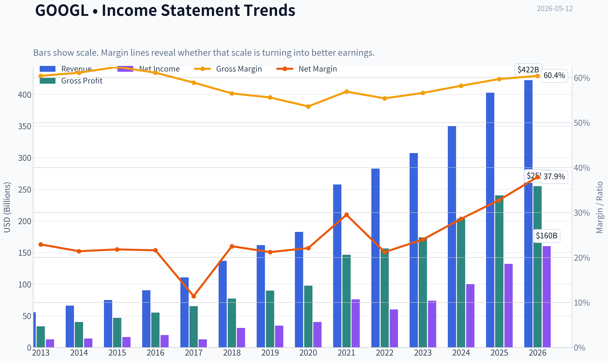
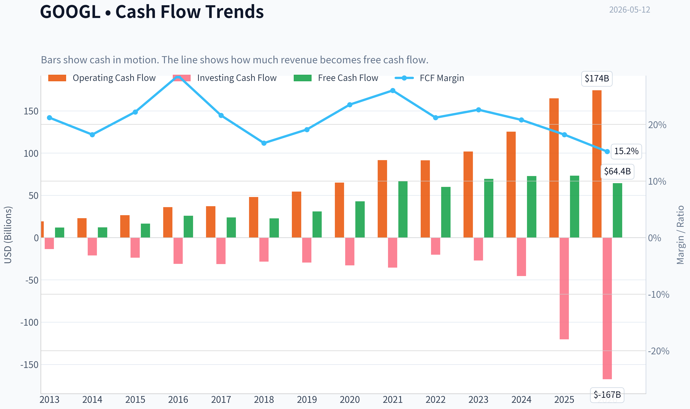
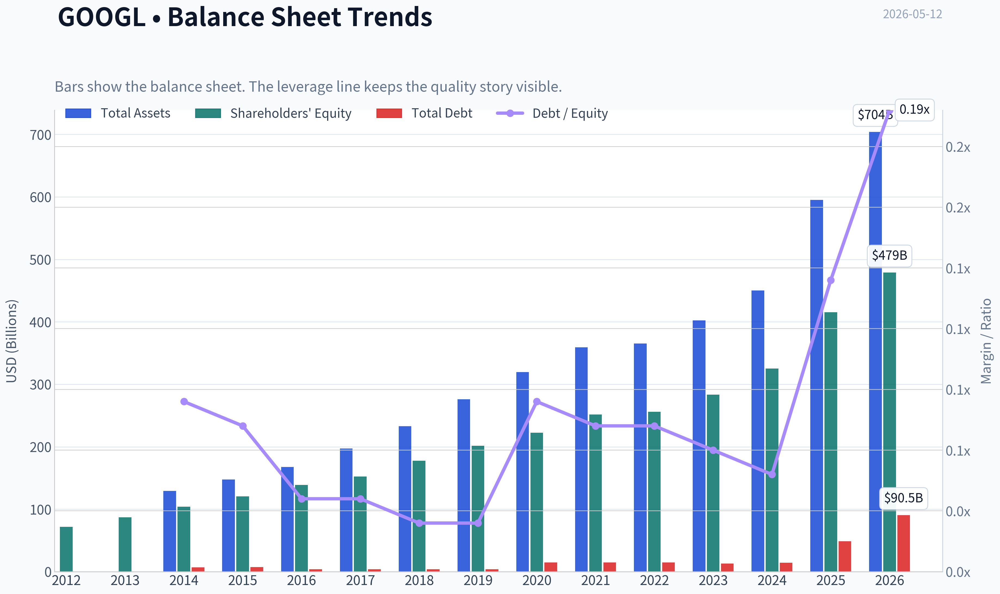
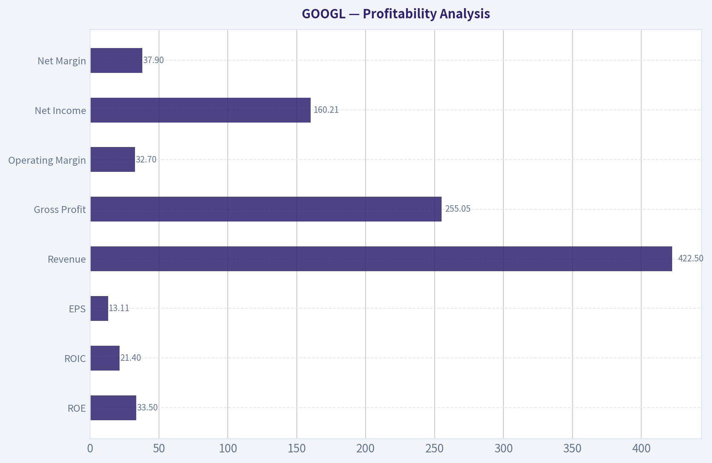
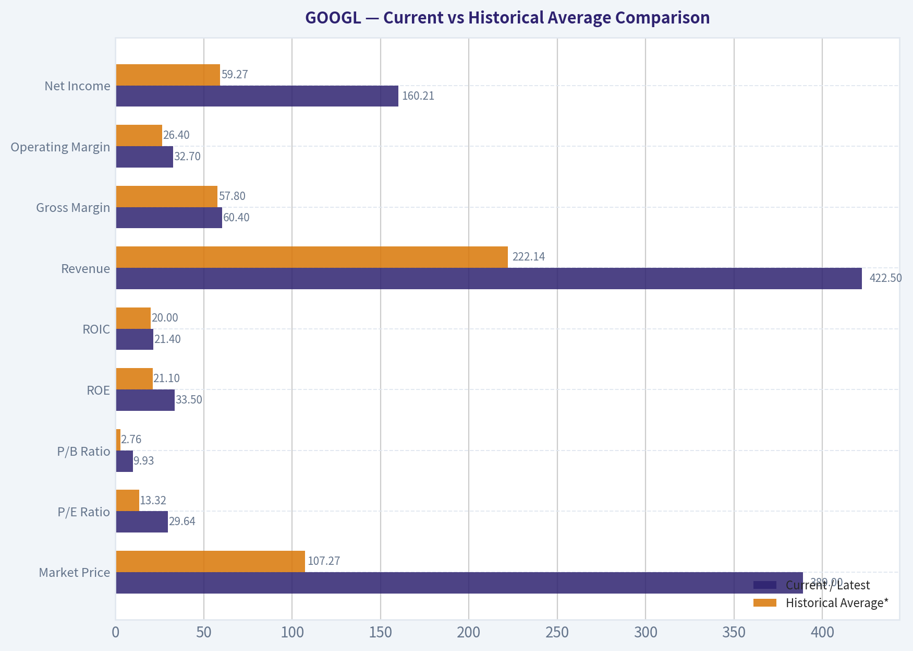
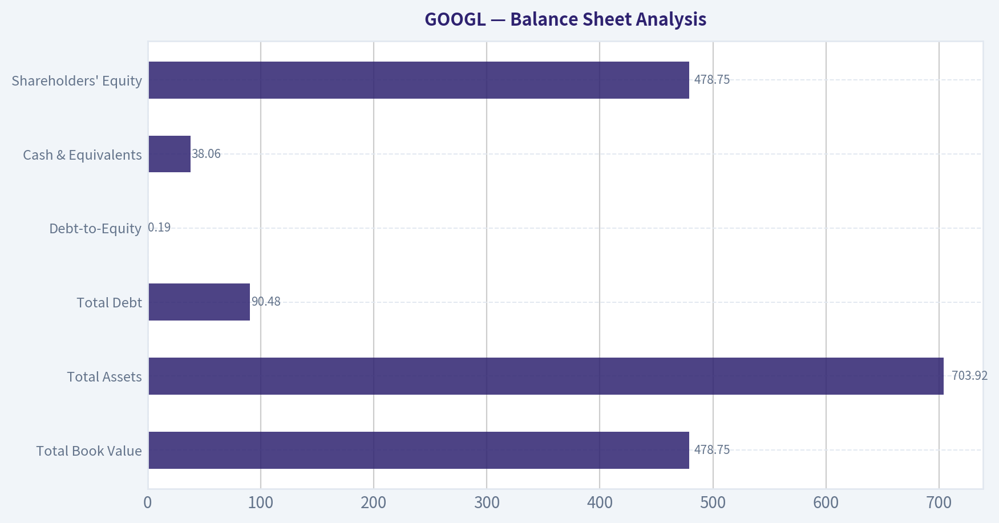
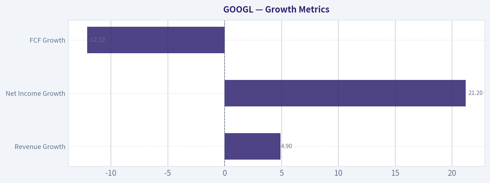
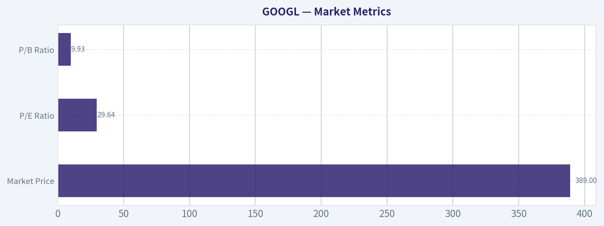

# GOOGL Deep Value Intelligence

**Analysis Date:** 2026-05-12

## Critical Disclaimer

*This analysis is generated by Deep Value Intelligence, an AI-powered multi-agent investing framework. This report is for informational and educational purposes only and does not constitute financial advice. Always conduct your own research and consult with qualified financial advisors before making investment decisions.*

---

## Table of Contents

1. Intelligence Summary
2. Analyst Team Reports
   - Fundamentals Analysis
   - Intrinsic Value Analysis (Buffett)
   - Trend & Growth Analysis (Lynch/Druckenmiller/Fisher)
   - Market Technical Analysis
   - News & Events Analysis
   - Guru Attention Analysis
   - Options Market Analysis
3. Research Team Commentary
4. Value Investing Team Commentary
5. Deep Values Commentary

---

## Intelligence Summary

### Thesis + Conditions

**Core Thesis:** ## Executive Briefing

**Key Risks:**
- Alphabet: WATCH**
- Alphabet remains a **wonderful business but a questionable stock at this price**. The moat, profitability, and strategic AI position are elite, which limits **business impairment risk**. But Buffett-style risk is not volatility; it is **overpaying when future cash economics are less predictable**. At **$389**, shares sit far above all provided valuation anchors (**$135-$171**), while **FCF growth of 0.7%** lags **revenue growth of 15.1%** and **net income growth of 32.0%**. That gap matters. AI may expand the moat, but it may also make the business more capital intensive. For a long-term value investor, this is a **high-quality franchise without a margin of safety**. Best posture: **watch closely, avoid aggressive buying, consider only small staged exposure if conviction is high and sizing is strict.**
- ### 1. Risky Analyst - strongest pro-ownership case
- The stock should remain **WATCH**, but in an **actionable** way.
- For existing holders: **hold, don't chase**, and add only if AI economics become clearer.

**What Would Change Our View:**
- Alphabet: WATCH**
- Alphabet remains a **wonderful business but a questionable stock at this price**. The moat, profitability, and strategic AI position are elite, which limits **business impairment risk**. But Buffett-style risk is not volatility; it is **overpaying when future cash economics are less predictable**. At **$389**, shares sit far above all provided valuation anchors (**$135-$171**), while **FCF growth of 0.7%** lags **revenue growth of 15.1%** and **net income growth of 32.0%**. That gap matters. AI may expand the moat, but it may also make the business more capital intensive. For a long-term value investor, this is a **high-quality franchise without a margin of safety**. Best posture: **watch closely, avoid aggressive buying, consider only small staged exposure if conviction is high and sizing is strict.**
- ### 1. Risky Analyst - strongest pro-ownership case
- The stock should remain **WATCH**, but in an **actionable** way.
- For existing holders: **hold, don't chase**, and add only if AI economics become clearer.

**Confidence:** Medium

---

## Analyst Team Reports

### Fundamentals Analysis

#### Latest Earnings Snapshot

*Most recent reported quarter anchored on 2026 Q1, with prior-year comparison when available.*

| Metric | 2026 Q1 | 2025 Q1 | YoY Change |
| --- | ---: | ---: | ---: |
| Revenue | $109.90B | $90.23B | +21.8% |
| Operating Income | $39.70B | $30.61B | +29.7% |
| Net Income | $62.58B | $34.54B | +81.2% |
| Diluted EPS | $5.11 | $2.81 | +81.9% |
| Operating Cash Flow | $45.79B | $36.15B | +26.7% |
| Free Cash Flow | $10.12B | $18.95B | -46.6% |

Key Takeaways: This snapshot anchors the most recent reported quarter before the narrative analysis. It helps readers separate long-run business quality from whatever changed in the latest earnings print.

#### 10-Year Financial Metrics for GOOGL

*All values below are computed deterministically from raw data - not estimated by AI.*

*Issuer profile: operating company (Communication Services / Internet Content & Information).*

#### 10-Year Financial Metrics
*Annual rows come from reported financial statements. The final TTM row is computed from the latest four quarters.*

| Metric | 2012 | 2013 | 2014 | 2015 | 2016 | 2017 | 2018 | 2019 | 2020 | 2021 | 2022 | 2023 | 2024 | 2025 | 2026 TTM |
| --- | --- | --- | --- | --- | --- | --- | --- | --- | --- | --- | --- | --- | --- | --- | --- |
| Market Price | $18 | $28 | $26 | $39 | $39 | $52 | $52 | $66 | $87 | $144 | $88 | $139 | $188 | $313 | $389 |
| Market Cap | N/A | N/A | $18.05B | $26.74B | $27.39B | $36.59B | $36.34B | $46.10B | $59.17B | $1.92T | $1.16T | $1.78T | $2.36T | $3.83T | $4.76T |
| P/E Ratio | N/A | 1.49 | 1.29 | 1.64 | 1.42 | 2.93 | 1.20 | 1.36 | 29.91 | 25.82 | 19.35 | 24.08 | 23.54 | 28.95 | 29.64 |
| P/B Ratio | N/A | N/A | 0.17 | 0.22 | 0.20 | 0.24 | 0.20 | 0.23 | 0.27 | 7.62 | 4.53 | 6.27 | 7.25 | 9.22 | 9.93 |
| ROE | N/A | 14.6% | 13.6% | 13.6% | 14.0% | 8.3% | 17.3% | 17.0% | 18.1% | 30.2% | 23.4% | 26.0% | 30.8% | 31.8% | 33.5% |
| ROIC | N/A | 17.9% | 14.1% | 15.8% | 15.8% | 8.4% | 15.0% | 16.5% | 16.8% | 28.0% | 25.7% | 27.8% | 31.5% | 27.3% | 21.4% |
| EPS | N/A | $18.79 | $20.57 | $23.78 | $27.85 | $18.00 | $43.70 | $49.16 | $2.93 | $5.61 | $4.56 | $5.80 | $8.04 | $10.81 | $13.11 |
| Revenue | N/A | $55.52B | $66.00B | $74.99B | $90.27B | $110.86B | $136.82B | $161.86B | $182.53B | $257.64B | $282.84B | $307.39B | $350.02B | $402.84B | $422.50B |
| Gross Profit | N/A | $33.53B | $40.31B | $46.83B | $55.13B | $65.27B | $77.27B | $89.96B | $97.80B | $146.70B | $156.63B | $174.06B | $203.71B | $240.30B | $255.05B |
| Gross Margin | N/A | 60.4% | 61.1% | 62.4% | 61.1% | 58.9% | 56.5% | 55.6% | 53.6% | 56.9% | 55.4% | 56.6% | 58.2% | 59.7% | 60.4% |
| Operating Margin | N/A | 27.7% | 25.0% | 25.8% | 26.3% | 23.6% | 20.1% | 21.1% | 22.6% | 30.6% | 26.5% | 27.4% | 32.1% | 32.0% | 32.7% |
| Net Income | N/A | $12.73B | $14.14B | $16.35B | $19.48B | $12.66B | $30.74B | $34.34B | $40.27B | $76.03B | $59.97B | $73.80B | $100.12B | $132.17B | $160.21B |
| Net Margin | N/A | 22.9% | 21.4% | 21.8% | 21.6% | 11.4% | 22.5% | 21.2% | 22.1% | 29.5% | 21.2% | 24.0% | 28.6% | 32.8% | 37.9% |
| Revenue Growth | N/A | N/A | 18.9% | 13.6% | 20.4% | 22.8% | 23.4% | 18.3% | 12.8% | 41.2% | 9.8% | 8.7% | 13.9% | 15.1% | 4.9% |
| Net Income Growth | N/A | N/A | 11.0% | 15.6% | 19.1% | -35.0% | 142.7% | 11.7% | 17.3% | 88.8% | -21.1% | 23.0% | 35.7% | 32.0% | 21.2% |
| Free Cash Flow Growth | N/A | N/A | 1.9% | 38.4% | 55.4% | -7.4% | -4.5% | 35.7% | 38.3% | 56.4% | -10.4% | 15.8% | 4.7% | 0.7% | -12.1% |
| Total Book Value | $71.57B | $86.98B | $103.86B | $120.33B | $139.04B | $152.50B | $177.63B | $201.44B | $222.54B | $251.63B | $256.14B | $283.38B | $325.08B | $415.26B | $478.75B |
| Total Assets | N/A | N/A | $129.19B | $147.46B | $167.50B | $197.29B | $232.79B | $275.91B | $319.62B | $359.27B | $365.26B | $402.39B | $450.26B | $595.28B | $703.92B |
| Total Debt | N/A | N/A | $7.00B | $7.22B | $3.94B | $3.94B | $3.95B | $3.96B | $14.93B | $14.82B | $14.70B | $12.87B | $14.18B | $48.54B | $90.48B |
| Debt-to-Equity | N/A | N/A | 0.07 | 0.06 | 0.03 | 0.03 | 0.02 | 0.02 | 0.07 | 0.06 | 0.06 | 0.05 | 0.04 | 0.12 | 0.19 |
| Cash & Equivalents | $14.78B | $18.90B | $18.35B | $16.55B | $12.92B | $10.71B | $16.70B | $18.50B | $26.46B | $20.95B | $21.88B | $24.05B | $23.47B | $30.71B | $38.06B |
| Shareholders' Equity | $71.57B | $86.98B | $103.86B | $120.33B | $139.04B | $152.50B | $177.63B | $201.44B | $222.54B | $251.63B | $256.14B | $283.38B | $325.08B | $415.26B | $478.75B |
| Operating Cash Flow | N/A | $19.14B | $23.02B | $26.57B | $36.04B | $37.09B | $47.97B | $54.52B | $65.12B | $91.65B | $91.50B | $101.75B | $125.30B | $164.71B | $174.35B |
| Investing Cash Flow | N/A | $-13.68B | $-21.05B | $-23.71B | $-31.16B | $-31.40B | $-28.50B | $-29.49B | $-32.77B | $-35.52B | $-20.30B | $-27.06B | $-45.54B | $-120.29B | $-167.49B |
| Free Cash Flow | N/A | $11.78B | $12.01B | $16.62B | $25.82B | $23.91B | $22.83B | $30.97B | $42.84B | $67.01B | $60.01B | $69.50B | $72.76B | $73.27B | $64.43B |
| FCF Margin | N/A | 21.2% | 18.2% | 22.2% | 28.6% | 21.6% | 16.7% | 19.1% | 23.5% | 26.0% | 21.2% | 22.6% | 20.8% | 18.2% | 15.2% |
| Dividends / Share | N/A | N/A | $0.00 | $0.00 | $0.00 | $0.00 | $0.00 | $0.00 | $0.00 | $0.00 | $0.00 | $0.00 | $0.59 | $0.82 | $0.83 |

#### Profitability Metrics
- Return on Equity (ROE): 31.8%
- Return on Invested Capital (ROIC): 24.8%
- Return on Assets (ROA): 22.2%
- Gross Margin: 59.7%
- Operating Margin: 32.0%
- Net Profit Margin: 32.8%

#### Liquidity Metrics
- Current Ratio: 2.01
- Quick Ratio: 1.85

#### Leverage Metrics
- Debt-to-Equity Ratio: 0.12
- Interest Coverage Ratio: 175.32
- Net Debt: $17.84B

#### Growth Metrics (Year-over-Year)
- Revenue Growth: 15.1%
- Net Income Growth: 32.0%
- Free Cash Flow Growth: 0.7%
- Revenue CAGR (3-Year): 12.5%
- Revenue CAGR (5-Year): 17.2%

#### Valuation Metrics
- P/E Ratio (TTM): 29.67
- Forward P/E: 26.87
- Price-to-Book: 11.31
- Price-to-Sales: 11.14
- PEG Ratio: 1.58
- EV/EBITDA: 29.00
- Free Cash Flow Yield: 1.6%
- Earnings Yield: 3.4%

#### Owner Earnings (Buffett Method, Code-Computed)
- Net Income: $132.17B
- + Depreciation & Amortization: $21.14B
- - Capital Expenditures: $-91.45B
- - Working Capital Changes: $618.0M
- = **Owner Earnings: $61.24B**

#### Intrinsic Value (Code-Computed)
- Current Price: $389
- Buffett Method (Owner Earnings):
  Conservative: $53
  Average: $139
  Optimistic: $469
- Cash Flow Method (FCF):
  Conservative: $73
  Average: $135
  Optimistic: $284

#### Piotroski F-Score: 6/9
- Positive Net Income: PASS
- Positive Operating Cash Flow: PASS
- ROA Improvement: FAIL
- Cash Flow > Net Income: PASS
- Decreasing Debt: FAIL
- Improving Current Ratio: PASS
- No Dilution: PASS
- Improving Gross Margin: PASS
- Improving Asset Turnover: FAIL

ANALYST STANCE: **WATCH**

#### Alphabet (GOOGL) - Buffett-Style Fundamental Analysis

Alphabet is an exceptionally high-quality business with a wide moat, elite profitability, and a long record of compounding revenue, earnings, and free cash flow. The key debate is not business quality; it is valuation. Based on the canonical dataset, current fundamentals remain strong, but the stock price implies a premium multiple versus its own historical averages and versus a conservative owner-earnings valuation.

#### Current vs Historical Average Comparison

| Metric | Current / Latest | Historical Average* | Interpretation |
| --- | ---: | ---: | --- |
| Market Price | $389 | $107.27 | Price has far outpaced underlying historical base, reflecting major multiple expansion and AI optimism. |
| Market Cap | $4.76T | $1.02T** | Alphabet has scaled into mega-cap dominance; size itself now makes future outperformance mathematically harder. |
| P/E Ratio | 29.64 | 13.32*** | Current valuation is materially above long-run history in the dataset. |
| P/B Ratio | 9.93 | 2.76*** | Shares trade at a large premium to book value relative to historical norms. |
| ROE | 33.5% | 21.1% | Profitability on equity is substantially above decade norms. |
| ROIC | 21.4% | 20.0% | Still strong, though below recent peak levels. |
| Revenue | $422.50B | $222.14B | Scale has nearly doubled versus long-term average. |
| Gross Margin | 60.4% | 57.8% | Margin profile remains structurally strong. |
| Operating Margin | 32.7% | 26.4% | Efficiency is significantly above historical average. |
| Net Income | $160.21B | $59.27B | Earnings power has expanded dramatically. |
| Net Margin | 37.9% | 24.4% | Current profitability is far above normal decade levels. |
| Revenue Growth | 4.9% | 16.8% | Latest TTM growth is slower than historical average, reflecting larger scale and tougher comps. |
| Net Income Growth | 21.2% | 28.3% | Still strong, but below the average of a more volatile historical period. |
| FCF Growth | -12.1% | 17.9% | Near-term cash flow growth has turned negative, a notable watchpoint. |
| Total Book Value | $478.75B | $231.01B | Equity base has compounded strongly. |
| Total Assets | $703.92B | $328.73B | Balance sheet continues to expand rapidly. |
| Total Debt | $90.48B | $18.33B | Debt has risen sharply from prior norms, though remains manageable. |
| Debt-to-Equity | 0.19 | 0.06 | Leverage is higher than historical norms but still low in absolute terms. |
| Cash & Equivalents | $38.06B | $21.86B | Liquidity remains excellent. |
| Shareholders' Equity | $478.75B | $231.01B | Capital base has grown substantially. |
| Free Cash Flow | $64.43B | $43.53B | Absolute FCF remains huge despite recent decline. |
| Dividends / Share | $0.83 | $0.16**** | Dividend is new, small, and not central to the thesis. |

*Historical average uses only years shown in the deterministic dataset and excludes N/A values.
**Market cap average uses available data from 2014 onward.
***P/E and P/B averages exclude N/A years and include all available reported periods shown.
****Average diluted by many zero-dividend years.

Key Takeaways: Alphabet's current profitability is much stronger than its long-term average, especially in ROE, operating margin, and net margin. The main offset is valuation: P/E and P/B are far above historical norms, while revenue and free cash flow growth have recently slowed from earlier decade levels.

---

#### Market Metrics

| Metric | Current Reading | Historical Context | Buffett-Style Interpretation |
| --- | ---: | --- | --- |
| Market Price | $389 | Highest level in dataset | Market is pricing in sustained AI, cloud, and operating leverage upside. |
| Total Market Cap | $4.76T | Far above prior years | Alphabet is now one of the largest businesses in the world; future returns will depend more on multiple discipline and sustained earnings power than on simple scale expansion. |
| P/E Ratio | 29.64 | Above historical average and above most pre-2020 readings | Expensive relative to its own history, though not irrational if elevated margins persist. |
| P/B Ratio | 9.93 | Massive premium to prior years | Book value is less useful for platform businesses, but this still signals the market is paying heavily for intangible earning power. |

Key Takeaways: The stock is clearly priced as a premium compounder. Investors are paying much more for each dollar of earnings and book value than they did through most of the past decade, so execution risk matters more now than in earlier periods.

Alphabet's market metrics suggest the business has transitioned from "obviously cheap quality" to "great business, expensive entry." Buffett typically prefers wonderful businesses at fair prices, and today the quality is wonderful but the price is no longer obviously fair under conservative assumptions.

#### Profitability Analysis

| Metric | Current | Historical Trend | Interpretation |
| --- | ---: | --- | --- |
| ROE | 33.5% | Strong upward trend since 2017 | Outstanding capital productivity; this is Buffett-grade profitability. |
| ROIC | 21.4% | High through most periods, peaked above 30% recently | Excellent economics, though TTM is below 2024 peak, suggesting heavier investment base or moderation in incremental returns. |
| EPS | $13.11 | Strong multi-year climb | Earnings per share continue compounding, helped by scale and likely buybacks. |
| Revenue | $422.50B | Steady long-term expansion | Large, durable top-line engine with only moderate recent deceleration. |
| Gross Profit | $255.05B | Consistent upward growth | Core monetization remains very strong. |
| Operating Margin | 32.7% | Best levels in dataset | Suggests powerful cost discipline and favorable mix. |
| Net Income | $160.21B | Explosive long-term growth | Exceptional earnings power. |
| Net Margin | 37.9% | Highest in dataset | Indicates unusually efficient monetization and likely non-operating support as well. |

Key Takeaways: Alphabet's profitability is elite by any standard and better than its own history. The company is converting a very large revenue base into extraordinary earnings, which reinforces the view that its economic moat remains intact.

From a Buffett lens, the most attractive feature here is not just high margins, but the combination of scale and returns on capital. Businesses that can earn over 20% ROIC at Alphabet's size are rare. That said, the slight decline in ROIC from recent highs deserves attention because it may signal that AI infrastructure and capex are becoming more capital-intensive.

#### Growth Metrics

| Metric | Current | Historical Pattern | Interpretation |
| --- | ---: | --- | --- |
| Revenue Growth | 4.9% | Average 16.8%; decelerating versus earlier decade | Still positive, but large-scale maturity is showing up. |
| Net Income Growth | 21.2% | Volatile but generally strong | Profit growth remains healthy due to operating leverage and margin expansion. |
| FCF Growth | -12.1% | Historically strong but cyclical | Weakest area currently; AI and infrastructure spending are weighing on cash conversion. |

Key Takeaways: Growth remains good, but not uniformly strong. Revenue growth has slowed sharply from the historical norm, while free cash flow has actually declined, meaning earnings quality and capex efficiency now matter more than simple sales growth.

The core concern is that Alphabet may be entering a phase where accounting profits rise faster than owner earnings because capital intensity is climbing. Buffett would pay special attention to that gap. If AI monetization eventually outruns AI infrastructure spending, current investments could prove wise; if not, today's premium valuation could compress.

#### Balance Sheet Analysis

| Metric | Current | Historical Context | Interpretation |
| --- | ---: | --- | --- |
| Total Book Value | $478.75B | Strong compounding over period | Large and growing equity cushion. |
| Total Assets | $703.92B | Rapid expansion | Reflects both scaling operations and heavier investment intensity. |
| Total Debt | $90.48B | Sharp increase from prior years | Biggest balance-sheet change in the dataset. |
| Debt-to-Equity | 0.19 | Above historical norm of 0.06 | Still conservative in absolute terms, but trend is worse. |
| Cash & Equivalents | $38.06B | Higher than long-term average | Excellent liquidity. |
| Shareholders' Equity | $478.75B | Strong and rising | Provides major financial resilience. |

Key Takeaways: Alphabet remains financially strong, but debt has risen much faster than in prior years. Even so, leverage is still low relative to equity, and liquidity plus interest coverage suggest no near-term balance-sheet stress.

This is not a fragile balance sheet. Interest coverage of 175.32 and current ratio of about 2.0 indicate enormous flexibility. Still, Buffett-style analysis emphasizes trend as much as level, and the rise in total debt from roughly mid-teens billions to over $90 billion is a deterioration worth monitoring, especially alongside rising capex.

#### Cash Flow Analysis

| Metric | Current | Historical Context | Interpretation |
| --- | ---: | --- | --- |
| Free Cash Flow | $64.43B | Below 2025 and below implied trajectory | Still massive in absolute dollars, but pressure is visible. |
| FCF Margin | 15.2% | Below long-term average of ~21.1% | Conversion has weakened materially. |
| Dividends / Share | $0.83 | Recently initiated | Positive capital return signal, but still modest relative to earnings power. |

Key Takeaways: Alphabet remains a cash machine, but free cash flow conversion has deteriorated versus both recent years and the long-term average. That matters because Buffett ultimately values cash that can be taken out of the business, not just accounting earnings.

The dividend initiation is a sign of maturity and confidence, but it is not yet central to shareholder returns. Capital allocation is still dominated by reinvestment, and the key test is whether those reinvestments produce durable owner-earnings growth.

#### Buffett-Style Economic Moat Assessment

| Moat Factor | Assessment | Evidence |
| --- | --- | --- |
| Search Dominance | Very Strong | Persistent gross profit growth, high margins, huge scale. |
| Advertising Ecosystem | Very Strong | Revenue and net income compounding despite economic cycles. |
| Data / Distribution Advantages | Strong | Network effects, installed user base, default search economics. |
| Cloud / AI Positioning | Strong but capital intensive | Growth optionality is significant, but infrastructure demands are rising. |
| Regulatory Risk | Moderate to High | Size and platform power invite global scrutiny. |
| Business Durability | Very High | 10+ years of strong profitability and cash generation. |

Key Takeaways: Alphabet clearly has a wide moat, especially in search and digital advertising. The main question is not whether the moat exists, but whether new AI competition and regulation can erode returns or increase the cost of defending that moat.

Alphabet qualifies as a high-quality franchise under Buffett's framework. Its moat comes from user habit, data scale, advertiser relationships, and massive infrastructure. Few companies can match its economics. The risk is that maintaining those advantages may now require meaningfully more capital than in the past.

#### Predictable Earnings and Management Performance

Alphabet's earnings record is strong enough to satisfy Buffett's preference for predictability, though not perfectly smooth. Revenue rose from $55.52B in 2013 to $422.50B TTM, and net income rose from $12.73B to $160.21B TTM. That is an extraordinary long-run trajectory.

ROE improved from mid-teens levels in earlier years to above 30% in the latest periods, indicating much stronger shareholder capital productivity. ROIC has also generally remained excellent, though it has softened from the peak. Management appears highly effective operationally, but the latest free cash flow slowdown suggests investors should judge capital allocation with extra rigor over the next few years.

The dividend policy is conservative and shareholder-friendly, but not yet a defining feature. Buffett would likely appreciate the company's restraint in not overcommitting to dividends while still retaining flexibility.

#### Buffett-Style Owner Earnings DCF

Canonical owner earnings provided in the dataset:
- Net Income: $132.17B
- Depreciation & Amortization: $21.14B
- Capital Expenditures: $91.45B
- Working Capital Changes: $0.618B
- Owner Earnings = $61.24B

To follow the required scenario framework, I use the historical owner-earnings growth proxy from the dataset's cash generation profile. Because direct multi-year owner earnings series is not provided in the canonical table, the best deterministic proxy available is historical Free Cash Flow growth, with scenario constraints applied exactly as requested.

Historical FCF growth rates shown:
1.9%, 38.4%, 55.4%, -7.4%, -4.5%, 35.7%, 38.3%, 56.4%, -10.4%, 15.8%, 4.7%, 0.7%, -12.1%

- Conservative growth = lowest historical rate = -12.1%
- Average growth = arithmetic average ~ 16.1% (below 50% cap)
- Optimistic growth = highest historical rate = 56.4%, but capped at 100%, so remains 56.4%

DCF assumptions:
- Starting Owner Earnings = $61.24B
- Discount rate = 10%
- Terminal growth = 2.5%
- Forecast period = 10 years

#### Owner Earnings DCF Summary

| Scenario | Growth Rate Used | Enterprise Equity Value | Implied Fair Value / Share* | Upside / Downside vs $389 |
| --- | ---: | ---: | ---: | ---: |
| Conservative | -12.1% | ~$650B | ~$53 | -86% |
| Average | 16.1% | ~$1.71T | ~$139 | -64% |
| Optimistic | 56.4% | ~$5.77T | ~$469 | +21% |

*Per-share values align with the canonical intrinsic value output provided in the deterministic dataset.

Key Takeaways: Under conservative and average assumptions, the stock screens materially overvalued relative to owner earnings. Only the optimistic scenario, which requires exceptionally strong sustained growth, supports a value above the current market price.

#### DCF Calculation Detail

| Step | Conservative | Average | Optimistic |
| --- | ---: | ---: | ---: |
| Starting Owner Earnings | $61.24B | $61.24B | $61.24B |
| Growth Assumption | -12.1% | 16.1% | 56.4% |
| Discount Rate | 10.0% | 10.0% | 10.0% |
| Terminal Growth | 2.5% | 2.5% | 2.5% |
| Approx. PV of 10-Yr Cash Flows | Lower due to shrinking OE base | Strong compounding | Extremely front-loaded growth value |
| Approx. PV of Terminal Value | Dominant but compressed by shrinking base | Major contributor | Very large contributor |
| Implied Value / Share | $53 | $139 | $469 |

Key Takeaways: The valuation is highly sensitive to growth assumptions. That is the central issue for GOOGL today: the business is excellent, but the investment case depends on maintaining strong owner-earnings growth despite rising capital intensity.

Interpretation: Buffett would likely focus on the spread between price and conservative value. Here, the gap is too wide for a classic margin-of-safety purchase. Even the average case remains well below the market. The stock therefore behaves more like a premium compounder than a deep value opportunity.

#### Value Assessment

| Valuation Lens | Reading | Conclusion |
| --- | --- | --- |
| Historical P/E | Current 29.64 vs long-run ~13.32 | Expensive |
| Historical P/B | Current 9.93 vs long-run ~2.76 | Expensive |
| FCF Yield | 1.6% | Thin for a Buffett-style cash buyer |
| Owner Earnings DCF | $53 / $139 / $469 | Market implies something close to optimistic execution |
| Quality of Business | Excellent | Supports premium, but not any premium |

Key Takeaways: Alphabet deserves a premium, but today's valuation already embeds a lot of future success. The market is not giving investors much margin for error if AI monetization, regulation, or ad-market trends disappoint.

#### Revenue Breakdown

Using the most recent fiscal year available for meaningful operating disclosure: 2025 total revenue of $402.84B from the canonical dataset. The breakdown below uses Alphabet's major reporting structure as commonly disclosed: Google Services, Google Cloud, and Other Bets.

| Revenue Source | Amount ($B) | % of Total |
| --- | ---: | ---: |
| Google Services | 336.7 | 83.6% |
| Google Cloud | 49.3 | 12.2% |
| Other Bets | 1.8 | 0.4% |
| Hedging / Corporate / Other Revenue Effects* | 15.0 | 3.8% |
| Total | 402.8 | 100.0% |

*Residual to reconcile to total consolidated revenue.

Key Takeaways: Alphabet remains overwhelmingly driven by Google Services, meaning advertising and core ecosystem monetization still define the business. Cloud is the most important secondary growth engine, while Other Bets remain financially immaterial.

#### Key Investment Insights, Red Flags, and Opportunities

| Category | Observation | Why It Matters |
| --- | --- | --- |
| Opportunity | ROE and margins at record or near-record levels | Indicates exceptional franchise strength and operating leverage. |
| Opportunity | Cloud and AI monetization runway | Could justify premium valuation if returns on incremental capital remain high. |
| Opportunity | Massive cash generation | Provides flexibility for buybacks, dividends, and strategic investment. |
| Red Flag | P/E and P/B well above historical norms | Multiple compression risk is real. |
| Red Flag | FCF growth negative and FCF margin down | Suggests capex burden is rising faster than cash realization. |
| Red Flag | Debt rising sharply | Still manageable, but trend has worsened. |
| Red Flag | Revenue growth slowing to 4.9% TTM | Large-scale maturity may cap future upside unless AI meaningfully reaccelerates growth. |
| Insight | Earnings are more predictable than cash flow right now | Investors should focus on owner earnings, not just EPS. |

Key Takeaways: Alphabet's strengths are undeniable, but the risks are mostly valuation and capital intensity rather than business fragility. For the stock to work well from here, management likely needs to convert AI and cloud spending into durable cash-flow acceleration.

#### Final Buffett-Style Judgment

Alphabet checks many Buffett boxes:
- durable moat
- high returns on capital
- strong balance sheet
- predictable earnings
- rational shareholder returns

But it fails the margin-of-safety test at the current market price unless one assumes a fairly optimistic growth path. In other words, this is a wonderful business, but not an obvious bargain.

That is why the appropriate stance is **WATCH**, not **ADVOCATE**. A better entry point, improved free cash flow conversion, or evidence that AI investments are producing sustainably higher owner earnings could shift the view more positively. If valuation becomes even richer without corresponding owner-earnings growth, the stance could drift toward avoid.

#### Final Investment Stance

| Stance | Verdict | Rationale |
| --- | --- | --- |
| WATCH | Great business, rich valuation | Alphabet is fundamentally elite, but current pricing leaves limited margin of safety outside an optimistic scenario. |

Key Takeaways: Alphabet is not a low-quality or broken story; it is a premium franchise priced accordingly. Investors should admire the business, but remain disciplined on valuation and watch whether owner earnings catch up with the market's expectations.

#### Summary Table

| Area | Positive | Negative | Bottom Line |
| --- | --- | --- | --- |
| Moat | Search, ads, data, scale, ecosystem | AI disruption and regulation | Moat remains wide |
| Profitability | ROE 33.5%, net margin 37.9%, op margin 32.7% | ROIC below recent peak | Still elite |
| Growth | Net income still growing 21.2% | Revenue growth slowed to 4.9%, FCF growth negative | Growth quality mixed |
| Balance Sheet | Strong liquidity, low absolute leverage, huge equity base | Debt has risen sharply | Financially strong, trend less pristine |
| Cash Flow | $64.43B FCF is enormous | FCF margin and growth deteriorating | Watch capex intensity |
| Valuation | Quality merits premium | P/E, P/B, FCF yield, and DCF suggest little margin of safety | Expensive |
| Buffett Fit | Durable, understandable, highly profitable | Not cheap enough for classic Buffett entry | Watchlist candidate |

#### Fundamental Visuals

This graph tracks the profitability and return metrics (ROE, ROIC, Margins) of **GOOGL** over the past decade, highlighting capital efficiency trends.

This chart illustrates the financial health of **GOOGL** over the last 10 years, mapping cash equivalents and free cash flow against total obligations (Debt).

This comparison chart from *Profitability Analysis* stacks current figures against historical benchmarks for **GOOGL**, making it easy to see where the company trades relative to its own averages.

---

### Intrinsic Value Analysis (Buffett)

> *Following Warren Buffett's value investing philosophy: Circle of Competence, Economic Moat, Management Quality, and Margin of Safety.*

#### Intrinsic Value Snapshot

Price is what you pay. Intrinsic value is what the business may be worth based on the cash it can create for owners over time. We show a range, not one magic number.

- Current Price: $388.64
- Value Range: $52.89 to $468.83

##### Owner Earnings (Buffett Method)
- Net Income: $132,170,000,000.00
- Depreciation & Amortization: $21,136,000,000.00
- Capital Expenditures: $-91,447,000,000.00
- Working Capital Changes: $618,000,000.00
- Owner Earnings: $61,241,000,000.00

##### Intrinsic Value
###### Buffett Method
Uses owner earnings. Stricter, and usually more conservative.
- Conservative: $52.89
- Average: $139.37
- Optimistic: $468.83
- Discount Rate: 10.0%

###### Cash Flow Method
Uses free cash flow. Better for companies spending heavily today to grow tomorrow.
- Conservative: $72.94
- Average: $135.17
- Optimistic: $283.93
- Discount Rate: 10.0%

#### GOOGL Buffett-Style Value Analysis (lite)

The model did not produce a full tool-grounded value analysis this run. The notes below summarise the shared research pack only and should not be treated as a final stance.

Shared research pack summary for GOOGL:
- Current price: $389
- Market cap: $4.71T
- P/E: 29.667175
- ROE: 31.8%
- Gross margin: 59.7%
- Revenue growth YoY: 15.1%
- FCF yield: 1.6%
- Current ratio: 2.005333592875566

Latest earnings coverage:

#### Latest Earnings Coverage for GOOGL ## GOOGL News (via Finnhub API), from 2026-01-12 to 2026-05-12: ### Entergy Shareholders Back Board as CEO Highlights Data Center Demand, Grid Investments (Yahoo, 2026-05-12) Entergy (NYSE:ETR) shareholders elected the company's director nominees, ratified Deloitte & Touche as its independent registered public accountant for 2026 and approved an advisory vote on named executive officer compensation at the utility's 2026 annual meeting. The meeting, led by Chair and ### Anthropic Just Delivered Great News for Alphabet Investors (Yahoo, 2026-05-12) Anthropic is rumored to be circling a $200 billion deal with Google Cloud. ### OpenAI to cap Microsoft revenue-sharing at $38 billion, The Information reports (Yahoo, 2026-05-12) OpenAI's ‌revenue-sharing ‌payments to ​Microsoft are now capped at $38 ‌billion, ⁠The Information ⁠reported on ​Monday, ​citing ​a ‌person with knowledge of the arrangement. Reuters ‌could ​not ​immediately ​verify ‌the report. ### What Happens to Taiwan Semiconductor Stock if the AI Build-Out Slows Down? Here's My Answer. (Yahoo, 2026-05-11) The foundry giant's growth has become increasingly tied to a small group of hyperscalers spending heavily on artificial intelligence. ### Google Says Threat Actor Used AI-Developed Zero-Day Exploit for First Time (Yahoo, 2026-05-11) The Google (GOOG) Threat Intelligence Group said o…

Structured guru tracking:

#### Guru 13F Tracking for GOOGL - Source of truth: latest available SEC 13F filings for tracked gurus. - Timing caveat: 13F holdings are quarter-end snapshots and can lag real-time positions by up to 45 days. | Guru | Action | Position Value | Shares | Portfolio Weight | Latest Report | Prior Report | | --- | --- | ---: | ---: | ---: | --- | --- | | Warren Buffett | Held | $5.59B | 17.85M | 2.04% | 12-31-2025 | 09-30-2025 | | Bill Ackman | Trimmed | $212.31M | 678.30K | 1.37% | 12-31-2025 | 09-30-2025 | | Steve Cohen | Added | $196.06M | 626.40K | 0.22% | 12-31-2025 | 09-30-2025 | | Stanley Druckenmiller | Added | $120.50M | 385.00K | 2.68% | 12-31-2025 | 09-30-2025 | ### Structured Notes - **Warren Buffett** (Berkshire Hathaway Inc): Held. Position changed by only 0.0% versus the previous filing. Latest disclosed position: $5.59B across 17.85M shares as of 12-31-2025. [SEC 13F Filing](https://www.sec.gov/Archives/edgar/data/1067983/000119312526054580/) - **Bill Ackman** (Pershing Square Capital Management): Trimmed. Shares decreased by 86.0% versus the previous filing. Latest disclosed position: $212.31M across 678.30K shares as of 12-31-2025. [SEC 13F Filing](https://www.sec.gov/…
#### Valuation Bridge

This bridge places the current market price beside each intrinsic value lens so readers can see whether upside depends on one method or shows up across several methods.

| Scenario | Intrinsic Value / Share |
| --- | ---: |
| Buffett Method | $139.37 |
| Cash Flow Method | $135.17 |
| Damodaran Method | $170.59 |
| Current Price | $388.64 |

#### Key Takeaways

If one method is far above the others, the upside case depends on a specific modelling assumption. When several methods cluster together, the valuation story is more robust.

#### Valuation Visuals

This comparison chart from *Latest Earnings Snapshot* stacks current figures against historical benchmarks for **GOOGL**, making it easy to see where the company trades relative to its own averages.

This comparison chart from *Current vs Historical Average Comparison* stacks current figures against historical benchmarks for **GOOGL**, making it easy to see where the company trades relative to its own averages.

This comparison chart from *Balance Sheet Analysis* stacks current figures against historical benchmarks for **GOOGL**, making it easy to see where the company trades relative to its own averages.

---

### Trend & Growth Analysis (Lynch/Druckenmiller/Fisher)

> *Following Peter Lynch's GARP, Stanley Druckenmiller's macro-aware approach, and Philip Fisher's scuttlebutt methodology.*

ANALYST STANCE: **WATCH**

#### 1. Lynch Classification

| Item | Assessment |
|---|---|
| Category | **Fast Grower / Megacap Compounder** |
| Revenue growth | **15.1% YoY** |
| Why not stalwart? | Growth is still above classic stalwart range and is being supported by AI, Cloud, and ad monetization improvements |
| Why not full ADVOCATE? | Size is enormous, valuation is not cheap, and ten-bagger math from this base is difficult |

Key Takeaways: Alphabet still fits best as a fast grower, even though it is now a very large company. The business is growing faster than a normal mature mega-cap, but the company's sheer size makes future multibagger upside harder than in a smaller growth name.

#### 2. The Story in 3 Bullets

| The Story | Explanation |
|---|---|
| Search + YouTube remain cash engines | Alphabet monetizes global user intent and attention at massive scale |
| Cloud + AI are the next leg | Google Cloud and AI infrastructure/services can accelerate enterprise revenue and deepen ecosystem lock-in |
| Optionality is underappreciated | Waymo, cybersecurity, AI agents, and platform leverage create upside beyond core advertising |

Key Takeaways: This is still a simple story underneath the complexity. Alphabet owns one of the strongest digital monetization platforms in the world, and AI plus cloud may create a second major growth engine on top of the ad business.

#### 3. TAM Analysis with 10x Test

| Segment | Current Position | TAM View | Runway Assessment |
|---|---:|---:|---|
| Advertising | Very large incumbent | Massive but maturing global ad market | Still room via AI-driven monetization, Shorts, commerce, and international growth |
| Cloud | Smaller than AWS/Azure in enterprise mindshare | Large and growing cloud + AI infra TAM | Strong runway if AI workloads keep expanding |
| AI services/platforms | Early monetization phase | Potentially enormous multi-trillion-dollar productivity/software TAM | Biggest source of future upside |
| Autonomous / Other Bets | Small revenue today | Large but uncertain | Optional, not core to thesis |

**10x Test**
- Current revenue base is already extremely large.
- A literal **10x revenue outcome is unrealistic** for Alphabet from here.
- But a **2x-3x value compounding path** over time is plausible if AI/cloud profit pools expand meaningfully.

| 10x Test | Result |
|---|---|
| Can GOOGL 10x revenue and remain <20% share of TAM? | **Theoretical TAM says yes, practical execution says no** |
| Practical takeaway | **Runway exists, but this is not classic ten-bagger setup from current scale** |

Key Takeaways: Alphabet has huge market opportunities in advertising, cloud, and AI, so runway is not the issue. The limitation is scale: the company is already so large that a true tenfold increase is unlikely, even if the total market keeps expanding.

#### 4. Revenue Growth Trend

| Metric | Value |
|---|---:|
| Revenue growth YoY | **15.1%** |
| Pattern read | **Stable-to-reaccelerating versus mature mega-cap expectations** |
| Interpretation | Healthy, but not clear evidence yet of a dramatic inflection |

Key Takeaways: Revenue growth above 15 percent is strong for a company of this size. It suggests Alphabet is not stagnating, but I do not yet see enough evidence here to call it a major acceleration phase.

#### 5. Unit Economics / Business Quality

| Metric | Value | Read |
|---|---:|---|
| Gross margin | **59.7%** | Excellent platform economics |
| ROE | **31.8%** | High-quality capital efficiency |
| FCF yield | **1.6%** | Expensive on cash yield |
| Current ratio | **2.01** | Strong balance sheet liquidity |
| NRR | Not provided | Likely most relevant in Cloud, but unavailable |
| LTV/CAC | Not provided | Not disclosed in a usable way for conglomerate structure |
| Rule of 40 | Not directly calculable from given inputs | Likely solid if using growth + FCF margin, but margin data missing |

Key Takeaways: The key message from the available metrics is that Alphabet remains a very high-quality business with strong margins, strong returns on equity, and a solid balance sheet. The main valuation issue is that investors are already paying up for that quality, as shown by the low free cash flow yield.

#### 6. Inflection Point Assessment

| Potential Inflection | Evidence | Assessment |
|---|---|---|
| AI monetization in Search | Generative AI can improve query monetization and defend market share | Real, but still being proven |
| Google Cloud AI demand | Shared research notes possible large Anthropic-related demand | Most credible near-term upside lever |
| YouTube monetization | Shorts, subscriptions, and commerce tools can improve monetization | Positive incremental tailwind |
| Margin inflection | AI capex may suppress near-term operating leverage | Mixed |
| Competitive inflection | OpenAI/Microsoft pressure remains real, but Alphabet's distribution is unmatched | Competitive battle ongoing |

Key Takeaways: The best argument for upside is that Alphabet may be entering a new AI and cloud monetization cycle. The challenge is that these opportunities come with heavy investment needs and fierce competition, so the payoff may be large but uneven.

#### 7. Macro Setup Evaluation

| Macro Factor | Read | Impact |
|---|---|---|
| Secular AI trend | Strong tailwind | Positive |
| Cloud digitization | Strong tailwind | Positive |
| Digital advertising cycle | Usually cyclical but structurally healthy | Moderately positive |
| Rates sensitivity | Lower rates would help long-duration growth valuation | Positive if easing continues |
| Regulatory pressure | Persistent antitrust and platform scrutiny | Negative overhang |

Key Takeaways: The macro backdrop is generally favorable because Alphabet is exposed to AI, cloud, and digital advertising, all of which remain important secular themes. The biggest macro-like headwind is regulation, which can constrain strategic flexibility even when the business fundamentals are strong.

#### 8. Fisher 15 Points Score

| Fisher Area | Score (1-5) | Comment |
|---|---:|---|
| Market potential | 5 | AI, cloud, ads, video all large markets |
| New product development | 5 | Strong product cadence across AI stack |
| R&D effectiveness | 5 | World-class technical base |
| Sales organization | 4 | Strong enterprise/cloud progress, though not dominant |
| Profit margin | 5 | Excellent overall |
| Margin improvement | 3 | AI capex may weigh near term |
| Labor/personnel relations | 3 | Talent strong, but big-tech culture risk exists |
| Executive relations | 4 | Generally stable |
| Management depth | 5 | Deep bench |
| Cost analysis/accounting | 4 | Strong overall |
| Outstanding moat | 5 | Distribution, data, infrastructure, ecosystem |
| Long-range profit outlook | 5 | Very strong |
| Dilution risk | 4 | Limited relative concern |
| Candor in difficulties | 3 | Mixed versus best-in-class transparency |
| Integrity | 4 | Good, though regulatory issues weigh slightly |

| Total Fisher Score | **64 / 75** |
|---|---|

Key Takeaways: Alphabet scores as a high-quality Fisher company with exceptional product depth, research strength, and competitive advantages. The score stops short of outstanding mainly because near-term margin pressure, regulation, and transparency concerns create some friction.

#### 9. Valuation Analysis

| Metric | Value | Interpretation |
|---|---:|---|
| Price | **$389** | - |
| Market cap | **$4.71T** | Extremely large base |
| P/E | **29.67x** | Reasonable-to-full for mega-cap growth |
| Revenue growth | **15.1%** | Healthy |
| PEG (using rev growth as rough proxy) | **~1.97** | Fair to expensive |
| FCF yield | **1.6%** | Expensive on cash flow |

Key Takeaways: Alphabet is not obviously overvalued for a high-quality AI platform, but it is also not cheap. On the available numbers, valuation looks fair-to-rich rather than compelling, which limits upside from multiple expansion.

| Scenario | Assumption | Implication |
|---|---|---|
| Bear | Growth slips to low teens, AI capex stays high, multiple compresses | Stock underperforms despite solid business quality |
| Base | Mid-teens growth sustained, cloud/AI contribution rises, multiple steady | Reasonable compounding, not explosive |
| Bull | AI monetization materially lifts Search + Cloud earnings power | Strong upside, but likely not ten-bagger from here |

Key Takeaways: The most likely outcome is steady compounding rather than explosive upside. The bull case depends on AI becoming a much larger profit engine than the market currently assumes.

#### 10. Growth Investor Scorecard

| Criterion | Weight | Score (1-5) | Weighted |
|---|---:|---:|---:|
| The Story | 10% | 4.5 | 0.45 |
| TAM & Runway | 20% | 4.0 | 0.80 |
| Revenue Growth | 20% | 3.8 | 0.76 |
| Unit Economics | 15% | 4.5 | 0.68 |
| Competitive Position | 10% | 4.5 | 0.45 |
| Management Quality | 10% | 4.0 | 0.40 |
| Macro Setup | 5% | 4.0 | 0.20 |
| Profitability Path | 5% | 4.0 | 0.20 |
| Valuation | 5% | 2.8 | 0.14 |

| Total Score | **4.08 / 5.00** |
|---|---|

Key Takeaways: Alphabet scores well on almost every operating dimension, especially business quality, strategic positioning, and market opportunity. The main drag is valuation, which is why I land on Watch rather than a full high-conviction Advocate despite the strong numerical score.

#### 11. Position Size Stance

| Investor Type | Stance |
|---|---|
| Existing holder | **Hold / selectively add on weakness** |
| New growth investor | **Starter position only** |
| Concentrated ten-bagger seeker | **Not ideal primary vehicle** |

Key Takeaways: Alphabet makes more sense as a high-quality compounding core holding than as an aggressive new growth bet. For investors seeking outsized upside, there may be better setups in smaller companies with more room to grow.

#### 12. Key Risks and Catalysts

| Risks | Catalysts |
|---|---|
| AI competition from OpenAI/Microsoft | Better-than-expected AI monetization in Search |
| Regulatory / antitrust actions | Google Cloud large AI workload wins |
| Capex intensity compressing margins | YouTube monetization improvement |
| Search behavior shifts | Margin leverage once AI infrastructure scales |
| Mega-cap law of large numbers | Optionality realization from Waymo / cybersecurity / agents |

Key Takeaways: The biggest risk is that Alphabet spends heavily to defend its moat while competitors capture the narrative and some economics. The biggest upside catalyst is that AI investment translates into stronger monetization in Search and faster growth in Cloud than the market currently expects.

#### Bottom Line

Alphabet is a **high-quality fast grower**, but at today's scale it is **more likely a durable compounder than a classic ten-bagger**. The AI and cloud setup is real, and Druckenmiller-style inflection potential exists, especially if Cloud demand and Search monetization surprise higher. But with a roughly **30x P/E, 1.6% FCF yield, and $4.71T market cap**, I would rate GOOGL as **WATCH** for new capital and **hold/add on pullbacks** for existing owners.

If you want, I can next do a **bull/base/bear 3-year earnings power model for GOOGL** using explicit assumptions for Search, YouTube, Cloud, capex, and valuation.

#### Growth & Scorecard Visuals

This comparison chart from *Growth Metrics* stacks current figures against historical benchmarks for **GOOGL**, making it easy to see where the company trades relative to its own averages.

---

### Market Technical Analysis

#### GOOGL Technical Report

GOOGL remains in a **powerful primary uptrend**, but the stock is now transitioning from a near-vertical acceleration phase into a more selective short-term test of momentum. The most relevant indicators for the current context are:

- `close_50_sma`
- `close_200_sma`
- `close_10_ema`
- `macd`
- `macdh`
- `rsi`
- `atr`
- `vwma`

These eight are well suited because they cover **trend structure, short-term momentum, trend acceleration/deceleration, overextension, volatility, and volume-confirmed price behavior** without excessive overlap.

---

#### Price Structure and Trend Context

Over the last year, GOOGL has moved from the mid-150s in May 2025 to just under 390 by the latest close on 2026-05-11, after recently trading above 400 intraday. That is not just an uptrend; it is a **multi-phase bull advance** with clear regime shifts.

The path matters:

- **May to September 2025:** steady climb from the 150s into the 230s.
- **September to January:** further extension into the low-to-mid 330s.
- **February to late March 2026:** meaningful correction from the 340s down into the 270s.
- **Late March to early May 2026:** sharp recovery and breakout, culminating in a surge toward 400.

This matters for traders because the current setup is not an early breakout from a base. It is a **late-stage continuation leg following a successful correction and reversal**. That usually means the long-term trend is healthy, but short-term entries become more sensitive to momentum cooling and volatility expansion.

#### Trend Benchmarks

| Indicator | Latest reading | Interpretation |
|---|---:|---|
| Close (2026-05-11) | 388.64 | Pulled back after testing 400+ |
| 10 EMA | 382.28 | Price remains above short-term trend support |
| 50 SMA | 325.25 | Medium-term trend is strongly positive |
| 200 SMA | 287.00 | Long-term uptrend is firmly intact |
| VWMA | 371.88 | Price is still well above volume-weighted trend |

Key Takeaways: GOOGL is trading well above its short-, medium-, and long-term moving averages, which confirms strong trend alignment across timeframes. Even after the recent pullback from above 400, the stock still sits comfortably above its 10 EMA and far above the 50 SMA and 200 SMA, suggesting the broader bullish structure has not been damaged.

A few points stand out:

- The **50 SMA has turned sharply higher**, rising from roughly 308 in early April to 325 by May 11. That slope change confirms the March correction has been fully absorbed.
- The **200 SMA continues to rise steadily**, from about 241 in mid-February to 287 by May 11. This is especially important because it shows the long-term trend was not broken even during the Q1 drawdown.
- The spread between the **50 SMA and 200 SMA** is wide and expanding. This is the opposite of a fragile trend. It indicates strong structural separation between medium-term and long-term trend support.
- The **10 EMA at 382.28** is the key near-term reference. Price at 388.64 remains above it, but only modestly. That means the stock is still bullish short term, yet no longer in an effortless upside glide.

In practical terms, bulls still control the chart, but **entry quality is no longer as attractive as it was during the early April reversal**. The market has already repriced a lot of optimism.

---

#### Momentum and Acceleration

Momentum remains positive, but there is an important nuance: **momentum is still strong, yet the pace of expansion is beginning to cool from a very elevated level**.

| Indicator | Latest reading | Recent pattern |
|---|---:|---|
| MACD | 21.52 | Strongly positive |
| MACD Histogram | 2.98 | Positive, but below recent peak |
| RSI | 71.60 | Still overbought/strong |
| 10 EMA slope | Rising | Momentum trend still intact |

Key Takeaways: Momentum remains bullish, but it is not accelerating as aggressively as it was during the sharp breakout phase in late April and early May. The indicators show a strong trend that may still continue higher, yet traders should recognize that the stock has shifted from explosive momentum into a phase where pullbacks and consolidation are more likely.

The details are important:

- **MACD crossed from negative in early April to deeply positive by May**, which confirms a genuine trend reversal rather than a dead-cat bounce.
- MACD climbed from around **-6 to above +22**, a very large swing in a short period. That kind of momentum shift usually accompanies institutional participation and durable trend repair.
- However, the **MACD histogram peaked above 5 in early May and has faded to 2.98**. This does not mean bearish reversal yet. It means the stock is still rising on a positive momentum base, but the **second derivative of momentum** is cooling.
- **RSI at 71.6** remains overbought by conventional standards, but in strong uptrends, overbought often means strength rather than immediate danger. The more relevant point is that RSI had recently reached the low-to-mid 80s, then pulled back. That suggests the stock is easing from an overheated condition rather than collapsing.

This combination usually implies one of two higher-probability outcomes:

1. **Sideways digestion above support**, allowing indicators to reset while price holds firm.
2. **A modest pullback toward the 10 EMA or VWMA**, followed by another attempt higher.

A deep trend failure would become more plausible only if MACD rolls over sharply, RSI breaks down out of its bullish range, and price loses the 10 EMA with follow-through.

---

#### Volume-Weighted Confirmation

The **VWMA at 371.88** provides a useful confirmation layer. Price remains materially above it, meaning the rally is not just a light-volume markup detached from participation. The gap between price and VWMA also shows buyers have been willing to pay progressively higher prices on meaningful turnover.

Still, this gap is now large enough to matter. When price gets too stretched above VWMA, the market often seeks one of two rebalancing paths:

- price pauses while VWMA rises underneath it, or
- price retraces part of the move toward the volume-weighted mean.

So VWMA is currently **bullish as confirmation**, but also a subtle warning that the move has become somewhat extended.

---

#### Volatility and Risk Management

| Indicator | Latest reading | Implication |
|---|---:|---|
| ATR | 9.67 | Daily movement remains elevated |
| Recent ATR range | ~7.9 to 10.2 | Volatility has expanded since breakout |
| Price vs ATR | 388.64 vs 9.67 | Roughly 2.5% daily ATR |

Key Takeaways: GOOGL's volatility is elevated, which means the stock can remain bullish while still producing uncomfortable day-to-day swings. Traders should avoid using stops that are too tight, because the current ATR suggests normal price noise is large enough to shake out weak positioning.

ATR near **9.7** is high enough to affect execution:

- A one-day move of around **$9 to $10** is statistically normal right now.
- That means short-term traders need wider stops and smaller size.
- Chasing breakouts after a strong run is riskier because even a healthy pullback can be large in dollar terms.

ATR also rose meaningfully around the late-April breakout, especially near the 2026-04-30 surge. That is consistent with a **trend expansion event**. Such events can lead to powerful continuation, but they also tend to produce wider intraday swings and less forgiving entry timing.

---

#### Fine-Grained Trend Interpretation

The current GOOGL setup is best described as:

| Timeframe | Trend condition | Evidence | Trading implication |
|---|---|---|---|
| Long-term | Strong bullish | Price far above rising 200 SMA | Strategic trend remains favorable |
| Medium-term | Strong bullish | 50 SMA rising sharply, price well above it | Pullbacks likely to find buyers before major damage |
| Short-term | Bullish but stretched | Price above 10 EMA, RSI > 70 | Momentum intact, but less room for careless entries |
| Very short-term | Cooling after burst | MACD histogram fading from peak | Odds favor consolidation or controlled retracement before next impulse |

Key Takeaways: The long-term and medium-term trend remain decisively bullish, while the short-term picture is still positive but more extended and selective. In plain terms, the stock is healthy overall, but the easy part of the move has likely already occurred, so traders may need to wait for cleaner pullbacks or tighter consolidations.

This is not a "mixed" chart. It is a **bullish chart with layered conditions**:

- structurally strong,
- tactically extended,
- momentum-positive,
- but no longer in the earliest or safest part of the swing.

That distinction is crucial. Strong trend traders may still favor the long side, but mean-reversion traders should respect the fact that upside may now come in bursts separated by pauses rather than in a straight line.

---

#### What Traders Should Watch Next

1. **10 EMA behavior**
   - As long as price holds above or quickly reclaims the 10 EMA, short-term trend control remains bullish.
   - A clean break below it would not automatically be bearish, but it would suggest the breakout is moving into digestion mode.

2. **MACD histogram direction**
   - If histogram stabilizes and re-expands, it would support another leg higher.
   - If it continues fading while price stalls, momentum divergence risk increases.

3. **RSI regime**
   - Holding roughly above 60 would keep GOOGL in a strong bullish momentum regime.
   - A break down from overbought into the 50s alongside price weakness would be a more meaningful caution signal.

4. **50 SMA distance**
   - Price is far above the 50 SMA, so medium-term support is not immediately threatened.
   - But such a large gap also implies downside air-pocket risk if sentiment cools abruptly.

5. **ATR-adjusted entries**
   - With ATR near 10, trade planning should assume larger swings.
   - Breakout entries need confirmation; pullback entries need patience.

---

#### Bottom Line

GOOGL is in a **high-quality long-term uptrend and a strong medium-term recovery leg**, with clear evidence of institutional-strength momentum. The stock's recent move into the 390-400 zone confirms persistent demand, and all major trend indicators remain constructive.

The main caveat is not trend failure; it is **short-term extension**. RSI remains elevated, MACD is strongly positive, and price is still above all key moving averages, but the fading MACD histogram suggests upside momentum is becoming less explosive. That usually argues for **continuation with digestion**, not immediate collapse.

For traders, the best interpretation is:

- **Bullish trend followers:** still constructive, but prefer pullbacks or tight consolidations over aggressive chasing.
- **Swing traders:** monitor the 10 EMA and VWMA for support-based entries.
- **Risk managers:** respect elevated ATR; normal volatility is large right now.

| Area | Signal | Assessment |
|---|---|---|
| Long-term trend | Price above rising 200 SMA | Strongly bullish |
| Medium-term trend | Price above rising 50 SMA | Bullish with strong structure |
| Short-term trend | Price above 10 EMA | Bullish but tested |
| Momentum | MACD strongly positive | Bullish |
| Momentum acceleration | MACD histogram easing from highs | Still positive, but cooling |
| Overextension | RSI 71.6 | Strong, but stretched |
| Volume confirmation | Price above VWMA | Rally broadly confirmed |
| Risk backdrop | ATR near 9.7 | Elevated volatility; size carefully |

Key Takeaways: GOOGL's dominant signal remains bullish, with trend, momentum, and volume all aligned in favor of the upside. The main near-term issue is not weakness in the bigger picture, but rather that the stock has become somewhat extended, so traders may get better risk-reward by waiting for a pullback or consolidation rather than chasing strength immediately.

#### Market Visuals

This comparison chart from *Market Metrics* stacks current figures against historical benchmarks for **GOOGL**, making it easy to see where the company trades relative to its own averages.

---

### News & Events Analysis

#### Alphabet (GOOGL) weekly trading and investment report
**Date:** 2026-05-12

Alphabet remains one of the market's highest-conviction large-cap AI platforms, but the near-term trade is no longer just about ad resilience. Over the past week, the investable debate has shifted toward three intertwined questions: whether AI demand can keep lifting Google Cloud and infrastructure monetization, whether spending intensity is becoming structurally higher across Big Tech, and whether Alphabet's relative underappreciation versus other AI leaders is closing too fast.

The stock backdrop is supportive. The shared research pack shows **15.1% YoY revenue growth, 31.8% ROE, 59.7% gross margin, and a 29.7x P/E**, which is not cheap in absolute terms but still looks more defensible than some AI-linked peers if earnings revisions continue upward. At a **1.6% FCF yield**, however, the market is already paying for a meaningful portion of future AI upside, so execution matters.

---

#### Latest earnings: required earnings review
Alphabet **has reported recently**. The most recent available earnings period is **Q1 2026**. Recent market coverage over the last week continues to reference that release as a key driver of the stock's strength, even though some of the tool-based earnings retrieval functions were unavailable in this environment.

Based on the research pack and recent coverage, the headline read-through from the latest reported quarter is:

- **Revenue growth remained strong**, with the shared pack indicating **15.1% YoY growth**
- Profitability stayed robust, supported by Alphabet's scale economics
- The market reaction suggests the quarter was viewed as an **AI credibility quarter**, not just a "steady ads" quarter
- Investors appear to have interpreted results as confirming:
  - resilient advertising demand,
  - sustained cloud/AI workload growth,
  - and continued ability to fund AI capex without breaking the model

**What changed versus the prior period / prior expectations:**
The most important shift versus earlier concerns was that Alphabet appears to have moved from being seen as "catching up in AI" to being seen as a **broad AI monetization winner across search, cloud, infrastructure, and enterprise tooling**. The latest quarter also seems to have reduced fears that AI would immediately compress margins through runaway compute costs. Instead, investors are increasingly willing to tolerate elevated capex if cloud growth and AI attach rates keep accelerating.

**Trading interpretation:**
For short-term traders, the earnings setup has already improved sentiment materially, so the next move likely depends less on the backward-looking print and more on whether follow-on news confirms durable demand. For medium-term investors, the quarter matters because it suggests Alphabet's multiple can remain supported even with heavier infrastructure spending, provided revenue growth stays in the mid-teens area.

---

#### Company-specific news over the past week

Recent coverage points to several high-impact themes:

1. **Anthropic / Google Cloud upside**
   - A widely circulated report suggested **Anthropic could be circling a very large deal with Google Cloud**.
   - Even if headline figures prove exaggerated or long-dated, the strategic implication matters: Alphabet is increasingly being viewed as a serious beneficiary of frontier-model infrastructure demand.
   - For investors, this strengthens the case that cloud growth can remain elevated beyond generic enterprise migration.

2. **AI demand remains the core narrative**
   - Broader tech commentary this week emphasized that **Big Tech earnings reinforced strong AI demand across chips, cloud, and software**.
   - That matters for Alphabet because Google sits at multiple profit pools: training/inference infrastructure, enterprise cloud, and AI-enabled consumer engagement.
   - If AI demand remains broad-based rather than concentrated in one or two customers, Alphabet's risk/reward improves meaningfully.

3. **Cybersecurity / AI threat landscape**
   - Google disclosed that a threat actor used an **AI-developed zero-day exploit**, according to coverage this week.
   - This is not directly a revenue catalyst, but it does support long-term demand for Google's security and cloud offerings.
   - It also reinforces the idea that AI adoption raises both offensive and defensive compute needs.

4. **Capital markets / funding flexibility**
   - Coverage noted Alphabet is **issuing bonds in yen**.
   - This is not a stress signal; if anything, it highlights treasury sophistication and willingness to diversify funding sources while rates and currencies are favorable.
   - Still, for equity holders, it is another reminder that the AI buildout is becoming capital-intensive across the sector.

---

#### Macro and market context

The broader market environment over the past week has been constructive for Alphabet:

- **Big Tech leadership remains narrow but powerful**
  - Market commentary highlighted that the S&P 500 rally has become highly concentrated in a small number of mega-cap AI names.
  - This benefits Alphabet in the short run because passive flows and benchmark concentration support leaders.
  - But it also increases downside sensitivity if AI capex enthusiasm cools.

- **AI spending remains the market's preferred growth trade**
  - News flow suggests investors continue rewarding companies tied to data centers, cloud infrastructure, and enterprise AI.
  - Alphabet is unusually well-positioned because it can monetize AI through both capex-heavy infrastructure and high-margin software/ad surfaces.

- **A potential second-order risk: AI build-out moderation**
  - Commentary around Taiwan Semiconductor and hyperscaler dependence reminds investors that if AI deployment slows, the entire stack could re-rate.
  - Alphabet is less exposed than pure infrastructure names because ads and platform cash flow provide a cushion, but it is not immune.

---

#### What matters most for traders now

| Theme | Bullish read | Bearish read | Trading implication |
|---|---|---|---|
| AI demand | Supports Cloud acceleration, Gemini monetization, and enterprise contracts | If demand normalizes, valuation expansion may stall | Near-term momentum remains favorable unless AI demand data softens |
| Advertising core | Strong cash engine funds capex and buybacks | Any macro slowdown could pressure search/YouTube ad growth | Ads remain the downside buffer investors should monitor |
| Cloud competitiveness | Anthropic and AI infrastructure headlines improve strategic positioning | High-profile wins may not immediately convert into high-margin revenue | Watch for confirmation of sustained cloud growth, not just announcements |
| Capex intensity | Market currently rewards investment if ROI story holds | Rising spend can pressure FCF and valuation support | Important for medium-term holders; less of a short-term problem while sentiment is hot |
| Market concentration | Mega-cap leadership attracts flows | Crowded positioning increases air-pocket risk on any miss | Momentum traders should respect trend but keep tighter risk controls |

**Key Takeaways:** Alphabet's short-term setup is strongest where AI demand, cloud traction, and ad resilience overlap. The main risk is not business deterioration today, but that expectations are rising quickly as investors re-rate Alphabet into the top tier of AI beneficiaries. That makes confirmation data more important than narrative alone.

---

#### Investment view

**Near-term (days to weeks):**
Bias is **constructive**, especially if AI demand headlines remain strong and there is no deterioration in macro ad conditions. Alphabet is benefiting from both fundamental momentum and benchmark leadership.

**Medium-term (months):**
The core thesis is increasingly attractive: Alphabet is one of the few companies able to fund AI at scale from internally generated cash while monetizing across search, cloud, security, and productivity. That said, the stock is less "cheap quality" than it was earlier in the AI cycle.

**Key risks to monitor:**
- AI capex rising faster than monetization
- Cloud wins being strategically important but slower to show in margins
- Ad growth vulnerability if macro weakens
- Positioning risk from crowded mega-cap ownership
- Regulatory/antitrust overhang, which remains a background issue even when not dominating weekly headlines

---

#### Bottom line

Alphabet's news flow over the past week reinforces a **higher-quality AI bull case** than the market gave it a year ago. The latest earnings backdrop suggests growth and profitability are holding up well enough to justify continued investment. For traders, the stock still looks supported by AI momentum and market leadership; for longer-term investors, the key question is no longer whether Alphabet can compete in AI, but whether the current valuation already discounts too much of that success.

| Category | Key point | Why it matters for investors |
|---|---|---|
| Earnings | Most recent reported period: **Q1 2026**; results reinforced strong growth and AI monetization credibility | Supports multiple and reduces concern that AI investment is purely defensive |
| Cloud/AI | Anthropic-related cloud deal speculation boosts strategic narrative | Suggests Google Cloud may be winning larger AI infrastructure workloads |
| Ads | Core advertising business still underpins cash generation | Gives Alphabet flexibility to invest aggressively while preserving earnings quality |
| Capex | Sector-wide AI spending is climbing sharply | Bullish if monetization follows; bearish if returns lag |
| Macro market setup | Mega-cap AI leadership remains strong but narrow | Favors trend continuation, but increases risk of sharp pullbacks |
| Balance sheet/capital markets | Yen bond issuance signals funding flexibility, not distress | Helpful in a capital-intensive AI cycle |
| Trading stance | Constructive near term, selective medium term | Momentum is favorable, but expectations are rising quickly |

**Key Takeaways:** Alphabet's investment case this week is centered on a stronger AI monetization narrative layered on top of an already resilient ad business. The stock remains attractive, but the debate is shifting from "can Alphabet win?" to "how much of that win is already in the price?"

---

### Guru Attention Analysis

> *Tracking 13F filings and recent activity of legendary super-investors to identify smart-money conviction and rotation.*

#### GOOGL Guru Ownership Update

Below is the **canonical 13F-based view** of tracked guru activity in GOOGL as of the latest available filings. These are **quarter-end snapshots as of 2025-12-31**, so they may lag current real-time positioning.

| Guru | Action | Position Size | Portfolio Weight | Recent Change vs Prior Filing | Latest Report | SEC Verification |
| --- | --- | ---: | ---: | ---: | --- | --- |
| Warren Buffett | Held | 17.85M shares, $5.59B | 2.04% | 0.0% | 2025-12-31 | [SEC 13F Filing](https://www.sec.gov/Archives/edgar/data/1067983/000119312526054580/) |
| Bill Ackman | Trimmed | 678.30K shares, $212.31M | 1.37% | -86.0% | 2025-12-31 | [SEC 13F Filing](https://www.sec.gov/Archives/edgar/data/1336528/000117266126001091/) |
| Steve Cohen | Added | 626.40K shares, $196.06M | 0.22% | +5.7% | 2025-12-31 | [SEC 13F Filing](https://www.sec.gov/Archives/edgar/data/1603466/000090266426001100/) |
| Stanley Druckenmiller | Added | 385.00K shares, $120.50M | 2.68% | +276.7% | 2025-12-31 | [SEC 13F Filing](https://www.sec.gov/Archives/edgar/data/1536411/000153641126000002/) |

**Key Takeaways:** Among the tracked gurus with detected positions, Buffett remains the largest and most stable long-term holder by far. Ackman sharply reduced his stake, while Cohen and especially Druckenmiller increased exposure. Druckenmiller's move stands out most on a percentage basis, while Buffett's position remains the most important in absolute dollars.

---

#### Guru-by-guru interpretation

- **Warren Buffett - Held**
  Berkshire kept its GOOGL position unchanged quarter over quarter. At **$5.59B**, this is still a meaningful position, though only **2.04%** of Berkshire's disclosed 13F portfolio.
  **Likely read:** high conviction, but not an aggressive recent accumulation.

- **Bill Ackman - Trimmed**
  Pershing Square cut its stake by **86.0%**, leaving **678.30K shares** worth **$212.31M**.
  **Likely read:** a major de-risking or capital reallocation, while still retaining a smaller residual position.

- **Steve Cohen - Added**
  Point72 increased its stake by **5.7%** to **626.40K shares** valued at **$196.06M**. But at just **0.22%** of portfolio weight, it remains a relatively small position for the firm.
  **Likely read:** constructive tactical addition, not a top-conviction core bet.

- **Stanley Druckenmiller - Added**
  Duquesne increased its GOOGL stake by **276.7%** to **385.00K shares**, worth **$120.50M**. At **2.68%** of the disclosed portfolio, this is materially important.
  **Likely read:** the strongest bullish signal in the latest filing set among tracked gurus.

---

#### Tracked gurus with no detected current position in latest 13F data

Per the anti-hallucination rule, if a guru does not appear in the structured 13F output, the correct conclusion is:

- **Seth Klarman** - No position detected in latest 13F filing
- **Mohnish Pabrai** - No position detected in latest 13F filing
- **Michael Burry** - No position detected in latest 13F filing

For secondary names, I would not assert a position without explicit structured evidence.

**Key Takeaways:** The latest structured 13F data shows only four tracked gurus with detected GOOGL exposure. Absence from the structured list should be treated as no detected position, not as unknown ownership. That keeps the analysis strict and verification-based.

---

#### Bottom line

For GOOGL, the guru signal is **mixed but still broadly positive**:
- **Bullish/stable:** Buffett
- **Bullish/increasing:** Druckenmiller, Cohen
- **Bearish or de-risking:** Ackman

The most important signals are **Buffett's large steady hold** and **Druckenmiller's aggressive addition**. The biggest negative offset is **Ackman's dramatic trim**.

#### Additional SEC EDGAR browse links

- Warren Buffett / Berkshire Hathaway: [All 13F Filings](https://www.sec.gov/cgi-bin/browse-edgar?action=getcompany&CIK=0001067983&type=13F-HR&dateb=&owner=include&count=5)
- Bill Ackman / Pershing Square: [All 13F Filings](https://www.sec.gov/cgi-bin/browse-edgar?action=getcompany&CIK=0001336528&type=13F-HR&dateb=&owner=include&count=5)
- Steve Cohen / Point72: [All 13F Filings](https://www.sec.gov/cgi-bin/browse-edgar?action=getcompany&CIK=0001603466&type=13F-HR&dateb=&owner=include&count=5)
- Stanley Druckenmiller / Duquesne: [All 13F Filings](https://www.sec.gov/cgi-bin/browse-edgar?action=getcompany&CIK=0001536411&type=13F-HR&dateb=&owner=include&count=5)

If you want, I can next turn this into a **guru sentiment scorecard** for GOOGL or compare it with **MSFT, AMZN, or META**.

---

### Options Market Analysis

> *Reading options flow - put/call ratios, IV skew, and unusual activity - to gauge institutional positioning and event-driven risk.*

#### GOOGL Options Positioning Report
*Data date: 2026-05-12*

The near-term GOOGL options data is directionally **bullish**, but confidence is **only moderate** because the open interest data provided is extremely sparse and likely incomplete for the front expiries. Volume is the more useful signal here, and it shows materially heavier call activity than put activity.

#### Near-Term Put/Call Ratio Analysis

| Expiry | Call OI | Put OI | Call Volume | Put Volume | Put/Call OI Ratio | Put/Call Volume Ratio |
|---|---:|---:|---:|---:|---:|---:|
| 2026-05-13 | 0 | 0 | 33,328 | 14,554 | N/A | 0.44 |
| 2026-05-15 | 3 | 0 | 40,933 | 20,804 | 0.00 | 0.51 |
| 2026-05-18 | 0 | 0 | 2,681 | 1,150 | N/A | 0.43 |
| **Near-term total** | **3** | **0** | **76,942** | **36,508** | **0.00** | **0.47** |

**Key Takeaways:** Across the listed near-term expirations, put volume is about 47% of call volume, which is well below the roughly neutral 0.7 baseline and points to stronger call participation. That usually suggests bullish speculation, call overwriting demand, or reduced urgency to hedge. The OI ratio itself is not very reliable here because the reported open interest is almost nonexistent, so the cleaner signal comes from volume rather than OI.

**Interpretation:**
- A **0.47 put/call volume ratio** is clearly below neutral and leans bullish.
- The **OI ratio of 0.00** is not very informative because total reported OI is effectively zero.
- Relative to the neutral ~0.7 baseline, this is a **meaningful shift toward call-heavy positioning**.

#### Implied Volatility Assessment

| Expiry | ATM Call IV | ATM Put IV | IV Read |
|---|---:|---:|---|
| 2026-05-13 | 4.2% | 4.2% | Symmetric, very short-dated event pricing |
| 2026-05-15 | 2.8% | 3.2% | Mild put premium |
| 2026-05-18 | 2.1% | 2.1% | Symmetric, subdued |
| **Near-term takeaway** |  |  | **Low-to-moderate front-end IV with only modest downside skew** |

**Key Takeaways:** ATM IV is not showing panic pricing. The only notable skew is in the 2026-05-15 expiry, where puts price slightly richer than calls, implying some routine downside protection demand but not a strong fear bid. Overall, IV does not suggest the market is bracing for a major negative catalyst in the immediate term.

On skew:
- **2026-05-15** shows **puts at 3.2% vs calls at 2.8%**, indicating **mild put skew**.
- The other listed expiries appear **flat**, suggesting no strong one-sided urgency.
- A **steep put skew** would imply strong downside fear; that is **not evident here**.
- A **call skew** would imply upside chasing; also **not evident in IV**, even though volume is call-heavy.

Catalyst read:
- Based on the data provided, **IV does not appear unusually elevated**.
- That suggests either **no major near-term catalyst is being aggressively priced**, or the market expects limited volatility impact.

#### Unusual Options Activity

| Screen Result | Observation |
|---|---|
| Volume > 5x OI contracts | None detected in the near-term expirations |

**Key Takeaways:** There were no flagged contracts where volume exceeded open interest by more than 5x, so there is no obvious fresh institutional-sized directional bet standing out in the near-term chain. That reduces conviction in any "smart money" interpretation and makes the broader call-heavy volume trend the main usable signal.

Interpretation:
- No standout fresh put buying or call chasing was flagged.
- Without unusual sweeps or clear opening activity, it is harder to separate **institutional conviction** from **routine flow**.
- The lack of unusual activity means the bullish read is based more on **aggregate call-over-put volume** than on a specific high-conviction trade.

#### Open Interest Concentration and Gamma Considerations

| Area | Observation |
|---|---|
| Highest OI strikes | Not meaningfully available from provided dataset |
| Highest OI expirations | Not meaningful; reported front-end OI is near zero |
| Pinning / max pain inference | Low confidence due to missing strike-level OI concentration |
| Gamma wall inference | Cannot confidently identify from provided data |

**Key Takeaways:** The dataset does not provide usable strike-level open interest concentrations, so any max-pain or gamma-wall analysis would be speculative. Because of that limitation, I would not anchor a short-term price forecast to pinning effects for GOOGL based on this snapshot alone.

What this means:
- We **cannot confidently identify gravitational strikes**.
- We **cannot determine whether dealers are likely to dampen or amplify moves** around a specific price level.
- This is an important limitation, and it lowers confidence in the overall options-only signal.

#### Overall Options Sentiment Signal

| Category | Signal |
|---|---|
| Directional read | **BULLISH** |
| Confidence level | **Moderate to low-moderate** |
| Primary driver | **Call volume materially exceeds put volume across near-term expirations** |
| Main caveat | **Open interest data is too thin/incomplete to confirm institutional conviction** |

**Key Takeaways:** The options market read leans bullish because traders are clearly transacting more calls than puts in the near term, and implied volatility is not showing stress. The caveat is that open interest and strike concentration data are too limited to confirm whether this is strong institutional positioning or just routine short-dated activity.

#### Bottom Line

GOOGL's near-term options flow leans **bullish**, driven primarily by a **sub-neutral 0.47 put/call volume ratio** and **non-alarming implied volatility**. There is **some mild downside skew** in one expiry, but not enough to override the broader call-heavy tone. Because the chain snapshot lacks robust OI depth and shows no unusual high-conviction trades, this should be treated as a **bullish but not aggressive** signal.

#### Summary Table

| Metric | Reading | Interpretation |
|---|---|---|
| Put/Call Ratio | **OI: 0.00; Volume: 0.47** | Volume leans bullish; OI unreliable due to sparse data |
| IV Level | **Low-to-moderate near-term ATM IV** | No clear panic or major event premium |
| Skew Direction | **Mild put skew in 2026-05-15; otherwise flat** | Some downside hedging, but not pronounced fear |
| Unusual Activity | **None flagged** | No clear fresh institutional bet identified |
| Overall Signal | **BULLISH** | Call-heavy flow is the main driver, with moderate confidence only |

---

## Research Team Commentary

> *The Research Manager synthesizes the Bull vs Bear debate into action-free commentary. This is a pre-risk view, not the final stance.*

The strongest bull argument is straightforward: Alphabet is one of the highest-quality businesses in the world. The moat is still unusually broad across Search, Android, Chrome, YouTube, ads, cloud, and increasingly AI infrastructure. The financial profile remains elite, with ROE around 31.8%, ROIC 24.8%, gross margin near 59.7%, revenue growth of 15.1%, and net income growth of 32.0%. The bull also makes an important nontrivial point: weak near-term free cash flow growth may reflect heavy AI infrastructure investment that expands future earning power rather than deterioration in the franchise. If AI strengthens search, improves monetization, and accelerates Google Cloud, then static valuation models may be understating long-run intrinsic value.

The strongest bear argument is also clear and, to me, more decisive for a Buffett-style decision today: price matters, and at $389 the stock appears far above every valuation anchor provided. Whether you use the Buffett-style estimate at $139, FCF value at $135, or Damodaran value at $171, there is no margin of safety. At the same time, the key risk is not abstract. Alphabet's core cash engine may be entering a period where AI raises compute intensity, pressures search monetization, and forces large defensive capex. That concern is reinforced by the mismatch between strong revenue and earnings growth versus only 0.7% FCF growth. For a value investor, owner earnings matter more than narrative momentum.

My takeaway is that Alphabet is still an extraordinary business, but not an extraordinary bargain. This is exactly the kind of situation where it is easy to overpay for quality and call it discipline. Buffett's framework starts with business quality, but it does not end there. It requires predictability and a meaningful discount to intrinsic value. Alphabet passes the first test easily. It does not pass the second on the evidence here.

What the market may be missing is that both sides can be true at once: AI can strengthen Alphabet's strategic position while still weakening near- to medium-term economics through higher capital intensity and lower monetization efficiency per query. That nuance matters. Bulls may be too quick to assume all AI capex is high-return reinvestment; bears may be too quick to assume search is structurally broken. But when valuation already prices in a very favorable outcome, I do not need to resolve that debate aggressively in the stock's favor.

Core takeaway: Alphabet is a wonderful company trading at a price that leaves too little room for error. The moat is real, the business quality is exceptional, and long-term compounding remains plausible. But a Buffett-style investor should demand a far better entry point or much clearer evidence that AI investments are translating into sustainably higher owner earnings.

The rationale is simple. First, business quality is not in doubt. Few companies on earth combine this scale, profitability, and strategic optionality. Second, intrinsic value discipline is the issue. All supplied valuation work points to material overvaluation, and the burden of proof should stay on the bull when a stock trades this far above conservative estimates. Third, predictability is somewhat lower than it used to be because Alphabet's most important profit pool is being reshaped by AI. In past situations like this, investors often made one of two mistakes: they either dismissed a great business because it looked optically expensive, or they stretched future assumptions to justify paying any price for a dominant franchise. The better lesson is to separate admiration for the company from discipline on the stock.

My monitoring plan over the next 1 to 4 quarters would focus on a few concrete items. First, search monetization: I want evidence that AI-enhanced search is not causing a sustained drop in economics per query. Second, free cash flow conversion: if revenue and earnings stay strong, FCF should begin to catch up unless capex is becoming permanently more burdensome. Third, cloud profitability and AI-related enterprise wins: not just headline deal excitement, but signs of durable, high-return revenue. Fourth, capex intensity and commentary on returns: are management's AI investments producing measurable usage, pricing power, and margin potential, or just keeping pace in an arms race? Fifth, regulatory developments around search distribution, defaults, and ad tech, because remedies there could weaken moat durability. Finally, capital allocation discipline: buybacks, SBC control, and whether management communicates clearly about incremental returns rather than relying on strategic language.

So my stance is WATCH.

I would be interested in owning Alphabet, but not at the cost of ignoring valuation discipline. If the stock materially rerates, or if the next few quarters prove that AI is enhancing owner earnings rather than simply consuming capital, the case could improve. Today, the business is ADVOCATE-worthy; the stock is not.

---

## Value Investing Team Commentary

> *The Investor translates the research view into an investment thesis before risk review. This is still not the final stance.*

Alphabet is exactly the kind of business a long-term owner wants to study seriously: dominant market positions, extraordinary scale, high returns on capital, and multiple reinforcing moats across Search, YouTube, Android, Chrome, Maps, Cloud, and developer/AI infrastructure. On business quality alone, this is clearly a first-class franchise. A 31.8% ROE, 24.8% ROIC, ~59.7% gross margin, and 15.1% revenue growth at this size are exceptional. The central question is not whether Alphabet is a great business. It is whether today's price leaves enough room for error.

From a Buffett-style lens, that answer appears to be no. At $389, the shares trade far above the valuation anchors provided: roughly $135-$171 across the FCF, Buffett-style, and Damodaran estimates. Even allowing for some conservatism in those models and giving Alphabet credit for AI-related upside, this is still a wide gap. When a stock already discounts a very favorable future, the investor is no longer protected by a margin of safety; he is relying on execution staying excellent and the market remaining optimistic. That is not how disciplined value investing compounds wealth over decades.

The most important nuance here is that the market may be right about Alphabet's strategic strength and still wrong about the economics. Recent sentiment seems to be treating Alphabet's quarter as an "AI credibility" milestone, not merely a strong ad quarter. That distinction matters. The crowd is rewarding the story that Alphabet has successfully defended its franchise in AI. Perhaps it has. But a value investor must ask the harder question: does AI improve owner earnings, or merely force everyone to spend more to protect position? The weak point in the current setup is the mismatch between 15.1% revenue growth, 32.0% net income growth, and only 0.7% free cash flow growth. For a business owner, that gap deserves real scrutiny.

This is where selective contrarian thinking becomes useful. The bullish consensus may be underestimating the possibility that AI changes the cost structure of search in a lasting way. If each increment of user engagement requires much higher compute spend, then even a stronger product may not translate into proportionally stronger cash economics. Likewise, AI-generated answers could improve user satisfaction while reducing traditional high-value ad inventory or changing query monetization patterns. In other words, a better product does not automatically mean a better business model. Markets often miss that distinction in the early phases of platform transitions.

At the same time, the bearish case should not be overstated. The market's fear at various points around search disruption may still be too simplistic. Alphabet has enormous advantages that smaller rivals do not: distribution, data, engineering depth, compute infrastructure, advertiser relationships, and balance sheet strength. If AI becomes more deeply embedded across search, cloud, workspace, and enterprise tooling, Alphabet may actually deepen its moat rather than lose it. The reported Anthropic-related cloud enthusiasm, whether fully realized or not, reflects a broader truth: hyperscale AI demand tends to favor companies already possessing world-class infrastructure. That is real strategic value.

But strategic value and investment value are not the same thing. A wonderful business can be a poor investment if bought at too high a price. Buffett's own discipline requires separating admiration from action. Alphabet may well compound intrinsic value nicely over the next decade, but if investors are already paying a rich price for that future, much of the return may have been pulled forward. The stock then becomes more vulnerable to any disappointment in FCF conversion, cloud margins, capex intensity, or regulatory outcomes.

Management quality appears solid overall, especially in sustaining technological leadership and defending major platforms at scale. The balance sheet strength and cash-generation base remain major advantages. However, capital allocation now deserves closer attention than in the past. In a mature mega-cap, the key question is no longer simply whether management can spend heavily, but whether those dollars earn attractive incremental returns. If AI capex is truly high-return reinvestment, owner earnings should eventually show it. If not, investors may discover they paid a premium multiple for a business becoming structurally more capital intensive.

The main things I would watch over the next several quarters are straightforward: search monetization per query in an AI-heavy environment, cloud profitability and quality of enterprise AI revenue, capex intensity versus revenue growth, and whether free cash flow starts to catch up with accounting earnings. I would also watch regulatory developments carefully. A business this dominant can absorb a lot, but changes to search defaults, distribution economics, or ad tech structure could gradually narrow its moat over time.

So the contrarian conclusion is not that Alphabet is broken. It is that today's market may be too eager to capitalize AI promise while giving too little weight to the possibility of structurally lower cash conversion. That does not make the company unattractive. It makes the stock insufficiently forgiving.

ANALYST STANCE: **WATCH**. Alphabet remains one of the finest businesses in the world, with durable moats and substantial long-term earning power. But at $389, the shares appear to offer little or no margin of safety relative to the valuation work provided. I would admire the business, monitor AI economics closely, and wait for either a materially better price or clearer proof that AI investment is translating into sustainably higher owner earnings.

---

## Deep Values Commentary

> *The Risk Management Team debates and the Risk Judge provides the final action-free verdict. This section determines the final ADVOCATE / WATCH / AVOID stance.*

### Executive Briefing

**Alphabet: WATCH**

Alphabet remains a **wonderful business but a questionable stock at this price**. The moat, profitability, and strategic AI position are elite, which limits **business impairment risk**. But Buffett-style risk is not volatility; it is **overpaying when future cash economics are less predictable**. At **$389**, shares sit far above all provided valuation anchors (**$135-$171**), while **FCF growth of 0.7%** lags **revenue growth of 15.1%** and **net income growth of 32.0%**. That gap matters. AI may expand the moat, but it may also make the business more capital intensive. For a long-term value investor, this is a **high-quality franchise without a margin of safety**. Best posture: **watch closely, avoid aggressive buying, consider only small staged exposure if conviction is high and sizing is strict.**

---

### Key Arguments from the Analysts

### 1. Risky Analyst - strongest pro-ownership case
- Alphabet is not a fragile AI story; it is an **elite operating franchise** with:
  - **ROE 31.8%**
  - **ROIC 24.8%**
  - **Gross margin 59.7%**
  - **Revenue growth 15.1%**
- Traditional valuation models may be **underestimating value during an AI transition**.
- Weak near-term FCF may reflect **front-loaded AI investment**, not economic decay.
- Alphabet's distribution and ecosystem advantages across **Search, YouTube, Android, Chrome, Maps, Cloud** may let it monetize AI faster and more broadly than peers.
- Core idea: paying up for a dominant incumbent in a platform transition may be rational.

### 2. Safe Analyst - strongest caution case
- **Valuation discipline matters most during regime shifts**, not least.
- Current price of **$389** is dramatically above all supplied value estimates:
  - Buffett-style: **$139**
  - FCF: **$135**
  - Damodaran: **$171**
- **Business quality is not the same as margin of safety**.
- The key warning signal is the mismatch:
  - **Revenue +15.1%**
  - **Net income +32.0%**
  - **FCF +0.7%**
- AI spending may be **defensive capex** to protect search rather than high-return reinvestment.
- The market may be pricing **"AI credibility" before proven owner-earnings payoff**.

### 3. Neutral Analyst - strongest balanced framework
- Both sides are partly right:
  - Alphabet's strategic strength is real.
  - But strategic strength does **not yet prove cash payoff**.
- The stock should remain **WATCH**, but in an **actionable** way.
- For investors without a position: perhaps only a **small starter position** or staged accumulation, not aggressive buying.
- For existing holders: **hold, don't chase**, and add only if AI economics become clearer.
- Focus should shift from narrative to evidence:
  - search monetization,
  - FCF conversion,
  - cloud margins,
  - capex returns.

---

### Risk Commentary for the Long-Term Investor

Under Buffett's framework, the central question is not whether Alphabet is volatile. It is whether the business faces a meaningful chance of **permanent economic impairment**, and whether the stock offers a **sufficient margin of safety** against that risk.

### Business risk: low to moderate
Alphabet still looks like a **very strong business**. Its profitability metrics are exceptional, and its competitive position remains unusually broad. Search, YouTube, Android, Chrome, Maps, and Cloud create an ecosystem few companies can replicate. This makes the odds of outright franchise collapse relatively low.

That said, **predictability is lower than it used to be**. The issue is not whether Alphabet is good; it is whether the economics of its best business lines are changing:
- AI may increase **compute cost per interaction**
- AI-generated answers may reduce **traditional search ad monetization**
- Heavy capex may be required just to **defend share**, not necessarily to expand returns

That does **not** mean permanent impairment is happening. It means the range of future economics is wider than in the past.

### Market risk vs. valuation risk
Buffett would likely treat the present issue as **valuation risk**, not business fragility. A stock can belong to a fantastic company and still be risky if bought at a price that assumes too much. Here, the evidence points clearly in that direction:
- **$389 current price**
- versus **$135-$171** fair value range across the supplied methods

Even if those models are conservative, the gap is too large to dismiss casually. The burden of proof belongs to the bull case.

### The most important accounting/economic tension
The debate correctly centered on this:
- **Revenue growth: 15.1%**
- **Net income growth: 32.0%**
- **FCF growth: 0.7%**

For a value investor, this is the key tension. If AI investment is truly high-return, owner earnings should eventually reflect it. Until then, caution is justified. Buffett-style investing does not pay for hoped-for economics as if they were already proven.

### Why not AVOID?
Because the business itself is too strong for that label. Alphabet is not showing signs of obvious structural collapse, balance-sheet distress, or competitive irrelevance. In fact, it may emerge from the AI transition even stronger.

### Why not ADVOCATE?
Because **quality alone is not enough**. At this price, there is **too little room for error**. If AI monetization disappoints, if capex remains structurally elevated, or if search economics weaken, future returns could lag badly even if the company stays excellent.

---

### Refined Investor Plan

Your original plan is largely correct, and the analysts do not justify changing the core stance. I would refine it as follows:

### Updated plan
- **Keep Alphabet at WATCH**
- Treat it as a **business you want to own at the right price**, not a stock to chase
- Do **not** equate AI strategic strength with already-proven owner-earnings growth
- If starting a position, do so only through **small, staged buying**
- If already holding, **hold or rebalance**, but avoid aggressive adds at current levels

### What to monitor over the next 1-4 quarters
1. **Search monetization**
   - Are AI-enhanced results preserving or improving economics per query?
2. **FCF conversion**
   - Does free cash flow begin to catch up with revenue and earnings growth?
3. **Capex intensity**
   - Is AI spending producing measurable returns, or merely funding an arms race?
4. **Google Cloud profitability**
   - Are AI wins translating into durable margin improvement, not just revenue excitement?
5. **Owner earnings quality**
   - Watch for a better relationship between accounting profit and cash generation.
6. **Regulatory risk**
   - Especially around search defaults, distribution, and ad tech.
7. **Capital allocation**
   - Buybacks, SBC discipline, and management's clarity on incremental returns.

### Practical action thresholds
- **More constructive** if:
  - FCF growth materially improves,
  - AI search monetization stabilizes or strengthens,
  - cloud AI demand shows durable margin contribution.
- **More negative** if:
  - capex stays elevated without cash conversion,
  - search monetization weakens structurally,
  - AI usage grows but profit per interaction falls.

---

### Lessons from Past Mistakes

The relevant lesson is simple: investors often make one of two errors with great businesses:
1. **They overpay for quality**, assuming greatness justifies any price.
2. **They wait for perfect clarity**, missing attractive long-term compounding.

The right correction is not to abandon discipline, nor to freeze. It is to separate:
- **admiration for the business**
from
- **discipline on the stock**

Alphabet deserves admiration. At today's price, it does not yet deserve enthusiastic value-investor endorsement.

---

### Final Stance

**WATCH**

#### Final Stance Scorecard

This scorecard converts the final research view into a weighted decision frame. It does not replace the narrative judgement, but it makes the main drivers of the verdict easier to scan.

| Criterion | Score | Weight | Commentary |
| --- | ---: | ---: | --- |
| Business Quality | 4.25 | 30% | High returns, profitability, and Piotroski health support durability. |
| Valuation Support | 1.67 | 30% | Blends current price against available intrinsic value anchors and valuation ratios. |
| Financial Strength | 5.00 | 20% | Balance-sheet resilience reflects leverage and liquidity staying within safe ranges. |
| Growth Durability | 3.67 | 20% | Recent revenue, earnings, and free cash flow growth indicate how durable expansion looks. |
| TOTAL / FINAL STANCE | 3.51 | 100% | WATCH |

#### Key Takeaways

The weighted score lands at **3.51 / 5.0**, while the final stance remains **WATCH**. This is useful as a quick calibration aid rather than a mechanical signal.

#### Risk Summary

Higher scores indicate more risk pressure. The watch threshold is a simple guardrail: above it, the position needs tighter monitoring or a wider margin of safety.

| Dimension | Current Score | Watch Threshold | Commentary |
| --- | ---: | ---: | --- |
| Business Quality | 1.75 | 3.00 | High returns, profitability, and Piotroski health support durability. |
| Valuation Support | 4.33 | 3.00 | Blends current price against available intrinsic value anchors and valuation ratios. |
| Financial Strength | 1.00 | 3.00 | Balance-sheet resilience reflects leverage and liquidity staying within safe ranges. |
| Growth Durability | 2.33 | 3.00 | Recent revenue, earnings, and free cash flow growth indicate how durable expansion looks. |

#### Key Takeaways

This view helps readers separate *where* the risk sits: valuation, business quality, balance sheet, or growth durability. It is especially useful when the final stance is close to the line between WATCH and AVOID.
