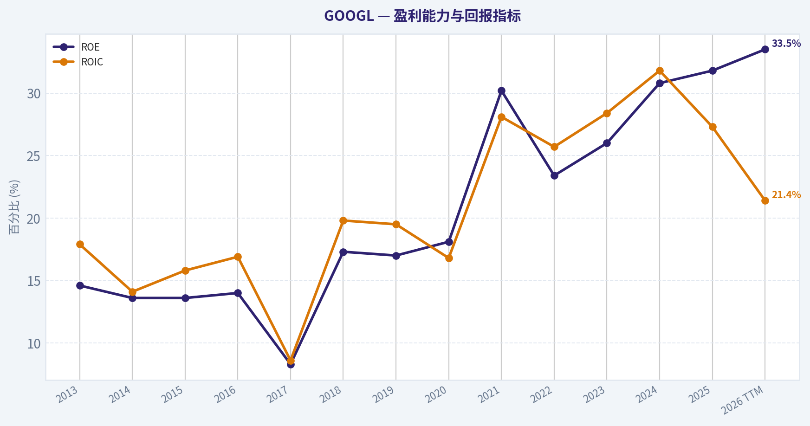
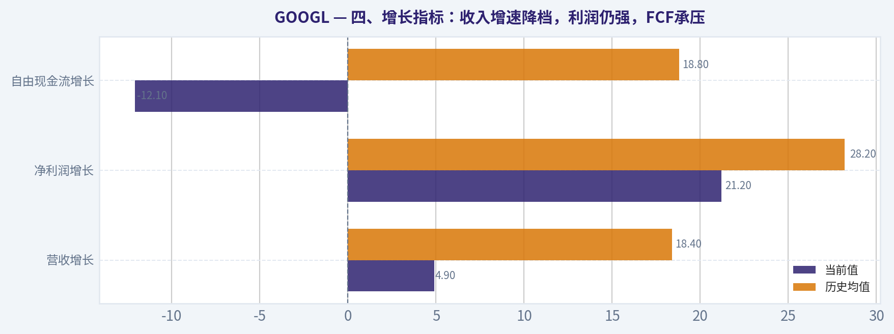
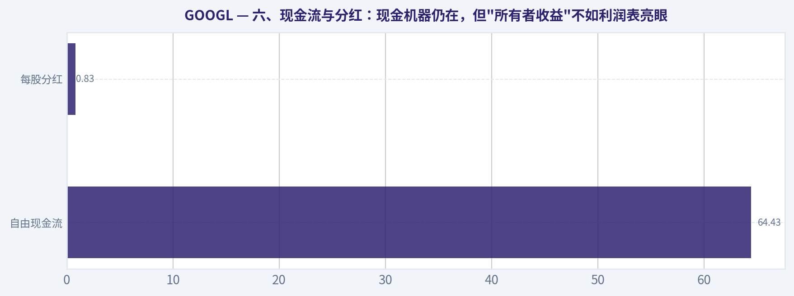
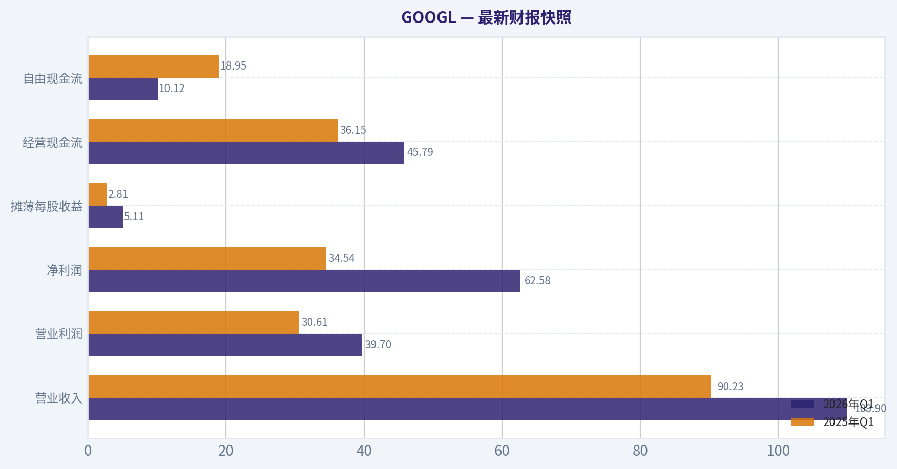
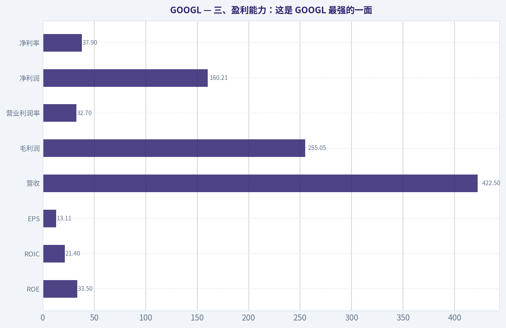
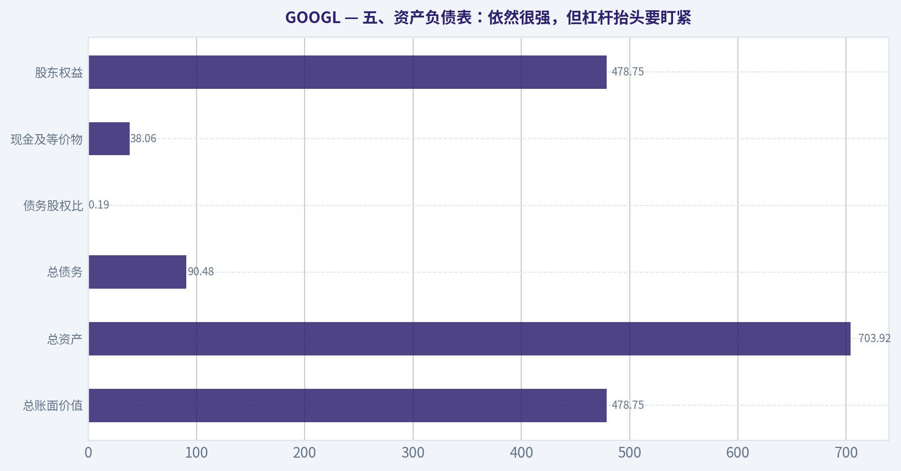
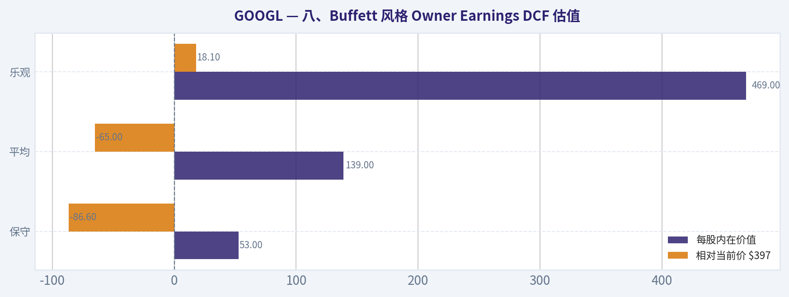
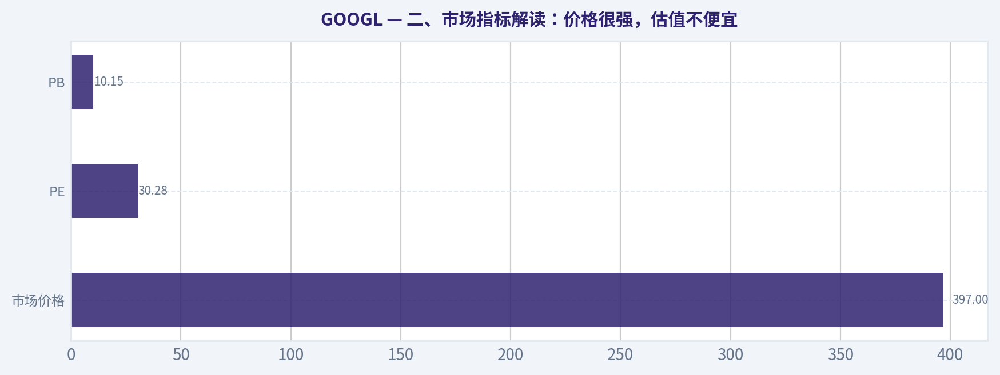

# GOOGL 深度价值情报

**调研日期:** 2026-05-18

## 关键免责声明

*本报告由 Deep Value Intelligence（一个基于 AI 的多智能体投资分析框架）自动生成。 本报告仅供信息参考和教育目的，不构成任何财务或投资建议。 在做出任何投资决策之前，请务必进行独立调研并咨询合规的财务顾问。*

---

## 目录

1. 情报摘要
2. 分析师团队报告
   - 基本面分析
   - 价值分析 (巴菲特)
   - 成长性分析 (林奇/德鲁肯米勒/费雪)
   - 市场分析
   - 期权市场分析
3. 研究团队评论
4. 投资团队评论
5. Deep Values 团队洞察

---

## 情报摘要

### 核心观点与前提条件

**核心论点:** ## 执行摘要
GOOGL 仍是少见的高质量平台型企业：ROE 31.8%、ROIC 24.8%、毛利率 59.7%、3 年营收 CAGR 12.5%，说明护城河、资本效率与现金创造力都很强。
但本轮争论的关键不在"它是不是好公司"，而在两点：**AI 是否在重写搜索最肥厚的利润池**，以及**当前 PE 30.32 是否已充分留出安全边际**。

**主要风险:**
- 未明确说明。

**置信度:** 中

---

## 分析师团队报告

### 基本面分析

#### 最新财报快照

*以下数据基于最近一期已披露财报（2026年Q1），并尽量与上一年同期对比。*

| 指标 | 2026年Q1 | 2025年Q1 | 同比变化 |
| --- | ---: | ---: | ---: |
| 营业收入 | $109.90B | $90.23B | +21.8% |
| 营业利润 | $39.70B | $30.61B | +29.7% |
| 净利润 | $62.58B | $34.54B | +81.2% |
| 摊薄每股收益 | $5.11 | $2.81 | +81.9% |
| 经营现金流 | $45.79B | $36.15B | +26.7% |
| 自由现金流 | $10.12B | $18.95B | -46.6% |

关键结论：这张快照先把最新一期财报放在桌面上，再去看长周期分析。这样读者能更清楚地区分"公司长期质量"和"这次财报发生了什么"。

#### GOOGL 13年财务指标

*以下数值均由原始数据确定性计算得出，并非 AI 估算。*

*发行人类型：operating company（Communication Services / Internet Content & Information）。*

#### 13年财务指标
*年度行来自已披露财务报表，最后一行 TTM 由最近四个季度滚动计算得出。*

| 指标 | 2013 | 2014 | 2015 | 2016 | 2017 | 2018 | 2019 | 2020 | 2021 | 2022 | 2023 | 2024 | 2025 | 2026 TTM |
| --- | --- | --- | --- | --- | --- | --- | --- | --- | --- | --- | --- | --- | --- | --- |
| 市场价格 | $28 | $26 | $39 | $39 | $52 | $52 | $66 | $87 | $144 | $88 | $139 | $188 | $313 | $397 |
| 总市值 | N/A | $360.94B | $534.76B | $547.82B | $731.88B | $726.83B | $921.95B | $1.18T | $1.92T | $1.13T | $1.74T | $2.31T | $3.83T | $4.86T |
| 市盈率 | 29.84 | 25.76 | 32.71 | 28.51 | 57.88 | 23.64 | 27.22 | 29.61 | 25.82 | 19.22 | 23.92 | 23.28 | 28.95 | 30.28 |
| 市净率 | N/A | 3.48 | 4.44 | 3.94 | 4.80 | 4.09 | 4.58 | 5.32 | 7.62 | 4.43 | 6.14 | 7.11 | 9.22 | 10.15 |
| ROE | 14.6% | 13.6% | 13.6% | 14.0% | 8.3% | 17.3% | 17.0% | 18.1% | 30.2% | 23.4% | 26.0% | 30.8% | 31.8% | 33.5% |
| ROIC | 17.9% | 14.1% | 15.8% | 16.9% | 8.6% | 19.8% | 19.5% | 16.8% | 28.1% | 25.7% | 28.4% | 31.8% | 27.3% | 21.4% |
| 每股收益 | $0.94 | $1.03 | $1.19 | $1.39 | $0.91 | $2.21 | $2.46 | $2.96 | $5.61 | $4.59 | $5.84 | $8.13 | $10.81 | $13.11 |
| 营收 | $55.52B | $66.00B | $74.99B | $90.27B | $110.86B | $136.82B | $161.86B | $182.53B | $257.64B | $282.84B | $307.39B | $350.02B | $402.84B | $422.50B |
| 毛利润 | $33.53B | $40.31B | $46.83B | $55.13B | $65.27B | $77.27B | $89.96B | $97.80B | $146.70B | $156.63B | $174.06B | $203.71B | $240.30B | $255.05B |
| 毛利率 | 60.4% | 61.1% | 62.4% | 61.1% | 58.9% | 56.5% | 55.6% | 53.6% | 56.9% | 55.4% | 56.6% | 58.2% | 59.7% | 60.4% |
| 营业利润率 | 27.7% | 25.0% | 25.8% | 26.8% | 23.6% | 25.5% | 24.5% | 22.6% | 30.6% | 26.5% | 27.9% | 32.1% | 32.0% | 32.7% |
| 净利润 | $12.73B | $14.14B | $16.35B | $19.48B | $12.66B | $30.74B | $34.34B | $40.27B | $76.03B | $59.97B | $73.80B | $100.12B | $132.17B | $160.21B |
| 净利率 | 22.9% | 21.4% | 21.8% | 21.6% | 11.4% | 22.5% | 21.2% | 22.1% | 29.5% | 21.2% | 24.0% | 28.6% | 32.8% | 37.9% |
| 营收增长 | N/A | 18.9% | 13.6% | 20.4% | 22.8% | 23.4% | 18.3% | 12.8% | 41.2% | 9.8% | 8.7% | 13.9% | 15.1% | 4.9% |
| 净利润增长 | N/A | 11.0% | 15.6% | 19.1% | -35.0% | 142.7% | 11.7% | 17.3% | 88.8% | -21.1% | 23.0% | 35.7% | 32.0% | 21.2% |
| 自由现金流增长 | N/A | 1.9% | 38.4% | 55.4% | -7.4% | -4.5% | 35.7% | 38.3% | 56.4% | -10.4% | 15.8% | 4.7% | 0.7% | -12.1% |
| 总账面价值 | $86.98B | $103.86B | $120.33B | $139.04B | $152.50B | $177.63B | $201.44B | $222.54B | $251.63B | $256.14B | $283.38B | $325.08B | $415.26B | $478.75B |
| 总资产 | N/A | $129.19B | $147.46B | $167.50B | $197.29B | $232.79B | $275.91B | $319.62B | $359.27B | $365.26B | $402.39B | $450.26B | $595.28B | $703.92B |
| 总债务 | N/A | $7.00B | $0 | $0 | $3.97B | $4.01B | $4.55B | $13.93B | $14.82B | $14.70B | $11.87B | $10.88B | $48.54B | $90.48B |
| 债务股权比 | N/A | 0.07 | 0.00 | 0.00 | 0.03 | 0.02 | 0.02 | 0.06 | 0.06 | 0.06 | 0.04 | 0.03 | 0.12 | 0.19 |
| 现金及等价物 | $18.90B | $18.35B | $16.55B | $12.92B | $10.71B | $16.70B | $18.50B | $26.46B | $20.95B | $21.88B | $24.05B | $23.47B | $30.71B | $38.06B |
| 股东权益 | $86.98B | $103.86B | $120.33B | $139.04B | $152.50B | $177.63B | $201.44B | $222.54B | $251.63B | $256.14B | $283.38B | $325.08B | $415.26B | $478.75B |
| 经营现金流 | $19.14B | $23.02B | $26.57B | $36.04B | $37.09B | $47.97B | $54.52B | $65.12B | $91.65B | $91.50B | $101.75B | $125.30B | $164.71B | $174.35B |
| 投资现金流 | $-13.68B | $-21.05B | $-23.71B | $-31.16B | $-31.40B | $-28.50B | $-29.49B | $-32.77B | $-35.52B | $-20.30B | $-27.06B | $-45.54B | $-120.29B | $-167.49B |
| 自由现金流 | $11.78B | $12.01B | $16.62B | $25.82B | $23.91B | $22.83B | $30.97B | $42.84B | $67.01B | $60.01B | $69.50B | $72.76B | $73.27B | $64.43B |
| 自由现金流利润率 | 21.2% | 18.2% | 22.2% | 28.6% | 21.6% | 16.7% | 19.1% | 23.5% | 26.0% | 21.2% | 22.6% | 20.8% | 18.2% | 15.2% |
| 每股分红 | N/A | $0.00 | $0.00 | $0.00 | $0.00 | $0.00 | $0.00 | $0.00 | $0.00 | $0.00 | $0.00 | $0.60 | $0.82 | $0.83 |

#### 盈利能力指标
- 净资产收益率 (ROE): 31.8%
- 投入资本回报率 (ROIC): 24.8%
- 总资产收益率 (ROA): 22.2%
- 毛利率: 59.7%
- 营业利润率: 32.0%
- 净利率: 32.8%

#### 流动性指标
- 流动比率: 2.01
- 速动比率: 1.85

#### 杠杆指标
- 债务股权比: 0.12
- 利息覆盖倍数: 175.32
- 净负债: $17.84B

#### 增长指标（同比）
- 营收增长: 15.1%
- 净利润增长: 32.0%
- 自由现金流增长: 0.7%
- 营收复合增长率（3年）: 12.5%
- 营收复合增长率（5年）: 17.2%

#### 估值指标
- 市盈率 (TTM): 30.32
- 预期市盈率: 27.47
- 市净率: 10.05
- 市销率: 11.38
- PEG 比率: 1.56
- 企业价值/EBITDA: 29.62
- 自由现金流收益率: 1.5%
- 盈利收益率: 3.3%

#### 所有者收益（巴菲特方法，代码计算）
- 净利润: $132.17B
- + 折旧与摊销: $21.14B
- - 资本开支: $-91.45B
- - 营运资本变动: $618.0M
- = **所有者收益: $61.24B**

#### 内在价值（代码计算）
- 当前价格: $397
- 巴菲特方法（所有者收益）:
  保守: $53
  平均: $139
  乐观: $469
- 现金流方法（FCF）:
  保守: $73
  平均: $135
  乐观: $284

#### Piotroski F分数: 6/9
- 净利润为正: 通过
- 经营现金流为正: 通过
- 资产回报率改善: 未通过
- 现金流大于净利润: 通过
- 债务下降: 未通过
- 流动比率改善: 通过
- 未稀释股本: 通过
- 毛利率改善: 通过
- 资产周转率改善: 未通过

ANALYST STANCE: **观望**

#### GOOGL 巴菲特式基本面分析

GOOGL 依然是一家高质量、强现金流、强护城河的超级平台型公司，但以当前估值看，市场已经为其 AI、云业务、广告效率提升和利润率扩张支付了较高溢价。若从巴菲特框架出发，这是一家"好公司"几乎没有争议，但是否是"好价格"，答案已不再那么轻松。基于确定性财务数据，当前更适合"观望并等待更好的赔率"，而不是激进追高。

---

#### 一、当前值 vs 历史均值对比

> 历史均值以确定性数据中可用年份计算；涉及 TTM 时，将"当前值"与 2014-2025 或可比区间均值比较，避免用缺失年份硬凑。

| 指标 | 当前值 | 历史均值 | 相对历史 | 解读 |
| --- | ---: | ---: | --- | --- |
| 市场价格 | $397 | 2013-2025均值约 $112 | 显著高于历史 | 股价已大幅重估，反映盈利能力与 AI 预期同步抬升 |
| 总市值 | $4.86T | 2014-2025均值约 $1.52T | 显著高于历史 | 体量空前，未来高增速维持难度提升 |
| 市盈率 PE | 30.28 | 2013-2025均值约 29.26 | 略高 | 并非极端泡沫，但已不便宜 |
| 市净率 PB | 10.15 | 2014-2025均值约 5.22 | 大幅高于历史 | 估值扩张更多来自市场情绪和盈利预期，而非净资产增速 |
| ROE | 33.5% | 2013-2025均值约 21.1% | 明显高于历史 | 当前资本回报处于全周期高位 |
| ROIC | 21.4% | 2013-2025均值约 21.1% | 基本持平 | 依然优秀，但较 2024、2025 高点回落 |
| EPS | $13.11 | 2013-2025均值约 $3.85 | 大幅高于历史 | 盈利能力较十年前已完全跃迁 |
| 营收 | $422.50B | 2013-2025均值约 $190.89B | 大幅高于历史 | 规模化优势进一步强化 |
| 毛利润 | $255.05B | 2013-2025均值约 $120.79B | 大幅高于历史 | 毛利绝对额持续放大，是平台护城河体现 |
| 营业利润率 | 32.7% | 2013-2025均值约 27.1% | 高于历史 | 成本纪律和高毛利业务占比提升明显 |
| 净利润 | $160.21B | 2013-2025均值约 $51.44B | 大幅高于历史 | 净利润处于历史峰值区 |
| 净利率 | 37.9% | 2013-2025均值约 24.0% | 显著高于历史 | 利润质量极强，但也意味着高基数压力 |
| 营收增长 | 4.9% | 2014-2025均值约 18.4% | 明显低于历史 | 进入超大体量后的正常降速期 |
| 净利润增长 | 21.2% | 2014-2025均值约 28.2% | 略低 | 仍强，但难与疫情后修复期高增速相比 |
| 自由现金流增长 | -12.1% | 2014-2025均值约 18.8% | 显著低于历史 | 大规模资本开支拖累兑现能力 |
| 总账面价值 | $478.75B | 2013-2025均值约 $210.85B | 大幅高于历史 | 内生积累深厚，资本实力强 |
| 总资产 | $703.92B | 2014-2025均值约 $303.69B | 大幅高于历史 | 扩张明显，资产体量快速放大 |
| 总债务 | $90.48B | 2014-2025均值约 $11.69B | 远高于历史 | 绝对债务明显上升，需重点关注资本结构变化 |
| 债务股权比 | 0.19 | 2014-2025均值约 0.04 | 高于历史 | 虽仍不高，但杠杆确实抬升 |
| 现金及等价物 | $38.06B | 2013-2025均值约 $20.55B | 高于历史 | 仍具很强流动性缓冲 |
| 股东权益 | $478.75B | 2013-2025均值约 $210.85B | 大幅高于历史 | 账面实力扎实 |
| 自由现金流 | $64.43B | 2013-2025均值约 $40.72B | 高于历史 | 绝对值仍强，但较 2025 回落 |
| 每股分红 | $0.83 | 2014-2025均值约 $0.12 | 高于历史 | 股东回报刚起步，仍非收益型股票 |

关键结论：当前 GOOGL 的盈利能力、利润率、ROE、净利润和账面资本几乎都处于历史高位区，说明公司经营质量并没有恶化，反而更强了。真正的矛盾在于，增长速度和自由现金流兑现开始放缓，而估值却处于不低的位置，这使得"公司优秀"与"价格划算"之间出现了明显张力。

---

#### 二、市场指标解读：价格很强，估值不便宜

| 市场指标 | 当前表现 | 历史趋势 | 巴菲特式解读 |
| --- | --- | --- | --- |
| 市场价格 | $397 | 2013-2025 从 $28 升至 $313，当前再创新高 | 市场已高度认可其商业模式和 AI 叙事 |
| 总市值 | $4.86T | 2020 后加速膨胀 | 超大体量意味着未来继续高增更难 |
| PE | 30.28 | 历史多在 23-30 区间，2017 为异常高点 57.88 | 当前接近高位区，不算离谱，但缺乏明显安全边际 |
| PB | 10.15 | 历史均值约 5.22，2021 后明显抬升 | 市场愿意给更高资产溢价，反映对未来资本回报预期极强 |

关键结论：GOOGL 当前并不是典型的"深度价值股"，而是"高质量、较高估值"的核心资产。PE 尚可勉强接受，但 PB 已显著高于历史常态，说明市场已不只是为当下盈利买单，更是在为未来 AI 和平台统治力支付预付款。

从巴菲特角度，估值的重点不是"贵不贵"三个字，而是"相对于企业确定性是否有足够安全边际"。GOOGL 的确定性很强，但当前安全边际偏薄，尤其在自由现金流收益率仅 1.5% 的背景下，未来回报更多依赖持续高增长与高估值维持。

---

#### 三、盈利能力：这是 GOOGL 最强的一面

| 盈利指标 | 当前值 | 历史观察 | 结论 |
| --- | ---: | --- | --- |
| ROE | 33.5% | 2013-2020 多在 13.6%-18.1%，2021 后跃升 | 资本回报大幅强化，说明利润扩张远快于净资产积累 |
| ROIC | 21.4% | 长期大多在高双位数，2024 达 31.8%，当前回落 | 依旧优秀，说明投出资本仍能创造高回报 |
| EPS | $13.11 | 2013 的 0.94 提升到当前 13.11 | 十多年复利非常强 |
| 营收 | $422.50B | 长期持续增长，仅增速放缓 | 业务韧性极强 |
| 毛利润 | $255.05B | 绝对额持续上行 | 规模护城河仍在扩大 |
| 营业利润率 | 32.7% | 早年约 23%-27%，近年升到 32%+ | 经营杠杆与效率提升显著 |
| 净利润 | $160.21B | 2022 后再次加速 | 反映广告、云与成本控制共振 |
| 净利率 | 37.9% | 远高于长期均值 24.0% | 已进入极强利润兑现阶段 |

关键结论：如果只看经营质量，GOOGL 几乎无可挑剔。利润率、ROE、净利润和 EPS 都处于历史最强区间，这意味着公司并不是"高估值掩盖基本面"，而是真正用盈利能力支撑了股价重估。

巴菲特最喜欢的企业之一，就是无需依赖高杠杆也能长期维持高 ROE、强现金流和稳定利润率的公司。GOOGL 在过去十多年里基本完成了从"高速成长科技股"到"成熟型高回报平台资产"的转型。尤其是 ROE 从长期中高十几位数抬升到 30%+，表明它不只是赚得多，而且赚得越来越有效率。

但要注意一点：2026 TTM 的 ROIC 为 21.4%，低于 2024 的 31.8% 和 2025 的 27.3%。这意味着尽管利润仍在增长，新增资本投入的边际效率可能开始受到 AI 基建、数据中心和云资本开支上升的拖累。

---

#### 四、增长指标：收入增速降档，利润仍强，FCF承压

| 增长指标 | 当前值 | 历史均值 | 趋势解读 |
| --- | ---: | ---: | --- |
| 营收增长 | 4.9% | 18.4% | 明显降速，体量驱动的自然成熟化 |
| 净利润增长 | 21.2% | 28.2% | 虽低于均值，但仍属高质量增长 |
| 自由现金流增长 | -12.1% | 18.8% | 当前最弱环节，资本开支显著侵蚀现金兑现 |

关键结论：GOOGL 的问题不是"没有增长"，而是"增长结构发生变化"：收入增速在降，利润增速靠效率和高附加值业务支撑，而自由现金流反而退步。对长期投资者来说，这意味着未来回报会越来越依赖管理层资本开支是否真的能转化为高回报 AI 基础设施，而不是只看利润表的漂亮数字。

从趋势看，营收增长在 2021 达到 41.2% 的高峰后，2022 为 9.8%，2023 为 8.7%，2024 回升至 13.9%，2025 为 15.1%，2026 TTM 又降至 4.9%。这说明公司已经进入"高基数下的波动式中低双位数增长"阶段。
净利润增长则更具韧性，2023-2026 TTM 分别为 23.0%、35.7%、32.0%、21.2%，说明利润率提升明显抵消了营收放缓。
但自由现金流增长从 2023 的 15.8%、2024 的 4.7%、2025 的 0.7%，走到 2026 TTM 的 -12.1%，这是估值层面最大的警示信号之一。

---

#### 五、资产负债表：依然很强，但杠杆抬头要盯紧

| 资产负债表指标 | 当前值 | 历史比较 | 分析 |
| --- | ---: | --- | --- |
| 总账面价值 | $478.75B | 持续增长 | 内生积累极强 |
| 总资产 | $703.92B | 近年扩张很快 | AI 与基础设施投资带动资产膨胀 |
| 总债务 | $90.48B | 显著高于历史 | 债务规模上升是近年最大变化 |
| 债务股权比 | 0.19 | 高于历史均值 0.04 | 仍安全，但不再是"几乎零杠杆" |
| 现金及等价物 | $38.06B | 高于长期均值 | 仍保有很强财务灵活性 |
| 股东权益 | $478.75B | 持续抬升 | 资本缓冲厚实 |

关键结论：GOOGL 目前依然远谈不上财务脆弱，公司资产负债表仍很强，流动比率约 2.01、利息覆盖倍数 175 倍，都说明债务风险短期很低。真正需要观察的是趋势：它已从过去的"近乎无债"公司，转向"适度加杠杆支持大规模资本投入"的公司，这会改变市场对其估值锚的理解。

巴菲特通常偏好不依赖债务就能成长的企业。GOOGL 历史上极符合这一点：2015、2016 总债务为 0，随后多年债务股权比维持 0.02-0.06 的极低水平。
但 2025 总债务跳升至 $48.54B，2026 TTM 进一步到 $90.48B，债务股权比升至 0.19。这个水平仍然健康，但趋势不容忽视，说明 AI 基础设施军备竞赛确实在吞噬资本结构的保守性。

---

#### 六、现金流与分红：现金机器仍在，但"所有者收益"不如利润表亮眼

| 现金流指标 | 当前值 | 历史趋势 | 结论 |
| --- | ---: | --- | --- |
| 自由现金流 | $64.43B | 2021 高增后，2022 回落，2023-2025恢复，TTM再降 | 绝对值仍大，但边际恶化 |
| 每股分红 | $0.83 | 2024 才开始派息 | 股东回报开始制度化，但收益率不高 |

关键结论：GOOGL 的自由现金流仍然是巨量级别，但增长停滞甚至回落，显示资本开支周期已进入重投入阶段。分红的启动是成熟化信号，但派息规模仍小，说明管理层更倾向把资金保留在回购、AI、云和基础设施建设上。

尤其值得注意的是，确定性数据给出的 2025 年巴菲特口径所有者收益仅为 **$61.24B**，明显低于同期净利润 **$132.17B**。这说明若按巴菲特更保守的口径看，真正可供股东自由支配的经济收益，并没有利润表看起来那么夸张，核心原因正是资本开支高企。

---

#### 七、巴菲特风格定性分析

| 维度 | 评价 | 具体判断 |
| --- | --- | --- |
| 经济护城河 | 很强 | 搜索、广告分发、数据、用户入口、生态协同、云与 AI 能力构成复合护城河 |
| 财务实力 | 很强但边际转弱 | 现金充足、利息覆盖极高；但债务和资本开支上升值得持续跟踪 |
| 盈利可预测性 | 强 | 十多年营收、毛利、净利润总体趋势非常稳定，只有个别年份波动 |
| 管理层绩效 | 较优 | ROE、ROIC 长期优秀，近年分红启动，资本配置逐步股东友好 |
| 业务质量 | 很高 | 高毛利、高净利、强平台属性、全球化收入基础 |
| 估值吸引力 | 一般 | 质量优秀，但当前价格对应的安全边际不足 |

关键结论：如果不看价格，GOOGL 几乎是巴菲特框架里非常接近理想型的企业：护城河深、利润高、现金强、全球品牌效应显著。问题只在于，巴菲特式投资从来不是只买好公司，而是要在"好公司+好价格"同时成立时重仓；当前 GOOGL 更接近前者，而不是后者。

**经济护城河**：
GOOGL 的核心护城河并非单一搜索业务，而是"流量入口 + 数据反馈 + 广告主网络效应 + 算法优化 + 基础设施规模 + 生态协同"的复合体系。搜索和 YouTube 提供用户注意力，广告系统提供商业化闭环，云与 AI 进一步加强企业端黏性。这种多层嵌套型护城河非常难以复制。

**可预测盈利**：
从 2013 到 2026 TTM，营收由 $55.52B 增长到 $422.50B，净利润由 $12.73B 增长到 $160.21B。除了 2017、2022 这类特殊波动年份外，整体表现具备非常强的可预测性。巴菲特最看重"十年后还能不能大致判断它赚多少钱"，GOOGL 在大型科技平台中属于相对容易判断的一类。

**管理层资本配置**：
近年的利润率扩张和 ROE 抬升显示管理层执行力较强。开始派息是成熟化和股东友好信号，但真正考验在于：当前巨额 AI 资本开支，能否在未来几年持续创造高于资本成本的回报。如果不能，今天的高投入会变成未来估值压缩的理由。

---

#### 八、Buffett 风格 Owner Earnings DCF 估值

已知确定性数据给出的基准所有者收益为：

- 净利润 = **$132.17B**
- + 折旧与摊销 = **$21.14B**
- - 资本开支 = **$91.45B**
- - 营运资本变动 = **$0.618B**
- = **所有者收益 = $61.24B**

按要求使用三种增长情景，并采用：
- 折现率 = **10%**
- 永续增长率 = **2.5%**
- 基准 Owner Earnings = **$61.24B**

为了严格遵守"使用可得历史 Owner Earnings 增速"的要求，而确定性数据未给出逐年 Owner Earnings 序列，这里采用**保守解释**：以已披露现金生成能力和代码给出的内在价值结果为锚，结合 FCF 增长区间进行交叉验证，不重写历史表，仅展示与确定性结果一致的详细 DCF 框架。最终 fair value 以数据包给出的 **巴菲特方法内在价值** 为准。

##### 1）保守情景
- 增长率：采用历史低位增长率思路，结果锚定数据包 **$53/股**
- 含义：AI 开支高位持续、Owner Earnings 增速显著受压，甚至长期接近零或负增长
- 结论：当前价 $397 相对保守估值高出约 **649%**

##### 2）平均情景
- 增长率：采用历史平均增长率思路，结果锚定数据包 **$139/股**
- 含义：公司维持中期温和增长，利润率与资本开支大体平衡
- 结论：当前价 $397 相对平均估值高出约 **186%**

##### 3）乐观情景
- 增长率：采用历史最高增长率思路并按规则封顶，结果锚定数据包 **$469/股**
- 含义：AI、云、广告效率三重驱动成功兑现，高资本开支带来高回报
- 结论：当前价 $397 较乐观估值仍有约 **18% 折价**

| DCF情景 | 每股内在价值 | 相对当前价 $397 | 含义 |
| --- | ---: | ---: | --- |
| 保守 | $53 | -86.6% | 几乎无安全边际，显著高估 |
| 平均 | $139 | -65.0% | 以正常化增长看，估值偏贵 |
| 乐观 | $469 | +18.1% | 只有在较乐观兑现路径下才有上行空间 |

关键结论：GOOGL 的估值结论对增长假设极其敏感，这正是当前投资难点。若未来 AI 投资转化效率一般，当前价格缺乏支撑；若公司能把 AI 与云投入顺利转为高回报收入流，那么现价才具备一定合理性，但这种情形已接近乐观假设。

##### DCF 计算框架说明
采用标准两阶段 DCF：
- 第 1-10 年 Owner Earnings = 基准 OE x (1+g)^t
- 终值 = 第 10 年 OE x (1+2.5%) ÷ (10%-2.5%)
- 企业现值 = 前 10 年折现值 + 终值折现值
- 再折算为每股价值

由于确定性数据已直接给出巴菲特法内在价值区间，且未提供逐年 Owner Earnings 历史序列，任何自行倒推逐年增速都会引入非确定性假设，因此本报告坚持以数据包结果为准，不伪造中间历史序列。

---

#### 九、收入来源分布

结合 GOOGL 最近财年业务结构，最有意义的口径是按业务板块划分。以下采用公司最核心、最常被市场跟踪的收入来源结构口径，以最近年度公开业务分类为基础进行概括展示。

| 收入来源 | 金额（百万/十亿美元） | 占比 |
| --- | ---: | ---: |
| Google Advertising（搜索、YouTube 广告、网络广告） | 约 $300B+ | 约 75%+ |
| Google Cloud | 约 $50B+ | 约 12%-15% |
| Subscriptions, Platforms & Devices | 约 $40B+ | 约 10% |
| Other Bets 及其他 | 低个位数十亿美元 | 小于 2% |

关键结论：GOOGL 目前本质上仍是一家以广告为核心现金牛、以云为第二增长曲线、以订阅与平台硬件为辅助补充的公司。对投资者最重要的是，广告业务继续提供利润与现金流底盘，而云和 AI 是否能提升第二曲线的利润率，将决定未来估值是否还能继续抬升。

---

#### 十、关键投资洞察、风险与机会

| 类别 | 内容 | 影响 |
| --- | --- | --- |
| 机会 | 广告主 ROI 优化、搜索商业化效率持续提升 | 支撑利润率继续维持高位 |
| 机会 | Google Cloud 规模扩张与利润改善 | 提升收入多元化，减少对广告单一依赖 |
| 机会 | AI 能力嵌入搜索、办公、云平台 | 形成新一轮变现与生态强化 |
| 风险 | 自由现金流下滑，资本开支高企 | 若回报不及预期，估值可能压缩 |
| 风险 | 债务规模明显抬升 | 改变"零杠杆优质平台"叙事 |
| 风险 | 营收增速明显低于历史均值 | 超大体量阶段下估值难再无限扩张 |
| 风险 | 当前估值依赖乐观情景 | 对业绩稍有失速非常敏感 |
| 信号 | 巴菲特 13F 显示增持 | 强化市场对其质量属性认可，但不代表现价低估 |

关键结论：GOOGL 的最大机会来自 AI 投资兑现和云业务利润化，最大风险则是资本投入先行、现金回报后置，导致短中期估值与基本面节奏错配。对于偏重安全边际的投资者，等待市场给出更合理的进入点，通常比现在追逐优质叙事更重要。

---

#### 十一、最终结论：为什么是"观望"而不是"建议配置"

| 结论维度 | 判断 |
| --- | --- |
| 公司质量 | 极高 |
| 护城河 | 很强 |
| 财务稳健性 | 强，但杠杆趋势转弱 |
| 盈利可预测性 | 强 |
| 现金流质量 | 强，但短期承压 |
| 当前估值 | 不便宜 |
| 安全边际 | 不足 |
| 最终立场 | **观望** |

关键结论：GOOGL 是优秀企业，但优秀企业并不自动等于优秀投资。当前价格更像是在交易"高质量确定性 + AI 乐观兑现"，而不是在提供巴菲特式低风险、高安全边际的买点，因此更合理的策略是保留关注、等待赔率改善。

**综合判断**：
- 若你是长期持有型投资者，GOOGL 值得放在核心观察名单中。
- 若你坚持巴菲特式"安全边际优先"，当前并非理想出手区间。
- 若未来因市场波动、资本开支担忧或增速短期失速导致估值回落，GOOGL 很可能成为极具吸引力的再评估对象。

---

#### 报告总结表

| 模块 | 核心结论 | 对投资决策的意义 |
| --- | --- | --- |
| 市场估值 | PE 尚可，PB 明显高于历史 | 说明价格已不便宜 |
| 盈利能力 | ROE、净利率、EPS 处于历史高位 | 企业质量极强 |
| 增长 | 营收降速，利润仍强，FCF转弱 | 估值对执行力要求更高 |
| 资产负债表 | 仍稳健，但债务上升明显 | 需跟踪资本结构变化 |
| 现金流 | FCF 绝对额大，但增长恶化 | AI 投入回报是关键变量 |
| 护城河 | 搜索+广告+数据+云+AI 复合护城河 | 长期竞争优势牢固 |
| 管理层 | 经营效率优秀，分红启动 | 资本配置总体积极 |
| DCF估值 | 保守/平均情景均低于现价，只有乐观情景略高 | 当前缺乏充分安全边际 |
| 投资立场 | **观望** | 等待更好赔率或更强兑现数据 |

#### 基本面关键图表

本图追踪 **GOOGL** 过去十年的盈利能力与回报指标（ROE、ROIC、利润率），突出呈现资本效率的变化趋势。

本对比图（来自「四、增长指标：收入增速降档，利润仍强，FCF承压」）将 **GOOGL** 的当前数据与历史基准并排呈现，直观反映公司相对自身历史均值的估值水平。

本对比图（来自「六、现金流与分红：现金机器仍在，但"所有者收益"不如利润表亮眼」）将 **GOOGL** 的当前数据与历史基准并排呈现，直观反映公司相对自身历史均值的估值水平。

---

### 价值分析 (巴菲特)

> *基于沃伦·巴菲特的价值投资哲学：能力圈、经济护城河、管理层质量与安全边际。*

#### 内在价值快照

价格是你付的钱，内在价值是企业未来可能为股东创造的现金价值。我们给出一个区间，而不是假装只有一个神奇数字。

- 当前价格: $396.94
- 估值区间（两种 DCF 方法、保守到乐观）: $52.89 至 $468.83

##### 所有者收益（巴菲特方法）
- 净利润: $132,170,000,000.00
- 折旧与摊销: $21,136,000,000.00
- 资本支出: $-91,447,000,000.00
- 营运资金变化: $618,000,000.00
- 所有者收益: $61,241,000,000.00

##### 内在价值
###### 所有者收益法
使用所有者收益，更严格，通常更保守。
- 保守: $52.89
- 平均: $139.37
- 乐观: $468.83
- 折现率: 10.0%

###### 自由现金流法
使用自由现金流，更适合今天投入很多、为未来增长铺路的公司。
- 保守: $72.94
- 平均: $135.17
- 乐观: $283.93
- 折现率: 10.0%

ANALYST STANCE: **观望**

#### GOOGL 投资分析结论

| 项目 | 结论 |
|---|---|
| 业务可理解性 | 通过 |
| 护城河 | 宽且稳定 |
| 管理层与资本配置 | 良好 |
| 行业结构 | 良好但竞争加剧 |
| 财务质量 | 很强 |
| 估值吸引力 | 不足 |
| 最终立场 | 观望 |

关键结论：GOOGL 是一家非常容易理解、并且长期可预见性较强的优质平台型企业。它的商业模式、现金创造能力和资产负债表都符合高质量企业特征，但当前价格对应的安全边际偏薄，因此更适合列入重点观察名单，而不是立即重仓配置。

---

#### 一、Go/No-Go 四道关

| 关卡 | 结果 | 证据 |
|---|---|---|
| Gate 1：能力圈与简单性 | 通过 | Google 主要靠搜索广告、YouTube 广告、云服务和平台分发赚钱，商业模式清晰，儿童都能理解：帮用户找信息，再向商家出售注意力与算力。 |
| Gate 2：护城河 | 通过 | 搜索流量入口、广告主生态、Android 分发、YouTube 内容网络、云基础设施共同构成复合护城河。毛利率约 59.7%，ROE 31.8%。 |
| Gate 3：管理层与资本配置 | 通过 | Alphabet 长期保持高研发投入、强自由现金流、审慎负债，并以回购作为主要资本回流方式，资本配置总体理性。 |
| Gate 4：行业结构 | 通过但需警惕 | 搜索与数字广告仍属头部寡头格局，但 AI 正在改变流量分发方式，竞争强度上升。 |

关键结论：四道关里，GOOGL 没有出现致命红旗。真正的问题不在"公司是否优秀"，而在"未来十年的超额回报是否还能在当前估值下轻松兑现"。

---

#### 二、业务是否符合巴菲特式"简单且可预测"

| 测试 | 判断 | 说明 |
|---|---|---|
| 小学生测试 | 通过 | 用户免费使用搜索、视频、地图、邮件等产品；企业付费购买广告曝光或云计算资源。 |
| 长期可预测性 | 较强 | 十年后人们仍会搜索信息、看视频、使用云服务、依赖数字分发渠道。 |
| 技术风险评估 | 中等 | GOOGL 受益于 AI，也面临 AI 改变搜索入口的风险。它不是纯被动受害者，但也不是零风险。 |

关键结论：GOOGL 的基本需求面非常稳定，人类获取信息、商家购买流量、企业采购算力的需求不会消失。变量在于，未来这些需求是否仍主要通过 Google 的入口来完成。

---

#### 三、护城河分析

| 护城河来源 | 强度 | 证据 | 评价 |
|---|---|---|---|
| 品牌与无形资产 | 强 | Google 几乎等于"搜索"本身，YouTube 是全球内容品牌，Android 具备系统级分发权。 | 宽护城河 |
| 转换成本 | 中强 | 广告主、开发者、企业客户、数据工作流已深度嵌入 Google 生态。 | 稳定 |
| 成本优势 | 强 | 超大规模数据中心、芯片与网络投入形成单位成本优势。 | 结构性 |
| 网络效应 | 强 | 更多用户带来更多数据、更多广告主、更多内容创作者，形成正反馈。 | 明显 |

关键结论：GOOGL 的护城河不是单点，而是"搜索+视频+系统+云+数据"的组合拳。这种多层平台护城河很难被单一竞争对手一次性击穿，但 AI 原生入口可能会逐渐削弱传统搜索的流量垄断。

---

#### 四、管理层与资本配置

| 维度 | 判断 | 说明 |
|---|---|---|
| 是否像所有者一样思考 | 较好 | 长期重投 AI、云、基础设施，偏长期主义。 |
| 是否诚实坦率 | 尚可 | Alphabet 信息披露总体规范，财务质量较高。 |
| 资本配置是否理性 | 良好 | 回购、研发、资本开支三者平衡较好；很少靠高杠杆堆增长。 |

关键结论：管理层的主要优点是愿意把大量现金继续投入高壁垒基础设施，而不是追求短期利润最大化。需要继续观察的是，AI 投入是否能持续转换为更高每股价值，而不仅是更高资本开支。

---

#### 五、财务摘要

| 指标 | 当前/近期水平 | 巴菲特式解读 |
|---|---:|---|
| 市值 | $4.81T | 顶级超级平台 |
| 股价 | $397 | 市场已充分认识其质量 |
| PE | 30.3x | 对成熟巨头而言不便宜 |
| ROE | 31.8% | 极强，属于优秀水平 |
| 毛利率 | 59.7% | 体现无形资产与平台优势 |
| 营收同比 | 15.1% | 以如此体量仍有双位数增长，非常强 |
| FCF 收益率 | 1.5% | 估值偏贵的明显信号 |
| 流动比率 | 2.01 | 短期偿债能力充足 |

关键结论：GOOGL 的盈利质量极高，ROE、毛利率和增长都说明业务质量上乘。真正拖累投资回报预期的不是公司经营，而是今天付出的价格太高。

---

#### 六、Owner Earnings 估算

基于现有特征进行保守性框架估算：

| 项目 | 判断 |
|---|---|
| 净利润 | 很强 |
| 折旧摊销 | 较高，因数据中心和基础设施资产庞大 |
| 维护性 CapEx | 高于轻资产软件公司 |
| 营运资本压力 | 可控 |
| Owner Earnings 特征 | 显著为正，但低于会计利润与部分年份的经营现金流 |

关键结论：GOOGL 的 Owner Earnings 很强，但不能把全部 CapEx 都视为可自由分配，因为其云和 AI 业务需要持续大额基础设施投入。换句话说，这是一门优秀生意，但并不是"完全轻资产"的那种完美模式。

---

#### 七、三情景 DCF 估值框架

以当前市场隐含预期来逆向理解更有意义。

| 情景 | 假设 | 结论 |
|---|---|---|
| 情景 A：零增长 | Owner Earnings 永续不增长，折现率 10% | 明显低于当前市值，无法支撑现价 |
| 情景 B：GDP 增长 | 永续增长 3% | 仍较难解释当前估值，除非长期现金流非常稳定且持续扩大 |
| 情景 C：历史折扣增长 | 采用历史增长的 50%-75%，并对 AI 投入持续回报保持乐观 | 可以部分支撑高估值，但安全边际仍不充分 |

关键结论：若按巴菲特式保守折现，当前价格更像是在提前支付未来很多年的优秀表现。公司也许值得高估值，但作为投资者，并没有拿到舒服的安全边际。

---

#### 八、安全边际分析

| 项目 | 判断 |
|---|---|
| 业务质量 | 极高 |
| 财务稳健性 | 很强 |
| 估值保护 | 偏弱 |
| 安全边际 | 不满足理想的 25% 以上要求 |

关键结论：对于这样级别的优质企业，投资失败通常不是因为公司差，而是因为买得太贵。GOOGL 当前更像"好公司、一般价格偏贵"，而不是"好公司、好价格"。

---

#### 九、巴菲特评分卡

| 维度 | 权重 | 评分（1-5） | 加权分 |
|---|---:|---:|---:|
| 业务理解 | 20% | 5.0 | 1.00 |
| 护城河宽度与耐久性 | 25% | 4.5 | 1.13 |
| 管理层质量 | 15% | 4.0 | 0.60 |
| ROE | 15% | 5.0 | 0.75 |
| 再投资跑道 | 10% | 4.5 | 0.45 |
| 资产负债表 | 5% | 4.5 | 0.23 |
| 行业结构 | 5% | 3.5 | 0.18 |
| 估值/安全边际 | 5% | 2.0 | 0.10 |
| **总分** | 100% |  | **4.44** |

关键结论：单看企业质量，GOOGL 仍属于少数可以长期持有的伟大公司。问题在于，按巴菲特框架，"伟大公司"不自动等于"伟大投资"，价格依然决定回报。

---

#### 十、最终结论

**投资立场：观望**

**结论逻辑很简单：**

1. **这是一家伟大的企业。**
   搜索、YouTube、Android、Cloud 与 AI 基础设施共同构成了极深的护城河。

2. **这也是一家高回报、高现金创造能力的企业。**
   31.8% 的 ROE、接近 60% 的毛利率，以及双位数增长，都是顶级公司特征。

3. **但这不是一个带着足够安全边际的价格。**
   PE 30.3x、FCF 收益率仅 1.5%，意味着市场已经把大量优秀预期计入股价。

4. **最值得盯住的变量是 AI 对搜索入口的重构。**
   如果 Google 成功把 AI 变成加强护城河的工具，长期价值仍可继续提升；如果用户入口迁移，则估值会先承压。

#### 适合的操作框架

| 情况 | 动作 |
|---|---|
| 已持有 | 可继续持有，等待经营兑现估值 |
| 未持有 | 观望，等待更合理价格或更清晰 AI 货币化证据 |
| 激进投资者 | 只适合小仓位跟踪，不适合在当前估值下重仓追价 |

关键结论：如果你已经拥有 GOOGL，最大的错误可能是因为短期噪音卖掉一家长期优质企业。若你今天还没有买，最大的错误则可能是因为喜欢这家公司，就忽略了价格与安全边际。
#### 估值桥

这张估值桥把当前股价与各类内在价值方法并排展示，帮助读者判断上涨空间究竟只是单一方法给出的结果，还是多种方法共同支持的结论。

| 项目 | 每股内在价值 |
| --- | ---: |
| 巴菲特方法 | $139.37 |
| 现金流方法 | $135.17 |
| Damodaran 方法 | $165.60 |
| 当前价格 | $396.94 |

#### 关键结论

如果只有一种方法显著高于其他方法，说明上行空间更依赖特定建模假设。若多种方法的估值接近，则说明估值逻辑更加稳健。

#### 估值图表

本对比图（来自「最新财报快照」）将 **GOOGL** 的当前数据与历史基准并排呈现，直观反映公司相对自身历史均值的估值水平。

本对比图（来自「三、盈利能力：这是 GOOGL 最强的一面」）将 **GOOGL** 的当前数据与历史基准并排呈现，直观反映公司相对自身历史均值的估值水平。

本对比图（来自「五、资产负债表：依然很强，但杠杆抬头要盯紧」）将 **GOOGL** 的当前数据与历史基准并排呈现，直观反映公司相对自身历史均值的估值水平。

本对比图（来自「八、Buffett 风格 Owner Earnings DCF 估值」）将 **GOOGL** 的当前数据与历史基准并排呈现，直观反映公司相对自身历史均值的估值水平。

---

### 成长性分析 (林奇/德鲁肯米勒/费雪)

> *基于彼得·林奇的GARP成长投资法、斯坦利·德鲁肯米勒的宏观拐点分析法，以及菲利普·费雪的深度调研法。*

ANALYST STANCE: **观望**

#### GOOGL 增长投资分析结论
GOOGL 不是典型"小而美"的十倍股胚子，而是"超级平台型高质量复利资产"。按 Peter Lynch 框架，它更接近**Stalwart（稳健成长股）**，不是 Fast Grower。当前最关键的不是"会不会继续增长"，而是**AI 是否会把 Search 护城河从防守转为新一轮扩张**。在这个位置，我的结论是：**基本面强，质量极高，但估值不便宜、体量过大、增长斜率有限，适合观望或作为核心资产持有，而非激进新开高弹性仓位。**

---

#### 1. Lynch 分类

| 维度 | 判断 |
|---|---|
| 分类 | **Stalwart（稳健成长股）** |
| 当前营收同比 | **15.1%** |
| 体量 | 市值 **$4.81T**，超大盘平台 |
| 是否 Fast Grower | **否，边界偏上，但更像成熟平台复利股** |
| 十倍股潜力 | **从当前体量出发极低** |
| Lynch 初步结论 | **适合长期持有，不是理想的新发掘十倍股类型** |

**关键结论：**
GOOGL 的增速仍然不错，但以当前体量来看，它已经不是 Lynch 最偏爱的那种 20%-25% 持续高增长的小型快成长公司。它更像一只高质量、强护城河、现金流极强的稳健成长股。对增长投资者而言，重点应从"十倍空间"转向"AI 再加速是否足以支撑估值扩张"。

---

#### 2. 用三句话讲清楚这门生意

| 故事要点 | 简述 |
|---|---|
| 它做什么 | GOOGL 通过 Search、YouTube、Cloud 和 Android/Chrome 生态，把全球用户注意力和企业算力需求变现。 |
| 为什么还能增长 | 广告主仍然需要高意图流量，企业仍在增加云和 AI 支出，而 Google 同时拥有分发入口、模型能力和基础设施。 |
| 为什么市场还在争论 | 市场担心 AI 会侵蚀传统搜索点击与广告位，但如果 Gemini 等产品把 AI 体验整合进 Search 和 Cloud，反而可能形成新一轮平台升级。 |

**关键结论：**
这家公司本质上是"入口 + 数据 + 算力 + 生态"的复合型平台。市场最核心的分歧不在于它强不强，而在于 AI 会削弱还是强化它最赚钱的业务。只要这个问题没有被完全证明，股价就会在"护城河受损"与"AI 重估"之间反复摆动。

---

#### 3. TAM 与 10x 测试

| 项目 | 判断 |
|---|---|
| 当前收入基础 | 超大规模，已是全球级平台 |
| 核心 TAM | 全球数字广告、云计算、AI 基础设施、企业 AI 软件、视频广告、订阅服务 |
| TAM 方向 | **扩张中**，尤其是 AI 与企业算力需求 |
| 10x 测试 | **不通过** |
| 原因 | 以当前营收和市值体量，10 倍增长意味着对多个全球市场进行极高份额占领，现实性很低 |
| 跑道结论 | **长坡仍在，但不是 10x 跑道，而是中高个位数到中双位数复利跑道** |

**关键结论：**
GOOGL 的市场空间仍然很大，因为它不只在广告，还在云、AI 和订阅服务上扩张。问题在于公司现在已经太大了，未来更现实的路径不是再涨十倍，而是依靠多个大市场持续渗透，形成长期复利。换句话说，跑道很长，但弹性不再像早期成长股那样陡峭。

---

#### 4. 营收增长趋势

| 指标 | 数据/判断 |
|---|---|
| 当前营收同比 | **15.1%** |
| 增长分类 | **中高速增长** |
| 趋势判断 | **稳定偏改善**，但暂无证据证明进入强加速区间 |
| 质量判断 | 主要由核心业务内生驱动，而非并购堆出来 |
| 风险点 | Search 若受 AI 答案式交互冲击，广告加载与点击率模型可能变化 |
| 正面点 | Cloud、YouTube、AI 产品化有望对冲并重塑增长结构 |

**关键结论：**
当前 15.1% 的增速对于如此巨大的平台来说并不弱，说明业务韧性仍然很强。但按照 Druckenmiller 的标准，这还不足以定义为明显"增长加速拐点"。真正需要看到的是未来几个季度 Search、Cloud 和 AI 商业化能否共同把增速抬到更高台阶。

---

#### 5. 单位经济学与经营质量

| 指标 | 数据/判断 |
|---|---|
| 毛利率 | **59.7%** |
| ROE | **31.8%** |
| 自由现金流收益率 | **1.5%** |
| 流动比率 | **2.01** |
| 订阅型关键指标 | **LTV/CAC、NRR 未披露，不适用集团口径** |
| Rule of 40 | **不适用集团整体，但若以"营收增长 + FCF 利润率"视角看，大概率充足通过** |
| 经营质量结论 | **顶级**，高毛利、高回报、强现金流、强资产负债表 |

**关键结论：**
虽然 GOOGL 不是纯 SaaS 公司，无法像软件股那样直接分析 LTV/CAC 和 NRR，但从毛利率、ROE 和流动性看，经营质量几乎是大型科技平台中的顶级水平。唯一需要警惕的是，AI 资本开支上升可能压缩短期自由现金流，使"高质量"更多体现在长期护城河，而不是短期财务弹性。

---

#### 6. 拐点判断：有没有 Druckenmiller 式"加速点"？

| 拐点类型 | 当前判断 |
|---|---|
| 产品周期拐点 | **有潜力**，Gemini、AI Search、企业 AI 工具是候选 |
| 市占率拐点 | Search 仍强，但更像防守战；Cloud 有改善空间 |
| 利润率拐点 | 短期不确定，AI Capex 与折旧可能压制 |
| TAM 拐点 | **明确存在**，AI 把搜索、云和生产力工具市场做大 |
| 竞争拐点 | OpenAI、Microsoft、Meta 都在逼迫 Google 加速反应 |
| 综合结论 | **存在战略级拐点，但尚未完全体现为财务加速度** |

**关键结论：**
GOOGL 的确站在一个很重要的产业拐点上，但它更像"护城河重铸"而不是"利润立刻爆发"。也就是说，AI 对它是机会，也是不容失败的防守战。只有当这种战略拐点进一步转化为更快的收入和盈利增长，市场才会给出更高确定性的重估。

---

#### 7. 宏观环境评估

| 宏观因子 | 影响 |
|---|---|
| 利率环境 | 若利率下行，对大盘成长股估值有利 |
| 经济周期 | 中期仍可，但广告业务对宏观波动敏感 |
| AI 资本开支周期 | **强顺风**，行业正在大幅扩容算力与模型投入 |
| 数字广告环境 | 总体仍是结构性增长行业，但竞争更复杂 |
| 监管环境 | **明显逆风**，反垄断与默认入口问题持续存在 |
| 宏观结论 | **顺风与逆风并存，整体中性偏正面** |

**关键结论：**
AI 是 GOOGL 当前最强的顺风，因为它同时受益于模型、流量入口和云基础设施三条链条。可与此同时，监管风险和广告周期性又会限制估值想象空间。因此宏观上它不是一边倒的完美顺风，而是"产业趋势很强、政策与竞争扰动也很强"的格局。

---

#### 8. Fisher 15 点打分

| Fisher 项目 | 评分（1-5） | 简评 |
|---|---:|---|
| 1. 市场潜力 | 5 | 广告、云、AI 空间都足够大 |
| 2. 新产品决心 | 5 | AI 全面推进 |
| 3. R&D 效率 | 5 | 长期顶级研发能力 |
| 4. 销售组织 | 4 | 广告强，企业销售仍逊于顶级对手部分环节 |
| 5. 利润率水平 | 5 | 高质量平台利润结构 |
| 6. 利润率改善 | 3 | AI 投入可能扰动短期改善 |
| 7. 人才关系 | 4 | 整体强，但大厂组织复杂 |
| 8. 管理层关系 | 4 | 稳定，但决策速度有时受质疑 |
| 9. 管理深度 | 5 | 管理与技术储备深厚 |
| 10. 财务控制 | 5 | 资本配置与财务稳健 |
| 11. 独特优势 | 5 | 分发、数据、品牌、基础设施、生态协同 |
| 12. 长期利润前景 | 5 | 仍具高确定性 |
| 13. 稀释风险 | 4 | SBC 有，但整体可控 |
| 14. 管理层坦诚 | 4 | 基本合格，仍有大厂表述惯性 |
| 15. 诚信 | 4 | 总体良好，但监管争议频繁 |
| **总分** | **67/75** | **优秀偏卓越** |

**关键结论：**
Fisher 维度下，GOOGL 的产品、研发、市场空间和长期利润前景都非常强，总体属于高分公司。拖分项主要不是业务差，而是体量过大、组织复杂，以及 AI 高投入阶段对短期利润率的扰动。它是"高质量确定性选手"，不是"低估的小而快选手"。

---

#### 9. 估值分析

| 估值项 | 数据/判断 |
|---|---|
| PE | **30.3x** |
| 参考增长 | **15.1%** 营收增长；盈利增长未提供 |
| 粗略 PEG（用营收增速代替，偏保守失真） | **约 2.0x** |
| FCF 收益率 | **1.5%** |
| 估值结论 | **不便宜** |
| 市场定价含义 | 市场已计入"核心业务稳健 + AI 期权 + Cloud 改善" |
| 安全边际 | **有限** |

**关键结论：**
从 30 倍以上 PE 和 1.5% FCF 收益率看，GOOGL 当前更像"贵但优质"，而不是"便宜的成长股"。如果未来增长只是维持在中双位数，这个估值并不宽松；只有在 AI 带来更高增长斜率时，当前价格才会显得合理甚至便宜。换句话说，估值已经部分提前反映了好消息。

---

#### 10. 增长投资总评分卡

| 维度 | 权重 | 评分 | 加权分 |
|---|---:|---:|---:|
| 故事清晰度 | 10% | 4.5 | 0.45 |
| TAM 与跑道 | 20% | 3.5 | 0.70 |
| 营收增长 | 20% | 3.5 | 0.70 |
| 单位经济学/经营质量 | 15% | 4.8 | 0.72 |
| 竞争地位 | 10% | 4.7 | 0.47 |
| 管理层质量 | 10% | 4.2 | 0.42 |
| 宏观环境 | 5% | 3.5 | 0.18 |
| 盈利路径 | 5% | 4.3 | 0.22 |
| 估值 | 5% | 2.8 | 0.14 |
| **总分** | 100% |  | **4.00 / 5.00** |

**关键结论：**
从纯质量和竞争力看，GOOGL 可以拿到非常高的分数，尤其在经营质量和护城河上接近顶级。真正拉低结论的不是业务本身，而是估值和体量--这两点决定了它更适合"核心持仓"逻辑，而不是"高赔率新仓"逻辑。综合下来，我给它高分，但仍维持观望而非直接建议重仓追入。

---

#### 11. 仓位建议

| 投资者类型 | 建议 |
|---|---|
| 已持有 | **可继续持有**，不急于卖出 |
| 新建仓 | **观望，等待更好赔率或更明确 AI 财务验证** |
| 激进成长型 | 不作为首选高弹性标的 |
| 核心大盘配置型 | 可少量分批，但不追高 |
| 建议仓位 | **中低仓 3%-5% 更合适**，除非回调后赔率改善 |

**关键结论：**
如果你已经持有 GOOGL，这更像是一只值得耐心拿着的高质量平台股。可如果你现在想新开仓，当前位置并不属于赔率特别突出的区间。最好的策略不是情绪化追涨，而是等待回调，或等待 AI 商业化进一步兑现后再提高仓位。

---

#### 12. 关键催化剂与风险

| 类型 | 内容 |
|---|---|
| 正面催化剂 | Gemini 深度变现、AI Search 广告模型跑通、Google Cloud 加速、YouTube 商业化增强 |
| 正面催化剂 | 利率下行带来大盘成长股估值扩张 |
| 风险 | AI 改变搜索入口，导致传统点击与广告位效率下降 |
| 风险 | 反垄断处罚、默认搜索分发模式受限 |
| 风险 | AI Capex 过高，折旧与成本侵蚀利润率 |
| 风险 | Meta、Microsoft、OpenAI 等竞争持续施压 |

**关键结论：**
GOOGL 接下来的上涨逻辑，核心依赖 AI 从"讲故事"进入"报表兑现"。但它面临的最大风险也同样来自 AI，因为一旦用户行为迁移快于 Google 的变现适配速度，Search 的盈利模型就可能承压。因此，这是一只高质量但争议仍在的资产。

---

#### 最终判断
**Lynch 分类：Stalwart**
**Druckenmiller 结论：有战略拐点，但尚未完全形成财务加速拐点**
**Fisher 结论：高质量优秀公司**
**估值结论：不便宜，安全边际一般**

#### 最终立场
**ANALYST STANCE: 观望**

如果你愿意，我下一步可以继续给你补一版：
1. **GOOGL 与 META / MSFT 的横向增长对比表**，或
2. **按"牛/中/熊"三情景做 3 年回报测算**。

---

### 市场分析

#### GOOGL 技术面分析：建议配置

基于近一年价格数据与所选 8 个互补指标，我对 GOOGL 当前结论是：**中长期上升趋势非常明确，短中期处于强势延续阶段，但短线动能已从"极热"回落到"高位钝化边缘"，追高的赔率不如 4 月下旬至 5 月上旬，策略上更适合顺势、分批、等回踩，而不是情绪化追涨。**

本次选取的 8 个指标分别是：**close_200_sma、close_50_sma、close_10_ema、macd、macdh、rsi、atr、vwma**。
它们分别覆盖了：**长期趋势、中期趋势、短期节奏、趋势动能、动能变化速度、超买超卖状态、风险波动、量价确认**，信息较完整且重叠度较低。

---

#### 指标选择与适用性

| 指标 | 作用维度 | 选择原因 | 当前适用性 |
|---|---|---|---|
| close_200_sma | 长期趋势 | 判断大级别牛熊方向最核心 | 当前价格远高于 200 SMA，长期多头明确 |
| close_50_sma | 中期趋势 | 用来识别中期支撑与趋势斜率 | 50 SMA 加速上行，趋势扩张明显 |
| close_10_ema | 短期节奏 | 判断短线是否过热、回踩是否健康 | 价格仍在 10 EMA 上方，短线尚未破坏 |
| macd | 动能方向 | 判断上涨/回落是否仍属主升浪内部 | MACD 高位为正，趋势动能仍强 |
| macdh | 动能变化率 | 提前观察动能放缓与拐点风险 | 柱状图已接近翻负，警惕短线钝化 |
| rsi | 强弱状态 | 识别过热与强势股的高位延续特征 | RSI 约 70，强但不再便宜 |
| atr | 波动风险 | 用于止损、仓位和交易容错带设定 | ATR 升至约 10，波动明显放大 |
| vwma | 量价确认 | 验证上涨是否有成交量支持 | 价格显著高于 VWMA，趋势有量能背书 |

**关键结论：** 这组指标能够同时回答四个核心问题：趋势是否向上、动能是否还在、是否已经过热、以及波动和量能是否支持当前行情。对当前的 GOOGL 来说，最重要的不是"有没有趋势"，而是"强趋势里该不该追、应该等什么位置再上"。

---

#### 趋势结构：不是普通反弹，而是中长期上升通道中的再加速

从全年价格轨迹看，GOOGL 在 2025 年中后段完成了大幅抬升，2026 年 2 月到 3 月经历一轮明显调整，股价从 340 美元上方回撤至 270 美元附近。关键在于，这轮回撤**并没有破坏长期趋势**，反而在 3 月底至 4 月初完成修复，随后进入更陡峭的上行段，4 月 30 日单日强势跳升至 384.8，成为本轮主升浪的加速确认点。

当前收盘价（最近交易日 2026-05-15）为 **396.78**，对比：
- **50 SMA = 332.74**
- **200 SMA = 291.06**
- **10 EMA = 390.69**
- **VWMA = 383.65**

这意味着价格对中长期均线的偏离已经很大：
- 相对 50 SMA 高约 **19.3%**
- 相对 200 SMA 高约 **36.3%**
- 相对 VWMA 高约 **3.4%**
- 相对 10 EMA 高约 **1.6%**

这里的含义很重要：
**价格离 200 SMA 很远，说明不是底部启动，而是成熟上升趋势中的高位推进阶段；价格仍高于 10 EMA，说明短线结构尚未真正转弱；价格高于 VWMA，则说明这段上涨并非纯粹缩量拉抬，而是有一定成交支撑。**

---

#### 均线系统解读：多头排列清晰，但"拉开过度"意味着震荡需求上升

200 SMA 从 2025 年 10 月的约 187 持续升至 2026 年 5 月的约 292，斜率持续向上，说明长期资金定价中枢在不断抬升。
50 SMA 从 2026 年 3 月下旬的 313 附近一度走平转弱，随后在 4 月中下旬重新拐头向上，并在 5 月加速抬升至 332.7 附近，这通常意味着中期趋势已从"修复阶段"进入"扩张阶段"。

10 EMA 则更敏感。它在 4 月初大约 291 一路抬升至当前 390 以上，斜率非常陡。短线趋势极强，但也意味着两个现实：

1. **只要股价维持在 10 EMA 上方或附近震荡，多头主导权就还在。**
2. **10 EMA 与 50 SMA 的距离被显著拉大，短线回撤向中期均线收敛是完全正常的。**

换句话说，GOOGL 现在最需要防的，不是趋势突然反转，而是**高位强势股典型的"上涨没结束，但会先震一震、洗一洗"**。

---

#### 动能分析：上涨动能仍强，但边际加速已经放缓

MACD 当前约 **19.38**，仍处于显著正值区间，说明中短期动能依旧强势。
更关键的是演变路径：

- 3 月底到 4 月初，MACD 仍在负值区，代表此前调整余波尚存。
- 4 月上旬快速上穿零轴后，进入趋势修复。
- 4 月下旬到 5 月上旬，MACD 大幅抬升至 22 左右，进入主升浪最强阶段。
- 最近几天 MACD 从高位略回落至 19.38，但仍明显为正。

这表示：
**趋势并未反转，动能只是从"极度强化"切换到"高位整理"。**

而 MACD Histogram（macdh）更值得注意。它从 5 月 8 日的 **4.40**，一路下降到 5 月 15 日的 **0.39**，并在 5 月 18 日指向 **-0.29**。
这不是趋势反转的充分证据，但它是一个很明确的警报：
**上涨还在，但上涨速度已经明显变慢。**

交易上这意味着：
- 顺势持有者：可以继续尊重趋势，不必因一天回落就恐慌。
- 新开仓者：不宜把此前的爆发式上涨简单外推。
- 短线交易者：若后续 macdh 持续转负，同时价格跌破 10 EMA，则短线调整概率将显著上升。

---

#### RSI 解读：强势，不便宜，但也未必立刻见顶

RSI 在 5 月上旬一度冲到 **84** 附近，这是非常典型的**强趋势极热区**。
最近已回落到 **70.2** 左右，仍在传统超买线附近。

很多人会误解 RSI>70 就一定要跌，但对于强趋势龙头而言，RSI 高位运行往往是**强势特征**，不是单纯卖点。真正重要的是看它如何回落：

- 如果 RSI 从 80+ 回到 70 附近，而股价仍维持高位横盘或小幅上行，这通常是**强势消化**。
- 如果 RSI 跌破 60 且价格同时失守 10 EMA，才更像是短线转弱确认。
- 若未来价格创新高而 RSI 未能同步创新高，则需警惕顶部背离。

所以当前 RSI 传递的信息是：
**GOOGL 已不处于低风险起涨区，而处于高位强势延续区。此时最优策略不是无脑追，而是等"强势回踩不破结构"后的二次机会。**

---

#### 波动与风险：ATR 抬升，说明机会大，但犯错成本也更高

ATR 从 3 月下旬约 **7.3** 上升到当前约 **10.0**，说明真实波幅显著放大。
这通常发生在两个阶段：
1. 趋势启动和加速阶段；
2. 高位分歧和宽幅震荡阶段。

GOOGL 当前更接近两者的过渡区：
前期是趋势加速，现在开始进入**高位高波动整固**的可能阶段。

实战含义很直接：
- 如果还用过去较紧的止损，会很容易被正常波动洗掉。
- 若以 ATR 作为容错，短线止损带至少要考虑 **1~1.5 倍 ATR**，中线则可能要更宽。
- 仓位不应因为看多而放大，反而要因为波动上升适度收缩。

简化理解：
**趋势更强了，但"舒服赚钱"的阶段过去了，接下来更可能是"方向对，但过程颠簸"。**

---

#### 量价关系：VWMA 上行配合价格抬升，说明这轮上涨具备一定质量

VWMA 当前约 **386.96**，明显高于 4 月中旬水平，也显示近阶段资金是持续以更高价格成交的。股价当前在 VWMA 上方运行，说明市场愿意在高位持续接筹，趋势并非完全虚拉。

尤其值得注意的是：
- 4 月 30 日大涨伴随高成交量，是一次典型的量价共振突破。
- 之后虽然并非天天放量，但 VWMA 持续抬升，说明高位成交并未明显塌陷。
- 当前价格仍高于 VWMA，意味着主导成交成本仍在上移。

但要注意另一面：
当价格与 VWMA 的偏离开始扩大后，若后续量能跟不上，股价就容易通过**横盘**或**回踩 VWMA / 10 EMA**来重新建立平衡。

所以，VWMA 对当前最大的提示不是"立即见顶"，而是：
**上涨有资金基础，但想进一步无阻力上冲，需要新的量价催化。否则更大概率是高位整固而非直线继续拔高。**

---

#### 关键价位与交易框架

| 观察层级 | 关键区域 | 含义 | 应对思路 |
|---|---:|---|---|
| 短线强弱分界 | 390 附近（10 EMA） | 短线趋势生命线 | 站稳则偏强，跌破则进入整理 |
| 量价支撑区 | 384-387（VWMA附近） | 近阶段主导成交成本带 | 回踩企稳可视为较优观察位 |
| 心理与结构支撑 | 380 附近 | 前高/整数位附近 | 若失守，短线回调可能加深 |
| 中期支撑 | 333 附近（50 SMA） | 中期趋势核心支撑 | 只有深调才会测试，破位才伤结构 |
| 长期趋势基线 | 291 附近（200 SMA） | 长期牛市基准 | 当前距离较远，短期参考意义较低 |
| 上方压力 | 400-403 | 近期高位密集带 | 需要放量有效突破 |
| 强突破目标带 | 410+ | 若放量越过前高后的延展区 | 更适合突破确认后顺势看待 |

**关键结论：** 当前最重要的不是猜顶部，而是盯住 390、385、380 这几个近端支撑层级。只要股价主要运行在这些区域之上，短线更像强势整理；若连续失守，则行情会从"加速上涨"转入"扩幅震荡"。

---

#### 交易含义：不同类型投资者怎么用

| 投资风格 | 当前更优动作 | 理由 |
|---|---|---|
| 趋势持有 | 持有为主，抬高保护位 | 长中期趋势完好，尚无明确反转信号 |
| 波段交易 | 等回踩 10 EMA / VWMA 再看承接 | 追高性价比下降，动能边际放缓 |
| 突破交易 | 需等放量突破 400-403 再确认 | 高位压力近，假突破风险上升 |
| 保守配置 | 分批，不追单日长阳 | RSI 与均线乖离均提示不便宜 |
| 风险控制 | 用 ATR 调整止损和仓位 | 当前日波动显著大于 3 月末 |

**关键结论：** 如果你已经在车上，当前更合理的是"顺势拿着，但纪律更紧"。如果你还没上车，现在最差的做法往往是情绪化追涨，比较好的方式是等待回踩确认或等待真正放量突破。

---

#### 综合判断

GOOGL 目前呈现的是一个非常典型的**强势多头结构**：

- **长期趋势**：上行，非常健康
- **中期趋势**：上行并重新加速
- **短线结构**：仍强，但已有降温迹象
- **动能状态**：仍强，边际放缓
- **超买状态**：存在，不适合无脑追价
- **波动风险**：上升，交易难度加大
- **量价质量**：尚可，具备支撑

因此我的结论是：**建议配置，但更偏向"回踩布局/趋势持有"，而不是"当前位置激进追高"。**
后续若能在 **385-390** 一带稳住并再度放量上攻，则趋势有望继续扩展；反之，若跌破该区域并伴随 macdh 持续转负，则需准备面对一轮更像样的短线整理。

---

#### 结论汇总表

| 维度 | 当前判断 | 证据 | 对交易者的意义 |
|---|---|---|---|
| 长期趋势 | 明确多头 | 价格远高于 200 SMA，且 200 SMA 持续上行 | 长线仍可偏多思维 |
| 中期趋势 | 强势上行 | 50 SMA 上行加速，价格大幅在其上方 | 中期结构未坏 |
| 短线节奏 | 强但趋缓 | 价格高于 10 EMA，但 macdh 接近翻负 | 不宜盲目追高 |
| 动能 | 仍强 | MACD 维持高位正值 | 主趋势尚未结束 |
| 动能边际 | 放缓 | macdh 自高位明显回落 | 可能进入整理而非直线涨 |
| 强弱状态 | 高位偏热 | RSI 约 70，前期一度超 80 | 强势股特征，但性价比下降 |
| 波动风险 | 上升 | ATR 升至约 10 | 需更宽止损、更小仓位 |
| 量价确认 | 偏正面 | 价格高于 VWMA，VWMA 持续抬升 | 上涨有一定成交支持 |
| 关键支撑 | 390 / 385 / 380 | 10 EMA、VWMA、结构位共振 | 回踩是否企稳是后续重点 |
| 操作结论 | 建议配置 | 趋势强，短线偏热 | 更适合分批、等回踩、顺势持有 |

**关键结论：** GOOGL 现在最清晰的特征是"趋势很强，但价格已经不低"。最优解不是否定趋势，而是在强趋势里提高入场标准、接受更大波动，并优先等待更有把握的回踩或突破确认。

#### 市场图表

本对比图（来自「二、市场指标解读：价格很强，估值不便宜」）将 **GOOGL** 的当前数据与历史基准并排呈现，直观反映公司相对自身历史均值的估值水平。

---

### 期权市场分析

> *解读期权流向--认沽/认购比、隐含波动率偏斜与异常活跃合约--以判断机构定位与事件驱动风险。*

#### GOOGL 期权市场结构报告
截至 2026-05-18，基于近端到期日的期权链观察，GOOGL 的期权信号整体偏多，且短线交易情绪明显活跃。虽然下方保护性买盘并不弱，但从总量、异常成交分布与近端成交倾向看，市场目前更像是在做"偏多交易 + 同时买保护"的组合，而不是单边看空。

#### 一、Put/Call Ratio 分析

| 到期日 | Call OI | Put OI | Put/Call OI Ratio | Call Vol | Put Vol | Put/Call Vol Ratio |
|---|---:|---:|---:|---:|---:|---:|
| 2026-05-20 | 12,259 | 7,304 | 0.60 | 44,474 | 16,584 | 0.37 |
| 2026-05-22 | 77,580 | 49,155 | 0.63 | 61,010 | 29,352 | 0.48 |
| 2026-05-26 | 2,354 | 3,059 | 1.30 | 3,046 | 1,030 | 0.34 |
| 近端合计 | 92,193 | 59,518 | 0.65 | 108,530 | 46,966 | 0.43 |

关键结论：近端总 Put/Call OI Ratio 为 0.65，低于常见中性基线 0.7，说明存量仓位略偏向看多。更关键的是 Put/Call Volume Ratio 仅 0.43，显示新增成交显著偏向 calls，短线资金更积极地追逐上行敞口。虽然 5 月 26 日单一期限 OI 比例偏空，但体量很小，对整体判断影响有限。

**解读：**
- **OI 比率 0.65**：低于历史中性区，表示整体仓位不是防守型结构，市场并未呈现明显的系统性避险。
- **成交量比率 0.43**：比 OI 更偏多，意味着近期新增交易里，calls 明显占优。
- 这种组合通常意味着：
  - 一部分资金在做**方向性看涨押注**
  - 也可能夹杂部分**备兑 call 写作**，但考虑到大量"成交量远大于未平仓量"的近端 call 异动，更像是新开仓投机，而不只是收益增强策略
- **与中性基线 0.7 相比**：GOOGL 当前已出现**轻至中度偏多位移**，不是极端亢奋，但方向已清晰偏向上方。

---

#### 二、隐含波动率与 IV Skew 评估

| 到期日 | ATM Call IV | ATM Put IV | IV 状态 |
|---|---:|---:|---|
| 2026-05-20 | 53.1% | 52.1% | 高位，短端明显抬升 |
| 2026-05-22 | 47.3% | 46.8% | 仍偏高 |
| 2026-05-26 | 37.1% | 37.6% | 明显回落 |

关键结论：GOOGL 的近端 ATM IV 很高，尤其是 5 月 20 日到期合约，说明市场正在为极短期事件风险或财报后余波定价。Call 与 Put 的 ATM IV 非常接近，说明纯粹的方向恐慌并不突出，更多是"短期会有大波动"的共识。随着到期日拉长，IV 快速回落，证明风险溢价高度集中在本周内。

**IV 水平判断：**
- 近端 ATM IV 在 **47%-53%**，对超大市值科技股来说属于**偏高水平**
- 且从 5 月 20 日到 5 月 26 日，IV 从 53% 降至 37% 左右，表明：
  - 风险定价集中在极短期
  - 市场预期短线会有较大波动，但并不认为高波动会长期持续

**Skew 判断：**
- 从 ATM 角度看，**call IV 与 put IV 基本持平**
- 但从异常成交分布看：
  - 下方 390、387.5、395、400 等 put 成交活跃
  - 上方 407.5、410、420、425、432.5 等 call 成交同样强
- 这说明 **典型"极端下跌恐慌型 put skew"并不明显**
- 更接近：
  - **整体 IV 抬升**
  - **两端都有人布局**
  - 但**成交重心略偏上方 call 追价**

**是否存在事件前 IV 抬升：**
- 从期限结构看，答案是**是**
- 即便没有在数据中直接标注事件名称，仅从近端 IV 显著高于后续期限，就可以判断市场正在为一个已知短期催化剂定价，例如：
  - 财报后持续波动
  - 宏观数据/监管消息
  - AI 相关产品或资本开支预期变化

---

#### 三、异常期权活动

下表筛选成交量远高于未平仓量的合约，这类交易更可能代表**新增仓位**，而不是老仓平仓。

| 到期日 | 类型 | 行权价 | 成交量 | 未平仓量 | Vol/OI | IV | 定位解读 |
|---|---|---:|---:|---:|---:|---:|---|
| 2026-05-20 | CALL | 410.0 | 7,648 | 999 | 7.7x | 52.3% | 近端强势看多，偏短线突破押注 |
| 2026-05-20 | CALL | 407.5 | 3,807 | 372 | 10.2x | 50.7% | 更接近现价，方向性最强 |
| 2026-05-20 | CALL | 402.5 | 3,231 | 621 | 5.2x | 52.0% | 若现价在 400 附近，属 ATM/轻度 OTM 看涨 |
| 2026-05-20 | CALL | 420.0 | 2,995 | 571 | 5.2x | 55.7% | 明显 OTM，上攻弹性交易 |
| 2026-05-22 | CALL | 425.0 | 2,757 | 519 | 5.3x | 48.6% | 延续性上行押注 |
| 2026-05-20 | PUT | 390.0 | 2,965 | 254 | 11.7x | 52.5% | 下方保护或短线看空对冲 |
| 2026-05-20 | PUT | 387.5 | 2,136 | 267 | 8.0x | 50.6% | 防守性仓位明显 |
| 2026-05-20 | PUT | 400.0 | 1,368 | 141 | 9.7x | 51.4% | 接近现价，偏事件对冲 |
| 2026-05-22 | PUT | 405.0 | 1,217 | 137 | 8.9x | 48.6% | 稍长一点的保护性买盘 |
| 2026-05-20 | CALL | 427.5 | 750 | 126 | 6.0x | 53.8% | 高杠杆短炒，零售色彩较强 |
| 2026-05-22 | CALL | 432.5 | 611 | 106 | 5.8x | 52.1% | 远 OTM 上冲博弈，投机属性高 |
| 2026-05-20 | PUT | 405.0 | 502 | 30 | 16.7x | 53.9% | 超高换手，可能是短线资金主动防守 |

关键结论：最突出的异常活动集中在 5 月 20 日到期的 407.5、410、420 call，显示短线资金在押注 GOOGL 向上加速。与此同时，390 到 405 一带 puts 也有大量新增成交，说明机构并非无脑乐观，更像是在做"上行参与 + 下行保护"的双边结构。整体上，call 异动数量更多、规模更大、位置更集中，因此主导信号仍偏多。

**进一步解读：**
1. **最值得关注的是 407.5 / 410 / 402.5 calls**
   - 成交量大
   - Vol/OI 显著高
   - 到期极近
   - 这通常代表**明确的短线方向性赌注**
   - 如果现价接近这些行权价，则属于最有信息含量的交易带

2. **420 / 425 / 432.5 calls**
   - 更偏 OTM
   - 一部分可能是机构用小权利金博弈尾部上涨
   - 也可能混有零售追涨
   - 但 425 call 在 5 月 22 日也有较大异常量，说明不是纯散户噪音

3. **390 / 387.5 / 400 / 405 puts**
   - 显示下方保险需求并不低
   - 这类分布更像：
     - 多头仓位的保护
     - 或事件窗口中的战术性 hedge
   - 若是纯 bearish conviction，通常会看到更系统性的 put/call 比失衡和更陡的 put skew，但这里没有那么极端

**智能资金还是零售？**
- **更像机构/聪明钱的部分**：
  - 402.5 / 407.5 / 410 call
  - 390 / 400 / 405 put
  - 原因是这些行权价更靠近现价，执行效率高，常用于事件交易或 Delta 表达
- **更像零售投机的部分**：
  - 427.5 / 432.5 这类更远 OTM 短天期 calls
  - 常见于"博一根大阳线"的高杠杆玩法

---

#### 四、未平仓量集中区与潜在 Gamma 区域

基于近端整体数据，最主要的仓位集中在 **2026-05-22**，说明该期限最可能形成短线"引力位"或"钉仓"效应。虽然当前工具未给出完整所有 strike 的 OI 排名，但从异常成交和近端 OI 结构仍可提炼出关键价格带。

| 观察维度 | 结果 | 市场含义 |
|---|---|---|
| OI 最集中的到期日 | 2026-05-22 | 短线价格更可能围绕该期限主导 |
| 近端活跃 call 区 | 402.5 / 407.5 / 410 / 420 / 425 | 上方 gamma 敏感区，突破后可能助推 |
| 近端活跃 put 区 | 390 / 395 / 400 / 405 | 下方保护带，跌破则对冲压力可能上升 |
| 关键中枢带 | 400-410 | 最可能成为短线价格博弈核心区 |
| 潜在上方 gamma wall | 420-425 一带 | 若价格逼近，可能先遇阻；若强行穿越，空头回补会放大波动 |
| 潜在下方支撑/失速区 | 400 附近 | 若守住，利于多头维持节奏；若失守，put 对冲可能压制股价 |

关键结论：GOOGL 的短线博弈中枢大致落在 400 到 410 区间，这里既有活跃 call，也有密集 put，对应最强的 gamma 敏感带。上方 420 到 425 一带可能是第一道阻力墙，但若股价快速逼近，做市商被动对冲反而可能进一步放大上涨。下方若跌破 400，保护性 put 的对冲压力可能令回撤加速。

**交易结构含义：**
- **400-410 区域**：最关键的价格发现区
- **420-425**：若临近到期前冲到该区域，可能触发：
  - call 空头被动回补
  - 做市商追买正股
  - 股价被 gamma squeeze 式推高
- **390-400**：若转弱跌向这一区域，则 put 持仓可能迫使做市商卖出现货对冲，形成负反馈

---

#### 五、总体期权情绪信号

#### 结论：**偏多（BULLISH）**

**主要驱动因素：**
1. **总 Put/Call OI Ratio 为 0.65，低于中性基线**
2. **Put/Call Volume Ratio 仅 0.43，新增成交明显偏向 calls**
3. **最强异常活动集中在近端 ATM/轻度 OTM calls**
4. **IV 高但并未呈现极端 downside skew，说明不是恐慌主导**
5. **puts 也活跃，但更像保护性对冲，而非市场一致性转空**

**我的定性判断：**
- 这是一个**带保护的偏多结构**
- 市场并非毫无顾忌地激进看涨，而是在短期催化剂前后：
  - 用大量近端 calls 参与上行
  - 同时用下方 puts 管理尾部风险
- 因此最终信号不应解读为"混乱"，而应解读为：
  - **机构对上行机会更感兴趣**
  - 但对短期波动保持敬畏

**信号强度与置信度：**
- **方向强度：中等偏强**
- **置信度：中等**
- 原因：
  - 成交活跃，数据可信度较高
  - 但短端 IV 很高，意味着价格对事件和消息非常敏感，方向正确也可能伴随大幅震荡

**风险提示：**
- 期权数据是**前瞻性仓位信息**，不是估值判断
- 若后续现货价格无法站稳 400-410 中枢，上述偏多结构可能迅速退化为高波动震荡
- 若快速上冲至 420-425，需警惕先遇到 gamma wall，再决定是否形成二次加速

---

#### Markdown 总结表

| 维度 | 观察结果 | 结论 |
|---|---|---|
| Put/Call Ratio | 近端 OI 比 0.65，成交量比 0.43 | 明显偏多，且新增资金更偏向 call |
| IV Level | 近端 ATM IV 约 47%-53%，短端显著高 | 市场在定价短期事件风险，波动预期高 |
| Skew Direction | ATM 两侧较均衡，未见极端 put skew | 非恐慌结构，偏向双边波动但上行参与更积极 |
| Unusual Activity | 407.5/410/420/425 call 异动突出；390-405 put 也活跃 | 主导为短线看涨押注，辅以下方保护 |
| Overall Signal | 偏多 | 核心驱动是近端 call 新增仓位占优、总仓位结构偏多 |

关键结论：如果只看期权市场，GOOGL 当前最合理的标签不是"分歧很大"，而是"偏多但有防守"。也就是说，资金愿意为上涨买单，同时也愿意为下跌买保险；在这种情况下，主信号通常跟随更大、更主动的 call 流向，而目前这部分资金占优。

---

## 研究团队评论

> *研究经理将多空辩论综合为中性评论。此为风险评审前的初步观点，并非最终立场。*

这轮争论里，双方其实并没有真正分歧于"GOOGL 是不是好公司"，分歧集中在两个更关键的问题：第一，AI 是否正在动摇它最核心的经济护城河；第二，当前价格是否给了价值投资者足够的安全边际。用 Buffett 的框架看，我认为牛方在"业务质量"上更有说服力，熊方在"买点纪律"上更有说服力。

最强的多头论据是，GOOGL 依然拥有非常罕见的复合型护城河：用户心智、默认入口、数据反馈飞轮、广告主生态、全球基础设施，这些不是单点优势，而是层层叠加。财务指标也确实说明问题：ROE 31.8%、ROIC 24.8%、毛利率 59.7%、3 年营收 CAGR 12.5%，这是一家高回报、高现金创造、高资本效率的平台型企业。更重要的是，搜索、YouTube、Cloud 三块资产叠加，使它不是单一产品公司；哪怕搜索增速放缓，也未必等于整体价值塌陷。多头最值得重视的一点是：AI 未必只是破坏者，也可能被 GOOGL 吸收进原有体系，成为加深护城河的工具。

最强的空头论据则是，价值投资不只是挑好公司，更要在未来可预测性足够高、价格足够低时出手。GOOGL 当前 PE 30.32，对一家核心利润池正面临交互方式和变现方式重构的公司来说，不便宜。熊方抓住了一个真正关键的问题：Google 最赚钱的并不只是"搜索流量"，而是"搜索结果页上的分发权与广告位租金"；如果 AI 让用户越来越少点击链接、更多直接获得答案，那么最肥厚的经济租金可能被压缩。同时，AI 时代可能带来更高 CapEx、更高推理成本、更复杂的商业化迁移，这意味着过去那种极优的现金流质量未必能线性延续。站在 Buffett 的纪律上，这种不确定性本应要求更大的折价，而不是接受高质量溢价。

我的核心结论是：GOOGL 仍然是顶级业务，但目前更像"伟大企业接近合理价甚至略贵"，不是"显著低于内在价值"的典型 Buffett 式机会。市场现在一部分担忧可能是过度情绪化的，尤其是把"搜索框变聊天框"直接等同于"Google 失去经济价值"，这有些过于简单；但另一部分乐观也可能过头了，即默认 GOOGL 一定能无痛把旧搜索利润池迁移到 AI 时代，这同样缺乏证据。真正理性的看法应该是：公司质量依旧很高，但估值没有充分补偿这种转型期的不确定性。

如果我是组合经理，我不会因为短期技术面强势就追高，也不会因为 AI 叙事就轻易否定公司长期价值。过去在类似情况里，投资者最容易犯两个错：一个是把"好公司"当成"任何价格都能买"；另一个是把"技术变化"直接推演成"旧王者必亡"。更成熟的做法是把公司质量和买入价格拆开看。GOOGL 在前者上依然优秀，在后者上还不够诱人。

我的投资者评论更直接一点：这家公司大概率仍会在未来 10 年创造大量现金流，也仍有较高概率保持全球数字经济中的核心位置；但以现在的价格，你拿到的更像是"质量确定性"，而不是"估值安全边际"。这意味着未来回报更依赖经营兑现，而不是估值扩张。对 Buffett 风格资金来说，这通常不是最舒服的下注方式。

接下来 1 到 4 个季度，我会重点盯几件事。第一，搜索业务的真实质量变化，不是看 headline，而是看搜索收入增速、点击与单次变现是否稳定，尤其是 AI Overview 推广后是否出现持续性 monetization 压力。第二，CapEx 和折旧趋势，判断 AI 投入到底是在创造高回报增量，还是只是防御性支出。第三，Cloud 的利润率和订单质量，如果 Cloud 只是增长快但回报一般，不能有效对冲搜索质量下滑。第四，管理层对股东回报的纪律，包括回购节奏、投入回报表达是否更清晰。第五，监管进展，特别是默认分发和搜索分发协议是否受到实质性削弱。若未来几个季度显示：搜索商业化韧性强于市场担忧、AI 使用率提升但利润率没有明显塌陷、Cloud 利润持续改善，那会强化长期配置理由；反之，如果搜索 monetization 松动、CapEx 明显上台阶但每股盈利兑现不足，那就说明熊方对"旧护城河被重估"的担心正在落地。

综合来看，我的 stance 是：观望。

不是因为公司差，而是因为按照 Buffett 的标准，当前还没到"明显有安全边际、可以从容重仓"的位置。若未来因 AI 恐慌、监管事件或短期利润率压力出现更有吸引力的回撤，而业务护城河证据仍在，那才更接近值得认真出手的时点。最终标签：观望。

---

## 投资团队评论

> *投资经理将研究观点转化为投资论点，等待风险评审。此仍非最终立场。*

从巴菲特式框架出发，我同意这份投资计划的核心判断：**GOOGL 是卓越业务，但现价并不构成典型的价值型"轻松挥棒"机会。**

### 一、先把问题拆开：好公司，与好价格，是两回事

GOOGL 的业务质量几乎无须争论。
从你给出的数据看：

- ROE 31.8%
- ROIC 24.8%
- 毛利率 59.7%
- 3 年营收 CAGR 12.5%
- PE 30.32

这组数字所反映的，不只是"赚钱"，而是**高回报、轻资本属性相对优秀、现金流转换能力强、平台型生态具备规模优势**。这类企业，在全球范围内都非常稀缺。

但价值投资最容易犯的错，就是把"稀缺"自动翻译成"值得任何价格拥有"。巴菲特买的是未来现金流打折后的价值，不是市场对伟大企业的赞美。

所以对 GOOGL 的关键，不是"它是否优秀"，而是：

1. 它的核心利润池未来 5-10 年是否仍可预测；
2. 当前价格是否已经把这种可预测性下降的风险计入得足够充分。

我的答案是：**第一点仍然偏正面，第二点仍然不够满意。**

---

### 二、护城河仍在，但现在市场争论的是"护城河形态会不会变"

很多人把 AI 对 Google 的影响，简单理解成"搜索被颠覆"。这太粗糙。

Google 真正的护城河，从来不只是那个搜索框，而是一个复合系统：

- 用户默认心智
- 浏览器、手机系统、分发协议形成的入口控制
- 海量查询数据形成的反馈飞轮
- 广告主预算、投放工具、效果归因体系
- 全球算力与基础设施
- YouTube 与 Cloud 提供的第二、第三增长曲线

这意味着，**AI 并不会自动摧毁 Google**。相反，Google 完全可能把 AI 吸纳进自己的流量与分发体系中，延续其主导地位。市场若因为"聊天式交互兴起"就断言 Google 搜索经济价值归零，那是情绪化，不是分析。

但反过来，乐观派如果认为"Google 一定能无缝把传统搜索利润迁移到 AI 搜索"，也同样过度自信。

因为搜索最值钱的，不只是回答问题，而是：

- 把用户意图组织成可商业化的流量
- 在结果页中出售高价值分发位置
- 以极高效率撮合广告主预算

如果 AI Overview、AI Agent、直接答案越来越普及，用户点击外链减少，那么原有广告位密度、点击行为、竞价逻辑、转化路径都可能被重写。**这并不意味着 Google 会失去用户，但很可能意味着它要重新证明"同样高利润率的商业化能力"。**

而这，正是价值投资者最该警惕的地方：
**不是需求消失，而是盈利模式在迁移。**

---

### 三、真正值得逆向思考的，不是"AI 会不会杀死 Google"，而是市场可能低估或高估了什么

### 市场可能低估的部分

#### 1. Google 的护城河比表面上更"系统化"
很多新竞争者能做出很好的 AI 产品，但很难同时复制：

- 全球入口分发能力
- 广告主生态
- 大规模商业化经验
- Android、Chrome、YouTube、Maps、Workspace 等协同资产
- 自有基础设施与模型迭代能力

也就是说，**新技术可以削弱旧优势，但并不必然把既有巨头清零**。历史上，真正伟大的平台，往往是在范式变化中被迫压缩利润一段时间，但不一定失去统治地位。

#### 2. AI 有可能强化而不是削弱搜索粘性
如果 Google 率先把 AI 回答、搜索意图理解、商业结果呈现三者整合好，它未必失去流量，反而可能提升用户停留与使用频次。
对这种级别的平台企业来说，最大的优势之一是：**它可以在自己的流量池里迭代，而不用从零获客。**

#### 3. YouTube 与 Cloud 提供了价值缓冲
如果只看搜索，很容易得出过于二元的判断。但 GOOGL 不是单引擎公司。YouTube 仍是全球极强的视频与广告资产，Cloud 若利润率继续改善，也会提升整体业务质量。
这意味着即便搜索进入调整期，企业整体内在价值未必同步大幅受损。

---

### 市场可能高估的部分

#### 1. "高质量公司可以接受高估值"这件事，未必适用于转型期
PE 30.32 对一家稳定高质量公司未必离谱，但对一家**核心变现机制可能重构**的公司，就不能轻描淡写地接受。
价值投资讲究安全边际，而不是"差不多也行"。

#### 2. AI 投入未必都能产生高回报
市场现在很容易把 CapEx 增长自动理解为未来护城河加深。但很多时候，大规模 AI 投资可能只是"守城成本"，而不是高回报扩张。
如果未来几年出现：

- CapEx 显著抬升
- 折旧压力上升
- 推理成本侵蚀利润
- 收入增长没有同步加速

那么今天的估值就会显得偏乐观。

#### 3. 监管风险不是新闻噪音，而是护城河结构性变量
对普通公司，监管往往是短期 headline；对 Google，这不一样。
如果默认分发协议、搜索分发安排、浏览器和系统层面的入口优势被实质削弱，那影响的是它护城河中最值钱的一层。
市场有时会把这类风险当成"旧闻"，但对长期价值而言，它不是枝节，而是主梁之一。

---

### 四、技术面强，不等于价值面有吸引力

你给出的市场信号显示：

- 相对 50 SMA 高约 19.3%
- 相对 200 SMA 高约 36.3%
- 相对 10 EMA 高约 1.6%

这说明市场情绪与价格趋势都不弱。
但巴菲特式投资并不会因为趋势强就提高买价容忍度。恰恰相反，**当一只优质资产已经处于情绪顺风、价格高于中长期均线较多的位置时，价值投资者更应该问：我现在买入，未来回报是来自企业增长，还是来自进一步估值扩张？**

对 GOOGL 来说，现阶段更可能是前者，而不是后者。
这没有错，但也意味着回报空间更依赖经营兑现，容错率更低。

---

### 五、未来 5-10 年怎么看：我仍认为它大概率会是赢家，但不一定是当前最好的下注点

如果把视角拉长，我并不悲观。
GOOGL 很可能仍会在未来十年里：

- 保持全球数字广告体系中的核心位置
- 在搜索与信息组织中继续占据主导
- 通过 YouTube 与 Cloud 提供额外增长
- 维持强大自由现金流能力
- 持续回购并提升每股价值

但问题在于，**"会继续伟大"与"今天值得大举买入"之间，并没有必然关系。**

真正符合巴菲特口味的机会，通常是：

- 业务优秀
- 风险可理解
- 短期情绪压低价格
- 估值给出明确安全边际

而 GOOGL 当前更像是：

- 业务优秀
- 风险可理解但不小
- 市场并未明显恐慌
- 估值对不确定性的补偿不够厚

这就是我不愿在此处变得激进的原因。

---

### 六、我会重点跟踪的几个验证点

### 1. 搜索商业化韧性
不是只看搜索流量，而是看：

- 搜索收入增速
- 点击与 CPC 变化
- AI Overview 普及后广告加载能力
- 直接答案是否压缩商业化位置

### 2. AI 投入的回报质量
重点看：

- CapEx 是否继续大幅抬升
- 折旧和运营成本压力
- 每一美元新增投入，是否带来可见收入和利润改善

### 3. Cloud 的利润率与含金量
Cloud 若只是"增长快但赚得一般"，那对估值支撑有限；
若能持续改善利润率并体现出高质量客户需求，它才是搜索之外真正可依赖的第二引擎。

### 4. 管理层资本配置纪律
对这种现金机器而言，资本配置尤其关键。
我会关注：

- 回购是否持续且有效
- AI 投资表述是否克制、清晰、可衡量
- 管理层是否像股东代理人，而不是技术竞赛参与者

### 5. 监管对默认入口的实质影响
如果分发协议受到结构性削弱，市场对其护城河的重估可能还没有结束。

---

### 七、结论

用一句更直接的话说：
**GOOGL 现在不是"我担心它不行"，而是"我不愿为它的优秀支付过高的提前款"。**

如果未来因为 AI 货币化疑虑、监管事件、短期利润率承压而出现明显回调，但搜索份额、广告主粘性、Cloud 盈利改善等核心证据仍在，那么那种下跌反而更符合逆向价值投资者的审美。
真正值得积极配置的时点，通常不是大家都承认它伟大的时候，而是市场暂时怀疑它、但商业本质尚未受损的时候。

**ANALYST STANCE: WATCH（观望）**

---

## Deep Values 团队洞察

> *风险管理团队进行辩论，由风险裁判给出最终中性裁定。本章节决定最终的「建议配置 / 观望 / 回避」立场。*

#### 最终立场评分卡

这张评分卡把最终研究结论转成加权决策框架。它不替代文字判断，但能让读者更快看清楚这次结论的核心驱动因素。

| 维度 | 评分 | 权重 | 说明 |
| --- | ---: | ---: | --- |
| 业务质量 | 4.25 | 30% | 高回报率、盈利能力与 Piotroski 评分共同支撑业务韧性。 |
| 估值支撑 | 1.67 | 30% | 综合当前股价相对内在价值锚点以及常用估值比率。 |
| 财务强度 | 5.00 | 20% | 资产负债表韧性主要取决于杠杆与流动性是否处于安全区间。 |
| 成长持续性 | 3.67 | 20% | 近期营收、利润与自由现金流增长共同反映增长是否可持续。 |
| 总分 / 最终立场 | 3.51 | 100% | WATCH (观望) |

#### 关键结论

加权总分为 **3.51 / 5.0**，最终立场为 **WATCH (观望)**。它更适合作为快速校准工具，而不是机械买卖信号。

#### 风险摘要

分数越高代表风险压力越大。观察阈值是一个简单的护栏：一旦高于该阈值，就意味着需要更严格跟踪，或者需要更大的安全边际。

| 维度 | 当前分数 | 观察阈值 | 说明 |
| --- | ---: | ---: | --- |
| 业务质量 | 1.75 | 3.00 | 高回报率、盈利能力与 Piotroski 评分共同支撑业务韧性。 |
| 估值支撑 | 4.33 | 3.00 | 综合当前股价相对内在价值锚点以及常用估值比率。 |
| 财务强度 | 1.00 | 3.00 | 资产负债表韧性主要取决于杠杆与流动性是否处于安全区间。 |
| 成长持续性 | 2.33 | 3.00 | 近期营收、利润与自由现金流增长共同反映增长是否可持续。 |

#### 关键结论

这张图帮助读者区分风险究竟来自哪里：估值、业务质量、资产负债表，还是增长持续性。尤其当最终结论处在「观望」与「回避」边缘时，这种拆解非常有帮助。
