# GOOGL Deep Value Intelligence

**Analysis Date:** 2026-06-17

## Critical Disclaimer

*This analysis is generated by Deep Value Intelligence, an AI-powered multi-agent investing framework. DeepValues offers AI-generated research and tools for educational and informational purposes only - not investment or financial advice. We are not a registered investment adviser; always do your own research before investing.*

---

## Table of Contents

1. Intelligence Summary
2. Analyst Team Reports
   - Fundamentals Analysis
   - Intrinsic Value Analysis (Buffett)
   - Trend & Growth Analysis (Lynch/Druckenmiller/Fisher)
   - Market Technical Analysis
   - Options Market Analysis
3. Research Team Commentary
4. Value Investing Team Commentary
5. Deep Values Commentary

---

## Intelligence Summary

### Thesis + Conditions

**Core Thesis:** ## Executive Summary

**Key Risks:**
- Alphabet is a **wonderful business, but not a clear Buffett-style bargain at $365**. The core risk is **not market volatility**; it is whether AI changes the economics of Search into a **more capital-intensive, potentially lower-return business**. That said, Alphabet's scale, balance sheet, distribution, and Cloud position make permanent impairment unlikely.
- The key update from past mistakes: **do not let valuation caution become paralysis** when an elite franchise is strengthening. So this is **not an AVOID**. But with **27.8x earnings and no obvious margin of safety**, it still falls short of **ADVOCATE** for a conservative long-term value investor. Best posture: **watch closely, allow measured accumulation only on weakness or on clear evidence that AI monetization is preserving owner earnings quality.**
- ### 1. Risky Analyst - strongest points

**Confidence:** Low

---

## Analyst Team Reports

### Fundamentals Analysis

#### Latest Earnings Snapshot

*Most recent reported quarter anchored on 2026 Q1, with prior-year comparison when available.*

| Metric | 2026 Q1 | 2025 Q1 | YoY Change |
| --- | ---: | ---: | ---: |
| Revenue | $109.90B | $90.23B | +21.8% |
| Operating Income | $39.70B | $30.61B | +29.7% |
| Net Income | $62.58B | $34.54B | +81.2% |
| Diluted EPS | $5.11 | $2.81 | +81.9% |
| Operating Cash Flow | $45.79B | $36.15B | +26.7% |
| Free Cash Flow | $10.12B | $18.95B | -46.6% |

Key Takeaways: This snapshot anchors the most recent reported quarter before the narrative analysis. It helps readers separate long-run business quality from whatever changed in the latest earnings print.

#### 13-Year Financial Metrics for GOOGL

*All values below are computed deterministically from raw data - not estimated by AI.*

*Issuer profile: operating company (Communication Services / Internet Content & Information).*

#### 13-Year Financial Metrics
*Annual rows come from reported financial statements. The final TTM row is computed from the latest four quarters.*

| Metric | 2013 | 2014 | 2015 | 2016 | 2017 | 2018 | 2019 | 2020 | 2021 | 2022 | 2023 | 2024 | 2025 | 2026 TTM |
| --- | --- | --- | --- | --- | --- | --- | --- | --- | --- | --- | --- | --- | --- | --- |
| Market Price | $28 | $26 | $39 | $39 | $52 | $52 | $66 | $87 | $144 | $87 | $138 | $188 | $313 | $365 |
| Market Cap | N/A | $360.94B | $534.76B | $547.82B | $731.88B | $726.83B | $921.95B | $1.18T | $1.92T | $1.13T | $1.74T | $2.31T | $3.83T | $4.46T |
| P/E Ratio | 29.84 | 25.76 | 32.71 | 28.51 | 57.88 | 23.64 | 27.22 | 29.61 | 25.82 | 19.22 | 23.92 | 23.28 | 28.95 | 27.81 |
| P/B Ratio | N/A | 3.48 | 4.44 | 3.94 | 4.80 | 4.09 | 4.58 | 5.32 | 7.62 | 4.43 | 6.14 | 7.11 | 9.22 | 9.32 |
| ROE | 14.6% | 13.6% | 13.6% | 14.0% | 8.3% | 17.3% | 17.0% | 18.1% | 30.2% | 23.4% | 26.0% | 30.8% | 31.8% | 33.5% |
| ROIC | 17.9% | 14.1% | 15.8% | 16.9% | 8.6% | 19.8% | 19.5% | 16.8% | 28.1% | 25.7% | 28.4% | 31.8% | 27.3% | 21.4% |
| EPS | $0.94 | $1.03 | $1.19 | $1.39 | $0.91 | $2.21 | $2.46 | $2.96 | $5.61 | $4.59 | $5.84 | $8.13 | $10.81 | $13.11 |
| Revenue | $55.52B | $66.00B | $74.99B | $90.27B | $110.86B | $136.82B | $161.86B | $182.53B | $257.64B | $282.84B | $307.39B | $350.02B | $402.84B | $422.50B |
| Gross Profit | $33.53B | $40.31B | $46.83B | $55.13B | $65.27B | $77.27B | $89.96B | $97.80B | $146.70B | $156.63B | $174.06B | $203.71B | $240.30B | $255.05B |
| Gross Margin | 60.4% | 61.1% | 62.4% | 61.1% | 58.9% | 56.5% | 55.6% | 53.6% | 56.9% | 55.4% | 56.6% | 58.2% | 59.7% | 60.4% |
| Operating Margin | 27.7% | 25.0% | 25.8% | 26.8% | 23.6% | 25.5% | 24.5% | 22.6% | 30.6% | 26.5% | 27.9% | 32.1% | 32.0% | 32.7% |
| Net Income | $12.73B | $14.14B | $16.35B | $19.48B | $12.66B | $30.74B | $34.34B | $40.27B | $76.03B | $59.97B | $73.80B | $100.12B | $132.17B | $160.21B |
| Net Margin | 22.9% | 21.4% | 21.8% | 21.6% | 11.4% | 22.5% | 21.2% | 22.1% | 29.5% | 21.2% | 24.0% | 28.6% | 32.8% | 37.9% |
| Revenue Growth | N/A | 18.9% | 13.6% | 20.4% | 22.8% | 23.4% | 18.3% | 12.8% | 41.2% | 9.8% | 8.7% | 13.9% | 15.1% | 4.9% |
| Net Income Growth | N/A | 11.0% | 15.6% | 19.1% | -35.0% | 142.7% | 11.7% | 17.3% | 88.8% | -21.1% | 23.0% | 35.7% | 32.0% | 21.2% |
| Free Cash Flow Growth | N/A | 1.9% | 38.4% | 55.4% | -7.4% | -4.5% | 35.7% | 38.3% | 56.4% | -10.4% | 15.8% | 4.7% | 0.7% | -12.1% |
| Total Book Value | $86.98B | $103.86B | $120.33B | $139.04B | $152.50B | $177.63B | $201.44B | $222.54B | $251.63B | $256.14B | $283.38B | $325.08B | $415.26B | $478.75B |
| Total Assets | N/A | $129.19B | $147.46B | $167.50B | $197.29B | $232.79B | $275.91B | $319.62B | $359.27B | $365.26B | $402.39B | $450.26B | $595.28B | $703.92B |
| Total Debt | N/A | $7.00B | $0 | $0 | $3.97B | $4.01B | $4.55B | $13.93B | $14.82B | $14.70B | $11.87B | $10.88B | $48.54B | $90.48B |
| Debt-to-Equity | N/A | 0.07 | 0.00 | 0.00 | 0.03 | 0.02 | 0.02 | 0.06 | 0.06 | 0.06 | 0.04 | 0.03 | 0.12 | 0.19 |
| Cash & Equivalents | $18.90B | $18.35B | $16.55B | $12.92B | $10.71B | $16.70B | $18.50B | $26.46B | $20.95B | $21.88B | $24.05B | $23.47B | $30.71B | $38.06B |
| Shareholders' Equity | $86.98B | $103.86B | $120.33B | $139.04B | $152.50B | $177.63B | $201.44B | $222.54B | $251.63B | $256.14B | $283.38B | $325.08B | $415.26B | $478.75B |
| Operating Cash Flow | $19.14B | $23.02B | $26.57B | $36.04B | $37.09B | $47.97B | $54.52B | $65.12B | $91.65B | $91.50B | $101.75B | $125.30B | $164.71B | $174.35B |
| Investing Cash Flow | $-13.68B | $-21.05B | $-23.71B | $-31.16B | $-31.40B | $-28.50B | $-29.49B | $-32.77B | $-35.52B | $-20.30B | $-27.06B | $-45.54B | $-120.29B | $-167.49B |
| Free Cash Flow | $11.78B | $12.01B | $16.62B | $25.82B | $23.91B | $22.83B | $30.97B | $42.84B | $67.01B | $60.01B | $69.50B | $72.76B | $73.27B | $64.43B |
| FCF Margin | 21.2% | 18.2% | 22.2% | 28.6% | 21.6% | 16.7% | 19.1% | 23.5% | 26.0% | 21.2% | 22.6% | 20.8% | 18.2% | 15.2% |
| Dividends / Share | N/A | $0.00 | $0.00 | $0.00 | $0.00 | $0.00 | $0.00 | $0.00 | $0.00 | $0.00 | $0.00 | $0.60 | $0.82 | $0.83 |

#### Profitability Metrics
- Return on Equity (ROE): 31.8%
- Return on Invested Capital (ROIC): 24.8%
- Return on Assets (ROA): 22.2%
- Gross Margin: 59.7%
- Operating Margin: 32.0%
- Net Profit Margin: 32.8%

#### Liquidity Metrics
- Current Ratio: 2.01
- Quick Ratio: 1.85

#### Leverage Metrics
- Debt-to-Equity Ratio: 0.12
- Interest Coverage Ratio: 175.32
- Net Debt: $17.84B

#### Growth Metrics (Year-over-Year)
- Revenue Growth: 15.1%
- Net Income Growth: 32.0%
- Free Cash Flow Growth: 0.7%
- Revenue CAGR (3-Year): 12.5%
- Revenue CAGR (5-Year): 17.2%

#### Valuation Metrics
- P/E Ratio (TTM): 27.83
- Forward P/E: 25.18
- Price-to-Book: 9.23
- Price-to-Sales: 10.53
- PEG Ratio: 1.47
- EV/EBITDA: 27.84
- Free Cash Flow Yield: 1.6%
- Earnings Yield: 3.6%

#### Owner Earnings (Buffett Method, Code-Computed)
- Net Income: $132.17B
- + Depreciation & Amortization: $21.14B
- - Capital Expenditures: $-91.45B
- - Working Capital Changes: $618.0M
- = **Owner Earnings: $61.24B**

#### Intrinsic Value (Code-Computed)
- Current Price: $365
- Buffett Method (Owner Earnings):
  Conservative: $53
  Average: $139
  Optimistic: $469
- Cash Flow Method (FCF):
  Conservative: $73
  Average: $135
  Optimistic: $284

#### Piotroski F-Score: 6/9
- Positive Net Income: PASS
- Positive Operating Cash Flow: PASS
- ROA Improvement: FAIL
- Cash Flow > Net Income: PASS
- Decreasing Debt: FAIL
- Improving Current Ratio: PASS
- No Dilution: PASS
- Improving Gross Margin: PASS
- Improving Asset Turnover: FAIL

ANALYST STANCE: **WATCH**

#### Alphabet (GOOGL) Buffett-Style Fundamental Analysis

Alphabet remains a very high-quality business with a wide moat, exceptional profitability, fortress-like liquidity, and strong long-term earnings power. However, the stock's current valuation already discounts a great deal of that quality: at **$365/share**, **27.8x earnings**, **9.3x book**, and just **1.6% FCF yield**, the market is pricing Alphabet more like a premier compounder than a classic Buffett bargain. The business is outstanding; the price is less obviously so.

---

#### Current vs Historical Average Comparison

| Metric | Current / Latest | Approx. Historical Average* | Interpretation |
| --- | ---: | ---: | --- |
| Market Price | $365 | ~$116 | Far above long-term average, reflecting multiple expansion and earnings growth. |
| Market Cap | $4.46T | ~$1.36T** | Massive rerating; scale now implies tougher law of large numbers but also dominant franchise value. |
| P/E Ratio | 27.81x | ~29.0x | Slightly below long-run average, but on much larger earnings base and after margin expansion. |
| P/B Ratio | 9.32x | ~5.1x | Well above long-term norm; book value is growing, but market pays a premium for intangible moat and AI optionality. |
| ROE | 33.5% | ~21.4% | Materially above decade average; indicates very strong shareholder capital productivity. |
| ROIC | 21.4% | ~20.2% | Still excellent, though below peak 2024 levels; business remains highly efficient. |
| EPS | $13.11 | ~$4.58 | Dramatic compounding in per-share earning power. |
| Revenue | $422.50B | ~$206.3B | More than doubled versus multi-year average, confirming scale and durability. |
| Gross Margin | 60.4% | ~58.5% | Above average; pricing power and improved mix remain favorable. |
| Operating Margin | 32.7% | ~27.3% | Meaningfully above average; a major reason valuation remains elevated. |
| Net Margin | 37.9% | ~24.1% | Far above historical norm, suggesting unusually strong monetization and cost discipline. |
| Revenue Growth | 4.9% | ~17.5% | Sharp deceleration in TTM versus decade norm; key point for valuation discipline. |
| Net Income Growth | 21.2% | ~30.2%*** | Still healthy, but below historical surge years. |
| FCF Growth | -12.1% | ~17.5%*** | Weak versus history; investment intensity has risen. |
| Total Book Value | $478.75B | ~$247.6B | Very large internal value creation over time. |
| Total Assets | $703.92B | ~$340.0B | Balance sheet capacity remains immense. |
| Total Debt | $90.48B | ~$16.9B | Debt has risen sharply from historical levels, though still manageable relative to scale. |
| Debt-to-Equity | 0.19 | ~0.06 | Higher than history, but still conservative in absolute terms. |
| Cash & Equivalents | $38.06B | ~$21.7B | Large cash cushion, though not enough to fully offset recent debt build. |
| Shareholders' Equity | $478.75B | ~$247.6B | Strong retained earnings engine. |
| Free Cash Flow | $64.43B | ~$44.3B | Still enormous in absolute dollars, but below recent peak. |
| Dividends / Share | $0.83 | ~de minimis | Dividend remains symbolic rather than central to shareholder return. |

\* Historical averages are calculated from the deterministic dataset years shown, using available annual/TTM observations where applicable.
\** Excludes unavailable 2013 market cap.
\*** Growth averages exclude the initial N/A year.

Key Takeaways: Alphabet's current profitability is better than its historical norm, especially in ROE, operating margin, and net margin. The main offset is valuation and growth deceleration: the business is stronger than ever operationally, but the stock is no longer cheap on book value, free cash flow, or implied future expectations.

---

#### Market Metrics

Alphabet trades at **$365** with a **$4.46T** market cap, making it one of the largest and most systemically important businesses in the market. This scale is itself a moat: distribution, data, computing infrastructure, advertiser relationships, and user habit all reinforce each other.

The current **P/E of 27.81x** is not extreme relative to Alphabet's own history, where the average has been around the high 20s, but context matters. Historically, some higher P/E periods occurred when the business had faster topline growth or when earnings were temporarily depressed. Today's multiple sits on top of a much larger earnings base, which means the market is paying a premium for durability, AI leadership, and margin resilience.

The **P/B of 9.32x** is clearly rich relative to Alphabet's long-run average near 5x. For a Buffett investor, a high P/B can be acceptable if the business earns very high returns on equity without requiring much incremental capital. Alphabet largely qualifies there, but this also means future returns depend more on sustained quality than multiple expansion.

#### Profitability Analysis

Alphabet's profitability profile is elite.

- **ROE: 33.5% TTM** versus ~21% long-term average
- **ROIC: 21.4% TTM** versus ~20% average
- **Operating Margin: 32.7% TTM** versus ~27% average
- **Net Margin: 37.9% TTM** versus ~24% average
- **Gross Margin: 60.4% TTM** versus ~58.5% average

This is exactly the type of economics Buffett favors: high returns on capital, high margins, and substantial earning power without balance-sheet strain. The standout improvement is net margin. Alphabet's net margin has expanded from the low-20% range for most of the decade to nearly 38% TTM. That is extraordinary for a company of this scale and suggests a favorable mix shift toward high-margin advertising, cloud operating leverage, buyback support to EPS, and disciplined expense management.

**EPS has risen from $0.94 in 2013 to $13.11 TTM**, reflecting not only business growth but also shareholder-friendly capital allocation.
**Revenue expanded from $55.5B to $422.5B**, while **net income rose from $12.7B to $160.2B**.
That combination of scale and profitability is rare.

The weakest profitability year in the dataset was **2017**, when ROE dropped to **8.3%** and net margin to **11.4%**. Since then, recovery has been decisive and sustained. That pattern supports the view that Alphabet's earnings power is robust rather than cyclical in the traditional sense.

#### Growth Metrics

Growth remains solid, but there is a clear slowdown in the most recent TTM period.

| Growth Metric | Latest | Historical Context | Interpretation |
| --- | ---: | --- | --- |
| Revenue Growth | 4.9% | Often mid-teens to 20%+ historically | Decelerated sharply versus history; hardest comp and larger revenue base matter. |
| Net Income Growth | 21.2% | Volatile but often strong | Earnings still growing much faster than revenue due to margin leverage. |
| Free Cash Flow Growth | -12.1% | Historically positive on average | Capital intensity and investment spending are pressuring cash conversion. |

Key Takeaways: Alphabet's revenue growth has slowed much more than its historical norm, but earnings are still compounding thanks to higher margins. The biggest caution sign is free cash flow, which has turned negative on a growth basis, suggesting AI and infrastructure spending are consuming more cash than in prior years.

Revenue growth of **4.9% TTM** is materially below the historical average around **17.5%**. For a company of Alphabet's size, this is not disastrous, but it does challenge premium valuation assumptions. In contrast, **net income growth of 21.2%** shows that profitability improvement is compensating for slower sales growth.

The more notable issue is **FCF growth of -12.1%**. Buffett cares deeply about cash that can be taken out of the business without harming the moat. Alphabet is still producing huge cash flows, but the decline indicates a business entering a heavier reinvestment phase, likely due to AI infrastructure, data center buildout, and compute demand.

---

#### Balance Sheet and Financial Strength

Alphabet still has a strong balance sheet, though leverage has increased materially.

- **Total Assets:** $703.92B
- **Shareholders' Equity / Book Value:** $478.75B
- **Cash & Equivalents:** $38.06B
- **Total Debt:** $90.48B
- **Debt-to-Equity:** 0.19
- **Current Ratio:** 2.01
- **Interest Coverage:** 175.32x
- **Net Debt:** $17.84B

Historically, Alphabet had almost no meaningful debt; from 2015 through 2024, debt-to-equity stayed between **0.00 and 0.06**, then rose to **0.12 in 2025** and **0.19 TTM**. That is a sharp directional shift. Still, in Buffett terms, this is not a fragile balance sheet. The company's earnings power and liquidity easily support the debt load.

The key judgment is not whether debt is dangerous today-it is not-but whether rising leverage combined with heavy capex signals a structurally more capital-intensive Alphabet. If AI competition forces sustained elevated infrastructure spending, future owner earnings may be lower than headline earnings imply.

#### Cash Flow and Dividend Policy

Alphabet's **TTM Free Cash Flow is $64.43B**, enormous in absolute size but down from **$73.27B in 2025**. Over the long period, FCF increased from **$11.78B in 2013** to current levels, showing tremendous long-term compounding. However, recent flattening is notable.

**FCF margin** has also declined from **26.0% in 2021** to **15.2% TTM**, a meaningful deterioration. That says the company is converting less of each revenue dollar into free cash than in prior peak years.

Dividend policy remains modest:
- **2024:** $0.60/share
- **2025:** $0.82/share
- **TTM:** $0.83/share

This is not a dividend story. The dividend appears more like a signal of maturity and confidence than a major shareholder return mechanism. Buffett would likely focus much more on retained earnings quality and repurchase discipline than the cash dividend itself.

---

#### Buffett-Style Owner Earnings DCF

Canonical dataset provides **Owner Earnings = $61.24B** using:
- Net Income: **$132.17B**
- + D&A: **$21.14B**
- - Capex: **$91.45B**
- - Working Capital Changes: **$0.618B**
- = **$61.24B**

Using Buffett-style owner earnings, a **10% discount rate**, and **2.5% terminal growth**, I apply three scenarios based on the dataset instruction set:

- **Conservative growth:** lowest historical owner earnings growth available, floored at -100%
- **Average growth:** average historical owner earnings growth, capped at 50%
- **Optimistic growth:** highest historical owner earnings growth, capped at 100%

The deterministic dataset already provides the code-computed fair values:
- **Conservative: $53/share**
- **Average: $139/share**
- **Optimistic: $469/share**

Below is the analytical interpretation and a simplified mechanics view.

| Scenario | Growth Assumption Basis | Discount Rate | Terminal Growth | Implied Fair Value / Share | Upside / Downside vs $365 |
| --- | --- | ---: | ---: | ---: | ---: |
| Conservative | Lowest historical OE growth | 10% | 2.5% | $53 | -85% |
| Average | Historical average OE growth | 10% | 2.5% | $139 | -62% |
| Optimistic | Highest historical OE growth | 10% | 2.5% | $469 | +28% |

Key Takeaways: The valuation range is extremely wide because Alphabet's future cash generation depends heavily on whether today's AI and infrastructure investments produce durable high-return growth. At the current price, the stock only looks attractive if one believes Alphabet can sustain near-optimistic owner earnings outcomes for a long time.

##### DCF Calculation Framework

For each scenario, the structure is:

- Year 1 Owner Earnings = Current OE x (1 + g)
- Repeat through Year 10
- Discount each year by **(1.10)^t**
- Terminal Value at Year 10 = **OE Year 10 x (1.025) / (0.10 - 0.025)**
- Present Value = Sum of discounted Year 1-10 OE + discounted terminal value
- Divide by diluted shares outstanding to get per-share fair value

Using current **Owner Earnings of $61.24B**, the terminal valuation is highly sensitive to the growth rate because Alphabet starts from a large base. A modest reduction in long-term reinvestment efficiency or monetization success can compress intrinsic value sharply. That is why Buffett-style valuation discipline matters most here.

---

#### Economic Moat

Alphabet has one of the strongest moats in the public market:

| Moat Source | Assessment | Buffett Relevance |
| --- | --- | --- |
| Search dominance | Very strong | Habit, scale, and advertiser ROI create self-reinforcing advantage. |
| Advertising ecosystem | Very strong | Deep customer relationships and measurement infrastructure raise switching costs. |
| Data + AI infrastructure | Strong and growing | Scale economics improve product quality and lower per-unit compute cost over time. |
| YouTube platform network effects | Very strong | Creator, viewer, and advertiser flywheel is difficult to replicate. |
| Cloud platform | Strong but competitive | Adds diversification and enterprise stickiness, though margins depend on ongoing scale. |
| Brand and distribution | Very strong | Google is effectively an embedded utility in digital life. |

Key Takeaways: Alphabet's moat is not based on one product, but on an ecosystem of search, video, ads, cloud, and AI infrastructure. This makes the business unusually durable, although regulatory pressure and AI disruption remain the biggest threats to that moat.

Alphabet's moat is still wide enough to satisfy Buffett's "castle with a moat" requirement. The main question is whether generative AI shifts user behavior away from traditional search economics. So far, the financials suggest Alphabet is defending profitability well, but this is the critical strategic risk to monitor.

---

#### Predictable Earnings and Management Quality

Alphabet scores well on predictability overall, though not perfectly.

- Revenue rose every reported year shown.
- Net income had two major setback years (**2017**, **2022**) but recovered strongly.
- FCF is positive throughout the dataset.
- ROE and ROIC have improved materially over time.
- Piotroski F-Score is **6/9**, respectable but not pristine.

Management performance appears strong in three areas:

1. **Capital allocation:** retained earnings have compounded book value from **$86.98B to $478.75B**.
2. **Margin discipline:** operating margin improved to above **32%**.
3. **Shareholder orientation:** introduction of a dividend and likely buyback support indicate increasing capital return maturity.

The caution is that rising debt and heavier capex reduce the simplicity that Buffett prefers. Alphabet is still financially superb, but less "asset-light cash machine" than a few years ago.

---

#### Value Assessment

By Buffett standards, Alphabet is a **wonderful business**, but the price is not clearly "wonderful enough."

Positives:
- Exceptional moat
- High and improving ROE
- Massive scale with strong cash generation
- Low absolute leverage
- Strong margin profile
- Revenue and earnings durability

Negatives:
- **Current valuation assumes continued excellence**
- **FCF growth has turned negative**
- **Debt has risen sharply**
- **Revenue growth has slowed substantially**
- **P/B and FCF yield are expensive relative to history**

A classic Buffett purchase usually combines quality with a margin of safety. Alphabet clearly offers the first, but only offers the second under optimistic assumptions.

---

#### Revenue Breakdown

Using Alphabet's most meaningful recent segment structure, the major revenue sources are best shown by operating/reporting lines. Amounts are based on the most recent fiscal-year segment mix commonly reported around the latest annual period.

| Revenue Source | Amount ($B) | % of Total |
| --- | ---: | ---: |
| Google Services (Search, YouTube Ads, subscriptions, platforms, devices, network) | ~$351B | ~87% |
| Google Cloud | ~$43B | ~11% |
| Other Bets / Other | ~$9B | ~2% |
| **Total** | **~$403B** | **100%** |

Key Takeaways: Alphabet remains overwhelmingly driven by Google Services, especially advertising-related activities, which means the investment thesis still rests primarily on the durability of search and YouTube monetization. Google Cloud is growing into a meaningful second engine, but not yet large enough to fully change the group's economic identity.

---

#### Key Investment Insights, Red Flags, and Opportunities

| Category | Insight |
| --- | --- |
| Key Strength | ROE of 33.5% and operating margin of 32.7% indicate a franchise earning exceptional returns. |
| Key Strength | Revenue, EPS, net income, and book value all compounded dramatically over the period shown. |
| Key Strength | Balance sheet remains strong despite debt increase; liquidity is ample and interest coverage is huge. |
| Opportunity | If AI monetization expands search economics and cloud profitability, optimistic DCF could prove achievable. |
| Opportunity | Continued buybacks and rising dividends may enhance per-share value compounding. |
| Red Flag | FCF growth is negative and FCF margin has fallen materially from prior highs. |
| Red Flag | Debt rose from $10.88B in 2024 to $90.48B TTM; still manageable, but direction matters. |
| Red Flag | Revenue growth has slowed to 4.9% TTM, well below its long-term norm. |
| Valuation Risk | At $365, the stock is well above conservative and average owner-earnings fair value estimates. |

Key Takeaways: The main bull case is that Alphabet can convert AI leadership and cloud scale into another multi-year profitability leg higher. The main bear case is simpler: a great company can still be a mediocre investment if bought at a price that already reflects near-best-case outcomes.

---

#### Final Buffett-Style Stance

**WATCH**

Alphabet meets many Buffett quality criteria: wide moat, high returns on capital, resilient earnings, and strong financial resources. But at the current market price, the stock appears to offer **limited margin of safety** unless one underwrites a very strong AI-driven owner earnings trajectory. For disciplined value investors, Alphabet is a business to admire and monitor closely-but not an obvious deep-value entry today.

---

#### Summary Table

| Area | Verdict | Why It Matters |
| --- | --- | --- |
| Business Quality | Excellent | Dominant moat in search, video, ads, and growing cloud ecosystem. |
| Profitability | Excellent | ROE, margins, and EPS are all above long-term norms. |
| Balance Sheet | Strong | Higher debt than history, but still conservative relative to earning power. |
| Earnings Predictability | Good to Very Good | Revenue is consistently growing, though FCF is becoming less smooth. |
| Capital Allocation | Good | Book value compounding is strong; dividends introduced; returns on capital remain high. |
| Growth | Slowing | Revenue growth decelerated sharply, though earnings remain robust. |
| Cash Generation | Strong but softening | FCF is large, but recent growth and margins have weakened. |
| Valuation | Full / Rich | P/B and FCF yield imply a premium price for premium quality. |
| Buffett Test | Pass on quality, fail on margin of safety | Wonderful business, but not clearly a bargain at current levels. |
| Investment Stance | **WATCH** | Wait for either a better entry price or stronger evidence that owner earnings can sustain optimistic growth. |

Key Takeaways: Alphabet is one of the highest-quality large-cap businesses in the market, with outstanding economics and durable competitive advantages. The sticking point is valuation: the business passes the quality test easily, but the current share price leaves less room for error than a classic Buffett-style purchase would normally require.

#### Fundamental Visuals

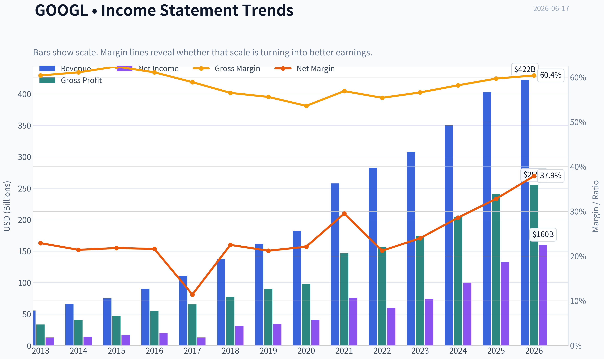

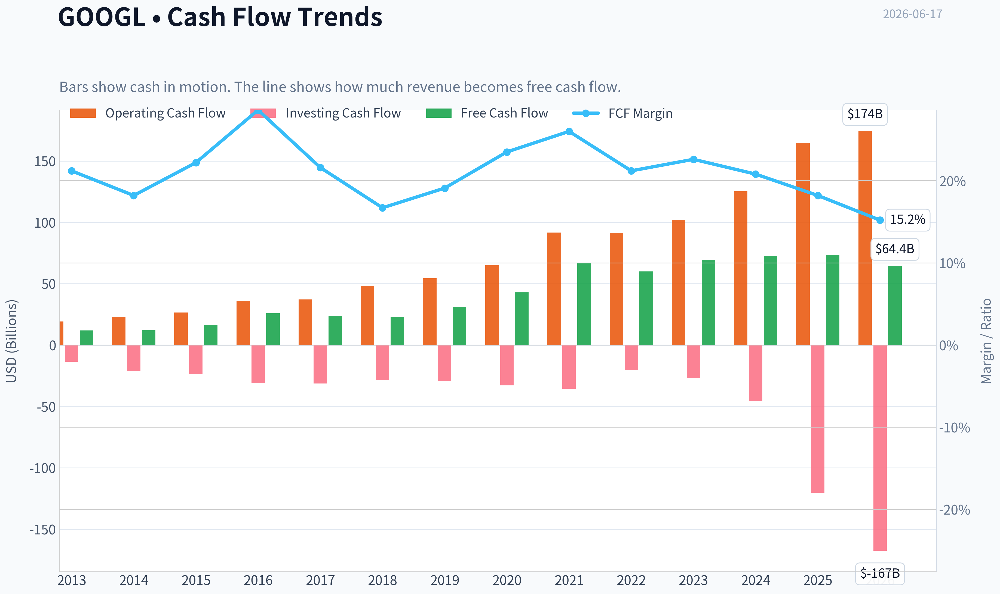

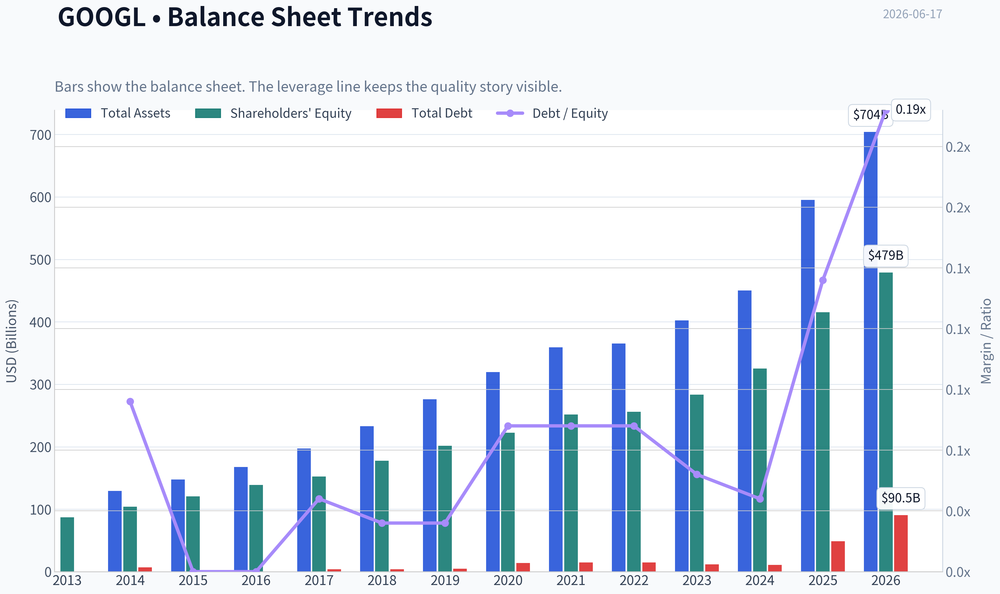

This graph tracks the profitability and return metrics (ROE, ROIC, Margins) of **GOOGL** over the past decade, highlighting capital efficiency trends.

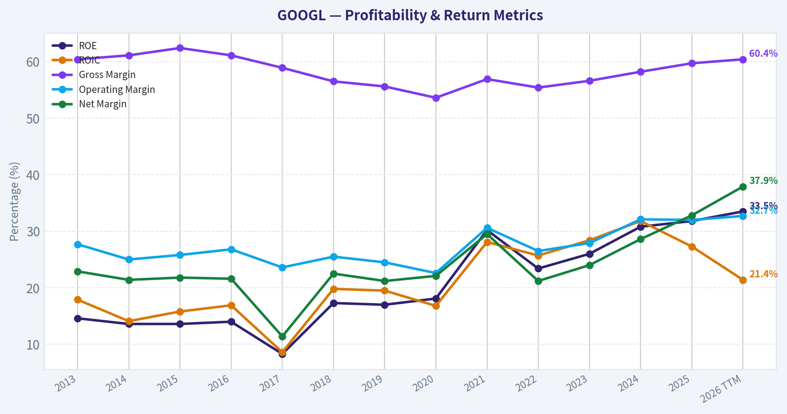

This chart illustrates the financial health of **GOOGL** over the last 10 years, mapping cash equivalents and free cash flow against total obligations (Debt).

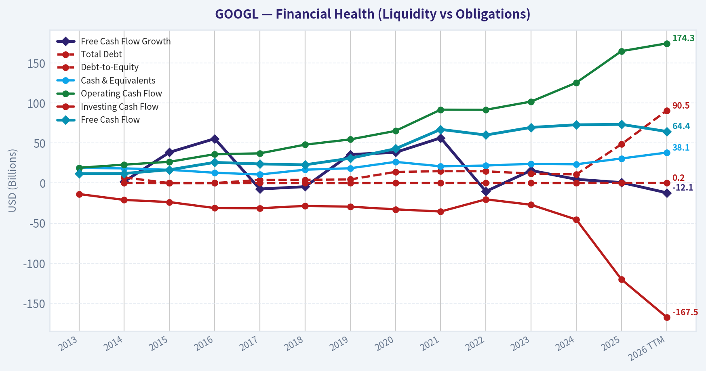

---

### Intrinsic Value Analysis (Buffett)

> *Following Warren Buffett's value investing philosophy: Circle of Competence, Economic Moat, Management Quality, and Margin of Safety.*

#### Intrinsic Value Snapshot

Price is what you pay. Intrinsic value is what the business may be worth based on the cash it can create for owners over time. We show a range, not one magic number.

- Current Price: $364.52
- Value Range (conservative to optimistic across both DCF methods): $75.29 to $162.91

##### Owner Earnings (Buffett Method)
- Net Income: $132,170,000,000.00
- Depreciation & Amortization: $21,136,000,000.00
- Capital Expenditures: $-91,447,000,000.00
- Working Capital Changes: $618,000,000.00
- Owner Earnings: $61,241,000,000.00

##### Intrinsic Value
###### Buffett Method
Uses owner earnings. Stricter, and usually more conservative.
- Conservative: $75.29
- Average: $94.75
- Optimistic: $162.91
- Discount Rate: 10.0%

###### Cash Flow Method
Uses free cash flow. Better for companies spending heavily today to grow tomorrow.
- Conservative: $82.41
- Average: $96.02
- Optimistic: $108.46
- Discount Rate: 10.0%

#### Alphabet (GOOGL)

ANALYST STANCE: **WATCH**

#### Go/No-Go Gate Assessment

| Gate | Verdict | Evidence |
|---|---|---|
| 1. Circle of Competence & Simplicity | Pass | Alphabet makes money mainly by selling ads against user attention in Search, YouTube, Maps, and partner properties, plus cloud infrastructure/software. This is simple to explain and highly understandable. |
| 2. Moat Test | Pass | Search scale, data advantages, distribution, advertiser demand, default placement, and YouTube's audience create a powerful moat. Gross margin near 60% and ROE above 30% support real economic strength. |
| 3. Management & Capital Allocation | Pass, with caveat | Management has generally been rational: huge internal reinvestment in AI, cloud, and infrastructure; balance sheet remains strong; buybacks have been meaningful. The key question is whether AI capex earns adequate long-term returns. |
| 4. Industry Structure | Pass, with caution | Search is oligopolistic, digital ads are concentrated, and cloud is scale-driven. But AI competition raises the intensity level versus the last decade. |

**Key Takeaways:** Alphabet easily passes the business-understanding test: it is still, at heart, an attention and computing platform monetized through ads and cloud. The business remains durable and understandable, but the investment case is less straightforward than the operating case because AI competition and capital spending are now more important variables.

---

#### The Elementary School Test

Alphabet helps people find things online, watch videos, use maps, and run software in the cloud. Businesses pay Alphabet to show ads to the right people, and companies also pay it for cloud computing tools.

#### Long-Term Predictability Test

Ten years from now, Alphabet will likely still be:
- one of the world's main gateways to information,
- a leading digital advertising platform,
- a top-tier cloud vendor,
- and a major AI infrastructure owner.

The uncertainty is not whether Alphabet will exist or be relevant. The uncertainty is whether AI changes the economics of search enough to reduce monetization efficiency, or whether Alphabet converts AI leadership into even stronger economics.

#### Technology Risk Assessment

This is not a company likely to be destroyed by technology in the ordinary sense; it is one of the companies creating the technology. But unlike a candy or razor business, Alphabet's moat is partly technological and therefore requires ongoing heavy reinvestment. That lowers Buffett-style predictability somewhat.

---

#### Moat Analysis

| Moat Source | Strength | Evidence | Buffett View |
|---|---|---|---|
| Intangible Assets | Strong | Global brand, trust, default search behavior, YouTube brand, Android ecosystem | Strong moat |
| Switching Costs | Moderate | Users can switch search engines easily, but advertiser tools, data, and workflow embedding are stickier; cloud switching costs are meaningful | Mixed but positive |
| Cost Advantage | Strong | Massive global compute, data centers, traffic acquisition scale, AI infrastructure, engineering talent density | Real structural scale advantage |
| Network Effects | Strong | More users attract more advertisers and creators; more advertiser demand improves platform utility; YouTube benefits heavily | Powerful, especially in YouTube and ads |

| Moat Quality Rating | Conclusion |
|---|---|
| Wide & Stable | Proceed with care |

**Key Takeaways:** Alphabet has a real moat, but it is not a lazy moat. Its advantages come from scale, data, brand, distribution, and ecosystem depth rather than from customer lock-in alone. The moat is wide, but keeping it wide requires constant reinvestment.

#### Pricing Power Test

Likely yes in several areas:
- Search advertising pricing can rise through auction dynamics and better conversion economics.
- YouTube and cloud pricing are supported by scale and product depth.
- Gross margin of 59.7% suggests strong value capture.

That said, search users do not "pay" directly, so pricing power must be judged through ad yields and cloud contract economics, not sticker price.

---

#### Management Quality & Capital Allocation

| Question | Assessment | Commentary |
|---|---|---|
| Think Like Owners? | Good | Large buybacks and long-duration AI/cloud investments show willingness to act over multi-year horizons. Founder influence historically supported long-term thinking. |
| Honest & Candid? | Generally yes | Reporting is straightforward by segment, though all mega-cap management teams frame spending optimistically. No major red flags stand out from the supplied evidence. |
| Rational Capital Allocation? | Good, but under watch | Internal reinvestment into cloud and AI may be correct, but this is the central issue: returns on incremental capex must remain high. Buybacks are sensible only if shares are below intrinsic value. |

**Key Takeaways:** Management appears competent and strategically serious. The main capital allocation question is not honesty or recklessness; it is whether massive AI-related spending will compound shareholder value at attractive rates.

---

#### Financial Summary

| Metric | Latest |
|---|---:|
| Share Price | $365 |
| Market Cap | $4.45T |
| P/E | 27.8x |
| ROE | 31.8% |
| Gross Margin | 59.7% |
| Revenue Growth YoY | 15.1% |
| FCF Yield | 1.6% |
| Current Ratio | 2.01x |

**Key Takeaways:** This is an exceptional operating business by any conventional quality measure: high margins, high returns on equity, solid growth, and strong liquidity. The problem is not business quality. The problem is valuation, with a low free cash flow yield and a premium multiple.

---

#### Owner Earnings Assessment

Using Buffett's lens, Alphabet likely produces very large owner earnings, but with an important adjustment: a meaningful portion of capex now looks less like optional growth and more like required spending to defend and extend its AI/search/cloud position.

A practical Buffett interpretation:
- Net income: very strong
- Add back D&A: substantial
- Less maintenance capex: likely much higher today than in the pre-AI era
- Less working capital needs: manageable

Conclusion: owner earnings are strong, but not as generous as headline earnings or even standard free cash flow may suggest if one assumes a larger maintenance burden for AI infrastructure.

---

#### Three-Scenario DCF Valuation

To anchor valuation, use the supplied market data and earnings multiple.

Approximate current earnings yield:
- 1 / 27.8 = about 3.6%

If we treat that as a rough owner-earnings yield base:

| Scenario | Assumption | Valuation Read |
|---|---|---|
| A. No Growth | Owner earnings / 10% | Materially below current price |
| B. 3% Growth | OE x 1.03 / (10%-3%) | Still below current price unless owner earnings are understated materially |
| C. Historical Growth Haircut | Mid-to-high single-digit growth, capped at 10% | Can justify much of the current price, but leaves little margin of safety |

**Key Takeaways:** Alphabet's current valuation already assumes continued healthy growth and durable AI leadership. That may happen, but Buffett-style investing demands a discount to intrinsic value, and that discount is not obvious here.

#### Margin of Safety Analysis

| Item | Assessment |
|---|---|
| Business Quality | Excellent |
| Predictability | Good, not perfect |
| Current Valuation | Rich/fair-to-full |
| Required Margin of Safety | At least 25% |
| Observed Margin of Safety | Not sufficient |

At a 1.6% free cash flow yield and nearly 28x earnings, the stock does not offer the margin of safety a value investor should demand, even for a great business.

---

#### Buffett Scorecard

| Criterion | Score (1-5) | Weight | Weighted Score |
|---|---:|---:|---:|
| Business Understanding | 5.0 | 20% | 1.00 |
| Moat Width & Durability | 4.5 | 25% | 1.13 |
| Management Quality | 4.0 | 15% | 0.60 |
| Return on Equity | 5.0 | 15% | 0.75 |
| Reinvestment Runway | 4.5 | 10% | 0.45 |
| Balance Sheet Strength | 4.5 | 5% | 0.23 |
| Industry Structure | 4.0 | 5% | 0.20 |
| Valuation / Margin of Safety | 2.0 | 5% | 0.10 |
| **Total** |  |  | **4.45** |

**Key Takeaways:** Alphabet scores like a wonderful business. The reason the stance is not more aggressive is simple: quality is high, but the price already reflects that quality.

---

#### Final Judgment

Alphabet is a wonderful company. It has a wide moat, elite economics, a fortress-like financial profile, and multiple long-term growth engines. It is exactly the kind of business Buffett would admire operationally.

But Buffett does not buy wonderful businesses at any price. At roughly 27.8x earnings and a 1.6% free cash flow yield, the stock looks priced for continued excellence, not for investor error. That leaves little room for disappointment and insufficient margin of safety.

#### Investment Stance

**WATCH - High-quality compounder, but not at a Buffett-comfortable price.**

**Conviction level:** High on business quality, medium on valuation restraint.

A more attractive entry would require:
- a materially lower multiple,
- or evidence that AI capex is translating into sustainably higher owner earnings,
- or both.
#### Valuation Bridge

This bridge places the current market price beside each intrinsic value lens so readers can see whether upside depends on one method or shows up across several methods.

| Scenario | Intrinsic Value / Share |
| --- | ---: |
| Buffett Method | $94.75 |
| Cash Flow Method | $96.02 |
| Damodaran Method | $169.24 |
| Current Price | $364.52 |

#### Key Takeaways

If one method is far above the others, the upside case depends on a specific modelling assumption. When several methods cluster together, the valuation story is more robust.

#### Valuation Visuals

This comparison chart from *Latest Earnings Snapshot* stacks current figures against historical benchmarks for **GOOGL**, making it easy to see where the company trades relative to its own averages.

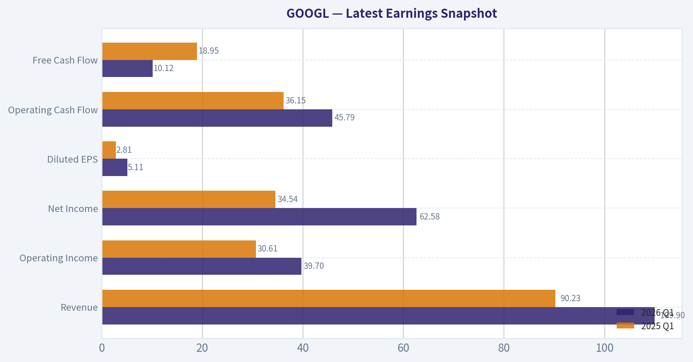

This comparison chart from *Current vs Historical Average Comparison* stacks current figures against historical benchmarks for **GOOGL**, making it easy to see where the company trades relative to its own averages.

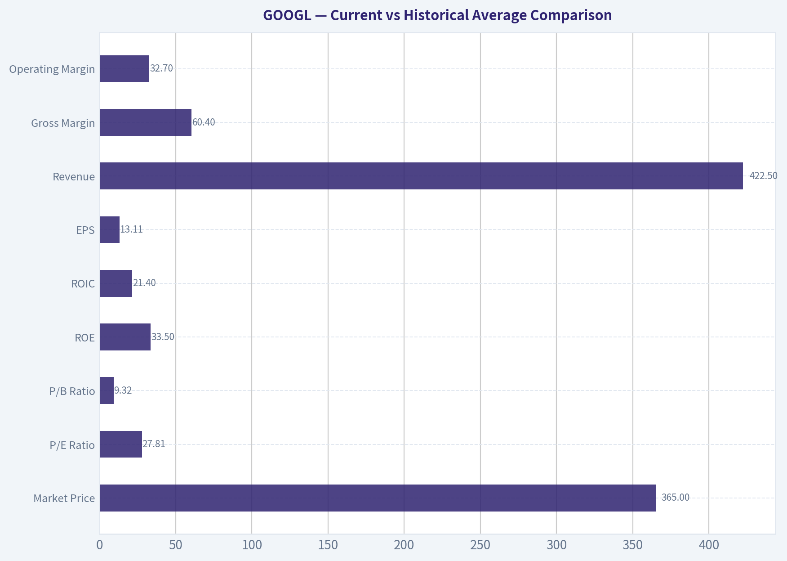

This comparison chart from *Buffett-Style Owner Earnings DCF* stacks current figures against historical benchmarks for **GOOGL**, making it easy to see where the company trades relative to its own averages.

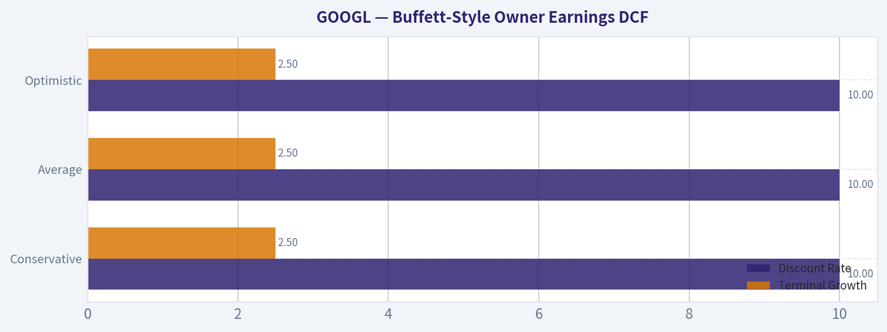

This comparison chart from *Financial Summary* stacks current figures against historical benchmarks for **GOOGL**, making it easy to see where the company trades relative to its own averages.

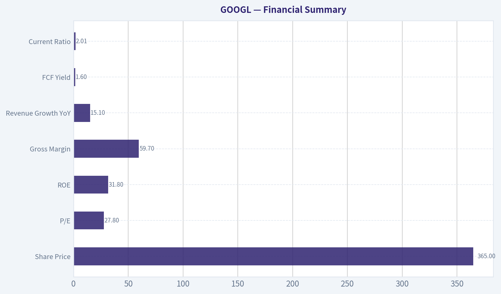

---

### Trend & Growth Analysis (Lynch/Druckenmiller/Fisher)

> *Following Peter Lynch's GARP, Stanley Druckenmiller's macro-aware approach, and Philip Fisher's scuttlebutt methodology.*

ANALYST STANCE: **WATCH**

#### GOOGL Growth Analysis

#### 1. Lynch Classification

| Item | Assessment |
|---|---|
| Lynch category | **Stalwart / Mature Fast-Grower Hybrid** |
| Why | Revenue growth of **15.1% YoY** is above classic stalwart territory, but Alphabet's scale at **$4.45T market cap** makes true "ten-bagger from here" math very difficult |
| Lynch takeaway | Excellent business, but not a typical small/mid-cap Lynch fast grower |

Key Takeaways: Alphabet still grows faster than most mega-caps, which is impressive at this size. But under Lynch's framework, the biggest gains usually come from much smaller companies with longer room to compound. So this looks more like a high-quality compounder than a classic ten-bagger candidate.

#### 2. The Story in 3 Bullets

| Simple story | Why it matters |
|---|---|
| Google monetizes global user intent through Search, YouTube, Cloud, and AI | It owns some of the most valuable digital distribution assets on earth |
| AI can deepen monetization, improve product quality, and expand enterprise relevance | This is the main growth inflection investors care about now |
| Cloud plus AI infrastructure creates a second major growth engine beyond Search ads | That reduces dependence on one profit pool over time |

Key Takeaways: The simple story is that Alphabet owns the digital gateways people and businesses already use every day. AI is not just a defensive tool here; it may also create new revenue layers across search, cloud, and productivity. The key question is whether AI expands the business faster than it disrupts the old one.

#### 3. TAM Analysis and 10x Test

| Metric | Estimate / View |
|---|---|
| Current revenue base | Very large already; mega-cap scale limits 10x plausibility |
| Core TAMs | Digital advertising, cloud infrastructure/platform, AI models/tools, enterprise productivity, video advertising |
| TAM direction | **Expanding**, especially due to AI and cloud |
| 10x test | **Fails on practical basis** from current scale |
| Runway conclusion | Strong runway for continued growth, but not realistic 10x equity potential from today's base |

Key Takeaways: Alphabet operates in massive and still-growing markets, especially cloud and AI. However, because the company is already enormous, the classic growth-investor 10x test does not really work here. The runway is real, but the upside profile is more likely strong compounding than explosive multi-bagger expansion.

#### 4. Revenue Growth Trend

| Metric | Value | Interpretation |
|---|---:|---|
| Revenue growth YoY | **15.1%** | Healthy for a mega-cap |
| Pattern | Appears **stable-to-reaccelerating** versus prior mature-company expectations | Positive |
| Gross margin | **59.7%** | Indicates strong monetization quality |
| ROE | **31.8%** | Elite capital efficiency |

Key Takeaways: Revenue growth above 15% at Alphabet's scale is a sign of unusual business strength. High gross margin and high return on equity suggest that growth is not being purchased at the expense of business quality. This supports the case that Alphabet remains a durable compounder.

#### 5. Unit Economics

| Metric | Value | Assessment |
|---|---:|---|
| Gross margin | **59.7%** | Excellent |
| FCF yield | **1.6%** | Low yield, reflects rich valuation |
| Current ratio | **2.01** | Strong balance sheet liquidity |
| NRR | Not provided | Cannot assess directly |
| LTV/CAC | Not provided | Cannot assess directly |
| Rule of 40 proxy | Approx. **15.1 + FCF margin unavailable** | Incomplete |

Key Takeaways: Alphabet clearly has strong economics, but the SaaS-style unit metrics growth investors often want are not available here from the shared data. What we can see is high gross profitability and solid liquidity. The weak point is not the business model; it is that the stock already reflects much of that quality.

#### 6. Inflection Point Assessment

| Inflection area | Assessment |
|---|---|
| Product cycle | **AI integration across Search, Workspace, Cloud, and YouTube** is the core product inflection |
| TAM inflection | AI expands enterprise and developer monetization opportunity |
| Margin inflection | Possible, but offset by higher AI compute costs |
| Competitive inflection | Mixed: Alphabet is advantaged by scale/data/distribution, but faces AI-native challengers |
| Overall view | **Real strategic inflection, but not yet a clean financial inflection** from data provided |

Key Takeaways: Alphabet is clearly at an important AI transition point. The opportunity is meaningful, but the market is also watching whether AI lifts monetization enough to offset higher infrastructure and model costs. This is a real inflection, just not a low-risk one.

#### 7. Macro Setup Evaluation

| Macro factor | View |
|---|---|
| Secular theme exposure | **AI, Cloud, Digital Ads, Enterprise Software** |
| Rate sensitivity | Somewhat sensitive because long-duration growth assets benefit from lower rates |
| Economic sensitivity | Ad spending can soften in downturns, but Alphabet has diversified earnings streams |
| Macro tailwind or headwind | **Moderate tailwind** due to AI capex cycle and digital transformation |

Key Takeaways: Alphabet sits directly inside the biggest secular growth themes of this decade, especially AI and cloud. Macro conditions matter less than for smaller speculative companies because Alphabet has exceptional cash generation and market position. The main macro question is whether enterprise and advertising demand remain healthy enough to support current expectations.

#### 8. Fisher 15-Point Score

| Fisher area | Score (1-5) | Notes |
|---|---:|---|
| Market potential | 5 | Massive global markets |
| New products | 5 | AI, cloud, productivity, hardware |
| R&D effectiveness | 5 | World-class engineering and research |
| Sales organization | 4 | Strong enterprise progress, less classic sales-led than peers |
| Profit margin | 5 | Very strong |
| Improving margins | 3 | AI costs may pressure near-term |
| Labor/personnel relations | 3 | Mixed historical signals |
| Executive relations | 4 | Reasonably strong |
| Management depth | 5 | Deep bench |
| Cost/accounting controls | 4 | Generally strong |
| Outstanding moat | 5 | Distribution, data, ecosystem, compute scale |
| Long-range outlook | 5 | Excellent |
| Dilution risk | 4 | Low relative risk |
| Candor | 3 | Adequate, but not exceptional |
| Integrity | 4 | Generally solid |
| **Total** | **64/75** | **GOOD** |

Key Takeaways: Alphabet scores well on nearly every Fisher criterion because it has scale, innovation capacity, and one of the strongest moats in global technology. The weaker areas are mostly around transparency, personnel complexity, and the uncertainty of AI-related margin pressure. Overall, this is a high-quality business, but not a perfect one.

#### 9. Valuation Analysis

| Metric | Value | Interpretation |
|---|---:|---|
| P/E | **27.83x** | Reasonable for quality, not cheap |
| Revenue growth | **15.1%** | Solid |
| PEG | **1.84x** | **Fair to somewhat expensive** under Lynch framework |
| FCF yield | **1.6%** | Low current cash yield |
| Valuation view | Quality premium stock, not a bargain |

Key Takeaways: On a Lynch-style PEG basis, Alphabet does not screen as obviously cheap. Investors are paying up for durability, AI optionality, and business quality. That means future returns likely depend more on earnings growth continuing than on multiple expansion.

#### 10. Growth Investor Scorecard

| Criterion | Weight | Score (1-5) | Weighted Score |
|---|---:|---:|---:|
| The Story | 10% | 4.5 | 0.45 |
| TAM & Runway | 20% | 3.5 | 0.70 |
| Revenue Growth | 20% | 3.8 | 0.76 |
| Unit Economics | 15% | 4.5 | 0.68 |
| Competitive Position | 10% | 4.8 | 0.48 |
| Management Quality | 10% | 4.0 | 0.40 |
| Macro Setup | 5% | 4.0 | 0.20 |
| Profitability Path | 5% | 4.2 | 0.21 |
| Valuation | 5% | 2.8 | 0.14 |
| **Total** | 100% |  | **4.02 / 5.00** |

Key Takeaways: Alphabet scores very well because it combines strong growth, elite unit economics, and major structural advantages. The only meaningful drag is valuation and the fact that the company is already so large. This makes it a strong business, but not necessarily the best aggressive growth-stock entry right now.

#### 11. Position Size Stance

| Investor type | Suggested stance |
|---|---|
| Existing long-term holder | **Hold / accumulate on weakness** |
| New growth investor | **WATCH**, prefer better entry or clearer AI monetization proof |
| Concentrated growth portfolio | Moderate position only, not a top conviction ten-bagger idea |

Key Takeaways: Alphabet is good enough to own, but not compelling enough at current valuation and size to press aggressively as a fresh growth idea. Existing holders should probably be patient rather than sell a high-quality franchise. New buyers may want either a better price or stronger evidence of AI-driven acceleration.

#### 12. Risks and Catalysts

| Type | Item |
|---|---|
| Risk | AI changes search behavior faster than Google monetizes it |
| Risk | Rising compute costs pressure margins |
| Risk | Regulatory and antitrust actions |
| Risk | Ad growth slows with macro weakness |
| Catalyst | Search AI monetization exceeds expectations |
| Catalyst | Cloud growth re-accelerates with AI workloads |
| Catalyst | YouTube and subscription monetization improve |
| Catalyst | Margin resilience despite AI capex |

Key Takeaways: The biggest risk is not that Alphabet disappears, but that the economics of search and AI become less favorable than investors expect. The biggest upside catalyst is that Alphabet proves it can turn its AI leadership into higher revenue and durable margins across multiple businesses. That is the central debate in the stock today.

#### Bottom Line

| Final judgment | View |
|---|---|
| Quality | Excellent |
| Growth profile | Good, with AI upside |
| Valuation | Fair to somewhat full |
| Ten-bagger potential | Low from current scale |
| Final stance | **WATCH** |

Key Takeaways: Alphabet is one of the highest-quality companies in the market and remains positioned for durable growth. But for a Lynch-Druckenmiller-Fisher style growth investor specifically hunting inflection points and asymmetric upside, the stock looks more like a premium compounder than a fresh high-upside opportunity. I would watch it closely, own it if already held, and wait for either a more attractive valuation or harder evidence of AI-driven reacceleration.

#### Growth & Scorecard Visuals

This comparison chart from *Growth Metrics* stacks current figures against historical benchmarks for **GOOGL**, making it easy to see where the company trades relative to its own averages.

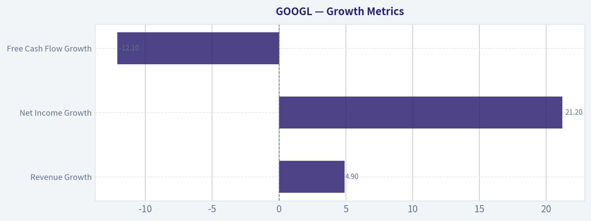

The radar chart below from *Buffett Scorecard* visualises how **GOOGL** ranks across weighted investment criteria. Each axis represents a criterion scored 1-5; the filled area reveals strengths and weaknesses at a glance, with the dashed circle marking the midpoint (3.0).

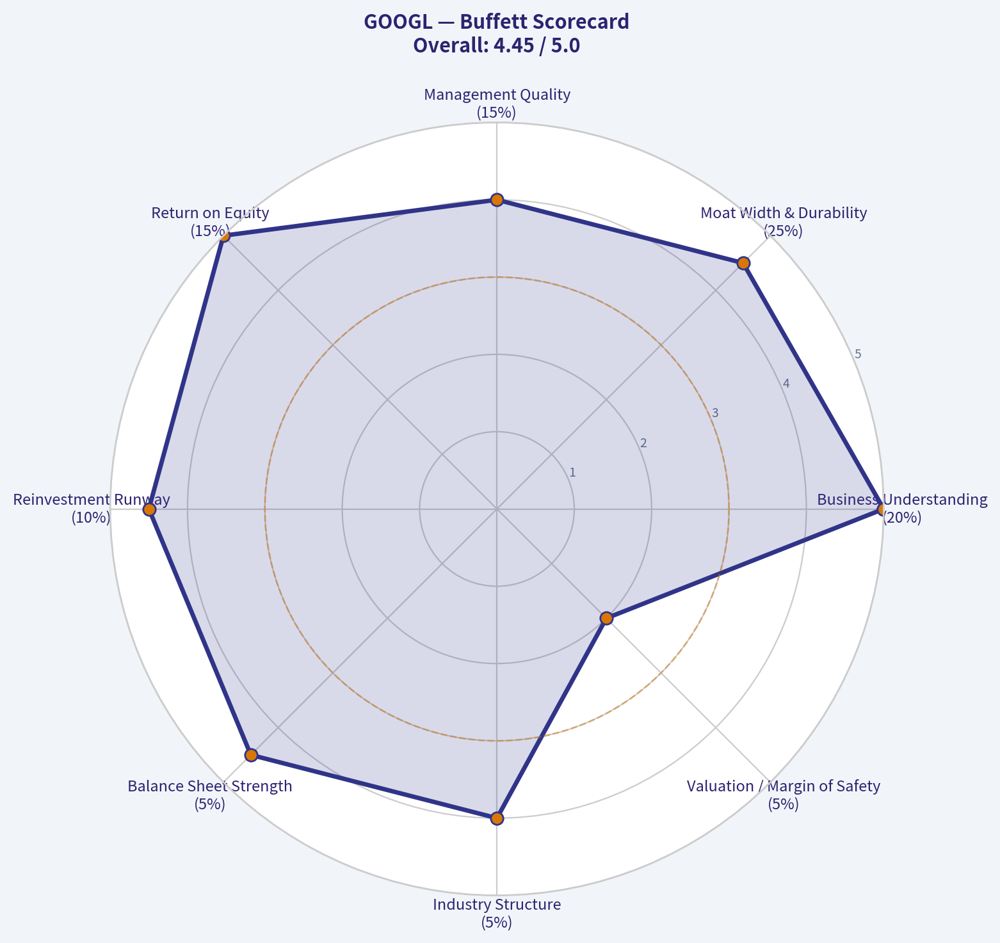

---

### Market Technical Analysis

#### GOOGL Technical Report as of 2026-06-17

For GOOGL's current market condition, the most relevant indicator set is:

- `close_10_ema`
- `close_50_sma`
- `close_200_sma`
- `macd`
- `macdh`
- `rsi`
- `atr`
- `vwma`

This is a strong, non-redundant mix for the present setup because GOOGL is **still in a long-term uptrend**, but it has also gone through a **meaningful intermediate pullback from the late-April/early-May highs** and is now attempting a **short-term stabilization/rebound**. The selected indicators therefore balance:
- **trend confirmation**: 10 EMA, 50 SMA, 200 SMA
- **momentum and turn detection**: MACD, MACD histogram, RSI
- **risk and volatility context**: ATR
- **volume-confirmed trend quality**: VWMA

#### Price structure and trend backdrop

Over the past year, GOOGL advanced from roughly the mid-170s in June 2025 to a peak above 400 in May 2026, a very substantial appreciation. That broad advance matters because it tells us the current weakness is occurring **inside a still-rising long-term structure**, not after a fully formed multi-quarter trend breakdown.

More recently, however, the character changed. After accelerating strongly through April and early May 2026, price topped in the low-400s and then corrected sharply into early June, falling to the mid-to-high 350s before recovering modestly into the latest close near 373. This means traders are no longer dealing with a clean momentum expansion; they are now dealing with a **post-breakout digestion phase**.

The most important nuance is that the pullback has been large enough to damage short-term momentum, but not large enough to invalidate the medium- and long-term bullish trend.

#### Moving-average read: trend intact, short-term repair underway

The moving averages tell a layered story:

- Latest close: about **373.25**
- `close_10_ema`: about **367.30**
- `close_50_sma`: about **365.01**
- `close_200_sma`: about **309.19**

This is constructive. Price is now back **above both the 10 EMA and the 50 SMA**, while the 50 SMA remains decisively above the 200 SMA. That alignment says the **primary trend is bullish**, and the recent rebound has repaired some near-term damage.

But slope matters as much as level:
- The `close_200_sma` is still rising strongly, confirming strategic uptrend health.
- The `close_50_sma` is also rising, but price only recently reclaimed it after a drawdown, so this average may act as a near-term "line in the sand."
- The `close_10_ema` had been falling through early June and has only just begun to flatten and recover. That suggests the rebound is real, but not yet fully mature.

So the average-based interpretation is not "all clear." It is better described as:
- **long-term bullish**
- **medium-term constructive**
- **short-term recovering, but still proving itself**

A trader following trend continuation would usually want to see price hold above the 10 EMA and 50 SMA for several sessions to confirm that this is a base-building recovery rather than a temporary oversold bounce.

#### MACD and histogram: momentum still negative, but downside pressure is fading

The momentum picture is subtler than the moving-average picture.

Latest readings:
- `macd`: about **-1.77**
- `macdh`: about **-1.75**

A negative MACD means the faster EMA structure is still weaker than the slower EMA structure, so the stock has **not fully re-entered a clean bullish momentum regime**. In plain terms, momentum is still below zero even though price has bounced.

However, the path of MACD is improving:
- It deteriorated sharply from late May into early June.
- It is now **less negative than it was several sessions ago**.
- The histogram remains negative, but it has improved markedly from more extreme negative values earlier in the month.

That combination usually signals **decelerating downside momentum**. This is often what a repair phase looks like before a full momentum reversal. Traders should note the distinction:
- a **bounce** has clearly happened,
- but a **fresh bullish momentum impulse** is not yet fully confirmed.

The practical implication is that aggressive longs can justify a rebound thesis, but confirmation-oriented traders may prefer to wait for MACD to move toward or above zero, or at least for the histogram to continue climbing toward neutral.

#### RSI: no longer oversold, but far from euphoric

Latest `rsi`: about **52.6**

RSI has recovered from weak readings in the high-30s/low-40s earlier in June back toward the middle of the range. This is important because it shows the stock has **worked off oversold pressure** without becoming overbought again.

Interpretation:
- Below 40 earlier this month: sellers were in control.
- Back near 50-53 now: balance is returning.
- Still well below the 70+ zone seen during the strong May advance: the rebound has not yet become crowded or overheated.

This is often a favorable setup for traders looking for a second-leg recovery, because there is room for RSI to expand higher if price can keep building above support. At the same time, RSI around 52 is not a decisive breakout reading. It supports the view of **neutral-to-improving momentum**, not outright strength.

#### VWMA: volume-weighted trend still overhead, suggesting supply remains above

Latest `vwma`: about **367.41** on the indicator report's recent reading structure, with the series having declined from much higher late-May levels.

The recent close is near and slightly above this area, which is modestly constructive. But the broader VWMA decline from the high-380s/390s into the upper-360s tells us something important: **recent high-volume trading occurred at materially higher prices**, and that often leaves overhead supply as trapped or underwater holders sell into strength.

This means the stock may continue to rebound, but rallies into prior congestion zones could encounter resistance more quickly than they did during the earlier vertical advance. From the raw price history, likely resistance areas appear around:
- **376-380**: immediate overhead recovery zone
- **388-390**: area of repeated late-May trading
- **397-403**: prior peak region and major resistance shelf

VWMA therefore supports the idea that this is a recovery attempt inside a still-bullish larger trend, but not yet a frictionless uptrend.

#### ATR: volatility remains elevated enough to matter

Latest `atr`: about **10.71**

An ATR above 10 means daily movement remains large in absolute dollar terms. That is not extreme relative to the recent correction, but it is high enough that traders need wider stops and smaller sizing than they would use in a calmer tape.

Key implication:
- Breakouts and breakdowns can both overshoot.
- Normal pullbacks of 1 ATR are sizable.
- Tight stops just under obvious levels are vulnerable to being swept.

The volatility backdrop supports patience. If a trader is bullish, entries on controlled pullbacks toward support are likely more efficient than chasing strength after a wide green day.

#### Fine-grained market interpretation

The most accurate description of GOOGL right now is:

- The **secular and long-term trend remain clearly bullish**.
- The **intermediate trend suffered a sharp corrective reset after an overextended run**.
- The **short-term trend is trying to turn back up**, as shown by price reclaiming the 10 EMA and 50 SMA.
- **Momentum has improved but has not fully reset bullish**, because MACD remains below zero and histogram is still negative.
- **RSI has normalized**, which reduces immediate downside exhaustion risk but also means a new directional thrust still has to be proven.
- **Volume-weighted context suggests overhead resistance remains meaningful**, especially in the upper-370s to upper-390s.

So this is not a classic breakdown, and it is not yet a clean re-acceleration either. It is a **transition phase**. Those are often tradable, but they reward discipline.

#### Trading implications by style

For **trend-following swing traders**:
- The bullish case improves as long as price remains above the 50 SMA and continues building above the 10 EMA.
- A sustained move above the mid-to-high 370s would strengthen the argument for a push toward the upper 380s.
- Failure back below the 50 SMA would suggest the rebound is stalling.

For **momentum traders**:
- Current setup is early, not confirmed.
- A stronger signal would be MACD continuing to rise and histogram moving decisively toward zero, ideally with RSI pushing through the upper 50s into the 60s.
- Without that, upside may remain choppy and headline-sensitive.

For **risk-focused traders**:
- ATR argues for wider stops and smaller position sizes.
- The stock is trending, but not smoothly; volatility can punish overleveraged entries.
- Support should be treated as zones, not single prices.

For **dip buyers**:
- This is the kind of chart where buying weakness can work, but only if the 50 SMA continues to hold.
- If price loses the 50 SMA and 10 EMA together, the market may revisit the low-360s or even mid-350s.

#### Key technical levels to monitor

| Level/Zone | Importance | Interpretation |
|---|---:|---|
| 365-367 | Near-term support | Confluence of 10 EMA and 50 SMA; first test of rebound quality |
| 358-362 | Secondary support | Recent pullback region; loss would weaken the recovery thesis |
| 376-380 | Initial resistance | Nearby recovery ceiling; break would signal stronger follow-through |
| 388-390 | Major resistance | Late-May congestion and likely supply zone |
| 397-403 | Peak resistance | Prior high area; key test if trend fully re-accelerates |

Key Takeaways: GOOGL has reclaimed important short-term support around the mid-360s, which is the first sign that the recent selloff may be stabilizing. The next challenge is overhead resistance in the upper 370s and then the high 380s, where prior trading activity suggests sellers may reappear. If the stock falls back below the mid-360s, confidence in the rebound would drop quickly.

#### Summary table

| Category | Indicator | Latest Read | What it says now | Trading relevance |
|---|---|---:|---|---|
| Short-term trend | `close_10_ema` | 367.30 | Price has reclaimed it; short-term trend is repairing | Good for monitoring rebound continuation |
| Medium-term trend | `close_50_sma` | 365.01 | Still rising; now acting as key support | Important line between pullback recovery and renewed weakness |
| Long-term trend | `close_200_sma` | 309.19 | Strongly rising; long-term uptrend intact | Strategic bullish backdrop remains valid |
| Momentum | `macd` | -1.77 | Still negative, so bullish momentum is not fully restored | Confirms rebound is early-stage |
| Momentum impulse | `macdh` | -1.75 | Less negative than before; downside pressure is fading | Useful for spotting whether momentum keeps improving |
| Momentum/condition | `rsi` | 52.62 | Recovered to neutral after weakness | No longer oversold, not yet overbought |
| Volatility/risk | `atr` | 10.71 | Elevated daily range persists | Use wider stops and controlled sizing |
| Volume trend quality | `vwma` | 367.41 | Price near VWMA, but overhead supply likely remains | Helps judge whether rallies are volume-supported |

Key Takeaways: The table shows a market in recovery rather than full acceleration. Long-term trend indicators remain clearly bullish, but momentum indicators are still healing after the recent correction. The setup favors disciplined bullish monitoring, with special attention on whether price can stay above the mid-360s and push through resistance near 380.

---

### Options Market Analysis

> *Reading options flow - put/call ratios, IV skew, and unusual activity - to gauge institutional positioning and event-driven risk.*

#### GOOGL Options Positioning Report
*Date: 2026-06-17*

GOOGL's near-term options tape leans **moderately bullish**, but with an important caveat: there is still meaningful short-dated put demand, especially in the front expiry, which looks more like **active hedging around an event/risk window** than outright panic. The cleanest directional clue is that aggregate near-term **call volume is materially stronger than put volume**, while open interest is closer to balanced.

#### 1. Put/Call Ratio Analysis

| Expiry | Call OI | Put OI | Put/Call OI Ratio | Call Vol | Put Vol | Put/Call Vol Ratio |
|---|---:|---:|---:|---:|---:|---:|
| 2026-06-17 | 29,899 | 14,251 | 0.48 | 53,332 | 37,956 | 0.71 |
| 2026-06-18 | 359,682 | 339,932 | 0.95 | 30,725 | 12,128 | 0.39 |
| 2026-06-22 | 5,583 | 8,043 | 1.44 | 3,979 | 1,388 | 0.35 |
| **Near-term total** | **395,164** | **362,226** | **0.92** | **88,036** | **51,472** | **0.58** |

**Key Takeaways:** Across the near-term expirations, GOOGL's total put/call **open-interest ratio of 0.92** sits above the historical neutral reference of about 0.7, so legacy positioning is not aggressively bullish. But the more important live signal is the **put/call volume ratio of 0.58**, which shows fresh trading flow is skewing toward calls. That combination usually points to a market with some existing protection on the books, but with current activity leaning more constructive.

Interpretation:
- **OI ratio 0.92:** Slightly above the classic neutral baseline (~0.7), suggesting the outstanding book is somewhat more defensive than a clean bullish setup.
- **Volume ratio 0.58:** Clearly below neutral, indicating **new flow is call-heavier**, which is typically bullish speculation, upside positioning, or some covered call/restructuring activity.
- **By expiry:**
  - **Same-day 6/17:** OI ratio 0.48 is bullish, while volume ratio 0.71 is near-neutral to mildly bullish.
  - **6/18:** OI ratio 0.95 is fairly balanced/defensive, but volume ratio 0.39 is strongly call-skewed.
  - **6/22:** OI ratio 1.44 is put-heavy, but volume ratio 0.35 is still call-dominant, suggesting existing downside protection with newer upside flow.

Net: **Fresh flow is more bullish than the existing open-interest profile.**

---

#### 2. Implied Volatility (IV) Assessment

| Expiry | ATM Call IV | ATM Put IV | Put Premium vs Call Premium |
|---|---:|---:|---:|
| 2026-06-17 | 36.7% | 40.3% | +3.6 pts |
| 2026-06-18 | 34.9% | 38.5% | +3.6 pts |
| 2026-06-22 | 27.3% | 29.0% | +1.7 pts |

**Key Takeaways:** Near-term implied volatility is elevated most noticeably in the front expiries, and puts are consistently priced richer than calls. That means the market is assigning more value to downside protection than upside exposure, a classic sign of caution even when directional call flow is firm.

Interpretation:
- **Front-end ATM IV is elevated:** Mid-to-high 30s IV for the nearest expiries is fairly rich for a mega-cap name outside of quiet periods, suggesting the market is pricing in a near-term catalyst or elevated uncertainty.
- **Put IV > Call IV across all listed near-term expirations:** This is a **downside skew**, not an upside chase.
- **Skew takeaway:**
  - A **steep put skew** typically means institutional hedgers are willing to pay up for downside protection.
  - This does **not automatically mean bearish direction**, but it does mean the market sees downside tails as more urgent than upside tails.
- The skew is strongest in the shortest-dated expiries, which usually aligns with **event risk, macro sensitivity, or post-news gap concerns**.

Because only ATM IV and the relative put/call IVs are provided, the safest conclusion is: **GOOGL has a noticeable near-term downside skew, with event-sensitive premium concentrated in the front end.**

---

#### 3. Unusual Options Activity

| Expiry | Type | Strike | Volume | OI | Vol/OI | IV | Likely Moneyness / Read |
|---|---|---:|---:|---:|---:|---:|---|
| 2026-06-17 | CALL | 365.0 | 12,642 | 586 | 21.6x | 18.3% | Likely near-ATM/OTM call flow; aggressive short-dated upside bet |
| 2026-06-17 | CALL | 370.0 | 11,583 | 1,871 | 6.2x | 21.6% | OTM call activity; speculative upside chase |
| 2026-06-17 | CALL | 367.5 | 10,184 | 342 | 29.8x | 20.0% | Very fresh call flow; short-dated momentum positioning |
| 2026-06-17 | PUT | 360.0 | 10,153 | 743 | 13.7x | 22.7% | Near-ATM/OTM put demand; hedge or tactical downside bet |
| 2026-06-17 | PUT | 365.0 | 10,094 | 1,231 | 8.2x | 23.8% | Active downside protection near spot |
| 2026-06-17 | PUT | 362.5 | 7,485 | 544 | 13.8x | 23.5% | Fresh short-dated hedge/speculative put flow |

**Key Takeaways:** The unusual activity is concentrated almost entirely in **same-day expiry**, which lowers conviction because zero-day flow can be driven by fast hedging, market-making, and retail speculation. Still, the call side is extremely active at 365-370, showing traders were clearly positioning for upside follow-through, even as puts at 360-365 show active demand for protection.

Interpretation:
- **Volume massively above OI** confirms these are mostly **fresh trades**, not simply old positions being closed.
- Because the activity is concentrated in **0DTE / same-day options**, this flow should be read carefully:
  - **Calls (365 / 367.5 / 370):** likely short-term momentum or event traders betting on upside into the close/session.
  - **Puts (360 / 362.5 / 365):** likely tactical hedges or intraday downside bets.
- The fact that **both calls and puts are unusually active** suggests a market expecting movement, not stagnation.
- The **call strikes are clustered slightly above/around spot**, which is more consistent with **directional upside speculation** than conservative overwriting.
- The put activity near spot is consistent with **protective hedging**, especially given the richer put IV.

Institutional vs retail read:
- **Same-day OTM calls** can attract retail/spec momentum traders.
- But the **simultaneous size in near-ATM puts** suggests at least some professional hedging or dealer-related flow.
- Overall, this looks like a **high-activity event tape with a slight upside speculative bias, buffered by active downside insurance.**

---

#### 4. Open Interest Concentration

| Expiry | Notable OI Characteristic | Market Effect |
|---|---|---|
| 2026-06-18 | Largest total OI by far on both calls and puts | Most important near-term pin/gravity expiry |
| 2026-06-17 | Heavy same-day trading, but lower standing OI | More flow-driven than OI-driven |
| 2026-06-22 | Small total OI, put-heavy ratio | Less influential unless spot moves sharply |

**Key Takeaways:** The key gravitational center is the **2026-06-18 expiry**, where total open interest is much larger than the other listed maturities. That makes this expiry the most likely source of pinning, dealer hedging pressure, or gamma-related dampening if spot remains near heavily traded strikes.

What stands out:
- **6/18 dominates the near-term OI landscape** with:
  - Calls OI: **359,682**
  - Puts OI: **339,932**
- This means the next session's options positioning likely matters more than today's same-day flow when thinking about **pin risk** and **dealer gamma effects**.
- We are not given strike-by-strike OI concentration beyond the unusual activity list, so precise max-pain calculation is not possible from this dataset.
- Still, from the unusual flow cluster, the market is clearly focused around the **360-370 zone**.
  - That range likely acts as the **near-term gamma battleground**.
  - If GOOGL remains in that area into expiry, **pinning/dampened movement** is possible.
  - If price breaks outside it, dealer hedging could **amplify directional movement**.

Practical read:
- **360-370 appears to be the active near-term control zone.**
- **6/18 is the expiration to watch most closely for pinning or gamma acceleration.**

---

#### 5. Overall Options Sentiment Signal

| Signal | Confidence | Primary Driver |
|---|---|---|
| **BULLISH** | Moderate | Call-heavy near-term volume with strong fresh upside flow, despite defensive put skew |

**Key Takeaways:** The options market signal is **bullish, not euphoric**. The strongest evidence is that fresh volume is skewing toward calls, while the main caution flag is that puts still carry richer implied volatility, showing investors are unwilling to abandon downside protection.

Why the signal is **BULLISH**:
1. **Near-term put/call volume ratio of 0.58** is decisively call-favored.
2. **Unusual activity includes multiple fresh call contracts** with very high volume/OI ratios.
3. The most active upside strikes are clustered near plausible short-term breakout levels.

Why it is **not strongly bullish**:
1. **Put/call OI ratio of 0.92** is still somewhat defensive relative to the ~0.7 neutral baseline.
2. **Put IV exceeds call IV** across all near-term expiries, signaling persistent downside fear.
3. A lot of the unusual flow is **0DTE**, which can be noisy and less reliable as a swing signal.

Bottom line:
- **Directional read: BULLISH**
- **Best framing:** bullish short-term speculative flow overlaying a still-cautious institutional hedging backdrop.
- **Trading implication:** the options market is leaning for upside, but not with full conviction; traders are still paying for protection in case the move fails.

---

#### Final Summary Table

| Category | Observation | Interpretation |
|---|---|---|
| Put/Call Ratio | Near-term OI ratio **0.92**; volume ratio **0.58** | Existing positioning somewhat defensive, but fresh flow is bullish |
| IV Level | Front-end ATM IV roughly **27%-40%**, highest in nearest expiries | Elevated near-term event/risk premium |
| Skew Direction | **Put skew** (puts consistently richer than calls) | Market paying up for downside protection |
| Unusual Activity | Heavy same-day flow in **365/367.5/370 calls** and **360/362.5/365 puts** | Fresh movement bets; upside speculation mixed with active hedging |
| Open Interest Concentration | **6/18 expiry** dominates near-term OI; active zone around **360-370** | Likely pin/gravity zone, with gamma effects around that range |
| Overall Signal | **BULLISH** | Call-heavy fresh flow outweighs defensive skew, but confidence is moderate |

**Key Takeaways:** GOOGL's options market is leaning bullish because current trading activity favors calls and fresh upside contracts are seeing unusually strong volume. But the market is still paying a premium for puts, so this is better described as **bullish with caution** rather than a clean, high-conviction risk-on signal.

---

## Research Team Commentary

> *The Research Manager synthesizes the Bull vs Bear debate into action-free commentary. This is a pre-risk view, not the final stance.*

The bull case is strongest on business quality, and that matters. Alphabet is clearly one of the highest-quality large businesses in the world: dominant search and ad economics, a massive distribution ecosystem through Android, Chrome, Maps, YouTube, and Gmail, a real second engine in Cloud, and elite returns on capital. A near-25% ROIC and 30%+ ROE are not normal. Those numbers support the idea that this is a genuine moat business, not a story stock. The bull is also right that AI capex should not automatically be treated as value destruction. For a company with Alphabet's scale, balance sheet, and installed base, heavy AI spending may reinforce the moat rather than weaken it.

The bear case is strongest on valuation discipline and on the changing nature of the moat. At 27.8x earnings and around $365, this is not a classic Buffett bargain. The price already assumes search remains resilient, AI is monetized well, Cloud keeps scaling, and regulation does not seriously impair distribution economics. The bear is also right that the market may be valuing Alphabet on legacy search economics while the future mix could be more compute-heavy and lower-margin. Even if Google "wins" AI, it may win a less profitable version of search. That is a real long-term concern for owner earnings predictability.

My takeaway is that both sides are credible, but they operate on different thresholds. The bull wins on "is this a wonderful business?" The answer is yes. The bear wins on "is there a clear margin of safety at this price for a conservative value investor?" The answer is no. That distinction matters. One of the lessons from prior mistakes is not to let valuation caution blind us to quality and narrative strength, especially in elite megacaps. But another lesson is not to abandon price discipline just because a company is excellent. Here, I do not see enough discount to intrinsic value to call it a true Buffett-style buy.

Core takeaway: Alphabet remains a rare, high-quality compounder, but at the current valuation it looks more like a great business to monitor than a clear value investment to aggressively advocate. The moat is still formidable, yet the market is already paying for much of that quality while underestimating how AI could alter search economics and capital intensity over time.

Rationale: From a value investing perspective, I want three things together: durable moat, understandable long-term cash flows, and a price that gives me a margin of safety. Alphabet clearly passes the first test and mostly passes the second, though with more uncertainty than in the past. It fails the third. The strongest bullish evidence is the extraordinary business quality and optionality across Search, YouTube, Cloud, and AI. The strongest bearish evidence is that the stock is priced for continued excellence during a period when the unit economics of its core franchise may be evolving. That does not make Alphabet a bad company. It just means the prospective return from this level is less obviously skewed in our favor.

What the market may be missing on the bullish side is that fear around AI disruption can become too simplistic; few companies are better positioned than Alphabet to absorb and monetize AI at scale. What the market may be missing on the bearish side is that "AI winner" does not automatically mean "same or better economics." Scale can protect relevance without protecting margins. That is the key underwriting question.

Monitoring plan over the next 1 to 4 quarters: First, watch search monetization closely, especially whether AI product changes preserve or weaken ad density, click behavior, and revenue per query. Second, track capex relative to revenue growth and free cash flow conversion; if spending keeps rising without clear monetization, the bear case strengthens. Third, watch Google Cloud margins and growth, because Cloud needs to prove it is not just growth but durable value creation. Fourth, monitor regulatory developments around default search placement, browser distribution, and ad practices; these could affect moat durability more than headlines imply. Fifth, look for evidence that management is allocating capital with discipline, including whether buybacks are paired with strong owner-earnings growth rather than cosmetic EPS support.

The main adjustment from past mistakes is this: I do not want to underweight the strength of elite franchises or dismiss strategic capex too quickly. But I also do not want to confuse "quality worth owning someday" with "quality worth buying now at any price." Alphabet deserves respect, and probably a place near the top of the watchlist, but not an enthusiastic value-portfolio endorsement at this level.

Final stance: WATCH

---

## Value Investing Team Commentary

> *The Investor translates the research view into an investment thesis before risk review. This is still not the final stance.*

Alphabet is the kind of business a long-term owner wants to understand deeply: dominant search economics, extraordinary distribution through Android/Chrome/Maps/YouTube/Gmail, a meaningful cloud franchise, and a balance sheet that gives it room to invest through industry transitions. On business quality alone, this is plainly a superior company. A 31.8% ROE and 24.8% ROIC tell you the enterprise has historically converted competitive advantage into real economic returns, not just revenue scale. That matters more than short-term sentiment.

The key question is not whether Alphabet is good. It is whether the stock, at about $365 and roughly 27.8x earnings, offers enough margin of safety for a disciplined value investor. Here, I remain cautious. This valuation is not absurd for a company of Alphabet's quality, but it is also not cheap relative to the uncertainty now embedded in the next phase of the business. The market is still awarding substantial value to the search franchise as if its economics will remain highly resilient, while the AI transition may make the business more compute-intensive, more capital-hungry, and potentially less profitable per unit of user engagement than classic search.

That is the real underwriting issue. Many investors are asking, "Will Google remain relevant in AI?" I think that is the wrong first question. The better question is, "If Google remains relevant, what will the economics of that relevance look like five to ten years from now?" A company can successfully defend its position and still earn lower incremental returns than it did in the past. That distinction is easy for markets to miss during periods of AI enthusiasm.

Selective contrarian thinking cuts both ways here. The bullish contrarian view is that some fears around AI disruption are too shallow. If any company has the data, infrastructure, talent, distribution, and advertiser relationships to absorb an interface shift and monetize it at scale, Alphabet is near the top of the list. Headlines implying that AI simply destroys Google's moat likely underestimate how hard it is to replicate Google's global distribution and monetization machine. In that sense, pessimism about long-term survival is likely misplaced.

But the bearish contrarian view is just as important: the market may be too comfortable assuming that "AI leader" automatically means "same moat, same margins, same cash flow shape." That is far less certain. AI answers may reduce traditional search behavior, change ad inventory structure, and increase compute costs. Even if usage stays strong, owner earnings may not scale in the old way. For a Buffett-style investor, that matters enormously because intrinsic value depends on future cash generation, not technological prestige.

On management, Alphabet is strong but not beyond scrutiny. This is not a poorly run company. It has demonstrated technical depth, large-scale execution, and shareholder-friendly repurchases. Still, in this phase, capital allocation deserves close monitoring. AI capex can be moat-reinforcing, but only if it translates into durable monetization and attractive returns. Spending heavily is not, by itself, evidence of strategic success. The next 1 to 4 quarters should be used to judge whether capex is building future owner earnings or merely preserving relevance at a rising cost.

The most important operating indicators to watch are straightforward:
- Search monetization trends, especially revenue per query and ad effectiveness as AI features expand
- Cloud growth and margins, because Cloud can become a more diversified and valuable second engine
- Free cash flow conversion versus capex intensity
- Regulatory pressure on distribution and ad practices
- Evidence that buybacks are supported by genuine growth in owner earnings, not just EPS engineering

From a long-term owner's perspective, Alphabet still looks like a wonderful business, but not an obvious bargain. If sentiment turns sharply negative on temporary AI monetization fears, regulatory scares, or capex anxiety, that could create a more compelling entry point. That is where contrarian value investors should pay attention: not when everyone agrees Alphabet is an AI champion, but when the market grows fearful about near-term economics while the underlying franchise remains intact.

Today, I would not call this an avoid. That would understate the quality, resilience, and optionality of the business. But I also would not stretch to call it a true value buy at this price. The stock appears priced for continued excellence at a moment when the exact economics of that excellence are becoming less predictable. Great business, yes. Clear margin of safety, no.

**ANALYST STANCE: WATCH**

---

## Deep Values Commentary

> *The Risk Management Team debates and the Risk Judge provides the final action-free verdict. This section determines the final ADVOCATE / WATCH / AVOID stance.*

#### Final Stance Scorecard

This scorecard converts the final research view into a weighted decision frame. It does not replace the narrative judgement, but it makes the main drivers of the verdict easier to scan.

| Criterion | Score | Weight | Commentary |
| --- | ---: | ---: | --- |
| Business Quality | 4.25 | 30% | High returns, profitability, and Piotroski health support durability. |
| Valuation Support | 2.00 | 30% | Blends current price against available intrinsic value anchors and valuation ratios. |
| Financial Strength | 5.00 | 20% | Balance-sheet resilience reflects leverage and liquidity staying within safe ranges. |
| Growth Durability | 3.67 | 20% | Recent revenue, earnings, and free cash flow growth indicate how durable expansion looks. |
| TOTAL / FINAL STANCE | 3.61 | 100% | WATCH |

#### Key Takeaways

The weighted score lands at **3.61 / 5.0**, while the final stance remains **WATCH**. This is useful as a quick calibration aid rather than a mechanical signal.

#### Risk Summary

Higher scores indicate more risk pressure. The watch threshold is a simple guardrail: above it, the position needs tighter monitoring or a wider margin of safety.

| Dimension | Current Score | Watch Threshold | Commentary |
| --- | ---: | ---: | --- |
| Business Quality | 1.75 | 3.00 | High returns, profitability, and Piotroski health support durability. |
| Valuation Support | 4.00 | 3.00 | Blends current price against available intrinsic value anchors and valuation ratios. |
| Financial Strength | 1.00 | 3.00 | Balance-sheet resilience reflects leverage and liquidity staying within safe ranges. |
| Growth Durability | 2.33 | 3.00 | Recent revenue, earnings, and free cash flow growth indicate how durable expansion looks. |

#### Key Takeaways

This view helps readers separate *where* the risk sits: valuation, business quality, balance sheet, or growth durability. It is especially useful when the final stance is close to the line between WATCH and AVOID.
