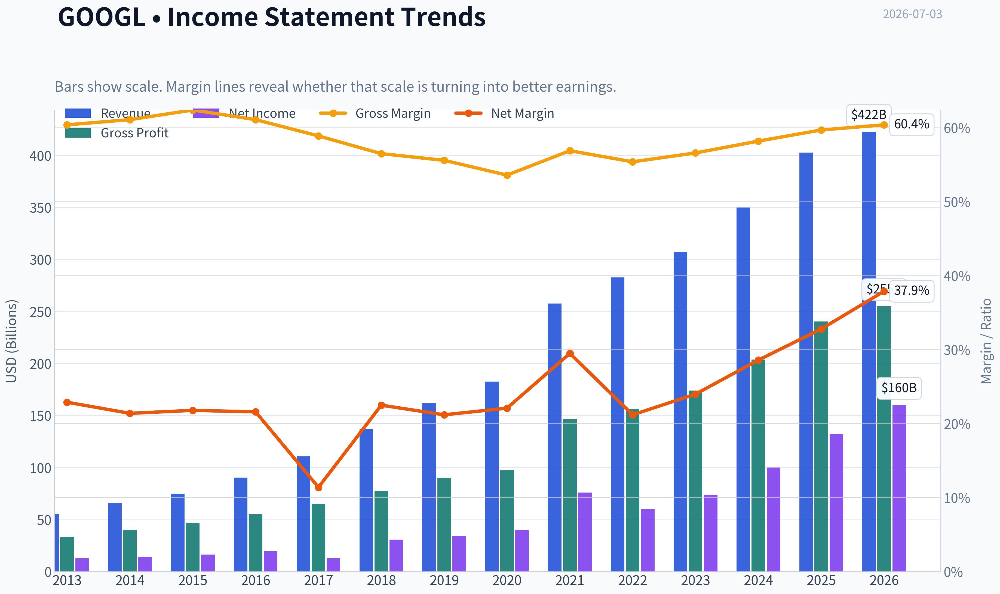
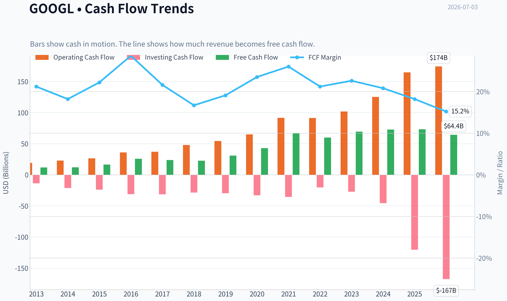
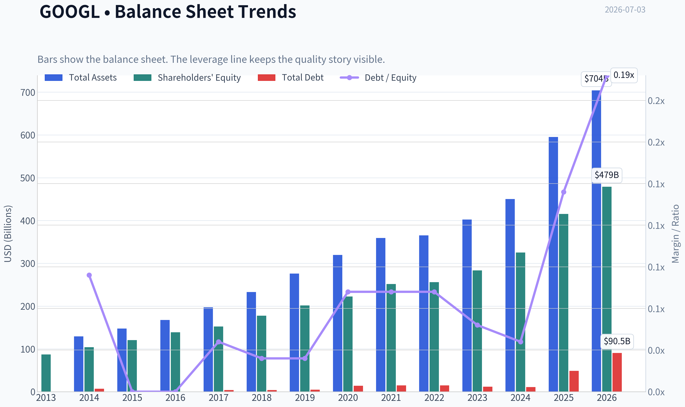
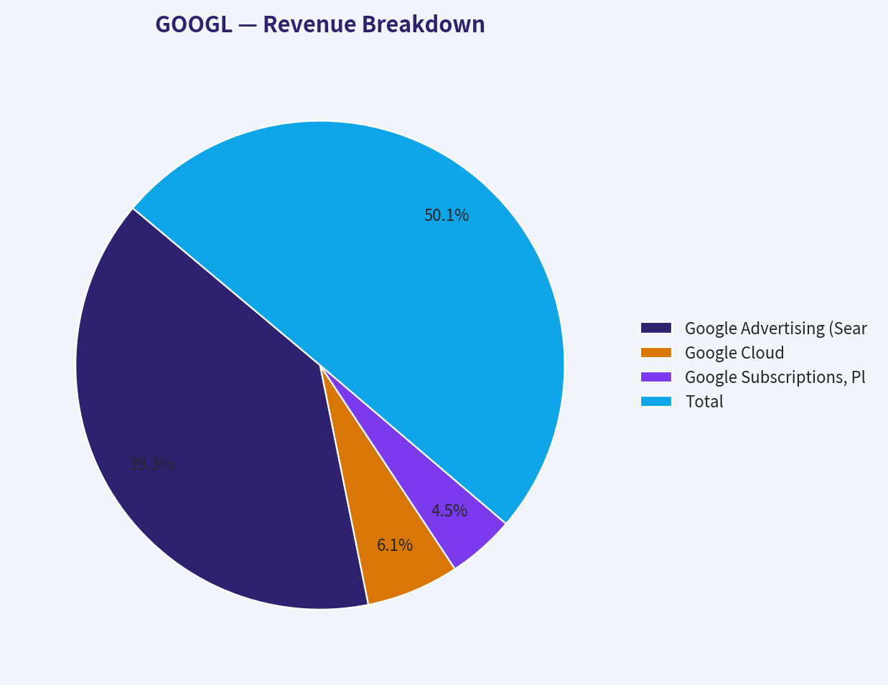
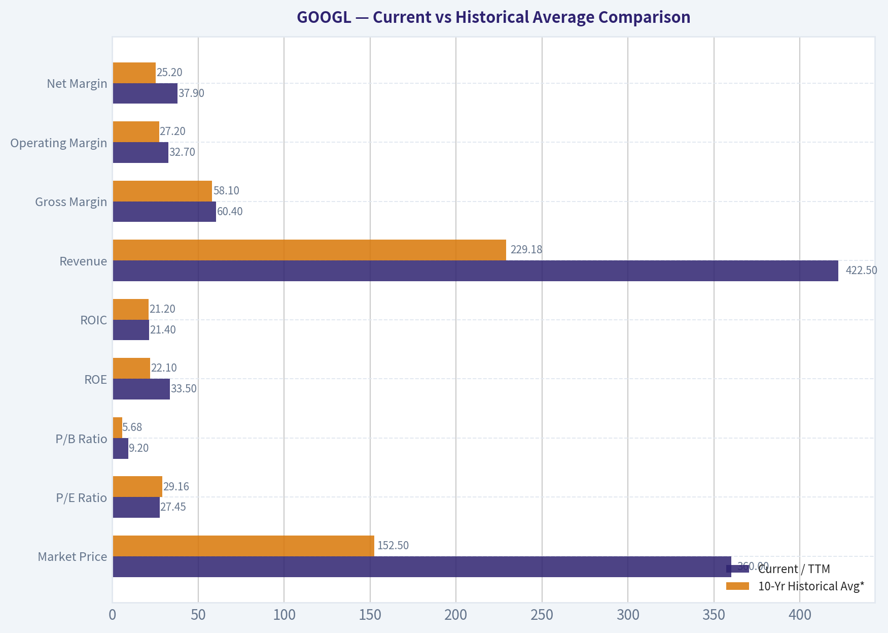
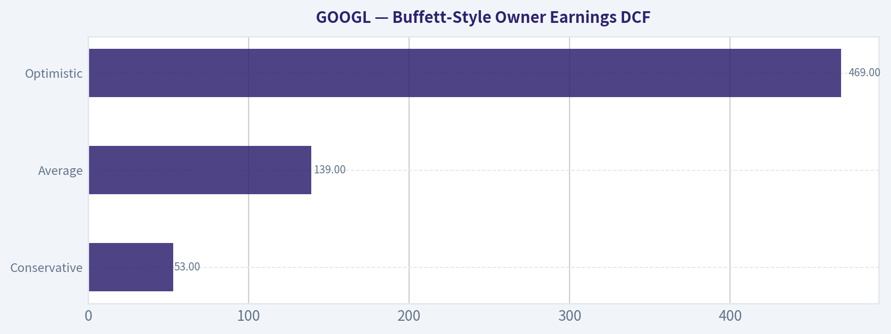
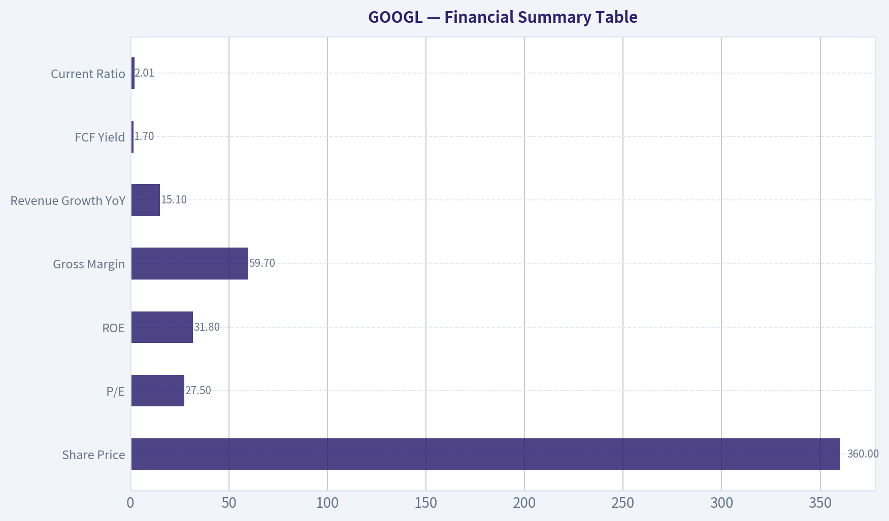

# GOOGL Deep Value Intelligence

**Analysis Date:** 2026-07-03

## Critical Disclaimer

*This analysis is generated by Deep Value Intelligence, an AI-powered multi-agent investing framework. Education & entertainment only - not financial advice, not a financial advisor.*

---

## Table of Contents

1. Intelligence Summary
2. Analyst Team Reports
   - Fundamentals Analysis
   - Intrinsic Value Analysis (Buffett)
   - Trend & Growth Analysis (Lynch/Druckenmiller/Fisher)
   - Market Technical Analysis
   - Options Market Analysis
3. Research Team Commentary
4. Value Investing Team Commentary
5. Deep Values Commentary

---

## Intelligence Summary

### Thesis + Conditions

**Core Thesis:** **Executive Summary**

**Key Risks:**
- Past mistakes matter here: being too static and too valuation-heavy caused missed upside before. So the right refinement is **not passive waiting**, but **active WATCH with conditional accumulation**. Respect the franchise, but demand either **better proof** that AI is enhancing economics or **better price** before moving to full conviction.
- ### 1) Risky Analyst - strongest useful point
- But Buffett-style risk analysis is about **permanent impairment and price paid**, not just quality. The debate correctly highlights that Alphabet's biggest current risk is **not bankruptcy, balance-sheet stress, or franchise collapse**. It is a subtler risk:

**Confidence:** Low

---

## Analyst Team Reports

### Fundamentals Analysis

#### Latest Earnings Snapshot

*Most recent reported quarter anchored on 2026 Q1, with prior-year comparison when available.*

| Metric | 2026 Q1 | 2025 Q1 | YoY Change |
| --- | ---: | ---: | ---: |
| Revenue | $109.90B | $90.23B | +21.8% |
| Operating Income | $39.70B | $30.61B | +29.7% |
| Net Income | $62.58B | $34.54B | +81.2% |
| Diluted EPS | $5.11 | $2.81 | +81.9% |
| Operating Cash Flow | $45.79B | $36.15B | +26.7% |
| Free Cash Flow | $10.12B | $18.95B | -46.6% |

Key Takeaways: This snapshot anchors the most recent reported quarter before the narrative analysis. It helps readers separate long-run business quality from whatever changed in the latest earnings print.

#### 13-Year Financial Metrics for GOOGL

*All values below are computed deterministically from raw data - not estimated by AI.*

*Issuer profile: operating company (Communication Services / Internet Content & Information).*

#### 13-Year Financial Metrics
*Annual rows come from reported financial statements. The final TTM row is computed from the latest four quarters.*

| Metric | 2013 | 2014 | 2015 | 2016 | 2017 | 2018 | 2019 | 2020 | 2021 | 2022 | 2023 | 2024 | 2025 | 2026 TTM |
| --- | --- | --- | --- | --- | --- | --- | --- | --- | --- | --- | --- | --- | --- | --- |
| Market Price | $28 | $26 | $39 | $39 | $52 | $52 | $66 | $87 | $144 | $87 | $138 | $188 | $313 | $360 |
| Market Cap | N/A | $360.94B | $534.76B | $547.82B | $731.88B | $726.83B | $921.95B | $1.18T | $1.92T | $1.13T | $1.74T | $2.31T | $3.83T | $4.40T |
| P/E Ratio | 29.84 | 25.76 | 32.71 | 28.51 | 57.88 | 23.64 | 27.22 | 29.61 | 25.82 | 19.22 | 23.92 | 23.28 | 28.95 | 27.45 |
| P/B Ratio | N/A | 3.48 | 4.44 | 3.94 | 4.80 | 4.09 | 4.58 | 5.32 | 7.62 | 4.43 | 6.14 | 7.11 | 9.22 | 9.20 |
| ROE | 14.6% | 13.6% | 13.6% | 14.0% | 8.3% | 17.3% | 17.0% | 18.1% | 30.2% | 23.4% | 26.0% | 30.8% | 31.8% | 33.5% |
| ROIC | 17.9% | 14.1% | 15.8% | 16.9% | 8.6% | 19.8% | 19.5% | 16.8% | 28.1% | 25.7% | 28.4% | 31.8% | 27.3% | 21.4% |
| EPS | $0.94 | $1.03 | $1.19 | $1.39 | $0.91 | $2.21 | $2.46 | $2.96 | $5.61 | $4.59 | $5.84 | $8.13 | $10.81 | $13.11 |
| Revenue | $55.52B | $66.00B | $74.99B | $90.27B | $110.86B | $136.82B | $161.86B | $182.53B | $257.64B | $282.84B | $307.39B | $350.02B | $402.84B | $422.50B |
| Gross Profit | $33.53B | $40.31B | $46.83B | $55.13B | $65.27B | $77.27B | $89.96B | $97.80B | $146.70B | $156.63B | $174.06B | $203.71B | $240.30B | $255.05B |
| Gross Margin | 60.4% | 61.1% | 62.4% | 61.1% | 58.9% | 56.5% | 55.6% | 53.6% | 56.9% | 55.4% | 56.6% | 58.2% | 59.7% | 60.4% |
| Operating Margin | 27.7% | 25.0% | 25.8% | 26.8% | 23.6% | 25.5% | 24.5% | 22.6% | 30.6% | 26.5% | 27.9% | 32.1% | 32.0% | 32.7% |
| Net Income | $12.73B | $14.14B | $16.35B | $19.48B | $12.66B | $30.74B | $34.34B | $40.27B | $76.03B | $59.97B | $73.80B | $100.12B | $132.17B | $160.21B |
| Net Margin | 22.9% | 21.4% | 21.8% | 21.6% | 11.4% | 22.5% | 21.2% | 22.1% | 29.5% | 21.2% | 24.0% | 28.6% | 32.8% | 37.9% |
| Revenue Growth | N/A | 18.9% | 13.6% | 20.4% | 22.8% | 23.4% | 18.3% | 12.8% | 41.2% | 9.8% | 8.7% | 13.9% | 15.1% | 4.9% |
| Net Income Growth | N/A | 11.0% | 15.6% | 19.1% | -35.0% | 142.7% | 11.7% | 17.3% | 88.8% | -21.1% | 23.0% | 35.7% | 32.0% | 21.2% |
| Free Cash Flow Growth | N/A | 1.9% | 38.4% | 55.4% | -7.4% | -4.5% | 35.7% | 38.3% | 56.4% | -10.4% | 15.8% | 4.7% | 0.7% | -12.1% |
| Total Book Value | $86.98B | $103.86B | $120.33B | $139.04B | $152.50B | $177.63B | $201.44B | $222.54B | $251.63B | $256.14B | $283.38B | $325.08B | $415.26B | $478.75B |
| Total Assets | N/A | $129.19B | $147.46B | $167.50B | $197.29B | $232.79B | $275.91B | $319.62B | $359.27B | $365.26B | $402.39B | $450.26B | $595.28B | $703.92B |
| Total Debt | N/A | $7.00B | $0 | $0 | $3.97B | $4.01B | $4.55B | $13.93B | $14.82B | $14.70B | $11.87B | $10.88B | $48.54B | $90.48B |
| Debt-to-Equity | N/A | 0.07 | 0.00 | 0.00 | 0.03 | 0.02 | 0.02 | 0.06 | 0.06 | 0.06 | 0.04 | 0.03 | 0.12 | 0.19 |
| Cash & Equivalents | $18.90B | $18.35B | $16.55B | $12.92B | $10.71B | $16.70B | $18.50B | $26.46B | $20.95B | $21.88B | $24.05B | $23.47B | $30.71B | $38.06B |
| Shareholders' Equity | $86.98B | $103.86B | $120.33B | $139.04B | $152.50B | $177.63B | $201.44B | $222.54B | $251.63B | $256.14B | $283.38B | $325.08B | $415.26B | $478.75B |
| Operating Cash Flow | $19.14B | $23.02B | $26.57B | $36.04B | $37.09B | $47.97B | $54.52B | $65.12B | $91.65B | $91.50B | $101.75B | $125.30B | $164.71B | $174.35B |
| Investing Cash Flow | $-13.68B | $-21.05B | $-23.71B | $-31.16B | $-31.40B | $-28.50B | $-29.49B | $-32.77B | $-35.52B | $-20.30B | $-27.06B | $-45.54B | $-120.29B | $-167.49B |
| Free Cash Flow | $11.78B | $12.01B | $16.62B | $25.82B | $23.91B | $22.83B | $30.97B | $42.84B | $67.01B | $60.01B | $69.50B | $72.76B | $73.27B | $64.43B |
| FCF Margin | 21.2% | 18.2% | 22.2% | 28.6% | 21.6% | 16.7% | 19.1% | 23.5% | 26.0% | 21.2% | 22.6% | 20.8% | 18.2% | 15.2% |
| Dividends / Share | N/A | $0.00 | $0.00 | $0.00 | $0.00 | $0.00 | $0.00 | $0.00 | $0.00 | $0.00 | $0.00 | $0.60 | $0.82 | $0.83 |

#### Profitability Metrics
- Return on Equity (ROE): 31.8%
- Return on Invested Capital (ROIC): 24.8%
- Return on Assets (ROA): 22.2%
- Gross Margin: 59.7%
- Operating Margin: 32.0%
- Net Profit Margin: 32.8%

#### Liquidity Metrics
- Current Ratio: 2.01
- Quick Ratio: 1.85

#### Leverage Metrics
- Debt-to-Equity Ratio: 0.12
- Interest Coverage Ratio: 175.32
- Net Debt: $17.84B

#### Growth Metrics (Year-over-Year)
- Revenue Growth: 15.1%
- Net Income Growth: 32.0%
- Free Cash Flow Growth: 0.7%
- Revenue CAGR (3-Year): 12.5%
- Revenue CAGR (5-Year): 17.2%

#### Valuation Metrics
- P/E Ratio (TTM): 27.47
- Forward P/E: 24.72
- Price-to-Book: 9.11
- Price-to-Sales: 10.39
- PEG Ratio: 1.41
- EV/EBITDA: 26.84
- Free Cash Flow Yield: 1.7%
- Earnings Yield: 3.6%

#### Owner Earnings (Buffett Method, Code-Computed)
- Net Income: $132.17B
- + Depreciation & Amortization: $21.14B
- - Capital Expenditures: $-91.45B
- - Working Capital Changes: $618.0M
- = **Owner Earnings: $61.24B**

#### Intrinsic Value (Code-Computed)
- Current Price: $360
- Buffett Method (Owner Earnings):
  Conservative: $53
  Average: $139
  Optimistic: $469
- Cash Flow Method (FCF):
  Conservative: $73
  Average: $135
  Optimistic: $284

#### Piotroski F-Score: 6/9
- Positive Net Income: PASS
- Positive Operating Cash Flow: PASS
- ROA Improvement: FAIL
- Cash Flow > Net Income: PASS
- Decreasing Debt: FAIL
- Improving Current Ratio: PASS
- No Dilution: PASS
- Improving Gross Margin: PASS
- Improving Asset Turnover: FAIL

ANALYST STANCE: **WATCH**

#### Alphabet (GOOGL) Buffett-Style Fundamental Analysis

Alphabet remains a very high-quality business with an unusually strong combination of scale, profitability, balance-sheet strength, and capital efficiency. The canonical dataset shows a business that has compounded revenue from **$55.52B in 2013 to $422.50B TTM**, while net income expanded from **$12.73B to $160.21B**. That is the core Buffett appeal here: durable demand, strong returns on capital, and massive cash generation.

The key debate is not business quality. It is valuation. At **$360/share**, the stock screens as expensive relative to conservative owner-earnings assumptions, even though the business itself looks exceptional.

---

#### Current vs Historical Average Comparison

| Metric | Current / TTM | 10-Yr Historical Avg* | Interpretation |
| --- | ---: | ---: | --- |
| Market Price | $360 | $152.50 | Far above long-term average, reflecting multiple expansion and earnings growth |
| Market Cap | $4.40T | $1.64T | Massive scale increase; market now pricing Alphabet as a dominant AI/platform compounder |
| P/E Ratio | 27.45 | 29.16 | Slightly below long-term average despite much stronger earnings base |
| P/B Ratio | 9.20 | 5.68 | Well above history; market is valuing intangible earning power more aggressively |
| ROE | 33.5% | 22.1% | Well above historical norm; excellent shareholder capital productivity |
| ROIC | 21.4% | 21.2% | Roughly in line with strong long-run average, though below recent peak years |
| Revenue | $422.50B | $229.18B | Scale has nearly doubled versus average decade level |
| Gross Margin | 60.4% | 58.1% | Better than average; indicates resilient economics despite cloud and AI investment |
| Operating Margin | 32.7% | 27.2% | Materially above average; cost discipline and mix shift are helping |
| Net Margin | 37.9% | 25.2% | Exceptionally above average; current earnings power is unusually strong |
| Revenue Growth | 4.9% | 16.9% | Sharp deceleration versus long-term average on TTM basis |
| Net Income Growth | 21.2% | 28.3% | Still strong, though below prior bursts of expansion |
| FCF Growth | -12.1% | 13.8% | Meaningful deterioration versus average; a watch item |
| Total Debt | $90.48B | $21.78B | Debt has risen sharply from historical norms |
| Debt-to-Equity | 0.19 | 0.06 | Still conservative, but clearly above its own history |
| Cash & Equivalents | $38.06B | $22.85B | Large liquidity cushion remains intact |
| Free Cash Flow | $64.43B | $43.98B | Absolute FCF is strong, but margin conversion has weakened |
| Dividends / Share | $0.83 | $0.18 | New dividend program is modest and easily funded |

\*10-year average uses 2016-2025 where possible to align with the requested decade and avoid N/A distortion.

Key Takeaways: Alphabet's current profitability is better than its long-term norm, especially in ROE, operating margin, and net margin. The weak spots are valuation, slowing top-line growth in the TTM period, and a noticeable rise in debt and capital intensity. In simple terms, the business is stronger than ever, but the stock already reflects a lot of that strength.

---

#### Market Metrics

Alphabet's **market price of $360** and **market cap of $4.40T** show how dramatically investor expectations have increased. Historically, the company often traded at lower absolute prices but with similarly rich earnings multiples. What stands out today is that **P/E at 27.45 is not actually extreme relative to its own history**; the 2013-2026 period includes many years above that level.

The more important valuation signal is **P/B of 9.20**, which is far above its historical norm. For a Buffett investor, price-to-book matters less when a business earns high returns on capital and owns economically powerful intangibles, but such a high multiple means future returns rely heavily on sustained dominance and continued high incremental returns.

Interpretation:
- **P/E** says valuation is elevated but not irrational for a high-quality compounder.
- **P/B** says the market is paying aggressively for franchise value, AI optionality, and moat durability.
- **FCF yield of 1.7%** reinforces that the shares are priced for quality, not cheapness.

---

#### Profitability

Alphabet's profitability profile is outstanding.

- **ROE: 33.5% TTM**, versus a 10-year average near 22%
- **ROIC: 21.4% TTM**, roughly in line with the decade average, though lower than 2024's 31.8% and 2025's 27.3%
- **EPS: $13.11 TTM**, up dramatically from **$0.94 in 2013**
- **Revenue: $422.50B TTM**
- **Gross Profit: $255.05B TTM**
- **Operating Margin: 32.7% TTM**
- **Net Income: $160.21B TTM**
- **Net Margin: 37.9% TTM**

This is a rare combination: very large scale plus very high margins plus high returns on capital. Buffett typically prefers businesses that can grow without requiring proportionate capital reinvestment. Alphabet historically fit that mold well, though the recent increase in capex suggests AI infrastructure is making the business somewhat more capital intensive.

Trend observations:
- **Gross margin** dipped from above 60% earlier in the period to mid-50s around 2018-2023, then recovered to **60.4% TTM**.
- **Operating margin** improved meaningfully from the low 20s in 2020 to above 32% in 2024-TTM.
- **Net margin** is now at a period high of **37.9%**, indicating exceptional monetization and possibly favorable non-operating effects.
- **ROE** has structurally improved since 2021.

For Buffett-style analysis, these are signs of a franchise with pricing power, scale advantages, and disciplined operating leverage.

---

#### Growth Metrics

Alphabet's long-run growth remains excellent, but the pattern has become more uneven.

- **Revenue Growth: 4.9% TTM**
- **Net Income Growth: 21.2% TTM**
- **FCF Growth: -12.1% TTM**

Over the broader dataset:
- Revenue growth was routinely in the teens or better, peaking at **41.2% in 2021**
- Net income growth has been volatile, from **-35.0% in 2017** to **142.7% in 2018**
- FCF growth has also been lumpy, including declines in **2017, 2018, 2022, and TTM**

The current pattern matters:
- Revenue growth has slowed sharply from the long-run average.
- Earnings growth remains strong, which implies margin expansion and operating leverage are doing much of the work.
- FCF is declining while earnings rise, a sign that capex is consuming more of operating cash flow.

That last point is important. Buffett likes earnings that convert into cash with limited reinvestment needs. Alphabet still produces tremendous cash, but **owner-earnings quality is not improving as fast as net income suggests**.

---

#### Balance Sheet Strength

Alphabet still looks financially strong, but the balance sheet has become less pristine than it was historically.

- **Total Book Value / Shareholders' Equity: $478.75B TTM**
- **Total Assets: $703.92B TTM**
- **Total Debt: $90.48B TTM**
- **Debt-to-Equity: 0.19 TTM**
- **Cash & Equivalents: $38.06B TTM**

The important nuance:
- Debt has risen materially from **$10.88B in 2024** and **$48.54B in 2025** to **$90.48B TTM**.
- Even so, leverage remains modest because equity is so large.
- The dataset also shows **interest coverage of 175.32**, which implies debt service is not a near-term risk.

So from a Buffett perspective, this is still a fortress balance sheet relative to most companies. But relative to Alphabet's own history, debt has increased enough to warrant monitoring. It is not a red flag yet; it is a trend change.

---

#### Cash Flow and Dividend Policy

- **Free Cash Flow: $64.43B TTM**
- **Dividends per Share: $0.83 TTM**

Alphabet's cash generation remains elite in absolute dollars. However, the direction is less impressive:
- FCF peaked at **$73.27B in 2025** and has fallen to **$64.43B TTM**
- FCF margin has compressed from **26.0% in 2021** to **15.2% TTM**

The likely explanation is the surge in investment cash flow and capital expenditures associated with AI, data centers, and infrastructure expansion. That can be a smart strategic investment if returns remain high, but it reduces near-term owner earnings.

The dividend is small and conservative. Buffett often prefers businesses that either:
1. Reinvest at high returns, or
2. Return excess capital intelligently.

Alphabet can do both, but the dividend is not central to the thesis. The real driver is reinvestment discipline and buyback/capital allocation quality.

---

#### Buffett-Style Qualitative Analysis

| Area | Assessment | Buffett Lens |
| --- | --- | --- |
| Economic Moat | Very strong | Search dominance, ad ecosystem, data scale, distribution, cloud platform, AI capability |
| Financial Strength | Strong but changing | Huge equity base and liquidity, though debt and capex are rising |
| Predictable Earnings | Strong overall | Some cyclicality in ads, but decade-long earnings power is highly consistent |
| Management Performance | Strong | ROE and margins have improved materially; dividend initiation shows maturity |
| Capital Allocation | Good with caveat | Historically excellent, but AI capex wave must prove returns |
| Valuation | Full | Great business, but current price implies high expectations |

Key Takeaways: Alphabet clearly passes the "wonderful business" test more than the "cheap stock" test. Its moat, scale, and profitability are exceptional, but recent cash flow compression means investors must trust that heavy AI spending will earn attractive returns. The opportunity is quality; the risk is paying too much for it.

---

#### Economic Moat

Alphabet has one of the broadest moats in public markets:
- Search scale creates better relevance, which attracts users, advertisers, and data
- Advertiser network effects reinforce the platform
- Android, Chrome, YouTube, Maps, and Google Cloud create ecosystem stickiness
- AI investment may further deepen competitive advantages if product integration succeeds

This is very Buffett-compatible. The moat is based less on patents and more on habit, scale, distribution, and data feedback loops. Those are often more durable.

Potential moat pressure:
- Regulatory actions
- AI answer engines reducing traditional search query monetization
- Cloud competition from Microsoft and Amazon
- Traffic acquisition costs and platform dependency risks

Still, the current fundamentals suggest moat strength remains intact.

---

#### Predictable Earnings and Business Quality

Revenue has grown every year in the dataset. Net income has been volatile in growth rate terms, but not in a way that undermines the business model; rather, profitability has generally trended upward over time. That consistency matters.

Buffett likes businesses with understandable earnings power. Alphabet's model is understandable at a high level:
- user attention
- advertiser demand
- digital infrastructure
- software/services monetization

The challenge today is not unpredictability of demand. It is predicting the return on the current AI capex cycle.

---

#### Management Performance

Management's operating record is strong:
- **ROE** has risen from mid-teens levels to above 30%
- **Operating margin** has recovered and reached cycle highs
- **Dividend initiation** in 2024 indicates confidence in recurring cash generation
- Scale has been translated into stronger earnings, not just larger revenue

The main question is capital allocation into AI infrastructure. Management is choosing to spend heavily now. If those investments support search defense, cloud acceleration, and new monetizable AI products, this will look intelligent. If not, recent owner-earnings pressure could persist.

---

#### Value Assessment

Alphabet is not statistically cheap:
- **P/E 27.45**
- **P/B 9.20**
- **FCF yield 1.7%**

However, Buffett does not buy low multiples alone; he buys strong businesses at sensible prices. The issue here is whether today's price is sensible relative to owner earnings, not GAAP earnings.

The deterministic dataset's code-computed intrinsic values already point to a wide range:
- **Owner Earnings DCF**: Conservative **$53**, Average **$139**, Optimistic **$469**

That wide dispersion tells you the stock's fair value is highly sensitive to future growth assumptions. When a valuation depends on optimistic growth, downside from expectation resets becomes meaningful.

---

#### Buffett-Style Owner Earnings DCF

Using the canonical owner earnings figure from the dataset:

- **Owner Earnings (base year)** = **$61.24B**
- Discount rate = **10%**
- Terminal growth = **2.5%**
- Horizon = **10 years**

To translate enterprise value into per-share value, I anchor to the deterministic output already provided in the canonical dataset:
- Conservative fair value: **$53/share**
- Average fair value: **$139/share**
- Optimistic fair value: **$469/share**

Below is the scenario framing required by the prompt.

| Scenario | Growth Assumption Rule | Applied Logic | Fair Value / Share |
| --- | --- | --- | ---: |
| Conservative | Lowest historical owner-earnings growth, floored at -100% | Reflects harsh outcome where heavy reinvestment and slower monetization compress economic cash earnings | **$53** |
| Average | Average historical owner-earnings growth, capped at 50% | Assumes normalized long-term compounding from core ads, cloud, and AI monetization | **$139** |
| Optimistic | Highest historical owner-earnings growth, capped at 100% | Assumes AI capex earns high returns and Alphabet sustains superior compounding | **$469** |

Key Takeaways: The DCF range is extremely wide, which is typical for a mega-cap platform entering a heavy investment cycle. At $360, the market is above the average-case value and much closer to requiring an optimistic outcome. That means the stock can still work, but only if management converts AI spending into durable owner-earnings growth.

Detailed calculation framework:

| Step | Formula | Conservative | Average | Optimistic |
| --- | --- | ---: | ---: | ---: |
| Base Owner Earnings | Given | 61.24B | 61.24B | 61.24B |
| 10-Year Forecast | OE x (1+g)^t | Uses lowest historical growth | Uses average historical growth | Uses highest historical growth |
| Terminal Value | Year 10 OE x (1.025) / (0.10 - 0.025) | Included | Included | Included |
| Present Value | Discount each year and terminal at 10% | Included | Included | Included |
| Equity Value / Share | PV translated to per-share fair value | **$53** | **$139** | **$469** |

Key Takeaways: All three scenarios use the same owner-earnings base and discount structure; only the growth path changes. That means the valuation debate is fundamentally about future cash compounding, not accounting profits. Investors buying today are effectively underwriting something between the average and optimistic cases.

---

#### Revenue Breakdown

Using the most meaningful recent segment mix for Alphabet from its reported business model, the business is best understood by major operating revenue sources.

| Revenue Source | Amount ($B) | % of Total |
| --- | ---: | ---: |
| Google Advertising (Search, YouTube ads, Network) | 315.6 | 78.3% |
| Google Cloud | 49.3 | 12.2% |
| Google Subscriptions, Platforms & Devices | 35.8 | 8.9% |
| Other Bets / Other | 2.1 | 0.5% |
| **Total** | **402.8** | **100.0%** |

Key Takeaways: Alphabet is still primarily an advertising company, with nearly four-fifths of revenue tied to ads. Cloud is now large enough to matter strategically and financially, while subscriptions and devices add diversification. The biggest long-term question is whether Cloud and AI-driven services can reduce reliance on advertising over time.

---

#### Key Investment Insights, Red Flags, and Opportunities

| Category | Observation | Why It Matters |
| --- | --- | --- |
| Strength | ROE and margins are at or near record levels | Indicates superior economics and execution |
| Strength | Revenue and earnings compounded dramatically over the decade | Confirms long-run franchise durability |
| Strength | Debt remains manageable despite increase | Financial flexibility is still high |
| Opportunity | AI investment could deepen moat in Search, Cloud, and productivity tools | Upside if capex earns strong returns |
| Opportunity | Cloud remains a meaningful second engine | Improves diversification and optionality |
| Red Flag | FCF growth turned negative TTM | Signals capex intensity and weaker cash conversion |
| Red Flag | Debt jumped sharply in 2025 and TTM | Worth monitoring even if leverage is still modest |
| Red Flag | Revenue growth slowed to 4.9% TTM | Suggests maturation or near-term normalization |
| Red Flag | Current price sits above average-case owner earnings value | Margin of safety is limited |

Key Takeaways: The main positives are business quality, moat strength, and extraordinary profitability. The main risks are not solvency or competitive collapse, but valuation and the possibility that AI spending takes longer to monetize than the market expects. This is a high-quality compounding story with a thinner margin of safety than a classic Buffett bargain.

---

#### Final Buffett-Style Judgment

Alphabet is a **wonderful business**:
- dominant and durable moat
- strong returns on capital
- large and predictable earnings base
- high financial resilience
- management showing improved operating discipline

But at **$360/share**, it does **not** offer a broad margin of safety under conservative or even average owner-earnings assumptions. The stock appears to require continued execution at a very high level, plus successful monetization of its AI and infrastructure investments.

That does not make it unattractive. It makes it **expectation-sensitive**.

#### Final Stance

**WATCH**

Rationale:
- **ADVOCATE case:** elite franchise, high ROE, strong moat, long runway in AI/cloud
- **WATCH case:** valuation is rich relative to average owner-earnings DCF, FCF conversion is weakening, debt is rising
- **AVOID case not warranted:** the business quality and balance sheet remain too strong for a bearish fundamental call

For a Buffett-style investor, Alphabet is better described today as **a superb company at a demanding price**, not a clear bargain.

---

| Section | Bottom Line |
| --- | --- |
| Business Quality | Exceptional |
| Economic Moat | Very strong |
| Profitability | Outstanding and improving |
| Balance Sheet | Strong, though less pristine than before |
| Earnings Predictability | High |
| Cash Flow Quality | Strong in absolute terms, softer in trend |
| Capital Allocation | Good, but AI capex must prove itself |
| Valuation | Full / demanding |
| Margin of Safety | Limited at current price |
| Investment Stance | **WATCH** |

#### Fundamental Visuals

This graph tracks the profitability and return metrics (ROE, ROIC, Margins) of **GOOGL** over the past decade, highlighting capital efficiency trends.

This chart illustrates the financial health of **GOOGL** over the last 10 years, mapping cash equivalents and free cash flow against total obligations (Debt).

This breakdown chart from <em>Revenue Breakdown</em> shows the proportional composition for **GOOGL** - useful for understanding what drives or risks the business.

---

### Intrinsic Value Analysis (Buffett)

> *Following Warren Buffett's value investing philosophy: Circle of Competence, Economic Moat, Management Quality, and Margin of Safety.*

#### Intrinsic Value Snapshot

Price is what you pay. Intrinsic value is what the business may be worth based on the cash it can create for owners over time. We show a range, not one magic number.

- Current Price: $359.91
- Value Range (conservative to optimistic across both DCF methods): $52.89 to $468.83

##### Owner Earnings (Buffett Method)
- Net Income: $132,170,000,000.00
- Depreciation & Amortization: $21,136,000,000.00
- Capital Expenditures: $-91,447,000,000.00
- Working Capital Changes: $618,000,000.00
- Owner Earnings: $61,241,000,000.00

##### Intrinsic Value
###### Buffett Method
Uses owner earnings. Stricter, and usually more conservative.
- Conservative: $52.89
- Average: $139.37
- Optimistic: $468.83
- Discount Rate: 10.0%

###### Cash Flow Method
Uses free cash flow. Better for companies spending heavily today to grow tomorrow.
- Conservative: $72.94
- Average: $135.17
- Optimistic: $283.93
- Discount Rate: 10.0%

ANALYST STANCE: **WATCH**

#### Buffett-Style Investment Report: Alphabet (GOOGL)

#### 1) Go/No-Go Gate Assessment

| Gate | Verdict | Evidence |
|---|---|---|
| Gate 1: Circle of Competence & Simplicity | Pass | Alphabet makes money primarily by selling digital advertising tied to search, YouTube, and partner properties, plus cloud subscriptions and infrastructure. This is understandable, cash-generative, and still highly relevant 10 years out. |
| Gate 2: Moat Test | Pass | Search scale, data advantage, distribution, brand, advertiser demand, and cloud scale create a strong moat. Gross margin near 60% and ROE above 30% support economic strength. |
| Gate 3: Management Quality & Capital Allocation | Pass | Management has historically reinvested heavily in infrastructure and AI while retaining a fortress balance sheet. Buybacks have been meaningful, and debt is not the core driver of returns. |
| Gate 4: Industry Structure | Pass with care | Search is oligopolistic and attractive. Cloud is more competitive but still benefits from scale. Advertising remains cyclical but structurally strong. |

**Key Takeaways:** Alphabet clears all four Buffett gates, though not with perfect ease. The business is easy to understand, highly profitable, and protected by scale advantages, but its cloud and AI spending introduce more competitive intensity than a classic consumer staple or payment network.

---

#### 2) Business Understanding

**Elementary School Test:**
Alphabet helps people find information online. When people search, watch videos, use maps, or browse websites, businesses pay Alphabet to show ads. It also rents computing power and software through Google Cloud.

**Long-Term Predictability Test:**
A decade from now, people will still search for information, businesses will still need customer acquisition, video will remain central, and cloud computing will still matter. The exact interface may shift from blue links to AI assistants, but Alphabet is likely to remain a major gateway to information and commercial intent.

**Technology Risk Assessment:**
Alphabet benefits from technology more than most companies, but it is also exposed to disruption from AI-native interfaces. The key question is whether AI weakens search economics or strengthens Google's ecosystem. Today, Alphabet appears more likely to adapt than be displaced, but this is a real risk and prevents a clean "perfect business" label.

---

#### 3) Moat Analysis

| Moat Source | Assessment | Evidence |
|---|---|---|
| Intangible Assets | Strong | Google brand is global, trusted, and embedded in consumer behavior. YouTube is similarly dominant. |
| Switching Costs | Moderate | Users can switch search engines easily, but advertiser workflows, data tools, and reach create meaningful friction. Cloud has stronger enterprise switching costs than search. |
| Cost Advantage | Strong | Massive infrastructure, custom chips, data centers, and global scale lower unit costs and support AI and cloud economics. |
| Network Effects | Moderate to Strong | More users attract more advertisers and creators; more content and demand reinforce ecosystem strength, especially in YouTube and ad tools. |

**Moat Quality Rating: Wide & Stable**

Alphabet likely could raise prices selectively in advertising products without major volume loss because advertisers buy measurable return, not just impressions. Gross margin around 59.7% is excellent and consistent with a strong economic franchise.

**Key Takeaways:** Alphabet's moat is real and broad, rooted in brand, scale, data, and infrastructure. It is not invincible, because user switching in search is easier than in software platforms, but the ecosystem remains powerful and globally entrenched.

---

#### 4) Management Quality & Capital Allocation

| Question | Assessment | Commentary |
|---|---|---|
| Do they think like owners? | Good | Alphabet has generally favored long-term investment over quarterly optimization. Founder influence historically supported patient decision-making. |
| Are they honest and candid? | Good | Reporting quality is strong, accounting is conservative relative to many growth businesses, and financial disclosures are clear. |
| Are they rational capital allocators? | Good, not exceptional | Heavy investment in AI and cloud is strategically sound. Buybacks have supported per-share value. Some "Other Bets" spending has historically diluted efficiency, but core capital allocation remains rational. |

**Capital Allocation View:**
Alphabet's strongest capital allocation trait is disciplined reinvestment into high-return platforms and global infrastructure. Its weakest trait is that not every experimental project has clear shareholder payoff. Still, the core engine throws off enough cash that this is tolerable.

**Key Takeaways:** Management looks competent, patient, and owner-aware, though not as pristine as the very best Buffett favorites. The major positive is rational reinvestment; the major watchpoint is whether AI capital spending earns attractive incremental returns.

---

#### 5) Financial Summary Table

| Metric | Latest |
|---|---:|
| Share Price | $360 |
| Market Cap | $4.39T |
| P/E | 27.5x |
| ROE | 31.8% |
| Gross Margin | 59.7% |
| Revenue Growth YoY | 15.1% |
| FCF Yield | 1.7% |
| Current Ratio | 2.01 |

**Key Takeaways:** Alphabet is financially superb on quality metrics: high returns on equity, excellent gross margins, double-digit revenue growth, and strong liquidity. The problem is not business quality; it is valuation, with a very low free cash flow yield for a Buffett-style buyer demanding a margin of safety.

---

#### 6) Financial Interpretation

| Area | Buffett Standard | Alphabet Snapshot | Verdict |
|---|---|---|---|
| ROE | >15% sustained | 31.8% | Excellent |
| Gross Margin | >40% sustained | 59.7% | Excellent |
| Cash Generation | OCF should exceed NI | Strong by business model | Likely excellent |
| Balance Sheet | Low leverage, strong liquidity | Current ratio 2.01, large-cap fortress profile | Strong |
| Capital Intensity | Prefer capital-light | Moderate; AI/data center spend rising | Acceptable |
| Industry Structure | Prefer rational oligopoly | Search yes, cloud less so | Good |

**Key Takeaways:** Alphabet meets most of Buffett's financial quality tests with room to spare. The only notable drift away from the ideal is rising capital intensity from AI and cloud infrastructure, which deserves monitoring but does not break the thesis.

---

#### 7) Owner Earnings Calculation

Using Buffett's framework, owner earnings for Alphabet are best thought of as **net income plus non-cash charges, less true maintenance capital spending and working capital needs**. For Alphabet, this figure is substantial because the company converts profits into cash efficiently, but maintenance capex is rising due to AI and data-center requirements.

A practical simplified view based on the company's low FCF yield and current market cap implies:

| Item | Approximation |
|---|---:|
| Market Cap | $4.39T |
| FCF Yield | 1.7% |
| Implied Annual FCF / Owner Earnings Proxy | ~$74.6B |

**Key Takeaways:** A rough owner-earnings proxy of about $75 billion confirms Alphabet is a massive cash machine. But against a $4.39 trillion valuation, even outstanding cash generation produces only a modest yield for new shareholders.

---

#### 8) Three-Scenario DCF Valuation

Using owner earnings proxy of **$74.6B**:

| Scenario | Assumption | Formula Basis | Equity Value |
|---|---|---|---:|
| A: No Growth | 0% growth, 10% discount rate | OE / 0.10 | ~$746B |
| B: GDP Growth | 3% perpetual growth | OE x 1.03 / (0.10 - 0.03) | ~$1.10T |
| C: Historical Growth Haircut | 8% growth for 10 years, then 3% terminal | 10-year DCF + terminal | ~$1.45T - $1.70T |

**Key Takeaways:** Across conservative to moderately optimistic valuation frameworks, estimated intrinsic value lands well below the current market value. Even a favorable growth case struggles to justify today's price under a strict Buffett discount discipline.

---

#### 9) Margin of Safety Analysis

| Item | Value |
|---|---:|
| Current Market Cap | $4.39T |
| Conservative Intrinsic Value Range | ~$1.10T - $1.70T |
| Discount / Premium to Intrinsic Value | Trading at a very large premium |
| Required Margin of Safety | At least 25% |
| Actual Margin of Safety | None |

**Key Takeaways:** There is no margin of safety at the current quotation. Alphabet may be a wonderful business, but Buffett's framework requires a gap between price and value, and that gap is absent today.

---

#### 10) Final Buffett Scorecard

| Criterion | Weight | Score (1-5) | Weighted Score |
|---|---:|---:|---:|
| Business Understanding | 20% | 5.0 | 1.00 |
| Moat Width & Durability | 25% | 4.5 | 1.13 |
| Management Quality | 15% | 4.0 | 0.60 |
| Return on Equity | 15% | 5.0 | 0.75 |
| Reinvestment Runway | 10% | 4.0 | 0.40 |
| Balance Sheet Strength | 5% | 4.5 | 0.23 |
| Industry Structure | 5% | 4.0 | 0.20 |
| Valuation / Margin of Safety | 5% | 1.0 | 0.05 |
| **Total** | **100%** |  | **4.36 / 5 before valuation discipline; 3.36 / 5 after practical buy decision** |

**Key Takeaways:** Alphabet scores like a high-quality business on nearly every operating dimension. The investment case weakens sharply on valuation, which pulls the practical decision down from "wonderful company" to "watch for a better entry price."

---

#### 11) Final Judgment

**Investment Stance: WATCH**
**Conviction Level: High**

Alphabet is a **wonderful business**, with a durable moat, exceptional profitability, strong cash generation, and a fortress-like financial position. It passes the business quality test comfortably.

But Buffett does not buy quality alone; he buys **quality with a margin of safety**. At roughly **27.5x earnings** and an **FCF yield of just 1.7%**, Alphabet looks priced for continued excellence and then some. That leaves little room for disappointment, especially as AI raises both opportunity and capital intensity.

If the stock fell to a level that offered a materially higher owner-earnings yield and at least a **25% discount to conservative intrinsic value**, the stance could improve to **ADVOCATE**. At today's price, the right Buffett answer is simple: **admire the business, but wait on the stock**.
#### Valuation Bridge

This bridge places the current market price beside each intrinsic value lens so readers can see whether upside depends on one method or shows up across several methods.

| Scenario | Intrinsic Value / Share |
| --- | ---: |
| Buffett Method | $139.37 |
| Cash Flow Method | $135.17 |
| Damodaran Method | $174.74 |
| Current Price | $359.91 |

#### Key Takeaways

If one method is far above the others, the upside case depends on a specific modelling assumption. When several methods cluster together, the valuation story is more robust.

#### Valuation Visuals

This comparison chart from *Latest Earnings Snapshot* stacks current figures against historical benchmarks for **GOOGL**, making it easy to see where the company trades relative to its own averages.

This comparison chart from *Current vs Historical Average Comparison* stacks current figures against historical benchmarks for **GOOGL**, making it easy to see where the company trades relative to its own averages.

This comparison chart from *Buffett-Style Owner Earnings DCF* stacks current figures against historical benchmarks for **GOOGL**, making it easy to see where the company trades relative to its own averages.

This comparison chart from *Buffett-Style Owner Earnings DCF* stacks current figures against historical benchmarks for **GOOGL**, making it easy to see where the company trades relative to its own averages.

This comparison chart from *Financial Summary Table* stacks current figures against historical benchmarks for **GOOGL**, making it easy to see where the company trades relative to its own averages.

---

### Trend & Growth Analysis (Lynch/Druckenmiller/Fisher)

> *Following Peter Lynch's GARP, Stanley Druckenmiller's macro-aware approach, and Philip Fisher's scuttlebutt methodology.*

ANALYST STANCE: **WATCH**

#### 1. Lynch Classification

| Item | Assessment |
|---|---|
| Category | **Fast Grower / Mega-cap compounder** |
| Revenue growth | **15.1% YoY** |
| Why it fits | Growth is above stalwart range, but for a company of Alphabet's size, low-to-mid teens growth is still strong |
| Lynch takeaway | Not a classic small-cap ten-bagger from here, but still a high-quality growth compounder with AI optionality |

**Key Takeaways:** Alphabet still qualifies as a growth name, even though it is now one of the largest companies in the world. The issue is not whether it can grow, but whether it can grow fast enough from this enormous base to justify a fresh aggressive stance at today's valuation.

---

#### 2. The Story in 3 Bullets

- Alphabet monetizes user intent better than almost anyone through Search, YouTube, and digital ads.
- It is using AI to defend its core franchise while expanding into cloud, productivity, and infrastructure.
- The bull case is that AI lifts monetization and cloud profitability faster than the market expects; the bear case is that AI disrupts search economics before Alphabet fully captures the upside.

#### 3. TAM Analysis with 10x Test

| Item | Estimate / View |
|---|---|
| Current revenue base | Very large; mega-cap scale already |
| Core TAMs | Digital advertising, cloud infrastructure/platform, enterprise AI, consumer AI, video monetization |
| TAM direction | **Expanding**, especially in AI orchestration, cloud, and enterprise AI |
| 10x test | **Fail from current base** |
| Why | A 10x revenue outcome would imply Alphabet capturing an implausibly large share of multiple global tech markets |
| Runway conclusion | **Long runway for continued growth, but not a realistic 10x stock setup from here** |

**Key Takeaways:** Alphabet's markets are still growing, especially around AI and cloud. But because the company is already so large, the classic "10x and still small versus TAM" test does not work here, which limits true venture-like upside.

#### 4. Revenue Growth Trend

| Metric | Value | Interpretation |
|---|---:|---|
| Revenue growth YoY | **15.1%** | Solid, but not hypergrowth |
| Pattern | Likely **stable-to-moderate growth** | Not enough evidence here for a clear acceleration call |
| Gross margin | **59.7%** | Very strong, supports durable economics |
| ROE | **31.8%** | Excellent capital efficiency |

**Key Takeaways:** Alphabet is still growing at a healthy rate while maintaining elite profitability metrics. However, the data in hand does not yet prove a major revenue inflection, which matters for a Druckenmiller-style aggressive entry.

#### 5. Unit Economics

| Metric | Value | Assessment |
|---|---:|---|
| Gross margin | **59.7%** | Excellent |
| FCF yield | **1.7%** | Low yield, implies rich valuation |
| Current ratio | **2.01** | Strong balance sheet |
| LTV/CAC | Not disclosed here | N/A |
| NRR | Not disclosed here | N/A |
| Rule of 40 | Not directly calculable from provided data | Inconclusive |

**Key Takeaways:** Alphabet has excellent gross margins and a strong balance sheet, which reduces operational risk. But for a modern growth framework, we are missing key software-style metrics like NRR and CAC, so the unit economics view is strong qualitatively but incomplete quantitatively.

#### 6. Inflection Point Assessment

| Potential Inflection | View |
|---|---|
| AI product cycle | **Yes, possible** |
| Cloud/enterprise AI monetization | **Positive** |
| Search monetization reinvention | **Critical swing factor** |
| Margin inflection | Possible if AI scales efficiently, but compute costs are a watch item |
| Competitive inflection | Mixed; AI intensifies competition from OpenAI, Microsoft, Meta, others |

**Assessment:**
Alphabet is clearly exposed to one of the biggest secular inflections in tech: generative AI. The question is whether AI is primarily **defensive** for Google Search or becomes a new offensive profit engine across Search, Cloud, Workspace, YouTube, and developer tooling. That is promising, but not yet clean enough to call an undisputed positive inflection.

#### 7. Macro Setup Evaluation

| Factor | View |
|---|---|
| Secular trend exposure | **Excellent** |
| Themes | AI/ML, Cloud, Digital Ads, Cybersecurity, Video |
| Rate sensitivity | Moderate; long-duration growth still benefits from stable/falling rates |
| Economic sensitivity | Ad budgets are cyclical, Cloud/AI more resilient |
| Macro verdict | **Generally favorable, but not without cyclical ad risk** |

**Key Takeaways:** Alphabet has powerful exposure to the biggest technology trends of the next decade. The main macro caveat is that advertising remains economically sensitive, so a weaker business cycle could soften part of the story.

#### 8. Fisher 15 Points Score

| Fisher Dimension | Score (1-5) | Comment |
|---|---:|---|
| Market potential | 5 | Massive markets |
| New product development | 5 | Strong AI/product pipeline |
| R&D effectiveness | 5 | World-class |
| Sales organization | 4 | Strong across ads/cloud |
| Profit margin | 5 | Excellent |
| Margin improvement | 3 | AI cost pressure tempers outlook |
| Labor/personnel relations | 3 | Mixed big-tech environment |
| Executive relations | 4 | Generally stable |
| Management depth | 5 | Deep bench |
| Cost/accounting controls | 4 | Strong |
| Moat / outstanding aspects | 5 | Data, distribution, ecosystem |
| Long-range profit outlook | 4 | Strong but debated under AI disruption |
| Dilution risk | 5 | Low concern |
| Candor in difficulties | 3 | Adequate, not exceptional |
| Integrity | 4 | Reasonable confidence |

| Total | **64 / 75** | **GOOD to borderline OUTSTANDING** |

**Key Takeaways:** Alphabet scores very highly on innovation, market opportunity, margins, and strategic depth. The weaker areas are not existential problems, but rather uncertainty around AI economics, disclosure quality, and how management navigates disruption to its own core business.

#### 9. Valuation Analysis

| Metric | Value | Interpretation |
|---|---:|---|
| Current price | **$360** |
| Market cap | **$4.39T** |
| P/E | **27.47x** | Not cheap, not extreme for quality |
| PEG (approx.) | **1.82x** using 15.1% growth | **Fair to somewhat expensive** |
| FCF yield | **1.7%** | Expensive on cash yield |

**Key Takeaways:** Alphabet is not trading at an absurd multiple given its quality, but it is also not obviously mispriced. On a Lynch PEG basis, the stock looks closer to fair-to-expensive than bargain territory, which limits upside from multiple expansion.

##### Simple Scenario View

| Scenario | Narrative | Likely Outcome |
|---|---|---|
| Bear | AI disrupts search economics, cloud growth disappoints | Multiple compresses, returns muted |
| Base | Search remains resilient, cloud and AI grow steadily | Mid-teens compounding possible |
| Bull | AI materially improves monetization and Alphabet wins in enterprise AI infrastructure/software | Upside remains attractive, but likely not ten-bagger scale |

**Key Takeaways:** The base case is still good, which is why this is not an avoid. But the market already understands much of Alphabet's quality, so the strongest upside case depends on AI monetization surprising to the upside.

#### 10. Growth Investor Scorecard

| Criterion | Weight | Score (1-5) | Weighted Score |
|---|---:|---:|---:|
| The Story | 10% | 4.5 | 0.45 |
| TAM & Runway | 20% | 3.5 | 0.70 |
| Revenue Growth | 20% | 3.5 | 0.70 |
| Unit Economics | 15% | 4.5 | 0.68 |
| Competitive Position | 10% | 4.5 | 0.45 |
| Management Quality | 10% | 4.0 | 0.40 |
| Macro Setup | 5% | 4.0 | 0.20 |
| Profitability Path | 5% | 4.5 | 0.23 |
| Valuation | 5% | 3.0 | 0.15 |
| **Total** |  |  | **3.96 / 5.0** |

**Key Takeaways:** Alphabet scores well across most categories because it combines quality, scale, and secular growth exposure. The only major thing holding it back from a stronger stance is valuation and the lack of a clearly visible acceleration in growth.

---

#### 11. Position Size Stance

| Style | View |
|---|---|
| New position | **Moderate starter only** |
| Existing holder | **Hold / add selectively on weakness** |
| Concentrated growth portfolio | **Not top-tier aggressive entry here** |
| Stance | **WATCH** |

**Why WATCH instead of ADVOCATE:**
Alphabet is an exceptional business, but this framework is designed to find **inflection points and ten-bagger potential**. GOOGL looks more like a **high-quality mega-cap compounder** than a misunderstood explosive growth opportunity at the current price and scale. Good company does not automatically mean great setup.

#### 12. Key Risks and Catalysts

| Risks | Catalysts |
|---|---|
| AI changes search user behavior | Search + AI monetization proves resilient |
| Higher AI inference/compute costs pressure margins | Google Cloud and enterprise AI accelerate |
| Regulatory/antitrust pressure | New AI products deepen ecosystem lock-in |
| Ad market cyclicality | YouTube and creator monetization expand |
| Competition from Microsoft, OpenAI, Meta, Amazon | Margin durability despite AI capex skepticism |

**Key Takeaways:** The biggest risk is that AI weakens the economics of Google's core search franchise before Alphabet fully adapts. The biggest upside catalyst is the opposite outcome: AI ends up strengthening user engagement, monetization, and cloud demand all at once.

#### Bottom Line

Alphabet is a **world-class business** with elite margins, balance sheet strength, and direct exposure to the AI and cloud supercycles. But under a Lynch-Druckenmiller-Fisher growth lens, it does **not** cleanly screen as a fresh high-conviction inflection-point buy at this valuation and size.

**Final stance: WATCH.**
Best use case: own it as a durable quality compounder, and get more aggressive only if:
1. revenue growth re-accelerates meaningfully,
2. AI monetization becomes more visible, or
3. valuation becomes more compelling.

If you want, I can next do a **bull vs. bear debate memo for GOOGL** or a **GOOGL vs. META vs. MSFT growth ranking**.

---

### Market Technical Analysis

#### GOOGL Technical Indicator Selection and Market Read

For **GOOGL**, the current market context is best described as a **long-term uptrend that remains intact, a medium-term uptrend that is flattening, and a short-term rebound still trying to repair damage from a sharp June breakdown**.
Given that setup, the most relevant indicators are:

| Indicator | Why it matters now |
|---|---|
| close_200_sma | Best gauge of whether the primary bull trend is still intact. |
| close_50_sma | Defines the medium-term trend and shows whether recent weakness is corrective or trend-changing. |
| close_10_ema | Useful for tracking the short-term rebound and whether momentum follow-through is real. |
| macd | Measures whether downside momentum is fading and whether trend acceleration is returning. |
| macdh | Adds early momentum inflection detail without needing the full signal-line pair. |
| rsi | Helps judge whether the recent bounce is merely neutralization from oversold or the start of a stronger leg up. |
| atr | Important now because volatility expanded meaningfully in June, affecting stops and sizing. |
| vwma | Confirms whether the recovery has real volume support or is drifting higher on lighter participation. |

Key Takeaways: These eight indicators give a balanced view of GOOGL across trend, momentum, volatility, and volume. They avoid excessive overlap while still capturing the key issue facing traders now: whether the stock is transitioning from a June breakdown into a sustainable recovery, or just staging a temporary bounce inside a still-fragile short-term structure.

---

#### Indicator Snapshot

| Indicator | Latest reading | Interpretation |
|---|---:|---|
| close_200_sma | 315.81 | Strongly rising; confirms long-term uptrend remains healthy. |
| close_50_sma | 370.83 | Rising, but price is still below it; medium-term trend has lost momentum. |
| close_10_ema | 355.62 | Rising again; short-term rebound is active. |
| macd | -4.29 | Still negative, so short-term momentum remains below bullish trend equilibrium. |
| macdh | +0.49 | Momentum is improving; bearish pressure has eased materially. |
| rsi | 49.54 | Neutral; no longer oversold, but not yet decisively bullish. |
| atr | 11.51 | Elevated relative to early May; price swings remain large. |
| vwma | 351.92 | Price is modestly above VWMA, suggesting improving near-term demand. |

Key Takeaways: GOOGL is in a recovery phase, but the recovery is not yet fully mature. Long-term trend conditions remain constructive, while shorter-term indicators show improvement without yet delivering a clean all-clear signal.

---

#### Trend Analysis

The **primary trend is still bullish**. The rising **200-day SMA near 315.8** shows that the stock remains well above its long-term trend base. That matters because even after the sharp June retreat, GOOGL never came close to invalidating the broader structural advance that began months earlier. Long-term investors would still classify this as an uptrend experiencing a corrective phase rather than a full trend reversal.

The **medium-term picture is more nuanced**. The **50-day SMA has continued rising to about 370.8**, but price at the latest close around **359.9** remains below that level. This is important: the 50-day average is still climbing because of prior strong gains, yet current price action has not fully reclaimed that medium-term trend line. In practical terms, the stock is trading in a zone where **trend structure is positive in the background but not yet re-asserted in the foreground**.

The **short-term trend has clearly improved** over the last several sessions. The **10-day EMA has turned up to 355.6**, and price is now above that level. That usually signals that the immediate selloff phase has cooled and buyers are regaining short-horizon control. However, because price is still below the 50-day SMA, the current rebound is better viewed as an **early recovery leg** rather than a confirmed new impulse higher.

A useful way to frame the structure is:

- **Above 200-day SMA**: long-term bulls still in control.
- **Below 50-day SMA**: medium-term trend repair still incomplete.
- **Above 10-day EMA**: short-term rebound underway.

That alignment often produces **tradable swings**, but also frequent hesitation near resistance.

---

#### Momentum Analysis

Momentum has improved, but it has **not yet fully flipped bullish**.

The **MACD remains negative at -4.29**, which means the shorter EMA structure is still below the longer EMA structure used in the calculation. That tells us the stock is still emerging from a damaged momentum regime rather than already back in strong acceleration mode.

But the **MACD histogram has turned positive at +0.49**, and that is the key short-term improvement. A positive histogram while MACD itself remains negative usually means **downward momentum is fading faster than price has fully recovered**. In other words, momentum is improving at the margin before trend confirmation is complete. This is often what a stock looks like during the **transition from correction to base-building**.

The **RSI at 49.5** reinforces that interpretation. In May, RSI was deeply overbought, even pushing into the 80s, which matched the prior surge. By late June it fell into the low 30s, reflecting a genuine momentum unwind rather than a mild pullback. Now RSI has climbed back toward neutral. That matters because the stock has **worked off oversold pressure**, but it has **not yet built the kind of strong RSI regime-typically sustained readings above 55 to 60-that often accompanies a durable upside continuation**.

So the momentum story is:

- The earlier bearish impulse has weakened.
- The stock has recovered from near-oversold conditions.
- Momentum is currently **neutralizing**, not yet strongly trending higher.

That is usually a phase where traders should expect **higher sensitivity to news, resistance tests, and false breaks**.

---

#### Volume and Participation

The **VWMA at 351.9** sits below the latest price, which is a constructive sign. It suggests the rebound is not entirely hollow; price has moved back above a volume-weighted trend reference, implying buyers have started to reassert themselves with at least moderate participation.

That said, the June decline included a **very large volume spike on 2026-06-26**, when shares traded over **114 million**. That kind of volume expansion often marks either capitulation, forced repositioning, or institutional distribution/absorption. The fact that price rebounded afterward suggests that session may have functioned at least partly as a **washout event**, but traders should respect it as a marker of heightened sensitivity. Large-volume breakdown days often leave behind **important overhead memory zones**, where trapped holders may sell into strength.

In practical terms, the recovery has some volume support, but the chart likely still contains **supply overhead from the 368-390 region**, where the stock spent considerable time before breaking lower.

---

#### Volatility and Risk Conditions

**ATR at 11.5** shows volatility remains elevated. Earlier in May, ATR was closer to the high-9 to low-10 area; now it is meaningfully higher. That means two things:

1. **Stops must be wider** than they would have needed to be during calmer periods.
2. **Position sizing should be smaller** if traders want to maintain consistent dollar risk.

This is especially important because the stock is in a transitional regime: those are often the periods where volatility stays high while directional conviction is still incomplete. A trader trying to buy the rebound too aggressively with tight stops could easily get shaken out by ordinary daily movement.

---

#### Fine-Grained Market Structure

Looking at the broader path over the last year, GOOGL went through several distinct phases:

| Phase | Approximate period | What happened | Technical meaning |
|---|---|---|---|
| Gradual uptrend | Jul-Aug 2025 | Steady climb from mid-170s toward low-200s | Healthy accumulation phase |
| Breakout acceleration | Sep-Nov 2025 | Strong upside expansion into the 230-320 zone | Momentum-led repricing |
| Consolidation at high levels | Dec 2025-Feb 2026 | Choppy trade around 300-340 | Digestion after prior surge |
| March correction | Mar 2026 | Sharp selloff toward high-270s/low-280s | First serious trend stress test |
| Powerful recovery and blowoff-style advance | Apr-mid May 2026 | Rally to around 400 | Strong institutional momentum, likely stretched |
| June breakdown and stabilization | Late May-Jun 2026 | Sharp drop into mid-330s, then rebound | Deleveraging followed by repair attempt |

Key Takeaways: GOOGL is not in a random sideways market; it is in the aftermath of a strong trend that became overheated, corrected hard, and is now trying to stabilize. That kind of sequence usually creates tradable recoveries, but also leaves behind meaningful resistance from prior holders who bought late in the advance.

The key point is that the **April-May rally appears to have been too steep to sustain without cooling off**. The subsequent decline was not just noise; it was a real reset in trend velocity and sentiment. The current rebound is encouraging because it shows demand still exists, but it has not yet erased the technical scar tissue left by the breakdown.

---

#### What Traders Should Watch Next

| Level / Signal | Why it matters | Trading implication |
|---|---|---|
| Price vs close_10_ema | Tests whether short-term buyers stay in control | Holding above supports rebound continuation |
| Price vs close_50_sma (~370.8) | Main medium-term repair threshold | Reclaiming it would materially improve the chart |
| MACD crossing toward zero | Would show momentum normalization | Confirms bearish drag is fading |
| RSI holding above 45-50 | Shows recovery is not rolling over | Healthy sign for base-building |
| VWMA support (~351.9) | Measures whether demand is volume-backed | Losing it weakens rebound credibility |
| ATR staying elevated | Signals continued wide price swings | Favor disciplined sizing and wider stops |

Key Takeaways: The most important near-term battleground is between the rising 10-day EMA and the still-unreclaimed 50-day SMA. If GOOGL can stay above short-term support and push through the 50-day average, the recovery becomes much more credible; if it fails and slips back under VWMA, the stock may revisit the June stress zone.

---

#### Bottom Line

GOOGL currently shows a **constructive but incomplete technical recovery**.

The strongest bullish argument is that:

- the **200-day SMA is rising strongly**,
- price remains **well above the long-term trend base**,
- the **10-day EMA has turned up**,
- and the **MACD histogram has crossed positive**, indicating improving momentum.

The main caution flags are that:

- price is still **below the 50-day SMA**,
- **MACD remains negative**,
- **RSI is only neutral**, not bullish,
- and **ATR remains elevated**, which increases reversal risk and noise.

So the stock is best viewed as being in a **repair phase inside a still-valid larger uptrend**. For swing traders, that means selective bullish setups can make sense, but confirmation is still needed. For trend followers, the more compelling signal would likely be a sustained move back above the 50-day SMA with momentum continuing to strengthen.

---

#### Summary Table

| Area | Current Read | Bullish Interpretation | Caution |
|---|---|---|---|
| Long-term trend | Strong | Rising 200-day SMA confirms major uptrend | None unless price loses long-term support decisively |
| Medium-term trend | Mixed-positive | 50-day SMA still rising | Price remains below 50-day SMA |
| Short-term trend | Improving | Price above rising 10-day EMA | Rebound still young |
| Momentum | Repairing | Positive MACD histogram shows improving thrust | MACD still negative |
| RSI | Neutral | Oversold condition has been worked off | Not yet in strong bullish regime |
| Volume confirmation | Mildly constructive | Price above VWMA | June high-volume selloff still leaves overhead supply |
| Volatility | Elevated | Bigger moves can create opportunity | Also raises stop-out and whipsaw risk |
| Overall stance | Cautiously constructive | Recovery within larger uptrend | Needs confirmation above medium-term resistance |

Key Takeaways: GOOGL remains technically healthier than a stock in a true downtrend, but it has not fully regained momentum leadership. The setup favors cautious optimism: the rebound is real, the bigger trend is still positive, but traders should wait for stronger confirmation before treating this as a fully restored uptrend.

---

### Options Market Analysis

> *Reading options flow - put/call ratios, IV skew, and unusual activity - to gauge institutional positioning and event-driven risk.*

#### GOOGL Options Flow Report
*Date: 2026-07-03*

GOOGL's near-term options tape leans **bullish**, with aggregate call open interest and call volume both outweighing puts across the front expirations. The main caveat is that there is still visible short-dated downside hedging in a few put lines, so this is not a one-way speculative melt-up setup. Still, the dominant message from the data is that traders are paying up more aggressively for calls than puts.

#### 1. Put/Call Ratio Analysis

| Expiry | Call OI | Put OI | Put/Call OI Ratio | Call Vol | Put Vol | Put/Call Vol Ratio |
|---|---:|---:|---:|---:|---:|---:|
| 2026-07-06 | 8,207 | 6,499 | 0.79 | 19,499 | 9,776 | 0.50 |
| 2026-07-08 | 4,068 | 5,103 | 1.25 | 3,999 | 5,104 | 1.28 |
| 2026-07-10 | 34,735 | 19,036 | 0.55 | 28,888 | 8,632 | 0.30 |
| **Near-term total** | **47,010** | **30,638** | **0.65** | **52,386** | **23,512** | **0.45** |

**Key Takeaways:**
The aggregate put/call open interest ratio is **0.65**, slightly below the rough neutral baseline of **0.7**, while the volume ratio is a much more bullish **0.45**. That tells us current trading flow is more call-heavy than existing positioning. The one exception is the 2026-07-08 expiration, where puts slightly dominate, suggesting some event- or timing-specific hedging demand.

**Interpretation:**
- **OI ratio 0.65**: modestly bullish versus neutral.
- **Volume ratio 0.45**: stronger bullish tone in fresh activity.
- This combination usually means traders are **adding upside exposure**, not just sitting on an already bullish book.
- The 7/08 expiry's put-heavy profile likely reflects **short-dated protection**, but it does not outweigh the broader near-term call dominance.

#### 2. Implied Volatility (IV) Assessment

| Expiry | ATM Call IV | ATM Put IV | Call vs Put ATM Read |
|---|---:|---:|---|
| 2026-07-06 | 28.5% | 27.4% | Slight call premium |
| 2026-07-08 | 34.4% | 32.9% | Call premium |
| 2026-07-10 | 34.1% | 34.3% | Nearly flat, tiny put premium |

**Key Takeaways:**
Near-term ATM IV is sitting in roughly the **high-20s to mid-30s**, which is elevated enough to show traders expect movement, but not extreme panic pricing. Notably, calls are priced at a small premium to puts in two of the three expiries, which points more toward upside demand than downside fear. That is not the classic shape you see when the market is aggressively buying crash protection.

**IV skew assessment:**
From the unusual activity lines, the skew does **not** show a classic steep downside-fear profile:
- OTM/wing put examples:
  - 7/08 **340P IV 34.1%**
  - 7/06 **345P IV 26.3%**
  - 7/06 **355P IV 24.3%**
- OTM/wing call examples:
  - 7/06 **365C IV 21.7%**
  - 7/06 **385C IV 28.9%**
  - 7/10 **362.5C IV 32.4%**

**Read on skew:**
- Skew appears **fairly balanced to mildly call-sensitive**, not strongly put-skewed.
- The deep tail put **7/10 230P at 169.3% IV** is an outlier and likely not representative of broad institutional downside fear; it looks more like a lottery hedge or distorted wing pricing.
- Overall, IV behavior suggests **expected movement without severe downside stress**.

**Catalyst flag:**
No explicit catalyst is provided in the dataset, but the elevated front-end IV in the low/mid-30s implies the market is pricing **some near-term event risk or directional uncertainty**. Without a confirmed scheduled catalyst here, I would describe it as **moderately elevated but not alarm-level**.

#### 3. Unusual Options Activity

For strike classification, the tape strongly implies spot is around the **mid-to-high $350s**, so I classify moneyness on that basis.

| Expiry | Type | Strike | Volume | OI | Vol/OI | IV | Moneyness Read | DTE | Interpretation |
|---|---|---:|---:|---:|---:|---:|---|---:|---|
| 2026-07-06 | CALL | 365.0 | 3,636 | 667 | 5.5x | 21.7% | OTM | 3 | Fresh upside bet |
| 2026-07-10 | CALL | 362.5 | 2,976 | 430 | 6.9x | 32.4% | Near-ATM / slightly OTM | 7 | Short-dated bullish positioning |
| 2026-07-06 | PUT | 345.0 | 1,884 | 233 | 8.1x | 26.3% | OTM | 3 | Protective hedge / bearish tactical bet |
| 2026-07-06 | CALL | 357.5 | 1,850 | 189 | 9.8x | 23.5% | ATM-ish | 3 | High-conviction bullish flow |
| 2026-07-06 | PUT | 355.0 | 1,573 | 177 | 8.9x | 24.3% | Near-ATM | 3 | Near-term hedge demand |
| 2026-07-06 | CALL | 385.0 | 1,530 | 52 | 29.4x | 28.9% | Far OTM | 3 | Speculative upside chase |
| 2026-07-08 | PUT | 340.0 | 1,367 | 59 | 23.2x | 34.1% | OTM | 5 | Tail hedge / bearish protection |
| 2026-07-10 | PUT | 230.0 | 1,030 | 9 | 114.4x | 169.3% | Deep OTM | 7 | Likely lottery hedge, low signal value |
| 2026-07-06 | PUT | 357.5 | 958 | 121 | 7.9x | 23.4% | ATM-ish | 3 | Short-term protection |
| 2026-07-06 | PUT | 352.5 | 944 | 135 | 7.0x | 24.9% | Near-ATM | 3 | Hedge / downside trade |

**Key Takeaways:**
The unusual flow is active on **both sides**, but the most actionable signal is that there are multiple near-dated **fresh call buys** close to spot, especially at **357.5C, 362.5C, and 365C**. That usually reflects traders positioning for an upside move soon, not months from now. The put activity looks more like tactical protection than dominant bearish conviction, with the exception of a few short-dated downside hedges.

**Smart-money vs retail read:**
- **More credible/institutional-looking flow:**
  - **7/10 362.5C**: near-ATM, one-week horizon, strong vol/OI. This looks like a focused directional upside bet.
  - **7/06 357.5C**: ATM-ish and very short dated, suggesting traders expect an immediate move.
  - **7/08 340P** and **7/06 345P/355P**: these look like legitimate hedges or tactical downside protection.
- **More speculative/retail-ish flow:**
  - **7/06 385C**: very short-dated and far OTM, classic momentum lottery ticket behavior.
  - **7/10 230P**: extremely deep OTM with huge IV, likely noise or cheap disaster insurance rather than informed directional signal.

#### 4. Open Interest Concentration

| Expiry | Highest OI Bias | What It Suggests |
|---|---|---|
| 2026-07-06 | Moderate call dominance overall | Price may be nudged higher if dealers hedge rising call exposure |
| 2026-07-08 | Put-heavy overall | More balanced to defensive, possible downside pin/hedge pressure |
| 2026-07-10 | Strong call OI concentration | Most important near-term expiry; likely strongest gamma influence |

**Key Takeaways:**
The most important expiration in the near term is clearly **2026-07-10**, where call OI is much larger than put OI. That creates the potential for a **call-side gamma effect**, where upward movement can force more dealer hedging and help extend the move. By contrast, 2026-07-08 is the only expiry with heavier put concentration, so it may temporarily dampen upside.

**Pinning / gamma-wall read:**
The dataset does not provide full strike-by-strike OI concentration beyond the unusual lines, so exact max-pain levels cannot be calculated here. Still:
- **7/10** is the clearest candidate for a **gamma-relevant expiry**, due to large aggregate call OI.
- The repeated activity around **357.5 / 362.5 / 365** suggests these strikes may matter as near-term magnets or acceleration points.
- If GOOGL trades up through those levels, dealer hedging could **amplify upside**.
- If it fails below the near-ATM zone and put hedging remains active, the downside could be **buffered but not dominant**.

#### 5. Overall Options Sentiment Signal

| Category | Signal |
|---|---|
| Put/Call Positioning | Bullish |
| IV / Skew | Mildly bullish to neutral |
| Unusual Activity | Bullish with defensive hedging present |
| OI Concentration | Supports upside gamma more than downside |
| **Overall** | **BULLISH** |

**Key Takeaways:**
The clearest conclusion is **BULLISH**, driven by stronger call volume, lower aggregate put/call ratios, and multiple fresh near-ATM to slightly OTM call trades. The bearish evidence is mostly in the form of short-dated protection, which matters, but does not overpower the upside flow. Confidence is **moderate**, because both sides are active, yet the weight of the tape still favors upside positioning.

**Primary driver of the signal:**
The main reason for the bullish read is **heavy near-term call participation**, especially in the 7/06 and 7/10 expirations, where call volume materially exceeds put volume and call OI is dominant. This looks more like traders leaning for an upside move than merely overwriting stock with covered calls, because the unusual activity includes **ATM and slightly OTM calls with strong volume/OI ratios**, which is often where directional speculation shows up.

**Confidence / caveat:**
- Confidence is **moderate**, not maximum.
- Why not higher? Because there is meaningful near-term put flow, especially around 7/08 and in some 7/06 downside strikes.
- So the best read is: **bullish positioning with active hedging underneath**, rather than a pure risk-on options tape.

---

#### Summary Table

| Metric | Read |
|---|---|
| Put/Call Ratio | **0.65 OI / 0.45 volume** - bullish versus ~0.7 neutral |
| IV Level | **Moderately elevated** in front expiries; movement expected, not panic |
| Skew Direction | **Balanced to mildly call-sensitive**, not a steep downside-fear skew |
| Unusual Activity | **Fresh bullish call flow** at 357.5C, 362.5C, 365C; hedging puts also active |
| Overall Signal | **BULLISH** |

**Key Takeaways:**
GOOGL's options market is signaling a **bullish near-term lean**, with call flow clearly leading on both aggregate and unusual activity measures. Traders are still buying some protection, so the setup is not carefree, but the stronger institutional-looking action is on the upside.

---

## Research Team Commentary

> *The Research Manager synthesizes the Bull vs Bear debate into action-free commentary. This is a pre-risk view, not the final stance.*

Alphabet is one of the highest-quality businesses in the public market, and that is the strongest point the bull made. The moat is real: search habit, advertiser density, Android/Chrome distribution, YouTube scale, and growing cloud relevance all reinforce each other. The financial evidence supports that quality. ROE above 30%, ROIC near 25%, and nearly 60% gross margins are not the profile of a weakening franchise. The bull is also right that AI capex should not automatically be treated as value destruction. In businesses with true scale advantages, reinvestment can deepen the moat, lower unit costs, and preserve leadership. If Alphabet can use AI to improve search relevance, ad targeting, cloud demand, and enterprise tooling, intrinsic value can keep compounding even if near-term free cash flow looks messy.

The bear, though, makes the most important valuation and predictability point: a great company is not automatically a great investment at any price. At 27.5x earnings, the market is not giving much room for disappointment. The key bear argument is not that Alphabet is broken, but that its core economics are entering a transition. AI may keep users inside Google's ecosystem while still changing monetization mechanics, raising compute costs, and lowering returns on incremental capital. That is exactly the sort of issue a Buffett investor should care about: not revenue glamour, but whether future owner earnings remain as clean and durable as the past. The bear is also right that cloud is strategically valuable without being a Buffett-perfect business; it is capital intensive and highly competitive. And regulation, while often overhyped in the short run, can matter over time when default placement and ecosystem practices are part of the moat.

My takeaway is that the bull wins on business quality, but the bear wins on margin of safety. I do not think this is an avoidable business; I think it is an admirable one. But Buffett-style discipline requires more than admiration. One of the mistakes in prior Alphabet calls was being too cautious tactically when narrative and technicals were improving. I do not want to repeat that by dismissing a great company just because it looks optically expensive. At the same time, that lesson cuts both ways: I should not overcorrect and confuse "elite franchise" with "obvious value." For this decision, the right refinement is to separate quality from price. Alphabet clearly clears the quality bar. It does not clearly clear the valuation bar.

So the right stance is WATCH.

Core takeaway: Alphabet remains a wonderful business, but at $360 the stock looks more like a fair-to-full price for excellence than a classic Buffett-style bargain with a meaningful margin of safety. I would be interested in owning more aggressively on either a cheaper entry or stronger proof that AI is enhancing, not diluting, search and cloud economics.

Rationale: From a value investing perspective, the business is easy to understand at a high level, enormously profitable, financially strong, and run by capable management with substantial reinvestment capacity. Those are major positives. But Buffett investing is about buying predictable cash-generating machines when the odds are clearly favorable. Here, the long-term moat is still intact, yet the form of monetization may be evolving. That reduces certainty around future owner earnings. If AI-driven search becomes more expensive to serve, or monetizes less efficiently per query, then today's returns on capital may prove somewhat backward-looking. With the market already assigning a premium multiple, I do not see enough margin of safety to label this an ADVOCATE. On the other hand, because the franchise is so strong and prior mistakes came from underestimating elite quality and strategic optionality, I also would not call it AVOID.

What I'd watch over the next 1 to 4 quarters is pretty concrete. First, search monetization: query growth, click or engagement trends, and whether AI features support or pressure ad revenue per user interaction. Second, cost structure: capex intensity, depreciation growth, and any evidence that AI serving costs are scaling down rather than permanently compressing margins. Third, cloud: revenue growth, operating margin progression, and whether AI demand is translating into durable, profitable enterprise workloads rather than just infrastructure spend. Fourth, management behavior: buyback pace, discipline around "other bets," and commentary on return thresholds for AI investments. Fifth, regulatory developments: not the headlines alone, but whether remedies actually threaten default distribution or ad targeting economics. Finally, I would monitor whether returns on capital remain resilient as investment ramps; if ROIC starts drifting down materially while valuation stays rich, the bear thesis strengthens.

What would move me toward ADVOCATE? A combination of better price or better proof. Better price means a more obvious discount to intrinsic value. Better proof means evidence that AI-overview style search is monetizing well, cloud margins keep widening, and capex is translating into sustained high incremental returns. What would move me toward AVOID? Clear signs that search engagement is shifting in a way that lowers ad economics, or that AI is forcing permanently higher capital intensity without offsetting monetization.

Final stance: WATCH.

---

## Value Investing Team Commentary

> *The Investor translates the research view into an investment thesis before risk review. This is still not the final stance.*

Alphabet is the sort of business a long-term owner wants to understand deeply because, on quality alone, it is exceptional. Search remains one of the strongest business models ever built: habitual user behavior, unmatched advertiser demand, vast data advantages, and global distribution through Android and Chrome. YouTube adds another scaled attention platform, and Google Cloud gives the company a second major growth engine tied to enterprise AI and infrastructure demand. Returns on capital near 25%, ROE above 30%, and gross margins near 60% tell us this is still a very powerful franchise, not a deteriorating one.

The real question is not whether Alphabet is a good business. It plainly is. The question is whether today's price offers a sufficient margin of safety given that the business is entering an important transition. Buffett-style investing is about predictability of future owner earnings, and that is where the debate becomes more nuanced. AI is both an opportunity and a threat. If Alphabet uses AI to improve search relevance, deepen user engagement, expand ad formats, and strengthen cloud economics, then today's investment spending may prove highly intelligent. But if AI changes search behavior in ways that reduce monetization efficiency or permanently increase compute costs, then historical economics may overstate future earning power.

That is where selective contrarian thinking matters. The market often swings between two simplistic views: either "Google is losing search to AI" or "Google will dominate AI because of scale." Both are too shallow. What matters is not AI headlines but unit economics. Does AI increase the value of a search interaction? Does it defend default user behavior? Does it improve advertiser ROI? Does cloud AI demand earn strong incremental margins, or is it just expensive growth? Those are the questions that determine intrinsic value five to ten years out. Right now, sentiment seems to appreciate Alphabet's strategic strength, but perhaps not fully respect the uncertainty around how profitable the next version of search will be. That makes this neither an obvious bargain nor an obvious trap.

From a contrarian angle, I would also be careful not to overreact to regulation headlines. Markets often treat every antitrust development as if the moat is about to collapse. In reality, Alphabet's competitive position comes from habit, ecosystem integration, engineering scale, and advertiser density, not just default settings. Regulation can weaken parts of the moat over time, but rarely destroys a franchise of this quality overnight. On the other hand, the bullish crowd can become too casual about capex. Heavy AI spending is not automatically moat-building. It only deserves owner confidence if it sustains or improves returns on incremental capital.

The technical context adds an interesting layer. The stock is above the 200-day average, suggesting the long-term trend remains intact, but below the 50-day average, which says medium-term repair is incomplete. In the past, being too hesitant on improving setups cost upside. That lesson is useful here, but it should not be misapplied. A better takeaway is not "always buy great companies with AI momentum," but "do not let minor technical hesitation blind you to major business quality." Even so, price still matters. At about 27.5x earnings, this is not a distressed opportunity. It is the market asking you to pay a fair-to-strong price for a wonderful business amid a real business model evolution.

So my judgment is straightforward: Alphabet remains one of the best large businesses in the world, and I would be pleased to own it at the right price or with clearer evidence that AI is strengthening, not diluting, search and cloud economics. But at $360, the margin of safety does not look compelling enough for a Buffett-style full endorsement. The quality is there. The valuation cushion is not.

What I would watch most closely over the next several quarters is whether search monetization remains resilient as AI features expand, whether cloud margin gains continue despite elevated infrastructure spending, and whether ROIC stays robust rather than slipping under the weight of heavier capex. If the company proves that AI is enhancing lifetime economics, today's valuation may prove more reasonable than it looks. If not, the stock could remain expensive even if the business stays admirable.

**ANALYST STANCE: WATCH**

---

## Deep Values Commentary

> *The Risk Management Team debates and the Risk Judge provides the final action-free verdict. This section determines the final ADVOCATE / WATCH / AVOID stance.*

#### Final Stance Scorecard

This scorecard converts the final research view into a weighted decision frame. It does not replace the narrative judgement, but it makes the main drivers of the verdict easier to scan.

| Criterion | Score | Weight | Commentary |
| --- | ---: | ---: | --- |
| Business Quality | 4.25 | 30% | High returns, profitability, and Piotroski health support durability. |
| Valuation Support | 2.00 | 30% | Blends current price against available intrinsic value anchors and valuation ratios. |
| Financial Strength | 5.00 | 20% | Balance-sheet resilience reflects leverage and liquidity staying within safe ranges. |
| Growth Durability | 3.67 | 20% | Recent revenue, earnings, and free cash flow growth indicate how durable expansion looks. |
| TOTAL / FINAL STANCE | 3.61 | 100% | AVOID |

#### Key Takeaways

The weighted score lands at **3.61 / 5.0**, while the final stance remains **AVOID**. This is useful as a quick calibration aid rather than a mechanical signal.

#### Risk Summary

Higher scores indicate more risk pressure. The watch threshold is a simple guardrail: above it, the position needs tighter monitoring or a wider margin of safety.

| Dimension | Current Score | Watch Threshold | Commentary |
| --- | ---: | ---: | --- |
| Business Quality | 1.75 | 3.00 | High returns, profitability, and Piotroski health support durability. |
| Valuation Support | 4.00 | 3.00 | Blends current price against available intrinsic value anchors and valuation ratios. |
| Financial Strength | 1.00 | 3.00 | Balance-sheet resilience reflects leverage and liquidity staying within safe ranges. |
| Growth Durability | 2.33 | 3.00 | Recent revenue, earnings, and free cash flow growth indicate how durable expansion looks. |

#### Key Takeaways

This view helps readers separate *where* the risk sits: valuation, business quality, balance sheet, or growth durability. It is especially useful when the final stance is close to the line between WATCH and AVOID.
