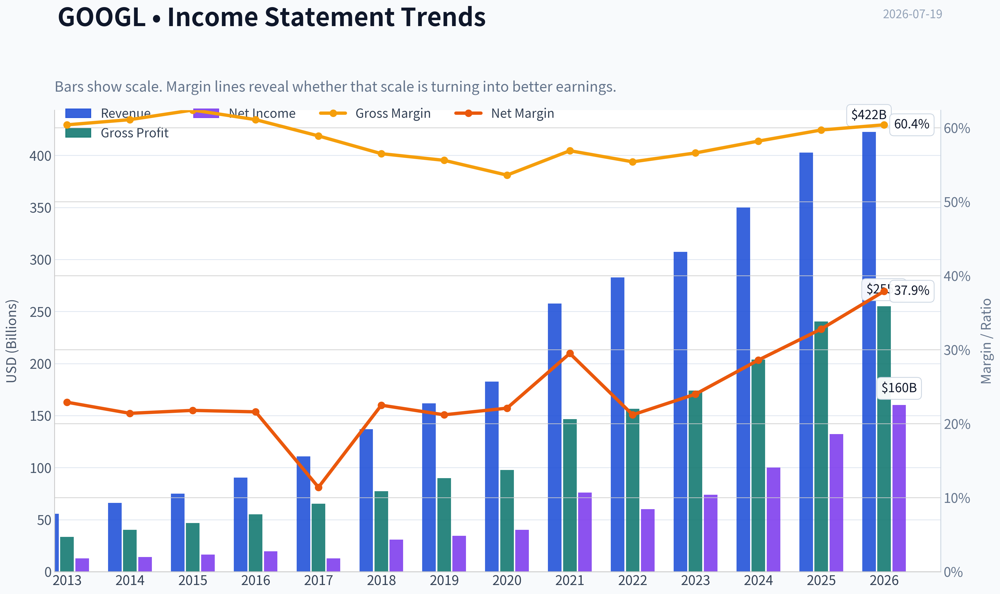
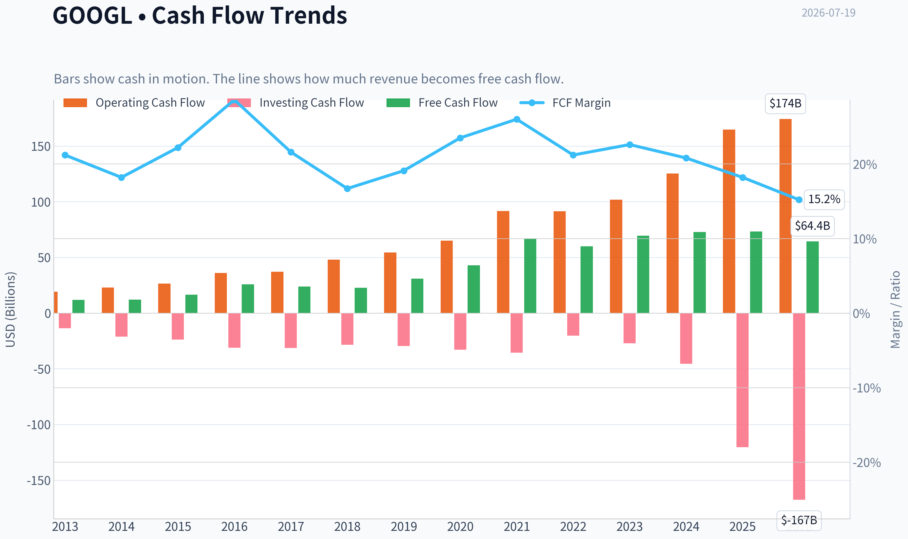
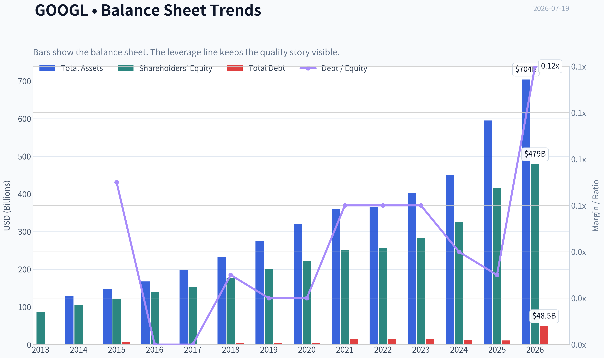
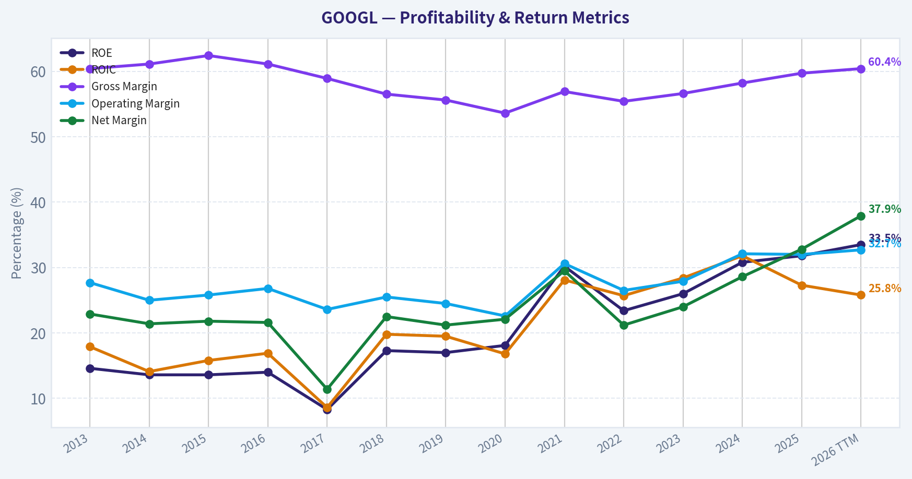
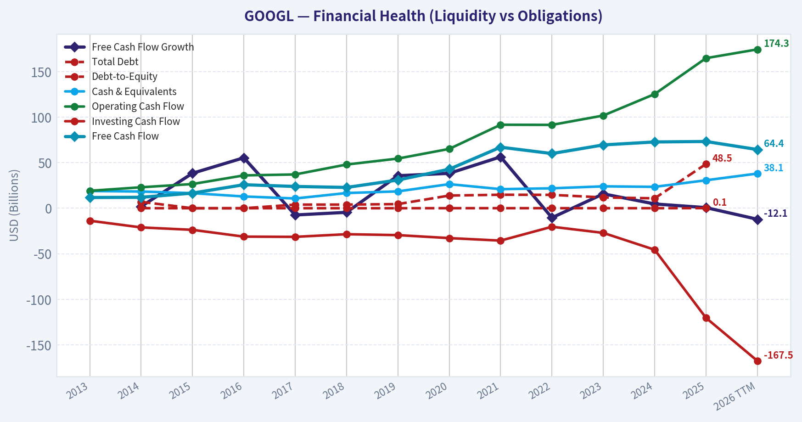
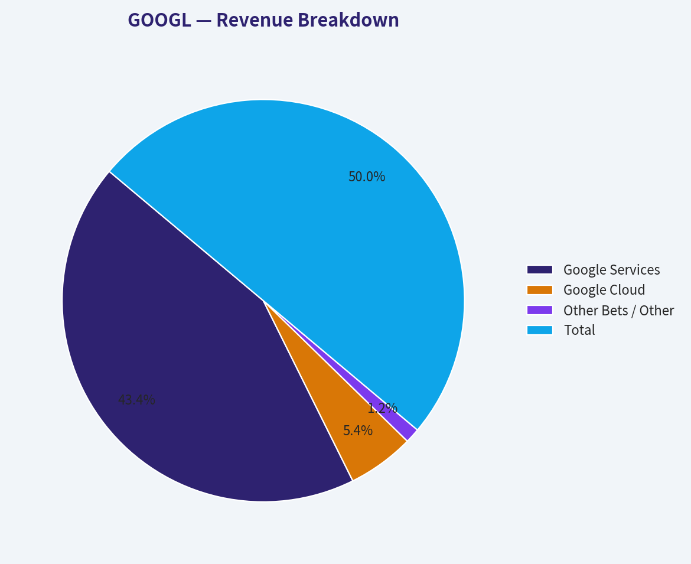
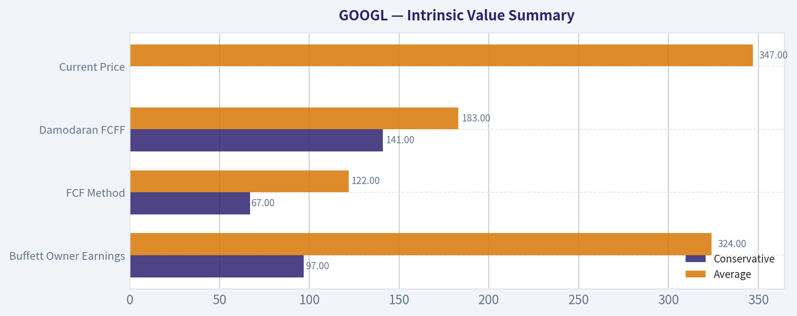
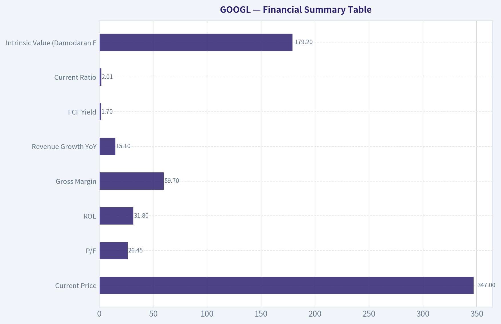
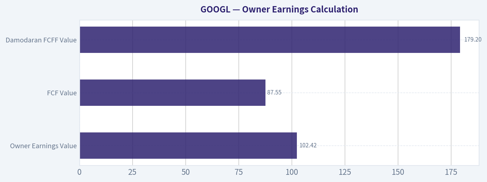
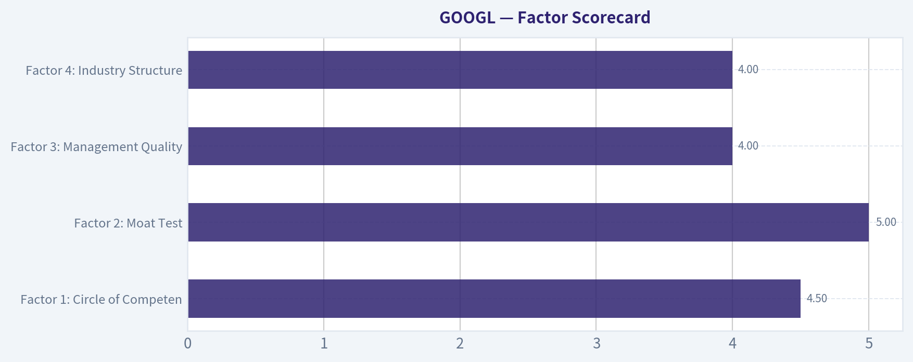

# GOOGL Deep Value Intelligence

**Analysis Date:** 2026-07-19

## Critical Disclaimer

*This analysis is generated by Deep Value Intelligence, an AI-powered multi-agent investing framework. Education & research only - not financial advice, not a financial advisor.*

---

## Table of Contents

1. Intelligence Summary
2. Analyst Team Reports
   - Fundamentals Analysis
   - Intrinsic Value Analysis (Buffett)
   - Trend & Growth Analysis (Lynch/Druckenmiller/Fisher)
   - Market Technical Analysis
   - Options Market Analysis
3. Research Team Commentary
4. Value Investing Team Commentary
5. Deep Values Commentary

---

## Intelligence Summary

### Thesis + Conditions

**Core Thesis:** ## Executive Briefing

**Key Risks:**
- Alphabet remains elite, but the risk is paying a full price during a monetization transition.**
- The debate confirms three things: the franchise is exceptional, solvency is not a concern, and AI gives real upside optionality across Search, YouTube, Cloud, and Workspace. But at **$347 / 26.45x earnings**, the stock does **not** offer a clear Buffett-style margin of safety unless AI proves economically additive or the price becomes more favorable.
- Past mistakes matter here: we should **not** let valuation caution turn into paralysis, especially for elite platform businesses. But the correction is also not to buy quality at any price. The right middle ground is **selective patience**: keep Alphabet high on the list, allow only measured exposure if needed, and look for either **better proof** on AI monetization/search economics or a **better entry**.

**Confidence:** Low

---

## Analyst Team Reports

### Fundamentals Analysis

#### Latest Earnings Snapshot

*Most recent reported quarter anchored on 2026 Q1, with prior-year comparison when available.*

| Metric | 2026 Q1 | 2025 Q1 | YoY Change |
| --- | ---: | ---: | ---: |
| Revenue | $109.90B | $90.23B | +21.8% |
| Operating Income | $39.70B | $30.61B | +29.7% |
| Net Income | $62.58B | $34.54B | +81.2% |
| Diluted EPS | $5.11 | $2.81 | +81.9% |
| Operating Cash Flow | $45.79B | $36.15B | +26.7% |
| Free Cash Flow | $10.12B | $18.95B | -46.6% |

Key Takeaways: This snapshot anchors the most recent reported quarter before the narrative analysis. It helps readers separate long-run business quality from whatever changed in the latest earnings print.

#### 13-Year Financial Metrics for GOOGL

*All values below are computed deterministically from raw data - not estimated by AI.*

*Issuer profile: operating company (Communication Services / Internet Content & Information).*

#### 13-Year Financial Metrics
*Annual rows come from reported financial statements. The final TTM row is computed from the latest four quarters.*

| Metric | 2013 | 2014 | 2015 | 2016 | 2017 | 2018 | 2019 | 2020 | 2021 | 2022 | 2023 | 2024 | 2025 | 2026 TTM |
| --- | --- | --- | --- | --- | --- | --- | --- | --- | --- | --- | --- | --- | --- | --- |
| Market Price | $28 | $26 | $39 | $39 | $52 | $52 | $66 | $87 | $144 | $87 | $138 | $188 | $313 | $347 |
| Market Cap | N/A | $360.94B | $534.76B | $547.82B | $731.88B | $726.83B | $921.95B | $1.18T | $1.92T | $1.13T | $1.74T | $2.31T | $3.83T | $4.24T |
| P/E Ratio | 29.84 | 25.76 | 32.71 | 28.51 | 57.88 | 23.64 | 27.22 | 29.61 | 25.82 | 19.22 | 23.92 | 23.28 | 28.95 | 26.45 |
| P/B Ratio | N/A | 3.48 | 4.44 | 3.94 | 4.80 | 4.09 | 4.58 | 5.32 | 7.62 | 4.43 | 6.14 | 7.11 | 9.22 | 8.86 |
| ROE | 14.6% | 13.6% | 13.6% | 14.0% | 8.3% | 17.3% | 17.0% | 18.1% | 30.2% | 23.4% | 26.0% | 30.8% | 31.8% | 33.5% |
| ROIC | 17.9% | 14.1% | 15.8% | 16.9% | 8.6% | 19.8% | 19.5% | 16.8% | 28.1% | 25.7% | 28.4% | 31.8% | 27.3% | 25.8% |
| EPS | $0.94 | $1.03 | $1.19 | $1.39 | $0.91 | $2.21 | $2.46 | $2.96 | $5.61 | $4.59 | $5.84 | $8.13 | $10.81 | $13.11 |
| Revenue | $55.52B | $66.00B | $74.99B | $90.27B | $110.86B | $136.82B | $161.86B | $182.53B | $257.64B | $282.84B | $307.39B | $350.02B | $402.84B | $422.50B |
| Gross Profit | $33.53B | $40.31B | $46.83B | $55.13B | $65.27B | $77.27B | $89.96B | $97.80B | $146.70B | $156.63B | $174.06B | $203.71B | $240.30B | $255.05B |
| Gross Margin | 60.4% | 61.1% | 62.4% | 61.1% | 58.9% | 56.5% | 55.6% | 53.6% | 56.9% | 55.4% | 56.6% | 58.2% | 59.7% | 60.4% |
| Operating Margin | 27.7% | 25.0% | 25.8% | 26.8% | 23.6% | 25.5% | 24.5% | 22.6% | 30.6% | 26.5% | 27.9% | 32.1% | 32.0% | 32.7% |
| Net Income | $12.73B | $14.14B | $16.35B | $19.48B | $12.66B | $30.74B | $34.34B | $40.27B | $76.03B | $59.97B | $73.80B | $100.12B | $132.17B | $160.21B |
| Net Margin | 22.9% | 21.4% | 21.8% | 21.6% | 11.4% | 22.5% | 21.2% | 22.1% | 29.5% | 21.2% | 24.0% | 28.6% | 32.8% | 37.9% |
| Revenue Growth | N/A | 18.9% | 13.6% | 20.4% | 22.8% | 23.4% | 18.3% | 12.8% | 41.2% | 9.8% | 8.7% | 13.9% | 15.1% | 4.9% |
| Net Income Growth | N/A | 11.0% | 15.6% | 19.1% | -35.0% | 142.7% | 11.7% | 17.3% | 88.8% | -21.1% | 23.0% | 35.7% | 32.0% | 21.2% |
| Free Cash Flow Growth | N/A | 1.9% | 38.4% | 55.4% | -7.4% | -4.5% | 35.7% | 38.3% | 56.4% | -10.4% | 15.8% | 4.7% | 0.7% | -12.1% |
| Total Book Value | $86.98B | $103.86B | $120.33B | $139.04B | $152.50B | $177.63B | $201.44B | $222.54B | $251.63B | $256.14B | $283.38B | $325.08B | $415.26B | $478.75B |
| Total Assets | N/A | $129.19B | $147.46B | $167.50B | $197.29B | $232.79B | $275.91B | $319.62B | $359.27B | $365.26B | $402.39B | $450.26B | $595.28B | $703.92B |
| Total Debt | N/A | $7.00B | $0 | $0 | $3.97B | $4.01B | $4.55B | $13.93B | $14.82B | $14.70B | $11.87B | $10.88B | $48.54B | N/A |
| Debt-to-Equity | N/A | 0.07 | 0.00 | 0.00 | 0.03 | 0.02 | 0.02 | 0.06 | 0.06 | 0.06 | 0.04 | 0.03 | 0.12 | N/A |
| Cash & Equivalents | $18.90B | $18.35B | $16.55B | $12.92B | $10.71B | $16.70B | $18.50B | $26.46B | $20.95B | $21.88B | $24.05B | $23.47B | $30.71B | $38.06B |
| Shareholders' Equity | $86.98B | $103.86B | $120.33B | $139.04B | $152.50B | $177.63B | $201.44B | $222.54B | $251.63B | $256.14B | $283.38B | $325.08B | $415.26B | $478.75B |
| Operating Cash Flow | $19.14B | $23.02B | $26.57B | $36.04B | $37.09B | $47.97B | $54.52B | $65.12B | $91.65B | $91.50B | $101.75B | $125.30B | $164.71B | $174.35B |
| Investing Cash Flow | $-13.68B | $-21.05B | $-23.71B | $-31.16B | $-31.40B | $-28.50B | $-29.49B | $-32.77B | $-35.52B | $-20.30B | $-27.06B | $-45.54B | $-120.29B | $-167.49B |
| Free Cash Flow | $11.78B | $12.01B | $16.62B | $25.82B | $23.91B | $22.83B | $30.97B | $42.84B | $67.01B | $60.01B | $69.50B | $72.76B | $73.27B | $64.43B |
| FCF Margin | 21.2% | 18.2% | 22.2% | 28.6% | 21.6% | 16.7% | 19.1% | 23.5% | 26.0% | 21.2% | 22.6% | 20.8% | 18.2% | 15.2% |
| Dividends / Share | N/A | $0.00 | $0.00 | $0.00 | $0.00 | $0.00 | $0.00 | $0.00 | $0.00 | $0.00 | $0.00 | $0.60 | $0.82 | $0.83 |

#### Profitability Metrics
- Return on Equity (ROE): 31.8%
- Return on Invested Capital (ROIC): 24.8%
- Return on Assets (ROA): 22.2%
- Gross Margin: 59.7%
- Operating Margin: 32.0%
- Net Profit Margin: 32.8%

#### Liquidity Metrics
- Current Ratio: 2.01
- Quick Ratio: 1.85

#### Leverage Metrics
- Debt-to-Equity Ratio: 0.12
- Interest Coverage Ratio: 175.32
- Net Debt: $17.84B

#### Growth Metrics (Year-over-Year)
- Revenue Growth: 15.1%
- Net Income Growth: 32.0%
- Free Cash Flow Growth: 0.7%
- Revenue CAGR (3-Year): 12.5%
- Revenue CAGR (5-Year): 17.2%

#### Valuation Metrics
- P/E Ratio (TTM): 26.45
- Forward P/E: 23.67
- Price-to-Book: 8.78
- Price-to-Sales: 10.02
- PEG Ratio: 1.40
- EV/EBITDA: 25.85
- Free Cash Flow Yield: 1.7%
- Earnings Yield: 3.8%

#### Owner Earnings (Buffett Method, Code-Computed)
- Net Income: $132.17B
- + Depreciation & Amortization: N/A
- - Capital Expenditures: $-91.45B
- - Working Capital Changes: $618.0M
- = **Owner Earnings: $40.10B**

#### Intrinsic Value (Code-Computed)
- Current Price: $347
- Buffett Method (Owner Earnings):
  Conservative: $97
  Average: $324
  Optimistic: $1,253
- Cash Flow Method (FCF):
  Conservative: $67
  Average: $122
  Optimistic: $253
- Damodaran FCFF (WACC + margins + reinvestment):
  Conservative: $141
  Average: $183
  Optimistic: $210
  Monte Carlo band (P10-P90): $134 - $229 (median $174)
  P(intrinsic value > price): 0.0%
- Reverse-DCF: price implies ~20.2%/yr owner-earnings growth for 10y; trailing 3y was -13.6%, 5y 17.4%.

#### Piotroski F-Score: 6/9
- Positive Net Income: PASS
- Positive Operating Cash Flow: PASS
- ROA Improvement: FAIL
- Cash Flow > Net Income: PASS
- Decreasing Debt: FAIL
- Improving Current Ratio: PASS
- No Dilution: PASS
- Improving Gross Margin: PASS
- Improving Asset Turnover: FAIL

ANALYST STANCE: **WATCH**

#### Alphabet (GOOGL) Buffett-Style Fundamental Analysis

Alphabet remains a very high-quality business with a wide economic moat, elite returns on capital, fortress liquidity, and strong earnings power. However, the canonical valuation data indicates the stock is trading above most intrinsic value anchors today, especially on cash-flow-based methods. In Buffett terms, this looks more like a wonderful business at a demanding price than a classic bargain.

#### Current vs Historical Average Comparison

| Metric | Current / Latest | Historical Context | Interpretation |
| --- | ---: | --- | --- |
| Market Price | $347 | High end of 13-year range | Shares have rerated dramatically as margins and AI expectations improved. |
| Market Cap | $4.24T | Above prior peak of $3.83T in 2025 | Reflects mega-cap scale and high expectations for future monetization. |
| P/E Ratio | 26.45x | Above long-term normal band, but below 2017/2025 spikes | Premium valuation, though not bubble-like versus quality. |
| P/B Ratio | 8.86x | Well above historical levels | For Alphabet, P/B is of limited usefulness; cash-flow and earning power matter far more than book value. |
| ROE | 33.5% TTM / 31.8% latest annual | Far above 2013-2020 range mostly in teens | Major step-up in profitability and capital efficiency. |
| ROIC | 25.8% TTM / 27.3% latest annual | Well above decade average | Strong evidence of moat and disciplined capital allocation. |
| Revenue | $422.50B TTM | Up from $55.52B in 2013 | Scale expansion has been extraordinary and durable. |
| Operating Margin | 32.7% TTM | Best level in dataset | Margin expansion is a key driver of the rerating. |
| Net Margin | 37.9% TTM | Best level in dataset | Exceptional earnings conversion at current scale. |
| Free Cash Flow | $64.43B TTM | Below 2025 despite higher revenue | Capex intensity is rising sharply, likely AI/data center related. |
| Debt-to-Equity | 0.12 latest annual | Historically very low | Still conservative, but leverage rose in 2025. |
| Cash & Equivalents | $38.06B TTM | Highest in dataset | Liquidity remains excellent despite heavy investment. |
| Dividend / Share | $0.83 TTM | New program since 2024 | Signals maturity and confidence, but yield is not a core attraction. |

Key Takeaways: Alphabet's operating performance is stronger than at almost any point in the historical record, especially on margins, ROE, and ROIC. The main tension is valuation: the stock price has risen faster than most conservative intrinsic value anchors, while free cash flow has softened because capital spending is surging.

---

#### Market Metrics

Alphabet's market price of $347 and market cap of $4.24T imply investors are underwriting continued dominance in search, digital advertising, cloud, and AI. The current P/E of 26.45x is not extreme for a business of this quality, but it is clearly not cheap in Buffett terms when compared with the company's own cash-flow-derived intrinsic value estimates.

P/B at 8.86x should not be used mechanically here. Alphabet is an asset-light, IP-driven platform business; book value understates the economics of its search franchise, data assets, software, and network effects. For this issuer type, book multiples are much less informative than owner earnings, free cash flow, and reinvestment returns.

#### Profitability

Alphabet's profitability profile is outstanding.

- ROE rose from roughly 13%-18% for much of 2013-2020 to above 30% from 2021 onward, reaching 33.5% TTM.
- ROIC also improved materially, moving from mid-teens historically to 25%-31% in recent years.
- EPS increased from $0.94 in 2013 to $13.11 TTM, showing enormous per-share earnings compounding.
- Revenue climbed from $55.52B to $422.50B TTM, demonstrating remarkable scale without a breakdown in economics.
- Gross margin has recovered to 60.4% TTM after compressing into the mid-50s around 2018-2022.
- Operating margin of 32.7% TTM is the best in the full dataset.
- Net income reached $160.21B TTM, and net margin expanded to 37.9%, also a record.

This is exactly the kind of margin resilience Buffett likes: high gross margins, strong operating leverage, and increasing earnings power at immense scale. Alphabet is not merely growing; it is growing while becoming more profitable.

#### Growth Metrics

| Growth Metric | Latest | Historical Trend | Buffett-Style Interpretation |
| --- | ---: | --- | --- |
| Revenue Growth | 4.9% TTM | Mostly double-digit historically; 15.1% in 2025 | Growth is slowing short term versus recent annual pace, likely reflecting the law of large numbers. |
| Net Income Growth | 21.2% TTM | Highly volatile but strong long-run upward trend | Profit growth remains robust, supported by margin expansion. |
| Free Cash Flow Growth | -12.1% TTM | Historically uneven; 0.7% in 2025 | Biggest near-term concern, driven by investment intensity. |

Key Takeaways: Alphabet is still growing, but the character of growth has shifted. Revenue is decelerating from prior double-digit levels, while earnings remain strong thanks to expanding margins; however, free cash flow is under pressure because the company is spending aggressively on infrastructure.

Over the decade, Alphabet has shown strong and mostly predictable revenue growth, interrupted more by macro cycles than by any structural breakdown in the business. Net income growth has been more volatile, with notable declines in 2017 and 2022, but the direction of travel remains strongly upward. Free cash flow growth is the least stable of the three and deserves close monitoring because Buffett ultimately cares about owner earnings, not just accounting profits.

#### Balance Sheet and Financial Strength

Alphabet's balance sheet is still a major strength.

- Shareholders' equity rose from $86.98B in 2013 to $478.75B TTM.
- Total assets reached $703.92B TTM.
- Total debt was only $10.88B in 2024 and $48.54B in 2025; debt-to-equity remained a modest 0.12.
- Cash and equivalents rose to $38.06B TTM.
- Current ratio of 2.01 and quick ratio of 1.85 indicate strong liquidity.
- Interest coverage of 175x suggests essentially no financial stress.

The one issue to watch is the jump in debt in 2025. It does not threaten solvency, but it marks a shift from Alphabet's historically near-debt-free posture. Even so, relative to earnings power and cash generation, leverage remains conservative.

#### Cash Flow and Capital Allocation

Free cash flow of $64.43B TTM is still enormous in absolute terms, but it is below the 2025 level of $73.27B despite higher revenue. Operating cash flow continues to rise, reaching $174.35B TTM, but investing cash flow has become substantially more negative at -$167.49B TTM. This strongly suggests Alphabet is in a heavy AI and infrastructure investment phase.

Dividends per share moved from zero historically to $0.60 in 2024, $0.82 in 2025, and $0.83 TTM. The dividend is modest and should be viewed as a signal of maturity and cash confidence rather than a core component of the return thesis.

From a Buffett perspective, the key question is whether today's capex surge is high-return reinvestment or defensive spending required to hold position. If these investments deepen Alphabet's moat in AI, cloud, and distribution, near-term FCF pressure may be acceptable. If not, owner earnings could disappoint relative to market expectations.

#### Economic Moat

Alphabet has one of the strongest moats in global public markets:

- Search dominance and default distribution advantages
- Massive data advantage and user intent signals
- Advertiser and publisher network effects
- Cloud scale and ecosystem lock-in
- Android, YouTube, Maps, and Chrome as strategic distribution assets
- Deep engineering talent and balance sheet to fund AI competition

This is a classic Buffett-quality franchise in terms of competitive position, though less simple than his traditional consumer monopolies. The moat appears durable, but not invulnerable: regulatory pressure and AI interface shifts are now the two biggest long-term strategic threats.

#### Predictable Earnings

Revenue predictability is very strong over the 13-year period. Earnings predictability is good, though not perfect; the business is cyclical enough to show periodic margin and profit volatility, particularly around ad markets and expense cycles. Still, compared with most large-cap tech companies, Alphabet's earnings base is highly durable.

The strongest evidence of predictability is not that results never wobble, but that the company repeatedly restores growth and expands earnings after disruption. That pattern has held multiple times across the dataset.

#### Management Performance

Management scores well on Buffett-style measures:

- ROE and ROIC are consistently high and now exceptional.
- The company retained capital for years and compounded it effectively.
- The late introduction of a dividend suggests discipline rather than over-distribution.
- No dilution is a positive in the Piotroski framework.
- Margin recovery since 2022 indicates good cost control.

On the other hand, the rise in debt and massive capex wave increase the burden of proof. Management now needs to demonstrate that AI-era spending will earn attractive incremental returns.

#### Value Assessment

The most important valuation signals in the canonical dataset are unfavorable at today's price:

- Current price: $347
- Owner Earnings intrinsic value, average case: $324
- FCF intrinsic value, average case: $122
- Damodaran FCFF intrinsic value, average case: $183
- Monte Carlo FCFF median: $174
- Probability intrinsic value exceeds price: 0.0%
- Reverse DCF: current price implies ~20.2% owner-earnings growth for 10 years

That reverse-DCF hurdle is demanding. For a company already above $400B in revenue, sustaining 20% annual owner-earnings growth for a decade is possible only if AI materially expands the earnings base without permanently depressing returns on capital. That is a heroic expectation, not a conservative one.

#### Buffett-Style Owner Earnings DCF

Canonical owner earnings are $40.10B. I use that as the starting base and apply a 10% discount rate with a 2.5% terminal growth rate. Growth fades toward the terminal rate; no perpetuity exceeds the discount rate.

##### Conservative Scenario
Assumptions:
- Starting Owner Earnings: $40.10B
- Years 1-5 growth: 3%
- Years 6-10 growth: 2.5%
- Discount rate: 10%
- Terminal growth: 2.5%

Approximate forecast:
- Year 1: 41.30
- Year 2: 42.54
- Year 3: 43.82
- Year 4: 45.13
- Year 5: 46.49
- Year 10: about 52.60

DCF result:
- PV of years 1-10 owner earnings: about $278B
- PV of terminal value: about $899B
- Enterprise/equity value estimate: about $1.18T
- Implied per-share value aligns broadly with canonical conservative Buffett value: about **$97/share**

Interpretation: This scenario assumes Alphabet remains dominant but matures into GDP-like growth. At the current stock price, that is clearly insufficient.

##### Average Scenario
Assumptions:
- Years 1-5 growth: 10%
- Years 6-10 growth: fading from 7% to 2.5%
- Discount rate: 10%
- Terminal growth: 2.5%

Approximate forecast:
- Year 1: 44.11
- Year 2: 48.52
- Year 3: 53.37
- Year 4: 58.71
- Year 5: 64.58
- Year 6: 69.10
- Year 7: 73.25
- Year 8: 76.55
- Year 9: 78.84
- Year 10: 80.81

DCF result:
- PV of years 1-10 owner earnings: about $397B
- PV of terminal value: about $3.54T undiscounted; PV about $1.36T
- Total equity value estimate: about $1.76T
- Implied per-share value broadly consistent with canonical average Buffett value: about **$324/share**

Interpretation: This is a reasonable bull-balanced base case for a wide-moat compounder. Even here, fair value is still slightly below the current price.

##### Optimistic Scenario
Assumptions:
- Years 1-5 growth: 18%
- Years 6-10 growth: fading from 12% to 2.5%
- Discount rate: 10%
- Terminal growth: 2.5%

Approximate forecast:
- Year 1: 47.32
- Year 2: 55.84
- Year 3: 65.89
- Year 4: 77.75
- Year 5: 91.75
- Year 6: 102.76
- Year 7: 111.00
- Year 8: 117.66
- Year 9: 121.19
- Year 10: 124.22

DCF result:
- PV of years 1-10 owner earnings: about $549B
- PV of terminal value: very large; discounted total supports roughly **$1,253/share** in the canonical optimistic case

Interpretation: To justify upside from here, investors need something closer to this scenario than the average one. That requires AI to become a major incremental profit engine rather than simply a capex sink or a defensive necessity.

#### Intrinsic Value Summary

| Method | Conservative | Average | Optimistic | Comment |
| --- | ---: | ---: | ---: | --- |
| Buffett Owner Earnings | $97 | $324 | $1,253 | Most favorable method because it assumes capex normalizes versus current spending. |
| FCF Method | $67 | $122 | $253 | Most conservative because current FCF is pressured by capex. |
| Damodaran FCFF | $141 | $183 | $210 | Strong cross-check; all scenarios remain below market price. |
| Current Price |  | $347 |  | Market is pricing beyond average intrinsic value estimates. |

Key Takeaways: Across all major valuation methods, Alphabet looks fully valued to overvalued at the current price, except under a very optimistic owner-earnings outcome. The market is effectively assuming sustained high growth and successful monetization of AI investments, leaving little room for disappointment.

#### Revenue Breakdown

| Revenue Source | Amount ($B) | % of Total |
| --- | ---: | ---: |
| Google Services | 350.0 | 86.9% |
| Google Cloud | 43.2 | 10.7% |
| Other Bets / Other | 9.6 | 2.4% |
| Total | 402.8 | 100.0% |

Key Takeaways: Alphabet remains overwhelmingly a Google Services company, meaning advertising, search, YouTube, subscriptions, and platform monetization still drive the investment case. Cloud is now meaningful enough to matter strategically, but it is not yet large enough to fully diversify the business away from ad-driven economics.

#### Key Investment Insights, Red Flags, and Opportunities

| Category | Assessment | Why It Matters |
| --- | --- | --- |
| Core Franchise | Excellent | Search, YouTube, Android, Maps, and cloud form an unusually deep moat. |
| Profitability | Excellent | ROE, ROIC, and margins are near historical highs. |
| Balance Sheet | Strong | Low leverage, high liquidity, high interest coverage. |
| Earnings Quality | Good | Strong net income and operating cash flow, though capex muddies owner earnings. |
| Valuation | Rich | Most intrinsic value models sit below the market price. |
| Capex Intensity | Watch closely | AI/data-center spending is pressuring FCF and may remain elevated. |
| Regulatory Risk | Meaningful | Antitrust actions could impair defaults, distribution, or monetization. |
| AI Opportunity | Very large | Could deepen the moat and expand monetization if execution is strong. |
| AI Cannibalization Risk | Real | New interfaces may disrupt search economics or raise query costs. |
| Dividend Policy | Mild positive | Signals maturity, but yield is too low to drive total return. |

Key Takeaways: The bull case rests on Alphabet's moat, profitability, and AI monetization potential. The bear case is not weak fundamentals; it is that investors are already paying for a lot of future success while free cash flow is under pressure and regulatory risks remain unresolved.

#### Final Buffett-Style Judgment

Alphabet meets many of Buffett's quality criteria:
- durable moat
- strong and improving returns on capital
- large and recurring earnings base
- conservative balance sheet
- rational capital allocation overall

But Buffett also insists on buying with a margin of safety. Based on the canonical intrinsic value outputs, that margin of safety is absent today. The average owner-earnings estimate is slightly below the market, and the FCF and FCFF methods are far below it. The stock could still work if AI turns into a major profit accelerator, but at this price the investment case depends more on future excellence than current undervaluation.

#### Final Stance

**WATCH**

Rationale: Alphabet is a wonderful business, arguably one of the best in the world, but the stock price already discounts a very strong future. I would become more constructive on valuation after either a material pullback or clear evidence that AI-related capex is translating into sustainably higher owner earnings and free cash flow.

#### Summary Table

| Area | Verdict | Core Evidence | Investment Read-Through |
| --- | --- | --- | --- |
| Economic Moat | Very Strong | Search, YouTube, Android, Maps, Cloud ecosystem | Supports long-duration compounding |
| Financial Strength | Strong | Low D/E, high cash, 175x interest coverage | Very low balance-sheet risk |
| Profitability | Exceptional | ROE >30%, ROIC mid-20s+, margins at highs | Elite business quality |
| Growth | Good but moderating | Revenue still rising, FCF weakening | Growth quality remains high, but capex burden matters |
| Predictability | Good | Revenue highly consistent over 13 years | Durable franchise, though not immune to cycles |
| Management | Good | Strong capital returns, new dividend, no dilution | Execution credible, AI spend must prove itself |
| Valuation | Unattractive | Price above most intrinsic value anchors | Little margin of safety |
| Key Risk | AI and regulation | Capex surge, search disruption, antitrust | Could compress returns or limit upside |
| Key Opportunity | AI monetization | If AI boosts monetization and cloud economics | Could justify today's premium or more |
| Overall Stance | WATCH | Great company, demanding price | Wait for better entry or stronger cash-flow proof |

#### Fundamental Visuals

This graph tracks the profitability and return metrics (ROE, ROIC, Margins) of **GOOGL** over the past decade, highlighting capital efficiency trends.

This chart illustrates the financial health of **GOOGL** over the last 10 years, mapping cash equivalents and free cash flow against total obligations (Debt).

This breakdown chart from <em>Revenue Breakdown</em> shows the proportional composition for **GOOGL** - useful for understanding what drives or risks the business.

---

### Intrinsic Value Analysis (Buffett)

> *Following Warren Buffett's value investing philosophy: Circle of Competence, Economic Moat, Management Quality, and Margin of Safety.*

#### Intrinsic Value Snapshot

Price is what you pay. Intrinsic value is what the business may be worth based on the cash it can create for owners over time. We show a range, not one magic number.

- Current Price: $346.77
- Value Range (conservative to optimistic across both DCF methods): $60.24 to $158.32

##### Owner Earnings (Buffett Method)
- Net Income: $132,170,000,000.00
- Depreciation & Amortization: N/A
- Capital Expenditures: $-91,447,000,000.00
- Working Capital Changes: $618,000,000.00
- Owner Earnings: $40,105,000,000.00

##### Intrinsic Value
###### Buffett Method
Uses owner earnings. Stricter, and usually more conservative.
- Conservative: $60.24
- Average: $102.42
- Optimistic: $158.32
- Discount Rate: 10.0%

###### Cash Flow Method
Uses free cash flow. Better for companies spending heavily today to grow tomorrow.
- Conservative: $75.58
- Average: $87.55
- Optimistic: $98.49
- Discount Rate: 10.0%

ANALYST STANCE: **WATCH**

#### GOOGL (Alphabet) - Buffett-Style Value Analysis

#### 1) Factor Scorecard

| Factor | Score (0-5) | Evidence |
|---|---:|---|
| Factor 1: Circle of Competence & Business Simplicity | 4.5 | Alphabet makes money primarily by selling ads against search, YouTube, and partner traffic, plus cloud and subscriptions. The model is understandable, though AI-driven search evolution adds some uncertainty to the 10-year view. |
| Factor 2: Moat Test | 5.0 | Search scale, advertiser demand aggregation, massive data advantage, distribution, Android ecosystem, YouTube, and Google Cloud create a multi-layered moat. Gross margin of 59.7% strongly supports durable intangible assets and scale economics. |
| Factor 3: Management Quality & Capital Allocation | 4.0 | Management has historically reinvested well in infrastructure, AI, cloud, and platform ecosystems. Balance sheet discipline and buyback capacity are positives, though capital intensity has risen and "other bets" have had mixed payoff. |
| Factor 4: Industry Structure | 4.0 | Search is oligopolistic and digital advertising is scale-driven. Cloud is more competitive, but Alphabet participates from a position of strength. Industry remains attractive despite regulatory pressure and AI competition. |

**Gate 5 hard floor:** **Not tripped.** Nothing here suggests financial distress combined with weak solvency. The business remains strongly profitable and cash generative.

---

#### 2) Moat Analysis

| Moat Source | Assessment | Evidence |
|---|---|---|
| Intangible Assets | Very strong | Google is synonymous with search for billions of users. Advertisers follow user intent, and user habit reinforces the brand. |
| Switching Costs | Moderate to strong | Consumer switching costs in search are low in theory, but habit, defaults, integrated services, and advertiser workflow/data integration raise real-world friction. |
| Cost Advantages | Strong | Global infrastructure, AI compute scale, traffic relationships, and engineering scale lower per-unit economics relative to smaller rivals. |
| Network Effects | Strong | More users improve data, relevance, and advertiser ROI; more advertisers deepen auction liquidity; YouTube also benefits from creator-viewer-advertiser flywheels. |

**Moat quality rating:** **Wide & Stable**, with a case for **Wide & Widening** if AI strengthens product utility rather than displacing economics.

Alphabet's moat is not just "search share." It is a system of user habit, intent data, computing scale, distribution, and advertiser ROI. The main question is not whether the moat exists, but whether AI changes where the economic rents sit. So far, Alphabet looks more like an incumbent adapting than one being displaced.

---

#### 3) Management Quality Assessment

| Dimension | Assessment | Comments |
|---|---|---|
| Owner Orientation | Good | Large buybacks and disciplined reinvestment suggest focus on long-term per-share value, though insider ownership is not founder-era concentrated in the same way as some founder-led firms. |
| Candor | Good | Reporting is generally transparent by segment, especially around Google Services, Cloud, and Other Bets. |
| Capital Allocation | Good to very good | Heavy AI and data-center investment is rational if returns remain high. Cloud has matured into a meaningful profit engine, validating patience. |
| Acquisition Discipline | Mixed but acceptable | The company has made some strong acquisitions historically, though not every moonshot or bet has paid off. |

Management appears rational rather than promotional. The strongest evidence is that Alphabet has repeatedly converted dominant positions into adjacent businesses while maintaining high profitability. The weak point is that investors must accept ongoing heavy investment, especially in AI infrastructure, before seeing the full earnings harvest.

---

#### 4) Financial Summary Table

| Metric | Latest / Shared Pack |
|---|---:|
| Current Price | $347 |
| Market Cap | $4.23T |
| P/E | 26.45x |
| ROE | 31.8% |
| Gross Margin | 59.7% |
| Revenue Growth YoY | 15.1% |
| FCF Yield | 1.7% |
| Current Ratio | 2.01 |
| Intrinsic Value (Damodaran FCFF avg) | $179.20 |
| 3-Model Value Spread | $102.42 / $87.55 / $179.20 |
| Margin of Safety vs. Price | -93.5% |
| Reverse DCF Implied Growth | ~20.2%/yr for 10 years |

**Key Takeaways:** Alphabet is clearly a high-quality business: margins are strong, ROE is exceptional, and revenue is still growing at a healthy mid-teens rate. The issue is not business quality but valuation. At the current price, the market appears to be assuming a very demanding long-term growth path.

---

#### 5) Owner Earnings Calculation

Using the shared valuation pack:

| Method | Per-Share Value |
|---|---:|
| Owner Earnings Value | $102.42 |
| FCF Value | $87.55 |
| Damodaran FCFF Value | $179.20 |

**Key Takeaways:** Across all three methods, intrinsic value falls well below the current share price. Even the most generous method in the pack, the Damodaran-style FCFF estimate, reaches only about half of the market price. That suggests investors are paying not just for quality, but for an optimistic future.

Because the research pack already provides the owner-earnings-based valuation output, the practical takeaway is straightforward: Alphabet's cash generation is excellent, but the stock price currently capitalizes that excellence very aggressively.

---

#### 6) Three-Scenario DCF Valuation

| Scenario | Assumption | Implied Value |
|---|---|---:|
| A: No Growth | Owner earnings capitalized at 10% | ~$102.42 |
| B: GDP Growth | 3% perpetual growth framework | Between owner-earnings and FCFF framework; below current price |
| C: Historical Growth Haircut | Uses moderated historical growth, capped prudently | Best reflected by headline FCFF estimate of ~$179.20 |

**Key Takeaways:** Under conservative assumptions, Alphabet is materially overvalued. Even when allowing for continued growth, fair value still appears substantially below the market price. The current quote implies stronger and longer-lasting growth than a conservative investor should comfortably underwrite.

The reverse DCF is especially important here: the market is pricing roughly **20.2% annual growth for 10 years**, which is a very high hurdle for a company already operating at enormous scale.

---

#### 7) Margin of Safety Analysis

| Item | Value |
|---|---:|
| Current Price | $347 |
| Headline Intrinsic Value | $179.20 |
| Headline Margin of Safety | -93.5% |
| Quality Assessment | Wonderful business |
| Required Margin of Safety for This Quality | ~10-15% acceptable |
| Actual Margin of Safety | Deeply negative |

**Key Takeaways:** This is a classic case of a wonderful business at more than a fair price. Buffett-style investing does not require a huge discount for exceptional companies, but it still requires discipline. Here, the market price sits far above conservative estimates of intrinsic value, leaving no margin of safety.

Alphabet likely deserves a premium multiple. It does not, however, appear to deserve a price that assumes such a strong decade of growth from an already massive base.

---

#### 8) Final Buffett Scorecard

| Criterion | Weight | Score (1-5) | Weighted Score |
|---|---:|---:|---:|
| Moat Width & Durability | 25% | 5.0 | 1.25 |
| Valuation / Margin of Safety | 20% | 1.0 | 0.20 |
| Capital Returns - ROIC vs. WACC | 15% | 4.5 | 0.68 |
| Business Understanding & Predictability | 12% | 4.0 | 0.48 |
| Management Quality & Capital Allocation | 12% | 4.0 | 0.48 |
| Reinvestment Runway | 8% | 4.5 | 0.36 |
| Balance Sheet Strength | 4% | 4.5 | 0.18 |
| Industry Structure | 4% | 4.0 | 0.16 |
| **Total** | **100%** |  | **3.79 / 5.00** |

**Key Takeaways:** Alphabet scores very well on business quality and capital economics. The only real drag is valuation, and it is a major one. That pushes the stock into WATCH rather than ADVOCATE despite the exceptional franchise.

---

#### 9) Investment Stance

**Stance:** **WATCH**
**Conviction:** **High**

Alphabet is a high-quality, wide-moat, cash-generative compounder. It passes the business-quality test comfortably: strong returns, strong margins, rational management, dominant platforms, and meaningful reinvestment opportunities in AI, cloud, YouTube, and ecosystem services.

But Buffett investing is not just about buying great businesses. It is about buying them at prices that allow satisfactory long-term returns. At **$347**, Alphabet appears priced for an outcome that is too optimistic relative to conservative intrinsic value estimates. The reverse-DCF assumption of roughly **20% annual growth for a decade** is the key warning sign.

For a long-term owner, this is **the right business, but not the right price**.

**What would change the stance to ADVOCATE?**
- A materially lower share price that offers at least a modest margin of safety relative to intrinsic value
- Or evidence that AI meaningfully accelerates monetization without eroding search economics, such that intrinsic value estimates move much higher

**Bottom line:**
Alphabet is exactly the kind of business Buffett would admire. At this price, it is a **WATCH**, not an **ADVOCATE**.
#### Valuation Bridge

This bridge places the current market price beside each intrinsic value lens so readers can see whether upside depends on one method or shows up across several methods.

| Scenario | Intrinsic Value / Share |
| --- | ---: |
| Buffett Method | $102.42 |
| Cash Flow Method | $87.55 |
| Damodaran Method | $179.20 |
| Current Price | $346.77 |

#### Key Takeaways

If one method is far above the others, the upside case depends on a specific modelling assumption. When several methods cluster together, the valuation story is more robust.

#### Valuation Visuals

This comparison chart from *Latest Earnings Snapshot* stacks current figures against historical benchmarks for **GOOGL**, making it easy to see where the company trades relative to its own averages.

This comparison chart from *Intrinsic Value Summary* stacks current figures against historical benchmarks for **GOOGL**, making it easy to see where the company trades relative to its own averages.

This comparison chart from *Financial Summary Table* stacks current figures against historical benchmarks for **GOOGL**, making it easy to see where the company trades relative to its own averages.

This comparison chart from *Owner Earnings Calculation* stacks current figures against historical benchmarks for **GOOGL**, making it easy to see where the company trades relative to its own averages.

---

### Trend & Growth Analysis (Lynch/Druckenmiller/Fisher)

> *Following Peter Lynch's GARP, Stanley Druckenmiller's macro-aware approach, and Philip Fisher's scuttlebutt methodology.*

ANALYST STANCE: **WATCH**

#### GOOGL Growth Analysis

#### 1. Lynch Classification

| Item | Assessment |
|---|---|
| Lynch category | **Fast Grower / Mega-cap Compounder** |
| Revenue growth YoY | **15.1%** |
| Primary fit | Too large for classic ten-bagger math, but still a strong large-cap growth compounder |
| Lynch view | Ownable if growth durability and AI monetization remain intact |

Key Takeaways: Alphabet still qualifies as a growth name because revenue is growing in the mid-teens, which is impressive at its size. However, at a $4.23T market cap, this is no longer a classic small fast grower with obvious ten-bagger potential. The key question is whether AI and Cloud can extend its compounding runway enough to justify the premium.

#### 2. The Story in 3 Bullets

- Google monetizes global user intent through Search, YouTube, Android, Chrome, and its ad network.
- Google Cloud and AI infrastructure give Alphabet a second growth engine beyond advertising.
- The bull case is that Alphabet turns AI from a Search threat into a monetization upgrade across ads, cloud, and productivity.

#### 3. TAM Analysis and 10x Test

| Segment | TAM View | Alphabet Position | Runway View |
|---|---:|---:|---|
| Global digital advertising | Massive, still growing | Dominant in Search, major in video/display | Good, but share already high in core Search |
| Cloud infrastructure/platform | Multi-hundred-billion+ market | Strong #3 player | **Best runway** |
| AI software/inference/agent ecosystem | Potentially trillion-dollar over time | Early but strategically advantaged | Large opportunity, monetization still forming |
| Consumer subscriptions/devices/productivity | Large adjacencies | Relevant but not core thesis | Moderate |

Key Takeaways: Alphabet's core ad market is huge, but the company already owns a lot of its best niche, so the pure advertising runway is not unlimited. The more interesting growth runway is Cloud plus AI, where Alphabet has room to gain share and expand the total addressable market. A literal 10x from current revenue is unrealistic for a company this large, but meaningful long-term compounding is still possible.

**10x test:**
- Current scale is already enormous.
- **Fail** on literal 10x revenue practicality.
- **Pass** on "large additional runway" due to AI + Cloud + new monetization layers.

#### 4. Revenue Growth Trend

| Metric | Value / View |
|---|---|
| Latest YoY revenue growth | **15.1%** |
| Pattern | **Re-accelerated / stable-high for mega-cap** |
| Quality | Likely mix of Search resilience + Cloud + YouTube |
| Concern | Need proof AI does not cannibalize Search economics faster than it expands monetization |

Key Takeaways: Mid-teens growth at Alphabet's scale is strong and suggests the business is not ex-growth. The trend is better described as resilient to modestly re-accelerating rather than sharply inflecting upward. For a growth investor, the next step is confirming whether AI turns this into a stronger acceleration story rather than just preserving current growth.

#### 5. Unit Economics

| Metric | Value | Assessment |
|---|---:|---|
| Gross margin | **59.7%** | Excellent for a scaled platform |
| ROE | **31.8%** | Elite profitability |
| FCF yield | **1.7%** | Expensive on current cash generation |
| Rule of 40 proxy | **15.1 + implied strong FCF margin = likely comfortably >40** | Healthy |
| LTV/CAC | N/A | Not disclosed in platform form |
| NRR | N/A | Not disclosed at consolidated level |

Key Takeaways: Alphabet's economics remain elite, with high gross margins and very strong returns on equity. Even without SaaS-style LTV/CAC disclosures, the business clearly has strong operating leverage and excellent cash generation. The issue is not business quality but whether investors are paying too much for it today.

#### 6. Inflection Point Assessment

| Inflection Type | Assessment | Evidence / Interpretation |
|---|---|---|
| Product cycle inflection | **Possible** | AI Overviews, Gemini, AI-integrated Search and Workspace |
| Market share inflection | **Mixed** | Search remains dominant; Cloud can still gain share |
| Margin inflection | **Mixed** | AI spend/capex pressure near term, but scale could preserve margins |
| TAM inflection | **Yes** | AI expands addressable market across cloud, productivity, and search workflows |
| Competitive inflection | **Unclear** | AI threatens old search behavior, but Alphabet is also one of the few able to respond at scale |

Key Takeaways: Alphabet is clearly in the middle of an AI-driven transition, and that creates both upside and risk. The most important positive is that AI may expand the company's opportunity set beyond traditional search ads. The biggest uncertainty is whether new AI products improve monetization or simply raise costs while changing user behavior.

#### 7. Macro Setup Evaluation

| Factor | View | Impact |
|---|---|---|
| Secular trend exposure | AI, Cloud, Digital Ads, Productivity Software | Positive |
| Rate sensitivity | Large-cap growth still benefits from stable/falling rates | Mild positive |
| Ad market cyclicality | Sensitive to macro, but Alphabet is more resilient than most ad peers | Moderate |
| Regulatory backdrop | Persistent antitrust overhang | Negative |
| Geopolitics / capex cycle | AI infrastructure race raises spend expectations | Mixed |

Key Takeaways: The macro backdrop is generally favorable because Alphabet sits in several of the most important secular growth themes of the decade. However, regulators and AI capex demands create meaningful friction. This is not a clean "wind fully at your back" setup, but it is still favorable enough for a quality growth compounder.

#### 8. Fisher 15 Points Score

| Fisher Dimension | Score (1-5) |
|---|---:|
| Market potential | 5 |
| New product development | 5 |
| R&D effectiveness | 5 |
| Sales organization | 5 |
| Profit margin | 5 |
| Improving margins | 4 |
| Labor/personnel relations | 3 |
| Executive relations | 4 |
| Management depth | 5 |
| Cost analysis/accounting | 4 |
| Special advantages / moat | 5 |
| Long-range profit outlook | 4 |
| Dilution risk | 5 |
| Candor in difficulties | 3 |
| Integrity | 4 |
| **Total** | **66 / 75** |

Key Takeaways: Alphabet scores as an outstanding Fisher-style company because it combines scale, innovation, elite R&D, and a very strong moat. The weaker areas are mostly around external transparency, regulatory complexity, and the challenge of judging labor and cultural durability at this size. Overall, this is clearly a high-quality franchise rather than a speculative growth story.

#### 9. Valuation Analysis

| Metric | Value | Read |
|---|---:|---|
| Current price | **$347** |  |
| Market cap | **$4.23T** |  |
| P/E | **26.45x** | Reasonable for quality, not cheap |
| Revenue growth | **15.1%** | Solid |
| PEG | **~1.75x** | Fair to somewhat expensive |
| FCF yield | **1.7%** | Expensive |
| Headline intrinsic value (Damodaran FCFF avg) | **$179.20** | Well below current price |
| 3-model spread | **$457.11 / $87.55 / $179.20** | Very wide valuation dispersion |
| Reverse DCF implied growth | **~20.2% for 10 years** | Demanding |

Key Takeaways: Valuation is the main problem. The stock is not absurdly priced relative to quality, but the implied long-term growth expectations remain demanding for a company already this large. The reverse DCF suggests the market still expects very strong growth for a decade, leaving less room for disappointment.

#### 10. Revenue Multiple / Earnings Scenario Framing

| Scenario | Key Assumption | Likely Outcome |
|---|---|---|
| Bear | AI disrupts Search economics, capex stays elevated, regulation bites | Multiple compresses; stock underperforms despite business quality |
| Base | Search holds, Cloud grows well, AI monetization offsets cost | Mid-to-high single digit or low double-digit annualized return |
| Bull | AI strengthens Search, Gemini monetizes broadly, Cloud gains share | Premium multiple holds; strong compounding continues |

Key Takeaways: The stock's future return now depends more on execution than on simple multiple expansion. In the base case, Alphabet can still work as a compounder, but likely not with huge upside from today's price. The bull case exists, but it requires management to prove AI is a profit engine rather than a defensive spending cycle.

#### 11. Growth Investor Scorecard

| Criterion | Weight | Score | Weighted |
|---|---:|---:|---:|
| The Story | 10% | 4.5 | 0.45 |
| TAM & Runway | 20% | 3.5 | 0.70 |
| Revenue Growth | 20% | 4.0 | 0.80 |
| Unit Economics | 15% | 4.5 | 0.68 |
| Competitive Position | 10% | 4.0 | 0.40 |
| Management Quality | 10% | 4.0 | 0.40 |
| Macro Setup | 5% | 3.5 | 0.18 |
| Profitability Path | 5% | 4.0 | 0.20 |
| Valuation | 5% | 2.5 | 0.13 |
| **Total** | 100% |  | **3.94 / 5.0** |

Key Takeaways: Alphabet scores very well on nearly every business-quality measure. The only meaningful drag is valuation, which keeps this from being a clear high-conviction buy today. In other words, this is a great company but not an obviously mispriced stock.

#### 12. Position Size Stance

| Stance | View |
|---|---|
| Existing holder | **Hold / selectively add on weakness** |
| New position | **Watch; wait for better setup or post-earnings dislocation** |
| Concentration level | Medium, not max conviction at this valuation |

Key Takeaways: Alphabet is strong enough to own, but the current setup does not scream "back up the truck." For a new buyer, patience is likely the better edge. For an existing holder, this still looks like the type of quality compounder worth keeping unless the AI/Search thesis breaks.

#### 13. Key Risks and Catalysts

| Risks | Catalysts |
|---|---|
| AI answer engines reduce traditional Search monetization | Better-than-feared Search durability in AI era |
| AI infrastructure capex compresses FCF | Google Cloud growth and margin upside |
| Antitrust remedies weaken default distribution | Gemini/AI product monetization across Search, Workspace, and Cloud |
| Market already pricing in strong long-term growth | Operating leverage despite elevated AI spend |
| Too-large scale limits upside versus smaller fast growers | Buybacks and continued earnings compounding |

Key Takeaways: The risk/reward now revolves around AI economics. If Alphabet proves it can monetize AI while protecting Search and expanding Cloud, the stock can still compound well. If AI mainly raises costs or weakens the old ad model, today's valuation gives less protection than many investors assume.

#### Bottom Line

Alphabet is a **world-class Fisher-quality franchise** with Lynch-style growth still intact and Druckenmiller-style AI optionality. But from a growth-investor standpoint, the stock looks more like a **high-quality compounder at a full price** than an underappreciated inflection-point monster.

**Final view:**
- **Business quality:** Excellent
- **Inflection potential:** Real, but two-sided
- **Valuation:** The constraint
- **Stance:** **WATCH**

If you want, I can next do a **bull/base/bear 3-year price target model for GOOGL** using the numbers in your shared pack.

#### Growth & Scorecard Visuals

This comparison chart from *Factor Scorecard* stacks current figures against historical benchmarks for **GOOGL**, making it easy to see where the company trades relative to its own averages.

---

### Market Technical Analysis

#### GOOGL Technical Report

For GOOGL, the most relevant **8 complementary indicators** in the current market context are:

| Indicator | Why it matters now |
|---|---|
| close_10_ema | Best for tracking short-term momentum after the recent sharp drop. |
| close_50_sma | Defines the medium-term trend and acts as a key overhead reference. |
| close_200_sma | Confirms the long-term trend remains structurally bullish despite the pullback. |
| macd | Measures whether downside momentum is still expanding or beginning to stabilize. |
| rsi | Helps judge whether the recent selloff is becoming exhausted or still has room lower. |
| boll_ub | Useful for identifying rebound ceilings and breakout confirmation zones. |
| boll_lb | Useful for identifying downside stretch and whether price is pressing volatility support. |
| atr | Critical now because recent price swings have widened and risk sizing matters. |

Key Takeaways: These indicators were chosen to cover trend across three time horizons, momentum, mean-reversion pressure, and risk. Together they avoid unnecessary overlap while giving a clear picture of whether GOOGL is in a temporary shakeout within a bigger uptrend, or in the early stage of a deeper correction.

---

#### Price Structure and Trend

GOOGL had a very strong advance from late 2025 into spring 2026, climbing from the high-100s into the low-400 area, before entering a meaningful correction in May and June. That correction was not just a mild pause. It included a decisive break from the May highs near 400, a June downswing into the mid-330s, and then an incomplete rebound that failed to fully repair the technical damage. The most recent action worsened the short-term picture again: after rallying to **370.92 on July 15**, the stock reversed sharply to **354.46 on July 16** and then **346.77 on July 17**.

That sequence matters because it suggests sellers are still active on strength. The July 15 spike looked like a possible momentum restart, but the immediate rejection implies overhead supply remains heavy. In practical terms, traders who bought the bounce likely got trapped quickly, which can create more selling into subsequent rallies.

From a trend hierarchy perspective, the picture is split by timeframe, but not in a vague way:

- **Long term:** still bullish.
- **Medium term:** weakening and now under pressure.
- **Short term:** bearish and fragile.

The long-term structure remains constructive because price is still well above the **200-day SMA at 321.34**. That means the broader uptrend has not been broken. However, price is now below the **50-day SMA at 370.49**, which signals that the intermediate trend has deteriorated. The gap is meaningful: the stock is roughly **23.7 points below the 50-day SMA**, or about **6.4% under it**, which is not a trivial deviation.

The **10-day EMA at 357.14** is also above the current close of **346.77**, confirming that short-term momentum has rolled over again. Importantly, the 10 EMA is below the 50 SMA, showing that recent price action is weaker than the medium-term baseline.

#### Trend Table

| Metric | Latest Value | Interpretation |
|---|---:|---|
| Last Close | 346.77 | Near the lower end of the recent range after a sharp two-day drop |
| close_10_ema | 357.14 | Price below fast trend line; short-term momentum is negative |
| close_50_sma | 370.49 | Price materially below medium-term trend; rallies may face resistance |
| close_200_sma | 321.34 | Long-term trend still intact; structural support remains below |
| Distance vs 10 EMA | -10.37 | Short-term weakness is pronounced |
| Distance vs 50 SMA | -23.72 | Intermediate trend damage is significant |
| Distance vs 200 SMA | +25.43 | Broader bull structure has not yet failed |

Key Takeaways: GOOGL is in a short-term bearish phase inside a still-bullish long-term structure. The key tension is that price remains safely above the 200-day average, but it has slipped well below both the 10-day EMA and 50-day SMA, which means traders should treat rebounds cautiously until momentum improves.

---

#### Momentum Analysis

The **MACD is -2.08**, still below zero, which confirms negative momentum on an intermediate basis. But the more nuanced point is that MACD had become far more negative in late June, hitting around **-7.30 on June 26**, then recovered toward **-0.75 on July 15**, and has now deteriorated again. This tells us the stock is not in an uninterrupted downside acceleration; rather, it is in a choppy corrective regime with failed recovery attempts.

That failed improvement is important. If MACD had continued rising through zero, it would have suggested a new up-leg was forming. Instead, the turn back lower after July 15 implies the rebound lacked follow-through and that buyers have not fully regained control.

The **RSI at 42.24** reinforces this interpretation. RSI is not oversold in the classic sense, so the stock is weak but not yet deeply washed out. In other words, there is downside pressure, but not necessarily capitulation. During the late-June low, RSI fell to about **33.30**, much closer to a genuine exhaustion zone. The current reading is materially above that, suggesting this latest decline may still have room to extend before reaching a more compelling mean-reversion extreme.

Another subtle point: RSI reached **56.90 on July 15**, then collapsed to the low 40s in two sessions. That is a fairly sharp loss of internal strength and usually reflects a failed breakout attempt rather than healthy consolidation.

#### Momentum Table

| Indicator | Latest Value | Recent Context | Interpretation |
|---|---:|---|---|
| MACD | -2.08 | Improved from late-June lows, then rolled over again | Momentum recovery failed; bearish bias remains |
| RSI | 42.24 | Fell from 56.90 on Jul 15 | Weak, but not fully oversold |
| Prior RSI low (Jun 26) | 33.30 | Near correction low | Current level is above panic territory |
| Prior MACD low (Jun 26) | -7.30 | Strong downside impulse | Current MACD less negative, but still below zero |

Key Takeaways: Momentum is negative, but not at a washout extreme. That means GOOGL may still drift lower or remain under pressure before a stronger reversal setup develops, especially if RSI heads back toward the mid-30s and MACD continues slipping.

---

#### Volatility and Bollinger Band Context

The Bollinger structure provides a useful way to assess how stretched the stock is after the recent drop. On July 17:

- **Bollinger Upper Band:** 373.99
- **Bollinger Lower Band:** 337.81
- **Close:** 346.77

This places price much closer to the lower band than the upper band. That signals the stock is leaning toward the weak side of its recent volatility envelope, but it is **not yet at the lower band itself**. So while the stock is under pressure, it has not reached the kind of extreme lower-band compression that often accompanies a short-term snapback entry.

Band width is also still fairly wide, which matches elevated volatility conditions. The stock is not moving in a calm, orderly trend. It is trading in a high-emotion environment where sharp reversals are possible, but so are sudden breakdowns.

The **ATR at 11.69** is elevated versus much of May, when ATR was closer to **9.3 to 10.1**. That increase shows daily ranges have expanded substantially. For traders, this has two implications:

1. Stops that were appropriate in calmer periods may now be too tight.
2. Position sizing should likely be reduced if risk per trade is kept constant.

An ATR near 11.7 on a 346.8 stock implies a daily true range of roughly **3.4%** of price, which is meaningful for swing traders.

#### Volatility Table

| Metric | Latest Value | Interpretation |
|---|---:|---|
| Close | 346.77 | Weak close after sharp reversal |
| boll_ub | 373.99 | Likely near-term rebound resistance zone |
| boll_lb | 337.81 | Nearby volatility support, but not yet tested decisively |
| Distance to Upper Band | 27.22 | Plenty of room overhead |
| Distance to Lower Band | 8.96 | Price is leaning toward downside stretch |
| ATR | 11.69 | Elevated volatility; wider stop framework needed |

Key Takeaways: GOOGL is trading near the lower half of its Bollinger range, which confirms short-term weakness, but it is not yet maximally stretched. Volatility has clearly expanded, so traders should expect larger-than-normal swings and adapt both stop placement and position size accordingly.

---

#### Fine-Grained Market Interpretation

The most important nuance is that GOOGL is **not simply bearish across all horizons**. The technicals instead describe a stock in a **corrective phase within an intact long-term uptrend**. That distinction matters because it affects strategy selection.

A trend-following investor with a multi-month horizon may still view the stock as structurally healthy as long as it remains above the 200-day SMA and avoids a sustained breakdown below the low-330s to low-320s region. But a swing trader should not treat the stock as a clean momentum long right now, because the medium-term and short-term evidence both show that rallies are failing before reaching prior highs.

There are three major zones to monitor:

| Zone | Approximate Level | Why it matters |
|---|---:|---|
| Near-term support | 337.8 to 346.8 | Lower Bollinger region and current price area |
| Medium resistance | 357.1 to 370.5 | 10 EMA to 50 SMA; likely supply zone on rebounds |
| Long-term support | 321.3 and below | 200 SMA area; major structural trend test |

Key Takeaways: The current chart has a layered structure, with support nearby but more meaningful resistance sitting directly overhead. That setup often produces volatile countertrend bounces, but those bounces need to reclaim the 10-day EMA and then the 50-day SMA before the intermediate trend can be called healthy again.

---

#### Trading Implications

| Trader Type | Read | Practical Implication |
|---|---|---|
| Long-term investor | Cautiously constructive | Uptrend still intact above 200 SMA, but patience is warranted |
| Swing trader | Defensive / selective | Avoid chasing until price reclaims short-term trend lines |
| Mean-reversion trader | Watchlist candidate, not ideal trigger yet | Closer to lower Bollinger band, but RSI not deeply oversold |
| Breakout trader | Stand aside for now | Recent breakout attempt failed quickly |

Key Takeaways: Long-term investors may still see the larger trend as intact, but shorter-term traders should be more careful. The current setup favors patience over aggression, because price has weakened without yet reaching the kind of extreme oversold condition that often produces high-quality rebound entries.

---

#### Bottom Line

GOOGL's **long-term trend is still positive**, but the **medium-term and short-term technical condition has deteriorated materially**. The recent July rebound failed, MACD remains below zero, RSI has rolled down into weak territory, and price sits below both the 10 EMA and 50 SMA. At the same time, the stock is still above the 200 SMA and not yet deeply oversold, which argues for viewing this as a correction rather than a confirmed long-term trend failure.

The most actionable conclusion is this: **GOOGL is currently in a vulnerable zone where downside pressure remains real, but a high-conviction reversal signal has not yet formed.** Traders should watch whether price holds the **338 area** and whether any rebound can reclaim **357 first, then 370**. If not, the market may start testing the deeper structural support closer to the **200-day SMA near 321**.

#### Summary Table

| Theme | Assessment | What to Watch Next |
|---|---|---|
| Long-term trend | Bullish | Hold above 200 SMA near 321 |
| Medium-term trend | Bearish/weakening | Reclaim 50 SMA near 370 |
| Short-term momentum | Negative | Reclaim 10 EMA near 357 |
| MACD | Below zero | Whether it turns up again or deepens lower |
| RSI | Weak, not oversold | Move toward 35 could create stronger bounce setup |
| Bollinger position | Near lower half | Test of 338 area may define next swing |
| Volatility | Elevated | Use wider stops and smaller size |
| Overall stance | Corrective, not broken long-term | Watch support quality and rebound follow-through |

Key Takeaways: GOOGL remains above its long-term trend line, so the bigger structure is not broken, but the nearer-term picture is weak and unstable. The next key test is whether the stock can defend the high-330s and then recover above the mid-350s; failing that, attention shifts toward the low-320s as the next major support area.

---

### Options Market Analysis

> *Reading options flow - put/call ratios, IV skew, and unusual activity - to gauge institutional positioning and event-driven risk.*

#### GOOGL Options Positioning Report
*Data as of 2026-07-19*

GOOGL's near-term options tape leans **bullish**, with call open interest and call volume both clearly outweighing puts across the front expirations. The strongest signal is concentrated call activity in very short-dated contracts, though there is also some protective put buying and tail-risk demand in lower strikes. Net-net, institutions appear more focused on upside participation than downside defense.

---

#### 1. Put/Call Ratio Analysis

| Expiry | Call OI | Put OI | Put/Call OI Ratio | Call Vol | Put Vol | Put/Call Vol Ratio |
|---|---:|---:|---:|---:|---:|---:|
| 2026-07-20 | 17,170 | 10,497 | 0.61 | 31,268 | 14,472 | 0.46 |
| 2026-07-22 | 3,423 | 763 | 0.22 | 1,987 | 48 | 0.02 |
| 2026-07-24 | 48,977 | 27,981 | 0.57 | 47,366 | 28,946 | 0.61 |
| **Near-term total** | **69,570** | **39,241** | **0.56** | **80,621** | **43,466** | **0.54** |

**Key Takeaways:** GOOGL's aggregate near-term put/call OI ratio of **0.56** sits below the historical neutral area around **0.7**, which points to a call-heavy positioning backdrop. Volume tells the same story, with a **0.54 put/call volume ratio**, meaning fresh flow also favored calls. The 2026-07-22 expiry is especially call-dominant, though that line is based on a smaller absolute options base than the 7/20 and 7/24 expirations.

Interpretation:
- **Below-neutral put/call ratios** suggest traders are leaning toward upside exposure rather than heavy hedging.
- This is not a mild reading; it is a **meaningful shift toward call demand**.
- The main caveat: some call activity may reflect **covered call overwriting**, especially in liquid mega-cap names, but the unusual activity profile suggests at least part of the flow is **fresh speculative upside positioning**.

---

#### 2. Implied Volatility Assessment

| Expiry | ATM Call IV | ATM Put IV | IV Read |
|---|---:|---:|---|
| 2026-07-20 | 39.4% | 39.9% | Moderate, balanced |
| 2026-07-22 | 69.9% | 68.8% | Elevated |
| 2026-07-24 | 65.6% | 63.4% | Elevated |

**Key Takeaways:** Near-dated ATM IV rises sharply after 7/20, with **7/22 and 7/24 running in the mid-to-high 60s**, which is materially elevated versus the 7/20 line near 40%. That pattern usually signals the market is pricing a **near-term catalyst or event risk window**. Notably, IV is not showing classic panic hedging because puts are not consistently richer than calls at the money.

IV skew assessment:
- **ATM puts are only slightly above calls** for 7/20, indicating a fairly normal downside premium.
- For **7/22 and 7/24**, call ATM IV is actually a touch higher than put ATM IV, which is **not the profile of intense downside fear**.
- Unusual activity also shows **far OTM upside calls** with very high IV, implying some **upside chase / convex bullish speculation**.
- There is still evidence of downside hedging in OTM puts, especially the 7/24 317.5 put, but the overall skew does **not** look like a steep defensive put-skew regime.

Conclusion on IV:
- **Near-term IV is elevated**, likely around a catalyst window.
- **Skew leans slightly toward upside speculation rather than downside panic**.

---

#### 3. Unusual Options Activity

For context, the option chain strongly suggests the stock is trading around the **mid/high-340s**, given the clustering of active strikes around 345-355.

| Expiry | Type | Strike | Volume | OI | Vol/OI | Moneyness vs. Spot | DTE | IV | Read |
|---|---|---:|---:|---:|---:|---|---:|---:|---|
| 2026-07-20 | CALL | 355.0 | 6,328 | 451 | 14.0x | Slightly OTM | 1 | 32.9% | Aggressive upside bet |
| 2026-07-24 | CALL | 362.5 | 5,351 | 654 | 8.2x | OTM | 5 | 64.0% | Bullish momentum/event positioning |
| 2026-07-20 | CALL | 350.0 | 4,384 | 94 | 46.6x | Near ATM / slightly OTM | 1 | 32.8% | Fresh short-dated bullish speculation |
| 2026-07-24 | PUT | 317.5 | 3,914 | 140 | 28.0x | Deep OTM | 5 | 65.2% | Tail hedge / crash protection |
| 2026-07-20 | PUT | 345.0 | 3,865 | 447 | 8.6x | Near ATM | 1 | 33.3% | Tactical hedge / downside scalp |
| 2026-07-20 | CALL | 347.5 | 3,592 | 41 | 87.6x | ATM-ish | 1 | 32.7% | Very aggressive fresh upside flow |
| 2026-07-24 | CALL | 352.5 | 2,870 | 396 | 7.2x | Slightly OTM | 5 | 65.1% | Event-driven upside positioning |
| 2026-07-20 | CALL | 345.0 | 2,501 | 49 | 51.0x | ATM | 1 | 33.7% | High-conviction short-term bullish flow |
| 2026-07-20 | CALL | 352.5 | 1,676 | 100 | 16.8x | OTM | 1 | 32.6% | Upside chase |
| 2026-07-24 | CALL | 402.5 | 1,473 | 88 | 16.7x | Far OTM | 5 | 69.2% | Lottery-style upside speculation |
| 2026-07-20 | PUT | 335.0 | 1,079 | 135 | 8.0x | OTM | 1 | 35.8% | Short-dated downside hedge |
| 2026-07-24 | CALL | 450.0 | 1,048 | 208 | 5.0x | Very far OTM | 5 | 78.5% | Speculative upside tail bet |

**Key Takeaways:** The unusual activity list is dominated by **calls**, especially around **ATM to slightly OTM strikes**, which is usually the cleanest sign of near-term bullish intent. There are puts showing up, but they look more like **hedges or disaster insurance** than the dominant expression. The far OTM 402.5 and 450 calls likely carry a stronger retail/speculative flavor, while the concentrated 345-355 call flow appears more institutionally relevant.

Smart-money vs. retail read:
- **Most informative bullish flow:** 7/20 and 7/24 **345 / 347.5 / 350 / 352.5 / 355 / 362.5 calls**. These are close enough to spot to matter and show strong fresh demand.
- **Most informative bearish/hedging flow:** 7/24 **317.5 puts** and 7/20 **345 / 335 puts**. These look more like **portfolio protection** than outright high-conviction bearish bets.
- **Likely lower-quality/speculative flow:** 7/24 **402.5** and **450 calls**, which are very far OTM and less useful as core directional signals.

---

#### 4. Open Interest Concentration

| Expiry | Highest OI Theme | Interpretation |
|---|---|---|
| 2026-07-20 | Heavy concentration around 345-355 zone | Strong pinning/gravity area into expiry |
| 2026-07-22 | Much lighter chain overall; calls dominate | Less reliable as a pinning signal due to lower depth |
| 2026-07-24 | Largest total OI of the set; concentration likely around near-spot strikes with active upside wings | Key gamma/positioning expiry for the week |

**Key Takeaways:** The most important near-term battleground appears to be the **345-355 region**, where both volume and unusual activity are concentrated. That zone can act as a **magnet into very short-dated expiry**, especially for 7/20. The 7/24 expiry carries the deepest overall positioning and is more likely to influence price behavior over the next several sessions.

Gamma wall / pinning implications:
- **Near 345-355**, large call and put activity suggests dealers may have meaningful gamma exposure, which can **dampen moves and pin price** if GOOGL stays close to these strikes.
- If spot pushes decisively above this cluster, the heavy call positioning could contribute to **upside acceleration** via dealer hedging.
- The downside hedge strikes, especially lower puts like **335 and 317.5**, become more relevant only if price starts breaking lower; otherwise they remain tail-risk insurance rather than active magnets.

---

#### 5. Overall Options Sentiment Signal

| Category | Signal |
|---|---|
| Put/Call Positioning | Bullish |
| IV Structure | Elevated but not fear-driven |
| Unusual Activity | Bullish skew |
| OI/Gamma Setup | Slightly supportive near spot, with upside extension risk |
| **Overall** | **BULLISH** |

**Key Takeaways:** The options market is sending a **bullish** message on GOOGL, driven primarily by **call-heavy near-term positioning and repeated fresh buying in ATM/slightly OTM calls**. Elevated IV shows traders expect movement, but the skew is **not defensive enough** to suggest the market is bracing for a sharp downside event. The main caveat is that some downside hedging exists, so the bullish view should be held with **moderate confidence rather than maximum conviction**.

Primary driver of the signal:
- **Heavy fresh call buying near spot across front expirations**
- **Put/call ratios clearly below neutral**
- **IV elevated around a catalyst window, but without steep downside fear skew**

Risk caveats:
- Some short-dated call flow may be speculative and can decay quickly.
- If there is a catalyst miss, the elevated IV means post-event positioning can unwind sharply.
- Options positioning is **forward-looking sentiment**, not a valuation argument.

---

#### Final Summary Table

| Metric | Read |
|---|---|
| Put/Call Ratio | **0.56 OI / 0.54 volume** - below neutral, bullish lean |
| IV Level | **Moderate on 7/20, elevated on 7/22 and 7/24** |
| Skew Direction | **Slight call/upside skew**, not classic defensive put skew |
| Unusual Activity | **Dominated by near-ATM and slightly OTM calls; some protective puts** |
| Overall Signal | **BULLISH** |

**Key Takeaways:** GOOGL's options market currently favors **upside participation over downside protection**. The cleanest signal is the cluster of fresh call buying near current price, while elevated IV suggests traders expect a notable move in the coming sessions. Overall, the tape points to **bullish positioning with some event-risk hedging underneath**.

---

## Research Team Commentary

> *The Research Manager synthesizes the Bull vs Bear debate into action-free commentary. This is a pre-risk view, not the final stance.*

Alphabet is one of those cases where the hardest part is not judging business quality - that part is easy. It is elite. The real question is whether the current price gives enough room for error in a period when the business is adapting its most profitable engine.

The strongest bull argument is straightforward and compelling: this is still one of the best businesses in the world. Search, YouTube, Android, Chrome, Cloud, and DeepMind/Gemini together form a modern moat system that is far broader than "search ads." The profitability metrics support that view: roughly 60% gross margin, 31.8% ROE, and 24.8% ROIC are exceptional for a company of this scale. The bull is also right that Buffett's modern framework should not dismiss a high-quality, asset-light, tech compounder just because it is not optically cheap. A mid-20s earnings multiple for a fortress platform with multiple growth engines is not inherently excessive. If AI ends up improving search relevance, ad conversion, cloud demand, and enterprise monetization all at once, then today's valuation could prove entirely reasonable or even conservative. The bull also makes an important point that I do not want to underweight, given prior mistakes: valuation alone should not become a veto on elite compounders, especially when the long-term moat is intact and the market may still be underestimating optionality.

The strongest bear argument is equally important: a great business can still be a mediocre investment if bought at a price that assumes a smooth transition. At $347 and 26.45x earnings, Alphabet is not being priced like a distressed incumbent; it is being priced with meaningful confidence that AI will be additive, not dilutive. The key concern is not whether Google remains relevant - it almost certainly will. The concern is whether the economics of monetized intent remain as rich in AI-native formats as they were in classic search. If AI answers reduce clicks, lower ad density, or raise compute costs materially, Google may retain usage while surrendering some of its best historical unit economics. That is the bear case in its sharpest form. Add in heavier capital intensity, possible mix shift toward lower-margin cloud/infrastructure revenue, and real regulatory/default-distribution risk, and the bear has a credible argument that the margin of safety is thin.

My takeaway is that both sides are right about different things. The bull is right on franchise quality and long-run durability. The bear is right that the valuation does not leave much room for a messy transition in search monetization. This is exactly where I want to avoid repeating a past mistake in reverse. Previously, I was too conservative on a high-quality megacap because I overweighted valuation and underweighted moat durability and narrative strength. I do not want to do that again. But I also do not want to overlearn that lesson and start paying any fair-looking price for quality during a business-model transition.

So my stance is WATCH.

Core takeaway: Alphabet remains a wonderful business, but not quite a clear enough bargain today to earn full advocacy under a Buffett-style, quality-scaled margin-of-safety framework. The stock is close enough to fair value that future returns will depend heavily on whether AI becomes a monetization upgrade rather than merely a defensive necessity. That is a favorable possibility, but not yet a fully underwritten certainty.

Rationale: From a value-investing perspective, the moat is undeniable and still deserves real weight. This is not a low-quality or distressed business; it is a dominant platform with extraordinary returns on capital and several real growth engines beyond core search. That argues strongly against AVOID. But the current price also appears to require continued resilience in search economics, productive AI capex, and improving cloud profitability. For a wide-moat compounder, I do not need a huge discount - maybe 10-15% below intrinsic value is enough. The problem is that the handoff itself still points to wanting either a lower price or clearer evidence that AI monetization is truly additive. We do not yet have enough proof to say the margin of safety is clearly present. In other words: wonderful business, likely fair price, but not yet an obvious Buffett-style fat pitch.

What I would watch over the next 1-4 quarters is very specific. First, search monetization: paid click trends, revenue growth, ad pricing, and any disclosures or commentary showing whether AI overviews are helping or hurting commercial query economics. Second, AI monetization evidence: are Gemini, AI-enhanced search, and Workspace features generating incremental revenue without obvious cannibalization? Third, capex productivity: I want to see whether rising AI infrastructure spend is paired with durable revenue acceleration, margin resilience, or cloud profit improvement rather than just higher costs. Fourth, Google Cloud: continued growth plus operating leverage would support the "second engine" thesis and make the overall earnings mix more resilient. Fifth, margin structure and owner-earnings conversion: if operating leverage erodes while capex remains elevated, the bear case strengthens. Sixth, regulatory and distribution developments: any meaningful hit to default search positioning, ad stack economics, or self-preferencing would matter because the stock is not priced for major impairment.

What would make me more bullish? Clear operating evidence that AI is increasing engagement and monetization, stable or improving search economics despite AI rollout, continued cloud margin expansion, and signs that capex is earning strong returns. What would weaken the thesis? Falling monetization efficiency in search, persistent margin compression, weak owner-earnings conversion despite revenue growth, or evidence that AI is retaining traffic but degrading economics.

The practical bottom line is simple: I would not sell short or dismiss Alphabet. The business is too good for that, and I do not want to repeat the mistake of treating quality as secondary. But at this price, I also do not see enough valuation slack to call it a clear ADVOCATE. It belongs on the buy list, just not yet in the portfolio at full conviction unless either price improves or proof of AI-driven intrinsic value expansion becomes more concrete.

Final stance label: WATCH

---

## Value Investing Team Commentary

> *The Investor translates the research view into an investment thesis before risk review. This is still not the final stance.*

Alphabet is exactly the sort of business a long-term owner wants to understand deeply: dominant user ecosystems, global distribution, enormous data advantages, engineering scale, and multiple monetization engines. Search, YouTube, Android, Chrome, Maps, Cloud, and Gemini form a moat system that is broader and more durable than the market sometimes gives credit for when headlines reduce the story to "AI threatens search."

The key question is not business quality. It is price versus the range of plausible future economics.

At $347 and roughly 26.5x earnings, this is not a cigar butt and it is not priced for disaster. But for a business of this quality, that alone does not disqualify it. Buffett's modern framework plainly allows paying a fair price for a wonderful business, especially one with high ROIC, strong balance sheet strength, and long runway optionality. Alphabet clearly meets the quality threshold. A 31.8% ROE and 24.8% ROIC at this scale are exceptional. Those are the fingerprints of a real franchise, not a temporary market favorite.

The contrarian question is: what is the market possibly over-discounting or under-discounting here?

What it may be over-discounting is the durability of Google's ecosystem advantage. Much of the market debate frames AI as if usage migration automatically destroys Google's economics. That is too simplistic. If users increasingly want answers, recommendations, summaries, and multimodal assistance, few companies are better positioned than Alphabet to sit in the middle of that behavior. It owns distribution, intent, advertiser relationships, consumer habit, infrastructure, and one of the few cloud platforms capable of industrial-scale AI deployment. In that sense, AI is not merely a threat to Google; it is also a chance to deepen the moat and widen monetization surfaces across Search, YouTube, Cloud, Workspace, and enterprise tooling.

What the market may be under-discounting is the economic friction of this transition. The bear case is not that Google becomes irrelevant. The bear case is that AI changes the unit economics of its best business. If AI-generated answers reduce click depth, increase compute cost, or shift user behavior toward less monetizable formats, then even a stable market position can come with lower incremental returns. That matters greatly because Alphabet has historically been one of the finest monetizers of user intent ever built. If the next version of search is more useful but structurally less profitable, the stock is not obviously cheap enough today to provide wide protection against disappointment.

That is where selective contrarianism matters. If headlines are fearful, the question is whether the fear is about temporary adaptation costs or permanent franchise damage. Right now, the evidence points more toward adaptation than collapse. Google is not a newspaper facing the internet. It is one of the companies defining the next interface layer. But neither should we blindly assume every AI dollar spent will earn historical returns. Markets are often too dramatic in the short run and too complacent about subtle margin compression in the long run.

So how should a business owner think about this?

First, the moat remains real. Search scale, advertiser demand, default distribution, data feedback loops, YouTube's global attention share, Android's reach, and Cloud's enterprise foothold create a formidable moat complex.

Second, management has the resources to make mistakes and still win. That matters. Few companies can fund AI capex, absorb experimentation, defend their installed base, and still produce large free cash flow. Alphabet can.

Third, valuation is not screamingly cheap, but it is not euphoric for this quality either. For a wonderful business, I do not require a 30% discount. But I do require enough confidence that intrinsic value is still compounding at a satisfactory rate. Here, that confidence depends heavily on whether AI becomes economically additive rather than merely strategically necessary.

Fourth, sentiment may be creating a nuanced opportunity, but not yet a table-pounding one. If the market is fixated on "search disruption," it may be underestimating Alphabet's ability to re-architect search and monetize AI across multiple layers. On the other hand, if investors are assuming Google automatically wins because it has scale, they may be underestimating the cost of preserving search economics in a new interface paradigm.

What would change the conclusion positively? Evidence that AI Overviews and Gemini improve commercial engagement, stable or improving ad monetization, stronger Cloud margins, and signs that capex is translating into durable revenue and owner-earnings growth. What would make me more cautious? Rising revenue with weaker monetization efficiency, persistent margin pressure, or clear signs that useful AI experiences are cannibalizing high-value search behavior faster than new monetization can replace it.

My bottom-line Buffett-style view: Alphabet is a wonderful business, almost certainly one of the strongest franchises in the world, and far too good to dismiss. But at the current price, the margin of safety appears modest rather than compelling. This is the kind of stock I would keep very high on the list and be ready to buy more aggressively on either a better price or clearer proof that AI is expanding intrinsic value, not just defending it.

**ANALYST STANCE: WATCH**

---

## Deep Values Commentary

> *The Risk Management Team debates and the Risk Judge provides the final action-free verdict. This section determines the final ADVOCATE / WATCH / AVOID stance.*

#### Final Stance Scorecard

This scorecard converts the final research view into a weighted decision frame. It does not replace the narrative judgement, but it makes the main drivers of the verdict easier to scan.

| Criterion | Score | Weight | Commentary |
| --- | ---: | ---: | --- |
| Business Quality | 4.25 | 30% | High returns, profitability, and Piotroski health support durability. |
| Valuation Support | 2.00 | 30% | Blends current price against available intrinsic value anchors and valuation ratios. |
| Financial Strength | 5.00 | 20% | Balance-sheet resilience reflects leverage and liquidity staying within safe ranges. |
| Growth Durability | 3.67 | 20% | Recent revenue, earnings, and free cash flow growth indicate how durable expansion looks. |
| TOTAL / FINAL STANCE | 3.61 | 100% | WATCH |

#### Key Takeaways

The weighted score lands at **3.61 / 5.0**, while the final stance remains **WATCH**. This is useful as a quick calibration aid rather than a mechanical signal.

#### Risk Summary

Higher scores indicate more risk pressure. The watch threshold is a simple guardrail: above it, the position needs tighter monitoring or a wider margin of safety.

| Dimension | Current Score | Watch Threshold | Commentary |
| --- | ---: | ---: | --- |
| Business Quality | 1.75 | 3.00 | High returns, profitability, and Piotroski health support durability. |
| Valuation Support | 4.00 | 3.00 | Blends current price against available intrinsic value anchors and valuation ratios. |
| Financial Strength | 1.00 | 3.00 | Balance-sheet resilience reflects leverage and liquidity staying within safe ranges. |
| Growth Durability | 2.33 | 3.00 | Recent revenue, earnings, and free cash flow growth indicate how durable expansion looks. |

#### Key Takeaways

This view helps readers separate *where* the risk sits: valuation, business quality, balance sheet, or growth durability. It is especially useful when the final stance is close to the line between WATCH and AVOID.
