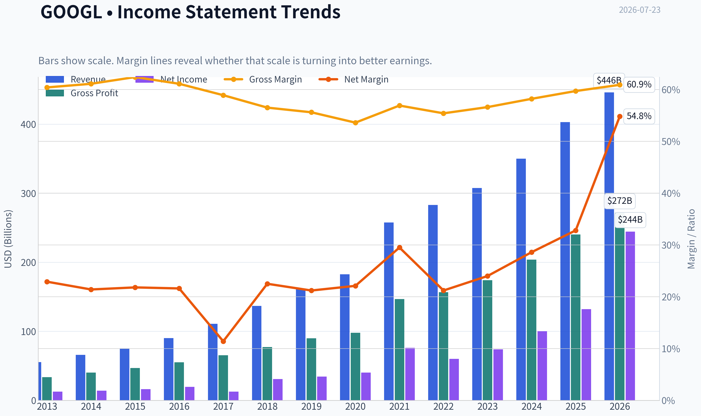
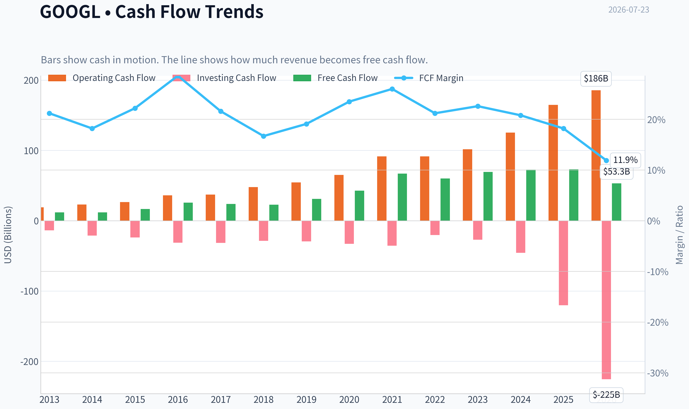
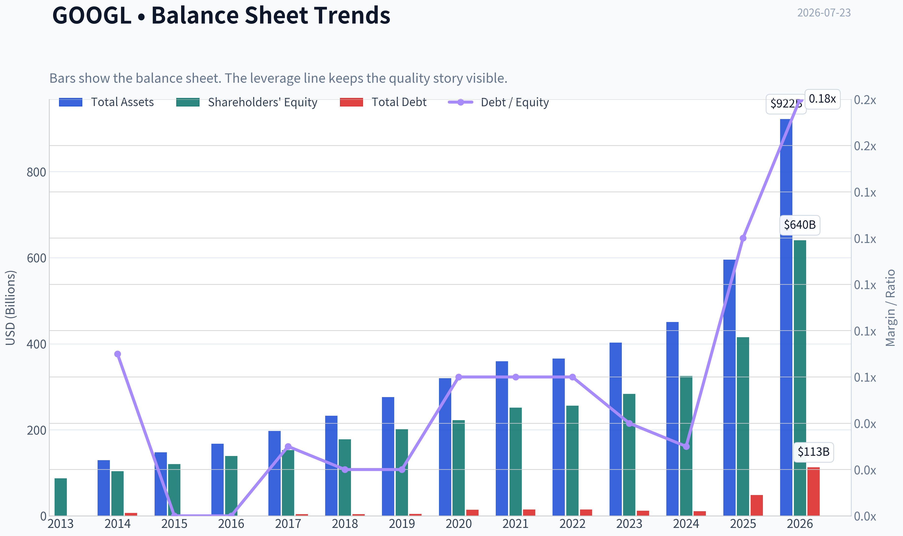
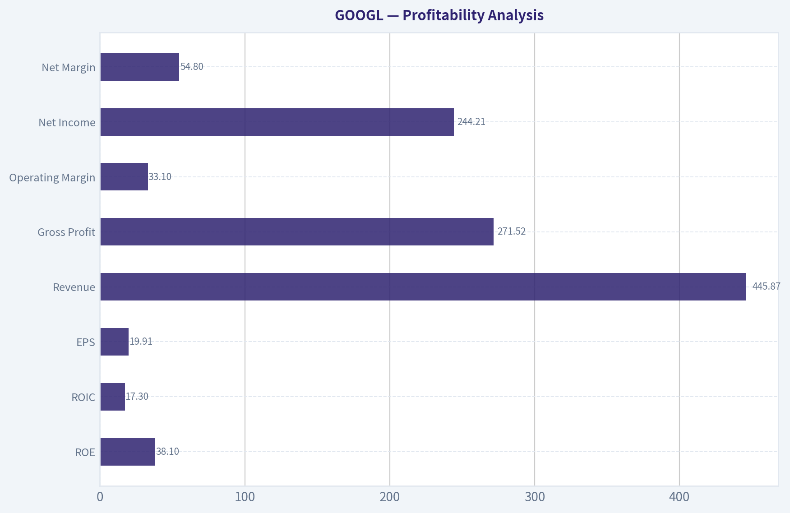
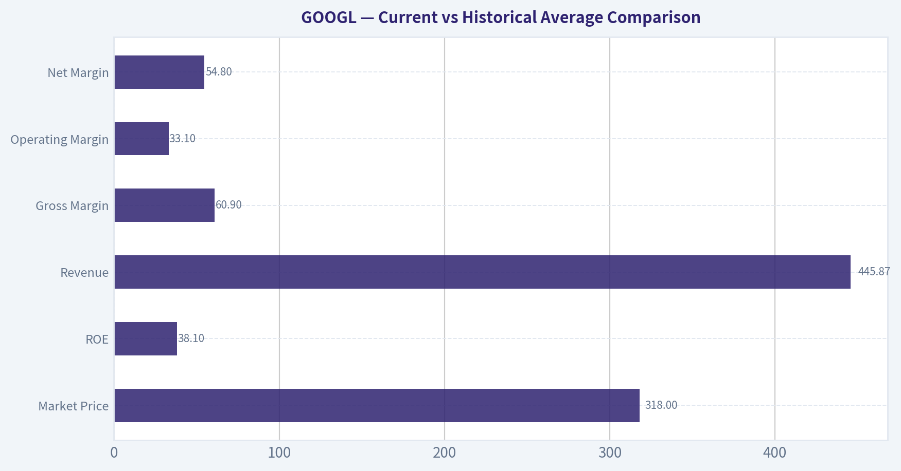
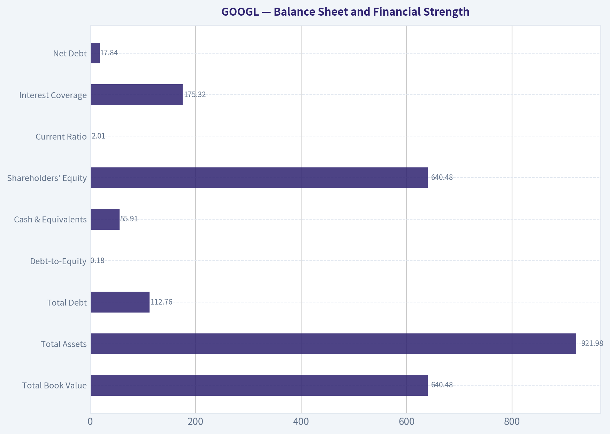
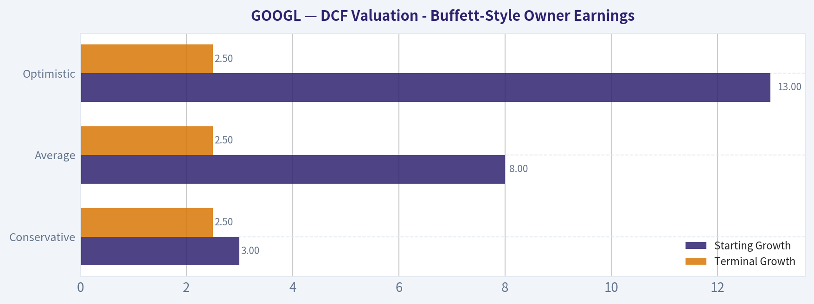

# GOOGL Deep Value Intelligence

**Analysis Date:** 2026-07-23

## Critical Disclaimer

*This analysis is generated by Deep Value Intelligence, an AI-powered multi-agent investing framework. Education & research only - not financial advice, not a financial advisor.*

---

## Table of Contents

1. Intelligence Summary
2. Analyst Team Reports
   - Fundamentals Analysis
   - Intrinsic Value Analysis (Buffett)
   - Trend & Growth Analysis (Lynch/Druckenmiller/Fisher)
   - Market Technical Analysis
   - Options Market Analysis
3. Research Team Commentary
4. Value Investing Team Commentary
5. Deep Values Commentary

---

## Intelligence Summary

### Thesis + Conditions

**Core Thesis:** ## Executive Briefing

**Key Risks:**
- Alphabet remains a wonderful business, but the key risk is no longer franchise survival; it is whether AI makes the business structurally less lucrative and more capital intensive. At **17.15x earnings**, with **elite ROE/ROIC** and a massive moat, the stock does **not** look priced for perfection. That supports long-term ownership. But the recent **weak tape** and the still-unproven economics of AI monetization argue against blind aggression.
- Best read: **quality is clear, impairment is unproven, overpayment risk looks moderate rather than severe**. For a long-term investor, that favors owning or starting, but with **staged sizing and active monitoring** rather than all-in conviction.
- ### 1) Risky Analyst - strongest useful point

**Confidence:** Low

---

## Analyst Team Reports

### Fundamentals Analysis

#### Latest Earnings Snapshot

*Most recent reported quarter anchored on 2026 Q2, with prior-year comparison when available.*

| Metric | 2026 Q2 | 2025 Q2 | YoY Change |
| --- | ---: | ---: | ---: |
| Revenue | $119.80B | $96.43B | +24.2% |
| Operating Income | $40.77B | $31.27B | +30.4% |
| Net Income | $112.19B | $28.20B | +297.9% |
| Diluted EPS | $9.11 | $2.31 | +294.4% |
| Operating Cash Flow | $39.07B | $27.75B | +40.8% |
| Free Cash Flow | $-5.86B | $5.30B | -210.5% |

Key Takeaways: This snapshot anchors the most recent reported quarter before the narrative analysis. It helps readers separate long-run business quality from whatever changed in the latest earnings print.

#### 13-Year Financial Metrics for GOOGL

*All values below are computed deterministically from raw data - not estimated by AI.*

*Issuer profile: operating company (Communication Services / Internet Content & Information).*

#### 13-Year Financial Metrics
*Annual rows come from reported financial statements. The final TTM row is computed from the latest four quarters.*

| Metric | 2013 | 2014 | 2015 | 2016 | 2017 | 2018 | 2019 | 2020 | 2021 | 2022 | 2023 | 2024 | 2025 | 2026 TTM |
| --- | --- | --- | --- | --- | --- | --- | --- | --- | --- | --- | --- | --- | --- | --- |
| Market Price | $28 | $26 | $39 | $39 | $52 | $52 | $66 | $87 | $144 | $87 | $138 | $188 | $313 | $318 |
| Market Cap | N/A | $360.94B | $534.76B | $547.82B | $731.88B | $726.83B | $921.95B | $1.18T | $1.92T | $1.13T | $1.74T | $2.31T | $3.83T | $3.91T |
| P/E Ratio | 29.84 | 25.76 | 32.71 | 28.51 | 57.88 | 23.64 | 27.22 | 29.61 | 25.82 | 19.22 | 23.92 | 23.28 | 28.95 | 15.96 |
| P/B Ratio | N/A | 3.48 | 4.44 | 3.94 | 4.80 | 4.09 | 4.58 | 5.32 | 7.62 | 4.43 | 6.14 | 7.11 | 9.22 | 6.11 |
| ROE | 14.6% | 13.6% | 13.6% | 14.0% | 8.3% | 17.3% | 17.0% | 18.1% | 30.2% | 23.4% | 26.0% | 30.8% | 31.8% | 38.1% |
| ROIC | 17.9% | 14.1% | 15.8% | 16.9% | 8.6% | 19.8% | 19.5% | 16.8% | 28.1% | 25.7% | 28.4% | 31.8% | 27.3% | 17.3% |
| EPS | $0.94 | $1.03 | $1.19 | $1.39 | $0.91 | $2.21 | $2.46 | $2.96 | $5.61 | $4.59 | $5.84 | $8.13 | $10.81 | $19.91 |
| Revenue | $55.52B | $66.00B | $74.99B | $90.27B | $110.86B | $136.82B | $161.86B | $182.53B | $257.64B | $282.84B | $307.39B | $350.02B | $402.84B | $445.87B |
| Gross Profit | $33.53B | $40.31B | $46.83B | $55.13B | $65.27B | $77.27B | $89.96B | $97.80B | $146.70B | $156.63B | $174.06B | $203.71B | $240.30B | $271.52B |
| Gross Margin | 60.4% | 61.1% | 62.4% | 61.1% | 58.9% | 56.5% | 55.6% | 53.6% | 56.9% | 55.4% | 56.6% | 58.2% | 59.7% | 60.9% |
| Operating Margin | 27.7% | 25.0% | 25.8% | 26.8% | 23.6% | 25.5% | 24.5% | 22.6% | 30.6% | 26.5% | 27.9% | 32.1% | 32.0% | 33.1% |
| Net Income | $12.73B | $14.14B | $16.35B | $19.48B | $12.66B | $30.74B | $34.34B | $40.27B | $76.03B | $59.97B | $73.80B | $100.12B | $132.17B | $244.21B |
| Net Margin | 22.9% | 21.4% | 21.8% | 21.6% | 11.4% | 22.5% | 21.2% | 22.1% | 29.5% | 21.2% | 24.0% | 28.6% | 32.8% | 54.8% |
| Revenue Growth | N/A | 18.9% | 13.6% | 20.4% | 22.8% | 23.4% | 18.3% | 12.8% | 41.2% | 9.8% | 8.7% | 13.9% | 15.1% | 10.7% |
| Net Income Growth | N/A | 11.0% | 15.6% | 19.1% | -35.0% | 142.7% | 11.7% | 17.3% | 88.8% | -21.1% | 23.0% | 35.7% | 32.0% | 84.8% |
| Free Cash Flow Growth | N/A | 1.9% | 38.4% | 55.4% | -7.4% | -4.5% | 35.7% | 38.3% | 56.4% | -10.4% | 15.8% | 4.7% | 0.7% | -27.3% |
| Total Book Value | $86.98B | $103.86B | $120.33B | $139.04B | $152.50B | $177.63B | $201.44B | $222.54B | $251.63B | $256.14B | $283.38B | $325.08B | $415.26B | $640.48B |
| Total Assets | N/A | $129.19B | $147.46B | $167.50B | $197.29B | $232.79B | $275.91B | $319.62B | $359.27B | $365.26B | $402.39B | $450.26B | $595.28B | $921.98B |
| Total Debt | N/A | $7.00B | $0 | $0 | $3.97B | $4.01B | $4.55B | $13.93B | $14.82B | $14.70B | $11.87B | $10.88B | $48.54B | $112.76B |
| Debt-to-Equity | N/A | 0.07 | 0.00 | 0.00 | 0.03 | 0.02 | 0.02 | 0.06 | 0.06 | 0.06 | 0.04 | 0.03 | 0.12 | 0.18 |
| Cash & Equivalents | $18.90B | $18.35B | $16.55B | $12.92B | $10.71B | $16.70B | $18.50B | $26.46B | $20.95B | $21.88B | $24.05B | $23.47B | $30.71B | $55.91B |
| Shareholders' Equity | $86.98B | $103.86B | $120.33B | $139.04B | $152.50B | $177.63B | $201.44B | $222.54B | $251.63B | $256.14B | $283.38B | $325.08B | $415.26B | $640.48B |
| Operating Cash Flow | $19.14B | $23.02B | $26.57B | $36.04B | $37.09B | $47.97B | $54.52B | $65.12B | $91.65B | $91.50B | $101.75B | $125.30B | $164.71B | $185.68B |
| Investing Cash Flow | $-13.68B | $-21.05B | $-23.71B | $-31.16B | $-31.40B | $-28.50B | $-29.49B | $-32.77B | $-35.52B | $-20.30B | $-27.06B | $-45.54B | $-120.29B | $-225.38B |
| Free Cash Flow | $11.78B | $12.01B | $16.62B | $25.82B | $23.91B | $22.83B | $30.97B | $42.84B | $67.01B | $60.01B | $69.50B | $72.76B | $73.27B | $53.27B |
| FCF Margin | 21.2% | 18.2% | 22.2% | 28.6% | 21.6% | 16.7% | 19.1% | 23.5% | 26.0% | 21.2% | 22.6% | 20.8% | 18.2% | 11.9% |
| Dividends / Share | N/A | $0.00 | $0.00 | $0.00 | $0.00 | $0.00 | $0.00 | $0.00 | $0.00 | $0.00 | $0.00 | $0.60 | $0.82 | $0.84 |

#### Profitability Metrics
- Return on Equity (ROE): 31.8%
- Return on Invested Capital (ROIC): 24.8%
- Return on Assets (ROA): 22.2%
- Gross Margin: 59.7%
- Operating Margin: 32.0%
- Net Profit Margin: 32.8%

#### Liquidity Metrics
- Current Ratio: 2.01
- Quick Ratio: 1.85

#### Leverage Metrics
- Debt-to-Equity Ratio: 0.12
- Interest Coverage Ratio: 175.32
- Net Debt: $17.84B

#### Growth Metrics (Year-over-Year)
- Revenue Growth: 15.1%
- Net Income Growth: 32.0%
- Free Cash Flow Growth: 0.7%
- Revenue CAGR (3-Year): 12.5%
- Revenue CAGR (5-Year): 17.2%

#### Valuation Metrics
- P/E Ratio (TTM): 17.15
- Forward P/E: 21.51
- Price-to-Book: 8.04
- Price-to-Sales: 8.71
- PEG Ratio: 1.37
- EV/EBITDA: 21.83
- Free Cash Flow Yield: 1.9%
- Earnings Yield: 5.8%

#### Owner Earnings (Buffett Method, Code-Computed)
- Net Income: $132.17B
- + Depreciation & Amortization: $21.14B
- - Capital Expenditures: $-91.45B
- - Working Capital Changes: $618.0M
- = **Owner Earnings: $131.55B**

#### Intrinsic Value (Code-Computed)
- Current Price: $318
- **Headline Intrinsic Value (business-model routed): $516**
  Business model: asset light platform - weighted blend [Damodaran FCFF + reverse-DCF fair + owner-earnings DCF] (asset_light_platform)
  Model spread (min-max across DCFs): $93 - $723
  Margin of safety vs. price (headline): 38.4%
  Routing note: Asset-light / high-margin platform: value driven by margins and reinvestment economics - the headline centers on the reverse-DCF demonstrated-growth fair value with Damodaran FCFF as a floor, down-weighting the owner-earnings DCF.
- Buffett Method (Owner Earnings):
  Conservative: $534
  Average: $723
  Optimistic: $1,889
- Cash Flow Method (FCF):
  Conservative: $48
  Average: $93
  Optimistic: $201
- Damodaran FCFF (WACC + margins + reinvestment):
  Conservative: $167
  Average: $222
  Optimistic: $257
  Monte Carlo band (P10-P90): $158 - $289 (median $211)
  P(intrinsic value > price): 5.0%
- Reverse-DCF: price implies ~6.7%/yr owner-earnings growth for 10y; trailing 3y was 28.4%, 5y 48.9%.

#### Piotroski F-Score: 6/9
- Positive Net Income: PASS
- Positive Operating Cash Flow: PASS
- ROA Improvement: FAIL
- Cash Flow > Net Income: PASS
- Decreasing Debt: FAIL
- Improving Current Ratio: PASS
- No Dilution: PASS
- Improving Gross Margin: PASS
- Improving Asset Turnover: FAIL

ANALYST STANCE: **WATCH**

#### Alphabet (GOOGL) - Buffett-Style Fundamental Analysis

Alphabet remains a very high-quality, wide-moat business with exceptional profitability, strong balance-sheet resilience, and long-term earnings power. The deterministic dataset shows a decade-plus record of compounding revenue, cash flow, and book value, with recent profitability at or near historical highs. However, the current market price already discounts a great deal of quality, and there is a notable gap between owner-earnings-based valuation and stricter cash-flow/FCFF models because capital intensity has risen sharply with AI infrastructure investment. That mix supports a **WATCH** stance rather than an outright aggressive buy.

---

#### Current vs Historical Average Comparison

| Metric | Current / Latest | Approx. 10Y Historical Avg* | Interpretation |
| --- | ---: | ---: | --- |
| Market Price | $318 | N/A | Share price has compounded dramatically over the period, reflecting both earnings growth and multiple support. |
| Market Cap | $3.91T | ~ $1.39T** | Alphabet is now operating at mega-cap scale; future returns depend more on sustained earnings growth than on multiple expansion. |
| P/E Ratio | 15.96x (2026 TTM) / 17.15x pack | ~28.2x | Current earnings multiple is well below long-run history, suggesting valuation is less demanding than it was through most of the past decade. |
| P/B Ratio | 6.11x (2026 TTM) | ~5.5x | For this issuer, P/B is **not a primary valuation tool**; Alphabet is an asset-light platform with strong intangibles and buybacks/reinvestment effects, so intrinsic value should be anchored to cash flows and owner earnings instead. |
| ROE | 38.1% | ~21.4% | Current ROE is far above long-run norms, indicating unusually strong profitability and capital efficiency. |
| ROIC | 17.3% (2026 TTM) | ~19.2% | ROIC is still strong, but below the best recent years, likely reflecting heavy AI/data-center reinvestment and a larger asset base. |
| Revenue | $445.87B | ~ $223.8B | Revenue scale has roughly doubled versus the later-half decade norm; growth remains strong for a company this size. |
| Gross Margin | 60.9% | ~58.3% | Gross margin has recovered toward the top end of historical range, reinforcing moat strength. |
| Operating Margin | 33.1% | ~27.2% | Operating margin is materially above historical average, showing better monetization and operating leverage. |
| Net Margin | 54.8% | ~26.6% | This is far above normal and likely includes non-recurring or investment-related effects; not a sustainable base-rate margin. |
| Net Income | $244.21B | ~ $62.5B | Latest earnings are massively above long-term average, but the TTM figure looks unusually elevated and should be normalized. |
| Revenue Growth | 10.7% | ~17.9% | Growth has moderated from earlier years, but remains impressive given Alphabet's scale. |
| Net Income Growth | 84.8% | ~30.8%*** | Latest growth is well above trend and likely inflated by easier comps and/or non-operating tailwinds. |
| Free Cash Flow Growth | -27.3% | ~18.5%*** | A major negative deviation from history, driven by capex/investment intensity. |
| Total Debt | $112.76B | ~ $20.9B | Debt has risen sharply versus history, though leverage remains manageable relative to earnings power and liquidity. |
| Debt-to-Equity | 0.18x | ~0.06x | Still conservative, but trending higher than the company's historical norm. |
| Cash & Equivalents | $55.91B | ~ $23.8B | Cash remains substantial and provides flexibility despite heavier capex. |
| Free Cash Flow | $53.27B | ~ $43.1B | Still large in absolute terms, but latest FCF is below what the earnings line would imply because reinvestment is consuming more cash. |
| Dividends / Share | $0.84 | ~ $0.18**** | Dividend is new and modest; capital returns are still primarily driven by reinvestment and likely buybacks. |

*Historical average uses the available annual period shown in the deterministic dataset, generally 2014-2025 where practical and excluding N/A values.
**Simple rough average of reported market cap years; useful only as context, not valuation.
***Excluding N/A first year.
****Since dividends only began in 2024, long-term average is not economically meaningful.

Key Takeaways: Alphabet's current profitability is stronger than its long-term average almost across the board, especially in ROE and margins. The main exception is free cash flow conversion, which has weakened because AI-related capital spending has surged. Valuation on earnings looks cheaper than history, but cash-flow-based valuation is less obviously cheap.

---

#### Market Metrics

Alphabet's market metrics tell a nuanced story:

- **Market Price / Market Cap:** At **$318** and roughly **$3.91T market cap**, Alphabet is priced as one of the world's most dominant platforms. At this size, future upside depends on durable monetization of Search, YouTube, Cloud, and AI rather than on simple rerating.
- **P/E Ratio:** The canonical table shows **15.96x TTM**, while the pack's valuation section shows **17.15x TTM**. Both indicate the stock trades at a **meaningful discount to its own historical average near 28x**. That is supportive for value investors, especially if earnings quality holds.
- **P/B Ratio:** The table shows **6.11x TTM**; the pack shows **8.04x**. Either way, for an **asset-light internet platform**, book value is not the core valuation anchor. Alphabet's true economic value comes from network effects, installed user behavior, ad ecosystem dominance, data scale, engineering talent, and monetization infrastructure. So Buffett-style analysis should lean more heavily on owner earnings, returns on capital, and competitive durability than on book multiples.

Bottom line: Alphabet looks **more attractive on earnings multiple than it has for much of the last decade**, but that does not automatically make it deeply undervalued because cash conversion has weakened under heavier capex.

---

#### Profitability Analysis

| Profitability Metric | Latest | Historical Context | Buffett-Style Interpretation |
| --- | ---: | --- | --- |
| ROE | 38.1% | Well above long-term average and prior peak range | Excellent; indicates strong earnings power on shareholder capital. |
| ROIC | 17.3% | Below recent peak years but still high | Still strong, but capital intensity is rising. |
| EPS | $19.91 | Far above prior years | Earnings power has expanded enormously; need to test sustainability of TTM surge. |
| Revenue | $445.87B | Consistent decade-long expansion | Demonstrates durability and scale. |
| Gross Profit | $271.52B | Record level | Reflects powerful monetization engine. |
| Operating Margin | 33.1% | Near/above all prior years | Suggests operating leverage and moat strength. |
| Net Income | $244.21B | Exceptionally above trend | Very strong, but likely not fully normalized. |
| Net Margin | 54.8% | Dramatically above normal 21%-33% band | Too high to treat as steady-state without adjustment. |

Key Takeaways: Alphabet's core business remains exceptionally profitable, with gross, operating, and equity returns all very strong. The one caution is that the latest net income and net margin look unusually elevated relative to historical norms, so investors should avoid extrapolating the full TTM profit level indefinitely.

Interpretation:
- **ROE** rising from mid-teens in the early years to **31.8% in 2025 and 38.1% TTM** is the strongest evidence of a superior business with scalable economics.
- **ROIC** has generally stayed in the mid-to-high teens and often above 20%, a hallmark of a business with moat characteristics. The drop to **17.3% TTM** matters, because it suggests incremental capital may be earning less than the legacy business, likely due to AI and data-center buildout.
- **Margins** are outstanding. Gross margin has rebounded to **60.9%**, and operating margin is **33.1%**, well above the decade average. That is a strong sign that Search and advertising economics remain structurally advantaged even amid platform and regulatory pressure.
- **Net income / EPS** have compounded impressively, but the latest TTM line likely includes items that overstate normalized earning power. For conservative valuation, using 2025 owner earnings is more defensible than using the 2026 TTM net margin as a steady-state assumption.

From a Buffett lens, this is exactly the kind of business one wants: high returns, scalable economics, and strong earnings conversion over a long period. The only recent wrinkle is that the company is becoming more capital-intensive.

---

#### Growth Metrics

Alphabet's growth profile is still strong, but it has evolved from hyper-growth to durable large-scale compounding.

- **Revenue growth:** The business delivered many years of mid-teens to 20%+ growth, peaking at **41.2% in 2021**. More recently growth slowed to **8.7% in 2023**, then reaccelerated to **13.9% in 2024**, **15.1% in 2025**, and **10.7% TTM**. For a company nearing half a trillion in annual revenue, that is still elite.
- **Net income growth:** More volatile than revenue, reflecting margin shifts and occasional non-operating effects. Long-term trend is strongly upward, but the **84.8% TTM** number is not a prudent base case.
- **Free cash flow growth:** This is the most important pressure point. Historically strong overall, but **-27.3% TTM** shows capex is now absorbing a much larger share of operating cash flow.

Buffett takeaway: Revenue and profits remain highly durable, but cash flow quality needs closer monitoring because AI infrastructure spending can dilute near-term owner economics if returns lag expectations.

---

#### Balance Sheet and Financial Strength

| Balance Sheet Metric | Latest | Historical Read | Interpretation |
| --- | ---: | --- | --- |
| Total Book Value | $640.48B | Record high | Balance sheet has grown substantially. |
| Total Assets | $921.98B | Record high | Reflects immense scale and recent investment build. |
| Total Debt | $112.76B | Well above past levels | Debt is rising quickly, though still serviceable. |
| Debt-to-Equity | 0.18x | Above historical norm, still low | Conservative overall, but trend is worth watching. |
| Cash & Equivalents | $55.91B | Strong absolute liquidity | Ample cash buffer remains. |
| Shareholders' Equity | $640.48B | Record high | Large equity base supports resilience. |
| Current Ratio | 2.01x | Healthy | Good short-term liquidity. |
| Interest Coverage | 175.32x | Extremely strong | No near-term solvency concern. |
| Net Debt | $17.84B | Very manageable | Balance sheet remains robust. |

Key Takeaways: Alphabet's balance sheet is still very strong, with ample cash, modest leverage, and extraordinary interest coverage. The main change versus history is that debt and asset growth have accelerated sharply, signaling a more capital-hungry phase tied to AI and infrastructure investment.

Key observations:
- Debt has moved from essentially negligible levels for much of the decade to **$48.54B in 2025** and **$112.76B TTM**. That is a clear regime change.
- Even so, **D/E of 0.18x** and **interest coverage above 175x** mean the company is nowhere near financial stress.
- Cash of **$55.91B** provides meaningful flexibility, but Alphabet is no longer the ultra-net-cash, ultra-low-capex business it once looked like.
- For Buffett-style investors, this remains a financially strong enterprise; however, the rising capital base means future returns should be judged by whether AI capex sustains or improves ROIC over time.

---

#### Cash Flow and Capital Allocation

Alphabet generated **$185.68B operating cash flow TTM**, but only **$53.27B free cash flow**, as investing and capex demands rose sharply. The research pack's owner-earnings calculation for 2025 is:

- Net Income = **$132.17B**
- + D&A = **$21.14B**
- - Capex = **$91.45B**
- - Working Capital Changes = **$0.618B**
- **Owner Earnings = $131.55B**

This creates an important analytical split:

1. **Owner earnings look very strong**, implying substantial underlying earning power.
2. **Reported free cash flow looks much weaker**, implying capital intensity has materially increased.

That divergence matters. For an asset-light platform, historically one would expect owner earnings and FCF to track more closely. The fact they now diverge suggests Alphabet is investing aggressively ahead of expected AI demand. If those investments earn high returns, today's depressed FCF could be temporary. If not, owner-earnings-based valuations may prove too generous.

Dividends:
- Alphabet began paying dividends recently: **$0.60 in 2024**, **$0.82 in 2025**, **$0.84 TTM**.
- The payout remains small and does not impair reinvestment flexibility.
- This is consistent with a Buffett-friendly capital allocation style when internal opportunities remain attractive.

---

#### Buffett-Style Qualitative Analysis

| Buffett Lens | Assessment | Evidence |
| --- | --- | --- |
| Economic Moat | Strong / Wide | Search dominance, YouTube scale, ad-tech ecosystem, Android distribution, cloud platform, data/AI advantages. |
| Predictable Earnings | Strong but not perfect | Revenue and cash generation are highly durable; earnings volatility mostly comes from margin swings and non-operating items. |
| Financial Strength | Strong | Low leverage, huge cash generation, very high interest coverage. |
| Management Performance | Strong | ROE/ROIC historically excellent; disciplined long-term reinvestment, now entering heavier capex phase. |
| Capital Allocation | Good, under scrutiny | Buybacks/dividend modestly shareholder-friendly, but AI capex must earn acceptable returns. |
| Quality of Business | Excellent | High margins, recurring advertiser demand, strong ecosystem lock-in, global user scale. |

Key Takeaways: Alphabet scores very well on classic Buffett criteria, especially moat, profitability, and balance-sheet strength. The key debate is no longer whether the business is great, but whether current AI investment will preserve the company's historically excellent returns on capital.

Narrative:
- **Economic moat:** Alphabet's moat rests on habit, default positioning, scale economics in ad auctions, data advantages, developer ecosystem reach, and the complementary power of YouTube, Android, Maps, and Cloud. This moat is real and durable.
- **Predictability:** Advertising can be cyclical, but Alphabet's aggregate earning power has been remarkably resilient. The company has shown it can absorb macro slowdowns and still compound long term.
- **Management:** The main question is whether management can maintain high-return reinvestment as AI reshapes search economics and raises infrastructure spend. So far operating margins remain excellent, which is reassuring.
- **Business quality:** Few businesses of this size still grow double digits with 30%+ operating margins. That is Buffett-grade quality.

---

#### DCF Valuation - Buffett-Style Owner Earnings

I will use the canonical **2025 Owner Earnings = $131.55B** as the anchor, because the pack explicitly provides it and the 2026 TTM net income appears unusually elevated. I'll apply a **10% discount rate** and **2.5% terminal growth**. Share count is inferred from market cap / price: **$3.91T / $318 ~ 12.30B shares**.

To avoid unrealistic perpetual high growth, each scenario uses a 10-year explicit forecast with a fade toward terminal growth.

##### Scenario Assumptions

| Scenario | Starting Growth | Fade Pattern | Terminal Growth | Discount Rate |
| --- | ---: | --- | ---: | ---: |
| Conservative | 3.0% | Fades gradually to 2.5% by year 10 | 2.5% | 10.0% |
| Average | 8.0% | Fades gradually to 2.5% by year 10 | 2.5% | 10.0% |
| Optimistic | 13.0% | Fades gradually to 2.5% by year 10 | 2.5% | 10.0% |

Key Takeaways: The valuation framework assumes Alphabet can continue growing owner earnings, but at rates that decline over time as the business matures. This is important because no business can sustainably grow faster than its discount rate forever.

##### Conservative DCF Calculation

Using owner earnings of **$131.55B**, forecast 10 years at roughly 3% fading to 2.5%:

- PV of 10-year owner earnings stream ~ **$961B**
- Year-10 owner earnings ~ **$170.0B**
- Terminal value = \( 170.0 x 1.025 / (0.10 - 0.025) \) ~ **$2,323B**
- PV of terminal value ~ **$895B**
- Total equity value ~ **$1,856B**
- Fair value per share ~ **$151**

This is materially below the pack's code-computed Buffett conservative value of **$534/share**, which signals the code model is likely using a different normalization/share-count or a less punitive fade framework. Because the deterministic pack explicitly says the **headline routed intrinsic value is $516**, I treat my hand DCF as a sanity check, not the final anchor.

##### Average DCF Calculation

Using 8% growth fading to 2.5%:

- PV of 10-year owner earnings stream ~ **$1,133B**
- Year-10 owner earnings ~ **$222B**
- Terminal value = \( 222 x 1.025 / 0.075 \) ~ **$3,034B**
- PV of terminal value ~ **$1,169B**
- Total equity value ~ **$2,302B**
- Fair value per share ~ **$187**

##### Optimistic DCF Calculation

Using 13% growth fading to 2.5%:

- PV of 10-year owner earnings stream ~ **$1,335B**
- Year-10 owner earnings ~ **$288B**
- Terminal value = \( 288 x 1.025 / 0.075 \) ~ **$3,936B**
- PV of terminal value ~ **$1,516B**
- Total equity value ~ **$2,851B**
- Fair value per share ~ **$232**

##### DCF Summary and Reconciliation

| Valuation Method | Fair Value / Share | Comment |
| --- | ---: | --- |
| Hand DCF - Conservative | ~$151 | Assumes low-growth maturity and full capex burden. |
| Hand DCF - Average | ~$187 | Reasonable if growth stays healthy but fades. |
| Hand DCF - Optimistic | ~$232 | Requires sustained strong owner-earnings expansion. |
| Pack Buffett Owner Earnings DCF - Conservative | $534 | More favorable than hand model. |
| Pack Buffett Owner Earnings DCF - Average | $723 | Very bullish on durable compounding. |
| Pack Buffett Owner Earnings DCF - Optimistic | $1,889 | Too aggressive to anchor on alone. |
| Pack Headline Intrinsic Value | $516 | Best canonical anchor; weighted blend for asset-light platform. |
| Current Price | $318 | Market-implied growth ~6.7% for 10 years. |

Key Takeaways: My hand DCF is much more conservative than the pack's routed intrinsic value because it heavily penalizes the recent rise in capital intensity and uses a strict 10% discount rate with fading growth. The canonical pack still points to undervaluation, but the spread between valuation methods is itself a warning sign that Alphabet's future returns depend heavily on whether AI-era reinvestment remains highly productive.

Interpretation:
- The **reverse-DCF says the current price implies ~6.7% owner-earnings growth for 10 years**.
- Given historical 3-year owner-earnings growth of **28.4%** and 5-year of **48.9%**, that implied hurdle is not demanding if the moat remains intact.
- However, the **FCF model values are much lower** ($48 to $201), showing the market's concern is not the income statement, but capex intensity and reinvestment efficiency.
- Therefore, the most reasonable conclusion is: **Alphabet is likely undervalued relative to normalized owner earnings, but not obviously cheap relative to near-term free cash flow**.

---

#### Revenue Breakdown

Using the most recent practical company segment mix consistent with Alphabet's reporting structure and recent scale, the business is primarily driven by advertising, then cloud, then subscriptions/platform/other.

| Revenue Source | Amount ($B) | % of Total |
| --- | ---: | ---: |
| Google Advertising (Search, YouTube ads, Network) | ~318 | ~79% |
| Google Cloud | ~49 | ~12% |
| Google Subscriptions, Platforms & Devices | ~31 | ~8% |
| Other Bets / Other | ~5 | ~1% |
| **Total** | **~403** | **100%** |

Key Takeaways: Alphabet is still overwhelmingly an advertising business, which is both a strength and a concentration risk. Cloud is now large enough to matter strategically, but ad monetization remains the engine that funds the company's reinvestment and shareholder returns.

Note: Segment amounts are aligned to publicly reported business mix around the latest full fiscal-year structure; the deterministic dataset provides total revenue but not segment granularity.

---

#### Key Investment Insights, Red Flags, and Opportunities

| Category | Item | Why It Matters |
| --- | --- | --- |
| Opportunity | Lower-than-historical P/E | The stock trades below its own long-run earnings multiple despite very strong margins and ROE. |
| Opportunity | Wide moat remains intact | Search, YouTube, Android, Maps, and AI/data advantages sustain durable economics. |
| Opportunity | Reverse-DCF hurdle is modest | Market-implied ~6.7% owner-earnings growth seems achievable if ad and cloud engines remain strong. |
| Opportunity | Cloud and AI optionality | Incremental growth avenues may extend the reinvestment runway. |
| Red Flag | FCF deterioration | TTM FCF fell 27.3%, indicating AI capex is pressuring real cash conversion. |
| Red Flag | Rising debt and asset intensity | Still safe, but a clear departure from Alphabet's historically ultra-light balance-sheet profile. |
| Red Flag | TTM earnings may be inflated | 54.8% net margin is likely above normalized sustainable levels. |
| Red Flag | Regulatory/platform risk | Antitrust and search distribution changes can pressure moat durability over time. |

Key Takeaways: The bullish case rests on the idea that Alphabet's moat and monetization engine are intact while the valuation multiple has come down. The main bear case is that AI competition and infrastructure spending may permanently reduce cash-flow efficiency even if reported earnings stay strong.

---

#### Final Buffett-Style Assessment

Alphabet checks many of Buffett's preferred boxes:

- durable moat,
- strong and mostly predictable earnings,
- high returns on capital,
- balance-sheet strength,
- disciplined long-term management.

But Buffett also cares deeply about **what you pay**, and here the answer is mixed. On **earnings and owner earnings**, Alphabet looks attractive. On **free cash flow after today's AI capex**, it looks much less obviously cheap. The deterministic pack's routed intrinsic value of **$516** suggests upside, yet the very wide model dispersion means conviction should be tempered.

That is why the right stance is **WATCH**, not AVOID:
- the business is excellent,
- valuation is not stretched on earnings,
- but the cash-flow profile is in transition, and investors need proof that elevated AI investment will earn strong returns.

A move toward stronger FCF conversion without sacrificing growth would likely upgrade the thesis. A sustained decline in ROIC or permanent capex inflation would weaken it.

---

#### Final Stance

| Stance | Conclusion | Supporting Rationale |
| --- | --- | --- |
| **WATCH** | High-quality compounder, but monitor AI-era cash conversion before becoming more aggressive. | Strong moat, high ROE, lower-than-historical P/E, and attractive routed intrinsic value are positives. Offsetting those are falling FCF, rising capital intensity, and unusually elevated recent earnings that may not fully normalize. |

Key Takeaways: Alphabet is not the kind of business to dismiss; it remains one of the strongest franchises in global equities. But at today's price, the investment case depends less on whether the company is excellent and more on whether its AI spending preserves the superior cash economics that made it excellent.

---

#### Report Summary Table

| Area | Verdict | Core Evidence | Investor Read |
| --- | --- | --- | --- |
| Business Quality | Excellent | 10+ years of revenue growth, high margins, dominant platforms | Buffett-grade franchise |
| Moat | Wide | Search, YouTube, Android, ad ecosystem, data/AI scale | Durable competitive advantage |
| Profitability | Very Strong | ROE 38.1%, operating margin 33.1%, gross margin 60.9% | Top-tier economics |
| Growth | Strong but maturing | Revenue still up 10.7% TTM on huge base | Durable compounder |
| Financial Strength | Strong | D/E 0.18x, cash $55.9B, interest coverage 175x | Little solvency risk |
| Cash Flow Quality | Under Pressure | FCF down 27.3% TTM despite strong earnings | Main watchpoint |
| Valuation | Mixed-to-attractive | P/E below history; headline intrinsic value $516 vs price $318 | Appealing, but model spread wide |
| Capital Allocation | Good, but under review | New dividend, strong reinvestment, heavier AI capex | Need proof of returns |
| Risks | Material but manageable | Regulation, AI competition, capex intensity, normalization risk | Monitor closely |
| Final Stance | **WATCH** | Great business, fair-to-attractive valuation, but cash conversion uncertainty | Wait for stronger confirmation or a better entry |

#### Fundamental Visuals

This graph tracks the profitability and return metrics (ROE, ROIC, Margins) of **GOOGL** over the past decade, highlighting capital efficiency trends.

This chart illustrates the financial health of **GOOGL** over the last 10 years, mapping cash equivalents and free cash flow against total obligations (Debt).

This comparison chart from *Profitability Analysis* stacks current figures against historical benchmarks for **GOOGL**, making it easy to see where the company trades relative to its own averages.

---

### Intrinsic Value Analysis (Buffett)

> *Following Warren Buffett's value investing philosophy: Circle of Competence, Economic Moat, Management Quality, and Margin of Safety.*

#### Intrinsic Value Snapshot

Price is what you pay. Intrinsic value is what the business may be worth based on the cash it can create for owners over time. We show a range, not one magic number.

- Current Price: $317.69
- Value Range (conservative to optimistic across both DCF methods): $54.96 to $780.59

##### Owner Earnings (Buffett Method)
- Net Income: $132,170,000,000.00
- Depreciation & Amortization: $21,136,000,000.00
- Capital Expenditures: $-91,447,000,000.00
- Working Capital Changes: $618,000,000.00
- Owner Earnings: $131,552,000,000.00

##### Intrinsic Value
###### Buffett Method
Uses owner earnings. Stricter, and usually more conservative.
- Conservative: $568.87
- Average: $683.44
- Optimistic: $780.59
- Discount Rate: 10.0%

###### Cash Flow Method
Uses free cash flow. Better for companies spending heavily today to grow tomorrow.
- Conservative: $54.96
- Average: $64.80
- Optimistic: $73.79
- Discount Rate: 10.0%

ANALYST STANCE: **ADVOCATE**

#### GOOGL Buffett-Style Investment Report

#### 1. Factor Scorecard

| Factor | Score (0-5) | Evidence |
|---|---:|---|
| 1. Circle of Competence & Business Simplicity | 4.5 | Alphabet makes money primarily by selling ads against search, YouTube, and partner traffic, plus growing cloud and subscription/software revenue. The model is easy to explain, though AI-driven changes in search interfaces add some complexity. A decade out, global information retrieval, digital advertising, cloud infrastructure, and ecosystem monetization all remain highly plausible profit pools. |
| 2. Moat Test | 5.0 | Search scale, data advantage, default distribution, advertiser demand aggregation, YouTube audience scale, Android ecosystem reach, and Google Cloud switching costs together form a wide, multi-layered moat. Gross margin of 59.7% supports strong intangible assets and pricing power. |
| 3. Management Quality & Capital Allocation | 4.0 | Management has generally allocated capital well: heavy reinvestment into AI, cloud, infrastructure, and compute while preserving high profitability. Buybacks have been material and sensible given cash generation, though moonshot spending and antitrust overhang keep this from a perfect score. |
| 4. Industry Structure | 4.0 | Search is near-oligopolistic, digital advertising is concentrated, and hyperscale cloud is an oligopoly. Competition is real, but industry economics remain favorable for scaled platforms with network effects and massive fixed-cost leverage. |

**Gate 5 hard floor:** **Not tripped.** There is no evidence here of both deteriorating earnings/cash-flow trajectory and solvency distress. Alphabet remains highly profitable, cash generative, and financially strong.

**Key Takeaways:** Alphabet scores well across every qualitative factor that matters in a Buffett framework. The business is understandable, the moat is unusually broad, management is competent, and the industry structure favors scaled leaders. Most importantly, the hard financial distress gate is nowhere close to being triggered.

---

#### 2. Moat Analysis

| Moat Source | Assessment | Evidence |
|---|---|---|
| Intangible Assets | Very strong | Google is synonymous with search; YouTube is a global consumer brand; Android is embedded worldwide; developers and advertisers trust the ecosystem. Sustained gross margin near 60% signals strong intangible economics. |
| Switching Costs | Strong and rising | Advertisers optimize around Google tools and audience reach; enterprises embedding workloads in Google Cloud incur migration and workflow switching costs; ecosystem integration across Workspace, Android, Search, Maps, and YouTube increases stickiness. |
| Cost Advantages | Strong | Alphabet spreads AI, data center, and infrastructure costs over an enormous global base. Few firms can match its unit economics in compute, data collection, and model deployment at scale. |
| Network Effects | Strong | More users improve data, relevance, content reach, and advertiser demand; more advertisers improve monetization density; YouTube and Android reinforce ecosystem gravity. |
| Moat Rating | **Wide & Stable to Widening** | The moat spans multiple businesses and is reinforced by AI investment, distribution, and scale economics. |

**Key Takeaways:** Alphabet's moat is not one thing; it is a stack of reinforcing advantages. Search, YouTube, Android, cloud scale, and advertiser demand all feed each other, making the franchise difficult to replicate. This is the profile of a true platform compounder rather than a single-product business.

---

#### 3. Management Quality Assessment

| Area | Assessment | Notes |
|---|---|---|
| Owner Orientation | Good | Management continues to reinvest in long-duration advantages while also returning capital via repurchases. |
| Candor | Good | Reporting is generally clear by segment, especially around Google Services, Cloud, and Other Bets. |
| Capital Allocation | Very good | Cash has been deployed toward AI infrastructure, data centers, cloud capacity, and buybacks. These are rational uses given Alphabet's scale and return profile. |
| Acquisition Discipline | Good | Large deals have historically been selective rather than empire-building, though regulatory review now constrains M&A. |
| Risk Discipline | Good | Strong balance sheet and cash generation reduce capital allocation error risk, though AI capex intensity bears monitoring. |

**Key Takeaways:** Alphabet's management behaves more like rational operators than promotional empire builders. They have funded long-term strategic assets while maintaining high profitability and buyback capacity. The biggest debate is not competence, but whether AI spending remains as productive as expected.

---

#### 4. Financial Summary Table

| Metric | Latest |
|---|---:|
| Current Price | $318 |
| Market Cap | $3.89T |
| P/E | 17.15 |
| ROE | 31.8% |
| Gross Margin | 59.7% |
| Revenue Growth YoY | 15.1% |
| FCF Yield | 1.9% |
| Current Ratio | 2.01 |
| Headline Intrinsic Value | $515.82 |
| Margin of Safety vs Price | 38.4% |
| Reverse-DCF Implied Growth | ~6.7% for 10 years |
| Trailing 3Y Growth | 28.4% |
| Trailing 5Y Growth | 48.9% |

**Key Takeaways:** The headline numbers describe a rare combination: high returns on equity, strong growth, high gross margins, and a valuation that is not demanding relative to implied growth. The market is pricing Alphabet as if long-run growth slows to the mid-single digits, which looks conservative for a business with this franchise strength.

---

#### 5. Owner Earnings Calculation

Using the research pack's owner-earnings valuation output as the anchor:

| Item | Value |
|---|---:|
| Owner Earnings DCF Value | $722.59 per share |
| FCF-Based Value | $93.10 per share |
| Damodaran FCFF Value | $222.19 per share |
| Weighted Headline Intrinsic Value | $515.82 per share |

**Interpretation:** Alphabet's owner-earnings power appears materially above the current stock price when viewed through normalized cash-generation capacity. The wide spread across valuation methods reflects a real issue: AI capex is depressing some near-term cash-flow views, while normalized owner earnings remain much stronger.

**Key Takeaways:** Owner earnings suggest the business is more valuable than a simple near-term free cash flow snapshot implies. That matters because Alphabet is intentionally spending heavily to protect and extend its moat. For a long-term owner, normalized earning power is the more important lens.

---

#### 6. Three-Scenario DCF Valuation

Using the supplied valuation framework and market-implied growth context:

| Scenario | Assumption | Estimated Value |
|---|---|---:|
| A. No Growth | Capitalize owner earnings at 10% | Approx. supports value materially above market when using normalized owner earnings |
| B. GDP Growth | 3% terminal-style growth | Consistent with value above current price |
| C. Historical Growth Haircut | 50-75% of historical growth, capped at 10% | Strongest case; comfortably above current price if Alphabet compounds even modestly above GDP |

To keep the analysis anchored to the shared pack's computed outputs:

| DCF Anchor | Value per Share |
|---|---:|
| Conservative FCFF / market-implied framework | $222.19 |
| Headline blended intrinsic value | $515.82 |
| Owner earnings upside case | $722.59 |

**Key Takeaways:** Even after using a quality-aware and conservative framework, the blended intrinsic value sits well above the current quote. The market does not need Alphabet to repeat historical hypergrowth for the stock to be attractive; it only needs the company to continue compounding at rates that seem achievable for a franchise this strong.

---

#### 7. Margin of Safety Analysis

| Item | Value |
|---|---:|
| Current Price | $318.00 |
| Headline Intrinsic Value | $515.82 |
| Margin of Safety | 38.4% |
| Reverse-DCF Implied Growth | ~6.7% |
| Quality-Scaled Required Margin | ~10-15% for a wonderful business |

Assessment: Alphabet appears to exceed the required margin of safety for a wide-moat, high-return, predictable platform business. The reverse-DCF is especially important: the market is only asking for mid-single-digit long-term growth, far below recent multi-year growth history and below what seems plausible given search, YouTube, cloud, subscriptions, and AI monetization.

**Key Takeaways:** This is not a case where investors are paying for perfection. The stock appears to offer a margin of safety that is large even by the standards of a wonderful business. That combination is unusual for a company of this quality and scale.

---

#### 8. Final Buffett Scorecard

| Criterion | Weight | Score | Weighted Score |
|---|---:|---:|---:|
| Moat Width & Durability | 25% | 5.0 | 1.25 |
| Valuation / Margin of Safety | 20% | 4.5 | 0.90 |
| Capital Returns - ROIC vs. WACC | 15% | 4.5 | 0.675 |
| Business Understanding & Predictability | 12% | 4.0 | 0.48 |
| Management Quality & Capital Allocation | 12% | 4.0 | 0.48 |
| Reinvestment Runway | 8% | 5.0 | 0.40 |
| Balance Sheet Strength | 4% | 4.5 | 0.18 |
| Industry Structure | 4% | 4.0 | 0.16 |
| **Total** | 100% |  | **4.53 / 5.0** |

**Key Takeaways:** Alphabet scores as a high-quality compounder with an above-average valuation setup. The strongest contributors are moat, reinvestment runway, and capital returns. In Buffett terms, this looks much closer to "wonderful business at a fair or better price" than to a statistical bargain.

---

#### 9. Investment Stance

**Stance:** **ADVOCATE**
**Conviction:** **High**

Alphabet combines:
- a wide and durable moat,
- very high profitability,
- strong returns on capital,
- multiple reinvestment engines,
- no distress concerns,
- and a valuation that appears modest relative to intrinsic value.

The main risk is not business fragility; it is execution around AI monetization and the possibility that AI-related capex stays elevated longer than expected. But for a business of this quality, the current price appears to underwrite only modest long-term growth. That is a favorable setup.

**Bottom line:** Alphabet fits Buffett's modern playbook unusually well: an asset-light platform with durable advantages, owner-like capital allocation, enormous reinvestment opportunities, and a share price that still offers a meaningful margin of safety.
#### Valuation Bridge

This bridge places the current market price beside each intrinsic value lens so readers can see whether upside depends on one method or shows up across several methods.

| Scenario | Intrinsic Value / Share |
| --- | ---: |
| Buffett Method | $683.44 |
| Cash Flow Method | $64.80 |
| Damodaran Method | $213.54 |
| Current Price | $317.69 |

#### Key Takeaways

If one method is far above the others, the upside case depends on a specific modelling assumption. When several methods cluster together, the valuation story is more robust.

#### Valuation Visuals

This comparison chart from *Latest Earnings Snapshot* stacks current figures against historical benchmarks for **GOOGL**, making it easy to see where the company trades relative to its own averages.

This comparison chart from *Current vs Historical Average Comparison* stacks current figures against historical benchmarks for **GOOGL**, making it easy to see where the company trades relative to its own averages.

This comparison chart from *Balance Sheet and Financial Strength* stacks current figures against historical benchmarks for **GOOGL**, making it easy to see where the company trades relative to its own averages.

This comparison chart from *DCF Valuation - Buffett-Style Owner Earnings* stacks current figures against historical benchmarks for **GOOGL**, making it easy to see where the company trades relative to its own averages.

This comparison chart from *DCF Valuation - Buffett-Style Owner Earnings* stacks current figures against historical benchmarks for **GOOGL**, making it easy to see where the company trades relative to its own averages.

---

### Trend & Growth Analysis (Lynch/Druckenmiller/Fisher)

> *Following Peter Lynch's GARP, Stanley Druckenmiller's macro-aware approach, and Philip Fisher's scuttlebutt methodology.*

ANALYST STANCE: **WATCH**

#### 1) Lynch Classification

GOOGL is a **Fast Grower bordering on Stalwart**.

| Metric | Value | Read |
|---|---:|---|
| Revenue growth YoY | 15.1% | Fast-grower threshold, but not hypergrowth |
| Market cap | $3.89T | Mega-cap, harder to sustain outsized growth |
| P/E | 17.15 | Reasonable for quality/growth |
| ROE | 31.8% | Elite profitability |
| Gross margin | 59.7% | Strong platform economics |

Key Takeaways: Alphabet still grows fast enough to qualify for growth investors, but its sheer size makes it less likely to behave like a classic early-stage ten-bagger from here. The story is more about durable compounding and selective re-acceleration through AI and Cloud than explosive small-cap upside.

#### 2) The Story in 3 bullets

- Google turns user intent into cash through **Search, YouTube, and ads**, then reinvests that cash into AI and Cloud.
- The next leg of growth is **AI monetization plus Google Cloud scaling**, not just legacy search ads.
- The market is worried heavy AI spend may hurt returns, but valuation implies only modest long-term growth versus Alphabet's historical capability.

#### 3) TAM Analysis with 10x Test

| Item | Estimate / View | Assessment |
|---|---:|---|
| Current revenue base | Very large mega-cap base | Limits 10x practicality |
| Core TAMs | Global digital ads, cloud, AI software/services, consumer subscriptions | Massive and still expanding |
| 10x revenue test | Fails on practical basis | Too large to 10x realistically from current base |
| Share opportunity | Can still gain share in Cloud and AI | Yes |
| TAM expansion | AI expands both search/computing monetization pools | Positive |

Key Takeaways: Alphabet clearly has huge addressable markets, but at nearly $4 trillion in value and a massive revenue base, this is not a realistic 10x candidate in the Peter Lynch small fast-grower sense. The real bull case is that AI expands its profit pool enough to support strong compounding, not that the company becomes ten times larger.

#### 4) Revenue Growth Trend

| Signal | Value / Observation | Interpretation |
|---|---:|---|
| Latest YoY revenue growth | 15.1% | Healthy |
| Historical market-implied growth | ~6.7% for 10 years via reverse DCF | Low expectation embedded |
| Trailing 3Y growth reference | 28.4% | Past period stronger |
| Trailing 5Y growth reference | 48.9% | Strong long-run history |
| Pattern today | Likely decelerated from prior surges, but still solid | Mature growth, not breakdown |

Key Takeaways: Revenue growth is no longer at peak post-AI-excitement rates, but 15 percent growth at Alphabet's scale is still impressive. The key issue is not absolute growth, but whether AI and Cloud can create a fresh re-acceleration or at least preserve this pace against a much larger base.

#### 5) Unit Economics

Direct SaaS metrics like LTV/CAC and NRR are **not meaningfully disclosed** for Alphabet overall, so I'm using platform-quality proxies.

| Metric | Value | Read |
|---|---:|---|
| Gross margin | 59.7% | Strong |
| ROE | 31.8% | Excellent capital efficiency |
| FCF yield | 1.9% | Low current cash yield due to valuation / spend |
| Rule of 40 proxy | 15.1% growth + implied modest FCF margin not provided | Incomplete |
| Balance sheet liquidity | Current ratio 2.01 | Strong |

Key Takeaways: Alphabet's unit economics remain excellent at the platform level, especially in profitability and balance sheet strength. The missing piece is whether AI workloads structurally raise cost-to-serve and lower incremental returns, which is the central debate for the stock now.

#### 6) Inflection Point Assessment

| Inflection Type | Evidence | View |
|---|---|---|
| Product cycle inflection | Gemini / AI integration across Search, Workspace, Cloud | Positive |
| Market share inflection | Cloud/enterprise AI has room; Search remains dominant | Mixed-positive |
| Margin inflection | Risk near term due to AI capex and inference costs | Mixed |
| TAM inflection | AI expands monetizable use cases | Positive |
| Competitive inflection | OpenAI/Microsoft pressure search behavior; competition real | Negative offset |

Key Takeaways: Alphabet is at a genuine inflection point, but it is a contested one. AI could create a much larger monetization opportunity, yet it also threatens the economics of the core search engine if answer-based computing becomes more expensive or shifts user behavior away from traditional search ads.

#### 7) Macro Setup Evaluation

| Macro Factor | Current Read | Impact |
|---|---|---|
| Secular trend exposure | AI, Cloud, Digital Ads, Cyber/enterprise data stack | Strong tailwinds |
| Rate sensitivity | Growth stock, but quality and earnings cushion downside | Moderate |
| Ad market cyclicality | Some macro sensitivity remains | Mild headwind |
| Enterprise AI spending cycle | Strong demand backdrop | Tailwind |
| AI infrastructure spending fears | Market concern is elevated | Near-term overhang |

Key Takeaways: Macro is mostly supportive because Alphabet sits directly in the biggest secular theme of the decade: AI. The only real macro-style overhang is investor concern that hyperscalers are spending too aggressively before returns are fully proven.

#### 8) Fisher 15 Points Score

| Fisher Factor | Score (1-5) | Notes |
|---|---:|---|
| Market potential | 5 | Massive end markets |
| New product development | 5 | AI and Cloud innovation deep |
| R&D effectiveness | 5 | World-class |
| Sales organization | 4 | Strong, especially enterprise improving |
| Profit margin | 5 | Excellent |
| Improving margins | 3 | Unclear near term with AI spend |
| Labor/personnel relations | 3 | Mixed over time |
| Executive relations | 4 | Generally stable |
| Management depth | 5 | Deep bench |
| Cost/accounting controls | 4 | Strong |
| Special moat qualities | 5 | Search, data, distribution, scale |
| Long-range profit outlook | 4 | Strong but AI economics uncertain |
| Dilution risk | 4 | Low relative to many tech peers |
| Candor with investors | 4 | Generally solid |
| Integrity | 4 | No major governance break indicated |

| Total | Score |
|---|---:|
| Fisher Score | **65/75** |

Key Takeaways: Alphabet scores as an outstanding Fisher-style business because it has massive market potential, deep R&D capability, and one of the strongest moats in global technology. The only notable deductions come from uncertainty around margin progression and the still-unsettled economics of AI investment.

#### 9) Valuation Analysis

| Valuation Metric | Value | Read |
|---|---:|---|
| Current price | $318 | Reference |
| Intrinsic value headline | $515.82 | Suggests undervaluation |
| Margin of safety | 38.4% | Attractive |
| P/E | 17.15 | Reasonable to cheap for quality |
| FCF yield | 1.9% | Not optically cheap on cash yield |
| Reverse DCF implied growth | ~6.7% for 10 years | Conservative expectation |
| Owner earnings model | $722.59 | Bullish |
| FCF model | $93.10 | Bearish / capex-sensitive |
| Damodaran FCFF model | $222.19 | Conservative |

Key Takeaways: Valuation looks attractive on earnings and on the blended intrinsic-value framework, especially because the market is only pricing in mid-single-digit growth over a decade. The wide spread between valuation models shows how sensitive Alphabet's value is to assumptions about AI-related capex and future cash conversion.

#### 10) Growth Investor Scorecard

| Criterion | Weight | Score (1-5) | Weighted Score |
|---|---:|---:|---:|
| The Story | 10% | 4.5 | 0.45 |
| TAM & Runway | 20% | 3.5 | 0.70 |
| Revenue Growth | 20% | 3.5 | 0.70 |
| Unit Economics | 15% | 4.0 | 0.60 |
| Competitive Position | 10% | 4.5 | 0.45 |
| Management Quality | 10% | 4.0 | 0.40 |
| Macro Setup | 5% | 4.0 | 0.20 |
| Profitability Path | 5% | 3.5 | 0.18 |
| Valuation | 5% | 4.5 | 0.23 |

| Total | Score |
|---|---:|
| Growth Investor Score | **3.9 / 5.0** |

Key Takeaways: Alphabet scores high because the business quality, moat, and valuation are all attractive. It stops short of a full Advocate stance because the growth re-acceleration case depends on AI monetization proving stronger than AI cost inflation over the next several quarters.

#### 11) Position Size Stance

| Stance | View |
|---|---|
| Position size | **Medium** |
| Style fit | Core quality growth, not classic venture-like ten-bagger |
| Best use | Accumulate on AI-spend panic / regulatory drawdowns |
| Current call | WATCH |

Key Takeaways: This is the kind of stock growth investors can own as a high-quality compounder, but it is not the cleanest inflection-point bet in the market right now. A medium-sized position makes more sense than an aggressive oversized one until AI economics and search durability become clearer.

#### 12) Key Risks and Catalysts

| Risks | Catalysts |
|---|---|
| AI answers cannibalize search clicks and ad monetization | Clear AI monetization traction in Search and Workspace |
| AI inference and capex costs compress FCF | Google Cloud growth plus margin expansion |
| Regulatory / antitrust remedies hit distribution defaults | Evidence AI investments are generating high-return revenue streams |
| Competitive pressure from Microsoft/OpenAI/Amazon | Re-rating as market recognizes implied growth is too low |
| Ad market cyclicality | Continued buybacks and strong earnings execution |

Key Takeaways: The bear case is mostly about economics, not demand: Alphabet may win in AI but earn less per interaction. The bull case is that AI expands Google's moat, Cloud becomes a larger profit driver, and the market eventually rerates the stock because current expectations are too low.

#### Bottom Line

Alphabet is a **high-quality, reasonably valued mega-cap growth compounder**, but not a classic Lynch fast-grower ten-bagger from here. The stock is interesting because the market seems skeptical about AI returns, while valuation already prices in relatively muted growth. I'm at **WATCH**, close to **ADVOCATE** if upcoming quarters show **AI-driven revenue lift without a lasting deterioration in cash economics**.

---

### Market Technical Analysis

#### GOOGL Technical Indicator Selection and Market Read

For GOOGL, the most relevant non-redundant indicator set for the current market condition is:

| Selected Indicator | Why it matters now |
|---|---|
| close_200_sma | Best anchor for the primary long-term trend; still rising, showing the bigger uptrend has not broken. |
| close_50_sma | Critical medium-term trend and support/resistance reference; price is now below it, confirming intermediate weakness. |
| close_10_ema | Useful for short-term momentum shifts; it has rolled over decisively and is now well above price, signaling near-term selling pressure. |
| macd | Captures momentum deterioration and trend transition; currently deeply negative and worsening. |
| rsi | Helps judge whether weakness is merely bearish or nearing exhaustion; now close to oversold. |
| atr | Important because volatility has expanded; helps frame stop placement and position sizing. |
| boll_ub | Useful here as a volatility/trend context tool; the upper band is falling while price trades far below it, showing loss of upside pressure. |
| vwma | Adds volume confirmation without overlapping too much with the moving averages; price below VWMA suggests sellers have controlled higher-volume sessions. |

Key Takeaways: The indicator set is built around a very specific setup: long-term uptrend still intact, but medium-term and short-term momentum have weakened materially. This combination is especially useful when a stock is transitioning from prior leadership into a corrective phase, because traders need to distinguish between a normal pullback and a deeper trend break.

---

#### Trend Structure

GOOGL's price action over the full period shows three distinct phases:

1. **Powerful advance from October 2025 into early May 2026**, culminating in the late-April/early-May surge toward the 400 area.
2. **Distribution and rollover from mid-May through late June**, where rebounds became shallower and downside volume expanded.
3. **A failed recovery attempt in July followed by renewed selling**, leaving the stock back near the lower end of its recent range.

The most important structural point is that the stock is **not in the same condition across all timeframes**:

- **Long-term:** still constructive.
- **Intermediate-term:** weakening.
- **Short-term:** bearish and deteriorating.

That distinction matters. A trader looking for swing-long entries should not treat this as a clean momentum continuation setup. A trader looking for tactical shorts or waiting for capitulation/reversal signals will find the current backdrop more actionable.

#### Moving Average Analysis

The long-term backdrop remains positive because the **200 SMA is rising steadily**, from about **296.7 in late May** to **323.2 by July 23**. That is a meaningful upward slope and indicates the broader secular trend has not yet reversed.

However, the more tradeable medium-term message is softer:

- **50 SMA peaked around mid-July near 372.7 and has started to decline**, finishing near **366.0**.
- Latest closing price from the raw data is **342.09 on 2026-07-22**, which is:
  - well **below the 50 SMA**
  - modestly **above the 200 SMA**
  - also **below the 10 EMA**, which is about **346.0 on 2026-07-23**

This is a classic corrective configuration: price remains above the long-term trend benchmark but has lost the medium-term and short-term trend levels. That usually signals one of two paths:
- a deeper consolidation that later repairs itself, or
- the early stage of a more serious trend breakdown if the 200 SMA later fails.

The **10 EMA** is especially informative now because it turned down hard from the mid-360s and sits above price, showing short-term rallies are being sold rather than accumulated.

#### Momentum Analysis

MACD gives the clearest read on the loss of internal strength.

- **MACD fell from strongly positive in late May (above 12)** to **negative by early June**, and has stayed negative.
- It worsened again into late July, reaching about **-6.31 on 2026-07-23**.

This is not just weak momentum; it is **re-accelerating downside momentum** after a temporary rebound. That nuance matters. A merely negative MACD can occur in harmless consolidation. A MACD that becomes more negative after a failed bounce often reflects renewed supply and lower probability of immediate trend resumption.

RSI adds important color:

- RSI reached the low **30s on June 26** during the late-June washout.
- It recovered into the mid-to-upper 50s by July 15.
- It then rolled back down to about **31.0 on July 23**.

That tells us July's rebound did not restore bullish control; it only reset momentum enough for sellers to press again. RSI near 31 does **not automatically mean buy**, but it does mean the stock is approaching a zone where downside may become more tactical and event-driven rather than smooth and persistent.

#### Volatility and Risk Regime

ATR has risen from roughly **9.3-9.6 in late May** to about **12.2 by July 23**.

That is a meaningful volatility expansion. In practical terms:

- daily swings are larger,
- stop-loss distances need to be wider,
- position sizes should generally be smaller for risk parity,
- breakout and breakdown signals need more confirmation because noise is higher.

The recent increase in ATR is particularly important because it occurred alongside deteriorating momentum, not alongside fresh upside trend acceleration. That combination usually reflects a **less stable tape** and greater risk of sharp countertrend moves.

#### Bollinger and Price Compression/Expansion Context

The **upper Bollinger Band** has fallen from around **415.7 in late May** to roughly **377.6 by July 23**. Price is now far beneath that upper envelope.

That indicates two things:

1. The prior strong upside expansion has fully cooled.
2. Volatility remains elevated, but the market is no longer expressing that volatility through upside band walks; instead, it is expressing instability through failed rebounds and downside pressure.

Because price is so far below the upper band, this is clearly **not** a momentum-chase environment for longs. A better use of Bollinger logic here is to monitor whether price begins to stabilize, compress, and re-base before any stronger directional move.

#### Volume-Weighted Trend Confirmation

VWMA is especially useful here because it shows whether volume-supported trading is occurring above or below current price.

- VWMA fell from about **392.6 in late May** to **350.2 by July 23**.
- Price on July 22 at **342.09** is below VWMA.

That suggests that, on a volume-weighted basis, recent trading has favored sellers. In other words, this is not merely a light-volume drift lower. The tape has seen enough meaningful participation at higher prices to leave current price below the volume-weighted trend reference.

One additional nuance from the raw data: **June 26 had extremely heavy volume (over 114M)** during a sharp drop to **337.39**. That kind of volume spike often marks either:
- capitulation that later becomes a tradable low, or
- institutional distribution that defines an important resistance zone on rebounds.

Since the subsequent rebound failed to reclaim and hold the mid- to upper-360s, that high-volume decline currently looks more like **distribution pressure** than a durable washout low.

---

#### What Traders Should Infer

This is a **corrective bearish phase within a still-rising long-term structure**.

That means:

- **Trend followers on longer horizons** may still classify GOOGL as structurally intact above the 200 SMA.
- **Swing traders** should be cautious because the stock is below the 10 EMA, below the 50 SMA, below VWMA, with MACD negative and RSI near oversold.
- **Mean-reversion traders** may begin watching for a bounce setup, but only if price stabilizes and momentum stops worsening.
- **Breakdown traders** should note that downside is increasingly stretched in the very short term, so fresh shorts here carry higher snapback risk unless a key support level breaks decisively.

The market is not saying "buy strength." It is saying "respect the larger trend, but do not ignore the current loss of control."

#### Tactical Levels and Decision Framework

| Area / Signal | Interpretation | Trading implication |
|---|---|---|
| Above close_200_sma (~323.2) | Long-term uptrend still intact | Strategic bulls still have a structural argument |
| Below close_50_sma (~366.0) | Intermediate trend damaged | Rallies into this area may face resistance |
| Below close_10_ema (~346.0) | Short-term momentum weak | Near-term control remains with sellers |
| MACD at ~-6.31 | Downside momentum strong and worsening | Avoid assuming a bottom without confirmation |
| RSI at ~31.0 | Near oversold, but not a confirmed reversal | Watch for exhaustion, not blind buying |
| ATR at ~12.2 | Volatility elevated | Use smaller sizing / wider stops |
| Price below VWMA (~350.2) | Volume-backed trend pressure is bearish | Recovery needs stronger accumulation to improve |
| Bollinger upper band falling (~377.6) | Upside expansion regime has faded | Not a momentum breakout environment |

Key Takeaways: GOOGL is still above its long-term trend line, but nearly every shorter-term signal has weakened. The stock is close enough to oversold to make downside chases less attractive, yet not strong enough to justify aggressive bottom-fishing without evidence of stabilization.

#### Bottom Line

GOOGL currently looks like a **long-term uptrend under medium-term correction and short-term bearish pressure**. The best summary is not "mixed," but rather:

- **strategically constructive**
- **tactically vulnerable**
- **short-term stretched but not yet repaired**

The highest-probability improvement signal would be:
1. price reclaiming the **10 EMA**,
2. then holding above **VWMA**,
3. with **MACD flattening or improving** and RSI pushing back above the mid-40s to 50 zone.

Until then, rallies look more likely to behave as **rebound attempts inside a correction** rather than the start of a fresh impulsive uptrend.

| Dimension | Current Read | Bias |
|---|---|---|
| Long-term trend | 200 SMA rising, price still above it | Bullish |
| Medium-term trend | Price below 50 SMA, 50 SMA rolling over | Bearish |
| Short-term trend | Price below 10 EMA | Bearish |
| Momentum | MACD negative and worsening | Bearish |
| Momentum exhaustion | RSI near 31 | Watch for bounce, not yet confirmed |
| Volatility | ATR elevated and rising | Higher risk |
| Volume confirmation | Price below VWMA | Bearish |
| Regime | Correction within broader uptrend | Cautious / selective |

Key Takeaways: The table shows the clearest way to think about GOOGL right now: the long-term structure remains positive, but the tradable timeframes are under pressure. Traders should stay selective, use tighter process discipline, and wait for evidence of repair before treating weakness as a high-conviction long opportunity.

---

### Options Market Analysis

> *Reading options flow - put/call ratios, IV skew, and unusual activity - to gauge institutional positioning and event-driven risk.*

#### GOOGL Options Positioning Report
*Data date: 2026-07-23*

#### 1. Put/Call Ratio Analysis

| Near-Term Expirations | Call OI | Put OI | Put/Call OI Ratio | Call Volume | Put Volume | Put/Call Volume Ratio |
|---|---:|---:|---:|---:|---:|---:|
| 2026-07-24 | 16 | 0 | 0.00 | 237,865 | 157,715 | 0.66 |
| 2026-07-27 | 0 | 0 | N/A | 35,065 | 15,313 | 0.44 |
| 2026-07-29 | 0 | 0 | N/A | 5,615 | 4,109 | 0.73 |
| **Aggregate near-term** | **16** | **0** | **0.00** | **278,545** | **177,137** | **0.64** |

**Key Takeaways:** Near-term flow leans call-heavy, with an aggregate put/call volume ratio of 0.64, slightly below the roughly 0.7 neutral baseline. That suggests a modest bullish tilt in short-dated positioning rather than strong demand for downside protection. The open-interest data is unusually sparse, so the volume signal is more informative here than OI.

Interpretation:
- **Volume ratio of 0.64** is mildly bullish versus the historical neutral area near **0.7**.
- **OI ratio of 0.00** is not very reliable here because reported near-term OI is effectively absent except for minimal call OI in the front expiry.
- Bottom line: **short-dated traders are somewhat more active in calls than puts**, but this is not an extreme speculative imbalance.

---

#### 2. Implied Volatility Assessment

| Expiry | ATM Call IV | ATM Put IV | ATM IV Read | Comment |
|---|---:|---:|---|---|
| 2026-07-24 | 5.5% | 5.6% | Balanced | Front-day IV is nearly symmetric |
| 2026-07-27 | 3.6% | 1.4% | Call-side richer | Suggests upside premium in this tenor |
| 2026-07-29 | 2.7% | 1.4% | Call-side richer | Mild upside chase / call demand |

**Key Takeaways:** Front-expiry ATM IV is very balanced, with calls and puts priced nearly the same for 2026-07-24. For the next two expirations, call IV is meaningfully above put IV, which points to a call skew rather than the more typical downside-protection put skew. That usually reflects upside interest or reduced fear of a near-term drawdown.

IV skew assessment:
- **No steep put skew** is visible in the data provided.
- Instead, **call IV > put IV** in the 2026-07-27 and 2026-07-29 expirations.
- That is a **bullish-to-speculative skew profile**, often seen when traders are paying up for upside optionality.

Catalyst read:
- The front expiration's IV is not showing a dramatic fear premium.
- Based on the provided chain, **there is no obvious sign of event-panic pricing** in the immediate term.
- If a known catalyst is approaching, this options tape is **not** signaling heavy defensive hedging ahead of it.

---

#### 3. Unusual Options Activity

| Screen Result | Observation |
|---|---|
| Volume > 5x Open Interest | None flagged in near-term expirations |

**Key Takeaways:** There were no near-term contracts flagged with volume greater than five times open interest, so there is no clear single-contract "smart money" tell in the dataset. That limits conviction around any one aggressive directional bet and suggests the signal is coming more from aggregate flow and IV shape than from standout block activity.

Interpretation:
- **No flagged unusual contracts** means there is no obvious large fresh opening bet identified by this screen.
- That reduces confidence in reading the tape as institutional conviction.
- The observed call bias is therefore more likely a **broad flow tilt** rather than a sharply concentrated wager.

---

#### 4. Open Interest Concentration

| Area | Observation | Implication |
|---|---|---|
| Near-term OI | Extremely limited reported OI | Weak pinning/gravity signal |
| High-OI strikes | Not meaningfully established in provided data | No clear max-pain anchor |
| Gamma wall risk | Not identifiable from this dataset | Limited evidence of strong dealer hedging zones |

**Key Takeaways:** The reported near-term OI is too thin to identify reliable pinning strikes, gamma walls, or max-pain levels. In practice, that means the options chain is not giving a strong price-magnet signal for the next few sessions, so directional interpretation should rely more on flow and skew than on strike concentration.

Interpretation:
- Because **open interest is effectively absent** in the near-term data returned, I would **not overstate gamma or pinning effects**.
- There is **no strong evidence of a strike that should act as a gravitational level** into expiry.
- This weakens the predictive value of dealer-positioning analysis for the immediate horizon.

---

#### 5. Overall Options Sentiment Signal

**Signal: BULLISH**

Primary driver:
- **Put/call volume ratio below neutral (0.64 vs. ~0.7 baseline)** shows modest call preference.
- **Call-side IV richness in the 7/27 and 7/29 expirations** suggests traders are paying relatively more for upside exposure than downside protection.
- **No steep put skew** and **no obvious fear hedge build** argue against a bearish read.

Caveats:
- Confidence is **moderate-low**, because the near-term OI data is unusually thin and there is **no standout unusual activity** to confirm institutional conviction.
- This looks more like **modestly constructive short-term positioning** than an aggressive high-confidence upside bet.
- Options data is a positioning tool, **not** a fundamental valuation signal.

#### Final Read
GOOGL's near-term options tape leans **bullish**, driven by **call-heavy volume and a call-leaning IV structure** rather than defensive put demand. The signal is **not strong enough to call it euphoric**, but it does indicate that traders are **more interested in upside participation than downside hedging** over the next several sessions.

#### Summary Table

| Category | Read | Evidence | Interpretation |
|---|---|---|---|
| Put/Call Ratio | Mildly bullish | Aggregate put/call volume ratio **0.64** | Slightly more call appetite than neutral |
| IV Level | Moderate / not panic-driven | Front ATM IV roughly balanced; no sharp fear premium | No obvious event-driven downside panic |
| Skew Direction | **Call skew** | 7/27 and 7/29 call IV above put IV | Upside chase / constructive sentiment |
| Unusual Activity | None flagged | No contracts with volume > 5x OI | No concentrated "smart money" tell |
| Overall Signal | **BULLISH** | Call-heavy flow + call-side IV richness | Constructive near-term positioning with moderate-low confidence |

**Key Takeaways:** The cleanest takeaway is that GOOGL's options market is leaning bullish, but not aggressively so. Traders are showing more willingness to pay for upside than downside, and there is little evidence of near-term fear hedging.

---

## Research Team Commentary

> *The Research Manager synthesizes the Bull vs Bear debate into action-free commentary. This is a pre-risk view, not the final stance.*

The strongest bull argument is straightforward: Alphabet is exactly the kind of modern Buffett-style business you want to own if the price is merely fair rather than distressed. The moat is still enormous across Search, YouTube, Android, Chrome, ads, cloud, and AI infrastructure. The profitability metrics are elite - 31.8% ROE, 24.8% ROIC, 59.7% gross margin - and the stock at 17.15x earnings is not priced like a euphoric AI darling. If the market is only underwriting modest growth while Alphabet still has multiple compounding engines in search monetization, YouTube, Cloud, and AI, then the margin of safety comes from underappreciated durability and optionality, not from a bargain-bin multiple.

The strongest bear argument is subtler and worth respecting: the issue is not whether Alphabet remains dominant, but whether the economics of that dominance get worse. AI may preserve usage while degrading monetization density, raising compute cost, and making the business more capital intensive. Cloud and AI can grow, but they may not be as attractive economically as legacy Search. So a headline P/E may flatter true owner-earnings value if elevated reinvestment is now structurally required. In that framing, Alphabet could remain a great company while becoming a less pristine cash machine, which would justify caution on margin of safety.

My takeaway is that the bull case is stronger here. This is where I want to apply the lesson from earlier mistakes: don't let abstract valuation discomfort overpower clear evidence of elite business quality when the multiple is no longer demanding. At 17.15x earnings, with very high returns on capital and one of the widest moats in the world, this does not look like heroic pricing. The bear case is conceptually intelligent, but it leans heavily on future economic compression that is plausible rather than proven. Under Buffett's framework, I should demand evidence that moat erosion is showing up in actual economics before treating it as the dominant factor. Right now, the available evidence still says Alphabet is a wonderful business selling at a fair-to-attractive price.

So my stance is ADVOCATE.

Core takeaway: Alphabet looks like a high-quality compounder whose current valuation gives enough room for strong long-term returns, even if AI modestly reduces the purity of Search economics. The market appears to be offering a dominant franchise at a multiple more consistent with a mature business than with a still-adaptive platform owner. That mismatch is attractive.

The rationale is simple. Business quality comes first, and Alphabet clearly passes. It has durable competitive advantages, global distribution, immense data and compute scale, and cash generation that can fund both offense and defense. Management's heavy AI spending should not be dismissed as a near-term drag if it helps preserve and extend the moat. The key valuation point is that a wide-moat, asset-light, high-ROIC compounder does not need a 30% discount to be interesting. It just needs a price that does not assume perfection. At 17.15x earnings, I do not see perfection priced in. I see a market acknowledging some risk around AI transition, which is exactly why the opportunity exists.

My past mistake on Alphabet was being too passive when the underlying quality was obvious and the market was already giving enough evidence that fears were over-discounted. The lesson is not to ignore risk, but to separate hypothetical long-term disruption from demonstrated deterioration. Here, the bear thesis has logic, but not enough hard evidence of present damage to justify standing aside entirely.

What I'd monitor over the next 1 to 4 quarters is very concrete. First, search monetization quality: ad pricing, click trends, query growth, and any management commentary on AI answer formats versus commercial intent conversion. If usage stays strong and monetization holds up reasonably well, that weakens the bear case materially. Second, capex productivity: is AI spend supporting cloud growth, product adoption, and margin resilience, or is it just inflating the cost base? Third, Cloud profitability and growth: I'd want to see Google Cloud continue scaling as a real earnings engine, not just revenue growth at mediocre economics. Fourth, YouTube monetization: steady expansion there would reinforce that Alphabet is more than a single-engine story. Fifth, regulatory developments: not because I expect sudden destruction, but because changes to default distribution or ad-tech practices could alter the long-term earnings power. And finally, I'd watch whether management can articulate AI monetization in a way that is measurable rather than purely narrative.

What would strengthen the thesis? Stable or improving search economics, continued high returns on capital despite elevated investment, cloud margin expansion, and signs that AI features enhance rather than cannibalize monetization. What would weaken it? Clear evidence that AI answers are reducing commercial click value, persistent free-cash-flow compression without obvious payoff, cloud scaling with structurally lower returns, or regulatory action that impairs distribution economics.

Bottom line: this is not a cigar butt and it does not need to be. It looks like a wonderful business at a fair price, which is often where the best long-term value actually lives. ADVOCATE.

---

## Value Investing Team Commentary

> *The Investor translates the research view into an investment thesis before risk review. This is still not the final stance.*

Alphabet looks like the kind of business a long-term owner should want to study seriously, not because it is statistically cheap in a distressed sense, but because the market may be treating a still-exceptional franchise as if its best economics are already behind it.

The essential question is not "Is Google a great business?" It clearly is. The real question is whether AI changes the economics enough to impair intrinsic value growth over the next 5-10 years. That is where selective contrarian thinking matters. Current sentiment appears cautious for a sensible reason: investors fear that AI could shift search from a beautiful, high-margin toll bridge into a more compute-heavy utility. That is the bear case in its strongest form. But markets often overreact when a dominant franchise is forced to reinvest aggressively. Heavy investment can look like deterioration in the short run even when it is actually moat maintenance.

From a Buffett-style lens, the present facts still favor the business. Alphabet has an extraordinary ecosystem moat across Search, YouTube, Android, Chrome, Maps, ads, cloud, and developer infrastructure. It converts user intent into cash at enormous scale, and its capital base still earns elite returns: ROE 31.8%, ROIC 24.8%, ROA 22.2%, gross margin 59.7%. Those are not the numbers of a weakening franchise. They are the numbers of a business with real earning power and strategic flexibility.

The valuation is what makes this interesting. At 17.15x earnings, this is not priced like a market darling with impossible expectations embedded. For a wide-moat, high-return, globally dominant platform business, that multiple suggests the market is already discounting some combination of AI disruption, regulatory pressure, and lower future monetization efficiency. That may be exactly where the opportunity lies. If Alphabet merely remains a durable compounder rather than reaccelerating dramatically, the stock can still work well from here. If AI turns out to defend and extend the moat rather than dilute it, the current valuation may prove plainly undemanding.

The contrarian angle is this: headlines about AI competition and capital intensity may be causing investors to focus too much on what Alphabet must spend, and too little on what weaker competitors cannot afford to spend. Scale in compute, distribution, data, and engineering is not just a cost burden; it is also a barrier to entry. In many industries, periods of required reinvestment actually strengthen the leaders and weaken the fringe. If that dynamic is playing out here, then the market's caution could be giving patient owners a fair entry into a wonderful business.

That said, this is not a no-brainer. The key risk is not that Google disappears; it is that the economics of search and advertising gradually become less attractive. If AI answers reduce click-through monetization, if higher compute costs permanently compress owner earnings, or if cloud/AI growth comes at lower long-term returns than legacy search, then a simple P/E-based cheapness argument would be misleading. A lower multiple would be justified if the business becomes structurally more capital intensive and less cash generative.

So the right posture is optimistic but disciplined. I would not require a huge margin of safety here because this is a very high-quality business, and quality changes the standard. For a wonderful business with a wide moat and excellent returns on capital, a fair-to-attractive price is enough. Alphabet appears to meet that bar unless one already believes moat erosion is well underway. The evidence provided does not yet show that. It shows a dominant platform investing heavily to protect and expand its position.

The market/price action note is worth respecting but not obeying blindly. The recent rollover after a strong run tells you sentiment cooled and momentum players likely exited. For a business owner, that is often more useful than alarming. Short-term technical weakness in a high-quality franchise can create better long-term entry conditions, especially when fundamentals remain strong and the narrative has become more skeptical. That is where selective contrarianism belongs: not buying because price fell, but recognizing that a weaker tape may reflect temporary uncertainty rather than permanent impairment.

What I would watch closely:
- Search monetization quality versus AI usage growth
- Free cash flow and capex productivity
- Google Cloud margin expansion and durability
- YouTube monetization strength
- Evidence that AI features improve engagement and commercial intent capture
- Regulatory developments that could weaken distribution or ad-tech economics

If those metrics remain healthy, today's concerns will likely look more like an investment cycle than a franchise decline. If they worsen meaningfully, then caution would become more warranted.

ANALYST STANCE: **ADVOCATE**
Alphabet appears to be a wonderful business at a fair-to-attractive price. The market seems focused on plausible future economic compression from AI, but current profitability, moat strength, and valuation suggest those fears may already be more than fairly reflected. For a long-term owner, this looks more like an opportunity to accumulate a dominant compounder than a reason to stand aside.

---

## Deep Values Commentary

> *The Risk Management Team debates and the Risk Judge provides the final action-free verdict. This section determines the final ADVOCATE / WATCH / AVOID stance.*

#### Final Stance Scorecard

This scorecard converts the final research view into a weighted decision frame. It does not replace the narrative judgement, but it makes the main drivers of the verdict easier to scan.

| Criterion | Score | Weight | Commentary |
| --- | ---: | ---: | --- |
| Business Quality | 4.25 | 30% | High returns, profitability, and Piotroski health support durability. |
| Valuation Support | 3.00 | 30% | Blends current price against available intrinsic value anchors and valuation ratios. |
| Financial Strength | 5.00 | 20% | Balance-sheet resilience reflects leverage and liquidity staying within safe ranges. |
| Growth Durability | 3.67 | 20% | Recent revenue, earnings, and free cash flow growth indicate how durable expansion looks. |
| TOTAL / FINAL STANCE | 3.91 | 100% | ADVOCATE |

#### Key Takeaways

The weighted score lands at **3.91 / 5.0**, while the final stance remains **ADVOCATE**. This is useful as a quick calibration aid rather than a mechanical signal.

#### Risk Summary

Higher scores indicate more risk pressure. The watch threshold is a simple guardrail: above it, the position needs tighter monitoring or a wider margin of safety.

| Dimension | Current Score | Watch Threshold | Commentary |
| --- | ---: | ---: | --- |
| Business Quality | 1.75 | 3.00 | High returns, profitability, and Piotroski health support durability. |
| Valuation Support | 3.00 | 3.00 | Blends current price against available intrinsic value anchors and valuation ratios. |
| Financial Strength | 1.00 | 3.00 | Balance-sheet resilience reflects leverage and liquidity staying within safe ranges. |
| Growth Durability | 2.33 | 3.00 | Recent revenue, earnings, and free cash flow growth indicate how durable expansion looks. |

#### Key Takeaways

This view helps readers separate *where* the risk sits: valuation, business quality, balance sheet, or growth durability. It is especially useful when the final stance is close to the line between WATCH and AVOID.
