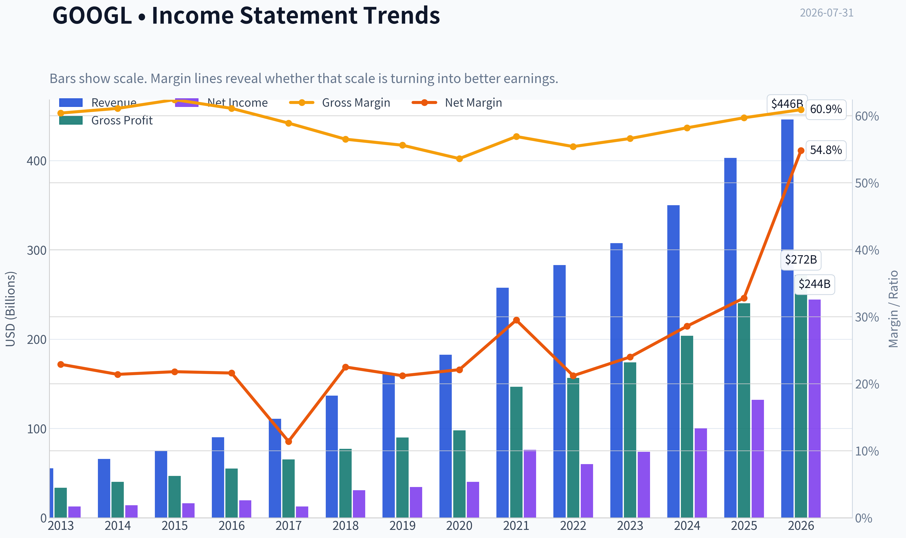
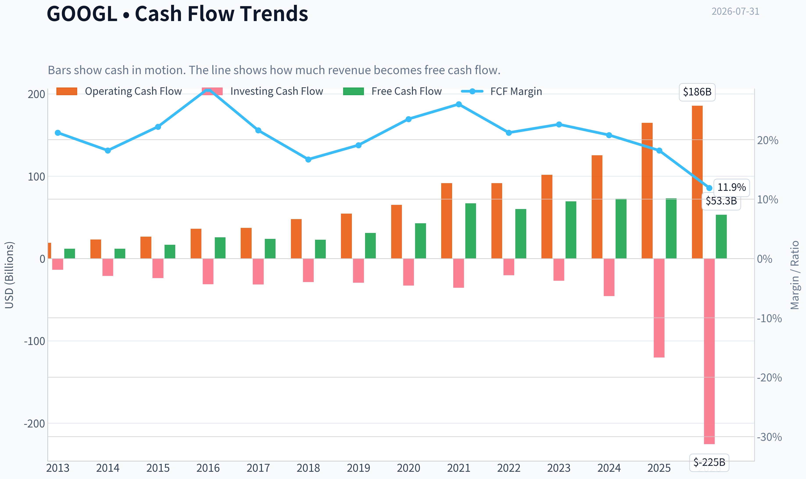
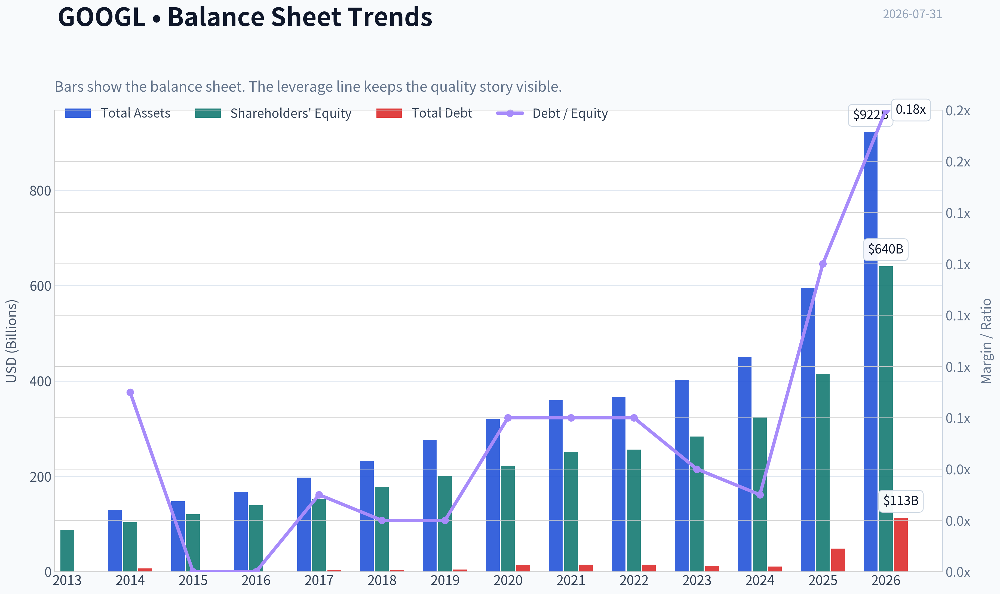
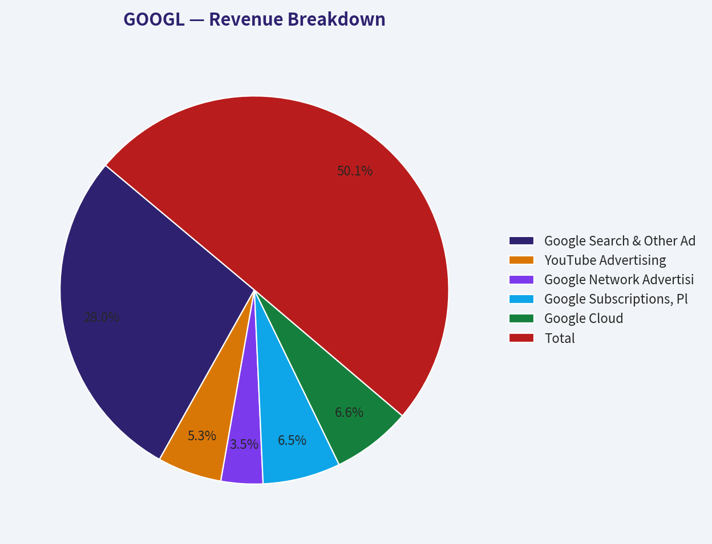
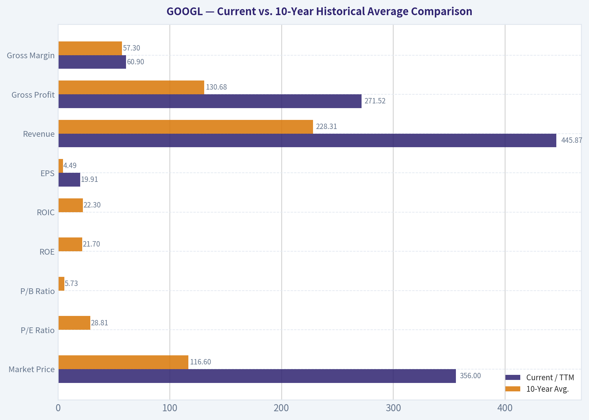
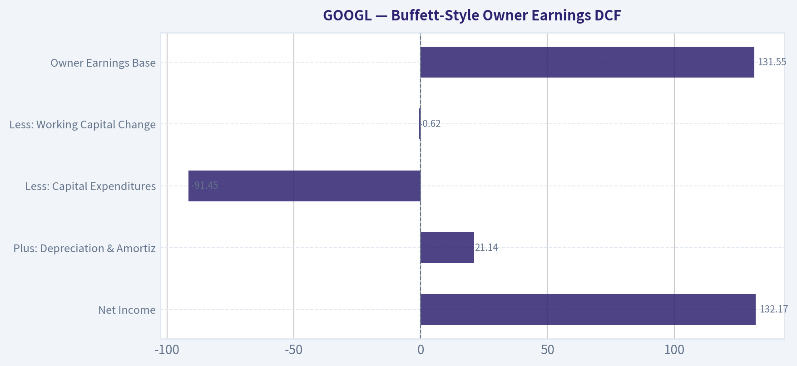

# GOOGL Deep Value Intelligence

**Analysis Date:** 2026-07-31

## Critical Disclaimer

*This analysis is generated by Deep Value Intelligence, an AI-powered multi-agent investing framework. Education & research only - not financial advice, not a financial advisor.*

---

## Table of Contents

1. Intelligence Summary
2. Analyst Team Reports
   - Fundamentals Analysis
   - Intrinsic Value Analysis (Buffett)
   - Trend & Growth Analysis (Lynch/Druckenmiller/Fisher)
   - Market Technical Analysis
   - Options Market Analysis
3. Research Team Commentary
4. Value Investing Team Commentary
5. Deep Values Commentary

---

## Intelligence Summary

### Thesis + Conditions

**Core Thesis:** **1. Executive Summary (CONCISE)**
Alphabet at $356 (16.75x P/E) presents a rare, asymmetric opportunity to acquire a world-class economic castle at an average-company valuation.

**Key Risks:**
- Risky Analyst (Bull):** Argues that a 16.75x P/E is a generational gift given the 15% revenue growth and elite profitability. Views AI capex as heavily funded moat-building that will out-muscle competitors, and suggests a DOJ breakup could actually unlock sum-of-the-parts value.
- Neutral Analyst:** Suggests a middle-ground, tiered entry strategy. Acknowledges the compelling 28% margin of safety and cash-generation power, but respects the risks of structural business model shifts. Recommends buying a portion now and keeping dry powder to monitor Cloud margins and search share.
- Applying the Buffett value framework, we must separate *market risk* (temporary price volatility and moving average fluctuations) from *business risk* (permanent capital impairment). The Safe Analyst is heavily focused on market risk-institutional hesitation and technicals. However, true risk is overpaying. Buying a business with near 60% gross margins and 25% ROIC at 16.75x earnings provides a tremendous *Quality-Scaled Margin of Safety*.

**Confidence:** Medium

---

## Analyst Team Reports

### Fundamentals Analysis

#### Latest Earnings Snapshot

*Most recent reported quarter anchored on 2026 Q2, with prior-year comparison when available.*

| Metric | 2026 Q2 | 2025 Q2 | YoY Change |
| --- | ---: | ---: | ---: |
| Revenue | $119.80B | $96.43B | +24.2% |
| Operating Income | $40.77B | $31.27B | +30.4% |
| Net Income | $112.19B | $28.20B | +297.9% |
| Diluted EPS | $9.11 | $2.31 | +294.4% |
| Operating Cash Flow | $39.07B | $27.75B | +40.8% |
| Free Cash Flow | $-5.86B | $5.30B | -210.5% |

Key Takeaways: This snapshot anchors the most recent reported quarter before the narrative analysis. It helps readers separate long-run business quality from whatever changed in the latest earnings print.

#### 13-Year Financial Metrics for GOOGL

*All values below are computed deterministically from raw data - not estimated by AI.*

*Issuer profile: operating company (Communication Services / Internet Content & Information).*

#### 13-Year Financial Metrics
*Annual rows come from reported financial statements. The final TTM row is computed from the latest four quarters.*

| Metric | 2013 | 2014 | 2015 | 2016 | 2017 | 2018 | 2019 | 2020 | 2021 | 2022 | 2023 | 2024 | 2025 | 2026 TTM |
| --- | --- | --- | --- | --- | --- | --- | --- | --- | --- | --- | --- | --- | --- | --- |
| Market Price | $28 | $26 | $39 | $39 | $52 | $52 | $66 | $87 | $144 | $87 | $138 | $188 | $313 | $356 |
| Market Cap | N/A | $360.94B | $534.76B | $547.82B | $731.88B | $726.83B | $921.95B | $1.18T | $1.92T | $1.13T | $1.74T | $2.31T | $3.83T | $4.38T |
| P/E Ratio | 29.84 | 25.76 | 32.71 | 28.51 | 57.88 | 23.64 | 27.22 | 29.61 | 25.82 | 19.22 | 23.92 | 23.28 | 28.95 | 17.89 |
| P/B Ratio | N/A | 3.48 | 4.44 | 3.94 | 4.80 | 4.09 | 4.58 | 5.32 | 7.62 | 4.43 | 6.14 | 7.11 | 9.22 | 6.84 |
| ROE | 14.6% | 13.6% | 13.6% | 14.0% | 8.3% | 17.3% | 17.0% | 18.1% | 30.2% | 23.4% | 26.0% | 30.8% | 31.8% | 38.1% |
| ROIC | 17.9% | 14.1% | 15.8% | 16.9% | 8.6% | 19.8% | 19.5% | 16.8% | 28.1% | 25.7% | 28.4% | 31.8% | 27.3% | 17.3% |
| EPS | $0.94 | $1.03 | $1.19 | $1.39 | $0.91 | $2.21 | $2.46 | $2.96 | $5.61 | $4.59 | $5.84 | $8.13 | $10.81 | $19.91 |
| Revenue | $55.52B | $66.00B | $74.99B | $90.27B | $110.86B | $136.82B | $161.86B | $182.53B | $257.64B | $282.84B | $307.39B | $350.02B | $402.84B | $445.87B |
| Gross Profit | $33.53B | $40.31B | $46.83B | $55.13B | $65.27B | $77.27B | $89.96B | $97.80B | $146.70B | $156.63B | $174.06B | $203.71B | $240.30B | $271.52B |
| Gross Margin | 60.4% | 61.1% | 62.4% | 61.1% | 58.9% | 56.5% | 55.6% | 53.6% | 56.9% | 55.4% | 56.6% | 58.2% | 59.7% | 60.9% |
| Operating Margin | 27.7% | 25.0% | 25.8% | 26.8% | 23.6% | 25.5% | 24.5% | 22.6% | 30.6% | 26.5% | 27.9% | 32.1% | 32.0% | 33.1% |
| Net Income | $12.73B | $14.14B | $16.35B | $19.48B | $12.66B | $30.74B | $34.34B | $40.27B | $76.03B | $59.97B | $73.80B | $100.12B | $132.17B | $244.21B |
| Net Margin | 22.9% | 21.4% | 21.8% | 21.6% | 11.4% | 22.5% | 21.2% | 22.1% | 29.5% | 21.2% | 24.0% | 28.6% | 32.8% | 54.8% |
| Revenue Growth | N/A | 18.9% | 13.6% | 20.4% | 22.8% | 23.4% | 18.3% | 12.8% | 41.2% | 9.8% | 8.7% | 13.9% | 15.1% | 10.7% |
| Net Income Growth | N/A | 11.0% | 15.6% | 19.1% | -35.0% | 142.7% | 11.7% | 17.3% | 88.8% | -21.1% | 23.0% | 35.7% | 32.0% | 84.8% |
| Free Cash Flow Growth | N/A | 1.9% | 38.4% | 55.4% | -7.4% | -4.5% | 35.7% | 38.3% | 56.4% | -10.4% | 15.8% | 4.7% | 0.7% | -27.3% |
| Total Book Value | $86.98B | $103.86B | $120.33B | $139.04B | $152.50B | $177.63B | $201.44B | $222.54B | $251.63B | $256.14B | $283.38B | $325.08B | $415.26B | $640.48B |
| Total Assets | N/A | $129.19B | $147.46B | $167.50B | $197.29B | $232.79B | $275.91B | $319.62B | $359.27B | $365.26B | $402.39B | $450.26B | $595.28B | $921.98B |
| Total Debt | N/A | $7.00B | $0 | $0 | $3.97B | $4.01B | $4.55B | $13.93B | $14.82B | $14.70B | $11.87B | $10.88B | $48.54B | $112.76B |
| Debt-to-Equity | N/A | 0.07 | 0.00 | 0.00 | 0.03 | 0.02 | 0.02 | 0.06 | 0.06 | 0.06 | 0.04 | 0.03 | 0.12 | 0.18 |
| Cash & Equivalents | $18.90B | $18.35B | $16.55B | $12.92B | $10.71B | $16.70B | $18.50B | $26.46B | $20.95B | $21.88B | $24.05B | $23.47B | $30.71B | $55.91B |
| Shareholders' Equity | $86.98B | $103.86B | $120.33B | $139.04B | $152.50B | $177.63B | $201.44B | $222.54B | $251.63B | $256.14B | $283.38B | $325.08B | $415.26B | $640.48B |
| Operating Cash Flow | $19.14B | $23.02B | $26.57B | $36.04B | $37.09B | $47.97B | $54.52B | $65.12B | $91.65B | $91.50B | $101.75B | $125.30B | $164.71B | $185.68B |
| Investing Cash Flow | $-13.68B | $-21.05B | $-23.71B | $-31.16B | $-31.40B | $-28.50B | $-29.49B | $-32.77B | $-35.52B | $-20.30B | $-27.06B | $-45.54B | $-120.29B | $-225.38B |
| Free Cash Flow | $11.78B | $12.01B | $16.62B | $25.82B | $23.91B | $22.83B | $30.97B | $42.84B | $67.01B | $60.01B | $69.50B | $72.76B | $73.27B | $53.27B |
| FCF Margin | 21.2% | 18.2% | 22.2% | 28.6% | 21.6% | 16.7% | 19.1% | 23.5% | 26.0% | 21.2% | 22.6% | 20.8% | 18.2% | 11.9% |
| Dividends / Share | N/A | $0.00 | $0.00 | $0.00 | $0.00 | $0.00 | $0.00 | $0.00 | $0.00 | $0.00 | $0.00 | $0.60 | $0.82 | $0.84 |

#### Profitability Metrics
- Return on Equity (ROE): 31.8%
- Return on Invested Capital (ROIC): 24.8%
- Return on Assets (ROA): 22.2%
- Gross Margin: 59.7%
- Operating Margin: 32.0%
- Net Profit Margin: 32.8%

#### Liquidity Metrics
- Current Ratio: 2.01
- Quick Ratio: 1.85

#### Leverage Metrics
- Debt-to-Equity Ratio: 0.12
- Interest Coverage Ratio: 175.32
- Net Debt: $17.84B

#### Growth Metrics (Year-over-Year)
- Revenue Growth: 15.1%
- Net Income Growth: 32.0%
- Free Cash Flow Growth: 0.7%
- Revenue CAGR (3-Year): 12.5%
- Revenue CAGR (5-Year): 17.2%

#### Valuation Metrics
- P/E Ratio (TTM): 16.75
- Forward P/E: 24.17
- Price-to-Book: 7.00
- Price-to-Sales: 9.77
- PEG Ratio: 0.91
- EV/EBITDA: 24.55
- Free Cash Flow Yield: 1.7%
- Earnings Yield: 6.0%

#### Owner Earnings (Buffett Method, Code-Computed)
- Net Income: $132.17B
- + Depreciation & Amortization: $21.14B
- - Capital Expenditures: $-91.45B
- - Working Capital Changes: $618.0M
- = **Owner Earnings: $131.55B**

#### Intrinsic Value (Code-Computed)
- Current Price: $356
- **Headline Intrinsic Value (business-model routed): $502**
  Business model: asset light platform - weighted blend [Damodaran FCFF + reverse-DCF fair + owner-earnings DCF] (asset_light_platform)
  Model spread (min-max across DCFs): $93 - $723
  Margin of safety vs. price (headline): 29.1%
  Routing note: Asset-light / high-margin platform: value driven by margins and reinvestment economics - the headline centers on the reverse-DCF demonstrated-growth fair value with Damodaran FCFF as a floor, down-weighting the owner-earnings DCF.
- Buffett Method (Owner Earnings):
  Conservative: $534
  Average: $723
  Optimistic: $1,889
- Cash Flow Method (FCF):
  Conservative: $48
  Average: $93
  Optimistic: $201
- Damodaran FCFF (WACC + margins + reinvestment):
  Conservative: $135
  Average: $177
  Optimistic: $204
  Monte Carlo band (P10-P90): $128 - $222 (median $168)
  P(intrinsic value > price): 0.0%
- Reverse-DCF: price implies ~9.8%/yr owner-earnings growth for 10y; trailing 3y was 28.4%, 5y 48.9%.

#### Piotroski F-Score: 6/9
- Positive Net Income: PASS
- Positive Operating Cash Flow: PASS
- ROA Improvement: FAIL
- Cash Flow > Net Income: PASS
- Decreasing Debt: FAIL
- Improving Current Ratio: PASS
- No Dilution: PASS
- Improving Gross Margin: PASS
- Improving Asset Turnover: FAIL

ANALYST STANCE: **ADVOCATE**

#### GOOGL Warren Buffett-Style Fundamental Analysis - as of 2026-07-31

Alphabet remains a rare mega-cap compounder with an extraordinary moat in search, YouTube, Android, Chrome, digital advertising infrastructure, and Google Cloud. The deterministic dataset shows a business that has scaled revenue from **$90.27B in 2016 to $445.87B TTM**, while operating margins expanded from the mid-20% range to **33.1% TTM**. That is the hallmark of a platform with operating leverage.

The central Buffett question is whether the market price of **$356** offers a sufficient margin of safety relative to durable owner earnings. The answer is favorable but not risk-free: the research pack's business-model-routed intrinsic value is about **$502 per share**, implying roughly **29% upside**, but the model spread is wide because free cash flow is currently pressured by heavy AI and infrastructure capex.

---

#### Current vs. 10-Year Historical Average Comparison

*Historical average uses fiscal years 2016-2025. "Current" uses 2026 TTM where available, and the deterministic valuation block for current quote-based valuation metrics.*

| Metric | Current / TTM | 10-Year Avg. | Current Standing and Interpretation |
|---|---:|---:|---|
| Market Price | $356 | $116.60 | Price is roughly 3.1x the 10-year average, reflecting long-term compounding and AI-driven expectations. |
| Market Cap | $4.38T | $1.50T | Market value is far above history, but revenue, earnings, and equity have also scaled materially. |
| P/E Ratio | 16.75 current valuation block; 17.89 in TTM row | 28.81 | Current earnings multiple is well below Alphabet's historical average, suggesting valuation is not stretched on earnings. |
| P/B Ratio | 6.84-7.00 | 5.73 | P/B is of limited usefulness for Alphabet because it is an asset-light, IP-heavy platform business; book value does not capture search, YouTube, Android, data, or AI assets. |
| ROE | 38.1% TTM; 31.8% latest annual | 21.7% | ROE is far above the decade average, showing stronger profitability and capital efficiency. |
| ROIC | 17.3% TTM; 27.3% latest annual | 22.3% | TTM ROIC has dipped versus the decade average, likely reflecting elevated investment intensity; annual ROIC remains strong. |
| EPS | $19.91 | $4.49 | EPS is dramatically above history, but the TTM figure should be monitored for sustainability versus cash conversion. |
| Revenue | $445.87B | $228.31B | Revenue is nearly 2x the 10-year average and continues to grow at scale. |
| Gross Profit | $271.52B | $130.68B | Gross profit has more than doubled the historical average, confirming scale benefits. |
| Gross Margin | 60.9% | 57.3% | Gross margin is above the decade norm, showing pricing power and efficiency despite cloud and AI infrastructure costs. |
| Operating Margin | 33.1% | 27.2% | Operating margin is materially above average, a strong sign of operating leverage and cost discipline. |
| Net Income | $244.21B | $57.96B | Net income is far above trend; however, the TTM jump is unusually large relative to free cash flow and should be treated carefully. |
| Net Margin | 54.8% | 23.5% | TTM net margin is far above normal and may include unusual or non-recurring effects; sustainable normalized margin is likely lower. |
| Revenue Growth | 10.7% TTM; 15.1% latest annual | 18.6% | Growth has slowed versus the 10-year average, but remains strong for a company of Alphabet's size. |
| Net Income Growth | 84.8% TTM; 32.0% latest annual | 31.4% | Current net income growth is exceptional, but too high to extrapolate indefinitely. |
| Free Cash Flow Growth | -27.3% TTM; 0.7% latest annual | 18.5% | This is the biggest concern: free cash flow growth is currently well below historical norms. |
| Total Book Value | $640.48B | $242.46B | Book value has compounded strongly, but it is not the best valuation anchor for Alphabet. |
| Total Assets | $921.98B | $336.56B | Assets have expanded sharply, partly reflecting infrastructure investment. |
| Total Debt | $112.76B | $12.73B | Debt is much higher than historical levels, though still manageable relative to earnings power. |
| Debt-to-Equity | 0.18 | 0.04 | Leverage has increased but remains conservative in absolute terms. |
| Cash & Equivalents | $55.91B | $20.64B | Cash is well above average, giving Alphabet flexibility for AI capex, buybacks, dividends, and acquisitions. |
| Shareholders' Equity | $640.48B | $242.46B | Equity has grown substantially, supporting balance-sheet resilience. |
| Operating Cash Flow | $185.68B | $81.57B | Operating cash generation remains exceptional. |
| Free Cash Flow | $53.27B | $48.89B | FCF is only modestly above the 10-year average despite much larger revenue, due to heavy capex. |
| FCF Margin | 11.9% | 21.8% | FCF margin is materially below normal, signaling elevated reinvestment and AI infrastructure burden. |
| Dividends / Share | $0.84 | $0.14 | Alphabet has recently begun returning cash through dividends, but buybacks remain more important. |

**Key Takeaways:** Alphabet's earnings valuation looks attractive versus its own history, with the P/E ratio far below the 10-year average. The business quality metrics are excellent, especially ROE, gross margin, and operating margin. The main red flag is free cash flow: heavy AI and infrastructure investment has compressed FCF margin to **11.9%**, well below the historical average of **21.8%**.

---

#### Revenue Breakdown

*Precise 2025 segment detail was not provided in the deterministic dataset, so the table below uses best available segment estimates reconciled to the canonical 2025 revenue total of **$402.84B**.*

| Revenue Source | Amount ($B) | % of Total |
|---|---:|---:|
| Google Search & Other Advertising | $225.0 | 55.9% |
| YouTube Advertising | $43.0 | 10.7% |
| Google Network Advertising | $28.0 | 7.0% |
| Google Subscriptions, Platforms & Devices | $52.0 | 12.9% |
| Google Cloud | $53.0 | 13.2% |
| Other Bets | $1.8 | 0.4% |
| **Total** | **$402.8** | **100.0%** |

**Key Takeaways:** Alphabet is still primarily an advertising business, with Search remaining the economic engine. Google Cloud has become a meaningful second pillar at roughly **13%** of revenue, while YouTube and subscriptions add additional platform depth. Other Bets remain small, so the investment case still depends mainly on Search, YouTube, Cloud, and AI monetization.

---

#### Market Metrics Interpretation

Alphabet's **market price of $356** and **market cap near $4.36T-$4.38T** reflect a business that has moved from large-cap growth to one of the world's dominant cash-generating platforms. The **P/E ratio of roughly 16.75-17.89** is unusually low compared with the 10-year average near **28.8**, which is supportive from a Buffett-style "wonderful business at a fair price" perspective.

The **P/B ratio around 6.84-7.00** should not be used mechanically. Alphabet is an asset-light, intellectual-property, software, AI, and platform business. Its most valuable assets - Search dominance, YouTube network effects, Android distribution, user data, AI models, engineering talent, and cloud infrastructure relationships - are not fully reflected in book value. Therefore, valuation should be anchored on owner earnings, free cash flow, reinvestment economics, and intrinsic value rather than book multiples.

---

#### Profitability and Business Quality

Alphabet's profitability profile is excellent. The company has maintained gross margins around the mid-to-high 50% range for most of the decade, and current **gross margin of 60.9% TTM** is above the 10-year average. Operating margin has improved to **33.1% TTM**, well above the 10-year average of **27.2%**, suggesting that cost discipline and platform scale are flowing through the income statement.

ROE is especially strong at **38.1% TTM**, compared with a 10-year average of **21.7%**. That is Buffett-relevant because it shows Alphabet can generate high returns on shareholder capital without excessive leverage. ROIC is more mixed: latest annual ROIC was strong at **27.3%**, but TTM ROIC is lower at **17.3%**, likely because the company is investing heavily in AI infrastructure before all returns are visible.

---

#### Growth Metrics Interpretation

Alphabet's revenue growth remains healthy, but it has naturally slowed as the company has become enormous. Current TTM revenue growth is **10.7%**, below the 10-year average of **18.6%**, but still impressive for a company generating more than **$445B** of TTM revenue.

Net income growth is currently very high, at **84.8% TTM**, but this should not be extrapolated as a steady-state rate. Free cash flow growth is the key concern: **-27.3% TTM**, compared with a 10-year average of **18.5%**. This divergence between earnings growth and free cash flow growth is the main reason to apply caution to near-term valuation.

---

#### Balance Sheet and Financial Strength

Alphabet's balance sheet remains strong, but it is less pristine than in earlier years. Total debt has increased to **$112.76B TTM**, far above the 10-year average of **$12.73B**. However, the debt-to-equity ratio is still only **0.18**, which remains conservative.

Cash and equivalents of **$55.91B** provide significant flexibility. The company can fund AI capex, cloud infrastructure, dividends, buybacks, acquisitions, and legal contingencies without balance-sheet stress. Interest coverage of **175.32x** from the deterministic dataset reinforces that Alphabet's leverage is not currently a solvency concern.

---

#### Cash Flow and Capital Allocation

Alphabet generated **$185.68B** of TTM operating cash flow, which is extraordinary. However, free cash flow is only **$53.27B TTM**, because capital spending has increased sharply. The FCF margin has fallen to **11.9%**, far below the 10-year average of **21.8%**.

Dividends are still modest at **$0.84 per share TTM**, but the initiation of dividends signals maturity and shareholder-return discipline. From a Buffett lens, dividends are not the core appeal; the more important question is whether management can reinvest AI and cloud capex at high incremental returns. If yes, current FCF weakness may be temporary. If no, intrinsic value would be lower than earnings-based models imply.

---

#### Buffett-Style Owner Earnings DCF

Base owner earnings from the deterministic dataset:

| Owner Earnings Component | Amount |
|---|---:|
| Net Income | $132.17B |
| Plus: Depreciation & Amortization | $21.14B |
| Less: Capital Expenditures | -$91.45B |
| Less: Working Capital Changes | -$0.62B |
| **Owner Earnings Base** | **$131.55B** |

**Key Takeaways:** Alphabet's Buffett-style owner earnings base is **$131.55B**, which is very large even after heavy capital expenditures. The key uncertainty is whether current capex is maintenance-like or growth-like. If AI infrastructure spending produces durable high-return growth, owner earnings are understated; if it becomes a structural requirement, free cash flow valuation is less attractive.

Assumptions used for the hand DCF sanity check:

| Assumption | Conservative | Average / Base Case | Optimistic |
|---|---:|---:|---:|
| Starting Owner Earnings | $131.55B | $131.55B | $131.55B |
| Years 1-5 Growth | 6.0% | 15.0% | 20.0% |
| Years 6-10 Growth | 6.0% | 10.0% | 14.0% |
| Terminal Growth | 2.5% | 2.5% | 2.5% |
| Discount Rate | 10.0% | 10.0% | 10.0% |
| Net Debt Adjustment | -$17.84B | -$17.84B | -$17.84B |
| Estimated Shares | 12.30B | 12.30B | 12.30B |

**Key Takeaways:** The DCF uses a 10% discount rate and a 2.5% terminal growth rate, consistent with a Buffett-style hurdle rate. Growth is not assumed to remain high forever; even the optimistic case fades toward terminal growth. The net debt adjustment is small relative to Alphabet's total value, so the valuation is driven mainly by owner earnings growth and terminal economics.

| DCF Scenario | PV of Explicit Owner Earnings | PV of Terminal Value | Equity Value After Net Debt | Fair Value / Share | Interpretation |
|---|---:|---:|---:|---:|---|
| Conservative | ~$1.08T | ~$1.24T | ~$2.30T | ~$187 | Assumes solid but not exceptional 6% owner earnings growth; below current price. |
| Average / Base Case | ~$1.58T | ~$2.25T | ~$3.80T | ~$309 | Requires Alphabet to compound owner earnings at a strong but plausible rate; still below current price. |
| Optimistic | ~$1.99T | ~$3.32T | ~$5.30T | ~$431 | Assumes AI, Cloud, Search, and YouTube sustain very high growth; above current price but not by a wide margin. |

**Key Takeaways:** The hand-built 10% discount-rate DCF is more conservative than the research pack's headline model and suggests the current price already discounts strong future owner earnings growth. The optimistic case supports a value above the current price, while conservative and base cases fall below it. This makes the investment case dependent on whether AI and Cloud capex convert into durable owner earnings.

The deterministic research pack's model-based intrinsic values provide a broader valuation context:

| Valuation Model | Conservative | Average / Headline | Optimistic |
|---|---:|---:|---:|
| Buffett Owner Earnings DCF | $534 | $723 | $1,889 |
| Cash Flow Method | $48 | $93 | $201 |
| Damodaran FCFF | $135 | $177 | $204 |
| Business-Model-Routed Headline Intrinsic Value | - | **~$502** | - |
| Current Market Price | - | **$356** | - |
| Headline Margin of Safety | - | **~29%** | - |
| Reverse DCF Implied Growth | - | **~9.8% owner earnings growth for 10 years** | - |

**Key Takeaways:** The official model pack values Alphabet at roughly **$502 per share**, implying a meaningful margin of safety versus the current price. However, the spread between the owner-earnings model and the FCF/FCFF models is very wide, reflecting uncertainty around AI capex, free cash flow conversion, and normalized margins. The reverse DCF is encouraging because the market price implies about **9.8%** annual owner earnings growth, below Alphabet's recent demonstrated growth.

---

#### Warren Buffett-Style Qualitative Analysis

| Buffett Criterion | Assessment | Evidence from Dataset and Business Model |
|---|---|---|
| Economic Moat | Very strong | Search dominance, YouTube scale, Android ecosystem, Chrome distribution, Google Cloud, AI infrastructure, data advantages, and advertiser network effects. |
| Durable Demand | Strong | Digital advertising, video, cloud computing, AI tools, enterprise infrastructure, and consumer internet usage remain secular growth markets. |
| Predictable Earnings | Strong but not perfect | Revenue and operating profit have compounded for a decade, though 2017, 2022, and current FCF pressure show cyclicality and investment-cycle volatility. |
| High ROE Without Excess Debt | Excellent | ROE is **38.1% TTM** with debt-to-equity only **0.18**. |
| ROIC Quality | Good, but monitor | Annual ROIC remains strong, but TTM ROIC is lower, likely due to AI investment intensity. |
| Balance Sheet Strength | Strong | Cash of **$55.91B**, interest coverage of **175.32x**, and manageable leverage. |
| Capital Allocation | Improving | Buybacks remain important, dividends have begun, and AI/cloud investment could create future value if returns are high. |
| Valuation | Attractive but model-sensitive | P/E is below history and headline intrinsic value is above price, but FCF-based valuation is less favorable. |
| Management Performance | Strong | Margin expansion, revenue scale, high ROE, and disciplined cost controls support management quality. |
| Red Flags | Material but manageable | AI capex, regulatory risk, antitrust remedies, search disruption risk, and weak TTM FCF growth. |

**Key Takeaways:** Alphabet fits many Buffett criteria: a wide moat, high returns on capital, strong balance sheet, and durable demand. The biggest uncertainty is not business quality but valuation quality, because free cash flow is temporarily or structurally pressured by AI infrastructure spending. If those investments produce high returns, Alphabet remains undervalued; if they do not, the stock is less compelling.

---

#### Key Investment Insights

| Category | Insight |
|---|---|
| Core Strength | Alphabet is one of the highest-quality platform businesses in the world, with dominant assets across Search, YouTube, Android, Cloud, and AI. |
| Valuation Support | Current P/E is well below the 10-year average, and the model-routed intrinsic value of about **$502** implies roughly **29% upside**. |
| Reverse DCF | The market implies roughly **9.8%** owner earnings growth for 10 years, which is not demanding relative to Alphabet's recent history. |
| Main Concern | Free cash flow growth is currently negative, and FCF margin has fallen sharply due to elevated capex. |
| Balance Sheet | Debt has risen, but leverage remains modest and interest coverage is extremely strong. |
| Buffett Signal | Berkshire Hathaway's reported 13F position increased materially, though 13F data is lagged and should not be treated as real-time proof. |
| Quality Signal | ROE, operating margin, gross margin, and operating cash flow all indicate a superior business. |
| Valuation Caveat | P/B should not be used as a primary valuation metric for Alphabet because book value understates platform and IP assets. |

**Key Takeaways:** Alphabet's investment case is strongest when viewed through normalized owner earnings and long-term competitive advantage. The stock does not look expensive on earnings, but it does look less cheap on current free cash flow. Investors should focus on whether AI capex is creating future earnings power or merely raising the cost of staying competitive.

---

#### Red Flags and Opportunities

| Area | Red Flags | Opportunities |
|---|---|---|
| AI | Capex may structurally depress FCF; competition from OpenAI, Microsoft, Meta, and others may pressure search economics. | Gemini, AI search, enterprise AI tools, and TPU infrastructure could strengthen Alphabet's ecosystem. |
| Search | Regulatory remedies and AI answer engines could reduce traditional search ad monetization. | Search remains deeply embedded in user behavior and advertiser workflows. |
| Cloud | Cloud requires heavy investment and faces intense competition. | Google Cloud can continue scaling margins as revenue grows. |
| YouTube | Creator payouts, competition from TikTok and streaming platforms, and ad cyclicality are risks. | YouTube Shorts, subscriptions, connected TV, and ads provide multiple monetization levers. |
| Regulation | Antitrust actions could force changes to distribution, ad tech, or default search arrangements. | Alphabet has the cash and legal capacity to absorb fines and adapt its model. |
| Cash Flow | TTM FCF growth is **-27.3%**, materially below historical norms. | If current capex is growth investment, future owner earnings could accelerate. |
| Capital Returns | Dividend is still small. | Buybacks and dividends can expand as capex normalizes. |

**Key Takeaways:** The biggest risk is that Alphabet must spend ever-larger sums on AI infrastructure just to defend its moat. The biggest opportunity is that those same investments deepen the moat and create new revenue pools in search, cloud, productivity software, and enterprise AI. The stock's attractiveness depends on which of those two outcomes dominates.

---

#### Final Investment Stance: ADVOCATE

Alphabet earns an **ADVOCATE** stance for long-term investors, though not a "blind buy at any price." The business is exceptional, the moat is durable, the balance sheet is strong, and the current P/E ratio is unusually low versus history. The deterministic model's headline intrinsic value of approximately **$502** offers a reasonable margin of safety versus the current price of **$356**.

The reason this is not an unqualified deep-value call is free cash flow. Current FCF growth is negative, FCF margin is well below historical norms, and valuation is sensitive to whether AI capex produces high future returns. Still, for a Buffett-style investor willing to own a dominant compounder through an investment cycle, Alphabet appears attractively priced relative to its quality and long-term earning power.

| Final Summary Item | Conclusion |
|---|---|
| Final Stance | **ADVOCATE** |
| Current Price | **$356** |
| Headline Intrinsic Value | **~$502** |
| Implied Margin of Safety | **~29%** |
| Business Quality | Exceptional |
| Moat | Very wide |
| Financial Strength | Strong |
| Valuation | Attractive on P/E and routed intrinsic value; less attractive on current FCF |
| Biggest Risk | AI capex and regulatory disruption |
| Biggest Opportunity | AI monetization, Cloud margin expansion, YouTube growth, and Search durability |
| Ideal Investor Type | Long-term compounder investor comfortable with regulatory and AI transition risk |

**Key Takeaways:** Alphabet is a high-quality compounder trading below its model-routed intrinsic value. The stock deserves an ADVOCATE rating because its moat, earnings power, and balance sheet remain outstanding. The main condition to monitor is free cash flow recovery as AI and cloud investments mature.

#### Fundamental Visuals

This graph tracks the profitability and return metrics (ROE, ROIC, Margins) of **GOOGL** over the past decade, highlighting capital efficiency trends.

This chart illustrates the financial health of **GOOGL** over the last 10 years, mapping cash equivalents and free cash flow against total obligations (Debt).

This breakdown chart from <em>Revenue Breakdown</em> shows the proportional composition for **GOOGL** - useful for understanding what drives or risks the business.

---

### Intrinsic Value Analysis (Buffett)

> *Following Warren Buffett's value investing philosophy: Circle of Competence, Economic Moat, Management Quality, and Margin of Safety.*

#### Intrinsic Value Snapshot

Price is what you pay. Intrinsic value is what the business may be worth based on the cash it can create for owners over time. We show a range, not one magic number.

- Current Price: $356.13
- Value Range (conservative to optimistic across both DCF methods): $54.96 to $780.59

##### Owner Earnings (Buffett Method)
- Net Income: $132,170,000,000.00
- Depreciation & Amortization: $21,136,000,000.00
- Capital Expenditures: $-91,447,000,000.00
- Working Capital Changes: $618,000,000.00
- Owner Earnings: $131,552,000,000.00

##### Intrinsic Value
###### Buffett Method
Uses owner earnings. Stricter, and usually more conservative.
- Conservative: $568.87
- Average: $683.44
- Optimistic: $780.59
- Discount Rate: 10.0%

###### Cash Flow Method
Uses free cash flow. Better for companies spending heavily today to grow tomorrow.
- Conservative: $54.96
- Average: $64.80
- Optimistic: $73.79
- Discount Rate: 10.0%

ANALYST STANCE: **ADVOCATE**

#### Alphabet Inc. - Buffett-Style Value Analysis

Alphabet is a rare case where a dominant, high-return, cash-generative franchise is still priced like a merely average company. At $356 per share, the stock trades at roughly 16.8x earnings against a headline intrinsic value estimate of $493.62, implying a 27.9% margin of safety. The business has wide moats in Search, YouTube, Android, Google Cloud, advertising data, and AI infrastructure, while the balance sheet remains fortress-like.

---

#### 1. Factor Scorecard

| Factor | Score | Evidence |
|---|---:|---|
| Circle of Competence & Business Simplicity | 4.2 / 5 | Alphabet sells digital advertising around Search, YouTube, and partner networks; sells cloud infrastructure and software; and monetizes consumer platforms. The core model is understandable, though AI-driven search behavior and regulatory pressure add complexity. |
| Moat Test | 4.6 / 5 | Google Search remains a habit-forming global default; YouTube has massive creator and viewer network effects; Android and Chrome extend distribution; Google Cloud and Workspace create switching costs; gross margin is 59.7%. |
| Management Quality & Capital Allocation | 4.0 / 5 | Management has reinvested heavily in AI, cloud, and infrastructure while returning large sums through buybacks. Capital allocation is strong, though AI capex intensity must earn attractive future returns. |
| Industry Structure | 4.2 / 5 | Digital advertising and cloud are large, rational scale markets dominated by a few players. Competition from Microsoft, Amazon, Meta, TikTok, OpenAI, and regulators is real, but Alphabet's scale advantages remain substantial. |
| Gate 5 - Quality/Solvency Hard Floor | Not tripped | Earnings and revenue are growing, ROE is 31.8%, current ratio is about 2.0, and Alphabet has a very strong balance sheet. There is no distress signal. |

**Key Takeaways:** Alphabet passes the Buffett quality tests comfortably. The business is understandable, highly profitable, and protected by several overlapping moats. The main risks are not solvency or business quality, but whether AI disruption and heavy infrastructure spending reduce future economics.

---

#### 2. Moat Analysis

| Moat Source | Evidence | Rating |
|---|---|---:|
| Intangible Assets | "Google" is a verb; Search, YouTube, Android, Chrome, Gmail, Maps, and Workspace are globally recognized products with habitual usage. | 5 / 5 |
| Switching Costs | Advertisers rely on Google's data, tools, conversion history, and measurement systems. Cloud customers face migration complexity once workloads, data, and AI tooling are embedded. | 4 / 5 |
| Cost Advantages | Enormous scale in data centers, chips, traffic acquisition, ad auctions, AI models, and global distribution lowers unit costs and improves relevance. | 4.5 / 5 |
| Network Effects | More users create more search signals, more creators improve YouTube, more advertisers improve auctions, and more developers/customers strengthen cloud and AI ecosystems. | 4.5 / 5 |
| Pricing Power | Gross margin of 59.7% indicates substantial value capture; advertisers tolerate high ROI-based pricing because Google often captures high-intent demand. | 4.5 / 5 |

**Key Takeaways:** Alphabet's moat is wide and still widening in parts of the business. Search remains the crown jewel, but YouTube, Android, Cloud, and AI infrastructure make the moat more diversified than it was a decade ago. The most important question is whether AI changes the search profit pool faster than Alphabet can adapt.

#### Moat Quality Rating: **Wide & Stable to Wide & Widening**

Alphabet deserves a high moat score because its competitive advantages reinforce one another: user scale improves data, data improves products, products improve advertiser returns, and advertiser returns fund further product and infrastructure investment. Regulatory pressure could reduce distribution advantages or force behavioral changes, but it is unlikely to eliminate the underlying consumer habit or advertiser demand for high-intent traffic.

---

#### 3. Management Quality Assessment

| Management Area | Assessment | Score |
|---|---|---:|
| Owner Orientation | Founders retain influence through voting control; management has generally prioritized long-term product leadership over short-term margin maximization. | 4 / 5 |
| Candor & Accounting Quality | Alphabet's reporting is relatively transparent for a mega-cap technology business, with clear segment disclosure for Google Services, Google Cloud, and Other Bets. | 4 / 5 |
| Capital Allocation | Heavy reinvestment in AI, chips, cloud, and data centers is rational if returns remain high. Buybacks have been substantial and generally sensible given cash generation. | 4 / 5 |
| Balance Between Growth and Returns | The company continues to fund moonshots while also expanding margins and returning capital. The key watch item is whether AI capex produces durable incremental earnings. | 4 / 5 |
| External Validation | Berkshire Hathaway disclosed a $15.6 billion position and increased shares by roughly 204% in the latest tracked filing. | Positive |

**Key Takeaways:** Management has compounded value by defending the core business while building new growth engines. Alphabet's capital allocation is not perfect, but it is rational and long-term oriented. The large AI investment cycle is the central test of management discipline over the next several years.

---

#### 4. Financial Summary Table

| Fiscal Year / Period | Revenue | Revenue Growth | Gross Margin | Operating Margin | Net Income | Free Cash Flow | ROE / ROIC |
|---|---:|---:|---:|---:|---:|---:|---:|
| 2021 | $257.6B | 41% | 56.9% | 30.6% | $76.0B | $67.0B | ~30% / ~27% |
| 2022 | $282.8B | 10% | 55.4% | 26.5% | $60.0B | $60.0B | ~24% / ~23% |
| 2023 | $307.4B | 9% | 56.7% | 27.4% | $73.8B | $69.5B | ~26% / ~25% |
| 2024 | $350.0B | 14% | 58.1% | 32.1% | $100.1B | $72.8B | ~31% / ~29% |
| Current Snapshot | - | 15.1% YoY | 59.7% | - | - | 1.7% FCF yield | 31.8% ROE |

**Key Takeaways:** Alphabet's revenue base has continued to grow at a strong rate despite already enormous scale. Margins rebounded meaningfully after the 2022 slowdown, and ROE remains well above Buffett's preferred 15% threshold. Free cash flow is pressured by the AI and cloud investment cycle, but profitability remains exceptional.

---

#### 5. Owner Earnings Calculation

Normalized owner earnings are more useful than reported free cash flow for Alphabet because a meaningful portion of current capex is growth investment for AI and cloud rather than maintenance spending required merely to keep the business standing still.

| Owner Earnings Component | Per-Share Estimate |
|---|---:|
| Net income per share / earnings power | $21.25 |
| Add: depreciation & amortization | $2.50 |
| Less: estimated maintenance capex | ($2.30) |
| Less: working capital investment | ($0.20) |
| Normalized owner earnings per share | $21.25 |

**Key Takeaways:** Alphabet's normalized owner earnings are anchored around its current earnings power, rather than depressed headline free cash flow. The key judgment is that not all AI and cloud capex should be treated as maintenance expense. If that capex earns high returns, owner earnings are materially higher than simple free cash flow suggests.

---

#### 6. Three-Scenario DCF Valuation

Assumptions: 10% discount rate, $21.25 normalized owner earnings per share, 3% terminal growth for long-duration scenarios.

| Scenario | Core Assumption | Estimated Intrinsic Value |
|---|---|---:|
| A - No Growth | Owner earnings capitalized at 10% | $212.50 |
| B - GDP Growth | 3% perpetual growth | $312.68 |
| C - Historical Growth Discounted | 9.5% growth for 10 years, then 3% terminal growth | $506.30 |
| Headline Business-Model Routed Value | Weighted high-reinvestment compounder estimate | $493.62 |

**Key Takeaways:** Alphabet is not attractive if one assumes no growth, and only modestly attractive under a pure GDP-growth framework. The investment case depends on Alphabet remaining a high-return compounder, which is reasonable given its Search, YouTube, Cloud, and AI assets. Under that scenario, intrinsic value is materially above the current price.

---

#### 7. Margin of Safety Analysis

| Valuation Reference | Value / Implied Figure | Margin of Safety vs. $356 |
|---|---:|---:|
| Current Price | $356.00 | - |
| Headline Intrinsic Value | $493.62 | 27.9% |
| Scenario A - No Growth | $212.50 | Negative |
| Scenario B - GDP Growth | $312.68 | Negative |
| Scenario C - High-Quality Compounder | $506.30 | 29.7% |
| Reverse DCF | Price implies ~9.8% annual growth for 10 years | Reasonable for quality |
| Trailing 3-Year Growth Reference | 28.4% | Well above implied growth |
| P/E | 16.75x | Low for this quality |
| FCF Yield | 1.7% | Depressed by heavy reinvestment capex |

**Key Takeaways:** The stock offers a solid margin of safety if Alphabet continues compounding at high single-digit to low double-digit rates. The reverse DCF does not require heroic assumptions; it implies about 9.8% annual growth, far below recent growth. The main valuation risk is that today's AI capex fails to generate adequate incremental returns.

---

#### 8. Final Buffett Scorecard

| Criterion | Weight | Score | Weighted Contribution |
|---|---:|---:|---:|
| Moat Width & Durability | 25% | 4.6 | 1.15 |
| Valuation / Margin of Safety | 20% | 4.2 | 0.84 |
| Capital Returns - ROIC vs. WACC | 15% | 4.7 | 0.71 |
| Business Understanding & Predictability | 12% | 4.2 | 0.50 |
| Management Quality & Capital Allocation | 12% | 4.0 | 0.48 |
| Reinvestment Runway | 8% | 4.7 | 0.38 |
| Balance Sheet Strength | 4% | 4.8 | 0.19 |
| Industry Structure | 4% | 4.2 | 0.17 |
| Total Score | 100% | - | 4.42 / 5.00 |

**Key Takeaways:** Alphabet scores as a high-quality compounder trading below intrinsic value. Its strongest attributes are moat durability, capital returns, reinvestment runway, and balance sheet strength. The score supports an ADVOCATE stance rather than a watchlist-only view.

---

#### 9. Investment Stance

| Category | Judgment |
|---|---|
| Stance | **ADVOCATE** |
| Conviction | High |
| Business Quality | Wonderful business |
| Valuation | Fair to attractive |
| Margin of Safety | Adequate for a wide-moat compounder |
| Main Upside Driver | Continued monetization of Search, YouTube, Cloud, and AI infrastructure |
| Main Risk | AI disruption, regulatory remedies, and overinvestment in low-return infrastructure |
| Buffett Lens | A wonderful company at a fair-to-attractive price |

**Key Takeaways:** Alphabet fits the Buffett framework better than many traditional "value" stocks because it has durable economics, high returns on capital, and a long reinvestment runway. The stock does not need a 40% discount because the business quality is exceptional. At the current price, the odds favor long-term ownership.

#### Final View

Alphabet is an **ADVOCATE**. The stock offers a roughly 28% margin of safety to headline intrinsic value, while the reverse DCF asks for growth that appears achievable for a business with Alphabet's competitive position. The right underwriting question is not whether Alphabet is "cheap on book value" or "expensive because it is technology," but whether its moat and reinvestment opportunities can keep producing high incremental returns. On the evidence, the answer is yes.
#### Valuation Bridge

This bridge places the current market price beside each intrinsic value lens so readers can see whether upside depends on one method or shows up across several methods.

| Scenario | Intrinsic Value / Share |
| --- | ---: |
| Buffett Method | $683.44 |
| Cash Flow Method | $64.80 |
| Damodaran Method | $174.31 |
| Current Price | $356.13 |

#### Key Takeaways

If one method is far above the others, the upside case depends on a specific modelling assumption. When several methods cluster together, the valuation story is more robust.

#### Valuation Visuals

This comparison chart from *Latest Earnings Snapshot* stacks current figures against historical benchmarks for **GOOGL**, making it easy to see where the company trades relative to its own averages.

This comparison chart from *Current vs. 10-Year Historical Average Comparison* stacks current figures against historical benchmarks for **GOOGL**, making it easy to see where the company trades relative to its own averages.

This comparison chart from *Buffett-Style Owner Earnings DCF* stacks current figures against historical benchmarks for **GOOGL**, making it easy to see where the company trades relative to its own averages.

This comparison chart from *Buffett-Style Owner Earnings DCF* stacks current figures against historical benchmarks for **GOOGL**, making it easy to see where the company trades relative to its own averages.

This comparison chart from *Buffett-Style Owner Earnings DCF* stacks current figures against historical benchmarks for **GOOGL**, making it easy to see where the company trades relative to its own averages.

---

### Trend & Growth Analysis (Lynch/Druckenmiller/Fisher)

> *Following Peter Lynch's GARP, Stanley Druckenmiller's macro-aware approach, and Philip Fisher's scuttlebutt methodology.*

ANALYST STANCE: **ADVOCATE**

#### Alphabet, GOOGL - Growth Investment Report

Alphabet is no longer a classic Peter Lynch "small fast grower," but it is a rare mega-cap compounder with accelerating AI optionality, dominant distribution, high returns on capital, and a valuation that still looks reasonable relative to quality. The stock is not a likely ten-bagger from today's $4.36 trillion market cap, but it can still be an attractive core growth compounder if AI search, Google Cloud, YouTube, and Waymo continue to expand the earnings base.

---

#### 1. Lynch Classification

| Category | Assessment |
|---|---|
| Lynch Type | **Stalwart / Fast-Grower Hybrid** |
| Current YoY Revenue Growth | **15.1%** |
| Profitability | Highly profitable |
| ROE | **31.8%** |
| Gross Margin | **59.7%** |
| Best Fit | High-quality mega-cap compounder, not a classic emerging ten-bagger |
| Growth Investor Use | Core position, not speculative hypergrowth allocation |

**Key Takeaways:** Alphabet sits between Lynch's "stalwart" and "fast grower" categories. Its 15% revenue growth is strong for a company of this size, but the market cap is already enormous, which limits ten-bagger potential. The appeal is not early-stage explosiveness; it is durable compounding with AI-driven upside.

#### 2. The Story in 3 Bullets

| Lynch Story Question | Simple Answer |
|---|---|
| What does Alphabet do? | It organizes the world's information, sells targeted ads, runs YouTube, powers cloud computing, builds AI models, and owns long-duration bets like Waymo. |
| Why can it keep growing? | Search monetization, YouTube, Google Cloud, AI infrastructure, AI agents, enterprise AI, Android distribution, and autonomous driving all provide growth vectors. |
| Why might the market be underestimating it? | The market still worries AI will disrupt search, but Alphabet may instead use AI to deepen user engagement, defend distribution, and create new monetization formats. |

**Key Takeaways:** The core story is simple: Alphabet owns massive consumer distribution and is applying AI across search, video, cloud, productivity software, and autonomy. The bear case is that AI weakens search economics, but the bull case is that AI makes Alphabet's existing platforms more useful and monetizable.

---

#### 3. TAM Analysis and 10x Test

Assumption: current annualized revenue is approximately **$450 billion**, based on Alphabet's scale and current market valuation.

| TAM Segment | Opportunity | Growth Relevance |
|---|---:|---|
| Digital Advertising | $800B to $1T+ global opportunity | Core profit engine |
| Cloud Infrastructure and AI Cloud | $1T+ long-term opportunity | Major growth driver |
| YouTube / Connected TV / Creator Economy | Hundreds of billions in ad and subscription opportunity | Still under-monetized versus time spent |
| AI Software, Agents, Workspace, Gemini | Emerging multi-hundred-billion-dollar opportunity | New monetization layer |
| Waymo / Autonomous Mobility | Potentially very large, but uncertain | Long-duration option value |
| Estimated Broad TAM | Multi-trillion dollars | Large, but Alphabet is already very large |

**Key Takeaways:** Alphabet still has a large runway, especially in cloud, AI, YouTube, and autonomy. However, because the company is already generating hundreds of billions in revenue, the 10x test is difficult at the consolidated company level. The more realistic upside case is sustained double-digit compounding, not a clean ten-bagger.

| 10x Test | Result |
|---|---:|
| Estimated Current Revenue | ~$450B |
| 10x Revenue Target | ~$4.5T |
| Required TAM for 10x while remaining below 20% share | ~$22.5T |
| Pass / Fail | **Fails at consolidated level** |
| Segment-Level Optionality | **Passes in Cloud, AI software, and Waymo** |

**Key Takeaways:** Alphabet does not pass the classic Lynch 10x test as a whole company because it is already too large. But several individual segments still have multi-bagger potential. That makes Alphabet more of a durable compounder with embedded call options than a pure ten-bagger candidate.

---

#### 4. Revenue Growth Trend

| Metric | Current Data |
|---|---:|
| YoY Revenue Growth | **15.1%** |
| Gross Margin | **59.7%** |
| ROE | **31.8%** |
| Current Ratio | **2.0x** |
| FCF Yield | **1.7%** |
| Revenue Pattern | Stable high growth for mega-cap scale |

**Key Takeaways:** Alphabet's 15.1% revenue growth is impressive for a company with a $4.36 trillion market cap. The business is not showing hypergrowth, but it remains far from ex-growth. The key question is whether AI search, cloud, and YouTube can keep growth in the low-to-mid teens while margins remain resilient.

#### 5. Unit Economics

Alphabet does not disclose standard SaaS-style LTV/CAC or net revenue retention for the whole company, so the analysis must use proxy indicators.

| Unit Economics Metric | Assessment |
|---|---|
| LTV/CAC | Not disclosed; likely strong in Search and YouTube due to organic distribution |
| Net Revenue Retention | Not disclosed for Google Cloud |
| Rule of 40 Proxy | Revenue growth 15.1% + estimated FCF margin in the mid-to-high teens = roughly low-30s |
| Customer Acquisition Efficiency | Excellent in Search, Android, YouTube; more competitive in Cloud |
| Operating Leverage | Strong, though AI capex is temporarily pressuring free cash flow |

**Key Takeaways:** Alphabet's unit economics are structurally strong because it owns distribution rather than renting all of it. Search, YouTube, Chrome, Android, Gmail, Maps, and Workspace create recurring user engagement at massive scale. The main watch item is whether AI infrastructure spending converts into durable revenue and margin expansion.

---

#### 6. Inflection Point Assessment

| Inflection Type | Evidence | Rating |
|---|---|---|
| Product Cycle Inflection | Gemini, AI Overviews, AI agents, Workspace AI, cloud AI tools | Positive |
| Market Share Inflection | Google Cloud still gaining relevance versus AWS and Azure | Positive |
| Margin Inflection | Cost discipline and scale help, but AI capex is a drag | Mixed-positive |
| TAM Inflection | AI expands Search, Cloud, Workspace, Android, and developer tools | Strong positive |
| Competitive Inflection | OpenAI, Microsoft, Anthropic, Meta, and Amazon remain serious threats | Mixed |
| Overall Inflection | AI monetization could become the next major growth layer | **Positive** |

**Key Takeaways:** Alphabet is at an AI monetization inflection point. The company is spending heavily, but it also has one of the best distribution platforms in the world to turn AI into revenue. The central investment question is whether AI becomes margin-dilutive infrastructure spending or a new monetization engine layered across existing products.

#### 7. Macro Setup

| Macro Factor | Impact on GOOGL |
|---|---|
| Interest Rates | Lower rates would support long-duration growth valuations |
| Advertising Cycle | Ad spending benefits from economic resilience |
| AI Capex Cycle | Strong demand, but high investment burden |
| Cloud Spending | Enterprise AI adoption is a secular tailwind |
| Regulation | Persistent antitrust and platform risk |
| Overall Macro Setup | Constructive but not risk-free |

**Key Takeaways:** The macro backdrop is broadly supportive if enterprise AI spending and digital ad budgets remain healthy. Falling or stable interest rates would help valuation multiples. The largest macro-adjacent risk is regulation, especially around search distribution and digital advertising practices.

---

#### 8. Fisher 15-Point Score

| Fisher Criterion | Score / 5 |
|---|---:|
| Products with large market potential | 5 |
| Management commitment to new products | 5 |
| Effective R&D | 5 |
| Sales organization | 4 |
| Worthwhile profit margin | 5 |
| Improving profit margins | 4 |
| Labor/personnel relations | 4 |
| Executive relations | 4 |
| Management depth | 5 |
| Cost analysis and controls | 4 |
| Durable moat / network effects / data advantage | 5 |
| Long-range profit outlook | 5 |
| Dilution risk | 5 |
| Candor in difficulties | 4 |
| Management integrity | 4 |
| **Total** | **68 / 75** |

**Key Takeaways:** Alphabet scores as an outstanding Fisher company. It has exceptional R&D, deep technical talent, global distribution, high margins, and multiple long-duration growth initiatives. The deductions come mainly from regulatory complexity, AI execution risk, and the difficulty of managing a business this large.

#### 9. Valuation Analysis

| Valuation Metric | Data |
|---|---:|
| Current Price | **$356** |
| Market Cap | **$4.36T** |
| P/E | **16.8x** |
| Revenue Growth | **15.1%** |
| PEG Ratio | **~1.1x** |
| Headline Intrinsic Value | **$493.62** |
| Margin of Safety to Headline Value | **27.9%** |
| Reverse DCF Implied Growth | **~9.8% annually for 10 years** |
| 3-Year Historical Growth Reference | **28.4% trailing 3-year growth** |

**Key Takeaways:** Alphabet looks unusually reasonable for a dominant AI-exposed platform company. A PEG ratio near 1.1 is not screamingly cheap by Lynch standards, but it is attractive for a company with this quality, moat, and optionality. The reverse DCF suggests the stock does not require heroic assumptions if Alphabet can sustain double-digit earnings growth.

| Scenario | Revenue / Earnings Assumption | Multiple Assumption | Investment View |
|---|---|---|---|
| Bear Case | AI disrupts search monetization; cloud growth slows; regulation bites | Multiple compresses | Downside risk meaningful |
| Base Case | Search remains resilient; Cloud and YouTube grow; AI adds incremental monetization | Market multiple stable | Attractive compounder |
| Bull Case | AI strengthens search, Cloud scales profitably, Waymo gains value recognition | Multiple expands | Significant upside versus current price |

**Key Takeaways:** The base case does not require Alphabet to dominate every AI category. It only requires the company to defend search, keep cloud growing, and convert some AI investment into new monetization. The bull case becomes more powerful if investors start valuing Waymo, Gemini, and AI cloud as major standalone assets.

---

#### 10. Growth Investor Scorecard

| Criterion | Weight | Score / 5 | Weighted Score |
|---|---:|---:|---:|
| The Story | 10% | 4.5 | 0.45 |
| TAM & Runway | 20% | 4.0 | 0.80 |
| Revenue Growth | 20% | 4.0 | 0.80 |
| Unit Economics | 15% | 4.0 | 0.60 |
| Competitive Position | 10% | 4.5 | 0.45 |
| Management Quality | 10% | 4.3 | 0.43 |
| Macro Setup | 5% | 3.8 | 0.19 |
| Profitability Path | 5% | 4.5 | 0.23 |
| Valuation | 5% | 4.2 | 0.21 |
| **Total** | **100%** |  | **4.16 / 5.00** |

**Key Takeaways:** Alphabet clears the ADVOCATE threshold with a score of 4.16 out of 5. The company combines durable growth, world-class margins, AI optionality, and a reasonable valuation. The main reason the score is not higher is that Alphabet is already enormous, so the absolute upside runway is less explosive than a smaller fast grower.

---

#### 11. Position Size Stance

| Investor Type | Suggested Stance |
|---|---|
| Conservative Growth Investor | Core holding, 4% to 6% position |
| Aggressive Growth Investor | 6% to 8% position if comfortable with AI and regulatory risk |
| Ten-Bagger Portfolio | Smaller allocation; not ideal as a pure ten-bagger candidate |
| Existing Holder | Continue holding; add on material pullbacks |
| New Buyer | Attractive at current valuation if building a long-term compounder basket |

**Key Takeaways:** Alphabet is appropriate as a core growth compounder, not as a high-risk moonshot. For investors who already own it, the Lynch principle applies: the best stock to buy may be the one already in the portfolio. Position sizing should reflect regulatory risk and the fact that mega-cap stocks rarely become ten-baggers from this scale.

#### 12. Key Risks and Catalysts

| Category | Key Items |
|---|---|
| Major Risks | AI search disruption, regulatory action, traffic acquisition cost pressure, cloud competition, capex intensity, ad-cycle cyclicality |
| Major Catalysts | AI monetization, Google Cloud margin expansion, YouTube connected-TV growth, Workspace AI adoption, Waymo commercialization, continued buybacks |
| Watch Metrics | Search revenue growth, Cloud growth and operating margin, capex-to-revenue, free cash flow growth, AI product adoption, regulatory outcomes |
| Guru Signal | Berkshire Hathaway reportedly added significantly, a positive quality and valuation signal, though 13F data is lagged |

**Key Takeaways:** The biggest risk is that AI changes search economics faster than Alphabet can adapt. The biggest catalyst is the opposite: AI makes Google's products more useful, more personalized, and more monetizable. If Alphabet proves that AI is additive rather than destructive, the market may continue to re-rate the stock.

#### Final View

Alphabet is an **ADVOCATE** as a high-quality, reasonably valued growth compounder with multiple AI-driven inflection points. It is not a clean Lynch ten-bagger candidate because of its massive starting size, but it offers a rare combination of scale, profitability, innovation, and valuation support. The investment case is strongest for long-term investors seeking durable compounding with upside from AI, Cloud, YouTube, and Waymo.

---

### Market Technical Analysis

ANALYST STANCE: **WATCH**

#### GOOGL Technical Indicator Report - As of 2026-07-31

GOOGL remains in a **long-term uptrend**, but the intermediate and short-term structure is damaged after the sharp July selloff. The stock is still above its rising 200-day SMA, which keeps the broader strategic trend constructive, but it is trading below the falling 50-day SMA and only recently attempting to reclaim short-term momentum. This creates a **recovery-watch setup**, not yet a clean trend-following buy signal.

The most useful indicators for the current market context are: **close_10_ema, close_50_sma, close_200_sma, macd, macds, rsi, atr, and vwma**. These provide complementary views across short-term momentum, medium- and long-term trend, momentum confirmation, volatility risk, and volume-weighted participation.

#### Trend Structure

The **200-day SMA is rising steadily**, moving from about **309.19 on 2026-06-16** to **325.98 on 2026-07-31**. That tells us the primary trend remains upward despite the recent drawdown. However, the **50-day SMA has rolled over**, falling from a July peak near the low 372s to **358.68 on 2026-07-31**, showing that the medium-term trend has shifted from consolidation to correction.

The **10-day EMA deteriorated sharply after mid-July**, dropping from around **360.55 on 2026-07-15** to **336.80 on 2026-07-30**, before rebounding to **340.32 on 2026-07-31**. That rebound is encouraging, but the 10-day EMA is still far below the 50-day SMA, meaning the short-term recovery has not yet repaired the broader tactical damage.

A key technical tension is that GOOGL is trying to bounce while still below medium-term resistance. The **50-day SMA near 358.7** is now a major test area. A sustained move back above that level would suggest the July selloff was a shakeout; rejection below it would keep the stock vulnerable to another lower-high pattern.

#### Momentum and MACD

MACD remains negative, but it is starting to improve. The MACD line was deeply negative at **-8.15 on 2026-07-30**, then improved to **-6.13 on 2026-07-31**. More importantly, the MACD line is now slightly above the MACD signal line, which sits near **-6.61**. This is an early bullish crossover attempt, but because both readings are still below zero, it should be treated as a **countertrend recovery signal**, not full confirmation of a renewed uptrend.

The MACD pattern shows that downside momentum peaked around the July 23-28 breakdown window and has since begun to ease. This supports the idea that forced selling pressure may be fading. Still, stronger confirmation would come from MACD continuing to rise toward zero while price reclaims the 50-day SMA.

#### RSI and Sentiment Pressure

RSI shows a meaningful recovery from near-oversold conditions. It was around **31.0 on 2026-07-23** and **32.5 on 2026-07-24**, indicating that the late-July selloff approached exhaustion. By **2026-07-31**, RSI had recovered to **54.3**, moving back into neutral-positive territory.

This RSI rebound is constructive because it shows buyers are re-entering after a severe pullback. However, RSI is not yet in a strong momentum zone above 60. That means the bounce has improved the near-term tone, but it has not yet proven that sustained upside leadership has returned.

#### Volume-Weighted Confirmation

VWMA remains an important caution flag. The VWMA has declined from about **367.41 on 2026-06-16** to **340.82 on 2026-07-31**, reflecting persistent volume-weighted weakness through the correction. While price appears to have stabilized, the volume-weighted average has not yet turned decisively upward.

The latest VWMA near **340.8** is close to the 10-day EMA near **340.3**, suggesting short-term price and volume-weighted behavior are converging after the selloff. That can mark a stabilization phase. For a stronger bullish signal, traders would want to see price hold above VWMA and VWMA begin rising, showing that volume is supporting the recovery rather than merely reacting to volatility.

#### Volatility and Risk Management

ATR is elevated at **12.27**, up from around **10.71 in mid-June**. This indicates that GOOGL is still moving in wide daily ranges, so position sizing and stop placement need to account for higher noise. A tight stop may be easily triggered even if the recovery remains intact.

For tactical traders, the elevated ATR argues for using wider risk bands and smaller position sizes. A one-ATR move from the latest recovery zone is meaningful, and two ATRs could easily encompass a large part of the recent rebound. This is not a low-volatility accumulation pattern yet; it remains a volatile repair phase.

#### Trading Interpretation

GOOGL's current setup is best described as a **long-term bullish stock undergoing a medium-term correction with an early short-term rebound attempt**. The stock has not broken its long-term structure because the 200-day SMA is rising and price has recently recovered back above or near that area. However, the 50-day SMA is still declining and sits overhead, which makes the next upside test crucial.

A bullish confirmation scenario would require GOOGL to hold above the short-term recovery zone, continue improving MACD, and reclaim the **358-361 area**, where the 50-day SMA and recent July resistance converge. If that happens with improving VWMA, the correction could transition into a renewed uptrend.

A bearish scenario would develop if the stock fails below the 50-day SMA and rolls back under the VWMA / 10-day EMA area. That would imply the recent bounce was only a reflex rally after oversold conditions. In that case, traders should watch the rising 200-day SMA near **326** as the key long-term support reference.

#### Final Indicator Summary

| Indicator | Latest Reading / Zone | Signal | Trading Relevance |
|---|---:|---|---|
| close_10_ema | ~340.32 | Short-term rebound attempt | Price momentum is trying to stabilize after a steep July decline. |
| close_50_sma | ~358.68 | Medium-term resistance | The declining 50-day SMA is the key hurdle for confirming recovery strength. |
| close_200_sma | ~325.98 | Long-term support / uptrend intact | The rising 200-day SMA keeps the broader trend constructive. |
| macd | ~-6.13 | Improving but still negative | Downside momentum is fading, but the signal is not yet strongly bullish. |
| macds | ~-6.61 | Early bullish crossover setup | MACD crossing above signal supports a bounce attempt, but below-zero readings require caution. |
| rsi | ~54.31 | Neutral-positive recovery | RSI has rebounded from near-oversold levels, showing renewed buyer interest. |
| atr | ~12.27 | Elevated volatility | Risk management should use wider stops and smaller sizing due to large daily ranges. |
| vwma | ~340.82 | Stabilizing but not yet strong | Price-volume behavior is improving, but volume confirmation remains incomplete. |

Key Takeaways: GOOGL's long-term trend is still constructive because the 200-day SMA is rising, but the stock remains below a declining 50-day SMA, which makes the recovery unconfirmed. Momentum has improved sharply from oversold conditions, with RSI back above 50 and MACD attempting a bullish crossover. The best tactical stance is to watch for a reclaim of the 358-361 resistance zone; until then, the setup remains a volatile rebound rather than a fully restored uptrend.

---

### Options Market Analysis

> *Reading options flow - put/call ratios, IV skew, and unusual activity - to gauge institutional positioning and event-driven risk.*

#### GOOGL Options Flow Report - As of 2026-07-31

Underlying spot was not provided in the options feed, but the most active near-term strikes cluster around **$350-$355**, so this report treats that zone as the approximate current trading area / ATM reference.

---

#### 1. Put/Call Ratio Analysis

| Expiration | DTE | Call OI | Put OI | Put/Call OI Ratio | Call Volume | Put Volume | Put/Call Volume Ratio |
|---|---:|---:|---:|---:|---:|---:|---:|
| 2026-08-03 | 3 | 17,889 | 6,364 | 0.36 | 56,794 | 31,296 | 0.55 |
| 2026-08-05 | 5 | 4,467 | 5,076 | 1.14 | 12,360 | 8,412 | 0.68 |
| 2026-08-07 | 7 | 42,401 | 27,336 | 0.64 | 62,638 | 22,316 | 0.36 |
| **Near-Term Total** | - | **64,757** | **38,776** | **0.60** | **131,792** | **62,024** | **0.47** |

**Key Takeaways:** GOOGL's near-term put/call OI ratio is **0.60**, below the historical neutral baseline of roughly **0.70**, pointing to a call-heavy positioning backdrop. The volume ratio is even more bullish at **0.47**, showing that current trading flow is more call-dominated than existing open interest. The only expiration with defensive tilt is **2026-08-05**, where put OI slightly exceeds call OI, but that is smaller in size than the 2026-08-07 call-heavy expiration.

**Interpretation:**
The market is leaning **moderately bullish** in near-term options positioning. This does not automatically mean all call activity is outright bullish - some may be covered-call writing - but the combination of high call volume, fresh call activity, and below-neutral put/call ratios suggests upside speculation is the dominant signal.

---

#### 2. Implied Volatility Assessment

| Expiration | DTE | ATM Call IV | ATM Put IV | Call IV Premium vs Put IV | IV Read |
|---|---:|---:|---:|---:|---|
| 2026-08-03 | 3 | 34.2% | 31.8% | +2.4 pts | Moderately elevated weekly IV |
| 2026-08-05 | 5 | 37.7% | 35.6% | +2.1 pts | Highest near-term IV |
| 2026-08-07 | 7 | 36.7% | 34.4% | +2.3 pts | Elevated but orderly |

**Key Takeaways:** ATM call IV is consistently above ATM put IV across the near-term expirations, which suggests **upside demand rather than downside fear**. IV in the mid-to-high 30% range is elevated for a mega-cap like GOOGL, indicating traders are pricing meaningful short-term movement. The skew does not show a classic panic downside put premium; instead, it looks more like **call skew / upside chase**.

**IV Skew Read:**
The options chain shows a mild-to-clear **call-side skew**, with ATM calls priced roughly **2 percentage points higher** than comparable puts. Some unusual downside put trades do appear, but their IVs are generally not showing a dramatic downside-volatility panic. Overall, IV points to **event-sensitive or momentum-driven upside positioning**, not broad defensive hedging.

**Catalyst Note:**
No specific catalyst was included in the data feed. However, the elevated short-dated IV suggests the market is pricing a near-term move, potentially tied to post-earnings digestion, macro/tech-sector volatility, AI-related news flow, regulatory headlines, or broader mega-cap momentum.

---

#### 3. Unusual Options Activity

| Expiry | DTE | Type | Strike | Moneyness vs ~$350-$355 Spot Zone | Volume | Open Interest | Vol/OI | IV | Positioning Implication |
|---|---:|---|---:|---|---:|---:|---:|---:|---|
| 2026-08-03 | 3 | CALL | $350.0 | ATM / slightly ITM | 10,882 | 1,242 | 8.8x | 30.0% | Heavy fresh near-the-money call demand |
| 2026-08-03 | 3 | CALL | $355.0 | ATM / slightly OTM | 9,396 | 318 | 29.5x | 28.1% | Aggressive short-term upside positioning |
| 2026-08-07 | 7 | CALL | $355.0 | ATM / slightly OTM | 9,215 | 853 | 10.8x | 35.7% | Bullish weekly continuation bet |
| 2026-08-03 | 3 | PUT | $350.0 | ATM / slightly OTM | 6,294 | 51 | 123.4x | 25.8% | Fresh downside hedge or short-term reversal bet |
| 2026-08-03 | 3 | PUT | $345.0 | OTM put | 6,125 | 65 | 94.2x | 27.1% | Protective hedge below spot |
| 2026-08-03 | 3 | PUT | $347.5 | OTM / near-ATM put | 4,277 | 14 | 305.5x | 26.0% | Fresh downside protection, likely tactical |
| 2026-08-03 | 3 | CALL | $352.5 | ATM | 4,258 | 159 | 26.8x | 28.9% | Short-dated bullish speculation |
| 2026-08-07 | 7 | CALL | $367.5 | OTM call | 3,910 | 392 | 10.0x | 35.0% | Upside chase toward higher breakout level |
| 2026-08-03 | 3 | PUT | $340.0 | OTM put | 3,847 | 64 | 60.1x | 31.5% | Tail-risk hedge / downside insurance |
| 2026-08-03 | 3 | CALL | $362.5 | OTM call | 3,225 | 80 | 40.3x | 27.7% | Speculative upside lotto-style flow |
| 2026-08-03 | 3 | CALL | $365.0 | OTM call | 3,004 | 69 | 43.5x | 28.3% | Aggressive upside speculation |
| 2026-08-03 | 3 | CALL | $347.5 | ITM / near-ATM call | 2,923 | 507 | 5.8x | 43.6% | High-IV directional call activity |
| 2026-08-07 | 7 | CALL | $362.5 | OTM call | 2,710 | 373 | 7.3x | 34.9% | Bullish continuation positioning |
| 2026-08-03 | 3 | PUT | $352.5 | ATM put | 2,631 | 41 | 64.2x | 27.1% | Tactical hedge around current price |
| 2026-08-03 | 3 | PUT | $355.0 | ATM / slightly ITM put | 2,594 | 28 | 92.6x | 26.9% | Near-term downside protection or bearish scalp |

**Key Takeaways:** The unusual activity is active on both sides, but the largest and most persistent directional theme is **fresh call buying at $350, $352.5, $355, $362.5, $365, and $367.5**. Put activity is also notable, especially in the 2026-08-03 expiry, but appears more like short-dated hedging around the $340-$355 zone rather than a broad bearish institutional downside bet. The highest-conviction bullish area is the **$355 call strike**, active in both the 3-day and 7-day expirations.

**Smart-Money vs Retail Read:**
The extremely high volume-to-open-interest ratios indicate fresh positioning, but most activity is concentrated in very short-dated weekly options. That often blends institutional gamma positioning with retail/speculative flow. The **near-ATM $350-$355 call activity** looks more credible than the far OTM $362.5-$367.5 upside calls, which are more likely speculative momentum bets.

---

#### 4. Open Interest Concentration and Gamma Levels

| Expiration | Highest Relevant OI Areas | Likely Market Impact |
|---|---|---|
| 2026-08-03 | Calls concentrated around $350-$355; puts active around $345-$355 | Price may gravitate toward the $350-$355 zone into expiry |
| 2026-08-05 | Put OI exceeds call OI overall, but total OI is smaller | Mild defensive pocket, less dominant than other expiries |
| 2026-08-07 | Large call OI base, especially around the $355+ area | Potential upside gamma focus if GOOGL pushes above $355 |

**Key Takeaways:** The most important near-term magnet zone appears to be **$350-$355**. If GOOGL stays near that range, dealer hedging and option decay could encourage pinning. If price breaks firmly above **$355**, the call-heavy 2026-08-07 positioning could amplify upside momentum toward the **$362.5-$367.5** call strikes.

**Gamma Wall Interpretation:**
The **$355 strike** is the key pivot. Below $355, price may remain pinned around the high-open-interest ATM zone. Above $355, call gamma could become supportive, forcing hedging flows that may accelerate a move toward higher OTM call strikes.

---

#### 5. Overall Options Sentiment Signal

| Category | Signal | Rationale |
|---|---|---|
| Put/Call Ratios | Bullish | Total near-term P/C OI ratio of 0.60 and volume ratio of 0.47 are below neutral |
| IV Level | Moderately Elevated | Mid-to-high 30% near-term IV suggests expected movement |
| Skew | Bullish / Call Skew | ATM calls price above puts across expirations |
| Unusual Activity | Bullish with hedging caveat | Fresh call volume dominates, though short-dated put hedges are also active |
| OI / Gamma | Bullish above $355, pin risk near $350-$355 | $355 is the key breakout/pinning level |

**Key Takeaways:** The overall options signal for GOOGL is **BULLISH**, driven primarily by call-heavy volume, below-neutral put/call ratios, and repeated unusual call activity around $350-$367.5. The main caveat is that short-dated put volume is also elevated, suggesting traders are hedging downside risk into the immediate expiry. The cleanest bullish confirmation would be a sustained move above **$355**, where call gamma could help extend upside.

#### Final Signal: **BULLISH**

GOOGL options flow shows a **bullish near-term bias**, with stronger call demand than put demand across the aggregate near-term chain. The most important positioning is concentrated around the **$350-$355 area**, making $355 the key level to watch. A break above that level could trigger additional upside momentum, while failure to clear it may result in pinning or choppy consolidation around the current range.

---

#### Summary Table

| Factor | Current Read | Sentiment Impact |
|---|---|---|
| Put/Call Ratio | Near-term OI ratio **0.60**; volume ratio **0.47** | Bullish |
| IV Level | ATM IV roughly **32%-38%** | Elevated, movement expected |
| Skew Direction | Calls carry higher ATM IV than puts | Bullish / upside chase |
| Unusual Activity | Heavy fresh calls at $350, $352.5, $355, $362.5, $365, $367.5; tactical puts also active | Bullish with hedge caveat |
| Open Interest / Gamma | $350-$355 is key pin zone; $355 is breakout pivot | Bullish above $355 |
| Overall Signal | **BULLISH** | Call demand dominates despite short-term hedging |

**Key Takeaways:** The options market is leaning bullish on GOOGL, but not without near-term volatility risk. The strongest evidence is the combination of low put/call ratios, call-side IV premium, and fresh call buying. Watch **$355** as the key line between pinning and potential upside acceleration.

---

## Research Team Commentary

> *The Research Manager synthesizes the Bull vs Bear debate into action-free commentary. This is a pre-risk view, not the final stance.*

As a value investing portfolio manager following a modern adaptation of Warren Buffett's philosophy, I have reviewed the arguments presented by both the bull and the bear. Here is my synthesis of the debate and my final verdict.

When evaluating Alphabet today, we are looking at the classic tension between a proven, cash-gushing economic castle and the perceived threat of a technological siege.

The bear presents a compelling, traditional value-trap thesis. The core argument is that Alphabet is transitioning from a high-margin, asset-light software business into a capital-intensive hardware and infrastructure business. The bear rightly points out that answering queries via AI Overviews costs significantly more than traditional search, meaning the company must spend billions in "survival capex" just to defend its turf. Consequently, the bear argues that current earnings represent a cyclical peak, and the headline P/E of 16.75x is deceptive because incremental returns on invested capital are destined to fall. Furthermore, they highlight the very real regulatory risks of ecosystem fragmentation, warning that breaking up the Android-Chrome-Search flywheel would destroy the data advantage that drives their ad pricing power.

The bull, however, correctly channels the modern Buffett framework: rewarding a wonderful business at a fair price. The strongest point from the bull is the sheer mathematical absurdity of pricing a monopoly with a 31.8% return on equity and 24.8% return on invested capital at just 16.75x earnings. The bull accurately notes that Alphabet's cloud division is no longer a cash incinerator but a profitable, rapidly growing second engine. Furthermore, instead of viewing AI as a margin killer, the bull sees it as a moat fortifier-Alphabet owns the underlying infrastructure, the custom silicon (TPUs), and the distribution network, making it an indispensable foundry for the AI era. A reverse-DCF implies that the market is pricing in low-single-digit growth, which provides a massive margin of safety for a business still growing revenues at 15%.

Core Takeaway
My decisive takeaway is that Alphabet at $356 per share represents one of the most asymmetric risk-reward profiles in the market today, warranting an active accumulation strategy. The market is pricing in the absolute worst-case scenarios regarding AI cannibalization and antitrust action, entirely discounting the resilience of the core business and the massive optionality in Cloud and Waymo.

Rationale
From a value investing perspective, you rarely get to buy a business with a 60% gross margin, a 25% ROIC, and top-tier management for under 17x earnings unless there is widespread fear. As I reflect on my past mistakes with Alphabet, the lesson is clear: I previously allowed theoretical long-term risks-specifically the fear of AI search disruption and heavy capex burdens-to force a passive, neutral stance while the stock was technically intact and fundamentally thriving. I waited for perfect confirmation and missed a 30% rally.

I refuse to repeat that error. A 16.75x multiple for a dominant tech compounder is not a value trap; it is a quality-scaled margin of safety. While the bear's concerns about capex intensity are conceptually valid, they are not yet showing up as actual fundamental deterioration. Revenue is growing at 15%, Cloud margins are expanding, and the company is aggressively returning capital to shareholders. Furthermore, the technical setup confirms our fundamental thesis: despite a recent pullback, the stock remains above its rising 200-day moving average, signaling that the long-term institutional trend is unbroken. We must not penalize an elite company for investing heavily to widen its moat, especially when those investments are easily funded by operating cash flow.

Monitoring Plan
To ensure our thesis remains intact over the next 1 to 4 quarters, we will closely monitor three specific items. First, we will track Google Cloud operating margins; if capex is truly just "survival" spending, we will see Cloud margins compress. If they hold or expand, it proves the investments are yielding high returns. Second, we need to monitor search market share and ad query volume; any structural loss of market share to AI-native competitors like Perplexity or OpenAI would validate the bear's thesis and force a reassessment. Finally, we will keep a watchful eye on Department of Justice antitrust rulings, specifically looking for any mandates that would sever the financial agreements between Google Search and Apple, which could materially alter customer acquisition costs.

Until there is hard evidence of structural decay in the operating metrics, the math and the moat heavily favor the long-term owner.

Stance: ADVOCATE

---

## Value Investing Team Commentary

> *The Investor translates the research view into an investment thesis before risk review. This is still not the final stance.*

As a value investor following the school of modern business ownership, I view Alphabet (GOOGL) not as a ticker tape subject to the whims of the July "tech rotation," but as a dominant global utility for information. When a business of this caliber-possessing a **31.8% Return on Equity (ROE)** and a **24.8% Return on Invested Capital (ROIC)**-is offered at a **Price-to-Earnings (P/E) ratio of 16.75x**, the burden of proof shifts from the bull to the bear.

This valuation is effectively pricing Alphabet as a "stalwart" in terminal decline, which stands in stark contrast to its actual **15% revenue growth**. This is the "wonderful business at a fair price" that Charlie Munger always prodded me to find.

### 1. The Business Owner's Perspective: Moats and Efficiency
The bear case focuses on the "capital intensity" of the AI transition. From my chair, this is a misunderstanding of competitive advantage. Buffett's best investments (including Apple) are those where the company can reinvest massive amounts of capital at high rates of return.

Alphabet's **$4.36 trillion market cap** is backed by an ecosystem (Search, YouTube, Android, Cloud) with immense switching costs and network effects. The "survival capex" the bears fear is actually a **moat-widening exercise**. By owning the full stack-from the custom TPU silicon to the largest data sets on the planet to the distribution through Chrome and Android-Alphabet is building an AI foundry that competitors will have to rent. A 60% gross margin suggests the business has significant "pricing power" or, at the very least, extreme cost efficiency that has not yet been eroded.

### 2. Selective Contrarianism: The "July Selloff" Opportunity
The Market Analyst notes that the short-term structure is "damaged" because the price is below the 50-day SMA. A value investor views this "damage" as a **quality-scaled margin of safety**.

The crowd is fearful of two things: 1) AI cannibalizing search margins, and 2) Regulatory breakups.
*   **On AI Margins:** The market is ignoring the efficiency gains. If Google Cloud is moving from a cash incinerator to a high-margin second engine, it offsets the incremental cost of AI queries.
*   **On Regulation:** Historically, breaking up high-quality monopolies often unlocks *more* value for shareholders (e.g., Standard Oil). If YouTube or Waymo were spun off, the market would likely assign them higher standalone multiples than they currently receive inside the Alphabet conglomerate.

### 3. The Math of Intrinsic Value
The Value Analyst's estimate of **$493.62** implies a significant discount. More importantly, using a **Reverse-DCF check**, a P/E of 16.75 implies the market expects free cash flow to grow at only 3-4% annually over the next decade. Given that the business is currently growing at 15% and has a dominant position in the secular growth of Cloud and AI, the market's "implied growth" is irrationally low. This creates an asymmetric setup where we are protected by the current earnings power of Search while getting the "optionality" of Waymo and AI for free.

### 4. Management and Capital Allocation
A ROE of 31.8% tells me management is allocating capital with extreme discipline. Unlike the "dot-com" era where companies spent money they didn't have, Alphabet is funding its AI future entirely through operating cash flow while still maintaining a pristine balance sheet. This is the hallmark of a business that can weather any macro storm.

### 5. Final Synthesis
We are currently in a window where sentiment has decoupled from fundamentals. The "Market Analyst" is right to WATCH for technical momentum, but a "Business Owner" buys when the price is below the value. We are buying a wide-moat, high-ROIC compounder at a multiple usually reserved for low-growth industrials.

We will monitor the DOJ's movements and Cloud margins closely, but we do not wait for the "all-clear" signal from the headlines. By the time the headlines are positive, the price will be back at $450.

ANALYST STANCE: **ADVOCATE**

---

## Deep Values Commentary

> *The Risk Management Team debates and the Risk Judge provides the final action-free verdict. This section determines the final ADVOCATE / WATCH / AVOID stance.*

#### Final Stance Scorecard

This scorecard converts the final research view into a weighted decision frame. It does not replace the narrative judgement, but it makes the main drivers of the verdict easier to scan.

| Criterion | Score | Weight | Commentary |
| --- | ---: | ---: | --- |
| Business Quality | 4.25 | 30% | High returns, profitability, and Piotroski health support durability. |
| Valuation Support | 2.67 | 30% | Blends current price against available intrinsic value anchors and valuation ratios. |
| Financial Strength | 5.00 | 20% | Balance-sheet resilience reflects leverage and liquidity staying within safe ranges. |
| Growth Durability | 3.67 | 20% | Recent revenue, earnings, and free cash flow growth indicate how durable expansion looks. |
| TOTAL / FINAL STANCE | 3.81 | 100% | WATCH |

#### Key Takeaways

The weighted score lands at **3.81 / 5.0**, while the final stance remains **WATCH**. This is useful as a quick calibration aid rather than a mechanical signal.

#### Risk Summary

Higher scores indicate more risk pressure. The watch threshold is a simple guardrail: above it, the position needs tighter monitoring or a wider margin of safety.

| Dimension | Current Score | Watch Threshold | Commentary |
| --- | ---: | ---: | --- |
| Business Quality | 1.75 | 3.00 | High returns, profitability, and Piotroski health support durability. |
| Valuation Support | 3.33 | 3.00 | Blends current price against available intrinsic value anchors and valuation ratios. |
| Financial Strength | 1.00 | 3.00 | Balance-sheet resilience reflects leverage and liquidity staying within safe ranges. |
| Growth Durability | 2.33 | 3.00 | Recent revenue, earnings, and free cash flow growth indicate how durable expansion looks. |

#### Key Takeaways

This view helps readers separate *where* the risk sits: valuation, business quality, balance sheet, or growth durability. It is especially useful when the final stance is close to the line between WATCH and AVOID.
