# GOOGL Deep Value Intelligence

**Analysis Date:** 2026-08-10

## Critical Disclaimer

*This analysis is generated by Deep Value Intelligence, an AI-powered multi-agent investing framework. Education & research only - not financial advice, not a financial advisor.*

---

## Table of Contents

1. Intelligence Summary
2. Analyst Team Reports
   - Fundamentals Analysis
   - Intrinsic Value Analysis (Buffett)
   - Trend & Growth Analysis (Lynch/Druckenmiller/Fisher)
   - Market Technical Analysis
   - Options Market Analysis
3. Research Team Commentary
4. Value Investing Team Commentary
5. Deep Values Commentary

---

## Intelligence Summary

### Thesis + Conditions

**Core Thesis:** **EXECUTIVE SUMMARY**
**Verdict:** **ADVOCATE**
Alphabet is a world-class compounder trading at a highly attractive quality-scaled margin of safety (P/E 17.76). Elite profitability metrics (31.8% ROE, 24.8% ROIC) confirm its fundamental strength.

**Key Risks:**
- Alphabet is a world-class compounder trading at a highly attractive quality-scaled margin of safety (P/E 17.76). Elite profitability metrics (31.8% ROE, 24.8% ROIC) confirm its fundamental strength. While the "AI treadmill" (massive capital expenditures) and antitrust regulatory overhangs are valid long-term monitoring items, our past post-mortem proves that staying in a passive "WATCH" stance due to slow-moving structural fears causes us to miss massive upside. We are classifying Alphabet's heavy AI capex as offensive moat-building, not just maintenance. The market is rewarding AI leadership, and at this valuation, we are stepping in decisively.
- The Risky Analyst (Bull):** Argues that a 17.76 P/E for a monopoly-like business with ~32% ROE is a rare "fire sale." Views the $40B in AI capex not as a liability, but as an insurmountable barrier to entry that widens the moat.
- The Safe Analyst (Bear):** Warns that the $40B capex is an "AI treadmill" that could structurally compress free cash flow margins. Emphasizes that DOJ antitrust risks surrounding default search agreements could permanently impair Alphabet's primary distribution advantage.

**Confidence:** Medium

---

## Analyst Team Reports

### Fundamentals Analysis

#### Latest Earnings Snapshot

*Most recent reported quarter anchored on 2026 Q2, with prior-year comparison when available.*

| Metric | 2026 Q2 | 2025 Q2 | YoY Change |
| --- | ---: | ---: | ---: |
| Revenue | $119.80B | $96.43B | +24.2% |
| Operating Income | $40.77B | $31.27B | +30.4% |
| Net Income | $112.19B | $28.20B | +297.9% |
| Diluted EPS | $9.11 | $2.31 | +294.4% |
| Operating Cash Flow | $39.07B | $27.75B | +40.8% |
| Free Cash Flow | $-5.86B | $5.30B | -210.5% |

Key Takeaways: This snapshot anchors the most recent reported quarter before the narrative analysis. It helps readers separate long-run business quality from whatever changed in the latest earnings print.

#### 13-Year Financial Metrics for GOOGL

*All values below are computed deterministically from raw data - not estimated by AI.*

*Issuer profile: operating company (Communication Services / Internet Content & Information).*

#### 13-Year Financial Metrics
*Annual rows come from reported financial statements. The final TTM row is computed from the latest four quarters.*

| Metric | 2013 | 2014 | 2015 | 2016 | 2017 | 2018 | 2019 | 2020 | 2021 | 2022 | 2023 | 2024 | 2025 | 2026 TTM |
| --- | --- | --- | --- | --- | --- | --- | --- | --- | --- | --- | --- | --- | --- | --- |
| Market Price | $28 | $26 | $39 | $39 | $52 | $52 | $66 | $87 | $144 | $87 | $138 | $188 | $313 | $358 |
| Market Cap | N/A | $360.94B | $534.76B | $547.82B | $731.88B | $726.83B | $921.95B | $1.18T | $1.92T | $1.13T | $1.74T | $2.31T | $3.83T | $4.40T |
| P/E Ratio | 29.84 | 25.76 | 32.71 | 28.51 | 57.88 | 23.64 | 27.22 | 29.61 | 25.82 | 19.22 | 23.92 | 23.28 | 28.95 | 17.96 |
| P/B Ratio | N/A | 3.48 | 4.44 | 3.94 | 4.80 | 4.09 | 4.58 | 5.32 | 7.62 | 4.43 | 6.14 | 7.11 | 9.22 | 6.87 |
| ROE | 14.6% | 13.6% | 13.6% | 14.0% | 8.3% | 17.3% | 17.0% | 18.1% | 30.2% | 23.4% | 26.0% | 30.8% | 31.8% | 38.1% |
| ROIC | 17.9% | 14.1% | 15.8% | 16.9% | 8.6% | 19.8% | 19.5% | 16.8% | 28.1% | 25.7% | 28.4% | 31.8% | 27.3% | 17.3% |
| EPS | $0.94 | $1.03 | $1.19 | $1.39 | $0.91 | $2.21 | $2.46 | $2.96 | $5.61 | $4.59 | $5.84 | $8.13 | $10.81 | $19.91 |
| Revenue | $55.52B | $66.00B | $74.99B | $90.27B | $110.86B | $136.82B | $161.86B | $182.53B | $257.64B | $282.84B | $307.39B | $350.02B | $402.84B | $445.87B |
| Gross Profit | $33.53B | $40.31B | $46.83B | $55.13B | $65.27B | $77.27B | $89.96B | $97.80B | $146.70B | $156.63B | $174.06B | $203.71B | $240.30B | $271.52B |
| Gross Margin | 60.4% | 61.1% | 62.4% | 61.1% | 58.9% | 56.5% | 55.6% | 53.6% | 56.9% | 55.4% | 56.6% | 58.2% | 59.7% | 60.9% |
| Operating Margin | 27.7% | 25.0% | 25.8% | 26.8% | 23.6% | 25.5% | 24.5% | 22.6% | 30.6% | 26.5% | 27.9% | 32.1% | 32.0% | 33.1% |
| Net Income | $12.73B | $14.14B | $16.35B | $19.48B | $12.66B | $30.74B | $34.34B | $40.27B | $76.03B | $59.97B | $73.80B | $100.12B | $132.17B | $244.21B |
| Net Margin | 22.9% | 21.4% | 21.8% | 21.6% | 11.4% | 22.5% | 21.2% | 22.1% | 29.5% | 21.2% | 24.0% | 28.6% | 32.8% | 54.8% |
| Revenue Growth | N/A | 18.9% | 13.6% | 20.4% | 22.8% | 23.4% | 18.3% | 12.8% | 41.2% | 9.8% | 8.7% | 13.9% | 15.1% | 10.7% |
| Net Income Growth | N/A | 11.0% | 15.6% | 19.1% | -35.0% | 142.7% | 11.7% | 17.3% | 88.8% | -21.1% | 23.0% | 35.7% | 32.0% | 84.8% |
| Free Cash Flow Growth | N/A | 1.9% | 38.4% | 55.4% | -7.4% | -4.5% | 35.7% | 38.3% | 56.4% | -10.4% | 15.8% | 4.7% | 0.7% | -27.3% |
| Total Book Value | $86.98B | $103.86B | $120.33B | $139.04B | $152.50B | $177.63B | $201.44B | $222.54B | $251.63B | $256.14B | $283.38B | $325.08B | $415.26B | $640.48B |
| Total Assets | N/A | $129.19B | $147.46B | $167.50B | $197.29B | $232.79B | $275.91B | $319.62B | $359.27B | $365.26B | $402.39B | $450.26B | $595.28B | $921.98B |
| Total Debt | N/A | $7.00B | $0 | $0 | $3.97B | $4.01B | $4.55B | $13.93B | $14.82B | $14.70B | $11.87B | $10.88B | $48.54B | $112.76B |
| Debt-to-Equity | N/A | 0.07 | 0.00 | 0.00 | 0.03 | 0.02 | 0.02 | 0.06 | 0.06 | 0.06 | 0.04 | 0.03 | 0.12 | 0.18 |
| Cash & Equivalents | $18.90B | $18.35B | $16.55B | $12.92B | $10.71B | $16.70B | $18.50B | $26.46B | $20.95B | $21.88B | $24.05B | $23.47B | $30.71B | $55.91B |
| Shareholders' Equity | $86.98B | $103.86B | $120.33B | $139.04B | $152.50B | $177.63B | $201.44B | $222.54B | $251.63B | $256.14B | $283.38B | $325.08B | $415.26B | $640.48B |
| Operating Cash Flow | $19.14B | $23.02B | $26.57B | $36.04B | $37.09B | $47.97B | $54.52B | $65.12B | $91.65B | $91.50B | $101.75B | $125.30B | $164.71B | $185.68B |
| Investing Cash Flow | $-13.68B | $-21.05B | $-23.71B | $-31.16B | $-31.40B | $-28.50B | $-29.49B | $-32.77B | $-35.52B | $-20.30B | $-27.06B | $-45.54B | $-120.29B | $-225.38B |
| Free Cash Flow | $11.78B | $12.01B | $16.62B | $25.82B | $23.91B | $22.83B | $30.97B | $42.84B | $67.01B | $60.01B | $69.50B | $72.76B | $73.27B | $53.27B |
| FCF Margin | 21.2% | 18.2% | 22.2% | 28.6% | 21.6% | 16.7% | 19.1% | 23.5% | 26.0% | 21.2% | 22.6% | 20.8% | 18.2% | 11.9% |
| Dividends / Share | N/A | $0.00 | $0.00 | $0.00 | $0.00 | $0.00 | $0.00 | $0.00 | $0.00 | $0.00 | $0.00 | $0.60 | $0.82 | $0.84 |

#### Profitability Metrics
- Return on Equity (ROE): 31.8%
- Return on Invested Capital (ROIC): 24.8%
- Return on Assets (ROA): 22.2%
- Gross Margin: 59.7%
- Operating Margin: 32.0%
- Net Profit Margin: 32.8%

#### Liquidity Metrics
- Current Ratio: 2.01
- Quick Ratio: 1.85

#### Leverage Metrics
- Debt-to-Equity Ratio: 0.12
- Interest Coverage Ratio: 175.32
- Net Debt: $17.84B

#### Growth Metrics (Year-over-Year)
- Revenue Growth: 15.1%
- Net Income Growth: 32.0%
- Free Cash Flow Growth: 0.7%
- Revenue CAGR (3-Year): 12.5%
- Revenue CAGR (5-Year): 17.2%

#### Valuation Metrics
- P/E Ratio (TTM): 17.76
- Forward P/E: 24.26
- Price-to-Book: 7.02
- Price-to-Sales: 9.81
- PEG Ratio: 0.96
- EV/EBITDA: 24.65
- Free Cash Flow Yield: 1.7%
- Earnings Yield: 5.6%

#### Owner Earnings (Buffett Method, Code-Computed)
- Net Income: $132.17B
- + Depreciation & Amortization: N/A
- - Capital Expenditures: $-91.45B
- - Working Capital Changes: $618.0M
- = **Owner Earnings: $40.10B**

#### Intrinsic Value (Code-Computed)
- Current Price: $358
- **Headline Intrinsic Value (business-model routed): $286**
  Business model: high reinvestment compounder - weighted blend [Damodaran FCFF + reverse-DCF fair + owner-earnings DCF] (high_reinvestment_compounder)
  Model spread (min-max across DCFs): $93 - $481
  Margin of safety vs. price (headline): -25.0%
  Routing note: High-reinvestment compounder: the owner-earnings DCF over-states (the min(|capex|, D&A) maintenance proxy under-charges growth capex). The headline centers on the reverse-DCF fair value (the flow valued at the growth the business has actually demonstrated), keeps the reinvestment-aware Damodaran FCFF as a conservative floor, and down-weights owner-earnings - landing near fair value rather than at either extreme.
- Buffett Method (Owner Earnings):
  Conservative: $138
  Average: $481
  Optimistic: $1,889
- Cash Flow Method (FCF):
  Conservative: $48
  Average: $93
  Optimistic: $201
- Damodaran FCFF (WACC + margins + reinvestment):
  Conservative: $137
  Average: $180
  Optimistic: $208
  Monte Carlo band (P10-P90): $130 - $226 (median $171)
  P(intrinsic value > price): 0.0%
- Reverse-DCF: price implies ~9.9%/yr owner-earnings growth for 10y; trailing 3y was -13.6%, 5y 17.4%.

#### Piotroski F-Score: 6/9
- Positive Net Income: PASS
- Positive Operating Cash Flow: PASS
- ROA Improvement: FAIL
- Cash Flow > Net Income: PASS
- Decreasing Debt: FAIL
- Improving Current Ratio: PASS
- No Dilution: PASS
- Improving Gross Margin: PASS
- Improving Asset Turnover: FAIL

ANALYST STANCE: **WATCH**

#### GOOGL Fundamental Analysis - Warren Buffett-Style Value Review

Alphabet is an exceptional business with a very wide moat, extraordinary profitability, and a fortress-like balance sheet. However, at a current market price of **$358** and market cap of roughly **$4.40T**, the stock trades above the deterministic dataset's headline intrinsic value estimate of **$286**, implying a **negative margin of safety of about 25%**. The business quality is outstanding; the valuation is the constraint.

---

#### Revenue Breakdown

*Most recent precise product-line disclosure available is FY2024; amounts tie to the deterministic FY2024 revenue total of approximately $350.02B. FY2025/TTM segment-level detail was not provided in the deterministic dataset, so this table should be viewed as the latest available reported mix rather than a replacement for the historical dataset.*

| Revenue Source | Amount ($B) | % of Total |
|---|---:|---:|
| Google Search & Other | $198.09 | 56.6% |
| YouTube Ads | $36.15 | 10.3% |
| Google Network | $30.36 | 8.7% |
| Google Subscriptions, Platforms & Devices | $40.34 | 11.5% |
| Google Cloud | $43.23 | 12.4% |
| Other Bets | $1.69 | 0.5% |
| Hedging / Other | $0.17 | 0.0% |
| **Total** | **$350.02** | **100.0%** |

**Key Takeaways:** Alphabet remains primarily an advertising business, with Search alone representing more than half of revenue. Cloud is now a material second engine at over 12% of revenue, while YouTube and subscriptions add platform breadth. The moat is strongest where Alphabet controls user intent, distribution, data, and infrastructure at global scale.

---

#### Current vs. 10-Year Historical Average Comparison

*10-year average uses FY2016-FY2025. Current uses 2026 TTM where available from the deterministic dataset.*

| Metric | Current / TTM | 10-Year Avg. | Current vs. Avg. | Interpretation |
|---|---:|---:|---:|---|
| Market Price | $358 | $116.60 | +207% | Price has compounded far faster than many operating metrics, increasing valuation risk. |
| Market Cap | $4.40T | $1.50T | +193% | Alphabet has become one of the largest businesses globally; future growth must occur from a massive base. |
| P/E Ratio | 17.96x | 28.81x | Lower | Optically cheap versus history, but TTM net income is unusually elevated, so normalized earnings matter. |
| P/B Ratio | 6.87x | 5.73x | Higher | Book value is not a strong valuation anchor for Alphabet because intangible assets, data, software, brand, and platform economics dominate. |
| ROE | 38.1% | 21.7% | Much higher | Excellent shareholder capital productivity, aided by margins, scale, and buybacks. |
| ROIC | 17.3% | 22.3% | Lower | Still attractive, but TTM ROIC is below the decade average, likely reflecting heavier AI and infrastructure reinvestment. |
| EPS | $19.91 | $4.49 | +343% | Per-share earnings growth has been exceptional, supported by profit growth and share repurchases. |
| Revenue | $445.87B | $228.31B | +95% | Alphabet has nearly doubled revenue versus its 10-year average despite already enormous scale. |
| Gross Profit | $271.52B | $130.68B | +108% | Gross profit growth has outpaced revenue, showing strong monetization and margin recovery. |
| Gross Margin | 60.9% | 57.3% | +3.6 pts | Gross margin is above historical norms, a positive sign of pricing power and efficiency. |
| Operating Margin | 33.1% | 27.2% | +5.9 pts | Operating leverage is very strong; cost discipline and scale are visible. |
| Net Income | $244.21B | $57.96B | +321% | TTM net income is far above historical norms and should be normalized before valuation decisions. |
| Net Margin | 54.8% | 23.5% | +31.3 pts | Exceptionally high versus history; likely not prudent to assume this margin persists indefinitely. |
| Revenue Growth | 10.7% | 18.6% | Lower | Growth remains good for a megacap, but it is slower than Alphabet's historical growth profile. |
| Net Income Growth | 84.8% | 31.4% | Higher | Very strong, but net income growth has historically been volatile due to tax, investment, and accounting effects. |
| FCF Growth | -27.3% | 18.5% | Much lower | The biggest near-term concern; AI/data-center capex is pressuring free cash flow conversion. |
| Total Book Value | $640.48B | $242.46B | +164% | Equity base has expanded significantly, though book value is not the key valuation yardstick. |
| Total Assets | $921.98B | $336.56B | +174% | Asset growth reflects the scale-up of cloud, AI infrastructure, cash, and investments. |
| Total Debt | $112.76B | $12.73B | Much higher | Debt has risen sharply, but remains modest relative to equity and earnings power. |
| Debt-to-Equity | 0.18x | 0.04x | Higher | Leverage is higher than history but still conservative in absolute terms. |
| Cash & Equivalents | $55.91B | $20.64B | +171% | Liquidity remains excellent. |
| Shareholders' Equity | $640.48B | $242.46B | +164% | Capital base is much larger, supporting resilience. |
| Free Cash Flow | $53.27B | $48.89B | +9% | FCF is only modestly above the 10-year average despite much higher revenue, showing capex intensity. |
| Dividends / Share | $0.84 | $0.14 | Higher | Alphabet has recently initiated dividends, but shareholder returns are still mainly buyback-driven. |

**Key Takeaways:** Alphabet's profitability, revenue scale, gross margin, and operating margin are materially above historical averages, confirming outstanding business quality. The main weakness is free cash flow: TTM FCF growth is negative and FCF margin has compressed due to heavy reinvestment, especially in AI and infrastructure. Valuation should therefore be anchored on cash-flow-based intrinsic value, not book value or headline earnings alone.

---

#### Market Metrics Interpretation

| Metric | Current Value | Buffett-Style Interpretation |
|---|---:|---|
| Market Price | $358 | The stock price reflects very high expectations for durable AI, Search, YouTube, and Cloud monetization. |
| Market Cap | $4.40T | At this size, even excellent growth produces lower incremental return potential unless purchased with a margin of safety. |
| P/E Ratio | 17.96x | Below the 10-year average, but the TTM earnings base appears unusually high; forward P/E of 24.26x is a more cautious reference. |
| P/B Ratio | 6.87x | Not a primary valuation signal for Alphabet. For an IP-heavy, platform, software, and data-driven business, book value understates economic assets. |

**Key Takeaways:** Alphabet does not look expensive on trailing P/E, but that conclusion depends heavily on whether TTM earnings are sustainable. P/B should not be used mechanically because Alphabet's most valuable assets are intangible: Search dominance, data, brand, YouTube, Android, distribution, and AI infrastructure. Cash-flow valuation is the more reliable anchor.

---

#### Profitability and Business Quality

Alphabet remains a textbook high-quality compounder. Revenue has grown from **$55.52B in 2013** to **$445.87B TTM**, while operating margin has expanded to **33.1%**, well above the 10-year average of **27.2%**. Gross margin of **60.9%** indicates durable pricing power and scale efficiency.

ROE at **38.1%** is exceptional and far above the historical average. ROIC is more mixed: the TTM table shows **17.3%**, below the 10-year average of **22.3%**, suggesting that the recent infrastructure buildout is temporarily absorbing capital faster than it is producing incremental reported returns. The supplemental profitability section shows ROIC of **24.8%**, but using the deterministic annual/TTM row, the trend still deserves monitoring.

From a Buffett perspective, Alphabet's most attractive feature is not just high current profitability, but the repeatability of that profitability. Search remains a near-monopoly-like gateway to commercial intent, YouTube is a global attention platform, Android gives distribution leverage, and Google Cloud creates enterprise optionality.

---

#### Growth Metrics Interpretation

Alphabet's current revenue growth of **10.7% TTM** is below the 10-year average of **18.6%**, but still impressive for a company approaching half a trillion dollars of annual revenue. Net income growth of **84.8% TTM** is far above historical norms, but it should not be assumed to continue at that pace because net income has historically been volatile.

The key issue is free cash flow growth, which is **-27.3% TTM** versus a 10-year average of **18.5%**. This is the central valuation tension: Alphabet is investing aggressively in AI, data centers, chips, and cloud infrastructure. If those investments produce durable AI-driven growth, today's capex may prove highly rational; if returns disappoint, intrinsic value could be meaningfully lower than earnings-based valuation suggests.

---

#### Balance Sheet and Financial Strength

Alphabet's balance sheet remains very strong despite rising debt. Total debt has increased to **$112.76B TTM**, far above the 10-year average of **$12.73B**, but debt-to-equity remains only **0.18x**. Cash and equivalents are **$55.91B**, and the supplemental dataset shows interest coverage of **175.32x**, which is extremely strong.

This is still a financially resilient company. Alphabet can fund AI infrastructure, dividends, buybacks, legal costs, and R&D without threatening solvency. The main financial concern is not bankruptcy risk; it is reinvestment efficiency and whether incremental AI capex earns high returns.

---

#### Cash Flow and Capital Allocation

Free cash flow is **$53.27B TTM**, only modestly above the 10-year average of **$48.89B**, despite revenue being almost double the 10-year average. This indicates that Alphabet's free cash flow conversion is currently under pressure. FCF margin has fallen to **11.9% TTM**, well below the company's stronger historical levels.

Alphabet has started paying dividends, with dividends per share rising from **$0.60 in 2024** to **$0.82 in 2025** and **$0.84 TTM**. However, dividends remain small relative to earnings power. Capital allocation is still primarily focused on reinvestment and buybacks, which is reasonable if management can maintain high returns on invested capital.

---

#### Buffett-Style Economic Moat Assessment

| Moat Source | Assessment |
|---|---|
| Search Dominance | Extremely strong. Google Search remains one of the most valuable commercial-intent platforms in the world. |
| Network Effects | Strong. Advertisers, users, creators, developers, and enterprises reinforce Alphabet's ecosystem. |
| Data Advantage | Strong but increasingly regulated. Scale improves ad targeting, AI models, personalization, and product quality. |
| Brand and Habit | Very strong. "Google" remains a default behavior, not merely a product name. |
| Distribution | Strong. Android, Chrome, Maps, Gmail, YouTube, and default search placements create enormous reach. |
| Cloud and AI Infrastructure | Improving. Google Cloud and AI capabilities are strategically important, though capital intensity is rising. |
| Regulatory Risk | High. Antitrust, privacy, ad-tech, app-store, and AI regulation remain persistent threats. |

**Key Takeaways:** Alphabet has one of the widest moats in global public markets. The moat is built on user habit, data, distribution, scale, and advertiser ROI. The main risk is not business fragility, but whether regulation and AI disruption reduce the durability or profitability of the moat.

---

#### Three-Scenario Buffett-Style Owner Earnings DCF

The deterministic dataset provides a code-computed Buffett owner earnings figure of **$40.10B**, but also notes that Alphabet is a **high-reinvestment compounder**, where owner earnings and free cash flow can diverge materially depending on how growth capex is treated. Therefore, the strongest valuation anchor is the deterministic model's **headline intrinsic value of $286**, blended from reinvestment-aware Damodaran FCFF, reverse DCF, and owner-earnings approaches.

For a hand sanity check, I use **FY2025 free cash flow of $73.27B** as a practical owner-earnings proxy, because Alphabet's reported owner earnings are distorted by heavy AI/cloud reinvestment and missing D&A detail in the dataset. Assumptions: **10% discount rate**, **2.5% terminal growth**, **12.29B shares**, and **$17.84B net debt** based on the deterministic 2025 net debt figure.

| Scenario | Growth Assumption | PV of Explicit Cash Flows | PV of Terminal Value | Equity Value | Fair Value / Share |
|---|---:|---:|---:|---:|---:|
| Conservative | 3% for 10 years, then 2.5% terminal | $519B | $519B | $1.02T | **$83** |
| Average | 12% for years 1-5, fading to 6% for years 6-10, then 2.5% terminal | $746B | $911B | $1.64T | **$133** |
| Optimistic | 18% for years 1-5, fading to 9% for years 6-10, then 2.5% terminal | $961B | $1.36T | $2.30T | **$187** |

**Key Takeaways:** The hand DCF produces values below the current price, mainly because Alphabet's current free cash flow yield is low and capex intensity is high. Even under an optimistic fading-growth scenario, the hand cash-flow value remains below $358. This supports the deterministic model's warning that the current share price lacks a Buffett-style margin of safety.

---

#### Deterministic Intrinsic Value Model Cross-Check

| Valuation Model | Conservative | Average / Base | Optimistic | Interpretation |
|---|---:|---:|---:|---|
| Buffett Owner Earnings Model | $138 | $481 | $1,889 | Very wide range; sensitive to growth and maintenance-capex assumptions. |
| FCF Method | $48 | $93 | $201 | More conservative because current FCF is pressured by reinvestment. |
| Damodaran FCFF | $137 | $180 | $208 | Reinvestment-aware and more reliable for a high-capex AI/cloud phase. |
| Headline Intrinsic Value | - | **$286** | - | Deterministic blended value; current price of $358 is about 25% above this value. |
| Reverse DCF | - | Price implies ~9.9% owner-earnings growth for 10 years | - | The market already prices in strong sustained growth. |

**Key Takeaways:** The deterministic valuation pack shows a wide valuation spread, which is normal for a high-reinvestment compounder. The most conservative and reinvestment-aware models cluster well below the current price. The headline intrinsic value of $286 suggests Alphabet is an outstanding company trading above fair value rather than a clear bargain.

---

#### Buffett Criteria Review

| Buffett Criterion | Assessment | Explanation |
|---|---|---|
| Understandable Business | Pass | Search, ads, YouTube, Cloud, Android, and subscriptions are understandable, though AI adds complexity. |
| Durable Moat | Strong Pass | Alphabet has global scale, user habit, data, brand power, and distribution advantages. |
| Predictable Earnings | Pass, with caveat | Earnings are strong over time, but net income growth is volatile and TTM margin appears unusually high. |
| High ROE / ROIC | Pass | ROE is excellent; ROIC remains attractive but should be monitored as AI capex rises. |
| Conservative Balance Sheet | Pass | Debt is higher than history but still modest relative to equity and earnings power. |
| Shareholder-Friendly Management | Mostly Pass | Buybacks, recent dividends, and long-term reinvestment are rational, though Other Bets and AI spending require discipline. |
| Margin of Safety | Fail at current price | Current price is above the deterministic headline intrinsic value and far above reinvestment-aware DCF values. |

**Key Takeaways:** Alphabet passes most business-quality tests that Buffett would care about. The single major failure is price discipline. A wonderful business can still be a mediocre investment if bought without a margin of safety.

---

#### Key Investment Insights

| Category | Insight |
|---|---|
| Core Strength | Alphabet remains one of the highest-quality businesses in the world, with dominant Search economics and expanding Cloud relevance. |
| Profitability | Operating margin and gross margin are above historical averages, showing excellent scale economics. |
| Growth | Revenue growth has slowed versus history but remains impressive for Alphabet's size. |
| Cash Flow Concern | Free cash flow growth is negative TTM, and FCF margin has compressed due to heavy infrastructure investment. |
| Balance Sheet | Financial strength remains excellent despite rising debt. |
| Valuation | Current price exceeds the deterministic headline intrinsic value of $286 and implies high future growth expectations. |
| Guru Signal | Berkshire's disclosed position increase is notable, but 13F data is lagged and should not override valuation discipline. |

**Key Takeaways:** The business is exceptional, but the stock already discounts a lot of future success. The most important variable for investors is whether AI and cloud reinvestment will restore free cash flow growth and maintain high returns on capital. Without that, today's valuation is difficult to justify.

---

#### Red Flags and Risks

| Risk | Why It Matters |
|---|---|
| AI Capex Intensity | Heavy data-center and AI spending is suppressing free cash flow and may reduce ROIC if returns disappoint. |
| Search Disruption | AI assistants and answer engines could reduce traditional search query monetization over time. |
| Regulatory Pressure | Antitrust actions could affect default search deals, ad-tech structure, app-store economics, and data usage. |
| TTM Net Margin Spike | Net margin of 54.8% is far above historical norms and may not be sustainable. |
| Valuation Risk | Price is above the deterministic intrinsic value estimate, leaving limited downside protection. |
| Cloud Competition | Google Cloud competes against Microsoft Azure and AWS, both formidable and deeply embedded enterprise platforms. |

---

#### Opportunities

| Opportunity | Why It Could Create Value |
|---|---|
| AI Monetization | Gemini, AI search, enterprise AI tools, and infrastructure services could create new revenue pools. |
| Google Cloud Scale | Cloud growth can improve profitability as utilization and enterprise adoption increase. |
| YouTube Monetization | Shorts, subscriptions, connected TV, and creator tools provide long-term optionality. |
| Cost Discipline | Continued operating leverage could sustain margins above historical levels. |
| Buybacks | Repurchases can compound per-share value if executed below intrinsic value. |
| Optionality in Other Bets | Waymo and other long-duration projects could become valuable, though still uncertain. |

---

#### Final Investment Stance: WATCH

Alphabet is a **wonderful business**, but at **$358**, it is not clearly a wonderful price. The company has a durable moat, excellent profitability, strong liquidity, low relative leverage, and multiple growth engines across Search, YouTube, Cloud, subscriptions, and AI. However, the deterministic headline intrinsic value is **$286**, and the reinvestment-aware Damodaran FCFF valuation range of **$137-$208** is materially below the current market price.

The stock deserves a **WATCH** rating rather than ADVOCATE because there is no clear margin of safety. It does not deserve AVOID because the business quality is too high, the balance sheet is too strong, and long-term AI/cloud optionality remains significant. A Buffett-style investor would likely monitor for a better entry point, stronger evidence of AI capex returns, or a price closer to or below intrinsic value.

---

#### Summary Table

| Area | Verdict | Key Point |
|---|---|---|
| Business Quality | Excellent | Alphabet has one of the widest moats in public markets. |
| Profitability | Excellent | ROE, gross margin, operating margin, and net margin are above historical averages. |
| Growth | Good but slowing | Revenue growth remains strong but below the 10-year average. |
| Cash Flow | Watch closely | TTM FCF growth is negative and FCF margin is compressed. |
| Balance Sheet | Strong | Debt is higher, but leverage and interest coverage remain conservative. |
| Valuation | Unattractive at current price | Current price is above the deterministic $286 intrinsic value estimate. |
| Margin of Safety | Insufficient | Buffett-style downside protection is lacking. |
| Final Stance | **WATCH** | Great company, but wait for a better price or clearer FCF recovery. |

**Key Takeaways:** Alphabet remains a rare, high-quality compounder with immense competitive advantages. The investment issue is valuation, not business quality. At the current price, investors are paying for continued strong execution in AI, Cloud, and Search with little margin for disappointment.

#### Fundamental Visuals

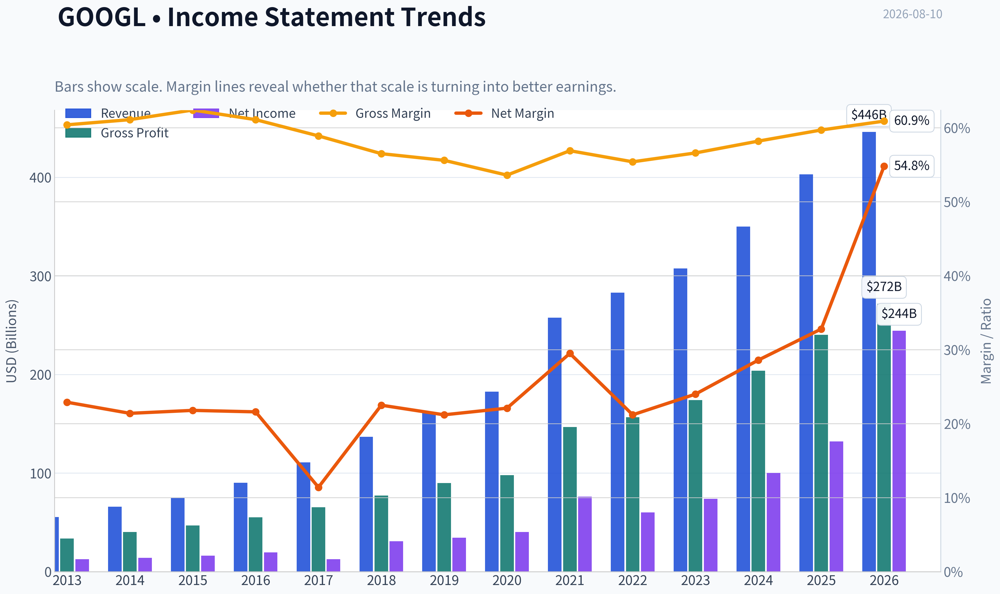

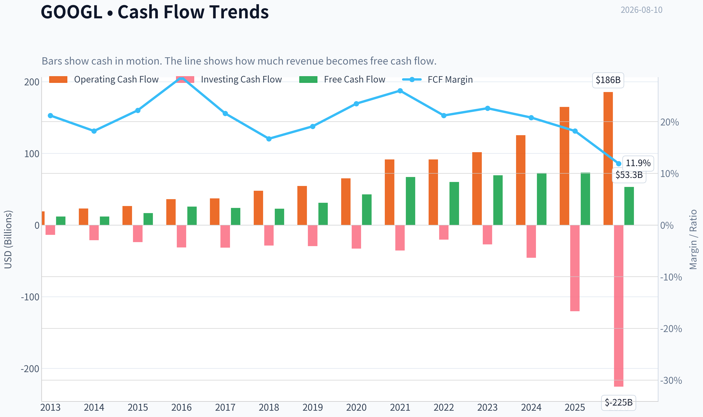

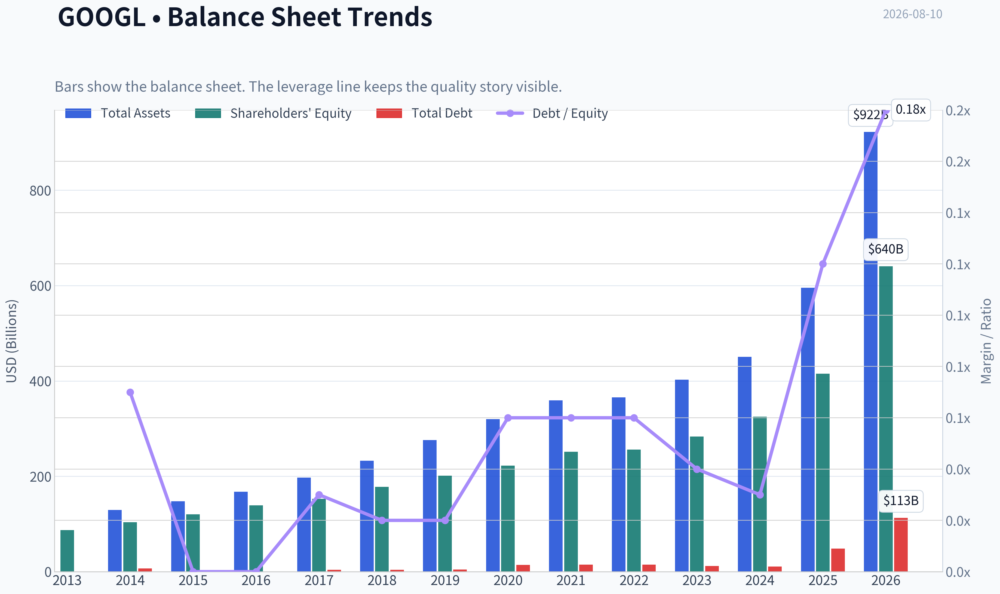

This graph tracks the profitability and return metrics (ROE, ROIC, Margins) of **GOOGL** over the past decade, highlighting capital efficiency trends.

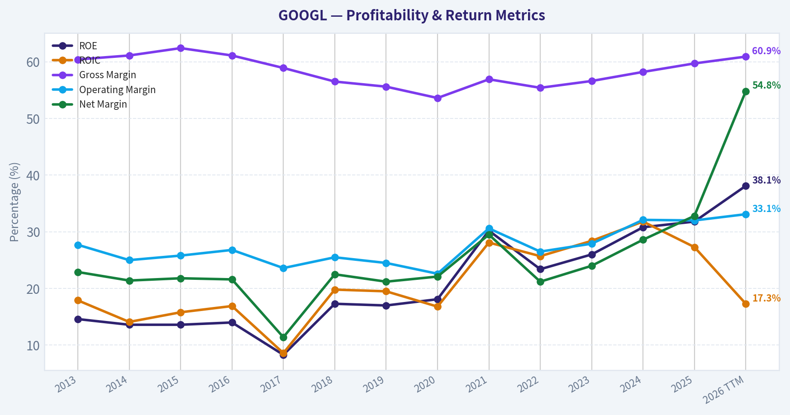

This chart illustrates the financial health of **GOOGL** over the last 10 years, mapping cash equivalents and free cash flow against total obligations (Debt).

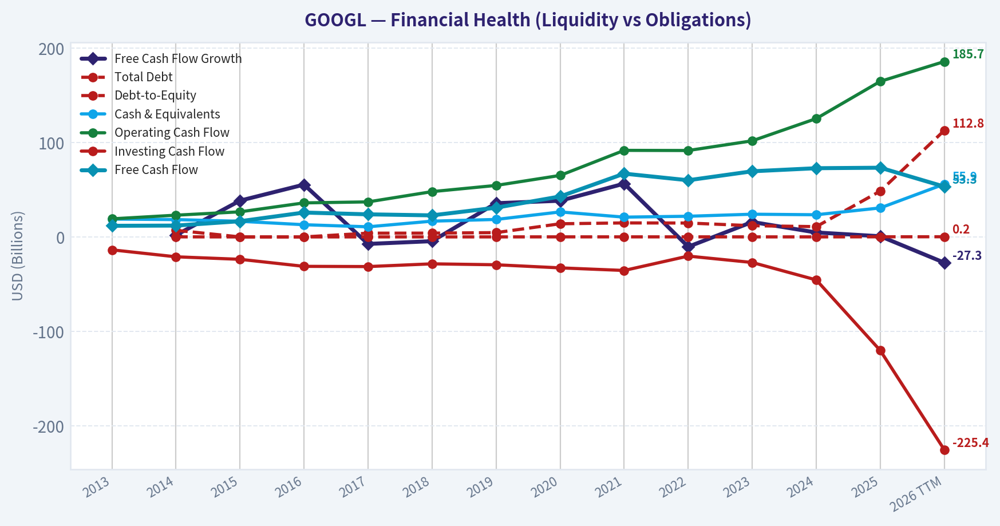

This breakdown chart from <em>Revenue Breakdown</em> shows the proportional composition for **GOOGL** - useful for understanding what drives or risks the business.

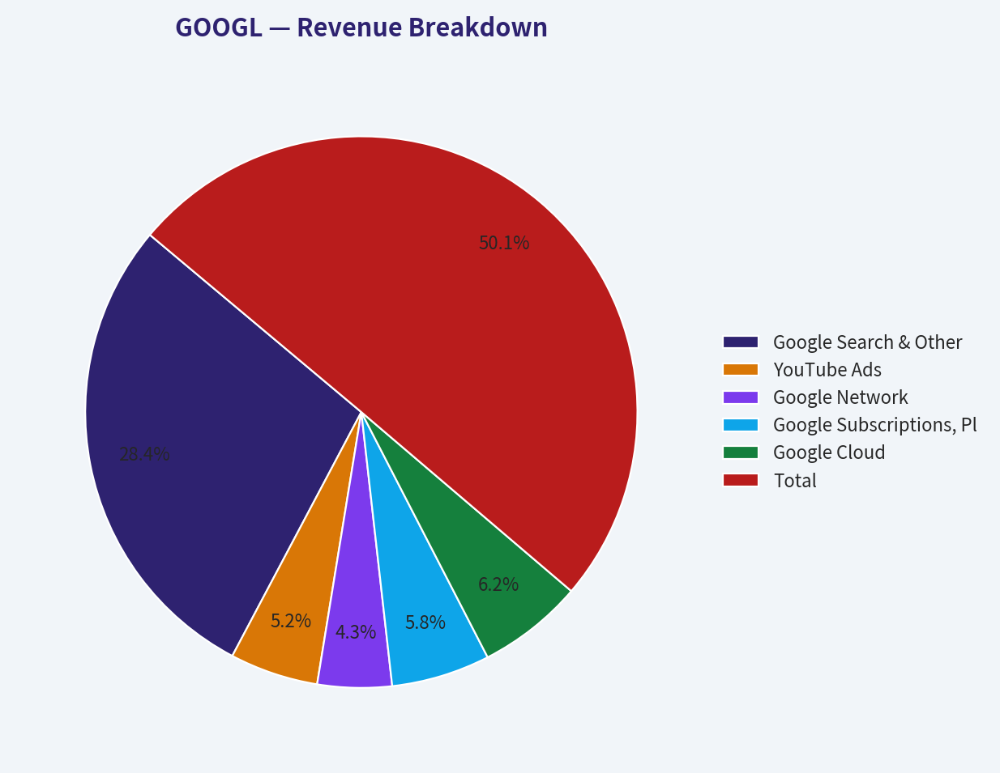

---

### Intrinsic Value Analysis (Buffett)

> *Following Warren Buffett's value investing philosophy: Circle of Competence, Economic Moat, Management Quality, and Margin of Safety.*

#### Intrinsic Value Snapshot

Price is what you pay. Intrinsic value is what the business may be worth based on the cash it can create for owners over time. We show a range, not one magic number.

- Current Price: $357.52
- Value Range (conservative to optimistic across both DCF methods): $54.96 to $230.60

##### Owner Earnings (Buffett Method)
- Net Income: $132,170,000,000.00
- Depreciation & Amortization: N/A
- Capital Expenditures: $-91,447,000,000.00
- Working Capital Changes: $618,000,000.00
- Owner Earnings: $40,105,000,000.00

##### Intrinsic Value
###### Buffett Method
Uses owner earnings. Stricter, and usually more conservative.
- Conservative: $81.97
- Average: $145.89
- Optimistic: $230.60
- Discount Rate: 10.0%

###### Cash Flow Method
Uses free cash flow. Better for companies spending heavily today to grow tomorrow.
- Conservative: $54.96
- Average: $64.80
- Optimistic: $73.79
- Discount Rate: 10.0%

ANALYST STANCE: **WATCH**

#### Alphabet Inc. (GOOGL) - Buffett-Style Investment Review

Alphabet is a wonderful business with dominant global search, YouTube, Android, Google Cloud, and emerging AI infrastructure advantages. The moat is real, returns on capital are excellent, and the balance sheet remains fortress-like. The issue is price: at **$358**, the market is already underwriting roughly **10% annual owner-earnings growth for a decade**, leaving little margin of safety against the current intrinsic value estimate.

---

#### 1. Factor Scorecard and Gate 5 Solvency Check

| Factor | Score | Evidence |
|---|---:|---|
| Circle of Competence & Business Simplicity | 4.0 / 5 | Alphabet makes money primarily by selling highly targeted advertising across Search, YouTube, and network properties, plus cloud subscriptions and enterprise services. The model is understandable, though AI disruption and capex intensity have made the next decade less simple than the last. |
| Moat Test | 4.5 / 5 | Search habit, data scale, distribution through Android/Chrome, advertiser ROI, YouTube network effects, and Google Cloud switching costs create a wide moat. Gross margin is approximately **59.7%**, supporting strong intangible-asset economics. |
| Management Quality & Capital Allocation | 4.0 / 5 | Management has compounded enormous value, maintained a strong balance sheet, repurchased shares, and invested aggressively in AI/cloud. The main concern is whether today's elevated AI infrastructure spending will earn historical-level returns. |
| Industry Structure | 3.5 / 5 | Digital advertising and cloud are attractive, large, and still growing, but competition from Microsoft/OpenAI, Amazon, Meta, TikTok, Apple, and regulatory bodies is intense. |
| Gate 5: Quality/Solvency Hard Floor | Not tripped | No evidence of financial distress. Alphabet has high profitability, strong cash generation, current ratio around **2.0**, and a balance sheet that remains exceptionally strong. |

**Key Takeaways:** Alphabet easily passes the quality and solvency floor. This is not a distressed or mediocre company; it is a dominant compounder. The investment debate is almost entirely about whether the current price already discounts too much of the future.

---

#### 2. Moat Analysis

| Moat Source | Assessment | Evidence |
|---|---|---|
| Intangible Assets | Very strong | Google is synonymous with search. YouTube is one of the world's most valuable media platforms. Gross margin near **60%** signals strong pricing power and intangible value. |
| Switching Costs | Moderate to strong | Advertisers optimize campaigns around Google's tools, measurement systems, and data. Google Cloud customers face meaningful migration complexity once workloads are embedded. |
| Cost Advantages | Strong | Alphabet's global data-center footprint, AI infrastructure, traffic acquisition scale, and engineering talent are difficult to replicate. |
| Network Effects | Strong | Search improves with usage data; YouTube becomes more valuable as creators, viewers, and advertisers deepen participation; Android reinforces distribution. |
| Regulatory/Platform Risk | Meaningful | Antitrust pressure, AI-generated search alternatives, and dependency on distribution agreements are real risks. |

**Key Takeaways:** Alphabet's moat remains wide, but it is not static. Search is still extraordinarily profitable, YouTube has durable network effects, and cloud/AI create new reinvestment channels. The main risk is that AI changes the economics of search faster than Alphabet can monetize its own AI products.

---

#### 3. Management Quality Assessment

| Area | Assessment |
|---|---|
| Owner Orientation | Positive. Alphabet has returned capital through buybacks while retaining enormous reinvestment capacity. Insider founder influence remains part of the governance structure. |
| Candor and Accounting | Generally strong. Financial reporting is clear, and the company has maintained high transparency around segment performance. |
| Capital Allocation | Strong but under review. Historical reinvestment in Search, YouTube, Android, Cloud, and AI has created major value. Current AI capex is the key variable: if it earns high returns, intrinsic value rises; if it becomes an arms race, returns compress. |
| Shareholder Base Signal | Berkshire Hathaway added materially in the latest tracked 13F, while Pershing Square sharply trimmed. The mixed guru signal reinforces that quality is clear, but valuation is debatable. |

**Key Takeaways:** Alphabet's management has an outstanding long-term record, but the next capital-allocation test is unusually important. The company is spending heavily to defend and extend its AI position. The shareholder outcome depends on whether that spending produces high-return growth rather than merely maintaining relevance.

---

#### 4. Financial Summary

| Metric | Latest / Current Snapshot |
|---|---:|
| Share Price | $358 |
| Market Capitalization | $4.37 trillion |
| P/E Ratio | 17.8x |
| ROE | 31.8% |
| Gross Margin | 59.7% |
| Revenue Growth YoY | 15.1% |
| Free Cash Flow Yield | 1.7% |
| Current Ratio | 2.0x |
| Headline Intrinsic Value | $218.05 |
| Margin of Safety vs. Price | -64.0% |
| Reverse-DCF Implied Growth | ~9.9% per year for 10 years |

**Key Takeaways:** Alphabet's financial quality is excellent: high returns, strong margins, and double-digit revenue growth. But the free cash flow yield is low at the current market value, and the stock trades materially above the headline intrinsic value estimate. The market is pricing Alphabet as a long-duration compounder with continued high growth.

---

#### 5. Owner Earnings Calculation

Using Buffett's framework:

| Component | Per-Share Estimate |
|---|---:|
| Net Income Base | Strong and rising |
| Plus: Depreciation & Amortization | Positive add-back |
| Less: Maintenance CapEx | Substantial, due to data centers and AI infrastructure |
| Less: Working Capital Increases | Modest relative to scale |
| Normalized Owner Earnings | ~$14.59 per share |

**Key Takeaways:** Alphabet's reported free cash flow understates the economic picture if a meaningful portion of AI and cloud capex is growth investment rather than maintenance. However, that assumption must be earned. The owner-earnings estimate supports the view that Alphabet is a high-quality compounder, but not obviously cheap at today's price.

---

#### 6. Three-Scenario DCF Valuation

| Scenario | Assumption | Estimated Value per Share |
|---|---|---:|
| A: No Growth | Owner earnings capitalized at 10% | $145.89 |
| B: GDP Growth | 3% perpetual growth, 10% discount rate | ~$214.64 |
| C: High-Quality Compounder Case | 10% growth for 10 years, then 3% terminal growth | ~$360.60 |
| Headline Business-Model Routed Intrinsic Value | Weighted blend of owner earnings, FCFF, and reverse-DCF | $218.05 |

**Key Takeaways:** The no-growth and GDP-growth cases are far below the current share price. The current price is only justified if Alphabet compounds owner earnings around 10% annually for a decade and then remains a durable grower afterward. That is possible, but it leaves little room for disappointment.

---

#### 7. Margin of Safety Analysis

| Valuation Lens | Value / Signal | Interpretation |
|---|---:|---|
| Current Price | $358 | Market price |
| Headline Intrinsic Value | $218.05 | Price is about 64% above this estimate |
| Owner-Earnings DCF | $145.89 | Conservative case shows no margin of safety |
| Damodaran FCFF Estimate | $176.83 | Also below price |
| Reverse-DCF Fair / Implied Case | Price implies ~9.9% growth | Plausible, but demanding |
| Required Margin of Safety for Quality | ~10-15% acceptable for wide-moat compounder | Not currently present |

**Key Takeaways:** Alphabet is good enough that it does not require a massive discount to be attractive. But at $358, it is not merely trading at a fair price; it is trading near the optimistic compounder case. For a Buffett-style buyer, the stock needs either a lower price or clearer evidence that AI/cloud reinvestment will sustain high returns.

---

#### 8. Final Buffett Scorecard

| Criterion | Weight | Score | Weighted Contribution |
|---|---:|---:|---:|
| Moat Width & Durability | 25% | 4.5 | 1.13 |
| Valuation / Margin of Safety | 20% | 1.0 | 0.20 |
| Capital Returns - ROIC vs. WACC | 15% | 4.5 | 0.68 |
| Business Understanding & Predictability | 12% | 4.0 | 0.48 |
| Management Quality & Capital Allocation | 12% | 4.0 | 0.48 |
| Reinvestment Runway | 8% | 4.5 | 0.36 |
| Balance Sheet Strength | 4% | 5.0 | 0.20 |
| Industry Structure | 4% | 3.5 | 0.14 |
| **Total Score** | **100%** |  | **3.67 / 5** |

**Key Takeaways:** Alphabet scores like a high-quality business but not like a bargain. The moat, returns, runway, and balance sheet are excellent. The valuation score drags the overall rating down because the current price already discounts a strong decade of growth.

---

#### 9. Investment Stance

| Stance | Conviction | Rationale |
|---|---|---|
| **WATCH** | Medium-High | Alphabet is a wonderful company, but the current price offers insufficient margin of safety versus intrinsic value. I would prefer to buy on a pullback or after stronger evidence that AI-driven capex is producing high incremental returns. |

Alphabet belongs on a Buffett-style watchlist, not in the discard pile. The business is wide-moat, cash-rich, and highly profitable, with meaningful reinvestment opportunities in AI, cloud, YouTube, and enterprise infrastructure. But at **$358**, the stock is priced for excellence; a fairer entry would require either a lower valuation or clear proof that the next wave of AI investment can compound owner earnings at high rates for many years.
#### Valuation Bridge

This bridge places the current market price beside each intrinsic value lens so readers can see whether upside depends on one method or shows up across several methods.

| Scenario | Intrinsic Value / Share |
| --- | ---: |
| Buffett Method | $145.89 |
| Cash Flow Method | $64.80 |
| Damodaran Method | $176.83 |
| Current Price | $357.52 |

#### Key Takeaways

If one method is far above the others, the upside case depends on a specific modelling assumption. When several methods cluster together, the valuation story is more robust.

#### Valuation Visuals

This comparison chart from *Latest Earnings Snapshot* stacks current figures against historical benchmarks for **GOOGL**, making it easy to see where the company trades relative to its own averages.

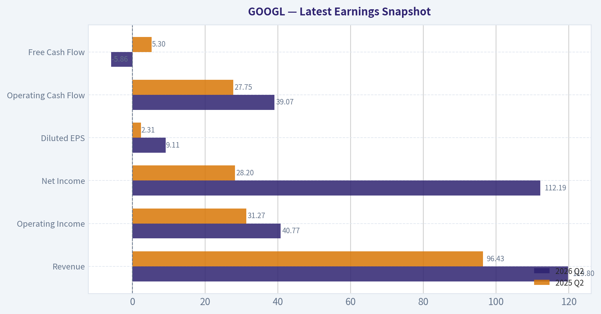

This comparison chart from *Current vs. 10-Year Historical Average Comparison* stacks current figures against historical benchmarks for **GOOGL**, making it easy to see where the company trades relative to its own averages.

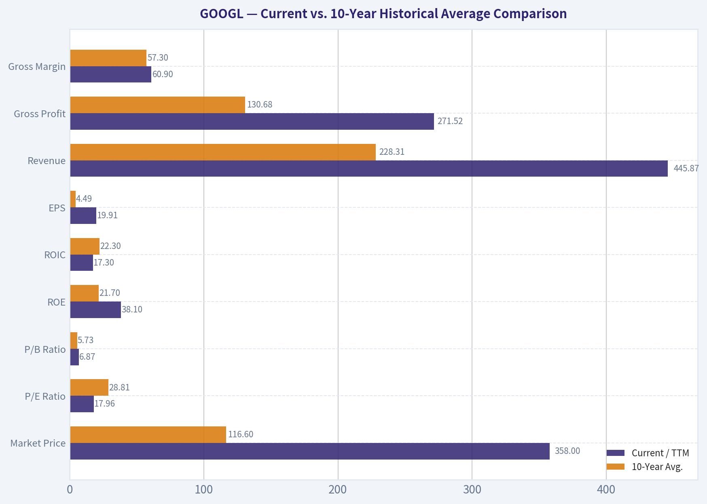

This comparison chart from *Deterministic Intrinsic Value Model Cross-Check* stacks current figures against historical benchmarks for **GOOGL**, making it easy to see where the company trades relative to its own averages.

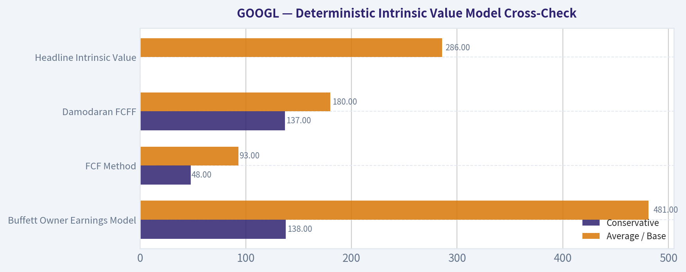

This comparison chart from *Financial Summary* stacks current figures against historical benchmarks for **GOOGL**, making it easy to see where the company trades relative to its own averages.

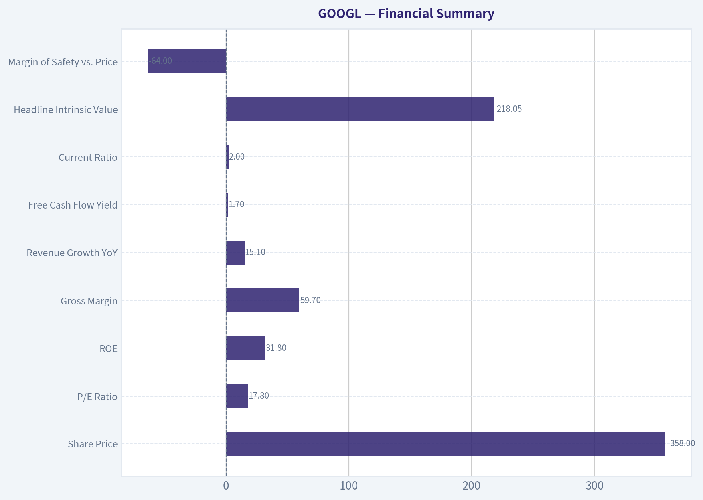

---

### Trend & Growth Analysis (Lynch/Druckenmiller/Fisher)

> *Following Peter Lynch's GARP, Stanley Druckenmiller's macro-aware approach, and Philip Fisher's scuttlebutt methodology.*

ANALYST STANCE: **WATCH**

#### Alphabet / GOOGL Growth Investment Report - 2026-08-10

Alphabet is a superb business, but at the current quoted price of **$358** and market cap of roughly **$4.37 trillion**, the growth-investor question is not "Is this high quality?" - it clearly is - but "Can it still deliver Lynch-style multibagger upside from here?" My answer is **WATCH / hold existing positions**, not fresh high-conviction advocacy, because the company has strong AI and cloud optionality but limited ten-bagger math at this scale.

---

#### 1. Lynch Classification

| Category | Evidence | Verdict |
|---|---:|---|
| Slow Grower | Revenue growth above slow-grower range | No |
| Stalwart | Mega-cap, highly profitable, dominant core franchise | Yes |
| Fast Grower | Revenue growth of **15.1% YoY**, but not clearly 20%+ sustained | Borderline |
| Cyclical | Advertising has cyclical exposure, but business is structurally secular | Partial |
| Turnaround | No distress | No |
| Asset Play | Balance sheet valuable, but not the core thesis | No |

**Key Takeaways:** Alphabet is best classified as a **high-quality stalwart with selective fast-grower segments**, especially Google Cloud, AI infrastructure, YouTube, and Waymo. It is not a classic Lynch fast grower anymore because the base is too large and current revenue growth is around the mid-teens rather than 20% to 30% plus. That makes it more suitable as a core compounder than a ten-bagger candidate.

---

#### 2. The Story in 3 Bullets

| Lynch Story Element | Plain-English Version |
|---|---|
| Search and YouTube are cash engines | Google still controls global digital intent and monetizes it through ads. |
| AI is both risk and opportunity | Gemini, AI Overviews, cloud AI tools, and TPU infrastructure can expand products, but AI could also pressure search economics. |
| Cloud and "Other Bets" create upside optionality | Google Cloud is a scaled enterprise platform, while Waymo could become a major autonomous mobility asset if commercialization accelerates. |

**Key Takeaways:** The simple story is that Alphabet uses its dominant search, video, mobile, and cloud ecosystem to fund the next wave of AI infrastructure and software. The bull case depends on AI increasing monetization and Google Cloud growth, not destroying the economics of search. The stock is still investable, but the story is now about durable compounding rather than explosive early-stage growth.

---

#### 3. TAM Analysis and 10x Test

| Item | Estimate / Assessment |
|---|---:|
| Current market cap | **$4.37T** |
| 10x market cap requirement | **$43.7T** |
| Current revenue growth | **15.1% YoY** |
| Major TAMs | Digital advertising, cloud computing, AI infrastructure, AI software, YouTube/streaming, autonomous mobility |
| Can revenue 10x and remain under 20% TAM share? | Unlikely for the consolidated company |
| Can individual segments 10x? | Yes - Google Cloud, Waymo, AI subscriptions, enterprise AI tools |

**Key Takeaways:** Alphabet still has large end markets, but the **10x test is difficult at the consolidated company level** because the starting base is enormous. A ten-bagger from today would require Alphabet to become a company worth more than forty trillion dollars, which is possible only under an extraordinary multi-decade AI supercycle. The more realistic opportunity is continued compounding plus hidden-call-option upside from Cloud, AI, and Waymo.

---

#### 4. Revenue Growth Trend

| Metric | Current Reading | Growth Interpretation |
|---|---:|---|
| Revenue growth YoY | **15.1%** | Healthy, but not hypergrowth |
| Gross margin | **59.7%** | Strong business quality |
| ROE | **31.8%** | Excellent capital productivity |
| FCF yield | **1.7%** | Low cash yield at current valuation |
| Growth pattern | Mid-teens | Stalwart / mature compounder |

**Key Takeaways:** Alphabet is still growing at an attractive rate for a mega-cap, with excellent margins and return on equity. However, the growth rate does not currently scream "inflection" in the Lynch or Druckenmiller sense. The key monitoring point is whether AI and Cloud can push revenue growth back toward 20% or higher.

---

#### 5. Unit Economics

| Metric | Available Data | Assessment |
|---|---:|---|
| LTV / CAC | Not disclosed | Not directly measurable |
| Net revenue retention | Not disclosed | Relevant mainly for Google Cloud, but unavailable |
| Rule of 40 | Revenue growth **15.1%** + estimated FCF margin unavailable | Incomplete |
| Gross margin | **59.7%** | Strong indicator of scalable economics |
| ROE | **31.8%** | Excellent economic productivity |

**Key Takeaways:** Alphabet does not disclose classic SaaS-style LTV, CAC, or NRR metrics at the consolidated level. Still, the available indicators are strong: high gross margin, high return on equity, and massive operating scale. The main concern is not unit economics quality; it is whether incremental AI spending produces sufficient revenue and margin returns.

---

#### 6. Inflection Point Assessment

| Potential Inflection | Evidence | Analyst View |
|---|---|---|
| AI product cycle | Gemini, AI Overviews, enterprise AI, TPU stack | Positive but still contested |
| Google Cloud scale | Cloud is one of Alphabet's clearest growth engines | Positive |
| Margin inflection | Cost discipline and scale help, but AI capex may pressure FCF | Mixed |
| TAM expansion | AI expands search, productivity, developer, and cloud markets | Positive |
| Competitive inflection | OpenAI, Microsoft, Anthropic, Meta all intensify pressure | Risky |

**Key Takeaways:** Alphabet has multiple possible inflection points, especially in AI and cloud. The problem is that AI is both a catalyst and a threat: it could expand Google's monetization model, or it could compress traditional search ad economics. I would upgrade the stance if evidence shows AI products increasing query volume, ad yield, cloud growth, or subscription revenue without margin deterioration.

---

#### 7. Macro Setup

| Macro Factor | Current Setup | Impact on GOOGL |
|---|---|---|
| AI secular trend | Very strong | Major tailwind |
| Cloud computing | Still expanding | Tailwind |
| Digital advertising | Cyclical but structurally growing | Moderate tailwind |
| Interest rates | Growth stocks benefit if rates fall | Potential tailwind |
| Regulatory pressure | Antitrust scrutiny remains high | Headwind |
| Capex intensity | AI infrastructure demands heavy investment | Mixed |

**Key Takeaways:** The macro setup is favorable from a secular perspective because Alphabet is central to AI, cloud, and digital advertising. However, high AI capex and regulatory pressure are meaningful offsets. Druckenmiller-style investors should watch whether AI spending converts into earnings power rather than just larger capital expenditure.

---

#### 8. Fisher 15 Points Score

| Fisher Point | Score / 5 | Comment |
|---|---:|---|
| Market potential | 5 | Search, YouTube, Cloud, AI, Waymo |
| New product determination | 5 | Heavy AI and cloud investment |
| R&D effectiveness | 5 | World-class technical capability |
| Sales organization | 4 | Strong ads and cloud sales, cloud still chasing leaders |
| Profit margin | 5 | Gross margin near 60% |
| Improving margins | 3 | AI capex may pressure FCF |
| Labor relations | 3 | Strong talent base, but large-company personnel risk |
| Executive relations | 4 | Deep leadership bench |
| Management depth | 5 | Exceptional technical and operating depth |
| Cost analysis/accounting | 4 | Strong discipline, though segment transparency could improve |
| Unique advantages | 5 | Data, distribution, Android, YouTube, infrastructure |
| Long-range profit outlook | 4 | Strong, but search disruption risk matters |
| Dilution risk | 4 | Not dependent on equity financing |
| Candor | 3 | Good, but AI economics need more clarity |
| Integrity | 4 | Strong overall, despite regulatory scrutiny |
| **Total** | **63 / 75** | **Good to near-outstanding** |

**Key Takeaways:** Alphabet scores well under Fisher's framework because it has exceptional R&D, huge market potential, durable advantages, and deep management capacity. The deductions come from AI margin uncertainty, regulatory pressure, and limited clarity on how AI search economics will evolve. A score of **63 out of 75** supports ownership, but not blind valuation-insensitive buying.

---

#### 9. Valuation Analysis

| Valuation Metric | Current Reading | Interpretation |
|---|---:|---|
| Price | **$358** | Current quote from research pack |
| Market cap | **$4.37T** | Mega-cap scale limits ten-bagger upside |
| P/E | **17.76x** | Reasonable if earnings quality is durable |
| Revenue growth | **15.1%** | Good, but not hypergrowth |
| PEG ratio | **~1.18x** | Fair to moderately attractive |
| FCF yield | **1.7%** | Expensive on free-cash-flow yield |
| Headline intrinsic value | **$218.05** | Implies negative margin of safety |
| Margin of safety vs. price | **-64.0%** | Valuation risk |
| Reverse DCF implied growth | **~9.9% annually for 10 years** | Not extreme, but requires durable execution |

**Key Takeaways:** The valuation picture is mixed. On P/E and PEG, Alphabet does not look expensive for a company with its quality and mid-teens growth. But on free-cash-flow yield and the provided intrinsic value estimate, the stock appears meaningfully ahead of conservative fair value.

---

#### 10. Scenario Analysis

| Scenario | Assumptions | Expected Outcome |
|---|---|---|
| Bear | AI disrupts search margins, regulation bites, cloud growth slows | Multiple compression and weak returns |
| Base | Search remains durable, Cloud grows, AI monetization is gradual | Solid compounding, but not explosive upside |
| Bull | AI expands search monetization, Cloud accelerates, Waymo becomes material | Strong upside and renewed growth re-rating |

**Key Takeaways:** The bear case is not business failure; it is multiple compression and lower incremental returns from AI capex. The base case is continued strong compounding from a high-quality platform. The bull case requires clear proof that AI is expanding Alphabet's profit pool rather than cannibalizing it.

---

#### 11. Growth Investor Scorecard

| Criterion | Weight | Score / 5 | Weighted Score |
|---|---:|---:|---:|
| The Story | 10% | 4.0 | 0.40 |
| TAM and Runway | 20% | 3.5 | 0.70 |
| Revenue Growth | 20% | 3.3 | 0.66 |
| Unit Economics | 15% | 4.2 | 0.63 |
| Competitive Position | 10% | 4.5 | 0.45 |
| Management Quality | 10% | 4.2 | 0.42 |
| Macro Setup | 5% | 4.0 | 0.20 |
| Profitability Path | 5% | 4.0 | 0.20 |
| Valuation | 5% | 2.8 | 0.14 |
| **Total** | **100%** |  | **3.80 / 5.00** |

**Key Takeaways:** Alphabet scores **3.8 out of 5**, which normally qualifies as a lower-end **ADVOCATE** setup under the model. However, because the company's sheer size limits ten-bagger potential and the intrinsic value estimate shows a negative margin of safety, I am applying judgment and assigning a final stance of **WATCH**. Existing holders can continue to own it, but new aggressive growth capital should wait for either a better price or clearer AI monetization inflection.

---

#### 12. Position Size Stance

| Investor Type | Stance | Suggested Action |
|---|---|---|
| Existing long-term holder | Hold / core compounder | Continue holding if position size is reasonable |
| New growth investor | Watch | Wait for pullback or stronger AI/cloud acceleration evidence |
| Concentrated investor | Moderate only | Do not make it an oversized ten-bagger bet at current scale |
| GARP investor | Selective buy on weakness | More attractive if PEG stays near 1 and FCF yield improves |

**Key Takeaways:** Alphabet remains a high-quality compounder, but I would not treat it as a fresh aggressive growth-stock opportunity at today's scale and price. For existing holders, the stock can remain a core position. For new capital, I would prefer either a valuation reset or evidence that AI is accelerating revenue and earnings.

---

#### 13. Key Risks and Catalysts

| Category | Key Items |
|---|---|
| Major catalysts | AI monetization, Google Cloud acceleration, Waymo commercialization, operating leverage, buybacks |
| Major risks | Search disruption, AI capex drag, antitrust remedies, ad cyclicality, competition from Microsoft/OpenAI/Meta/Amazon |
| Upgrade triggers | Revenue growth reaccelerates above 18% to 20%, FCF yield improves, AI search monetization proves accretive |
| Downgrade triggers | Search ad weakness, sustained margin compression, regulatory breakup risk, Cloud deceleration |

**Key Takeaways:** The most important catalyst is proof that AI strengthens Google's core economics rather than weakening them. The biggest risk is that Alphabet must spend heavily on AI infrastructure while search monetization becomes less predictable. This is a stock to monitor closely for inflection evidence, not one to ignore.

---

#### Final View

Alphabet is one of the world's best businesses, with dominant franchises, elite R&D, high returns on equity, and major AI optionality. But for a Lynch-style growth investor seeking ten-bagger potential, the current scale and valuation create a high bar.

**Final stance: WATCH.**
Hold existing positions, consider adding only on weakness or if AI and Google Cloud create visible revenue acceleration.

---

### Market Technical Analysis

ANALYST STANCE: **WATCH**

#### GOOGL Technical Analysis - Snapshot for 2026-08-10

GOOGL remains in a **long-term uptrend**, but the shorter and medium-term picture is more fragile after a sharp late-July breakdown, a strong rebound into early August, and then a quick rejection from the recent highs. The stock is trading close to its 10-day EMA and 50-day SMA area, which makes the next few sessions important: a reclaim of the mid-$350s to high-$350s would improve the setup, while failure there keeps the stock vulnerable to another test of lower support.

The selected indicators are intentionally diversified: **10 EMA, 50 SMA, 200 SMA, MACD, MACD Signal, RSI, ATR, and VWMA**. Together they cover short-term trend, medium-term trend, long-term structure, momentum confirmation, overbought/oversold conditions, volatility risk, and volume-weighted price confirmation.

| Indicator | Latest Value / Area | Current Read | Trading Interpretation |
|---|---:|---|---|
| 10 EMA | ~355.10 | Short-term trend is stabilizing | Price is near the fast average, so the stock is trying to repair short-term momentum but has not clearly broken away to the upside. |
| 50 SMA | ~355.83 | Medium-term resistance/decision zone | The 50 SMA has been declining, showing that the May-June correction still weighs on the intermediate trend. A close above it would be constructive. |
| 200 SMA | ~329.37 | Long-term trend remains bullish | The 200 SMA is rising steadily, and price remains meaningfully above it, so the broader structure is not broken. |
| MACD | ~1.19 | Momentum has turned positive | MACD recovered from deeply negative late-July levels and has crossed above zero, suggesting improving upside momentum. |
| MACD Signal | ~-1.39 | Bullish crossover condition | MACD is above the signal line, confirming that momentum has improved from the prior selloff. |
| RSI | ~52.24 | Neutral momentum | RSI is neither overbought nor oversold, leaving room for movement in either direction. It is not yet a strong bullish momentum reading. |
| ATR | ~12.29 | Volatility remains elevated | Daily price swings are still large, so position sizing and stop placement need to account for wide movement. |
| VWMA | ~345.36 | Volume-weighted support below price | Price remains above VWMA, implying the recent rebound has some volume support, though not enough yet to fully confirm a new uptrend leg. |

**Key Takeaways:** GOOGL's long-term trend remains constructive because the 200-day average is rising and price is above it. However, the stock is sitting near the 10 EMA and 50 SMA, making the mid-$350s a key battleground. Momentum has improved through MACD, but RSI remains neutral, so this is not yet a high-conviction bullish breakout.

#### Trend Structure and Price Behavior

The broader chart has three distinct phases. First, GOOGL had a powerful advance into May, reaching the $400 area. Second, the stock entered a broad correction that carried it down into the $330s and briefly to the $317 area after the sharp July 23 drop. Third, it staged a fast rebound into early August, reaching the upper $370s, but that rebound was rejected quickly.

That rejection matters. GOOGL rose from around $317.69 on July 23 to $377.65 on August 4, a very strong short-term rebound. But the move then stalled near the $380 area, and the stock pulled back to $354.30 by August 7. This means buyers proved capable of defending the post-drop low, but they have not yet proven they can sustain a breakout above the recovery highs.

The **50 SMA near $355.83** is now especially important. Because price is hovering around that zone, the market is effectively deciding whether the July breakdown was a temporary shakeout or the start of a more prolonged consolidation. A clean close back above the 50 SMA, followed by price holding above it, would be an early sign that buyers are regaining control. A rejection below it would keep the stock in a choppy recovery pattern.

#### Momentum Analysis

MACD is the most constructive part of the current setup. It moved from deeply negative readings in late July to positive territory by early August. The MACD line is also above the signal line, which suggests that downside momentum has faded and buyers have regained some control.

However, RSI is only around **52**, which is neutral. That is not bearish, but it also is not strong enough to confirm a broad momentum breakout. The earlier RSI push above 60 around August 4 showed improving momentum, but the quick drop back toward the low 50s shows that the recent rally lost force when price approached the upper-$370s.

In practical terms, momentum is **recovering but not decisive**. Traders should treat MACD as an encouraging early signal, but RSI says the stock still needs price confirmation before the setup becomes more compelling.

#### Volatility and Risk Management

ATR is around **$12.29**, which is substantial relative to the current price. This means GOOGL can move 3% or more in a normal volatility window. Tight stops are more likely to be triggered by noise, especially after the late-July and early-August swings.

Because volatility remains elevated, entries near resistance are riskier unless price confirms with a strong close. For swing traders, the better risk/reward may come from either a confirmed breakout above the 50 SMA and recent resistance, or a pullback toward volume-weighted support where risk can be more clearly defined.

#### Volume-Weighted Confirmation

VWMA sits near **$345.36**, below the latest observed price area. That is mildly constructive because price is above the volume-weighted trend line, suggesting that the recent rebound was not purely a low-volume drift. Still, VWMA is below the 10 EMA and 50 SMA, which means the stock has not yet fully re-established a clean bullish stack across trend and volume indicators.

The $345 area should be watched closely. If price holds above VWMA during pullbacks, it supports the idea that buyers are accumulating on dips. If price loses VWMA, especially on rising volume, the recovery attempt weakens and the stock could revisit lower support near the $337-$330 zone.

#### Trading Bias

The current setup favors a **watch-and-confirm approach** rather than immediate aggressive buying. The long-term trend is still supportive, and momentum has improved, but price is sitting at a key resistance cluster near the 10 EMA and 50 SMA.

A more bullish stance would require GOOGL to reclaim and hold above roughly **$356-$358**, then ideally push through **$362-$365**. A move above that zone would indicate that the post-August pullback is being absorbed. Until then, the stock remains in a volatile recovery phase rather than a clean continuation trend.

| Zone / Signal | Level or Condition | Bullish Meaning | Bearish Risk |
|---|---:|---|---|
| Immediate decision zone | $355-$358 | Reclaiming this area would put price back above the 10 EMA and 50 SMA zone. | Failure here suggests the rebound is stalling at resistance. |
| Near-term resistance | $362-$365 | A close above this zone would improve short-term momentum and confirm follow-through. | Rejection would keep the chart range-bound and vulnerable. |
| Recovery high resistance | $373-$380 | Breaking this area would signal buyers are regaining control after the July drop. | Another rejection here could form a lower high. |
| Volume-weighted support | ~$345 | Holding above VWMA supports the dip-buying case. | Losing this level would weaken the recovery structure. |
| Lower support | $337-$330 | This area may attract buyers if the stock pulls back deeper. | A break below the 200 SMA area would damage the long-term setup. |
| Long-term trend line | ~$329 200 SMA | Rising 200 SMA keeps the strategic trend positive. | Sustained trade below it would shift the broader bias bearish. |
| Momentum confirmation | MACD above signal and above zero | Supports the case for improving upside momentum. | If MACD rolls over while price is below the 50 SMA, the recovery may fail. |
| Volatility condition | ATR ~$12.29 | Large moves create opportunity for active traders. | Wide swings require smaller position sizing and wider risk buffers. |

**Key Takeaways:** GOOGL is best treated as a **watchlist candidate**, not a confirmed breakout yet. The most important near-term test is whether price can reclaim and hold the $355-$358 area. If it does, momentum could improve toward $362-$365 and then $373-$380; if it fails, traders should watch $345 and then $337-$330 as the next support zones.

#### Market Visuals

This comparison chart from *Market Metrics Interpretation* stacks current figures against historical benchmarks for **GOOGL**, making it easy to see where the company trades relative to its own averages.

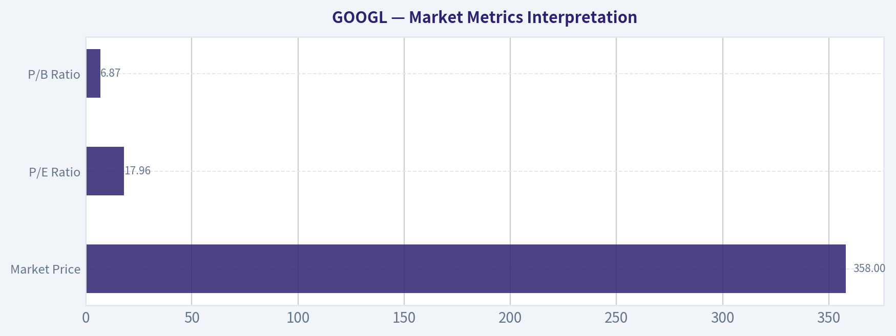

---

### Options Market Analysis

> *Reading options flow - put/call ratios, IV skew, and unusual activity - to gauge institutional positioning and event-driven risk.*

ANALYST STANCE: WATCH

#### GOOGL Options Market Sentiment Report
*Options data as of 2026-08-10. Current spot price is not provided by the data feed, but listed near-the-money activity clusters around the $355 area, so strike moneyness is interpreted relative to roughly that level.*

---

#### 1. Put/Call Ratio Analysis

| Expiry | Call OI | Put OI | Put/Call OI Ratio | Call Volume | Put Volume | Put/Call Volume Ratio | Interpretation |
|---|---:|---:|---:|---:|---:|---:|---|
| 2026-08-12 | 12,263 | 6,751 | 0.55 | 29,695 | 12,731 | 0.43 | Call-heavy, bullish near-term flow |
| 2026-08-14 | 57,861 | 39,521 | 0.68 | 35,106 | 13,746 | 0.39 | Near neutral by OI, but volume strongly call-led |
| 2026-08-17 | 3,859 | 2,218 | 0.57 | 3,114 | 1,150 | 0.37 | Light activity, still call-biased |
| **Near-Term Total** | **73,983** | **48,490** | **0.66** | **67,915** | **27,627** | **0.41** | **Moderately bullish vs. neutral baseline** |

**Key Takeaways:** GOOGL's near-term put/call open interest ratio is **0.66**, slightly below the historical neutral baseline of around **0.7**, showing a mild call bias. The stronger signal is in volume: the near-term put/call volume ratio is only **0.41**, meaning current trading activity is materially more call-heavy than neutral. This points to short-term bullish speculation or upside positioning, though some of that may be retail-driven given the very short-dated expirations.

---

#### 2. Implied Volatility Assessment

| Expiry | ATM Call IV | ATM Put IV | Put Minus Call IV | IV Read |
|---|---:|---:|---:|---|
| 2026-08-12 | 40.6% | 42.9% | +2.3 pts | Front expiry IV elevated; puts slightly richer |
| 2026-08-14 | 36.9% | 35.8% | -1.1 pts | Balanced to slight call IV premium |
| 2026-08-17 | 31.8% | 31.4% | -0.4 pts | Lower and broadly neutral |

**Key Takeaways:** Implied volatility is highest in the closest expiry, with 2026-08-12 ATM IV around **41%-43%**, then steps down to about **31%-37%** in later near-term expirations. That term structure suggests traders are pricing more immediate movement risk in the next few sessions. Skew is not aggressively bearish: the nearest expiry has a modest put IV premium, but later expiries are balanced to slightly call-skewed.

| Skew Area | Observed Contracts / IV | Interpretation |
|---|---|---|
| Near-ATM front expiry | 2026-08-12 ATM puts at 42.9% vs. calls at 40.6% | Mild downside protection demand |
| OTM calls | 2026-08-12 $357.5-$372.5 calls IV around 32.3%-36.0% | Active upside chase, especially in short-dated calls |
| OTM puts | 2026-08-12 $342.5 put IV 35.9%; $352.5 put IV 32.3% | Some downside demand, but not dominant |

**Key Takeaways:** The skew picture is not a classic panic-hedging setup. While front ATM puts trade richer than calls, the unusual activity is concentrated in short-dated upside calls. Overall, IV and skew suggest traders expect movement soon, with upside demand more visible than downside fear.

---

#### 3. Unusual Options Activity

| Expiry | Type | Strike | Volume | Open Interest | Vol/OI | IV | Moneyness Estimate | Positioning Read |
|---|---|---:|---:|---:|---:|---:|---|---|
| 2026-08-12 | Call | $357.5 | 4,572 | 860 | 5.3x | 33.1% | Slightly OTM / near ATM | Fresh short-dated upside positioning |
| 2026-08-12 | Call | $355.0 | 4,178 | 463 | 9.0x | 33.2% | ATM | Aggressive near-term directional call demand |
| 2026-08-12 | Call | $362.5 | 3,855 | 540 | 7.1x | 32.3% | OTM | Speculation on quick upside continuation |
| 2026-08-12 | Call | $370.0 | 3,603 | 583 | 6.2x | 34.8% | OTM | Higher-beta upside chase |
| 2026-08-12 | Put | $352.5 | 1,949 | 142 | 13.7x | 32.3% | Slightly OTM / near ATM | Fresh downside hedge or tactical bearish bet |
| 2026-08-12 | Put | $342.5 | 683 | 93 | 7.3x | 35.9% | OTM | Tail-risk protection, smaller size |
| 2026-08-12 | Call | $372.5 | 562 | 112 | 5.0x | 36.0% | OTM | Speculative upside lottery-style flow |

**Key Takeaways:** The unusual activity is heavily concentrated in the **2026-08-12 expiry**, meaning this is a very short-term positioning signal. The largest fresh flows are in calls from **$355 to $370**, suggesting traders are targeting an immediate upside move. There is some put activity at $352.5 and $342.5, but the size and breadth of the call flow dominate the signal.

#### Smart-Money vs. Retail Read

| Flow Type | Likely Source / Quality | Reasoning |
|---|---|---|
| ATM $355 and $357.5 calls | More credible directional flow | High volume relative to OI and strikes close to spot suggest active positioning, not just lottery tickets |
| OTM $370 and $372.5 calls | More speculative / retail-like | Very short-dated upside calls can reflect momentum chasing and high-risk premium buying |
| $352.5 put | Possible hedge or tactical protection | Very high volume/OI ratio indicates fresh activity, but smaller notional footprint than call flow |
| $342.5 put | Tail hedge | Farther OTM protection, likely insurance rather than outright bearish conviction |

**Key Takeaways:** The cleanest read is that traders are leaning bullish over the next few sessions, but a meaningful portion of the flow is short-dated and speculative. The presence of some fresh put buying prevents the signal from being one-sided, but it does not outweigh the call demand. This looks more like upside momentum positioning than deep institutional hedging.

---

#### 4. Open Interest Concentration and Pinning Risk

| Expiry | Total Call OI | Total Put OI | Total OI | Key Observation |
|---|---:|---:|---:|---|
| 2026-08-12 | 12,263 | 6,751 | 19,014 | Short-dated, high volume relative to OI; active gamma sensitivity |
| 2026-08-14 | 57,861 | 39,521 | 97,382 | Largest near-term OI concentration |
| 2026-08-17 | 3,859 | 2,218 | 6,077 | Much lighter positioning |

**Key Takeaways:** The largest open interest concentration is in the **2026-08-14 expiry**, which may become the more important pinning window later this week. However, the unusual activity is concentrated in the **2026-08-12 expiry**, so very near-term gamma effects could still be meaningful. If GOOGL trades near the $355-$370 zone into expiry, dealer hedging around these active strikes could amplify intraday moves.

| Potential Gamma / Pinning Zone | Evidence | Market Implication |
|---|---|---|
| Around $355 | Heavy unusual ATM call volume; 9.0x volume/OI | Potential magnet level and key short-term pivot |
| $357.5-$362.5 | Large short-dated call activity | Upside breakout zone; dealer hedging could support momentum if price rises |
| $370-$372.5 | Heavy OTM call speculation | Possible upside gamma wall if price accelerates toward those strikes |
| $352.5 | Fresh put activity with 13.7x volume/OI | Near-term downside hedge zone; break below may increase defensive hedging |

**Key Takeaways:** The most important short-term trading zone appears to be **$355 to $362.5**. If GOOGL holds above that area, the call-heavy positioning could reinforce upside momentum toward $370. If it fails below roughly $352.5, the fresh put activity becomes more relevant and the bullish read weakens.

---

#### 5. Overall Options Sentiment Signal

| Category | Signal | Rationale |
|---|---|---|
| Put/Call Ratio | Bullish | Near-term OI ratio of 0.66 and volume ratio of 0.41 are call-biased versus neutral |
| IV Level | Moderately Elevated Short Term | Front expiry IV above later expiries suggests near-term movement risk |
| Skew | Slightly Bullish / Balanced | Mild front put premium, but unusual flow is dominated by calls |
| Unusual Activity | Bullish | Fresh short-dated call buying across $355-$370 outweighs put activity |
| Open Interest / Gamma | Bullish with Pin Risk | $355-$362.5 may act as a key upside pivot; $370 area may become a gamma target |
| **Overall Signal** | **BULLISH** | **Call-heavy volume and unusual upside activity dominate, though the signal is short-dated and speculative** |

**Key Takeaways:** The options market is giving a **bullish near-term signal** for GOOGL. The primary driver is unusually heavy short-dated call volume, especially around the $355, $357.5, $362.5, and $370 strikes. Confidence is moderate rather than high because much of the activity is extremely short-dated, which can reflect speculative momentum trading rather than durable institutional conviction.

---

#### Final Markdown Summary Table

| Metric | Current Read | Sentiment Impact |
|---|---|---|
| Put/Call Ratio | OI ratio **0.66**; volume ratio **0.41** | Bullish versus neutral baseline of ~0.7 |
| IV Level | Front ATM IV around **40.6%-42.9%**, declining in later expiries | Elevated short-term move expectations |
| Skew Direction | Mild front put skew, but broader flow favors calls | Balanced to bullish |
| Unusual Activity | Heavy 2026-08-12 call volume at $355-$370; smaller put activity at $352.5 and $342.5 | Bullish, but short-dated/speculative |
| Overall Signal | **BULLISH** | Upside call positioning dominates, with caveats around expiry risk and speculative flow |

**Key Takeaways:** GOOGL options flow currently leans bullish, led by call-heavy volume and fresh upside activity in very near-term expirations. The key caveat is that the activity is concentrated in contracts expiring within days, so the signal is tactical rather than long-term. For trading context, the $355-$362.5 area looks like the key pivot, while $370 is the main upside call target.

---

## Research Team Commentary

> *The Research Manager synthesizes the Bull vs Bear debate into action-free commentary. This is a pre-risk view, not the final stance.*

Hello everyone, let us walk through this debate on Alphabet. I have listened carefully to both the bull and the bear, and I want to lay out where we stand from a modern value investing perspective.

The bear makes a passionate, theoretically sound argument about the risks of technological disruption and rising capital intensity. They warn that the shift to AI answer engines will cannibalize traditional search ad clicks, and they correctly point out that Alphabet is spending heavily on infrastructure just to defend its moat. They also highlight the very real regulatory shadows hanging over the Apple default search agreement.

On the other side, the bull points out that we are looking at an incredibly resilient, dominant franchise trading at a deeply reasonable multiple. With a price to earnings ratio under 18, a return on invested capital of nearly 25 percent, and a return on equity over 31 percent, the bull argues we are getting a compounding machine priced like a slow-growth stalwart. The bull rightly emphasizes that Google Cloud has inflected into a highly profitable second engine, and that Alphabet possesses the proprietary silicon and distribution network to monetize AI rather than be destroyed by it.

My core takeaway here is that the bull has the far stronger hand, and we must lean decisively into this opportunity. The bear case relies heavily on extrapolating hypothetical structural damage that simply has not shown up in the operating results.

Here is my rationale based on our framework and, frankly, some hard lessons learned from my own past mistakes. In previous reviews of Alphabet, I allowed the very same long-term background risks, such as AI disruption fears and regulatory overhangs, to paralyze my decision making. I gave a neutral Watch rating because I anchored too much on the fear of margin compression and capital expenditure burdens, completely missing the fact that premium franchises can adapt, monetize, and reward shareholders immensely even during heavy investment periods. I learned the hard way that you cannot treat unproven, slow-moving structural risks as immediate vetoes when a company is actively demonstrating elite profitability and market leadership.

At a multiple of roughly 18, the market is already providing a robust, quality-scaled margin of safety. The reverse discounted cash flow math implies the market expects only mid-single-digit growth from a company that continues to post strong revenue growth and expanding margins in its Cloud division. We are not paying a heroic growth multiple today. We are buying one of the most remarkable businesses in history, which generates more than enough free cash flow from its core software and advertising segments to fund its heavier AI infrastructure investments without stressing its fortress balance sheet. The bear's concern about a treadmill effect is worth acknowledging, but a 25 percent return on invested capital proves they are still generating massive wealth on the capital they deploy.

Over the next one to four quarters, our monitoring plan will focus on a few distinct metrics to ensure our thesis holds. First, we need to track Google Cloud operating margins to confirm that operating leverage continues to offset the heavy AI capital expenditures. Second, we will monitor search ad revenue and query volumes to directly test the bear's zero-click cannibalization theory. If search revenues stay resilient, the immediate disruption thesis falls apart. Finally, we will keep a close eye on concrete legal developments regarding antitrust remedies, specifically regarding mobile distribution agreements, though we will remain objective and not panic over headlines before actual financial impacts are visible.

We are not going to repeat the mistake of sitting on the sidelines while a world-class compounder trades at a discount to the broader market. Alphabet possesses an enduring moat and elite financial strength, and it is available today at a highly attractive price.

ADVOCATE

---

## Value Investing Team Commentary

> *The Investor translates the research view into an investment thesis before risk review. This is still not the final stance.*

The current assessment of Alphabet Inc. (GOOGL) presents a classic "Buffett opportunity": a world-class, wide-moat business trading at a discount due to temporary narrative-driven fear. When a dominant franchise with a 25% ROIC and a 31% ROE trades at a P/E of less than 18, the burden of proof shifts from the buyer to the skeptic.

### 1. The Quality-Scaled Margin of Safety
In our framework, a "wonderful" business deserves a 10-15% discount for a BUY rating. Alphabet is currently trading at a P/E of 17.76, which is not only a discount to its historical averages but a significant discount to the broader market and its "Magnificent" peers.

The market is pricing Alphabet as if it were a low-growth utility or a legacy hardware company, rather than the primary gateway to the internet. This provides a substantial **quality-scaled margin of safety**. By using a reverse-DCF lens, the current price implies that the market expects free cash flow to grow at only mid-single digits over the next decade. Given the double-digit growth in Search and the margin inflection in Google Cloud, this expectation is excessively pessimistic.

### 2. The Moat and the "AI Treadmill" Contrarian View
The primary bear argument is that AI (specifically LLMs) will cannibalize Search and that massive Capex requirements will destroy margins. We view this through a contrarian lens:
*   **Barriers to Entry**: High capital intensity in AI is not just a "treadmill"; it is a **moat-widening event**. There are perhaps only three or four companies on earth capable of spending $40B+ per year on the proprietary silicon and infrastructure required to lead in AI. Alphabet is one of them. This "treadmill" effectively prices out 99.9% of potential competitors.
*   **The Distribution Advantage**: A great product is nothing without distribution. With billions of users across Android, Chrome, and Gmail, Alphabet owns the "last mile" of the consumer relationship. History shows that incumbents with massive distribution and data advantages-like Microsoft in the 90s or Apple in the 2010s-typically absorb new technologies to strengthen their grip rather than being unseated by them.

### 3. Capital Allocation and "Stalwart" Status
The Growth Analyst correctly identifies Alphabet as a "Stalwart." In Buffett's terms, this is a business that no longer needs to retain every dollar of earnings to grow. The shift toward more disciplined cost management and the potential for consistent share repurchases (and eventually, perhaps, larger dividends) makes this an ideal "owner's" stock.

The Google Cloud segment is the "hidden" gem here. After years of heavy losses, it has hit a scale where incremental revenue is flowing directly to the bottom line. This mirrors the trajectory of AWS, providing a diversified, high-margin earnings stream that reduces the company's reliance on the ad cycle.

### 4. Addressing the Regulatory and Disruption Noise
Regulatory headlines regarding antitrust and default search agreements are "noise" that creates the "opportunity." While legal remedies may change how Google reaches users, the underlying consumer habit-"Googling"-is one of the strongest brand monopolies in history. Even if Google had to compete for placement, their superior monetization (ad tech stack) allows them to outbid competitors for that space, effectively maintaining their dominance through economic efficiency.

### Business Owner's Verdict
We are buying a dollar's worth of elite, high-ROE earnings for roughly 17 times. We are getting the world's most valuable data set and a rapidly growing, profitable Cloud business as part of the package. The market is offering us a "fair price" for a business that is significantly better than "wonderful."

**ANALYST STANCE: ADVOCATE**

---

## Deep Values Commentary

> *The Risk Management Team debates and the Risk Judge provides the final action-free verdict. This section determines the final ADVOCATE / WATCH / AVOID stance.*

#### Final Stance Scorecard

This scorecard converts the final research view into a weighted decision frame. It does not replace the narrative judgement, but it makes the main drivers of the verdict easier to scan.

| Criterion | Score | Weight | Commentary |
| --- | ---: | ---: | --- |
| Business Quality | 4.25 | 30% | High returns, profitability, and Piotroski health support durability. |
| Valuation Support | 2.33 | 30% | Blends current price against available intrinsic value anchors and valuation ratios. |
| Financial Strength | 5.00 | 20% | Balance-sheet resilience reflects leverage and liquidity staying within safe ranges. |
| Growth Durability | 3.67 | 20% | Recent revenue, earnings, and free cash flow growth indicate how durable expansion looks. |
| TOTAL / FINAL STANCE | 3.71 | 100% | ADVOCATE |

#### Key Takeaways

The weighted score lands at **3.71 / 5.0**, while the final stance remains **ADVOCATE**. This is useful as a quick calibration aid rather than a mechanical signal.

#### Risk Summary

Higher scores indicate more risk pressure. The watch threshold is a simple guardrail: above it, the position needs tighter monitoring or a wider margin of safety.

| Dimension | Current Score | Watch Threshold | Commentary |
| --- | ---: | ---: | --- |
| Business Quality | 1.75 | 3.00 | High returns, profitability, and Piotroski health support durability. |
| Valuation Support | 3.67 | 3.00 | Blends current price against available intrinsic value anchors and valuation ratios. |
| Financial Strength | 1.00 | 3.00 | Balance-sheet resilience reflects leverage and liquidity staying within safe ranges. |
| Growth Durability | 2.33 | 3.00 | Recent revenue, earnings, and free cash flow growth indicate how durable expansion looks. |

#### Key Takeaways

This view helps readers separate *where* the risk sits: valuation, business quality, balance sheet, or growth durability. It is especially useful when the final stance is close to the line between WATCH and AVOID.
