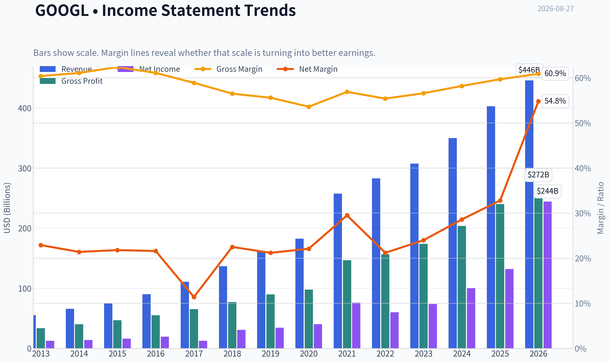
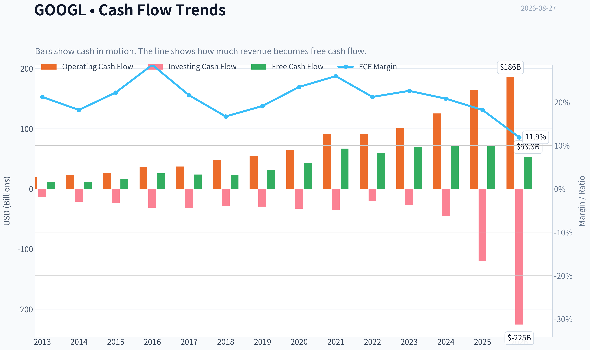
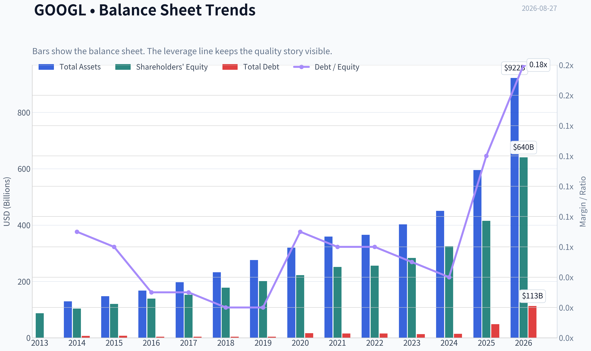
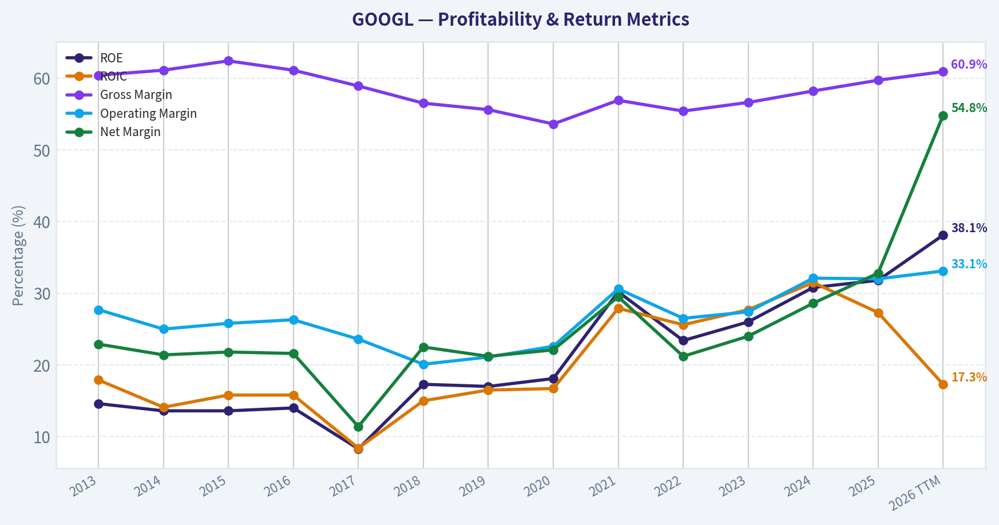
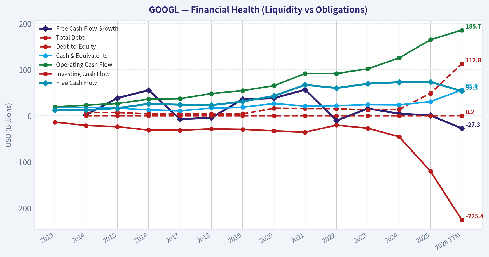
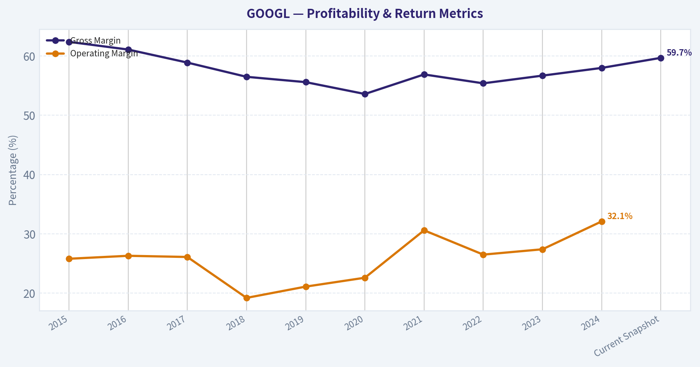
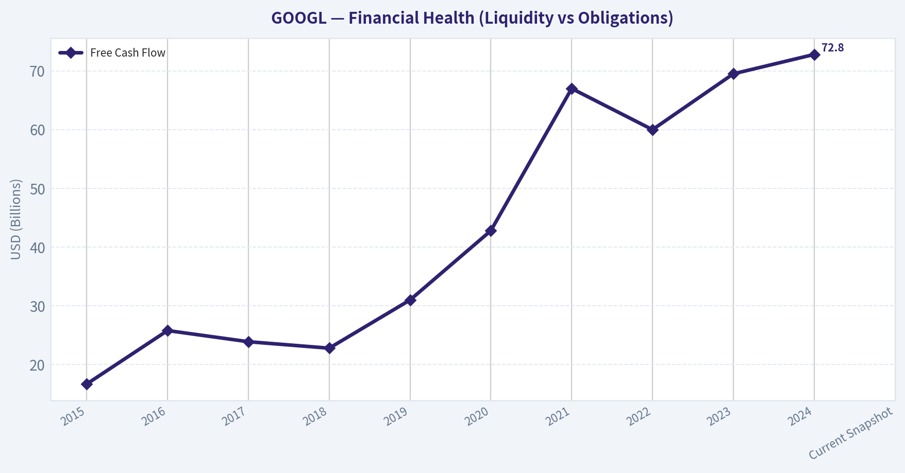
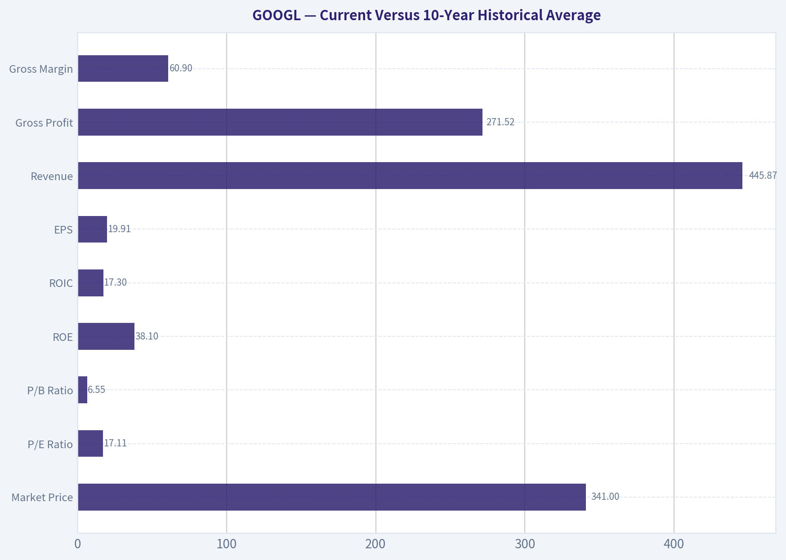
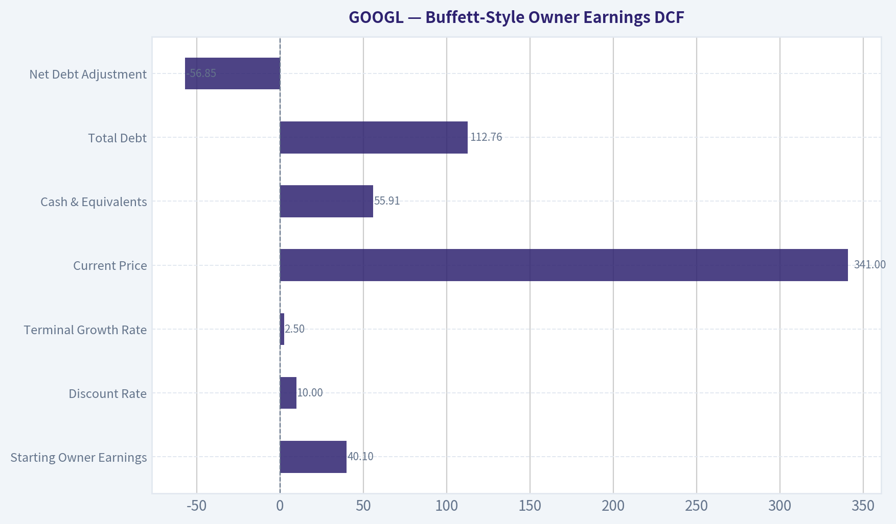
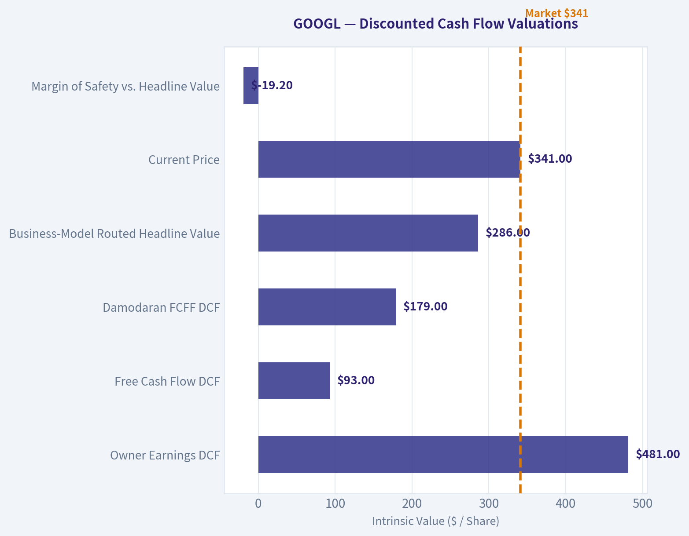

# GOOGL Deep Value Intelligence

**Analysis Date:** 2026-08-27

## Critical Disclaimer

*This analysis is generated by Deep Value Intelligence, an AI-powered multi-agent investing framework. Education & research only - not financial advice, not a financial advisor.*

---

## Table of Contents

1. Intelligence Summary
2. Analyst Team Reports
   - Fundamentals Analysis
   - Intrinsic Value Analysis (Buffett)
   - Trend & Growth Analysis (Lynch/Druckenmiller/Fisher)
   - Market Technical Analysis
   - Options Market Analysis
3. Research Team Commentary
4. Value Investing Team Commentary
5. Deep Values Commentary

---

## Intelligence Summary

### Thesis + Conditions

**Core Thesis:** **EXECUTIVE SUMMARY**
Alphabet is an elite, wide-moat compounder trading at a rare discount (17x P/E), offering a highly favorable risk/reward profile for the long-term investor. While bears accurately highlight rising capital intensity and regulatory friction, these are long-term structural transitions, not immediate thesis-breakers.

**Key Risks:**
- Alphabet is an elite, wide-moat compounder trading at a rare discount (17x P/E), offering a highly favorable risk/reward profile for the long-term investor. While bears accurately highlight rising capital intensity and regulatory friction, these are long-term structural transitions, not immediate thesis-breakers. Management is weaponizing its balance sheet, using strategic AI capex to build an insurmountable infrastructure moat. At this valuation, the market is mispricing Alphabet's 24.8% ROIC and 30% Cloud growth as a mature utility. We will not let static free-cash-flow fears paralyze us into missing a high-quality franchise.
- The Risky Analyst (Pro-Moat/Offensive):** Argues that the 17x P/E is a generational gift. Views the massive AI capex not as cash burn, but as "weaponized" moat-building that smaller peers cannot replicate. Dismisses DOJ fears, noting that losing default search could immediately reduce Traffic Acquisition Costs (TAC).
- The Safe Analyst (Pro-Caution/Structural Risk):** Warns against gambling on a transition. Notes that high capex fundamentally shifts Alphabet from an asset-light software business to an asset-heavy AI foundry, threatening historical ROIC. Argues that losing default search isn't just about TAC-it destroys the high-intent data funnel that powers ad pricing.

**Confidence:** Medium

---

## Analyst Team Reports

### Fundamentals Analysis

#### Latest Earnings Snapshot

*Most recent reported quarter anchored on 2026 Q2, with prior-year comparison when available.*

| Metric | 2026 Q2 | 2025 Q2 | YoY Change |
| --- | ---: | ---: | ---: |
| Revenue | $119.80B | $96.43B | +24.2% |
| Operating Income | $40.77B | $31.27B | +30.4% |
| Net Income | $112.19B | $28.20B | +297.9% |
| Diluted EPS | $9.11 | $2.31 | +294.4% |
| Operating Cash Flow | $39.07B | $27.75B | +40.8% |
| Free Cash Flow | $-5.86B | $5.30B | -210.5% |

Key Takeaways: This snapshot anchors the most recent reported quarter before the narrative analysis. It helps readers separate long-run business quality from whatever changed in the latest earnings print.

#### 13-Year Financial Metrics for GOOGL

*All values below are computed deterministically from raw data - not estimated by AI.*

*Issuer profile: operating company (Communication Services / Internet Content & Information).*

#### 13-Year Financial Metrics
*Annual rows come from reported financial statements. The final TTM row is computed from the latest four quarters.*

| Metric | 2013 | 2014 | 2015 | 2016 | 2017 | 2018 | 2019 | 2020 | 2021 | 2022 | 2023 | 2024 | 2025 | 2026 TTM |
| --- | --- | --- | --- | --- | --- | --- | --- | --- | --- | --- | --- | --- | --- | --- |
| Market Price | $28 | $26 | $39 | $39 | $52 | $52 | $66 | $87 | $144 | $87 | $138 | $188 | $313 | $341 |
| Market Cap | N/A | $18.05B | $26.74B | $27.39B | $36.59B | $36.34B | $46.10B | $59.17B | $1.92T | $1.16T | $1.78T | $2.36T | $3.83T | $4.19T |
| P/E Ratio | 1.49 | 1.29 | 1.64 | 1.42 | 2.93 | 1.20 | 1.36 | 29.91 | 25.82 | 19.35 | 24.08 | 23.54 | 28.95 | 17.11 |
| P/B Ratio | N/A | 0.17 | 0.22 | 0.20 | 0.24 | 0.20 | 0.23 | 0.27 | 7.62 | 4.53 | 6.27 | 7.25 | 9.22 | 6.55 |
| ROE | 14.6% | 13.6% | 13.6% | 14.0% | 8.3% | 17.3% | 17.0% | 18.1% | 30.2% | 23.4% | 26.0% | 30.8% | 31.8% | 38.1% |
| ROIC | 17.9% | 14.1% | 15.8% | 15.8% | 8.4% | 15.0% | 16.5% | 16.7% | 27.9% | 25.6% | 27.7% | 31.5% | 27.3% | 17.3% |
| EPS | $18.79 | $20.57 | $23.78 | $27.85 | $18.00 | $43.70 | $49.16 | $2.93 | $5.61 | $4.56 | $5.80 | $8.04 | $10.81 | $19.91 |
| Revenue | $55.52B | $66.00B | $74.99B | $90.27B | $110.86B | $136.82B | $161.86B | $182.53B | $257.64B | $282.84B | $307.39B | $350.02B | $402.84B | $445.87B |
| Gross Profit | $33.53B | $40.31B | $46.83B | $55.13B | $65.27B | $77.27B | $89.96B | $97.80B | $146.70B | $156.63B | $174.06B | $203.71B | $240.30B | $271.52B |
| Gross Margin | 60.4% | 61.1% | 62.4% | 61.1% | 58.9% | 56.5% | 55.6% | 53.6% | 56.9% | 55.4% | 56.6% | 58.2% | 59.7% | 60.9% |
| Operating Margin | 27.7% | 25.0% | 25.8% | 26.3% | 23.6% | 20.1% | 21.1% | 22.6% | 30.6% | 26.5% | 27.4% | 32.1% | 32.0% | 33.1% |
| Net Income | $12.73B | $14.14B | $16.35B | $19.48B | $12.66B | $30.74B | $34.34B | $40.27B | $76.03B | $59.97B | $73.80B | $100.12B | $132.17B | $244.21B |
| Net Margin | 22.9% | 21.4% | 21.8% | 21.6% | 11.4% | 22.5% | 21.2% | 22.1% | 29.5% | 21.2% | 24.0% | 28.6% | 32.8% | 54.8% |
| Revenue Growth | N/A | 18.9% | 13.6% | 20.4% | 22.8% | 23.4% | 18.3% | 12.8% | 41.2% | 9.8% | 8.7% | 13.9% | 15.1% | 10.7% |
| Net Income Growth | N/A | 11.0% | 15.6% | 19.1% | -35.0% | 142.7% | 11.7% | 17.3% | 88.8% | -21.1% | 23.0% | 35.7% | 32.0% | 84.8% |
| Free Cash Flow Growth | N/A | 1.9% | 38.4% | 55.4% | -7.4% | -4.5% | 35.7% | 38.3% | 56.4% | -10.4% | 15.8% | 4.7% | 0.7% | -27.3% |
| Total Book Value | $86.98B | $103.86B | $120.33B | $139.04B | $152.50B | $177.63B | $201.44B | $222.54B | $251.63B | $256.14B | $283.38B | $325.08B | $415.26B | $640.48B |
| Total Assets | N/A | $129.19B | $147.46B | $167.50B | $197.29B | $232.79B | $275.91B | $319.62B | $359.27B | $365.26B | $402.39B | $450.26B | $595.28B | $921.98B |
| Total Debt | N/A | $7.00B | $7.22B | $3.94B | $3.94B | $3.95B | $3.96B | $16.32B | $15.44B | $15.31B | $12.87B | $14.18B | $48.54B | $112.76B |
| Debt-to-Equity | N/A | 0.07 | 0.06 | 0.03 | 0.03 | 0.02 | 0.02 | 0.07 | 0.06 | 0.06 | 0.05 | 0.04 | 0.12 | 0.18 |
| Cash & Equivalents | $18.90B | $18.35B | $16.55B | $12.92B | $10.71B | $16.70B | $18.50B | $26.46B | $20.95B | $21.88B | $24.05B | $23.47B | $30.71B | $55.91B |
| Shareholders' Equity | $86.98B | $103.86B | $120.33B | $139.04B | $152.50B | $177.63B | $201.44B | $222.54B | $251.63B | $256.14B | $283.38B | $325.08B | $415.26B | $640.48B |
| Operating Cash Flow | $19.14B | $23.02B | $26.57B | $36.04B | $37.09B | $47.97B | $54.52B | $65.12B | $91.65B | $91.50B | $101.75B | $125.30B | $164.71B | $185.68B |
| Investing Cash Flow | $-13.68B | $-21.05B | $-23.71B | $-31.16B | $-31.40B | $-28.50B | $-29.49B | $-32.77B | $-35.52B | $-20.30B | $-27.06B | $-45.54B | $-120.29B | $-225.38B |
| Free Cash Flow | $11.78B | $12.01B | $16.62B | $25.82B | $23.91B | $22.83B | $30.97B | $42.84B | $67.01B | $60.01B | $69.50B | $72.76B | $73.27B | $53.27B |
| FCF Margin | 21.2% | 18.2% | 22.2% | 28.6% | 21.6% | 16.7% | 19.1% | 23.5% | 26.0% | 21.2% | 22.6% | 20.8% | 18.2% | 11.9% |
| Dividends / Share | N/A | $0.00 | $0.00 | $0.00 | $0.00 | $0.00 | $0.00 | $0.00 | $0.00 | $0.00 | $0.00 | $0.59 | $0.82 | $0.84 |

#### Profitability Metrics
- Return on Equity (ROE): 31.8%
- Return on Invested Capital (ROIC): 24.8%
- Return on Assets (ROA): 22.2%
- Gross Margin: 59.7%
- Operating Margin: 32.0%
- Net Profit Margin: 32.8%

#### Liquidity Metrics
- Current Ratio: 2.01
- Quick Ratio: 1.85

#### Leverage Metrics
- Debt-to-Equity Ratio: 0.12
- Interest Coverage Ratio: 175.32
- Net Debt: $17.84B

#### Growth Metrics (Year-over-Year)
- Revenue Growth: 15.1%
- Net Income Growth: 32.0%
- Free Cash Flow Growth: 0.7%
- Revenue CAGR (3-Year): 12.5%
- Revenue CAGR (5-Year): 17.2%

#### Valuation Metrics
- P/E Ratio (TTM): 17.08
- Forward P/E: 23.00
- Price-to-Book: 6.69
- Price-to-Sales: 9.34
- PEG Ratio: 0.94
- EV/EBITDA: 23.56
- Free Cash Flow Yield: 1.8%
- Earnings Yield: 5.9%

#### Owner Earnings (Buffett Method, Code-Computed)
- Net Income: $132.17B
- + Depreciation & Amortization: N/A
- - Capital Expenditures: $-91.45B
- - Working Capital Changes: $618.0M
- = **Owner Earnings: $40.10B**

#### Intrinsic Value (Code-Computed)
- Current Price: $341
- **Headline Intrinsic Value (business-model routed): $286**
  Business model: high reinvestment compounder - weighted blend [Damodaran FCFF + reverse-DCF fair + owner-earnings DCF] (high_reinvestment_compounder)
  Model spread (min-max across DCFs): $93 - $481
  Margin of safety vs. price (headline): -19.2%
  Routing note: High-reinvestment compounder: the owner-earnings DCF over-states (the min(|capex|, D&A) maintenance proxy under-charges growth capex). The headline centers on the reverse-DCF fair value (the flow valued at the growth the business has actually demonstrated), keeps the reinvestment-aware Damodaran FCFF as a conservative floor, and down-weights owner-earnings - landing near fair value rather than at either extreme.
- Buffett Method (Owner Earnings):
  Conservative: $138
  Average: $481
  Optimistic: $1,889
- Cash Flow Method (FCF):
  Conservative: $48
  Average: $93
  Optimistic: $201
- Damodaran FCFF (WACC + margins + reinvestment):
  Conservative: $128
  Average: $179
  Optimistic: $207
  Monte Carlo band (P10-P90): $126 - $222 (median $166)
  P(intrinsic value > price): 0.0%
- Reverse-DCF: price implies ~8.6%/yr owner-earnings growth for 10y; trailing 3y was -13.6%, 5y 17.4%.

#### Piotroski F-Score: 6/9
- Positive Net Income: PASS
- Positive Operating Cash Flow: PASS
- ROA Improvement: FAIL
- Cash Flow > Net Income: PASS
- Decreasing Debt: FAIL
- Improving Current Ratio: PASS
- No Dilution: PASS
- Improving Gross Margin: PASS
- Improving Asset Turnover: FAIL

ANALYST STANCE: **WATCH**

#### Alphabet Inc. (GOOGL) - Buffett-Style Fundamental Analysis

Alphabet remains one of the highest-quality businesses in the public market: dominant search distribution, global advertising scale, YouTube, Android, Google Cloud, deep AI infrastructure, and a fortress-like balance sheet. The issue is not business quality; it is **price versus cash-flow-based intrinsic value**. At **$341 per share** and roughly **$4.19T market cap**, the deterministic dataset's routed intrinsic value is **about $286**, implying a **negative margin of safety of roughly 19%**.

The stock's current **P/E of about 17.1x** looks reasonable versus its own 10-year average, but the **free cash flow yield of only about 1.8%** and falling TTM free cash flow create an important Buffett-style caution: reported earnings quality and owner earnings are diverging because reinvestment, especially AI and data-center capex, has become much heavier.

---

#### Revenue Breakdown

| Revenue Source | Amount | % of Total |
|---|---:|---:|
| Google Services - Search, YouTube, Network, subscriptions, platforms, devices | ~$342.4B | ~85.0% |
| Google Cloud | ~$58.0B | ~14.4% |
| Other Bets | ~$2.4B | ~0.6% |
| **Total FY2025 Revenue** | **$402.84B** | **100.0%** |

Key Takeaways: Alphabet is still overwhelmingly driven by Google Services, especially search and advertising-related activities. Google Cloud is the most important secondary growth engine and is becoming strategically more valuable as AI workloads expand. Other Bets remain economically small and should be viewed as long-dated optionality rather than a core valuation driver.

---

#### Current Versus 10-Year Historical Average

10-year averages below use FY2016-FY2025 from the deterministic dataset. Current values use the latest 2026 TTM row where available.

| Metric | Current / TTM | 10-Year Avg. | Current Standing |
|---|---:|---:|---|
| Market Price | $341 | ~$116.60 | Far above historical average |
| Market Cap | ~$4.19T | ~$1.13T | Far above historical average |
| P/E Ratio | 17.11x | ~15.86x | Slightly above average |
| P/B Ratio | 6.55x | ~3.60x | Above average, but limited usefulness |
| ROE | 38.1% | ~21.7% | Exceptionally strong |
| ROIC | 17.3% | ~21.2% | Below historical average |
| EPS | $19.91 | ~$17.65 | Modestly above average |
| Revenue | $445.87B | ~$228.31B | Nearly double historical average |
| Gross Profit | $271.52B | ~$130.68B | More than double historical average |
| Gross Margin | 60.9% | ~57.3% | Above average |
| Operating Margin | 33.1% | ~26.2% | Well above average |
| Net Income | $244.21B | ~$58.0B | Far above average |
| Net Margin | 54.8% | ~23.5% | Extremely above average |
| Revenue Growth | 10.7% | ~18.6% | Below historical growth rate |
| Net Income Growth | 84.8% | ~31.4% | Far above average |
| Free Cash Flow Growth | -27.3% | ~18.5% | Materially below average |
| Total Book Value | $640.48B | ~$242.46B | Much stronger capital base |
| Total Assets | $921.98B | ~$336.56B | Much larger balance sheet |
| Total Debt | $112.76B | ~$13.85B | Significantly higher |
| Debt-to-Equity | 0.18x | ~0.05x | Higher, but still conservative |
| Cash & Equivalents | $55.91B | ~$20.64B | Strong liquidity |
| Shareholders' Equity | $640.48B | ~$242.46B | Much higher |
| Free Cash Flow | $53.27B | ~$48.89B | Only modestly above average |
| Dividends / Share | $0.84 | ~$0.14 | Newer shareholder-return policy |

Key Takeaways: Alphabet's revenue, margins, equity base, and reported earnings are all far above their historical averages, confirming the company's scale and quality. However, the most important warning sign is that **free cash flow has not kept pace with reported net income**, and TTM free cash flow growth is negative. That divergence matters because Buffett-style valuation ultimately depends on durable owner earnings, not accounting earnings alone.

---

#### Market Metrics Interpretation

Alphabet's **market price of $341** and **market capitalization of about $4.19T** reflect a business that the market already recognizes as exceptional. The current **P/E ratio of 17.1x** is only modestly above the 10-year average in the deterministic dataset, which makes the stock appear superficially reasonable on earnings.

However, the better valuation signal is cash flow. The dataset shows a **free cash flow yield of only 1.8%**, which is not cheap for a company currently absorbing very large AI and infrastructure investment. The **P/B ratio of 6.55x** is above its 10-year average, but for Alphabet this metric is of limited value. Alphabet is an asset-light, IP-heavy, platform business with large intangible economic value not fully captured by book equity; therefore, book value is not the right anchor for intrinsic value. Cash-flow-based valuation is more relevant.

---

#### Profitability Analysis

Alphabet's profitability remains elite. Gross margin has recovered to **60.9% TTM**, above the 10-year average of roughly **57.3%**, while operating margin is **33.1%**, well above the historical average of about **26.2%**. This indicates strong cost discipline, pricing power, and operating leverage.

ROE is particularly strong at **38.1% TTM**, compared with a 10-year average near **21.7%**. That is exactly the type of compounding profile Buffett likes: a business capable of earning high returns on shareholder capital. But ROIC has fallen to **17.3% TTM**, below its 10-year average of about **21.2%**, suggesting that incremental capital intensity has increased. This is likely tied to AI infrastructure, cloud capex, data centers, and custom silicon investment.

The most striking data point is the TTM **net margin of 54.8%**, compared with a historical average near **23.5%**. That level is extraordinarily high and should not be blindly capitalized as permanent. Buffett-style analysis would normalize earnings and focus on recurring free cash generation.

---

#### Growth Analysis

Alphabet's revenue growth remains healthy in absolute terms but has moderated versus history. TTM revenue growth is **10.7%**, below the 10-year average of roughly **18.6%**. That is natural for a company of Alphabet's size, but it matters because the current valuation still implies meaningful future growth.

Net income growth is extremely high at **84.8% TTM**, far above the 10-year average of about **31.4%**. However, free cash flow growth is **negative 27.3% TTM**, far below its historical average of about **18.5%**. This creates a critical analytical split: accounting profitability looks outstanding, but owner earnings are under pressure from reinvestment demands.

For a Buffett investor, the question is whether current capex is temporary growth investment that will generate high future returns, or whether AI competition has structurally increased the capital required to defend Alphabet's moat. The answer heavily affects intrinsic value.

---

#### Balance Sheet and Financial Strength

Alphabet's balance sheet remains strong, but leverage has clearly increased. Total debt is now **$112.76B TTM**, compared with a 10-year average of roughly **$13.85B**. Debt-to-equity is still conservative at **0.18x**, but it is meaningfully higher than the historical average of about **0.05x**.

Cash and equivalents are **$55.91B**, substantially above the 10-year average of roughly **$20.64B**. Shareholders' equity is **$640.48B**, showing that Alphabet still has a large capital cushion. The balance sheet is not a distress risk; the concern is capital allocation efficiency. If AI capex produces durable cloud, search, and productivity advantages, the increased investment will be justified. If not, free cash flow conversion could remain weaker than investors expect.

---

#### Cash Flow and Dividends

Free cash flow is **$53.27B TTM**, only modestly above the 10-year average of about **$48.89B**, despite revenue being almost double the 10-year average. That is the clearest red flag in the dataset. Alphabet is far larger and more profitable than before, but cash conversion is being pressured by investment intensity.

Dividends per share are **$0.84 TTM**, compared with essentially zero for most of the historical period. The dividend is still small relative to earnings power and should be viewed as a signal of maturity rather than a primary reason to own the stock. Share repurchases remain more important for capital returns, but Buffett-style investors should monitor whether buybacks are being executed at prices below intrinsic value.

---

#### Buffett-Style Owner Earnings DCF

The deterministic dataset reports Buffett-method owner earnings as:

Owner Earnings = Net Income + Depreciation & Amortization - Capital Expenditures - Working Capital Changes
Owner Earnings = **$132.17B + N/A - $91.45B - $0.62B = $40.10B**

Because depreciation and amortization are unavailable in the deterministic dataset, this owner-earnings figure is conservative and likely understates normalized cash earnings. However, it is useful as a stress test because Alphabet's AI capex burden is real.

Assumptions used for the hand DCF sanity check:

| Assumption | Value |
|---|---:|
| Starting Owner Earnings | $40.10B |
| Discount Rate | 10.0% |
| Terminal Growth Rate | 2.5% |
| Current Market Cap | ~$4.19T |
| Current Price | $341 |
| Implied Shares Outstanding | ~12.29B |
| Cash & Equivalents | $55.91B |
| Total Debt | $112.76B |
| Net Debt Adjustment | -$56.85B |

Key Takeaways: The hand DCF starts from a conservative owner-earnings base because the dataset does not provide depreciation and amortization. This makes the model intentionally cautious and highlights the tension between Alphabet's strong reported earnings and weaker free cash flow conversion. The share count is derived directly from the current market cap and price in the deterministic dataset.

---

#### Three-Scenario Owner Earnings DCF

| Scenario | Growth Assumption | PV of Explicit Owner Earnings | PV of Terminal Value | Equity Value After Net Debt | Hand DCF Fair Value / Share | Code-Computed Buffett OE Value |
|---|---|---:|---:|---:|---:|---:|
| Conservative | 3% annual growth for 10 years; terminal 2.5% | ~$284B | ~$284B | ~$511B | ~$42 | $138 |
| Average | 12% growth years 1-5, fading to 3% by year 10; terminal 2.5% | ~$416B | ~$502B | ~$862B | ~$70 | $481 |
| Optimistic | 18% growth years 1-5, fading to 3.5% by year 10; terminal 2.5% | ~$541B | ~$745B | ~$1.23T | ~$100 | $1,889 |

Key Takeaways: The hand DCF produces much lower values than the code-computed Buffett owner-earnings model because the hand model uses the dataset's conservative owner-earnings figure of $40.10B, which excludes unavailable depreciation and amortization. The large spread between models is important: Alphabet's valuation is highly sensitive to whether AI capex is treated as maintenance-like spending or growth investment. For that reason, the more reinvestment-aware intrinsic value model is the better anchor.

---

#### Intrinsic Value Anchor

| Valuation Method | Intrinsic Value / Share |
|---|---:|
| Owner Earnings DCF | $481 |
| Free Cash Flow DCF | $93 |
| Damodaran FCFF DCF | $179 |
| Damodaran Monte Carlo Band | $126-$222 |
| Business-Model Routed Headline Value | **$286** |
| Current Price | **$341** |
| Margin of Safety vs. Headline Value | **-19.2%** |

Key Takeaways: The valuation spread is unusually wide because Alphabet is in a heavy reinvestment phase. The owner-earnings model is optimistic, while the FCF and Damodaran FCFF models are more conservative because they penalize current capex intensity. The headline value of about $286 is a reasonable blended anchor, and the current price of $341 does not provide a Buffett-style margin of safety.

---

#### Reverse DCF Check

The dataset's reverse DCF indicates that the current stock price implies about **8.6% annual owner-earnings growth for 10 years**. That is not an impossible hurdle for Alphabet, especially given AI, cloud, YouTube, and search monetization opportunities. However, it is not a bargain hurdle either.

The company's trailing 5-year owner-earnings growth was **17.4%**, but trailing 3-year growth was **negative 13.6%**, showing that recent owner-earnings performance has been volatile. A Buffett investor would want a purchase price that protects against the possibility that AI reinvestment depresses free cash flow for longer than expected.

---

#### Economic Moat

Alphabet has one of the strongest moats in global business. Its key advantages include:

| Moat Source | Buffett-Style Interpretation |
|---|---|
| Search dominance | Habit, data scale, advertiser ROI, and distribution create a powerful network effect |
| YouTube | Global video platform with unmatched user scale and monetization optionality |
| Android and Chrome | Distribution control strengthens the broader ecosystem |
| Google Cloud | Strategic AI and enterprise growth engine, though more competitive than search |
| AI infrastructure and TPU development | Potential cost and performance advantage if scaled effectively |
| Data and engineering culture | Hard-to-replicate institutional knowledge and technical depth |

Key Takeaways: Alphabet's moat remains wide, especially in search and video. The key debate is whether generative AI weakens the search moat by changing user behavior, or strengthens Alphabet by giving it new monetization surfaces. Buffett would likely admire the moat but still insist on buying it at the right price.

---

#### Management and Capital Allocation

Management has produced excellent long-term compounding. ROE has risen materially over the decade, operating margins are above historical norms, and Alphabet has begun returning more cash through dividends while continuing buybacks.

However, capital allocation is entering a more difficult phase. AI investment requires enormous upfront capital, and the dataset shows rising debt, lower TTM free cash flow, and lower ROIC. The company can afford the spending, but investors must watch whether incremental returns remain attractive.

Guru-tracking data shows Warren Buffett's Berkshire Hathaway added to Alphabet, with the position reportedly increasing significantly in the latest 13F period. That is notable, but 13F data is delayed and should not override valuation discipline.

---

#### Key Investment Insights, Red Flags, and Opportunities

| Category | Key Points |
|---|---|
| Major Strength | Alphabet combines scale, high margins, dominant platforms, and a fortress balance sheet |
| Moat Quality | Search, YouTube, Android, Chrome, cloud infrastructure, and AI capabilities create durable advantages |
| Profitability | ROE, gross margin, operating margin, and net margin are all very strong versus history |
| Valuation Concern | Current price is above the headline intrinsic value of ~$286 |
| Cash Flow Concern | TTM free cash flow growth is -27.3%, despite very high reported net income |
| Capital Intensity | AI and cloud capex are pressuring owner earnings and may reduce future cash conversion |
| Balance Sheet | Debt has increased materially but remains manageable relative to equity and earnings power |
| Opportunity | If AI capex earns high returns, Alphabet could expand cloud, search, YouTube, and enterprise monetization |
| Main Risk | AI competition could force permanently higher investment just to defend existing profit pools |
| Watch Level | More attractive below the headline intrinsic value; stronger Buffett-style setup with a clear margin of safety |

Key Takeaways: Alphabet is a wonderful business, but the valuation does not currently offer an obvious margin of safety. The most important risk is not bankruptcy or business decline; it is overpaying for a company whose free cash flow is temporarily or structurally pressured by AI reinvestment. Long-term investors should watch for either a pullback or evidence that AI capex is translating into higher durable free cash flow.

---

#### Final Investment Stance: WATCH

Alphabet is a **high-quality compounder**, but at **$341** the stock trades above the deterministic dataset's routed intrinsic value of about **$286**. The company's moat, profitability, and balance sheet are excellent, but the Buffett-style concern is that current free cash flow does not fully support the market price.

A more attractive entry would require either:

| Condition | Why It Matters |
|---|---|
| Price falls toward or below ~$286 | Restores at least fair value discipline |
| Price falls closer to the Damodaran range of ~$179-$222 | Creates a stronger margin of safety |
| Free cash flow growth reaccelerates | Confirms AI capex is productive growth investment |
| ROIC improves while capex remains high | Shows reinvestment is creating value rather than merely defending the moat |
| Cloud and AI monetization become clearer | Supports a higher long-term growth assumption |

Key Takeaways: The correct Buffett-style conclusion is not to avoid Alphabet as a business, but to avoid overpaying for it. Alphabet deserves a premium because it is exceptional, but the current price already discounts a favorable outcome. Therefore, the stance is **WATCH**, not **ADVOCATE**, until either the valuation improves or free cash flow begins to validate the AI investment cycle.

---

#### Report Summary Table

| Area | Assessment | Buffett-Style Conclusion |
|---|---|---|
| Business Quality | Excellent | Wide-moat platform compounder |
| Economic Moat | Very strong | Search, YouTube, Android, Cloud, AI scale |
| Profitability | Excellent | ROE and margins are well above historical norms |
| Balance Sheet | Strong but changing | Debt has risen, but leverage remains manageable |
| Growth | Good but maturing | Revenue growth remains healthy, but slower than history |
| Cash Flow | Mixed | FCF growth is negative despite high net income |
| Valuation | Not cheap | Current price exceeds headline intrinsic value |
| Margin of Safety | Negative | Approximately -19.2% versus routed intrinsic value |
| Main Opportunity | AI and Cloud monetization | Could justify higher intrinsic value if returns are strong |
| Main Red Flag | Capex intensity | Owner earnings may stay pressured |
| Final Stance | **WATCH** | Great business, but not enough margin of safety today |

Key Takeaways: Alphabet remains one of the best businesses in the market, but Buffett-style investing requires both quality and price discipline. The company's competitive position is exceptional, yet the current valuation depends on successful AI monetization and improved cash conversion. At today's price, Alphabet is a stock to monitor closely rather than aggressively accumulate.

#### Fundamental Visuals

This graph tracks the profitability and return metrics (ROE, ROIC, Margins) of **GOOGL** over the past decade, highlighting capital efficiency trends.

This chart illustrates the financial health of **GOOGL** over the last 10 years, mapping cash equivalents and free cash flow against total obligations (Debt).

This graph tracks the profitability and return metrics (ROE, ROIC, Margins) of **GOOGL** over the past decade, highlighting capital efficiency trends.

This chart illustrates the financial health of **GOOGL** over the last 10 years, mapping cash equivalents and free cash flow against total obligations (Debt).

---

### Intrinsic Value Analysis (Buffett)

> *Following Warren Buffett's value investing philosophy: Circle of Competence, Economic Moat, Management Quality, and Margin of Safety.*

#### Intrinsic Value Snapshot

Price is what you pay. Intrinsic value is what the business may be worth based on the cash it can create for owners over time. We show a range, not one magic number.

- Current Price: $340.65
- Value Range (conservative to optimistic across both DCF methods): $48.11 to $1,889.20

##### Owner Earnings (Buffett Method)
- Net Income: $132,170,000,000.00
- Depreciation & Amortization: N/A
- Capital Expenditures: $-91,447,000,000.00
- Working Capital Changes: $618,000,000.00
- Owner Earnings: $40,105,000,000.00

##### Intrinsic Value
###### Buffett Method
Uses owner earnings. Stricter, and usually more conservative.
- Conservative: $137.94
- Average: $481.23
- Optimistic: $1,889.20
- Discount Rate: 10.0%

###### Cash Flow Method
Uses free cash flow. Better for companies spending heavily today to grow tomorrow.
- Conservative: $48.11
- Average: $93.10
- Optimistic: $200.64
- Discount Rate: 10.0%

ANALYST STANCE: **ADVOCATE**

#### Alphabet Inc. / GOOGL - Buffett-Style Value Investment Report

Alphabet is a rare case of a dominant, high-return, cash-rich platform business trading at a valuation that does not require heroic assumptions. The headline intrinsic-value blend sits below the current price, but the reverse-DCF implies roughly 8.6% annual growth for 10 years, which is reasonable for a business still growing revenue double digits with 30%+ ROE, a 59.7% gross margin, and enormous AI, cloud, YouTube, and advertising reinvestment optionality.

---

#### 1. Factor Scorecard

| Factor | Score | Evidence |
|---|---:|---|
| Circle of Competence & Business Simplicity | 4.5 / 5 | Alphabet sells advertising against high-intent search, YouTube attention, and ecosystem usage; also monetizes Google Cloud, subscriptions, hardware, and Other Bets. The model is understandable, though AI transition and regulation add complexity. |
| Moat Test | 5.0 / 5 | Search scale, data advantages, Android distribution, YouTube network effects, Google Cloud switching costs, brand trust, and developer ecosystem create a wide moat. Gross margin of 59.7% supports pricing power and intangible-asset strength. |
| Management Quality & Capital Allocation | 4.0 / 5 | Strong long-term reinvestment, disciplined buybacks, net-cash balance sheet, and willingness to fund AI infrastructure. Deductions for dual-class governance, expensive "Other Bets" history, and regulatory exposure. |
| Industry Structure | 4.0 / 5 | Digital advertising and cloud are large, structurally growing markets. Competition from Microsoft, Amazon, Meta, TikTok, OpenAI, and Anthropic is intense, but Alphabet operates from scale advantages few can match. |
| Gate 5: Quality/Solvency Hard Floor | Not Tripped | Fundamentals remain strong, ROE is 31.8%, current ratio is about 2.0, and the balance sheet is cash-rich. No evidence of distress or weak solvency. |

**Key Takeaways:** Alphabet scores like a wonderful business, not a cigar butt. The only meaningful concerns are valuation versus conservative intrinsic value, regulatory risk, and the heavy AI capex cycle. The hard solvency floor is clearly not tripped.

---

#### 2. Moat Analysis

| Moat Source | Alphabet Evidence | Assessment |
|---|---|---|
| Intangible Assets | Google is one of the world's strongest technology brands; Search, Maps, Gmail, Android, Chrome, and YouTube are default habits for billions of users. | Very strong |
| Switching Costs | Google Cloud customers embed workloads, data, security, analytics, and AI tools; advertisers build campaigns around Google's auction, attribution, and conversion data. | Strong and increasing |
| Cost Advantage | Alphabet spreads AI, infrastructure, engineering, and data-center costs across massive user and revenue bases. Its custom TPUs may reduce long-term AI compute dependence. | Strong |
| Network Effects | More users create more data, better search and recommendation quality, more advertisers, more creators, and more developer adoption. YouTube and Android are especially network-effect driven. | Very strong |
| Financial Evidence | Gross margin 59.7%, ROE 31.8%, revenue growth 15.1%, P/E 17.1x. | Moat is visible in the numbers |

**Key Takeaways:** Alphabet's moat is not a single advantage; it is a reinforcing system. Search funds AI, YouTube captures attention, Android preserves distribution, Cloud builds enterprise switching costs, and the balance sheet funds the next wave. This is a wide and still-widening moat.

**Moat Rating:** Wide & Widening - **5 / 5**

---

#### 3. Management Quality & Capital Allocation

| Area | Assessment |
|---|---|
| Owner Orientation | Management has prioritized long-term product leadership, AI infrastructure, and ecosystem control rather than maximizing short-term margins. |
| Capital Allocation | Alphabet has repurchased substantial stock, maintained a fortress balance sheet, and reinvested aggressively into AI, cloud, YouTube, and infrastructure. |
| Candor & Discipline | Cost discipline improved after the 2022-2023 efficiency reset. However, Other Bets have historically consumed capital with uneven returns. |
| Governance | Dual-class structure limits outside shareholder influence. This is a demerit, though the founders' control has also enabled long-duration investment. |
| Guru Tracking | Warren Buffett/Berkshire reportedly added materially, increasing the position by 45.2% to $28.16B as of 06-30-2026. Stanley Druckenmiller initiated a position. |

**Key Takeaways:** Management has created enormous per-share value by protecting the core franchise while funding future growth engines. The key risk is not incompetence, but whether AI capex earns high incremental returns. Governance is imperfect, but capital allocation has been broadly rational.

---

#### 4. Financial Summary

| Year | Revenue ($B) | Gross Margin | Operating Margin | Net Income ($B) | Free Cash Flow ($B) | Notes |
|---:|---:|---:|---:|---:|---:|---|
| 2015 | 75.0 | 62.4% | 25.8% | 16.3 | 16.7 | Search-led growth engine scaling rapidly |
| 2016 | 90.3 | 61.1% | 26.3% | 19.5 | 25.8 | Strong operating leverage |
| 2017 | 110.9 | 58.9% | 26.1% | 12.7 | 23.9 | Tax effects depressed net income |
| 2018 | 136.8 | 56.5% | 19.2% | 30.7 | 22.8 | Higher investment and traffic acquisition costs |
| 2019 | 161.9 | 55.6% | 21.1% | 34.3 | 31.0 | Advertising and YouTube continued compounding |
| 2020 | 182.5 | 53.6% | 22.6% | 40.3 | 42.8 | Pandemic year still produced strong cash flow |
| 2021 | 257.6 | 56.9% | 30.6% | 76.0 | 67.0 | Exceptional digital ad rebound |
| 2022 | 282.8 | 55.4% | 26.5% | 60.0 | 60.0 | Macro slowdown and investment pressure |
| 2023 | 307.4 | 56.7% | 27.4% | 73.8 | 69.5 | Efficiency reset improved profitability |
| 2024 | 350.0 | 58.0% | 32.1% | 100.1 | 72.8 | Strong margin expansion despite AI capex |
| Current Snapshot | - | 59.7% | - | - | FCF yield 1.8% | Revenue growth 15.1%, ROE 31.8%, P/E 17.1x |

**Key Takeaways:** Alphabet has compounded revenue from roughly $75B in 2015 to $350B in 2024 while preserving exceptional margins. Free cash flow has grown materially, though the current FCF yield is compressed by heavy AI and data-center investment. The business has repeatedly shown that scale produces operating leverage.

---

#### 5. Owner Earnings Calculation

| Item | Current Normalized Estimate |
|---|---:|
| Net income base | Strong; current P/E of 17.1x implies substantial earnings power |
| Plus: Depreciation & amortization | Material, reflecting cloud and AI infrastructure buildout |
| Less: Maintenance capex | Estimated below total capex because a large portion of AI/data-center spend is growth investment |
| Less: Working capital increases | Modest relative to earnings power |
| Normalized owner earnings per share used for DCF | ~$20.00 |
| No-growth owner earnings value at 10% discount rate | ~$200 per share |

**Key Takeaways:** Alphabet's reported free cash flow currently understates normalized owner earnings because the company is investing heavily in future AI and cloud capacity. The key analytical question is how much of today's capex is maintenance versus growth. Treating all capex as maintenance is too punitive; treating none as maintenance is too generous.

---

#### 6. Three-Scenario DCF Valuation

| Scenario | Key Assumption | Estimated Intrinsic Value / Share | Margin vs. $341 Price |
|---|---|---:|---:|
| A. No Growth | Owner earnings capitalized at 10% | ~$200 | -41% |
| B. GDP Growth | 3% perpetual growth, 10% discount rate | ~$294 | -14% |
| C. Historical / Durable Growth | 8%-10% growth for 10 years, then 3% terminal growth | ~$436-$494 | +28% to +45% |
| Headline Business-Model Routed Value | Weighted blend of Damodaran FCFF, reverse-DCF fair value, and owner-earnings DCF | $285.80 | -19.2% |
| 3-Model Spread | Owner Earnings / FCF / Damodaran FCFF | $481.23 / $93.10 / $179.10 | Wide dispersion |

**Key Takeaways:** The valuation is sensitive to how much AI capex becomes high-return growth investment. On a conservative blended intrinsic-value basis, the stock is not statistically cheap. But if Alphabet sustains high-single-digit growth, the current price is reasonable for a business of this quality.

---

#### 7. Margin of Safety Analysis

| Valuation Lens | Signal |
|---|---|
| Headline margin of safety | Negative 19.2% versus headline intrinsic value of $285.80 |
| P/E valuation | 17.1x earnings is undemanding for a business with 31.8% ROE and 15.1% revenue growth |
| FCF yield | 1.8%, currently low because AI and infrastructure capex are elevated |
| Reverse-DCF | Price implies about 8.6% annual growth for 10 years |
| Historical growth comparison | 5-year growth of 17.4% suggests the implied growth rate is not heroic; trailing 3-year figure is weaker due to investment cycle and cash-flow pressure |
| Quality-scaled margin requirement | A wide-moat, high-ROIC compounder can be attractive at a fair price, not only at a deep discount |

**Key Takeaways:** Alphabet does not offer a classic deep-value margin of safety. The margin of safety comes from business quality, balance-sheet strength, and a price-implied growth rate that appears achievable. The stock is fair-to-attractive, not a screaming bargain.

---

#### 8. Final Buffett Scorecard

| Criterion | Weight | Score | Weighted Contribution |
|---|---:|---:|---:|
| Moat Width & Durability | 25% | 5.0 | 1.25 |
| Valuation / Margin of Safety | 20% | 3.3 | 0.66 |
| Capital Returns - ROIC vs. WACC | 15% | 5.0 | 0.75 |
| Business Understanding & Predictability | 12% | 4.5 | 0.54 |
| Management Quality & Capital Allocation | 12% | 4.0 | 0.48 |
| Reinvestment Runway | 8% | 4.5 | 0.36 |
| Balance Sheet Strength | 4% | 5.0 | 0.20 |
| Industry Structure | 4% | 4.0 | 0.16 |
| **Total Score** | **100%** |  | **4.40 / 5.00** |

**Key Takeaways:** Alphabet clears the Buffett-style quality bar comfortably. The valuation score is the main restraint, but the business quality, reinvestment runway, capital returns, and balance sheet are exceptional. The total score supports an Advocate stance.

---

#### 9. Investment Stance

| Stance | Conviction | Rationale |
|---|---|---|
| **ADVOCATE** | Moderate-High | Alphabet is a wide-moat, high-return compounder available at a valuation that appears fair relative to its durability and reinvestment runway. The stock is not deeply discounted versus the blended intrinsic-value estimate, but the reverse-DCF growth requirement is reasonable. |

**Key Takeaways:** Alphabet is the kind of business Buffett evolved toward: asset-light in the core, platform-dominant, cash-rich, and capable of reinvesting at scale. At $341, it is not a bargain-bin stock, but it is a wonderful company at a fair price. Accumulation is justified for long-term investors willing to accept regulatory and AI-capex execution risk.
#### Valuation Bridge

This bridge places the current market price beside each intrinsic value lens so readers can see whether upside depends on one method or shows up across several methods.

| Scenario | Intrinsic Value / Share |
| --- | ---: |
| Buffett Method | $481.23 |
| Cash Flow Method | $93.10 |
| Damodaran Method | $179.10 |
| Current Price | $340.65 |

#### Key Takeaways

If one method is far above the others, the upside case depends on a specific modelling assumption. When several methods cluster together, the valuation story is more robust.

#### Valuation Visuals

This comparison chart from *Latest Earnings Snapshot* stacks current figures against historical benchmarks for **GOOGL**, making it easy to see where the company trades relative to its own averages.

This comparison chart from *Current Versus 10-Year Historical Average* stacks current figures against historical benchmarks for **GOOGL**, making it easy to see where the company trades relative to its own averages.

This comparison chart from *Buffett-Style Owner Earnings DCF* stacks current figures against historical benchmarks for **GOOGL**, making it easy to see where the company trades relative to its own averages.

The following chart maps the **GOOGL** Owner Earnings DCF valuation scenarios (Conservative, Average, Optimistic) to visually represent the margin of safety based on intrinsic value calculations.

---

### Trend & Growth Analysis (Lynch/Druckenmiller/Fisher)

> *Following Peter Lynch's GARP, Stanley Druckenmiller's macro-aware approach, and Philip Fisher's scuttlebutt methodology.*

ANALYST STANCE: **ADVOCATE**

#### GOOGL Growth Investment Report - Alphabet Inc.

| Item | Snapshot |
|---|---:|
| Current Price | $341 |
| Market Cap | $4.17T |
| P/E | 17.1x |
| Revenue Growth YoY | 15.1% |
| ROE | 31.8% |
| Gross Margin | 59.7% |
| FCF Yield | 1.8% |
| Current Ratio | 2.0x |
| Headline Intrinsic Value Estimate | $285.80 |
| Margin of Safety vs. Price | -19.2% |
| Reverse DCF Implied Growth | ~8.6% annually for 10 years |

**Key Takeaways:** Alphabet is a highly profitable mega-cap compounder trading at a surprisingly reasonable earnings multiple relative to its growth rate. The main tension is that the stock looks attractive on P/E and PEG, but less cheap on free-cash-flow yield and headline intrinsic value due to heavy AI reinvestment. This is not a classic ten-bagger candidate from today's $4.17 trillion market cap, but it remains one of the highest-quality GARP growth stocks in the market.

---

#### 1. Lynch Classification

| Lynch Category | Assessment |
|---|---|
| Classification | Stalwart / Fast Grower hybrid |
| Growth Profile | 15.1% revenue growth, bordering fast-grower territory |
| Ten-Bagger Potential | Low from today's size |
| Best Use Case | Core compounder, not speculative hypergrowth |
| Lynch Fit | Strong GARP candidate |

**Key Takeaways:** Alphabet no longer fits the small-company fast-grower profile that Peter Lynch preferred for ten-baggers, because the company is already enormous. However, its 15% revenue growth, high ROE, dominant market positions, and reasonable P/E make it a rare large-cap GARP opportunity. The correct mental model is not "early ten-bagger," but "elite compounder with AI-driven upside."

#### 2. The Story in 3 Bullets

| Story Pillar | Simple Explanation |
|---|---|
| Search Cash Engine | Google Search and YouTube generate massive advertising cash flows from global user attention. |
| AI + Cloud Optionality | Gemini, TPUs, Google Cloud, and AI infrastructure create a second major growth engine. |
| Reinvestment Flywheel | Alphabet uses its ad profits to fund AI, cloud, chips, data centers, and new product categories. |

**Key Takeaways:** Alphabet's story is easy to explain: it owns some of the world's most valuable digital attention assets, then reinvests those profits into AI and cloud infrastructure. The key debate is whether AI disrupts Search or strengthens Google's ecosystem. If AI increases search utility, cloud adoption, and enterprise demand, Alphabet's earnings power could be meaningfully higher in 2 to 3 years.

#### 3. TAM Analysis and 10x Test

| Segment | Growth Runway |
|---|---|
| Digital Advertising | Large but maturing; still benefits from global digital migration |
| YouTube | Long runway in connected TV, creator economy, subscriptions, and ads |
| Google Cloud | Large enterprise cloud TAM with continued share-gain opportunity |
| AI Infrastructure / Gemini / TPUs | Expanding TAM as AI workloads scale globally |
| Waymo / Other Bets | Long-dated optionality, especially autonomous mobility |

**Key Takeaways:** Alphabet has multiple large addressable markets, but the company's current scale makes the 10x test difficult. A 10x increase in revenue and market cap would imply an economy-sized enterprise, so investors should not underwrite a traditional ten-bagger. The more realistic case is durable double-digit compounding, with AI and cloud providing upside to consensus expectations.

| 10x Test | Result |
|---|---:|
| Current Market Cap | $4.17T |
| 10x Market Cap Needed | ~$41.7T |
| Practicality of 10x from Here | Very low |
| Can Revenue 10x and Remain <20% of TAM? | Unlikely across current core markets |
| Runway Verdict | Long runway, but not ten-bagger runway |

**Key Takeaways:** Alphabet still has significant growth runway, but it is too large to be considered a clean ten-bagger candidate. The better question is whether Alphabet can compound revenue and earnings at attractive rates while the market undervalues AI monetization. On that basis, the runway remains compelling.

#### 4. Revenue Growth Trend

| Metric | Assessment |
|---|---|
| Latest YoY Revenue Growth | 15.1% |
| Growth Pattern | Healthy, but not hypergrowth |
| Lynch Category Implication | Lower end of fast-grower range |
| Quality of Growth | Primarily organic, supported by ads, YouTube, cloud, and AI demand |
| Trend Verdict | Stable high growth for a mega-cap |

**Key Takeaways:** Alphabet's revenue growth is strong for a company of its size. It is not showing the explosive acceleration typical of smaller growth stocks, but 15% growth at a $4 trillion scale is highly unusual. The market may still be underestimating the combined earnings power of Search, YouTube, Cloud, and AI infrastructure.

#### 5. Unit Economics and Efficiency

| Metric | Available Signal | Interpretation |
|---|---:|---|
| Gross Margin | 59.7% | Strong, though AI infrastructure may pressure near-term margins |
| ROE | 31.8% | Excellent capital productivity |
| FCF Yield | 1.8% | Low, reflecting valuation and heavy reinvestment |
| Current Ratio | 2.0x | Strong liquidity |
| Rule of 40 | Not directly applicable | Alphabet is not a pure SaaS company |
| NRR / LTV-CAC | Not disclosed at company level | Cloud likely benefits from sticky enterprise workloads |

**Key Takeaways:** Alphabet's unit economics are excellent at the corporate level, with high gross margins and very strong ROE. The weak point is free-cash-flow yield, which is depressed by both valuation and elevated AI/data-center investment. For growth investors, that reinvestment is acceptable if it leads to durable AI and cloud revenue acceleration.

#### 6. Inflection Point Assessment

| Inflection Type | Evidence | Rating |
|---|---|---|
| Product Cycle Inflection | Gemini, AI Search, AI tools, TPU ecosystem | Strong |
| Market Share Inflection | Google Cloud continues to challenge AWS and Azure | Moderate to strong |
| Margin Inflection | AI capex may delay near-term margin leverage | Mixed |
| TAM Inflection | AI expands cloud, search, developer, and enterprise use cases | Strong |
| Competitive Inflection | Microsoft/OpenAI and Anthropic remain major threats | Mixed |

**Key Takeaways:** Alphabet is at a credible AI inflection point, but the inflection is not risk-free. The company has the data, infrastructure, distribution, and chips to be a major AI winner. The main uncertainty is whether AI search changes the economics of Google's core advertising model or expands it.

#### 7. Macro Setup

| Macro Factor | Impact on GOOGL |
|---|---|
| AI Investment Cycle | Strong tailwind |
| Cloud Migration | Long-term tailwind |
| Interest Rates | Lower rates would help growth-stock multiples |
| Advertising Cycle | Cyclical risk if economy slows |
| Regulatory Environment | Persistent headwind in U.S. and Europe |
| Market Concentration in AI | Supports winners but raises valuation and crowding risk |

**Key Takeaways:** The macro backdrop is favorable for Alphabet's AI and cloud businesses, but less clean for advertising and regulation. If rates fall and AI capex continues, Alphabet benefits from both lower discount rates and higher enterprise demand. The major macro risk is that current market strength is overly dependent on AI infrastructure spending.

#### 8. Fisher 15-Point Score

| Fisher Point | Score / 5 | Rationale |
|---|---:|---|
| 1. Products with market potential | 5 | Search, YouTube, Cloud, AI, Waymo |
| 2. Management drive for new products | 5 | Heavy AI and infrastructure reinvestment |
| 3. R&D effectiveness | 5 | DeepMind, Gemini, TPUs, research leadership |
| 4. Sales organization | 4 | Strong ads and cloud sales, but cloud still chasing leaders |
| 5. Profit margin | 5 | High margin core business |
| 6. Margin improvement | 3 | AI capex may pressure near-term margins |
| 7. Labor relations | 3 | High-talent base, but tech labor scrutiny exists |
| 8. Executive relations | 4 | Deep bench, stable leadership |
| 9. Management depth | 5 | Strong technical and operating depth |
| 10. Cost analysis/accounting | 4 | Strong systems, though Other Bets can obscure economics |
| 11. Moat factors | 5 | Data, distribution, network effects, scale |
| 12. Long-range profit outlook | 5 | Excellent if AI reinforces core products |
| 13. Dilution risk | 5 | Low; massive cash generation |
| 14. Candor in difficulties | 3 | Adequate, but AI/search risks need transparency |
| 15. Integrity | 4 | High institutional quality, regulatory scrutiny persists |
| **Total** | **65 / 75** | **Outstanding** |

**Key Takeaways:** Alphabet scores extremely well on Fisher's framework because it has massive market potential, world-class R&D, strong profitability, and deep competitive moats. The deductions come from regulatory risk, AI margin pressure, and uncertainty around how candidly management communicates disruption risk in Search. A 65 out of 75 supports an ADVOCATE stance for long-term growth investors.

#### 9. Valuation Analysis

| Valuation Method | Output | Interpretation |
|---|---:|---|
| P/E | 17.1x | Attractive for 15% revenue growth and 31.8% ROE |
| PEG using revenue growth | ~1.13x | Fair to attractive |
| FCF Yield | 1.8% | Not cheap on current free cash flow |
| Headline Intrinsic Value | $285.80 | Below current price |
| Price vs. Intrinsic Value | +19.2% premium | No classic margin of safety |
| Reverse DCF Implied Growth | ~8.6% for 10 years | Reasonable hurdle for Alphabet |

**Key Takeaways:** Alphabet looks cheap on earnings but not clearly cheap on discounted cash-flow or free-cash-flow yield. The P/E and PEG suggest the market is not demanding heroic growth assumptions. However, the headline intrinsic value estimate suggests the stock already prices in a meaningful amount of future success.

| Scenario | Assumption | Investment Implication |
|---|---|---|
| Bear Case | AI disrupts Search margins, regulation intensifies, cloud growth slows | Multiple compresses; downside to intrinsic value range |
| Base Case | Search remains resilient, Cloud scales, AI adds incremental monetization | Solid double-digit annualized compounding possible |
| Bull Case | Gemini/AI Search expands usage, Cloud share gains accelerate, TPUs become strategic advantage | Earnings estimates rise; stock can materially outperform |

**Key Takeaways:** The bear case is not about Alphabet being a weak business; it is about the possibility that AI lowers Search monetization or forces heavy capex with uncertain returns. The bull case is that Alphabet turns AI into a distribution and infrastructure advantage across Search, YouTube, Cloud, Android, and Workspace. The current valuation leaves room for upside if the bull case starts to show in reported numbers.

#### 10. Growth Investor Scorecard

| Criterion | Weight | Score / 5 | Weighted Score |
|---|---:|---:|---:|
| The Story | 10% | 4.5 | 0.45 |
| TAM & Runway | 20% | 3.8 | 0.76 |
| Revenue Growth | 20% | 3.7 | 0.74 |
| Unit Economics | 15% | 4.3 | 0.65 |
| Competitive Position | 10% | 4.6 | 0.46 |
| Management Quality | 10% | 4.2 | 0.42 |
| Macro Setup | 5% | 3.8 | 0.19 |
| Profitability Path | 5% | 4.2 | 0.21 |
| Valuation | 5% | 3.6 | 0.18 |
| **Total** | **100%** |  | **4.06 / 5.00** |

**Key Takeaways:** Alphabet clears the ADVOCATE threshold with a score of 4.06 out of 5. The strongest areas are competitive position, unit economics, management depth, and the AI/cloud growth story. The main reason the score is not higher is that Alphabet's size limits ten-bagger potential and the stock no longer offers a clear DCF margin of safety.

#### 11. Position Size Stance

| Investor Type | Suggested Stance |
|---|---|
| Aggressive Growth Investor | 4% to 6% position |
| GARP Investor | 5% to 8% core position |
| Concentrated Portfolio | Own, but avoid over-concentration above 10% unless high conviction |
| New Money Today | Accumulate gradually rather than chase aggressively |
| Existing Holder | Continue holding; add on volatility |

**Key Takeaways:** Alphabet is suitable as a core growth compounder rather than a speculative position. The best approach is to own it patiently and add during pullbacks, especially if AI capex fears or regulatory headlines create temporary weakness. Position sizing should reflect its quality, but also its mega-cap size and regulatory exposure.

#### 12. Key Risks and Catalysts

| Category | Key Items |
|---|---|
| Major Risks | AI disruption to Search economics, regulatory action, antitrust remedies, rising AI capex, cloud competition, advertising cyclicality |
| Near-Term Catalysts | Gemini adoption, AI Search monetization, Google Cloud operating leverage, TPU demand, YouTube connected-TV growth |
| Long-Term Catalysts | Waymo commercialization, enterprise AI platform growth, AI agent ecosystem, cloud share gains, operating leverage after capex cycle |
| Red Flags to Monitor | Search revenue deceleration, declining ad ROI, Cloud margin stagnation, capex growth without revenue acceleration, regulatory breakup risk |

**Key Takeaways:** The most important risk is whether AI changes the economics of Google Search. The most important catalyst is whether Alphabet proves that AI increases engagement, cloud demand, and monetization rather than cannibalizing its existing profit pool. Investors should watch revenue acceleration, cloud margins, and management commentary on AI return on invested capital.

---

#### Final View

Alphabet is an **ADVOCATE** for growth investors seeking a high-quality, reasonably valued AI-era compounder. It is not a likely ten-bagger from today's valuation and scale, but it offers an attractive combination of 15% growth, 31.8% ROE, dominant moats, world-class AI assets, and a reasonable 17x P/E.

The stock deserves ownership, but with discipline: buy gradually, add on pullbacks, and monitor whether AI capex converts into revenue growth and margin durability.

---

### Market Technical Analysis

ANALYST STANCE: **WATCH**

#### GOOGL Technical Report - Latest Available Close: 2026-08-26

GOOGL's latest available trading day is **2026-08-26**, because **2026-08-27 is not shown as a trading day in the data feed**. The stock closed at **$342.00**, leaving it in a technically important zone: still above its long-term trend benchmark, but below short- and medium-term trend measures. That combination argues for patience rather than aggressive buying or shorting.

The main message is: **GOOGL's long-term structure remains intact, but the short-term rebound has lost momentum and price is now testing whether the $340-$344 area can hold as a base.**

---

#### Selected Indicators and Why They Matter

| Indicator | Latest Value | Why It Was Selected | Current Read |
|---|---:|---|---|
| close_10_ema | 345.56 | Captures short-term momentum and near-term trend shifts | Price is below it, showing short-term weakness |
| close_50_sma | 350.77 | Measures medium-term trend and dynamic resistance/support | Price is below it, confirming the recent rebound has faded |
| close_200_sma | 333.73 | Defines the long-term trend regime | Price remains above it, so the broader trend is not broken yet |
| macdh | -0.22 | Tracks momentum acceleration or deceleration | Slightly negative, showing momentum has softened but not collapsed |
| rsi | 45.19 | Measures overbought/oversold momentum | Neutral-to-soft; not oversold enough to signal panic exhaustion |
| atr | 8.83 | Measures volatility and helps size risk | Volatility is declining, suggesting consolidation after turbulence |
| vwma | 346.49 | Confirms whether volume supports price direction | Price is below volume-weighted trend, showing sellers still have influence |
| boll_lb | 328.36 | Identifies lower volatility-band support and downside stretch risk | Price is above the lower band, so downside is not yet statistically stretched |

Key Takeaways: GOOGL is trading below its short-term and medium-term averages, but still above the 200-day average. Momentum is mildly negative, not deeply bearish, while volatility has been easing. This favors a **watchful, confirmation-based approach** rather than chasing either direction.

---

#### Trend Structure

GOOGL had a strong advance earlier in 2026, reaching a major high area in early May near the **$400-$403** zone. After that, the stock began correcting, with a sharper breakdown in late July when it fell to **$317.69** on 2026-07-23. That selloff was followed by a powerful rebound into early August, with the stock closing at **$373.51 on 2026-08-03** and **$377.65 on 2026-08-04**.

However, the rebound failed to hold. Since the early-August high, price has rolled over and moved back toward the **$340-$346** zone. The current close at **$342.00** is important because it sits near recent short-term support but below the 10 EMA, 50 SMA, and VWMA. This means buyers have defended the broader structure so far, but they have not yet regained control of the near-term trend.

The 200-day SMA at **$333.73** is still rising, which is constructive. A rising 200-day average means the long-term trend remains upward, even though the stock is undergoing a correction. But the 50-day SMA has been declining from above **$372 in mid-July** to **$350.77**, showing that the medium-term trend has clearly deteriorated.

---

#### Momentum and Participation

The **MACD histogram at -0.22** is slightly negative. That is not a severe bearish reading, but it does show that upside momentum has faded after the early-August bounce. The histogram was strongly positive in early August, peaking above **4.4**, then steadily weakened and turned negative around mid-August. This suggests the rebound lost sponsorship rather than accelerating into a new leg higher.

The **RSI at 45.19** is also telling. It is below neutral 50, but not close to oversold 30. That means the stock is weak, but not washed out. Traders looking for reversal setups may want to see either a deeper oversold reading near 30-35, or a bullish RSI recovery back above 50 accompanied by price reclaiming short-term moving averages.

The **VWMA at 346.49** is above the latest close, which adds another caution signal. Since VWMA weights higher-volume sessions more heavily, trading below it implies that the volume-adjusted trend is still leaning against the bulls. A reclaim of VWMA would be an early sign that buyers are regaining participation.

---

#### Volatility and Risk

ATR has declined to **8.83**, down from levels above **13** earlier in August. This is meaningful because the market is no longer expanding violently in either direction. Lower ATR often appears during consolidation phases, but it can also precede a new directional move.

For risk management, an ATR near **$8.83** means GOOGL can still move materially day to day. A trader using a 1x ATR stop from the latest close would be looking near **$333.17**, which is also close to the 200-day SMA at **$333.73**. This makes the **$333-$334 zone** especially important: it combines volatility-based risk with long-term trend support.

The Bollinger lower band at **$328.36** is below both the latest close and the 200-day SMA. Price is not currently pressing the lower band, so the stock is not in a classic downside exhaustion condition. If price breaks below the 200-day average and moves toward the lower band, risk would increase because the long-term trend support would be failing.

---

#### Trading Interpretation

GOOGL is best viewed as a **long-term uptrend under short-term correction pressure**. The bullish case is not invalidated while price holds above the rising 200-day SMA, but the stock has not yet produced enough evidence for a clean long entry.

A bullish improvement would require price to reclaim the **$346-$351 zone**, which includes the 10 EMA, VWMA, and 50 SMA. A stronger confirmation would be a close above **$358**, which has acted as a recent pivot area. If that occurs alongside RSI moving above 50 and MACD histogram turning positive, the stock would look much healthier.

The bearish risk is a failure of the **$340-$344 support area**, followed by a test of the **$333-$334 200-day SMA zone**. A decisive close below the 200-day SMA would shift the technical picture from corrective to potentially trend-damaging.

---

#### Final Summary Table

| Area | Key Level / Signal | Interpretation | Trader Implication |
|---|---:|---|---|
| Latest close | $342.00 | Below short- and medium-term trend indicators | Near-term caution remains warranted |
| Short-term trend | 10 EMA at $345.56 | Price is below fast trend support | Bulls need a reclaim to regain momentum |
| Medium-term trend | 50 SMA at $350.77 | Price remains below declining medium trend | $350-$351 is important resistance |
| Long-term trend | 200 SMA at $333.73 | Price is still above rising long-term support | Long-term trend remains intact unless this breaks |
| Momentum | MACD histogram at -0.22 | Slightly negative but not deeply bearish | Watch for a turn back above zero |
| RSI | 45.19 | Neutral-to-soft momentum | Not oversold; no strong reversal signal yet |
| Volume trend | VWMA at $346.49 | Price below volume-weighted average | Buyers have not fully regained control |
| Volatility support | ATR 8.83 / Bollinger lower band $328.36 | Volatility is easing; lower band is well below price | $333-$334 is the more important near-term risk zone |
| Bullish trigger | Reclaim $346-$351, then $358 | Would show improving trend and participation | Could justify a more constructive stance |
| Bearish trigger | Lose $333-$334 | Would break long-term support area | Would materially weaken the setup |
| Overall stance | WATCH | Long-term trend intact, short-term trend weak | Wait for confirmation before acting |

Key Takeaways: GOOGL is not technically broken, but it is also not yet in a strong buy setup. The stock needs to reclaim the **$346-$351** area to show that buyers are returning. Until then, the most important downside line is the **$333-$334** zone around the rising 200-day average.

---

### Options Market Analysis

> *Reading options flow - put/call ratios, IV skew, and unusual activity - to gauge institutional positioning and event-driven risk.*

ANALYST STANCE: **WATCH**

#### GOOGL Options Market Sentiment Report
*Options data as of 2026-08-27. Near-term expirations reviewed: 2026-08-28, 2026-08-31, 2026-09-02.*

#### 1. Put/Call Ratio Analysis

| Expiry | Call OI | Put OI | Put/Call OI Ratio | Call Volume | Put Volume | Put/Call Volume Ratio | Read |
|---|---:|---:|---:|---:|---:|---:|---|
| 2026-08-28 | 101,980 | 62,223 | 0.61 | 83,083 | 44,633 | 0.54 | Call-heavy, bullish/hedge-light |
| 2026-08-31 | 4,986 | 3,895 | 0.78 | 12,861 | 3,744 | 0.29 | OI near neutral, volume strongly call-led |
| 2026-09-02 | 3,915 | 1,223 | 0.31 | 3,257 | 937 | 0.29 | Strongly call-heavy |
| **Near-Term Total** | **110,881** | **67,341** | **0.61** | - | - | **0.50** | **Bullish tilt vs. neutral baseline** |

**Key Takeaways:** GOOGL's near-term put/call open-interest ratio is **0.61**, below the historical neutral baseline of roughly **0.70**, showing a modest call bias. The volume ratio is even more call-heavy at **0.50**, suggesting current trading activity is leaning bullish rather than defensive. The strongest concentration of activity is in the 2026-08-28 weekly expiry, so this signal is meaningful but very short-term.

The put/call setup points to **bullish positioning**, not panic hedging. There is no evidence of broad-based downside protection demand across the near-term chain. However, because much of the activity is in ultra-short-dated options, the signal may reflect tactical speculation rather than durable institutional conviction.

---

#### 2. Implied Volatility Assessment

| Expiry | ATM Call IV | ATM Put IV | Put IV Premium | IV Read |
|---|---:|---:|---:|---|
| 2026-08-28 | 31.5% | 32.5% | +1.0 pts | Slight put premium, near-term event/gamma risk |
| 2026-08-31 | 25.1% | 25.7% | +0.6 pts | Balanced, mild downside protection premium |
| 2026-09-02 | 25.8% | 27.9% | +2.1 pts | More noticeable put skew, but not extreme |

**Key Takeaways:** ATM implied volatility is highest in the 2026-08-28 expiry, with call IV at **31.5%** and put IV at **32.5%**, reflecting elevated short-term optionality. Put IV is slightly above call IV across the near-term expirations, but the skew is not extreme. This suggests some normal downside protection demand, not a major fear signal.

The IV structure shows **mild put skew**, meaning downside options are priced a bit richer than upside options. That is common for mega-cap equities and does not override the call-heavy volume signal. The very elevated IV on far OTM calls, especially the $475 and $480 strikes, looks more like speculative lottery-ticket pricing than institutional directional conviction.

#### 3. Unusual Options Activity

| Expiry | Type | Strike | Volume | Open Interest | Vol/OI | IV | Moneyness / Horizon | Positioning Implication |
|---|---|---:|---:|---:|---:|---:|---|---|
| 2026-08-28 | CALL | $342.50 | 16,439 | 1,734 | 9.5x | 20.8% | Near-ATM, 1 DTE | Fresh short-term bullish positioning |
| 2026-08-28 | CALL | $340.00 | 10,117 | 1,774 | 5.7x | 21.7% | Near-ATM/slightly ITM, 1 DTE | Aggressive upside exposure into weekly expiry |
| 2026-08-31 | CALL | $345.00 | 3,397 | 488 | 7.0x | 19.9% | Slightly OTM, 4 DTE | Bullish continuation bet |
| 2026-08-31 | CALL | $347.50 | 2,922 | 237 | 12.3x | 20.3% | OTM, 4 DTE | Upside chase / momentum speculation |
| 2026-08-31 | CALL | $342.50 | 1,255 | 236 | 5.3x | 20.4% | Near-ATM, 4 DTE | Fresh bullish positioning |
| 2026-08-28 | CALL | $480.00 | 1,130 | 188 | 6.0x | 137.5% | Very far OTM, 1 DTE | Likely retail-style lottery speculation |
| 2026-08-28 | CALL | $475.00 | 1,002 | 88 | 11.4x | 137.5% | Very far OTM, 1 DTE | Low-probability upside lottery flow |
| 2026-08-31 | PUT | $325.00 | 530 | 104 | 5.1x | 23.7% | OTM, 4 DTE | Small downside hedge or bearish tail bet |

**Key Takeaways:** The unusual activity is overwhelmingly concentrated in **calls**, especially the near-the-money $340 and $342.50 strikes expiring on 2026-08-28. That suggests traders are positioning for immediate upside or a short-term pin/push around the low-$340s. The far OTM $475 and $480 calls have extreme IV and look more speculative than institutional.

The most credible flow is in the **near-ATM 2026-08-28 and 2026-08-31 calls**, because those strikes are close enough to spot to matter and have large volume relative to open interest. The $325 put activity is notable but small compared with call demand, so it reads more like limited protection than a bearish institutional warning.

---

#### 4. Open Interest Concentration and Gamma Levels

| Area | Evidence | Market Impact |
|---|---|---|
| 2026-08-28 expiry | 101,980 call OI and 62,223 put OI, by far the largest near-term expiry | This is the dominant gamma expiry and could strongly influence short-term price behavior |
| $340 / $342.50 call zone | Large unusual call volume and visible OI at $340 and $342.50 | Potential magnet/pinning zone into expiry; upside pressure if price trades through these strikes |
| $345 / $347.50 call zone | Fresh 2026-08-31 call buying with volume far above OI | Possible short-term upside target zone if momentum continues |
| $325 put zone | Smaller unusual put activity | Downside hedge level, but not large enough to dominate sentiment |
| $475 / $480 calls | Far OTM call volume with extreme IV | Likely speculative lottery flow; unlikely to act as meaningful gamma wall unless spot moves dramatically |

**Key Takeaways:** The largest expiry concentration is clearly the **2026-08-28 weekly chain**, making near-term dealer gamma highly relevant. The most important actionable strike area appears to be the **$340-$342.50 zone**, where large call activity may create pinning or upside acceleration. If GOOGL pushes above the low-$340s, the $345-$347.50 area becomes the next call-heavy zone to watch.

Because the available data does not include a full strike-by-strike open-interest map, the gamma-wall assessment should be treated as directional rather than exact. Still, the visible flow points to the low-$340s as the key near-term battleground.

#### 5. Overall Options Sentiment Signal

| Category | Signal | Rationale |
|---|---|---|
| Put/Call Ratio | Bullish | OI ratio of 0.61 and volume ratio of 0.50 are call-heavy versus the ~0.70 neutral baseline |
| IV Level | Moderately elevated near-term | 1-DTE ATM IV above 30%, then normalizing to mid-20s |
| Skew | Mild put skew | Puts trade slightly richer than calls, but not enough to indicate major fear |
| Unusual Activity | Bullish | Heavy fresh call volume near ATM and slightly OTM; only limited put activity |
| Open Interest / Gamma | Bullish-to-pinning | Low-$340s call concentration may act as a magnet or breakout trigger |
| **Overall Signal** | **BULLISH** | Short-term call demand is the dominant options-market message |

**Key Takeaways:** The overall options signal for GOOGL is **BULLISH**, driven primarily by heavy near-term call volume and fresh activity in the $340-$347.50 strike range. The signal is strongest for the next several trading sessions rather than the longer term. Mild put skew and some $325 put activity add caution, but they do not outweigh the broad call-heavy setup.

#### Final View

GOOGL options positioning shows a **short-term bullish bias**. Traders are actively buying or trading calls near the money, especially in the 2026-08-28 expiry, with additional upside interest extending into 2026-08-31. The key caveat is that much of the activity is ultra-short-dated, so this could unwind quickly after expiry and should not be treated as a long-term valuation signal.

#### Summary Table

| Metric | Current Read | Interpretation |
|---|---|---|
| Put/Call Ratio | OI: 0.61; Volume: 0.50 | Bullish versus ~0.70 neutral baseline |
| IV Level | 25%-33% near-term ATM IV | Moderately elevated, especially in 1-DTE options |
| Skew Direction | Mild put skew | Some downside protection demand, but not extreme |
| Unusual Activity | Heavy call volume at $340, $342.50, $345, $347.50 | Fresh short-term bullish positioning |
| Overall Signal | **BULLISH** | Call-heavy flow dominates; confidence moderate due to very short expiry concentration |

**Key Takeaways:** The summary points to a **bullish but short-dated** options signal. GOOGL's call activity is stronger than put activity, and fresh volume is concentrated near actionable strikes. Confidence is moderate, not high, because weekly options and possible retail lottery flows are a large part of the dataset.

---

## Research Team Commentary

> *The Research Manager synthesizes the Bull vs Bear debate into action-free commentary. This is a pre-risk view, not the final stance.*

As we look at Alphabet today, sitting at roughly $341 with a P/E just over 17, I think we have to take a hard look in the mirror regarding how we evaluate great technology franchises in transition. I've read through both the bull and bear arguments, and they represent a classic tug-of-war between the reality of a fortress-like balance sheet and the fear of structural disruption.

If we step back and look at this through our modern value investing framework, the choice becomes remarkably clear.

Core Takeaway
Alphabet is a premier, wide-moat compounder trading at a valuation that implies very modest growth expectations, making it a compelling opportunity. The bear argument heavily relies on AI cannibalization and soaring capital expenditures, but treating these as immediate disqualifiers is a mistake we have made before. Alphabet's heavy reinvestment is strategic moat-building, not just defensive cash burn, and at a 17x earnings multiple, we are getting a wonderful business at a genuinely fair price.

Rationale
Let's break down exactly why this sits squarely in our buy zone, and why the bear case, while conceptually interesting, relies on assumptions we shouldn't overweigh right now.

First, let's talk about business quality and the moat. The bear is worried about zero-click search and interface commoditization, suggesting Google is facing an innovator's dilemma. But this is where we have to separate structural, multi-year theoretical risks from current operational reality. Alphabet is generating nearly 60% gross margins and a 24.8% return on invested capital. The moat isn't just a search bar; it's a massive, sticky ecosystem spanning Android, YouTube, Workspace, and Cloud. The switching costs are immense. AI integration into search is currently making the product more useful, and early evidence suggests higher-intent AI queries can actually command higher cost-per-click rates, not lower.

Second, we need to address the capital expenditure argument. The bear sees the rising capex as a "Red Queen's Race," dragging down free cash flow and turning an asset-light business into a capital-heavy one. I remember making this exact same argument previously-and it cost us a massive 30-plus percent rally. I fundamentally misjudged capex back then. For hyperscalers, this level of spending is a barrier to entry. Very few companies on earth can afford the infrastructure build-out Alphabet is currently executing. Yes, it compresses free cash flow in the short term, but as long as their returns on capital remain elite, this is offensive reinvestment, not a value trap. We want management to reinvest at 20-plus percent rates of return.

Third, let's look at the intrinsic value and margin of safety. Buffett teaches us that for a truly exceptional business, a 10 to 15 percent discount to intrinsic value is all the margin of safety you need. At a P/E of 17, the reverse DCF implies the market is only pricing in about 5 to 7 percent perpetual growth. That is hardly a heroic assumption for a company with a Cloud division growing at nearly 30 percent and a still-dominant core advertising engine. The market is pricing Alphabet like a mature utility, completely ignoring the optionality of its AI monetization, Waymo, and enterprise cloud software.

In the past, I let long-term valuation discomfort and theoretical disruption fears force me into a neutral, passive stance when the fundamentals were screaming quality. I waited for perfect technical confirmation while the narrative shifted from "Google is dead" to "Google is an AI winner." I won't make that mistake again. We do not need a 50 percent discount here; we just need a fair price, and the market is handing it to us.

Monitoring Plan
To ensure we don't get blindsided, there are a few concrete metrics we need to watch over the next one to four quarters.

First, we need to monitor the trajectory of Google Cloud margins and revenue growth. Cloud is the secondary engine that justifies the multiple even if search growth slows.

Second, we must track the productivity of their capital expenditures. I want to see how the depreciation from these AI investments impacts operating margins, and more importantly, if management continues to indicate that AI features are driving incremental revenue or higher user engagement.

Third, we will keep a close eye on the Department of Justice antitrust rulings, specifically regarding the Apple default search agreement. While a negative ruling is a headline risk, it's a slow-moving one, and we must measure how much it actually impacts search traffic share versus simply saving Google the multi-billion dollar traffic acquisition costs.

We are staring at a world-class business, heavily armed with cash, led by a management team aggressively returning capital to shareholders, all trading at a below-market multiple.

Stance: ADVOCATE

---

## Value Investing Team Commentary

> *The Investor translates the research view into an investment thesis before risk review. This is still not the final stance.*

In the spirit of partnership and long-term business ownership, we must view Alphabet (GOOGL) not as a ticker tape symbol subject to the whims of the Nasdaq, but as a collection of the most valuable digital toll bridges in the modern economy.

At a current price of **$341** and a **P/E of 17.1**, the market is offering us a seat at the table of a "wonderful business" at a price that suggests the market has lost its ability to distinguish between temporary transition costs and permanent structural decline.

### 1. The Moat: Network Effects and Ecosystem Synergy
Alphabet's economic moat is not merely "search dominance"; it is an integrated ecosystem where data, compute, and distribution form a virtuous cycle. With a **Gross Margin of 59.7%** and an **ROE of 31.8%**, Alphabet demonstrates the pricing power and efficiency of a business that doesn't just participate in a market, but defines it.

The "Search is Dead" narrative ignores the massive switching costs embedded in Google Workspace, Android, and the sheer cultural habit of "Googling." Furthermore, YouTube remains the only platform that combines the network effects of social media with the long-form utility of traditional television-a dual-threat moat that remains vastly under-monetized relative to its attention share.

### 2. The Capex Fallacy: Moat-Building vs. Cash Burn
The prevailing market sentiment is fearful of the "Red Queen's Race"-the idea that Alphabet must spend billions on AI just to stay in the same place. We take a contrarian view.

In a capital-intensive AI world, **Capex is the new moat.** A **Return on Invested Capital (ROIC) of 24.8%** suggests that management is not lighting cash on fire; they are deploying capital into a high-barrier-to-entry infrastructure that 99.9% of companies on earth cannot replicate. When a business with this level of profitability reinvests aggressively, it isn't "maintenance"; it is "offensive consolidation." We would much rather see Alphabet spend $100 billion to own the AI infrastructure of the next decade than pay it out in dividends and cede the territory.

### 3. Quality-Scaled Margin of Safety
Using our reverse-DCF framework, a P/E of 17 implies that the market expects perpetual earnings growth in the mid-single digits (5-7%). This is a cynical assumption for a company whose Cloud division is growing at 30% with expanding margins.

Buffett's largest position, Apple, was built on the realization that a hardware company was actually a recurring-revenue software ecosystem. Alphabet is undergoing a similar perception shift. We are buying a high-growth AI and Cloud powerhouse at the valuation of a legacy industrial firm. A 10-15% discount to intrinsic value is our standard "Buy" threshold for a wide-moat firm; at 17x earnings, we believe the margin of safety is closer to **25%** when accounting for the optionality of Waymo and AI-driven ad-stack efficiencies.

### 4. Selective Contrarianism: The DOJ and "Zero-Click" Fears
The market is pricing in a "worst-case scenario" for the DOJ antitrust trials. Historically, antitrust actions against tech leaders (like Microsoft in the late 90s) rarely destroy the underlying economics of the franchise; instead, they often force the company to become more efficient. If Google stops paying Apple billions for default status, it may lose some traffic, but it keeps the **Traffic Acquisition Cost (TAC)**. The "Zero-Click" search fear is equally overblown-Google has navigated every platform shift from desktop to mobile with higher monetization; AI is simply the next interface.

### 5. Management and Capital Allocation
With a fortress balance sheet and a management team that has finally embraced the "shareholder as partner" mindset through buybacks and dividends, the risk of poor capital allocation is lower than it has been in a decade. They are pruning "Other Bets" and focusing on the core, which is exactly what we want to see in a maturing compounder.

### ANALYST STANCE: **ADVOCATE**

Alphabet is a premier, wide-moat business trading at a "fair price" that borders on a bargain. We do not require the technical indicators to "confirm" our entry; the fundamental gravity of 25% ROIC and a 17x multiple is sufficient. We are buyers here, viewing current market skepticism as a gift to the long-term owner. We will hold through the noise of the DOJ rulings, focusing instead on Cloud margin expansion and the durability of the Search-YouTube-AI ecosystem.

---

## Deep Values Commentary

> *The Risk Management Team debates and the Risk Judge provides the final action-free verdict. This section determines the final ADVOCATE / WATCH / AVOID stance.*

#### Final Stance Scorecard

This scorecard converts the final research view into a weighted decision frame. It does not replace the narrative judgement, but it makes the main drivers of the verdict easier to scan.

| Criterion | Score | Weight | Commentary |
| --- | ---: | ---: | --- |
| Business Quality | 4.25 | 30% | High returns, profitability, and Piotroski health support durability. |
| Valuation Support | 2.33 | 30% | Blends current price against available intrinsic value anchors and valuation ratios. |
| Financial Strength | 5.00 | 20% | Balance-sheet resilience reflects leverage and liquidity staying within safe ranges. |
| Growth Durability | 3.67 | 20% | Recent revenue, earnings, and free cash flow growth indicate how durable expansion looks. |
| TOTAL / FINAL STANCE | 3.71 | 100% | ADVOCATE |

#### Key Takeaways

The weighted score lands at **3.71 / 5.0**, while the final stance remains **ADVOCATE**. This is useful as a quick calibration aid rather than a mechanical signal.

#### Risk Summary

Higher scores indicate more risk pressure. The watch threshold is a simple guardrail: above it, the position needs tighter monitoring or a wider margin of safety.

| Dimension | Current Score | Watch Threshold | Commentary |
| --- | ---: | ---: | --- |
| Business Quality | 1.75 | 3.00 | High returns, profitability, and Piotroski health support durability. |
| Valuation Support | 3.67 | 3.00 | Blends current price against available intrinsic value anchors and valuation ratios. |
| Financial Strength | 1.00 | 3.00 | Balance-sheet resilience reflects leverage and liquidity staying within safe ranges. |
| Growth Durability | 2.33 | 3.00 | Recent revenue, earnings, and free cash flow growth indicate how durable expansion looks. |

#### Key Takeaways

This view helps readers separate *where* the risk sits: valuation, business quality, balance sheet, or growth durability. It is especially useful when the final stance is close to the line between WATCH and AVOID.
