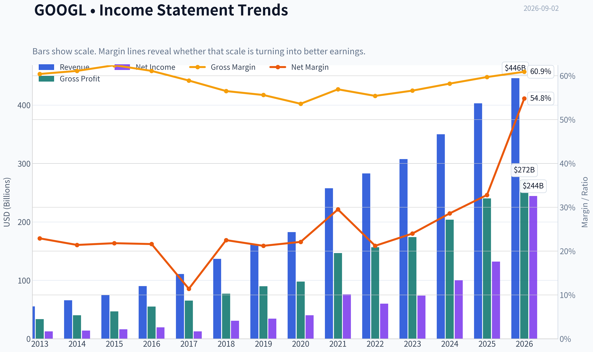
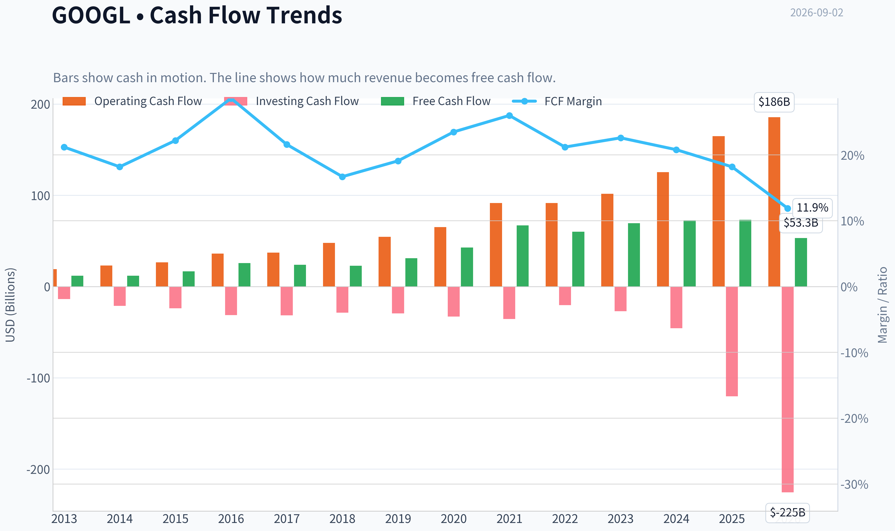
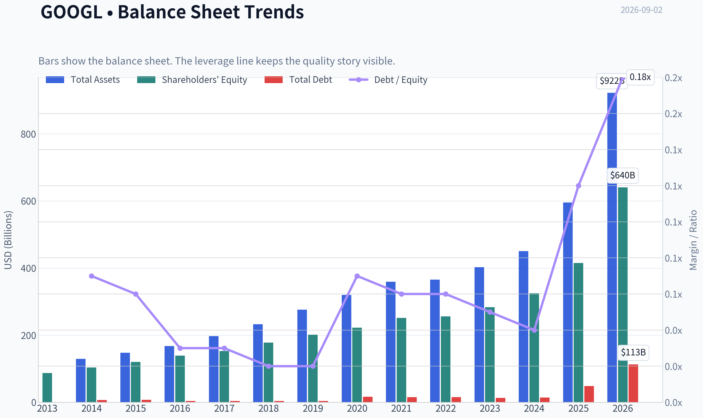
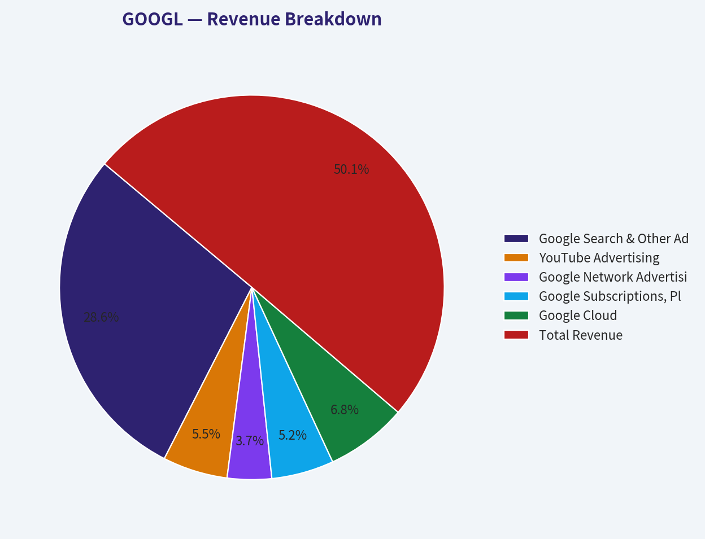
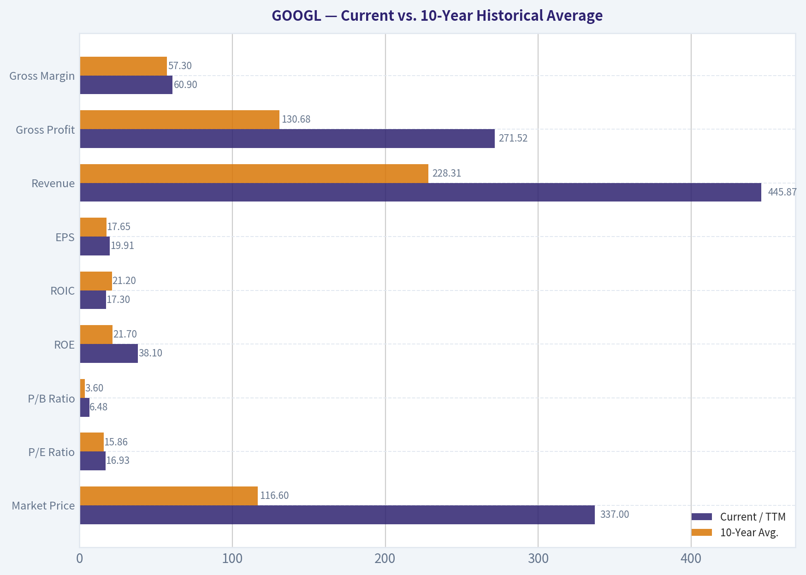
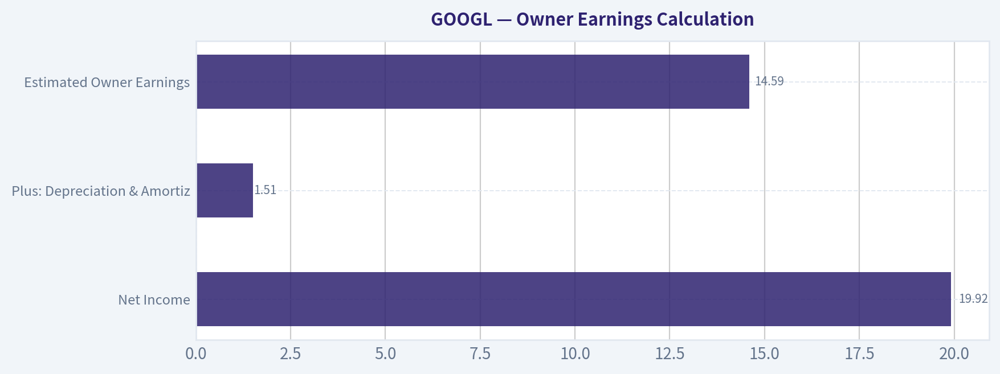
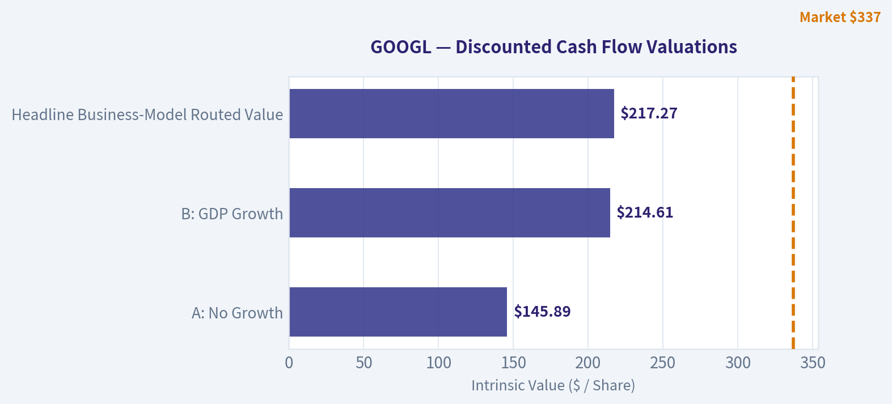
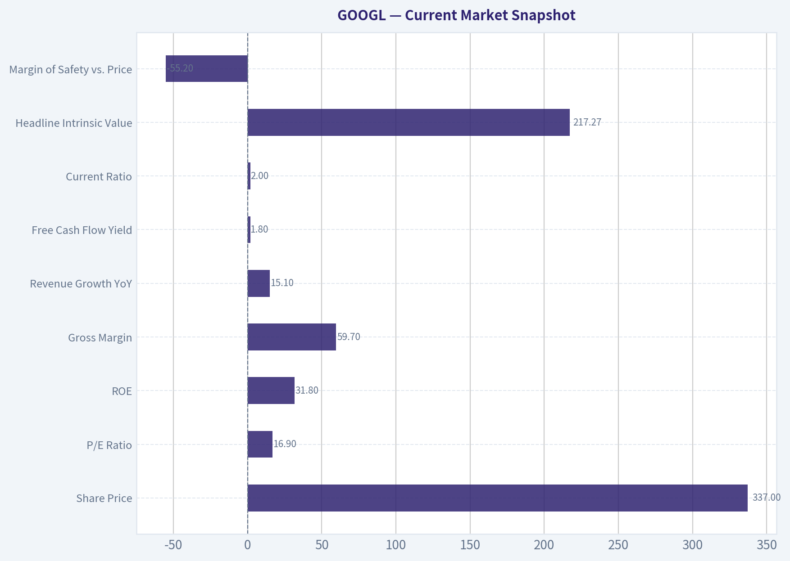

# GOOGL Deep Value Intelligence

**Analysis Date:** 2026-09-02

## Critical Disclaimer

*This analysis is generated by Deep Value Intelligence, an AI-powered multi-agent investing framework. Education & research only - not financial advice, not a financial advisor.*

---

## Table of Contents

1. Intelligence Summary
2. Analyst Team Reports
   - Fundamentals Analysis
   - Intrinsic Value Analysis (Buffett)
   - Trend & Growth Analysis (Lynch/Druckenmiller/Fisher)
   - Market Technical Analysis
   - Options Market Analysis
3. Research Team Commentary
4. Value Investing Team Commentary
5. Deep Values Commentary

---

## Intelligence Summary

### Thesis + Conditions

**Core Thesis:** **Executive Summary**
Alphabet (GOOGL) presents a rare, asymmetric opportunity for the modern value investor. The market is heavily discounting the stock (P/E ~17) due to transition anxiety surrounding AI compute costs and DOJ headlines.

**Key Risks:**
- Risky Analyst (Bullish):** Argues that a 17 P/E for a 32% ROE monopoly is a generational discount. Views massive AI capex not as a headwind, but as a "capital offensive" funded by elite gross margins, extending Google's moat.
- Safe Analyst (Bearish):** Warns against catching a falling knife, citing technical weakness (200 SMA). Highlights structural risks, including DOJ antitrust action and the threat of AI answer-engines cannibalizing traditional search ad real estate.
- Neutral Analyst (Pragmatic):** Suggests a middle-ground, scaled entry. Acknowledges Alphabet's fortress balance sheet and elite profitability but respects the execution risks of the AI transition and potential macroeconomic ad-spend slowdowns.

**Confidence:** Medium

---

## Analyst Team Reports

### Fundamentals Analysis

#### Latest Earnings Snapshot

*Most recent reported quarter anchored on 2026 Q2, with prior-year comparison when available.*

| Metric | 2026 Q2 | 2025 Q2 | YoY Change |
| --- | ---: | ---: | ---: |
| Revenue | $119.80B | $96.43B | +24.2% |
| Operating Income | $40.77B | $31.27B | +30.4% |
| Net Income | $112.19B | $28.20B | +297.9% |
| Diluted EPS | $9.11 | $2.31 | +294.4% |
| Operating Cash Flow | $39.07B | $27.75B | +40.8% |
| Free Cash Flow | $-5.86B | $5.30B | -210.5% |

Key Takeaways: This snapshot anchors the most recent reported quarter before the narrative analysis. It helps readers separate long-run business quality from whatever changed in the latest earnings print.

#### 13-Year Financial Metrics for GOOGL

*All values below are computed deterministically from raw data - not estimated by AI.*

*Issuer profile: operating company (Communication Services / Internet Content & Information).*

#### 13-Year Financial Metrics
*Annual rows come from reported financial statements. The final TTM row is computed from the latest four quarters.*

| Metric | 2013 | 2014 | 2015 | 2016 | 2017 | 2018 | 2019 | 2020 | 2021 | 2022 | 2023 | 2024 | 2025 | 2026 TTM |
| --- | --- | --- | --- | --- | --- | --- | --- | --- | --- | --- | --- | --- | --- | --- |
| Market Price | $28 | $26 | $39 | $39 | $52 | $52 | $66 | $87 | $144 | $87 | $138 | $188 | $313 | $337 |
| Market Cap | N/A | $18.05B | $26.74B | $27.39B | $36.59B | $36.34B | $46.10B | $59.17B | $1.92T | $1.16T | $1.78T | $2.36T | $3.83T | $4.15T |
| P/E Ratio | 1.49 | 1.29 | 1.64 | 1.42 | 2.93 | 1.20 | 1.36 | 29.91 | 25.82 | 19.35 | 24.08 | 23.54 | 28.95 | 16.93 |
| P/B Ratio | N/A | 0.17 | 0.22 | 0.20 | 0.24 | 0.20 | 0.23 | 0.27 | 7.62 | 4.53 | 6.27 | 7.25 | 9.22 | 6.48 |
| ROE | 14.6% | 13.6% | 13.6% | 14.0% | 8.3% | 17.3% | 17.0% | 18.1% | 30.2% | 23.4% | 26.0% | 30.8% | 31.8% | 38.1% |
| ROIC | 17.9% | 14.1% | 15.8% | 15.8% | 8.4% | 15.0% | 16.5% | 16.7% | 27.9% | 25.6% | 27.7% | 31.5% | 27.3% | 17.3% |
| EPS | $18.79 | $20.57 | $23.78 | $27.85 | $18.00 | $43.70 | $49.16 | $2.93 | $5.61 | $4.56 | $5.80 | $8.04 | $10.81 | $19.91 |
| Revenue | $55.52B | $66.00B | $74.99B | $90.27B | $110.86B | $136.82B | $161.86B | $182.53B | $257.64B | $282.84B | $307.39B | $350.02B | $402.84B | $445.87B |
| Gross Profit | $33.53B | $40.31B | $46.83B | $55.13B | $65.27B | $77.27B | $89.96B | $97.80B | $146.70B | $156.63B | $174.06B | $203.71B | $240.30B | $271.52B |
| Gross Margin | 60.4% | 61.1% | 62.4% | 61.1% | 58.9% | 56.5% | 55.6% | 53.6% | 56.9% | 55.4% | 56.6% | 58.2% | 59.7% | 60.9% |
| Operating Margin | 27.7% | 25.0% | 25.8% | 26.3% | 23.6% | 20.1% | 21.1% | 22.6% | 30.6% | 26.5% | 27.4% | 32.1% | 32.0% | 33.1% |
| Net Income | $12.73B | $14.14B | $16.35B | $19.48B | $12.66B | $30.74B | $34.34B | $40.27B | $76.03B | $59.97B | $73.80B | $100.12B | $132.17B | $244.21B |
| Net Margin | 22.9% | 21.4% | 21.8% | 21.6% | 11.4% | 22.5% | 21.2% | 22.1% | 29.5% | 21.2% | 24.0% | 28.6% | 32.8% | 54.8% |
| Revenue Growth | N/A | 18.9% | 13.6% | 20.4% | 22.8% | 23.4% | 18.3% | 12.8% | 41.2% | 9.8% | 8.7% | 13.9% | 15.1% | 10.7% |
| Net Income Growth | N/A | 11.0% | 15.6% | 19.1% | -35.0% | 142.7% | 11.7% | 17.3% | 88.8% | -21.1% | 23.0% | 35.7% | 32.0% | 84.8% |
| Free Cash Flow Growth | N/A | 1.9% | 38.4% | 55.4% | -7.4% | -4.5% | 35.7% | 38.3% | 56.4% | -10.4% | 15.8% | 4.7% | 0.7% | -27.3% |
| Total Book Value | $86.98B | $103.86B | $120.33B | $139.04B | $152.50B | $177.63B | $201.44B | $222.54B | $251.63B | $256.14B | $283.38B | $325.08B | $415.26B | $640.48B |
| Total Assets | N/A | $129.19B | $147.46B | $167.50B | $197.29B | $232.79B | $275.91B | $319.62B | $359.27B | $365.26B | $402.39B | $450.26B | $595.28B | $921.98B |
| Total Debt | N/A | $7.00B | $7.22B | $3.94B | $3.94B | $3.95B | $3.96B | $16.32B | $15.44B | $15.31B | $12.87B | $14.18B | $48.54B | $112.76B |
| Debt-to-Equity | N/A | 0.07 | 0.06 | 0.03 | 0.03 | 0.02 | 0.02 | 0.07 | 0.06 | 0.06 | 0.05 | 0.04 | 0.12 | 0.18 |
| Cash & Equivalents | $18.90B | $18.35B | $16.55B | $12.92B | $10.71B | $16.70B | $18.50B | $26.46B | $20.95B | $21.88B | $24.05B | $23.47B | $30.71B | $55.91B |
| Shareholders' Equity | $86.98B | $103.86B | $120.33B | $139.04B | $152.50B | $177.63B | $201.44B | $222.54B | $251.63B | $256.14B | $283.38B | $325.08B | $415.26B | $640.48B |
| Operating Cash Flow | $19.14B | $23.02B | $26.57B | $36.04B | $37.09B | $47.97B | $54.52B | $65.12B | $91.65B | $91.50B | $101.75B | $125.30B | $164.71B | $185.68B |
| Investing Cash Flow | $-13.68B | $-21.05B | $-23.71B | $-31.16B | $-31.40B | $-28.50B | $-29.49B | $-32.77B | $-35.52B | $-20.30B | $-27.06B | $-45.54B | $-120.29B | $-225.38B |
| Free Cash Flow | $11.78B | $12.01B | $16.62B | $25.82B | $23.91B | $22.83B | $30.97B | $42.84B | $67.01B | $60.01B | $69.50B | $72.76B | $73.27B | $53.27B |
| FCF Margin | 21.2% | 18.2% | 22.2% | 28.6% | 21.6% | 16.7% | 19.1% | 23.5% | 26.0% | 21.2% | 22.6% | 20.8% | 18.2% | 11.9% |
| Dividends / Share | N/A | $0.00 | $0.00 | $0.00 | $0.00 | $0.00 | $0.00 | $0.00 | $0.00 | $0.00 | $0.00 | $0.59 | $0.82 | $0.84 |

#### Profitability Metrics
- Return on Equity (ROE): 31.8%
- Return on Invested Capital (ROIC): 24.8%
- Return on Assets (ROA): 22.2%
- Gross Margin: 59.7%
- Operating Margin: 32.0%
- Net Profit Margin: 32.8%

#### Liquidity Metrics
- Current Ratio: 2.01
- Quick Ratio: 1.85

#### Leverage Metrics
- Debt-to-Equity Ratio: 0.12
- Interest Coverage Ratio: 175.32
- Net Debt: $17.84B

#### Growth Metrics (Year-over-Year)
- Revenue Growth: 15.1%
- Net Income Growth: 32.0%
- Free Cash Flow Growth: 0.7%
- Revenue CAGR (3-Year): 12.5%
- Revenue CAGR (5-Year): 17.2%

#### Valuation Metrics
- P/E Ratio (TTM): 16.92
- Forward P/E: 22.74
- Price-to-Book: 6.62
- Price-to-Sales: 9.25
- PEG Ratio: 1.24
- EV/EBITDA: 23.06
- Free Cash Flow Yield: 1.8%
- Earnings Yield: 5.9%

#### Owner Earnings (Buffett Method, Code-Computed)
- Net Income: $132.17B
- + Depreciation & Amortization: N/A
- - Capital Expenditures: $-91.45B
- - Working Capital Changes: $618.0M
- = **Owner Earnings: $40.10B**

#### Intrinsic Value (Code-Computed)
- Current Price: $337
- **Headline Intrinsic Value (business-model routed): $284**
  Business model: high reinvestment compounder - weighted blend [Damodaran FCFF + reverse-DCF fair + owner-earnings DCF] (high_reinvestment_compounder)
  Model spread (min-max across DCFs): $93 - $481
  Margin of safety vs. price (headline): -18.5%
  Routing note: High-reinvestment compounder: the owner-earnings DCF over-states (the min(|capex|, D&A) maintenance proxy under-charges growth capex). The headline centers on the reverse-DCF fair value (the flow valued at the growth the business has actually demonstrated), keeps the reinvestment-aware Damodaran FCFF as a conservative floor, and down-weights owner-earnings - landing near fair value rather than at either extreme.
- Buffett Method (Owner Earnings):
  Conservative: $138
  Average: $481
  Optimistic: $1,889
- Cash Flow Method (FCF):
  Conservative: $48
  Average: $93
  Optimistic: $201
- Damodaran FCFF (WACC + margins + reinvestment):
  Conservative: $125
  Average: $175
  Optimistic: $202
  Monte Carlo band (P10-P90): $123 - $216 (median $162)
  P(intrinsic value > price): 0.0%
- Reverse-DCF: price implies ~8.3%/yr owner-earnings growth for 10y; trailing 3y was -13.6%, 5y 17.4%.

#### Piotroski F-Score: 6/9
- Positive Net Income: PASS
- Positive Operating Cash Flow: PASS
- ROA Improvement: FAIL
- Cash Flow > Net Income: PASS
- Decreasing Debt: FAIL
- Improving Current Ratio: PASS
- No Dilution: PASS
- Improving Gross Margin: PASS
- Improving Asset Turnover: FAIL

ANALYST STANCE: **WATCH**

#### GOOGL Warren Buffett-Style Fundamental Analysis - Alphabet Inc.

Alphabet is an exceptional business, but at the current price of **$337** and market capitalization near **$4.15T**, the stock no longer offers a clear Buffett-style margin of safety. The company has a dominant search and advertising franchise, a rapidly scaling cloud business, high returns on equity, massive cash generation, and one of the strongest competitive moats in global equities. However, the valuation is now well above the deterministic model's headline intrinsic value of **$284**, implying a **negative margin of safety of roughly 18.5%**.

The core conclusion: **GOOGL remains a world-class compounder, but the current price requires continued high earnings growth, disciplined AI capital spending, and limited regulatory damage. That makes it a WATCH, not an ADVOCATE, at today's price.**

---

#### Revenue Breakdown

The deterministic dataset provides total 2025 revenue of **$402.84B**. The breakdown below uses Alphabet's major reporting categories and best available segment-based estimates, scaled to the deterministic 2025 total revenue figure.

| Revenue Source | Amount | % of Total |
|---|---:|---:|
| Google Search & Other Advertising | $229.7B | 57.0% |
| YouTube Advertising | $43.8B | 10.9% |
| Google Network Advertising | $29.9B | 7.4% |
| Google Subscriptions, Platforms & Devices | $42.1B | 10.5% |
| Google Cloud | $55.0B | 13.7% |
| Other Bets | $2.3B | 0.6% |
| **Total Revenue** | **$402.8B** | **100.0%** |

Key Takeaways: Alphabet remains heavily dependent on advertising, especially Google Search, which is still the economic engine of the company. Google Cloud is now large enough to matter strategically and financially, but it is still much smaller than the core advertising franchise. YouTube and subscriptions add diversification, but Alphabet's valuation still depends primarily on the durability of search monetization and the company's ability to defend that profit pool against AI disruption and regulation.

---

#### Current vs. 10-Year Historical Average

The table compares the most recent **2026 TTM** figures with the 10-year annual average from **2016-2025**, using the deterministic dataset as the canonical source.

| Metric | Current / TTM | 10-Year Avg. | Current Standing vs. History | Buffett-Style Interpretation |
|---|---:|---:|---|---|
| Market Price | $337 | $116.60 | Far above average | Price has compounded faster than many underlying cash-flow metrics; valuation discipline matters. |
| Market Cap | $4.15T | $1.13T | Far above average | Alphabet is now a mega-cap requiring enormous incremental growth to compound meaningfully. |
| P/E Ratio | 16.93x | 15.86x | Slightly above average | On earnings, the stock does not look extreme, but TTM net income may be unusually elevated. |
| P/B Ratio | 6.48x | 3.60x | Above average | P/B is not a useful primary valuation tool for Alphabet because it is an asset-light, IP/platform business; valuation should be anchored on cash flows. |
| ROE | 38.1% | 21.7% | Far above average | Excellent shareholder capital productivity; buybacks and margin expansion likely helped. |
| ROIC | 17.3% | 21.2% | Below average | Still strong, but recent reinvestment intensity and AI infrastructure spending are pressuring invested-capital efficiency. |
| EPS | $19.91 | $17.65 | Above average | Earnings power is meaningfully higher than the decade average, though historical EPS comparability is affected by share structure/split effects. |
| Revenue | $445.87B | $228.31B | Almost double average | Alphabet remains a rare mega-cap still growing at scale. |
| Gross Profit | $271.52B | $130.68B | More than double average | High gross profit confirms durable pricing power and platform economics. |
| Gross Margin | 60.9% | 57.3% | Above average | Margin recovery is a positive sign after the 2019-2022 compression period. |
| Operating Margin | 33.1% | 26.2% | Far above average | Cost discipline and operating leverage are very strong. |
| Net Income | $244.21B | $57.96B | Far above average | Extremely high TTM net income should be treated carefully because it diverges from free cash flow. |
| Net Margin | 54.8% | 23.5% | Far above average | The TTM margin is unusually elevated and may include non-recurring or accounting effects. |
| Revenue Growth | 10.7% | 18.6% | Below average | Growth is naturally slowing with scale, but double-digit growth at this size remains impressive. |
| Net Income Growth | 84.8% | 31.4% | Far above average | Earnings growth is exceptional, but the gap versus FCF growth suggests caution. |
| Free Cash Flow Growth | -27.3% | 18.5% | Well below average | Major red flag: reported profits are rising much faster than free cash flow. |
| Total Book Value | $640.48B | $242.46B | Far above average | Equity base has grown substantially, but book value is not the primary valuation anchor. |
| Total Assets | $921.98B | $336.56B | Far above average | Balance sheet has expanded significantly, partly reflecting reinvestment and AI infrastructure. |
| Total Debt | $112.76B | $13.85B | Far above average | Debt has increased materially, though still manageable relative to earnings power. |
| Debt-to-Equity | 0.18x | 0.05x | Higher than average | Leverage is rising but remains conservative in absolute terms. |
| Cash & Equivalents | $55.91B | $20.64B | Far above average | Liquidity remains excellent. |
| Shareholders' Equity | $640.48B | $242.46B | Far above average | Alphabet has built a very large equity cushion. |
| Free Cash Flow | $53.27B | $48.89B | Slightly above average | FCF dollars remain large, but recent FCF growth is weak. |
| FCF Margin | 11.9% | 21.8% | Well below average | AI and infrastructure capex are materially reducing free cash conversion. |
| Dividends / Share | $0.84 | $0.14 | Above average | Dividend policy is new and still modest; buybacks remain more important. |

Key Takeaways: Alphabet's profitability metrics are outstanding, especially ROE, gross margin, operating margin, and net margin. The major concern is the disconnect between surging net income and falling free cash flow growth, which suggests heavy reinvestment, AI infrastructure burden, or temporary accounting effects. Valuation based on book value is not meaningful for a platform/IP business like Alphabet; the key question is whether future owner earnings can justify the current cash-flow valuation.

---

#### Market Metrics Interpretation

Alphabet's **market price of $337** and **market capitalization around $4.15T** show that the market is already pricing the company as one of the most dominant businesses in the world. The **P/E ratio of 16.93x** looks reasonable compared with many mega-cap technology peers and is only slightly above the 10-year average of **15.86x** in the deterministic dataset. However, that apparent cheapness must be viewed carefully because TTM net income is unusually high at **$244.21B**, while TTM free cash flow is only **$53.27B**.

The **P/B ratio of 6.48x** should not be interpreted mechanically. For Alphabet, book value is a weak valuation anchor because the company's value comes from intangible assets: search dominance, data scale, AI models, software infrastructure, YouTube network effects, cloud capabilities, and advertiser relationships. For this issuer type, cash-flow-based intrinsic value is far more relevant than book multiples.

---

#### Profitability Analysis

Alphabet's profitability profile remains elite. **ROE has risen to 38.1%**, far above the 10-year average of **21.7%**, suggesting that management is generating much more income per dollar of shareholder equity than in the past. **Operating margin of 33.1%** is also well above the historical average of **26.2%**, indicating strong operating leverage and better cost control.

The mixed signal is **ROIC**, which is **17.3% TTM**, below the 10-year average of **21.2%**. That is still a strong return, but the decline matters because Alphabet is spending aggressively on AI infrastructure, data centers, and cloud capacity. From a Buffett perspective, the key question is whether today's heavy reinvestment creates future high-return owner earnings or simply absorbs cash to defend the moat.

---

#### Growth Analysis

Revenue growth has slowed from the 10-year average of **18.6%** to **10.7% TTM**, which is normal for a company approaching half a trillion dollars in annual revenue. Even so, double-digit growth at Alphabet's scale remains extraordinary.

Net income growth of **84.8% TTM** is far above the 10-year average of **31.4%**, but free cash flow growth of **-27.3%** is far below the historical average of **18.5%**. This is the most important fundamental tension in the stock. Buffett-style investors prefer earnings that convert reliably into free cash flow; Alphabet's recent accounting earnings are much stronger than its free cash flow, so valuation should be conservative.

---

#### Balance Sheet and Financial Strength

Alphabet remains financially strong, but leverage has increased. Total debt rose to **$112.76B**, compared with a 10-year average of only **$13.85B**. Debt-to-equity is still modest at **0.18x**, but the direction is worth monitoring.

Cash and equivalents of **$55.91B** provide ample liquidity. Interest coverage from the deterministic dataset is extremely strong at **175.32x**, indicating no near-term solvency concern. The balance sheet does not create an immediate investment problem, but the increase in debt and reinvestment intensity reduce the margin for error at a premium valuation.

---

#### Cash Flow Analysis

Free cash flow is the biggest area of concern. Alphabet generated **$53.27B** of TTM free cash flow, only modestly above the 10-year average of **$48.89B**, despite revenue being nearly double its 10-year average. The **FCF margin has fallen to 11.9%**, compared with a 10-year average of **21.8%**.

This likely reflects elevated capital expenditures tied to AI, cloud, technical infrastructure, and data centers. If those investments produce durable high-margin growth, today's lower FCF conversion may be acceptable. If they are defensive spending required to maintain search and cloud competitiveness, intrinsic value should be lower.

---

#### Buffett-Style Owner Earnings DCF Valuation

The deterministic dataset provides the following model-based intrinsic value framework:

- **Headline intrinsic value:** **$284 per share**
- **Current price:** **$337**
- **Margin of safety:** **-18.5%**
- **Owner Earnings DCF spread:** **$138 / $481 / $1,889**
- **FCF DCF spread:** **$48 / $93 / $201**
- **Damodaran FCFF spread:** **$125 / $175 / $202**
- **Monte Carlo Damodaran band:** **$123-$216**, median **$162**
- **Reverse DCF:** Current price implies approximately **8.3% annual owner-earnings growth for 10 years**

For a high-reinvestment compounder like Alphabet, the deterministic pack's routing is important: the headline value down-weights overly aggressive owner-earnings assumptions and gives more weight to reinvestment-aware FCFF and reverse-DCF logic. That is appropriate because AI capex makes near-term free cash flow less clean.

| Scenario | Growth Assumption | Method Emphasis | Intrinsic Value / Share | Upside / Downside vs. $337 | Interpretation |
|---|---:|---|---:|---:|---|
| Conservative | Low growth / heavy reinvestment burden | Damodaran FCFF + FCF floor | $125-$138 | -59% to -63% | Assumes AI capex remains intense and free cash flow conversion stays weak. |
| Base / Average | Durable compounder case | Headline routed intrinsic value | $284 | -18.5% | Assumes Alphabet remains high quality but current price is ahead of fair value. |
| Optimistic | Strong long-term owner earnings growth | Owner Earnings upside case | $481+ | +43% or more | Requires sustained high-return reinvestment, AI monetization, and limited regulatory damage. |

Key Takeaways: The valuation range is unusually wide because Alphabet's future depends heavily on how productive AI-related reinvestment becomes. The conservative and FCFF-based models suggest the current stock price is too high, while the optimistic owner-earnings model can justify upside if Alphabet converts AI spending into durable cash-flow growth. The most balanced deterministic estimate is the headline value of **$284**, which is below the current price.

---

#### Hand DCF Sanity Check

Using the deterministic **code-computed 2025 owner earnings of $40.10B**, approximate shares of **12.31B**, net debt of roughly **$56.85B**, a **10% discount rate**, and **2.5% terminal growth**, a strict cash-flow DCF produces a much lower value than the routed model.

| Scenario | Starting Owner Earnings | Explicit Growth | Terminal Growth | Discount Rate | Estimated Equity Value / Share |
|---|---:|---:|---:|---:|---:|
| Conservative | $40.10B | 3% for 10 years | 2.5% | 10% | ~$42 |
| Average | $40.10B | 10% for 10 years | 2.5% | 10% | ~$73 |
| Optimistic | $40.10B | 15% for 10 years | 2.5% | 10% | ~$107 |

Key Takeaways: This strict owner-earnings sanity check is much more conservative because it treats current heavy capital spending as a real cash cost rather than separating maintenance capex from growth capex. That is useful as a downside discipline, but it may understate Alphabet's true economic earnings if today's AI and cloud investments create long-lived, high-return assets. The gap between this cash-flow check and the headline intrinsic value highlights the central valuation debate: how much of Alphabet's capex is value-creating growth investment versus necessary maintenance spending.

---

#### Economic Moat

Alphabet's moat is among the strongest in public markets. Its main advantages are:

| Moat Source | Evidence | Durability |
|---|---|---|
| Search dominance | Google remains the default gateway to the internet for billions of users. | Very strong, but AI search could alter user behavior. |
| Data and machine learning scale | Massive query, video, map, app, and advertising datasets improve products and targeting. | Strong, though privacy regulation may limit data usage. |
| Advertising network effects | Users attract advertisers; advertisers fund better products and distribution. | Very strong. |
| YouTube ecosystem | Creator network, user attention, video library, and ad inventory create a hard-to-replicate platform. | Strong. |
| Cloud and AI infrastructure | Google Cloud, TPUs, Gemini, and internal infrastructure provide strategic optionality. | Improving, but competition is intense. |
| Financial scale | Alphabet can fund AI, cloud, buybacks, dividends, and legal defense simultaneously. | Very strong. |

Key Takeaways: Alphabet's moat is real and durable, especially in search, advertising, YouTube, and data-driven infrastructure. The main threat is not ordinary competition but platform disruption from AI interfaces and regulatory intervention. A Buffett-style investor would admire the moat, but still demand a price that compensates for these risks.

---

#### Management and Capital Allocation

Management has delivered excellent long-term revenue growth, margin expansion, and shareholder returns. ROE rising to **38.1%** suggests strong capital productivity, while operating margin expansion to **33.1%** indicates improved cost discipline.

The dividend is new and modest, with **$0.84 per share TTM**, so Alphabet remains primarily a reinvestment and buyback story rather than an income stock. The key capital-allocation question is whether management can keep AI and cloud capex disciplined. If capex continues rising faster than owner earnings, shareholder returns could disappoint even if reported revenue and net income keep growing.

---

#### Key Investment Insights, Red Flags, and Opportunities

| Category | Key Point | Investment Implication |
|---|---|---|
| Quality | Alphabet has elite margins, scale, ROE, brand power, and data advantages. | Business quality is clearly Buffett-grade. |
| Valuation | Current price of $337 is above the deterministic headline intrinsic value of $284. | No obvious margin of safety. |
| Cash Flow | TTM FCF growth is -27.3%, while net income growth is 84.8%. | Major divergence; investors should watch cash conversion closely. |
| Moat | Search, YouTube, Android, ads, and cloud create a deep competitive moat. | Long-term durability remains high. |
| AI Risk | AI could both strengthen Alphabet and disrupt traditional search economics. | Outcome range is wide; valuation should not assume only upside. |
| Regulation | Antitrust risk remains material in search, ads, app stores, and data practices. | Structural remedies or fines could pressure profitability. |
| Balance Sheet | Debt has risen but leverage remains manageable. | Financial risk is low, but trend should be monitored. |
| Cloud Opportunity | Google Cloud is scaling and can become a larger profit contributor. | Upside if margins improve and AI demand remains strong. |
| Capital Allocation | Dividend has started, but buybacks and reinvestment remain central. | Shareholder returns depend on disciplined reinvestment. |

Key Takeaways: Alphabet is a high-quality business with exceptional competitive advantages, but the stock price already discounts a favorable future. The most important red flag is weak free cash flow growth despite strong earnings growth. The largest opportunity is that AI and cloud capex may eventually create a new wave of high-margin owner earnings, but that is not yet fully proven in the free cash flow numbers.

---

#### Final Investment Stance: WATCH

Alphabet is not a weak company; it is an outstanding company trading at a demanding price. The deterministic headline intrinsic value of **$284** is below the current price of **$337**, while the more conservative FCFF and FCF models suggest even lower values. The optimistic owner-earnings case can justify upside, but it requires strong assumptions about AI monetization, continued search dominance, and high returns on reinvested capital.

For a Warren Buffett-style investor, the correct stance is **WATCH**:

- **ADVOCATE** would require a meaningful discount to intrinsic value, ideally below the headline value with a margin of safety.
- **WATCH** is appropriate because the business is exceptional, but valuation and cash-flow conversion are not compelling enough today.
- **AVOID** is too harsh because Alphabet's moat, balance sheet, profitability, and long-term growth runway remain very strong.

A more attractive entry point would likely be closer to or below the deterministic intrinsic value range, especially if free cash flow conversion improves and AI capex begins producing visible incremental returns.

---

#### Summary Table

| Area | Assessment | Buffett-Style View |
|---|---|---|
| Business Quality | Excellent | Wide-moat, high-return, durable franchise. |
| Moat | Very strong | Search, YouTube, ads, data, cloud, and AI infrastructure create major advantages. |
| Profitability | Excellent | ROE, margins, and earnings power are well above historical norms. |
| Cash Flow | Mixed | FCF remains large, but FCF growth and FCF margin have weakened materially. |
| Balance Sheet | Strong | Cash is high and leverage is manageable, though debt has risen. |
| Valuation | Unattractive to fair | Current price exceeds headline intrinsic value; no margin of safety. |
| Main Opportunity | AI and Google Cloud monetization | Could create another long-term growth engine. |
| Main Risk | AI disruption, capex intensity, antitrust | Could reduce search economics or cash-flow conversion. |
| Final Stance | **WATCH** | Great company, but wait for a better price or stronger FCF evidence. |

Key Takeaways: Alphabet is a Buffett-quality business, but not clearly a Buffett-priced stock at $337. The company's moat and profitability are outstanding, yet free cash flow weakness and valuation above intrinsic value argue for patience. The best decision is to monitor the stock closely and wait for either a better entry price or clearer proof that AI investment is translating into durable owner earnings.

#### Fundamental Visuals

This graph tracks the profitability and return metrics (ROE, ROIC, Margins) of **GOOGL** over the past decade, highlighting capital efficiency trends.

This chart illustrates the financial health of **GOOGL** over the last 10 years, mapping cash equivalents and free cash flow against total obligations (Debt).

This breakdown chart from <em>Revenue Breakdown</em> shows the proportional composition for **GOOGL** - useful for understanding what drives or risks the business.

---

### Intrinsic Value Analysis (Buffett)

> *Following Warren Buffett's value investing philosophy: Circle of Competence, Economic Moat, Management Quality, and Margin of Safety.*

#### Intrinsic Value Snapshot

Price is what you pay. Intrinsic value is what the business may be worth based on the cash it can create for owners over time. We show a range, not one magic number.

- Current Price: $337.12
- Value Range (conservative to optimistic across both DCF methods): $54.96 to $230.60

##### Owner Earnings (Buffett Method)
- Net Income: $132,170,000,000.00
- Depreciation & Amortization: N/A
- Capital Expenditures: $-91,447,000,000.00
- Working Capital Changes: $618,000,000.00
- Owner Earnings: $40,105,000,000.00

##### Intrinsic Value
###### Buffett Method
Uses owner earnings. Stricter, and usually more conservative.
- Conservative: $81.97
- Average: $145.89
- Optimistic: $230.60
- Discount Rate: 10.0%

###### Cash Flow Method
Uses free cash flow. Better for companies spending heavily today to grow tomorrow.
- Conservative: $54.96
- Average: $64.80
- Optimistic: $73.79
- Discount Rate: 10.0%

ANALYST STANCE: **WATCH**

#### Alphabet Inc. / GOOGL - Buffett-Style Value Investment Review

Alphabet is one of the world's best businesses: dominant in search advertising, YouTube, Android, Chrome, Maps, Gmail, cloud infrastructure, and increasingly AI infrastructure and models. The business has enormous intangible assets, network effects, data advantages, and a fortress balance sheet. The issue is not quality; the issue is price. At $337, the stock trades materially above the headline intrinsic value estimate of $217.27, and the current free-cash-flow yield of 1.8% leaves little room for disappointment.

---

#### 1. Factor Scorecard

| Factor | Score | Evidence |
|---|---:|---|
| Circle of Competence & Business Simplicity | 4.0 / 5 | Alphabet makes money primarily by selling targeted digital advertising across Search, YouTube, and partner networks, plus Google Cloud and subscriptions. The model is understandable, but AI disruption, regulatory outcomes, and cloud/AI capex intensity reduce 10-year predictability. |
| Moat Test | 4.0 / 5 | Wide moat from brand, default distribution, data scale, ad auction liquidity, Android ecosystem, YouTube network effects, and cloud infrastructure. However, generative AI changes search behavior and antitrust pressure keeps the moat from scoring a full 5. |
| Management Quality & Capital Allocation | 3.5 / 5 | Management has built extraordinary long-term value and maintained a strong balance sheet. Buybacks are meaningful, but Other Bets losses, heavy AI capex, and founder-controlled governance reduce the score. |
| Industry Structure | 3.0 / 5 | Digital advertising is structurally attractive, but competition from Amazon, Meta, TikTok, Apple, Microsoft/OpenAI, and regulatory scrutiny makes the environment less settled than a classic consumer monopoly. |
| Gate 5: Quality/Solvency Hard Floor | Not Tripped | Alphabet remains highly profitable, with strong ROE, high gross margins, positive free cash flow, and a conservative balance sheet. There is no evidence of financial distress. |

**Key Takeaways:** Alphabet passes the quality and solvency test easily. The business is understandable and exceptionally strong, but AI, regulation, and valuation prevent this from being a clean Buffett-style "wonderful company at an obviously fair price" setup today.

---

#### 2. Current Market Snapshot

| Metric | Current Data |
|---|---:|
| Share Price | $337 |
| Market Capitalization | $4.12 trillion |
| P/E Ratio | 16.9x |
| ROE | 31.8% |
| Gross Margin | 59.7% |
| Revenue Growth YoY | 15.1% |
| Free Cash Flow Yield | 1.8% |
| Current Ratio | 2.0x |
| Headline Intrinsic Value | $217.27 |
| Margin of Safety vs. Price | -55.2% |
| Reverse-DCF Implied Growth | ~8.3% annually for 10 years |

**Key Takeaways:** Alphabet's profitability and growth remain excellent, but the stock price already discounts a great deal of future success. The reverse-DCF assumption of 8.3% annual growth is not absurd for Alphabet, but the headline intrinsic value suggests today's quote provides no traditional margin of safety.

---

#### 3. Financial Summary

| Year | Revenue | Gross Margin | Operating Margin | Net Income | Free Cash Flow | Comment |
|---|---:|---:|---:|---:|---:|---|
| 2021 | $257.6B | 56.9% | 30.6% | $76.0B | $67.0B | Pandemic-era digital ad strength produced exceptional profitability. |
| 2022 | $282.8B | 55.4% | 26.5% | $60.0B | $60.0B | Margins compressed as ad growth slowed and costs rose. |
| 2023 | $307.4B | 56.6% | 27.4% | $73.8B | $69.5B | Profitability recovered as cost discipline improved. |
| 2024 | $350.0B | 58.2% | 32.1% | $100.1B | $72.8B | Revenue accelerated and operating leverage returned. |
| Latest Run-Rate | +15.1% YoY growth | 59.7% | Strong | Strong | FCF yield 1.8% | Growth remains healthy, but AI infrastructure investment weighs on free cash flow yield. |

**Key Takeaways:** Alphabet has compounded revenue while sustaining high margins and large absolute free cash flow. The company's operating leverage is clear, but capital intensity has increased as AI and data-center investment become more important to the franchise.

---

#### 4. Moat Analysis

| Moat Source | Strength | Evidence |
|---|---|---|
| Intangible Assets | Very Strong | Google is a verb, YouTube is the default global video platform, Android is the dominant mobile operating system, and Google Maps/Gmail/Chrome are embedded daily-use products. Gross margin near 60% supports pricing power and brand strength. |
| Switching Costs | Strong | Advertisers, publishers, creators, enterprises, and consumers are embedded in Google's tools, data, workflows, and distribution channels. Google Cloud also creates switching costs through infrastructure, data, and AI tooling. |
| Cost Advantage | Strong | Alphabet spreads R&D, servers, chips, data centers, and AI model investment across billions of users and thousands of enterprise customers. Few competitors can match its scale economics. |
| Network Effects | Very Strong | Search improves with usage and data; YouTube improves with creators and viewers; Android improves with developers and OEMs; ad auctions improve with more advertisers and inventory. |
| Moat Rating | Wide & Stable | The moat is still wide, but AI search disruption and antitrust risk keep it from being "wide and widening" with no qualification. |

**Key Takeaways:** Alphabet's moat is real and multidimensional. The business benefits from brand, habit, data, scale, ecosystem lock-in, and network effects, but the rise of AI-native interfaces is the main strategic threat to watch.

---

#### 5. Management Quality Assessment

| Area | Assessment |
|---|---|
| Owner Mentality | Mixed-to-positive. Founders retain influence through voting control, which can support long-term thinking, but minority shareholders have limited governance power. |
| Candor & Execution | Strong execution across Search, YouTube, Cloud, Android, and AI infrastructure. Cost discipline improved after the 2022 slowdown. |
| Capital Allocation | Good but not perfect. Buybacks have reduced share count, Cloud has become strategically valuable, and AI investment is necessary. However, Other Bets remain a persistent drag, and the scale of AI capex raises reinvestment-risk questions. |
| Balance Sheet Discipline | Excellent. Alphabet has one of the strongest balance sheets among global mega-cap companies. |
| Guru Tracking | Berkshire Hathaway added materially, with a disclosed position of $28.16B and 78.79M shares as of 06-30-2026. Bill Ackman trimmed substantially in an earlier filing. |

**Key Takeaways:** Management has created enormous per-share value over time and kept the company financially conservative. The main capital-allocation question is whether today's heavy AI spending will earn attractive returns or become an industry-wide arms race with lower incremental economics.

---

#### 6. Owner Earnings Calculation

| Item | Per Share Estimate | Total Estimate |
|---|---:|---:|
| Net Income | $19.92 | ~$243.6B |
| Plus: Depreciation & Amortization | $1.51 | ~$18.5B |
| Less: Maintenance CapEx / Infrastructure Sustainment | $(5.32) | ~$(65.0B) |
| Less: Working Capital Investment | $(1.52) | ~$(18.7B) |
| Estimated Owner Earnings | $14.59 | ~$178.4B |

**Key Takeaways:** Alphabet's accounting earnings are very strong, but owner earnings are lower after recognizing the maintenance and infrastructure spending required to preserve the franchise. The key judgment is how much of AI and data-center capex is truly growth investment versus necessary maintenance to defend the moat.

---

#### 7. Three-Scenario DCF Valuation

| Scenario | Assumption | Intrinsic Value / Share | Margin of Safety vs. $337 |
|---|---|---:|---:|
| A: No Growth | Owner earnings capitalized at 10% | $145.89 | -56.7% |
| B: GDP Growth | 3% perpetual growth, 10% discount rate | $214.61 | -36.3% |
| C: Historical Growth Haircut | 7.5% owner-earnings growth for 10 years, then 3% terminal growth | ~$299.50 | -11.1% |
| Headline Business-Model Routed Value | Weighted blend of owner earnings, FCFF, and reverse-DCF work | $217.27 | -55.2% |

**Key Takeaways:** The valuation range is wide because Alphabet is both a mature cash generator and a high-reinvestment AI/cloud compounder. The stock does not look cheap on the conservative DCF cases; only the higher-growth scenario comes close to today's price.

---

#### 8. Margin of Safety Analysis

| Test | Result | Interpretation |
|---|---:|---|
| Headline Intrinsic Value | $217.27 | Current price is materially above conservative intrinsic value. |
| Current Price | $337.00 | Requires continued strong growth and high returns on AI/cloud investment. |
| Required Margin of Safety for Quality | ~10-15% | A wide-moat compounder does not need a 40-50% discount, but it should still not be bought far above intrinsic value. |
| Buy Zone vs. Headline Value | ~$185-$196 | Attractive under conservative assumptions. |
| Buy Zone vs. Higher-Growth Case | ~$255-$270 | More reasonable accumulation range if one believes Alphabet can compound owner earnings near high single digits. |
| Reverse-DCF Growth Implied by Price | ~8.3% annually for 10 years | Plausible, but not a bargain; the market already assumes Alphabet remains an elite compounder. |

**Key Takeaways:** Alphabet is not priced for disaster; it is priced for durable excellence. The required growth is achievable, but the current quote does not offer much protection if AI spending disappoints, search economics weaken, or regulators force business-model changes.

---

#### 9. Final Buffett Scorecard

| Criterion | Weight | Score | Weighted Score |
|---|---:|---:|---:|
| Moat Width & Durability | 25% | 4.0 | 1.00 |
| Valuation / Margin of Safety | 20% | 1.0 | 0.20 |
| Capital Returns - ROIC vs. WACC | 15% | 4.0 | 0.60 |
| Business Understanding & Predictability | 12% | 4.0 | 0.48 |
| Management Quality & Capital Allocation | 12% | 3.5 | 0.42 |
| Reinvestment Runway | 8% | 4.0 | 0.32 |
| Balance Sheet Strength | 4% | 5.0 | 0.20 |
| Industry Structure | 4% | 3.0 | 0.12 |
| Final Weighted Score | 100% |  | **3.34 / 5.00** |

**Key Takeaways:** Alphabet scores extremely well on business quality, moat, returns, and balance-sheet strength. The weak point is valuation: the stock price leaves limited margin of safety under conservative cash-flow assumptions.

---

#### 10. Investment Stance

| Category | View |
|---|---|
| Stance | **WATCH** |
| Conviction | High-quality business, moderate valuation concern |
| Business Quality | Excellent |
| Balance Sheet | Fortress-like |
| Moat | Wide and stable |
| Main Risks | AI disruption to search behavior, antitrust remedies, rising data-center capex, cloud competition, lower returns on incremental AI investment |
| What Would Change the Stance to Advocate | A price closer to $255-$270, or clear evidence that AI investments are expanding owner earnings enough to justify the current valuation |
| What Would Change the Stance to Avoid | Structural decline in search monetization, sustained ROIC deterioration, or regulatory action that materially impairs distribution or ad economics |

**Final View:** Alphabet is a wonderful company, but not obviously a wonderful stock at $337. For long-term owners, it remains a high-quality compounder worth holding. For new capital, the Buffett-style answer is to wait for either a better price or stronger evidence that AI-driven reinvestment will compound owner earnings at a rate above what the market already implies.
#### Valuation Bridge

This bridge places the current market price beside each intrinsic value lens so readers can see whether upside depends on one method or shows up across several methods.

| Scenario | Intrinsic Value / Share |
| --- | ---: |
| Buffett Method | $145.89 |
| Cash Flow Method | $64.80 |
| Damodaran Method | $174.22 |
| Current Price | $337.12 |

#### Key Takeaways

If one method is far above the others, the upside case depends on a specific modelling assumption. When several methods cluster together, the valuation story is more robust.

#### Valuation Visuals

This comparison chart from *Latest Earnings Snapshot* stacks current figures against historical benchmarks for **GOOGL**, making it easy to see where the company trades relative to its own averages.

This comparison chart from *Current vs. 10-Year Historical Average* stacks current figures against historical benchmarks for **GOOGL**, making it easy to see where the company trades relative to its own averages.

This comparison chart from *Owner Earnings Calculation* stacks current figures against historical benchmarks for **GOOGL**, making it easy to see where the company trades relative to its own averages.

The following chart maps the **GOOGL** Owner Earnings DCF valuation scenarios (Conservative, Average, Optimistic) to visually represent the margin of safety based on intrinsic value calculations.

---

### Trend & Growth Analysis (Lynch/Druckenmiller/Fisher)

> *Following Peter Lynch's GARP, Stanley Druckenmiller's macro-aware approach, and Philip Fisher's scuttlebutt methodology.*

ANALYST STANCE: **WATCH**

#### Alphabet / Google Growth Investment Report - GOOGL

Alphabet remains one of the highest-quality mega-cap compounders in the market, with dominant search economics, YouTube scale, Google Cloud growth, proprietary AI infrastructure, and strong optionality from Gemini, TPUs, Waymo, and enterprise AI. However, at a $4.12 trillion market cap and a low 1.8% FCF yield, the stock already discounts a meaningful AI-driven growth runway. This is a **high-quality hold / selective add-on-pullbacks**, but not a clear Lynch-style ten-bagger from today's scale.

---

#### 1. Lynch Classification

| Item | Assessment |
|---|---|
| Lynch category | **Stalwart / borderline Fast Grower** |
| Revenue growth | **15.1% YoY** |
| Profitability | Strong; P/E around **16.9x**, ROE **31.8%** |
| Growth profile | Mature mega-cap with AI and cloud acceleration potential |
| Ten-bagger likelihood | Low from current size; could still compound well |
| Best-fit investor action | **Hold / Watch / Add only on valuation reset** |

**Key Takeaways:** Alphabet is no longer a classic small-cap or mid-cap fast grower, but its growth rate is still impressive for a company worth more than $4 trillion. The business has stalwart durability with fast-grower pockets in AI, cloud, YouTube, and Waymo. The main issue is not quality; it is whether the current valuation leaves enough upside.

---

#### 2. The Story in 3 Bullets

- **Google owns global intent:** Search, YouTube, Android, Chrome, Maps, Gmail, and Google Play give Alphabet unmatched consumer attention and data scale.
- **AI is both threat and opportunity:** Gemini, AI Overviews, Vertex AI, and custom TPUs could defend search and accelerate Google Cloud, but AI also raises compute costs and changes search behavior.
- **Cloud and AI are the inflection assets:** Google Cloud, enterprise AI tools, and custom silicon are the key drivers that could push Alphabet from steady compounding back toward faster earnings growth.

---

#### 3. TAM and 10x Test

| Metric | Estimate / View |
|---|---|
| Current revenue base | Very large; hundreds of billions annually |
| 10x revenue target | Multi-trillion-dollar annual revenue requirement |
| Core advertising TAM | Large but increasingly mature |
| Cloud TAM | Still expanding, driven by AI, data, security, and enterprise workloads |
| AI infrastructure / software TAM | Large and rapidly expanding |
| Waymo / autonomous mobility TAM | Massive but uncertain and long-dated |
| 10x test result | **Fails for the whole company; passes only for specific segments** |

**Key Takeaways:** Alphabet cannot easily become a ten-bagger from today's base because a 10x revenue increase would require an enormous share of global digital advertising, cloud, AI, and mobility markets. However, several internal businesses - especially Google Cloud, AI infrastructure, and Waymo - still have meaningful multi-bagger potential. The investment case is therefore more about durable compounding than classic ten-bagger upside.

---

#### 4. Revenue Growth Trend

| Growth Indicator | Current Signal | Interpretation |
|---|---|---|
| YoY revenue growth | **15.1%** | Healthy for a mega-cap |
| Growth pattern | Stable-to-improving, not explosive | Good, but not yet a clear acceleration inflection |
| Search | Durable but facing AI disruption risk | Still highly profitable |
| YouTube | Strong secular video advertising platform | Benefits from connected TV and creator economy |
| Google Cloud | Key growth engine | AI adoption can support acceleration |
| Overall growth grade | **Good, not exceptional** | Needs evidence of AI monetization acceleration |

**Key Takeaways:** Alphabet's current revenue growth is strong for its size, but it is not yet showing the classic Lynch/Druckenmiller acceleration pattern of 20% to 25% to 35%. The most important monitoring point is whether AI and cloud can lift consolidated growth above the mid-teens. If growth accelerates while margins hold, the stock becomes much more attractive.

---

#### 5. Unit Economics and Operating Quality

| Metric | Alphabet Status | Growth Investor Read |
|---|---|---|
| Gross margin | **59.7%** | Strong platform economics |
| ROE | **31.8%** | Excellent capital productivity |
| Current ratio | **2.0x** | Strong liquidity |
| FCF yield | **1.8%** | Low cash yield at current price |
| LTV/CAC | Not disclosed at company level | Likely strong in ads; harder to assess in cloud |
| NRR | Not disclosed | Relevant mainly for Google Cloud |
| Rule of 40 | Not directly applicable | Alphabet is not a pure SaaS company |

**Key Takeaways:** Alphabet's core economics remain excellent, with high gross margins, strong returns on equity, and a healthy balance sheet. The main weakness is valuation-related: the free cash flow yield is low, meaning investors are paying a premium for future growth. Unit economics are likely strong in the advertising business, but cloud-specific retention and customer acquisition metrics are not fully disclosed.

---

#### 6. Inflection Point Assessment

| Potential Inflection | Evidence | Rating |
|---|---|---|
| AI product cycle | Gemini, AI Overviews, Vertex AI, TPUs | **Positive but still proving monetization** |
| Cloud share gains | Google Cloud benefits from AI-native workloads | **Positive** |
| Margin inflection | AI compute costs may pressure margins, but scale can offset | **Mixed** |
| TAM expansion | AI expands cloud, search, productivity, developer tools | **Strong** |
| Competitive inflection | OpenAI, Microsoft, Anthropic, Meta all pressure Google | **Competitive risk elevated** |
| Regulatory inflection | Recent news suggests reduced breakup risk in ad case | **Positive near-term** |

**Key Takeaways:** Alphabet has several real inflection candidates, especially around AI, cloud, and custom silicon. The key question is whether AI increases revenue faster than it increases infrastructure cost. Regulatory risk remains material, but recent indications that a breakup may be avoided are incrementally positive.

---

#### 7. Macro Setup

| Macro Factor | Current Setup for GOOGL |
|---|---|
| Interest rates | Lower-rate environment would help long-duration growth valuations |
| AI secular trend | Strong tailwind |
| Digital advertising cycle | Cyclical but structurally resilient |
| Cloud spending | Supported by enterprise AI adoption |
| Regulation | Persistent overhang in U.S. and Europe |
| Macro score | **Moderately positive** |

**Key Takeaways:** Alphabet is aligned with the strongest secular theme of the next decade: artificial intelligence. It also benefits from cloud migration and digital advertising growth. The main macro and structural risks are regulation, AI-driven disruption to search, and potential pressure on advertising budgets in a weaker economy.

---

#### 8. Fisher 15-Point Score

| Fisher Criterion | Score / 5 |
|---|---:|
| Products with sizable sales potential | 5 |
| Management determination to develop new products | 5 |
| Effective R&D | 5 |
| Above-average sales organization | 4 |
| Worthwhile profit margin | 5 |
| Improving profit margins | 3 |
| Labor/personnel relations | 3 |
| Executive relations | 4 |
| Management depth | 5 |
| Cost analysis and accounting | 4 |
| Durable competitive advantages | 5 |
| Long-range profit outlook | 4 |
| Dilution risk | 4 |
| Management candor | 4 |
| Management integrity | 4 |
| **Total** | **64 / 75** |

**Key Takeaways:** Alphabet scores very well on Fisher's quality framework because it has enormous product depth, world-class engineering, a strong innovation engine, and durable competitive advantages. The lower scores relate to margin uncertainty from AI compute costs, regulatory complexity, and the difficulty of managing a company at this scale. A score of 64 is at the high end of "good," just below "outstanding."

---

#### 9. Valuation Analysis

| Valuation Metric | Current Reading | Interpretation |
|---|---:|---|
| Share price | **$337** | Current reference price |
| Market cap | **$4.12T** | Very large base limits ten-bagger potential |
| P/E | **16.9x** | Reasonable if earnings quality is durable |
| Revenue growth | **15.1%** | Healthy growth |
| PEG ratio | **~1.1x** | Fair-to-attractive on earnings growth |
| FCF yield | **1.8%** | Expensive on cash generation |
| Headline intrinsic value estimate | **$217.27** | Below current price |
| Margin of safety vs. price | **-55.2%** | No DCF margin of safety |
| Reverse DCF implied growth | **~8.3% for 10 years** | Achievable but not deeply discounted |

**Key Takeaways:** The valuation picture is mixed. On P/E and PEG, Alphabet looks reasonable for a business of this quality. But on free cash flow yield and DCF-style intrinsic value, the stock looks stretched, with limited margin of safety at the current price.

---

#### 10. Scenario Valuation View

| Scenario | Assumption | Investor Outcome |
|---|---|---|
| Bear case | AI compresses search margins, regulation weighs, growth slows below 10% | Multiple contraction and weak returns |
| Base case | Search remains durable, cloud grows, AI monetization offsets compute costs | Solid compounding, likely mid-to-high single-digit or low-double-digit annual returns |
| Bull case | Gemini, Cloud AI, TPUs, YouTube, and Waymo create new profit pools | Earnings acceleration and multiple support |
| Ten-bagger case | Requires massive new profit pools beyond search and cloud | Possible only over very long horizon, but unlikely from current scale |

**Key Takeaways:** Alphabet's base case remains attractive, but the stock needs AI monetization to move from good to great. The bull case depends on Alphabet turning AI from a defensive cost center into a major profit accelerator. The bear case is not business failure, but valuation disappointment if growth and margins do not meet elevated expectations.

---

#### 11. Growth Investor Scorecard

| Criterion | Weight | Score / 5 | Weighted Score |
|---|---:|---:|---:|
| The Story | 10% | 4.5 | 0.45 |
| TAM and Runway | 20% | 3.5 | 0.70 |
| Revenue Growth | 20% | 3.7 | 0.74 |
| Unit Economics | 15% | 4.2 | 0.63 |
| Competitive Position | 10% | 4.5 | 0.45 |
| Management Quality | 10% | 4.0 | 0.40 |
| Macro Setup | 5% | 4.0 | 0.20 |
| Profitability Path | 5% | 4.0 | 0.20 |
| Valuation | 5% | 2.5 | 0.13 |
| **Total** | **100%** |  | **3.90 / 5.00** |

**Key Takeaways:** Alphabet scores very well on business quality, competitive position, profitability, and secular AI exposure. The valuation score is the main drag. A 3.90 score sits at the edge of "Advocate," but because ten-bagger potential is limited and DCF margin of safety is negative, the appropriate stance is Watch rather than aggressive buy.

---

#### 12. Position Size Stance

| Portfolio Context | Stance |
|---|---|
| Existing holder | **Hold core position** |
| New buyer | **Wait for better entry or proof of AI acceleration** |
| Aggressive growth portfolio | Moderate position only; not a top ten-bagger candidate |
| GARP portfolio | Attractive on PEG, but valuation discipline still needed |
| Suggested stance | **Watch / Hold / Add on pullbacks** |

**Key Takeaways:** Alphabet is a company worth owning, but price matters. Existing investors should generally continue holding unless position size is excessive. New buyers should look for either a valuation reset or clearer proof that AI is accelerating revenue and earnings.

---

#### 13. Key Catalysts and Risks

| Catalysts | Risks |
|---|---|
| Google Cloud AI acceleration | AI reduces traditional search query monetization |
| Gemini adoption across consumer and enterprise products | Compute costs pressure margins |
| TPU demand and AI infrastructure advantage | Regulatory remedies in search or advertising |
| YouTube connected TV monetization | Competition from Microsoft, OpenAI, Anthropic, Meta, Amazon |
| Waymo commercialization | Mega-cap law of large numbers |
| Reduced breakup risk from legal developments | Valuation disappointment despite good fundamentals |

**Key Takeaways:** The upside catalysts are real and centered on AI, cloud, YouTube, and Waymo. The biggest risks are also tied to AI: whether it disrupts Google's core search economics and whether compute costs dilute profitability. Alphabet's future returns will likely depend on how well management converts AI leadership into incremental earnings power.

---

#### Final View

Alphabet is an exceptional business with strong secular exposure, elite profitability, and credible AI optionality. But from a growth-investing perspective, the stock is **not an obvious ten-bagger candidate** at a $4.12 trillion market cap, and current valuation leaves limited DCF margin of safety.

**Decision: WATCH.**
Hold existing positions, but wait for either a better entry price or clearer evidence that AI and Google Cloud are driving a new earnings acceleration cycle.

---

### Market Technical Analysis

ANALYST STANCE: **WATCH**

#### GOOGL Technical Report - Current Date: 2026-09-02

Latest available Yahoo Finance OHLC data shows GOOGL's most recent completed close at **$335.02 on 2026-09-01**. The setup is not cleanly bullish or bearish in a simple way: the **long-term trend is still supported by a rising 200-day SMA**, but the **short- and medium-term structure has deteriorated**, with price below the 10 EMA, below the 50 SMA, and sitting directly on the 200 SMA area.

The best stance is **WATCH**: GOOGL is at an important decision point. A decisive breakdown below the 200 SMA would weaken the long-term technical picture, while a recovery back above the 10 EMA and then the 50 SMA would suggest the recent pullback is stabilizing.

---

#### Selected Indicators and Why They Matter

| Indicator | Latest Reading / Context | Why It Is Relevant Now |
|---|---:|---|
| `close_10_ema` | ~**$342.36** | Captures short-term momentum. Price is below it, showing near-term weakness. |
| `close_50_sma` | ~**$348.91-$348.97** | Defines the medium-term trend. Price below it confirms the recent rally has lost traction. |
| `close_200_sma` | ~**$334.81-$335.10** | Key long-term trend line. Price is essentially testing this level now. |
| `macd` | **-2.92** | Momentum is negative and worsening. |
| `macds` | **-2.34** | MACD is below its signal line, confirming bearish short-term momentum. |
| `rsi` | **41.25** | Weak but not oversold; downside pressure exists, but panic conditions are not yet present. |
| `atr` | **7.79** | Volatility has compressed meaningfully, useful for stop placement and sizing. |
| `vwma` | ~**$343.28** on the last full session | Price below volume-weighted trend suggests recent volume has not confirmed bullish control. |

**Key Takeaways:** GOOGL is trading below the short- and medium-term trend measures, but it is still near the long-term 200-day average. Momentum is bearish, yet RSI is not deeply oversold, which means sellers still have room to press if the 200 SMA fails. The selected indicators are complementary: trend, momentum, volatility, and volume-weighted confirmation are all represented without excessive redundancy.

---

#### Trend Structure: Long-Term Support, Short-Term Damage

GOOGL's broader trend is still not structurally broken because the **200-day SMA is rising**, moving from roughly **$321.88 in late July** to around **$335.10 by 2026-09-02**. That upward slope indicates that, despite recent weakness, the long-term price base remains higher than it was several weeks ago.

However, the short- and medium-term signals are much weaker. The **10 EMA has rolled down from the early-August area above $355 to roughly $342**, while the **50 SMA has declined from about $369.57 on 2026-07-20 to roughly $349**. This shows that the recent pullback is not just a one-day shock; the medium-term trend has been eroding for weeks.

The most important technical fact is that the latest close of **$335.02** is almost exactly at the 200 SMA area. That makes the current zone a major battleground. Bulls need to defend the **$334-$335** region quickly. If they fail, the market may begin treating the 200 SMA as resistance rather than support.

#### Momentum: MACD Confirms Bearish Pressure

The MACD setup is currently unfavorable. MACD is around **-2.92**, below the signal line near **-2.34**, leaving a bearish spread of roughly **-0.58**. This spread has worsened recently: around 2026-08-28 the MACD was only slightly below the signal line, but by 2026-09-02 the gap had expanded.

That matters because the move lower is not just price drifting sideways; the momentum structure has turned more decisively negative. The earlier late-July MACD washout improved into early August, briefly moving positive, but that recovery failed. Since mid-August, MACD has stayed below zero, signaling that the rebound attempt did not mature into a durable uptrend.

For traders, this means buying purely because price is near the 200 SMA is risky unless momentum starts to improve. A bullish MACD crossover would be a much better confirmation signal than trying to anticipate the turn.

#### RSI: Weak, But Not Washed Out

RSI is around **41.25**, which is below neutral but not oversold. This is an important nuance. A reading near 41 says momentum is weak, but it does not yet indicate a capitulation-style selloff. In late July, RSI fell closer to the low 30s during a sharper downside phase, while the current RSI is less extreme.

This means two things. First, there is room for a bounce if the 200 SMA attracts buyers. Second, there is also room for further downside before RSI becomes deeply oversold. The current RSI does not, by itself, justify a strong contrarian long entry.

#### Volatility: ATR Compression Suggests a Breakout or Breakdown May Be Building

ATR has declined from roughly **13-14 in early August** to about **7.79** now. That is a meaningful contraction in daily range. Lower ATR often means the stock has moved from a high-volatility shock phase into a tighter, more compressed phase.

This can be constructive if price stabilizes above support, because it allows traders to define risk more clearly. But it can also precede a stronger directional move. With price compressed near the 200 SMA, the next decisive break could matter more than usual.

From a risk-management perspective, one ATR is currently about **2.3% of the stock price**. Traders using stops may want to avoid placing them too tightly around the 200 SMA, because a normal daily move could temporarily undercut that level without confirming a full breakdown.

#### Volume-Weighted View: Buyers Have Not Reclaimed Control

The VWMA near the last full session was around **$343.28**, while price closed at **$335.02**. That places price meaningfully below its volume-weighted trend reference. In plain terms, the recent price action is not showing strong volume-confirmed accumulation.

There was also a notable high-volume downside event on **2026-08-31**, when GOOGL fell to **$339.35** on volume above **33 million shares**, followed by another lower close on 2026-09-01. That sequence suggests sellers are still active near the current zone. A bullish reversal would be more credible if price recovers above VWMA and does so on expanding volume.

#### Trading Interpretation

GOOGL is at a **technical inflection zone**. The long-term trend is not yet broken, but short-term and medium-term momentum are bearish. This is why the stance is **WATCH**, not ADVOCATE.

For bullish traders, the ideal confirmation would be a close back above the **10 EMA near $342.36**, followed by a push toward the **50 SMA near $349**. A stronger bullish case would require price to reclaim the 50 SMA and hold above it, especially if MACD begins turning up.

For defensive or bearish traders, a decisive close below the **200 SMA around $335** would be the key warning. If that happens, the next downside area to monitor would be the late-July recovery zone around **$326-$318**, where buyers previously stepped in after a sharp selloff.

#### Final Technical Map

| Area | Approximate Level | Interpretation | Trader Implication |
|---|---:|---|---|
| Immediate support | **$334-$335** | 200 SMA test zone | Bulls need to defend this area quickly. |
| Short-term reclaim level | **$342-$343** | 10 EMA and VWMA region | First sign that selling pressure is easing. |
| Medium-term resistance | **$349-$350** | 50 SMA region | Reclaiming this would materially improve the setup. |
| Bearish momentum signal | MACD **-2.92** vs signal **-2.34** | MACD remains below signal line | Momentum still favors sellers. |
| Momentum condition | RSI **41.25** | Weak but not oversold | Bounce possible, but not yet a high-conviction reversal. |
| Volatility guide | ATR **~$7.79** | Lower volatility than early August | Use wider, volatility-aware stops near support. |
| Bullish confirmation | Close above **$350** | Reclaims 50 SMA | Would shift bias toward recovery. |
| Bearish confirmation | Close below **$334** | Breaks 200 SMA support | Would raise risk of a move toward $326-$318. |

**Key Takeaways:** GOOGL is sitting almost exactly on its long-term 200-day moving average, making the current price zone highly important. The bearish MACD and sub-50 RSI argue against aggressive buying before confirmation. A move back above $342-$350 would improve the technical picture, while a decisive break below $334 would be a meaningful warning signal.

#### Market Visuals

This comparison chart from *Current Market Snapshot* stacks current figures against historical benchmarks for **GOOGL**, making it easy to see where the company trades relative to its own averages.

---

### Options Market Analysis

> *Reading options flow - put/call ratios, IV skew, and unusual activity - to gauge institutional positioning and event-driven risk.*

#### GOOGL Options Flow Report - As of 2026-09-02

#### 1. Put/Call Ratio Analysis

| Expiration | DTE | Call OI | Put OI | Put/Call OI Ratio | Call Volume | Put Volume | Put/Call Volume Ratio | Read |
|---|---:|---:|---:|---:|---:|---:|---:|---|
| 2026-09-04 | 2 | 96,956 | 54,598 | 0.56 | 88,262 | 18,791 | 0.21 | Bullish / call-dominant |
| 2026-09-09 | 7 | 6,095 | 1,896 | 0.31 | 8,825 | 1,743 | 0.20 | Strongly call-dominant |
| 2026-09-11 | 9 | 29,237 | 17,204 | 0.59 | 15,778 | 5,632 | 0.36 | Bullish / call-dominant |
| **Near-Term Total** | - | **132,288** | **73,698** | **0.56** | **112,865** | **26,166** | **0.23** | **Bullish options sentiment** |

**Key Takeaways:** GOOGL's near-term put/call open interest ratio is **0.56**, below the historical neutral baseline of roughly **0.70**, showing a call-heavy positioning backdrop. The volume ratio is even more aggressive at **0.23**, meaning current trading activity is heavily skewed toward calls. This suggests traders are positioning for upside, though some of the flow may be short-dated speculation rather than durable institutional conviction.

The biggest signal is the **very low put/call volume ratio**, especially in the 2026-09-04 and 2026-09-09 expirations. That points to active call demand into the near term rather than defensive put accumulation. Compared with neutral, this is a meaningful bullish shift.

---

#### 2. Implied Volatility Assessment

| Expiration | DTE | ATM Call IV | ATM Put IV | IV Difference | Skew Read |
|---|---:|---:|---:|---:|---|
| 2026-09-04 | 2 | 37.6% | 36.4% | Calls +1.2 pts | Slight call-side premium |
| 2026-09-09 | 7 | 26.0% | 27.5% | Puts +1.5 pts | Mild downside hedge premium |
| 2026-09-11 | 9 | 28.8% | 27.7% | Calls +1.1 pts | Slight call-side premium |

**Key Takeaways:** Near-term IV is moderately elevated for the 2-day expiration, with ATM call IV at **37.6%** and ATM put IV at **36.4%**. The skew is not strongly defensive; if anything, the 2026-09-04 and 2026-09-11 expirations show a mild call-side premium. The 2026-09-09 chain has a modest put premium, but not enough to override the broader call-heavy flow.

The most notable IV outlier is in far OTM weekly calls, where the 2026-09-04 $430 call shows **139.3% IV** and the $415 call shows **96.9% IV**. That suggests traders are paying up for upside convexity, likely chasing a sharp short-term move. No verified catalyst is included in the data, but the elevated short-dated IV suggests the market may be pricing event or momentum risk.

#### IV Skew Interpretation

The available data does **not** show a steep downside put skew. Instead, it shows a mild call-side bid in two of the three near-term expirations, plus extremely high IV in speculative upside calls. This is more consistent with **upside chase** than downside fear.

---

#### 3. Unusual Options Activity

| Expiration | DTE | Type | Strike | Volume | Open Interest | Vol/OI | IV | Moneyness / Context | Positioning Implication |
|---|---:|---|---:|---:|---:|---:|---:|---|---|
| 2026-09-04 | 2 | Call | $430 | 3,290 | 463 | 7.1x | 139.3% | Likely far OTM | Very speculative upside chase |
| 2026-09-04 | 2 | Call | $415 | 1,937 | 204 | 9.5x | 96.9% | Likely far OTM | Fresh short-term bullish lottery-style flow |
| 2026-09-09 | 7 | Call | $335 | 1,814 | 196 | 9.3x | 25.4% | Likely closer to spot / moderately OTM | More credible bullish positioning than the far OTM weeklies |

**Key Takeaways:** All flagged unusual activity is in **calls**, with volume more than **7x to 9x open interest**, indicating likely fresh positioning rather than merely closing existing trades. The 2026-09-04 $415 and $430 calls look highly speculative due to very high IV and short time to expiration. The 2026-09-09 $335 call appears more credible as directional upside positioning because its IV is much more normal and it has a slightly longer window to work.

The far OTM 2-day call activity is more likely **retail/speculative momentum chasing** or very short-term convexity buying than classic institutional accumulation. The $335 call expiring 2026-09-09 is more likely to reflect informed directional interest, though trade prints would be needed to confirm whether buyers lifted the ask.

---

#### 4. Open Interest Concentration and Gamma Implications

| Expiration | Total Call OI | Total Put OI | Total OI | Call Share of OI | Interpretation |
|---|---:|---:|---:|---:|---|
| 2026-09-04 | 96,956 | 54,598 | 151,554 | 64.0% | Main near-term positioning zone |
| 2026-09-09 | 6,095 | 1,896 | 7,991 | 76.3% | Thin but very call-heavy |
| 2026-09-11 | 29,237 | 17,204 | 46,441 | 63.0% | Secondary positioning zone |

**Key Takeaways:** The largest near-term open interest is concentrated in the **2026-09-04 expiration**, making it the most important expiry for short-term pinning and gamma effects. Calls dominate OI across all three expirations, especially the 2026-09-09 chain. This call-heavy structure can support upside momentum if market makers are forced to hedge, but it can also create sharp reversals if the stock fails to move higher and call premium decays.

The data provided does not include a full strike-by-strike OI map, so exact "max pain" or precise gamma-wall strikes cannot be confirmed. However, the unusual activity at **$415 and $430** has relatively low OI before today's volume, so those strikes look more like fresh speculative upside targets than established gamma walls. The most meaningful pinning risk is likely in the very short-dated 2026-09-04 chain because it has by far the highest aggregate OI.

---

#### 5. Overall Options Sentiment Signal

| Signal Component | Read | Rationale |
|---|---|---|
| Put/Call Ratio | Bullish | Near-term OI ratio of 0.56 and volume ratio of 0.23 are meaningfully call-heavy versus the neutral 0.70 baseline |
| IV Level | Moderately elevated near term | 2-day ATM IV near 37%; far OTM calls show extreme IV |
| Skew | Mild call skew | No strong downside put skew; upside calls are being bid aggressively |
| Unusual Activity | Bullish, speculative | All unusual contracts are calls with volume far above OI |
| Liquidity / Confidence | Moderate | GOOGL options are liquid, but some unusual flow appears lottery-like |
| **Overall Signal** | **BULLISH** | Call volume, call OI, and unusual upside activity point to near-term bullish sentiment |

**Key Takeaways:** The overall options signal for GOOGL is **BULLISH**, driven primarily by heavy call volume, low put/call ratios, and unusual call buying. The strongest caveat is that the most aggressive activity is in very short-dated, high-IV upside calls, which can reflect speculative chasing rather than institutional conviction. Still, the absence of a meaningful put skew and the dominance of call flow suggest traders are leaning toward upside over the next several sessions.

#### Final Summary Table

| Category | Observation | Sentiment Impact |
|---|---|---|
| Put/Call Ratio | Near-term OI ratio **0.56**; volume ratio **0.23** | Bullish |
| IV Level | 2-day ATM IV elevated around **36%-38%**; extreme IV in far OTM calls | Bullish but speculative |
| Skew Direction | Mild call-side skew overall; no strong downside put skew | Bullish |
| Unusual Activity | Fresh call volume in $335, $415, and $430 strikes; all volume > 5x OI | Bullish |
| Overall Signal | **BULLISH** | Upside positioning dominates, with speculative short-term call chase caveat |

**Key Takeaways:** GOOGL's options market is sending a clear near-term **bullish** signal. The main driver is not just open interest, but fresh call volume that is dramatically stronger than put volume. The caveat is that the most aggressive upside trades are short-dated and high-IV, so the signal is best interpreted as bullish momentum positioning rather than a low-risk institutional accumulation signal.

---

## Research Team Commentary

> *The Research Manager synthesizes the Bull vs Bear debate into action-free commentary. This is a pre-risk view, not the final stance.*

This is a classic battle between valuing a proven, dominant franchise and fearing the structural disruption of a platform shift.

The core of the debate rests on whether Alphabet's transition to AI-integrated search is a moat-enhancing barrier to entry, as the Bull argues, or a margin-crushing capital trap, as the Bear warns. The Bear correctly identifies the primary structural risks: AI queries cost more to compute, the shift toward answer engines could pressure traditional ad real estate, and DOJ antitrust scrutiny threatens key distribution agreements.

However, looking at this through our adaptive Warren Buffett framework and incorporating the hard lessons from our past missteps on this exact stock, the Bull's argument is far more compelling and actionable.

In our past reviews of Alphabet, we made the mistake of letting theoretical structural fears and valuation anchoring override elite present-day fundamentals. We waited for a perfect, risk-free entry point and missed a massive rally. We cannot afford to repeat that error by demanding a 10 to 12 P/E ratio on one of the highest-quality businesses on earth, as the Bear suggests.

Here is why we are siding with the Bull.

Core Takeaway
Alphabet presents a highly compelling opportunity for the modern value investor. It is a wonderful business trading at a very fair price. The market is over-weighting the hypothetical margin degradation from AI and under-appreciating the company's elite returns on capital, the strategic barrier to entry created by its infrastructure, and the accelerating profitability of Google Cloud.

Rationale
From a value investing standpoint, measuring intrinsic value combined with a quality-scaled margin of safety is what matters. At roughly 17 times earnings, Alphabet is priced for high-single-digit growth, according to the reverse-DCF. This is an incredibly undemanding hurdle for a franchise that consistently generates a 31.8 percent Return on Equity and a 24.8 percent Return on Invested Capital.

The Bear argues that the massive quarterly capital expenditure is a maintenance treadmill that will destroy the company's historic asset-light efficiency. But the Bull rightly counters that in the AI era, this scale of capex acts as an impenetrable toll moat. Alphabet is fully vertically integrated, from custom silicon TPUs to foundation models to massive global distribution endpoints like Android and Chrome. They are spending heavily, but they are doing so from a fortress balance sheet funded by nearly 60 percent gross margins.

Furthermore, our past mistakes taught us to separate long-term structural discomfort from the reality of the current business trajectory. The Bear is treating the zero-click AI search disruption as an immediate reality, but current evidence shows Google is already successfully monetizing AI Overviews. Unless we see actual, confirmed operating margin collapse, we must view this transition as an evolution of their utility, not its death. A 17 multiple for a near-monopoly utility with a rapidly growing Cloud segment gives us a wide margin of safety simply by not forcing us to pay for heroic growth assumptions.

Monitoring Plan
To ensure the Bear's structural fears are not materializing faster than expected, we need to watch a few key items over the next one to four quarters.

First, monitor Search operating margins and Traffic Acquisition Costs. We need to verify that the higher compute costs of AI queries are not triggering a structural downward reset in profitability, and we must watch for financial fallout from ongoing regulatory and DOJ rulings.

Second, track Google Cloud's margin expansion. As the core ad business matures, Cloud needs to definitively prove it can serve as a durable, high-margin second engine for the franchise.

Third, listen closely to management commentary and advertising metrics regarding the monetization of AI Overviews. We want concrete proof that high-intent commercial clicks are surviving the transition to AI answers.

Finally, keep an eye on the technical structure. Holding the 200-day moving average is a sign that the long-term trend remains intact, and a breakdown there would warrant a tactical review.

In conclusion, we are looking at an elite compounder with dominant market share, massive network effects, and a highly reasonable valuation. The time to be contrarian is when the crowd is mispricing quality due to transition anxiety.

Stance: ADVOCATE

---

## Value Investing Team Commentary

> *The Investor translates the research view into an investment thesis before risk review. This is still not the final stance.*

The analysis of Alphabet (GOOGL) at a current price of approximately $335-$337 reveals a classic discrepancy between short-term technical caution and long-term business reality. As a value investor, I view Alphabet not as a ticker symbol fluctuating around a 200-day moving average, but as a collection of some of the most productive assets ever assembled in the history of capitalism.

### 1. The Business Quality: A "Wonderful Business" Defined
Alphabet's fundamentals are the definition of an elite compounder. A **Return on Equity (ROE) of 31.8%** and a **Return on Invested Capital (ROIC) of 24.8%** are extraordinary, especially for a company of this scale. These metrics indicate a business that possesses a "toll-bridge" moat; it earns high returns on its capital because it owns the primary infrastructure of the digital age (Search, YouTube, Android, Cloud).

The bear case focuses on the "capital trap" of AI capex. However, looking through a Buffett-style lens, this massive expenditure is not a weakness-it is a **widening of the moat**. Alphabet is one of the few entities on earth with the "fortress balance sheet" and vertical integration (from proprietary TPU silicon to the consumer interface) to sustain this level of investment. In a world of generative AI, scale is the ultimate barrier to entry.

### 2. Selective Contrarian Thinking: The AI Anxiety Discount
The market is currently pricing Alphabet at a **P/E of roughly 17**. This is a significant valuation contraction compared to historical norms and other "Magnificent" peers. The sentiment is dominated by "AI Anxiety"-the fear that AI Overviews will cannibalize ad revenue and that compute costs will erode margins.

**The Contrarian View:** The crowd is overestimating the speed of disruption and underestimating the durability of "Global Intent." Alphabet's 59.7% gross margin provides a massive cushion to absorb higher compute costs. Furthermore, the market is failing to appropriately price the **Google Cloud inflection**. Cloud is no longer a speculative venture; it is a high-margin, high-visibility growth engine that benefits directly from the AI gold rush. When the crowd is fearful that a 90% market-share monopoly might become an 85% market-share monopoly, they often miss the fact that the total addressable market is expanding.

### 3. Margin of Safety and the Quality-Scaled Ladder
Our framework suggests that for a wide-moat, high-ROIC business, a **10-15% discount to intrinsic value** is a "BUY," whereas average businesses require a 30%+. At a 17x multiple, a reverse-DCF implies the market expects Alphabet's earnings to grow at only high-single digits. Given the structural growth of digital advertising and the secular tailwinds in Cloud/AI, this hurdle is remarkably low.

We must learn from our past "WATCH" mistakes. In previous cycles, we waited for technical confirmation (price moving above the 50-day SMA) and missed 20-30% of the recovery move. **A wonderful business at a fair price is a buy today.** We do not need the technical "all-clear" when the fundamental "earnings power" is so clearly mispriced by transition-induced fear.

### 4. Management and Capital Allocation
With $100B+ in cash and cash equivalents, Alphabet's management has a "problem" most businesses would die for. Their transition toward more aggressive share repurchases and the initiation of a dividend signals a move toward more shareholder-friendly capital allocation. This "partnership" mentality, combined with disciplined reinvestment in AI, aligns with our criteria for quality management.

### Conclusion
The technical "WATCH" stance noted by the market analysts ignores the fact that Alphabet is currently trading at a valuation usually reserved for low-growth industrials, despite possessing some of the most dominant tech moats in existence. The "decision point" at the 200 SMA is a noise-level event; the **10-year business outlook** remains robust. We are choosing to be greedy while the market is cautious about structural shifts that Alphabet is arguably best-positioned to lead.

ANALYST STANCE: **ADVOCATE**

---

## Deep Values Commentary

> *The Risk Management Team debates and the Risk Judge provides the final action-free verdict. This section determines the final ADVOCATE / WATCH / AVOID stance.*

#### Final Stance Scorecard

This scorecard converts the final research view into a weighted decision frame. It does not replace the narrative judgement, but it makes the main drivers of the verdict easier to scan.

| Criterion | Score | Weight | Commentary |
| --- | ---: | ---: | --- |
| Business Quality | 4.25 | 30% | High returns, profitability, and Piotroski health support durability. |
| Valuation Support | 2.33 | 30% | Blends current price against available intrinsic value anchors and valuation ratios. |
| Financial Strength | 5.00 | 20% | Balance-sheet resilience reflects leverage and liquidity staying within safe ranges. |
| Growth Durability | 3.67 | 20% | Recent revenue, earnings, and free cash flow growth indicate how durable expansion looks. |
| TOTAL / FINAL STANCE | 3.71 | 100% | WATCH |

#### Key Takeaways

The weighted score lands at **3.71 / 5.0**, while the final stance remains **WATCH**. This is useful as a quick calibration aid rather than a mechanical signal.

#### Risk Summary

Higher scores indicate more risk pressure. The watch threshold is a simple guardrail: above it, the position needs tighter monitoring or a wider margin of safety.

| Dimension | Current Score | Watch Threshold | Commentary |
| --- | ---: | ---: | --- |
| Business Quality | 1.75 | 3.00 | High returns, profitability, and Piotroski health support durability. |
| Valuation Support | 3.67 | 3.00 | Blends current price against available intrinsic value anchors and valuation ratios. |
| Financial Strength | 1.00 | 3.00 | Balance-sheet resilience reflects leverage and liquidity staying within safe ranges. |
| Growth Durability | 2.33 | 3.00 | Recent revenue, earnings, and free cash flow growth indicate how durable expansion looks. |

#### Key Takeaways

This view helps readers separate *where* the risk sits: valuation, business quality, balance sheet, or growth durability. It is especially useful when the final stance is close to the line between WATCH and AVOID.
