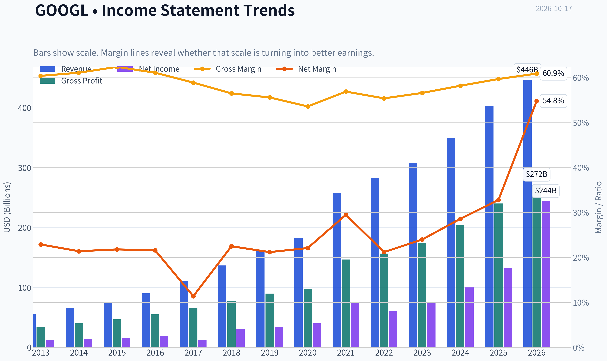
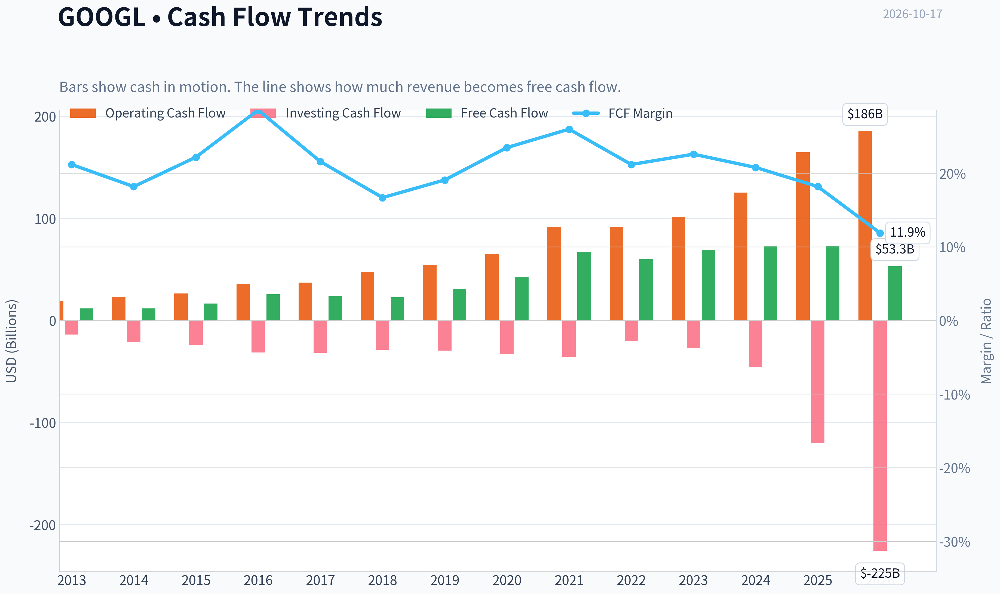
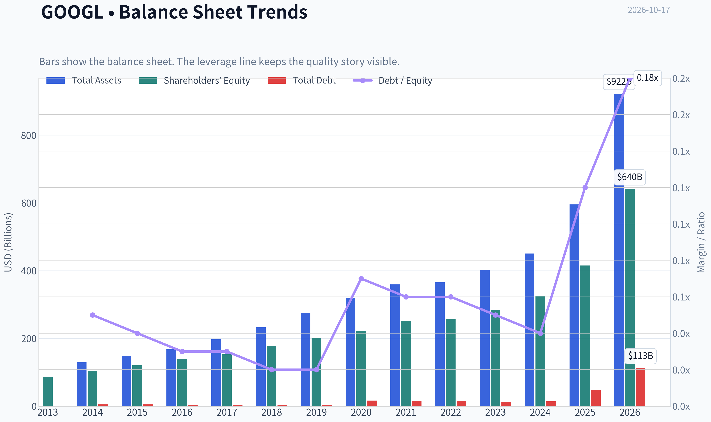
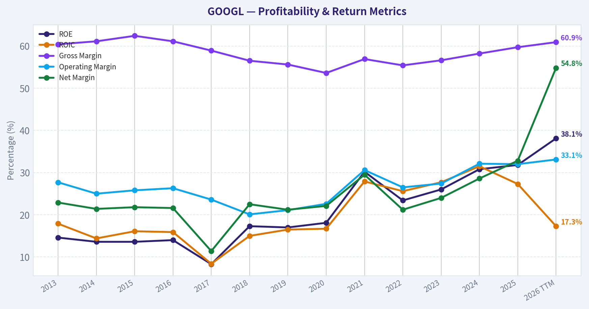
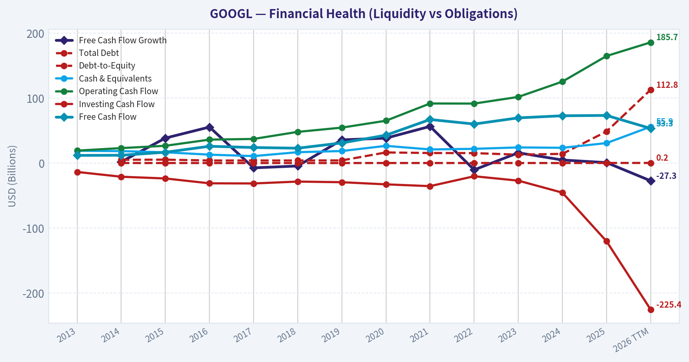
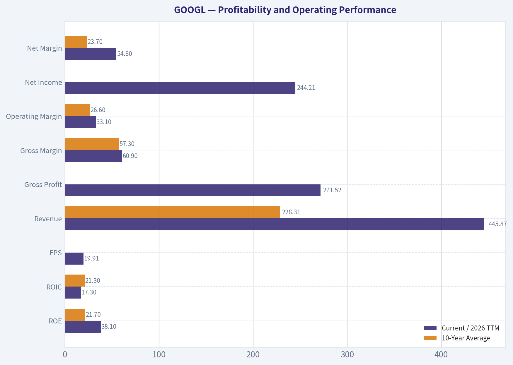
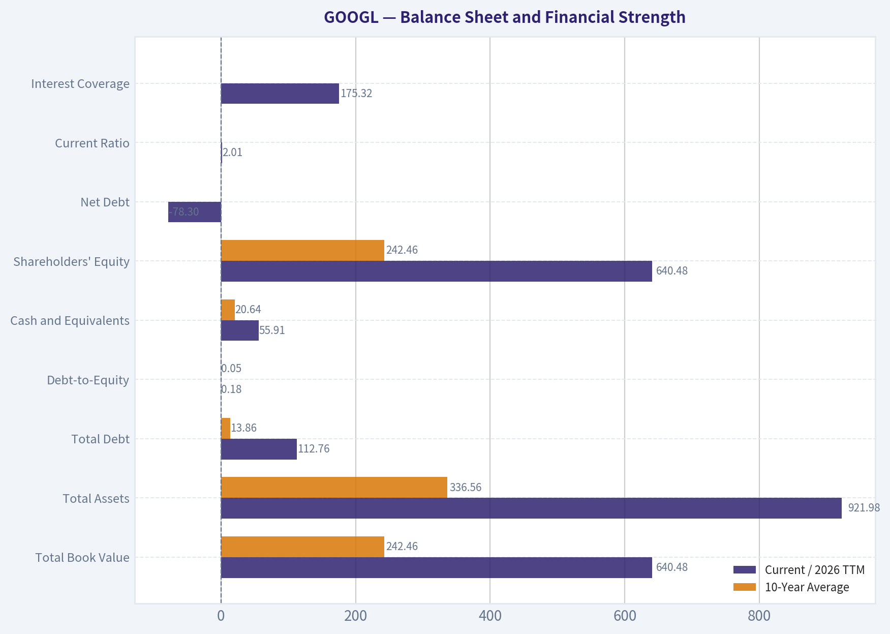
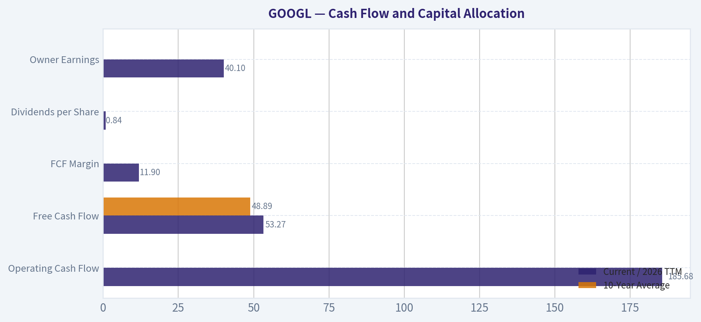
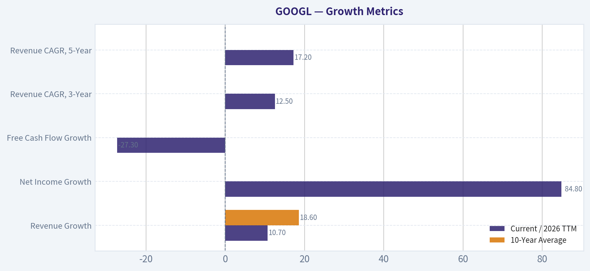
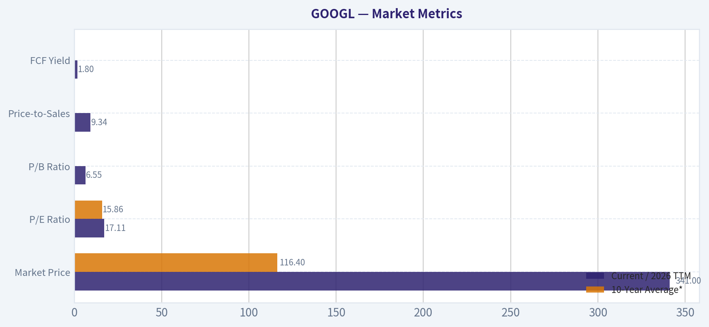

# GOOGL Deep Value Intelligence

**Analysis Date:** 2026-10-17

## Critical Disclaimer

*This analysis is generated by Deep Value Intelligence, an AI-powered multi-agent investing framework. Education & research only - not financial advice, not a financial advisor.*

---

## Table of Contents

1. Intelligence Summary
2. Analyst Team Reports
   - Fundamentals Analysis
   - Intrinsic Value Analysis (Buffett)
   - Trend & Growth Analysis (Lynch/Druckenmiller/Fisher)
   - Market Technical Analysis
   - Options Market Analysis
3. Research Team Commentary
4. Value Investing Team Commentary
5. Deep Values Commentary

---

## Intelligence Summary

### Thesis + Conditions

**Core Thesis:** # Executive Briefing

**Key Risks:**
- The principal risk is not solvency or temporary price volatility. It is that AI infrastructure becomes a permanently higher maintenance burden while weakening Search monetization. Historical **31.9% ROIC** cannot automatically be assigned to new data-center investment. Nevertheless, Alphabet's distribution, proprietary chips, Cloud platform, advertising relationships, liquidity, and multiple profit engines substantially improve its odds of navigating the transition.
- # Risk Judgment
- ### Risky Analyst: quality and expectations favor ownership

**Confidence:** Low

---

## Analyst Team Reports

### Fundamentals Analysis

#### Latest Earnings Snapshot

*Most recent reported quarter anchored on 2026 Q2, with prior-year comparison when available.*

| Metric | 2026 Q2 | 2025 Q2 | YoY Change |
| --- | ---: | ---: | ---: |
| Revenue | $119.80B | $96.43B | +24.2% |
| Operating Income | $40.77B | $31.27B | +30.4% |
| Net Income | $112.19B | $28.20B | +297.9% |
| Diluted EPS | $9.11 | $2.31 | +294.4% |
| Operating Cash Flow | $39.07B | $27.75B | +40.8% |
| Free Cash Flow | $-5.86B | $5.30B | -210.5% |

Key Takeaways: This snapshot anchors the most recent reported quarter before the narrative analysis. It helps readers separate long-run business quality from whatever changed in the latest earnings print.

#### 13-Year Financial Metrics for GOOGL

*All values below are computed deterministically from raw data - not estimated by AI.*

*Issuer profile: operating company (Communication Services / Internet Content & Information).*

#### 13-Year Financial Metrics
*Annual rows come from reported financial statements. The final TTM row is computed from the latest four quarters.*

| Metric | 2013 | 2014 | 2015 | 2016 | 2017 | 2018 | 2019 | 2020 | 2021 | 2022 | 2023 | 2024 | 2025 | 2026 TTM |
| --- | --- | --- | --- | --- | --- | --- | --- | --- | --- | --- | --- | --- | --- | --- |
| Market Price | $28 | $26 | $39 | $39 | $52 | $52 | $66 | $87 | $143 | $87 | $138 | $188 | $312 | $341 |
| Market Cap | N/A | $18.05B | $26.74B | $27.39B | $36.59B | $36.34B | $46.10B | $59.17B | $1.92T | $1.16T | $1.78T | $2.36T | $3.83T | $4.19T |
| P/E Ratio | 1.49 | 1.29 | 1.64 | 1.42 | 2.93 | 1.20 | 1.36 | 29.91 | 25.82 | 19.35 | 24.08 | 23.54 | 28.95 | 17.11 |
| P/B Ratio | N/A | 0.17 | 0.22 | 0.20 | 0.24 | 0.20 | 0.23 | 0.27 | 7.62 | 4.53 | 6.27 | 7.25 | 9.22 | 6.55 |
| ROE | 14.6% | 13.6% | 13.6% | 14.0% | 8.3% | 17.3% | 17.0% | 18.1% | 30.2% | 23.4% | 26.0% | 30.8% | 31.8% | 38.1% |
| ROIC | 17.9% | 14.4% | 16.1% | 15.9% | 8.4% | 15.0% | 16.5% | 16.7% | 27.9% | 25.6% | 27.7% | 31.5% | 27.3% | 17.3% |
| EPS | $18.79 | $20.57 | $23.78 | $27.85 | $18.00 | $43.70 | $49.16 | $2.93 | $5.61 | $4.56 | $5.80 | $8.04 | $10.81 | $19.91 |
| Revenue | $55.52B | $66.00B | $74.99B | $90.27B | $110.86B | $136.82B | $161.86B | $182.53B | $257.64B | $282.84B | $307.39B | $350.02B | $402.84B | $445.87B |
| Gross Profit | $33.53B | $40.31B | $46.83B | $55.13B | $65.27B | $77.27B | $89.96B | $97.80B | $146.70B | $156.63B | $174.06B | $203.71B | $240.30B | $271.52B |
| Gross Margin | 60.4% | 61.1% | 62.4% | 61.1% | 58.9% | 56.5% | 55.6% | 53.6% | 56.9% | 55.4% | 56.6% | 58.2% | 59.7% | 60.9% |
| Operating Margin | 27.7% | 25.0% | 25.8% | 26.3% | 23.6% | 20.1% | 21.1% | 22.6% | 30.6% | 26.5% | 27.4% | 32.1% | 32.0% | 33.1% |
| Net Income | $12.73B | $14.14B | $16.35B | $19.48B | $12.66B | $30.74B | $34.34B | $40.27B | $76.03B | $59.97B | $73.80B | $100.12B | $132.17B | $244.21B |
| Net Margin | 22.9% | 21.4% | 21.8% | 21.6% | 11.4% | 22.5% | 21.2% | 22.1% | 29.5% | 21.2% | 24.0% | 28.6% | 32.8% | 54.8% |
| Revenue Growth | N/A | 18.9% | 13.6% | 20.4% | 22.8% | 23.4% | 18.3% | 12.8% | 41.2% | 9.8% | 8.7% | 13.9% | 15.1% | 10.7% |
| Net Income Growth | N/A | 11.0% | 15.6% | 19.1% | -35.0% | 142.7% | 11.7% | 17.3% | 88.8% | -21.1% | 23.0% | 35.7% | 32.0% | 84.8% |
| Free Cash Flow Growth | N/A | 1.9% | 38.4% | 55.4% | -7.4% | -4.5% | 35.7% | 38.3% | 56.4% | -10.4% | 15.8% | 4.7% | 0.7% | -27.3% |
| Total Book Value | $86.98B | $103.86B | $120.33B | $139.04B | $152.50B | $177.63B | $201.44B | $222.54B | $251.63B | $256.14B | $283.38B | $325.08B | $415.26B | $640.48B |
| Total Assets | N/A | $129.19B | $147.46B | $167.50B | $197.29B | $232.79B | $275.91B | $319.62B | $359.27B | $365.26B | $402.39B | $450.26B | $595.28B | $921.98B |
| Total Debt | N/A | $5.00B | $5.22B | $3.94B | $3.94B | $3.95B | $4.07B | $16.32B | $15.44B | $15.31B | $12.87B | $14.18B | $48.54B | $112.76B |
| Debt-to-Equity | N/A | 0.05 | 0.04 | 0.03 | 0.03 | 0.02 | 0.02 | 0.07 | 0.06 | 0.06 | 0.05 | 0.04 | 0.12 | 0.18 |
| Cash & Equivalents | $18.90B | $18.35B | $16.55B | $12.92B | $10.71B | $16.70B | $18.50B | $26.46B | $20.95B | $21.88B | $24.05B | $23.47B | $30.71B | $55.91B |
| Shareholders' Equity | $86.98B | $103.86B | $120.33B | $139.04B | $152.50B | $177.63B | $201.44B | $222.54B | $251.63B | $256.14B | $283.38B | $325.08B | $415.26B | $640.48B |
| Operating Cash Flow | $19.14B | $23.02B | $26.57B | $36.04B | $37.09B | $47.97B | $54.52B | $65.12B | $91.65B | $91.50B | $101.75B | $125.30B | $164.71B | $185.68B |
| Investing Cash Flow | $-13.68B | $-21.05B | $-23.71B | $-31.16B | $-31.40B | $-28.50B | $-29.49B | $-32.77B | $-35.52B | $-20.30B | $-27.06B | $-45.54B | $-120.29B | $-225.38B |
| Free Cash Flow | $11.78B | $12.01B | $16.62B | $25.82B | $23.91B | $22.83B | $30.97B | $42.84B | $67.01B | $60.01B | $69.50B | $72.76B | $73.27B | $53.27B |
| FCF Margin | 21.2% | 18.2% | 22.2% | 28.6% | 21.6% | 16.7% | 19.1% | 23.5% | 26.0% | 21.2% | 22.6% | 20.8% | 18.2% | 11.9% |
| Dividends / Share | N/A | $0.00 | $0.00 | $0.00 | $0.00 | $0.00 | $0.00 | $0.00 | $0.00 | $0.00 | $0.00 | $0.59 | $0.82 | $0.84 |

#### Profitability Metrics
- Return on Equity (ROE): 31.8%
- Return on Invested Capital (ROIC): 31.9%
- Return on Assets (ROA): 22.2%
- Gross Margin: 59.7%
- Operating Margin: 32.0%
- Net Profit Margin: 32.8%

#### Liquidity Metrics
- Current Ratio: 2.01
- Quick Ratio: 1.85

#### Leverage Metrics
- Debt-to-Equity Ratio: 0.12
- Interest Coverage Ratio: 175.32
- Net Debt: $-78.30B

#### Growth Metrics (Year-over-Year)
- Revenue Growth: 15.1%
- Net Income Growth: 32.0%
- Free Cash Flow Growth: 0.7%
- Revenue CAGR (3-Year): 12.5%
- Revenue CAGR (5-Year): 17.2%

#### Valuation Metrics
- P/E Ratio (TTM): 17.09
- Forward P/E: 22.28
- Price-to-Book: 6.69
- Price-to-Sales: 9.34
- PEG Ratio: 1.20
- EV/EBITDA: 23.46
- Free Cash Flow Yield: 1.8%
- Earnings Yield: 5.9%

#### Owner Earnings (Buffett Method, Code-Computed)
- Net Income: $132.17B
- + Depreciation & Amortization: N/A
- - Capital Expenditures: $-91.45B
- - Working Capital Changes: $618.0M
- = **Owner Earnings: $40.10B**

#### Intrinsic Value (Code-Computed)
- Current Price: $341
- **Headline Intrinsic Value (business-model routed): $286**
  Business model: high reinvestment compounder - weighted blend [Damodaran FCFF + reverse-DCF fair + owner-earnings DCF] (high_reinvestment_compounder)
  Model spread (min-max across DCFs): $93 - $481
  Margin of safety vs. price (headline): -19.0%
  Routing note: High-reinvestment compounder: the owner-earnings DCF over-states (the min(|capex|, D&A) maintenance proxy under-charges growth capex). The headline centers on the reverse-DCF fair value (the flow valued at the growth the business has actually demonstrated), keeps the reinvestment-aware Damodaran FCFF as a conservative floor, and down-weights owner-earnings - landing near fair value rather than at either extreme.
- Buffett Method (Owner Earnings):
  Conservative: $138
  Average: $481
  Optimistic: $1,889
- Cash Flow Method (FCF):
  Conservative: $48
  Average: $93
  Optimistic: $201
- Damodaran FCFF (WACC + margins + reinvestment):
  Conservative: $129
  Average: $180
  Optimistic: $209
  Monte Carlo band (P10-P90): $127 - $223 (median $168)
  P(intrinsic value > price): 0.0%
- Reverse-DCF: price implies ~8.6%/yr owner-earnings growth for 10y; trailing 3y was -13.6%, 5y 17.4%.

#### Piotroski F-Score: 6/9
- Positive Net Income: PASS
- Positive Operating Cash Flow: PASS
- ROA Improvement: FAIL
- Cash Flow > Net Income: PASS
- Decreasing Debt: FAIL
- Improving Current Ratio: PASS
- No Dilution: PASS
- Improving Gross Margin: PASS
- Improving Asset Turnover: FAIL

ANALYST STANCE: **WATCH**

#### Executive Summary

Alphabet remains an exceptionally high-quality business with a wide economic moat, strong balance-sheet liquidity, high margins, and attractive long-term reinvestment opportunities in search, cloud, artificial intelligence, and digital advertising. However, at **$341 per share and approximately $4.19 trillion of market capitalization**, the stock appears priced for sustained high growth.

The deterministic dataset's business-model-routed intrinsic value is **$286 per share**, implying approximately **19% downside** to the current price. The principal concern is not business quality; it is valuation and cash-flow conversion. Current free cash flow is only **$53.27 billion**, down **27.3% year over year**, while capital expenditures have risen sharply.

#### Market Metrics

| Metric | Current / 2026 TTM | 10-Year Average* | Interpretation |
|---|---:|---:|---|
| Market Price | $341 | $116.40 | Nearly three times the 2016-2025 average, reflecting substantial earnings and multiple expansion |
| Market Capitalization | $4.19T | Not comparable | Historical units and market-cap transitions in the dataset are structurally inconsistent |
| P/E Ratio | 17.11x | 15.86x | Above the full-period average, but below the 2021-2025 average of approximately 24.35x |
| P/B Ratio | 6.55x | Not meaningful | Book value is not a reliable valuation anchor for an asset-light internet and intellectual-property business |
| Price-to-Sales | 9.34x | Not provided | Elevated for a mature advertising platform, requiring durable growth and margins |
| FCF Yield | 1.8% | Not provided | Low cash-flow yield leaves limited valuation protection |

\*Ten-year averages generally use fiscal years 2016-2025, excluding the current TTM period.

**Key Takeaways:** Alphabet's P/E is not historically extreme when compared with the post-2020 period, but the stock still offers only a 1.8% free-cash-flow yield. The P/B ratio should not be interpreted mechanically because Alphabet's value is driven primarily by intangible assets, network effects, data, software, and future cash generation rather than tangible book value.

#### Profitability and Operating Performance

| Metric | Current / 2026 TTM | 10-Year Average | Assessment |
|---|---:|---:|---|
| ROE | 38.1%* | 21.7% | Exceptionally strong, although affected by buybacks and the dataset's internal metric inconsistency |
| ROIC | 17.3%* | 21.3% | Below the historical average in the TTM row, suggesting heavy current reinvestment |
| EPS | $19.91 | Not directly comparable | Strong current earnings power, but historical EPS comparability is affected by data discontinuities |
| Revenue | $445.87B | $228.31B | Revenue has almost doubled relative to the 2016-2025 average |
| Gross Profit | $271.52B | Not calculated | Scale and pricing power remain substantial |
| Gross Margin | 60.9% | 57.3% | Above the historical average and near the upper end of the decade |
| Operating Margin | 33.1% | 26.6% | Materially above the decade average |
| Net Income | $244.21B | Approximately $68.0B | TTM figure is unusually high relative to recent annual results and should be normalized cautiously |
| Net Margin | 54.8% | 23.7% | TTM figure appears unusually elevated and may include nonrecurring or accounting effects |

\*The deterministic table reports TTM ROE of 38.1% and TTM ROIC of 17.3%. The separate summary block reports ROE of 31.8% and ROIC of 31.9%. This internal inconsistency should be resolved before using these ratios for precision valuation.

**Key Takeaways:** Alphabet's durable operating profile is excellent: gross margin is approximately 61% and operating margin is approximately 33%, both above long-term averages. The unusually high TTM net margin and net income should not be extrapolated without further normalization. ROIC is more important than ROE for evaluating AI and cloud investment, and the TTM ROIC decline suggests that recent capital deployment has not yet fully matured into cash returns.

#### Growth Metrics

| Metric | Current / 2026 TTM | 10-Year Average | Trend and Significance |
|---|---:|---:|---|
| Revenue Growth | 10.7% | 18.6% | Solid but below the earlier high-growth period |
| Net Income Growth | 84.8% | Approximately 32.8% | Very strong, but likely distorted by the unusually high TTM figure |
| Free Cash Flow Growth | -27.3% | Approximately 18.5% | Major deterioration caused by investment and capital-expenditure intensity |
| Revenue CAGR, 3-Year | 12.5% | N/A | Indicates durable double-digit expansion |
| Revenue CAGR, 5-Year | 17.2% | N/A | Strong long-term compounding despite recent moderation |

**Key Takeaways:** Revenue growth remains healthy, but the business is no longer growing at the 20%-40% rates seen in parts of the prior decade. The most important negative development is the 27.3% decline in TTM free cash flow, which indicates that AI infrastructure and other investments are absorbing a large portion of operating cash generation.

#### Balance Sheet and Financial Strength

| Metric | Current / 2026 TTM | 10-Year Average | Assessment |
|---|---:|---:|---|
| Total Book Value | $640.48B | $242.46B | Book value has expanded substantially, though it is not the preferred valuation anchor |
| Total Assets | $921.98B | $336.56B | Significant asset growth reflects scale and infrastructure investment |
| Total Debt | $112.76B | $13.86B | Debt has increased sharply from a very low base |
| Debt-to-Equity | 0.18x | 0.05x | Still conservative, despite meaningful recent growth |
| Cash and Equivalents | $55.91B | $20.64B | Strong liquidity and substantial financial flexibility |
| Shareholders' Equity | $640.48B | $242.46B | Strong capital base |
| Net Debt | -$78.30B | N/A | Net cash position remains a major strength |
| Current Ratio | 2.01x | N/A | Strong liquidity, but liquidity ratios are less important than cash generation for this business |
| Interest Coverage | 175.32x | N/A | Debt-servicing risk is very low |

**Key Takeaways:** Alphabet remains financially resilient even after the increase in debt and capital expenditures. Its $78.3 billion net cash position and exceptionally high interest coverage provide protection against cyclical advertising weakness and allow continued investment in AI, cloud, and other strategic initiatives.

#### Cash Flow and Capital Allocation

| Metric | Current / 2026 TTM | 10-Year Average | Interpretation |
|---|---:|---:|---|
| Operating Cash Flow | $185.68B | Not calculated | Very strong cash-generation capacity |
| Free Cash Flow | $53.27B | $48.89B | Above the long-term average in absolute terms, but sharply below the prior-year level |
| FCF Margin | 11.9% | Approximately 21.4% | Substantially compressed by investment spending |
| Capital Expenditures | $91.45B owner-earnings input | N/A | Extremely high reinvestment burden |
| Dividends per Share | $0.84 | Approximately $0.14 | Dividend has begun but remains a minor capital-allocation component |
| Owner Earnings | $40.10B | N/A | Conservative cash available after capital expenditures and working-capital adjustments |

**Key Takeaways:** Alphabet converts revenue into operating cash at an impressive scale, but current free-cash-flow margins are well below historical norms. The key question is whether today's elevated capital spending is growth investment that will generate high future returns or a permanent increase in the cost structure. The modest dividend indicates that management still prioritizes reinvestment and repurchases over direct income distribution.

#### Revenue Breakdown

The latest full-year segment composition is based on the deterministic 2025 revenue total of approximately $402.84 billion and Alphabet's reported business categories.

| Revenue Source | Amount ($B) | % of Total |
|---|---:|---:|
| Google Search and other | 224.5 | 55.7% |
| Google Cloud | 58.7 | 14.6% |
| Subscriptions, platforms, and devices | 48.0 | 11.9% |
| YouTube advertising | 40.4 | 10.0% |
| Google Network | 29.8 | 7.4% |
| Other and hedging-related revenue | 1.4 | 0.3% |
| **Total** | **402.8** | **100.0%** |

**Key Takeaways:** Search remains the dominant revenue engine, contributing more than half of total revenue, but Google Cloud and subscriptions are increasingly important growth and diversification sources. YouTube provides a large advertising ecosystem, while Google Network is comparatively mature and may face structural pressure from changes in digital advertising and privacy rules.

#### Current Versus Historical Position

| Area | Current Position | Historical Comparison | Investor Interpretation |
|---|---:|---|---|
| Revenue scale | $445.87B | Nearly double the 2016-2025 average | Alphabet has achieved enormous scale without losing its core growth profile |
| Gross margin | 60.9% | Above 57.3% average | Strong economics and pricing power |
| Operating margin | 33.1% | Above 26.6% average | Efficiency and operating leverage remain favorable |
| Revenue growth | 10.7% | Below 18.6% average | Growth has moderated as the company has matured |
| FCF margin | 11.9% | Below approximately 21.4% average | Major near-term pressure from AI and infrastructure investment |
| ROE | 38.1% TTM row | Above 21.7% average | Excellent profitability, with buybacks and data inconsistency as caveats |
| ROIC | 17.3% TTM row | Below 21.3% average | Current investment cycle is diluting near-term returns |
| Debt-to-equity | 0.18x | Above 0.05x average | Still conservative, but leverage is trending upward |
| Cash | $55.91B | Above $20.64B average | Strong liquidity and optionality |
| P/E | 17.11x | Above full-period average, below recent average | Valuation is not extreme on earnings, but not obviously cheap on cash flow |

**Key Takeaways:** Alphabet is stronger and more profitable than its historical average in several operating categories, especially gross margin and operating margin. The principal deterioration is in free-cash-flow margin and ROIC, both of which reflect the current investment cycle. This makes the stock a high-quality reinvestment story rather than a conventional low-multiple value stock.

#### Buffett-Style Qualitative Analysis

**Economic moat**

Alphabet possesses several mutually reinforcing advantages:

- Search scale, brand recognition, and accumulated query data create powerful network effects.
- Google's advertising ecosystem benefits from intent-rich data and a vast advertiser base.
- Android, Chrome, YouTube, Maps, Gmail, and other products reinforce user engagement and distribution.
- Google Cloud is gaining scale and benefits from technical infrastructure, enterprise relationships, and AI capabilities.
- The company has enormous financial resources to fund AI research, data centers, talent, and acquisitions.

The moat is durable but not invulnerable. Generative AI may change how users search and how advertisers reach customers. The risk is less that search disappears immediately and more that search economics gradually migrate toward alternative interfaces, AI assistants, or specialized platforms.

**Financial strength**

Alphabet's balance sheet is a major Buffett-style positive. Net cash is approximately $78 billion, debt-to-equity is only 0.18x, and interest coverage is extraordinarily high. Even a significant advertising downturn would likely leave the company financially stable.

**Predictable earnings**

The long-term revenue trend is highly reliable, with revenue growing from $55.5 billion in 2013 to $445.9 billion on a TTM basis. However, earnings and free cash flow are less predictable in the short term because capital expenditures, AI investments, legal costs, and investment gains can materially affect reported results.

**Management and capital allocation**

Management has historically reinvested heavily in high-return businesses, repurchased shares, and maintained a large liquidity reserve. The recent dividend initiation adds shareholder distribution without materially impairing reinvestment capacity. The main management test is whether the current AI capital cycle produces returns that justify the substantial increase in infrastructure spending.

**Quality of business**

Alphabet's core economics remain outstanding: high gross margins, high operating margins, recurring usage, low customer switching costs for advertisers but high ecosystem convenience for users, and substantial free cash generation. The business quality is clearly superior to that of an average company. The investment question is therefore price discipline, not whether Alphabet is a good business.

#### Buffett-Style Owner Earnings DCF

The dataset provides the following Owner Earnings calculation:

- Net income: **$132.17B**
- Less capital expenditures: **$91.45B**
- Less working-capital requirement: approximately **$0.62B**
- Owner earnings: **$40.10B**

Because Alphabet is a **high-reinvestment compounder**, reported capital expenditures include both maintenance spending and substantial growth spending. A simple Owner Earnings DCF can therefore overstate intrinsic value if it treats all growth investment as discretionary. The deterministic pack consequently gives greater weight to reinvestment-aware FCFF and reverse-DCF methods.

A standard three-stage structure is:

1. Forecast owner earnings for ten years.
2. Fade growth toward a 2.5% terminal rate.
3. Discount explicit cash flows and terminal value at approximately 10%.

The terminal value formula is:

\[
Terminal\ Value = \frac{OE_{10} \times (1+g_t)}{r-g_t}
\]

where \(g_t = 2.5\%\) and \(r \approx 10\%\).

| Scenario | Growth Assumption | Model-Based Fair Value | Interpretation |
|---|---|---:|---|
| Conservative | Low sustainable growth, high reinvestment burden | $138 | Assumes limited conversion of current investment into incremental owner earnings |
| Average | Durable compounder economics with meaningful growth runway | $481 | Reflects stronger future owner-earnings conversion |
| Optimistic | High AI, cloud, and advertising growth with successful monetization | $1,889 | Requires unusually strong execution and sustained reinvestment returns |
| Reinvestment-aware FCFF, conservative | Lower growth and margin assumptions | $129 | More cautious treatment of growth capital expenditures |
| Reinvestment-aware FCFF, average | Balanced growth and reinvestment assumptions | $180 | More conservative than pure Owner Earnings |
| Reinvestment-aware FCFF, optimistic | Strong growth and margin realization | $209 | Upper range under reinvestment-aware assumptions |

**Key Takeaways:** The very wide valuation range demonstrates that Alphabet's intrinsic value is highly sensitive to the treatment of growth capital expenditures. The $481 average Owner Earnings result is not a dependable standalone anchor because the maintenance-capital-expenditure proxy may understate the economic cost of AI expansion. The reinvestment-aware FCFF range of $129-$209 is more conservative, while the overall routed intrinsic value of $286 incorporates reverse-DCF evidence and multiple valuation methods.

#### Reverse DCF and Valuation Judgment

At $341 per share, the stock price implies approximately **8.6% annual owner-earnings growth for ten years**. That hurdle is below Alphabet's five-year revenue CAGR of 17.2%, but materially above recent three-year owner-earnings performance of approximately **-13.6%**.

The deterministic valuation summary is:

- Headline intrinsic value: **$286.14**
- Current price: **$341**
- Implied margin of safety: **-19.0%**
- Model range: **$93 to $481**
- Damodaran FCFF Monte Carlo range: **$127 to $223**
- Monte Carlo median: **$168**
- Probability that intrinsic value exceeds current price: **0.0%** under that model

This does not mean Alphabet is a poor company. It means that the current price provides limited protection if AI spending remains elevated, search growth slows, or margins normalize.

#### Key Investment Insights, Red Flags, and Opportunities

| Category | Insight |
|---|---|
| Major opportunity | AI could strengthen search, increase advertising relevance, accelerate Google Cloud growth, and create new subscription products |
| Major opportunity | Google Cloud has the potential to become a larger, higher-growth and more diversified earnings engine |
| Major opportunity | Strong net cash allows Alphabet to sustain unusually high research, infrastructure, and acquisition spending |
| Major strength | Operating margin and gross margin are above decade averages |
| Major strength | Search, YouTube, Android, Maps, and Chrome create a deeply integrated ecosystem |
| Red flag | Free cash flow fell 27.3% year over year |
| Red flag | FCF margin declined to 11.9% from a decade average near 21.4% |
| Red flag | Debt increased materially from historical levels, even though leverage remains low |
| Red flag | Search economics may face long-term disruption from AI assistants and alternative discovery tools |
| Red flag | TTM net income and net margin appear unusually high and should be normalized |
| Valuation concern | Current price exceeds the routed intrinsic value by approximately 19% |
| Valuation concern | FCF yield of only 1.8% leaves little room for execution mistakes |
| Monitoring item | Whether AI-related capital expenditures produce incremental revenue and operating income at attractive ROIC |
| Monitoring item | Search market share, advertiser return on investment, and Google Cloud operating margins |

**Key Takeaways:** The opportunity is a potentially durable AI and cloud reinvestment cycle funded by one of the strongest balance sheets in the technology sector. The risk is that the market is already discounting much of that success while current free cash flow and ROIC are under pressure. Investors should focus on incremental returns from capital expenditure, not only on revenue growth.

#### Final Investment Stance

**WATCH**

Alphabet merits a watchlist position and may suit investors willing to pay a fair price for a wide-moat compounder. However, the current price of $341 is above the deterministic headline intrinsic value of $286 and substantially above the reinvestment-aware FCFF median of $168.

A more attractive entry would require one or more of the following:

- A lower share price that creates a meaningful margin of safety.
- Evidence that AI capital expenditures are producing strong incremental revenue and operating returns.
- Stabilization or recovery in free-cash-flow margin.
- Continued search durability despite generative-AI competition.
- A normalized earnings base that confirms the current valuation is supported by recurring cash generation.

The business is high quality, financially strong, and strategically important. The stock is not an obvious avoid, but Buffett-style discipline argues against aggressively buying at the current valuation without a clearer margin of safety.

| Final Assessment | Conclusion |
|---|---|
| Business quality | Excellent |
| Economic moat | Wide but facing AI-related evolution |
| Balance-sheet strength | Excellent |
| Earnings predictability | Strong long term, less predictable during current investment cycle |
| Current valuation | Full to expensive relative to intrinsic value |
| Cash-flow quality | Strong historically, currently pressured |
| Principal risk | AI disruption combined with heavy capital spending |
| Principal opportunity | AI monetization and Google Cloud compounding |
| Final stance | **WATCH** |

**Key Takeaways:** Alphabet is an outstanding company with a durable moat, exceptional liquidity, and strong long-term growth potential. Nevertheless, the current valuation appears to require sustained execution and successful AI monetization, while free cash flow is temporarily under significant pressure. The appropriate Buffett-style conclusion is to watch closely and demand a better price or stronger evidence of reinvestment returns before upgrading to an Advocate stance.

#### Fundamental Visuals

This graph tracks the profitability and return metrics (ROE, ROIC, Margins) of **GOOGL** over the past decade, highlighting capital efficiency trends.

This chart illustrates the financial health of **GOOGL** over the last 10 years, mapping cash equivalents and free cash flow against total obligations (Debt).

This comparison chart from *Profitability and Operating Performance* stacks current figures against historical benchmarks for **GOOGL**, making it easy to see where the company trades relative to its own averages.

---

### Intrinsic Value Analysis (Buffett)

> *Following Warren Buffett's value investing philosophy: Circle of Competence, Economic Moat, Management Quality, and Margin of Safety.*

#### Intrinsic Value Snapshot

Price is what you pay. Intrinsic value is what the business may be worth based on the cash it can create for owners over time. We show a range, not one magic number.

- Current Price: $340.59
- Value Range (conservative to optimistic across both DCF methods): $48.11 to $1,889.20

##### Owner Earnings (Buffett Method)
- Net Income: $132,170,000,000.00
- Depreciation & Amortization: N/A
- Capital Expenditures: $-91,447,000,000.00
- Working Capital Changes: $618,000,000.00
- Owner Earnings: $40,105,000,000.00

##### Intrinsic Value
###### Buffett Method
Uses owner earnings. Stricter, and usually more conservative.
- Conservative: $137.94
- Average: $481.23
- Optimistic: $1,889.20
- Discount Rate: 10.0%

###### Cash Flow Method
Uses free cash flow. Better for companies spending heavily today to grow tomorrow.
- Conservative: $48.11
- Average: $93.10
- Optimistic: $200.64
- Discount Rate: 10.0%

ANALYST STANCE: **WATCH**

#### Executive Summary

Alphabet is an exceptional business with dominant search economics, a powerful advertising platform, leading artificial-intelligence capabilities, a large net-cash-oriented balance sheet, and substantial reinvestment runway. Its principal risks are regulatory intervention, search disruption from AI, dependence on advertising, and a sharp increase in infrastructure spending.

At approximately **$341 per share**, Alphabet trades at a reasonable earnings multiple but an unusually demanding free-cash-flow valuation. The research-pack headline intrinsic value is **$286.14**, implying approximately **19% downside**. That valuation gap is not large enough to offset the uncertainty surrounding AI-related capital intensity and the durability of Google Search economics. The right action is to keep Alphabet on the watchlist and seek a more favorable entry price.

#### Factor Scorecard

| Factor | Score | Assessment |
|---|---:|---|
| 1. Circle of competence and simplicity | 4/5 | The core model is understandable: provide digital services, monetize user attention through advertising, and sell cloud and subscription products. AI and regulatory changes reduce long-term predictability somewhat. |
| 2. Durable competitive advantage | 5/5 | Search scale, user data, advertiser relationships, distribution, technical talent, cloud infrastructure, and ecosystem effects create a wide moat. |
| 3. Management and capital allocation | 4/5 | Strong reinvestment in infrastructure and AI, substantial buybacks, and disciplined balance-sheet management. Capital-allocation returns on the current AI spending cycle remain to be proven. |
| 4. Industry structure | 4/5 | Digital advertising and cloud are attractive scale industries, although competition from Microsoft, Amazon, Meta, OpenAI, and other AI providers is intensifying. |
| **Gate 5: Quality and solvency floor** | **Not tripped** | There is no evidence of financial distress, inadequate interest coverage, or a deteriorating solvency position. |

**Key Takeaways:** Alphabet scores highly because it combines a simple core business with unusually strong intangible and scale advantages. The principal deduction is not business quality but uncertainty: AI may strengthen Google's moat, yet it may also change how search is monetized and require much heavier capital investment.

---

#### Moat Analysis

| Moat source | Evidence | Durability assessment |
|---|---|---|
| Intangible assets | Google is one of the world's most recognized internet brands, and Search is deeply embedded in consumer and commercial behavior. | Wide and durable, although AI answers may reduce traditional search-result monetization. |
| Switching costs | Advertisers build campaigns, measurement systems, and customer-acquisition processes around Google. Android, Chrome, Maps, YouTube, and Workspace reinforce the ecosystem. | Strong for advertisers and enterprise users; weaker for individual consumers who can use multiple AI assistants. |
| Cost advantage | Massive query volume, proprietary infrastructure, machine-learning expertise, and global distribution lower the cost of serving searches and ads. | Strong, though AI-generated answers are more computationally expensive than conventional search. |
| Network effects | More users generate more data and advertiser demand; more advertisers improve commercial relevance and monetization. YouTube and Cloud also benefit from scale. | Wide, but the search network effect could be challenged if users migrate to AI-native interfaces. |

Alphabet's moat is best described as **wide but under active technological stress**, rather than unconditionally wide and stable. Search distribution, advertiser intent data, and engineering scale remain difficult to replicate. The key question is whether Google can preserve commercial intent and pricing power when answers increasingly appear directly inside AI interfaces.

#### Management Quality and Capital Allocation

Alphabet's management has generally demonstrated rational capital allocation:

- It has maintained a large liquidity reserve and historically avoided excessive leverage.
- Share repurchases have reduced dilution and returned capital while the company continued investing heavily.
- Spending on data centers, chips, AI models, and cloud infrastructure is strategically rational if it protects Search and expands Cloud.
- The company has developed multiple monetization engines, including YouTube, Google Cloud, subscriptions, and enterprise software.

The main concern is the scale and return profile of the AI investment cycle. Management may need to spend aggressively before the economics become clear. That is acceptable for a company with Alphabet's balance sheet, but investors should monitor whether incremental capital produces durable per-share earnings growth rather than merely preserving competitive position.

#### Financial Summary

| Metric | Current / latest figure | Interpretation |
|---|---:|---|
| Share price | $341 | Current market price |
| Market capitalization | $4.17 trillion | Reflects very high investor expectations in absolute-dollar terms |
| P/E ratio | 17.1x | Reasonable relative to Alphabet's quality and growth |
| Return on equity | 31.8% | Excellent profitability, although buybacks and balance-sheet structure influence ROE |
| Gross margin | 59.7% | Consistent with powerful software, advertising, and intellectual-property economics |
| Revenue growth, year over year | 15.1% | Strong growth for a company of Alphabet's scale |
| Free-cash-flow yield | 1.8% | Expensive on current free cash flow |
| Current ratio | 2.0x | Indicates substantial short-term liquidity |
| Reverse-DCF price-implied growth | Approximately 8.6% annually for 10 years | A demanding but not obviously impossible expectation |
| Five-year revenue-growth reference | 17.4% | Strong historical growth, though future growth should moderate with scale |
| Three-year revenue-growth reference | -13.6% | Indicates a less reliable recent trend measure and reinforces the need for normalization |

**Key Takeaways:** Alphabet combines a 59.7% gross margin, 31.8% ROE, and 15.1% current revenue growth-an outstanding operating profile. The weakness is valuation: a 1.8% free-cash-flow yield implies that the market is valuing future AI and Cloud economics well ahead of current cash generation.

#### Owner Earnings Calculation

Because maintenance capital expenditure is not separately disclosed in the supplied figures, free cash flow is used as a conservative practical proxy for current owner earnings.

| Calculation | Amount |
|---|---:|
| Market capitalization | $4.17 trillion |
| Free-cash-flow yield | 1.8% |
| Implied current free cash flow | Approximately $75.1 billion |
| Less: estimated maintenance-capex adjustment | Not separately disclosed |
| **Working owner-earnings proxy** | **Approximately $75 billion** |
| Implied shares outstanding, using $4.17T divided by $341 | Approximately 12.23 billion |
| Owner earnings per share proxy | Approximately $6.14 |

**Key Takeaways:** Current owner earnings appear to be approximately $75 billion, or about $6.14 per share. This proxy may understate normalized future owner earnings if AI and Cloud investments produce high returns, but it also highlights why the stock is expensive on present cash generation.

#### Three-Scenario DCF Valuation

The following valuation uses approximately $75 billion of current owner earnings, 12.23 billion shares, and a 10% discount rate. The historical-growth scenario uses an 8% near-term growth assumption-below the reported five-year growth reference-and a 3% terminal growth rate.

| Scenario | Key assumptions | Estimated value per share |
|---|---|---:|
| A. No growth | Owner earnings remain flat; value equals owner earnings divided by 10% | **$61** |
| B. GDP growth | 3% annual growth, 10% discount rate, 3% terminal growth | **$90** |
| C. Historical-growth normalization | 8% growth for 10 years, then 3% terminal growth | **$131** |
| Research-pack blended intrinsic value | Damodaran FCFF, reverse DCF, and owner-earnings methods | **$286** |
| Current market price | - | **$341** |

**Key Takeaways:** A strict current-owner-earnings DCF produces values below the market price because Alphabet is investing heavily and current free cash flow does not yet reflect the potential payoff from AI and Cloud. The broader blended valuation of $286 is more generous, but it still places the stock approximately 19% above estimated intrinsic value.

#### Margin of Safety Analysis

| Measure | Result | Interpretation |
|---|---:|---|
| Price versus headline intrinsic value | $341 versus $286 | Price is approximately 19% above the blended estimate |
| Margin of safety versus headline value | **-19%** | No current margin of safety on the central valuation |
| Reverse-DCF implied growth | 8.6% annually for 10 years | Achievable for Alphabet, but not a low-expectation price |
| Current P/E | 17.1x | Reasonable on earnings, but less reassuring when compared with free cash flow |
| Quality-adjusted requirement | Approximately 10-15% discount acceptable for a true compounder | Alphabet is close to, but does not meet, that standard at $341 |

Alphabet deserves a smaller margin of safety than an average business because its moat, balance sheet, and reinvestment runway are exceptional. Nevertheless, the current price appears to assume that AI protects Search, Cloud continues expanding, and enormous infrastructure spending earns attractive returns. Those outcomes are plausible, but not sufficiently discounted.

#### Final Buffett Scorecard

| Criterion | Weight | Score | Weighted contribution |
|---|---:|---:|---:|
| Moat width and durability | 25% | 5/5 | 1.25 |
| Valuation and margin of safety | 20% | 1/5 | 0.20 |
| Capital returns: ROIC versus WACC | 15% | 4/5 | 0.60 |
| Business understanding and predictability | 12% | 3/5 | 0.36 |
| Management quality and capital allocation | 12% | 4/5 | 0.48 |
| Reinvestment runway | 8% | 4/5 | 0.32 |
| Balance-sheet strength | 4% | 5/5 | 0.20 |
| Industry structure | 4% | 4/5 | 0.16 |
| **Total** | **100%** | - | **3.57/5** |

#### Investment Stance

**WATCH - Medium conviction**

Alphabet is a wonderful business, but the stock is not clearly available at a fair-or-better price based on current owner earnings and the blended intrinsic-value estimate. The company is suitable for a long-term watchlist and may become attractive if:

1. The price declines toward the **$285-$300** range;
2. Free-cash-flow growth begins to catch up with reported earnings growth;
3. Google demonstrates that AI increases, rather than cannibalizes, search monetization; or
4. Cloud and AI investment returns become more visible.

At $341, Alphabet is a high-quality compounder priced for continued execution. It is not financially distressed or structurally impaired, but the margin of safety is insufficient for an aggressive purchase today.
#### Valuation Bridge

This bridge places the current market price beside each intrinsic value lens so readers can see whether upside depends on one method or shows up across several methods.

| Scenario | Intrinsic Value / Share |
| --- | ---: |
| Buffett Method | $481.23 |
| Cash Flow Method | $93.10 |
| Damodaran Method | $180.25 |
| Current Price | $340.59 |

#### Key Takeaways

If one method is far above the others, the upside case depends on a specific modelling assumption. When several methods cluster together, the valuation story is more robust.

#### Valuation Visuals

This comparison chart from *Latest Earnings Snapshot* stacks current figures against historical benchmarks for **GOOGL**, making it easy to see where the company trades relative to its own averages.

This comparison chart from *Balance Sheet and Financial Strength* stacks current figures against historical benchmarks for **GOOGL**, making it easy to see where the company trades relative to its own averages.

This comparison chart from *Cash Flow and Capital Allocation* stacks current figures against historical benchmarks for **GOOGL**, making it easy to see where the company trades relative to its own averages.

---

### Trend & Growth Analysis (Lynch/Druckenmiller/Fisher)

> *Following Peter Lynch's GARP, Stanley Druckenmiller's macro-aware approach, and Philip Fisher's scuttlebutt methodology.*

ANALYST STANCE: **WATCH**

#### 1. Lynch Classification

**GOOGL is a fast-growing stalwart, rather than a classic fast grower.** Revenue growth of 15.1% is respectable, with a five-year revenue CAGR of 17.2%, but its enormous $4.17 trillion market capitalization limits realistic ten-bagger potential. Alphabet remains an exceptional compounder, but the current setup does not offer the asymmetric upside typically sought by growth investors.

#### 2. The Story in Three Bullets

- **Search remains a global cash engine:** Google Search, YouTube, and advertising generate enormous cash flow that funds new investments.
- **AI is expanding Alphabet's opportunity set:** Gemini, cloud infrastructure, AI tools, and enterprise services could defend Search while accelerating Google Cloud growth.
- **The company is financially powerful but heavily reinvesting:** Strong margins and a net cash position are offset by rising capital expenditures and weaker recent free-cash-flow growth.

#### 3. TAM and Runway Analysis

Alphabet participates in several large and expanding markets: digital advertising, cloud computing, artificial intelligence, video, cybersecurity, and autonomous vehicles.

| Metric | Assessment |
|---|---:|
| Latest revenue | $445.9B TTM |
| Ten-times revenue target | Approximately $4.46T |
| Current market capitalization | $4.17T |
| Key markets | Search, digital advertising, cloud, AI, video |
| TAM quality | Large and expanding, but difficult to quantify precisely |
| Ten-bagger test | Fails on practical scale |

**Key Takeaways:** Alphabet has a very large and durable addressable market, particularly in AI and cloud computing. However, ten times current revenue would require Alphabet to become one of the largest economic entities in the world, making a traditional ten-bagger outcome highly improbable from today's starting point.

#### 4. Revenue Growth Trend

| Period | Revenue Growth |
|---|---:|
| 2019 | 18.3% |
| 2020 | 12.8% |
| 2021 | 41.2% |
| 2022 | 9.8% |
| 2023 | 8.7% |
| 2024 | 13.9% |
| 2025 | 15.1% |
| Three-year CAGR | 12.5% |
| Five-year CAGR | 17.2% |

**Key Takeaways:** Growth recovered from the 2022-2023 slowdown and reached 15.1%, but the long-term pattern is not consistently accelerating. The recent improvement is constructive, yet Alphabet currently looks like a high-quality growth compounder with moderate acceleration rather than a clear Druckenmiller-style earnings inflection.

#### 5. Profitability and Unit Economics

| Metric | Result | Interpretation |
|---|---:|---|
| Gross margin | 59.7% | Excellent |
| Operating margin | 32.0% | Excellent |
| ROE | 31.8% | Strong |
| ROIC | Approximately 31.9% | Strong |
| Current ratio | 2.01 | Strong liquidity |
| Debt-to-equity | 0.12 | Conservative leverage |
| Net cash | Approximately $78.3B | Major balance-sheet strength |
| FCF margin | 11.9% | Weakened by investment cycle |
| Rule of 40 | Not directly applicable | Diversified advertising and technology model |
| LTV/CAC and NRR | Not disclosed or not meaningful | Primarily ad-driven business |

**Key Takeaways:** Alphabet's core economics are excellent, with high margins, strong returns on capital, and net cash. The principal concern is not customer economics but capital intensity: free cash flow has weakened as AI infrastructure investment has increased.

#### 6. Inflection Point Assessment

| Potential Inflection | Evidence | Assessment |
|---|---|---|
| AI product cycle | Gemini, AI infrastructure, enterprise tools | Positive but execution-sensitive |
| Cloud share gain | Google Cloud and AI workloads | Potentially significant |
| Margin inflection | Operating margin around 32% | Already high; further gains may be slower |
| Search defense | AI Overviews and changing user behavior | Mixed; strategic necessity |
| TAM expansion | AI expands cloud and software opportunities | Positive |
| Competitive environment | Microsoft, OpenAI, Amazon, Meta | Intensifying |

**Key Takeaways:** The most important potential inflection is AI monetization through Cloud, subscriptions, enterprise software, and advertising efficiency. The same AI cycle also creates risk because Alphabet must spend heavily before returns are proven, while AI interfaces could weaken traditional search economics.

#### 7. Macro Setup

Alphabet is exposed to both favorable and unfavorable macro forces.

- **Favorable:** AI investment, cloud adoption, digital advertising migration, and enterprise software modernization.
- **Neutral:** A strong balance sheet reduces financing risk.
- **Unfavorable:** Higher interest rates pressure long-duration growth valuations and weak advertising demand can reduce revenue growth.
- **Druckenmiller view:** The secular trend is favorable, but the stock already reflects substantial confidence in AI execution.

A falling-rate environment would support valuation. Conversely, persistent inflation, high rates, or an advertising slowdown could compress the multiple despite solid operations.

#### 8. Fisher's 15-Point Assessment

| Fisher Criterion | Score / 5 | Comment |
|---|---:|---|
| Market potential | 5 | Massive global markets |
| New-product determination | 5 | Strong AI and Cloud investment |
| R&D effectiveness | 4 | Excellent research base; monetization varies |
| Sales organization | 4 | Strong enterprise and advertising distribution |
| Profit margins | 5 | Industry-leading |
| Margin trend | 4 | Strong, though capex may pressure FCF |
| Labor relations | 3 | Some disruption and regulatory complexity |
| Executive relations | 4 | Generally strong operating depth |
| Management depth | 5 | Exceptional technical and financial resources |
| Cost analysis | 4 | Strong, but AI capex visibility is limited |
| Competitive advantages | 5 | Data, distribution, ecosystem, scale |
| Long-range outlook | 4 | Strong, but Search disruption is real |
| Dilution | 4 | Manageable |
| Management candor | 4 | Generally credible |
| Management integrity | 4 | Strong overall, subject to regulatory scrutiny |
| **Total** | **64 / 75** | **Good to outstanding** |

**Key Takeaways:** Alphabet scores particularly well on market potential, research capability, scale, and competitive advantages. The deductions reflect AI execution uncertainty, regulatory exposure, labor complexity, and the need to convert enormous investment into durable incremental returns.

#### 9. Valuation Analysis

| Valuation Measure | Result | Interpretation |
|---|---:|---|
| Current price | $341 |
| TTM P/E | 17.1x | Moderate on reported earnings |
| Forward P/E | 22.3x | Less attractive |
| PEG ratio | 1.20 | Fair value, not cheap |
| Price-to-sales | 9.34x | High for a mature mega-cap |
| FCF yield | 1.8% | Low |
| Headline intrinsic value | $286 | Approximately 19% below price |
| Damodaran FCFF range | $127-$223 | Conservative valuation range |
| Reverse-DCF implied growth | 8.6% annually for 10 years | Requires sustained execution |

**Key Takeaways:** The headline valuation suggests the shares are approximately 19% above estimated intrinsic value, although valuation models vary widely because Alphabet is entering a heavy reinvestment cycle. A PEG of 1.2 is reasonable, but the low FCF yield and high sales multiple leave limited margin of safety.

#### 10. Scenario Analysis

| Scenario | Core Assumption | Illustrative Outcome |
|---|---|---|
| Bear | Search disruption, weaker advertising, poor AI returns | Material multiple compression; downside toward the low-to-mid $200s |
| Base | 10-14% revenue growth, durable margins, successful but costly AI transition | Returns broadly dependent on earnings growth; limited valuation expansion |
| Bull | AI monetization accelerates, Cloud gains share, Search remains resilient | Potential for substantial upside, potentially toward $450-$550 over several years |

**Key Takeaways:** The bull case requires Alphabet to monetize AI faster than it expands costs and to preserve Search's strategic value. The base case produces a respectable business outcome but not necessarily an attractive stock return from the current valuation.

#### 11. Growth Investor Scorecard

| Criterion | Weight | Score / 5 |
|---|---:|---:|
| Lynch story | 10% | 4.5 |
| TAM and runway | 20% | 4.0 |
| Revenue growth | 20% | 3.5 |
| Unit economics | 15% | 4.5 |
| Competitive position | 10% | 5.0 |
| Management quality | 10% | 4.5 |
| Macro setup | 5% | 3.5 |
| Profitability path | 5% | 4.0 |
| Valuation | 5% | 2.5 |
| **Weighted score** | **100%** | **4.0 / 5.0** |

**Key Takeaways:** Alphabet earns a strong operating score because of its competitive moat, financial strength, and AI-related opportunity. Valuation and scale reduce the investment score, resulting in a high-quality **WATCH** rather than a high-conviction **ADVOCATE**.

#### 12. Position Size Stance

**Position stance: Moderate existing holding; selective new buying only.**

- **Existing holders:** Hold if the position is appropriately sized and the investment thesis is based on long-term AI and Cloud monetization.
- **New investors:** Prefer staged buying during meaningful weakness, ideally closer to the estimated intrinsic value range.
- **Suggested sizing:** Approximately 2%-4% for a new position; up to 5%-7% for investors with high conviction and diversified exposure.
- **Avoid:** Making Alphabet an outsized position solely because its P/E appears low.

#### 13. Key Risks and Catalysts

| Catalysts | Risks |
|---|---|
| Faster Gemini and AI monetization | AI reduces traditional Search economics |
| Google Cloud share gains | Microsoft, OpenAI, Amazon, and Meta competition |
| Stable or improving advertising demand | Large AI infrastructure spending |
| Margin expansion after capex normalizes | FCF compression and lower returns on investment |
| Successful enterprise AI distribution | Antitrust remedies or structural separation |
| Continued buybacks and strong cash generation | High valuation if growth decelerates |

**Key Takeaways:** The strongest catalyst is evidence that AI is creating incremental revenue rather than merely defending existing Search revenue. The largest risks are Search disruption, escalating AI capital expenditures, regulatory intervention, and a valuation that leaves limited room for execution mistakes.

#### Bottom Line

Alphabet is an exceptional business with a strong balance sheet, durable competitive advantages, and meaningful exposure to AI and cloud growth. However, at roughly $341 per share, the company appears closer to fairly valued or modestly overvalued than deeply discounted. It is a **WATCH**: attractive on substantial pullbacks or after clear evidence of accelerating AI monetization, but not a compelling ten-bagger candidate at a $4.17 trillion market capitalization.

#### Growth & Scorecard Visuals

This comparison chart from *Growth Metrics* stacks current figures against historical benchmarks for **GOOGL**, making it easy to see where the company trades relative to its own averages.

---

### Market Technical Analysis

ANALYST STANCE: **WATCH**

#### GOOGL technical analysis

**Data through October 16, 2026.** October 17 was not a trading day. GOOGL closed at **$340.59**, down from **$349.54 on September 18**, a decline of approximately **2.6%** over the latest monthly window. The stock remains well above its year-ago level, but its recent price action has shifted from a strong advance into a broad consolidation with a mildly defensive short-term bias.

The selected indicators are **10 EMA, 50 SMA, 200 SMA, MACD, RSI, Bollinger Upper Band, Bollinger Lower Band, and ATR**. Together they cover short-, medium-, and long-term trend, momentum, mean-reversion conditions, volatility, and risk management without relying on multiple highly redundant momentum indicators.

#### Trend structure

GOOGL's longer-term trend remains constructive, but the short-term trend has weakened.

- The **200-day SMA is $340.56**, almost exactly aligned with the October 16 close of **$340.59**. This creates an important decision level: the stock is technically still marginally above its long-term trend benchmark, but the margin is negligible.
- The **50-day SMA is $344.49**, placing the close approximately **1.1% below** the medium-term average. The 50-day average has flattened and recently turned slightly lower, suggesting that the earlier recovery has lost momentum.
- The **10-day EMA is $347.37**, approximately **2.0% above** the current price. Price falling below the 10-day EMA confirms near-term weakness and indicates that recent rallies have not yet established durable short-term momentum.
- The 50-day SMA remains above the 200-day SMA by roughly **$3.93**, or about **1.2%**. This is still a bullish moving-average configuration, but the relatively narrow separation means the long-term trend is not strongly insulated from further deterioration.

The key distinction is that GOOGL is not yet in a clearly established long-term downtrend, but it is testing the boundary between a healthy consolidation and a more consequential trend breakdown. A sustained close below the 200-day SMA would weaken the strategic outlook considerably, especially if accompanied by falling momentum and expanding volatility.

#### Momentum and MACD

The **MACD reading is positive at 1.02**, so the underlying intermediate momentum calculation remains above zero. However, MACD has declined from **2.06 on October 13** to **1.02 on October 16**, a sharp loss of momentum over only a few sessions.

This pattern suggests that the recent weakness is more than a single isolated down day. The October 16 close of $340.59 followed a decline from $353.78 on October 13, and the MACD deterioration confirms that the pullback has reduced the strength of the preceding advance. Since the MACD remains positive, the evidence is not yet a definitive bearish reversal; it is better characterized as **bullish momentum fading toward neutrality**.

A renewed move above the 10-day EMA, followed by MACD stabilization or an upward turn, would improve the setup. Conversely, a move below the 200-day SMA while MACD continues declining would represent a more significant bearish confirmation.

#### RSI and price pressure

The **RSI is 44.47**, down from **58.22 on October 13**. This is a meaningful deterioration in momentum, but it does not indicate an oversold condition.

An RSI in the mid-40s implies that sellers currently have a modest advantage, while neither side has reached an extreme. The absence of an oversold reading means the stock could still decline further before a conventional momentum-based rebound becomes likely. At the same time, RSI is not sufficiently weak to suggest capitulation or a high-confidence contrarian buying opportunity.

For traders, the most important signal would be how RSI behaves near the 200-day SMA. If RSI stabilizes in the low-to-mid 40s while price holds above $340, that could indicate selling pressure is becoming exhausted. If RSI falls below 40 as price breaks under the 200-day average, the probability of a deeper retracement would increase.

#### Bollinger Bands and trading range

The latest **Bollinger Upper Band is $356.71**, while the **Lower Band is $336.12**. The implied middle band, calculated approximately from the two reported bands, is about **$346.41**.

At $340.59, GOOGL is:

- Below the estimated middle band by approximately **$5.82**.
- Roughly **$3.53 above the lower band**.
- About **$16.12 below the upper band**.

This positioning shows that price is in the lower half of its recent volatility envelope, but it is not yet pressing the lower band aggressively. The structure is therefore weaker than neutral, but not an outright downside volatility breakout.

The lower band near **$336** is an important near-term support reference. A decisive close below that level would indicate that the current consolidation is expanding downward and could expose the stock to the low-$330s. Conversely, reclaiming the middle band near **$346-$347** would be the first sign that the recent pullback is stabilizing. A move above the upper band would require a materially stronger momentum impulse and would likely be associated with a breakout from the current range.

#### Volatility and risk management

The **ATR is $8.91**, meaning the recent average daily trading range is approximately **$8.91**, or about **2.6% of the share price**. Although ATR has eased from roughly $9.12 earlier in the period, it remains elevated enough that tight stops could be vulnerable to ordinary daily price fluctuations.

The October 16 intraday range was particularly wide, from **$339.08 to $350.66**, nearly $11.60. This highlights the risk of relying on closing-price signals alone or placing stops too close to the current market price.

For risk control, traders should size positions with the ATR in mind. A stop only one or two dollars below entry would likely be susceptible to normal noise. More defensible technical risk levels are clustered around the **$336 Bollinger lower band**, the **$340-$341 200-day SMA zone**, and the recent swing structure. The appropriate level depends on time horizon and risk tolerance, but volatility currently argues for smaller position sizing rather than aggressive exposure.

#### Trading implications

The evidence supports a **watchful, conditional approach** rather than an immediate high-conviction directional trade.

A constructive scenario would require GOOGL to hold the $340-$341 area, recover the $346-$347 region represented by the 50-day SMA, and show improvement in RSI and MACD. A move above approximately $350 would further improve the short-term structure by reclaiming the recent consolidation ceiling.

A bearish scenario would develop if the stock closes decisively below the 200-day SMA and then loses the $336 Bollinger lower band. That combination would align long-term trend deterioration with expanding downside volatility. The next downside reference would be the low-$330s, followed by the September low near $327.90.

A range-trading scenario remains possible while price holds between approximately **$336 and $350**. However, the declining MACD, RSI below 50, and price below both the 10-day EMA and 50-day SMA mean that upside attempts currently require confirmation rather than assumption.

#### Indicator selection summary

| Indicator | Latest reading | Interpretation for GOOGL |
|---|---:|---|
| Close | $340.59 on Oct. 16 | Near a major long-term decision level |
| 10 EMA | $347.37 | Price is below short-term trend resistance |
| 50 SMA | $344.49 | Price is below the medium-term average |
| 200 SMA | $340.56 | Price is only marginally above long-term trend support |
| MACD | 1.02 | Still positive, but momentum is fading rapidly |
| RSI | 44.47 | Mildly bearish momentum; not oversold |
| Bollinger Upper Band | $356.71 | Resistance and upside breakout reference |
| Bollinger Lower Band | $336.12 | Near-term support and downside expansion trigger |
| ATR | $8.91 | Elevated daily volatility; use wider risk parameters and smaller sizing |

Key Takeaways: GOOGL's long-term structure remains only marginally bullish because price is sitting almost exactly on the 200-day average, while short- and medium-term momentum has weakened. The most important levels are approximately $340-$341 for long-term support, $336 for downside confirmation, and $346-$347 for recovery confirmation. Until price reclaims the medium-term averages or decisively breaks below long-term support, the most balanced stance is to watch for confirmation rather than chase either direction.

#### Market Visuals

This comparison chart from *Market Metrics* stacks current figures against historical benchmarks for **GOOGL**, making it easy to see where the company trades relative to its own averages.

---

### Options Market Analysis

> *Reading options flow - put/call ratios, IV skew, and unusual activity - to gauge institutional positioning and event-driven risk.*

ANALYST STANCE: **BULLISH**

#### GOOGL Options Market Overview

Data is for near-term expirations from October 19 through October 23, 2026. The options chain shows substantially greater call activity than put activity, with the strongest concentration in the October 23 expiration.

| Expiration | Call OI | Put OI | Put/Call OI | Call Volume | Put Volume | Put/Call Volume | ATM Call IV | ATM Put IV |
|---|---:|---:|---:|---:|---:|---:|---:|---:|
| Oct. 19 | 10,830 | 5,765 | 0.53 | 26,429 | 16,999 | 0.64 | 38.9% | 38.5% |
| Oct. 21 | 4,462 | 2,454 | 0.55 | 11,901 | 6,816 | 0.57 | 37.7% | 39.0% |
| Oct. 23 | 64,079 | 42,062 | 0.66 | 64,363 | 24,880 | 0.39 | 38.3% | 36.3% |
| **Total** | **79,371** | **50,281** | **0.63** | **102,693** | **48,695** | **0.47** | - | - |

**Key Takeaways:** The aggregate put/call open-interest ratio is 0.63, below the approximately 0.70 neutral baseline. The volume ratio is even more bullish at 0.47, indicating considerably more call trading than put trading. The strongest directional skew appears in the October 23 expiration, where call volume is more than twice put volume.

#### Put/Call Ratio Analysis

The 0.63 aggregate put/call OI ratio indicates a modestly bullish positioning bias rather than heavy downside protection. The 0.47 volume ratio is more notable: traders transacted roughly 2.1 calls for every put across the near-term expirations.

This does not prove that every call trade was a purchase; some may be covered-call writing or closing transactions. However, the combination of lower put OI and dominant call volume suggests that near-term speculative or directional interest is skewed toward the upside.

Compared with the 0.70 neutral reference:

- Put/call OI is approximately 10% below neutral.
- Put/call volume is approximately 33% below neutral.
- The signal is bullish, but not extreme on an open-interest basis.

#### Implied Volatility and Skew

| Expiration | ATM Call IV | ATM Put IV | Put Minus Call IV | Skew Interpretation |
|---|---:|---:|---:|---|
| Oct. 19 | 38.9% | 38.5% | -0.4 percentage points | Essentially balanced |
| Oct. 21 | 37.7% | 39.0% | +1.3 points | Mild downside protection |
| Oct. 23 | 38.3% | 36.3% | -2.0 points | Call-side bias |
| **Near-term range** | **37.7%-38.9%** | **36.3%-39.0%** | - | **Mildly bullish overall** |

**Key Takeaways:** Near-term implied volatility around 38%-39% is elevated for a mega-cap technology stock and indicates meaningful event or short-dated movement risk. The overall skew is not showing severe downside fear; October 23 actually has higher call IV than put IV. However, the October 21 downside skew and elevated far-OTM put IV show that traders still maintain some tail-risk protection.

The 322.5 put carries 43.8% IV, while the 325 put carries 39.8%, substantially above the nearby call IV readings. This is consistent with demand for cheap downside insurance, even though the broader chain remains call-favorable.

No specific catalyst calendar was provided with the data. Therefore, the elevated IV may reflect an upcoming company event, broader technology-sector event risk, or simply the high volatility embedded in very short-dated options. It should not be attributed to earnings without confirmation.

#### Unusual Options Activity

The following contracts had volume greater than five times open interest. Exact ITM, ATM, or OTM classification cannot be guaranteed because the current underlying price was not included in the data. Relative to the apparent near-the-money trading zone around the mid-$340s to low-$350s, the classifications below are approximate.

| Expiration | Type | Strike | Volume | OI | Vol/OI | Approx. Moneyness | Interpretation |
|---|---|---:|---:|---:|---:|---|---|
| Oct. 23 | Call | $352.50 | 13,453 | 2,585 | 5.2x | Near-ATM/OTM | Largest upside concentration |
| Oct. 21 | Call | $352.50 | 6,809 | 616 | 11.1x | Near-ATM/OTM | Fresh upside speculation |
| Oct. 19 | Call | $350.00 | 5,670 | 883 | 6.4x | Near-ATM/OTM | Immediate upside positioning |
| Oct. 19 | Call | $345.00 | 5,157 | 441 | 11.7x | ATM/ITM | Strong short-dated call activity |
| Oct. 19 | Call | $347.50 | 3,136 | 220 | 14.3x | Near-ATM | Fresh directional activity |
| Oct. 19 | Put | $340.00 | 2,945 | 230 | 12.8x | OTM/downside hedge | Short-term protection or bearish bet |
| Oct. 23 | Call | $347.50 | 2,264 | 334 | 6.8x | Near-ATM/ITM | Supports upside bias |
| Oct. 21 | Put | $325.00 | 2,189 | 72 | 30.4x | Far OTM | Tail-risk hedge or bearish speculation |
| Oct. 19 | Put | $345.00 | 2,062 | 285 | 7.2x | Near-ATM | Near-term downside protection |
| Oct. 19 | Put | $332.50 | 1,963 | 184 | 10.7x | OTM | Downside hedge |
| Oct. 19 | Call | $342.50 | 1,832 | 132 | 13.9x | ATM/ITM | Bullish short-dated activity |
| Oct. 19 | Call | $340.00 | 1,188 | 57 | 20.8x | ITM/near-ATM | Potentially more informed directional trade |
| Oct. 21 | Put | $322.50 | 1,144 | 23 | 49.7x | Far OTM | Very high turnover, likely tail hedge or speculation |
| Oct. 21 | Call | $345.00 | 946 | 34 | 27.8x | ATM/ITM | Fresh upside interest |
| Oct. 23 | Call | $342.50 | 846 | 112 | 7.6x | ITM/near-ATM | Additional upside positioning |

**Key Takeaways:** Unusual activity is dominated by calls, especially the $352.50 calls expiring October 21 and October 23. The $345, $347.50, and $350 calls also show repeated short-dated upside demand, creating a coherent bullish pattern rather than a single isolated trade. The unusual puts are concentrated farther below the likely trading range and appear more consistent with hedging or tail-risk protection than with aggressive outright bearish positioning.

The largest individual anomaly is the October 21 $322.50 put, with volume nearly 50 times open interest. That ratio signals fresh activity, but without trade-direction data or execution details, it cannot be confirmed as a put purchase; it may also represent a spread leg or closing transaction.

#### Open-Interest Concentration and Potential Gamma Levels

| Expiration | Call OI | Put OI | Total OI | Significance |
|---|---:|---:|---:|---|
| Oct. 19 | 10,830 | 5,765 | 16,595 | Smaller near-term positioning |
| Oct. 21 | 4,462 | 2,454 | 6,916 | Lightest concentration |
| Oct. 23 | 64,079 | 42,062 | 106,141 | Dominant expiry and likely price magnet |

**Key Takeaways:** October 23 contains approximately 78% of the combined open interest across the three reported expirations, making it the key gravitational expiration. The $352.50 call is the most prominent identifiable strike from the unusual-activity data, while the $345-$350 area has several large short-dated call positions. Exact gamma walls and maximum-pain levels cannot be calculated because complete strike-by-strike open interest and dealer gamma data were not supplied.

The concentration of calls could dampen movement below major call strikes if dealers hedge positively, but it could also amplify an upside move if spot price approaches or exceeds those strikes and dealers need to buy stock. The practical outcome depends on whether these calls were bought or written.

#### Overall Options Sentiment

The overall signal is **BULLISH**, with moderate confidence.

The primary drivers are:

1. Aggregate put/call OI of 0.63, below the 0.70 neutral baseline.
2. Put/call volume of 0.47, showing strong call dominance.
3. Multiple high-volume, low-OI call contracts across $342.50 through $352.50.
4. October 23 call activity and open interest substantially exceeding put activity.
5. No broad, steep put skew; downside protection exists but is concentrated mainly in far-OTM tail puts.

The principal caveat is that the data does not identify whether each trade was executed at the bid or ask. Consequently, unusual call volume could include covered-call writing, and volume-to-OI ratios alone cannot establish institutional buying. Elevated short-dated IV also means the bullish positioning is expensive and vulnerable to rapid time decay.

#### Summary

| Category | Assessment |
|---|---|
| Put/Call Ratio | Bullish: 0.63 OI ratio and 0.47 volume ratio, both below neutral |
| IV Level | Elevated: approximately 36%-39% near-term IV |
| Skew Direction | Mildly bullish overall, though far-OTM puts retain elevated IV |
| Unusual Activity | Call-dominated, especially $345-$352.50; isolated far-OTM put hedges |
| Overall Signal | **BULLISH**, with moderate confidence and elevated event/decay risk |

**Key Takeaways:** GOOGL's near-term options positioning favors upside, led by heavy call volume and concentrated October 23 open interest. The market is not displaying a broad panic hedge, although traders are paying up for protection far below the likely trading range. The bullish read should be tempered by elevated implied volatility, very short expirations, and the lack of bid-ask or trade-direction information.

---

## Research Team Commentary

> *The Research Manager synthesizes the Bull vs Bear debate into action-free commentary. This is a pre-risk view, not the final stance.*

Core takeaway: Alphabet remains an exceptional business, and at $341 and roughly 17 times reported earnings, the valuation appears attractive enough to justify measured ownership. The bear case correctly questions whether reported earnings overstate owner earnings during an unusually capital-intensive AI transition, but even at 80% cash conversion the stock trades around 21 times normalized owner earnings and appears to require roughly 6%-8% annual growth over the next decade. That is a meaningful hurdle, but not a heroic one for a company with a 31.9% ROIC, dominant distribution, a net-cash-oriented balance sheet, and credible growth from Search, YouTube, Cloud, AI services, and repurchases. I would accumulate in stages rather than wait for a perfect entry.

The strongest bull argument is the combination of quality and implied expectations. Alphabet owns several globally scaled platforms, produces gross margins near 60%, and historically earns more than 30% on invested capital. Search remains a formidable cash engine, while YouTube and Cloud provide additional monetization paths. Alphabet also possesses most of the assets needed to compete in AI: models, proprietary chips, data centers, engineering talent, consumer distribution, enterprise relationships, and an existing advertising system. At 17 times earnings, the price does not appear to assume that every AI initiative succeeds. A quality-scaled margin of safety of approximately 10%-15% can be adequate for this type of franchise, provided the earnings base is durable.

The bear's strongest point is that the bull's $380-$420 valuation is not a fully developed DCF. Applying a 19-21 times multiple to current earnings does not, by itself, prove intrinsic value. Net income may also be a poor near-term proxy for distributable owner earnings because capex is paid immediately while depreciation reaches the income statement over time. Some AI spending is likely offensive growth investment, but some may be defensive spending required merely to preserve Search relevance. If AI answers cost substantially more to serve, offer fewer attractive advertising placements, or require ongoing hardware replacement, Alphabet could retain users while generating worse economics.

That concern widens the valuation range. A reasonable conservative range is closer to roughly $320-$420 than the bull's narrower $380-$420 estimate. The lower end reflects weaker cash conversion, persistent capital intensity, and modest multiple compression; the upper end assumes Search remains economically resilient and Cloud and AI generate satisfactory returns. At $341, the shares are not deeply discounted under every reasonable scenario, but the downside case is not dominant enough to warrant avoidance.

The debate over Search should focus less on whether Google disappears and more on whether the economics per query deteriorate. Alphabet's habit, brand, defaults, advertiser relationships, and infrastructure are powerful advantages, but consumer switching costs are limited. Specialized AI products could capture valuable research, shopping, travel, coding, or professional queries without replacing all of Google. Regulation could also weaken default distribution or increase traffic-acquisition costs. These are genuine threats, although the current evidence does not establish sustained loss of commercial-query share or structural deterioration in advertising monetization.

Management and financial strength remain positives. Alphabet can finance its AI buildout internally, has avoided excessive leverage, and has used repurchases to offset dilution and reduce the share count. The capital-allocation question is not whether the company can afford the spending; it is whether incremental AI and infrastructure investment earns an acceptable return. Historical ROIC is excellent but reflects the established Search franchise and should not automatically be assigned to every new dollar of data-center investment.

The market evidence is mildly constructive rather than decisive. The stock is about 1% below its 50-day average, which has flattened and turned slightly lower, so short-term momentum has cooled. At the same time, the shares are near the lower portion of the recent band and options positioning is bullish without appearing euphoric. This supports staged accumulation, but it is not the principal reason to own the stock. A Buffett-style thesis should ultimately rest on future owner earnings rather than a technical breakout.

The lesson from the previous overly cautious Alphabet calls is important: valuation uncertainty should influence position size, not automatically veto ownership of an elite compounder. Earlier analysis correctly recognized the moat but underweighted improving AI positioning and required excessive technical confirmation. I would not repeat that mistake by using unresolved long-term risks as if they already represented demonstrated impairment. At the same time, the prior rally does not validate every bullish valuation assumption. The proper correction is measured advocacy: establish or maintain exposure now, add opportunistically, and require operating evidence before moving to an unusually large position.

Rationale: The decisive issue is whether Alphabet can beat the growth embedded in a conservatively adjusted owner-earnings valuation. At approximately 21 times an assumed 80% owner-earnings conversion, the company probably needs mid- to high-single-digit annual owner-earnings growth, depending on the discount rate. Search resilience, Cloud growth, YouTube monetization, AI services, and buybacks make that achievable. The hurdle is substantially below Alphabet's historical growth and does not require a speculative new business to become dominant. The combination of a wide moat, exceptional financial strength, and plausible upside to implied expectations outweighs the risk that current free cash flow understates recurring capital requirements. The margin of safety is moderate, not enormous, which argues for staged buying rather than aggressive concentration.

Monitoring plan: Over the next one to four quarters, I would first watch Search revenue, commercial-query engagement, ad pricing, and management's disclosures about AI-generated search experiences. The thesis strengthens if AI features increase engagement while Search revenue and margins remain resilient. It weakens if query share, monetization, or traffic-acquisition economics deteriorate for several quarters.

Second, I would compare capex, depreciation, and free-cash-flow growth with revenue and operating-income growth. Elevated capex is acceptable if Cloud revenue, backlog, margins, and consolidated operating profit respond. The thesis weakens if capex continues to grow materially faster than revenue while free-cash-flow conversion and incremental returns decline without a clear monetization payoff.

Third, Google Cloud deserves close attention. Sustained growth accompanied by stable or expanding operating margins would demonstrate that AI infrastructure is creating a second profit engine rather than merely absorbing cash. Slowing growth, pricing pressure, or declining margins despite heavy investment would support the bear case.

Fourth, I would monitor Gemini adoption and monetization across Search, Workspace, Cloud, and developer services. Usage alone is insufficient; evidence of paid adoption, better retention, higher commercial activity, or lower unit costs matters more.

Finally, I would watch regulatory remedies, traffic-acquisition arrangements, the diluted share count, and repurchase prices. A material restriction on default distribution or data use could reduce intrinsic value. Conversely, disciplined repurchases around or below conservative fair value would improve per-share returns.

Overall, the bears identify a legitimate uncertainty around owner-earnings conversion and incremental AI returns, but the current valuation does not appear to demand flawless execution. Alphabet is a wonderful business available at a reasonable, potentially attractive price, with enough room to outperform the implied growth hurdle. The appropriate response is disciplined accumulation, not passivity or indiscriminate buying.

ADVOCATE

---

## Value Investing Team Commentary

> *The Investor translates the research view into an investment thesis before risk review. This is still not the final stance.*

### Investment Commentary

Alphabet at **$341 and roughly 17.1 times reported earnings** presents an attractive combination of exceptional business quality and moderate implied expectations. The shares are not a classic deep-value bargain, but deep discounts are rarely available in businesses producing approximately **32% ROE and ROIC**, gross margins near 60%, substantial liquidity, and multiple global platforms.

The appropriate conclusion is **measured ownership**, with conviction tied to the durability of owner earnings rather than short-term price momentum.

### Business quality and moat

Alphabet's core advantage extends well beyond the Google brand. Its moat combines:

- Dominant consumer distribution and habitual usage
- Enormous advertiser participation and commercial-intent data
- YouTube's content ecosystem and network effects
- Cloud infrastructure and enterprise relationships
- Proprietary AI models, chips, data centers, and engineering talent
- The ability to fund strategic investment internally

Search remains the central cash engine, but YouTube, Cloud, Workspace, subscriptions, and AI services reduce dependence on a single monetization path. Alphabet can also distribute new AI capabilities across products already serving billions of users. That distribution advantage may prove more durable than temporary leadership on any individual model benchmark.

The moat is nevertheless evolving. Consumer switching costs in general search are not especially high, and specialized AI services may capture valuable research, shopping, travel, coding, and professional queries. Alphabet does not need to lose most search activity for the economics to weaken; losing a relatively small portion of high-value commercial queries could matter disproportionately.

### What the market may be missing

The contrarian opportunity is that investors may be treating AI investment primarily as a threat to Search and a drain on free cash flow. That interpretation is plausible but incomplete. Alphabet is one of the few companies with the capital, infrastructure, distribution, proprietary technology, and advertiser ecosystem required to turn generative AI into a broadly monetized product.

Heavy capital expenditure can depress current free cash flow while creating capacity that supports Cloud growth, protects Search, and enables paid AI services. If even part of the spending earns attractive incremental returns, present free cash flow may understate normalized earning power.

Moreover, Alphabet does not need every AI initiative to succeed. At the stated valuation, satisfactory returns could come from a combination of:

- Mid-single-digit Search growth
- Continued YouTube monetization
- Cloud growth and margin expansion
- Paid AI adoption in enterprise and productivity products
- Per-share benefits from disciplined repurchases

The market may therefore be pricing AI spending as largely defensive when some meaningful portion could prove offensive.

### What bullish sentiment may be overlooking

The strongest bear argument is not that Google Search disappears. It is that Search survives with **inferior unit economics**.

AI-generated answers may require greater computing expense, provide fewer attractive advertising placements, or satisfy users without producing the same number of monetizable clicks. Some infrastructure spending may also represent a permanent competitive requirement rather than discretionary growth investment. If that is true, historical ROIC overstates the returns likely to be earned on current incremental capital.

The reported P/E should therefore not be accepted uncritically. At an assumed 80% conversion of earnings into normalized owner earnings, the effective multiple is closer to **21 times**. Even that adjustment is only a heuristic: owner earnings depend on how much capital expenditure is truly required to maintain competitive position, and that distinction cannot yet be determined precisely.

Regulatory remedies are another material risk. Restrictions on default-search arrangements, data use, or distribution could increase acquisition costs and weaken one component of Alphabet's moat. These risks deserve monitoring, but they should not be treated as established impairment before the operating evidence confirms it.

### Valuation and margin of safety

The proposed **$320-$420 valuation range** appropriately reflects uncertainty around Search economics, capital intensity, and AI returns. At $341:

- The shares are modestly above the conservative downside estimate.
- They are approximately 8% below the range midpoint of $370.
- They remain meaningfully below the optimistic end of the range.

That is a **moderate rather than enormous margin of safety**. The valuation is attractive enough for ownership because Alphabet is an unusually high-quality franchise, but it does not justify assuming that the downside is negligible.

The implied requirement of approximately **6%-8% annual owner-earnings growth** appears achievable without heroic assumptions. Search resilience, Cloud expansion, YouTube monetization, AI services, and share-count reduction collectively provide several routes to meeting that hurdle. The valuation becomes particularly favorable if AI spending generates a second major profit engine rather than merely preserving the existing one.

A reasonable implementation would be:

1. Establish or maintain a core position around the current valuation.
2. Add in stages rather than committing maximum capital immediately.
3. Become more aggressive on price weakness unaccompanied by business deterioration.
4. Increase conviction if Search monetization remains resilient while Cloud margins and AI revenue improve.
5. Reduce exposure if several quarters demonstrate declining Search economics and structurally poor returns on rising capital expenditure.

### Market and sentiment signals

The stock sitting approximately 1% below its 50-day average, near the lower portion of its recent trading band, indicates cooled momentum rather than fundamental impairment. Bullish options positioning is supportive but not extreme, suggesting optimism without obvious speculative euphoria.

These signals mildly favor staged accumulation, but they should not drive the investment case. The earlier analytical mistake was waiting for perfect technical confirmation despite strong business quality and improving strategic positioning. That mistake should not be repeated. Conversely, the subsequent rally does not prove that every AI investment will earn an attractive return.

The selective contrarian position is to buy while uncertainty about AI economics remains unresolved-but only because the valuation and balance sheet provide sufficient protection, not because uncertainty itself is bullish.

### Evidence that would strengthen or break the thesis

The thesis strengthens if:

- Search revenue and commercial-query engagement remain resilient
- AI experiences support rather than dilute advertising economics
- Cloud sustains strong growth with stable or expanding margins
- Capex growth begins producing corresponding revenue and operating-income growth
- Gemini generates paid adoption or measurable commercial benefits
- Repurchases continue at sensible valuations

The thesis weakens materially if:

- High-value query share declines for several consecutive quarters
- Search revenue or margins deteriorate despite stable overall usage
- Capital expenditure persistently outgrows revenue and operating profit
- Cloud margins weaken despite large infrastructure investment
- AI usage expands without credible monetization or unit-cost improvement
- Regulation materially impairs distribution or raises traffic-acquisition costs

**ANALYST STANCE: ADVOCATE** - Alphabet is a wonderful business available at a reasonable and potentially attractive price. Its moderate valuation does not require flawless AI execution, while its moat, financial strength, and multiple growth paths make the implied owner-earnings hurdle achievable. Accumulate in stages, reserving larger purchases for either a wider price discount or clearer evidence that AI investment is producing satisfactory incremental returns.

---

## Deep Values Commentary

> *The Risk Management Team debates and the Risk Judge provides the final action-free verdict. This section determines the final ADVOCATE / WATCH / AVOID stance.*

#### Final Stance Scorecard

This scorecard converts the final research view into a weighted decision frame. It does not replace the narrative judgement, but it makes the main drivers of the verdict easier to scan.

| Criterion | Score | Weight | Commentary |
| --- | ---: | ---: | --- |
| Business Quality | 4.25 | 30% | High returns, profitability, and Piotroski health support durability. |
| Valuation Support | 2.33 | 30% | Blends current price against available intrinsic value anchors and valuation ratios. |
| Financial Strength | 5.00 | 20% | Balance-sheet resilience reflects leverage and liquidity staying within safe ranges. |
| Growth Durability | 3.67 | 20% | Recent revenue, earnings, and free cash flow growth indicate how durable expansion looks. |
| TOTAL / FINAL STANCE | 3.71 | 100% | WATCH |

#### Key Takeaways

The weighted score lands at **3.71 / 5.0**, while the final stance remains **WATCH**. This is useful as a quick calibration aid rather than a mechanical signal.

#### Risk Summary

Higher scores indicate more risk pressure. The watch threshold is a simple guardrail: above it, the position needs tighter monitoring or a wider margin of safety.

| Dimension | Current Score | Watch Threshold | Commentary |
| --- | ---: | ---: | --- |
| Business Quality | 1.75 | 3.00 | High returns, profitability, and Piotroski health support durability. |
| Valuation Support | 3.67 | 3.00 | Blends current price against available intrinsic value anchors and valuation ratios. |
| Financial Strength | 1.00 | 3.00 | Balance-sheet resilience reflects leverage and liquidity staying within safe ranges. |
| Growth Durability | 2.33 | 3.00 | Recent revenue, earnings, and free cash flow growth indicate how durable expansion looks. |

#### Key Takeaways

This view helps readers separate *where* the risk sits: valuation, business quality, balance sheet, or growth durability. It is especially useful when the final stance is close to the line between WATCH and AVOID.
