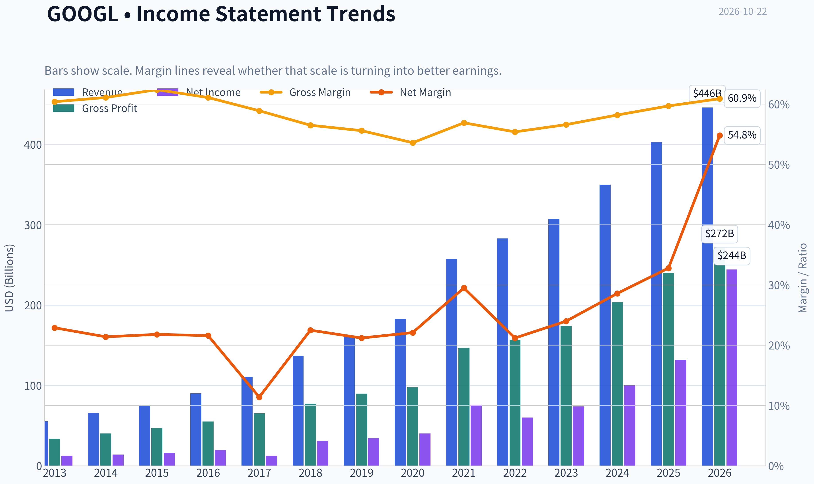
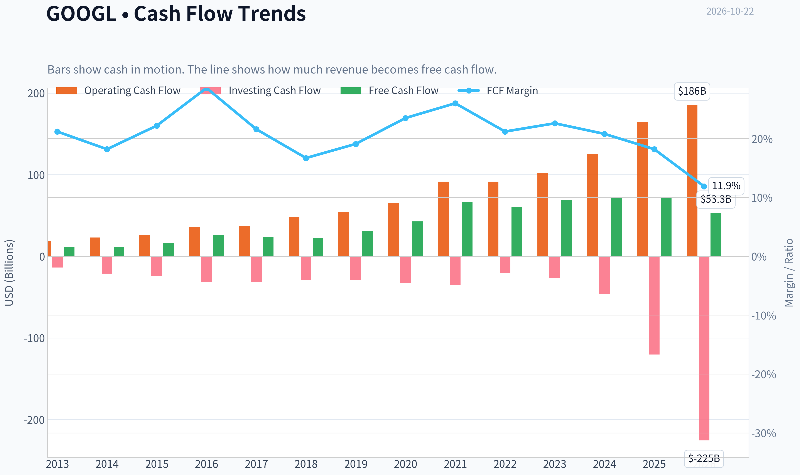
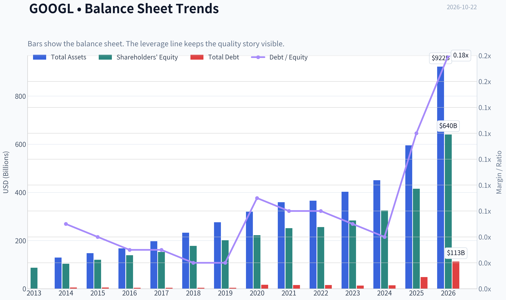
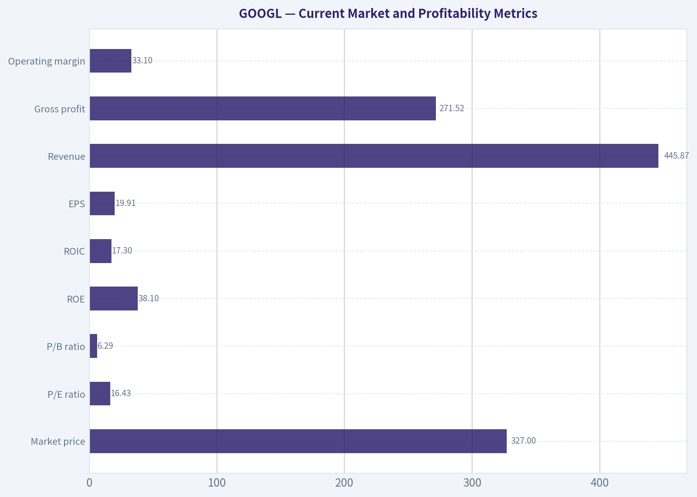
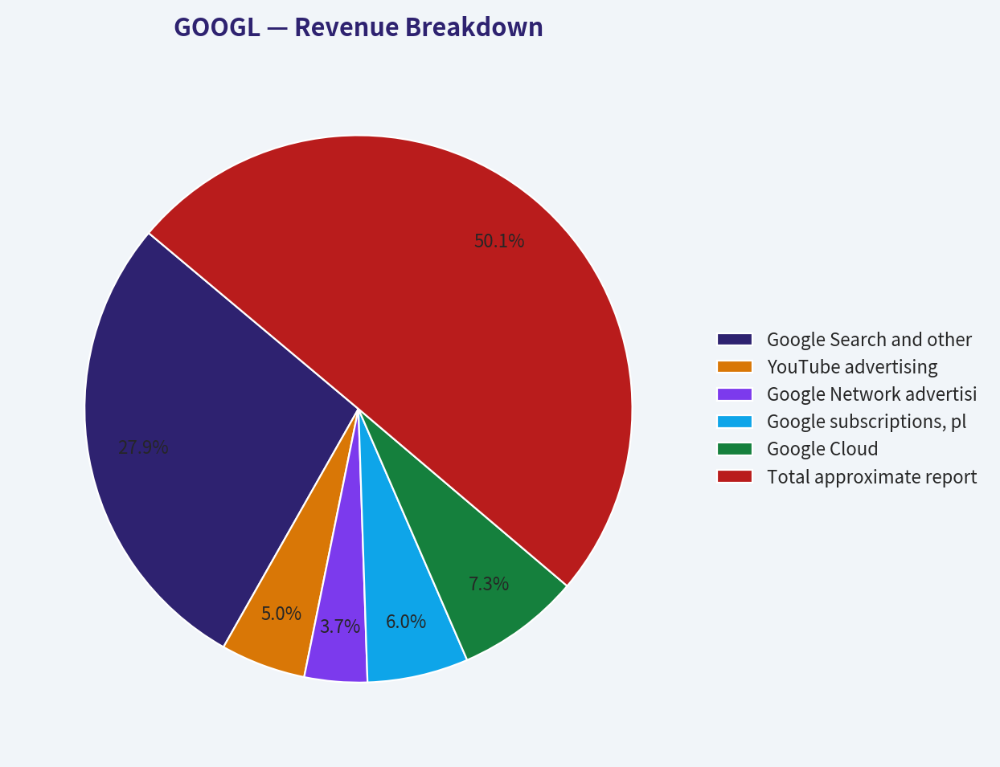
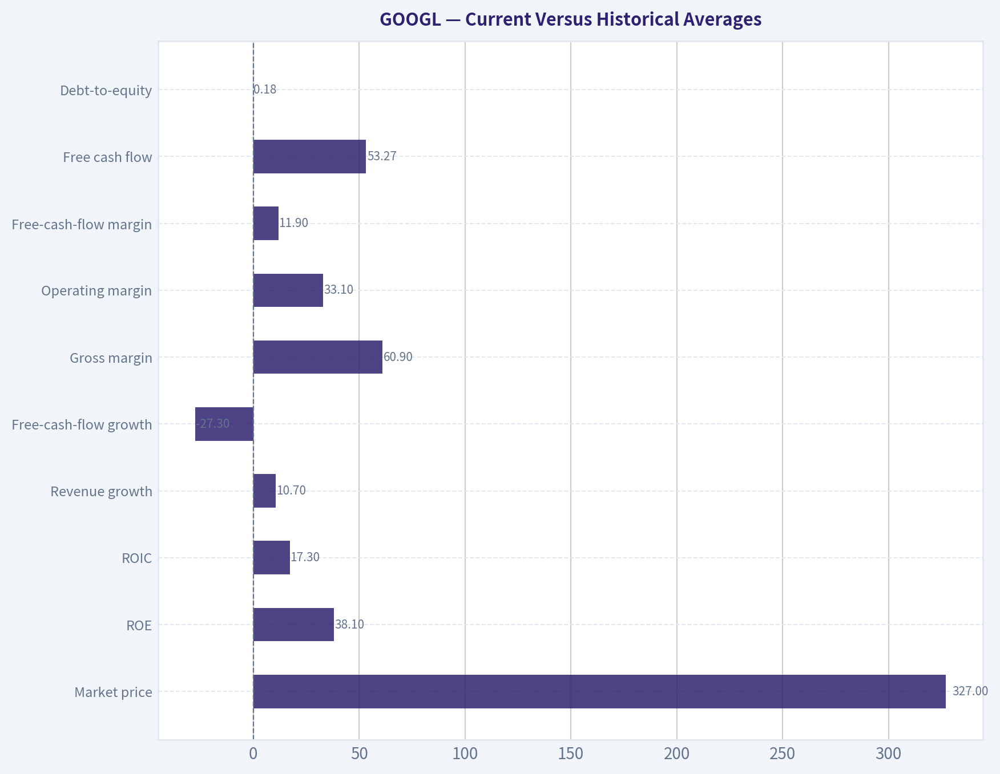
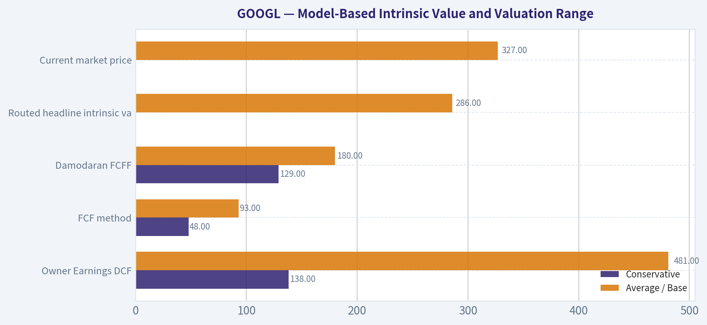
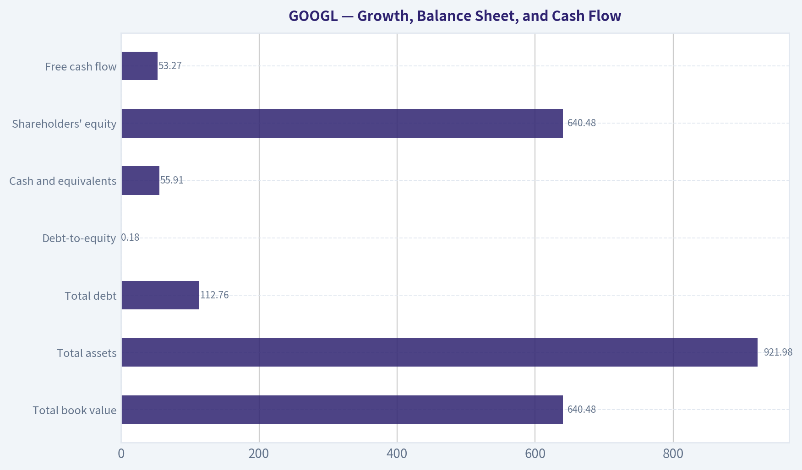

# GOOGL Deep Value Intelligence

**Analysis Date:** 2026-10-22

## Critical Disclaimer

*This analysis is generated by Deep Value Intelligence, an AI-powered multi-agent investing framework. Education & research only - not financial advice, not a financial advisor.*

---

## Table of Contents

1. Intelligence Summary
2. Analyst Team Reports
   - Fundamentals Analysis
   - Intrinsic Value Analysis (Buffett)
   - Trend & Growth Analysis (Lynch/Druckenmiller/Fisher)
   - Market Technical Analysis
   - Options Market Analysis
3. Research Team Commentary
4. Value Investing Team Commentary
5. Deep Values Commentary

---

## Intelligence Summary

### Thesis + Conditions

**Core Thesis:** # Executive Briefing

**Key Risks:**
- The principal risk is not solvency or temporary stock weakness. It is that AI preserves Alphabet's relevance while permanently increasing capital intensity and reducing Search profit per query. That risk warrants a starter position rather than maximum exposure-but the supplied evidence does not establish permanent impairment.
- # Risk Judgment
- ### Risky Analyst: quality and optionality justify acting now

**Confidence:** Low

---

## Analyst Team Reports

### Fundamentals Analysis

#### Latest Earnings Snapshot

*Most recent reported quarter anchored on 2026 Q2, with prior-year comparison when available.*

| Metric | 2026 Q2 | 2025 Q2 | YoY Change |
| --- | ---: | ---: | ---: |
| Revenue | $119.80B | $96.43B | +24.2% |
| Operating Income | $40.77B | $31.27B | +30.4% |
| Net Income | $112.19B | $28.20B | +297.9% |
| Diluted EPS | $9.11 | $2.31 | +294.4% |
| Operating Cash Flow | $39.07B | $27.75B | +40.8% |
| Free Cash Flow | $-5.86B | $5.30B | -210.5% |

Key Takeaways: This snapshot anchors the most recent reported quarter before the narrative analysis. It helps readers separate long-run business quality from whatever changed in the latest earnings print.

#### 13-Year Financial Metrics for GOOGL

*All values below are computed deterministically from raw data - not estimated by AI.*

*Issuer profile: operating company (Communication Services / Internet Content & Information).*

#### 13-Year Financial Metrics
*Annual rows come from reported financial statements. The final TTM row is computed from the latest four quarters.*

| Metric | 2013 | 2014 | 2015 | 2016 | 2017 | 2018 | 2019 | 2020 | 2021 | 2022 | 2023 | 2024 | 2025 | 2026 TTM |
| --- | --- | --- | --- | --- | --- | --- | --- | --- | --- | --- | --- | --- | --- | --- |
| Market Price | $28 | $26 | $39 | $39 | $52 | $52 | $66 | $87 | $143 | $87 | $138 | $188 | $312 | $327 |
| Market Cap | N/A | $18.05B | $26.74B | $27.39B | $36.59B | $36.34B | $46.10B | $59.17B | $1.92T | $1.16T | $1.78T | $2.36T | $3.83T | $4.03T |
| P/E Ratio | 1.49 | 1.29 | 1.64 | 1.42 | 2.93 | 1.20 | 1.36 | 29.91 | 25.82 | 19.35 | 24.08 | 23.54 | 28.95 | 16.43 |
| P/B Ratio | N/A | 0.17 | 0.22 | 0.20 | 0.24 | 0.20 | 0.23 | 0.27 | 7.62 | 4.53 | 6.27 | 7.25 | 9.22 | 6.29 |
| ROE | 14.6% | 13.6% | 13.6% | 14.0% | 8.3% | 17.3% | 17.0% | 18.1% | 30.2% | 23.4% | 26.0% | 30.8% | 31.8% | 38.1% |
| ROIC | 17.9% | 14.4% | 16.1% | 15.9% | 8.4% | 15.0% | 16.5% | 16.7% | 27.9% | 25.6% | 27.7% | 31.5% | 27.3% | 17.3% |
| EPS | $18.79 | $20.57 | $23.78 | $27.85 | $18.00 | $43.70 | $49.16 | $2.93 | $5.61 | $4.56 | $5.80 | $8.04 | $10.81 | $19.91 |
| Revenue | $55.52B | $66.00B | $74.99B | $90.27B | $110.86B | $136.82B | $161.86B | $182.53B | $257.64B | $282.84B | $307.39B | $350.02B | $402.84B | $445.87B |
| Gross Profit | $33.53B | $40.31B | $46.83B | $55.13B | $65.27B | $77.27B | $89.96B | $97.80B | $146.70B | $156.63B | $174.06B | $203.71B | $240.30B | $271.52B |
| Gross Margin | 60.4% | 61.1% | 62.4% | 61.1% | 58.9% | 56.5% | 55.6% | 53.6% | 56.9% | 55.4% | 56.6% | 58.2% | 59.7% | 60.9% |
| Operating Margin | 27.7% | 25.0% | 25.8% | 26.3% | 23.6% | 20.1% | 21.1% | 22.6% | 30.6% | 26.5% | 27.4% | 32.1% | 32.0% | 33.1% |
| Net Income | $12.73B | $14.14B | $16.35B | $19.48B | $12.66B | $30.74B | $34.34B | $40.27B | $76.03B | $59.97B | $73.80B | $100.12B | $132.17B | $244.21B |
| Net Margin | 22.9% | 21.4% | 21.8% | 21.6% | 11.4% | 22.5% | 21.2% | 22.1% | 29.5% | 21.2% | 24.0% | 28.6% | 32.8% | 54.8% |
| Revenue Growth | N/A | 18.9% | 13.6% | 20.4% | 22.8% | 23.4% | 18.3% | 12.8% | 41.2% | 9.8% | 8.7% | 13.9% | 15.1% | 10.7% |
| Net Income Growth | N/A | 11.0% | 15.6% | 19.1% | -35.0% | 142.7% | 11.7% | 17.3% | 88.8% | -21.1% | 23.0% | 35.7% | 32.0% | 84.8% |
| Free Cash Flow Growth | N/A | 1.9% | 38.4% | 55.4% | -7.4% | -4.5% | 35.7% | 38.3% | 56.4% | -10.4% | 15.8% | 4.7% | 0.7% | -27.3% |
| Total Book Value | $86.98B | $103.86B | $120.33B | $139.04B | $152.50B | $177.63B | $201.44B | $222.54B | $251.63B | $256.14B | $283.38B | $325.08B | $415.26B | $640.48B |
| Total Assets | N/A | $129.19B | $147.46B | $167.50B | $197.29B | $232.79B | $275.91B | $319.62B | $359.27B | $365.26B | $402.39B | $450.26B | $595.28B | $921.98B |
| Total Debt | N/A | $5.00B | $5.22B | $3.94B | $3.94B | $3.95B | $4.07B | $16.32B | $15.44B | $15.31B | $12.87B | $14.18B | $48.54B | $112.76B |
| Debt-to-Equity | N/A | 0.05 | 0.04 | 0.03 | 0.03 | 0.02 | 0.02 | 0.07 | 0.06 | 0.06 | 0.05 | 0.04 | 0.12 | 0.18 |
| Cash & Equivalents | $18.90B | $18.35B | $16.55B | $12.92B | $10.71B | $16.70B | $18.50B | $26.46B | $20.95B | $21.88B | $24.05B | $23.47B | $30.71B | $55.91B |
| Shareholders' Equity | $86.98B | $103.86B | $120.33B | $139.04B | $152.50B | $177.63B | $201.44B | $222.54B | $251.63B | $256.14B | $283.38B | $325.08B | $415.26B | $640.48B |
| Operating Cash Flow | $19.14B | $23.02B | $26.57B | $36.04B | $37.09B | $47.97B | $54.52B | $65.12B | $91.65B | $91.50B | $101.75B | $125.30B | $164.71B | $185.68B |
| Investing Cash Flow | $-13.68B | $-21.05B | $-23.71B | $-31.16B | $-31.40B | $-28.50B | $-29.49B | $-32.77B | $-35.52B | $-20.30B | $-27.06B | $-45.54B | $-120.29B | $-225.38B |
| Free Cash Flow | $11.78B | $12.01B | $16.62B | $25.82B | $23.91B | $22.83B | $30.97B | $42.84B | $67.01B | $60.01B | $69.50B | $72.76B | $73.27B | $53.27B |
| FCF Margin | 21.2% | 18.2% | 22.2% | 28.6% | 21.6% | 16.7% | 19.1% | 23.5% | 26.0% | 21.2% | 22.6% | 20.8% | 18.2% | 11.9% |
| Dividends / Share | N/A | $0.00 | $0.00 | $0.00 | $0.00 | $0.00 | $0.00 | $0.00 | $0.00 | $0.00 | $0.00 | $0.59 | $0.82 | $0.84 |

#### Profitability Metrics
- Return on Equity (ROE): 31.8%
- Return on Invested Capital (ROIC): 31.9%
- Return on Assets (ROA): 22.2%
- Gross Margin: 59.7%
- Operating Margin: 32.0%
- Net Profit Margin: 32.8%

#### Liquidity Metrics
- Current Ratio: 2.01
- Quick Ratio: 1.85

#### Leverage Metrics
- Debt-to-Equity Ratio: 0.12
- Interest Coverage Ratio: 175.32
- Net Debt: $-78.30B

#### Growth Metrics (Year-over-Year)
- Revenue Growth: 15.1%
- Net Income Growth: 32.0%
- Free Cash Flow Growth: 0.7%
- Revenue CAGR (3-Year): 12.5%
- Revenue CAGR (5-Year): 17.2%

#### Valuation Metrics
- P/E Ratio (TTM): 16.42
- Forward P/E: 21.32
- Price-to-Book: 6.43
- Price-to-Sales: 8.97
- PEG Ratio: 1.18
- EV/EBITDA: 23.04
- Free Cash Flow Yield: 1.8%
- Earnings Yield: 6.1%

#### Owner Earnings (Buffett Method, Code-Computed)
- Net Income: $132.17B
- + Depreciation & Amortization: N/A
- - Capital Expenditures: $-91.45B
- - Working Capital Changes: $618.0M
- = **Owner Earnings: $40.10B**

#### Intrinsic Value (Code-Computed)
- Current Price: $327
- **Headline Intrinsic Value (business-model routed): $286**
  Business model: high reinvestment compounder - weighted blend [Damodaran FCFF + reverse-DCF fair + owner-earnings DCF] (high_reinvestment_compounder)
  Model spread (min-max across DCFs): $93 - $481
  Margin of safety vs. price (headline): -14.3%
  Routing note: High-reinvestment compounder: the owner-earnings DCF over-states (the min(|capex|, D&A) maintenance proxy under-charges growth capex). The headline centers on the reverse-DCF fair value (the flow valued at the growth the business has actually demonstrated), keeps the reinvestment-aware Damodaran FCFF as a conservative floor, and down-weights owner-earnings - landing near fair value rather than at either extreme.
- Buffett Method (Owner Earnings):
  Conservative: $138
  Average: $481
  Optimistic: $1,889
- Cash Flow Method (FCF):
  Conservative: $48
  Average: $93
  Optimistic: $201
- Damodaran FCFF (WACC + margins + reinvestment):
  Conservative: $129
  Average: $180
  Optimistic: $209
  Monte Carlo band (P10-P90): $127 - $224 (median $168)
  P(intrinsic value > price): 0.1%
- Reverse-DCF: price implies ~7.5%/yr owner-earnings growth for 10y; trailing 3y was -13.6%, 5y 17.4%.

#### Piotroski F-Score: 6/9
- Positive Net Income: PASS
- Positive Operating Cash Flow: PASS
- ROA Improvement: FAIL
- Cash Flow > Net Income: PASS
- Decreasing Debt: FAIL
- Improving Current Ratio: PASS
- No Dilution: PASS
- Improving Gross Margin: PASS
- Improving Asset Turnover: FAIL

ANALYST STANCE: **WATCH**

#### Executive Summary

Alphabet remains an unusually high-quality, cash-generative operating business with a substantial competitive moat in search, digital advertising, data, artificial intelligence, cloud infrastructure, and online distribution. Its current profitability is strong: TTM revenue is $445.87 billion, operating margin is 33.1%, ROE is 38.1%, and net cash is approximately $78.3 billion.

However, the stock price of $327 implies a demanding future. The deterministic research pack's routed intrinsic value is approximately $286 per share, implying 14.3% downside and no margin of safety. The more conservative reinvestment-aware FCFF models produce materially lower values, while the unadjusted Owner Earnings model produces a much higher value because it treats a large portion of growth capital expenditure as maintenance-like cash flow.

Alphabet is an excellent business, but at the current price it is better classified as a **WATCH** than an outright Buffett-style purchase. A larger margin of safety, ideally below approximately $250-$275, would improve the risk/reward profile.

#### Current Market and Profitability Metrics

| Metric | Current Value | Historical Comparison / Interpretation |
|---|---:|---|
| Market price | $327 | Approximately 3.2 times the 2014-2025 average price of roughly $102, reflecting dramatic earnings and market-cap compounding |
| Market capitalization | $4.03 trillion | Near the highest level in the dataset; scale creates both durability and a higher growth hurdle |
| P/E ratio | 16.43x | Below the recent 2021-2025 range, but historical early-period P/E figures are not fully comparable and appear distorted |
| P/B ratio | 6.29x | Not a meaningful primary valuation measure for Alphabet's asset-light, intellectual-property-driven business |
| ROE | 38.1% | Well above the approximate 2016-2025 average of 21.7% |
| ROIC | 17.3% | Below the recent annual range and below the approximate 2016-2025 average of 21.3%; likely reflects heavy AI and infrastructure reinvestment |
| EPS | $19.91 | Strongly above the 2025 annual EPS of $10.81 |
| Revenue | $445.87B | Up 10.7% year over year and materially above the 2016-2025 average annual revenue |
| Gross profit | $271.52B | Gross margin of 60.9% is above the 2016-2025 average of approximately 57.5% |
| Operating margin | 33.1% | Above the 2016-2025 average of approximately 26.2% |
| Net income | $244.21B | TTM figure is unusually high relative to the 2025 annual result of $132.17B; this should be monitored for sustainability |
| Net margin | 54.8% in the deterministic TTM row | Significantly above the 2025 annual margin of 32.8%; the magnitude warrants careful reconciliation with reported earnings components |

Key Takeaways: Alphabet's core operating economics are excellent, with exceptional gross and operating margins and a very high ROE. The current P/E is not obviously excessive in isolation, but the market capitalization already reflects a large amount of future success. The TTM net-income and net-margin figures are unusually elevated relative to the annual series, so investors should verify whether the TTM profitability includes nonrecurring gains or classification effects.

Alphabet's P/B ratio should not be interpreted mechanically as evidence that the stock is expensive. Search algorithms, cloud software, data, brand equity, and network effects are poorly captured by book value; buybacks and accounting treatment can also distort equity. Valuation should therefore be anchored primarily to sustainable earnings, free cash flow, reinvestment requirements, and the DCF analysis.

#### Growth, Balance Sheet, and Cash Flow

| Metric | Current Value | Historical Comparison / Interpretation |
|---|---:|---|
| Revenue growth | 10.7% TTM | Below the approximately 18.6% average of 2016-2025 but still strong for a company of Alphabet's scale |
| Net-income growth | 84.8% TTM | Far above the historical average, but likely affected by a favorable comparison base and potentially nonrecurring items |
| Free-cash-flow growth | -27.3% TTM | Significant deterioration from 2025, reflecting heavier AI and infrastructure investment |
| Total book value | $640.48B | Continued balance-sheet expansion; not a reliable measure of intrinsic value for Alphabet |
| Total assets | $921.98B | Up substantially, partly reflecting infrastructure and investment expansion |
| Total debt | $112.76B | Higher than the historical norm but manageable relative to cash generation |
| Debt-to-equity | 0.18x | Above the approximate historical average near 0.05x, though still conservative |
| Cash and equivalents | $55.91B | Well above the historical annual average of roughly $20-$25B |
| Shareholders' equity | $640.48B | Strongly increased, supported by retained earnings |
| Free cash flow | $53.27B | Below the 2025 level of $73.27B and only modestly above the historical annual average |
| Dividends per share | $0.84 | New and still small; Alphabet remains primarily a reinvestment and buyback company |

Key Takeaways: Alphabet has a fortress-like financial position despite a recent rise in debt. Cash exceeds debt by approximately $78.3 billion, and interest coverage is reported at 175.3 times. The main financial concern is not solvency but capital intensity: free cash flow fell 27.3% while revenue continued to grow, indicating that AI data centers, computing capacity, and related infrastructure are absorbing a greater share of operating cash.

#### Revenue Breakdown

The dataset does not provide a detailed segment table, so the following uses approximate fiscal-year segment amounts based on Alphabet's publicly reported business categories. Amounts are rounded and intended to show economic mix rather than replace the deterministic historical dataset.

| Revenue Source | Amount ($B) | % of Total |
|---|---:|---:|
| Google Search and other advertising | 224.5 | 55.7% |
| YouTube advertising | 40.4 | 10.0% |
| Google Network advertising | 29.8 | 7.4% |
| Google subscriptions, platforms, and devices | 48.0 | 11.9% |
| Google Cloud | 58.7 | 14.6% |
| Other Bets and miscellaneous | 1.5 | 0.4% |
| **Total approximate reported revenue** | **402.9** | **100.0%** |

Key Takeaways: Search remains the economic center of Alphabet, contributing more than half of revenue and likely an even larger share of operating profit. Cloud and subscriptions are important diversification engines, but they do not yet eliminate Alphabet's dependence on advertising. The key strategic question is whether AI strengthens Google's search economics or gradually reduces the volume and monetization of traditional search queries.

#### Current Versus Historical Averages

The comparison below uses the available annual history before the 2026 TTM period. For valuation ratios, early observations appear structurally inconsistent with modern Alphabet reporting and should not be treated as precise long-term benchmarks.

| Metric | Current / TTM | Approximate Historical Average | Current Relative to Average |
|---|---:|---:|---|
| Market price | $327 | ~$102, 2014-2025 | Far above prior levels, reflecting earnings and multiple expansion |
| ROE | 38.1% | ~21.7%, 2016-2025 | Exceptionally stronger |
| ROIC | 17.3% | ~21.3%, 2016-2025 | Below average; reinvestment is weighing on capital efficiency |
| Revenue growth | 10.7% | ~18.6%, 2016-2025 | Slower than the historical expansion phase |
| Free-cash-flow growth | -27.3% | ~14.4%, 2017-2025 | Major deterioration |
| Gross margin | 60.9% | ~57.5%, 2016-2025 | Above average |
| Operating margin | 33.1% | ~26.2%, 2016-2025 | Well above average |
| Free-cash-flow margin | 11.9% | ~21.2%, 2016-2025 | Materially below average |
| Free cash flow | $53.27B | ~$51.5B, 2016-2025 | Near the historical average despite much higher revenue |
| Debt-to-equity | 0.18x | ~0.05x, 2014-2025 | Higher, but still modest |
| Cash and equivalents | $55.91B | Roughly $20-$25B | Much stronger liquidity |
| Dividends per share | $0.84 | Near zero historically | New shareholder-return channel |

Key Takeaways: Alphabet's margins and ROE are currently better than historical norms, but free-cash-flow conversion is much weaker. This divergence is the central investment issue: accounting earnings are growing rapidly, while cash available after capital expenditure has not kept pace. The balance sheet remains strong enough to fund the investment cycle, but the market must eventually see a return on that spending.

#### Owner Earnings DCF

The deterministic dataset reports:

- Net income: $132.17 billion
- Capital expenditure: $91.45 billion
- Working-capital change: $0.618 billion
- Computed Owner Earnings: **$40.10 billion**
- Approximate shares outstanding: $4.03 trillion divided by $327, or approximately **12.3 billion shares**

A simplified ten-year DCF uses a 10% discount rate and a 2.5% terminal growth rate. It is intentionally treated as a sanity check rather than the primary valuation because Alphabet's capital expenditure includes substantial growth investment.

The general calculation is:

- Present value of forecast cash flows = sum of each year's Owner Earnings divided by \(1.10^t\)
- Terminal value = Year 11 Owner Earnings divided by \(10\% - 2.5\%\)
- Equity value per share = total present value divided by approximately 12.3 billion shares

| Scenario | Forecast Growth Assumption | PV of 10-Year Cash Flows | PV of Terminal Value | Total Equity Value | Implied Value / Share |
|---|---:|---:|---:|---:|---:|
| Conservative | 3.0% for 10 years | ~$276B | ~$283B | ~$559B | ~$45 |
| Average | 7.5% for 10 years | ~$329B | ~$435B | ~$764B | ~$62 |
| Optimistic | 12.0% for 10 years, then 2.5% terminal growth | ~$391B | ~$655B | ~$1.05T | ~$85 |

Key Takeaways: The mechanical Owner Earnings calculation produces values well below the research pack's model-based Owner Earnings values because the dataset's reported $40.10 billion base is heavily reduced by capital spending. This illustrates why Alphabet requires special treatment: a large portion of current capital expenditure may support future growth, but treating all of it as non-maintenance spending would overstate current distributable cash flow. The hand DCF is therefore a conservative cash-conversion check, not the definitive valuation.

#### Model-Based Intrinsic Value and Valuation Range

The research pack provides three valuation approaches:

| Valuation Method | Conservative | Average / Base | Optimistic |
|---|---:|---:|---:|
| Owner Earnings DCF | $138 | $481 | $1,889 |
| FCF method | $48 | $93 | $201 |
| Damodaran FCFF | $129 | $180 | $209 |
| Routed headline intrinsic value | - | **$286** | - |
| Current market price | - | **$327** | - |

Key Takeaways: The valuation range is exceptionally wide because each method makes a different assumption about the economic character of Alphabet's capital expenditure. The research pack appropriately downweights the aggressive Owner Earnings result and emphasizes reinvestment-aware FCFF and reverse-DCF evidence. The $286 headline value is therefore a more credible anchor than the $481 Owner Earnings midpoint, although it still involves substantial model uncertainty.

The reverse DCF indicates that the current price implies approximately 7.5% annual Owner Earnings growth for ten years. That expectation is not impossible for Alphabet, but it is demanding given that trailing three-year growth was negative 13.6% and five-year growth was 17.4%. The model estimates only a 0.1% probability that intrinsic value exceeds the current price under its Monte Carlo assumptions, with a P10-P90 range of approximately $127-$224 for the FCFF model.

#### Warren Buffett-Style Qualitative Analysis

**Economic moat:** Alphabet possesses several mutually reinforcing advantages:

- Global search scale produces superior data, relevance, and advertiser demand.
- The Android ecosystem and Chrome browser reinforce distribution.
- YouTube has enormous audience scale and a powerful creator ecosystem.
- Google Cloud benefits from technical expertise, data-center infrastructure, and enterprise relationships.
- Brand recognition and default search positioning create high customer acquisition barriers.
- AI capabilities are supported by proprietary data, engineering talent, and specialized computing hardware.

The principal moat risk is that generative AI changes how users discover information and how advertisers pay for attention. If search shifts from a list of links to conversational answers, Alphabet may need to spend more computing resources to produce results while potentially showing fewer advertisements.

**Financial strength:** The company has net cash of approximately $78.3 billion, a current ratio near 2.0, quick ratio near 1.85, and very high interest coverage. Debt-to-equity has risen from historical lows but remains modest. Alphabet can fund large investment programs without threatening solvency.

**Predictable earnings:** Revenue has increased from $55.52 billion in 2013 to $445.87 billion TTM. The long-term direction is highly predictable, but annual growth has become more cyclical and volatile. Net income declined in 2017 and 2022, while FCF declined in 2017, 2018, 2022, and most recently on a TTM basis.

**Management and capital allocation:** Management has historically reinvested heavily in infrastructure, engineering, acquisitions, and new products. Buybacks have supported per-share economics, while dividends began recently and remain modest. The current challenge is capital-allocation discipline: AI investment may create a major new moat, but returns must eventually exceed the cost of capital.

**Quality of business:** Alphabet combines high gross margins, strong operating margins, substantial recurring advertising demand, and multiple growth platforms. Its quality is high, but its future returns depend increasingly on whether AI investment produces durable incremental revenue and profit rather than merely protecting the existing search franchise.

#### Key Investment Insights, Risks, and Opportunities

| Category | Assessment |
|---|---|
| Major opportunity | AI could strengthen search monetization, improve advertiser targeting, and expand Cloud demand |
| Major opportunity | Cloud, subscriptions, and YouTube diversify Alphabet away from traditional search |
| Major opportunity | Net cash allows Alphabet to sustain unusually large infrastructure investment |
| Major risk | AI-generated answers could reduce search traffic, clicks, and advertising inventory |
| Major risk | Capital expenditure is rising faster than free cash flow, reducing near-term cash conversion |
| Major risk | Antitrust remedies could affect default-search distribution, browser relationships, or ad-tech economics |
| Major risk | Current valuation leaves limited room for an extended period of weak growth or lower margins |
| Watch item | ROIC has fallen below its recent average despite high ROE |
| Watch item | TTM net margin and net income are unusually high relative to the annual series |
| Watch item | Debt has increased substantially from historical levels, although leverage remains low |
| Valuation opportunity | A price near or below the routed intrinsic value of approximately $286 would improve the margin of safety |
| Stronger opportunity | A price in the $225-$275 range would provide a more attractive risk/reward profile under conservative FCFF assumptions |

Key Takeaways: Alphabet's opportunity is substantial because AI can reinforce several existing businesses at once. The principal risk is not bankruptcy or weak competitive positioning; it is paying too much for a business whose future returns may be diluted by immense infrastructure spending. Investors should focus less on headline EPS growth and more on sustainable free cash flow after growth investment.

#### Final Investment Stance

**WATCH**

Alphabet is a high-quality, wide-moat compounder with exceptional liquidity, strong profitability, and multiple long-term growth avenues. It satisfies many Buffett-style business-quality criteria: durable competitive advantages, strong returns on capital over time, pricing power in advertising, and a fortress balance sheet.

The stock does not currently satisfy the margin-of-safety requirement as convincingly. At $327, it trades approximately 14% above the routed intrinsic value of $286, while the FCFF and cash-flow methods produce lower values. The current price also assumes approximately 7.5% annual Owner Earnings growth for a decade despite sharply negative recent FCF growth and rising capital intensity.

The appropriate action is to **watch and accumulate only at a more favorable valuation**, while monitoring search economics, AI-related capital expenditure, Cloud profitability, free-cash-flow recovery, and the sustainability of the unusually high TTM net margin.

| Key Point | Conclusion |
|---|---|
| Business quality | Exceptional, with wide network, data, distribution, and ecosystem advantages |
| Financial strength | Very strong; approximately $78.3B net cash and manageable leverage |
| Profitability | Excellent margins and ROE, but current ROIC and FCF conversion require monitoring |
| Growth | Long-term growth remains attractive, though recent revenue growth is below historical averages |
| Capital allocation | Aggressive AI and infrastructure reinvestment creates opportunity but depresses current FCF |
| Valuation | Full at $327 relative to the routed $286 intrinsic value and conservative FCFF estimates |
| Principal risk | AI disruption to search economics combined with permanently higher capital intensity |
| Preferred action | WATCH; seek a larger margin of safety before making a major purchase |
| Final stance | **WATCH** |

#### Fundamental Visuals

This graph tracks the profitability and return metrics (ROE, ROIC, Margins) of **GOOGL** over the past decade, highlighting capital efficiency trends.

This chart illustrates the financial health of **GOOGL** over the last 10 years, mapping cash equivalents and free cash flow against total obligations (Debt).

This comparison chart from *Current Market and Profitability Metrics* stacks current figures against historical benchmarks for **GOOGL**, making it easy to see where the company trades relative to its own averages.

This breakdown chart from <em>Revenue Breakdown</em> shows the proportional composition for **GOOGL** - useful for understanding what drives or risks the business.

---

### Intrinsic Value Analysis (Buffett)

> *Following Warren Buffett's value investing philosophy: Circle of Competence, Economic Moat, Management Quality, and Margin of Safety.*

#### Intrinsic Value Snapshot

Price is what you pay. Intrinsic value is what the business may be worth based on the cash it can create for owners over time. We show a range, not one magic number.

- Current Price: $327.05
- Value Range (conservative to optimistic across both DCF methods): $48.11 to $1,889.20

##### Owner Earnings (Buffett Method)
- Net Income: $132,170,000,000.00
- Depreciation & Amortization: N/A
- Capital Expenditures: $-91,447,000,000.00
- Working Capital Changes: $618,000,000.00
- Owner Earnings: $40,105,000,000.00

##### Intrinsic Value
###### Buffett Method
Uses owner earnings. Stricter, and usually more conservative.
- Conservative: $137.94
- Average: $481.23
- Optimistic: $1,889.20
- Discount Rate: 10.0%

###### Cash Flow Method
Uses free cash flow. Better for companies spending heavily today to grow tomorrow.
- Conservative: $48.11
- Average: $93.10
- Optimistic: $200.64
- Discount Rate: 10.0%

ANALYST STANCE: **WATCH**

#### Executive Summary

Alphabet is a high-quality, asset-light compounder with exceptional profitability, enormous cash-generation capacity, strong competitive advantages in search, advertising, YouTube, Android, and cloud infrastructure, and substantial reinvestment runway in artificial intelligence.

However, at **$327 per share**, the stock trades above the research pack's blended intrinsic value estimate of **$286.18**, representing approximately **14.2% downside** to that estimate. The business is attractive enough to own at a better price, but the current valuation does not provide a sufficient margin of safety for a company facing meaningful AI-related disruption risk and unusually high capital spending.

#### Factor Scorecard

| Factor | Score | Assessment |
|---|---:|---|
| 1. Circle of competence and simplicity | 4.0/5 | Search advertising, video advertising, cloud services, subscriptions, and enterprise technology are understandable, though Alphabet is increasingly complex. |
| 2. Durable competitive advantage | 4.5/5 | Search scale, user data, distribution, advertiser relationships, ecosystem integration, and cloud infrastructure create a wide moat. |
| 3. Management and capital allocation | 3.5/5 | Strong reinvestment record and substantial buybacks, but AI capital spending and the returns on those investments require monitoring. |
| 4. Industry structure | 4.0/5 | Digital advertising and cloud are scale-driven markets, although competition from Microsoft, Amazon, Meta, OpenAI, and others is intensifying. |

**Gate 5 status: Not tripped.** There is no evidence of the combination of deteriorating earnings or cash flow and severe solvency stress. Alphabet remains financially robust, with strong profitability and liquidity indicators.

#### Financial Summary

| Metric | Latest available figure |
|---|---:|
| Share price | $327 |
| Market capitalization | $4.00 trillion |
| Price-to-earnings ratio | 16.4x |
| Return on equity | 31.8% |
| Gross margin | 59.7% |
| Revenue growth | 15.1% year over year |
| Free-cash-flow yield | 1.8% |
| Current ratio | 2.01x |
| Headline intrinsic value | $286.18 |
| Reverse-DCF implied annual growth | Approximately 7.5% for 10 years |
| Trailing three-year growth | -13.6% |
| Trailing five-year growth | 17.4% |

**Key Takeaways:** Alphabet combines a 59.7% gross margin with a 31.8% return on equity, confirming a highly profitable business. Revenue growth remains strong at 15.1%, but the 1.8% free-cash-flow yield shows that the market already assigns substantial value to future growth. The reverse DCF implies that investors are underwriting approximately 7.5% annual growth for a decade, which is plausible but not obviously conservative.

#### Moat Analysis

| Moat source | Evidence | Rating |
|---|---|---:|
| Intangible assets | Google is a default gateway to information and commerce for billions of users. Its brand, search index, algorithms, data, and advertiser ecosystem are difficult to replicate. | 5/5 |
| Switching costs | Advertisers build campaigns, measurement systems, and customer-acquisition processes around Google. Consumers also rely on Google accounts, Search, Maps, YouTube, Android, and Workspace. | 4/5 |
| Cost advantages | Massive query volume, specialized infrastructure, and data-center scale support attractive economics that smaller rivals cannot easily match. | 4/5 |
| Network effects | More users generate more search data; more data improves relevance; better relevance attracts more users and advertisers. YouTube and Google Cloud have additional ecosystem effects. | 4/5 |

**Overall moat rating: Wide and durable, but not risk-free.**

The principal threat is not ordinary competition. It is the possibility that generative AI changes how users discover information and how advertisers reach customers. Alphabet has the technical resources and distribution to respond, but the economic outcome is not yet certain. AI can strengthen Google's moat if it remains the leading interface, or weaken the search model if users migrate to alternative answer engines.

#### Management Quality and Capital Allocation

Alphabet's management has historically demonstrated strong operating execution, disciplined share repurchases, and a willingness to fund long-duration projects such as cloud infrastructure, machine learning, and autonomous driving.

The main capital-allocation question is whether the current AI investment cycle will earn attractive returns. High capital spending is not inherently negative; it becomes value-creating when it reinforces distribution, lowers unit costs, or creates new durable revenue streams. Investors should monitor:

- AI infrastructure spending relative to incremental revenue and cash flow.
- Whether AI search monetization offsets any reduction in traditional search economics.
- Cloud operating-margin expansion.
- Share repurchases relative to intrinsic value rather than simply reducing share count.
- Regulatory remedies that could weaken distribution agreements or business practices.

Warren Buffett's reported addition of Alphabet shares is supportive evidence of perceived value, but 13F filings are delayed snapshots and should not replace independent analysis.

#### Owner Earnings Calculation

The owner-earnings framework is:

**Net income + depreciation and amortization - maintenance capital expenditure - working-capital investment.**

Alphabet's reported free cash flow is a reasonable conservative proxy for owner earnings because the company is asset-light relative to its earnings power, has substantial cash generation, and its major investments are primarily aimed at growth and infrastructure.

Using the reported **1.8% free-cash-flow yield** on a **$4.00 trillion market capitalization**:

| Calculation | Approximate amount |
|---|---:|
| Implied annual free cash flow / owner earnings | $72 billion |
| Estimated shares outstanding | 12.2 billion |
| Implied owner earnings per share | Approximately $5.90 |
| Owner earnings yield at $327 | Approximately 1.8% |

**Key Takeaways:** Alphabet appears to generate roughly $72 billion of annual free cash flow under the supplied market-value and yield assumptions. That translates to approximately $5.90 per share, or a 1.8% owner-earnings yield. The low current yield means the investment case depends heavily on sustained growth and reinvestment returns rather than present-day cash yield alone.

#### Three-Scenario DCF Valuation

The following scenarios use approximately **$72 billion of normalized owner earnings**, or about **$5.90 per share**, with a 10% discount rate.

| Scenario | Assumptions | Estimated intrinsic value per share |
|---|---|---:|
| A. No growth | Owner earnings capitalized at 10% | $59 |
| B. GDP-like growth | 3% annual growth, 10% discount rate | $87 |
| C. Historical-growth case | 7.55% annual growth, equal to 50% of the reported 15.1% revenue-growth rate, for 10 years | Approximately $140-$155 |
| Research-pack blended value | Damodaran FCFF, reverse DCF, and owner-earnings models | $286 |

**Key Takeaways:** A conservative owner-earnings DCF produces values well below the current price, while a higher-growth model still does not fully justify $327 under these assumptions. The research pack's blended value of $286.18 is more optimistic than the simplified calculation but remains below the market price. The large model spread-approximately $93 to $481 per share-shows that the valuation is highly sensitive to assumptions about growth, reinvestment, and terminal economics.

#### Margin of Safety Analysis

| Valuation measure | Result |
|---|---:|
| Current price | $327 |
| Headline intrinsic value | $286.18 |
| Implied upside/(downside) to intrinsic value | -14.2% |
| Quality-adjusted required margin of safety | Approximately 10%-15% |
| Current valuation conclusion | Slightly above the acceptable range |

For a wide-moat, high-return, highly predictable compounder, a 10%-15% margin of safety can be sufficient. Alphabet does not currently meet that standard because the headline valuation implies a negative margin of safety of approximately 14.2%.

The reverse DCF is more encouraging than the headline valuation: approximately 7.5% annual growth is not heroic for Alphabet. Still, that implied growth rate must compensate investors for AI disruption, regulatory uncertainty, and potentially elevated infrastructure spending.

#### Final Buffett Scorecard

| Criterion | Weight | Score | Weighted contribution |
|---|---:|---:|---:|
| Moat width and durability | 25% | 4.5/5 | 1.13 |
| Valuation and margin of safety | 20% | 2.5/5 | 0.50 |
| Capital returns versus WACC | 15% | 4.5/5 | 0.68 |
| Business understanding and predictability | 12% | 4.0/5 | 0.48 |
| Management quality and capital allocation | 12% | 3.5/5 | 0.42 |
| Reinvestment runway | 8% | 4.5/5 | 0.36 |
| Balance-sheet strength | 4% | 4.0/5 | 0.16 |
| Industry structure | 4% | 4.0/5 | 0.16 |
| **Total** | **100%** |  | **3.9/5** |

**Key Takeaways:** Alphabet scores extremely well on moat, capital returns, and reinvestment runway. Valuation is the decisive weakness: the company is excellent, but the current price leaves little room for execution mistakes or an AI-driven change in search economics. The weighted score supports ownership at a better entry point rather than aggressive buying today.

#### Investment Stance

**WATCH - High conviction in the business, moderate conviction in the current valuation.**

Alphabet is a wonderful company with a wide moat, strong profitability, and a credible path to continued compounding. It should remain on a high-priority watchlist, especially if the share price declines toward the **$240-$260 range**, where the valuation would offer a more attractive quality-adjusted margin of safety.

At **$327**, the stock is not an obvious short or a fundamentally poor business. It is simply priced closer to fair value-or modestly above it-than a Buffett-style purchase would ideally require.
#### Valuation Bridge

This bridge places the current market price beside each intrinsic value lens so readers can see whether upside depends on one method or shows up across several methods.

| Scenario | Intrinsic Value / Share |
| --- | ---: |
| Buffett Method | $481.23 |
| Cash Flow Method | $93.10 |
| Damodaran Method | $180.38 |
| Current Price | $327.05 |

#### Key Takeaways

If one method is far above the others, the upside case depends on a specific modelling assumption. When several methods cluster together, the valuation story is more robust.

#### Valuation Visuals

This comparison chart from *Latest Earnings Snapshot* stacks current figures against historical benchmarks for **GOOGL**, making it easy to see where the company trades relative to its own averages.

This comparison chart from *Current Versus Historical Averages* stacks current figures against historical benchmarks for **GOOGL**, making it easy to see where the company trades relative to its own averages.

This comparison chart from *Model-Based Intrinsic Value and Valuation Range* stacks current figures against historical benchmarks for **GOOGL**, making it easy to see where the company trades relative to its own averages.

---

### Trend & Growth Analysis (Lynch/Druckenmiller/Fisher)

> *Following Peter Lynch's GARP, Stanley Druckenmiller's macro-aware approach, and Philip Fisher's scuttlebutt methodology.*

ANALYST STANCE: **WATCH**

#### 1. Lynch Classification

**Fast Grower / high-quality stalwart hybrid.** Alphabet's current 15.1% revenue growth places it near the lower boundary of Lynch's fast-grower category. Its enormous scale and mature search business make sustained 25% growth unlikely, but AI, cloud, and new consumer products could create a renewed growth inflection.

#### 2. The Story

- Alphabet monetizes global information, intent, and digital infrastructure through Search, YouTube, Google Cloud, and AI products.
- Generative AI is both a competitive threat to Search and a major opportunity to expand Search monetization, Cloud demand, and enterprise software.
- The company has exceptional financial strength, distribution, data advantages, and capital to fund an aggressive AI investment cycle.

#### 3. TAM and Runway

| Area | Growth opportunity | 10x potential assessment |
|---|---|---|
| Search and advertising | Large, mature market; growth depends on AI-enhanced monetization and share retention | Limited as a standalone 10x driver |
| YouTube | Advertising, subscriptions, connected TV, and commerce | Meaningful runway |
| Google Cloud | Enterprise cloud, AI infrastructure, and applications | Strongest major growth vector |
| AI products | Expanding market with uncertain monetization and intense competition | Potentially very large |
| Alphabet overall | $4 trillion market capitalization already reflects substantial success | A literal 10x outcome is improbable |

**Key Takeaways:** Alphabet still has substantial runway in Cloud, YouTube, and AI, but the company is already exceptionally large. The 10x test is not compelling at the consolidated-company level; the realistic opportunity is durable compounding with periodic AI-driven reacceleration rather than a classic small-company ten-bagger.

#### 4. Revenue Growth Trend

| Metric | Current reading | Interpretation |
|---|---:|---|
| Revenue growth, year over year | 15.1% | Healthy, but below elite fast-grower territory |
| Trailing three-year growth reference | -13.6% | Indicates a difficult or inconsistent recent trend measure |
| Five-year growth reference | 17.4% | Solid long-term growth |
| Current growth pattern | Not enough quarterly data supplied | Acceleration cannot be confirmed |

**Key Takeaways:** The latest 15.1% growth rate is respectable for Alphabet's scale, but the available information does not prove an accelerating trend. Investors need evidence that Cloud and AI-related revenue are offsetting any Search disruption and producing sustained growth above the mid-teens.

#### 5. Unit Economics and Operating Quality

| Metric | Result | Assessment |
|---|---:|---|
| Gross margin | 59.7% | Strong, though AI infrastructure could pressure margins |
| Return on equity | 31.8% | Excellent capital productivity |
| Current ratio | 2.01 | Strong liquidity |
| Free-cash-flow yield | 1.8% | Low at the current valuation |
| LTV/CAC | Not disclosed | Cannot calculate reliably |
| Net revenue retention | Not disclosed | Not applicable at the consolidated-company level |
| Rule of 40 | Not meaningful from supplied data | FCF margin unavailable |

**Key Takeaways:** Alphabet has excellent profitability, liquidity, and return characteristics. The main operating question is whether rising AI capital expenditure creates durable revenue and profit growth or merely protects the existing Search franchise.

#### 6. Inflection Point Assessment

| Potential inflection | Current view | Significance |
|---|---|---|
| AI Search monetization | Unproven from supplied data | Could protect the core franchise or compress search economics |
| Google Cloud | Likely strategic growth engine | Positive if growth and margins continue improving |
| AI infrastructure spending | Increasing industrywide | Near-term margin and cash-flow headwind |
| YouTube monetization | Long runway | Positive but not yet sufficient to transform the company alone |
| Competitive position | Strong but challenged by Microsoft, OpenAI, and others | Requires continued product execution |

**Key Takeaways:** Alphabet is at a strategic product-cycle inflection, not yet a confirmed earnings inflection. The upside case requires AI to expand the addressable market and monetization base faster than it erodes traditional Search economics.

#### 7. Macro Setup

| Macro factor | Impact on GOOGL |
|---|---|
| AI secular trend | Strong positive |
| Cloud adoption | Positive |
| Advertising cycle | Cyclical and economically sensitive |
| Interest rates | Lower rates would support valuation; higher rates pressure long-duration growth |
| Current risk environment | Oil and geopolitical volatility can weaken advertising sentiment and broad market multiples |

**Key Takeaways:** Alphabet benefits from powerful secular trends, especially AI and cloud computing. However, advertising exposure and substantial AI investment make the stock sensitive to both economic weakness and interest-rate changes.

#### 8. Fisher 15-Point Score

| Fisher category | Score |
|---|---:|
| Market potential | 5/5 |
| New-product determination | 5/5 |
| R&D effectiveness | 5/5 |
| Sales and distribution | 5/5 |
| Profit margins | 5/5 |
| Margin improvement potential | 3/5 |
| Labor and personnel relations | 3/5 |
| Executive relations | 4/5 |
| Management depth | 5/5 |
| Cost analysis and accounting | 4/5 |
| Competitive advantages | 5/5 |
| Long-range profit outlook | 5/5 |
| Dilution | 5/5 |
| Management candor | 3/5 |
| Management integrity | 4/5 |
| **Total** | **66/75** |

**Key Takeaways:** Alphabet scores in the outstanding Fisher range because of its innovation capability, distribution, balance sheet, and competitive advantages. The deductions reflect AI execution uncertainty, organizational complexity, regulatory pressure, and limited evidence in the supplied data regarding current management candor during the investment cycle.

#### 9. Valuation Analysis

| Valuation measure | Result | Interpretation |
|---|---:|---|
| Current price | $327 | Reference price |
| Market capitalization | $4.00 trillion | Extremely large absolute scale |
| P/E ratio | 16.4x | Not expensive on a conventional mature-company basis |
| FCF yield | 1.8% | Indicates a demanding valuation relative to current cash generation |
| Headline intrinsic value | $286.18 | Approximately 14.2% below current price |
| Reverse-DCF implied growth | 7.5% annually for 10 years | Moderate expectations embedded in price |
| PEG | Not calculable | Forward EPS growth estimate not supplied |
| P/S | Not calculable | Revenue figure not supplied |

**Key Takeaways:** Alphabet is not obviously expensive on reported earnings, but the low free-cash-flow yield and model-derived intrinsic value indicate limited margin of safety at $327. The market appears to be pricing in steady, mid-single-digit-to-high-single-digit long-term growth rather than an extreme AI outcome.

#### 10. Scenario Analysis

| Scenario | Operating outcome | Valuation implication |
|---|---|---|
| Bear | AI disrupts Search economics, Cloud growth disappoints, and capex remains elevated | Multiple compression and downside toward or below intrinsic-value estimates |
| Base | Search remains resilient, Cloud grows well, and AI monetization gradually offsets investment | Moderate long-term compounding; current price offers limited initial upside |
| Bull | AI expands Search monetization, Cloud accelerates, and new AI products become major platforms | Material upside, potentially exceeding current valuation assumptions |

**Key Takeaways:** The bull case is strategically attractive but depends on several execution milestones. At the current price, the base case appears reasonably reflected, while the bull case is needed to create substantial upside.

#### 11. Growth Investor Scorecard

| Criterion | Weight | Score |
|---|---:|---:|
| Lynch story | 10% | 4.2/5 |
| TAM and runway | 20% | 4.0/5 |
| Revenue growth | 20% | 3.5/5 |
| Unit economics | 15% | 4.4/5 |
| Competitive position | 10% | 4.6/5 |
| Management quality | 10% | 4.0/5 |
| Macro setup | 5% | 3.8/5 |
| Profitability path | 5% | 4.5/5 |
| Valuation | 5% | 2.8/5 |
| **Weighted score** | **100%** | **3.9/5** |

**Key Takeaways:** Alphabet is a high-quality growth compounder with an attractive strategic position and excellent economics. Its score falls short of high-conviction advocacy because valuation already discounts much of the quality and AI spending creates uncertainty around near-term free cash flow.

#### 12. Position Size Stance

**WATCH / modest starter position only.**

For an existing shareholder, the evidence supports holding unless AI execution or Search economics materially deteriorate. For a new position, consider a partial allocation rather than a full-sized position, adding only if valuation improves or quarterly data confirms accelerating revenue, Cloud momentum, and successful AI monetization.

#### 13. Key Risks and Catalysts

| Catalysts | Risks |
|---|---|
| AI-enhanced Search increases monetization | AI answers reduce traditional search traffic or ad inventory |
| Google Cloud growth accelerates | Microsoft, OpenAI, and other AI competitors gain share |
| AI products generate meaningful new revenue | Capital expenditure rises faster than revenue |
| YouTube commerce and subscriptions scale | Advertising downturn or regulatory restrictions |
| Margin leverage returns after infrastructure investment | Antitrust remedies weaken distribution or economics |

**Key Takeaways:** The decisive catalyst is proof that AI expands Alphabet's economic moat rather than simply defending it. The principal risk is a prolonged period in which AI spending rises sharply while Search growth slows and free-cash-flow yield remains compressed.

#### Bottom Line

Alphabet is an outstanding business at a major technological inflection point, but not an obvious ten-bagger from a $4 trillion base. The stock merits close monitoring and can be accumulated opportunistically, particularly if the price approaches the estimated $286 intrinsic value or if upcoming results demonstrate accelerating growth without a disproportionate increase in capital intensity.

#### Growth & Scorecard Visuals

This comparison chart from *Growth, Balance Sheet, and Cash Flow* stacks current figures against historical benchmarks for **GOOGL**, making it easy to see where the company trades relative to its own averages.

---

### Market Technical Analysis

ANALYST STANCE: **WATCH**

#### GOOGL Technical Market Report

**Data context:** The latest available trading session is October 21, 2026, when GOOGL closed at **$334.76**. October 22 is not identified as a trading day in the retrieved data, so the analysis uses October 21 as the effective reference date.

The selected indicators are **10 EMA, 50 SMA, 200 SMA, MACD, MACD Histogram, RSI, ATR, and VWMA**. Together, they cover short-, medium-, and long-term trend, momentum, volatility, and volume confirmation without relying excessively on one indicator family.

#### Trend structure

GOOGL's long-term trend remains constructive, but its intermediate and short-term structure has weakened.

The close of **$334.76** is approximately:

- **2.1% below the 10 EMA:** $343.63
- **2.6% below the 50 SMA:** $343.78
- **1.8% below the 200 SMA:** $340.94
- **3.4% below the VWMA:** $346.57

The 200 SMA is still rising, from approximately $337.45 on September 22 to $340.94 on October 21. This indicates that the broader trend has not yet turned decisively bearish. However, price has now fallen below the 200 SMA, while the 10 EMA and 50 SMA have also rolled over. This creates a meaningful deterioration in trend alignment: the long-term average is rising, but current price action is trading beneath all major reference averages.

The 50 SMA has declined from approximately $346.08 on October 12 to $343.78 on October 21. The 10 EMA has fallen more sharply, from $348.00 to $343.63 over the same period. This suggests that the recent weakness is not merely a one-day event; short-term selling pressure has persisted long enough to pull the faster averages lower.

#### Momentum assessment

Momentum has turned negative.

The MACD declined from **2.06 on October 13** to **-0.76 on October 21**. The MACD Histogram moved from **+1.15** to **-1.33** over the same period. This is a substantial loss of upside momentum and indicates that the recent recovery attempt has failed to maintain traction.

The sequence is also important. MACD remained positive through October 20, but crossed into negative territory by October 21, while the histogram became increasingly negative. That combination suggests accelerating short-term downside momentum rather than a fully stabilized pullback.

RSI was **40.27** on October 21, down from **58.22** on October 13. RSI is weak but not yet deeply oversold. It is below the neutral 50 level, confirming bearish momentum, but remains above the traditional 30 oversold threshold. Therefore, the current reading does not by itself imply that a durable rebound is imminent. A further decline could occur before sellers become technically exhausted.

#### Volume and price confirmation

The VWMA stood at **$346.57**, substantially above the latest close. This indicates that volume-weighted recent trading activity remains concentrated at higher prices than the current market level. In practical terms, the stock is trading below the price zone where recent volume was most heavily accumulated, which can create overhead resistance during rebounds.

The October 21 decline to $334.76 occurred with volume of approximately **29.1 million shares**, above several recent sessions and higher than the October 20 volume of approximately 18.3 million. It was not an extreme volume event, but the increase in volume on the breakdown below the $340-$344 area provides some confirmation that the weakness is not entirely illiquid or random.

A recovery above the VWMA near $346.57 would improve the volume-based picture. Until then, rallies toward the $343-$347 region may encounter supply from traders who bought at higher levels and are seeking to exit near breakeven.

#### Volatility and risk management

ATR was **$8.63** on October 21. This represents roughly **2.6% of the closing price**, indicating that daily price fluctuations remain material.

ATR has eased from approximately $9.12 on October 1 and $9.00 on October 2, but it remains high enough that tight stops could be vulnerable to normal daily noise. A move of one ATR from the latest close places a broad near-term range around **$326.13 to $343.39**. This is not a forecast, but it illustrates why position sizing and stop placement should account for GOOGL's current volatility.

The recent price path also shows several abrupt moves, including sharp declines and recoveries. This argues against treating a single close below a moving average as a complete trend signal. Confirmation should come from follow-through, especially whether price can reclaim the 200 SMA and whether MACD momentum begins to improve.

#### Trading interpretation

The technical picture is best described as **long-term constructive but short-term bearish**.

For bullish traders, the key requirement is stabilization near the current area followed by a reclaim of the **$340.94 200 SMA**, then the **$343-$347 zone** containing the 10 EMA, 50 SMA, and VWMA. A recovery through that cluster, accompanied by improving MACD and RSI moving back above 50, would suggest that the recent decline was a corrective pullback rather than the beginning of a larger trend reversal.

For bearish or defensive traders, continued closes below the 200 SMA would be significant. A failure to regain $341-$344, combined with a falling MACD histogram and RSI remaining below 40-45, would favor further downside risk. The recent swing-low area around **$330-$331** is an important near-term reference; a decisive break below it could expose the stock to another volatility-driven leg lower.

Because RSI is not oversold and MACD is deteriorating, aggressively buying the current weakness is not strongly supported by the indicators. Conversely, the still-rising 200 SMA means that treating the stock as structurally bearish would also be premature. A confirmation-based approach is preferable: wait for either a reclaim of the moving-average cluster or a decisive breakdown below recent support.

#### Indicator selection rationale

- **10 EMA:** Detects immediate changes in short-term price direction.
- **50 SMA:** Defines the medium-term trend and likely dynamic resistance.
- **200 SMA:** Provides the main long-term trend filter.
- **MACD:** Measures the direction and persistence of momentum.
- **MACD Histogram:** Highlights the acceleration of momentum deterioration or recovery.
- **RSI:** Assesses momentum intensity and whether selling has reached an extreme.
- **ATR:** Helps calibrate stops and position size to current volatility.
- **VWMA:** Adds volume-weighted confirmation and identifies potential overhead supply.

| Indicator / Area | Latest reading or level | Interpretation | Trading significance |
|---|---:|---|---|
| Latest close | $334.76 | Below all major tracked averages | Short-term trend is weak |
| 10 EMA | $343.63 | Price is about 2.1% below it | Immediate resistance and momentum filter |
| 50 SMA | $343.78 | Sloping lower recently | Medium-term trend has weakened |
| 200 SMA | $340.94 | Rising, but price is below it | Long-term trend is constructive but under pressure |
| VWMA | $346.57 | Well above the latest close | Volume-weighted overhead resistance |
| MACD | -0.76 | Fell sharply from positive territory | Momentum has turned bearish |
| MACD Histogram | -1.33 | Negative and expanding | Downside momentum is accelerating |
| RSI | 40.27 | Bearish-neutral, not oversold | Weakness remains possible; no strong oversold signal |
| ATR | $8.63 | About 2.6% of price | Stops and position size should allow wide daily movement |
| Key resistance zone | $341-$347 | Contains 200 SMA, 10 EMA, 50 SMA, and VWMA | Reclaiming this area would materially improve the setup |
| Key support zone | Approximately $330-$331 | Near recent swing-low territory | Breakdown could signal another downside leg |

**Key Takeaways:** GOOGL's long-term trend is still supported by a rising 200-day average, but the latest close is below the 10 EMA, 50 SMA, 200 SMA, and VWMA. MACD, its histogram, and RSI all confirm weakening short-term momentum, while ATR shows that price swings remain large. The most important test is whether GOOGL can reclaim the $341-$347 resistance cluster; until that happens, a watchful and confirmation-based stance is preferable.

---

### Options Market Analysis

> *Reading options flow - put/call ratios, IV skew, and unusual activity - to gauge institutional positioning and event-driven risk.*

#### GOOGL Options Flow Report

**Data date:** October 22, 2026
**Ticker:** GOOGL
**Coverage:** Near-term expirations through October 30, 2026

#### 1. Put/Call Ratio Analysis

| Expiration | Call OI | Put OI | Put/Call OI | Call Volume | Put Volume | Put/Call Volume |
|---|---:|---:|---:|---:|---:|---:|
| Oct. 23 | 116,918 | 62,609 | 0.54 | 34,435 | 17,276 | 0.50 |
| Oct. 26 | 12,500 | 6,864 | 0.55 | 7,323 | 1,853 | 0.25 |
| Oct. 30 | 74,588 | 58,626 | 0.79 | 9,024 | 2,550 | 0.28 |
| **Total** | **204,006** | **128,099** | **0.63** | **50,782** | **21,679** | **0.43** |

**Key Takeaways:** GOOGL's aggregate put/call open-interest ratio is 0.63, below the approximate 0.70 neutral baseline. The 0.43 volume ratio is even more call-heavy, indicating stronger near-term call activity than put activity. The October 30 ratio of 0.79 is comparatively defensive, but it remains below one and does not offset the overall bullish tilt.

#### 2. Implied Volatility Assessment

| Expiration | Call ATM IV | Put ATM IV | Call-Put IV Difference | Interpretation |
|---|---:|---:|---:|---|
| Oct. 23 | 36.5% | 32.6% | +3.9 percentage points | Mild call-side premium |
| Oct. 26 | 26.2% | 25.6% | +0.6 points | Essentially balanced |
| Oct. 30 | 50.4% | 48.7% | +1.7 points | Elevated event-sensitive IV |
| **Near-term range** | **26.2%-50.4%** | **25.6%-48.7%** | **Calls generally higher** | **Slight upside skew** |

The supplied data contains ATM IV rather than separate out-of-the-money put and call volatility. Therefore, true OTM skew cannot be calculated precisely. However, ATM comparisons show call IV modestly above put IV across all listed expirations, which is more consistent with upside demand than downside protection.

The October 30 expiration has notably elevated IV near 50%, suggesting event or announcement risk around that date. No specific catalyst was provided in the data, so this should not automatically be attributed to earnings.

**Key Takeaways:** Volatility is moderate for the October 23 and October 26 expirations but rises sharply into October 30. Calls trade at slightly higher ATM IV than puts, indicating a mild call-side skew rather than pronounced downside fear. The elevated October 30 IV signals meaningful event risk or uncertainty, even though the catalyst is unspecified.

#### 3. Unusual Options Activity

| Expiration | Contract | Strike | Volume | OI | Volume/OI | IV | Moneyness |
|---|---|---:|---:|---:|---:|---:|---|
| Oct. 23 | Call | $330 | 3,809 | 673 | 5.7x | 28.9% | Cannot determine; current share price not supplied |
| Oct. 23 | Call | $327.50 | 836 | 164 | 5.1x | 28.9% | Cannot determine; current share price not supplied |

Both contracts meet the data provider's unusual-activity threshold of volume exceeding five times open interest. Their very short one-day horizon and high volume relative to existing open interest suggest potentially fresh positioning, although options volume alone cannot confirm whether trades were bought or sold.

The concentration in upside-strike calls is directionally bullish if these were call purchases. It could alternatively reflect covered-call writing or spreads, so the signal is positive but not conclusive. The large $330 call print is more institutionally relevant than the smaller $327.50 print because of its significantly greater volume.

**Key Takeaways:** The clearest unusual flow is concentrated in October 23 calls at the $330 and $327.50 strikes. These trades imply traders are positioning for, or monetizing, a near-term upside move, but the data does not identify whether the calls were bought or sold. Because the expiration is only one day away, the activity is also consistent with short-term speculation or event hedging.

#### 4. Open Interest Concentration and Gamma Levels

| Expiration | Total Call OI | Total Put OI | Combined OI | Concentration Assessment |
|---|---:|---:|---:|---|
| Oct. 23 | 116,918 | 62,609 | 179,527 | Dominant near-term expiration |
| Oct. 26 | 12,500 | 6,864 | 19,364 | Low concentration |
| Oct. 30 | 74,588 | 58,626 | 133,214 | Secondary major expiration |
| **Total** | **204,006** | **128,099** | **332,105** | **Heavy short-dated positioning** |

The October 23 expiration contains the largest concentration of open interest, with more than 179,000 contracts across calls and puts. This may create pinning or gamma effects around heavily traded strikes as expiration approaches.

The provided dataset does not include open interest by every strike or dealer gamma estimates, so a precise gamma wall or maximum-pain level cannot be identified. The $330 call is the largest specifically identified unusual contract, making $330 a potentially important upside reference level, but it should not be treated as a confirmed gamma wall.

**Key Takeaways:** GOOGL's options positioning is heavily concentrated in the October 23 expiration, increasing the likelihood of short-term pinning and accelerated moves near major strikes. October 30 is the next important expiration and carries elevated implied volatility. Exact gamma walls cannot be confirmed because strike-by-strike open interest and dealer positioning were not supplied.

#### 5. Overall Options Sentiment

**Overall signal: BULLISH**

The primary drivers are:

- Aggregate put/call OI of 0.63, below the 0.70 neutral baseline.
- Put/call volume of 0.43, showing substantially heavier call activity.
- Unusual activity concentrated in near-term $327.50 and $330 calls.
- ATM call IV modestly above put IV, suggesting a mild upside skew.

The bullish signal is tempered by the very short time to expiration and the lack of trade-direction data. The elevated October 30 IV also indicates meaningful event risk, while the absence of full strike-level data prevents confirmation of exact support, resistance, or gamma levels. Confidence is therefore **moderate**, not high.

#### Summary

| Category | Assessment |
|---|---|
| Put/Call Ratio | Bullish: 0.63 OI ratio and 0.43 volume ratio, both below neutral |
| IV Level | Moderate near term; elevated into October 30 at roughly 50% ATM IV |
| Skew Direction | Mild call-side skew based on ATM IV; precise OTM skew unavailable |
| Unusual Activity | Bullish-leaning October 23 calls at $327.50 and $330, with volume over 5x OI |
| Overall Signal | **BULLISH**, with moderate confidence and significant short-dated/event risk |

**Key Takeaways:** GOOGL's near-term options market leans bullish, driven by call-heavy volume, below-neutral put/call ratios, and fresh-looking upside call activity. The main risks are the extremely short expiration window, uncertainty over whether the unusual calls were bought or sold, and elevated implied volatility into October 30.

---

## Research Team Commentary

> *The Research Manager synthesizes the Bull vs Bear debate into action-free commentary. This is a pre-risk view, not the final stance.*

Core Takeaway: I come down on the bull side, although with staged position sizing rather than an immediate maximum allocation. Alphabet is a genuinely exceptional business, and at the supplied price of $327 and P/E of 16.4x, the valuation appears reasonable enough for its quality. The base DCF value of roughly $412 implies about 26% upside, comfortably exceeding the 10%-15% discount normally required for a predictable, wide-moat compounder. Even after adjusting accounting earnings downward for capital spending and stock compensation, the shares trade at approximately 19x-22x normalized owner earnings-not a deep-value price, but acceptable for a business earning roughly 32% on invested capital.

The strongest bull argument is that Alphabet does not need heroic growth to produce satisfactory returns. Search, YouTube, Cloud, and AI are supported by global distribution, user habit, advertiser liquidity, proprietary infrastructure, and enormous financial capacity. The company can plausibly compound owner earnings faster than the mid-single-digit rate embedded in the more favorable reverse-DCF assumptions. Cloud margin expansion and net share repurchases provide additional ways for per-share value to grow even if the core advertising business matures.

The strongest bear argument is not that AI will eliminate Google. It is that Alphabet may remain technologically dominant while its economics become more capital-intensive. Historical ROIC reflects the extraordinary economics of conventional Search, but the relevant forward-looking question is whether incremental AI infrastructure investment earns comparably attractive returns. Search could retain users while suffering from higher inference costs, fewer traditional ad interactions, or more defensive capital spending. The owner-earnings conversion adjustment is therefore important: the headline 16.4x P/E should not be accepted uncritically.

The bear is also right that the reverse-DCF conclusion is sensitive to the discount rate and terminal growth assumption. At a 10% required return and 3% terminal growth, the implied owner-earnings hurdle may be closer to 6.5%-8.5% rather than 4%-5.5%. That is achievable, but it requires continued execution. The conservative DCF value of approximately $275 demonstrates that moderate-not catastrophic-underperformance could produce meaningful downside.

Rationale: From a Buffett perspective, this is the kind of uncertainty worth accepting when the price is sensible. Alphabet has a wide and mutually reinforcing moat, outstanding returns on capital, multiple avenues for reinvestment, and the balance-sheet capacity to endure a prolonged AI investment cycle. Its intangible assets are not captured well by book value, so earning power, owner earnings, and incremental returns matter much more than asset-based valuation measures.

The valuation range of $275 to $565 is wide, but the midpoint should not be chosen mechanically. The more persuasive operating evidence supports something closer to the base case than the conservative case: Alphabet still controls crucial consumer entry points, has an established advertising marketplace, owns leading AI technology and infrastructure, and operates a growing cloud platform. There is no supplied evidence of an actual collapse in Search monetization, Cloud margins, or consolidated returns. AI disruption remains a serious underwriting risk, but it is not yet demonstrated economic deterioration.

This is also where the lessons from the previous Alphabet calls matter. Prior analysis correctly identified the franchise quality but repeatedly allowed hypothetical disruption and valuation discomfort to override actual operating strength. That was too conservative. The correction is not to ignore valuation; it is to distinguish between uncertainty and confirmed impairment. Waiting until AI economics, regulation, and Cloud profitability are all fully resolved would probably mean buying only after the market has repriced the evidence.

At the same time, I would not rely on options activity or predict an immediate rally. The shares are roughly 4%-5% below the supplied 10-day, 50-day, and 200-day averages near $341-$344, so the current technical regime is weaker than in the prior bullish recovery setups. Call-heavy options positioning may support a rebound, but it is short-term and can reverse quickly. For a long-term investor, that weakness is more useful as an entry opportunity than as proof of intrinsic value.

One important diligence item is to verify the supplied 16.4x P/E and its exact definition. The investment case remains reasonable using the debate's normalized owner-earnings multiple of 19x-22x, but the headline multiple is unusually influential here. It should be reconciled with the latest diluted share count, trailing earnings, forward estimates, stock-based compensation, and capital expenditures before establishing a full position.

My implementation would be to establish an initial position at current levels and reserve capital to add either after stronger operating confirmation or during further price weakness that is not accompanied by fundamental deterioration. A recovery above the approximately $341-$344 moving-average cluster would improve the tactical picture, but I would not make that a prerequisite for long-term ownership. Conversely, a decline toward the conservative value around $275 would become more attractive only if Search economics and incremental returns remained intact.

Monitoring Plan: Over the next one to four quarters, the most important evidence is the relationship between AI spending and incremental economic output. I would track capital expenditures, depreciation, operating cash flow, and free cash flow together rather than treating capex in isolation. Spending that supports accelerating Cloud revenue, stronger AI usage, stable Search margins, and sustained ROIC is productive; spending that persistently outruns revenue and operating cash flow without measurable monetization would weaken the thesis.

For Search, I would watch revenue growth, commercial-query engagement, pricing, traffic-acquisition costs, operating margins, and management's disclosures about AI-generated results and advertising formats. The thesis strengthens if AI usage expands while Search revenue and profitability remain resilient. It weakens if AI engagement rises but profit per query or user deteriorates structurally.

For Google Cloud, I would monitor revenue growth, backlog, operating income, operating margin, depreciation, and evidence that AI workloads are translating into durable customer consumption. Sustained margin expansion after accounting for the full infrastructure burden would validate Cloud as a second major profit engine. Stagnating margins despite strong reported growth would suggest weaker incremental returns.

I would also track consolidated ROIC, normalized owner-earnings conversion, net diluted share count after stock-based compensation, and the balance between core investment and "Other Bets." Buybacks should produce an actual decline in diluted shares, not merely neutralize employee issuance.

Finally, regulatory developments matter most when they translate into measurable changes in distribution, query share, traffic-acquisition expense, or monetization. Headlines alone should not drive the decision. The thesis would weaken materially if remedies reduce high-value query volume without sufficient cost offsets.

Alphabet is not risk-free or indisputably cheap, but the balance of business quality, plausible growth, and valuation is favorable. The current price appears to compensate investors adequately for the unresolved AI transition, particularly when exposure is built in stages.

Final stance: ADVOCATE.

---

## Value Investing Team Commentary

> *The Investor translates the research view into an investment thesis before risk review. This is still not the final stance.*

### Investment Commentary

Alphabet at **$327** appears to be a high-quality compounder offered at a sensible-not distressed-price. The central question is no longer whether Alphabet possesses an exceptional franchise; it does. The investment question is whether AI preserves or enhances that franchise's economics after accounting for substantially greater infrastructure spending.

### Business quality and moat

Alphabet's competitive position rests on mutually reinforcing advantages:

- Search habit and global distribution
- An unmatched base of commercial intent and advertiser demand
- YouTube's scale, content ecosystem, and recommendation data
- Google Cloud's infrastructure and enterprise relationships
- Proprietary AI models, chips, software, and data
- A balance sheet capable of funding the AI transition at a scale few competitors can match

Reported **ROIC of 31.9%**, **ROE of 31.8%**, and a **59.7% gross margin** reflect a genuinely exceptional business. Book value is largely irrelevant here because Alphabet's most valuable assets-distribution, user behavior, software, data, brand, and advertising-market liquidity-are intangible.

The moat is not invulnerable, but AI may reinforce it as much as disrupt it. Alphabet can distribute AI products to billions of users, monetize commercial queries through an existing advertising marketplace, and sell AI infrastructure through Cloud. Most potential challengers lack this combination.

### The critical issue: AI economics, not merely AI leadership

The strongest bear case is subtler than "AI destroys Google." Alphabet could remain a technological leader while becoming a less attractive economic business if:

- AI answers carry materially higher inference costs;
- users click fewer profitable commercial links;
- capital expenditures and depreciation grow faster than monetization;
- competition forces Alphabet to provide expensive AI functionality defensively;
- Cloud growth fails to produce adequate returns on the infrastructure required.

That makes historical ROIC less important than **incremental ROIC on current AI spending**. Capital expenditures should not automatically be treated as value destruction, but management must demonstrate that the spending leads to higher Cloud consumption, resilient Search economics, and growing operating cash flow.

The relevant test is not whether capex rises. It is whether incremental revenue and cash profit eventually rise faster than the full economic cost of that investment.

### Valuation and margin of safety

The supplied valuation presents a favorable, although assumption-sensitive, setup:

- Current price: **$327**
- Base DCF value: approximately **$412**
- Implied discount to base value: approximately **21%**
- Implied upside to base value: approximately **26%**
- Conservative value: approximately **$275**
- Downside to conservative value: approximately **16%**
- Normalized owner-earnings multiple: approximately **19x-22x**

A roughly 21% discount to the base estimate exceeds the 10%-15% margin of safety generally sufficient for a predictable, wide-moat company. Alphabet does not need to be statistically cheap if its moat and reinvestment opportunities remain intact.

The reported **16.4x P/E**, however, should be verified. Investors should reconcile the figure against trailing and forward earnings, diluted shares, stock-based compensation, and the capital intensity embedded in reported earnings. Fortunately, the case does not require reliance on that unusually low headline multiple. Even at 19x-22x normalized owner earnings, the valuation remains defensible for a company with Alphabet's returns on capital and plausible growth runway.

The reverse DCF is particularly useful. If the market requires roughly **6.5%-8.5% owner-earnings growth** under more demanding discount-rate assumptions, the hurdle is meaningful but not heroic. Search resilience, Cloud margin expansion, YouTube growth, AI monetization, and net share reduction could collectively meet it. The valuation becomes unattractive only if AI materially damages Search economics or if infrastructure spending persistently fails to generate adequate incremental cash flow.

### Selective contrarian interpretation

The shares sit approximately **4%-5% below** the supplied 10-day, 50-day, and 200-day measures around $341-$344. That signals near-term price weakness, but it does not establish business deterioration. For a long-term owner, temporary weakness can be useful when the market is reacting to unresolved AI spending, regulatory headlines, or uncertainty about Search without evidence of actual earnings impairment.

The contrarian opportunity is that investors may be treating all AI capex as a burden while underestimating Alphabet's ability to monetize that infrastructure across several enormous platforms. Conversely, the contrarian risk is that investors may focus on Alphabet's AI capabilities while underestimating the difference between technological leadership and attractive returns on incremental capital.

Call-heavy options activity-including interest in near-term $327.50 and $330 calls-suggests short-term bullish positioning. It is not evidence of intrinsic value and could create volatility if the anticipated rebound fails. It should neither justify buying nor prevent it.

The correct distinction is between **uncertainty and impairment**. There is abundant uncertainty, but the supplied evidence does not show a structural decline in Search monetization, Cloud profitability, consolidated returns, or competitive position. Waiting for every concern to be resolved would likely mean paying a materially higher price after the favorable evidence becomes obvious.

### Capital allocation and implementation

A staged purchase is preferable to an immediate maximum allocation:

1. Establish an initial position around current levels.
2. Add if results confirm resilient Search economics, productive AI spending, and continued Cloud margin development.
3. Add more aggressively during price weakness if the business evidence remains intact.
4. Do not require a recovery above $341-$344 before becoming an owner; that level is tactically relevant but not an intrinsic-value threshold.

A decline toward $275 would be attractive only if it resulted from sentiment or temporary spending concerns. It would not be an opportunity if accompanied by clear deterioration in Search profit per query, Cloud incremental margins, or consolidated owner earnings.

Management's repurchases should also be judged by the **net diluted share count**. Buybacks that merely offset stock-based compensation create much less value than the headline repurchase authorization implies.

### Thesis-monitoring priorities

The most important indicators over the next several quarters are:

- Search revenue, commercial-query engagement, pricing, and profit per query
- Traffic-acquisition costs and Search operating margins
- AI capex, depreciation, operating cash flow, and normalized free cash flow
- Cloud growth, backlog, operating income, and margin after infrastructure costs
- Consolidated and incremental ROIC
- Owner-earnings conversion
- Net diluted share-count reduction after stock compensation
- Regulatory effects on distribution, query share, and monetization-not headlines alone

The thesis would weaken materially if AI adoption grows while Search profitability declines structurally, Cloud margins stagnate despite heavy investment, or owner earnings fail to keep pace with capital requirements. Ordinary quarterly volatility or elevated capex alone would not invalidate it.

**ANALYST STANCE: ADVOCATE.** Alphabet combines an exceptional moat, high returns on capital, financial strength, and several credible avenues for per-share growth. At $327, the base valuation offers more than the quality-adjusted margin of safety required for a wide-moat compounder, while the reverse-DCF hurdle appears achievable without heroic assumptions. Build the position in stages and monitor incremental AI returns closely, but do not let unresolved uncertainty substitute for evidence of actual business impairment.

---

## Deep Values Commentary

> *The Risk Management Team debates and the Risk Judge provides the final action-free verdict. This section determines the final ADVOCATE / WATCH / AVOID stance.*

#### Final Stance Scorecard

This scorecard converts the final research view into a weighted decision frame. It does not replace the narrative judgement, but it makes the main drivers of the verdict easier to scan.

| Criterion | Score | Weight | Commentary |
| --- | ---: | ---: | --- |
| Business Quality | 4.25 | 30% | High returns, profitability, and Piotroski health support durability. |
| Valuation Support | 2.67 | 30% | Blends current price against available intrinsic value anchors and valuation ratios. |
| Financial Strength | 5.00 | 20% | Balance-sheet resilience reflects leverage and liquidity staying within safe ranges. |
| Growth Durability | 3.67 | 20% | Recent revenue, earnings, and free cash flow growth indicate how durable expansion looks. |
| TOTAL / FINAL STANCE | 3.81 | 100% | ADVOCATE |

#### Key Takeaways

The weighted score lands at **3.81 / 5.0**, while the final stance remains **ADVOCATE**. This is useful as a quick calibration aid rather than a mechanical signal.

#### Risk Summary

Higher scores indicate more risk pressure. The watch threshold is a simple guardrail: above it, the position needs tighter monitoring or a wider margin of safety.

| Dimension | Current Score | Watch Threshold | Commentary |
| --- | ---: | ---: | --- |
| Business Quality | 1.75 | 3.00 | High returns, profitability, and Piotroski health support durability. |
| Valuation Support | 3.33 | 3.00 | Blends current price against available intrinsic value anchors and valuation ratios. |
| Financial Strength | 1.00 | 3.00 | Balance-sheet resilience reflects leverage and liquidity staying within safe ranges. |
| Growth Durability | 2.33 | 3.00 | Recent revenue, earnings, and free cash flow growth indicate how durable expansion looks. |

#### Key Takeaways

This view helps readers separate *where* the risk sits: valuation, business quality, balance sheet, or growth durability. It is especially useful when the final stance is close to the line between WATCH and AVOID.
