# GOOGL Deep Value Intelligence

**Analysis Date:** 2026-11-17

## Critical Disclaimer

*This analysis is generated by Deep Value Intelligence, an AI-powered multi-agent investing framework. Education & research only - not financial advice, not a financial advisor.*

---

## Table of Contents

1. Intelligence Summary
2. Analyst Team Reports
   - Fundamentals Analysis
   - Intrinsic Value Analysis (Buffett)
   - Trend & Growth Analysis (Lynch/Druckenmiller/Fisher)
   - Market Technical Analysis
   - Options Market Analysis
3. Research Team Commentary
4. Value Investing Team Commentary
5. Deep Values Commentary

---

## Intelligence Summary

### Thesis + Conditions

**Core Thesis:** Alphabet appears to be a wonderful business at a potentially attractive price, but the supplied evidence does not yet prove that **$284 provides a dependable margin of safety**. Its ecosystem, balance sheet, approximately **31.9% ROIC**, and **59.7% gross margin** make permanent impairment unlikely.

**Key Risks:**
- Alphabet appears to be a wonderful business at a potentially attractive price, but the supplied evidence does not yet prove that **$284 provides a dependable margin of safety**. Its ecosystem, balance sheet, approximately **31.9% ROIC**, and **59.7% gross margin** make permanent impairment unlikely. The central risk is not solvency or ordinary volatility-it is that AI makes Search structurally more capital-intensive and lowers sustainable owner earnings.
- At **14.82 times reported earnings**, valuation looks modest. However, the multiple must be verified, and reported earnings may overstate distributable cash if elevated AI infrastructure spending becomes permanent maintenance capital. The prudent plan is selective, staged exposure rather than either aggressive buying or avoidance.
- The conservative analyst correctly identifies the principal investment risk: **reported earnings may not equal sustainable owner earnings**.

**Confidence:** Low

---

## Analyst Team Reports

### Fundamentals Analysis

#### Latest Earnings Snapshot

*Most recent reported quarter anchored on 2026 Q3, with prior-year comparison when available.*

| Metric | 2026 Q3 | 2025 Q3 | YoY Change |
| --- | ---: | ---: | ---: |
| Revenue | $127.58B | $102.35B | +24.7% |
| Operating Income | $40.58B | $31.23B | +29.9% |
| Net Income | $26.47B | $34.98B | -24.3% |
| Diluted EPS | $2.12 | $2.87 | -26.1% |
| Operating Cash Flow | $42.29B | $48.41B | -12.6% |
| Free Cash Flow | $-9.06B | $24.46B | -137.1% |

Key Takeaways: This snapshot anchors the most recent reported quarter before the narrative analysis. It helps readers separate long-run business quality from whatever changed in the latest earnings print.

#### 13-Year Financial Metrics for GOOGL

*All values below are computed deterministically from raw data - not estimated by AI.*

*Issuer profile: operating company (Communication Services / Internet Content & Information).*

#### 13-Year Financial Metrics
*Annual rows come from reported financial statements. The final TTM row is computed from the latest four quarters.*

| Metric | 2013 | 2014 | 2015 | 2016 | 2017 | 2018 | 2019 | 2020 | 2021 | 2022 | 2023 | 2024 | 2025 | 2026 TTM |
| --- | --- | --- | --- | --- | --- | --- | --- | --- | --- | --- | --- | --- | --- | --- |
| Market Price | $28 | $26 | $39 | $39 | $52 | $52 | $66 | $87 | $143 | $87 | $138 | $188 | $312 | $284 |
| Market Cap | N/A | $360.94B | $534.76B | $547.82B | $731.88B | $726.83B | $921.95B | $1.18T | $1.92T | $1.16T | $1.78T | $2.36T | $3.83T | $3.51T |
| P/E Ratio | 29.85 | 25.80 | 32.71 | 28.45 | 58.52 | 23.91 | 27.25 | 29.91 | 25.82 | 19.35 | 24.08 | 23.54 | 28.95 | 14.81 |
| P/B Ratio | N/A | 3.48 | 4.44 | 3.94 | 4.80 | 4.09 | 4.58 | 5.32 | 7.62 | 4.53 | 6.27 | 7.25 | 9.22 | 5.18 |
| ROE | 14.6% | 13.6% | 13.6% | 14.0% | 8.3% | 17.3% | 17.0% | 18.1% | 30.2% | 23.4% | 26.0% | 30.8% | 31.8% | 34.8% |
| ROIC | 17.9% | 14.4% | 16.1% | 15.9% | 8.4% | 15.0% | 16.5% | 16.7% | 27.9% | 25.6% | 27.7% | 31.5% | 27.3% | 16.9% |
| EPS | $0.94 | $1.03 | $1.19 | $1.39 | $0.90 | $2.19 | $2.46 | $2.93 | $5.61 | $4.56 | $5.80 | $8.04 | $10.81 | $19.16 |
| Revenue | $55.52B | $66.00B | $74.99B | $90.27B | $110.86B | $136.82B | $161.86B | $182.53B | $257.64B | $282.84B | $307.39B | $350.02B | $402.84B | $471.10B |
| Gross Profit | $33.53B | $40.31B | $46.83B | $55.13B | $65.27B | $77.27B | $89.96B | $97.80B | $146.70B | $156.63B | $174.06B | $203.71B | $240.30B | $286.70B |
| Gross Margin | 60.4% | 61.1% | 62.4% | 61.1% | 58.9% | 56.5% | 55.6% | 53.6% | 56.9% | 55.4% | 56.6% | 58.2% | 59.7% | 60.9% |
| Operating Margin | 27.7% | 25.0% | 25.8% | 26.3% | 23.6% | 20.1% | 21.1% | 22.6% | 30.6% | 26.5% | 27.4% | 32.1% | 32.0% | 33.3% |
| Net Income | $12.73B | $14.14B | $16.35B | $19.48B | $12.66B | $30.74B | $34.34B | $40.27B | $76.03B | $59.97B | $73.80B | $100.12B | $132.17B | $235.69B |
| Net Margin | 22.9% | 21.4% | 21.8% | 21.6% | 11.4% | 22.5% | 21.2% | 22.1% | 29.5% | 21.2% | 24.0% | 28.6% | 32.8% | 50.0% |
| Revenue Growth | N/A | 18.9% | 13.6% | 20.4% | 22.8% | 23.4% | 18.3% | 12.8% | 41.2% | 9.8% | 8.7% | 13.9% | 15.1% | 16.9% |
| Net Income Growth | N/A | 11.0% | 15.6% | 19.1% | -35.0% | 142.7% | 11.7% | 17.3% | 88.8% | -21.1% | 23.0% | 35.7% | 32.0% | 78.3% |
| Free Cash Flow Growth | N/A | 1.9% | 38.4% | 55.4% | -7.4% | -4.5% | 35.7% | 38.3% | 56.4% | -10.4% | 15.8% | 4.7% | 0.7% | -73.0% |
| Total Book Value | $86.98B | $103.86B | $120.33B | $139.04B | $152.50B | $177.63B | $201.44B | $222.54B | $251.63B | $256.14B | $283.38B | $325.08B | $415.26B | $677.55B |
| Total Assets | N/A | $129.19B | $147.46B | $167.50B | $197.29B | $232.79B | $275.91B | $319.62B | $359.27B | $365.26B | $402.39B | $450.26B | $595.28B | $1.00T |
| Total Debt | N/A | $5.00B | $5.22B | $3.94B | $3.94B | $3.95B | $4.07B | $16.32B | $15.44B | $15.31B | $12.87B | $14.18B | $48.54B | $141.92B |
| Debt-to-Equity | N/A | 0.05 | 0.04 | 0.03 | 0.03 | 0.02 | 0.02 | 0.07 | 0.06 | 0.06 | 0.05 | 0.04 | 0.12 | 0.21 |
| Cash & Equivalents | $18.90B | $18.35B | $16.55B | $12.92B | $10.71B | $16.70B | $18.50B | $26.46B | $20.95B | $21.88B | $24.05B | $23.47B | $30.71B | $56.33B |
| Shareholders' Equity | $86.98B | $103.86B | $120.33B | $139.04B | $152.50B | $177.63B | $201.44B | $222.54B | $251.63B | $256.14B | $283.38B | $325.08B | $415.26B | $677.55B |
| Operating Cash Flow | $19.14B | $23.02B | $26.57B | $36.04B | $37.09B | $47.97B | $54.52B | $65.12B | $91.65B | $91.50B | $101.75B | $125.30B | $164.71B | $179.55B |
| Investing Cash Flow | $-13.68B | $-21.05B | $-23.71B | $-31.16B | $-31.40B | $-28.50B | $-29.49B | $-32.77B | $-35.52B | $-20.30B | $-27.06B | $-45.54B | $-120.29B | $-268.95B |
| Free Cash Flow | $11.78B | $12.01B | $16.62B | $25.82B | $23.91B | $22.83B | $30.97B | $42.84B | $67.01B | $60.01B | $69.50B | $72.76B | $73.27B | $19.75B |
| FCF Margin | 21.2% | 18.2% | 22.2% | 28.6% | 21.6% | 16.7% | 19.1% | 23.5% | 26.0% | 21.2% | 22.6% | 20.8% | 18.2% | 4.2% |
| Dividends / Share | N/A | $0.00 | $0.00 | $0.00 | $0.00 | $0.00 | $0.00 | $0.00 | $0.00 | $0.00 | $0.00 | $0.59 | $0.82 | $0.87 |

#### Profitability Metrics
- Return on Equity (ROE): 31.8%
- Return on Invested Capital (ROIC): 31.9%
- Return on Assets (ROA): 22.2%
- Gross Margin: 59.7%
- Operating Margin: 32.0%
- Net Profit Margin: 32.8%

#### Liquidity Metrics
- Current Ratio: 2.01
- Quick Ratio: 1.85

#### Leverage Metrics
- Debt-to-Equity Ratio: 0.12
- Interest Coverage Ratio: 175.32
- Net Debt: $-78.30B

#### Growth Metrics (Year-over-Year)
- Revenue Growth: 15.1%
- Net Income Growth: 32.0%
- Free Cash Flow Growth: 0.7%
- Revenue CAGR (3-Year): 12.5%
- Revenue CAGR (5-Year): 17.2%

#### Valuation Metrics
- P/E Ratio (TTM): 14.82
- Forward P/E: 18.69
- Price-to-Book: 5.29
- Price-to-Sales: 7.40
- PEG Ratio: 1.04
- EV/EBITDA: 18.28
- Free Cash Flow Yield: 2.1%
- Earnings Yield: 6.7%

#### Owner Earnings (Buffett Method, Code-Computed)
- Net Income: $132.17B
- + Depreciation & Amortization: N/A
- - Capital Expenditures: $-91.45B
- - Working Capital Changes: $618.0M
- = **Owner Earnings: $40.10B**

#### Intrinsic Value (Code-Computed)
- Current Price: $284
- **Headline Intrinsic Value (business-model routed): $291**
  Business model: high reinvestment compounder - weighted blend [Damodaran FCFF + reverse-DCF fair + owner-earnings DCF] (high_reinvestment_compounder)
  Model spread (min-max across DCFs): $29 - $501
  Margin of safety vs. price (headline): 2.6%
  Routing note: High-reinvestment compounder: the owner-earnings DCF over-states (the min(|capex|, D&A) maintenance proxy under-charges growth capex). The headline centers on the reverse-DCF fair value (the flow valued at the growth the business has actually demonstrated), keeps the reinvestment-aware Damodaran FCFF as a conservative floor, and down-weights owner-earnings - landing near fair value rather than at either extreme.
- Buffett Method (Owner Earnings):
  Conservative: $142
  Average: $501
  Optimistic: $1,974
- Cash Flow Method (FCF):
  Conservative: $13
  Average: $29
  Optimistic: $69
- Damodaran FCFF (WACC + margins + reinvestment):
  Conservative: $119
  Average: $166
  Optimistic: $192
  Monte Carlo band (P10-P90): $118 - $204 (median $155)
  P(intrinsic value > price): 0.3%
- Reverse-DCF: price implies ~2.7%/yr owner-earnings growth for 10y; trailing 3y was -13.6%, 5y 17.4%.

#### Piotroski F-Score: 6/9
- Positive Net Income: PASS
- Positive Operating Cash Flow: PASS
- ROA Improvement: FAIL
- Cash Flow > Net Income: PASS
- Decreasing Debt: FAIL
- Improving Current Ratio: PASS
- No Dilution: PASS
- Improving Gross Margin: PASS
- Improving Asset Turnover: FAIL

ANALYST STANCE: **Neutral**

#### Executive Summary

Alphabet remains an exceptionally profitable, financially strong, wide-moat business. Its search franchise, YouTube ecosystem, advertising infrastructure, data assets, engineering talent, and Google Cloud platform provide substantial competitive advantages. The latest deterministic dataset shows revenue of **$471.1 billion**, operating margin of **33.3%**, ROE of **34.8%**, and net cash of approximately **$78.3 billion**.

However, the investment case is no longer an obvious bargain. At **$284 per share**, the headline intrinsic value is **$291.16**, implying only a **2.6% margin of safety**. The valuation is highly sensitive to how aggressively Alphabet's artificial-intelligence capital expenditures are classified as maintenance versus growth investment. The reinvestment-aware Damodaran FCFF model produces a much lower average value of **$166**, while the owner-earnings model produces **$501**. This unusually wide dispersion is the central analytical risk.

#### Market Metrics and Valuation

| Metric | Current / 2026 TTM | Historical Average* | Interpretation |
|---|---:|---:|---|
| Market Price | $284 | Not economically meaningful as an average | Down from 2025's $312 but well above most earlier years |
| Market Capitalization | $3.51T | Approximately $1.35T where available | Alphabet has become one of the world's largest companies |
| P/E Ratio | 14.81 | 28.07 | Far below the long-term average, partly because TTM earnings include unusually strong net income |
| P/B Ratio | 5.18 | 5.44 | Near historical average; not a primary valuation tool for this asset-light, intellectual-property-heavy company |
| Price-to-Sales | 7.40 | Not provided historically | Reflects premium economics and substantial expected durability |
| FCF Yield | 2.1% | Not provided historically | Low current cash-flow yield because capital expenditure has surged |
| Earnings Yield | 6.7% | Not provided historically | Attractive relative to Alphabet's own P/E history, but less attractive after adjusting for reinvestment needs |
| Headline Intrinsic Value | $291.16 | - | Only 2.6% above the current price |

\*Historical averages are calculated from the years available in the deterministic dataset.

**Key Takeaways:** Alphabet's reported P/E is substantially below its historical average, but the low multiple should not be interpreted in isolation. Current free cash flow is depressed by the artificial-intelligence infrastructure buildout, and the market is valuing Alphabet on normalized future earnings rather than current cash generation. P/B is not a meaningful cheapness signal here because Alphabet's most valuable assets-search algorithms, software, data, brands, and distribution-are poorly represented on the balance sheet.

#### Profitability and Operating Performance

| Metric | Current / 2026 TTM | Historical Average | Current vs. Average |
|---|---:|---:|---:|
| ROE | 34.8% | 21.0% | Materially above average |
| ROIC | 16.9% | 19.8% | Below average, reflecting heavy recent investment |
| EPS | $19.16 | Not averaged due to share-count and accounting changes | Strong increase from $10.81 in 2025 |
| Revenue | $471.10B | $210.76B | More than twice the historical average |
| Gross Profit | $286.70B | Not calculated from all rows | Record level |
| Gross Margin | 60.9% | 58.4% | Above average and near the upper end of the decade |
| Operating Margin | 33.3% | 26.7% | Strongly above average |
| Net Income | $235.69B | Not averaged because TTM is unusually high relative to the annual series | Record level in the deterministic dataset |
| Net Margin | 50.0% | 25.1% | Exceptionally above historical norms |

**Key Takeaways:** Alphabet's gross and operating margins are stronger than their long-term averages, supporting the existence of a powerful economic moat. ROE has also reached a record level. The unusually high TTM net margin and net income should be treated cautiously because they are substantial deviations from the historical pattern and may not represent a sustainable normalized base.

Revenue grew from **$55.5 billion in 2013 to $471.1 billion on a TTM basis**, an approximate ninefold increase. Growth was strongest during the cloud, mobile, and digital-advertising expansion phases, while 2022 was noticeably weaker. The latest revenue growth rate of **16.9%** is above the historical average growth implied by the decade, and the three-year revenue CAGR is **12.5%**.

Net income growth has been highly volatile, ranging from **-35.0% in 2017** to **142.7% in 2018** and **-21.1% in 2022**. The latest reported increase of **78.3%** is exceptionally strong and should not be extrapolated indefinitely.

#### Growth and Cash-Flow Quality

| Growth or Cash-Flow Metric | Current / 2026 TTM | Historical Average or Reference | Assessment |
|---|---:|---:|---|
| Revenue Growth | 16.9% | Generally mid-to-high teens in stronger years | Healthy and durable |
| Net Income Growth | 78.3% | Highly volatile | Excellent recent result, but likely unsustainable as a normalized rate |
| Free Cash Flow Growth | -73.0% | Approximately 17.0% across available growth observations | Major deterioration |
| Free Cash Flow | $19.75B | $39.22B average | Far below average |
| FCF Margin | 4.2% | Approximately 20.8% | Severe compression caused by investment spending |
| Operating Cash Flow | $179.55B | Strong upward trend | Very robust cash-generation capacity |
| Dividends per Share | $0.87 | Initiated only recently | Conservative and modest payout policy |
| Owner Earnings, code-computed | $40.10B | - | Lower than net income because of capital expenditure and working-capital adjustments |

**Key Takeaways:** The most important negative trend is the collapse in reported free cash flow, from $73.27 billion in 2025 to $19.75 billion on a TTM basis. Operating cash flow remains very strong, so the problem is not weak operating economics; it is the scale of current investment in data centers, servers, networking, and artificial-intelligence infrastructure. This makes Alphabet's valuation dependent on whether those investments generate durable future returns.

The deterministic dataset contains an important modeling inconsistency: the TTM net income is **$235.69 billion**, while the code-computed owner-earnings calculation uses **$132.17 billion** of net income. The supplied valuation models should therefore be interpreted as scenario outputs rather than mechanically reconciled to a single normalized earnings base.

#### Balance Sheet and Financial Strength

| Balance-Sheet Metric | Current / 2026 TTM | Historical Average or Reference | Assessment |
|---|---:|---:|---|
| Total Book Value | $677.55B | Strong long-term increase | Large and growing equity base |
| Total Assets | $1.00T | Strong long-term increase | Scale supports infrastructure investment |
| Total Debt | $141.92B | Approximately $14B in earlier years | Significant recent increase |
| Debt-to-Equity | 0.21 | Approximately 0.06 where available | Still conservative, but trending upward |
| Cash and Equivalents | $56.33B | Approximately $22B historically | Strong liquidity |
| Shareholders' Equity | $677.55B | Strong long-term increase | Substantial balance-sheet resilience |
| Net Debt | **-$78.30B** | - | Net cash position |
| Current Ratio | 2.01 | - | Healthy liquidity |
| Interest Coverage | 175.32 times | - | Debt-servicing risk is very low |

**Key Takeaways:** Alphabet remains financially formidable despite the increase in debt. Debt-to-equity has risen from negligible levels to 0.21, but the company still has net cash and extremely high interest coverage. The balance sheet can comfortably fund AI infrastructure, acquisitions, buybacks, and dividends without creating financial distress.

#### Revenue Breakdown

Alphabet's deterministic dataset does not provide a segment revenue table. The following is an approximate reconstruction using publicly reported Alphabet business categories and the latest annual revenue base of approximately **$402.8 billion**. It should be treated as an indicative operating mix rather than a canonical historical table.

| Revenue Source | Amount ($B, approximate) | % of Total |
|---|---:|---:|
| Google Services, including Search, YouTube, and subscriptions | $342.6B | 85.0% |
| Google Cloud | $58.7B | 14.6% |
| Other Bets | $1.5B | 0.4% |
| Corporate / hedging and rounding adjustments | Approximately $0.0B | Approximately 0.0% |
| **Total** | **$402.8B** | **100.0%** |

**Key Takeaways:** Alphabet remains overwhelmingly dependent on Google Services, particularly search advertising. Google Cloud is increasingly important and provides a second large growth engine, but it is not yet large enough to offset a major structural deterioration in search economics. Other Bets has strategic option value but remains financially immaterial.

#### Buffett-Style Business Analysis

**Economic moat:** Alphabet possesses one of the strongest digital moats in the global economy. Search benefits from scale, accumulated query data, advertiser relationships, default distribution, machine-learning infrastructure, and user habit. YouTube has a global creator and viewer network that would be difficult and expensive to replicate. Google Cloud benefits from Alphabet's technical capabilities, developer ecosystem, and enterprise infrastructure.

**Business durability:** Search demand is highly recurring, but the form of search may change. Generative AI could reduce traditional search traffic, alter advertising placement, and increase computing costs. Alphabet has substantial resources to adapt, but AI also creates a credible risk of technological substitution.

**Profitability:** Long-term margins are excellent. Gross margin has recovered from a low point near 53.6% in 2020 to 60.9% currently, while operating margin has increased from approximately 20%-23% during weaker periods to 33.3%. This is consistent with strong pricing power, operating leverage, and asset-light economics.

**Predictability of earnings:** Revenue is more predictable than net income and free cash flow. Advertising cycles, regulatory costs, foreign exchange, AI investment, and investment gains have caused substantial earnings volatility. Alphabet is a high-quality compounder, but not a perfectly smooth compounder.

**Management and capital allocation:** Management has historically reinvested heavily in infrastructure and research, which has supported dominant market positions. Share repurchases have helped per-share economics, and the recent dividend initiation signals increasing shareholder-return maturity. The main concern is whether AI capital expenditures earn returns comparable to historic search investments.

**Financial strength:** The net cash position, high interest coverage, and large operating cash flow provide an exceptional margin of financial safety. Alphabet can tolerate several years of elevated investment without threatening solvency.

#### Discounted Cash Flow and Intrinsic Value

The supplied valuation pack is more useful than a simple mechanical owner-earnings calculation because Alphabet is currently a **high-reinvestment compounder**. A simple Buffett owner-earnings approach can overstate value if it treats growth capital expenditures as maintenance spending.

The general structure is:

\[
\text{Intrinsic Value} =
PV(\text{explicit owner earnings or FCFF})
+
PV(\text{terminal value})
\]

\[
\text{Terminal Value}_{10}
=
\frac{OE_{10}\times(1+g_T)}{r-g_T}
\]

where:

- Discount rate, \(r\), is approximately 10%;
- Terminal growth rate, \(g_T\), is 2.5%;
- Forecast period is 10 years;
- Owner earnings are adjusted for the distinction between maintenance and growth capital expenditures.

| Scenario | Supplied Model Value per Share | Main Assumption | Interpretation |
|---|---:|---|---|
| Conservative Buffett Owner Earnings | $142 | Low growth and substantial reinvestment burden | AI spending produces limited near-term economic conversion |
| Average Buffett Owner Earnings | $501 | Strong compounder economics and high reinvestment returns | Growth investment converts efficiently into future earnings |
| Optimistic Buffett Owner Earnings | $1,974 | Very strong sustained growth and highly productive reinvestment | Bull-case outcome; highly sensitive to assumptions |
| Conservative Damodaran FCFF | $119 | Conservative margins, growth, and reinvestment | More cautious enterprise-value framework |
| Average Damodaran FCFF | $166 | Reinvestment-aware base case | More conservative than owner-earnings approach |
| Optimistic Damodaran FCFF | $192 | Stronger margins and growth | Still below the current market price |
| FCF method, conservative / average / optimistic | $13 / $29 / $69 | Uses currently depressed FCF | Penalizes current AI capital-expenditure cycle |
| Headline routed intrinsic value | **$291** | Weighted blend of FCFF, reverse DCF, and owner earnings | Near fair value |
| Current price | **$284** | - | 2.6% below headline intrinsic value |

**Key Takeaways:** The valuation range is exceptionally wide because Alphabet's current capital spending makes "owner earnings" difficult to estimate. The headline model value of $291 is the most balanced anchor, but the average Damodaran FCFF value of $166 shows how much downside exists if AI investment remains structurally expensive. At $284, the market is pricing in a successful transition rather than offering a substantial margin of safety.

The reverse DCF indicates that the current share price implies approximately **2.7% annual owner-earnings growth for the next ten years**. That is not an aggressive expectation relative to Alphabet's long-term business history, although it may be demanding if the recent AI spending surge permanently reduces free cash-flow conversion.

#### Current Versus Historical Standing

| Area | Current Position | Historical Comparison | Significance |
|---|---|---|---|
| Valuation multiple | P/E 14.81 | Well below 28.07 average | Potentially attractive on normalized earnings |
| Return on equity | 34.8% | Above 21.0% average | Excellent capital productivity |
| Return on invested capital | 16.9% | Below 19.8% average | AI infrastructure is diluting near-term returns |
| Gross margin | 60.9% | Above 58.4% average | Strong economics and improving mix |
| Operating margin | 33.3% | Above 26.7% average | Meaningful operating leverage |
| Revenue growth | 16.9% | Strong relative to mature-company expectations | Durable growth remains intact |
| Net income growth | 78.3% | Far above historical norm | Exceptional but not a reliable normalized rate |
| FCF margin | 4.2% | Far below approximately 20.8% average | Principal current weakness |
| Debt-to-equity | 0.21 | Above approximately 0.06 average | Higher leverage, but still conservative |
| Cash position | $56.33B | Above long-term typical levels | Supports resilience and investment |
| Dividend | $0.87 per share | New policy | Modest shareholder return, reinvestment remains priority |

**Key Takeaways:** Alphabet is operationally stronger than its historical average in revenue growth, gross margin, operating margin, and ROE. Its main deterioration is financial conversion: free cash flow, FCF margin, and ROIC have weakened as AI infrastructure spending has accelerated. This is a quality business experiencing a capital-intensity transition, not a business suffering from balance-sheet weakness.

#### Key Investment Insights, Risks, and Opportunities

**Opportunities**

- Search, YouTube, and Google Cloud can continue compounding from a very large base.
- AI may strengthen search monetization, improve advertising relevance, and create new subscription products.
- Google Cloud offers a second major profit pool and may reduce dependence on advertising over time.
- The balance sheet permits large-scale investment without threatening solvency.
- The current P/E is well below Alphabet's historical average if TTM earnings normalize sustainably.
- Continued buybacks and a growing dividend could improve per-share value even if revenue growth moderates.

**Red flags**

- Free cash flow has fallen 73% year over year and FCF margin has dropped to 4.2%.
- Total debt has increased sharply from the historically low base.
- ROIC has fallen below its long-term average despite record profitability.
- The headline valuation has only a small margin of safety.
- AI competition could weaken traditional search traffic or increase the cost of delivering answers.
- Regulatory actions could affect search distribution agreements, advertising practices, data usage, or business structure.
- TTM net income and net margin are unusually high relative to the historical series and may not be fully normalized.
- The valuation model spread from $29 to $501 across major methods demonstrates substantial assumption risk.

#### Final Investment Stance

Alphabet is an **excellent business at approximately a fair price**, rather than an obvious deep-value opportunity.

A Buffett-style investor can reasonably own it because of the moat, balance-sheet strength, high returns on equity, operating scale, and long reinvestment runway. However, the current price does not provide enough margin of safety to justify an **Bullish** stance under a strict value-investing framework. The recommended stance is therefore **Neutral**: attractive for long-term accumulation on meaningful weakness, but dependent on evidence that AI capital expenditures are converting into durable revenue, margin, and free-cash-flow growth.

A more favorable stance would require one or more of the following:

1. A materially lower share price;
2. Recovery of FCF margin toward historical levels;
3. Evidence that AI investment is producing strong incremental ROIC;
4. Continued search resilience despite generative-AI competition; or
5. A wider gap between normalized intrinsic value and market price.

#### Key Points Summary

| Category | Assessment | Investor Implication |
|---|---|---|
| Business quality | Exceptional | Strong moat and durable global platforms |
| Revenue growth | Strong | Search, YouTube, and Cloud remain effective growth engines |
| Profitability | Excellent | Margins and ROE exceed historical averages |
| Cash generation | Temporarily weak | AI capex is the principal valuation uncertainty |
| Balance sheet | Very strong | Net cash and high interest coverage reduce financial risk |
| Valuation | Near fair value | P/E looks inexpensive, but FCF-based models are cautious |
| Main risk | AI disruption and investment intensity | Could pressure search economics and free cash flow |
| Main opportunity | Successful AI monetization | Could sustain high growth and restore cash-flow conversion |
| Final stance | **Neutral** | Prefer a larger margin of safety before aggressive buying |

**Key Takeaways:** Alphabet combines extraordinary business quality with a less compelling current margin of safety. The central question is not whether the company is good; it is whether AI investment will produce returns high enough to justify today's price. Until free cash flow and ROIC improve, disciplined investors should watch for a better entry point rather than assume that a low P/E alone makes the shares cheap.

#### Fundamental Visuals

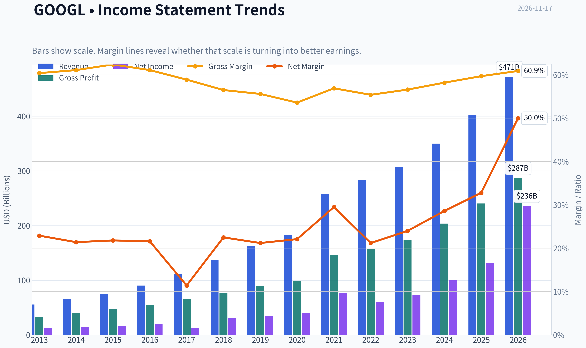

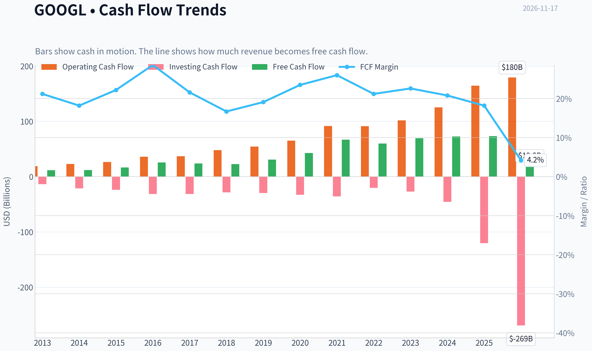

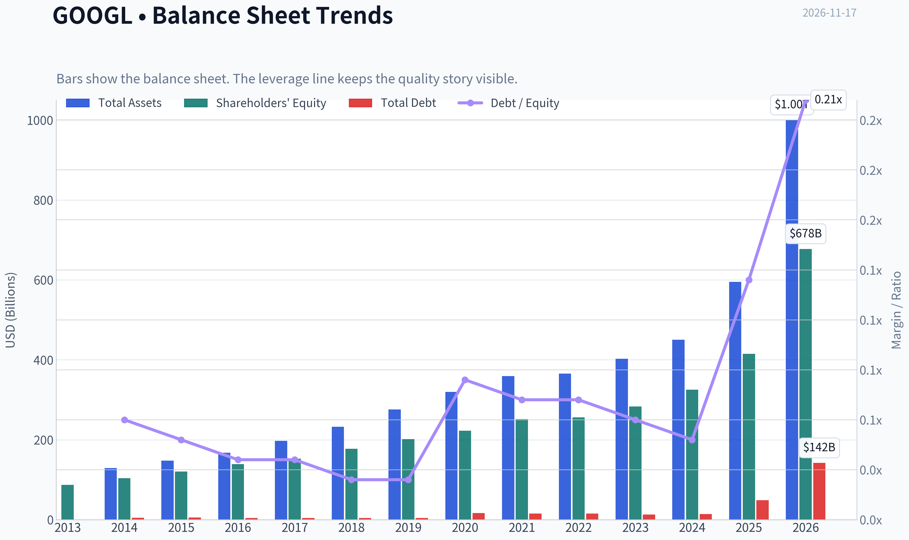

This graph tracks the profitability and return metrics (ROE, ROIC, Margins) of **GOOGL** over the past decade, highlighting capital efficiency trends.

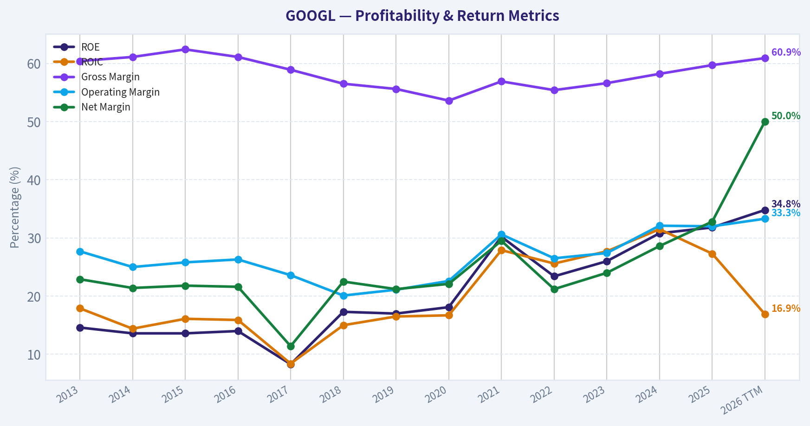

This chart illustrates the financial health of **GOOGL** over the last 10 years, mapping cash equivalents and free cash flow against total obligations (Debt).

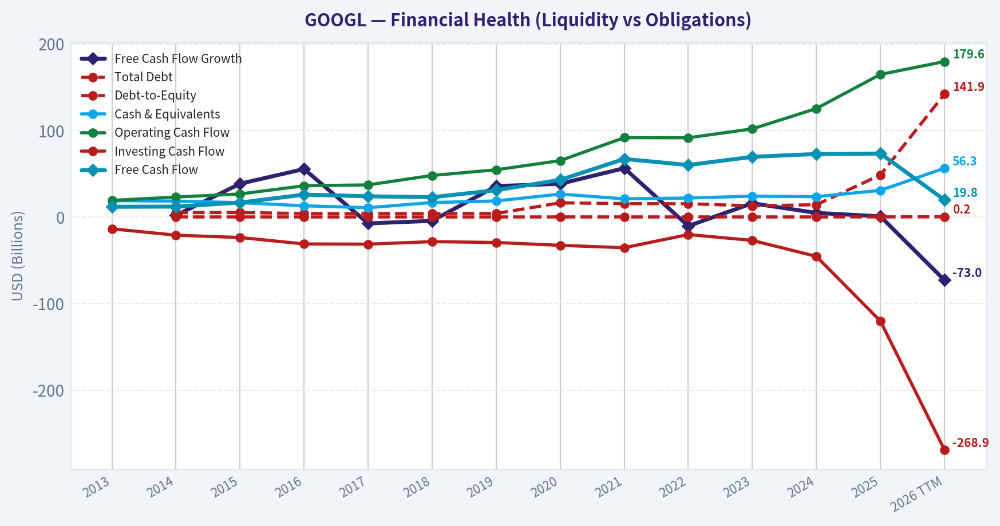

This comparison chart from *Profitability and Operating Performance* stacks current figures against historical benchmarks for **GOOGL**, making it easy to see where the company trades relative to its own averages.

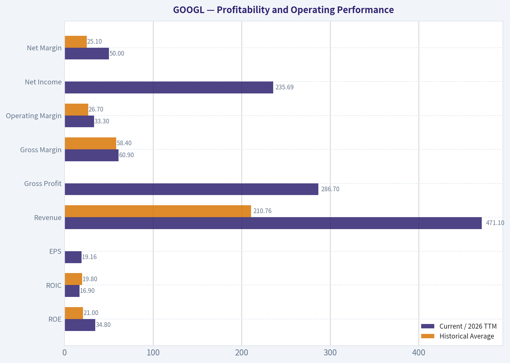

This breakdown chart from <em>Revenue Breakdown</em> shows the proportional composition for **GOOGL** - useful for understanding what drives or risks the business.

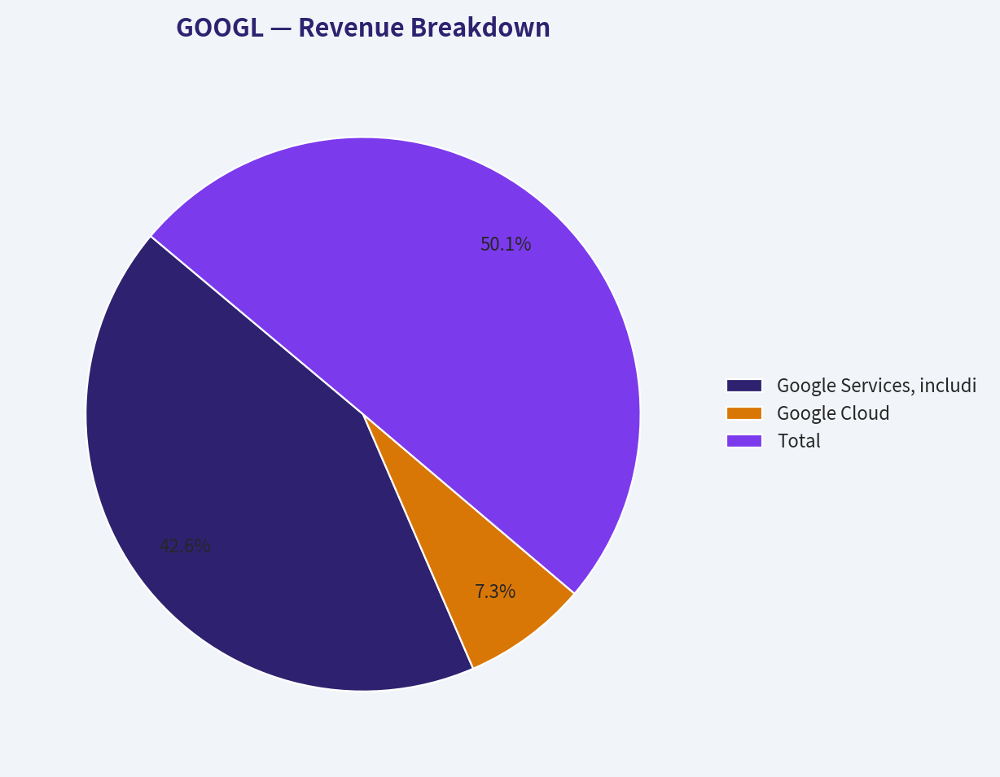

---

### Intrinsic Value Analysis (Buffett)

> *Following Warren Buffett's value investing philosophy: Circle of Competence, Economic Moat, Management Quality, and Margin of Safety.*

#### Intrinsic Value Snapshot

Price is what you pay. Intrinsic value is what the business may be worth based on the cash it can create for owners over time. We show a range, not one magic number.

- Current Price: $283.72
- Value Range (conservative to optimistic across both DCF methods): $12.53 to $1,974.07

##### Owner Earnings (Buffett Method)
- Net Income: $132,170,000,000.00
- Depreciation & Amortization: N/A
- Capital Expenditures: $-91,447,000,000.00
- Working Capital Changes: $618,000,000.00
- Owner Earnings: $40,105,000,000.00

##### Intrinsic Value
###### Buffett Method
Uses owner earnings. Stricter, and usually more conservative.
- Conservative: $142.20
- Average: $501.29
- Optimistic: $1,974.07
- Discount Rate: 10.0%

###### Cash Flow Method
Uses free cash flow. Better for companies spending heavily today to grow tomorrow.
- Conservative: $12.53
- Average: $29.13
- Optimistic: $68.80
- Discount Rate: 10.0%

ANALYST STANCE: **Bullish**

#### Investment Conclusion

Alphabet is a rare combination of a dominant global platform, exceptional profitability, fortress-like economics, and substantial reinvestment opportunities in search, YouTube, cloud, and artificial intelligence. At approximately $284 per share, the stock is close to the research-pack headline intrinsic value of $291.16, implying only a modest 2.6% margin of safety.

That valuation is not a large bargain, but the business quality is unusually high. Alphabet deserves a premium valuation because its ecosystem, data advantages, distribution, and cash-generation capacity remain difficult to replicate. The appropriate stance is **Advocate with moderate conviction**, provided the investor accepts AI disruption, regulatory, and valuation risks.

#### 1. Factor Scorecard

| Factor | Score | Assessment |
|---|---:|---|
| Circle of competence and simplicity | 4/5 | Alphabet makes money primarily by selling advertising against user attention and intent, while expanding into cloud, subscriptions, and AI. The model is understandable, although AI creates greater technological uncertainty. |
| Durable competitive advantage | 5/5 | Search scale, user data, distribution, brand, advertiser relationships, YouTube, Android, and cloud infrastructure create a wide and still potentially widening moat. |
| Management and capital allocation | 4/5 | Management has funded long-term innovation, built major platforms, and maintained strong financial flexibility. Governance, regulatory exposure, and enormous AI capital requirements prevent a perfect score. |
| Industry structure | 4/5 | Digital advertising and cloud are concentrated around a few powerful platforms, and Alphabet benefits from scale. Competition from Microsoft, OpenAI, Amazon, Meta, and TikTok remains intense. |

**Gate 5 status: Not tripped.** The available evidence shows strong profitability, a 31.8% ROE, positive free cash flow, and no indication of deteriorating earnings combined with a solvency red line such as sub-1x interest coverage.

#### 2. Financial Summary

| Metric | Latest reported figure |
|---|---:|
| Share price | $284 |
| Market capitalization | $3.49 trillion |
| P/E ratio | 14.8x |
| Revenue growth, year over year | 15.1% |
| Gross margin | 59.7% |
| ROE | 31.8% |
| FCF yield | 2.1% |
| Implied FCF per share from yield | Approximately $5.96 |
| Current ratio | 2.01x |
| Headline intrinsic value | $291.16 |
| Margin of safety versus price | 2.6% |
| Reverse-DCF price-implied growth | Approximately 2.7% annually for 10 years |

**Key Takeaways:** Alphabet combines 15.1% revenue growth with a nearly 60% gross margin and a 31.8% return on equity. The P/E ratio is reasonable for a company of this quality, but the 2.1% free-cash-flow yield shows that the market already recognizes much of the franchise's strength. The reverse-DCF implies only about 2.7% annual growth, which is conservative relative to Alphabet's recent operating momentum.

#### 3. Moat Analysis

| Moat source | Evidence | Durability |
|---|---|---|
| Intangible assets | Google is a globally trusted search brand, while YouTube and Android have extensive user recognition and distribution. | Wide |
| Network effects | More searches generate better data and relevance; more users attract advertisers; more advertisers support investment in product quality and infrastructure. | Wide and potentially widening |
| Switching costs | Advertiser histories, campaign data, audience targeting, analytics, and YouTube audiences create meaningful friction for customers considering alternatives. | Strong |
| Cost advantage | Alphabet's massive infrastructure, search index, data centers, AI research, and global distribution spread fixed costs over enormous usage. | Strong |
| Ecosystem advantage | Search, Chrome, Android, Maps, YouTube, Gmail, Cloud, and Gemini reinforce user engagement and distribution. | Wide |

Alphabet's most important advantage is not merely that it owns a search engine. It controls high-intent consumer discovery at global scale and connects that discovery to advertisers, video, mobile operating systems, cloud infrastructure, and AI services.

The central moat risk is that generative AI could change how users seek information and how advertisers reach consumers. Alphabet is unusually well positioned to respond because it owns leading AI research, distribution, computing infrastructure, proprietary data, and several major consumer platforms. However, the transition may pressure search monetization and require substantial capital expenditure.

#### 4. Management Quality and Capital Allocation

Management scores well because it has historically reinvested heavily in infrastructure, machine learning, cloud, and new consumer products rather than optimizing only for near-term earnings. Alphabet's ability to fund decades-long projects from a highly profitable core business is a major strategic advantage.

The company's most important capital-allocation decision is reinvestment. AI infrastructure and model development will require significant spending, but this spending can be economically attractive if it protects search distribution, expands cloud demand, improves advertising performance, and creates new subscription products.

A positive external signal is that Berkshire Hathaway continued to report a substantial Alphabet position of approximately $27.1 billion, representing 8.91% of its reported portfolio at September 30, 2026. This is supportive evidence, not a substitute for analysis.

Key management concerns include:

- Potentially very large AI infrastructure commitments.
- Regulatory and antitrust constraints.
- The risk that buybacks or acquisitions occur at prices that do not create sufficient per-share value.
- Founder influence and governance complexity.

#### 5. Owner Earnings Calculation

The Buffett framework is:

**Owner earnings = net income + depreciation and amortization - maintenance capital expenditure - working-capital investment.**

For valuation purposes, current free cash flow provides the most practical conservative proxy for distributable owner earnings:

| Owner-earnings item | Per-share treatment |
|---|---:|
| Normalized FCF proxy | Approximately $5.96 |
| Maintenance-capex adjustment | Included conservatively within the FCF proxy |
| Working-capital adjustment | Included within the FCF proxy |
| Estimated owner-earnings proxy | Approximately $5.96 per share |

**Key Takeaways:** Alphabet's accounting earnings materially understate the strategic value of its reinvestment opportunities, but cash flow remains the correct discipline for valuation. Using approximately $5.96 per share as a conservative current owner-earnings proxy produces a cautious valuation range, while a normalized owner-earnings approach that credits durable reinvestment returns produces a substantially higher value.

#### 6. Three-Scenario DCF Valuation

The following mechanical scenarios use the approximately $5.96 per-share FCF proxy and a 10% discount rate. The historical-growth case uses 50% of the five-year growth rate, or approximately 8.7%, within the required 10% cap.

| Scenario | Assumptions | Estimated value per share |
|---|---|---:|
| A. No growth | $5.96 owner earnings divided by 10% | $59.60 |
| B. GDP growth | 3% annual growth, 10% discount rate | $87.80 |
| C. Historical-growth case | 8.7% annual growth for 10 years, then 3% terminal growth | Approximately $133 |
| Routed blended valuation | Owner-earnings, FCF, FCFF, and reverse-DCF blend | $291.16 |

**Key Takeaways:** A purely current-FCF DCF is extremely conservative because it treats Alphabet's present cash yield as though it fully captures the value of future AI, cloud, and platform reinvestment. The routed valuation of $291.16 gives meaningful weight to normalized earning power and reinvestment economics rather than relying only on current free cash flow. The valuation range demonstrates that Alphabet's investment case depends heavily on the returns generated by reinvested capital.

The research pack's underlying model outputs were:

- Owner-earnings model: **$501.29**
- FCF model: **$29.13**
- Damodaran FCFF model: **$166.25**
- Weighted headline value: **$291.16**

The wide spread reflects the difficulty of valuing a company that is simultaneously highly profitable and investing aggressively in a potentially transformative technology cycle.

#### 7. Margin of Safety Analysis

At $284 per share:

| Valuation measure | Result |
|---|---:|
| Headline intrinsic value | $291.16 |
| Current price | $284 |
| Margin of safety | 2.6% |
| Price premium to conservative GDP-growth DCF | Material |
| Reverse-DCF implied growth | Approximately 2.7% annually |

**Key Takeaways:** Alphabet does not offer a traditional deep-value margin of safety at the current price. However, the price does not appear to require heroic growth: the reverse-DCF implies only approximately 2.7% annual growth over the next decade. For a wide-moat, high-ROE compounder, a modest explicit margin of safety can be acceptable when the market's embedded expectations are conservative.

#### 8. Final Buffett Scorecard

| Criterion | Weight | Score | Weighted contribution |
|---|---:|---:|---:|
| Moat width and durability | 25% | 5.0 | 1.25 |
| Valuation and margin of safety | 20% | 3.0 | 0.60 |
| Capital returns versus WACC | 15% | 5.0 | 0.75 |
| Business understanding and predictability | 12% | 4.0 | 0.48 |
| Management quality and capital allocation | 12% | 4.0 | 0.48 |
| Reinvestment runway | 8% | 5.0 | 0.40 |
| Balance-sheet strength | 4% | 4.0 | 0.16 |
| Industry structure | 4% | 4.0 | 0.16 |
| **Total** | **100%** |  | **4.28/5.00** |

#### 9. Investment Stance

**Bullish - Moderate conviction.**

Alphabet is a wonderful business at approximately a fair price. Its moat is wide, its returns on equity are excellent, its reinvestment runway is unusually long, and the reverse-DCF does not require aggressive growth assumptions. The main reason conviction is moderate rather than high is valuation uncertainty: the stock is near the blended intrinsic-value estimate, while AI competition, regulation, and capital intensity could materially change the economics of search.

For a long-term investor, Alphabet is suitable for accumulating gradually rather than demanding a dramatic discount. A materially lower price would improve the risk-reward profile, but the current valuation is reasonable enough to support ownership of this exceptional compounder.
#### Valuation Bridge

This bridge places the current market price beside each intrinsic value lens so readers can see whether upside depends on one method or shows up across several methods.

| Scenario | Intrinsic Value / Share |
| --- | ---: |
| Buffett Method | $501.29 |
| Cash Flow Method | $29.13 |
| Damodaran Method | $166.25 |
| Current Price | $283.72 |

#### Key Takeaways

If one method is far above the others, the upside case depends on a specific modelling assumption. When several methods cluster together, the valuation story is more robust.

#### Valuation Visuals

This comparison chart from *Latest Earnings Snapshot* stacks current figures against historical benchmarks for **GOOGL**, making it easy to see where the company trades relative to its own averages.

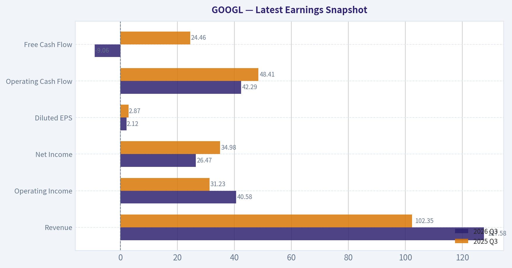

This comparison chart from *Balance Sheet and Financial Strength* stacks current figures against historical benchmarks for **GOOGL**, making it easy to see where the company trades relative to its own averages.

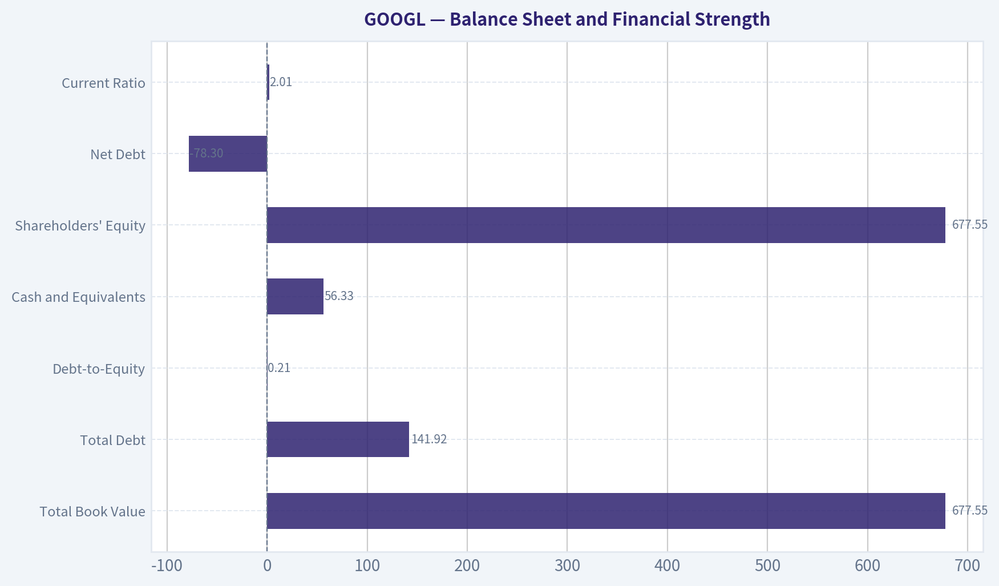

---

### Trend & Growth Analysis (Lynch/Druckenmiller/Fisher)

> *Following Peter Lynch's GARP, Stanley Druckenmiller's macro-aware approach, and Philip Fisher's scuttlebutt methodology.*

ANALYST STANCE: **Neutral**

#### 1. Lynch Classification

**Fast Grower transitioning toward Stalwart.** Alphabet's latest reported revenue growth of **15.1%** is near the lower boundary of fast-growth investing, while its scale and market dominance make sustained 25%-30% growth difficult. The company remains a high-quality compounder, but the key question is whether AI can reaccelerate growth rather than merely defend existing franchises.

#### 2. The Story in Three Bullets

- **Alphabet is monetizing the AI transition** through Gemini, Google Cloud infrastructure, AI-powered search, YouTube, and advertising automation.
- **Its core franchises remain exceptionally strong:** Search, YouTube, Android, Maps, and Chrome provide distribution, data, and cash flow that few competitors can match.
- **The investment inflection is AI monetization:** if AI increases search engagement, Cloud demand, advertising effectiveness, and premium subscription revenue, current growth could accelerate.

#### 3. Key Fundamentals

| Metric | Data | Interpretation |
|---|---:|---|
| Share price | $284 | Current reference price |
| Market capitalization | $3.49 trillion | Mega-cap scale limits percentage growth |
| Revenue growth | 15.1% YoY | Solid, but not yet a clear acceleration |
| P/E ratio | 14.8x | Low relative to many major technology companies |
| Implied EPS | Approximately $19.17 | Derived from price divided by P/E |
| Gross margin | 59.7% | Strong platform economics |
| ROE | 31.8% | Excellent capital efficiency |
| Current ratio | 2.0x | Healthy liquidity |
| FCF yield | 2.1% | Implies approximately $73 billion of free cash flow |
| Headline intrinsic value | $291.16 | Only about 2.6% above current price |

**Key Takeaways:** Alphabet combines excellent profitability, liquidity, and capital efficiency with a relatively modest reported P/E. However, the stock is close to the headline intrinsic-value estimate, so the investment case depends more on future AI-driven growth acceleration than on a large current margin of safety.

#### 4. TAM and Runway

Alphabet's addressable market is unusually broad:

| Opportunity | Growth Potential | Strategic Position |
|---|---|---|
| Global digital advertising | Moderate to high | Search and YouTube are category leaders |
| Cloud infrastructure and AI services | High | Google Cloud is a major, though not dominant, provider |
| Generative AI applications | Potentially very high | Gemini provides distribution but faces intense competition |
| YouTube subscriptions and commerce | Moderate to high | Large audience and expanding monetization |
| Autonomous driving and other bets | Uncertain, potentially large | Optionality rather than core valuation support |

**10x Test:** Using an approximate current revenue base near **$400 billion**, a 10x outcome would require roughly **$4 trillion in annual revenue**. That is not realistic from Search alone, but it is conceivable only across a much broader ecosystem spanning advertising, cloud, AI infrastructure, subscriptions, commerce, and new businesses. The 10x test therefore **passes on a broad ecosystem basis but fails on a narrow Search-only basis**.

**Key Takeaways:** Alphabet has one of the broadest technology TAMs in the market, but its enormous revenue base makes a ten-bagger difficult. The most credible runway comes from Cloud, AI infrastructure, AI applications, YouTube monetization, and new transaction-oriented products rather than from traditional Search growth alone.

#### 5. Revenue Growth Trend

| Indicator | Observation | Assessment |
|---|---|---|
| Latest YoY growth | 15.1% | Healthy but moderate |
| Historical context | Five-year growth approximately 17.4% annualized; trailing three-year figure approximately negative 13.6% in the supplied reverse-DCF data | Growth has been uneven across cycles |
| Current pattern | No supplied evidence of consecutive acceleration | Watch for confirmation |
| Main potential catalyst | AI-driven Search, Cloud, and advertising monetization | Could create a new growth phase |

**Key Takeaways:** Alphabet is growing, but the available data does not yet prove a durable acceleration pattern. The stock becomes more attractive if revenue growth moves sustainably above 20% while Cloud and AI revenues scale without materially damaging margins.

#### 6. Unit Economics and Operating Quality

| Metric | Assessment |
|---|---|
| LTV/CAC | Not disclosed in the supplied data; likely highly favorable for Search, YouTube, and Android due to organic distribution |
| Net revenue retention | Not provided for Alphabet overall; Cloud retention should be monitored separately |
| Rule of 40 | Not directly applicable to the consolidated company; 15.1% revenue growth plus a strong positive FCF margin likely exceeds the 40% threshold |
| Gross margin | 59.7%, strong but exposed to AI-compute and infrastructure costs |
| Capital intensity | Rising because of data centers, networking, and AI accelerators |
| Dilution | No evidence in the supplied data of a structurally problematic equity-financing model |

**Key Takeaways:** Alphabet's distribution advantages produce unusually attractive customer-acquisition economics, even though conventional SaaS metrics are not reported. The main issue is not demand generation but whether AI infrastructure spending grows faster than AI monetization.

#### 7. Inflection Point Assessment

| Potential Inflection | Evidence | Status |
|---|---|---|
| Product cycle | Gemini and AI-powered Search | Positive, still developing |
| Market share | Google remains dominant in Search and a major Cloud provider | Strong base, but AI competition is intense |
| Margin | AI capex may pressure near-term margins before operating leverage appears | Unconfirmed |
| TAM | AI expands Alphabet beyond advertising into infrastructure and software | Positive |
| Competitive position | Strong distribution, data, and infrastructure; credible threats from Microsoft, OpenAI, Anthropic, and Amazon | Mixed |

**Assessment:** The principal inflection point is **AI monetization**, not simply AI adoption. A bullish scenario requires evidence that AI search answers preserve or increase commercial queries, Cloud growth accelerates, and Gemini produces meaningful subscription or enterprise revenue.

**Key Takeaways:** Alphabet has several credible inflection vectors, but they remain partly prospective. The strongest confirmation would be accelerating consolidated revenue, faster Cloud growth, stable Search economics, and evidence that AI capex is producing superior incremental returns.

#### 8. Macro Setup

| Macro Factor | Impact on Alphabet |
|---|---|
| AI secular trend | Strong tailwind |
| Cloud adoption | Strong tailwind |
| Digital advertising cycle | Positive but economically sensitive |
| Interest rates | Higher rates pressure valuation and long-duration AI projects |
| Regulation | Persistent risk to Search distribution, advertising, and acquisitions |
| AI capex cycle | Supports demand but raises spending and execution risk |

**Key Takeaways:** Alphabet benefits from powerful secular trends, especially AI and cloud computing. The macro setup is favorable for long-term demand, but valuation is less supported if rates remain high and AI spending produces weak near-term returns.

#### 9. Fisher 15-Point Score

| Fisher Area | Score / 5 | Comment |
|---|---:|---|
| Market potential | 5 | Broad global digital and AI markets |
| New-product determination | 5 | Gemini, Cloud, YouTube, Waymo, and other initiatives |
| R&D effectiveness | 5 | Deep technical capabilities and research history |
| Sales organization | 4 | Strong enterprise and advertising sales |
| Profit margins | 5 | Exceptional platform economics |
| Margin trend | 3 | AI investment creates uncertainty |
| Labor relations | 3 | Restructuring and workforce tensions are risks |
| Executive relations | 4 | Experienced leadership, though succession matters |
| Management depth | 5 | Deep technical and operating bench |
| Cost accounting | 4 | Generally strong financial discipline |
| Outstanding competitive aspects | 5 | Distribution, data, infrastructure, ecosystem |
| Long-range profit outlook | 5 | Very strong, subject to AI disruption |
| Equity dilution | 4 | Not a major structural concern |
| Management candor | 4 | Generally credible, though AI expectations are high |
| Management integrity | 4 | Strong overall, with normal large-company governance risks |
| **Total** | **65 / 75** | **Outstanding threshold** |

**Key Takeaways:** Alphabet scores at the low end of the "outstanding" Fisher range. Its biggest strengths are market potential, R&D, distribution, and competitive infrastructure; its main deductions relate to AI-related margin uncertainty, regulatory pressure, and organizational complexity.

#### 10. Valuation

| Method | Result | Interpretation |
|---|---:|---|
| P/E | 14.8x | Attractive for a high-quality technology leader |
| PEG | Approximately 0.98x | Fair-to-attractive if 15.1% growth is sustainable |
| P/S | Approximately 8.7x using roughly $400 billion of annual revenue | Reasonable only if AI and Cloud sustain strong growth |
| Headline intrinsic value | $291.16 | Approximately 2.6% above current price |
| Reverse DCF implied growth | Approximately 2.7% annually for 10 years | Conservative market expectations according to supplied data |
| Owner-earnings DCF | $501.29 | Highly optimistic or assumption-sensitive |
| FCF-based model | $29.13 | Not economically credible as a standalone headline estimate |
| Damodaran FCFF model | $166.25 | More conservative than current price |

**Key Takeaways:** Alphabet appears inexpensive on P/E and roughly fair on the blended intrinsic-value estimate. The valuation is attractive if AI reaccelerates growth, but the wide spread among valuation models shows significant sensitivity to assumptions about reinvestment, capital expenditures, and terminal growth.

#### 11. Growth Investor Scorecard

| Criterion | Weight | Score / 5 | Weighted Result |
|---|---:|---:|---:|
| Lynch story | 10% | 4.5 | 0.45 |
| TAM and runway | 20% | 4.5 | 0.90 |
| Revenue growth | 20% | 3.5 | 0.70 |
| Unit economics | 15% | 4.5 | 0.68 |
| Competitive position | 10% | 4.5 | 0.45 |
| Management quality | 10% | 4.0 | 0.40 |
| Macro setup | 5% | 4.0 | 0.20 |
| Profitability path | 5% | 4.5 | 0.23 |
| Valuation | 5% | 3.5 | 0.18 |
| **Total** | **100%** |  | **4.19 / 5.00** |

**Key Takeaways:** Alphabet scores as a high-quality growth compounder, but not yet as a confirmed high-acceleration opportunity. The score is supported by its moat, TAM, financial quality, and valuation; it is held back by the absence of clear revenue acceleration and uncertainty over AI returns.

#### 12. Position Size Stance

**Position stance: Moderate starter or existing-holder position; do not make it a maximum-conviction growth position yet.**

- **Existing holders:** Hold and allow the AI monetization thesis to develop.
- **New investors:** Consider staged buying rather than a full position.
- **Suggested growth-portfolio range:** Approximately **2%-4%**, rising only after growth accelerates and AI economics become clearer.
- **Maximum-conviction upgrade trigger:** Sustained revenue growth above 20%, accelerating Cloud growth, stable Search monetization, and improving evidence that AI capex is generating attractive returns.

#### 13. Key Catalysts and Risks

| Catalysts | Risks |
|---|---|
| Gemini becomes a meaningful paid consumer and enterprise product | AI search reduces traditional monetizable clicks |
| Google Cloud growth accelerates | Microsoft, OpenAI, Anthropic, or Amazon take AI share |
| YouTube commerce and subscriptions scale | AI infrastructure spending compresses free cash flow |
| AI improves advertising conversion and pricing | Search antitrust remedies weaken distribution advantages |
| New AI products expand the TAM beyond advertising | Regulatory restrictions on data, acquisitions, or ad technology |
| Revenue growth reaccelerates above 20% | Large-company scale limits future growth rates |

**Key Takeaways:** The most important catalyst is proof that AI expands Alphabet's economics rather than merely increasing costs. The largest risks are disruption to Search, regulatory intervention, and a prolonged period in which capital spending rises faster than monetization.

#### Final View

Alphabet is a **high-quality, fairly valued AI and digital-platform compounder**, but the current evidence supports **Neutral rather than Bullish**. Its valuation is reasonable, its moat is exceptional, and its TAM is broad. The decisive issue is whether AI produces a genuine growth reacceleration; investors should wait for operating evidence rather than relying solely on Alphabet's low P/E.

#### Growth & Scorecard Visuals

This comparison chart from *Growth and Cash-Flow Quality* stacks current figures against historical benchmarks for **GOOGL**, making it easy to see where the company trades relative to its own averages.

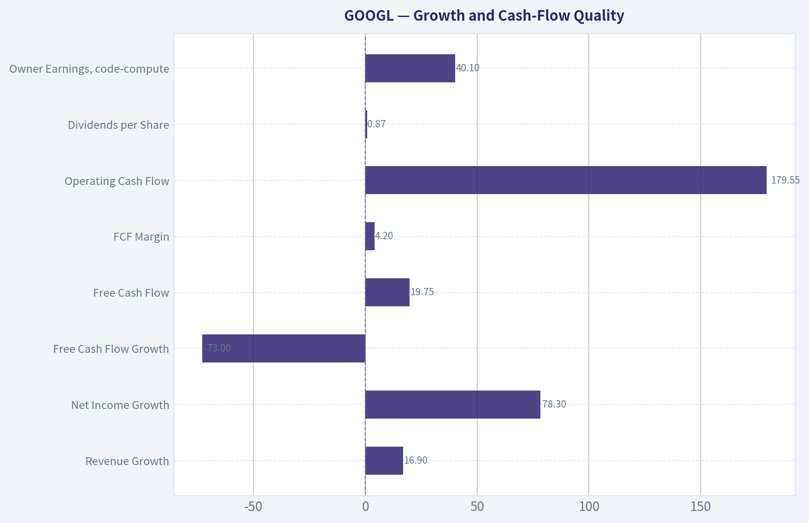

---

### Market Technical Analysis

ANALYST STANCE: **Neutral**

#### GOOGL technical overview

GOOGL's latest available close is **$283.72 on November 16, 2026**; November 17 is not listed as a trading day in the retrieved data. The stock is in a technically damaged medium- and long-term position after a sharp decline from the October high near **$350.50** to the current level. However, several short-term indicators are deeply depressed, creating conditions for a potential rebound-though not yet a confirmed trend reversal.

The selected indicators are:

- **10 EMA** for immediate price momentum.
- **50 SMA** for the medium-term trend.
- **200 SMA** for the primary long-term trend.
- **MACD** for momentum direction and possible recovery.
- **RSI** for oversold conditions.
- **Bollinger Upper and Lower Bands** for price extremes and volatility context.
- **ATR** for risk sizing and stop placement.

#### Trend structure

| Indicator | Latest reading | Interpretation |
|---|---:|---|
| Close | $283.72 | Well below all major moving averages |
| 10 EMA | $292.17 | Immediate resistance; price is about 2.9% below it |
| 50 SMA | $327.09 | Medium-term trend remains decisively bearish |
| 200 SMA | $337.93 | Long-term trend has weakened and is bearish |
| MACD | -12.29 | Negative momentum, but improving from -16.57 on November 6 |
| RSI | 34.46 | Weak momentum and near-oversold territory, but not yet below 30 |
| Bollinger upper band | $341.28 | Considerable overhead range before the upper volatility boundary |
| Bollinger lower band | $259.50 | Downside volatility reference and potential technical support |
| ATR | $10.47 | Elevated daily volatility; position sizing should be conservative |

Key Takeaways: GOOGL remains below its 10-day EMA, 50-day SMA, and 200-day SMA, so the dominant trend is still bearish. The improvement in MACD and the low RSI suggest selling pressure may be moderating, but these signals currently indicate potential stabilization rather than a confirmed reversal. Volatility remains high, with an ATR of roughly $10.47 per share.

#### Moving-average analysis

The moving-average configuration is strongly negative:

- The **10 EMA declined from $346.79 on October 19 to $292.17**, reflecting the rapid deterioration in short-term price action.
- The **50 SMA fell from approximately $344.29 to $327.09** over the same period. This confirms that the weakness is not limited to a few isolated sessions.
- The **200 SMA decreased more gradually from $340.72 to $337.93**, showing that the longer-term trend has also begun to roll over, although its slope is less severe than the 10 EMA and 50 SMA.

The current price is approximately:

- **$8.45 below the 10 EMA**
- **$43.37 below the 50 SMA**
- **$54.21 below the 200 SMA**

This separation is important. A move back above the 10 EMA could signal short-term stabilization, but it would not repair the broader trend. A more convincing bullish shift would require successive closes above the 10 EMA, followed by recovery through the **$327-$338 region**, where the 50- and 200-day averages now create a substantial resistance zone.

#### Momentum and RSI

The MACD remains negative at **-12.29**, but it has improved from **-16.57 on November 6**. That improvement indicates that downside momentum has eased somewhat after the late-October collapse. The recovery is not yet sufficient to establish a bullish trend because the MACD remains substantially below zero, meaning the shorter-term exponential average is still below the longer-term average.

RSI provides a similar but nuanced message:

- RSI fell as low as **21.17 on November 2**, an extremely weak reading.
- It recovered toward **42.28 on November 12**.
- It then declined again to **34.46 on November 16**.

The rebound from deeply oversold conditions shows that buyers have attempted to stabilize the stock, but the subsequent RSI deterioration suggests those buyers have not yet gained control. RSI is close to, but slightly above, the conventional oversold threshold of 30. A further move below 30 could produce a tradable oversold bounce, but it would also confirm continuing downside pressure. Conversely, a sustained RSI recovery above 40-50 would provide better evidence that momentum is turning constructive.

#### Bollinger Bands and volatility

The latest Bollinger range is approximately **$259.50 to $341.28**, with the stock near the lower half of that range. The lower band has declined sharply from **$336.37 on October 19 to $259.50**, reflecting both the price collapse and a substantial increase in recent dispersion.

GOOGL has not yet reached the lower band; the latest close is about **$24.22 above it**. This means the stock is weak but not necessarily at an immediate statistical extreme based on the current 20-day range. A decline toward the **$260 area** would bring the price close to the lower volatility boundary and could attract tactical buyers, but a close below that level would indicate that the downside move is expanding rather than mean-reverting.

The widening distance between the upper and lower bands shows that volatility remains elevated. The upper band around **$341** is not an immediate price target; it is better viewed as a longer-term volatility boundary. A practical near-term test is whether price can reclaim the middle Bollinger area, which appears to be roughly in the low-$300s, before considering a sustained bullish reversal.

ATR at **$10.47** is high relative to the current share price. A normal daily move can therefore be several dollars in either direction, while a two-ATR move can exceed $20. Traders should avoid placing stops so tightly that ordinary volatility triggers an exit.

#### Trading interpretation

The technical evidence supports a **watchful, confirmation-based approach**, not aggressive buying:

- **Bearish case:** Price remains below every major moving average, MACD is negative, RSI is weak, and the 50- and 200-day averages are both above the market. A break below the $280 area could expose the stock to a retest of the $260 lower-band region.
- **Tactical rebound case:** RSI is near oversold territory and MACD has improved from its early-November low. A close back above the $292 10 EMA, particularly if accompanied by improving RSI and MACD, could support a short-term rebound toward the low-$300s.
- **Trend-reversal case:** A durable bullish reversal would require more than one oversold bounce. Traders should look for higher lows, sustained closes above the 10 EMA, and eventually a recovery toward the $327-$338 moving-average resistance zone.
- **Risk-management case:** With ATR above $10, position sizes should be reduced relative to calmer market conditions. Stops should be based on the trade horizon and volatility rather than placed immediately beneath a single intraday low.

The principal risk is that oversold conditions may persist. In a strong downtrend, RSI can remain weak for an extended period, and a positive MACD inflection can represent only a temporary pause in selling. The most constructive near-term development would be a higher low above the recent $278-$280 region followed by a close above the 10 EMA.

#### Selected-indicator summary

| Indicator | Why it is relevant | Current signal | Practical use |
|---|---|---|---|
| close_10_ema | Captures immediate momentum | Bearish; price below $292.17 | First reclaim level for a short-term rebound |
| close_50_sma | Defines medium-term trend | Bearish; price well below $327.09 | Major resistance and trend filter |
| close_200_sma | Defines long-term direction | Bearish; price below $337.93 | Strategic trend confirmation |
| macd | Measures momentum and potential reversal | Negative but improving | Watch for a bullish crossover and movement toward zero |
| rsi | Identifies momentum extremes | Weak at 34.46; near oversold | Helps assess whether further selling is becoming exhausted |
| boll_ub | Defines upper volatility boundary | $341.28 | Longer-term resistance and breakout reference |
| boll_lb | Defines lower volatility boundary | $259.50 | Downside risk and potential mean-reversion zone |
| atr | Measures current trading risk | $10.47 | Guides position sizing and stop distance |

Key Takeaways: The strongest evidence remains bearish because GOOGL trades far below its medium- and long-term moving averages. The main counterargument is that RSI is depressed and MACD has begun improving, leaving room for a tactical rebound. The preferred approach is to wait for confirmation above the 10 EMA and a higher low, while treating a break toward the $260 area as a renewed downside warning.

#### Market Visuals

This comparison chart from *Market Metrics and Valuation* stacks current figures against historical benchmarks for **GOOGL**, making it easy to see where the company trades relative to its own averages.

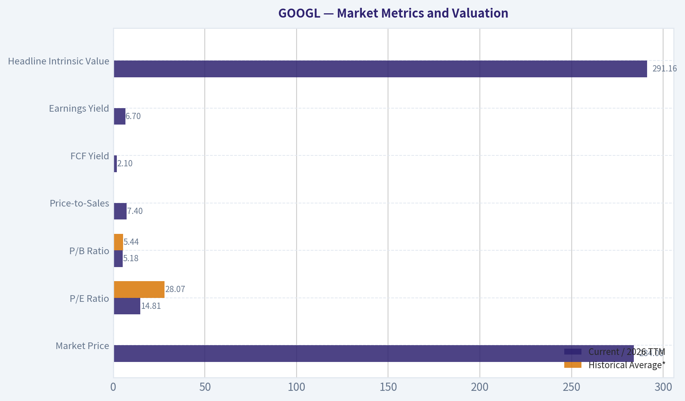

---

### Options Market Analysis

> *Reading options flow - put/call ratios, IV skew, and unusual activity - to gauge institutional positioning and event-driven risk.*

#### GOOGL Options Market Report

**As of November 17, 2026.** The available data covers expirations from November 18 through November 23, 2026. No current share price or individual strike-level chain was provided, which limits moneyness, gamma-wall, and max-pain analysis.

#### Put/Call Ratio Analysis

| Expiration | Call OI | Put OI | Put/Call OI | Call Volume | Put Volume | Put/Call Volume |
|---|---:|---:|---:|---:|---:|---:|
| Nov. 18 | 0 | 0 | N/A | 27,545 | 20,071 | 0.73 |
| Nov. 20 | 198 | 28 | 0.14 | 61,215 | 34,307 | 0.56 |
| Nov. 23 | 0 | 0 | N/A | 4,253 | 1,832 | 0.43 |
| **Total** | **198** | **28** | **0.14** | **93,013** | **56,210** | **0.60** |

**Key Takeaways:** The aggregate put/call OI ratio of 0.14 is substantially below the approximately 0.70 neutral baseline, indicating a strongly call-heavy near-term positioning profile. Volume is also call-dominant, with a 0.60 put/call volume ratio. However, nearly all reported open interest is concentrated in the November 20 expiration, and the very low OI relative to volume reduces confidence that this represents established institutional positioning.

The low put/call ratios can indicate bullish speculation, call spreads, or covered-call activity. Given the unusually high volume compared with open interest, some of the activity may also represent intraday trading, opening and closing transactions, or option rolls rather than outright directional accumulation.

#### Implied Volatility Assessment

| Expiration | Call ATM IV | Put ATM IV | Observed Skew |
|---|---:|---:|---|
| Nov. 18 | 4.3% | 4.3% | Neutral at ATM |
| Nov. 20 | 3.0% | 3.0% | Neutral at ATM |
| Nov. 23 | 2.9% | 2.1% | Call-side premium / upside skew |
| **Near-term view** | - | - | Low reported IV, modest call skew |

**Key Takeaways:** Reported near-term ATM implied volatility is low, ranging from approximately 3.0% to 4.3%, with the highest reading in the November 18 expiration. The November 23 data shows call IV above put IV, which is consistent with upside demand rather than pronounced downside hedging. Because detailed out-of-the-money strike IVs were not supplied, this is only a directional skew indication, not a full volatility-surface analysis.

There is no catalyst calendar in the supplied data, so it is not possible to confirm whether IV is elevated ahead of earnings, a product event, or another scheduled catalyst. The low reported IV does not suggest broad panic or aggressive event-risk pricing.

#### Unusual Options Activity

| Finding | Observation | Interpretation |
|---|---|---|
| Contracts with volume greater than 5x OI | None identified | No individual contract met the tool's unusual-activity threshold |
| Aggregate volume versus OI | Very high volume relative to reported OI | Could reflect short-term speculation, active trading, or opening/closing combinations |
| Individual contract details | Not provided | Strike, moneyness, expiry-specific directional inference unavailable |

**Key Takeaways:** No individual contract qualified as unusual activity under the available volume-to-open-interest rule. Therefore, there is no specific put sweep, call block, or fresh institutional position that can be identified with confidence. The aggregate call-heavy volume is directionally bullish, but the absence of contract-level detail makes it difficult to distinguish smart-money accumulation from retail speculation or covered-call structures.

#### Open Interest Concentration and Gamma Levels

| Expiration | Highest Reported Call OI | Highest Reported Put OI | Concentration Assessment |
|---|---:|---:|---|
| Nov. 18 | 0 | 0 | No reported OI |
| Nov. 20 | 198 total | 28 total | Main near-term OI concentration |
| Nov. 23 | 0 | 0 | No reported OI |

**Key Takeaways:** The November 20 expiration contains essentially all reported near-term open interest, with calls substantially outweighing puts. This creates a call-heavy positioning bias, but strike-level OI was not supplied, so specific gravitational levels, max pain, and gamma walls cannot be calculated. The low absolute OI also suggests that any pinning or hedging effect may be limited unless the missing strike-level chain contains concentrated positions.

#### Overall Options Sentiment

**Signal: BULLISH, with low-to-moderate confidence.**

The primary bullish drivers are:

- A 0.14 near-term put/call OI ratio, far below the 0.70 neutral reference.
- A 0.60 put/call volume ratio, showing call-heavy trading activity.
- A reported call skew in the November 23 expiration.
- No indication of significant downside hedging or elevated put demand.

The main caveats are important. Total open interest is extremely small compared with volume, no individual contracts exceeded the unusual-activity threshold, and strike-level data is unavailable. Consequently, the bullish signal may reflect short-dated speculation, market making, or covered-call and spread activity rather than durable institutional conviction. The signal should therefore be treated as a modest bullish read rather than a high-confidence forecast.

#### Summary

| Category | Assessment |
|---|---|
| Put/Call Ratio | **Bullish:** OI ratio 0.14 and volume ratio 0.60, both below the 0.70 neutral baseline |
| IV Level | **Low:** Approximately 2.9%-4.3% near term; no clear evidence of broad event-risk inflation |
| Skew Direction | **Mildly bullish:** November 23 call IV exceeds put IV; ATM skew is otherwise neutral |
| Unusual Activity | **None identified:** No contract exceeded 5x its open interest |
| Overall Signal | **BULLISH, low-to-moderate confidence:** Call-heavy positioning, but very low OI and limited strike detail |

**Key Takeaways:** GOOGL's near-term options data leans bullish because both open interest and volume favor calls, while implied volatility remains low and the available skew favors calls. Confidence is reduced by the small reported open-interest base, the absence of qualifying unusual contracts, and the lack of strike-level information.

---

## Research Team Commentary

> *The Research Manager synthesizes the Bull vs Bear debate into action-free commentary. This is a pre-risk view, not the final stance.*

Core takeaway: Alphabet is a wonderful business, but the evidence provided does not yet establish that $284 offers a sufficiently reliable margin of safety. At roughly 14.8 times reported earnings, the shares look attractive if those earnings approximate sustainable owner earnings and Alphabet can monetize AI without structurally impairing Search margins. The uncertainty is that AI may require substantially more ongoing capital merely to defend the franchise. I would keep Alphabet on Neutral rather than avoid it, with a path to Bullish if the next several quarters demonstrate sound AI unit economics and durable free-cash-flow conversion.

The strongest bull argument is the exceptional quality of the underlying franchise. Search, YouTube, Android, Chrome, Maps, Cloud, and Workspace create an interlocking distribution ecosystem that few companies could reproduce. Approximately 32% ROIC, 60% gross margins, and a strong balance sheet are evidence of genuine competitive advantages, not merely market enthusiasm. Alphabet also possesses the users, data, infrastructure, engineering talent, and advertiser relationships needed to participate in the AI transition rather than simply suffer from it.

The valuation is potentially compelling. At $284 and 14.8 times earnings, the market does not appear to require extraordinary growth. The bull's conservative valuation range of approximately $325-$350 would imply a 13%-19% discount, broadly enough for a wide-moat compounder under a quality-scaled margin-of-safety framework. Alphabet need not win every AI category; preserving Search economics while expanding Cloud, YouTube, subscriptions, and advertising automation could be sufficient for satisfactory returns.

The strongest bear argument is not that Google will disappear. It is that the economics of maintaining its moat may change. Traditional Search has historically generated extraordinary profits with relatively modest incremental capital. AI-generated answers require more compute, may provide fewer advertising opportunities, and could redirect some valuable commercial queries to specialized platforms or competing assistants. Alphabet could remain the market leader while earning lower returns on each incremental dollar invested.

That distinction makes the bull's DCF less conclusive than it initially appears. Dividing the share price by the P/E produces approximately $19.16 of earnings per share, but accounting earnings should not automatically be treated as distributable owner earnings. If AI capital expenditures are recurring maintenance spending rather than temporary growth investment, normalized free cash flow may be materially below reported earnings. The apparent 13%-19% discount could then disappear. The 14.8 times multiple also needs to be verified as trailing, forward, or adjusted before relying on it.

Regulation adds another meaningful risk. Antitrust remedies need not destroy Google to reduce intrinsic value. Restrictions on default-search agreements, data sharing, bundling, or advertising practices could gradually weaken distribution efficiency and increase costs. Search disruption and regulation could also interact: losing some default advantages matters more when users are being offered credible AI alternatives.

Management deserves credit for building Cloud, maintaining financial flexibility, and investing before technological transitions become obvious. Nevertheless, historical company-wide ROIC does not prove that current AI spending will earn comparable returns. The relevant question is whether incremental revenue and after-tax profit from AI exceed the full cost of data centers, accelerators, depreciation, energy, model development, and associated operating expenses. The company's ability to finance the investment internally limits solvency risk, but it does not eliminate capital-allocation risk.

The options data reinforce caution about the entry point but do not drive the conclusion. A 0.14 put/call open-interest ratio and call-heavy activity suggest optimistic near-term positioning. That could magnify a selloff if capital spending rises or monetization develops more slowly than expected, but it says little about ten-year intrinsic value. Moving averages and other technical indicators should likewise remain secondary.

The lesson from similar situations is to avoid two opposite mistakes: assuming a dominant incumbent is invulnerable, or assuming a new technology automatically destroys it. The better question is whether Alphabet can migrate its economic system-not merely its interface-to AI. I would also avoid repeating the common error of treating a low P/E and historical ROIC as sufficient evidence of value during a major reinvestment cycle. Current free cash flow, capital intensity, and per-share economics matter more than the historical averages.

Over the next one to four quarters, I would monitor Search revenue growth, commercial-query engagement, traffic-acquisition costs, and management's disclosures about advertising within AI search experiences. Stable or improving monetization alongside increased AI usage would materially strengthen the thesis. Weak Search growth combined with rising serving costs would weaken it.

I would also track capital expenditures, depreciation, and free cash flow relative to revenue and operating income. Capex can grow rapidly without being a problem if Cloud and AI-related operating profit follow. A persistent decline in free-cash-flow conversion without corresponding revenue acceleration would suggest that AI is becoming a defensive capital burden.

For Google Cloud, the key indicators are revenue growth, operating margin, backlog, and whether margins continue improving after depreciation and infrastructure costs. For capital allocation, I would examine the net share-count reduction after stock-based compensation and whether buybacks are being made at sensible prices. Finally, regulatory remedies should be evaluated by their actual effect on defaults, distribution costs, data use, and advertising economics-not by headline size alone.

Alphabet is far too profitable, financially strong, and competitively advantaged to merit an Bearish. It may already be undervalued, but the supplied valuation work rests too heavily on reported earnings as a proxy for owner earnings during an unusually capital-intensive transition. Confirmation that AI is expanding rather than diluting free-cash-flow economics would justify moving to Bullish, particularly if the valuation remains near the stated multiple.

Neutral

---

## Value Investing Team Commentary

> *The Investor translates the research view into an investment thesis before risk review. This is still not the final stance.*

Alphabet remains one of the highest-quality businesses in the public markets, but the investment case is entering a period where historical profitability is less reliable as a guide to future owner earnings. At $284 and a reported P/E of 14.82, the implied earnings per share is approximately $19.16. That valuation is modest for a company with Alphabet's distribution, balance-sheet strength, margins, and return metrics. However, the central question is not whether Alphabet is profitable; it is whether AI will make the franchise more economically powerful or more capital intensive.

### Business quality and moat

Alphabet's competitive advantages remain unusually broad:

- Search provides massive user reach, commercial intent, advertiser relationships, and data.
- YouTube has a global content ecosystem and growing opportunities in advertising, subscriptions, and connected television.
- Android, Chrome, Maps, and Gmail reinforce distribution and user dependence.
- Google Cloud provides a second major growth engine and a natural outlet for Alphabet's AI infrastructure.
- Gemini and Alphabet's internal AI capabilities give the company a credible opportunity to defend its ecosystem rather than merely react to competitors.

The reported 31.9% ROIC, 31.8% ROE, and roughly 60% gross margin are consistent with a business possessing substantial intangible advantages. These are not characteristics of an ordinary commodity company. Alphabet also has a meaningful advantage over most AI challengers because it already owns the user relationships, distribution channels, advertiser base, cloud platform, and technical infrastructure needed to monetize AI.

The contrarian point is that the market may be underestimating the value of Alphabet's existing ecosystem. AI may change the interface to Search, but users may still rely on Google for identity, maps, video, email, browsers, commerce discovery, and cloud services. A change in interface does not automatically mean a collapse in the underlying economic network.

### The critical issue: incremental AI economics

The principal risk is not that Alphabet loses all relevance. It is that it remains the leader while earning lower returns on the next dollar of revenue.

Traditional Search has historically benefited from highly efficient distribution and strong incremental margins. AI-generated responses may require materially more computing power, model serving, data-center capacity, energy, and specialized hardware. They may also reduce the number of commercial links or advertising placements available per user interaction.

Therefore, the relevant question is:

> Can Alphabet monetize AI at a return on capital that is comparable to, or eventually better than, traditional Search?

Historical company-wide ROIC does not answer that question. Investors should focus on incremental economics, including:

- AI-related revenue growth versus infrastructure spending
- Search monetization per query or per user
- Cloud revenue and operating profit after depreciation
- Free-cash-flow conversion after capital expenditures
- The degree to which stock-based compensation offsets buybacks
- Whether AI improves advertising effectiveness and conversion rates

If AI increases engagement, improves ad targeting, drives Cloud demand, and supports premium subscriptions, current investment could be highly productive. If it mainly serves to defend Search while requiring persistent infrastructure spending, reported earnings may overstate long-term distributable cash flow.

### Valuation: attractive, but not yet decisive

At 14.82 times reported earnings, Alphabet appears inexpensive relative to the quality of its core franchises. A price range of $325-$350 would represent approximately 16.9-18.3 times the implied $19.16 earnings per share. That is not an aggressive valuation for a durable, high-return business if earnings and free cash flow continue to grow.

But the multiple should not be viewed in isolation. If normalized owner earnings are lower than accounting earnings because a larger portion of capital expenditure is effectively required to maintain Alphabet's competitive position, the apparent discount becomes smaller. For example, if sustainable owner earnings were 15% below reported EPS, the effective valuation would be materially higher than the headline 14.8 times earnings suggests.

This is why the current valuation is promising rather than conclusive. A wonderful business can merit purchase at a fair price, but the margin of safety should be measured against normalized cash generation, not merely reported net income.

### Regulation: a gradual economics risk

Antitrust action does not need to destroy Search to reduce intrinsic value. Restrictions involving default-search agreements, browser distribution, data usage, bundling, or advertising practices could gradually increase customer-acquisition costs and weaken Alphabet's distribution advantage.

The selective contrarian view is that regulatory headlines may exaggerate the immediate threat. Alphabet's products are deeply embedded in user behavior, and users may continue choosing Google even if certain default arrangements change. However, investors should not dismiss regulation entirely. A modest reduction in default distribution could matter more if AI competitors are simultaneously becoming credible alternatives.

The key question is not whether a remedy sounds severe in the press. It is whether it changes user defaults, traffic-acquisition costs, data availability, or advertiser economics.

### Management and capital allocation

Management has demonstrated the ability to build major businesses, particularly Cloud, while funding substantial research and infrastructure internally. Alphabet's financial strength reduces solvency risk and gives it considerable strategic flexibility.

Still, financial flexibility does not guarantee good capital allocation. Investors should assess:

- Whether AI spending is producing measurable commercial returns
- Whether acquisitions are strategically necessary or merely defensive
- Whether buybacks reduce the diluted share count after stock compensation
- Whether repurchases are made when the shares are undervalued
- Whether management provides enough transparency about AI revenue and cost structure

The risk is not that Alphabet lacks the resources to invest. The risk is that it invests too aggressively, or buys back stock too heavily, before the economics of the AI transition are sufficiently clear.

### Sentiment and market positioning

The very low put/call open-interest ratio and call-heavy volume suggest optimistic near-term positioning. This is not evidence that Alphabet is overvalued, but it does indicate that expectations may be more bullish than the valuation alone implies. If Search growth disappoints or capital expenditures rise sharply without visible monetization, crowded bullish positioning could amplify the stock's downside.

That is useful information about risk, not a reason to trade. Options sentiment has little bearing on ten-year intrinsic value. The proper contrarian response is neither to follow the bullish positioning nor to automatically oppose it. Instead, investors should ask whether the market is pricing in successful AI monetization before the operating evidence is available.

### What would change the stance?

The case would move toward **Bullish** if the next several quarters demonstrate:

1. Continued Search growth without meaningful deterioration in monetization.
2. AI usage increasing engagement rather than simply displacing profitable Search activity.
3. Cloud growth and margins remaining strong after infrastructure and depreciation costs.
4. Capital expenditure growth translating into revenue and operating-income growth.
5. Free cash flow remaining robust despite elevated AI investment.
6. Net share-count reduction after stock compensation.
7. Regulatory remedies having limited impact on defaults and distribution economics.

The thesis would weaken materially if Search growth slowed while AI serving costs and capital expenditures accelerated, particularly if free-cash-flow conversion declined for several years without a clear path to recovery.

### Conclusion

Alphabet is too profitable, too well positioned, and too financially resilient to merit an Bearish rating. The market may be underappreciating the company's ability to use its ecosystem to absorb and monetize the AI transition. At the same time, the low P/E and historical ROIC should not be treated as conclusive proof of undervaluation. The investment case depends on whether AI creates a larger, more valuable economic system or merely forces Alphabet to spend heavily to defend an existing one.

At $284, the shares are worth serious consideration, but the supplied evidence does not yet establish a sufficiently reliable margin of safety based on normalized owner earnings. A disciplined investor can remain interested without needing to predict the next quarter or follow options sentiment. Confirmation of durable Search economics and strong free-cash-flow conversion would make the current valuation increasingly compelling.

**ANALYST STANCE: Neutral**

---

## Deep Values Commentary

> *The Risk Management Team debates and the Risk Judge provides the final action-free verdict. This section determines the final Bullish / Neutral / Bearish stance.*

#### Final Stance Scorecard

This scorecard converts the final research view into a weighted decision frame. It does not replace the narrative judgement, but it makes the main drivers of the verdict easier to scan.

| Criterion | Score | Weight | Commentary |
| --- | ---: | ---: | --- |
| Business Quality | 4.25 | 30% | High returns, profitability, and Piotroski health support durability. |
| Valuation Support | 2.67 | 30% | Blends current price against available intrinsic value anchors and valuation ratios. |
| Financial Strength | 5.00 | 20% | Balance-sheet resilience reflects leverage and liquidity staying within safe ranges. |
| Growth Durability | 3.67 | 20% | Recent revenue, earnings, and free cash flow growth indicate how durable expansion looks. |
| TOTAL / FINAL STANCE | 3.81 | 100% | Neutral |

#### Key Takeaways

The weighted score lands at **3.81 / 5.0**, while the final stance remains **Neutral**. This is useful as a quick calibration aid rather than a mechanical signal.

#### Risk Summary

Higher scores indicate more risk pressure. The watch threshold is a simple guardrail: above it, the position needs tighter monitoring or a wider margin of safety.

| Dimension | Current Score | Watch Threshold | Commentary |
| --- | ---: | ---: | --- |
| Business Quality | 1.75 | 3.00 | High returns, profitability, and Piotroski health support durability. |
| Valuation Support | 3.33 | 3.00 | Blends current price against available intrinsic value anchors and valuation ratios. |
| Financial Strength | 1.00 | 3.00 | Balance-sheet resilience reflects leverage and liquidity staying within safe ranges. |
| Growth Durability | 2.33 | 3.00 | Recent revenue, earnings, and free cash flow growth indicate how durable expansion looks. |

#### Key Takeaways

This view helps readers separate *where* the risk sits: valuation, business quality, balance sheet, or growth durability. It is especially useful when the final stance is close to the line between Neutral and Bearish.
