# GOOGL Deep Value Intelligence

**Analysis Date:** 2026-11-18

## Critical Disclaimer

*This analysis is generated by Deep Value Intelligence, an AI-powered multi-agent investing framework. Education & research only - not financial advice, not a financial advisor.*

---

## Table of Contents

1. Intelligence Summary
2. Analyst Team Reports
   - Fundamentals Analysis
   - Intrinsic Value Analysis (Buffett)
   - Trend & Growth Analysis (Lynch/Druckenmiller/Fisher)
   - Market Technical Analysis
   - Options Market Analysis
3. Research Team Commentary
4. Value Investing Team Commentary
5. Deep Values Commentary

---

## Intelligence Summary

### Thesis + Conditions

**Core Thesis:** Alphabet appears to be a wonderful business at a potentially attractive price, but the supplied evidence does not establish a reliable margin of safety. At $282 and 14.75x earnings, investors receive a roughly 6.8% earnings yield from a franchise reporting 31.9% ROIC and a 59.7% gross margin.

**Key Risks:**
- The unresolved risk is not solvency or near-term stock volatility. It is whether reported earnings remain a sound proxy for owner earnings as AI increases capital intensity and potentially changes Search monetization. Historical ROIC does not reveal the return on the next tens of billions invested in data centers, chips, models, and power.
- **Decision:** Retain Alphabet on a high-priority watchlist. Existing shareholders can continue holding within prudent concentration limits. A small starter position may be reasonable for investors willing to accept transition risk, but the evidence does not support aggressive accumulation.
- The Risky Analyst is also right that waiting for complete confirmation can be expensive. If Search monetization remains resilient and Cloud margins continue improving, Alphabet could rerate before all post-AI economics become obvious.

**Confidence:** Low

---

## Analyst Team Reports

### Fundamentals Analysis

#### Latest Earnings Snapshot

*Most recent reported quarter anchored on 2026 Q3, with prior-year comparison when available.*

| Metric | 2026 Q3 | 2025 Q3 | YoY Change |
| --- | ---: | ---: | ---: |
| Revenue | $127.58B | $102.35B | +24.7% |
| Operating Income | $40.58B | $31.23B | +29.9% |
| Net Income | $26.47B | $34.98B | -24.3% |
| Diluted EPS | $2.12 | $2.87 | -26.1% |
| Operating Cash Flow | $42.29B | $48.41B | -12.6% |
| Free Cash Flow | $-9.06B | $24.46B | -137.1% |

Key Takeaways: This snapshot anchors the most recent reported quarter before the narrative analysis. It helps readers separate long-run business quality from whatever changed in the latest earnings print.

#### 13-Year Financial Metrics for GOOGL

*All values below are computed deterministically from raw data - not estimated by AI.*

*Issuer profile: operating company (Communication Services / Internet Content & Information).*

#### 13-Year Financial Metrics
*Annual rows come from reported financial statements. The final TTM row is computed from the latest four quarters.*

| Metric | 2013 | 2014 | 2015 | 2016 | 2017 | 2018 | 2019 | 2020 | 2021 | 2022 | 2023 | 2024 | 2025 | 2026 TTM |
| --- | --- | --- | --- | --- | --- | --- | --- | --- | --- | --- | --- | --- | --- | --- |
| Market Price | $28 | $26 | $39 | $39 | $52 | $52 | $66 | $87 | $143 | $87 | $138 | $188 | $312 | $282 |
| Market Cap | N/A | $360.94B | $534.76B | $547.82B | $731.88B | $726.83B | $921.95B | $1.18T | $1.92T | $1.16T | $1.78T | $2.36T | $3.83T | $3.49T |
| P/E Ratio | 29.85 | 25.80 | 32.71 | 28.45 | 58.52 | 23.91 | 27.25 | 29.91 | 25.82 | 19.35 | 24.08 | 23.54 | 28.95 | 14.74 |
| P/B Ratio | N/A | 3.48 | 4.44 | 3.94 | 4.80 | 4.09 | 4.58 | 5.32 | 7.62 | 4.53 | 6.27 | 7.25 | 9.22 | 5.16 |
| ROE | 14.6% | 13.6% | 13.6% | 14.0% | 8.3% | 17.3% | 17.0% | 18.1% | 30.2% | 23.4% | 26.0% | 30.8% | 31.8% | 34.8% |
| ROIC | 17.9% | 14.4% | 16.1% | 15.9% | 8.4% | 15.0% | 16.5% | 16.7% | 27.9% | 25.6% | 27.7% | 31.5% | 27.3% | 16.9% |
| EPS | $0.94 | $1.03 | $1.19 | $1.39 | $0.90 | $2.19 | $2.46 | $2.93 | $5.61 | $4.56 | $5.80 | $8.04 | $10.81 | $19.16 |
| Revenue | $55.52B | $66.00B | $74.99B | $90.27B | $110.86B | $136.82B | $161.86B | $182.53B | $257.64B | $282.84B | $307.39B | $350.02B | $402.84B | $471.10B |
| Gross Profit | $33.53B | $40.31B | $46.83B | $55.13B | $65.27B | $77.27B | $89.96B | $97.80B | $146.70B | $156.63B | $174.06B | $203.71B | $240.30B | $286.70B |
| Gross Margin | 60.4% | 61.1% | 62.4% | 61.1% | 58.9% | 56.5% | 55.6% | 53.6% | 56.9% | 55.4% | 56.6% | 58.2% | 59.7% | 60.9% |
| Operating Margin | 27.7% | 25.0% | 25.8% | 26.3% | 23.6% | 20.1% | 21.1% | 22.6% | 30.6% | 26.5% | 27.4% | 32.1% | 32.0% | 33.3% |
| Net Income | $12.73B | $14.14B | $16.35B | $19.48B | $12.66B | $30.74B | $34.34B | $40.27B | $76.03B | $59.97B | $73.80B | $100.12B | $132.17B | $235.69B |
| Net Margin | 22.9% | 21.4% | 21.8% | 21.6% | 11.4% | 22.5% | 21.2% | 22.1% | 29.5% | 21.2% | 24.0% | 28.6% | 32.8% | 50.0% |
| Revenue Growth | N/A | 18.9% | 13.6% | 20.4% | 22.8% | 23.4% | 18.3% | 12.8% | 41.2% | 9.8% | 8.7% | 13.9% | 15.1% | 16.9% |
| Net Income Growth | N/A | 11.0% | 15.6% | 19.1% | -35.0% | 142.7% | 11.7% | 17.3% | 88.8% | -21.1% | 23.0% | 35.7% | 32.0% | 78.3% |
| Free Cash Flow Growth | N/A | 1.9% | 38.4% | 55.4% | -7.4% | -4.5% | 35.7% | 38.3% | 56.4% | -10.4% | 15.8% | 4.7% | 0.7% | -73.0% |
| Total Book Value | $86.98B | $103.86B | $120.33B | $139.04B | $152.50B | $177.63B | $201.44B | $222.54B | $251.63B | $256.14B | $283.38B | $325.08B | $415.26B | $677.55B |
| Total Assets | N/A | $129.19B | $147.46B | $167.50B | $197.29B | $232.79B | $275.91B | $319.62B | $359.27B | $365.26B | $402.39B | $450.26B | $595.28B | $1.00T |
| Total Debt | N/A | $5.00B | $5.22B | $3.94B | $3.94B | $3.95B | $4.07B | $16.32B | $15.44B | $15.31B | $12.87B | $14.18B | $48.54B | $141.92B |
| Debt-to-Equity | N/A | 0.05 | 0.04 | 0.03 | 0.03 | 0.02 | 0.02 | 0.07 | 0.06 | 0.06 | 0.05 | 0.04 | 0.12 | 0.21 |
| Cash & Equivalents | $18.90B | $18.35B | $16.55B | $12.92B | $10.71B | $16.70B | $18.50B | $26.46B | $20.95B | $21.88B | $24.05B | $23.47B | $30.71B | $56.33B |
| Shareholders' Equity | $86.98B | $103.86B | $120.33B | $139.04B | $152.50B | $177.63B | $201.44B | $222.54B | $251.63B | $256.14B | $283.38B | $325.08B | $415.26B | $677.55B |
| Operating Cash Flow | $19.14B | $23.02B | $26.57B | $36.04B | $37.09B | $47.97B | $54.52B | $65.12B | $91.65B | $91.50B | $101.75B | $125.30B | $164.71B | $179.55B |
| Investing Cash Flow | $-13.68B | $-21.05B | $-23.71B | $-31.16B | $-31.40B | $-28.50B | $-29.49B | $-32.77B | $-35.52B | $-20.30B | $-27.06B | $-45.54B | $-120.29B | $-268.95B |
| Free Cash Flow | $11.78B | $12.01B | $16.62B | $25.82B | $23.91B | $22.83B | $30.97B | $42.84B | $67.01B | $60.01B | $69.50B | $72.76B | $73.27B | $19.75B |
| FCF Margin | 21.2% | 18.2% | 22.2% | 28.6% | 21.6% | 16.7% | 19.1% | 23.5% | 26.0% | 21.2% | 22.6% | 20.8% | 18.2% | 4.2% |
| Dividends / Share | N/A | $0.00 | $0.00 | $0.00 | $0.00 | $0.00 | $0.00 | $0.00 | $0.00 | $0.00 | $0.00 | $0.59 | $0.82 | $0.87 |

#### Profitability Metrics
- Return on Equity (ROE): 31.8%
- Return on Invested Capital (ROIC): 31.9%
- Return on Assets (ROA): 22.2%
- Gross Margin: 59.7%
- Operating Margin: 32.0%
- Net Profit Margin: 32.8%

#### Liquidity Metrics
- Current Ratio: 2.01
- Quick Ratio: 1.85

#### Leverage Metrics
- Debt-to-Equity Ratio: 0.12
- Interest Coverage Ratio: 175.32
- Net Debt: $-78.30B

#### Growth Metrics (Year-over-Year)
- Revenue Growth: 15.1%
- Net Income Growth: 32.0%
- Free Cash Flow Growth: 0.7%
- Revenue CAGR (3-Year): 12.5%
- Revenue CAGR (5-Year): 17.2%

#### Valuation Metrics
- P/E Ratio (TTM): 14.75
- Forward P/E: 18.46
- Price-to-Book: 5.26
- Price-to-Sales: 7.37
- PEG Ratio: 0.99
- EV/EBITDA: 18.20
- Free Cash Flow Yield: 2.1%
- Earnings Yield: 6.8%

#### Owner Earnings (Buffett Method, Code-Computed)
- Net Income: $132.17B
- + Depreciation & Amortization: N/A
- - Capital Expenditures: $-91.45B
- - Working Capital Changes: $618.0M
- = **Owner Earnings: $40.10B**

#### Intrinsic Value (Code-Computed)
- Current Price: $282
- **Headline Intrinsic Value (business-model routed): $291**
  Business model: high reinvestment compounder - weighted blend [Damodaran FCFF + reverse-DCF fair + owner-earnings DCF] (high_reinvestment_compounder)
  Model spread (min-max across DCFs): $29 - $501
  Margin of safety vs. price (headline): 3.0%
  Routing note: High-reinvestment compounder: the owner-earnings DCF over-states (the min(|capex|, D&A) maintenance proxy under-charges growth capex). The headline centers on the reverse-DCF fair value (the flow valued at the growth the business has actually demonstrated), keeps the reinvestment-aware Damodaran FCFF as a conservative floor, and down-weights owner-earnings - landing near fair value rather than at either extreme.
- Buffett Method (Owner Earnings):
  Conservative: $142
  Average: $501
  Optimistic: $1,974
- Cash Flow Method (FCF):
  Conservative: $13
  Average: $29
  Optimistic: $69
- Damodaran FCFF (WACC + margins + reinvestment):
  Conservative: $119
  Average: $166
  Optimistic: $192
  Monte Carlo band (P10-P90): $118 - $204 (median $155)
  P(intrinsic value > price): 0.3%
- Reverse-DCF: price implies ~2.5%/yr owner-earnings growth for 10y; trailing 3y was -13.6%, 5y 17.4%.

#### Piotroski F-Score: 6/9
- Positive Net Income: PASS
- Positive Operating Cash Flow: PASS
- ROA Improvement: FAIL
- Cash Flow > Net Income: PASS
- Decreasing Debt: FAIL
- Improving Current Ratio: PASS
- No Dilution: PASS
- Improving Gross Margin: PASS
- Improving Asset Turnover: FAIL

ANALYST STANCE: **Neutral**

#### Executive Summary

Alphabet remains an exceptionally high-quality operating business with a wide economic moat, strong balance sheet, outstanding profitability, and durable revenue growth. The latest deterministic dataset shows revenue of **$471.10 billion**, operating margin of **33.3%**, ROE of **34.8%**, and cash of **$56.33 billion**.

The main concern is not business quality but valuation support and reinvestment intensity. The stock trades at **$282**, versus the research-pack headline intrinsic value of **$291.17**, implying only about **3% upside**. The conservative Damodaran FCFF valuation is materially below market price, while the owner-earnings model produces an unusually high value because it may understate the maintenance component of Alphabet's rapidly rising capital expenditures.

#### Market Metrics and Valuation

| Metric | Current / 2026 TTM | Historical Context | Interpretation |
|---|---:|---:|---|
| Market Price | $282 | 2013-2025 average approximately $97 | Price has compounded substantially, but is below the 2025 peak of $312 |
| Market Capitalization | $3.49T | 2014-2025 average approximately $1.34T | Alphabet has become one of the world's largest businesses |
| P/E Ratio | 14.74 | 13-year average approximately 29.1 | Current earnings multiple is well below its historical average |
| P/B Ratio | 5.16 | 2014-2025 average approximately 5.5 | Not a primary valuation signal for Alphabet |
| Earnings Yield | 6.8% | - | Reasonable relative to historical profitability, but not a large margin of safety |
| FCF Yield | 2.1% | - | Low cash-flow yield reflects heavy current investment and elevated valuation |

**Key Takeaways:** Alphabet's trailing P/E appears inexpensive relative to its historical average, but the low multiple is partly explained by unusually weak reported free cash flow after capital expenditures. Price-to-book should not be treated as a conventional value indicator because Alphabet is an asset-light intellectual-property and platform business with substantial internally created intangible value. Cash-flow-based valuation is therefore more informative than book value.

The deterministic dataset reports a current P/B ratio of 5.16. That figure should not be interpreted mechanically as expensive: Alphabet's search index, software ecosystem, data, algorithms, brand, distribution network, and artificial-intelligence capabilities are not fully captured on the balance sheet. The more relevant question is whether future cash generation justifies the current market capitalization.

#### Profitability

| Metric | Current / 2026 TTM | Approximate Historical Average | Assessment |
|---|---:|---:|---|
| ROE | 34.8% | 19.9% | Exceptionally above long-term norm |
| ROIC | 16.9% | 20.1% | Below historical average because of heavier investment and asset growth |
| EPS | $19.16 | 2013-2025 average approximately $4.21 | Significant long-term earnings compounding |
| Revenue | $471.10B | 2013-2025 average approximately $197B | More than eightfold increase from 2013 |
| Gross Profit | $286.70B | - | Large and durable gross-profit pool |
| Gross Margin | 60.9% | Approximately 58.7% | Above recent historical levels |
| Operating Margin | 33.3% | Approximately 26.5% | Near the strongest level in the dataset |
| Net Income | $235.69B | 2013-2025 average approximately $47.9B | Extremely strong latest profitability |
| Net Margin | 50.0% | Approximately 22.6% | Latest TTM figure is unusually high and should be treated cautiously |

**Key Takeaways:** Alphabet's gross and operating margins demonstrate powerful economics and significant operating leverage. ROE is far above its decade-long norm, although the latest TTM net margin and net income appear unusually strong relative to the historical series. ROIC has declined to 16.9%, below its approximately 20% historical average, indicating that the current investment cycle is consuming more capital relative to operating returns.

There is a notable data-quality tension within the deterministic pack: the separate profitability summary reports ROE of 31.8%, ROIC of 31.9%, and net margin of 32.8%, while the 2026 TTM historical row reports 34.8%, 16.9%, and 50.0%, respectively. The analysis above uses the explicit 2026 TTM row as the canonical current-period series, while treating the separate summary figures as an additional reference rather than replacing the historical table.

#### Growth and Earnings Quality

| Metric | Current / 2026 TTM | Historical Pattern | Interpretation |
|---|---:|---|---|
| Revenue Growth | 16.9% | Average of reported positive periods approximately 18.5% | Growth remains strong, though below the 2021 surge |
| Net Income Growth | 78.3% | Highly volatile; average distorted by recovery years | Latest growth is unusually high and likely not a normalized rate |
| Free Cash Flow Growth | -73.0% | Highly cyclical and volatile | Major warning sign caused by investment and capital expenditure intensity |
| Revenue CAGR, 3-year | 12.5% | - | Durable double-digit expansion |
| Revenue CAGR, 5-year | 17.2% | - | Strong long-term compounding |
| Reverse-DCF implied growth | Approximately 2.5% annually for 10 years | Trailing 3-year FCF growth -13.6%; 5-year growth 17.4% | Market price does not require aggressive long-term growth |

**Key Takeaways:** Revenue growth remains consistent with a high-quality compounder, but net income growth is inflated by an unusually favorable comparison and should not be extrapolated. Free cash flow growth is the central weakness: the latest reported FCF declined 73% because investing cash outflows rose sharply. The reverse DCF is more favorable, suggesting that the current price only requires approximately 2.5% annual owner-earnings growth for ten years.

#### Balance Sheet and Financial Strength

| Metric | Current / 2026 TTM | Historical Context | Assessment |
|---|---:|---:|---|
| Total Book Value | $677.55B | $86.98B in 2013 | Large expansion in equity base |
| Total Assets | $1.00T | $129.19B in 2014 | Significant scaling and infrastructure investment |
| Total Debt | $141.92B | $5.00B in 2014; $48.54B in 2025 | Debt has risen materially |
| Debt-to-Equity | 0.21 | Historical average approximately 0.05 | Still moderate, but deterioration is worth monitoring |
| Cash and Equivalents | $56.33B | Historical average approximately $20B | Strong cash reserve |
| Shareholders' Equity | $677.55B | $86.98B in 2013 | Substantial capital base |
| Net Debt | -$78.30B | - | Net cash position |
| Current Ratio | 2.01 | - | Healthy liquidity, although less important than cash generation for this business |
| Interest Coverage | 175.32 | - | Debt-servicing capacity remains excellent |

**Key Takeaways:** Alphabet remains financially strong because cash exceeds reported debt by approximately $78 billion and interest coverage is exceptionally high. However, debt-to-equity has increased from a historically very low level to 0.21, while investing cash outflows have expanded dramatically. This is not presently a solvency concern, but it signals that artificial-intelligence infrastructure and data-center spending are changing the company's capital intensity.

#### Cash Flow and Capital Allocation

| Metric | Current / 2026 TTM | Historical Context | Assessment |
|---|---:|---:|---|
| Operating Cash Flow | $179.55B | $19.14B in 2013 | Excellent operating cash generation |
| Free Cash Flow | $19.75B | 2013-2025 average approximately $43B | Significant deterioration from recent norms |
| FCF Margin | 4.2% | Historical average approximately 21.3% | Major decline caused by investment outlays |
| Capital Expenditures | $91.45B, per owner-earnings calculation | - | Large reinvestment requirement |
| Dividends per Share | $0.87 | Introduced recently | Dividend remains modest and secondary to reinvestment |
| Owner Earnings | $40.10B | - | More useful than reported FCF, but maintenance capex is difficult to estimate |

**Key Takeaways:** Operating cash flow remains excellent, but free cash flow has been temporarily compressed by extraordinary capital spending. Alphabet's dividend policy is conservative, which is appropriate if management can reinvest at attractive returns. The key investment question is whether today's infrastructure spending produces durable incremental earnings or merely prevents competitive erosion.

#### Revenue Breakdown

Precise segment data is not included for the 2026 TTM period in the deterministic dataset. The following uses the latest fiscal-year segment information available from public reporting, with 2024 total revenue reconciled approximately to the dataset's $350.02 billion figure.

| Revenue Source | Amount ($B) | % of Total |
|---|---:|---:|
| Google Services, including Search, YouTube, Network, subscriptions, platforms, and devices | ~$305.0B | ~87.1% |
| Google Cloud | ~$43.2B | ~12.3% |
| Other Bets | ~$1.6B | ~0.5% |
| Corporate, hedging, and rounding items | ~$0.2B | ~0.1% |
| **Total** | **~$350.0B** | **100.0%** |

**Key Takeaways:** Alphabet remains overwhelmingly dependent on Google Services, particularly Search and advertising. Google Cloud is strategically important because it is a faster-growing and potentially more diversified profit engine, but it still represents only about one-eighth of reported revenue. Other Bets contribute negligible revenue today and should be treated as optionality rather than a core valuation driver.

#### Warren Buffett-Style Qualitative Analysis

**Economic moat:** Alphabet possesses one of the strongest digital moats in the global economy. Search benefits from data scale, user habits, advertiser feedback loops, distribution, and brand trust. YouTube has a large creator and viewer ecosystem, while Android, Chrome, Maps, Gmail, and the broader Google account system create substantial switching costs and daily user engagement.

The moat is not risk-free. Artificial intelligence could change how users access information, reduce conventional search queries, or shift advertising economics toward competing interfaces. Alphabet's advantage is that it owns both the incumbent search distribution system and significant AI infrastructure, data, models, and cloud distribution.

**Financial strength:** The company remains conservatively financed on a net basis. The cash position and high interest coverage provide flexibility for acquisitions, buybacks, infrastructure investment, and shareholder returns. The rising debt ratio and sharply higher investing outflows are the main balance-sheet developments to monitor.

**Predictable earnings:** Revenue has grown every year in the reported historical series, though growth has slowed from the 20%-plus rates seen in earlier periods. Net income has been less predictable because of cyclical advertising, cost reductions, investment cycles, and unusually large year-to-year comparisons. Free cash flow is currently much less predictable than operating income because AI infrastructure spending is rising rapidly.

**Management performance:** Long-term capital allocation has been effective. Alphabet has built a dominant platform, retained financial flexibility, and maintained high operating margins. ROE has improved substantially over time. However, the latest ROIC decline and weak FCF growth indicate that management must demonstrate that AI capital expenditure will earn attractive returns rather than simply defend Alphabet's existing position.

**Dividend policy:** The dividend is new and modest at $0.87 per share. Alphabet remains primarily a reinvestment and buyback-oriented compounder, not an income stock. A low payout ratio is sensible if retained capital earns high returns, but the company should avoid allowing buybacks or dividends to obscure a decline in underlying owner earnings.

#### Buffett-Style Owner Earnings DCF

The research pack provides the following owner-earnings inputs:

- Net income: **$132.17 billion**
- Capital expenditures: **$91.45 billion**
- Working-capital adjustment: **$0.618 billion**
- Computed owner earnings: **$40.10 billion**
- Approximate shares outstanding: **$12.38 billion**, derived from $3.49 trillion market capitalization divided by $282 per share
- Discount rate: **10%**
- Terminal growth rate: **2.5%**

The basic valuation equation is:

\[
PV = \sum_{t=1}^{10}\frac{OE_t}{(1+r)^t}
+
\frac{OE_{10}(1+g_T)}{(r-g_T)(1+r)^{10}}
\]

where \(OE_t\) is owner earnings, \(r\) is the discount rate, and \(g_T\) is terminal growth.

Because Alphabet is a high-reinvestment compounder, the owner-earnings result is highly sensitive to how much of current capital expenditure is classified as maintenance expenditure versus growth expenditure. Treating too much of the $91.45 billion as growth capex can materially overstate distributable owner earnings.

| Scenario | Growth Assumption | Pack Model Value per Share | Interpretation |
|---|---:|---:|---|
| Conservative | Low owner-earnings growth; heavy reinvestment burden | $142 | Indicates meaningful downside if current capex remains structurally necessary |
| Average | Durable compounder growth with normalized reinvestment | $501 | Strong upside, but highly sensitive to maintenance-capex assumptions |
| Optimistic | High growth and favorable AI monetization | $1,974 | Scenario is possible only with exceptional long-term returns on AI investment |
| Damodaran FCFF conservative | Reinvestment-aware | $119 | More conservative estimate of cash available to all capital providers |
| Damodaran FCFF average | Reinvestment-aware | $166 | Below current market price |
| Damodaran FCFF optimistic | Reinvestment-aware | $192 | Still below current market price |
| Headline blended intrinsic value | Weighted business-model-routed estimate | $291 | Approximately fair value relative to $282 |

**Key Takeaways:** The owner-earnings model produces a very wide $142-to-$1,974 range because Alphabet's required investment is difficult to classify. The reinvestment-aware FCFF model produces a narrower $119-to-$192 range and is more conservative. The research pack's blended value of $291 is the most practical anchor, implying that the stock is approximately fairly valued rather than deeply undervalued.

A simple sanity check using the reported $40.10 billion owner earnings, a 10% discount rate, and a 2.5% terminal growth rate produces materially lower values unless high growth and favorable capex classification are assumed. This reinforces the conclusion that the $501 average owner-earnings value should not be used mechanically. The market price is supported primarily by Alphabet's reinvestment runway and competitive durability, not by current free cash flow yield.

#### Current Versus Historical Valuation and Operating Position

| Metric | Current / TTM | Historical Average or Reference | Difference | Significance |
|---|---:|---:|---:|---|
| P/E | 14.74 | ~29.1 | Well below average | Attractive on earnings, assuming earnings quality persists |
| P/B | 5.16 | ~5.5 | Near average | Limited usefulness for an asset-light platform |
| ROE | 34.8% | ~19.9% | Far above average | Strong profitability and capital efficiency |
| ROIC | 16.9% | ~20.1% | Below average | Reflects heavy investment and asset expansion |
| Gross Margin | 60.9% | ~58.7% | Above average | Durable pricing and platform economics |
| Operating Margin | 33.3% | ~26.5% | Above average | Strong operating leverage |
| Revenue Growth | 16.9% | ~18.5% | Slightly below average | Still robust for a company of Alphabet's scale |
| Net Income | $235.69B | ~$47.9B | Far above average | Latest figure is unusually strong |
| Free Cash Flow | $19.75B | ~$43B | Below average | Principal current weakness |
| FCF Margin | 4.2% | ~21.3% | Substantially below average | AI infrastructure spending is absorbing cash |
| Debt-to-Equity | 0.21 | ~0.05-0.06 | Higher than normal | Manageable but worsening |
| Cash | $56.33B | ~$20B | Well above average | Strong financial cushion |
| Dividends per Share | $0.87 | Historically zero until recently | New policy | Modest shareholder distribution |

**Key Takeaways:** Alphabet is currently much more profitable and larger than its historical average, while its P/E is substantially lower. That combination looks attractive at first glance, but weak free cash flow, lower ROIC, and higher leverage show that the business is also undergoing an unusually capital-intensive transition. The stock therefore looks inexpensive on earnings but only approximately fairly valued on reinvestment-aware intrinsic value.

#### Key Investment Insights

**Opportunities**

- Search, YouTube, Cloud, and the broader Google ecosystem provide multiple monetization channels.
- AI can improve search quality, advertising relevance, cloud demand, developer tools, and productivity software.
- The balance sheet supports sustained infrastructure investment without creating near-term solvency risk.
- Operating margins above 30% demonstrate considerable scale economics.
- The reverse DCF indicates that the market price assumes only modest long-term owner-earnings growth.
- Google Cloud offers a potential second major profit engine beyond advertising.

**Red Flags**

- Free cash flow has fallen to $19.75 billion and FCF margin to 4.2%.
- Investing cash outflows reached approximately $268.95 billion in the TTM data, an extraordinary level that requires careful interpretation and validation.
- ROIC has declined to 16.9% from substantially higher recent levels.
- Debt-to-equity has risen to 0.21 from a historically minimal level.
- Search may face structural disruption from AI assistants and alternative discovery interfaces.
- The latest 78.3% net-income growth and 50% net margin are unlikely to represent normalized long-term levels.
- The company remains highly dependent on Google Services and advertising.

#### Final Investment Stance

**Neutral**

Alphabet is a high-quality business with a very strong moat, excellent operating margins, substantial net cash, and credible long-term growth opportunities. It satisfies many Buffett-style quality criteria, particularly business durability, balance-sheet strength, and historical earnings compounding.

However, the current price of **$282** is close to the blended intrinsic value of **$291**, offering only a modest margin of safety. The more conservative reinvestment-aware FCFF values of **$119-$192** are below the market price, while the high owner-earnings values depend heavily on optimistic assumptions about the proportion of capital expenditure that is truly growth-related.

The stock becomes more attractive on a meaningful decline in price, a demonstrated recovery in free cash flow, or evidence that AI investment is producing strong incremental returns. At the current price, Alphabet is better classified as a **Neutral** than an outright **Bullish**: the business is excellent, but the valuation does not provide a sufficiently large margin of safety for a new purchase.

| Category | Assessment |
|---|---|
| Business quality | Exceptional |
| Economic moat | Very strong, though exposed to AI disruption |
| Revenue durability | Strong, but concentrated in Google Services and advertising |
| Profitability | Excellent operating economics |
| Balance sheet | Strong net-cash position |
| Debt trend | Manageable but rising |
| Earnings predictability | Good over the long term; recent figures unusually volatile |
| Free cash flow | Current weakness and primary risk |
| Capital allocation | Generally strong, but AI spending must earn attractive returns |
| Valuation | Approximately fair; low P/E but weak FCF yield |
| Margin of safety | Limited at current price |
| Final stance | **Neutral** |

**Key Takeaways:** Alphabet is one of the strongest businesses in the public markets, but strong business quality does not automatically create an attractive purchase price. The decisive variables are the durability of Search economics, the return on AI infrastructure spending, and the recovery of free cash flow. Until valuation or cash-flow visibility improves, disciplined investors should monitor rather than aggressively accumulate.

#### Fundamental Visuals

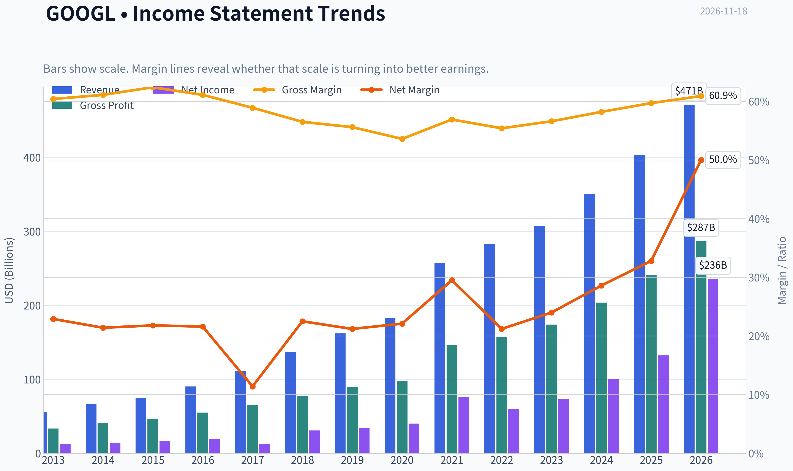

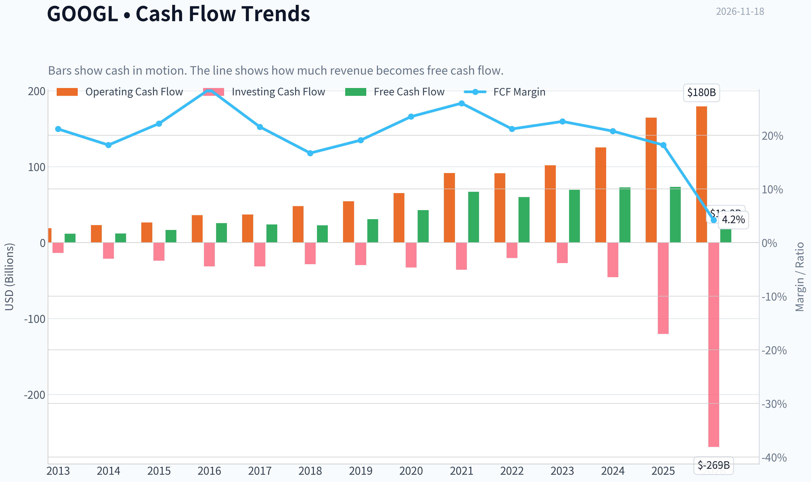

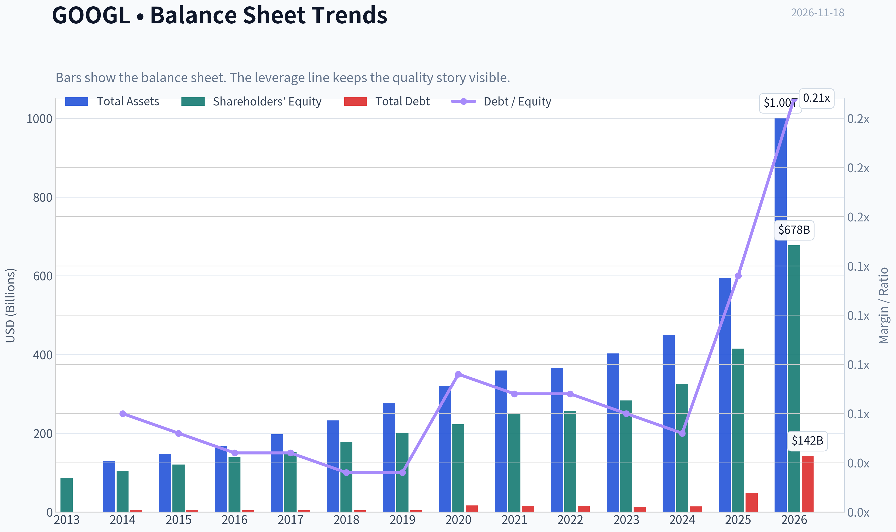

This graph tracks the profitability and return metrics (ROE, ROIC, Margins) of **GOOGL** over the past decade, highlighting capital efficiency trends.

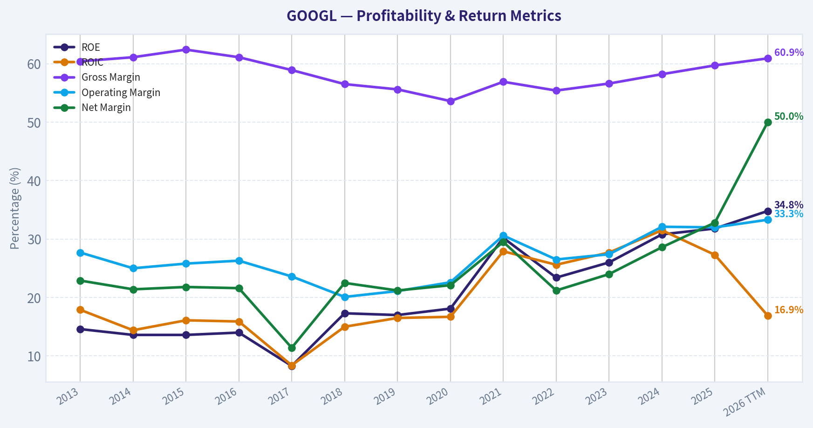

This chart illustrates the financial health of **GOOGL** over the last 10 years, mapping cash equivalents and free cash flow against total obligations (Debt).

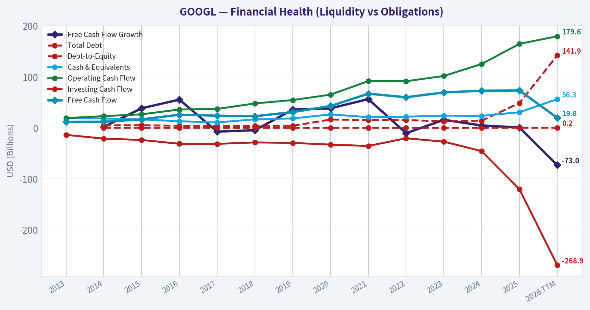

This comparison chart from *Profitability* stacks current figures against historical benchmarks for **GOOGL**, making it easy to see where the company trades relative to its own averages.

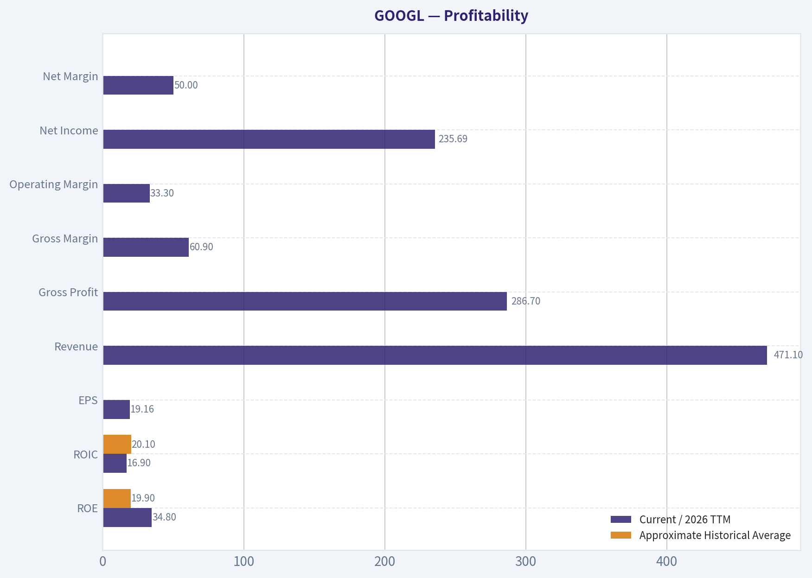

---

### Intrinsic Value Analysis (Buffett)

> *Following Warren Buffett's value investing philosophy: Circle of Competence, Economic Moat, Management Quality, and Margin of Safety.*

#### Intrinsic Value Snapshot

Price is what you pay. Intrinsic value is what the business may be worth based on the cash it can create for owners over time. We show a range, not one magic number.

- Current Price: $282.44
- Value Range (conservative to optimistic across both DCF methods): $12.53 to $1,974.07

##### Owner Earnings (Buffett Method)
- Net Income: $132,170,000,000.00
- Depreciation & Amortization: N/A
- Capital Expenditures: $-91,447,000,000.00
- Working Capital Changes: $618,000,000.00
- Owner Earnings: $40,105,000,000.00

##### Intrinsic Value
###### Buffett Method
Uses owner earnings. Stricter, and usually more conservative.
- Conservative: $142.20
- Average: $501.29
- Optimistic: $1,974.07
- Discount Rate: 10.0%

###### Cash Flow Method
Uses free cash flow. Better for companies spending heavily today to grow tomorrow.
- Conservative: $12.53
- Average: $29.13
- Optimistic: $68.80
- Discount Rate: 10.0%

ANALYST STANCE: **Bullish**

#### Executive Conclusion

Alphabet is a high-quality, asset-light compounder with exceptional margins, returns on equity, financial flexibility, and multiple avenues for reinvestment through search, YouTube, cloud computing, artificial intelligence, and the broader Google ecosystem.

At approximately **$282 per share**, the stock appears **fairly valued rather than deeply discounted**. The headline intrinsic value is **$291.17**, implying only a **3% margin of safety**, but the reverse DCF is more encouraging: the current price implies only about **2.5% annual growth over the next decade**, which is conservative for a business growing revenue at 15.1% year over year and earning a 31.8% ROE.

The principal risks are AI-driven disruption to search economics, very high AI infrastructure spending, regulatory intervention, and the possibility that cloud and AI returns lag investment. These risks justify a moderate-not aggressive-conviction level.

#### Factor Scorecard

| Factor | Score | Assessment |
|---|---:|---|
| Circle of Competence & Business Simplicity | 4/5 | Alphabet earns advertising revenue from search, YouTube, and its digital ecosystem, while Cloud and subscriptions provide additional growth engines. AI makes the future more complex, but the core model remains understandable. |
| Moat Test | 5/5 | Wide and likely durable: search scale, data, distribution, brand, advertiser relationships, YouTube network effects, Android ecosystem, and Google Cloud switching costs. |
| Management & Capital Allocation | 4/5 | Strong reinvestment record, substantial buybacks, meaningful R&D spending, and a long-term orientation. Capital allocation is good, though AI infrastructure spending must earn attractive returns. |
| Industry Structure | 4/5 | Digital advertising and cloud are concentrated around a small number of powerful platforms. Competition is intense, but scale advantages are substantial. |
| Gate 5: Quality/Solvency Floor | **Not tripped** | There is no evidence of simultaneous deteriorating earnings/cash flow and financial distress. The company has strong profitability and liquidity. |

**Key Takeaways:** Alphabet scores highly because its competitive advantages are reinforced by scale, data, distribution, and ecosystem integration. The primary uncertainty is not solvency or business viability; it is whether AI changes the economics of search faster than Alphabet can adapt.

#### Moat Analysis

| Moat Source | Evidence | Durability |
|---|---|---|
| Intangible assets | Google is one of the world's strongest consumer and commercial brands. Search, Maps, Android, Gmail, and YouTube are deeply embedded in daily activity. | High |
| Switching costs | Advertisers build campaigns, measurement systems, and customer-acquisition processes around Google. Cloud customers integrate data, workloads, and tools into Google infrastructure. | High |
| Cost advantages | Search and advertising benefit from enormous scale in computing, data, distribution, and user reach. Incremental digital advertising revenue can carry attractive margins. | High |
| Network effects | More users generate more queries, viewing activity, data, and advertiser value. YouTube benefits from the interaction between creators, viewers, and advertisers. | High |
| Reinvestment advantages | Alphabet can deploy large amounts of capital into AI, cloud, data centers, and new products that smaller rivals cannot match. | High, but return-dependent |

**Key Takeaways:** Alphabet's moat is multidimensional rather than dependent on a single patent or product. The most important question is whether generative AI strengthens Google's distribution and data advantages or commoditizes the search interface.

#### Financial Summary

| Metric | Latest Value |
|---|---:|
| Share price | $282 |
| Market capitalization | $3.47 trillion |
| P/E ratio | 14.75 |
| Revenue growth, year over year | 15.1% |
| Gross margin | 59.7% |
| ROE | 31.8% |
| FCF yield | 2.1% |
| Implied annual free cash flow | Approximately $72.9 billion |
| Current ratio | 2.01 |
| Reverse-DCF implied 10-year growth | Approximately 2.5% annually |
| Trailing three-year growth | -13.6% |
| Trailing five-year growth | 17.4% |

**Key Takeaways:** Alphabet combines strong growth with a 59.7% gross margin and a 31.8% ROE. The low 2.1% free-cash-flow yield indicates that the market still assigns substantial value to future growth, but the P/E near 15 is moderate for a company with this profitability and balance-sheet quality.

#### Owner Earnings Calculation

The research data implies approximately **$72.9 billion of annual free cash flow**, calculated from the $3.47 trillion market capitalization and 2.1% FCF yield.

| Owner Earnings Component | Approximate Amount |
|---|---:|
| Net income and operating cash generation | Reflected in current FCF |
| Add: depreciation and amortization | Already captured in operating cash flow |
| Less: maintenance capital expenditure | Not separately disclosed in the supplied figures |
| Less: working-capital investment | Not separately disclosed in the supplied figures |
| Practical owner-earnings proxy | **Approximately $72.9 billion** |

For valuation, free cash flow is used as a practical owner-earnings proxy. This is conservative in one respect and potentially imperfect in another: Alphabet's total capital expenditure includes substantial growth investment in AI and data centers, meaning reported FCF may understate long-term earning power if those investments earn high returns.

**Key Takeaways:** Alphabet is producing substantial cash after total capital expenditure. The key analytical issue is separating maintenance spending from growth spending; if AI infrastructure produces durable incremental earnings, current owner earnings could be understated.

#### Three-Scenario DCF Valuation

Using approximately **$72.9 billion of owner earnings**, a 10% discount rate, and roughly 12.3 billion equivalent shares:

| Scenario | Assumption | Estimated Equity Value | Estimated Value Per Share |
|---|---|---:|---:|
| A: No growth | Owner earnings capitalized at 10% | $729 billion | $59 |
| B: GDP growth | 3% perpetual growth | $1.07 trillion | $87 |
| C: Historical-growth case | 8.7% growth, representing 50% of the five-year growth rate, with a 10-year forecast | Approximately $5.6 trillion | Approximately $457 |
| Research-pack blended value | FCFF, reverse DCF, and owner-earnings methods | Approximately $3.58 trillion | **$291** |

The no-growth and GDP-growth cases are intentionally severe and do not reflect the economics of a high-quality platform with substantial reinvestment opportunities. The historical-growth case is highly sensitive to the long-term growth assumption and should not be treated as a precise forecast.

**Key Takeaways:** The DCF range is very wide because Alphabet's value depends heavily on the durability of growth and the returns earned on AI investment. The blended research value of $291 per share is the most balanced reference point, while the reverse DCF suggests the market is pricing in only modest long-term growth.

#### Margin of Safety Analysis

| Valuation Reference | Value Per Share | Difference From $282 Price |
|---|---:|---:|
| Blended intrinsic value | $291 | +3% |
| Reverse-DCF interpretation | Price implies approximately 2.5% annual growth | Favorable if Alphabet exceeds this rate |
| Owner-earnings growth case | Approximately $457 | +62%, but highly assumption-sensitive |
| No-growth value | $59 | -79%, intentionally unrealistic for the operating business |

Alphabet does not currently offer a conventional 25% to 40% value-investing discount based on the blended valuation. However, its quality permits a smaller margin of safety. A 3% headline discount is acceptable only because:

- The company has a wide moat.
- ROE is above 30%.
- Gross margin is nearly 60%.
- The balance sheet and cash generation are strong.
- The market-implied growth rate is modest relative to Alphabet's historical capabilities.
- AI could create new revenue streams and improve the competitive position of Google Cloud and search.

The valuation would become substantially more attractive if the share price fell toward **$240-$260**, assuming the business fundamentals remained intact.

**Key Takeaways:** Alphabet is not a statistically cheap stock at $282, but it is not priced for heroic growth either. The investment case depends on buying a durable franchise at a reasonable price and allowing continued reinvestment to compound value.

#### Management Quality and Capital Allocation

| Management Dimension | Assessment |
|---|---|
| Owner orientation | Strong institutional and insider alignment, though founder ownership is not as dominant as in some founder-controlled businesses. |
| Reinvestment | Significant investment in AI research, cloud infrastructure, data centers, and ecosystem products. |
| Buybacks | Buybacks have reduced share count and support per-share value, although valuation discipline should remain important. |
| Acquisitions | Generally capable of building internally, which reduces dependence on large, expensive acquisitions. |
| Financial discipline | Strong cash generation and liquidity provide flexibility without requiring excessive leverage. |
| Main concern | AI spending may rise sharply before the associated revenue and profit benefits are fully visible. |

**Key Takeaways:** Management has demonstrated the ability to reinvest at scale while maintaining high profitability. The main capital-allocation test is whether today's massive AI infrastructure commitments produce attractive returns rather than merely defending market position.

#### Final Buffett Scorecard

| Criterion | Weight | Score | Weighted Contribution |
|---|---:|---:|---:|
| Moat width and durability | 25% | 5.0 | 1.25 |
| Valuation and margin of safety | 20% | 3.5 | 0.70 |
| Capital returns: ROIC versus WACC | 15% | 5.0 | 0.75 |
| Business understanding and predictability | 12% | 4.0 | 0.48 |
| Management quality and capital allocation | 12% | 4.0 | 0.48 |
| Reinvestment runway | 8% | 5.0 | 0.40 |
| Balance-sheet strength | 4% | 4.5 | 0.18 |
| Industry structure | 4% | 4.0 | 0.16 |
| **Total** | **100%** |  | **4.40/5.00** |

#### Investment Stance

**ANALYST STANCE: Bullish**

**Conviction: Moderate to high.**

Alphabet qualifies as a Buffett-style compounder: understandable core economics, extraordinary distribution, high returns on capital, strong cash generation, and a long runway for reinvestment. At $282, the shares are best characterized as **fairly priced for a wonderful business**, not deeply undervalued.

The stock is suitable for long-term ownership, but position sizing should reflect the genuine uncertainty surrounding AI's effect on search, advertising economics, regulatory outcomes, and capital intensity. A meaningful decline toward the mid-$200s would improve the margin of safety materially.
#### Valuation Bridge

This bridge places the current market price beside each intrinsic value lens so readers can see whether upside depends on one method or shows up across several methods.

| Scenario | Intrinsic Value / Share |
| --- | ---: |
| Buffett Method | $501.29 |
| Cash Flow Method | $29.13 |
| Damodaran Method | $166.27 |
| Current Price | $282.44 |

#### Key Takeaways

If one method is far above the others, the upside case depends on a specific modelling assumption. When several methods cluster together, the valuation story is more robust.

#### Valuation Visuals

This comparison chart from *Latest Earnings Snapshot* stacks current figures against historical benchmarks for **GOOGL**, making it easy to see where the company trades relative to its own averages.

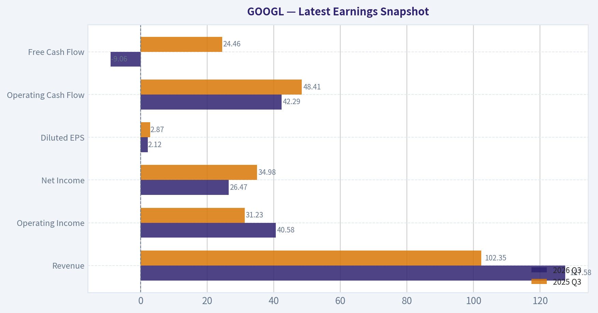

This comparison chart from *Balance Sheet and Financial Strength* stacks current figures against historical benchmarks for **GOOGL**, making it easy to see where the company trades relative to its own averages.

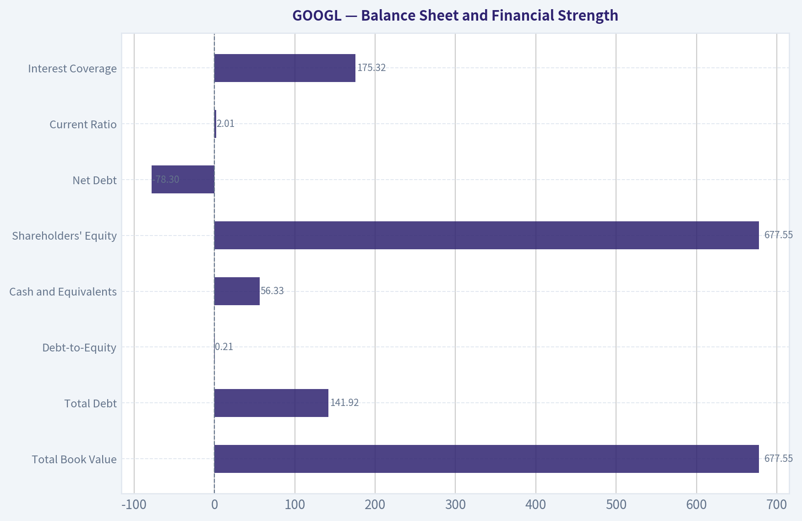

This comparison chart from *Cash Flow and Capital Allocation* stacks current figures against historical benchmarks for **GOOGL**, making it easy to see where the company trades relative to its own averages.

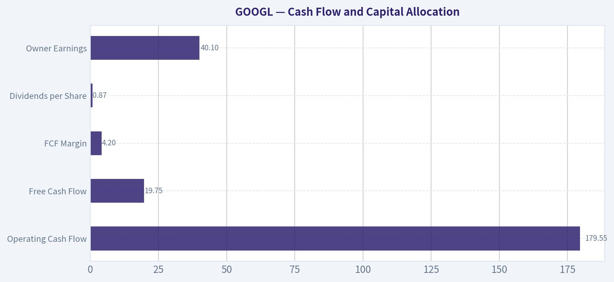

---

### Trend & Growth Analysis (Lynch/Druckenmiller/Fisher)

> *Following Peter Lynch's GARP, Stanley Druckenmiller's macro-aware approach, and Philip Fisher's scuttlebutt methodology.*

ANALYST STANCE: **Bullish**

#### Executive View

Alphabet is a **fast-growing mega-cap compounder**, not a conventional ten-bagger from today's $3.47 trillion valuation. The setup is attractive because revenue is growing approximately 15%, the company retains exceptional competitive advantages, and the stock trades at only about 14.7 times earnings despite major exposure to artificial intelligence, cloud computing, and digital advertising.

My stance is **Advocate, but with a moderate position size**. The principal debate is whether AI expands Alphabet's total addressable market and strengthens its ecosystem, or whether it disrupts the economics of traditional search while forcing permanently elevated capital spending.

#### 1. Lynch Classification

| Category | Assessment |
|---|---|
| Classification | Fast grower / mega-cap compounder |
| Revenue growth | 15.1% year over year |
| Profitability | Strong; 31.8% ROE and 59.7% gross margin |
| Valuation | Reasonable for quality and growth; 14.75x P/E |
| Ten-bagger potential | Low from current size; meaningful multiyear compounding potential |
| Primary growth engines | Search, YouTube, Google Cloud, AI products, digital services |

**Key Takeaways:** Alphabet qualifies as a fast grower at the lower end of the category, but its enormous market capitalization limits ten-bagger potential. The investment case is stronger as a high-quality compounder with possible growth reacceleration than as a small-company hypergrowth opportunity.

#### 2. The Story in Three Bullets

- **AI distribution advantage:** Alphabet can monetize AI through Search, Gemini, YouTube, Cloud, Android, and billions of daily user interactions.
- **Multiple growth engines:** Google Cloud and AI infrastructure can expand the company beyond its mature advertising base.
- **Exceptional financial base:** High margins, strong returns on equity, and substantial free-cash-flow generation provide the resources to fund AI investment without financial stress.

#### 3. TAM and 10x Test

| TAM Dimension | Assessment |
|---|---|
| Search and digital advertising | Large and mature, but still expanding through digital penetration and commercial-intent monetization |
| Cloud computing | Large, growing secular market with room for share gains |
| Generative AI | Rapidly expanding market; size and monetization model remain uncertain |
| YouTube and connected television | Significant runway in advertising, subscriptions, and commerce |
| 10x revenue test | Not attractive as a strict company-wide test because Alphabet is already exceptionally large |
| More realistic opportunity | 2x-4x revenue and earnings over a long period through AI, Cloud, and adjacent services |

**Key Takeaways:** Alphabet's traditional search market is mature, but the company's broader opportunity set is expanding through cloud, AI infrastructure, video, subscriptions, and enterprise software. A literal ten-times revenue outcome is unlikely to remain below 20% market share because the starting base is enormous; the more realistic opportunity is sustained compounding with periodic growth inflections.

#### 4. Revenue Growth Trend

| Metric | Current Evidence | Interpretation |
|---|---:|---|
| Revenue growth | 15.1% year over year | Healthy, but not evidence of a clear acceleration |
| Recent earnings backdrop | Q3 results described as strong | Positive operating momentum |
| Forward estimate trend | Some Q4 estimates have slipped | Near-term caution |
| Three-year reverse-DCF growth assumption | Approximately 2.5% annually for 10 years implied by price | Market is not pricing an aggressive growth scenario |

**Key Takeaways:** Current growth is healthy but does not yet establish a clear acceleration pattern. Strong quarterly execution combined with modest market-implied long-term growth creates upside if AI and Cloud push growth materially above the low-single-digit expectations embedded in the valuation.

#### 5. Unit Economics and Operating Efficiency

| Metric | Result | Assessment |
|---|---:|---|
| Gross margin | 59.7% | Excellent, though AI infrastructure may pressure mix |
| ROE | 31.8% | Strong capital productivity |
| Current ratio | 2.01 | Strong liquidity |
| FCF yield | 2.1% | Positive, but not inexpensive on free cash flow |
| LTV/CAC | Not disclosed in supplied data | Not directly applicable at consolidated company level |
| Net revenue retention | Not disclosed | Important mainly for Google Cloud |
| Rule of 40 | Not calculable from supplied FCF margin | Alphabet is not a pure SaaS business |

**Key Takeaways:** Alphabet has excellent economic characteristics, particularly gross margin, liquidity, and return on equity. The main financial tension is that AI requires substantial infrastructure spending, which may temporarily reduce free-cash-flow conversion even while strengthening the long-term competitive position.

#### 6. Inflection Point Assessment

| Potential Inflection | Evidence | Status |
|---|---|---|
| Product cycle | Gemini and broader AI deployment across the ecosystem | Developing |
| Market share | Cloud and AI could allow share gains against Microsoft and other providers | Positive but unproven |
| Margin inflection | Scale benefits possible, but AI infrastructure spending may delay them | Mixed |
| TAM expansion | AI converts Alphabet from an advertising/search company into a broader computing platform | Strongest inflection |
| Energy and infrastructure | Geothermal agreement supports long-term data-center power availability | Strategic, long dated |
| Earnings estimate inflection | Strong Q3 coverage, but some Q4 estimates softened | Not yet confirmed |

**Key Takeaways:** The most important inflection is not a single product launch; it is Alphabet's potential transformation into a leading AI distribution and infrastructure platform. The evidence is promising, but the inflection remains only partially validated because monetization, capital intensity, and search disruption are still unfolding.

#### 7. Macro Setup

| Macro Factor | Assessment |
|---|---|
| Economic cycle | Neutral to moderately favorable based on strong earnings backdrop |
| Interest rates | Lower rates would support valuation; persistent high rates would pressure long-duration growth assets |
| AI investment cycle | Strong secular tailwind |
| Digital advertising | Cyclical exposure, but structurally healthy |
| Capital spending environment | Heavy AI infrastructure spending is supportive for capability, negative for near-term FCF |
| Competitive environment | Microsoft, Amazon, OpenAI, and specialized AI companies increase execution pressure |

**Key Takeaways:** Alphabet benefits from powerful secular AI and cloud trends, but its macro exposure is mixed because advertising is economically sensitive and AI investment is capital intensive. The stock is most attractive if rates stabilize or decline while AI monetization continues to improve.

#### 8. Fisher's 15-Point Assessment

| Fisher Criterion | Score / 5 | Rationale |
|---|---:|---|
| Market potential | 5.0 | Search, cloud, AI, video, and digital services |
| New-product determination | 4.5 | Significant AI and platform investment |
| R&D effectiveness | 4.5 | Deep technical capabilities and research history |
| Sales organization | 4.0 | Strong enterprise and advertising distribution |
| Profit margins | 5.0 | Exceptional scale economics |
| Margin outlook | 4.0 | Long-term operating leverage, near-term AI spending pressure |
| Labor relations | 3.5 | Talent strength but continuing workforce and culture issues |
| Executive relations | 4.0 | Strong operating continuity |
| Management depth | 4.5 | Broad technical and commercial bench |
| Cost analysis | 4.0 | Sophisticated financial controls, though capex is rising |
| Outstanding advantages | 5.0 | Data, distribution, ecosystem, infrastructure, and network effects |
| Long-range profit outlook | 4.5 | Strong, though AI could alter search economics |
| Dilution | 4.5 | No major dilution concern indicated |
| Candor | 3.5 | Generally adequate, but AI risks require monitoring |
| Integrity | 4.0 | No material issue identified in supplied information |
| **Total** | **65.0 / 75** | **Outstanding** |

**Key Takeaways:** Alphabet scores in Fisher's outstanding range because of its market potential, research capability, distribution, and competitive advantages. The deductions reflect uncertainty around AI-driven margin pressure, organizational complexity, labor issues, and the need for clearer evidence of successful search monetization under generative AI.

#### 9. Valuation Analysis

| Valuation Measure | Result | Interpretation |
|---|---:|---|
| Price | $282 | Current supplied price |
| Market capitalization | $3.47 trillion | Limits ten-bagger potential |
| P/E ratio | 14.75x | Attractive for a high-quality platform company |
| PEG using 15.1% revenue growth as a proxy | Approximately 0.98x | Indicative only; earnings growth should be used instead |
| FCF yield | 2.1% | Less compelling than the P/E because of heavy investment and valuation |
| Headline intrinsic value | $291.17 | Approximately 3.0% above current price |
| Reverse-DCF implication | Approximately 2.5% annual growth for 10 years | Conservative market expectations |
| Model range | $29.13 to $501.29 | Extremely wide; model assumptions dominate |

**Key Takeaways:** Alphabet appears reasonably valued rather than deeply discounted. The P/E is compelling, but the headline intrinsic value implies only a modest margin of safety, and the very wide DCF range demonstrates how sensitive the valuation is to AI investment, margins, and terminal growth assumptions. The strongest upside comes from earnings growth exceeding the conservative expectations implied by the current price.

##### Scenario Framework

| Scenario | Operating Assumption | Valuation View | Investment Result |
|---|---|---|---|
| Bear | Search disruption, sustained AI capex, slower advertising growth | Multiple compression and lower FCF conversion | Material downside risk |
| Base | Approximately mid-teens growth moderates over time; Cloud and AI become meaningful contributors | Current valuation broadly fair to moderately attractive | Solid compounder |
| Bull | AI expands the TAM, Cloud gains share, and monetization improves without permanent margin damage | Multiple re-rating plus earnings growth | Significant upside |

**Key Takeaways:** The bear case is primarily about disruption and capital intensity rather than balance-sheet distress. The base case supports satisfactory long-term returns, while the bull case requires Alphabet to monetize AI faster than the market expects and preserve its superior distribution advantages.

#### 10. Growth Investor Scorecard

| Criterion | Weight | Score / 5 | Weighted Contribution |
|---|---:|---:|---:|
| The story | 10% | 4.5 | 0.45 |
| TAM and runway | 20% | 4.5 | 0.90 |
| Revenue growth | 20% | 3.5 | 0.70 |
| Unit economics | 15% | 3.5 | 0.53 |
| Competitive position | 10% | 4.8 | 0.48 |
| Management quality | 10% | 4.2 | 0.42 |
| Macro setup | 5% | 3.5 | 0.18 |
| Profitability path | 5% | 4.7 | 0.24 |
| Valuation | 5% | 4.0 | 0.20 |
| **Total** | **100%** |  | **4.09 / 5.00** |

**Key Takeaways:** Alphabet scores just above the 4.0 threshold for high-conviction advocacy. Its strongest attributes are competitive position, TAM expansion, profitability, and valuation; its weaker areas are the lack of confirmed revenue acceleration and uncertainty regarding AI-related unit economics and capital intensity.

#### 11. Position Size Stance

| Investor Situation | Suggested Stance |
|---|---|
| Existing holder | Hold; consider adding on execution-confirming weakness |
| New growth investor | Initiate a moderate position |
| Concentrated portfolio | Keep position below maximum conviction until AI monetization is clearer |
| Speculative ten-bagger investor | Look for smaller AI or infrastructure companies with greater operating leverage |
| Suggested initial size | Approximately 3%-5% of an equity portfolio, subject to risk tolerance |

**Key Takeaways:** Alphabet merits a meaningful but not outsized position. It offers a strong risk-adjusted compounding profile, but its size, regulatory exposure, and unresolved AI economics make it less suitable as a single-stock concentration.

#### 12. Key Catalysts and Risks

| Catalysts | Risks |
|---|---|
| Faster Gemini and AI monetization | Generative AI reduces traditional search economics |
| Google Cloud share gains | Microsoft, OpenAI, Amazon, and open-source alternatives intensify competition |
| YouTube advertising and subscriptions | AI infrastructure spending depresses free cash flow |
| Operating leverage after infrastructure buildout | Regulatory remedies or antitrust restrictions |
| Better-than-expected advertising growth | Economic slowdown reduces ad demand |
| Lower interest rates and multiple expansion | Data-center power, chip, and energy constraints |
| AI-driven TAM expansion | Execution failure in converting research leadership into products |

**Key Takeaways:** The upside catalyst is an AI-driven expansion of Alphabet's addressable market without a proportional deterioration in margins. The central risk is that AI changes user behavior faster than Alphabet can monetize the transition, while regulators and infrastructure costs limit the company's ability to respond.

#### Final Assessment

Alphabet is a **high-quality fast-growing compounder at a reasonable valuation**, with a developing AI inflection point. It is not a classic ten-bagger candidate because of its current size, but it can still produce attractive long-term returns if Cloud, Gemini, YouTube, and AI infrastructure create durable incremental growth.

**Recommendation: Bullish - moderate position, monitor revenue acceleration, Cloud growth, AI monetization, capital intensity, and search engagement closely.**

#### Growth & Scorecard Visuals

This comparison chart from *Growth and Earnings Quality* stacks current figures against historical benchmarks for **GOOGL**, making it easy to see where the company trades relative to its own averages.

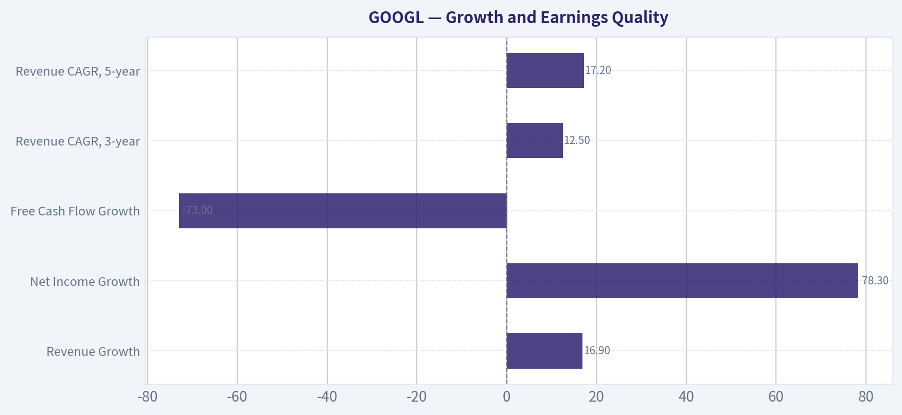

---

### Market Technical Analysis

ANALYST STANCE: **Neutral**

#### GOOGL technical analysis - November 18, 2026

GOOGL is in a technically damaged short- and medium-term structure following the sharp late-October breakdown. The latest available closing price in the retrieved price series is **$280.20 on November 17**, while the indicator report includes calculations through November 18. Price is substantially below all three selected moving averages, and the volume-weighted average confirms that recent trading activity has been concentrated at materially lower prices.

The setup is therefore **bearish on trend**, but not an especially attractive location for aggressive new short exposure: momentum has improved modestly from its worst levels, RSI is near-but not decisively below-the traditional oversold threshold, and price is approaching the recent $277-$280 support zone.

#### Trend structure

The 50-day SMA is **$324.96**, down from approximately **$344.29 on October 19**. The 200-day SMA is **$337.33**, also declining from approximately **$340.72** over the same period. This combination is important:

- The declining 50-day average indicates that the medium-term trend has deteriorated substantially.
- The 200-day average has begun to slope lower, suggesting that the weakness is no longer merely a short-lived pullback.
- Price is roughly **13.8% below the 50-day SMA** and **16.9% below the 200-day SMA**, showing a large separation between current price and the longer-term trend benchmarks.
- The 50-day SMA remains below the 200-day SMA, a bearish configuration that provides no evidence of a confirmed long-term trend reversal.

The October 29 gap-like collapse from the low-$320s to the low-$280s appears to have permanently shifted the near-term technical regime. Until price can reclaim at least the **$286-$289 area**, followed by the $298-$300 region, rallies should be treated as potential relief moves rather than confirmed trend reversals.

#### Short-term momentum and MACD

The 10-day EMA is **$288.62**, compared with the latest closing price of $280.20. Price remains below this fast average, so short-term momentum is still negative. However, the decline in the 10-day EMA has slowed sharply compared with late October and early November, which is an early indication that the rate of deterioration may be moderating.

MACD remains deeply negative at **-12.27**, confirming that the broader momentum impulse is bearish. The important nuance is that the MACD histogram is positive at **0.70**, after reaching substantially negative readings earlier in November. This means the MACD line is still below zero, but it is currently above its signal line. In practical terms:

- The primary momentum trend remains bearish.
- Selling pressure has eased relative to the November 2-10 period.
- The positive histogram does not yet establish a durable bullish reversal because MACD itself remains far below zero and price remains beneath the short-term averages.
- A stronger reversal signal would require price to reclaim the 10-day EMA, followed by a sustained improvement in MACD toward the zero line.

This is best interpreted as **bearish momentum losing intensity**, not as a confirmed buy signal.

#### RSI and potential exhaustion

RSI is **34.92**, improving from readings near **21-30** earlier in November. The indicator is no longer deeply oversold, but it remains below the neutral 50 level and still reflects weak momentum.

The recovery from very depressed RSI readings is constructive for short-term stabilization, yet several caveats matter:

- RSI has not produced a clear bullish divergence because price has not established a convincing higher low.
- In a strong downtrend, RSI can remain between 30 and 40 for an extended period.
- A move below 30 would signal renewed downside pressure, while a sustained move above 40-45 would provide better evidence that selling pressure is fading.
- A move above 50 would be more meaningful as confirmation of a genuine momentum transition.

Consequently, RSI supports the possibility of a tradable bounce but does not yet justify assuming that the broader decline has ended.

#### Volume confirmation

VWMA is **$286.61**, slightly above the latest closing price. This is a relatively important short-term reference because the volume-weighted average incorporates the unusually heavy turnover seen during the October 29 breakdown and subsequent decline.

The current relationship implies:

- Recent high-volume trading has occurred at prices above the latest close.
- Sellers still control the short-term volume-weighted structure.
- A recovery above approximately **$286-$289**, especially on expanding volume, would indicate that buyers are beginning to regain control.
- Failure to reclaim VWMA would leave rallies vulnerable to renewed selling.

The unusually high volume on October 29 and the elevated activity during the subsequent decline increase the significance of the $280 area. A decisive break below that zone on expanding volume would be more bearish than a low-volume intraday violation.

#### Volatility and risk management

ATR is approximately **$9.78**, equivalent to about **3.5% of the latest price**. This is high enough that ordinary daily price movement can materially affect entry quality, stop placement, and position sizing.

A $9.78 ATR implies that:

- Stops placed only a few dollars below entry are vulnerable to normal noise.
- A break of $280 should be evaluated using closing-price and volume confirmation rather than a brief intraday dip.
- Position sizes should be reduced relative to a lower-volatility setup.
- For a tactical long, a stop based on roughly one ATR below a confirmed support entry could be very wide and may produce unfavorable risk/reward.
- For a short position, the elevated ATR increases both profit potential and squeeze risk, particularly because RSI and the MACD histogram suggest that downside momentum is no longer accelerating at its prior rate.

#### Key levels and scenarios

The immediate decision area is approximately **$277-$280**. This zone contains the recent lows and is the clearest nearby support visible in the price series.

A bearish continuation scenario would involve a decisive close below $277-$280, ideally accompanied by rising volume and a renewed deterioration in RSI and MACD histogram. Such a move could expose lower, currently undefined support levels because the stock would be entering price territory below the recent consolidation range.

A stabilization scenario would involve several sessions holding above $277-$280, followed by a reclaim of the **$286-$289** band. That zone combines the 10-day EMA and VWMA and is therefore the first meaningful confirmation hurdle. Above it, **$298-$300** represents the next resistance region, followed by the much more important **$324-$325** area near the 50-day SMA.

A durable medium-term reversal would require more than an oversold bounce. Traders would ideally want to see:

1. Price hold above the $277-$280 support zone.
2. A close above the 10-day EMA and VWMA.
3. RSI recover above 40-45 and eventually 50.
4. MACD remain above its signal line while moving materially upward toward zero.
5. A subsequent reclaim of the 50-day SMA, preferably with stronger volume.

Until those conditions develop, the risk/reward profile favors patience over aggressive accumulation. Existing long holders may consider the $277-$280 zone as a risk-control reference, while tactical traders should wait for either a confirmed support reaction or a failed bounce near $286-$300.

#### Selected indicators

The eight indicators selected are deliberately complementary: three trend measures, two momentum measures, RSI for exhaustion, VWMA for volume confirmation, and ATR for risk control. Bollinger Bands were not included to avoid exceeding the eight-indicator limit and because the current trend, momentum, volume, and volatility information already provides a sufficiently broad framework.

| Indicator | Latest reading | Interpretation | Trading relevance |
|---|---:|---|---|
| close_10_ema | $288.62 | Price remains below the fast trend average | First short-term reclaim level; currently resistance |
| close_50_sma | $324.96 | Strongly declining medium-term trend | Major overhead resistance and trend confirmation level |
| close_200_sma | $337.33 | Long-term average has begun declining | Confirms broader structural weakness |
| macd | -12.27 | Momentum remains substantially negative | Bearish primary trend signal |
| macdh | +0.70 | Momentum is improving from its prior trough | Possible relief bounce, but not yet a confirmed reversal |
| rsi | 34.92 | Weak, near oversold, but not deeply oversold | Downside may be extended; reversal confirmation is absent |
| vwma | $286.61 | Volume-weighted price remains above market price | Sellers retain short-term volume control |
| atr | $9.78 | High daily volatility, about 3.5% of price | Requires wider risk buffers and smaller position sizing |

**Key Takeaways:** GOOGL remains in a clearly bearish trend because price is below the 10-day EMA, 50-day SMA, 200-day SMA, and VWMA. However, the positive MACD histogram and RSI near 35 show that downside momentum has eased from its early-November extreme, creating room for a short-term bounce. The key test is whether price can hold $277-$280 and reclaim $286-$289; until then, the appropriate stance is to watch rather than assume a durable bottom.

#### Market Visuals

This comparison chart from *Market Metrics and Valuation* stacks current figures against historical benchmarks for **GOOGL**, making it easy to see where the company trades relative to its own averages.

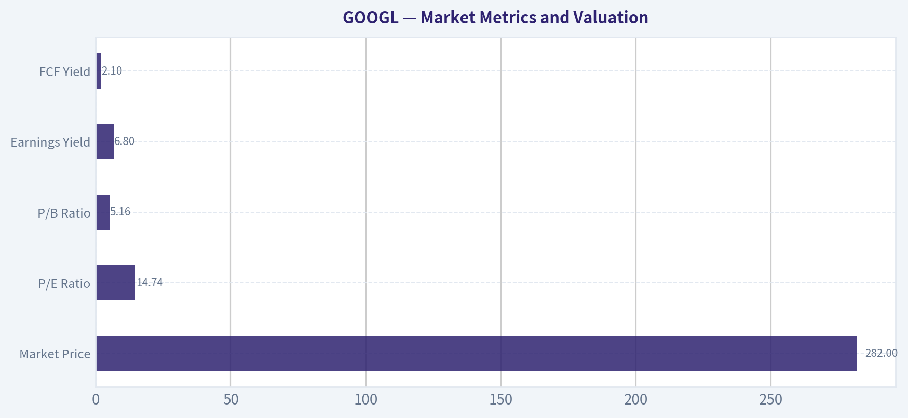

---

### Options Market Analysis

> *Reading options flow - put/call ratios, IV skew, and unusual activity - to gauge institutional positioning and event-driven risk.*

ANALYST STANCE: **Neutral**

#### GOOGL Options Flow Overview

The data is as of November 18, 2026. Near-term options activity is call-dominant by both open interest and volume, but the dataset is unusually sparse in open interest and does not provide strike-level detail. Therefore, the directional read is cautiously bullish with low-to-moderate confidence.

| Expiration | Call OI | Put OI | Call Volume | Put Volume | Put/Call OI | Put/Call Volume |
|---|---:|---:|---:|---:|---:|---:|
| Nov. 20, 2026 | 196 | 28 | 56,263 | 34,797 | 0.14 | 0.62 |
| Nov. 23, 2026 | 0 | 0 | 4,029 | 2,638 | N/A | 0.65 |
| Nov. 25, 2026 | 0 | 0 | 2,069 | 1,280 | N/A | 0.62 |
| **Near-term total** | **196** | **28** | **62,361** | **38,715** | **0.14** | **0.62** |

**Key Takeaways:** The aggregate put/call volume ratio of 0.62 is below the approximately 0.70 neutral baseline, indicating modestly stronger call activity. The 0.14 put/call open-interest ratio is much more bullish-looking, but it is based almost entirely on the November 20 expiration and an unusually small OI sample. The absence of open interest in the later expirations materially reduces confidence in the signal.

#### Put/Call Ratio Analysis

The near-term put/call volume ratio is 0.62, versus the historical neutral reference of approximately 0.70. This represents a modest shift toward call activity, consistent with bullish speculation, upside positioning, or potentially covered-call activity.

The open-interest ratio of 0.14 is substantially below neutral. That suggests considerably more call positioning than put protection in the available near-term chain. However, because total reported open interest is only 224 contracts and later expirations show zero OI, this ratio should not be treated as a robust institutional sentiment measure.

#### Implied Volatility Assessment

| Expiration | Call ATM IV | Put ATM IV | Call-Put ATM IV Difference | Assessment |
|---|---:|---:|---:|---|
| Nov. 20, 2026 | 3.7% | 3.7% | 0.0 percentage points | Neutral ATM pricing |
| Nov. 23, 2026 | 2.9% | 2.1% | +0.8 points | Slight call-side premium |
| Nov. 25, 2026 | 3.4% | 2.1% | +1.3 points | Call-side premium |

**Key Takeaways:** Reported near-term ATM IV is extremely low, particularly for options expiring after November 20, suggesting limited priced-in movement or possible data-quality limitations. The available ATM comparison shows no skew in the nearest expiry and modest call-side pricing in the later expiries. True OTM put-versus-call skew was not supplied, so downside fear cannot be assessed definitively.

There is no explicit catalyst calendar in the supplied data. Consequently, it is not possible to confirm whether IV is elevated ahead of earnings, a product event, or another scheduled catalyst. In any case, the reported IV levels do not appear elevated.

#### Unusual Options Activity

| Finding | Result |
|---|---|
| Contracts meeting unusual-activity rule | None |
| Screening threshold | Volume greater than 5 times open interest |
| Directional contract identified | None |
| Smart-money versus retail distinction | Not determinable |

**Key Takeaways:** No individual contract met the tool's volume-versus-open-interest threshold. This means there is no confirmed fresh directional bet that can be attributed to aggressive institutional activity. The absence of flagged contracts weakens the case for a high-conviction bullish interpretation.

No specific strikes, moneyness, or days-to-expiry positioning was returned for unusual contracts. Accordingly, there is no evidence here of call sweeps, put protection, or a large directional spread.

#### Open-Interest Concentration and Gamma Levels

| Metric | Available Result |
|---|---|
| Highest call OI | 196 contracts in the Nov. 20 aggregate chain |
| Highest put OI | 28 contracts in the Nov. 20 aggregate chain |
| Strike-level OI | Not provided |
| Largest expiration concentration | Nov. 20, 2026 |
| Gamma walls or max-pain levels | Cannot be determined |

**Key Takeaways:** Nearly all reported open interest is concentrated in the November 20 expiration, with calls heavily outweighing puts. However, strike-level information is unavailable, so specific gravitational prices, max pain, and gamma walls cannot be identified. The small OI base also suggests limited reliability for pinning or hedging conclusions.

#### Overall Options Sentiment

**Signal: BULLISH, low confidence.**

The primary bullish drivers are the 0.62 near-term put/call volume ratio and the very low 0.14 put/call open-interest ratio. Call activity exceeds put activity across all supplied near-term expirations, and later-expiry ATM IV modestly favors calls over puts.

The main caveat is data quality and liquidity. Total reported OI is extremely small, later expirations show zero OI, no unusual contracts were identified, and strike-level data is absent. This looks more like a mild call-side bias than a strong institutional conviction signal. The appropriate interpretation is bullish but tentative, with limited evidence that the positioning would materially drive GOOGL's stock price.

| Category | Assessment |
|---|---|
| Put/Call Ratio | Bullish-leaning: 0.14 OI ratio and 0.62 volume ratio |
| IV Level | Very low reported near-term IV; not elevated |
| Skew Direction | Neutral at the nearest expiry; modest call-side skew later |
| Unusual Activity | None detected; no confirmed fresh directional bets |
| Overall Signal | **BULLISH, low confidence** |

**Key Takeaways:** GOOGL's options market shows a modest bullish bias because calls dominate both reported volume and open interest. However, the extremely limited OI, lack of strike-level information, and absence of unusual activity make this a weak signal rather than a high-conviction institutional read.

---

## Research Team Commentary

> *The Research Manager synthesizes the Bull vs Bear debate into action-free commentary. This is a pre-risk view, not the final stance.*

Core takeaway: Alphabet appears to be a wonderful business at a potentially attractive price, but the evidence provided does not yet establish a sufficiently reliable margin of safety. The 14.75x P/E, approximately 32% ROIC, nearly 60% gross margin, strong balance sheet, and unmatched distribution make the shares look inexpensive relative to historical business quality. The unresolved question is whether current earnings are a sound proxy for future owner earnings as AI raises capital intensity and potentially changes Search monetization. I would keep Alphabet on a high-priority watchlist rather than treat the weak stock chart as either a reason to sell or sufficient reason to buy.

The strongest bull argument is that the market may be valuing a wide-moat compounder like a mature, low-growth utility. Alphabet has several reinforcing advantages: Search intent, advertiser liquidity, YouTube's creator network, Android and Chrome distribution, Cloud infrastructure, proprietary AI capabilities, and billions of daily user interactions. Competitors can develop capable models, but reproducing this combination of distribution, data, infrastructure, advertiser relationships, and financial resources is much harder.

The reported economics support the quality assessment. ROIC and ROE around 32% are exceptional, while the balance sheet gives Alphabet the ability to fund AI investment without financial distress. At 14.75x earnings, the earnings yield is approximately 6.8%. If normalized owner earnings can grow at even a high-single-digit rate over time, the prospective return should be attractive without requiring Alphabet to dominate every new AI category. The stock's position well below its moving averages primarily indicates poor sentiment; it does not prove deterioration in intrinsic value.

The strongest bear argument is not that Alphabet will lose relevance. It is that relevance and profitability may diverge. AI answers could preserve or increase user engagement while offering fewer advertising placements, incurring greater inference costs, and cannibalizing highly profitable traditional queries. Alphabet might remain the leading information platform but earn lower margins and lower returns on the enormous amount of incremental capital required to defend that position.

That makes the distinction between historical and incremental ROIC crucial. The current 32% company-wide ROIC is heavily influenced by legacy Search economics. It does not tell us what Alphabet will earn on its next tens of billions of dollars invested in data centers, chips, models, power, and Cloud capacity. A fortress balance sheet reduces solvency risk, but it does not prevent value destruction through necessary yet low-return defensive spending.

Valuation is where the debate remains unresolved. The bull's illustrative case-8% to 10% earnings growth, a 9% discount rate, and an 18x to 22x terminal multiple-is plausible, but not conservative enough to prove a margin of safety. A 20x terminal multiple assumes that Alphabet will still deserve a premium multiple after another decade of maturation, regulation, and capital-intensive AI competition. Conversely, the bear's 3% to 5% growth and 13x to 16x terminal multiple may be excessively punitive for a company with Alphabet's distribution and reinvestment opportunities.

The sensible conclusion lies between those cases. At $282, the price appears to imply subdued growth if the current earnings base is durable. But a headline P/E is not a proper reverse DCF because accounting earnings may overstate owner earnings during a rising-capex cycle. We need free cash flow after economically necessary AI investment, not merely EPS, to determine what growth is actually embedded in the price. The supplied debate does not provide that bridge.

From a Buffett perspective, Alphabet clearly passes the business-quality and financial-strength tests. Its moat is wide, although it is undergoing its most important technological test in decades. Management has the resources and distribution to navigate the transition, but capital allocation must now be judged by profitable AI monetization and incremental returns rather than by spending scale. Because this is an exceptional franchise, it would only require roughly a 10% to 15% discount to conservatively estimated intrinsic value. The problem is not that the discount is necessarily absent; it is that the current evidence does not estimate normalized owner earnings well enough to confirm it.

The lesson to apply from similar investment mistakes is to avoid both extremes. It would be a mistake to reject Alphabet merely because AI makes the future less predictable or because the chart is weak; that is how investors miss durable compounders during periods of fear. It would also be a mistake to treat a low P/E and high historical ROIC as conclusive when the business is entering a materially more capital-intensive phase. Historical quality deserves weight, but it should not be extrapolated mechanically.

Over the next one to four quarters, I would monitor Search query share and engagement, particularly whether AI Overviews and Gemini expand usage without reducing commercial-query monetization. Revenue growth is less informative than revenue and gross profit per interaction. Evidence that AI-enhanced queries sustain or improve ad conversion would materially strengthen the thesis.

I would also compare capital expenditures and depreciation growth with operating cash flow and free-cash-flow growth. Capex can rise rapidly without damaging intrinsic value if Cloud and AI-related gross profit subsequently accelerate. The thesis weakens if capex and depreciation consistently outgrow revenue while free-cash-flow margins contract without measurable monetization progress.

Google Cloud should be evaluated on operating income, margins, backlog, customer retention, and returns after infrastructure requirements-not just revenue growth. Sustained margin expansion alongside AI demand would indicate that infrastructure spending is building a second high-return engine. Growth accompanied by weak margins and continued heavy capital requirements would support the bear case.

Other important items are consolidated ROIC, traffic-acquisition costs, stock-based compensation, diluted share count, YouTube engagement and monetization, and the details of antitrust remedies. A modest loss of default distribution may be manageable; remedies that materially restrict data integration, Android practices, or default-search economics would warrant a lower intrinsic-value range.

I would move toward Bullish if Alphabet demonstrates stable Search monetization, expanding Cloud profitability, resilient free-cash-flow conversion, and no sustained collapse in incremental ROIC while the valuation remains around the mid-teens earnings multiple. I would move toward Bearish only if Search economics deteriorate structurally, AI spending persistently depresses owner earnings, and regulatory remedies materially weaken distribution at a price that still assumes recovery. At present, neither outcome has been sufficiently established.

Stance: Neutral

---

## Value Investing Team Commentary

> *The Investor translates the research view into an investment thesis before risk review. This is still not the final stance.*

Alphabet presents the classic value-investing tension: an exceptional franchise confronting a genuine technological transition, available at a valuation that looks undemanding but cannot be judged confidently from headline earnings alone.

### Business quality and moat

Alphabet remains one of the strongest businesses in the world. Its advantages are mutually reinforcing:

- Search captures high-intent commercial demand.
- Google, Chrome, Android, Maps, and YouTube provide enormous distribution.
- Advertiser relationships and measurement tools create a powerful two-sided network.
- Cloud supplies a second large platform with growing strategic importance.
- AI capabilities can be distributed through products already used by billions of people.
- The balance sheet and cash generation allow Alphabet to invest through a period when smaller competitors may be unable to keep pace.

The important point is that Alphabet's moat is not simply its search algorithm. It is the combination of user behavior, default distribution, data, infrastructure, advertiser liquidity, engineering talent, and accumulated trust. A competitor may build a capable model, but replicating this entire ecosystem is substantially harder.

The company also passes the historical profitability test decisively. ROE and ROIC near 32%, gross margins near 60%, and a strong balance sheet indicate a business with considerable economic strength. These are not the characteristics of a fragile or mediocre company.

### The central question: does AI strengthen or weaken the economics?

The market's concern is reasonable, but it needs to be framed correctly. The issue is not whether Alphabet will remain relevant. It almost certainly will. The more difficult question is whether Alphabet can preserve the extraordinary economics of traditional Search while AI changes how users obtain information.

AI could benefit Alphabet by:

- Increasing search engagement and query frequency.
- Improving commercial intent and ad relevance.
- Expanding Gemini across Search, Android, Workspace, YouTube, and Cloud.
- Creating new infrastructure and software revenue.
- Making Google's ecosystem more difficult to displace.

However, AI could also pressure owner earnings through:

- Higher inference costs per query.
- Fewer advertising opportunities in conversational answers.
- Greater capital expenditure for data centers, chips, and energy.
- More intense competition for models and technical talent.
- Potential cannibalization of high-margin conventional search behavior.

This makes historical ROIC an incomplete guide. Alphabet's existing business may earn exceptional returns while the next dollar invested in AI earns materially less. The relevant question is not whether Alphabet can spend aggressively, but whether that spending produces durable incremental profits.

That is the most important issue for a long-term owner.

### Valuation: attractive, but not yet proven

At the supplied price of $282 and P/E of approximately 14.75, the earnings yield is roughly 6.8%. For a company with Alphabet's balance sheet, moat, and historical returns, that valuation appears inexpensive if current earnings are broadly sustainable.

A simple illustration shows why the opportunity could be significant. If earnings grow at 7%-9% for a long period and Alphabet retains a respectable terminal valuation, the prospective return could be quite attractive. Investors would not need Alphabet to dominate every AI category; maintaining a strong Search franchise while building Cloud and AI monetization could be enough.

But this is not yet a demonstrated margin of safety. A P/E-based valuation may overstate the attractiveness if:

1. Capital expenditure is structurally rising faster than cash earnings.
2. Depreciation and replacement costs are understated relative to the true economic cost of AI infrastructure.
3. Search margins decline as AI-generated responses become more expensive to serve.
4. Regulatory remedies impair default distribution or data integration.
5. Stock-based compensation and dilution meaningfully reduce per-share owner earnings.

The supplied valuation case therefore deserves a discount for uncertainty. Alphabet may be cheap, but the evidence does not yet establish whether $282 represents a 10%-15% discount to conservative intrinsic value or merely a fair price for a business entering a lower-return phase.

For a wonderful business, the required margin of safety can reasonably be smaller than for an average company. Nevertheless, "wonderful" cannot mean that every investment dollar will earn historical returns. The quality of the legacy franchise is clear; the economics of the transition remain unproven.

### Contrarian interpretation of the weak chart

The 50-day and 200-day moving averages are deteriorating, and the share price is substantially below both. For a long-term investor, that is not an investment thesis and does not establish that intrinsic value has declined.

The contrarian opportunity is that the market may be extrapolating AI disruption too aggressively. Alphabet's distribution and financial resources could allow it to turn AI from a threat into a new monetization layer. A weak chart may therefore reflect fear around technological change rather than permanent business impairment.

But contrarianism should not become automatic optimism. The market may also be correctly identifying a transition from an asset-light, extraordinarily profitable search model toward a more capital-intensive infrastructure business. The stock is not attractive merely because it has fallen below its moving averages. The opportunity exists only if the decline has created a valuation below the value of normalized future owner earnings.

Options flow adds little to this conclusion. Call-dominant activity with sparse open interest and no strike-level detail is weak evidence and should not influence a decade-long investment decision.

### What would convert the thesis from Neutral to Bullish?

The most useful evidence would be:

- Search revenue and gross profit remaining resilient as AI Overviews and Gemini usage increase.
- Stable or improving monetization per commercial query.
- Cloud revenue growth accompanied by sustained operating-margin expansion.
- Free cash flow remaining strong after economically necessary AI capital expenditure.
- Capex growth eventually translating into higher operating income rather than merely higher capacity.
- Incremental ROIC remaining healthy as AI investment scales.
- Limited dilution from stock compensation.
- Regulatory remedies that do not materially impair default-search economics, data integration, or Android distribution.

The opposite combination would materially weaken the thesis: declining Search economics, permanently lower free-cash-flow margins, rising depreciation without adequate returns, and regulation that damages distribution while the stock continues to price in a recovery.

### Investment conclusion

Alphabet is not a speculative AI investment. It is a dominant advertising, distribution, video, cloud, and infrastructure business whose future returns will increasingly depend on how successfully it allocates capital through the AI transition.

That distinction matters. Investors should not reject Alphabet because the stock chart is weak or because the future is less predictable. Those are precisely the conditions under which a durable franchise can become mispriced. At the same time, investors should not rely exclusively on the 14.75x P/E and historical 32% ROIC. The investment case requires confirmation that AI spending is building a larger, profitable ecosystem rather than defending an old business at declining returns.

At the supplied valuation, Alphabet deserves a place near the top of a long-term watchlist and may be suitable for gradual accumulation by investors who can tolerate uncertainty. A decisive upgrade requires a clearer bridge from reported earnings to post-AI owner earnings.

**ANALYST STANCE: Neutral** - Alphabet is a high-quality, wide-moat business at a potentially attractive valuation, but the margin of safety is not yet sufficiently demonstrated. The key determinant is whether AI preserves Search economics and produces strong incremental returns on the capital now being deployed.

---

## Deep Values Commentary

> *The Risk Management Team debates and the Risk Judge provides the final action-free verdict. This section determines the final Bullish / Neutral / Bearish stance.*

#### Final Stance Scorecard

This scorecard converts the final research view into a weighted decision frame. It does not replace the narrative judgement, but it makes the main drivers of the verdict easier to scan.

| Criterion | Score | Weight | Commentary |
| --- | ---: | ---: | --- |
| Business Quality | 4.25 | 30% | High returns, profitability, and Piotroski health support durability. |
| Valuation Support | 2.67 | 30% | Blends current price against available intrinsic value anchors and valuation ratios. |
| Financial Strength | 5.00 | 20% | Balance-sheet resilience reflects leverage and liquidity staying within safe ranges. |
| Growth Durability | 3.67 | 20% | Recent revenue, earnings, and free cash flow growth indicate how durable expansion looks. |
| TOTAL / FINAL STANCE | 3.81 | 100% | Neutral |

#### Key Takeaways

The weighted score lands at **3.81 / 5.0**, while the final stance remains **Neutral**. This is useful as a quick calibration aid rather than a mechanical signal.

#### Risk Summary

Higher scores indicate more risk pressure. The watch threshold is a simple guardrail: above it, the position needs tighter monitoring or a wider margin of safety.

| Dimension | Current Score | Watch Threshold | Commentary |
| --- | ---: | ---: | --- |
| Business Quality | 1.75 | 3.00 | High returns, profitability, and Piotroski health support durability. |
| Valuation Support | 3.33 | 3.00 | Blends current price against available intrinsic value anchors and valuation ratios. |
| Financial Strength | 1.00 | 3.00 | Balance-sheet resilience reflects leverage and liquidity staying within safe ranges. |
| Growth Durability | 2.33 | 3.00 | Recent revenue, earnings, and free cash flow growth indicate how durable expansion looks. |

#### Key Takeaways

This view helps readers separate *where* the risk sits: valuation, business quality, balance sheet, or growth durability. It is especially useful when the final stance is close to the line between Neutral and Bearish.
