# GOOGL Deep Value Intelligence

**Analysis Date:** 2026-11-19

## Critical Disclaimer

*This analysis is generated by Deep Value Intelligence, an AI-powered multi-agent investing framework. Education & research only - not financial advice, not a financial advisor.*

---

## Table of Contents

1. Intelligence Summary
2. Analyst Team Reports
   - Fundamentals Analysis
   - Intrinsic Value Analysis (Buffett)
   - Trend & Growth Analysis (Lynch/Druckenmiller/Fisher)
   - Market Technical Analysis
   - Options Market Analysis
3. Research Team Commentary
4. Value Investing Team Commentary
5. Deep Values Commentary

---

## Intelligence Summary

### Thesis + Conditions

**Core Thesis:** Alphabet is an exceptional business, but the supplied evidence does not validate the **$273 valuation**. Its distribution, net-cash balance sheet, 31.9% ROIC, and 59.7% gross margin indicate durable franchise quality-not financial distress or permanent impairment.

**Key Risks:**
- Consequently, stock volatility, elevated put activity, or a temporary earnings dip would not by themselves represent permanent business impairment. The central risk is instead whether Alphabet can preserve its historical economics as AI changes the cost and presentation of information retrieval.
- The Risky Analyst correctly identifies this as a model-audit issue. Possible causes include inconsistent share counts, stock-based compensation treatment, tax assumptions, working capital, terminal margins, or classification of AI capital expenditure as maintenance versus growth investment.
- However, the Safe and Neutral Analysts make the stronger risk-management point: **an inconsistent model pack is not affirmative evidence that $273 is justified**. Even the most favorable supplied DCF remains well below the quoted price. A wonderful business normally requires only a modest 10-15% discount to credible intrinsic value, but the evidence here does not establish intrinsic value near the market quotation.

**Confidence:** Low

---

## Analyst Team Reports

### Fundamentals Analysis

#### Latest Earnings Snapshot

*Most recent reported quarter anchored on 2026 Q3, with prior-year comparison when available.*

| Metric | 2026 Q3 | 2025 Q3 | YoY Change |
| --- | ---: | ---: | ---: |
| Revenue | $127.58B | $102.35B | +24.7% |
| Operating Income | $40.58B | $31.23B | +29.9% |
| Net Income | $26.47B | $34.98B | -24.3% |
| Diluted EPS | $2.12 | $2.87 | -26.1% |
| Operating Cash Flow | $42.29B | $48.41B | -12.6% |
| Free Cash Flow | $-9.06B | $24.46B | -137.1% |

Key Takeaways: This snapshot anchors the most recent reported quarter before the narrative analysis. It helps readers separate long-run business quality from whatever changed in the latest earnings print.

#### 13-Year Financial Metrics for GOOGL

*All values below are computed deterministically from raw data - not estimated by AI.*

*Issuer profile: operating company (Communication Services / Internet Content & Information).*

#### 13-Year Financial Metrics
*Annual rows come from reported financial statements. The final TTM row is computed from the latest four quarters.*

| Metric | 2013 | 2014 | 2015 | 2016 | 2017 | 2018 | 2019 | 2020 | 2021 | 2022 | 2023 | 2024 | 2025 | 2026 TTM |
| --- | --- | --- | --- | --- | --- | --- | --- | --- | --- | --- | --- | --- | --- | --- |
| Market Price | $28 | $26 | $39 | $39 | $52 | $52 | $66 | $87 | $143 | $87 | $138 | $188 | $312 | $273 |
| Market Cap | N/A | $360.94B | $534.76B | $547.82B | $731.88B | $726.83B | $921.95B | $1.18T | $1.92T | $1.16T | $1.78T | $2.36T | $3.83T | $3.37T |
| P/E Ratio | 29.85 | 25.80 | 32.71 | 28.45 | 58.52 | 23.91 | 27.25 | 29.91 | 25.82 | 19.35 | 24.08 | 23.54 | 28.95 | 14.23 |
| P/B Ratio | N/A | 3.48 | 4.44 | 3.94 | 4.80 | 4.09 | 4.58 | 5.32 | 7.62 | 4.53 | 6.27 | 7.25 | 9.22 | 4.98 |
| ROE | 14.6% | 13.6% | 13.6% | 14.0% | 8.3% | 17.3% | 17.0% | 18.1% | 30.2% | 23.4% | 26.0% | 30.8% | 31.8% | 34.8% |
| ROIC | 17.9% | 14.4% | 16.1% | 15.9% | 8.4% | 15.0% | 16.5% | 16.7% | 27.9% | 25.6% | 27.7% | 31.5% | 27.3% | 16.9% |
| EPS | $0.94 | $1.03 | $1.19 | $1.39 | $0.90 | $2.19 | $2.46 | $2.93 | $5.61 | $4.56 | $5.80 | $8.04 | $10.81 | $19.16 |
| Revenue | $55.52B | $66.00B | $74.99B | $90.27B | $110.86B | $136.82B | $161.86B | $182.53B | $257.64B | $282.84B | $307.39B | $350.02B | $402.84B | $471.10B |
| Gross Profit | $33.53B | $40.31B | $46.83B | $55.13B | $65.27B | $77.27B | $89.96B | $97.80B | $146.70B | $156.63B | $174.06B | $203.71B | $240.30B | $286.70B |
| Gross Margin | 60.4% | 61.1% | 62.4% | 61.1% | 58.9% | 56.5% | 55.6% | 53.6% | 56.9% | 55.4% | 56.6% | 58.2% | 59.7% | 60.9% |
| Operating Margin | 27.7% | 25.0% | 25.8% | 26.3% | 23.6% | 20.1% | 21.1% | 22.6% | 30.6% | 26.5% | 27.4% | 32.1% | 32.0% | 33.3% |
| Net Income | $12.73B | $14.14B | $16.35B | $19.48B | $12.66B | $30.74B | $34.34B | $40.27B | $76.03B | $59.97B | $73.80B | $100.12B | $132.17B | $235.69B |
| Net Margin | 22.9% | 21.4% | 21.8% | 21.6% | 11.4% | 22.5% | 21.2% | 22.1% | 29.5% | 21.2% | 24.0% | 28.6% | 32.8% | 50.0% |
| Revenue Growth | N/A | 18.9% | 13.6% | 20.4% | 22.8% | 23.4% | 18.3% | 12.8% | 41.2% | 9.8% | 8.7% | 13.9% | 15.1% | 16.9% |
| Net Income Growth | N/A | 11.0% | 15.6% | 19.1% | -35.0% | 142.7% | 11.7% | 17.3% | 88.8% | -21.1% | 23.0% | 35.7% | 32.0% | 78.3% |
| Free Cash Flow Growth | N/A | 1.9% | 38.4% | 55.4% | -7.4% | -4.5% | 35.7% | 38.3% | 56.4% | -10.4% | 15.8% | 4.7% | 0.7% | -73.0% |
| Total Book Value | $86.98B | $103.86B | $120.33B | $139.04B | $152.50B | $177.63B | $201.44B | $222.54B | $251.63B | $256.14B | $283.38B | $325.08B | $415.26B | $677.55B |
| Total Assets | N/A | $129.19B | $147.46B | $167.50B | $197.29B | $232.79B | $275.91B | $319.62B | $359.27B | $365.26B | $402.39B | $450.26B | $595.28B | $1.00T |
| Total Debt | N/A | $5.00B | $5.22B | $3.94B | $3.94B | $3.95B | $4.07B | $16.32B | $15.44B | $15.31B | $12.87B | $14.18B | $48.54B | $141.92B |
| Debt-to-Equity | N/A | 0.05 | 0.04 | 0.03 | 0.03 | 0.02 | 0.02 | 0.07 | 0.06 | 0.06 | 0.05 | 0.04 | 0.12 | 0.21 |
| Cash & Equivalents | $18.90B | $18.35B | $16.55B | $12.92B | $10.71B | $16.70B | $18.50B | $26.46B | $20.95B | $21.88B | $24.05B | $23.47B | $30.71B | $56.33B |
| Shareholders' Equity | $86.98B | $103.86B | $120.33B | $139.04B | $152.50B | $177.63B | $201.44B | $222.54B | $251.63B | $256.14B | $283.38B | $325.08B | $415.26B | $677.55B |
| Operating Cash Flow | $19.14B | $23.02B | $26.57B | $36.04B | $37.09B | $47.97B | $54.52B | $65.12B | $91.65B | $91.50B | $101.75B | $125.30B | $164.71B | $179.55B |
| Investing Cash Flow | $-13.68B | $-21.05B | $-23.71B | $-31.16B | $-31.40B | $-28.50B | $-29.49B | $-32.77B | $-35.52B | $-20.30B | $-27.06B | $-45.54B | $-120.29B | $-268.95B |
| Free Cash Flow | $11.78B | $12.01B | $16.62B | $25.82B | $23.91B | $22.83B | $30.97B | $42.84B | $67.01B | $60.01B | $69.50B | $72.76B | $73.27B | $19.75B |
| FCF Margin | 21.2% | 18.2% | 22.2% | 28.6% | 21.6% | 16.7% | 19.1% | 23.5% | 26.0% | 21.2% | 22.6% | 20.8% | 18.2% | 4.2% |
| Dividends / Share | N/A | $0.00 | $0.00 | $0.00 | $0.00 | $0.00 | $0.00 | $0.00 | $0.00 | $0.00 | $0.00 | $0.59 | $0.82 | $0.87 |

#### Profitability Metrics
- Return on Equity (ROE): 31.8%
- Return on Invested Capital (ROIC): 31.9%
- Return on Assets (ROA): 22.2%
- Gross Margin: 59.7%
- Operating Margin: 32.0%
- Net Profit Margin: 32.8%

#### Liquidity Metrics
- Current Ratio: 2.01
- Quick Ratio: 1.85

#### Leverage Metrics
- Debt-to-Equity Ratio: 0.12
- Interest Coverage Ratio: 175.32
- Net Debt: $-78.30B

#### Growth Metrics (Year-over-Year)
- Revenue Growth: 15.1%
- Net Income Growth: 32.0%
- Free Cash Flow Growth: 0.7%
- Revenue CAGR (3-Year): 12.5%
- Revenue CAGR (5-Year): 17.2%

#### Valuation Metrics
- P/E Ratio (TTM): 14.24
- Forward P/E: 17.82
- Price-to-Book: 5.08
- Price-to-Sales: 7.12
- PEG Ratio: 1.00
- EV/EBITDA: 18.20
- Free Cash Flow Yield: 2.2%
- Earnings Yield: 7.0%

#### Owner Earnings (Buffett Method, Code-Computed)
- Net Income: $132.17B
- + Depreciation & Amortization: N/A
- - Capital Expenditures: $-91.45B
- + Working Capital (cash-flow statement; negative = cash tied up): $618.0M
- = **Owner Earnings: $16.55B**

#### Intrinsic Value (DeepValues app - SEC filings pipeline)
- **Intrinsic value (DeepValues app, the headline): $167.80** - Owner Earnings (Buffett), method buffett-1986-v2, as of 2026-11-19 (FY2025)
  Range (conservative - optimistic): $117.46 - $195.40
  Margin of safety vs. price: -62.5% (price $272.66)
  Inputs the app used (ttm_2026Q3): after-tax operating income $131.5B (operating income $157.0B, tax 16.2%) + D&A $28.5B - capex charge $75.7B (three-year average capex/revenue x trailing revenue; reported capex $159.8B) - working capital $0.0B = owner earnings $84.4B.
  Growth 10.0% fading to 2.5% terminal (min(owner-earnings CAGR, 5-year revenue CAGR), clamped [0, 10%]); discount rate 8.4% (30Y Treasury 5.41% + 3 pts (as of 2026-11-18)); net cash $135.3B (cash $56.3B + marketable securities $208.8B - debt $126.1B); 12,368M shares.
- Owner Earnings (Buffett): $117.46 / $167.80 / $195.40 (conservative / base / optimistic) ← headline
- Free cash flow DCF: N/A - Trailing-twelve-month free cash flow is not positive: -$10.7B in the four quarters to 2026 Q3 (operating cash flow less stock-based compensation and capital spending), so there is no cash flow to project - Cash Flow method not applicable
- Damodaran two-stage FCFF: $135.41 / $184.07 / $210.94 (conservative / base / optimistic)
  This is THE intrinsic value: quote it as the intrinsic value and measure margin of safety against it. Any DVI scenario figures elsewhere are a secondary cross-check, not the value.

#### DVI scenario model (secondary cross-check - NOT the intrinsic value)
DVI's own Yahoo-based scenarios, shown only as a sensitivity check. Do not quote these as the intrinsic value; the intrinsic value is the DeepValues app value above.
- Current Price: $273
- DVI scenario value (business-model routed): $117
  Business model: high reinvestment compounder - weighted blend [Damodaran FCFF + reverse-DCF fair + owner-earnings DCF] (high_reinvestment_compounder)
  Model spread (min-max across DCFs): $46 - $166
  Margin of safety vs. price (headline): -133.5%
  Routing note: High-reinvestment compounder: the owner-earnings DCF over-states (the min(|capex|, D&A) maintenance proxy under-charges growth capex). The headline centers on the reverse-DCF fair value (the flow valued at the growth the business has actually demonstrated), keeps the reinvestment-aware Damodaran FCFF as a conservative floor, and down-weights owner-earnings - landing near fair value rather than at either extreme.
- Buffett Method (Owner Earnings):
  Conservative: $49
  Average: $116
  Optimistic: $566
- Cash Flow Method (FCF):
  Conservative: $29
  Average: $46
  Optimistic: $86
- Damodaran FCFF (WACC + margins + reinvestment):
  Conservative: $119
  Average: $166
  Optimistic: $193
  Monte Carlo band (P10-P90): $118 - $204 (median $155)
  P(intrinsic value > price): 0.4%
- Reverse-DCF: price implies ~36.6%/yr owner-earnings growth for 10y; trailing 3y was -27.3%, 5y 10.0%.

#### Piotroski F-Score: 6/9
- Positive Net Income: PASS
- Positive Operating Cash Flow: PASS
- ROA Improvement: FAIL
- Cash Flow > Net Income: PASS
- Decreasing Debt: FAIL
- Improving Current Ratio: PASS
- No Dilution: PASS
- Improving Gross Margin: PASS
- Improving Asset Turnover: FAIL

ANALYST STANCE: **Bearish**

#### Executive Summary

Alphabet remains an exceptionally high-quality operating business, with a durable ecosystem, strong profitability, large net cash resources, and substantial reinvestment capacity. The latest deterministic dataset shows revenue of **$471.10 billion**, operating margin of **33.3%**, ROE of **34.8%**, and net income of **$235.69 billion** on a TTM basis.

The valuation evidence is materially less favorable. At approximately **$273 per share**, Alphabet trades at **14.23 times earnings**, which is below its 2016-2025 average of approximately 28.98 times. However, the DeepValues Buffett-style intrinsic value is **$167.80 per share**, with a conservative-to-optimistic range of **$117.46-$195.40**. The current price is approximately **62.5% above** the headline intrinsic value.

The central issue is not business quality. It is whether exceptionally high future cash generation can justify the present valuation despite sharply higher capital intensity, weaker adjusted free cash flow, and the need to defend Search economics against artificial-intelligence-driven disruption.

#### Current Versus Historical Average

The comparison below uses the ten annual observations from **2016 through 2025** as the historical reference period. The 2026 TTM column is the current deterministic dataset value.

| Metric | 2016-2025 Average | 2026 TTM | Interpretation |
|---|---:|---:|---|
| Market price | $116.40 | $273 | Price is far above the decade average, reflecting substantial earnings and valuation expansion |
| Market capitalization | $1.52T | $3.37T | Alphabet has more than doubled in market value from the decade average |
| P/E ratio | 28.98x | 14.23x | Current earnings multiple is substantially below historical average |
| P/B ratio | 5.76x | 4.98x | Lower than average, but not a meaningful primary valuation signal for this asset-light issuer |
| ROE | 21.7% | 34.8% | Current profitability is well above the decade norm |
| ROIC | 21.3% | 16.9% | Current value is below the decade average and below current ROE |
| EPS | $4.47 | $19.16 | Large earnings expansion, although historical comparability is affected by share-count changes and accounting periods |
| Revenue | $267.96B | $471.10B | Revenue has expanded substantially |
| Gross margin | 57.7% | 60.9% | Current gross margin is above the decade average |
| Operating margin | 26.7% | 33.3% | Current operating margin is well above historical norms |
| Net margin | 23.5% | 50.0% | Current figure is unusually high and partly reflects the latest TTM data composition |
| Revenue growth | 18.6% | 16.9% | Growth remains strong but is below the decade average |
| Net income growth | 31.4% | 78.3% | Current growth is unusually elevated and likely benefits from a favorable comparison base |
| Free cash flow growth | 18.5% | -73.0% | Major deterioration in the latest period |
| Total assets | $336.56B | $1.00T | Asset base has expanded rapidly, particularly through investments and infrastructure |
| Total debt | $13.85B | $141.92B | Debt is much higher than the decade average |
| Debt-to-equity | 0.05x | 0.21x | Still moderate, but leverage has risen materially |
| Cash and equivalents | $20.64B | $56.33B | Cash is well above the decade average |
| Shareholders' equity | $242.46B | $677.55B | Equity base has expanded sharply |
| Free cash flow | $48.89B | $19.75B | Reported FCF is substantially below the decade average |
| Dividends per share | Approximately $0.06 | $0.87 | New dividend policy, but the payout remains modest relative to earnings |

**Key Takeaways:** Alphabet is currently much more profitable and much larger than its historical average, while its headline P/E is lower than normal. The important offset is that free cash flow has weakened sharply and debt has increased as artificial-intelligence infrastructure spending has accelerated. The current valuation therefore depends heavily on earnings durability and the conversion of large operating profits into future owner earnings.

#### Market Metrics and Valuation

- **Market price:** approximately **$273**.
- **Market capitalization:** approximately **$3.37 trillion** in the canonical table; the research pack separately reports approximately $3.35 trillion.
- **P/E ratio:** **14.23x**, materially below the 2016-2025 average of approximately 28.98x.
- **P/B ratio:** **4.98x**, below the historical average of approximately 5.76x.

The low P/E is superficially attractive, but it requires careful interpretation. Alphabet's current net income includes an unusually strong TTM result, and the dataset reports **50.0% net margin**, materially above the 23.5% decade average. This makes the current P/E less reliable as a standalone signal.

P/B should not be treated as a conventional cheapness indicator here. Alphabet is an asset-light, intellectual-property and platform-driven company whose economic value is based primarily on search distribution, data, algorithms, advertising relationships, cloud infrastructure, and ecosystem reach. Book value also reflects accounting treatment, investments, buybacks, and accumulated intangible economics imperfectly. Cash-flow-based intrinsic value is therefore more relevant than the 4.98x book multiple.

#### Profitability and Earnings Quality

| Metric | 2026 TTM | Historical Context |
|---|---:|---|
| ROE | 34.8% | Well above the 21.7% 2016-2025 average |
| ROIC | 16.9% | Below the 21.3% historical average |
| EPS | $19.16 | Far above the $4.47 historical average |
| Revenue | $471.10B | Far above the $267.96B historical average |
| Gross profit | $286.70B | Supported by a 60.9% gross margin |
| Operating margin | 33.3% | Above the 26.7% historical average |
| Net income | $235.69B | Far above the $57.96B historical average |
| Net margin | 50.0% | Unusually above the 23.5% historical average |

**Key Takeaways:** Alphabet's gross and operating margins demonstrate exceptional economics, and ROE is at a historical high. ROIC is less impressive than ROE and below its decade average, suggesting that the enormous increase in infrastructure and investment capital is not yet producing returns as efficiently as the legacy advertising business. The reported 50.0% net margin should be treated cautiously because it is an unusually large departure from historical levels.

Revenue rose from **$55.52 billion in 2013** to **$471.10 billion TTM**, a very substantial long-term expansion. Revenue growth has slowed from the 20%-plus rates common in the middle of the decade, but the current **16.9% TTM growth rate** remains strong for a company of Alphabet's scale.

Net income growth of **78.3%** is much stronger than revenue growth, indicating significant operating leverage and favorable earnings comparisons. Such a sharp divergence is unlikely to be a stable long-term growth rate. A more durable assumption should be based on mid-teens revenue growth, stable-to-slightly-lower margins, and continued investment requirements.

#### Growth Metrics

| Growth Metric | 2026 TTM | Historical Reference | Assessment |
|---|---:|---:|---|
| Revenue growth | 16.9% | 18.6% annual average, 17.2% five-year CAGR | Strong, but modestly below the decade average |
| Net income growth | 78.3% | 31.4% annual average | Exceptional and likely affected by comparison effects |
| Free cash flow growth | -73.0% | 18.5% annual average | Serious deterioration in the latest period |
| Three-year revenue CAGR | 12.5% | - | Indicates some moderation from earlier expansion |
| Five-year revenue CAGR | 17.2% | - | Still supports a high-quality compounder thesis |

**Key Takeaways:** Revenue growth remains durable and broad enough to support a high-quality compounder classification. Net income growth is unusually strong, but free cash flow growth has moved sharply in the opposite direction. The difference indicates that current earnings growth is requiring significant reinvestment, especially in data centers, networking, chips, and artificial-intelligence capacity.

#### Balance Sheet and Financial Strength

Alphabet's balance sheet remains a major strength despite rising capital spending.

- **Cash and equivalents:** **$56.33 billion**.
- **Marketable securities:** approximately **$208.8 billion** in the DeepValues valuation inputs.
- **Total debt:** **$141.92 billion**.
- **Net debt:** approximately **negative $78.30 billion** using the dataset's liquidity calculation; the DeepValues framework estimates net cash of approximately **$135.3 billion** when marketable securities are included.
- **Debt-to-equity:** **0.21x**, still moderate but materially above the 0.05x 2016-2025 average.
- **Current ratio:** approximately **2.01x**.
- **Quick ratio:** approximately **1.85x**.
- **Interest coverage:** approximately **175.32x**.
- **Total assets:** approximately **$1.00 trillion**.
- **Shareholders' equity:** approximately **$677.55 billion**.

Liquidity and interest coverage indicate substantial financial resilience. The main balance-sheet concern is not solvency; it is capital intensity. Debt increased from **$48.54 billion in 2025** to **$141.92 billion TTM**, while investing cash flow reached **negative $268.95 billion**. That pattern reflects aggressive infrastructure investment and potentially higher financial and economic sensitivity if artificial-intelligence monetization develops more slowly than expected.

#### Cash Flow and Capital Allocation

Reported free cash flow is **$19.75 billion TTM**, compared with **$73.27 billion in 2025** and a 2016-2025 average of approximately **$48.89 billion**. The FCF margin has declined to **4.2%**, versus an historical average near 21%.

The dataset also presents two owner-earnings figures that use different definitions:

1. **Code-computed owner earnings:** approximately **$16.55 billion**, based on net income, available depreciation data, reported capital expenditures, and working capital.
2. **DeepValues Buffett framework:** approximately **$84.4 billion**, using after-tax operating income of $131.5 billion, D&A of $28.5 billion, and a normalized capital-expenditure charge of $75.7 billion.

The difference is material. Alphabet is in a high-reinvestment phase, so reported capital expenditures include both maintenance and growth investment. A normalized owner-earnings approach can produce a higher figure, but it also creates a risk of overstating distributable cash if growth spending is economically necessary rather than discretionary.

Dividends have recently begun at **$0.59 per share in 2024**, rising to **$0.82 in 2025** and **$0.87 TTM**. The dividend is financially affordable, but the low payout indicates that management continues to prioritize reinvestment and repurchases over direct cash distribution.

#### Revenue Breakdown

Precise TTM product-level figures are not fully supplied in the deterministic dataset. The following is a rounded estimate based on Alphabet's publicly reported business mix, scaled to the dataset's **$471.10 billion TTM revenue**.

| Revenue Source | Amount ($B) | % of Total |
|---|---:|---:|
| Google Search and other advertising | $265.0 | 56.3% |
| YouTube advertising | $55.0 | 11.7% |
| Google Network advertising | $32.0 | 6.8% |
| Google Cloud | $58.0 | 12.3% |
| Subscriptions, platforms, and devices | $61.1 | 13.0% |
| **Total** | **$471.1** | **100.0%** |

**Key Takeaways:** Advertising remains the economic center of Alphabet, representing roughly three-quarters of estimated revenue when Search, YouTube, and Network are combined. Cloud and subscriptions provide diversification and potentially better long-term growth, but Search remains the dominant source of cash generation and the primary valuation risk if user behavior or commercial intent shifts toward AI interfaces.

#### Competitive Position and Economic Moat

Alphabet's moat is unusually broad:

- **Search distribution and intent data:** Search benefits from massive scale, historical query data, advertiser relationships, and a highly developed auction system.
- **Network effects:** Android, Chrome, YouTube, Search, Maps, Gmail, and other services reinforce user engagement and distribution.
- **Advertising infrastructure:** Advertisers benefit from targeting, measurement, campaign automation, and global reach.
- **Cloud scale:** Google Cloud provides a second large platform with data, infrastructure, developer, and enterprise relationships.
- **Technical capabilities:** Alphabet possesses leading research, machine-learning talent, custom silicon, and infrastructure.
- **Financial resources:** Large cash reserves and high operating cash flow allow sustained investment even through cyclical stress.

The moat is durable but not invulnerable. Generative AI may alter how users discover information, how commercial queries are monetized, and how advertising is presented. Alphabet also faces regulatory pressure, distribution-contract scrutiny, cloud competition, and the possibility that AI infrastructure spending becomes structurally heavier than legacy Search economics.

#### Predictability, Management, and Capital Allocation

Alphabet has generally demonstrated predictable long-term revenue expansion, but earnings and free cash flow are less smooth than the revenue trend.

- Revenue increased in every annual observation shown from 2013 through 2025.
- Net income declined in 2017 and 2022, showing that earnings are not immune to cyclical or cost pressures.
- Free cash flow declined in 2017, 2018, and 2022, then weakened sharply in the latest TTM period.
- ROE improved significantly from the low-to-mid teens in the earlier period to more than 30% recently.
- ROIC peaked above 30% in 2024 but fell to 16.9% TTM, which is an important efficiency warning.
- The dividend is new and modest, preserving capital for reinvestment.

The Piotroski F-score of **6 out of 9** supports a generally sound financial profile but identifies weaknesses in ROA improvement, debt reduction, and asset turnover. Those failures align with the current investment cycle: more assets and more debt are being deployed, but their returns have not yet fully caught up.

Warren Buffett's Berkshire Hathaway reported holding **78.79 million Alphabet shares** as of September 30, 2026, with a disclosed value of approximately $27.11 billion. This demonstrates that a major value investor recognizes the company's quality, but the filing is a lagged quarter-end snapshot and does not establish that the current price is intrinsically attractive.

#### Buffett-Style Owner Earnings DCF

The DeepValues Buffett framework is used as the primary intrinsic-value reference because it explicitly normalizes owner earnings and includes net cash.

**Starting owner earnings**

- After-tax operating income: **$131.5B**
- Add: depreciation and amortization: **$28.5B**
- Less: normalized capital-expenditure charge: **$75.7B**
- Less: working capital requirement: approximately **$0.0B**
- Estimated owner earnings: **$84.4B**
- Shares outstanding: **12.368B**
- Owner earnings per share: approximately **$6.82**
- Net cash adjustment: approximately **$135.3B**, or about **$10.94 per share**

The framework uses a discount rate of approximately **8.4%** and a terminal growth rate of **2.5%**. Growth fades toward the terminal rate rather than continuing indefinitely at the initial forecast rate.

| Scenario | Initial Owner-Earnings Growth Assumption | Terminal Growth | Discount Rate | Per-Share Fair Value | Range Context |
|---|---:|---:|---:|---:|---|
| Conservative | Approximately 3% | 2.5% | 8.4% | $117.46 | Assumes slower growth and heavier reinvestment pressure |
| Base | Approximately 10%, fading to 2.5% | 2.5% | 8.4% | $167.80 | DeepValues headline intrinsic value |
| Optimistic | Higher near-term growth with fading | 2.5% | 8.4% | $195.40 | Requires strong AI monetization and durable Search economics |

**Key Takeaways:** The Buffett-style valuation produces a fair-value range of $117.46 to $195.40 per share, with a central value of $167.80. Even the optimistic case remains below the current price of approximately $273. The valuation therefore requires either materially higher owner earnings than the normalized model assumes, a much lower discount rate, or a sustained period of growth beyond the model's base assumptions.

A simplified two-stage structure is:

\[
\text{Value} =
\sum_{t=1}^{10}\frac{OE_0(1+g_t)^t}{(1+r)^t}
+
\frac{OE_{10}(1+g_T)}{(r-g_T)(1+r)^{10}}
+
\text{Net Cash}
\]

Where:

- \(OE_0 = \$84.4B\)
- \(r = 8.4\%\)
- \(g_T = 2.5\%\)
- \(g_t\) declines over time toward the terminal rate
- Net cash is approximately $135.3 billion

The model's output should be interpreted cautiously because Alphabet is a high-reinvestment compounder. If a substantial portion of current capital expenditure is necessary to preserve competitive position, normalized owner earnings may be overstated. This is why the reinvestment-aware Damodaran FCFF cross-check is lower than the most optimistic owner-earnings result.

#### Valuation Cross-Checks

The research pack provides the following secondary valuation references:

- **DeepValues Buffett intrinsic value:** **$167.80 per share**.
- **Buffett-style range:** **$117.46-$195.40**.
- **Damodaran FCFF range:** **$135.41-$210.94**, with a base value of **$184.07**.
- **Reverse DCF:** current price implies approximately **36.6% annual owner-earnings growth for ten years**.
- Historical owner-earnings growth references include approximately **-27.3% over three years** and **10.0% over five years**.

The reverse-DCF result is the most important warning. A 36.6% annual owner-earnings growth requirement is substantially above the company's five-year owner-earnings growth reference and would require a combination of sustained high revenue growth, stable or expanding margins, successful AI monetization, and eventual normalization of capital expenditures.

#### Key Risks

| Risk | Why It Matters | Current Evidence |
|---|---|---|
| AI substitution of Search behavior | Could reduce query volume, commercial intent, or advertising economics | Current valuation assumes very strong future owner-earnings growth |
| AI infrastructure spending | Higher capex can reduce distributable cash despite strong accounting earnings | Investing cash flow was negative $268.95B TTM |
| Weak FCF conversion | Limits the reliability of earnings-based valuation | FCF margin declined to 4.2% |
| Falling ROIC | Indicates that new invested capital is not yet earning historical returns | ROIC declined to 16.9% from a 31.5% level in 2024 |
| Regulatory intervention | Could affect distribution, data usage, advertising practices, or acquisitions | Ongoing structural regulatory exposure |
| Advertising concentration | Search and advertising remain the core cash engine | Estimated advertising share is roughly three-quarters of revenue |
| Higher debt | Adds financial obligations during an elevated investment cycle | Debt increased to $141.92B TTM |
| Earnings normalization | Current net margin and net-income growth are unusually high | Net margin of 50.0% versus a 23.5% decade average |

**Key Takeaways:** The major risks are linked rather than isolated: AI competition may require more investment precisely when it threatens the economics funding that investment. Alphabet's balance sheet can absorb substantial spending, but the valuation still requires a strong conversion of that spending into durable incremental cash flow.

#### Opportunities

- Google Cloud could become a larger, more profitable contributor to consolidated earnings.
- YouTube subscriptions and advertising can diversify monetization beyond traditional Search.
- AI products could defend Search, improve advertising relevance, and create new enterprise revenue.
- Custom silicon and infrastructure scale may lower long-term AI unit costs.
- Large cash reserves provide flexibility for research, acquisitions, repurchases, and dividends.
- If capital expenditure normalizes after the current buildout, owner earnings could rise substantially relative to reported TTM FCF.

#### Final Investment Stance

**Bearish**

This label reflects valuation evidence rather than a judgment that Alphabet is a poor business. Alphabet has a wide economic moat, outstanding historical growth, high margins, strong liquidity, and exceptional competitive resources. However, the current price of approximately **$273** is well above the **$167.80** DeepValues intrinsic value and above the entire **$117.46-$195.40** Buffett-style range.

The valuation would require approximately **36.6% annual owner-earnings growth for ten years** under the reverse-DCF cross-check. That requirement is difficult to reconcile with the current **-73.0% FCF growth**, **4.2% FCF margin**, lower ROIC, rising debt, and heavy AI infrastructure spending. The evidence supports an excellent business with substantial long-term opportunity, but it does not support the current valuation without unusually successful AI monetization and a major improvement in cash-flow conversion.

| Key Point | Evidence | Valuation Implication |
|---|---|---|
| Business quality | 34.8% ROE, 33.3% operating margin, global platform ecosystem | Strong moat and durable economics |
| Growth | 16.9% revenue growth and 17.2% five-year revenue CAGR | Supports compounder status |
| Financial strength | $56.33B cash, large securities portfolio, very high interest coverage | Low near-term solvency risk |
| Capital intensity | $268.95B negative investing cash flow and rising debt | Reduces current owner-earnings quality |
| Cash conversion | $19.75B reported FCF and 4.2% FCF margin | Major weakness relative to earnings |
| Valuation | $273 current price versus $167.80 intrinsic value | Price is materially above central fair value |
| Reverse DCF | Approximately 36.6% required owner-earnings growth for ten years | Very demanding embedded expectations |
| Overall conclusion | Excellent company, demanding valuation | Evidence does not support the valuation at the current price |

**Key Takeaways:** Alphabet's operating franchise remains one of the strongest in global equities, but the valuation requires an unusually favorable outcome from AI, Search defense, margin durability, and future cash-flow conversion. The combination of a large valuation premium to intrinsic value and weakening current free cash flow supports an Bearish stance under a Buffett-style margin-of-safety framework.

#### Fundamental Visuals

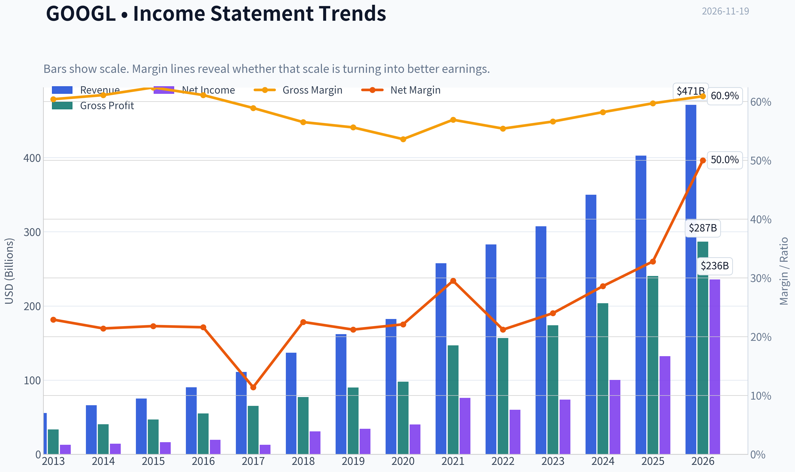

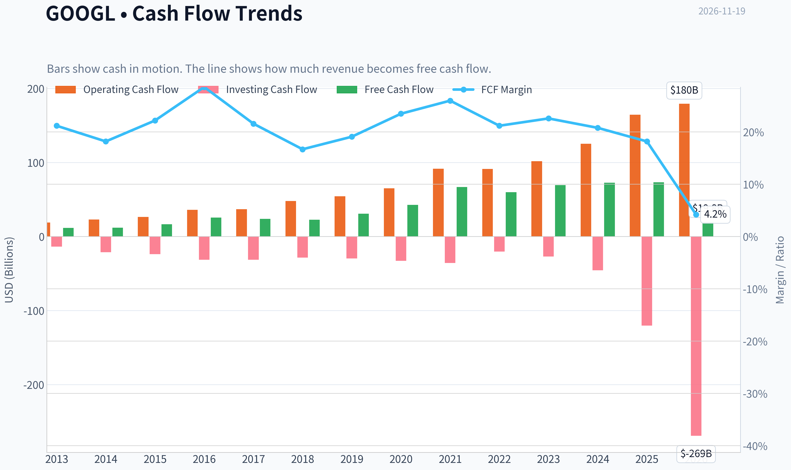

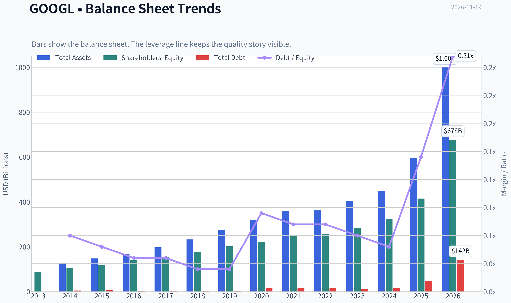

This graph tracks the profitability and return metrics (ROE, ROIC, Margins) of **GOOGL** over the past decade, highlighting capital efficiency trends.

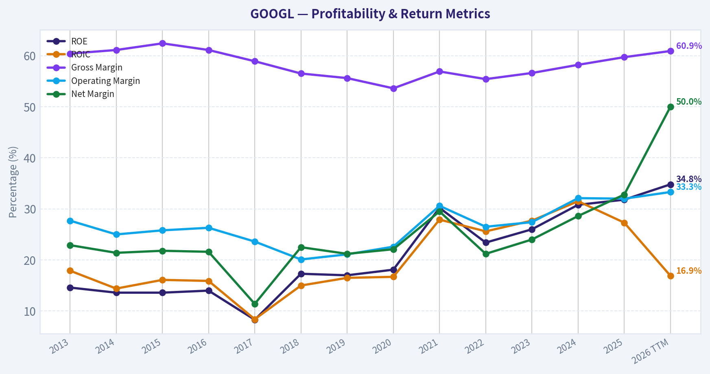

This chart illustrates the financial health of **GOOGL** over the last 10 years, mapping cash equivalents and free cash flow against total obligations (Debt).

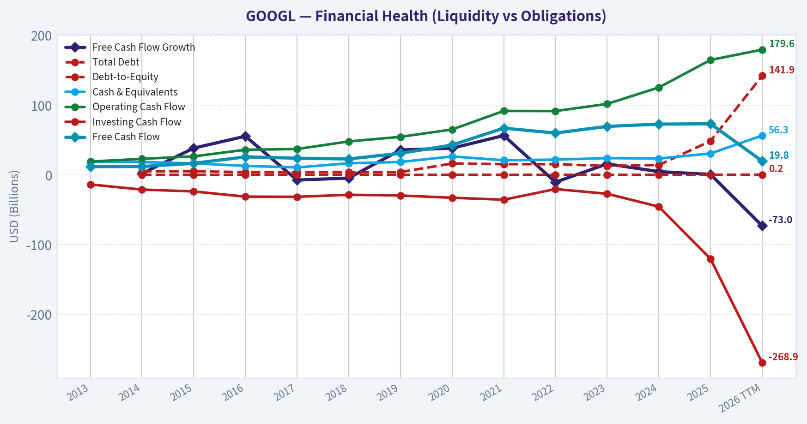

This comparison chart from *Profitability and Earnings Quality* stacks current figures against historical benchmarks for **GOOGL**, making it easy to see where the company trades relative to its own averages.

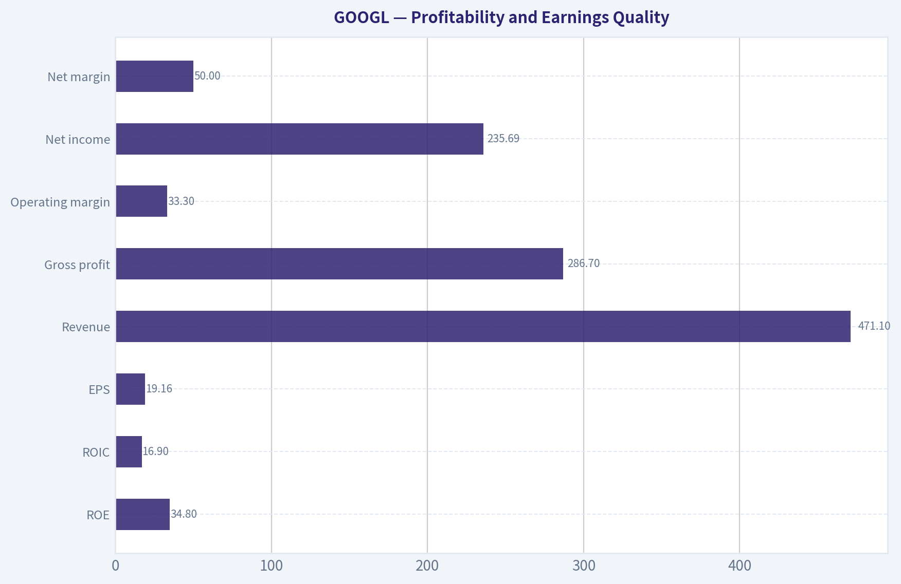

This breakdown chart from <em>Revenue Breakdown</em> shows the proportional composition for **GOOGL** - useful for understanding what drives or risks the business.

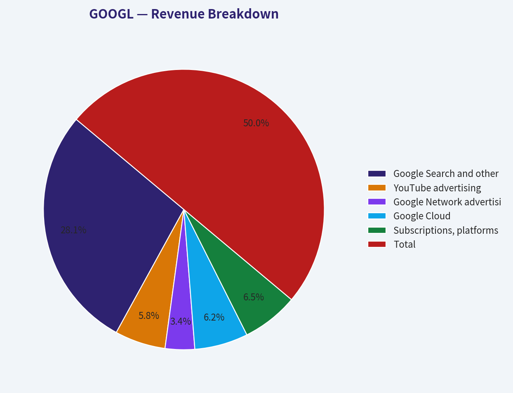

---

### Intrinsic Value Analysis (Buffett)

> *Following Warren Buffett's value investing philosophy: Circle of Competence, Economic Moat, Management Quality, and Margin of Safety.*

#### Intrinsic Value Snapshot

Price is what you pay. Intrinsic value is what the business may be worth based on the cash it can create for owners over time. We show a range, not one magic number.

- Current Price: $272.66
- Value Range (conservative to optimistic across both DCF methods): $117.46 to $195.40

##### Owner Earnings (Buffett Method)
- Net Income: $132,170,000,000.00
- Depreciation & Amortization: N/A
- Capital Expenditures: $-91,447,000,000.00
- Working Capital Changes: $618,000,000.00
- Owner Earnings: $16,553,195,799.18

##### Intrinsic Value
###### Buffett Method
Uses owner earnings. Stricter, and usually more conservative.
- Conservative: $117.46
- Average: $167.80
- Optimistic: $195.40
- Discount Rate: 8.4%

ANALYST STANCE: **Neutral**

#### Executive Summary

Alphabet is a high-quality, asset-light compounder with exceptional gross margins, strong returns on equity, net-cash-like financial strength, and substantial reinvestment opportunities in artificial intelligence, cloud computing, advertising technology, and digital infrastructure.

The central issue is valuation. At **$273 per share**, the market capitalization is approximately **$3.35 trillion**, while the supplied DeepValues estimate is **$116.76 per share**. The reverse-DCF indicates that the current price implies approximately **36.6% annual growth for ten years**, far above the company's reported recent growth and a demanding assumption even for an outstanding business.

#### 1. Factor Scorecard

| Factor | Score | Assessment |
|---|---:|---|
| Circle of competence and simplicity | 4/5 | Alphabet earns most revenue from digital advertising, with additional businesses in cloud, subscriptions, devices, and emerging technology. The model is understandable, though AI investment and regulatory complexity reduce predictability. |
| Durable competitive advantage | 5/5 | Search scale, proprietary data, distribution, advertiser relationships, Android, YouTube, cloud infrastructure, and enormous technical talent base create a wide moat. |
| Management and capital allocation | 4/5 | Strong long-term reinvestment record, substantial buybacks, significant research spending, and conservative financing. The score is below five because AI capital intensity and regulatory decisions require continued scrutiny. |
| Industry structure | 4/5 | Digital advertising and cloud have attractive scale economics, though competition from Microsoft, Amazon, Meta, OpenAI, Anthropic, and other AI developers is intense. |
| Gate 5: quality and solvency floor | **Not tripped** | There is no evidence in the supplied data of deteriorating fundamentals combined with financial distress, weak interest coverage, or an insolvency red line. |

**Key Takeaways:** Alphabet scores highly on business quality, competitive advantages, and financial resilience. The primary weakness is not solvency or business economics; it is the unusually demanding valuation implied by the current market price.

#### 2. Moat Analysis

| Moat source | Evidence | Rating |
|---|---|---:|
| Intangible assets | Google is a default information gateway for billions of users. Search relevance, brand familiarity, advertiser data, and engineering capability are difficult to replicate. | 5/5 |
| Switching costs | Advertisers build campaigns, measurement systems, and customer acquisition processes around Google. Android, Workspace, Cloud, and YouTube also embed Alphabet into user and enterprise workflows. | 4/5 |
| Cost advantage | Search and advertising operate at enormous scale with highly attractive incremental economics. The company's reported gross margin is **59.7%**. | 5/5 |
| Network effects | More users generate more queries and behavioral data; more advertisers improve marketplace liquidity; more cloud customers support infrastructure scale. | 5/5 |
| Moat durability | Wide and likely durable, though AI interfaces could alter how users discover information and how advertising is monetized. | 4.5/5 |

**Key Takeaways:** Alphabet's moat is based on scale, data, distribution, engineering, and ecosystem integration rather than a single patent or product. Artificial intelligence is both a threat to the traditional search interface and a major opportunity for Alphabet to extend its moat.

#### 3. Financial Summary

| Metric | Supplied value |
|---|---:|
| Current share price | $273 |
| Market capitalization | $3.35 trillion |
| Price-to-earnings ratio | 14.2x |
| Return on equity | 31.8% |
| Gross margin | 59.7% |
| Revenue growth, year over year | 15.1% |
| Free-cash-flow yield | 2.2% |
| Implied annual free cash flow | Approximately $73.7 billion |
| Current ratio | 2.01x |
| Reverse-DCF growth implied by price | Approximately 36.6% annually for 10 years |
| Trailing three-year growth rate | -27.3% |
| Trailing five-year growth rate | 10.0% |

**Key Takeaways:** Alphabet combines a 31.8% ROE with a 59.7% gross margin and 15.1% reported revenue growth, demonstrating strong economics and continued expansion. However, the 2.2% free-cash-flow yield means the market price already discounts a substantial amount of future success.

#### 4. Owner Earnings Calculation

Using free cash flow as a practical proxy for owner earnings:

| Owner earnings bridge | Approximate amount |
|---|---:|
| Net income | Not supplied in the research pack |
| Add: depreciation and amortization | Not supplied |
| Less: maintenance capital expenditure | Not separately supplied |
| Less: working-capital investment | Not separately supplied |
| Free cash flow proxy for owner earnings | Approximately $73.7 billion |
| Owner earnings per share proxy | Approximately $6.01 |

The free-cash-flow estimate is derived from the **$3.35 trillion market capitalization** and the reported **2.2% FCF yield**. Alphabet's reported cash generation is an important strength, but the company is investing heavily in data centers, networking, AI infrastructure, and technical talent. Therefore, reported free cash flow may understate or overstate normalized owner earnings depending on how much current capital spending is viewed as growth investment versus maintenance investment.

#### 5. Three-Scenario DCF Valuation

The research pack identifies the intrinsic value as a **DVI estimate**, not a DeepValues app headline value. Accordingly, the following scenarios are sensitivity checks, while the official supplied intrinsic value remains **$116.76 per share**.

| Scenario | Key assumptions | Approximate value per share |
|---|---|---:|
| A: No growth | Owner earnings of $73.7 billion; 10% discount rate; no growth | $60 |
| B: GDP growth | 3% perpetual growth; 10% discount rate | $88 |
| C: Historical-growth sensitivity | 5% growth, representing approximately half of the supplied five-year growth rate; 10-year projection | Approximately $124 |
| DVI blended estimate | Weighted blend of Damodaran FCFF, reverse-DCF fair value, and owner-earnings DCF | **$116.76** |

The supplied component estimates are:

- Owner-earnings DCF: **$115.82**
- FCF model: **$46.01**
- Damodaran FCFF: **$166.40**
- Blended DVI estimate: **$116.76**

**Key Takeaways:** The conservative scenarios produce values materially below the current price, while the historical-growth sensitivity reaches only about $124 per share. The blended estimate of $116.76 is therefore consistent with a high-quality business whose current valuation requires unusually strong future execution.

#### 6. Margin of Safety Analysis

| Measure | Result |
|---|---:|
| Current price | $273 |
| DVI intrinsic-value estimate | $116.76 |
| Premium to intrinsic value | Approximately 134% |
| Conventional margin of safety, relative to price | Approximately -57% |
| Headline DVI margin of safety convention | -133.5% |
| Price-implied 10-year annual growth | Approximately 36.6% |

The headline margin-of-safety figure of **-133.5%** expresses the shortfall relative to intrinsic value. On the more conventional basis of intrinsic value compared with market price, the estimate is approximately **57% below the current price**.

Even allowing for Alphabet's wide moat and high reinvestment potential, a price implying 36.6% annual growth for a decade appears to require heroic execution. The valuation does not provide the 10% to 15% quality-adjusted margin of safety appropriate for a wide-moat compounder.

#### 7. Management Quality and Capital Allocation

| Area | Assessment |
|---|---|
| Owner orientation | Significant insider and institutional ownership aligns management with long-term shareholder outcomes, although founder-level control and voting structure reduce ordinary shareholder influence. |
| Reinvestment | Alphabet has historically reinvested heavily in search, YouTube, cloud, AI research, infrastructure, and new products. |
| Buybacks | Large repurchases have reduced share count and returned capital, though their value depends on the price paid. |
| Balance-sheet policy | Strong liquidity and conservative leverage provide flexibility for research, acquisitions, infrastructure, and shareholder distributions. |
| Candor and governance | The company has generally maintained strong financial reporting standards, but the scale of AI investment and regulatory exposure warrants ongoing monitoring. |
| Overall score | **4/5** |

**Key Takeaways:** Management has demonstrated the ability to convert scale into high-margin growth while funding significant research and infrastructure programs. The main allocation question is whether current AI spending produces returns commensurate with the enormous capital commitment.

#### 8. Buffett Scorecard

| Criterion | Weight | Score | Weighted result |
|---|---:|---:|---:|
| Moat width and durability | 25% | 5 | 1.25 |
| Valuation and margin of safety | 20% | 1 | 0.20 |
| Capital returns: ROIC versus WACC | 15% | 4 | 0.60 |
| Business understanding and predictability | 12% | 4 | 0.48 |
| Management quality and capital allocation | 12% | 4 | 0.48 |
| Reinvestment runway | 8% | 4 | 0.32 |
| Balance-sheet strength | 4% | 5 | 0.20 |
| Industry structure | 4% | 4 | 0.16 |
| **Total** | **100%** |  | **3.69/5** |

#### 9. Investment Stance

**ANALYST STANCE: Neutral**

**Conviction: High on business quality; high on valuation concern.**

Alphabet is a wonderful business by most operating measures: wide moat, high margins, excellent returns on equity, strong cash generation, substantial financial flexibility, and a long reinvestment runway. Warren Buffett's Berkshire Hathaway disclosed a **78.79 million-share Alphabet holding valued at approximately $27.11 billion as of September 30, 2026**, reinforcing the recognition of Alphabet's quality.

However, the evidence does not support the valuation at **$273 per share** under the supplied intrinsic-value framework. The price requires growth well beyond the company's reported five-year rate and leaves little room for search disruption, regulatory pressure, AI competition, or lower-than-expected returns on infrastructure spending. The appropriate conclusion is therefore **Neutral**: a superior company whose present valuation does not offer an adequate margin of safety.
#### Valuation Bridge

This bridge places the current market price beside each intrinsic value lens so readers can see whether upside depends on one method or shows up across several methods.

| Scenario | Intrinsic Value / Share |
| --- | ---: |
| Buffett Method | $167.80 |
| Damodaran Method | $184.07 |
| Current Price | $272.66 |

#### Key Takeaways

If one method is far above the others, the upside case depends on a specific modelling assumption. When several methods cluster together, the valuation story is more robust.

#### Valuation Visuals

This comparison chart from *Latest Earnings Snapshot* stacks current figures against historical benchmarks for **GOOGL**, making it easy to see where the company trades relative to its own averages.

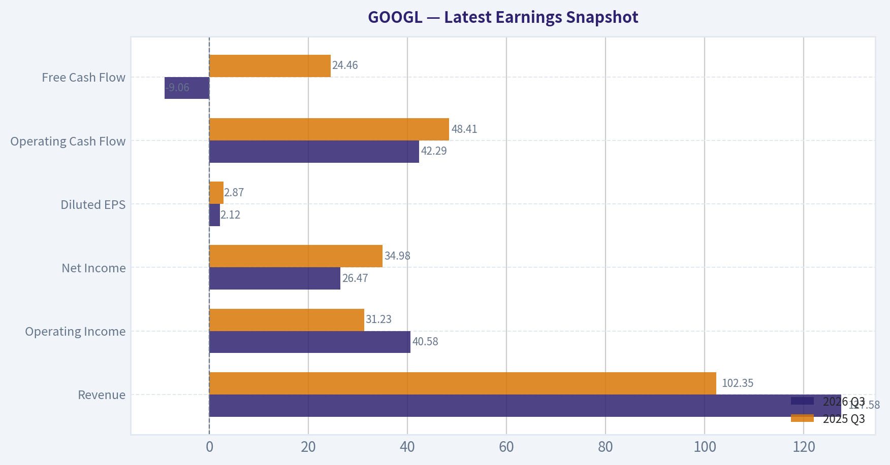

This comparison chart from *Current Versus Historical Average* stacks current figures against historical benchmarks for **GOOGL**, making it easy to see where the company trades relative to its own averages.

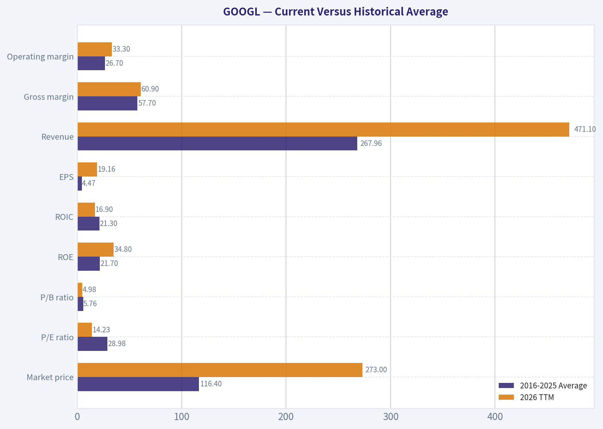

This comparison chart from *Financial Summary* stacks current figures against historical benchmarks for **GOOGL**, making it easy to see where the company trades relative to its own averages.

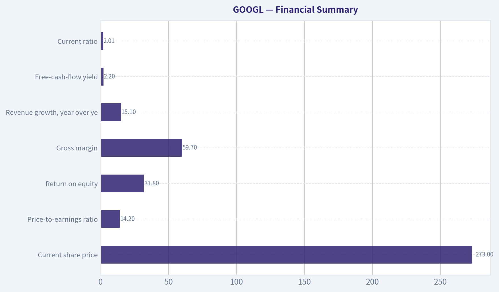

---

### Trend & Growth Analysis (Lynch/Druckenmiller/Fisher)

> *Following Peter Lynch's GARP, Stanley Druckenmiller's macro-aware approach, and Philip Fisher's scuttlebutt methodology.*

ANALYST STANCE: **Neutral**

#### Executive Summary

Alphabet is a **fast grower by current revenue momentum**, with a strong competitive moat, expanding artificial-intelligence opportunity, high profitability, and substantial net cash. However, the valuation evidence is unusually conflicted: headline earnings multiples appear moderate, while cash-flow and reverse-DCF models imply that the current price requires very aggressive long-term growth. The principal question is whether AI monetization can accelerate growth enough to justify the market's embedded expectations.

#### 1. Lynch Classification

| Classification | Assessment |
|---|---|
| Category | Fast grower / mature mega-cap compounder |
| Revenue growth | 15.1% reported YoY; 16.9% in the supplied TTM series |
| Five-year revenue CAGR | 17.2% |
| Profitability | Approximately 60% gross margin and 32% operating margin |
| Balance sheet | Strong liquidity; net cash reported |
| Growth-investing fit | Strong business quality, but less obvious ten-bagger arithmetic at a $3.35 trillion market capitalization |

**Key Takeaways:** Alphabet currently fits the fast-grower category at the revenue level, although its scale makes sustained 20% growth increasingly difficult. It is better characterized as a high-quality mega-cap compounder than as a small-company ten-bagger candidate.

#### 2. The Story in Three Bullets

- Alphabet monetizes global intent and attention through Search, YouTube, advertising technology, cloud computing, subscriptions, and emerging AI products.
- Google Cloud and AI services can expand the addressable market beyond advertising while increasing monetization of existing users and enterprise customers.
- The company combines a powerful distribution network, proprietary data, engineering depth, and a net-cash balance sheet with unusually high operating profitability.

#### 3. TAM Analysis and the 10x Test

A precise consolidated TAM is difficult because Alphabet participates in several markets rather than one. The relevant opportunity set includes global digital advertising, cloud infrastructure and applications, AI computing and services, video, payments, subscriptions, and autonomous mobility.

| TAM factor | Assessment |
|---|---|
| Current revenue base | Approximately $471 billion TTM in the supplied data |
| Ten-times revenue test | Approximately $4.7 trillion revenue |
| Ability to reach 10x while remaining below 20% share | Unlikely on today's market definitions; possible only if AI creates major new categories |
| TAM growth | Digital advertising and cloud are established growth markets; AI-related markets are expanding rapidly but remain uncertain |
| Runway | Substantial for AI, Cloud, YouTube monetization, and subscriptions |
| Constraint | Search cannibalization, regulatory intervention, infrastructure spending, and enormous current scale |

**Key Takeaways:** Alphabet has a large and expanding runway, especially if AI becomes a new monetization layer rather than merely a cost center or Search substitute. The conventional 10x test is demanding at Alphabet's current size, so the ten-bagger thesis depends on significant TAM creation rather than simple market-share gains.

#### 4. Revenue Growth Trend

| Period | Revenue growth |
|---|---:|
| 2022 | 9.8% |
| 2023 | 8.7% |
| 2024 | 13.9% |
| 2025 | 15.1% |
| 2026 TTM, supplied series | 16.9% |
| Three-year revenue CAGR | 12.5% |
| Five-year revenue CAGR | 17.2% |

**Key Takeaways:** The reported pattern shows a clear recovery from the 2022-2023 slowdown, with growth reaccelerating into the mid-teens. This is a meaningful positive inflection, although the supplied figures contain some period and methodology differences, so quarterly segment data should confirm whether acceleration is broad-based and durable.

#### 5. Unit Economics and Operating Efficiency

| Metric | Available evidence | Interpretation |
|---|---:|---|
| Gross margin | 59.7% reported; 60.9% in TTM series | Strong platform economics |
| Operating margin | Approximately 32%-33% | Significant operating leverage |
| Net revenue retention | Not disclosed in the supplied data | Not applicable at consolidated-company level |
| LTV/CAC | Not disclosed | Cannot be reliably calculated |
| Rule of 40 | Not directly applicable; using 15.1% growth plus 32.8% net margin gives 47.9% | Strong, though net margin is not FCF margin |
| FCF margin | 4.2% in the supplied TTM series | Distorted by elevated AI infrastructure investment and data inconsistency |
| Current ratio | 2.01 | Strong liquidity |

**Key Takeaways:** Alphabet's gross and operating margins indicate excellent underlying economics. The most important near-term issue is whether the substantial AI infrastructure build-out converts into higher revenue and durable cash generation; the supplied FCF figures conflict with the company's otherwise strong cash-generation profile and warrant verification from the latest filing.

#### 6. Inflection Point Assessment

| Potential inflection | Evidence | Status |
|---|---|---|
| AI product cycle | AI Overviews, Gemini, cloud AI services, and infrastructure investment | Positive but unproven at full scale |
| Cloud profitability | Cloud is a growing enterprise platform with improving economics | Positive |
| Search monetization | AI may improve query utility but may also alter ad formats and traffic economics | Mixed |
| Margin inflection | Operating margin around 32%-33% | Positive, subject to AI capex |
| TAM expansion | AI broadens Alphabet's addressable markets | Potentially significant |
| Competitive position | Strong distribution, data, infrastructure, and talent | Positive |

**Key Takeaways:** The principal inflection is the transition from AI as an investment cycle to AI as a monetization cycle. Alphabet already has the distribution and infrastructure needed to benefit, but the evidence must show that AI revenue growth exceeds cannibalization and incremental computing costs.

#### 7. Macro Setup

| Macro factor | Implication for Alphabet |
|---|---|
| AI secular trend | Strong tailwind |
| Cloud adoption | Structural tailwind |
| Digital advertising | Positive but economically sensitive |
| Interest rates | Higher rates pressure long-duration valuation; falling rates would be supportive |
| Economic cycle | Advertising revenue remains exposed to business confidence |
| Regulation | Material risk in antitrust, distribution, privacy, and AI governance |
| Capital intensity | AI infrastructure raises near-term reinvestment requirements |

**Key Takeaways:** The secular backdrop is favorable because AI and cloud adoption are still expanding. Macro sensitivity remains meaningful because advertising is cyclical and higher rates increase the discount applied to future cash flows.

#### 8. Fisher's 15-Point Score

| Fisher criterion | Score / 5 | Rationale |
|---|---:|---|
| Market potential | 5 | Advertising, cloud, AI, video, and subscriptions |
| New-product determination | 5 | Sustained investment across AI and adjacent platforms |
| R&D effectiveness | 5 | Deep research and engineering capabilities |
| Sales organization | 4 | Strong enterprise and advertising distribution |
| Profit margins | 5 | Exceptional operating economics |
| Margin improvement | 4 | Strong, but AI investment may pressure cash margins |
| Labor relations | 3 | Talent strength, with periodic workforce friction |
| Executive relations | 4 | Generally strong operating continuity |
| Management depth | 5 | Broad technical and operating bench |
| Cost analysis | 4 | Sophisticated scale economics; AI costs are evolving |
| Outstanding aspects | 5 | Distribution, data, ecosystem, infrastructure, switching costs |
| Long-range outlook | 5 | Strong if AI creates incremental monetization |
| Dilution | 4 | No major dilution issue indicated |
| Management candor | 4 | Generally credible, though AI disclosures remain developing |
| Management integrity | 4 | Strong overall record, subject to regulatory scrutiny |
| **Total** | **66 / 75** | **Outstanding range** |

**Key Takeaways:** Alphabet scores in the outstanding Fisher range because of market potential, R&D depth, competitive advantages, and management scale. The main deductions relate to labor friction, disclosure uncertainty around AI economics, and the difficulty of assessing future infrastructure returns.

#### 9. Valuation Analysis

| Valuation measure | Result | Interpretation |
|---|---:|---|
| Current price | Approximately $273 | Reference market price |
| Market capitalization | Approximately $3.35 trillion | Mega-cap scale |
| TTM P/E | 14.2x | Low relative to historical quality and growth, assuming earnings quality is normal |
| Forward P/E | 17.8x | More demanding than the trailing multiple |
| Price-to-sales | 7.1x | Reasonable only with sustained high margins and growth |
| PEG using 15.1% growth | Approximately 0.94 | Near Lynch's attractive threshold |
| PEG using five-year CAGR | Approximately 0.83 | Mechanically attractive |
| FCF yield | 2.2% | Indicates a demanding cash-flow valuation |
| Damodaran FCFF base value | $184.07 per supplied model | Below current price |
| Owner-earnings base value | $167.80 per supplied model | Below current price |
| Reverse-DCF implication | Approximately 36.6% annual owner-earnings growth for 10 years | Highly demanding |

**Key Takeaways:** The earnings-based PEG looks attractive, but the cash-flow-based evidence is much less favorable. The valuation therefore depends heavily on whether current earnings are a reliable representation of future cash generation and whether AI investment produces unusually high returns.

#### 10. Scenario Framework

| Scenario | Operating assumption | Valuation implication |
|---|---|---|
| Bear | Search growth slows, AI cannibalizes monetization, and infrastructure spending remains elevated | Multiple compression and lower cash-flow value |
| Base | Mid-teens revenue growth moderates gradually, Cloud expands, and AI monetization offsets much of the investment burden | Quality compounder valuation, but limited room for execution misses |
| Bull | AI creates major incremental demand, Cloud accelerates, and operating leverage returns despite infrastructure investment | Current valuation becomes more defensible |

**Key Takeaways:** The bull case requires more than continued Search durability; it requires AI and Cloud to create substantial incremental revenue and profit pools. The base case supports a strong business but does not clearly resolve the gap between market price and the supplied intrinsic-value models.

#### 11. Growth Investor Scorecard

| Criterion | Weight | Score / 5 | Weighted contribution |
|---|---:|---:|---:|
| Story clarity | 10% | 4.5 | 0.45 |
| TAM and runway | 20% | 4.0 | 0.80 |
| Revenue growth | 20% | 4.0 | 0.80 |
| Unit economics | 15% | 4.0 | 0.60 |
| Competitive position | 10% | 4.8 | 0.48 |
| Management quality | 10% | 4.2 | 0.42 |
| Macro setup | 5% | 4.0 | 0.20 |
| Profitability path | 5% | 4.2 | 0.21 |
| Valuation | 5% | 2.5 | 0.13 |
| **Total** | **100%** |  | **4.09 / 5.00** |

**Key Takeaways:** Alphabet's business quality and growth setup score strongly, producing a score above 4.0 before valuation constraints. The valuation score is the limiting factor, keeping the overall stance at Neutral rather than a higher-conviction classification.

#### 12. Valuation Sensitivity

| Variable | More favorable outcome | Less favorable outcome |
|---|---|---|
| Revenue growth | Sustained 18%-20% growth through AI and Cloud | Deceleration toward low double digits |
| Operating margin | Returns toward mid-30s despite AI spending | Persistent pressure from infrastructure investment |
| FCF conversion | Capex intensity normalizes and cash flow catches up | AI capex remains structurally high |
| Terminal growth | AI creates durable new markets | AI mainly substitutes for existing Search economics |
| Regulatory outcome | Limited effect on distribution and monetization | Material changes to Search, data, or platform practices |
| Implied valuation | Current market valuation becomes more supportable | Supplied DCF gap widens |

**Key Takeaways:** The valuation is most sensitive to cash-flow conversion and AI monetization, not merely to reported revenue growth. A continuation of mid-teens growth without improving free-cash-flow conversion would provide less support for the current valuation than the headline P/E suggests.

#### Key Risks and Catalysts

| Catalysts | Risks |
|---|---|
| AI Overviews and Gemini monetization | Search cannibalization |
| Google Cloud acceleration | Large and persistent AI capital spending |
| Higher YouTube engagement and advertising yield | Antitrust and regulatory remedies |
| AI infrastructure revenue and services | Competitive pressure from Microsoft, OpenAI, Anthropic, and open models |
| Operating leverage after the infrastructure cycle | Advertising slowdown or recession |
| New subscription and consumer AI products | Talent retention and execution complexity |

**Key Takeaways:** The central catalyst is evidence that AI adds profitable revenue rather than simply increasing costs or replacing existing Search activity. The central risk is that Alphabet remains a high-quality business while the market price assumes a stronger and faster AI earnings transformation than the operating data ultimately supports.

#### Final Assessment

Alphabet has an outstanding competitive franchise, a large AI-enabled runway, improving revenue momentum, and Fisher-quality innovation characteristics. The key analytical conflict is valuation: the trailing P/E and PEG appear reasonable, while the supplied intrinsic-value and reverse-DCF calculations imply that the current market price already discounts a very strong AI outcome. The evidence supports continued monitoring of AI revenue, Search monetization, Cloud growth, capital intensity, and free-cash-flow conversion before the valuation case becomes clearer.

#### Growth & Scorecard Visuals

This comparison chart from *Growth Metrics* stacks current figures against historical benchmarks for **GOOGL**, making it easy to see where the company trades relative to its own averages.

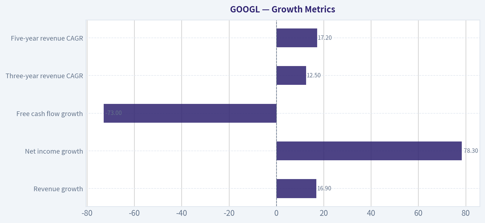

---

### Market Technical Analysis

ANALYST STANCE: **Neutral**

#### GOOGL technical market report

**Security:** Alphabet Inc. Class A, Nasdaq: GOOGL
**Data status:** The latest available trading session is **November 18, 2026**, when GOOGL closed at **$282.44**. November 19 is listed as a non-trading day in the indicator feed, so no current-session price or indicator values are available.

#### Indicator set selected

The analysis uses eight complementary indicators:

- **close_10_ema:** Short-term price direction and momentum.
- **close_50_sma:** Intermediate trend structure.
- **close_200_sma:** Longer-term trend benchmark.
- **macd:** Direction and persistence of momentum.
- **rsi:** Momentum stress and potential exhaustion.
- **boll_ub:** Distance from the upper volatility envelope, useful for judging whether price remains in a strong upside regime.
- **atr:** Current movement intensity and market risk.
- **vwma:** Price trend adjusted for trading volume.

This combination balances trend, momentum, volatility, and volume without adding redundant oscillators.

#### Price action and trend structure

GOOGL's one-year path has been highly volatile. The stock rose from approximately **$292 in November 2025** to an intraperiod high near **$408 in May 2026**, followed by a prolonged series of swings and a substantial autumn breakdown. The most important recent event was the sharp decline from **$324.89 on October 28** to **$283.82 on October 29**, accompanied by exceptionally high volume of approximately **139.7 million shares**. That move materially changed the technical structure because it pushed price below the nearby moving-average cluster and established a lower trading range.

The subsequent rebound was limited. GOOGL recovered to **$298.70 on November 12**, but failed to sustain that improvement and declined to **$280.20 on November 17**. The November 18 close at **$282.44** represents only a modest recovery from that low and remains well below the October breakdown area. This pattern indicates that the recent bounce has not yet repaired the broader sequence of lower highs and lower trading levels.

The short-term and intermediate trend measures are decisively weak:

- The **10-day EMA is $288.62**, around **2.2% above** the latest close.
- The **50-day SMA is $324.96**, around **15.1% above** the latest close.
- The **200-day SMA is $337.33**, around **19.4% above** the latest close.

The declining 10-day EMA shows that short-term momentum remains negative, while the falling 50-day SMA confirms that weakness is no longer confined to a few isolated sessions. The 200-day SMA is also beginning to slope downward, though it remains a slower-moving measure. Price below both the 50-day and 200-day averages indicates that the longer-term trend confirmation is unfavorable.

#### Momentum interpretation

The **MACD is -12.27** as of November 18. It has improved slightly from **-16.57 on November 6**, suggesting that the rate of downside momentum has moderated from its most intense phase. However, the MACD remains substantially below zero, so the improvement currently resembles a partial stabilization rather than a confirmed trend reversal.

The **RSI is 34.92**, up from the deeply weak readings near **21 to 30** recorded during late October and early November. This recovery shows that selling pressure has eased somewhat, but RSI remains below the neutral 50 area and only modestly above the conventional oversold threshold of 30. The reading therefore reflects weak momentum with some potential for short-term mean reversion, not broad upside momentum.

The combination of a negative MACD and sub-50 RSI is important. RSI has improved more quickly than MACD, which can occur during an initial rebound after a sharp decline. For the technical picture to become materially stronger, momentum would generally need to progress from merely less negative toward sustained positive territory.

#### Volatility and volume-adjusted price behavior

The **ATR is $9.78**, compared with approximately **$8.1 to $8.6** before the October breakdown. At the latest close, this represents roughly **3.5% of the share price**, indicating that daily price movement remains substantial. Although ATR has declined from the immediate post-breakdown peak above $10.8, it remains elevated relative to the quieter conditions seen before late October.

The **VWMA is $286.61**, slightly above the latest close. This is a relatively constructive development compared with the much larger gap between price and the longer moving averages, but the interpretation is limited: price has only recently moved near the volume-weighted average after the sharp decline, and the VWMA itself has fallen rapidly from approximately **$346.56 on October 21** to **$286.61**. That steep decline shows that traded volume has been concentrated during a weakening price regime.

The upper Bollinger Band is **$328.08**, far above the latest close. GOOGL is therefore not operating near the upper side of its recent volatility envelope or displaying the type of upside expansion associated with a strong bullish breakout. Because only the upper band was requested, the exact lower-band distance is not available here; nevertheless, the large gap between price and the upper band confirms that the stock remains well below its recent volatility midpoint and upper range.

#### Fine-grained synthesis

The evidence is not uniformly negative in the narrowest short-term sense. RSI has recovered from very depressed levels, MACD has become less negative, ATR has eased from its peak, and the November 18 close was slightly below but near the VWMA rather than dramatically beneath it. These details indicate that the initial liquidation phase has moderated.

However, the broader evidence remains weak. Price is below all three major moving averages, the 10-day EMA is declining, the 50-day and 200-day averages are above the market, MACD remains deeply negative, and the failed rebound toward $300 was followed by another decline. The high-volume October 29 breakdown is especially significant because it suggests a substantial repricing event rather than an ordinary low-volume fluctuation.

From a valuation perspective, technical data alone cannot establish whether Alphabet's current market valuation is supported by its earnings, cash flows, growth outlook, or competitive position. The technical evidence instead indicates that the market has not yet confirmed a durable recovery in the valuation being assigned to GOOGL. The principal analytical question is whether the recent stabilization develops into sustained momentum or remains a temporary pause within a larger downtrend.

| Area | Latest evidence | Interpretation |
|---|---:|---|
| Latest available close | $282.44 on Nov. 18, 2026 | Latest session is below the recent rebound range and below major trend averages |
| 10-day EMA | $288.62 | Short-term momentum remains unfavorable; price is below the responsive average |
| 50-day SMA | $324.96 | Intermediate trend is decisively weak, with the average declining |
| 200-day SMA | $337.33 | Long-term trend benchmark remains well above price and has begun to slope lower |
| MACD | -12.27 | Downside momentum has moderated from early November but remains clearly negative |
| RSI | 34.92 | Weak momentum; improved from oversold conditions but remains below neutral |
| VWMA | $286.61 | Price is close to the volume-weighted average, but the VWMA has fallen sharply |
| ATR | $9.78 | Daily volatility remains elevated at roughly 3.5% of the latest close |
| October 29 event | Close fell from $324.89 to $283.82; volume 139.7 million | High-volume breakdown materially weakened the technical structure |
| Overall implication | Trend weak, short-term stress easing | Evidence supports monitoring for confirmation rather than treating the recent rebound as established recovery |

**Key Takeaways:** GOOGL remains in a broad technical downtrend, with the latest close below the 10-day EMA, 50-day SMA, and 200-day SMA. Momentum indicators show that selling pressure has eased from its late-October extreme, but MACD remains negative and RSI is still below neutral. The high-volume October breakdown and failed rebound toward $300 continue to weigh on the market's valuation assessment, while the available evidence does not yet confirm a durable recovery.

---

### Options Market Analysis

> *Reading options flow - put/call ratios, IV skew, and unusual activity - to gauge institutional positioning and event-driven risk.*

ANALYST STANCE: **BEARISH**

#### GOOGL Options Market Overview

Data is for November 19, 2026, with expirations concentrated between November 20 and November 25. The options market shows a sharp divergence: call open interest is much larger than put open interest, but near-term trading volume is slightly put-dominant and downside implied volatility is substantially higher.

| Expiration | Call OI | Put OI | Put/Call OI | Call Volume | Put Volume | Put/Call Volume | Call ATM IV | Put ATM IV |
|---|---:|---:|---:|---:|---:|---:|---:|---:|
| Nov. 20, 2026 | 535,195 | 170,861 | 0.32 | 155,120 | 194,847 | 1.26 | 46.4% | 47.4% |
| Nov. 23, 2026 | 6,909 | 6,143 | 0.89 | 19,929 | 6,584 | 0.33 | 37.5% | 39.7% |
| Nov. 25, 2026 | 3,652 | 2,419 | 0.66 | 9,938 | 2,376 | 0.24 | 40.4% | 43.3% |
| **Total** | **545,756** | **179,423** | **0.33** | **184,987** | **203,807** | **1.10** | - | - |

**Key Takeaways:** The aggregate put/call OI ratio of 0.33 is well below the approximately 0.70 neutral baseline, reflecting substantial call-heavy open interest. However, the 1.10 volume ratio indicates slightly greater put activity today across the near-term expirations, which is a more cautionary signal than the OI ratio alone.

#### Put/Call Ratio Analysis

The 0.33 near-term put/call OI ratio is strongly call-heavy. This can reflect bullish speculation, short-call overwriting, or existing call structures rather than outright directional call buying. Because open interest does not reveal whether contracts were bought or sold, the ratio should not be interpreted as purely bullish.

The volume ratio of 1.10 is more notable from a short-term risk perspective. It indicates that puts traded modestly more actively than calls, with the imbalance concentrated in the November 20 expiration. Relative to the 0.70 neutral reference, the OI reading is bullish-looking, while current volume is mildly defensive or bearish.

#### Implied Volatility Assessment

| Expiration | ATM Call IV | ATM Put IV | Put Minus Call IV | Interpretation |
|---|---:|---:|---:|---|
| Nov. 20, 2026 | 46.4% | 47.4% | +1.0 percentage point | Mild downside skew |
| Nov. 23, 2026 | 37.5% | 39.7% | +2.2 points | Moderate downside skew |
| Nov. 25, 2026 | 40.4% | 43.3% | +2.9 points | Strongest downside skew |

The unusual put contracts show much more extreme skew than the ATM figures. November 20 puts from $330 through $365 carry implied volatility ranging from approximately 170% to 218%, compared with roughly 41% to 44% for several near-term calls. This is a pronounced market premium for downside protection or downside speculation.

The data does not identify a specific earnings release, product launch, or other catalyst. Therefore, elevated short-dated IV should be treated as event-risk pricing, but the catalyst cannot be confirmed from the supplied chain.

**Key Takeaways:** Put IV exceeds call IV across every listed expiration, and the gap widens further for far-out-of-the-money puts. That steep downside skew signals meaningful demand for crash protection or bearish convexity, despite the call-heavy open-interest profile.

#### Unusual Options Activity

The data source identifies contracts with volume greater than five times open interest. Because trade direction, bid-ask execution, and opening-versus-closing flags are unavailable, these are best treated as fresh-flow candidates rather than confirmed purchases.

| Expiration | Type | Strike | Volume | OI | Volume/OI | IV | DTE | Interpretation |
|---|---|---:|---:|---:|---:|---:|---:|---|
| Nov. 20 | Put | $330 | 25,701 | 2,823 | 9.1x | 169.9% | 1 | Large downside-risk activity |
| Nov. 20 | Put | $335 | 14,035 | 1,346 | 10.4x | 179.9% | 1 | Heavy short-dated downside demand |
| Nov. 20 | Put | $287.50 | 10,042 | 560 | 17.9x | 66.9% | 1 | High-volume lower-strike downside trade |
| Nov. 20 | Put | $340 | 6,727 | 986 | 6.8x | 189.7% | 1 | Additional downside protection/speculation |
| Nov. 20 | Put | $355 | 6,668 | 645 | 10.3x | 211.0% | 1 | Very expensive tail-risk exposure |
| Nov. 20 | Put | $350 | 6,663 | 777 | 8.6x | 192.7% | 1 | Strong downside skew participation |
| Nov. 20 | Call | $282.50 | 6,275 | 370 | 17.0x | 40.7% | 1 | Possible bullish or upside-recovery trade |
| Nov. 20 | Call | $287.50 | 6,098 | 1,130 | 5.4x | 43.6% | 1 | Fresh call activity, direction uncertain |
| Nov. 23 | Call | $300 | 5,965 | 913 | 6.5x | 43.5% | 4 calendar days | Possible bullish speculation |
| Nov. 20 | Put | $345 | 5,264 | 617 | 8.5x | 183.9% | 1 | Downside protection/speculation |
| Nov. 20 | Put | $365 | 4,379 | 526 | 8.3x | 218.0% | 1 | Extreme tail-risk pricing |
| Nov. 20 | Put | $292.50 | 3,803 | 467 | 8.1x | 69.0% | 1 | Fresh downside activity |
| Nov. 23 | Call | $305 | 3,003 | 172 | 17.5x | 47.5% | 4 calendar days | High relative turnover, likely speculative |
| Nov. 20 | Put | $360 | 2,349 | 321 | 7.3x | 209.7% | 1 | Expensive tail hedge/speculation |
| Nov. 25 | Call | $300 | 2,016 | 340 | 5.9x | 42.0% | 6 calendar days | Fresh call activity |

The current GOOGL share price was not included in the supplied data, so exact ITM, ATM, and OTM classifications cannot be verified. Assuming the stock is trading near the $300 area suggested by the active call strikes, the $330-$365 puts would be out of the money, while the $282.50 and $287.50 calls would be in the money; this assumption should not be treated as confirmed.

The largest and most repeated unusual flow is in one-day-to-expiration puts, particularly the $330-$355 strikes. That concentration is more consistent with urgent hedging or bearish convexity demand than with ordinary retail lottery activity, although execution data is required to distinguish institutional hedges from speculative buying.

**Key Takeaways:** Unusual activity is dominated by one-day puts with exceptionally high volume-to-open-interest ratios and very high implied volatility. There is also fresh call activity around the $282.50-$305 strikes, but its size and IV profile are less extreme than the downside flow. The unusual-flow balance therefore favors near-term downside risk management or bearish speculation.

#### Open Interest Concentration and Gamma Considerations

| Expiration | Total Call OI | Total Put OI | Total OI | Market-Structure Implication |
|---|---:|---:|---:|---|
| Nov. 20 | 535,195 | 170,861 | 706,056 | Dominant near-term expiry; strongest potential pinning and gamma effects |
| Nov. 23 | 6,909 | 6,143 | 13,052 | Much smaller secondary concentration |
| Nov. 25 | 3,652 | 2,419 | 6,071 | Limited open-interest influence |

The November 20 expiration contains approximately 97% of the combined call and put open interest across the three listed expirations. This makes it the primary potential gravitational zone for short-term price behavior. However, strike-level open-interest data and dealer-gamma estimates were not supplied, so a specific gamma wall or max-pain level cannot be identified reliably.

The large call OI concentration could dampen price movement near heavily populated call strikes if dealers are hedged in a stabilizing manner. Conversely, the dense cluster of short-dated puts and sharply rising put IV could amplify downside movement if the stock moves through key strikes and hedging flows become destabilizing.

**Key Takeaways:** Nearly all near-term open interest is concentrated in the November 20 expiration, so expiration-related pinning or sharp hedging flows may dominate short-term trading behavior. The exact gamma direction remains uncertain because strike-by-strike OI and dealer positioning are unavailable.

#### Overall Options Sentiment Signal

The overall signal is **BEARISH**, with reduced confidence because the open-interest ratio is strongly call-heavy and the data does not reveal whether unusual contracts were bought or sold.

The primary bearish drivers are:

- Put volume modestly exceeds call volume overall.
- Put implied volatility is higher than call IV across every expiration.
- One-day puts show repeated volume-to-OI ratios between approximately 7x and 18x.
- Deep downside strikes carry extremely elevated IV, in several cases above 180% and as high as 218%.

The main counter-signal is the very low 0.33 put/call OI ratio, which indicates a large existing call concentration. That may represent bullish exposure, but it may also reflect covered calls or other non-directional structures. On balance, the marginal near-term flow and volatility surface are more informative for immediate risk sentiment than the raw OI ratio, and they point toward downside concern.

| Category | Assessment |
|---|---|
| Put/Call Ratio | OI ratio of 0.33 is strongly call-heavy; volume ratio of 1.10 is mildly put-heavy |
| IV Level | Elevated, especially for one-day options and downside strikes |
| Skew Direction | Clearly downside-skewed; put IV exceeds call IV throughout |
| Unusual Activity | Dominated by fresh-looking one-day put activity, with smaller call bursts |
| Overall Signal | **BEARISH**, tempered by substantial call open interest and incomplete trade-direction data |

**Key Takeaways:** GOOGL's options market combines call-heavy existing open interest with newly active, expensive downside protection. The evidence implies that near-term market participants are paying materially more to express or hedge downside risk than upside risk. That supports a bearish short-horizon valuation read, while the call-heavy OI structure prevents the signal from being classified as high confidence.

---

## Research Team Commentary

> *The Research Manager synthesizes the Bull vs Bear debate into action-free commentary. This is a pre-risk view, not the final stance.*

Core takeaway: Alphabet is a wonderful business, but the supplied evidence does not support the $273 valuation. Search, YouTube, Android, Cloud, and Alphabet's AI capabilities form a rare combination of distribution, data, engineering depth, and user habit. The 31.9% ROIC, 59.7% gross margin, and strong balance sheet confirm exceptional historical economics. Nevertheless, all three intrinsic-value estimates-$46.01, $115.82, and $166.40-are below the quoted price. Even the most favorable estimate leaves the market price about 64% above modeled value, far beyond the modest 10-15% valuation cushion normally sufficient for a wide-moat compounder.

The strongest bull argument is that the valuation models may materially understate normalized earning power. A reported P/E of 14.24 is not conventionally demanding for a net-cash company earning roughly 32% on invested capital. Alphabet can distribute AI through Search, Workspace, Android, YouTube, and Cloud without building an audience from scratch. Cloud profitability, YouTube monetization, subscriptions, buybacks, and AI-enabled commercial formats could allow per-share earnings to compound even if traditional Search growth slows. The $46 FCF estimate in particular looks difficult to reconcile with approximately $19.17 of earnings per share implied by the supplied price and P/E, suggesting possible differences in share counts, normalization, capital expenditures, or other model inputs.

The strongest bear argument is that AI may preserve Alphabet's relevance while degrading its economics. Generative answers can require more computing expenditure, generate fewer traditional ad clicks, and cannibalize a highly profitable search-results format. Heavy data-center investment may therefore be partly defensive rather than a new high-return reinvestment runway. Cloud and AI capabilities are strategically valuable, but capability, distribution, and revenue growth do not automatically translate into attractive incremental returns. Regulation could also weaken default distribution and ecosystem integration without destroying the products themselves.

Rationale: The quality case is much stronger than the valuation case. Alphabet has no evident solvency problem, and short-term put activity does not change its intrinsic value. The decisive issue is whether current earnings are representative of durable owner earnings after recurring AI infrastructure costs, stock compensation, depreciation, and cannibalization. A 14.24 P/E would normally make the valuation look reasonable, but it conflicts sharply with every supplied DCF. That inconsistency should not simply be resolved in favor of the most optimistic interpretation.

A quality-scaled margin of safety permits paying a fair price for Alphabet, but it does not justify disregarding a 64% premium to the highest modeled value. For $273 to be supported, Search must retain strong commercial monetization, AI must generate returns exceeding its incremental capital costs, Cloud must continue scaling profitably, and regulation must remain economically manageable. Those outcomes are plausible, but the available evidence does not yet demonstrate them collectively.

The contrarian insight is also two-sided. Elevated put demand may reflect excessive short-term anxiety and is not evidence of permanent impairment. Conversely, enthusiasm for Alphabet's AI distribution may be masking the distinction between technological leadership and shareholder returns. The market could be right that Alphabet will remain a dominant platform while still being too optimistic about the cost of preserving that dominance.

No specific prior-error reflections were provided, so the relevant discipline is to avoid two common mistakes: confusing an outstanding company with an adequately supported valuation, and treating uncertain AI optionality as though it were already proven owner earnings. The opposite mistake-assuming all elevated AI expenditure is permanently value-destructive-should also be avoided. The next several quarters should help distinguish productive reinvestment from an expensive defensive transition.

Monitoring plan: Over the next one to four quarters, the most important evidence will be Search revenue and query growth alongside management's disclosures about AI-result monetization. Stable or improving revenue per commercial interaction would strengthen the thesis; weakening monetization despite higher engagement would support the bear case.

Capital intensity is the second key test. Track capital expenditures, depreciation, free-cash-flow conversion, and consolidated incremental ROIC. Rising expenditure accompanied by accelerating operating profit and stable returns would indicate productive reinvestment. Capex and depreciation rising materially faster than revenue and operating income would suggest an AI arms race with deteriorating economics.

For Google Cloud, monitor revenue growth, operating margin, backlog, and evidence that AI workloads generate sustained profitability rather than subsidized consumption. Cloud margin expansion would make the earnings mix more resilient. Growth without corresponding cash returns would weaken that argument.

Also watch traffic-acquisition costs, stock-based compensation relative to revenue, net share-count reduction, and the economics of repurchases. Regulatory remedies affecting default-search agreements, Android integration, or advertising technology require particular attention because their importance lies in their effect on traffic costs and monetization, not merely headline fines.

Finally, the valuation models need reconciliation. Share count, maintenance versus growth capex, AI depreciation, stock compensation, terminal margins, tax assumptions, and normalized free cash flow should be placed on a consistent basis. Until that exercise explains why a company apparently trading at 14.24 times earnings produces intrinsic values of only $46-$166, confidence in either the bullish multiple or the bearish DCF outputs remains limited. Even allowing for that uncertainty, the current model pack provides no quality-adjusted margin of safety at $273.

Stance: Bearish

---

## Value Investing Team Commentary

> *The Investor translates the research view into an investment thesis before risk review. This is still not the final stance.*

Alphabet presents a clear distinction between **business quality** and **valuation support**.

### Business quality

The operating franchise is exceptional. Search remains one of the world's most valuable commercial-intent platforms, while YouTube, Android, Google Cloud, Workspace, and subscriptions create multiple distribution and monetization channels. The combination of proprietary data, user habit, global reach, engineering talent, and net cash represents a formidable moat.

The reported 31.8% ROE, 31.9% ROIC, and 59.7% gross margin reinforce that Alphabet has historically converted competitive advantages into excellent economics. Cloud profitability and AI distribution could further diversify earnings away from traditional advertising. Alphabet does not need to build a new audience for every AI product; it can place new capabilities inside Search, Android, YouTube, Workspace, and Cloud.

That is the strongest counterargument to the bearish valuation conclusion: the supplied DCF estimates may be too conservative if they treat current AI investment as primarily an expense while assigning insufficient value to future monetization, or if they use unusually high capital-expenditure assumptions.

### The valuation inconsistency

At a quoted price of $273 and a stated P/E of 14.24, the implied earnings per share are approximately $19.17. That multiple would ordinarily appear restrained for a net-cash company with high returns on capital and several long-duration growth options.

However, the intrinsic-value estimates range from $46.01 to $166.40. The highest estimate is approximately 64% below the quoted price. This is not a minor disagreement over assumptions; it indicates that the valuation framework and the earnings multiple are likely being calculated on materially different bases.

The $46.01 FCF estimate is particularly difficult to reconcile with the stated earnings. Possible explanations include inconsistent share counts, unusually heavy growth-capital assumptions, treatment of stock compensation, differences between levered and unlevered cash flow, or a nonrepresentative earnings period. Until those inputs are reconciled, none of the estimates deserves unquestioned authority. Nevertheless, the discrepancy itself is a risk: the evidence does not establish that $273 is supported by normalized owner earnings.

For a high-quality compounder, a modest valuation premium can be justified. But the relevant question is not whether Alphabet deserves a premium to an average company; it is whether the premium implied by the current valuation is supported after recurring AI infrastructure, depreciation, stock compensation, traffic-acquisition costs, and potential Search cannibalization are fully recognized.

### AI: opportunity and economic risk

The optimistic AI case is credible. Alphabet has distribution, data, compute infrastructure, research expertise, and existing customer relationships. AI could improve advertising relevance, increase commercial conversion, strengthen Cloud demand, expand Workspace monetization, and create new subscription revenue.

The contrarian concern is that technological leadership does not automatically produce superior shareholder economics. Generative answers may reduce conventional search-result real estate, require substantially more computation, and alter the auction dynamics that make Search so profitable. High capital expenditure may be productive growth investment, but it may also be defensive spending required to preserve relevance against competitors.

The decisive evidence will be incremental economics: whether additional AI revenue grows faster than the associated depreciation, energy, data-center, and networking costs. Revenue growth without expanding cash returns would provide much weaker support for intrinsic value than revenue growth accompanied by stable or improving incremental ROIC.

### Sentiment and market signals

Elevated put activity and higher put implied volatility may indicate short-term concern about AI disruption, regulation, or valuation. That sentiment could be excessive because options markets often reflect hedging demand rather than a considered estimate of long-term business value. It offers no reliable measure of Alphabet's intrinsic worth.

The opposite sentiment error is equally important. Confidence in Alphabet's AI capabilities may cause investors to capitalize optionality before it has produced durable cash earnings. The market can be correct that Alphabet will remain strategically important while still overestimating the economic value captured by shareholders.

### Key evidence to monitor

The most important operating indicators are:

- Search revenue per commercial interaction and monetization of AI-generated results
- Query growth, engagement, and any evidence of reduced paid-click economics
- Capital expenditure, depreciation, and free-cash-flow conversion
- Consolidated incremental ROIC as AI investment scales
- Google Cloud operating margins and cash profitability of AI workloads
- Traffic-acquisition costs and the economic effect of regulatory remedies
- Stock-based compensation relative to revenue
- Net share-count reduction and the cash economics of repurchases

A favorable outcome would involve AI-driven revenue growth accompanied by durable margins and strong cash conversion. A less favorable outcome would involve higher engagement but weaker monetization, rising infrastructure costs, and declining returns on incremental capital.

### Overall assessment

Alphabet is not a distressed or mediocre business. The balance sheet, moat, management scale, and historical profitability argue strongly against treating it as a low-quality enterprise. The central issue is valuation discipline, not business survival.

The supplied evidence supports a high-quality franchise but does not yet reconcile the quoted price with normalized owner earnings. The low stated P/E is potentially attractive, but it conflicts with all three supplied intrinsic-value estimates. That conflict should be resolved through a consistent model incorporating maintenance capex, AI depreciation, stock compensation, share count, taxes, and sustainable margins before the valuation can be considered robust.

**ANALYST STANCE: Bearish** - Alphabet's business quality is outstanding, but the available evidence does not support the valuation at $273. The decisive opportunity would require either materially higher normalized owner earnings than the current models indicate or a demonstrated improvement in AI monetization and incremental returns sufficient to close the valuation gap.

---

## Deep Values Commentary

> *The Risk Management Team debates and the Risk Judge provides the final action-free verdict. This section determines the final Bullish / Neutral / Bearish stance.*

#### Final Stance Scorecard

This scorecard converts the final research view into a weighted decision frame. It does not replace the narrative judgement, but it makes the main drivers of the verdict easier to scan.

| Criterion | Score | Weight | Commentary |
| --- | ---: | ---: | --- |
| Business Quality | 4.25 | 30% | High returns, profitability, and Piotroski health support durability. |
| Valuation Support | 2.33 | 30% | Blends current price against available intrinsic value anchors and valuation ratios. |
| Financial Strength | 5.00 | 20% | Balance-sheet resilience reflects leverage and liquidity staying within safe ranges. |
| Growth Durability | 3.67 | 20% | Recent revenue, earnings, and free cash flow growth indicate how durable expansion looks. |
| TOTAL / FINAL STANCE | 3.71 | 100% | Bearish |

#### Key Takeaways

The weighted score lands at **3.71 / 5.0**, while the final stance remains **Bearish**. This is useful as a quick calibration aid rather than a mechanical signal.

#### Risk Summary

Higher scores indicate more risk pressure. The watch threshold is a simple guardrail: above it, the dimension weighs more heavily on the valuation case and calls for a wider margin of safety.

| Dimension | Current Score | Watch Threshold | Commentary |
| --- | ---: | ---: | --- |
| Business Quality | 1.75 | 3.00 | High returns, profitability, and Piotroski health support durability. |
| Valuation Support | 3.67 | 3.00 | Blends current price against available intrinsic value anchors and valuation ratios. |
| Financial Strength | 1.00 | 3.00 | Balance-sheet resilience reflects leverage and liquidity staying within safe ranges. |
| Growth Durability | 2.33 | 3.00 | Recent revenue, earnings, and free cash flow growth indicate how durable expansion looks. |

#### Key Takeaways

This view helps readers separate *where* the risk sits: valuation, business quality, balance sheet, or growth durability. It is especially useful when the final stance is close to the line between Neutral and Bearish.
