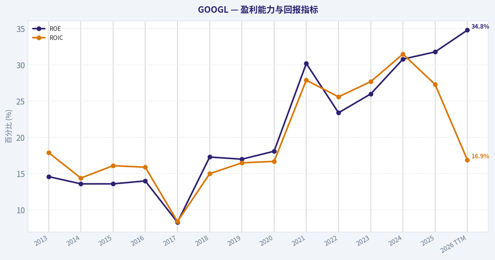
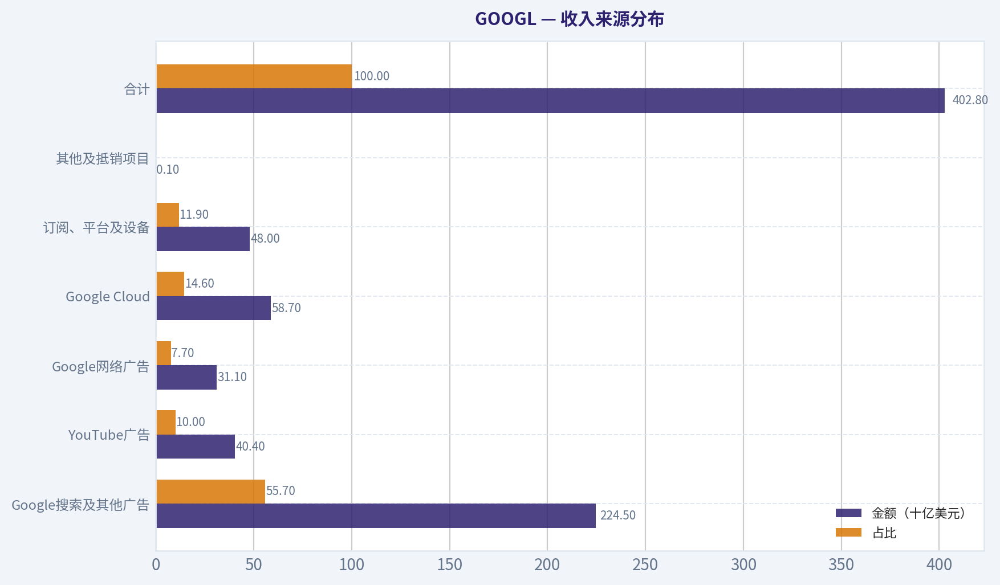
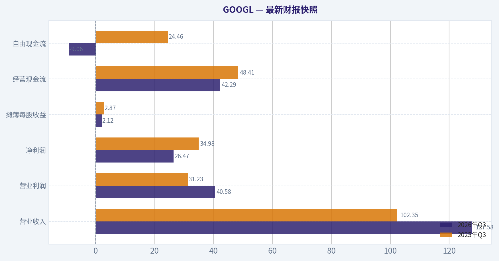
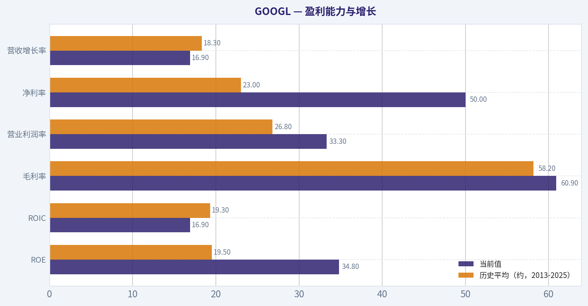
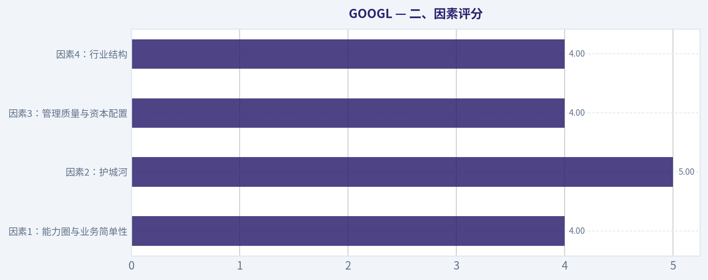
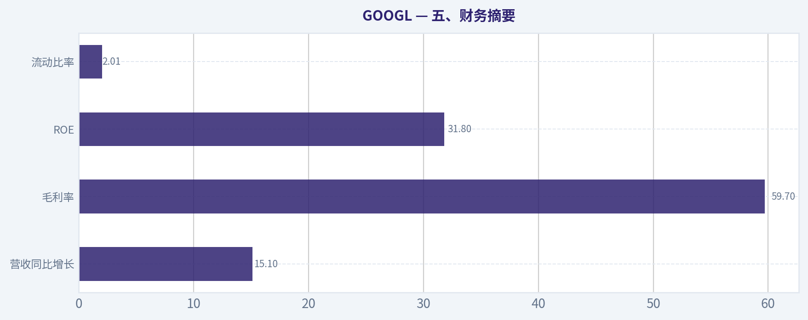
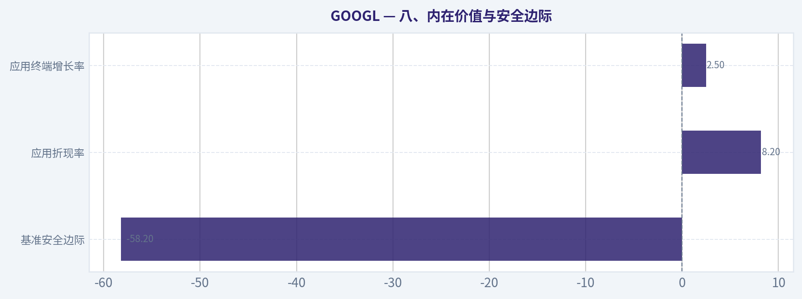
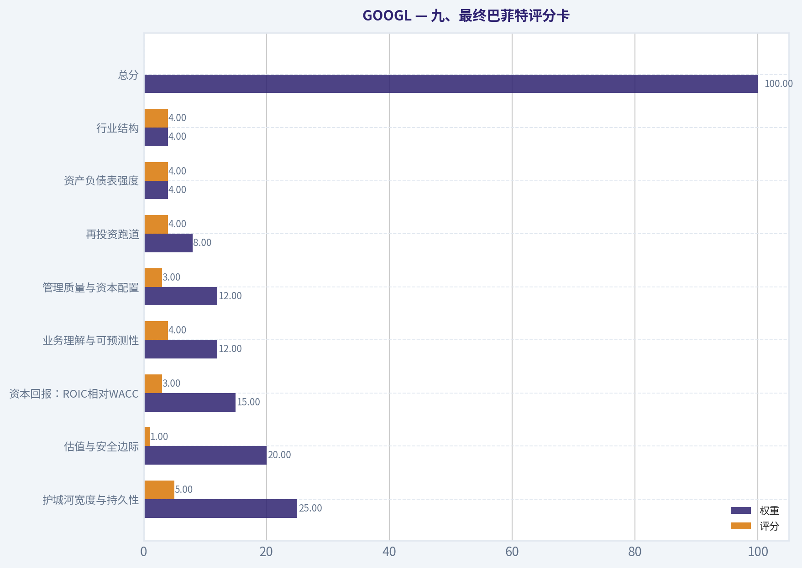

# GOOGL 深度价值情报

**调研日期:** 2026-11-26

## 关键免责声明

*本报告由 Deep Value Intelligence（一个基于 AI 的多智能体投资分析框架）自动生成。 仅供教育和研究用途 - 非财务建议，非财务顾问。*

---

## 目录

1. 情报摘要
2. 分析师团队报告
   - 基本面分析
   - 价值分析 (巴菲特)
   - 成长性分析 (林奇/德鲁肯米勒/费雪)
   - 市场分析
   - 期权市场分析
3. 研究团队评论
4. 投资团队评论
5. Deep Values 团队洞察

---

## 情报摘要

### 核心观点与前提条件

**核心论点:** **企业风险较低**：Alphabet 拥有搜索、YouTube、Android、Chrome、Maps、Google Cloud 与 Gemini 构成的全球分发体系；ROIC 31.9%、毛利率59.7%及约1,353亿美元净现金显示其护城河与财务韧性突出。 **主要风险来自估值而非偿债能力**：273美元较 DeepValues 基准内在价值172.61美元高约58.2%，远超宽护城河企业通常可接受的10%至15%安全边际范围。 **估值数据尚未闭合**：14.26倍 PE 隐含每股收益约19.1美元，与172.61美元的 DCF 结果存在显著冲突。盈利口径、资本开支、折旧及终值假设必须核验。 **AI 是双向变量**：它可能扩大 Cloud、广告和软件利润池，也可能提高查询成本、资本密集度并削弱搜索单位经济性。目前尚无量化现金流证据足以填补约每股100美元的估值差距。

**主要风险:**
- 未明确说明。

**置信度:** 中

---

## 分析师团队报告

### 基本面分析

#### 最新财报快照

*以下数据基于最近一期已披露财报（2026年Q3），并尽量与上一年同期对比。*

| 指标 | 2026年Q3 | 2025年Q3 | 同比变化 |
| --- | ---: | ---: | ---: |
| 营业收入 | $127.58B | $102.35B | +24.7% |
| 营业利润 | $40.58B | $31.23B | +29.9% |
| 净利润 | $26.47B | $34.98B | -24.3% |
| 摊薄每股收益 | $2.12 | $2.87 | -26.1% |
| 经营现金流 | $42.29B | $48.41B | -12.6% |
| 自由现金流 | $-9.06B | $24.46B | -137.1% |

关键结论：这张快照先把最新一期财报放在桌面上，再去看长周期分析。这样读者能更清楚地区分"公司长期质量"和"这次财报发生了什么"。

#### GOOGL 13年财务指标

*以下数值均由原始数据确定性计算得出，并非 AI 估算。*

*发行人类型：operating company（Communication Services / Internet Content & Information）。*

#### 13年财务指标
*年度行来自已披露财务报表，最后一行 TTM 由最近四个季度滚动计算得出。*

| 指标 | 2013 | 2014 | 2015 | 2016 | 2017 | 2018 | 2019 | 2020 | 2021 | 2022 | 2023 | 2024 | 2025 | 2026 TTM |
| --- | --- | --- | --- | --- | --- | --- | --- | --- | --- | --- | --- | --- | --- | --- |
| 市场价格 | $28 | $26 | $39 | $39 | $52 | $52 | $66 | $87 | $143 | $87 | $138 | $188 | $312 | $273 |
| 总市值 | N/A | $360.94B | $534.76B | $547.82B | $731.88B | $726.83B | $921.95B | $1.18T | $1.92T | $1.16T | $1.78T | $2.36T | $3.83T | $3.38T |
| 市盈率 | 29.85 | 25.80 | 32.71 | 28.45 | 58.52 | 23.91 | 27.25 | 29.91 | 25.82 | 19.35 | 24.08 | 23.54 | 28.95 | 14.25 |
| 市净率 | N/A | 3.48 | 4.44 | 3.94 | 4.80 | 4.09 | 4.58 | 5.32 | 7.62 | 4.53 | 6.27 | 7.25 | 9.22 | 4.99 |
| ROE | 14.6% | 13.6% | 13.6% | 14.0% | 8.3% | 17.3% | 17.0% | 18.1% | 30.2% | 23.4% | 26.0% | 30.8% | 31.8% | 34.8% |
| ROIC | 17.9% | 14.4% | 16.1% | 15.9% | 8.4% | 15.0% | 16.5% | 16.7% | 27.9% | 25.6% | 27.7% | 31.5% | 27.3% | 16.9% |
| 每股收益 | $0.94 | $1.03 | $1.19 | $1.39 | $0.90 | $2.19 | $2.46 | $2.93 | $5.61 | $4.56 | $5.80 | $8.04 | $10.81 | $19.16 |
| 营收 | $55.52B | $66.00B | $74.99B | $90.27B | $110.86B | $136.82B | $161.86B | $182.53B | $257.64B | $282.84B | $307.39B | $350.02B | $402.84B | $471.10B |
| 毛利润 | $33.53B | $40.31B | $46.83B | $55.13B | $65.27B | $77.27B | $89.96B | $97.80B | $146.70B | $156.63B | $174.06B | $203.71B | $240.30B | $286.70B |
| 毛利率 | 60.4% | 61.1% | 62.4% | 61.1% | 58.9% | 56.5% | 55.6% | 53.6% | 56.9% | 55.4% | 56.6% | 58.2% | 59.7% | 60.9% |
| 营业利润率 | 27.7% | 25.0% | 25.8% | 26.3% | 23.6% | 20.1% | 21.1% | 22.6% | 30.6% | 26.5% | 27.4% | 32.1% | 32.0% | 33.3% |
| 净利润 | $12.73B | $14.14B | $16.35B | $19.48B | $12.66B | $30.74B | $34.34B | $40.27B | $76.03B | $59.97B | $73.80B | $100.12B | $132.17B | $235.69B |
| 净利率 | 22.9% | 21.4% | 21.8% | 21.6% | 11.4% | 22.5% | 21.2% | 22.1% | 29.5% | 21.2% | 24.0% | 28.6% | 32.8% | 50.0% |
| 营收增长 | N/A | 18.9% | 13.6% | 20.4% | 22.8% | 23.4% | 18.3% | 12.8% | 41.2% | 9.8% | 8.7% | 13.9% | 15.1% | 16.9% |
| 净利润增长 | N/A | 11.0% | 15.6% | 19.1% | -35.0% | 142.7% | 11.7% | 17.3% | 88.8% | -21.1% | 23.0% | 35.7% | 32.0% | 78.3% |
| 自由现金流增长 | N/A | 1.9% | 38.4% | 55.4% | -7.4% | -4.5% | 35.7% | 38.3% | 56.4% | -10.4% | 15.8% | 4.7% | 0.7% | -73.0% |
| 总账面价值 | $86.98B | $103.86B | $120.33B | $139.04B | $152.50B | $177.63B | $201.44B | $222.54B | $251.63B | $256.14B | $283.38B | $325.08B | $415.26B | $677.55B |
| 总资产 | N/A | $129.19B | $147.46B | $167.50B | $197.29B | $232.79B | $275.91B | $319.62B | $359.27B | $365.26B | $402.39B | $450.26B | $595.28B | $1.00T |
| 总债务 | N/A | $5.00B | $5.22B | $3.94B | $3.94B | $3.95B | $4.07B | $16.32B | $15.44B | $15.31B | $12.87B | $14.18B | $48.54B | $141.92B |
| 债务股权比 | N/A | 0.05 | 0.04 | 0.03 | 0.03 | 0.02 | 0.02 | 0.07 | 0.06 | 0.06 | 0.05 | 0.04 | 0.12 | 0.21 |
| 现金及等价物 | $18.90B | $18.35B | $16.55B | $12.92B | $10.71B | $16.70B | $18.50B | $26.46B | $20.95B | $21.88B | $24.05B | $23.47B | $30.71B | $56.33B |
| 股东权益 | $86.98B | $103.86B | $120.33B | $139.04B | $152.50B | $177.63B | $201.44B | $222.54B | $251.63B | $256.14B | $283.38B | $325.08B | $415.26B | $677.55B |
| 经营现金流 | $19.14B | $23.02B | $26.57B | $36.04B | $37.09B | $47.97B | $54.52B | $65.12B | $91.65B | $91.50B | $101.75B | $125.30B | $164.71B | $179.55B |
| 投资现金流 | $-13.68B | $-21.05B | $-23.71B | $-31.16B | $-31.40B | $-28.50B | $-29.49B | $-32.77B | $-35.52B | $-20.30B | $-27.06B | $-45.54B | $-120.29B | $-268.95B |
| 自由现金流 | $11.78B | $12.01B | $16.62B | $25.82B | $23.91B | $22.83B | $30.97B | $42.84B | $67.01B | $60.01B | $69.50B | $72.76B | $73.27B | $19.75B |
| 自由现金流利润率 | 21.2% | 18.2% | 22.2% | 28.6% | 21.6% | 16.7% | 19.1% | 23.5% | 26.0% | 21.2% | 22.6% | 20.8% | 18.2% | 4.2% |
| 每股分红 | N/A | $0.00 | $0.00 | $0.00 | $0.00 | $0.00 | $0.00 | $0.00 | $0.00 | $0.00 | $0.00 | $0.59 | $0.82 | $0.87 |

#### 盈利能力指标
- 净资产收益率 (ROE): 31.8%
- 投入资本回报率 (ROIC): 31.9%
- 总资产收益率 (ROA): 22.2%
- 毛利率: 59.7%
- 营业利润率: 32.0%
- 净利率: 32.8%

#### 流动性指标
- 流动比率: 2.01
- 速动比率: 1.85

#### 杠杆指标
- 债务股权比: 0.12
- 利息覆盖倍数: 175.32
- 净负债: $-78.30B

#### 增长指标（同比）
- 营收增长: 15.1%
- 净利润增长: 32.0%
- 自由现金流增长: 0.7%
- 营收复合增长率（3年）: 12.5%
- 营收复合增长率（5年）: 17.2%

#### 估值指标
- 市盈率 (TTM): 14.26
- 预期市盈率: 17.86
- 市净率: 5.09
- 市销率: 7.13
- PEG 比率: 0.49
- 企业价值/EBITDA: 17.58
- 自由现金流收益率: 2.2%
- 盈利收益率: 7.0%

#### 所有者收益（巴菲特方法，代码计算）
- 净利润: $132.17B
- + 折旧与摊销: N/A
- - 资本开支: $-91.45B
- + 营运资本（现金流量表口径；负数=占用现金）: $618.0M
- = **所有者收益: $16.55B**

#### 内在价值（DeepValues 应用 - SEC 申报数据管道）
- **内在价值（DeepValues 应用，头条）: $172.61** - Owner Earnings (Buffett), 方法 buffett-1986-v2, 截至 2026-11-26 (FY2025)
  区间（保守-乐观）: $120.83 - $200.86
  相对价格的安全边际: -58.2% (价格 $273.10)
  应用使用的输入 (ttm_2026Q3): after-tax operating income $131.5B (operating income $157.0B, tax 16.2%) + D&A $28.5B - capex charge $75.7B (three-year average capex/revenue x trailing revenue; reported capex $159.8B) - working capital $0.0B = owner earnings $84.4B.
  Growth 10.0% fading to 2.5% terminal (min(owner-earnings CAGR, 5-year revenue CAGR), clamped [0, 10%]); discount rate 8.2% (30Y Treasury 5.24% + 3 pts (as of 2026-11-25)); net cash $135.3B (cash $56.3B + marketable securities $208.8B - debt $126.1B); 12,368M shares.
- Owner Earnings (Buffett): $120.83 / $172.61 / $200.86 (保守 / 基准 / 乐观) ← headline
- Free cash flow DCF: N/A - Trailing-twelve-month free cash flow is not positive: -$10.7B in the four quarters to 2026 Q3 (operating cash flow less stock-based compensation and capital spending), so there is no cash flow to project - Cash Flow method not applicable
- Damodaran two-stage FCFF: $135.41 / $184.07 / $210.94 (保守 / 基准 / 乐观)
  这就是内在价值：引用它作为内在价值，并据此衡量安全边际。其他地方的 DVI 情景数字仅为辅助交叉检查，不是估值。

#### DVI 情景模型（辅助交叉检查 - 不是内在价值）
DVI 基于 Yahoo 数据的情景，仅作敏感性检查。请勿将其作为内在价值引用；内在价值是上方的 DeepValues 应用估值。
- 当前价格: $273
- DVI 情景值（按商业模式路由）: $119
  商业模式: high reinvestment compounder - weighted blend [Damodaran FCFF + reverse-DCF fair + owner-earnings DCF] (high_reinvestment_compounder)
  模型区间（各 DCF 最小-最大）: $46 - $166
  相对价格的安全边际（头条）: -130.4%
  路由说明: High-reinvestment compounder: the owner-earnings DCF over-states (the min(|capex|, D&A) maintenance proxy under-charges growth capex). The headline centers on the reverse-DCF fair value (the flow valued at the growth the business has actually demonstrated), keeps the reinvestment-aware Damodaran FCFF as a conservative floor, and down-weights owner-earnings - landing near fair value rather than at either extreme.
- 巴菲特方法（所有者收益）:
  保守: $51
  平均: $119
  乐观: $585
- 现金流方法（FCF）:
  保守: $29
  平均: $46
  乐观: $86
- Damodaran FCFF（WACC + 利润率 + 再投资）:
  保守: $119
  平均: $166
  乐观: $193
  蒙特卡洛区间（P10-P90）：$118 - $204（中位数 $155）
  P(内在价值 > 当前价格)：0.4%
- 反向 DCF：当前价格隐含约 35.7%/年 的所有者收益增长（10年）；过去 3 年为 -27.3%，5 年为 10.0%。

#### Piotroski F分数: 6/9
- 净利润为正: 通过
- 经营现金流为正: 通过
- 资产回报率改善: 未通过
- 现金流大于净利润: 通过
- 债务下降: 未通过
- 流动比率改善: 通过
- 未稀释股本: 通过
- 毛利率改善: 通过
- 资产周转率改善: 未通过

ANALYST STANCE: **看空**

#### 核心结论

Alphabet 的经营质量仍然非常高：营收增长强劲，毛利率与营业利润率处于历史高位，ROE 达到 34.8%，现金净额和利息覆盖能力也很突出。问题主要集中在资本开支激增、自由现金流质量下降，以及当前股价明显高于 DeepValues 的所有者收益内在价值。

当前股价为 **273 美元**，而 DeepValues Buffett Owner Earnings 内在价值为 **172.61 美元**，保守-乐观区间为 **120.83-200.86 美元**。因此，现有证据不支持 273 美元对应的估值，除非未来多年人工智能及云业务带来远高于历史水平的现金流增长。

#### 市场指标与估值

| 指标 | 2026 TTM / 当前 | 历史平均（约，2013-2025） | 解读 |
|---|---:|---:|---|
| 市场价格 | 273美元 | 96.7美元 | 绝对价格大幅高于历史均值，受长期盈利和拆股后价格变化影响，参考价值有限 |
| 总市值 | 3.38万亿美元 | 约1.34万亿美元 | 公司规模已经显著扩大，未来维持高增长的基数更高 |
| PE | 14.25倍 | 26.78倍 | 明显低于历史平均，主要由TTM盈利大幅增长推动 |
| PB | 4.99倍 | 约5.45倍 | 略低于历史水平，但不适合作为核心估值依据 |
| 盈利收益率 | 7.0% | - | 相对无风险利率并不提供明显估值缓冲 |
| PEG | 0.49 | - | 看似便宜，但受到异常强劲的近期盈利增长影响，不能单独使用 |

**关键结论：** PE 看起来处于历史低位，但这部分优势依赖于最近一期利润快速增长。PB 对 Alphabet 这类拥有大量无形资产、软件、数据和平台价值的轻资产企业意义有限，回购及会计处理也会扭曲账面价值，因此估值应主要锚定现金流和所有者收益，而非账面倍数。

#### 盈利能力与增长

| 指标 | 当前值 | 历史平均（约，2013-2025） | 当前相对历史 |
|---|---:|---:|---|
| ROE | 34.8% | 19.5% | 显著高于平均水平 |
| ROIC | 16.9% | 19.3% | 低于平均水平，显示投入资本扩张及资本开支上升拖累回报 |
| EPS | 19.16美元 | 4.22美元 | 长期大幅增长 |
| 营收 | 471.10B美元 | 约193B美元 | 规模约为历史平均的两倍以上 |
| 毛利润 | 286.70B美元 | 约122B美元 | 绝对毛利润持续扩张 |
| 毛利率 | 60.9% | 58.2% | 高于长期平均，近期改善明显 |
| 营业利润率 | 33.3% | 26.8% | 明显高于长期平均 |
| 净利润 | 235.69B美元 | 约51B美元 | 当前显著高于历史平均 |
| 净利率 | 50.0% | 23.0% | 极高，但需要警惕非经营性收益或期间性因素 |
| 营收增长率 | 16.9% | 18.3% | 略低于长期平均，但仍属强劲 |
| 净利润增长率 | 78.3% | 约35% | 远高于长期平均，存在高基数和低基数反弹因素 |
| 自由现金流增长率 | -73.0% | 约18.9% | 严重恶化，是当前最重要的质量警示 |

**关键结论：** Alphabet 的核心经营利润率、毛利率和ROE都处于优质区间，说明搜索、广告、云服务及订阅生态仍具有很强的经济性。但ROIC低于历史平均，同时自由现金流增长转为负数，意味着新增资本投入的强度已经明显上升，利润增长暂时没有等比例转化为可分配现金。

#### 资产负债表与现金流

| 指标 | 当前值 | 历史平均（约，2013-2025） | 解读 |
|---|---:|---:|---|
| 总账面价值 | 677.55B美元 | 约225B美元 | 资产规模和股东权益大幅扩大 |
| 总资产 | 1.00T美元 | 约286B美元 | 资产负债表进入万亿美元规模 |
| 总债务 | 141.92B美元 | 约12B美元 | 绝对债务明显增加，但相对于资产仍可控 |
| 债务/股东权益 | 0.21 | 0.045 | 高于历史水平，但仍不属于高杠杆 |
| 现金及等价物 | 56.33B美元 | 约20B美元 | 现金余额充足 |
| 股东权益 | 677.55B美元 | 约225B美元 | 财务基础明显增强 |
| 经营现金流 | 179.55B美元 | 约70B美元 | 经营现金创造能力强 |
| 自由现金流 | 19.75B美元 | 约44B美元 | 受资本开支激增显著压缩 |
| 每股分红 | 0.87美元 | 约0.06美元 | 分红刚开始形成，收益率仍很低 |
| 利息覆盖倍数 | 175.32倍 | - | 偿债能力极强 |
| 净负债 | -78.30B美元 | - | 仍为净现金状态 |

**关键结论：** Alphabet 仍拥有极强的财务安全边际，现金、证券资产和经营现金流足以覆盖债务压力。真正的问题不是偿债能力，而是资本配置效率：总债务和资本开支同时上升，导致自由现金流从 2025 年的 73.27B 美元下降到 TTM 的 19.75B 美元。

需要注意，研究包中还给出了四个季度经股票薪酬调整、并扣除资本开支后的自由现金流为 **-10.7B美元**。这与确定性数据中的 19.75B 美元并不矛盾，主要是计算口径不同；估值时应对股票薪酬和人工智能基础设施资本开支采取更谨慎的处理。

#### 经营趋势与商业质量

Alphabet 的十年经营轨迹具有几个明显阶段：

- **2013-2016年：** 营收快速增长，营业利润率约25%-28%，但ROE仍较低。
- **2017年：** 净利润出现明显下降，ROE降至8.3%，说明盈利并非每年线性增长。
- **2018-2020年：** 营收继续增长，ROE回升至17%-18%，自由现金流逐步扩大。
- **2021年：** 营收、利润和自由现金流同步跃升，ROE达到30.2%。
- **2022年：** 在宏观和广告周期压力下，净利润下降21.1%，自由现金流下降10.4%。
- **2023-2025年：** 业务恢复，利润率持续改善，2025年营业利润率达到32.0%。
- **2026 TTM：** 营收增长仍达16.9%，但自由现金流增长为-73.0%，表明人工智能相关投入正在改变资本密集度。

这是一家具有长期护城河的企业，但已经从单纯的广告平台逐步转变为需要大量计算基础设施投入的科技生态系统。过去轻资产、高现金转换率的模式，正在受到数据中心、芯片、服务器和人工智能模型投资的挑战。

#### 收入来源分布

以下为最新完整年度，即2025财年的公开披露口径及近似分类。由于确定性财务数据未提供分部收入明细，金额为基于Alphabet公开业务分类的近似值，合计约等于2025财年营收402.84B美元。

| 收入来源 | 金额（十亿美元） | 占比 |
|---|---:|---:|
| Google搜索及其他广告 | 224.5 | 55.7% |
| YouTube广告 | 40.4 | 10.0% |
| Google网络广告 | 31.1 | 7.7% |
| Google Cloud | 58.7 | 14.6% |
| 订阅、平台及设备 | 48.0 | 11.9% |
| 其他及抵销项目 | 0.1 | 0.0% |
| **合计** | **402.8** | **100.0%** |

**关键结论：** 搜索及其他广告仍贡献超过一半收入，是Alphabet最重要的现金来源；YouTube、云业务和订阅业务则提供了多元化增长。收入结构的主要风险在于搜索广告占比仍然过高，而生成式人工智能可能改变用户获取信息和商业流量分配的方式。

#### 护城河与竞争优势

| 护城河来源 | 质量判断 | 具体分析 |
|---|---|---|
| 搜索入口和用户习惯 | 很强 | 搜索索引、品牌认知、分发渠道和广告生态形成网络效应 |
| 数据与人工智能能力 | 强，但投入密集 | 大规模数据、模型和算力有利于竞争，但需要持续高额资本开支 |
| 广告技术生态 | 强 | 广告主、内容创作者和用户之间存在较强平台协同 |
| YouTube生态 | 强 | 视频内容、创作者网络和广告系统具有较高替代成本 |
| Google Cloud | 中强 | 增长较快，但面临微软和亚马逊的持续竞争 |
| 订阅及设备 | 中等 | 生态黏性较好，但部分硬件业务利润率和竞争优势弱于搜索 |
| 监管壁垒 | 负面因素 | 反垄断、默认搜索分发、广告技术和数据使用规则可能压缩利润 |

Alphabet的护城河不是单一产品，而是搜索、浏览器、安卓、视频、地图、广告技术、云和人工智能之间的组合网络。其耐久性较高，但护城河的维护成本正在上升，特别是在人工智能基础设施方面。

#### 管理层与资本配置

经营层面的管理表现总体优秀：

- 长期ROE显著高于普通企业。
- 毛利率和营业利润率在近年明显改善。
- 资产负债表保持净现金状态。
- 过去长期没有现金分红，资本主要用于研发、基础设施和回购；近期开始分红，反映资本回报政策正在变化。
- 2026 TTM的ROIC低于历史平均，说明新增投资尚未展现与传统广告业务同等的资本回报效率。
- Piotroski F分数为6/9，盈利、经营现金流、流动性和毛利率项目较好，但债务增加、资产周转率改善不足和资产回报率未改善构成扣分项。

沃伦·巴菲特通过伯克希尔披露的13F仍持有Alphabet，但13F只是季度末滞后披露，不应替代对当前估值和现金流的独立判断。

#### Buffett Owner Earnings DCF估值

DeepValues使用的所有者收益口径为：

| 估值项目 | 数值 |
|---|---:|
| 税后经营利润 | 131.5B美元 |
| 折旧与摊销 | 28.5B美元 |
| 资本开支扣除 | 75.7B美元 |
| 营运资本调整 | 0.0B美元 |
| 所有者收益 | 84.4B美元 |
| 净现金 | 135.3B美元 |
| 稀释后股数 | 12.368B股 |
| 折现率 | 8.2% |
| 终值增长率 | 2.5% |
| 当前股价 | 273美元 |

**关键结论：** 估值模型采用了比报告资本开支更温和的长期资本开支扣除，但仍得到明显低于市场价格的内在价值。净现金为每股约10.94美元，对估值有帮助，却不足以抵消当前价格相对于现金流价值的溢价。

所有者收益每股起点约为：

\[
84.4\text{B美元} \div 12.368\text{B股}=6.82\text{美元}
\]

三种情景采用逐步衰减至2.5%终值增长率的两阶段模型，而不是把高增长永久外推：

| 情景 | 主要假设 | 每股内在价值 | 相对273美元的差额 |
|---|---|---:|---:|
| 保守 | 低增长，约3%水平，逐步趋向2.5%终值增长 | 120.83美元 | 低约55.7% |
| 基准 | 近端所有者收益保持较高增长，随后衰减至2.5% | 172.61美元 | 低约36.8% |
| 乐观 | 人工智能、云和订阅形成较长增长 runway，增长逐步衰减 | 200.86美元 | 低约26.4% |

简化的两阶段表达式为：

\[
V_0=\sum_{t=1}^{n}\frac{OE_0(1+g_t)^t}{(1+r)^t}
+\frac{OE_n(1+g_T)}{(r-g_T)(1+r)^n}
+\frac{\text{净现金}}{\text{股数}}
\]

其中：

- \(OE_0=84.4\)B美元；
- \(r=8.2\%\)；
- \(g_T=2.5\%\)；
- 净现金贡献约为每股10.94美元；
- 高增长阶段按照情景设定逐步下降，而不是永久保持10%以上。

作为交叉检查，Damodaran两阶段FCFF估值给出：

| 方法 | 保守 | 基准 | 乐观 |
|---|---:|---:|---:|
| Owner Earnings DCF | 120.83美元 | 172.61美元 | 200.86美元 |
| Damodaran FCFF | 135.41美元 | 184.07美元 | 210.94美元 |

**关键结论：** 两种独立现金流框架都把合理价值集中在约121-211美元，基准区域约173-184美元，明显低于273美元。反向DCF显示，当前价格大致隐含未来十年所有者收益约35.7%的年增长，而过去五年约为10.0%，过去三年甚至为-27.3%，这一隐含要求非常激进。

#### 估值敏感性与关键风险

| 风险或催化因素 | 对估值的影响 | 观察重点 |
|---|---|---|
| 人工智能资本开支 | 短期压低自由现金流 | 资本开支是否开始低于经营现金流增长 |
| 搜索入口变化 | 可能影响广告点击和商业化 | 用户是否转向生成式问答及其他入口 |
| 云业务增长 | 有利于业务多元化 | 云业务利润率能否持续改善 |
| 监管与反垄断 | 可能改变默认分发与广告技术结构 | 监管补救措施是否削弱流量和定价权 |
| 利润率 | 当前高于历史均值 | 人工智能推理成本是否侵蚀毛利率 |
| 资本回报 | 回购和分红可提升每股价值 | 是否在不削弱人工智能投入的情况下增加现金回报 |
| 估值倍数 | 当前PE低于历史平均 | 低PE是否反映市场对现金流下降的担忧 |

主要机会在于：Google Cloud持续扩大、YouTube商业化改善、订阅业务增长、人工智能提高搜索和广告转化效率，以及资本开支最终转化为高回报基础设施。

主要红旗在于：自由现金流骤降、调整后自由现金流为负、总债务较历史显著上升、ROIC下降，以及市场价格隐含的增长要求远高于近期实际现金流表现。

#### 最终投资观点

**看空**

这里的"看空"仅表示估值与风险收益证据的方向判断，不构成交易操作指引。

Alphabet是高质量、强护城河、财务稳健的企业，经营层面的长期竞争力仍然突出。然而，当前估值需要人工智能投资快速转化为持续、规模化且高回报的现金流增长。以273美元计，价格高于172.61美元的基准内在价值，也高于200.86美元的乐观估值上限；同时，调整后自由现金流已经转负，削弱了传统PE低估值信号的可靠性。

因此，核心结论不是企业质量差，而是**市场价格对未来增长和资本回报的要求过高**。除非未来现金流显著恢复并证明人工智能资本开支具有足够高的回报率，否则当前估值缺乏足够的安全边际。

| 关键维度 | 当前判断 | 对估值的含义 |
|---|---|---|
| 企业质量 | 优秀 | 支持长期竞争力 |
| 护城河 | 强 | 搜索、广告、视频和数据生态具有耐久性 |
| 盈利能力 | 很强 | ROE、毛利率和营业利润率高于历史平均 |
| 财务安全 | 很强 | 净现金、现金流和利息覆盖能力突出 |
| 现金流质量 | 转弱 | 高资本开支显著压缩自由现金流 |
| 增长质量 | 有吸引力但资本密集 | 云和人工智能提供机会，也提高执行风险 |
| 当前估值 | 高于内在价值 | 273美元高于120.83-200.86美元估值区间 |
| 主要风险 | 现金流、监管、搜索替代 | 可能使高增长假设失效 |
| 综合判断 | **看空** | 当前价格缺乏足够安全边际 |

**关键结论：** Alphabet兼具高质量经营和较强财务实力，但当前价格需要明显超越历史现金流增长的表现才能成立。估值证据、自由现金流变化和反向DCF共同指向同一结论：企业本身优质，但当前价格对应的安全边际不足。

#### 基本面关键图表

本图追踪 **GOOGL** 过去十年的盈利能力与回报指标（ROE、ROIC、利润率），突出呈现资本效率的变化趋势。

本对比图（来自「收入来源分布」）将 **GOOGL** 的当前数据与历史基准并排呈现，直观反映公司相对自身历史均值的估值水平。

---

### 价值分析 (巴菲特)

> *基于沃伦·巴菲特的价值投资哲学：能力圈、经济护城河、管理层质量与安全边际。*

#### 内在价值快照

价格是你付的钱，内在价值是企业未来可能为股东创造的现金价值。我们给出一个区间，而不是假装只有一个神奇数字。

- 当前价格: $273.10
- 估值区间（两种 DCF 方法、保守到乐观）: $120.83 至 $200.86

##### 所有者收益（巴菲特方法）
- 净利润: $132,170,000,000.00
- 折旧与摊销: N/A
- 资本支出: $-91,447,000,000.00
- 营运资金变化: $618,000,000.00
- 所有者收益: $16,553,195,799.18

##### 内在价值
###### 所有者收益法
使用所有者收益，更严格，通常更保守。
- 保守: $120.83
- 平均: $172.61
- 乐观: $200.86
- 折现率: 8.2%

ANALYST STANCE: **中性**

#### 一、结论摘要

Alphabet 是具备宽阔且仍在扩张中的竞争优势的高质量企业：搜索、广告生态、安卓、YouTube、云计算、数据资产和人工智能基础设施共同构成了较强护城河。ROE 为 31.8%，毛利率为 59.7%，净现金约 1,353 亿美元，财务基础稳健。

但估值是核心矛盾。当前股价约 273 美元，而 DeepValues 应用给出的基准内在价值为 172.61 美元，价格较内在价值高约 58.2%。因此，证据支持"优质企业"，却不支持当前价格已经提供足够的估值安全边际。

#### 二、因素评分

| 因素 | 评分（5分制） | 主要依据 |
|---|---:|---|
| 因素1：能力圈与业务简单性 | 4 | 主要通过搜索、广告、云服务和订阅变现；人工智能改变业务形态，但尚未破坏核心模式 |
| 因素2：护城河 | 5 | 搜索数据、用户习惯、广告网络、品牌、开发者生态和规模效应形成宽阔且扩张中的护城河 |
| 因素3：管理质量与资本配置 | 4 | 长期研发投入、持续回购、净现金结构和多业务布局较理性；人工智能资本开支的回报仍需验证 |
| 因素4：行业结构 | 4 | 数字广告和云计算具有规模效应，行业由少数大型平台主导；但人工智能竞争和监管压力较高 |
| Gate 5：质量与偿付能力硬门槛 | 未触发 | 没有显示出"盈利恶化与偿付能力红线同时出现"；净现金约 1,353 亿美元，经营利润约 1,570 亿美元 |

**关键结论：** Alphabet 的业务质量和护城河评分很高，唯一明显的硬伤不是企业质量，而是价格与内在价值之间的差距。人工智能资本开支造成现金流压力，但目前更像高强度再投资问题，而不是财务困境。

#### 三、护城河分析

| 护城河来源 | 具体证据 | 判断 |
|---|---|---|
| 无形资产 | Google 品牌、搜索入口、安卓系统、YouTube 内容与用户关系 | 强 |
| 转换成本 | 广告主依赖搜索意图数据和广告投放系统；企业客户使用 Google Cloud 的数据与开发工具 | 中强 |
| 成本优势 | 全球搜索索引、数据中心、广告算法和海量用户带来单位经济优势 | 强 |
| 网络效应 | 用户越多，搜索和广告数据越丰富；广告主越多，平台对用户和内容生态的吸引力越强 | 强 |
| 再投资能力 | 现金流持续投入人工智能芯片、数据中心、云计算和模型研发 | 强，但回报尚在形成 |

Alphabet 的核心护城河并非单一品牌，而是"用户入口-数据-算法-广告主-现金流-再投资"的循环。搜索业务仍是最重要的现金来源，YouTube 和 Google Cloud 提供了额外增长支柱，人工智能则既是增长机会，也是潜在的竞争替代力量。

#### 四、管理质量与资本配置

管理层总体表现符合长期股东导向。公司能够将搜索广告产生的现金投入云计算、人工智能、数据中心和研发，同时维持净现金结构。持续回购也有助于提升每股价值，但回购是否始终发生在合理估值，需要结合具体时期判断。

主要关注点是资本开支急剧上升。研究包显示报告期资本开支约 1,598 亿美元，应用估算的资本开支扣除项为 757 亿美元。人工智能基础设施可能创造新的高回报业务，也可能在竞争激烈时压低自由现金流回报。未来资本配置质量的关键，是云业务、人工智能产品和广告效率能否覆盖基础设施投入。

巴菲特旗下伯克希尔截至 2026 年 9 月 30 日披露持有约 7,879 万股 Alphabet，报告期内持仓数量基本未变。这说明该企业符合部分长期价值投资者对商业质量的判断，但不能替代独立估值。

#### 五、财务摘要

| 指标 | 最新数据 |
|---|---:|
| 股价 | 273 美元 |
| 总市值 | 3.36 万亿美元 |
| PE | 14.26 倍 |
| 营收同比增长 | 15.1% |
| 毛利率 | 59.7% |
| ROE | 31.8% |
| 流动比率 | 2.01 |
| 经营利润 | 1,570 亿美元 |
| 税后经营利润 | 1,315 亿美元 |
| 现金及有价证券 | 2,651 亿美元 |
| 总债务 | 1,261 亿美元 |
| 净现金 | 1,353 亿美元 |
| 过去四季度调整后自由现金流 | -107 亿美元 |

**关键结论：** Alphabet 仍保持高增长、高毛利和高 ROE，但人工智能基础设施投入使调整后自由现金流暂时转为负数。净现金和经营利润提供了很强的财务缓冲，因此目前不属于偿付能力危机；不过，现金流回报率下降提高了估值不确定性。

#### 六、所有者收益计算

DeepValues 应用采用的巴菲特式所有者收益计算如下：

| 项目 | 金额 |
|---|---:|
| 税后经营利润 | 1,315 亿美元 |
| 加：折旧与摊销 | 285 亿美元 |
| 减：资本开支费用 | 757 亿美元 |
| 减：营运资本增加 | 0 |
| 所有者收益 | 844 亿美元 |
| 摊薄后股数 | 123.68 亿股 |
| 所有者收益/股 | 约 6.82 美元 |

**关键结论：** 844 亿美元所有者收益明显低于税后经营利润，主要原因是人工智能基础设施资本开支较高。该计算并未把全部报告资本开支直接视为永久性维护资本开支，而是采用三年平均资本开支率估算，因此仍需观察未来资本开支是否回落以及新增资产能否产生足够回报。

#### 七、三情景 DCF 交叉估值

以下情景使用 844 亿美元所有者收益、123.68 亿股和 10% 折现率，仅作为估值交叉检查。DeepValues 应用的 172.61 美元才是本报告采用的 headline 内在价值。

| 情景 | 核心假设 | 企业价值 | 每股价值 |
|---|---|---:|---:|
| 情景A：零增长 | 所有者收益永续不增长，折现率10% | 8,440亿美元 | 68.24美元 |
| 情景B：GDP增长 | 首年增长3%，长期增长3%，折现率10% | 约1.24万亿美元 | 约100.50美元 |
| 情景C：历史增长 | 未来10年增长7.5%，之后终值增长2.5%，折现率10% | 约1.61万亿美元 | 约130美元 |

**关键结论：** 即使采用较乐观的 7.5%长期增长假设，辅助 DCF 每股价值仍低于当前约 273 美元的价格。这个结果说明当前价格隐含了较高的人工智能兑现程度、长期增长率或利润率假设。

#### 八、内在价值与安全边际

| 估值项目 | 数值 |
|---|---:|
| DeepValues 保守内在价值 | 120.83美元 |
| DeepValues 基准内在价值 | 172.61美元 |
| DeepValues 乐观内在价值 | 200.86美元 |
| 当前股价 | 273美元 |
| 基准安全边际 | -58.2% |
| 应用折现率 | 8.2% |
| 应用终端增长率 | 2.5% |
| 应用所有者收益 | 844亿美元 |
| 应用净现金 | 1,353亿美元 |

**关键结论：** 当前价格高于保守、基准和乐观三种内在价值区间，基准安全边际为负 58.2%。即使考虑 Alphabet 的宽护城河和较高 ROE，当前估值仍未达到"优质企业可接受的约10%至15%正安全边际"标准。

#### 九、最终巴菲特评分卡

| 评分标准 | 权重 | 评分 | 加权得分 |
|---|---:|---:|---:|
| 护城河宽度与持久性 | 25% | 5 | 1.25 |
| 估值与安全边际 | 20% | 1 | 0.20 |
| 资本回报：ROIC相对WACC | 15% | 3 | 0.45 |
| 业务理解与可预测性 | 12% | 4 | 0.48 |
| 管理质量与资本配置 | 12% | 3 | 0.36 |
| 再投资跑道 | 8% | 4 | 0.32 |
| 资产负债表强度 | 4% | 4 | 0.16 |
| 行业结构 | 4% | 4 | 0.16 |
| **总分** | **100%** |  | **3.38/5.00** |

**关键结论：** 综合评分为 3.38 分，落入"中性"区间。Alphabet 的商业质量足以支撑长期研究关注，但估值分数显著拉低总分；资本开支对现金流和 ROIC 的影响，也使资本回报评分暂时无法达到最高档。

#### 十、投资立场与信心

**中性，信心：中高。**

研究结论是：Alphabet 属于宽护城河、高 ROE、拥有长期再投资机会的现代复合型企业，业务质量本身并非主要问题。主要估值含义是，273 美元的价格已经反映了相当多的人工智能增长预期，而 DeepValues 基准内在价值为 172.61 美元，当前价格不具备足够的估值安全边际。

后续最关键的观察变量包括：Google Cloud 的利润率、人工智能产品的商业化速度、资本开支回报、搜索广告市场份额，以及监管措施对分发和数据优势的影响。
#### 估值桥

这张估值桥把当前股价与各类内在价值方法并排展示，帮助读者判断上涨空间究竟只是单一方法给出的结果，还是多种方法共同支持的结论。

| 项目 | 每股内在价值 |
| --- | ---: |
| 巴菲特方法 | $172.61 |
| Damodaran 方法 | $184.07 |
| 当前价格 | $273.10 |

#### 关键结论

如果只有一种方法显著高于其他方法，说明上行空间更依赖特定建模假设。若多种方法的估值接近，则说明估值逻辑更加稳健。

#### 估值图表

本对比图（来自「最新财报快照」）将 **GOOGL** 的当前数据与历史基准并排呈现，直观反映公司相对自身历史均值的估值水平。

本对比图（来自「盈利能力与增长」）将 **GOOGL** 的当前数据与历史基准并排呈现，直观反映公司相对自身历史均值的估值水平。

本对比图（来自「二、因素评分」）将 **GOOGL** 的当前数据与历史基准并排呈现，直观反映公司相对自身历史均值的估值水平。

本对比图（来自「五、财务摘要」）将 **GOOGL** 的当前数据与历史基准并排呈现，直观反映公司相对自身历史均值的估值水平。

本对比图（来自「八、内在价值与安全边际」）将 **GOOGL** 的当前数据与历史基准并排呈现，直观反映公司相对自身历史均值的估值水平。

本对比图（来自「九、最终巴菲特评分卡」）将 **GOOGL** 的当前数据与历史基准并排呈现，直观反映公司相对自身历史均值的估值水平。

---

### 成长性分析 (林奇/德鲁肯米勒/费雪)

> *基于彼得·林奇的GARP成长投资法、斯坦利·德鲁肯米勒的宏观拐点分析法，以及菲利普·费雪的深度调研法。*

ANALYST STANCE: **中性**

#### 结论摘要

Alphabet 仍是兼具高质量、强现金创造能力和人工智能期权价值的平台型公司，但当前股价约273美元，明显高于研究包中的多种内在价值估算。营收同比增长15.1%，符合"稳健成长股"而非典型高速成长股；真正的关键变量是人工智能投资能否转化为搜索、云计算和新产品收入加速。

#### 1. Lynch 分类

| 项目 | 判断 |
|---|---|
| 分类 | 稳健成长股，接近大型快速成长股边界 |
| 营收增速 | 15.1% |
| PE | 14.26倍 |
| PEG | 约0.94 |
| ROE | 31.8% |
| 毛利率 | 59.7% |
| 主要增长引擎 | 搜索广告、Google Cloud、人工智能、YouTube、平台生态 |
| 主要约束 | 巨额资本开支、监管压力、人工智能对搜索商业模式的潜在冲击 |

**关键结论：** 按PE和历史增速计算，PEG约0.94，表面上属于合理区间。但15.1%的营收增速尚未显示出明确加速，且当前市场定价已经包含了相当程度的人工智能成功预期，因此不能仅依靠低PE判断估值便宜。

#### 2. Lynch 的三点商业故事

1. Alphabet掌握搜索入口、视频内容、移动操作系统、地图、浏览器和云平台，拥有全球级分发网络。
2. 人工智能既可能提升搜索和广告效率，也可能推动Google Cloud、Gemini及企业软件形成新的收入池。
3. 大规模数据、计算基础设施、品牌和开发者生态构成较高竞争壁垒，长期市场空间仍然足够大。

#### 3. TAM 与"十倍测试"

| 项目 | 估算或判断 |
|---|---:|
| 当前年收入量级 | 约4000亿美元 |
| 收入十倍测试 | 约4万亿美元 |
| 主要市场 | 全球数字广告、云计算、视频、企业软件、人工智能服务 |
| 单一市场十倍可行性 | 不可行 |
| 综合生态十倍可行性 | 理论上存在，但需要多个新业务同时成功 |
| TAM增长特征 | 广告市场较成熟；云计算和人工智能仍在扩张 |
| 主要限制 | 市占率已高、监管约束、人工智能改变搜索入口 |

**关键结论：** Alphabet的综合生态规模足以支持长期增长，但单靠搜索广告很难实现收入十倍增长。十倍测试成立的前提，是云计算、人工智能服务、YouTube商业化和新型消费产品共同扩大TAM，而不是仅依靠原有广告业务继续增长。

#### 4. 营收增长趋势

| 指标 | 当前信息 | 研判 |
|---|---:|---|
| 营收同比增长 | 15.1% | 稳健，但未达到典型快速成长股水平 |
| 连续季度增速序列 | 数据不足 | 无法确认加速或减速 |
| 有机增长质量 | 主要来自核心业务和平台生态 | 质量较高 |
| 资本开支 | 2026年滚动数据约1598亿美元 | 人工智能投资强度极高 |
| TTM调整后自由现金流 | -107亿美元 | 受资本开支显著压制 |

**关键结论：** 现有资料只支持"稳定增长"，不支持"营收正在加速"的判断。资本开支大幅增加可能是人工智能基础设施的前置投入，也可能降低近期现金回报；未来几个季度的云收入、搜索变现和资本开支效率将决定是否出现真正的增长拐点。

#### 5. 单位经济与经营效率

| 指标 | 结果 | 评价 |
|---|---:|---|
| LTV/CAC | 未披露 | 无法量化 |
| NRR | 未披露 | 主要适用于Google Cloud，数据不足 |
| TTM调整后自由现金流率 | 约-2.7% | 受资本开支拖累 |
| Rule of 40 | 约12.4% | 低于健康水平，但不适合直接套用广告平台 |
| 毛利率 | 59.7% | 较强 |
| 流动比率 | 2.01 | 流动性充足 |
| 净现金 | 约1353亿美元 | 财务缓冲较强 |

**关键结论：** Alphabet的毛利率、ROE和净现金状况体现出优秀的基础经营质量，但人工智能资本开支使调整后自由现金流暂时为负。Rule of 40结果偏弱，主要反映投资周期，不足以单独判断商业模式恶化。

#### 6. Inflection Point 评估

| 潜在拐点 | 当前证据 | 可信度 |
|---|---|---|
| Google Cloud加速 | 人工智能需求可能推动云基础设施和软件服务 | 中高 |
| 搜索人工智能化 | Gemini及生成式搜索可能提升用户价值 | 中 |
| 广告效率提升 | 人工智能有助于自动化投放和转化 | 中高 |
| 新收入池形成 | 人工智能订阅、企业服务和代理型产品 | 中低 |
| 利润率拐点 | 当前资本开支周期压制现金流 | 尚未确认 |
| 竞争格局改善 | 主要竞争者在模型和基础设施上持续投入 | 不明确 |

**关键结论：** 最重要的潜在拐点是"人工智能投入从成本项目转化为收入和利润增长"。目前更像是基础设施建设期，而非已经被财报确认的利润率拐点；因此估值对未来执行结果较为敏感。

#### 7. 宏观环境

利率方面，30年期美国国债收益率约5.24%，仍处于较高水平，对长久期成长资产的估值构成压力。Alphabet的广告业务与企业IT支出也会受到经济周期影响，但其净现金、强现金流基础和全球平台地位提供了较强防御性。

从主题角度看，公司同时处于人工智能、云计算、数字广告、视频内容和网络生态等长期趋势之中。宏观环境对公司并非单向有利：人工智能是增长催化剂，也是资本开支和竞争强度的来源。

#### 8. Fisher 15项评分

| Fisher维度 | 分数（1-5） | 简要判断 |
|---|---:|---|
| 市场潜力 | 5 | 综合TAM仍然巨大 |
| 新产品决心 | 5 | 人工智能和云产品投入积极 |
| 研发效率 | 4 | 技术实力强，但商业转化仍需验证 |
| 销售组织 | 4 | 广告和云销售体系成熟 |
| 利润率 | 5 | 毛利率和核心业务利润能力优秀 |
| 利润率改善 | 3 | 资本开支造成短期压力 |
| 员工关系 | 3 | 规模大，存在组织和文化复杂性 |
| 高管关系 | 4 | 管理层连续性较好 |
| 管理深度 | 5 | 业务和技术人才储备深厚 |
| 成本分析 | 4 | 财务体系成熟，但AI投入回报尚未明确 |
| 特殊优势 | 5 | 数据、分发、品牌、生态和规模优势 |
| 长期利润前景 | 4 | 取决于AI商业化和监管 |
| 股权稀释 | 4 | 目前不是核心风险 |
| 坦诚度 | 4 | 信息披露整体充分 |
| 管理层诚信 | 4 | 暂无重大结构性问题 |
| **总分** | **62/75** | **良好** |

**关键结论：** 62分属于"良好"而非"杰出"区间。Alphabet的技术、平台和财务基础非常强，但资本开支回报、人工智能对搜索的替代风险以及监管问题，使其尚未达到无条件的高确定性成长标准。

#### 9. 估值分析

| 估值方法 | 保守情景 | 基准情景 | 乐观情景 |
|---|---:|---:|---:|
| Owner Earnings内在价值 | 120.83美元 | 172.61美元 | 200.86美元 |
| Damodaran两阶段FCFF | 135.41美元 | 184.07美元 | 210.94美元 |
| 当前股价 | 273美元 | 273美元 | 273美元 |
| 基准Owner Earnings估值折价/溢价 | - | 约溢价58% | - |
| PEG | - | 约0.94 | - |

**关键结论：** 两套主要内在价值模型的乐观结果仍低于约273美元的市场价格，说明当前估值需要更高的增长、利润率或人工智能商业化成功率才能得到支持。PEG看起来合理，但PEG没有充分反映资本开支、现金流转负和监管折价，因此与现金流估值之间存在明显矛盾。

#### 10. 估值敏感性

| 变量 | 偏弱情景 | 基准情景 | 偏强情景 |
|---|---|---|---|
| 营收增长 | 低于15%并继续放缓 | 约15%至20% | 超过20%并重新加速 |
| AI收入转化 | 成本增加，收入有限 | 云和广告效率改善 | 新产品形成大型收入池 |
| 自由现金流 | 继续为负 | 随资本开支增速下降而恢复 | 规模效应推动显著增长 |
| 估值含义 | 市场价格缺乏支撑 | 估值仍偏高 | 当前估值可能获得部分支撑 |
| 关键验证 | 搜索份额和广告变现 | Cloud利润与资本开支效率 | AI新业务达到重要规模 |

**关键结论：** 当前价格对"偏强情景"的依赖程度较高。若人工智能只改善效率而没有创造大型新收入池，市场估值与内在价值之间的差距可能持续；若云计算和人工智能收入同时加速，现有估值压力才可能明显缓解。

#### 11. 关键风险与催化剂

| 类型 | 事项 | 影响 |
|---|---|---|
| 风险 | 人工智能搜索降低传统搜索广告点击或商业价值 | 核心现金牛承压 |
| 风险 | 资本开支持续高于收入增长 | 自由现金流和回报率受压 |
| 风险 | 反垄断和数据监管 | 生态协同与变现方式受限 |
| 风险 | 模型竞争加剧 | 研发费用和基础设施成本上升 |
| 催化剂 | Google Cloud收入及利润加速 | 新增长引擎得到验证 |
| 催化剂 | AI搜索提高商业转化率 | 核心业务防御力增强 |
| 催化剂 | 资本开支增速下降、现金流恢复 | 利润和估值质量改善 |
| 催化剂 | Gemini及企业AI形成规模化付费 | TAM进一步扩张 |

**关键结论：** 最大催化剂不是单纯的模型发布，而是人工智能带来可量化的收入增长、客户留存和现金流回报。最大风险也不是短期竞争，而是搜索商业模式被改变后，新增AI收入不足以弥补原有广告经济性的下降。

#### 12. 增长投资者评分卡

| 维度 | 权重 | 得分（1-5） |
|---|---:|---:|
| Lynch商业故事 | 10% | 4.5 |
| TAM与增长跑道 | 20% | 4.0 |
| 营收增长 | 20% | 3.5 |
| 单位经济 | 15% | 3.0 |
| 竞争地位 | 10% | 4.5 |
| 管理质量 | 10% | 4.0 |
| 宏观环境 | 5% | 3.0 |
| 盈利路径 | 5% | 3.5 |
| 估值 | 5% | 2.0 |
| **加权总分** | **100%** | **3.65/5** |

**关键结论：** 3.65分落在"中性"区间，原因是公司质量和长期跑道较强，但估值、资本开支和增长加速证据不足形成明显抵消。研究证据支持"优质平台、等待关键变量验证"的判断，不支持把当前价格直接视为低估。

#### 最终判断

Alphabet属于高质量、强壁垒、长期TAM仍在扩张的稳健成长公司。其主要研究价值在于人工智能是否能够带来新的收入曲线，而不是仅仅提高现有业务效率。

在约273美元的价格水平下，市场估值明显高于研究包中的Owner Earnings和FCFF基准及乐观估算。综合来看，当前证据更支持 **中性**：公司基本面优秀，但估值要获得充分支撑，需要看到营收重新加速、AI商业化落地，以及资本开支周期对自由现金流的压力减轻。

---

### 市场分析

ANALYST STANCE: **中性**

#### 数据范围与指标选择

本报告仅分析 Alphabet Inc.（Nasdaq：GOOGL）。数据覆盖 2025 年 11 月 26 日至 2026 年 11 月 25 日；2026 年 11 月 26 日并非交易日，因此最新有效收盘价为 273.10 美元。

本次选择 8 项互补指标：10 EMA、50 SMA、200 SMA、MACD、MACD 柱、RSI、ATR 与 VWMA。它们分别覆盖短期价格方向、中长期趋势、动量变化、超买超卖、波动率以及成交量加权价格，避免同时堆叠高度相似的指标。

#### 价格结构与趋势

GOOGL 最新收盘价为 273.10 美元，较 2025 年 11 月 26 日的 319.12 美元下降约 14.4%。从更长的阶段看，股价曾在 2026 年 5 月触及约 408.10 美元，随后持续回落，至最新价格较该阶段高点低约 33.1%，说明中期调整并非单一交易日造成，而是经历了数月的高点下移和反弹失败。

2026 年 10 月 29 日出现明显跳空下跌，收盘价从前一交易日的 324.89 美元降至 283.82 美元。此后股价虽在 11 月初短暂回升至 298.70 美元，但未能重新建立连续上升结构，11 月 19 日至 20 日再次下探至 265.29 美元。11 月 25 日收盘较 11 月 20 日低点回升约 2.9%，但仍不足以改变近阶段的下降趋势。

#### 均线与成交量加权价格

最新价格明显低于所有核心均线：

- 10 EMA：279.96 美元，股价低约 2.4%；
- VWMA：283.51 美元，股价低约 3.7%；
- 50 SMA：318.24 美元，股价低约 14.1%；
- 200 SMA：336.06 美元，股价低约 18.7%。

10 EMA 从 10 月 27 日的 330.67 美元持续降至 279.96 美元，反映短期价格重心快速下移。50 SMA 同期由 341.84 美元降至 318.24 美元，表明中期趋势也在恶化，而非仅仅是短线波动。

200 SMA 从 340.91 美元缓慢降至 336.06 美元，下降幅度较小，但方向仍然向下。股价同时位于 50 SMA 和 200 SMA 下方，形成较明显的中长期弱势排列。VWMA 目前约为 283.51 美元，高于收盘价，说明近期成交量较大的交易日总体仍集中在高于最新收盘价的区域，反弹尚未获得成交量加权价格的确认。

#### MACD 动量

MACD 最新值为 -12.07，仍处于显著负值区域，说明中期动量尚未恢复到多头主导状态。不过，MACD 柱由 11 月 20 日的 -0.53 回升至 11 月 25 日的 0.61，并且 11 月 23 日至 25 日连续为正。

这表明下跌动能较 11 月初有所缓和，短线出现修复迹象。但 MACD 线本身仍在零轴下方，且此前从 10 月 27 日的 -5.91 恶化至 11 月 2 日的 -14.37，显示当前柱状图转正更像是负面动量收敛，而不是已经完成趋势反转。若后续价格不能重新站上短期均线，MACD 柱的改善可能仍属于弱势反弹中的动量修复。

#### RSI 与超卖状态

最新 RSI 为 36.93，低于中性水平 50，但略高于传统超卖阈值 30。RSI 在 11 月 2 日一度降至 21.17，11 月 5 日为 27.99，11 月 20 日又降至 27.78，说明近期多次出现明显超卖压力。

随后 RSI 回升至 36.93，与 11 月 20 日低点相比形成一定程度的动量修复。可是，RSI 尚未回到 50 以上，意味着买方动能仍不足以确认趋势转强。当前状态更接近"极端超卖有所缓解"，而不是"中期趋势已经转为上行"。

#### 波动率与风险定价

ATR 最新为 11.85 美元，约相当于最新收盘价的 4.3%。相较 10 月 28 日的 8.07 美元，ATR 已明显抬升，说明近期日内波动范围扩大。

ATR 在 11 月 19 日至 25 日大致维持在 10.7 至 11.9 美元区间，且这一阶段伴随多次大幅上下摆动。高 ATR 与股价低于各周期均线同时出现，通常意味着市场正在重新定价，价格方向虽然偏弱，但短线波动和反弹噪音也显著增加。因此，单独依据 RSI 或 MACD 的局部改善，难以抵消趋势和波动率指标所显示的不确定性。

#### 综合判断与估值含义

技术面呈现"长期趋势偏弱、短线动量修复、中期波动升高"的组合：

1. 价格低于 10 EMA、VWMA、50 SMA 和 200 SMA，趋势确认指标整体偏空。
2. 50 SMA 与 200 SMA 均向下，显示弱势具有中期延续性，而不只是单日冲击。
3. MACD 柱转正、RSI 从超卖区回升，说明卖压边际减轻，存在技术性修复迹象。
4. MACD 仍为负值，RSI 仍低于 50，且价格仍低于短期均线，因此修复尚未转化为明确的趋势反转。
5. ATR 升高显示估值判断面临更大的价格波动区间，短期价格信号的可靠性下降。

综合来看，证据不足以支持当前价格已经重新获得强劲上行趋势确认。若市场给予 GOOGL 较高成长溢价，现有技术结构尚未提供足够的趋势层面支持；但由于 RSI 已从极端超卖区域回升、MACD 柱重新转正，直接将局面定义为单向持续恶化也缺乏充分依据，因此立场为中性观察。

#### 关键指标汇总

| 指标 | 最新值（2026-11-25） | 近期变化 | 信号解读 |
|---|---:|---|---|
| 收盘价 | 273.10 美元 | 低于各主要均线 | 中长期价格结构偏弱 |
| 10 EMA | 279.96 美元 | 持续下降 | 短期趋势仍向下 |
| VWMA | 283.51 美元 | 高于收盘价 | 成交量加权价格尚未确认修复 |
| 50 SMA | 318.24 美元 | 由 341.84 美元降至当前 | 中期趋势恶化 |
| 200 SMA | 336.06 美元 | 缓慢下降 | 长期趋势偏弱 |
| MACD | -12.07 | 负值，但较前期低点改善 | 动量仍弱，负面动能收敛 |
| MACD 柱 | 0.61 | 由负转正 | 短线动量出现修复 |
| RSI | 36.93 | 从 27.78 回升 | 超卖缓解，但仍低于中性 |
| ATR | 11.85 美元 | 高于 10 月下旬 | 波动率明显升高 |

关键结论：GOOGL 的价格仍处于主要均线下方，50 SMA 和 200 SMA 也都在下行，说明中长期趋势尚未扭转。RSI 从超卖区回升、MACD 柱转正，代表短线卖压有所缓和，但这些改善尚未得到价格重新站上短期均线的确认。高 ATR 则表明当前市场对公司估值的重新定价仍伴随较大波动。

---

### 期权市场分析

> *解读期权流向--认沽/认购比、隐含波动率偏斜与异常活跃合约--以判断机构定位与事件驱动风险。*

ANALYST STANCE: **看多**

#### 一、数据范围与流动性

本次数据覆盖 GOOGL 的近端到期日：2026年11月27日、11月30日和12月2日。期权成交量与未平仓量较为充足，尤其是11月27日到期合约，因此整体信号具有一定参考价值。不过，数据未提供现货最新价格，也未提供逐合约的买卖方向、成交价及买卖盘，因此无法仅凭成交量确认每笔交易是主动买入还是卖出。

#### 二、Put/Call 比率分析

| 到期日 | 看涨期权未平仓量 | 看跌期权未平仓量 | Put/Call 未平仓量比 | 看涨成交量 | 看跌成交量 | Put/Call 成交量比 |
|---|---:|---:|---:|---:|---:|---:|
| 2026-11-27 | 98,733 | 46,667 | 0.47 | 74,912 | 26,419 | 0.35 |
| 2026-11-30 | 7,920 | 8,594 | 1.09 | 14,140 | 8,587 | 0.61 |
| 2026-12-02 | 4,493 | 1,838 | 0.41 | 3,656 | 4,398 | 1.20 |
| **合计** | **111,146** | **57,099** | **0.51** | **92,708** | **39,404** | **0.43** |

**关键结论：**整体 Put/Call 未平仓量比为0.51，明显低于约0.70的历史中性基准，说明近端未平仓结构明显偏向看涨期权。成交量比为0.43，同样显示看涨期权交易占主导，但12月2日到期日出现看跌成交量高于看涨成交量的局部防御信号。

整体看，期权市场并未表现出广泛的下行保护需求；主要风险集中在极短期限和个别看跌合约。

#### 三、隐含波动率与偏斜

| 到期日 | 看涨 ATM IV | 看跌 ATM IV | 看涨-看跌 IV差 | 解读 |
|---|---:|---:|---:|---|
| 2026-11-27 | 55.8% | 57.5% | -1.7个百分点 | 看跌端略有溢价 |
| 2026-11-30 | 45.3% | 45.6% | -0.3个百分点 | 基本对称 |
| 2026-12-02 | 45.6% | 46.6% | -1.0个百分点 | 看跌端轻微溢价 |

| 期限结构 | ATM IV水平 | 主要含义 |
|---|---:|---|
| 11月27日近端 | 约56%-58% | 短期事件或到期日风险较高 |
| 11月30日 | 约45%-46% | 波动率快速回落 |
| 12月2日 | 约46%-47% | 维持中等水平 |

**关键结论：**最短期限 ATM IV 明显高于后续到期日，显示市场对未来几个交易日的价格波动定价较高。看跌端 IV 普遍略高于看涨端，但差距有限，尚未构成陡峭的下行偏斜。数据没有提供明确的财报、产品发布或宏观事件信息，因此只能确认短期事件风险被定价，不能将其归因于特定催化剂。

#### 四、异常期权活动

以下合约的成交量超过未平仓量五倍，通常代表新开仓或风险敞口快速重构的可能性较高；但由于缺乏成交方向，不能确定全部交易属于主动买入。

| 到期日 | 类型 | 行权价 | 成交量 | 未平仓量 | 成交量/未平仓量 | IV | 相对价格位置及含义 |
|---|---|---:|---:|---:|---:|---:|---|
| 11月27日 | 看涨 | 272.5 | 5,364 | 207 | 25.9倍 | 54.2% | 接近数据隐含的核心价格区间，短期上行押注 |
| 11月27日 | 看涨 | 270.0 | 4,691 | 498 | 9.4倍 | 54.3% | 接近核心价格区间，短期方向性看涨 |
| 11月30日 | 看涨 | 275.0 | 3,478 | 107 | 32.5倍 | 41.9% | 偏高行权价，具有上行突破或投机属性 |
| 11月27日 | 看跌 | 257.5 | 2,575 | 496 | 5.2倍 | 63.9% | 明显低于核心价格区间，尾部下行保护 |
| 11月30日 | 看跌 | 265.0 | 1,468 | 106 | 13.8倍 | 45.1% | 较近的下行保护或短期看跌押注 |
| 11月27日 | 看涨 | 265.0 | 1,458 | 85 | 17.2倍 | 59.7% | 接近核心价格区间，方向性看涨 |
| 11月30日 | 看涨 | 270.0 | 1,430 | 41 | 34.9倍 | 48.1% | 高成交量/低未平仓量，可能是新建短期看涨交易 |
| 12月2日 | 看跌 | 260.0 | 1,386 | 43 | 32.2倍 | 49.0% | 下方保护或看跌押注 |
| 11月30日 | 看涨 | 265.0 | 1,027 | 15 | 68.5倍 | 58.0% | 极高成交量/未平仓量比，投机性或新开仓特征强 |
| 12月2日 | 看涨 | 275.0 | 653 | 25 | 26.1倍 | 44.6% | 较高行权价，上行预期 |
| 11月30日 | 看涨 | 272.5 | 540 | 73 | 7.4倍 | 42.5% | 温和偏多 |
| 11月27日 | 看跌 | 247.5 | 534 | 13 | 41.1倍 | 96.1% | 深度下方尾部保护，IV极高 |

**关键结论：**异常活动明显由看涨合约主导，尤其集中在270至275附近，且多个合约的成交量远超既有未平仓量，显示短期上行方向存在新资金关注。看跌异常活动主要分布在257.5、260和247.5等更低行权价，更像尾部风险保护；不过，缺少买卖方向和大宗交易标记，无法确认其中哪些属于机构主动建仓，哪些属于零售投机。

> 注：工具未返回 GOOGL 的现货最新价格，因此无法严格完成每个行权价相对于现价的 ITM、ATM 或 OTM 分类。根据 ATM IV 集中在265至270附近，本文将该区间视为数据隐含的核心价格参考区间，而非确认的现货价格。

#### 五、未平仓量集中与潜在 Gamma 水平

| 到期日 | 看涨未平仓量 | 看跌未平仓量 | 合计未平仓量 | 结构特征 |
|---|---:|---:|---:|---|
| 11月27日 | 98,733 | 46,667 | 145,400 | 绝对集中度最高，短期价格钳制效应最强 |
| 11月30日 | 7,920 | 8,594 | 16,514 | 规模较小，结构略偏看跌 |
| 12月2日 | 4,493 | 1,838 | 6,331 | 规模较小，未平仓结构偏看涨 |
| **合计** | **111,146** | **57,099** | **168,245** | **看涨未平仓量占比约66.1%** |

| 重点行权价 | 主要异常合约 | 潜在市场作用 |
|---|---|---|
| 265 | 11月27日及11月30日看涨、11月30日看跌 | 多空交易密集，可能形成短期博弈枢纽 |
| 270 | 11月27日及11月30日看涨 | 看涨成交量突出，可能构成上方 Gamma 集中区 |
| 272.5 | 11月27日及12月2日看涨 | 上方方向性交易较集中 |
| 275 | 11月30日及12月2日看涨 | 更高行权价的上行突破区域 |
| 257.5、260 | 近端看跌 | 下方保护及潜在下行 Gamma 区域 |
| 247.5 | 11月27日看跌 | 深度尾部风险区域，价格敏感度较高但未平仓量较低 |

**关键结论：**11月27日到期合约占全部近端未平仓量约86%，因此其到期效应对短期价格影响最大。270至275附近的看涨交易集中，可能在价格接近该区域时产生上方 Gamma 约束或加速效应；257.5至260则是较明显的下方风险参考区。由于缺少逐行权价完整未平仓量和 Gamma 暴露数据，无法精确计算最大痛点或确认具体 Gamma 墙强度。

#### 六、总体期权情绪

| 观察项目 | 数据结论 | 信号 |
|---|---|---|
| Put/Call 未平仓量比 | 0.51，低于0.70中性基准 | 偏多 |
| Put/Call 成交量比 | 0.43，看涨成交量明显占优 | 偏多 |
| 近端 ATM IV | 11月27日约56%-58%，显著高于后续约45%-47% | 高波动 |
| IV 偏斜 | 看跌端仅小幅溢价 | 轻微防御，非强烈看空 |
| 异常活动 | 270至275看涨合约多次出现高成交量/未平仓量比 | 偏多 |
| 下方保护 | 257.5、260及247.5看跌合约出现异常活动 | 尾部风险 |
| OI 集中 | 11月27日到期、看涨未平仓量高度集中 | 短期价格钳制或放大风险 |
| **总体信号** | **看涨结构占主导，但短期波动率和尾部保护需求偏高** | **BULLISH** |

**关键结论：**总体期权信号为 **BULLISH（看涨）**，主要驱动因素是 Put/Call 比率显著低于中性基准、看涨未平仓量占比高，以及270至275附近出现多笔高成交量看涨异常活动。看跌期权主要体现为低行权价尾部保护，而不是广泛的方向性看空。需要注意的是，最短期限 IV 偏高且未平仓量高度集中，意味着方向偏多与短期剧烈波动可以同时存在；该信号反映期权市场定价，不等同于基本面估值结论。

#### 七、总结表

| 项目 | 结论 |
|---|---|
| Put/Call 比率 | 未平仓量比0.51，成交量比0.43，显著低于约0.70中性基准 |
| IV 水平 | 11月27日约56%-58%，明显高于后续约45%-47%，短期波动率偏高 |
| 偏斜方向 | 看跌端轻微溢价，存在有限防御需求，但并非陡峭看跌偏斜 |
| 异常活动 | 270至275看涨合约最突出；257.5至260及247.5看跌合约体现尾部保护 |
| 未平仓量集中 | 11月27日到期日占近端未平仓量约86%，265至275为主要交易密集区 |
| 总体信号 | **BULLISH（看涨）**，但伴随较高短期波动和尾部风险 |

**关键结论：**GOOGL 的近期期权结构整体偏向看涨，且看涨异常活动比看跌异常活动更广泛。最主要的不确定性来自高短期 IV、到期日集中以及缺少成交方向数据，因此该看涨信号的置信度为中等，而不是极高。

---

## 研究团队评论

> *研究经理将多空辩论综合为中性评论。此为风险评审前的初步观点，并非最终立场。*

核心结论

Alphabet 是一家典型的"企业质量优秀、当前估值证据不足"的公司。搜索广告、YouTube、Android、Chrome、Maps 与 Google Cloud 共同构成全球级分发体系；31.9%的 ROIC、59.7%的毛利率以及约1,353亿美元净现金，也证明其护城河、盈利能力和财务韧性都处于高水平。

但在约273美元的价格下，DeepValues 基准内在价值仅为172.61美元，两者相差约58.2%。即使按照宽护城河企业只需要约10%至15%折价的质量调整原则，目前也不是安全边际不足那么简单，而是价格明显高于基准价值。牛方可以合理质疑 DCF 低估了 AI、Cloud 和 YouTube 的增长期权，却尚未提供足以填补每股约100美元差距的现金流桥接。

因此，企业层面的长期竞争力值得高度认可，但证券层面的现有估值并未得到充分支持。

多方最强论据

多方最有说服力之处，是 Alphabet 的护城河并不依赖单一搜索产品，而是由用户入口、广告主网络、数据、算力、开发者生态和全球分发共同组成。即使生成式 AI 改变搜索界面，Alphabet 仍拥有将 Gemini 嵌入 Search、Android、Workspace、YouTube 和 Cloud 的能力，这显著提高了转型成功概率。

现有财务质量同样突出。31.9%的 ROIC、31.8%的 ROE、22.2%的 ROA、12.5%的三年营收复合增长率，以及净现金资产负债表，说明公司并非依靠杠杆维持增长。AI 资本开支也不应被机械地视为价值毁灭：如果这些投入提升广告转化率、扩大 Cloud 收入、降低推理成本并形成企业软件收入，那么短期自由现金流压力可能转化为更强的长期壁垒。

约14.26倍的 PE 也是牛方的重要证据。若该口径准确且盈利具有可持续性，这一倍数与 Alphabet 的业务质量并不匹配，甚至可能说明市场对搜索受损的预期已经较重。

空方最强论据

空方最有力的观点不是 Alphabet 会失去全部用户，而是其利润池可能发生结构性变化。AI 搜索可能同时减少传统广告展示空间、提高单次查询计算成本，并迫使公司持续进行高额基础设施投入。Alphabet 即使保住搜索入口，也不等于能够保住过去的单位经济性和自由现金流利润率。

历史31.9%的 ROIC 主要由成熟搜索广告业务创造，不能直接外推到新增 AI 数据中心、芯片和模型投入。真正需要验证的是边际资本回报，而不是公司能否负担这些支出。充足现金降低了财务风险，却无法消除过度投资或行业资本竞赛带来的价值稀释。

估值缺口则是空方最难被反驳的证据。273美元相对172.61美元的基准价值高出约58.2%，意味着 AI 商业化、Cloud 利润率提升、搜索份额稳定、资本开支正常化和监管影响有限等条件，需要较大程度地共同兑现。这更接近为成功转型支付确定性价格，而不是获得免费的增长期权。

估值判断

当前数据内部存在一个必须澄清的矛盾：273美元对应14.26倍 PE，隐含每股收益约19.1美元；但 DeepValues 的内在价值却只有172.61美元。如此低的盈利倍数与如此低的 DCF 价值同时出现，通常意味着盈利口径、预测周期、资本开支处理、折现率或终值假设之间存在显著差异。

因此，不能仅凭14.26倍 PE 得出"价格便宜"的结论。需要确认该指标究竟是历史、未来还是调整后口径，并检查是否受到一次性收益、股份类别或数据时点影响。在这一矛盾解决前，DeepValues 明示的基准内在价值应当具有更高决策权重，因为既定框架要求以应用内在价值而非账面价值或单一倍数作为锚。

反向 DCF 方面，牛方目前只给出了"中个位数至低双位数增长、Cloud 改善、AI 形成新增利润池"的方向性判断，尚未量化市场价格所要求的收入增长、自由现金流利润率和资本开支回落路径。缺少这一桥接，就无法确认273美元隐含的增长要求是否真的低于 Alphabet 的长期能力。

管理层与资本配置

Alphabet 拥有承担长期研发和基础设施投入的财务能力，持续回购也有助于降低流通股本。然而，管理层质量接下来应更多以增量资本回报衡量，而不是以支出规模或模型性能衡量。

尤其需要区分两类投入：一类是能够提升搜索变现、Cloud 利润和客户黏性的防御性及成长性投资；另一类是为跟随竞争而进行、但缺乏定价权和清晰回报周期的资本支出。两者在财务报表初期可能看起来相似，长期价值结果却完全不同。

需要吸取的经验

本轮没有提供明确的历史错误记录，但这类案例最容易出现两种判断偏差。

第一，把伟大企业等同于具有吸引力的证券估值。Alphabet 的护城河可以很强，同时273美元仍缺乏基准价值支持。

第二，过度依赖低 PE 和历史高 ROIC。若资本开支先影响现金流、后通过折旧影响利润，PE 可能暂时低估经济成本；历史 ROIC 也可能掩盖新增 AI 资本回报下降。更可靠的判断应把自由现金流、单位查询经济性和边际资本回报放在历史利润指标之前。

未来1至4个季度的监测计划

强化多方论点的证据包括：搜索收入和商业查询份额保持稳定；AI 搜索的每次查询收入改善；Google Cloud 收入保持较快增长且经营利润率持续提升；资本开支增速低于经营现金流增速；自由现金流在高投入下仍恢复增长；Gemini 在 Workspace、Cloud 或消费者服务中形成可识别的增量收入；回购后的每股自由现金流持续上升。

强化空方论点的证据包括：搜索收入增速持续低于整体数字广告市场；AI 查询成本上升快于相关收入；资本开支连续上修且缺乏利用率或收入回报披露；Cloud 增长伴随利润率停滞；折旧增速开始明显侵蚀经营利润；默认搜索、广告技术或跨产品数据协同受到实质性监管限制。

最关键的三个观察指标是搜索单位经济性、Cloud 增量利润率以及资本开支对应的新增自由现金流。它们比模型排行榜、近期期权 Put/Call 比率或技术均线更能决定十年期价值。

综合判断

Alphabet 的业务质量足以排除"低质量企业"叙事，AI 也既是风险，又是具有真实商业价值的增长期权。然而，质量调整后的安全边际仍然要求价格至少接近合理内在价值，而不是高出基准价值58.2%。在缺乏量化反向 DCF、自由现金流桥接以及 AI 新增资本回报证据的情况下，现有材料无法证明273美元对应的估值合理。

最终立场：看空

---

## 投资团队评论

> *投资经理将研究观点转化为投资论点，等待风险评审。此仍非最终立场。*

### 综合判断

Alphabet 的核心问题并不是企业质量，而是市场价格已经把相当一部分未来成功预期资本化。搜索、YouTube、Android、Chrome、Maps、Google Cloud、数据资产与分发网络共同构成了宽阔护城河；31.9%的 ROIC、31.8%的 ROE、59.7%的毛利率及约1,353亿美元净现金，也说明公司具备卓越的盈利能力与财务韧性。

但基于现有材料，273美元相对于 DeepValues 基准内在价值172.61美元高出约58.2%。即使对宽护城河、高回报企业采用较低的安全边际要求，这一差距仍然过大。当前估值不只是要求业务保持优秀，还要求人工智能商业化、Cloud 利润率提升、搜索份额稳定、资本开支最终产生高回报，并且监管冲击受到控制。多个条件需要同时兑现，价格才可能获得充分的基本面支撑。

### 选择性逆向分析：市场可能忽略了什么

市场对人工智能的叙事可能过于二元化：一方担忧生成式搜索侵蚀传统搜索，另一方则直接把人工智能视为新的增长引擎。更合理的分析应当区分收入增长与经济利润增长。

人工智能确实可能带来三项长期价值：

1. 提升搜索结果质量与广告转化率；
2. 推动 Google Cloud、Gemini 和 Workspace 的企业需求；
3. 通过自研芯片、模型和基础设施形成成本优势。

但人工智能也带来三个相应约束：

1. 每次查询的计算成本可能显著高于传统搜索；
2. 资本开支和折旧可能长期压低自由现金流；
3. 行业竞争可能迫使 Alphabet 将效率提升让渡给用户、广告主或企业客户。

因此，人工智能的关键不是模型能力本身，而是"每次查询收入减去计算成本"能否持续改善，以及新增基础设施能否产生足够高的边际资本回报。市场可能高估了技术领先对利润率的直接传导，也可能低估了资本密集型竞争对自由现金流的侵蚀。

### 低 PE 与高质量之间的矛盾

约14.26倍 PE 看起来与 Alphabet 的盈利质量不匹配，这是多方最值得重视的证据。若该指标对应可持续、正常化后的未来盈利，市场可能已经充分反映了搜索业务受损风险，甚至对人工智能转型过度悲观。

但这一结论不能直接成立，因为 PE 与 DeepValues 内在价值之间存在明显冲突。按照273美元和14.26倍 PE 推算，每股盈利约为19.1美元；若盈利能够稳定增长，单纯使用这一倍数会得出明显高于172.61美元的估值。差异可能来自以下因素：

- PE 使用的是历史、预期或调整后盈利口径；
- DCF 对资本开支、折旧和自由现金流采取了更保守的处理；
- 终值增长率或折现率差异较大；
- 数据日期、股份类别或一次性项目存在不一致；
- 当前利润尚未充分反映人工智能投资带来的经济成本。

在这些差异没有被解释前，低 PE 只能说明会计盈利看起来便宜，不能证明企业的长期自由现金流便宜。Alphabet 的历史 ROIC 主要由成熟的搜索广告业务创造，不能自动代表新增数据中心、芯片和模型投入也能获得相同回报。

### 市场情绪与技术信号的含义

期权未平仓 Put/Call 比率约为0.51，成交量比约为0.43，显示短期市场情绪明显偏向乐观。这个信号有两种解释：

- 乐观情绪可能反映投资者对 Alphabet 现金流、搜索入口和人工智能转型能力有较高信心；
- 也可能说明市场对估值风险缺乏足够保护，正面叙事已经较为拥挤。

12月2日到期日看跌成交量高于看涨成交量，说明局部存在防御需求，但由于缺乏逐笔方向、成交价和买卖盘信息，不能将其解读为可靠的长期判断。

股价略低于 EMA 与 VWMA，但显著低于 SMA，只能说明近期价格动能与较长期均线之间存在差异。技术指标无法回答人工智能资本回报、搜索单位经济性或 Cloud 增量利润率等十年期问题。因此，期权和均线更多反映市场定位，而非内在价值。

### 管理层与资本配置

Alphabet 的现金流和资产负债表允许其承担多年人工智能基础设施投资，这是重要的安全垫。持续回购在每股自由现金流增长时具有积极意义，但回购本身不能抵消新增资本回报下降，也不能弥补高估值造成的安全边际不足。

未来最值得检验的是资本开支的质量，而不是规模。若资本开支能够带来更高的广告转化率、Cloud 利润、客户黏性及推理成本下降，那么短期自由现金流压力可能是有价值的再投资。反之，若支出主要用于跟随竞争、提高模型参数规模，却没有相应的收入和利润增量，则历史高 ROIC 会逐步失去代表性。

### 最关键的基本面验证

以下指标比 Put/Call 比率、均线和模型排名更具有长期判断价值：

- 搜索收入增速是否能够接近或超过整体数字广告市场；
- AI 搜索的单位收入是否足以覆盖更高的计算成本；
- Google Cloud 增长是否伴随持续的增量利润率改善；
- 资本开支增速是否最终低于经营现金流增速；
- 折旧增加后，自由现金流和每股自由现金流是否仍能扩张；
- Gemini、Workspace 与 Cloud 是否形成可辨识的新增利润池；
- 监管是否削弱默认搜索、广告技术和跨产品数据协同。

如果这些指标同时改善，DeepValues 的估值可能低估了人工智能和 Cloud 的增长期权；如果搜索利润率下降、资本开支持续上修且回报不清晰，当前价格隐含的成功程度就难以成立。

### 结论

Alphabet 是高质量、强护城河和高资本回报企业，人工智能也并非纯粹威胁，而是具有现实商业价值的战略期权。选择性逆向观点在于：市场可能低估了 Alphabet 的分发能力、现金储备和转型执行力。

然而，逆向并不等于自动站在多方一侧。当前最有力的反向证据是估值：273美元较172.61美元基准内在价值高出约58.2%，而现有材料尚未提供足够的自由现金流桥接或反向 DCF，证明这一溢价对应了合理而非乐观的增长假设。低 PE 是需要解释的矛盾，不是足以推翻 DCF 的结论。

**ANALYST STANCE: 看空**--企业质量值得高度认可，但在估值口径、AI 边际资本回报和自由现金流路径得到更充分验证前，现有证据不支持273美元对应的安全边际；这体现的是证券估值判断，而非对企业长期竞争力的否定。

---

## Deep Values 团队洞察

> *风险管理团队进行辩论，由风险裁判给出最终不含操作建议的裁定。本章节决定最终的「看多 / 中性 / 看空」立场。*

#### 最终立场评分卡

这张评分卡把最终研究结论转成加权决策框架。它不替代文字判断，但能让读者更快看清楚这次结论的核心驱动因素。

| 维度 | 评分 | 权重 | 说明 |
| --- | ---: | ---: | --- |
| 业务质量 | 4.25 | 30% | 高回报率、盈利能力与 Piotroski 评分共同支撑业务韧性。 |
| 估值支撑 | 2.33 | 30% | 综合当前股价相对内在价值锚点以及常用估值比率。 |
| 财务强度 | 5.00 | 20% | 资产负债表韧性主要取决于杠杆与流动性是否处于安全区间。 |
| 成长持续性 | 3.67 | 20% | 近期营收、利润与自由现金流增长共同反映增长是否可持续。 |
| 总分 / 最终立场 | 3.71 | 100% | 看空 |

#### 关键结论

加权总分为 **3.71 / 5.0**，最终立场为 **看空**。它更适合作为快速校准工具，而不是机械买卖信号。

#### 风险摘要

分数越高代表风险压力越大。观察阈值是一个简单的护栏：一旦高于该阈值，该维度对估值判断的影响更大，需要更大的安全边际。

| 维度 | 当前分数 | 观察阈值 | 说明 |
| --- | ---: | ---: | --- |
| 业务质量 | 1.75 | 3.00 | 高回报率、盈利能力与 Piotroski 评分共同支撑业务韧性。 |
| 估值支撑 | 3.67 | 3.00 | 综合当前股价相对内在价值锚点以及常用估值比率。 |
| 财务强度 | 1.00 | 3.00 | 资产负债表韧性主要取决于杠杆与流动性是否处于安全区间。 |
| 成长持续性 | 2.33 | 3.00 | 近期营收、利润与自由现金流增长共同反映增长是否可持续。 |

#### 关键结论

这张图帮助读者区分风险究竟来自哪里：估值、业务质量、资产负债表，还是增长持续性。尤其当最终结论处在「观望」与「回避」边缘时，这种拆解非常有帮助。
