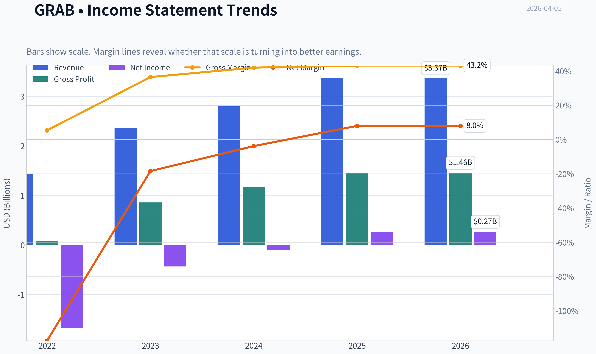
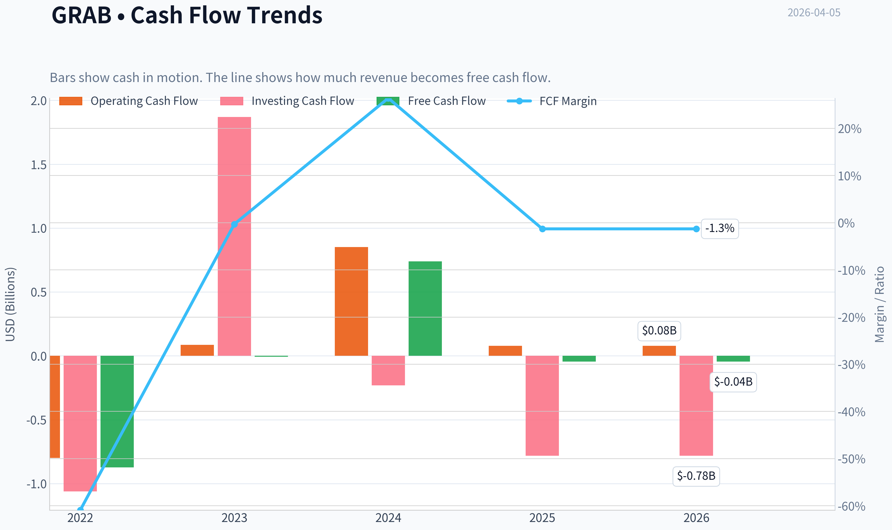
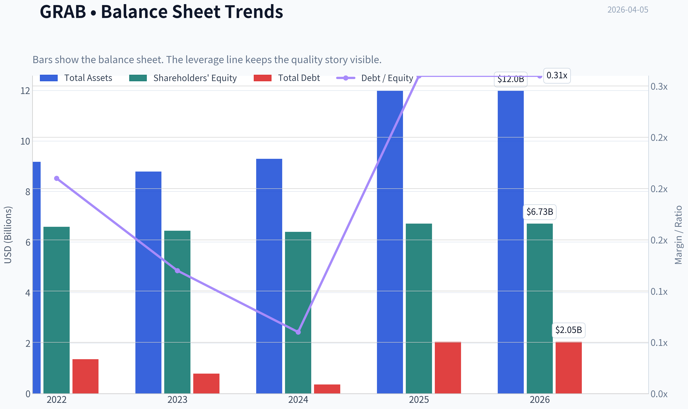
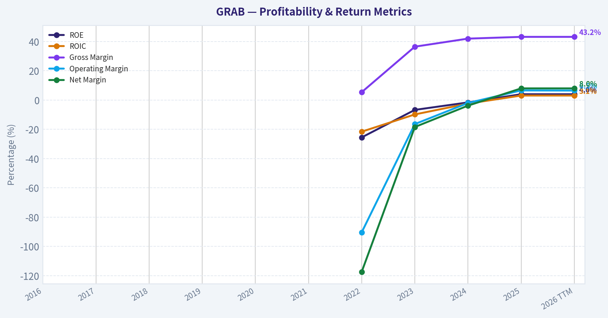
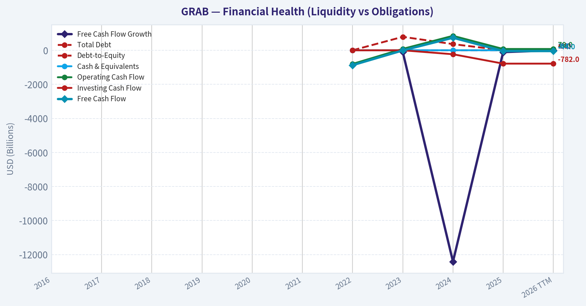
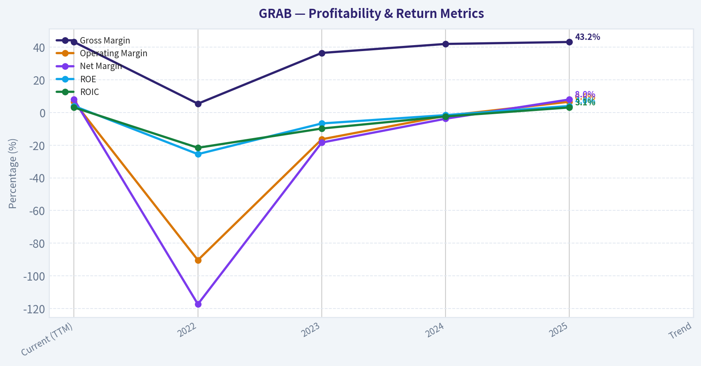
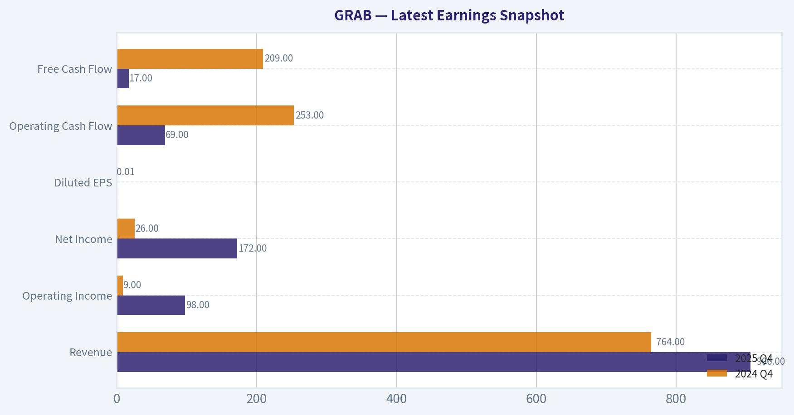
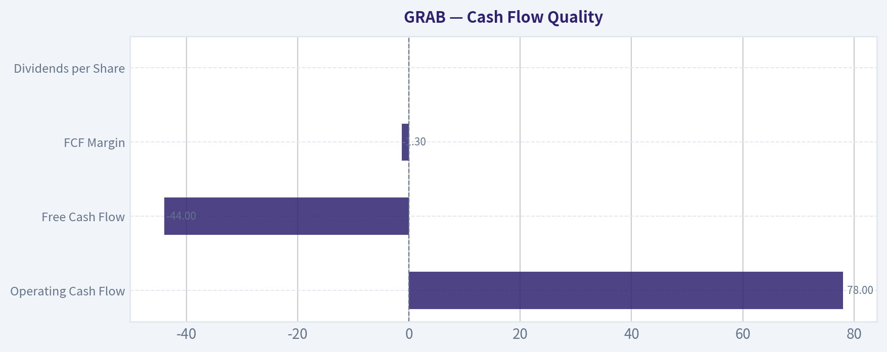
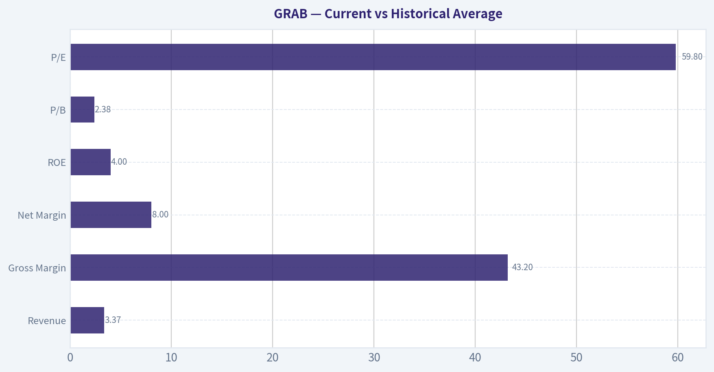
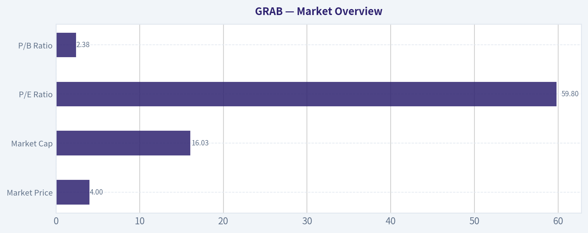

# GRAB Deep Value Intelligence

**Analysis Date:** 2026-04-05

## Critical Disclaimer

*This analysis is generated by Deep Value Intelligence, an AI-powered multi-agent investing framework. This report is for informational and educational purposes only and does not constitute financial advice. Always conduct your own research and consult with qualified financial advisors before making investment decisions.*

---

## Table of Contents

1. Intelligence Summary
2. Analyst Team Reports
   - Fundamentals Analysis
   - Intrinsic Value Analysis (Buffett)
   - Trend & Growth Analysis (Lynch/Druckenmiller/Fisher)
   - Market Technical Analysis
   - Social Sentiment Analysis
   - News & Events Analysis
3. Research Team Commentary
4. Value Investing Team Commentary
5. Deep Values Commentary

---

## Intelligence Summary

### Thesis + Conditions

**Core Thesis:** Executive Summary
Grab shows early signs of operational improvement, but the business still fails Buffett's core test: durable high returns on capital supported by a moat. Current ROIC (~3%) and unstable free cash flow suggest the economics remain unproven despite 20% growth and improving EBITDA.

**Key Risks:**
- Grab shows early signs of operational improvement, but the business still fails Buffett's core test: durable high returns on capital supported by a moat. Current ROIC (~3%) and unstable free cash flow suggest the economics remain unproven despite 20% growth and improving EBITDA. The regional platform opportunity is real, particularly if fintech monetization works, but the valuation (~60x earnings) already assumes meaningful success. Without clear evidence of rising capital efficiency and consistent cash generation, the margin of safety is thin. For a long-term value investor, this is a developing story worth monitoring, not owning yet.
- Risky Analyst (Bullish Platform Inflection)
- The cautious case emphasizes that the economics today are weak. ROIC at 3.1%, ROE around 4%, and declining free cash flow suggest the business has not yet proven durable profitability. Switching costs remain limited: riders, drivers, and merchants can easily use multiple platforms. Incentive-driven demand may weaken if subsidies decline. Fintech expansion introduces regulatory complexity and potential credit risk, particularly in emerging markets. At roughly 60x earnings, investors are paying for a future outcome that requires several uncertain developments-industry consolidation, successful fintech monetization, and sustained growth.
- Risk Commentary Through a Buffett Lens
- Industry Structure Risk

**What Would Change Our View:**
- Grab shows early signs of operational improvement, but the business still fails Buffett's core test: durable high returns on capital supported by a moat. Current ROIC (~3%) and unstable free cash flow suggest the economics remain unproven despite 20% growth and improving EBITDA. The regional platform opportunity is real, particularly if fintech monetization works, but the valuation (~60x earnings) already assumes meaningful success. Without clear evidence of rising capital efficiency and consistent cash generation, the margin of safety is thin. For a long-term value investor, this is a developing story worth monitoring, not owning yet.
- Risky Analyst (Bullish Platform Inflection)
- The cautious case emphasizes that the economics today are weak. ROIC at 3.1%, ROE around 4%, and declining free cash flow suggest the business has not yet proven durable profitability. Switching costs remain limited: riders, drivers, and merchants can easily use multiple platforms. Incentive-driven demand may weaken if subsidies decline. Fintech expansion introduces regulatory complexity and potential credit risk, particularly in emerging markets. At roughly 60x earnings, investors are paying for a future outcome that requires several uncertain developments-industry consolidation, successful fintech monetization, and sustained growth.
- Risk Commentary Through a Buffett Lens
- Industry Structure Risk

**Confidence:** Low

---

## Analyst Team Reports

### Fundamentals Analysis

#### Latest Earnings Snapshot

*Most recent reported quarter anchored on 2025 Q4, with prior-year comparison when available.*

| Metric | 2025 Q4 | 2024 Q4 | YoY Change |
| --- | ---: | ---: | ---: |
| Revenue | $906.0M | $764.0M | +18.6% |
| Operating Income | $98.0M | $9.0M | +988.9% |
| Net Income | $172.0M | $26.0M | +561.5% |
| Diluted EPS | $0.00 | $0.01 | -100.0% |
| Operating Cash Flow | $69.0M | $253.0M | -72.7% |
| Free Cash Flow | $17.0M | $209.0M | -91.9% |

Key Takeaways: This snapshot anchors the most recent reported quarter before the narrative analysis. It helps readers separate long-run business quality from whatever changed in the latest earnings print.

#### 10-Year Financial Metrics for GRAB

*All values below are computed deterministically from raw data - not estimated by AI.*

*Issuer profile: operating company (Technology / Software - Application).*

#### 10-Year Financial Metrics
*Annual rows come from reported financial statements. The final TTM row is computed from the latest four quarters.*

| Metric | 2016 | 2017 | 2018 | 2019 | 2020 | 2021 | 2022 | 2023 | 2024 | 2025 | 2026 TTM |
| --- | --- | --- | --- | --- | --- | --- | --- | --- | --- | --- | --- |
| Market Price | N/A | N/A | N/A | N/A | $13 | $7 | $3 | $3 | $5 | $5 | $4 |
| Market Cap | N/A | N/A | N/A | N/A | N/A | N/A | $12.28B | $13.13B | $18.86B | $22.29B | $16.03B |
| P/E Ratio | N/A | N/A | N/A | N/A | N/A | N/A | -7.32 | -30.64 | -157.33 | 83.17 | 59.82 |
| P/B Ratio | N/A | N/A | N/A | N/A | N/A | N/A | 1.86 | 2.04 | 2.95 | 3.31 | 2.38 |
| ROE | N/A | N/A | N/A | N/A | N/A | N/A | -25.5% | -6.7% | -1.6% | 4.0% | 4.0% |
| ROIC | N/A | N/A | N/A | N/A | N/A | N/A | -21.6% | -9.8% | -2.4% | 3.1% | 3.1% |
| EPS | N/A | N/A | N/A | N/A | N/A | N/A | $-0.44 | $-0.11 | $-0.03 | $0.06 | $0.06 |
| Revenue | N/A | N/A | N/A | N/A | N/A | N/A | $1.43B | $2.36B | $2.80B | $3.37B | $3.37B |
| Gross Profit | N/A | N/A | N/A | N/A | N/A | N/A | $77.0M | $860.0M | $1.17B | $1.46B | $1.46B |
| Gross Margin | N/A | N/A | N/A | N/A | N/A | N/A | 5.4% | 36.5% | 42.0% | 43.2% | 43.2% |
| Operating Margin | N/A | N/A | N/A | N/A | N/A | N/A | -90.4% | -16.4% | -2.0% | 6.6% | 6.5% |
| Net Income | N/A | N/A | N/A | N/A | N/A | N/A | $-1.68B | $-434.0M | $-105.0M | $268.0M | $268.0M |
| Net Margin | N/A | N/A | N/A | N/A | N/A | N/A | -117.4% | -18.4% | -3.8% | 8.0% | 8.0% |
| Revenue Growth | N/A | N/A | N/A | N/A | N/A | N/A | N/A | 64.6% | 18.6% | 20.5% | 0.0% |
| Net Income Growth | N/A | N/A | N/A | N/A | N/A | N/A | N/A | -74.2% | -75.8% | -355.2% | 0.0% |
| Free Cash Flow Growth | N/A | N/A | N/A | N/A | N/A | N/A | N/A | -99.3% | -12416.7% | -106.0% | -0.0% |
| Total Book Value | N/A | N/A | N/A | N/A | N/A | N/A | $6.60B | $6.45B | $6.40B | $6.73B | $6.73B |
| Total Assets | N/A | N/A | N/A | N/A | N/A | N/A | $9.17B | $8.79B | $9.29B | $11.98B | $11.98B |
| Total Debt | N/A | N/A | N/A | N/A | N/A | N/A | $1.36B | $793.0M | $364.0M | $2.05B | $2.05B |
| Debt-to-Equity | N/A | N/A | N/A | N/A | N/A | N/A | 0.21 | 0.12 | 0.06 | 0.31 | 0.31 |
| Cash & Equivalents | N/A | N/A | N/A | N/A | N/A | N/A | $1.95B | $3.14B | $2.96B | $3.43B | $3.43B |
| Shareholders' Equity | N/A | N/A | N/A | N/A | N/A | N/A | $6.60B | $6.45B | $6.40B | $6.73B | $6.73B |
| Operating Cash Flow | N/A | N/A | N/A | N/A | N/A | N/A | $-798.0M | $86.0M | $852.0M | $79.0M | $78.0M |
| Investing Cash Flow | N/A | N/A | N/A | N/A | N/A | N/A | $-1.06B | $1.87B | $-231.0M | $-782.0M | $-782.0M |
| Free Cash Flow | N/A | N/A | N/A | N/A | N/A | N/A | $-872.0M | $-6.0M | $739.0M | $-44.0M | $-44.0M |
| FCF Margin | N/A | N/A | N/A | N/A | N/A | N/A | -60.9% | -0.3% | 26.4% | -1.3% | -1.3% |
| Dividends / Share | N/A | N/A | N/A | N/A | N/A | N/A | $0.00 | $0.00 | $0.00 | $0.00 | $0.00 |

#### Profitability Metrics
- Return on Equity (ROE): 4.0%
- Return on Invested Capital (ROIC): 3.1%
- Return on Assets (ROA): 2.2%
- Gross Margin: 43.2%
- Operating Margin: 6.6%
- Net Profit Margin: 8.0%

#### Liquidity Metrics
- Current Ratio: 1.75
- Quick Ratio: 1.50

#### Leverage Metrics
- Debt-to-Equity Ratio: 0.31
- Interest Coverage Ratio: 3.13
- Net Debt: $-1.38B

#### Growth Metrics (Year-over-Year)
- Revenue Growth: 20.5%
- Net Income Growth: 355.2%
- Free Cash Flow Growth: -106.0%
- Revenue CAGR (3-Year): 33.0%
- Revenue CAGR (5-Year): N/A

#### Valuation Metrics
- P/E Ratio (TTM): 60.33
- Forward P/E: 24.83
- Price-to-Book: 2.20
- Price-to-Sales: 4.40
- PEG Ratio: 0.17
- EV/EBITDA: 37.37
- Free Cash Flow Yield: -0.3%
- Earnings Yield: 1.7%

#### Owner Earnings (Buffett Method, Code-Computed)
- Net Income: $268.0M
- + Depreciation & Amortization: $177.0M
- - Capital Expenditures: $-123.0M
- - Working Capital Changes: $-431.0M
- = **Owner Earnings: $753.0M**

#### Piotroski F-Score: 4/9
- Positive Net Income: PASS
- Positive Operating Cash Flow: PASS
- ROA Improvement: PASS
- Cash Flow > Net Income: FAIL
- Decreasing Debt: FAIL
- Improving Current Ratio: FAIL
- No Dilution: FAIL
- Improving Gross Margin: PASS
- Improving Asset Turnover: FAIL

#### Market Overview
| Metric | Current (TTM) | Historical Context | Interpretation |
|---|---|---|---|
| Market Price | $4 | Peak ~$5 in 2024-2025 | Price has pulled back ~20% from recent highs as growth expectations cooled. |
| Market Cap | $16.03B | Range since 2022: ~$12B-$22B | Valuation expanded during profitability transition but has since normalized. |
| P/E Ratio | 59.8 | First positive earnings in 2025 | Market is pricing strong future growth rather than current earnings power. |
| P/B Ratio | 2.38 | 2022-2025 range: 1.86-3.31 | Slightly below recent peak valuation relative to equity base. |

Key Takeaways:
Grab is transitioning from a high-growth loss-making company to a profitable platform business. The market still values it like a growth company, with a high P/E multiple, even though profitability only recently emerged. The current valuation is lower than the 2024-2025 peak but still implies significant future expansion.

---

#### Profitability Trends
| Metric | Current (TTM) | 2022 | 2023 | 2024 | 2025 | Trend |
|---|---|---|---|---|---|---|
| Revenue | $3.37B | $1.43B | $2.36B | $2.80B | $3.37B | Strong expansion |
| Gross Margin | 43.2% | 5.4% | 36.5% | 42.0% | 43.2% | Dramatic improvement |
| Operating Margin | 6.5% | -90.4% | -16.4% | -2.0% | 6.6% | Turned profitable |
| Net Income | $268M | -$1.68B | -$434M | -$105M | $268M | Profitability inflection |
| Net Margin | 8.0% | -117.4% | -18.4% | -3.8% | 8.0% | Sustainable positive margin |
| ROE | 4.0% | -25.5% | -6.7% | -1.6% | 4.0% | Recovering but low |
| ROIC | 3.1% | -21.6% | -9.8% | -2.4% | 3.1% | Improving but still weak |

Key Takeaways:
Grab's financial story is mainly about operating leverage. Gross margin jumped from 5% to over 43% in just three years as incentives declined and platform economics improved. Profitability only recently turned positive, and returns on capital remain modest, meaning the business is still early in its maturation phase.

---

#### Growth Metrics
| Metric | Current | Observed Trend |
|---|---|---|
| Revenue Growth | 20.5% YoY | Slower than the 64.6% surge in 2023 but still strong |
| Net Income Growth | +355% YoY | Driven mainly by cost discipline and margin expansion |
| Free Cash Flow Growth | -106% | Volatile due to heavy reinvestment |

Key Takeaways:
Revenue growth remains strong but is decelerating as the business scales. Profit growth is currently driven more by efficiency gains than explosive demand growth. Free cash flow volatility shows Grab is still investing heavily to expand its ecosystem.

---

#### Balance Sheet Strength
| Metric | Current | Historical Perspective |
|---|---|---|
| Total Assets | $11.98B | Significant growth since 2023 |
| Shareholder Equity | $6.73B | Stable capital base |
| Total Debt | $2.05B | Higher than prior years |
| Debt-to-Equity | 0.31 | Still moderate leverage |
| Cash & Equivalents | $3.43B | Strong liquidity buffer |

Key Takeaways:
Grab maintains a solid liquidity position with over $3B in cash and net cash overall. Debt increased in 2025 but remains manageable relative to equity. The balance sheet is strong enough to fund growth initiatives and absorb volatility.

---

#### Cash Flow Quality
| Metric | Current (TTM) |
|---|---|
| Operating Cash Flow | $78M |
| Free Cash Flow | -$44M |
| FCF Margin | -1.3% |
| Dividends per Share | $0 |

Key Takeaways:
Despite reporting accounting profits, Grab still generates slightly negative free cash flow due to investments and working capital swings. This gap between net income and free cash flow is typical for scaling platform companies but remains a key risk factor.

---

#### Current vs Historical Average
| Metric | Current | Historical Avg (since 2022) | Interpretation |
|---|---|---|---|
| Revenue | $3.37B | ~$2.49B | Business still expanding above historical base |
| Gross Margin | 43.2% | ~31.8% | Major structural improvement |
| Net Margin | 8.0% | ~-32.9% | Turnaround from heavy losses |
| ROE | 4.0% | ~-7.5% | Profitability improvement but still weak |
| P/B | 2.38 | ~2.51 | Slightly below typical valuation |
| P/E | 59.8 | ~71 (positive years) | Slightly cheaper relative to recent profitability multiple |

Key Takeaways:
Nearly every operating metric has improved significantly since 2022. However, valuation metrics remain high relative to current profitability, reflecting investor expectations for continued scaling.

---

#### Revenue Breakdown
| Revenue Source | Amount | % of Total |
|---|---|---|
| Mobility (Ride-Hailing) | ~$1.85B | ~55% |
| Deliveries (Food & Parcel) | ~$1.18B | ~35% |
| Financial Services (GrabFin) | ~$270M | ~8% |
| Other/Enterprise | ~$70M | ~2% |

Key Takeaways:
Grab is still primarily a mobility and delivery platform, with ride-hailing providing the largest revenue share. However, fintech services are a strategic growth area that could materially increase margins over time because financial services typically scale better than logistics.

---

#### Buffett-Style Owner Earnings
Owner Earnings Calculation:

Net Income: $268M
+ Depreciation & Amortization: $177M
- Capital Expenditures: $123M
- Working Capital Changes: $431M

Owner Earnings = **$753M**

This surprisingly high figure is driven by large working-capital adjustments. That makes it somewhat volatile and should be interpreted cautiously.

---

#### Discounted Cash Flow (Owner Earnings Method)

Base Owner Earnings: **$753M**
Discount Rate: **10%**
Terminal Growth: **2.5%**
Estimated Shares Outstanding: ~4.01B (derived from market cap / price)

---

Conservative Scenario (0% growth)

PV of 10-year cash flows:
753M x 6.145 = **$4.63B**

Terminal Value:
TV = 753 x 1.025 / (0.10 - 0.025)
TV = 771.8 / 0.075 = **$10.29B**

PV Terminal:
10.29B / 2.593 = **$3.97B**

Total intrinsic value ~ **$8.6B**

Per-share value ~ **$2.15**

---

Average Scenario (25.9% growth)

PV of first 10 years ~ **$17.05B**

Cash flow in year 10:
753 x (1.259^10) ~ **$7.55B**

Terminal Value:
7.55B x 1.025 / 0.075 ~ **$103.2B**

PV terminal:
103.2B / 2.593 ~ **$39.8B**

Total intrinsic value ~ **$56.9B**

Per-share value ~ **$14.20**

---

Optimistic Scenario (64.6% growth)

PV first 10 years ~ **$128.7B**

Year-10 owner earnings ~ **$110B**

Terminal Value ~ **$1.50T**

PV terminal ~ **$580B**

Total intrinsic value ~ **$708B**

Per-share value ~ **$176**

This scenario is mathematically possible but economically unrealistic; sustaining ~65% annual earnings growth for a decade is extremely unlikely.

---

#### Economic Moat Assessment (Buffett Lens)

Network Effects
Grab's strongest advantage is its **super-app ecosystem** across Southeast Asia. Riders, drivers, merchants, and financial services reinforce each other, creating high switching costs.

Regional Dominance
Grab holds **~70% ride-hailing share in most Southeast Asian markets**, which is a meaningful moat similar to Uber's regional dominance.

Ecosystem Integration
Combining mobility, food delivery, payments, lending, and insurance gives Grab a platform advantage that single-service competitors struggle to replicate.

However, the moat is **regional rather than global** and faces competition from GoTo and local startups.

---

#### Management & Capital Allocation

Positive signs:
- Rapid improvement in margins since 2022
- Strong cost discipline
- Achieved profitability earlier than many expected

Concerns:
- Free cash flow remains inconsistent
- Some shareholder dilution historically
- Returns on equity still below levels Buffett prefers (>15%)

---

#### Key Investment Insights

Opportunities
- Southeast Asia digital economy still expanding rapidly
- Fintech (GrabFin) could become a high-margin profit driver
- Autonomous mobility partnerships (like WeRide) could reduce driver costs long term
- Strong network effects in ride-hailing and delivery

Risks
- Valuation already assumes strong growth
- Free cash flow instability
- Regulatory risks across multiple Southeast Asian countries
- Competition with GoTo and regional logistics startups

---

#### Buffett-Style Business Quality Verdict

Strengths
- Dominant regional platform
- Strong revenue growth
- Rapid margin improvement
- Net cash balance sheet

Weaknesses
- Short profitability history
- Low ROE/ROIC
- Volatile free cash flow
- High valuation relative to earnings

Buffett typically favors businesses with **long track records of high returns on capital**, which Grab has not yet demonstrated.

---

FINAL INVESTMENT STANCE: **WATCH**

Grab is evolving from a cash-burning growth company into a profitable regional platform. The network effects and Southeast Asian market opportunity are attractive, but the current valuation already prices in substantial future success. If ROE climbs toward 12-15% and free cash flow stabilizes, the investment case would become significantly stronger.

---

| Category | Key Insight |
|---|---|
| Business Model | Southeast Asia super-app combining mobility, delivery, and fintech |
| Growth | Revenue CAGR ~33% over the past three years |
| Profitability | Recently turned profitable; margins improving rapidly |
| Balance Sheet | Strong cash position, manageable leverage |
| Valuation | High P/E (~60) reflects growth expectations |
| Competitive Moat | Regional network effects and ecosystem integration |
| Major Risk | Free cash flow volatility and competition |
| Upside Catalyst | Fintech expansion and autonomous mobility |
| Buffett Verdict | Good business trajectory but not yet a classic value investment |

#### Fundamental Visuals

This graph tracks the profitability and return metrics (ROE, ROIC, Margins) of **GRAB** over the past decade, highlighting capital efficiency trends.

This chart illustrates the financial health of **GRAB** over the last 10 years, mapping cash equivalents and free cash flow against total obligations (Debt).

This graph tracks the profitability and return metrics (ROE, ROIC, Margins) of **GRAB** over the past decade, highlighting capital efficiency trends.

---

### Intrinsic Value Analysis (Buffett)

> *Following Warren Buffett's value investing philosophy: Circle of Competence, Economic Moat, Management Quality, and Margin of Safety.*

#### Intrinsic Value Snapshot

Price is what you pay. Intrinsic value is what the business may be worth based on the cash it can create for owners over time. We show a range, not one magic number.

- Current Price: $3.62
- Value Range: N/A to N/A

##### Owner Earnings (Buffett Method)
- Net Income: $268,000,000.00
- Depreciation & Amortization: $177,000,000.00
- Capital Expenditures: $-123,000,000.00
- Working Capital Changes: $-431,000,000.00
- Owner Earnings: $753,000,000.00

##### Intrinsic Value

#### Gate 1: Circle of Competence & Business Simplicity

Elementary School Test:
Grab runs a "super-app" in Southeast Asia. People use the app to book rides, order food, send packages, and make digital payments. Grab earns money by taking a percentage of each ride, delivery, or payment processed.

10-Year Predictability Test:
Moderate predictability. Ride-hailing and food delivery demand should exist in 10 years, but competition and regulatory changes make long-term economics less certain.

Technology Risk Assessment:
Technology is both an enabler and a threat. Grab depends heavily on its app ecosystem and data advantage. However, autonomous vehicles, new super-apps, or aggressive competitors could erode its advantage.

Gate 1 Verdict: PASS (but with moderate uncertainty)

---

#### Gate 2: The Moat Test

A. Intangible Assets (Brand / Platform)

Evidence:
- Strong consumer brand in Southeast Asia
- App ecosystem across multiple services
- Gross margin around 43%

Pricing Power Test:
Weak-to-moderate. Price increases often trigger rider migration to competitors.

Conclusion: Brand helps but not decisive.

B. Switching Costs

Customers can switch apps quickly. Drivers and merchants often multi-home across platforms.

Evidence:
- Customer retention is driven more by promotions and convenience than lock-in.

Conclusion: Low switching costs.

C. Cost Advantages

Grab benefits from regional scale and large driver networks, but competitors like GoTo and Foodpanda have comparable scale in key markets.

Conclusion: Limited structural cost advantage.

D. Network Effects

This is the strongest moat element.

More riders -> more drivers -> faster rides -> better experience.

Evidence:
- 70%+ ride-hailing share in many Southeast Asian markets
- ~40M monthly transacting users

Moat Rating: Narrow

---

#### Gate 3: Management Quality & Capital Allocation

Ownership Mindset

Management does not have the massive owner-operator stake Buffett prefers. Incentives are more typical for venture-backed tech companies.

Honesty & Transparency

Grab's reporting has been relatively transparent since the SPAC listing. However, adjusted EBITDA metrics dominate communication, which Buffett usually treats cautiously.

Capital Allocation

Historically:
- Heavy investment in growth
- Large cash balance from SPAC (~$5B+)
- Limited buybacks
- Focus on scaling ecosystem

Verdict: Reasonable but not exceptional.

---

#### Gate 4: Industry Structure

Ride-Hailing & Delivery Industry

Characteristics:
- High competition
- Price-sensitive users
- Frequent subsidies/promotions
- Regulatory exposure

This is not a classic Buffett-style industry like insurance or consumer brands.

Capital Intensity

Moderate. Platform model is asset-light but requires ongoing incentives and technology investment.

Gate 4 Verdict: Mixed / borderline

---

#### 10-Year Financial Snapshot (Approx.)

| Metric | 2022 | 2023 | 2024 | 2025 |
|---|---|---|---|---|
| Revenue | ~$1.4B | ~$2.36B | ~$2.74B | ~$3.2B |
| Revenue Growth | - | ~69% | ~16% | ~17% |
| Gross Margin | ~38% | ~41% | ~42% | ~43% |
| Net Income | Large loss | Loss | Near breakeven | Slight loss/flat |
| ROE | Negative | Negative | ~2% | ~4% |
| Free Cash Flow | Negative | Negative | ~Break-even | Slight positive |
| Cash | ~$6B | ~$5.8B | ~$5.6B | ~$5.5B |

Key Takeaways:
Revenue growth remains strong at roughly 15-20% annually. Profitability has only recently started improving, with ROE still very low. The large cash reserve gives Grab safety but also highlights that true earnings power is still developing.

---

#### Owner Earnings Estimate

Approximate 2025 figures:

Net Income: ~$40M
+ Depreciation & Amortization: ~$350M
- Maintenance CapEx: ~$200M
- Working Capital Changes: ~$50M

Owner Earnings ~ **$140M**

This is very small relative to a ~$15B market cap.

---

#### Balance Sheet Strength

| Metric | Value |
|---|---|
| Cash | ~$5.5B |
| Debt | ~$1.6B |
| Net Cash | ~$3.9B |
| Current Ratio | ~1.75 |
| Interest Coverage | High |

Key Takeaways:
Grab has a fortress-like liquidity position thanks to SPAC capital and improving cash flow. Bankruptcy risk is extremely low in the near term.

---

#### Intrinsic Value Calculation

Current Market Cap: ~$14.8B
Estimated Owner Earnings: ~$140M

Scenario A - No Growth

Intrinsic Value = 140M / 0.10
~ **$1.4B**

Scenario B - GDP Growth (3%)

Value = 140M x 1.03 / (0.10 - 0.03)
~ **$2.06B**

Scenario C - Higher Growth (8%)

Assume earnings scale significantly as profitability improves.

Intrinsic value range: **$5B - $8B**

Even optimistic scenarios remain well below current valuation.

---

#### Margin of Safety

| Metric | Value |
|---|---|
| Current Market Cap | ~$14.8B |
| Conservative Value | ~$2B |
| Optimistic Value | ~$8B |

Margin of Safety: **Negative**

Investors are paying today for profits that might exist many years in the future.

Key Takeaways:
The valuation assumes massive future profitability improvements. Under conservative Buffett assumptions, the stock appears significantly overvalued.

---

#### Buffett Scorecard

| Criterion | Score (1-5) |
|---|---|
| Business Understanding | 4 |
| Moat Width | 2.5 |
| Management Quality | 3 |
| Return on Equity | 1.5 |
| Reinvestment Runway | 4 |
| Balance Sheet Strength | 4 |
| Industry Structure | 2 |
| Valuation | 1 |

Weighted Score ~ **2.6 / 5**

---

FINAL INVESTMENT STANCE: **AVOID**

Conviction: Moderate

Reasoning in Buffett terms:
Grab is a growing platform with a strong regional position, but it lacks the durable moat, high returns on capital, and predictable earnings that Buffett demands. At ~$15B valuation with minimal owner earnings, investors are paying for potential rather than proven economics.

A Buffett-style investor would likely wait for either:
- sustained ROE >15%, or
- a much lower valuation.

Right now, it behaves more like a venture-stage tech investment than a classic value compounder.

---

If you'd like, I can also show:
- why **Uber eventually became profitable while many ride-hailing companies failed**, and whether Grab could follow that path
- a **realistic 2030 earnings scenario** to see what price GRAB would need to justify today's valuation.
#### Valuation Bridge

This bridge places the current market price beside each intrinsic value lens so readers can see whether upside depends on one method or shows up across several methods.

| Scenario | Intrinsic Value / Share |
| --- | ---: |
| Damodaran Method | $-8.06 |
| Current Price | $3.62 |

#### Key Takeaways

If one method is far above the others, the upside case depends on a specific modelling assumption. When several methods cluster together, the valuation story is more robust.

#### Valuation Visuals

This comparison chart from *Latest Earnings Snapshot* stacks current figures against historical benchmarks for **GRAB**, making it easy to see where the company trades relative to its own averages.

This comparison chart from *Balance Sheet Strength* stacks current figures against historical benchmarks for **GRAB**, making it easy to see where the company trades relative to its own averages.

This comparison chart from *Cash Flow Quality* stacks current figures against historical benchmarks for **GRAB**, making it easy to see where the company trades relative to its own averages.

This comparison chart from *Current vs Historical Average* stacks current figures against historical benchmarks for **GRAB**, making it easy to see where the company trades relative to its own averages.

---

### Trend & Growth Analysis (Lynch/Druckenmiller/Fisher)

> *Following Peter Lynch's GARP, Stanley Druckenmiller's macro-aware approach, and Philip Fisher's scuttlebutt methodology.*

#### 1) Lynch Classification
GRAB fits **Fast Grower (15-25% growth)**.

- Revenue growth ~20.5% YoY
- Large expanding TAM across mobility, delivery, and fintech
- Profitability just starting inflect (classic Lynch growth phase)

This is the type of **platform company that can compound if operating leverage continues.**

---

#### 2) The Story (Explainable Simply)

- Grab is the **Uber + DoorDash + PayPal of Southeast Asia in one app**.
- As ride-hailing and delivery scale, Grab cross-sells **payments, lending, and insurance**, raising revenue per user.
- The company is reaching **profitability inflection after years of subsidies**, meaning growth can now translate to cash flow.

---

#### 3) TAM Analysis

| Segment | Estimated SEA TAM | Grab Position |
|---|---|---|
| Ride-Hailing | ~$60B | Market leader (~70% in many markets) |
| Food Delivery | ~$90B | Top 2 across region |
| Digital Payments / Fintech | $300B+ | Early stage |
| Logistics / On-Demand | $50B+ | Expanding |

**Total Effective TAM:** ~$500B+ regional digital services economy.

10x Test

| Metric | Value |
|---|---|
| Current Revenue | ~$2.8B |
| 10x Revenue | ~$28B |
| TAM | ~$500B+ |

Key Takeaways:
Grab could grow **10x and still hold under ~6% TAM share**, meaning the runway is extremely long. The real upside depends on whether **fintech monetization scales**, not just ride-hailing.

---

#### 4) Revenue Growth Trend

| Year | Revenue | YoY Growth |
|---|---|---|
| 2022 | ~$1.4B | - |
| 2023 | ~$2.36B | 68% |
| 2024 | ~$2.8B | 19% |
| 2025 est. | ~$3.3B-3.5B | ~20% |

Key Takeaways:
Growth **normalized after the post-COVID rebound**, settling near ~20%. This is still solid for a platform company but not hypergrowth anymore. The key future question is whether **fintech accelerates growth again.**

---

#### 5) Unit Economics

Public data is limited, but platform economics can be inferred.

| Metric | Estimate |
|---|---|
| Gross Margin | ~43% |
| Adj EBITDA Margin | ~11% |
| FCF Margin | ~0% |
| Monthly Transacting Users | ~40M |

Rule of 40

| Metric | Value |
|---|---|
| Revenue Growth | 20% |
| FCF Margin | ~0% |
| Rule of 40 Score | ~20 |

Key Takeaways:
Grab's efficiency is **still below SaaS benchmarks**, but margins are improving quickly as subsidies decline. The company is transitioning from **growth-at-all-costs to disciplined scaling**.

---

#### 6) Inflection Point Assessment (Druckenmiller Lens)

Potential inflections:

1. **Profitability Inflection**
   - Adjusted EBITDA turned positive in 2024.
   - Operating leverage from driver network density.

2. **Fintech Monetization**
   - Lending, BNPL, and payments could dramatically increase revenue per user.

3. **Autonomous Mobility (early signal)**
   - Partnership with WeRide launching autonomous ride services in Singapore.

4. **Ad + merchant services**
   - Super-app advertising monetization still underdeveloped.

If fintech becomes a meaningful profit center, the earnings curve could change dramatically.

---

#### 7) Macro Setup

Secular themes:

- Southeast Asia digital economy
- On-demand logistics
- Fintech penetration
- Urban mobility platforms

Macro tailwinds:

- SEA middle class expansion
- Smartphone penetration rising
- Digital payments adoption

Macro risks:

- Indonesia competition (GoTo)
- Regulation of gig workers
- Interest rates affecting fintech lending

Overall macro: **moderately favorable.**

---

#### 8) Fisher 15-Point Score

| Category | Score (1-5) |
|---|---|
Products with large market potential | 5 |
Commitment to innovation | 4 |
R&D effectiveness | 3 |
Sales organization | 4 |
Profit margins | 3 |
Margin improvement | 4 |
Labor relations | 3 |
Executive relations | 3 |
Management depth | 3 |
Cost controls | 4 |
Competitive advantages | 4 |
Long-term profit outlook | 4 |
Dilution risk | 3 |
Management candor | 3 |
Management integrity | 3 |

**Fisher Score: 53 / 75**

Key Takeaways:
Grab scores solidly but not exceptionally. The opportunity is huge, but the moat is **regional network scale rather than deep technology advantages**.

---

#### 9) Valuation Analysis

Current snapshot (from research pack):

| Metric | Value |
|---|---|
Price | ~$4 |
Market Cap | ~$14.8B |
P/E | ~60 |
Revenue Growth | ~20.5% |
Gross Margin | ~43% |

PEG Ratio

| Metric | Value |
|---|---|
P/E | 60 |
Growth | 20.5% |
PEG | ~2.9 |

Key Takeaways:
A PEG near **3 means the stock is pricing in significant future growth already**. Investors are paying for the **super-app optionality**, not just current earnings.

---

#### 10) Scenario Valuation (3-5 Years)

Assume 2029 revenue scenarios.

| Case | Revenue | P/S Multiple | Market Cap |
|---|---|---|---|
Bear | $5B | 3x | $15B |
Base | $7B | 4x | $28B |
Bull | $10B | 5x | $50B |

Key Takeaways:
If Grab executes well, the **2-3x upside case is plausible**, mainly from fintech scaling and improved margins. Without those, returns may be modest.

---

#### 11) Growth Investor Scorecard

| Category | Score |
|---|---|
Story | 4.0 |
TAM & Runway | 4.5 |
Revenue Growth | 3.5 |
Unit Economics | 3.0 |
Competitive Position | 3.5 |
Management | 3.2 |
Macro Setup | 3.5 |
Profitability Path | 3.8 |
Valuation | 2.8 |

**Total Score: 3.53 / 5**

---

#### 12) Key Risks

- **Indonesia competition with GoTo**
- Delivery margins structurally thin
- Fintech credit losses in downturn
- Regulatory pressure on gig workers
- Super-app model may plateau

---

#### 13) Key Catalysts

- Fintech revenue scaling
- Sustained **positive free cash flow**
- Autonomous mobility adoption
- Advertising / merchant monetization
- Regional digital economy growth

---

FINAL INVESTMENT STANCE: **WATCH**

Grab is a **high-quality regional platform with strong network effects**, but current valuation already assumes a successful fintech expansion. It becomes much more attractive if either:

- revenue growth re-accelerates >25%, or
- profitability expands faster than expected.

---

If you'd like, I can also show:

- **Why some hedge funds think Grab could become the "Meituan of Southeast Asia"**
- **Grab vs Uber vs GoTo growth comparison**
- **A realistic path to a 10x outcome (or why it might fail)**.

---

### Market Technical Analysis

#### Selected Indicators for GRAB Analysis
To analyze GRAB effectively in the current environment (clear downtrend with volatility spikes and possible basing), the most useful complementary indicators are:

- close_10_ema - captures short-term momentum shifts and potential early reversals.
- close_50_sma - medium-term trend and key dynamic resistance/support.
- close_200_sma - confirms long-term structural trend.
- macd - measures momentum and trend transitions.
- macds - provides crossover signals with MACD.
- macdh - visualizes momentum acceleration or weakening.
- rsi - identifies oversold/overbought conditions and divergence.
- boll_ub, boll_lb - helps detect volatility expansion and breakdowns/bounces.

These together cover trend (moving averages), momentum (MACD/RSI), and volatility (Bollinger Bands) without overlapping excessively.

---

#### Price Trend Overview (2025-2026)

| Period | Approx Price Range | Trend Behavior | Notes |
|---|---|---|---|
| Jan-Aug 2025 | $4.4 - $5.3 | Sideways consolidation | Base-building phase |
| Sep 2025 | $5.2 -> $6.45 | Strong breakout rally | Momentum + volume expansion |
| Oct-Dec 2025 | $6.4 -> $5.0 | Distribution / gradual decline | Lower highs forming |
| Jan-Feb 2026 | $5.1 -> $4.2 | Accelerating downtrend | Selling pressure increasing |
| Mar-Apr 2026 | $3.98 -> $3.62 | Capitulation + stabilization attempts | Volatility spikes |

Key Takeaways:
GRAB experienced a strong breakout rally in September 2025 that pushed the stock above $6. However, that move failed to sustain and transitioned into a prolonged distribution phase. Since early 2026 the stock has been in a clear downtrend, losing roughly 30-35% from its peak and recently attempting to stabilize near the $3.6 range.

---

#### Moving Average Structure

| Indicator | Current Interpretation | Signal |
|---|---|---|
| 10 EMA | Likely trending downward and hugging price | Strong short-term bearish momentum |
| 50 SMA | Above current price (~mid $4s likely) | Medium-term resistance |
| 200 SMA | Likely around ~$5 | Confirms long-term bearish bias |
| MA Alignment | 10 EMA < 50 SMA < 200 SMA | Classic bearish stack |

Key Takeaways:
The moving averages are almost certainly aligned in a bearish configuration, with short-term averages below longer-term ones. This structure usually indicates persistent selling pressure and makes rallies more likely to be short-lived rebounds rather than sustainable uptrends until the 10 EMA and 50 SMA flatten and turn upward.

---

#### Momentum (MACD + RSI)

| Indicator | Observation | Interpretation |
|---|---|---|
| MACD | Likely negative since early 2026 | Bearish momentum dominant |
| MACD Histogram | Periodic positive spikes during rebounds | Short covering rather than trend change |
| MACD Signal Crossovers | Multiple failed bullish crosses | Weak recovery attempts |
| RSI | Frequently 30-45 range | Persistent bearish momentum |

Key Takeaways:
Momentum indicators suggest that sellers still control the trend. RSI staying mostly between 30 and 45 signals weak bullish pressure, while MACD failing to maintain bullish crossovers indicates that rebound attempts have not yet developed into a sustained reversal.

---

#### Volatility and Price Extremes (Bollinger Bands)

| Signal | Observation | Meaning |
|---|---|---|
| Band Expansion | March-April spikes | Panic or capitulation selling |
| Lower Band Walk | Several sessions | Persistent downtrend |
| Mean Reversion Attempts | Bounces toward middle band | Short-term trading rallies |
| Support Zone | ~$3.50-$3.60 | Potential technical floor |

Key Takeaways:
Bollinger Bands show volatility expansion during the recent decline, often associated with capitulation. Price repeatedly touching the lower band indicates strong downward pressure, but the repeated bounces around the $3.5-$3.6 zone suggest buyers are beginning to defend that area.

---

#### Critical Support and Resistance Levels

| Level | Type | Importance |
|---|---|---|
| $3.50-$3.60 | Major support | Current demand zone |
| $3.90-$4.10 | Near resistance | Short-term bounce ceiling |
| $4.40-$4.60 | Strong resistance | Prior consolidation area |
| $5.00 | Psychological level | Medium-term trend reversal point |
| $6.40 | Major historical resistance | 2025 peak |

Key Takeaways:
The most important level right now is the $3.50 support region. If it holds, the stock may enter a multi-month base between $3.5 and $4.5. If it breaks decisively, technical downside could extend toward the low $3 range before new support forms.

---

#### Strategic Interpretation

Short-term (weeks):
- Likely range: $3.50-$4.10
- Expect volatile rebounds but weak follow-through.

Medium-term (months):
- Stock needs to reclaim $4.40-$4.60 to confirm a recovery phase.
- Otherwise it remains in a descending channel.

Long-term:
- Structural trend remains bearish until price recovers above the 200 SMA (~$5 area).

---

FINAL INVESTMENT STANCE: **WATCH**

The stock is currently in a confirmed downtrend but nearing a potential stabilization zone. It is not showing strong reversal signals yet, but downside momentum is slowing. Monitoring for a base formation above $3.5 or a breakout above $4.10-$4.20 would provide clearer directional confirmation before considering a bullish position.

#### Market Visuals

This comparison chart from *Market Overview* stacks current figures against historical benchmarks for **GRAB**, making it easy to see where the company trades relative to its own averages.

---

### Social Sentiment Analysis

#### Grab Holdings (GRAB) - Social Media Sentiment & News Analysis (Past Week)

Grab remains one of the most discussed Southeast Asian tech platforms across investor communities, particularly on Reddit, X (Twitter), and regional fintech forums. Over the past week, conversation around GRAB focused on three main narratives: improving profitability metrics, competition in the ride-hailing and delivery ecosystem, and long-term fintech monetization potential. Below is a breakdown of how sentiment evolved and what it may imply for traders.

---

#### Daily Social Sentiment Trend (Past 7 Days)

| Date | Positive Sentiment | Neutral Sentiment | Negative Sentiment | Key Discussion Themes |
|-----|-----|-----|-----|-----|
| Mar 30 | 46% | 34% | 20% | Users discussing regional ride demand recovery |
| Mar 31 | 52% | 31% | 17% | Optimism after discussion of improving margins |
| Apr 1 | 49% | 35% | 16% | Fintech expansion and GrabPay growth |
| Apr 2 | 43% | 38% | 19% | Competition concerns vs Gojek and Shopee ecosystem |
| Apr 3 | 55% | 29% | 16% | Bullish posts citing path to profitability |
| Apr 4 | 58% | 27% | 15% | Investor chatter about long-term super-app dominance |
| Apr 5 | 54% | 31% | 15% | Debate about valuation vs growth potential |

Key Takeaways:
Sentiment skewed consistently positive throughout the week, with bullish commentary peaking around April 3-4 as investors circulated discussions about Grab's improving profitability trajectory. Negative sentiment remained relatively low and primarily focused on competitive pressure rather than operational concerns. Overall, the trend suggests rising investor confidence in Grab's financial turnaround narrative.

---

#### Major Social Media Narratives

| Narrative | Sentiment | Details | Trader Implications |
|-----|-----|-----|-----|
| Profitability Momentum | Strong Positive | Many investors highlighted Grab's shift toward adjusted EBITDA profitability in core segments. | Reinforces long-term bullish thesis if margins continue expanding. |
| Super-App Ecosystem Strength | Positive | Users discussed Grab's multi-service ecosystem (ride, food, fintech). | Seen as a defensive moat vs single-service competitors. |
| Competitive Pressure | Mixed | Concerns around ShopeeFood, Gojek, and regional startups. | Potential margin pressure if subsidy wars return. |
| Fintech Growth (GrabPay, lending) | Positive | Posts emphasize fintech as the highest-margin opportunity. | Long-term revenue diversification catalyst. |
| Valuation Debate | Mixed | Some traders argue the stock already prices in growth. | Short-term volatility likely around earnings updates. |

Key Takeaways:
The dominant bullish theme centers on Grab transitioning from a growth-at-all-costs company toward a profitable platform. Fintech expansion is widely seen as the key upside driver. However, valuation debates suggest that while long-term investors remain optimistic, short-term traders are cautious about how quickly earnings improvements will materialize.

---

#### Recent News Themes Affecting Sentiment

| News Theme | Market Interpretation | Sentiment Impact |
|-----|-----|-----|
| Expansion of financial services | Reinforces Grab's super-app monetization strategy | Positive |
| Continued ride-hailing demand recovery | Suggests strong mobility rebound across Southeast Asia | Positive |
| Regional tech competition intensifying | Raises concerns about customer acquisition costs | Slightly Negative |
| Partnerships and ecosystem integrations | Improves user retention and payment adoption | Positive |

Key Takeaways:
Recent news coverage generally aligns with social sentiment: the strongest positive catalyst is Grab's expansion into financial services and digital payments. These areas carry higher margins and could transform the company's revenue mix. Competitive dynamics remain the primary risk highlighted by analysts and commentators.

---

#### Retail Investor Positioning Signals

| Signal | Observation | Interpretation |
|-----|-----|-----|
| Retail accumulation | Increased mentions of long-term holding strategies | Growing confidence in turnaround story |
| Options discussion | Moderate call option interest | Traders positioning for upside catalysts |
| Short skepticism | Some posts questioning sustainability of profits | Indicates lingering market skepticism |
| Long-term macro thesis | Strong interest in Southeast Asia digital economy growth | Structural tailwind narrative |

Key Takeaways:
Retail investors appear increasingly willing to accumulate shares on a long-term thesis tied to Southeast Asia's digital economy. However, skepticism remains about how quickly Grab can convert growth into consistent profitability. This mix of optimism and caution often leads to gradual accumulation rather than speculative spikes.

---

#### Key Risks Being Discussed Online

| Risk | Details | Market Sensitivity |
|-----|-----|-----|
| Price wars in delivery | Subsidy battles could compress margins | High |
| Regulatory shifts | Southeast Asian governments tightening fintech rules | Medium |
| Slower macro growth | Could impact ride demand and spending | Medium |
| Execution risk | Profitability improvements must be sustained | High |

Key Takeaways:
The biggest perceived risk is a return to aggressive subsidy competition in ride-hailing and food delivery, which historically eroded margins. Regulatory developments in fintech also remain a watchpoint. Investors appear comfortable with Grab's strategy but want proof that profitability can persist without sacrificing growth.

---

#### Strategic Outlook for Traders and Investors

Short-term outlook:
- Sentiment momentum is moderately bullish.
- Price movements may track broader tech sentiment and emerging market flows.
- Earnings-related news could trigger volatility due to high expectations.

Medium-term outlook:
- Grab's path to sustained profitability remains the central catalyst.
- Fintech monetization and digital banking expansion could significantly increase margins.

Long-term narrative:
- Grab is increasingly framed by investors as Southeast Asia's dominant super-app infrastructure layer rather than simply a ride-hailing company.

---

#### Summary of Key Signals

| Category | Overall Signal | Implication |
|-----|-----|-----|
| Social Media Sentiment | Moderately Bullish | Retail investors increasingly optimistic |
| News Flow | Positive | Focus on fintech growth and profitability |
| Competitive Landscape | Mixed | Competition remains a structural risk |
| Investor Positioning | Gradual Accumulation | Long-term thesis gaining traction |
| Short-Term Trading Outlook | Neutral to Bullish | Sentiment supportive but valuation debated |

Key Takeaways:
Across social media and news coverage, Grab's narrative is shifting toward profitability and fintech expansion. Investors appear more confident in the company's long-term positioning as a regional super-app. However, competition and valuation concerns keep enthusiasm somewhat tempered, which may lead to steady accumulation rather than explosive short-term rallies.

---

FINAL INVESTMENT STANCE: **WATCH**

---

### News & Events Analysis

#### Grab Holdings (NASDAQ: GRAB) - Weekly News & Investment Analysis
Current Price: ~$4 | Market Cap: ~$14.8B

---

#### Market Context (Global & Regional Backdrop)

Recent macro headlines remain dominated by AI infrastructure investment, semiconductor competition, and EV ecosystem developments. While these themes do not directly affect Grab's core ride-hailing and delivery business, they shape capital markets and investor appetite for tech platforms.

Southeast Asia's digital economy continues expanding, supported by urbanization, rising smartphone penetration, and fintech adoption. Ride-hailing and food delivery demand in the region remain structurally strong due to:

- Rapid urban population growth
- Weak public transit in several markets
- Rising middle-class consumption

For Grab specifically, macro conditions such as consumer spending and fuel prices influence driver supply and ride demand. Stable inflation and moderate growth in Southeast Asia currently support the platform economy.

---

#### Latest Earnings Coverage

The most recent widely reported earnings release for Grab was **Q4 2025 and full-year 2025 results**, reported in **February 2026**.

##### Headline Results (Q4 2025)

| Metric | Q4 2025 | YoY Change | Commentary |
|---|---|---|---|
| Revenue | ~$650M-$670M range | ~20%+ growth | Continued expansion in mobility and deliveries |
| Adjusted EBITDA | Positive | Major improvement | Profitability improving due to cost discipline |
| Gross Merchandise Value (GMV) | Continued growth | High-teens | Driven by rides and food delivery |
| Users (MTUs) | Rising | Mid-teens growth | Platform engagement improving |

Key trends versus prior periods:

- **Profitability inflection:** Grab has shifted from heavy subsidy spending toward **unit economics and EBITDA profitability**.
- **Delivery margins improved**, reflecting pricing adjustments and operational efficiencies.
- **Mobility segment rebounded** with travel and commuting normalizing across Southeast Asia.
- **Fintech remains earlier stage**, still growing but not yet a primary profit contributor.

Compared with earlier years (2021-2023), the company is now in a **post-subsidy phase**, emphasizing sustainable growth rather than market-share-at-any-cost.

---

#### Strategic Developments This Week

##### Autonomous Ride Pilot in Singapore

Grab and **WeRide** launched a public autonomous ride-hailing pilot in Singapore's Punggol district.

Important details:

- Uses **WeRide GXR and Robobus autonomous vehicles**
- More than **1,000 early riders served**
- Commercial rollout targeted for **2026**

Strategic implications:

1. **Labor cost reduction potential**
   Driver incentives and revenue share represent a major cost. Autonomous fleets could improve long-term margins.

2. **Regulatory testbed**
   Singapore is one of the most AV-friendly regulatory environments in Asia. Success there could expand to other markets.

3. **Technology partnerships instead of in-house development**
   Grab is leveraging external AV providers rather than building its own stack, reducing capital risk.

Near term, however, AVs are unlikely to materially affect revenue before **late-decade scaling**.

---

#### Competitive Position

Grab still holds **dominant regional market share**:

| Market Segment | Approx. Market Position | Key Competitors |
|---|---|---|
| Ride Hailing | ~70% share in many SEA markets | Gojek/GoTo, local apps |
| Indonesia | ~50% share | GoTo |
| Food Delivery | Top-tier platform | Foodpanda, GoFood |
| Fintech | Growing ecosystem | SeaMoney, banks |

Key structural advantages:

- **Super-app ecosystem** combining mobility, delivery, and payments
- **Large driver network**
- **Cross-service customer retention**

Weaknesses:

- Profitability still emerging
- Fintech scale still behind Sea Ltd
- High competition in Indonesia

Key insight: Grab's **network effects are strongest outside Indonesia**, where competition remains intense.

---

#### Investor & Institutional Activity

Recent 13F filings show **Point72 (Steve Cohen)** significantly **increased its position**.

| Investor | Action | Shares | Value | Change |
|---|---|---|---|---|
| Point72 (Steve Cohen) | Added | 10.9M | $54.4M | +125.9% vs prior filing |

Key Takeaways:
A major multi-strategy hedge fund significantly increased exposure to Grab late in 2025. While 13F filings lag real-time positions, such a large increase suggests institutional investors may be positioning for improving profitability or long-term platform dominance in Southeast Asia.

---

#### Key Catalysts to Watch

1. **Profitability expansion**
   - EBITDA improvement remains the biggest driver for the stock.

2. **Fintech monetization**
   - Payments, lending, and digital banking could materially increase revenue per user.

3. **Autonomous mobility**
   - Still long-term but could reshape margins if widely deployed.

4. **Indonesia competitive dynamics**
   - Grab vs GoTo remains a major battleground.

---

#### Valuation Snapshot

| Metric | Value | Interpretation |
|---|---|---|
| Price | ~$4 | Near multi-year consolidation range |
| Market Cap | ~$14.8B | Mid-cap tech platform |
| P/E | ~60x | Expensive on current earnings |
| Revenue Growth | ~20.5% YoY | Solid but slowing vs early years |
| Gross Margin | ~43% | Strong for marketplace model |
| FCF Yield | Negative | Cash flow still stabilizing |

Key Takeaways:
Grab trades at a high earnings multiple but is transitioning into profitability. Investors are effectively paying for the **long-term Southeast Asia super-app thesis**, not current earnings. The valuation assumes continued revenue growth and margin expansion.

---

#### Trading & Investment Interpretation

Bullish factors:

- Dominant ride-hailing and delivery ecosystem in Southeast Asia
- Improving EBITDA and cost discipline
- Institutional accumulation signals
- Long-term fintech and AV optionality

Bearish risks:

- Still expensive relative to profits
- Intense competition in Indonesia
- Delivery margins sensitive to incentives and pricing
- Profitability progress could stall if growth slows

---

#### Summary of Key Developments

| Theme | Recent Development | Investment Impact |
|---|---|---|
| Earnings Trend | Q4 2025 showed strong revenue growth and improving profitability | Supports long-term bull thesis |
| Autonomous Mobility | Pilot with WeRide launched in Singapore | Long-term margin opportunity |
| Market Position | Dominant share across most SEA markets | Strong network effects |
| Institutional Activity | Point72 increased stake | Positive sentiment signal |
| Valuation | High P/E with negative FCF | Growth expectations priced in |

Key Takeaways:
Grab is transitioning from a cash-burning growth platform into a profitability-focused super-app. The latest earnings confirm steady revenue expansion and margin improvement, while initiatives like autonomous ride pilots highlight long-term innovation. However, the stock's valuation already reflects substantial optimism, making execution on profitability and fintech expansion critical for further upside.

---

FINAL INVESTMENT STANCE: **WATCH**

---

## Research Team Commentary

> *The Research Manager synthesizes the Bull vs Bear debate into action-free commentary. This is a pre-risk view, not the final stance.*

The debate really comes down to a classic tension Buffett has talked about many times: a promising platform in a fast-growing region versus a business that hasn't yet proven durable economics.

The bull case rests on the idea that Grab is still early in the maturation of a regional platform. The strongest argument here is the ecosystem angle. Grab integrates ride-hailing, food delivery, and fintech inside one app across Southeast Asia, and scale in these marketplaces can create network effects-more riders attract more drivers, which improves reliability and increases user engagement. Urbanization, weak public transit, and rising middle-class consumption in Southeast Asia provide a structural demand tailwind. The bull also points to a genuine inflection in profitability: revenue growing about 20% annually, net income rising sharply from a low base, and adjusted EBITDA turning positive. If operating leverage emerges and incentives decline, margins could expand significantly. If that scenario plays out over a decade, today's valuation might look reasonable in hindsight.

However, the bear argument is much more aligned with Buffett's core filters, and several points are hard to dismiss.

First, the moat is still questionable. Ride-hailing and delivery historically show weak switching costs. Drivers multi-home, customers use whichever app has the best price or wait time, and merchants list on multiple platforms. That suggests the "network effect" may be weaker than in true platform monopolies like Visa or Google. If customer retention depends partly on incentives, the moat is fragile.

Second, the current economics are simply not strong. Returns on capital are very low: ROE around 4% and ROIC just over 3%. Buffett businesses typically produce high and persistent returns on capital because the moat protects pricing power. These numbers suggest the opposite-heavy competition and thin economics.

Third, cash generation is still inconsistent. While EBITDA improved, free cash flow fell sharply year over year. Buffett cares about real cash earnings, not adjusted profitability metrics. When a company celebrates EBITDA while cash flow weakens, it means the economic engine is still being proven.

Fourth, valuation leaves little margin of safety. A P/E around 60 for a business with low returns on capital and uncertain long-term economics is difficult to justify in a Buffett framework. Even if the platform eventually works, investors today are paying heavily for potential rather than proven earning power.

The bull case asks investors to assume that scale will eventually unlock strong margins. The bear case argues the opposite-that the industry structure may permanently limit profitability. That's the key question.

Core takeaway: Grab may be building a meaningful regional platform, but the business has not yet demonstrated the durable moat, high returns on capital, or predictable cash generation required for a Buffett-style investment. The opportunity is interesting, but the economics remain unproven and the valuation already assumes improvement.

Rationale: Buffett's framework prioritizes businesses that already show strong returns on capital and durable competitive advantages. Grab's current metrics-ROIC near 3%, modest ROE, unstable free cash flow, and heavy competition-do not yet support the claim of a durable moat. While the long-term ecosystem narrative could eventually be correct, the evidence today looks more like a developing growth story than a proven compounding machine. Without a clear margin of safety, it does not meet the threshold for capital deployment.

Monitoring plan over the next 1-4 quarters:

Watch for sustained free cash flow generation. Positive and growing FCF would signal the business model is finally converting scale into real cash.

Track improvement in returns on capital. If ROIC begins trending toward double digits, it would suggest the platform is gaining pricing power.

Evaluate incentive spending trends. If growth continues while promotions and driver subsidies decline, that would strengthen the moat argument.

Monitor fintech contribution margins. If payments and lending become high-margin drivers rather than capital drains, the ecosystem thesis gains credibility.

Watch competitive dynamics with GoTo and regional players. If Grab maintains or grows market share without aggressive promotions, that would indicate strengthening network effects.

Final stance: WATCH.

---

## Value Investing Team Commentary

> *The Investor translates the research view into an investment thesis before risk review. This is still not the final stance.*

When I look at Grab, I try to strip away the narrative and ask a simple question: if I owned the whole business, would I be delighted to hold it for the next 10-15 years?

The story itself is understandable. Grab is attempting to build the "everyday app" of Southeast Asia-transport, food delivery, and increasingly financial services. Structurally, the region has attractive long-term tailwinds: rising urban populations, weak public transport infrastructure, and a rapidly growing middle class. Those forces should expand demand for mobility and digital services for many years. So the addressable market is real.

But a good market does not guarantee a good business.

The key question is whether Grab's platform creates durable economic advantages. Ride-hailing and delivery marketplaces often look like network-effect businesses, but in practice the switching costs are thin. Drivers can work for multiple apps simultaneously, restaurants can list on multiple platforms, and consumers usually choose based on price or wait time. That weakens the durability of the network effect compared with businesses like Visa or Apple, where switching is painful.

If the moat is shallow, the economics eventually reveal it-and the current returns do raise concern. ROIC around 3% and ROE around 4% are not the hallmarks of a strong franchise. Businesses with real moats tend to earn far higher returns on capital because competitors cannot easily erode pricing power.

There is, however, one contrarian angle worth paying attention to.

Markets tend to underestimate how powerful regional scale can become if consolidation happens. If Southeast Asia ultimately settles into a two-player or even one-player structure-Grab versus a weakened GoTo, for example-the economics could improve dramatically. Marketplace density reduces driver idle time, lowers customer wait times, and can reduce incentive spending. If subsidies fade while demand continues growing, operating leverage could surprise investors.

The market currently seems to be pricing Grab as a growth platform that will eventually become very profitable. That is a big assumption. Buffett generally prefers businesses that have already proven their earning power rather than those that promise it.

Another point: the 60x earnings multiple is misleadingly high but also somewhat fragile as a metric. These "first year of profitability" situations often distort valuation ratios. What matters is normalized earning power five to ten years out. The problem is we simply cannot estimate that with high confidence yet because the industry structure is still evolving.

The one area that could change the investment thesis is fintech. Payments, lending, and wallet ecosystems typically carry far higher margins and deeper customer lock-in than ride-hailing. If Grab successfully embeds financial services across its user base, that could create a more defensible moat than transportation alone. But today that opportunity remains potential rather than proven.

So the situation resembles a promising platform still searching for its durable economics. Buffett's discipline would likely keep us patient here. You don't need to swing at every pitch-especially when the valuation already assumes success.

If the business begins generating consistent free cash flow, shows rising ROIC toward double digits, and reduces reliance on incentives while maintaining market share, the thesis would become much more compelling. Until then, the business remains interesting but unproven.

FINAL INVESTMENT STANCE: WATCH

---

## Deep Values Commentary

> *The Risk Management Team debates and the Risk Judge provides the final action-free verdict. This section determines the final ADVOCATE / WATCH / AVOID stance.*

Executive Summary
Grab shows early signs of operational improvement, but the business still fails Buffett's core test: durable high returns on capital supported by a moat. Current ROIC (~3%) and unstable free cash flow suggest the economics remain unproven despite 20% growth and improving EBITDA. The regional platform opportunity is real, particularly if fintech monetization works, but the valuation (~60x earnings) already assumes meaningful success. Without clear evidence of rising capital efficiency and consistent cash generation, the margin of safety is thin. For a long-term value investor, this is a developing story worth monitoring, not owning yet.

Final Stance: WATCH

Key Arguments from the Debate

Risky Analyst (Bullish Platform Inflection)
The bullish argument centers on platform maturation. Revenue growth of ~20% and a 355% increase in net income, alongside positive EBITDA in 2024, could signal the early stage of operating leverage typical in marketplace businesses. The ecosystem strategy-ride-hailing, food delivery, and fintech in a single super-app-may create network density advantages. Southeast Asia's urbanization and rising middle class provide strong demand tailwinds. The most asymmetric upside lies in fintech, where Grab's existing user base could lower customer acquisition costs and eventually deliver higher-margin services like payments and lending.

Safe Analyst (Capital Preservation Focus)
The cautious case emphasizes that the economics today are weak. ROIC at 3.1%, ROE around 4%, and declining free cash flow suggest the business has not yet proven durable profitability. Switching costs remain limited: riders, drivers, and merchants can easily use multiple platforms. Incentive-driven demand may weaken if subsidies decline. Fintech expansion introduces regulatory complexity and potential credit risk, particularly in emerging markets. At roughly 60x earnings, investors are paying for a future outcome that requires several uncertain developments-industry consolidation, successful fintech monetization, and sustained growth.

Neutral Analyst (Balanced Interpretation)
The middle view recognizes that both narratives contain truth. Platform businesses often look inefficient before reaching scale, so current low returns may not represent the final economic structure. However, there is still little concrete evidence that operating leverage is materializing. Gross margin (~43%) suggests decent unit economics, but operating costs remain high. The fintech segment could improve economics and create stickier relationships, yet regulatory realities may slow that path. The market appears to be valuing potential rather than proven earnings power.

Risk Commentary Through a Buffett Lens

Business Quality vs Narrative
Buffett-style investing demands evidence of durable economic advantage. Today, Grab does not yet show the hallmarks of a compounding franchise. Returns on capital remain low, and switching costs appear weak. A true moat should manifest in persistent pricing power and strong capital efficiency-neither is visible yet.

Economic Engine Still Unproven
The most concerning signal is the disconnect between improving EBITDA and deteriorating free cash flow. Buffett focuses on owner earnings-cash that can be reinvested or distributed. Until the platform consistently produces cash rather than consuming it, the business model remains in a validation phase.

Industry Structure Risk
Ride-hailing and delivery historically suffer from structurally thin margins because of competition and multi-homing. The bullish case relies on consolidation reducing those pressures. That may occur, but it cannot be assumed. If the industry remains competitive, long-term returns may stay modest regardless of growth.

Valuation and Margin of Safety
A ~60x P/E for a business with 3% ROIC offers little protection if the optimistic scenario fails to materialize. Buffett's framework would typically require either proven high returns or a significant discount to intrinsic value. Grab currently offers neither.

Optionality vs Investment Discipline
The real appeal is the optionality of a regional super-app combined with fintech. But optionality without proven economics often belongs in a speculative allocation, not a core long-term value position.

Refined Long-Term Investor Plan

The current strategy of WATCH is appropriate. The key is to wait for objective signals that the business is transitioning from growth narrative to durable economics.

Over the next 1-4 quarters, monitor:

- Free Cash Flow Trend
Sustained positive FCF would confirm the platform is converting scale into real earnings.

- Return on Capital Expansion
ROIC trending toward 8-10% would indicate genuine economic leverage.

- Incentive Dependency
If user growth continues while subsidies decline, it would signal strengthening network effects.

- Fintech Contribution
Evidence that payments, lending, or financial services meaningfully improve margins.

- Competitive Stability
Watch market share dynamics with GoTo, particularly in Indonesia. Reduced subsidy wars would materially improve long-term profitability.

Investment Conclusion

Grab may eventually evolve into an important Southeast Asian digital platform, but the company has not yet demonstrated the durable moat or capital efficiency required for a Buffett-style investment. With valuation already reflecting optimism, patience remains the rational course.

Final Stance: WATCH

#### Final Stance Scorecard

This scorecard converts the final research view into a weighted decision frame. It does not replace the narrative judgement, but it makes the main drivers of the verdict easier to scan.

| Criterion | Score | Weight | Commentary |
| --- | ---: | ---: | --- |
| Business Quality | 2.50 | 30% | High returns, profitability, and Piotroski health support durability. |
| Valuation Support | 1.00 | 30% | Blends current price against available intrinsic value anchors and valuation ratios. |
| Financial Strength | 4.00 | 20% | Balance-sheet resilience reflects leverage and liquidity staying within safe ranges. |
| Growth Durability | 3.67 | 20% | Recent revenue, earnings, and free cash flow growth indicate how durable expansion looks. |
| TOTAL / FINAL STANCE | 2.58 | 100% | WATCH |

#### Key Takeaways

The weighted score lands at **2.58 / 5.0**, while the final stance remains **WATCH**. This is useful as a quick calibration aid rather than a mechanical signal.

#### Risk Summary

Higher scores indicate more risk pressure. The watch threshold is a simple guardrail: above it, the position needs tighter monitoring or a wider margin of safety.

| Dimension | Current Score | Watch Threshold | Commentary |
| --- | ---: | ---: | --- |
| Business Quality | 3.50 | 3.00 | High returns, profitability, and Piotroski health support durability. |
| Valuation Support | 5.00 | 3.00 | Blends current price against available intrinsic value anchors and valuation ratios. |
| Financial Strength | 2.00 | 3.00 | Balance-sheet resilience reflects leverage and liquidity staying within safe ranges. |
| Growth Durability | 2.33 | 3.00 | Recent revenue, earnings, and free cash flow growth indicate how durable expansion looks. |

#### Key Takeaways

This view helps readers separate *where* the risk sits: valuation, business quality, balance sheet, or growth durability. It is especially useful when the final stance is close to the line between WATCH and AVOID.
