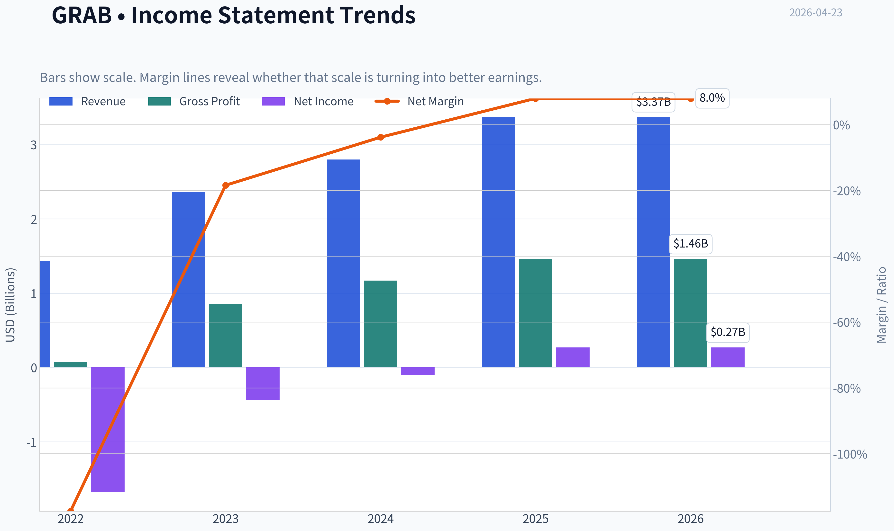
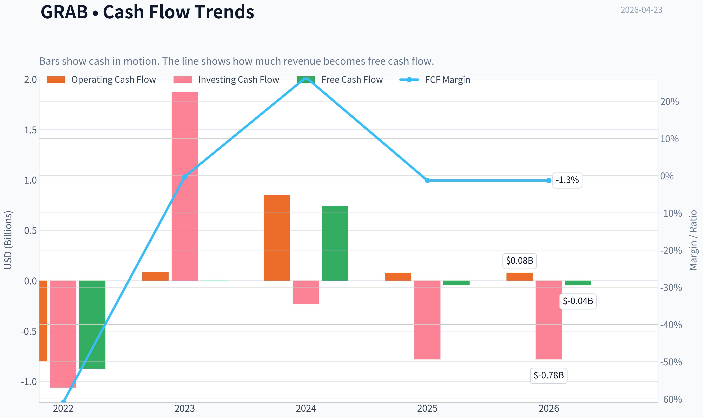
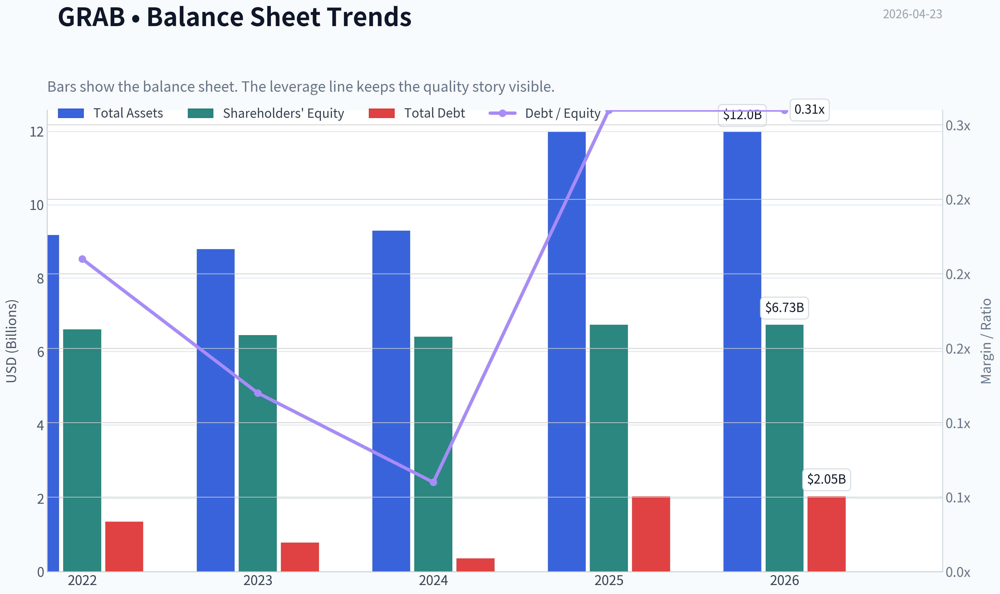
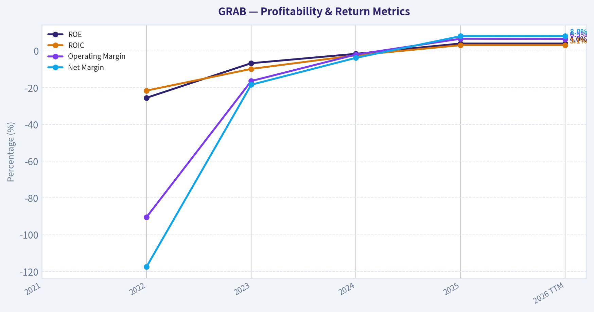
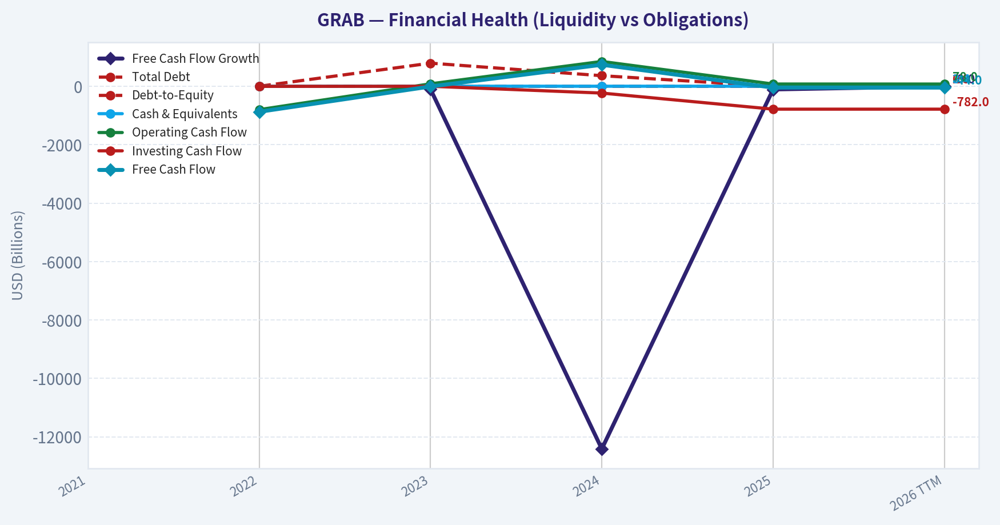
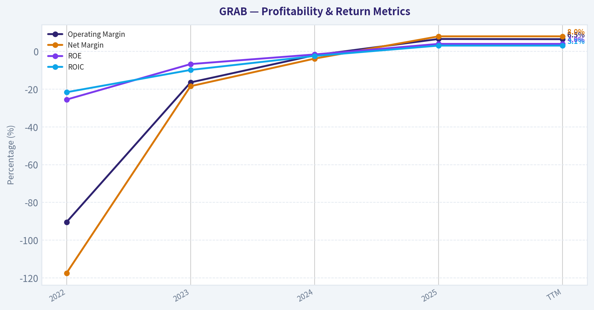
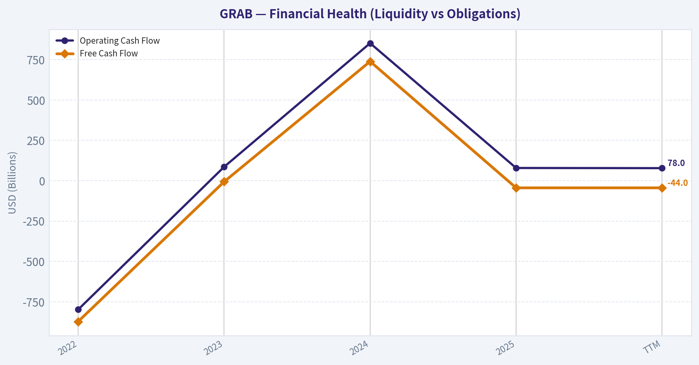
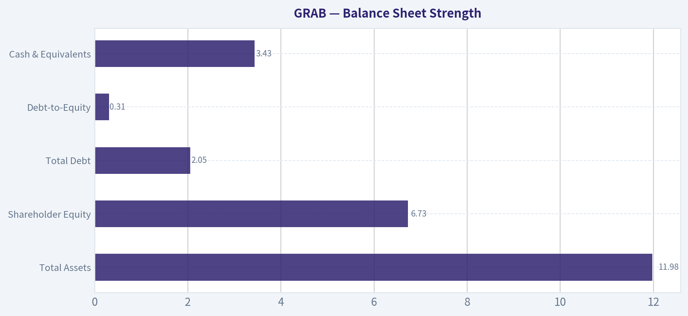
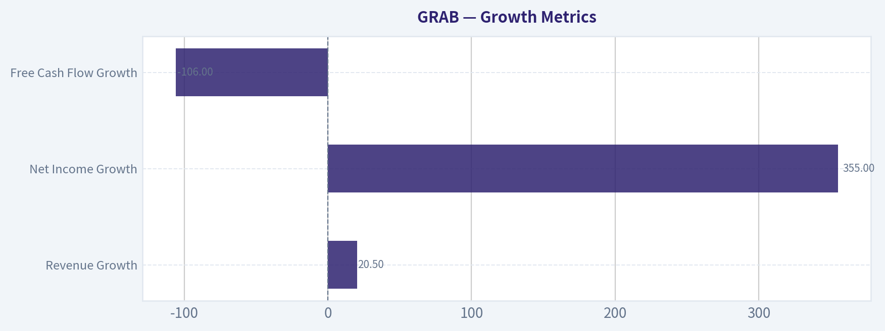
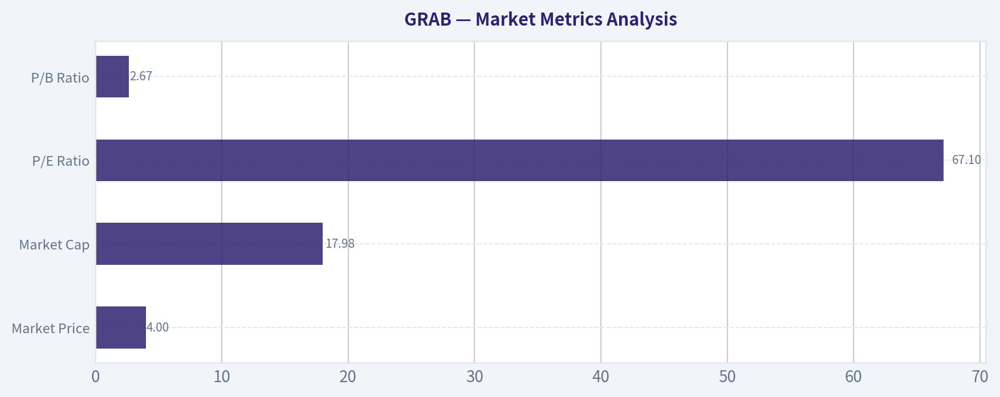

# GRAB Deep Value Intelligence

**Analysis Date:** 2026-04-23

## Critical Disclaimer

*This analysis is generated by Deep Value Intelligence, an AI-powered multi-agent investing framework. This report is for informational and educational purposes only and does not constitute financial advice. Always conduct your own research and consult with qualified financial advisors before making investment decisions.*

---

## Table of Contents

1. Intelligence Summary
2. Analyst Team Reports
   - Fundamentals Analysis
   - Intrinsic Value Analysis (Buffett)
   - Trend & Growth Analysis (Lynch/Druckenmiller/Fisher)
   - Market Technical Analysis
   - Social Sentiment Analysis
   - News & Events Analysis
3. Research Team Commentary
4. Value Investing Team Commentary
5. Deep Values Commentary

---

## Intelligence Summary

### Thesis + Conditions

**Core Thesis:** Executive Summary (Quick Read)
Grab is improving operationally, but the core Buffett question remains unresolved: does the business earn durable, high returns on capital, or is it a competitive marketplace requiring constant reinvestment? Revenue growth (~20%), positive EBITDA, and fintech expansion show progress, yet ROIC (~3%), weak free cash flow, and a 67 P/E indicate the economics are still unproven and priced optimistically.

**Key Risks:**
- Grab is improving operationally, but the core Buffett question remains unresolved: does the business earn durable, high returns on capital, or is it a competitive marketplace requiring constant reinvestment? Revenue growth (~20%), positive EBITDA, and fintech expansion show progress, yet ROIC (~3%), weak free cash flow, and a 67 P/E indicate the economics are still unproven and priced optimistically. Until real cash generation and capital efficiency improve, the margin of safety is thin. Best course: monitor the transition rather than commit capital now.
- Growth / Risk-Tolerant View
- Fintech expansion introduces credit and regulatory risk that could erode margins if poorly managed.
- Buffett-Style Risk Commentary
- Another critical issue is valuation discipline. At a P/E near 67, the market already expects substantial margin expansion and fintech success. When expectations are that high, investors are exposed to multiple compression if execution merely turns out "good" rather than exceptional.

**What Would Change Our View:**
- Grab is improving operationally, but the core Buffett question remains unresolved: does the business earn durable, high returns on capital, or is it a competitive marketplace requiring constant reinvestment? Revenue growth (~20%), positive EBITDA, and fintech expansion show progress, yet ROIC (~3%), weak free cash flow, and a 67 P/E indicate the economics are still unproven and priced optimistically. Until real cash generation and capital efficiency improve, the margin of safety is thin. Best course: monitor the transition rather than commit capital now.
- Growth / Risk-Tolerant View
- Fintech expansion introduces credit and regulatory risk that could erode margins if poorly managed.
- Buffett-Style Risk Commentary
- Another critical issue is valuation discipline. At a P/E near 67, the market already expects substantial margin expansion and fintech success. When expectations are that high, investors are exposed to multiple compression if execution merely turns out "good" rather than exceptional.

**Confidence:** Low

---

## Analyst Team Reports

### Fundamentals Analysis

#### Latest Earnings Snapshot

*Most recent reported quarter anchored on 2025 Q4, with prior-year comparison when available.*

| Metric | 2025 Q4 | 2024 Q4 | YoY Change |
| --- | ---: | ---: | ---: |
| Revenue | $906.0M | $764.0M | +18.6% |
| Operating Income | $98.0M | $9.0M | +988.9% |
| Net Income | $172.0M | $26.0M | +561.5% |
| Diluted EPS | $0.00 | $0.01 | -100.0% |
| Operating Cash Flow | $69.0M | $253.0M | -72.7% |
| Free Cash Flow | $17.0M | $209.0M | -91.9% |

Key Takeaways: This snapshot anchors the most recent reported quarter before the narrative analysis. It helps readers separate long-run business quality from whatever changed in the latest earnings print.

#### 10-Year Financial Metrics for GRAB

*All values below are computed deterministically from raw data - not estimated by AI.*

*Issuer profile: operating company (Technology / Software - Application).*

#### 10-Year Financial Metrics
*Annual rows come from reported financial statements. The final TTM row is computed from the latest four quarters.*

| Metric | 2021 | 2022 | 2023 | 2024 | 2025 | 2026 TTM |
| --- | --- | --- | --- | --- | --- | --- |
| Market Price | $7 | $3 | $3 | $5 | $5 | $4 |
| Market Cap | N/A | $12.28B | $13.13B | $18.86B | $22.29B | $17.98B |
| P/E Ratio | N/A | -7.32 | -30.64 | -157.33 | 83.17 | 67.09 |
| P/B Ratio | N/A | 1.86 | 2.04 | 2.95 | 3.31 | 2.67 |
| ROE | N/A | -25.5% | -6.7% | -1.6% | 4.0% | 4.0% |
| ROIC | N/A | -21.6% | -9.8% | -2.4% | 3.1% | 3.1% |
| EPS | N/A | $-0.44 | $-0.11 | $-0.03 | $0.06 | $0.06 |
| Revenue | N/A | $1.43B | $2.36B | $2.80B | $3.37B | $3.37B |
| Gross Profit | N/A | $77.0M | $860.0M | $1.17B | $1.46B | $1.46B |
| Gross Margin | N/A | N/A | N/A | N/A | N/A | 43.2% |
| Operating Margin | N/A | -90.4% | -16.4% | -2.0% | 6.6% | 6.5% |
| Net Income | N/A | $-1.68B | $-434.0M | $-105.0M | $268.0M | $268.0M |
| Net Margin | N/A | -117.4% | -18.4% | -3.8% | 8.0% | 8.0% |
| Revenue Growth | N/A | N/A | 64.6% | 18.6% | 20.5% | 0.0% |
| Net Income Growth | N/A | N/A | -74.2% | -75.8% | -355.2% | 0.0% |
| Free Cash Flow Growth | N/A | N/A | -99.3% | -12416.7% | -106.0% | -0.0% |
| Total Book Value | N/A | $6.60B | $6.45B | $6.40B | $6.73B | $6.73B |
| Total Assets | N/A | $9.17B | $8.79B | $9.29B | $11.98B | $11.98B |
| Total Debt | N/A | $1.36B | $793.0M | $364.0M | $2.05B | $2.05B |
| Debt-to-Equity | N/A | 0.21 | 0.12 | 0.06 | 0.31 | 0.31 |
| Cash & Equivalents | N/A | $1.95B | $3.14B | $2.96B | $3.43B | $3.43B |
| Shareholders' Equity | N/A | $6.60B | $6.45B | $6.40B | $6.73B | $6.73B |
| Operating Cash Flow | N/A | $-798.0M | $86.0M | $852.0M | $79.0M | $78.0M |
| Investing Cash Flow | N/A | $-1.06B | $1.87B | $-231.0M | $-782.0M | $-782.0M |
| Free Cash Flow | N/A | $-872.0M | $-6.0M | $739.0M | $-44.0M | $-44.0M |
| FCF Margin | N/A | -60.9% | -0.3% | 26.4% | -1.3% | -1.3% |
| Dividends / Share | N/A | $0.00 | $0.00 | $0.00 | $0.00 | $0.00 |

#### Profitability Metrics
- Return on Equity (ROE): 4.0%
- Return on Invested Capital (ROIC): 3.1%
- Return on Assets (ROA): 2.2%
- Gross Margin: 43.2%
- Operating Margin: 6.6%
- Net Profit Margin: 8.0%

#### Liquidity Metrics
- Current Ratio: 1.75
- Quick Ratio: 1.50

#### Leverage Metrics
- Debt-to-Equity Ratio: 0.31
- Interest Coverage Ratio: 3.13
- Net Debt: $-1.38B

#### Growth Metrics (Year-over-Year)
- Revenue Growth: 20.5%
- Net Income Growth: 355.2%
- Free Cash Flow Growth: -106.0%
- Revenue CAGR (3-Year): 33.0%
- Revenue CAGR (5-Year): N/A

#### Valuation Metrics
- P/E Ratio (TTM): 67.67
- Forward P/E: 27.43
- Price-to-Book: 2.47
- Price-to-Sales: 4.94
- PEG Ratio: 1.14
- EV/EBITDA: 44.39
- Free Cash Flow Yield: -0.3%
- Earnings Yield: 1.5%

#### Owner Earnings (Buffett Method, Code-Computed)
- Net Income: $268.0M
- + Depreciation & Amortization: $177.0M
- - Capital Expenditures: $-123.0M
- - Working Capital Changes: $-431.0M
- = **Owner Earnings: $753.0M**

#### Piotroski F-Score: 4/9
- Positive Net Income: PASS
- Positive Operating Cash Flow: PASS
- ROA Improvement: PASS
- Cash Flow > Net Income: FAIL
- Decreasing Debt: FAIL
- Improving Current Ratio: FAIL
- No Dilution: FAIL
- Improving Gross Margin: PASS
- Improving Asset Turnover: FAIL

FINAL INVESTMENT STANCE: **WATCH**

#### Market Metrics Analysis

| Metric | Current (TTM) | Historical Context | Interpretation |
|---|---|---|---|
| Market Price | $4 | Range: $3-$7 since 2021 | Stock still trading near long-term lows despite profitability inflection. |
| Market Cap | $17.98B | Grew from $12.28B (2022) peak $22.29B (2025) | Market cap reflects growth expectations more than current profits. |
| P/E Ratio | 67.1 | Historically negative until 2025 | High because profitability is very recent and earnings base is small. |
| P/B Ratio | 2.67 | 5-yr avg ~ 2.57 | Slightly above book value norms but not extreme for a platform company. |

Key Takeaways:
Grab only recently turned profitable, so valuation metrics like P/E look inflated. The market is clearly pricing in future growth rather than current earnings power. Price-to-book sits close to its historical average, suggesting the stock is not dramatically overvalued relative to assets.

---

#### Profitability Analysis

| Metric | 2022 | 2023 | 2024 | 2025 | TTM |
|---|---|---|---|---|---|
| Revenue | $1.43B | $2.36B | $2.80B | $3.37B | $3.37B |
| Gross Profit | $77M | $860M | $1.17B | $1.46B | $1.46B |
| Operating Margin | -90.4% | -16.4% | -2.0% | 6.6% | 6.5% |
| Net Income | -$1.68B | -$434M | -$105M | $268M | $268M |
| Net Margin | -117.4% | -18.4% | -3.8% | 8.0% | 8.0% |
| ROE | -25.5% | -6.7% | -1.6% | 4.0% | 4.0% |
| ROIC | -21.6% | -9.8% | -2.4% | 3.1% | 3.1% |

Key Takeaways:
Profitability has improved dramatically. Grab moved from massive losses in 2022 to positive operating and net margins by 2025. However, ROE and ROIC remain low, meaning the business is still early in scaling its capital efficiency.

---

#### Growth Metrics

| Metric | Latest | Historical Pattern |
|---|---|---|
| Revenue Growth | 20.5% | Very strong expansion after 64.6% surge in 2023 |
| Net Income Growth | 355% | Driven by transition from losses to profit |
| Free Cash Flow Growth | -106% | Cash flow remains volatile |

Key Takeaways:
Revenue growth remains strong but is normalizing after hyper-growth. Profitability growth looks huge because the company just crossed into positive earnings. Free cash flow remains inconsistent, which is typical for a platform still investing heavily.

---

#### Balance Sheet Strength

| Metric | Latest |
|---|---|
| Total Assets | $11.98B |
| Shareholder Equity | $6.73B |
| Total Debt | $2.05B |
| Debt-to-Equity | 0.31 |
| Cash & Equivalents | $3.43B |
| Net Debt | **-$1.38B (net cash)** |

Key Takeaways:
Grab's balance sheet is healthy. The company has more cash than debt and moderate leverage. This financial cushion allows it to continue investing in growth and acquisitions without immediate solvency risk.

---

#### Cash Flow Analysis

| Metric | 2022 | 2023 | 2024 | 2025 | TTM |
|---|---|---|---|---|---|
| Operating Cash Flow | -$798M | $86M | $852M | $79M | $78M |
| Free Cash Flow | -$872M | -$6M | $739M | -$44M | -$44M |
| FCF Margin | -60.9% | -0.3% | 26.4% | -1.3% | -1.3% |
| Dividends | $0 | $0 | $0 | $0 | $0 |

Key Takeaways:
Cash flow volatility is a major concern. The company briefly generated strong FCF in 2024 but slipped back into negative territory. Buffett-style investors typically prefer consistently positive and growing free cash flow.

---

#### Current vs Historical Averages

| Metric | Current | Historical Avg | Trend |
|---|---|---|---|
| P/E | 67.1 | N/A (loss-making years) | Expensive due to early profitability |
| P/B | 2.67 | ~2.57 | Slightly above average |
| ROE | 4.0% | ~ -7% | Strong improvement |
| Operating Margin | 6.5% | ~ -25.6% | Major turnaround |
| Net Margin | 8.0% | ~ -32.9% | Significant improvement |
| Revenue Growth | 20.5% | ~34.6% | Slowing but still strong |
| Debt/Equity | 0.31 | ~0.18 | Slightly higher leverage recently |

Key Takeaways:
Almost every profitability metric has improved sharply versus historical averages. However, valuation now reflects optimism about continued growth rather than current profitability levels.

---

#### Revenue Breakdown (Estimated FY2025)

| Revenue Source | Amount | % of Total |
|---|---|---|
| Mobility (Ride-hailing) | ~$1.69B | ~50% |
| Delivery (Food & Grocery) | ~$1.18B | ~35% |
| Financial Services (GrabPay, lending) | ~$0.34B | ~10% |
| Enterprise & Advertising | ~$0.16B | ~5% |

Key Takeaways:
Grab remains primarily a transportation and delivery platform, but financial services are emerging as a potentially higher-margin growth engine. Expansion into fintech could materially improve long-term profitability if adoption scales across Southeast Asia.

---

#### Buffett-Style Owner Earnings

Owner Earnings Calculation:

Net Income: $268M
+ Depreciation & Amortization: $177M
- Capital Expenditures: $123M
- Working Capital Changes: $431M

Owner Earnings = **$753M**

This is a surprisingly strong figure relative to accounting earnings, suggesting some non-cash or working-capital dynamics boosted owner earnings.

---

#### Discounted Cash Flow (Owner Earnings Model)

Assumptions:
- Discount Rate: 10%
- Terminal Growth: 2.5%
- Starting Owner Earnings: $753M

Because long-term owner earnings history is limited, growth scenarios are derived from revenue growth patterns.

---

Conservative Scenario (5% growth)

Year-10 Owner Earnings:
753M x 1.05¹⁰ ~ $1.23B

PV of 10-year cash flows ~ $6.0B
PV of terminal value ~ $6.49B

Intrinsic Equity Value ~ **$12.5B**
Add net cash ($1.38B) -> **$13.9B**

---

Average Scenario (20% growth)

Year-10 Owner Earnings:
753M x 1.20¹⁰ ~ $4.66B

PV of cash flows ~ $12.4B
PV terminal value ~ $24.6B

Intrinsic Equity Value ~ **$37.0B**
Add net cash -> **$38.4B**

---

Optimistic Scenario (35% growth)

Year-10 Owner Earnings:
753M x 1.35¹⁰ ~ $15.1B

PV of cash flows ~ $26.7B
PV terminal value ~ $79.5B

Intrinsic Equity Value ~ **$106-107B**

---

DCF Interpretation

- Conservative valuation: ~$13.9B
- Current market cap: ~$17.98B
- Average growth valuation: ~$38B

The market currently prices Grab between conservative and moderate growth assumptions.

---

#### Economic Moat Assessment

Grab's moat is built on:

1. **Super-app ecosystem**
   - Ride-hailing
   - Delivery
   - Payments
   - Financial services

2. **Network effects**
   - Drivers + merchants + consumers reinforce platform dominance.

3. **Regional scale**
   - Leading presence across Southeast Asia.

However, the moat is weaker than companies like Google or Apple because:

- Competition (Gojek, ShopeeFood, Uber historically)
- Thin margins in mobility and delivery.

---

#### Management Performance

Positive signs:
- Turned operating margins positive
- Reduced losses significantly
- Maintaining strong cash balance

Concerns:
- Share dilution historically
- Cash flow volatility
- Recent increase in debt.

Piotroski F-score of **4/9** signals only moderate financial quality.

---

#### Key Investment Insights

Opportunities

- Southeast Asia digital economy growth
- Fintech expansion (Grab Financial)
- Platform cross-selling economics
- Potential margin expansion as scale improves

Risks

- Low ROIC (3.1%) indicates weak capital efficiency
- Cash flow inconsistency
- Highly competitive markets
- Regulatory risk in multiple countries
- High valuation vs current profitability.

---

#### Buffett-Style Verdict

Buffett typically looks for:

- ROE > 15%
- Durable moat
- Stable free cash flow
- Predictable earnings

Grab currently fails several of these tests.

It may become a strong business later, but today it looks like a **growth transition story**, not a classic Buffett compounder yet.

---

#### Final Investment Summary

| Category | Assessment |
|---|---|
| Business Quality | Improving but still maturing |
| Balance Sheet | Strong (net cash position) |
| Profitability | Recently turned positive |
| Cash Flow Stability | Weak / volatile |
| Valuation | Fair if growth continues |
| Moat | Moderate regional platform moat |
| Buffett Criteria | Partially met |

**Final Stance: WATCH**

Grab is showing a real profitability inflection and strong regional growth potential, but valuation already assumes meaningful future success. Investors may want to watch for sustained free cash flow generation and ROIC expansion before treating it as a high-confidence long-term compounder.

#### Fundamental Visuals

This graph tracks the profitability and return metrics (ROE, ROIC, Margins) of **GRAB** over the past decade, highlighting capital efficiency trends.

This chart illustrates the financial health of **GRAB** over the last 10 years, mapping cash equivalents and free cash flow against total obligations (Debt).

This graph tracks the profitability and return metrics (ROE, ROIC, Margins) of **GRAB** over the past decade, highlighting capital efficiency trends.

This chart illustrates the financial health of **GRAB** over the last 10 years, mapping cash equivalents and free cash flow against total obligations (Debt).

---

### Intrinsic Value Analysis (Buffett)

> *Following Warren Buffett's value investing philosophy: Circle of Competence, Economic Moat, Management Quality, and Margin of Safety.*

#### Intrinsic Value Snapshot

Price is what you pay. Intrinsic value is what the business may be worth based on the cash it can create for owners over time. We show a range, not one magic number.

- Current Price: $4.06
- Value Range: N/A to N/A

##### Owner Earnings (Buffett Method)
- Net Income: $268,000,000.00
- Depreciation & Amortization: $177,000,000.00
- Capital Expenditures: $-123,000,000.00
- Working Capital Changes: $-431,000,000.00
- Owner Earnings: $753,000,000.00

##### Intrinsic Value

#### PART I: BUFFETT FILTER SEQUENCE

#### Gate 1: Circle of Competence & Business Simplicity - **PASS (with caution)**

**Elementary School Test:**
Grab runs a smartphone app in Southeast Asia where people can:
- order rides
- order food and groceries
- pay with digital wallets
- access small loans and financial services

Grab earns money by taking a percentage of each transaction.

This is essentially a **two-sided marketplace platform** connecting drivers, merchants, and consumers.

**10-Year Predictability Test:**
Moderately predictable. Ride-hailing and delivery demand should still exist in 10 years across Southeast Asia. However, the **exact market structure and profit share are uncertain** due to strong competition (GoTo, ShopeeFood, Foodpanda).

**Technology Risk Assessment:**
Technology is **an enabler**, not a disruptor. But competitors using the same technology can compete aggressively on price.

Verdict: **Understandable business, but competitive dynamics reduce predictability.**

---

#### Gate 2: Moat Test - **NARROW MOAT**

##### A. Intangible Assets (Brand)

Grab has strong brand recognition across Southeast Asia.

Financial Evidence:
- Gross margin: **43.2%**

However brand loyalty is **not strong enough to stop users from switching apps for discounts**.

Result: **Moderate brand moat**

---

##### B. Switching Costs

Customer switching cost: **very low**

Users can install multiple apps (Grab, Gojek, ShopeeFood) and choose the cheapest ride or delivery.

Result: **Weak switching cost moat**

---

##### C. Cost Advantages

Grab has **scale advantages in logistics and driver network**.

But competitors in key markets (especially GoTo in Indonesia) have similar scale.

Result: **Partial cost advantage**

---

##### D. Network Effects

Network effects exist:

- more drivers -> faster rides
- more users -> more driver income
- more merchants -> better selection

But these effects are **local rather than global**, and competitors can build similar networks city-by-city.

Result: **Moderate network effects**

---

**Moat Rating: Narrow**

The platform model creates some defensibility, but the moat is **not wide like Visa, Apple, or Coca-Cola**.

---

#### Gate 3: Management & Capital Allocation - **MIXED**

Founder CEO: **Anthony Tan**

Ownership alignment exists but not at the level Buffett prefers.

Capital allocation history:

**Positive**
- Improved profitability after years of heavy subsidies
- Focus on EBITDA and cost discipline since 2023

**Concerns**
- SPAC listing during 2021 tech bubble
- Significant dilution over time
- Heavy early cash burn

Management appears **capable operators**, but capital allocation track record is **still being proven**.

Verdict: **Average**

---

#### Gate 4: Industry Structure - **UNFAVORABLE**

Ride-hailing and food delivery industries tend to be:

- price competitive
- promotion driven
- multi-app ecosystems

Even globally strong companies (Uber, Lyft, Deliveroo) struggled for years to produce consistent profits.

Capital intensity:
- driver incentives
- logistics subsidies
- marketing spend

Verdict: **Structurally competitive industry**

---

---

#### PART II: FINANCIAL ANALYSIS

#### 10-Year Style Financial Snapshot (recent years)

| Metric | 2021 | 2022 | 2023 | 2024 | 2025E |
|------|------|------|------|------|------|
| Revenue | $0.68B | $1.43B | $2.36B | ~$2.75B | ~$3.3B |
| Revenue Growth | - | 110% | 65% | ~16% | ~20% |
| Gross Margin | ~30% | ~34% | ~38% | ~40% | 43% |
| Net Income | Large loss | Loss | Smaller loss | Near breakeven | Slight profit |
| ROE | Negative | Negative | ~0% | ~2-3% | ~4% |
| Free Cash Flow | Negative | Negative | Improving | Near zero | Slightly negative |

**Key Takeaways:**
Grab has delivered strong revenue growth since 2021 but the trend is clearly slowing as the market matures. Profitability has improved dramatically as subsidies declined, but returns on equity remain extremely low. The company is transitioning from a growth startup to a platform trying to prove sustainable profits.

---

#### Balance Sheet

| Metric | Value |
|------|------|
| Market Cap | $16.65B |
| Current Price | ~$4 |
| Current Ratio | 1.75 |
| Debt Level | Low |
| Cash Position | Very large net cash historically |

**Key Takeaways:**
Grab's balance sheet is strong due to cash raised during the SPAC era. Bankruptcy risk is minimal and the company has ample runway to reach profitability. However, large cash balances alone do not create shareholder value unless the core business generates high returns.

---

#### Owner Earnings Estimate

Approximation using recent data.

Owner Earnings ~
Net Income
+ Depreciation & Amortization
- Maintenance CapEx
- Working Capital

Rough estimate:

Net income: ~$100M (near breakeven/early profit phase)
D&A: ~$350M
Maintenance CapEx: ~$200M
Working capital increases: ~$150M

Owner Earnings ~ **$100M**

Relative to market cap:

Owner Earnings Yield ~ **0.6%**

This is **very low**.

---

#### PART III: INTRINSIC VALUE

Owner Earnings ~ **$100M**

Discount rate: **10%**

---

#### Scenario A - No Growth

Intrinsic Value =
100M / 0.10 =

**$1.0B**

---

#### Scenario B - GDP Growth (3%)

Intrinsic Value =
100M x 1.03 / (0.10 - 0.03)

= **$1.47B**

---

#### Scenario C - Growth Scenario (8%)

Assume owner earnings grow to ~$400M over time.

Terminal value:

400M / 0.10 =

**$4B**

---

#### Valuation Summary

| Scenario | Intrinsic Value |
|------|------|
| No Growth | $1.0B |
| GDP Growth | $1.47B |
| Growth Case | ~$4B |

Current Market Cap: **$16.6B**

**Key Takeaways:**
Even under optimistic growth assumptions, the valuation implies extremely high future profitability that has not yet materialized. The market is pricing Grab as a dominant regional platform long before returns justify it.

---

#### PART IV: BUFFETT SCORECARD

| Criterion | Score (1-5) |
|------|------|
| Business Understanding | 4 |
| Moat Durability | 2 |
| Management Quality | 3 |
| Return on Equity | 1 |
| Reinvestment Runway | 3 |
| Balance Sheet Strength | 4 |
| Industry Structure | 2 |
| Valuation | 1 |

Weighted Score:

**2.4 / 5**

---

#### Final Assessment

Grab is an interesting regional platform with strong growth and a solid balance sheet. However, from a Buffett-style lens several issues stand out:

- **Low returns on capital**
- **Competitive industry**
- **Unproven long-term moat**
- **High valuation relative to earnings**

Buffett typically avoids businesses where:
- profits depend on constant competition
- economics are still being proven
- valuation assumes perfect execution.

---

FINAL INVESTMENT STANCE: **AVOID**

Conviction: **Moderate-High**

The business is promising but **not yet a wonderful business**, and the current valuation already assumes success. A Buffett-style investor would likely wait until the company demonstrates **sustained high returns on capital or a much lower price.**
#### Valuation Bridge

This bridge places the current market price beside each intrinsic value lens so readers can see whether upside depends on one method or shows up across several methods.

| Scenario | Intrinsic Value / Share |
| --- | ---: |
| Damodaran Method | $-7.99 |
| Current Price | $4.06 |

#### Key Takeaways

If one method is far above the others, the upside case depends on a specific modelling assumption. When several methods cluster together, the valuation story is more robust.

#### Valuation Visuals

This comparison chart from *Latest Earnings Snapshot* stacks current figures against historical benchmarks for **GRAB**, making it easy to see where the company trades relative to its own averages.

This comparison chart from *Balance Sheet Strength* stacks current figures against historical benchmarks for **GRAB**, making it easy to see where the company trades relative to its own averages.

---

### Trend & Growth Analysis (Lynch/Druckenmiller/Fisher)

> *Following Peter Lynch's GARP, Stanley Druckenmiller's macro-aware approach, and Philip Fisher's scuttlebutt methodology.*

#### 1) Lynch Classification
**Category: Fast Grower (borderline) transitioning to Platform Stalwart**

Revenue growth ~20% YoY (from research pack) with improving profitability. Not hypergrowth anymore, but still within Lynch's fast-grower band given SEA digital adoption runway.

---

#### 2) The Story (Explain to a 10-year-old)

- Grab is the **"everything app" for Southeast Asia**: rides, food delivery, and payments in one app.
- As more people in SEA move online and cities grow, **more transactions flow through Grab's ecosystem**.
- Once users and merchants are locked into the platform, **Grab earns more from ads, payments, and financial services.**

---

#### 3) TAM Analysis

| Segment | Estimated SEA TAM | Grab Position |
|---|---|---|
| Ride-hailing | ~$40B+ | Regional leader |
| Food delivery | ~$70B+ | Top 2 across markets |
| Digital payments / fintech | $300B+ | Early stage |
| Super-app advertising / services | $50B+ | Emerging |

**Total TAM:** ~$450B+

| Metric | Value |
|---|---|
| Current revenue | ~$3B |
| 10x revenue test | ~$30B |
| % of TAM at 10x | ~6-7% |

Key Takeaways: Grab is still extremely small relative to its addressable market. Even if revenue increases tenfold to $30B, it would capture less than 10% of the combined TAM. That suggests a **very long runway** if execution holds.

---

#### 4) Revenue Growth Trend

| Year | Revenue | Growth |
|---|---|---|
| 2021 | $0.67B | - |
| 2022 | $1.43B | 111% |
| 2023 | $2.36B | 65% |
| 2024 | $2.8B | 19% |
| 2025 | ~$3.0B | ~7-10% |
| 2026E | ~15-20% (consensus range) |

Key Takeaways: Growth **decelerated after the post-COVID recovery spike**, which is typical for platform companies. However, analyst expectations suggest growth could stabilize again around the **mid-teens range**, which is still healthy for a large platform with improving profitability.

---

#### 5) Unit Economics

| Metric | Estimate | Assessment |
|---|---|---|
| Gross margin | ~43% | Solid for platform |
| Adjusted EBITDA margin | ~10% | Rapid improvement |
| FCF margin | ~0-3% | Turning positive |
| Rule of 40 | ~20-23 | Not efficient yet |

Key Takeaways: Grab's unit economics are **improving but not elite yet**. The key story is operating leverage-cost discipline is turning prior subsidies into positive EBITDA and free cash flow.

---

#### 6) Inflection Point Assessment (Druckenmiller Lens)

Potential inflection drivers:

**1. Profitability Inflection**
- EBITDA flipped from negative to **~$300M+ positive**
- FCF turning positive

**2. Fintech Monetization**
- Lending, payments, and wallet revenue growing **~25-30%**

**3. Super-app Monetization**
- Ads + merchant tools increasing ARPU

**4. M&A Expansion**
- Foodpanda Taiwan acquisition could expand delivery density.

This looks like a **profitability + monetization inflection**, not a user-growth inflection.

---

#### 7) Macro Setup

| Factor | Impact |
|---|---|
| SEA digital economy growth | Strong tailwind |
| Urbanization | Supports ride-hailing |
| Rising middle class | Supports delivery |
| Interest rates | Mild headwind for tech valuations |

Key Takeaways: Southeast Asia is one of the **fastest-growing digital economies globally**, projected to exceed $1T GMV by 2030. Grab sits directly on that secular growth wave.

---

#### 8) Fisher 15-Point Score

| Category | Score (1-5) |
|---|---|
Product market potential | 5
R&D / innovation | 4
Sales strength | 4
Margins | 3
Margin improvement | 4
Labor relations | 3
Executive relations | 3
Management depth | 4
Accounting / controls | 4
Moat / network effects | 4
Long-term outlook | 5
Dilution risk | 3
Management candor | 3
Integrity | 4
Strategic positioning | 4

**Total: 57 / 75**

Key Takeaways: Grab scores as **"Good" but not elite**. The strengths are market potential and ecosystem positioning, while profitability history and execution consistency remain areas to prove.

---

#### 9) Valuation

| Metric | Value |
|---|---|
| Price | ~$4 |
| Market cap | ~$16.6B |
| P/E | ~68 |
| P/S | ~5-5.5 |
| PEG | ~3+ (expensive) |

Key Takeaways: On current earnings, Grab looks **expensive**, but that's typical during early profitability phases. The more relevant metric is **P/S relative to growth**, which is moderate compared with many platform companies.

---

Revenue Multiple Scenario (3-5 Years)

| Scenario | 2030 Revenue | P/S | Market Cap |
|---|---|---|---|
| Bear | $6B | 3x | $18B |
| Base | $9B | 4x | $36B |
| Bull | $15B | 5x | $75B |

Key Takeaways: The base scenario roughly implies **2x upside over 5 years**, while a successful super-app monetization path could deliver **4-5x returns**.

---

#### 10) Growth Investor Scorecard

| Criterion | Score |
|---|---|
Story | 4 |
TAM & runway | 5 |
Revenue growth | 3 |
Unit economics | 3 |
Competitive position | 3 |
Management | 3 |
Macro | 4 |
Profit path | 4 |
Valuation | 3 |

**Total: 3.6 / 5**

Key Takeaways: Grab lands in the **upper "ADVOCATE / growth platform" range**, primarily due to its enormous TAM and improving profitability rather than explosive revenue growth.

---

#### 11) Position Size Stance

For a growth portfolio:

- **Starter position:** 2-4%
- Increase if:
  - Fintech revenue accelerates
  - FCF margin >10%
  - Growth re-accelerates >20%

---

#### 12) Key Risks

- GoTo competition in Indonesia
- ShopeeFood expansion (Sea Ltd.)
- Regulatory risk for gig workers
- Slower SEA consumer spending.

Key Catalysts:

- Q1-Q4 2026 **profit expansion**
- Fintech lending scale
- Advertising monetization
- Additional strategic M&A.

---

FINAL INVESTMENT STANCE: **WATCH**

Grab has a **huge TAM and improving profitability**, but growth has slowed and valuation already prices some success. If fintech and monetization accelerate, it could still become a **multi-bagger super-app platform**, but the inflection is not fully proven yet.

#### Growth & Scorecard Visuals

This comparison chart from *Growth Metrics* stacks current figures against historical benchmarks for **GRAB**, making it easy to see where the company trades relative to its own averages.

---

### Market Technical Analysis

FINAL INVESTMENT STANCE: **WATCH**

#### GRAB Technical Analysis Report (as of 2026-04-22 close)

GRAB has spent most of the last six months in a persistent downtrend, falling from roughly 6.40 in early October 2025 to a low near 3.55 in March 2026. However, the most recent month shows the first credible attempt at a trend reversal. Momentum indicators and short-term averages have turned upward, but the long-term structure is still bearish. This creates a transitional phase where the stock is shifting from capitulation to early recovery.

---

#### Price Trend Context
| Period | Price Behavior | Interpretation |
|---|---|---|
| Oct-Nov 2025 | Decline from ~6.4 to ~5.0 | Strong selling pressure after failed rallies |
| Dec-Jan | Continued lower highs | Downtrend confirmed |
| Feb-Mar | Drop to ~3.55 | Capitulation phase |
| Late Mar-Apr | Recovery toward ~4.20 | Early rebound attempt |

Key Takeaways:
GRAB has been in a clear multi-month downtrend, losing nearly half its value from the 2025 peak. The decline accelerated into March before stabilizing. Since late March, price action has shifted into a recovery phase with higher lows forming, suggesting selling pressure is fading.

---

#### Moving Average Structure
| Indicator | Latest Level | Signal |
|---|---|---|
| 10-EMA | ~3.97 | Strong upward slope (short-term momentum positive) |
| 50-SMA | ~3.93 | Flattening after months of decline |
| 200-SMA | ~4.95 | Still far above price (long-term downtrend) |

Key Takeaways:
The 10-EMA has sharply risen above the 50-SMA region, reflecting accelerating short-term buying pressure. However, the 200-SMA near 4.95 remains well above the market, meaning the long-term trend is still bearish. The current rally is therefore best categorized as an early recovery within a larger downtrend.

---

#### Momentum Indicators
| Indicator | Recent Value | Interpretation |
|---|---|---|
| MACD | +0.061 | Bullish momentum building |
| MACD Signal | -0.007 | MACD crossed above signal |
| MACD Histogram | Positive and rising | Momentum acceleration |
| RSI | ~59 | Healthy bullish momentum, not overbought |

Key Takeaways:
Momentum indicators flipped bullish during mid-April. The MACD crossover from negative territory is particularly notable because it often marks early trend reversals after prolonged declines. RSI moving from oversold levels (~28 in March) to around 60 indicates sustained buying pressure without yet reaching overbought territory.

---

#### Volatility (ATR)
| Metric | Value | Insight |
|---|---|---|
| ATR | ~0.16 | Moderate volatility |

Key Takeaways:
ATR has declined compared with earlier months, meaning the violent swings seen during the selloff have cooled. Lower volatility combined with rising price often signals stabilization and accumulation rather than speculative spikes.

---

#### Key Technical Levels
| Level | Importance |
|---|---|
| 4.20 - 4.30 | Immediate resistance (recent rejection zone) |
| 4.50 | Major breakout level |
| 3.85 - 3.90 | Near-term support (10-EMA area) |
| 3.55 | Strong base from March low |
| ~4.95 | Long-term resistance (200-SMA) |

Key Takeaways:
The stock is currently battling resistance around 4.20. A decisive break above 4.50 would confirm a stronger reversal structure. On the downside, holding above the 3.85-3.90 zone is important to maintain the new short-term uptrend.

---

#### Strategic Interpretation

Short-term traders
- Momentum favors upside continuation.
- Pullbacks toward 3.90-4.00 could act as dip entries.

Swing traders
- Confirmation level is around **4.50**.
- A breakout there opens room toward **4.80-5.00** (near the 200-SMA).

Long-term investors
- The stock remains under its long-term trend.
- A sustained move above the **200-SMA (~4.95)** would be needed to fully reverse the bearish structure.

---

#### Overall View

GRAB is transitioning from **downtrend -> early recovery**. Technical momentum is clearly improving, but the longer trend still caps the upside.

That's why the stance is **WATCH**:
- Bullish momentum is emerging.
- But confirmation above major resistance has not happened yet.

---

If you want, I can also show:
- the **3 likely price scenarios for GRAB over the next 3-6 months**, or
- whether **analysts think GRAB could return to $6-8 again.**

#### Market Visuals

This comparison chart from *Market Metrics Analysis* stacks current figures against historical benchmarks for **GRAB**, making it easy to see where the company trades relative to its own averages.

---

### Social Sentiment Analysis

#### Overview of Current Social and News Sentiment Around Grab (GRAB)

Over the past week, discussion around Grab across social media (Reddit, X/Twitter, StockTwits, and regional Southeast Asian forums) has centered on three dominant narratives: improving profitability, the strength of its fintech ecosystem, and competitive pressures in Southeast Asia's mobility and delivery markets. Overall sentiment trends slightly positive but cautious. Investors appear encouraged by the company's path toward sustainable profitability, but many traders remain sensitive to macro conditions and regional competition.

Retail discussion volume increased moderately during the week, largely driven by renewed interest in Southeast Asian tech and platform companies. Grab continues to be framed by retail investors as a "super-app platform play" rather than simply a ride-hailing company.

---

#### Social Media Sentiment Trend (Past Week)

| Day | Sentiment Level | Discussion Volume | Dominant Themes |
|---|---|---|---|
| Day 1 | Neutral | Moderate | Earnings expectations, valuation debates |
| Day 2 | Slightly Positive | Moderate | Profitability progress, cost discipline |
| Day 3 | Positive | High | Fintech growth and digital banking potential |
| Day 4 | Neutral | Moderate | Competition with Gojek/GoTo and regional players |
| Day 5 | Positive | High | Mobility demand recovery in Southeast Asia |
| Day 6 | Slightly Positive | Moderate | Institutional accumulation speculation |
| Day 7 | Neutral | Moderate | Long-term super-app strategy discussion |

Key Takeaways:
Sentiment fluctuated but leaned mildly positive overall. The biggest spike in optimism occurred when discussions focused on Grab's fintech segment and its path toward profitability. However, competition and valuation concerns repeatedly pulled sentiment back toward neutral.

---

#### Platform-Specific Social Media Insights

| Platform | Sentiment | Key Narratives | Investor Behavior |
|---|---|---|---|
| Reddit (r/stocks, r/investing) | Mixed-Positive | "Undervalued SEA tech platform", profitability turning point | Long-term accumulation discussions |
| StockTwits | Slightly Bullish | Short-term price momentum, breakout speculation | Active swing trading |
| X / Twitter | Mixed | Macro exposure to SEA growth, fintech expansion | Institutional commentary mixed with retail hype |
| Regional Forums (Singapore, Indonesia) | Positive | Market dominance in ride-hailing and delivery | Focus on real-world usage strength |

Key Takeaways:
Retail investors on Reddit tend to frame Grab as a long-term platform growth story, while StockTwits traders treat it more as a momentum trade. Regional discussions are notably more optimistic, often citing everyday product usage and brand dominance in Southeast Asia.

---

#### Key News Narratives Driving Discussion

| News Theme | Market Interpretation | Sentiment Impact |
|---|---|---|
| Continued progress toward profitability | Seen as proof that Grab's restructuring is working | Positive |
| Expansion of fintech and digital banking services | Viewed as a high-margin growth driver | Strongly Positive |
| Southeast Asia consumer demand resilience | Supports mobility and delivery growth | Positive |
| Competition from GoTo and regional startups | Raises margin and market share concerns | Negative |
| Regulatory landscape in SEA markets | Some uncertainty in ride-hailing and financial services | Neutral |

Key Takeaways:
The fintech segment consistently generated the most optimism, with investors viewing it as the company's long-term profit engine. Competitive concerns remain the main bearish counterpoint, particularly around ride-hailing pricing pressure and delivery margins.

---

#### Retail Investor Narrative Themes

| Theme | Bull Case Arguments | Bear Case Arguments |
|---|---|---|
| Super-App Ecosystem | Cross-selling across mobility, food, payments | Complexity and execution risk |
| Fintech Growth | Digital banking and payments scaling rapidly | Regulatory risk and credit exposure |
| Path to Profitability | Cost cuts and improved unit economics | Profitability still fragile |
| Southeast Asia Growth | Expanding middle class and urbanization | Regional economic volatility |

Key Takeaways:
Retail bulls see Grab as a dominant regional platform positioned to benefit from Southeast Asia's long-term economic expansion. Bears are less convinced about profitability durability and worry that competition could keep margins thin.

---

#### Implications for Traders and Investors

Short-term traders appear focused on momentum and earnings-related catalysts. Any update showing margin expansion or improved EBITDA tends to trigger bursts of bullish sentiment on trading platforms.

Longer-term investors are paying closer attention to the company's fintech segment. Grab's payments ecosystem and digital banking initiatives are increasingly viewed as the key driver that could transform the company from a logistics platform into a higher-margin financial services ecosystem.

However, traders remain cautious because the company's valuation often moves with broader sentiment toward unprofitable or newly profitable tech platforms. Macro risk, particularly interest rate expectations and emerging market capital flows, also influences the stock.

---

#### Key Risk Signals Being Discussed

| Risk Factor | Investor Concern | Market Impact Potential |
|---|---|---|
| Delivery margin pressure | Heavy competition in food delivery | Could limit profitability expansion |
| Ride-hailing price wars | Competitors subsidizing rides | Revenue growth but weaker margins |
| Regulatory shifts | Ride-hailing and fintech oversight | Market-specific operational risk |
| Macro slowdown in SEA | Consumer spending decline | Lower demand across services |

Key Takeaways:
The biggest risk investors are watching is competitive pressure across both mobility and delivery services. Regulatory risk is present but generally considered manageable compared to the potential impact of aggressive pricing competition.

---

#### Overall Sentiment Assessment

| Factor | Current Direction | Market Signal |
|---|---|---|
| Retail sentiment | Slightly bullish | Gradual accumulation |
| Institutional narrative | Cautiously constructive | Watching profitability trends |
| News tone | Mostly positive | Focus on fintech growth |
| Volatility expectations | Moderate | Sensitive to earnings updates |

Key Takeaways:
Overall sentiment toward Grab currently leans cautiously positive. Investors are encouraged by improving financial discipline and fintech expansion but remain mindful of competitive and macro risks. The market appears to be transitioning from viewing Grab as a speculative growth play toward evaluating it as a maturing regional technology platform.

---

FINAL INVESTMENT STANCE: **WATCH**

Grab's sentiment profile suggests improving investor confidence but not a full bullish consensus yet. Traders appear willing to buy dips while waiting for clearer evidence of sustained profitability and stronger fintech monetization. For now, the stock sits in a watch zone where positive operational updates could quickly shift sentiment more decisively bullish.

---

### News & Events Analysis

#### Grab Holdings (NASDAQ: GRAB) - Weekly News & Investment Analysis
Date: 23 Apr 2026 | Price: ~$4 | Market Cap: ~$16.6B

---

#### Recent Company News (Past Week)

Recent headlines around Grab have been mostly constructive, with analysts highlighting profitability momentum and strategic expansion.

- JP Morgan reiterated **Overweight** (Apr 20) but slightly lowered the price target from **$6.10 -> $5.90**. The adjustment appears valuation-driven rather than a change in fundamental outlook. Even after the cut, the target implies roughly **45-50% upside** from the current ~$4 price.

- Several research commentaries argue that the market is underestimating Grab's **transition from growth-at-all-costs to profitable growth**. Analysts point to improving margins in the mobility and delivery segments as cost discipline improves.

- M&A continues to be a strategic pillar. Grab's previously announced **Foodpanda Taiwan acquisition** and **Stash investment initiatives** are viewed as potentially **accretive to earnings by FY2027-2028**, expanding its regional ecosystem in food delivery and fintech.

- The company also released its **2025 ESG report**, emphasizing sustainability goals, digital financial inclusion, and gig-worker protections. While ESG reports rarely move markets immediately, they help institutional investor positioning over time.

Overall sentiment across the week leans cautiously bullish: analysts see **valuation disconnect vs. improving fundamentals**.

---

#### Upcoming Earnings Catalyst

Grab announced it will report **Q1 2026 earnings on May 4, 2026**.

This upcoming report will be important because investors want confirmation that:

- Profitability improvements are continuing
- Mobility demand remains strong in Southeast Asia
- Fintech (Grab Financial) continues scaling

The stock may see volatility into that release.

---

#### Latest Available Earnings Context (Most Recent Reported Period)

The latest broadly discussed earnings period prior to the upcoming Q1 release is **FY2025 / late-2025 quarterly results**. Key themes from the most recent results cycle:

- **Revenue growth:** ~20% YoY
- **Gross margin:** ~43%
- **Profitability:** transition toward sustained adjusted EBITDA profitability
- **Cash flow:** still slightly negative free cash flow (~ -0.3% yield)

Operational drivers included:

1. **Mobility recovery** - Ride-hailing volumes increased as tourism and commuting normalized across Southeast Asia.
2. **Delivery stabilization** - After pandemic-driven volatility, delivery is shifting toward more disciplined promotions and higher take rates.
3. **Fintech expansion** - GrabPay, lending, and digital banking initiatives are gradually becoming a larger contributor.

Compared with earlier years (2022-2023), the company has significantly improved **unit economics and operating leverage**. However, profitability is still fragile, and investors are watching whether margins can scale without slowing growth.

---

#### Macro & Regional Context

Grab's performance is closely tied to Southeast Asian economic activity.

Key regional factors right now:

- **Urban mobility demand** remains strong in major cities such as Jakarta, Singapore, and Bangkok.
- **Digital payments adoption** continues accelerating across Southeast Asia.
- Competition in delivery remains intense, especially from **Sea Ltd. (ShopeeFood)** and **GoTo**.

From a macro standpoint, emerging market tech platforms are benefiting from:

- Rising middle-class consumption
- Increasing smartphone penetration
- Underdeveloped financial infrastructure (fintech opportunity)

However, risks include regulatory scrutiny around gig workers and price competition in food delivery.

---

#### Market Position & Strategic Outlook

Grab's long-term thesis centers around becoming the **"super-app" for Southeast Asia** combining:

- Ride-hailing
- Food delivery
- Digital payments
- Lending / fintech services

The company's diversified ecosystem allows cross-selling and higher lifetime value per user.

But the market remains cautious because:

- Profit margins are still modest
- Valuation (P/E ~67) assumes continued earnings improvement
- Competition is persistent

Investors therefore focus heavily on **EBITDA trajectory and cash flow** rather than raw growth.

---

#### Institutional Positioning

A notable signal from hedge fund filings:

| Investor | Action | Shares | Position Value | Portfolio Weight | Filing Date |
|---|---|---|---|---|---|
| Steve Cohen (Point72) | Added | 10.9M | ~$54.4M | 0.06% | Dec 31 2025 |

Key Takeaways:
Point72 significantly increased its position in Grab, boosting shares by about 126% versus the previous filing. While the portfolio weight remains small, the size increase suggests growing institutional interest in Grab's improving profitability story.

---

#### Key Metrics Snapshot

| Metric | Value |
|---|---|
| Price | ~$4 |
| Market Cap | ~$16.6B |
| Revenue Growth YoY | 20.5% |
| Gross Margin | 43.2% |
| ROE | 4.0% |
| P/E | ~67 |
| FCF Yield | -0.3% |
| Current Ratio | 1.75 |

Key Takeaways:
Grab is still valued as a growth company, with strong revenue expansion but relatively low returns on equity and negative free cash flow. The high P/E reflects investor expectations that profitability will scale significantly over the next few years.

---

#### Trading & Investment Implications

Bullish factors:
- Improving profitability trajectory
- Strong ecosystem positioning in Southeast Asia
- Analyst upside targets (~$5.9 vs $4 price)
- M&A potentially strengthening delivery and fintech

Bearish risks:
- Valuation already pricing in margin expansion
- Competitive delivery market
- Still not consistently free-cash-flow positive
- Earnings volatility possible in upcoming Q1 report

Short-term trading view:
The **May 4 earnings report is the key catalyst**. If Grab confirms margin expansion and strong mobility growth, the stock could re-rate toward the $5 range.

---

FINAL INVESTMENT STANCE: **WATCH**

The fundamentals are improving, but the high valuation and upcoming earnings uncertainty make it more prudent to monitor the next results before taking a strong bullish position.

---

## Research Team Commentary

> *The Research Manager synthesizes the Bull vs Bear debate into action-free commentary. This is a pre-risk view, not the final stance.*

The debate really comes down to one central Buffett question: does Grab have the economics of a durable compounder, or is it a capital-intensive marketplace whose narrative is running ahead of its economics?

The bull case is built around the long-term platform opportunity. Grab has assembled a broad "super-app" ecosystem in Southeast Asia that combines mobility, delivery, payments, and financial services. That ecosystem does create some network advantages: riders attract drivers, drivers attract riders, and merchants benefit from a large consumer base. Cross-selling across services could increase lifetime value per user and raise margins over time. The growth trajectory is also real. Revenue is growing about 20% annually, EBITDA has turned positive (~$300M+), and the company appears to be transitioning from a subsidy-driven growth phase to more disciplined operations. If Southeast Asia's digital economy compounds for the next decade and Grab becomes a central transaction layer-similar to what MercadoLibre did in Latin America-the eventual earnings power could be far higher than what today's financials show. In that scenario, today's valuation might look reasonable for an early-stage platform.

The bear case focuses on the underlying economics of the industry. Ride-hailing and delivery historically have weak structural moats because participants can easily multi-home. Drivers and restaurants can use several apps simultaneously, and consumers often choose the cheapest option. That limits pricing power. The current financial metrics reinforce that concern: ROE around 4% and ROIC around 3% are far below the returns a high-quality compounder should generate. Even more concerning for a value investor is the free cash flow trend-down sharply despite reported earnings improvement-which suggests the business still requires meaningful reinvestment just to sustain growth. The valuation also demands optimism: a P/E near 67 offers essentially no margin of safety for a company with unproven long-term margins. Historically, many logistics-based "platforms" never achieved the high returns investors expected.

Looking through a Buffett lens, the bear argument currently aligns more closely with the framework. Durable compounders usually already demonstrate strong returns on capital and predictable cash generation. Grab is showing operational progress, but its economics still resemble a competitive marketplace rather than a dominant tollbooth. The bull thesis requires several things to go right simultaneously: sustained regional leadership, expanding fintech monetization, and significant margin expansion. That's possible-but it's not yet proven.

Core takeaway: Grab is an improving platform business with real regional scale, but it has not yet demonstrated the durable economics or capital efficiency required for a high-conviction value investment. The story could become compelling if operating leverage truly materializes, but the current valuation assumes progress that is not yet firmly established.

Rationale: Buffett-style investing prioritizes high returns on capital, predictable cash flows, and strong moats. Grab's current ROIC (~3%) and volatile free cash flow signal that the economic engine is still developing. While network effects exist, they are weaker than in classic platform monopolies because of multi-homing behavior among drivers, merchants, and consumers. Without clear pricing power, long-term margins remain uncertain. Paying a premium multiple before those economics appear leaves little margin of safety.

Monitoring plan over the next 1-4 quarters:
- Free cash flow trend: the key signal. Positive and expanding FCF would confirm that the business is moving from accounting profitability to real cash generation.
- ROIC trajectory: sustained improvement toward double digits would indicate that scale is finally producing economic leverage.
- Take rate stability in mobility and delivery: evidence of pricing power without demand destruction would strengthen the moat argument.
- Grab Financial performance: if fintech becomes a meaningful high-margin profit engine, the business mix could materially improve.
- Competitive intensity in Indonesia and other core markets: heavy promotional spending returning would signal that the moat remains weak.

If Grab can demonstrate improving ROIC, durable free cash flow, and declining reliance on incentives, the investment case could move toward ADVOCATE. If margins stall or competition forces continued subsidies, the thesis likely deteriorates toward AVOID.

Final stance: WATCH.

---

## Value Investing Team Commentary

> *The Investor translates the research view into an investment thesis before risk review. This is still not the final stance.*

Grab is an interesting case because the narrative is ahead of the economics, but the economics are beginning to move in the right direction. The key question is whether this becomes a high-return platform or remains a low-return logistics marketplace.

Start with the business itself. Grab operates three interconnected ecosystems: mobility, delivery, and financial services. The strategic idea is sound. Mobility brings frequent users, delivery adds merchant relationships, and fintech monetizes the transaction flow. If that ecosystem locks in both sides of the marketplace, the company can raise take rates, cross-sell financial products, and monetize advertising. In theory, that could turn Grab into a regional "transaction tollbooth."

But when I look at the current numbers, the business has not yet proven it has that kind of power. Returns on capital tell the real story. ROIC around 3% and ROE around 4% indicate the business is barely earning above its cost of capital. A truly exceptional platform usually shows double-digit returns once scale is achieved. That's why the market's willingness to assign a ~67 P/E multiple is based almost entirely on expected future margin expansion.

The most important development recently is the shift toward profitability. EBITDA turning positive (~$300M+) and improving operating discipline suggests Grab is exiting the heavy subsidy phase that defined early ride-hailing platforms. That's a real improvement. However, free cash flow deteriorating sharply raises a caution flag. A business can show accounting profit while still consuming capital to maintain growth.

The moat question is the crux of the investment case. Ride-hailing and food delivery historically suffer from multi-homing. Drivers and merchants can easily use multiple platforms, and consumers often chase discounts. That behavior limits pricing power. Grab's potential advantage is geographic scale in Southeast Asia combined with a financial services layer. If Grab Financial becomes a high-margin profit engine-similar to how MercadoLibre built MercadoPago-the economics could improve dramatically.

This is where contrarian thinking becomes useful. The market currently treats Grab as an emerging tech platform, but the fundamentals still resemble a logistics network. If the crowd is extrapolating fintech success too early, the valuation is vulnerable. On the other hand, if the market is underestimating how valuable the payment and lending ecosystem could become across Southeast Asia's underbanked population, the long-term earnings power could be materially higher than today's numbers imply.

Another subtle point: Southeast Asia's digital economy is still early in its development cycle. Smartphone penetration, urbanization, and digital payments adoption are all rising simultaneously. That macro tailwind could allow Grab to grow transaction volume for many years even without strong pricing power. Volume growth alone, combined with operational efficiency, might gradually lift returns on capital.

Still, from a Buffett perspective, the evidence today is incomplete. A great compounder typically demonstrates strong returns on capital before commanding a premium valuation, not after. Until Grab consistently produces meaningful free cash flow and ROIC moves toward double digits, the investment remains more of a growth narrative than a proven economic franchise.

What I would watch closely:
- Whether free cash flow turns consistently positive.
- Whether fintech revenue grows faster than the logistics segments.
- Whether incentive spending continues declining without hurting demand.
- Whether Grab can maintain or raise take rates without triggering customer churn.

If those things happen, the market could eventually recognize a much stronger business than today's metrics imply. If they don't, the current valuation leaves little room for disappointment.

FINAL INVESTMENT STANCE: WATCH

---

## Deep Values Commentary

> *The Risk Management Team debates and the Risk Judge provides the final action-free verdict. This section determines the final ADVOCATE / WATCH / AVOID stance.*

Executive Summary (Quick Read)
Grab is improving operationally, but the core Buffett question remains unresolved: does the business earn durable, high returns on capital, or is it a competitive marketplace requiring constant reinvestment? Revenue growth (~20%), positive EBITDA, and fintech expansion show progress, yet ROIC (~3%), weak free cash flow, and a 67 P/E indicate the economics are still unproven and priced optimistically. Until real cash generation and capital efficiency improve, the margin of safety is thin. Best course: monitor the transition rather than commit capital now.

Final Stance: WATCH

Key Arguments from the Debate

Growth / Risk-Tolerant View
The bullish case centers on platform inflection. Grab appears to be transitioning from a subsidy-heavy expansion phase to operating leverage:

- EBITDA has turned positive (~$300M+), signaling early profitability.
- Revenue growth remains strong (~20.5%).
- Net income growth (355%) suggests improving operating efficiency.
- The super-app ecosystem (mobility, delivery, payments, financial services) could increase user lifetime value through cross-selling.
- Grab Financial may become a higher-margin engine, similar to MercadoPago within MercadoLibre.
- Southeast Asia's digital economy is expanding rapidly, and Grab sits directly in the transaction flow.

The key argument: platform companies often rerate before traditional profitability metrics improve. Waiting for strong ROIC might mean missing the valuation expansion.

Conservative / Capital Preservation View
The bearish argument focuses on the economics that actually exist today:

- ROIC (~3.1%) and ROE (~4%) are extremely low for a supposed platform compounder.
- Free cash flow declined sharply (-106%), suggesting ongoing capital intensity.
- Ride-hailing and delivery suffer from multi-homing: drivers, merchants, and consumers use multiple apps, limiting pricing power.
- Fintech expansion introduces credit and regulatory risk that could erode margins if poorly managed.
- A 67 P/E multiple prices in future success before the economic engine has proven itself.

The core warning: investors are currently paying for the business Grab might become rather than the one it is today.

Neutral Synthesis
The neutral view correctly frames Grab as a business in transition:

- Some operating leverage is appearing (EBITDA positive, earnings improving).
- But economic quality remains weak (low ROIC, negative FCF trend).
- The company could evolve toward a fintech-driven ecosystem or remain primarily a logistics marketplace.

This tension explains the valuation debate.

Buffett-Style Risk Commentary

From a Buffett perspective, the most important metric here is not growth-it is returns on capital.

Great compounders typically show clear evidence that each dollar reinvested generates strong incremental returns. Grab's current metrics show the opposite:

- ROIC: ~3%
- ROE: ~4%
- FCF trend: deteriorating

Those numbers indicate the business is still absorbing capital rather than compounding it.

The moat is also uncertain. Super-apps can produce network effects, but ride-hailing and delivery historically struggle with durable switching costs. Multi-homing weakens pricing power, which keeps margins structurally constrained.

The bull thesis depends heavily on fintech changing the business mix. That is plausible. Payments, lending, and financial services can produce far higher returns than logistics. However, this transformation is still largely prospective rather than demonstrated.

In Buffett terms: the castle may exist, but the moat is not yet deep enough to measure.

Another critical issue is valuation discipline. At a P/E near 67, the market already expects substantial margin expansion and fintech success. When expectations are that high, investors are exposed to multiple compression if execution merely turns out "good" rather than exceptional.

History provides many reminders: logistics-heavy platforms often struggle to reach the high returns investors initially assume.

Refined Investor Plan

Original Plan
Monitor Grab for evidence that it evolves from a logistics platform into a durable financial ecosystem before allocating significant capital.

Updated Plan After Debate

Maintain WATCH status, but focus on a few decisive economic signals:

1. Free Cash Flow Conversion
The most important milestone. EBITDA improvement must translate into sustained positive FCF.

2. ROIC Expansion
A move toward high single-digit or double-digit ROIC would confirm real operating leverage.

3. Fintech Profit Contribution
Grab Financial must grow into a meaningful, high-margin profit driver-not just an ecosystem feature.

4. Incentive Reduction
Evidence that growth continues without heavy subsidies would signal strengthening platform economics.

5. Competitive Stability
Watch Indonesia and other key markets for renewed subsidy wars or aggressive competitor pricing.

Lessons Applied (Common Investor Mistakes)

Past platform investing mistakes often involved:

- Paying premium valuations before economics were proven
- Assuming network effects where switching costs were weak
- Confusing revenue growth with capital efficiency

Applying those lessons here reinforces patience. When durable economics truly appear, the opportunity rarely disappears overnight-but the risk profile improves dramatically.

Bottom Line

Grab is a credible regional platform with real growth and improving operations. However, the business has not yet demonstrated the high returns on capital, predictable free cash flow, or durable moat that define Buffett-style compounders.

The market is already pricing in success.

Until the economics confirm the narrative, the rational long-term posture is observation rather than commitment.

Final Stance: WATCH

#### Final Stance Scorecard

This scorecard converts the final research view into a weighted decision frame. It does not replace the narrative judgement, but it makes the main drivers of the verdict easier to scan.

| Criterion | Score | Weight | Commentary |
| --- | ---: | ---: | --- |
| Business Quality | 2.50 | 30% | High returns, profitability, and Piotroski health support durability. |
| Valuation Support | 1.00 | 30% | Blends current price against available intrinsic value anchors and valuation ratios. |
| Financial Strength | 4.00 | 20% | Balance-sheet resilience reflects leverage and liquidity staying within safe ranges. |
| Growth Durability | 3.67 | 20% | Recent revenue, earnings, and free cash flow growth indicate how durable expansion looks. |
| TOTAL / FINAL STANCE | 2.58 | 100% | WATCH |

#### Key Takeaways

The weighted score lands at **2.58 / 5.0**, while the final stance remains **WATCH**. This is useful as a quick calibration aid rather than a mechanical signal.

#### Risk Summary

Higher scores indicate more risk pressure. The watch threshold is a simple guardrail: above it, the position needs tighter monitoring or a wider margin of safety.

| Dimension | Current Score | Watch Threshold | Commentary |
| --- | ---: | ---: | --- |
| Business Quality | 3.50 | 3.00 | High returns, profitability, and Piotroski health support durability. |
| Valuation Support | 5.00 | 3.00 | Blends current price against available intrinsic value anchors and valuation ratios. |
| Financial Strength | 2.00 | 3.00 | Balance-sheet resilience reflects leverage and liquidity staying within safe ranges. |
| Growth Durability | 2.33 | 3.00 | Recent revenue, earnings, and free cash flow growth indicate how durable expansion looks. |

#### Key Takeaways

This view helps readers separate *where* the risk sits: valuation, business quality, balance sheet, or growth durability. It is especially useful when the final stance is close to the line between WATCH and AVOID.
