# GRBK Deep Value Intelligence

**Analysis Date:** 2026-08-26

## Critical Disclaimer

*This analysis is generated by Deep Value Intelligence, an AI-powered multi-agent investing framework. Education & research only - not financial advice, not a financial advisor.*

---

## Table of Contents

1. Intelligence Summary
2. Analyst Team Reports
   - Fundamentals Analysis
   - Intrinsic Value Analysis (Buffett)
   - Trend & Growth Analysis (Lynch/Druckenmiller/Fisher)
   - Market Technical Analysis
   - Options Market Analysis
3. Research Team Commentary
4. Value Investing Team Commentary
5. Deep Values Commentary

---

## Intelligence Summary

### Thesis + Conditions

**Core Thesis:** **EXECUTIVE SUMMARY**
Green Brick Partners (GRBK) is a high-quality, Sunbelt-focused homebuilder currently over-earning due to a cyclical mismatch between historical land costs and peak home prices. While its 31.4% gross margin and 11x P/E appear deeply undervalued, these metrics will likely normalize downward.

**Key Risks:**
- Green Brick Partners (GRBK) is a high-quality, Sunbelt-focused homebuilder currently over-earning due to a cyclical mismatch between historical land costs and peak home prices. While its 31.4% gross margin and 11x P/E appear deeply undervalued, these metrics will likely normalize downward. However, demanding a catastrophic discount (like 1.0x P/B) for a business generating ~17% ROIC is a mistake. Applying lessons from our Berkshire Hathaway (BRK-B) review, we must not let "fair valuation" dictate absolute passivity when a structurally sound company stabilizes near technical support. We are initiating a conditional **WATCH** with targeted accumulation triggers.
- The Bull (Risky):** GRBK's 31.4% margins and 16.9% ROIC are structural, driven by prime Sunbelt land (Dallas, Atlanta) and a national housing deficit. The 11.1 P/E is cheap, and waiting for a 1.0 P/B means missing out on top-tier compounding.
- The Pragmatist (Neutral):** Both extremes fail. Margins will compress toward 24-25%, but GRBK's quality prevents a collapse. Demanding a 1.0 P/B for a 17% ROE company is unrealistic. A tiered entry at technical support balances cyclical risk with structural quality.

**Confidence:** Medium

---

## Analyst Team Reports

### Fundamentals Analysis

#### Latest Earnings Snapshot

*Most recent reported quarter anchored on 2026 Q2, with prior-year comparison when available.*

| Metric | 2026 Q2 | 2025 Q2 | YoY Change |
| --- | ---: | ---: | ---: |
| Revenue | $493.8M | $540.9M | -8.7% |
| Operating Income | $96.5M | $113.0M | -14.6% |
| Net Income | $74.2M | $81.9M | -9.5% |
| Diluted EPS | $1.70 | $1.85 | -8.1% |
| Operating Cash Flow | $-8.8M | $74.7M | -111.8% |
| Free Cash Flow | $-9.8M | $74.0M | -113.3% |

Key Takeaways: This snapshot anchors the most recent reported quarter before the narrative analysis. It helps readers separate long-run business quality from whatever changed in the latest earnings print.

#### 16-Year Financial Metrics for GRBK

*All values below are computed deterministically from raw data - not estimated by AI.*

*Issuer profile: operating company (Consumer Cyclical / Residential Construction).*

#### 16-Year Financial Metrics
*Annual rows come from reported financial statements. The final TTM row is computed from the latest four quarters.*

| Metric | 2010 | 2011 | 2012 | 2013 | 2014 | 2015 | 2016 | 2017 | 2018 | 2019 | 2020 | 2021 | 2022 | 2023 | 2024 | 2025 | 2026 TTM |
| --- | --- | --- | --- | --- | --- | --- | --- | --- | --- | --- | --- | --- | --- | --- | --- | --- | --- |
| Market Price | $23 | $9 | $2 | $1 | $8 | $7 | $10 | $11 | $7 | $11 | $23 | $30 | $24 | $52 | $56 | $63 | $74 |
| Market Cap | $597.0M | $42.0M | $26.7M | $12.4M | $120.6M | $288.7M | $491.3M | $561.4M | $367.4M | $581.3M | $1.17B | $1.55B | $1.16B | $2.39B | $2.53B | $2.75B | $3.19B |
| P/E Ratio | -29.87 | -4.82 | 1.55 | 0.39 | 2.41 | 18.95 | 20.51 | 37.67 | 7.10 | 9.90 | 10.25 | 8.15 | 4.02 | 8.46 | 6.69 | 8.86 | 11.11 |
| P/B Ratio | 11.02 | 0.45 | 0.47 | 0.07 | 0.70 | 0.80 | 1.28 | 1.35 | 0.78 | 1.11 | 1.82 | 1.77 | 1.10 | 1.83 | 1.56 | 1.48 | 1.62 |
| ROE | -36.9% | -9.2% | 30.6% | 16.9% | 29.1% | 4.3% | 6.2% | 3.6% | 11.0% | 11.2% | 17.8% | 21.7% | 27.5% | 21.9% | 23.5% | 16.8% | 14.7% |
| ROIC | -23.0% | -0.1% | -2.7% | 19.0% | 23.1% | 6.4% | 8.1% | 4.6% | 12.0% | 11.1% | 15.0% | 20.7% | 25.2% | 21.7% | 25.3% | 17.8% | 13.9% |
| EPS | $-0.76 | $-1.84 | $1.55 | $2.88 | $3.40 | $0.38 | $0.49 | $0.30 | $1.02 | $1.16 | $2.24 | $3.72 | $6.02 | $6.14 | $8.45 | $7.07 | $6.64 |
| Revenue | $453.4M | $653.1M | $463.3M | $202.3M | $246.1M | $291.1M | $391.0M | $458.2M | $623.6M | $791.7M | $976.0M | $1.40B | $1.76B | $1.75B | $2.06B | $2.04B | $2.01B |
| Gross Profit | $-1.2M | $10.6M | $-30.6M | $58.0M | $58.2M | $62.3M | $87.8M | $118.5M | $154.2M | $169.1M | $234.6M | $362.1M | $523.0M | $548.2M | $703.5M | $640.8M | $604.5M |
| Gross Margin | -0.3% | 1.6% | -6.6% | 28.7% | 23.7% | 21.4% | 22.4% | 25.9% | 24.7% | 21.4% | 24.0% | 25.8% | 29.8% | 31.3% | 34.1% | 31.4% | 30.1% |
| Operating Margin | -3.0% | -0.0% | -1.3% | 19.8% | 14.5% | 11.1% | 12.6% | 13.1% | 11.5% | 10.7% | 14.6% | 18.3% | 22.6% | 22.4% | 24.8% | 21.5% | 18.9% |
| Net Income | $-20.0M | $-8.7M | $17.2M | $32.0M | $50.0M | $15.3M | $23.8M | $15.0M | $51.6M | $58.7M | $113.7M | $190.2M | $291.9M | $284.6M | $381.6M | $313.2M | $291.3M |
| Net Margin | -4.4% | -1.3% | 3.7% | 15.8% | 20.3% | 5.3% | 6.1% | 3.3% | 8.3% | 7.4% | 11.6% | 13.6% | 16.6% | 16.3% | 18.5% | 15.4% | 14.5% |
| Revenue Growth | N/A | 44.0% | -29.1% | -56.3% | 21.6% | 18.3% | 34.3% | 17.2% | 36.1% | 26.9% | 23.3% | 43.7% | 25.3% | -0.5% | 17.8% | -1.0% | -1.4% |
| Net Income Growth | N/A | -56.4% | -297.2% | 86.2% | 56.3% | -69.4% | 55.0% | -37.0% | 244.8% | 13.6% | 93.8% | 67.3% | 53.5% | -2.5% | 34.1% | -17.9% | -7.0% |
| Free Cash Flow Growth | N/A | 150.0% | -409.7% | -22.1% | -102.5% | -3760.6% | -88.4% | 241.8% | 135.2% | -42.3% | -230.9% | -392.9% | -193.9% | 131.8% | -89.5% | 867.4% | -46.5% |
| Total Book Value | $54.2M | $94.3M | $56.2M | $189.1M | $171.9M | $359.5M | $384.6M | $416.3M | $468.4M | $523.2M | $640.2M | $874.5M | $1.06B | $1.30B | $1.63B | $1.86B | $1.98B |
| Total Assets | $331.7M | $299.6M | $250.4M | $268.4M | $400.3M | $473.9M | $541.0M | $611.0M | $784.0M | $875.5M | $988.8M | $1.42B | $1.66B | $1.90B | $2.25B | $2.53B | $2.61B |
| Total Debt | N/A | $154.2M | $173.4M | $26.6M | $176.2M | $57.7M | $85.9M | $105.8M | $0 | $241.0M | $220.5M | $339.5M | $371.9M | $350.5M | $339.9M | $323.3M | $291.9M |
| Debt-to-Equity | N/A | 1.64 | 3.08 | 0.14 | 1.03 | 0.16 | 0.22 | 0.25 | 0.00 | 0.46 | 0.34 | 0.39 | 0.35 | 0.27 | 0.21 | 0.17 | 0.15 |
| Cash & Equivalents | $7.4M | $8.1M | $7.2M | $18.1M | $22.6M | $21.2M | $35.2M | $40.3M | $41.8M | $33.3M | $19.5M | $77.2M | $76.6M | $179.8M | $141.5M | $154.6M | $131.6M |
| Shareholders' Equity | $54.2M | $94.3M | $56.2M | $189.1M | $171.9M | $359.5M | $384.6M | $416.3M | $468.4M | $523.2M | $640.2M | $874.5M | $1.06B | $1.30B | $1.63B | $1.86B | $1.98B |
| Operating Cash Flow | $12.9M | $23.6M | $-63.7M | $-49.9M | $1.8M | $-45.4M | $-4.9M | $-18.0M | $-39.5M | $-22.1M | $35.1M | $-92.4M | $90.7M | $213.3M | $25.9M | $213.2M | $117.2M |
| Investing Cash Flow | $-4.6M | $-2.8M | $2.5M | $10.8M | $12.6M | $2.5M | $-458,000 | $-435,000 | $-30.8M | $-7.9M | $-13.3M | $-2.0M | $-6.5M | $-13.3M | $27.8M | $-43.6M | $-30.2M |
| Free Cash Flow | $8.3M | $20.7M | $-64.2M | $-50.0M | $1.2M | $-45.7M | $-5.3M | $-18.2M | $-42.7M | $-24.6M | $32.2M | $-94.4M | $88.7M | $205.5M | $21.5M | $208.4M | $111.6M |
| FCF Margin | 1.8% | 3.2% | -13.9% | -24.7% | 0.5% | -15.7% | -1.4% | -4.0% | -6.8% | -3.1% | 3.3% | -6.7% | 5.0% | 11.7% | 1.0% | 10.2% | 5.6% |
| Dividends / Share | $0.00 | $0.00 | $0.00 | $0.00 | $0.00 | $0.00 | $0.00 | $0.00 | $0.00 | $0.00 | $0.00 | $0.00 | $0.00 | $0.00 | $0.00 | $0.00 | $0.00 |

#### Profitability Metrics
- Return on Equity (ROE): 16.8%
- Return on Invested Capital (ROIC): 16.9%
- Return on Assets (ROA): 12.4%
- Gross Margin: 31.4%
- Operating Margin: 21.5%
- Net Profit Margin: 15.4%

#### Liquidity Metrics
- Current Ratio: N/A
- Quick Ratio: N/A

#### Leverage Metrics
- Debt-to-Equity Ratio: 0.17
- Interest Coverage Ratio: N/A
- Net Debt: $168.7M

#### Growth Metrics (Year-over-Year)
- Revenue Growth: -1.0%
- Net Income Growth: -17.9%
- Free Cash Flow Growth: 867.4%
- Revenue CAGR (3-Year): 5.1%
- Revenue CAGR (5-Year): 15.9%

#### Valuation Metrics
- P/E Ratio (TTM): 11.11
- Forward P/E: 11.37
- Price-to-Book: 1.65
- Price-to-Sales: 1.61
- PEG Ratio: 1.15
- EV/EBITDA: 9.16
- Free Cash Flow Yield: 6.6%
- Earnings Yield: 9.0%

#### Owner Earnings (Buffett Method, Code-Computed)
- Net Income: $313.2M
- + Depreciation & Amortization: $5.1M
- - Capital Expenditures: $-4.8M
- - Working Capital Changes: $-159.4M
- = **Owner Earnings: $472.9M**

#### Intrinsic Value (Code-Computed)
- Current Price: $74
- **Headline Intrinsic Value (business-model routed): $200**
  Business model: cyclical - weighted blend [Damodaran FCFF + reverse-DCF fair + owner-earnings DCF] (cyclical)
  Model spread (min-max across DCFs): $52 - $432
  Margin of safety vs. price (headline): 63.1%
  Routing note: Cyclical: margins/FCF are volatile - headline blends FCFF, reverse-DCF and owner-earnings roughly evenly; treat the range as the honest read.
- Buffett Method (Owner Earnings):
  Conservative: $57
  Average: $432
  Optimistic: $1,156
- Cash Flow Method (FCF):
  Conservative: $72
  Average: $72
  Optimistic: $238
- Damodaran FCFF (WACC + margins + reinvestment):
  Conservative: $35
  Average: $52
  Optimistic: $220
  Monte Carlo band (P10-P90): $40 - $109 (median $68)
  P(intrinsic value > price): 40.8%
- Reverse-DCF: price implies ~-18.1%/yr owner-earnings growth for 10y; trailing 3y was -2.3%, 5y 33.7%.

#### Piotroski F-Score: 4/9
- Positive Net Income: PASS
- Positive Operating Cash Flow: PASS
- ROA Improvement: FAIL
- Cash Flow > Net Income: FAIL
- Decreasing Debt: PASS
- Improving Current Ratio: FAIL
- No Dilution: PASS
- Improving Gross Margin: FAIL
- Improving Asset Turnover: FAIL

ANALYST STANCE: **WATCH**

#### GRBK Fundamental Analysis - Green Brick Partners, Inc.

Green Brick Partners is a residential homebuilder, so its economics are meaningfully different from a software or asset-light company. Book value and inventory matter here because land, lots, and homes under construction are core operating assets. That means P/B is more meaningful for GRBK than it would be for an asset-light business, but it still must be interpreted alongside ROE, cycle risk, land quality, and the housing affordability backdrop.

At the current price of **$74**, GRBK trades at roughly **11.1x TTM earnings**, **1.6x book value**, and a **6.6% free cash flow yield**. The deterministic model's headline intrinsic value is **$200 per share**, but the model spread is very wide - **$52 to $432** - reflecting the cyclicality and volatility of homebuilder cash flows. That wide spread is the central reason this is a **WATCH**, not a clean Buffett-style ADVOCATE.

---

#### Current vs. 10-Year Historical Average Comparison

| Metric | Current / TTM | 10-Year Avg. | Current Standing | Interpretation |
|---|---:|---:|---|---|
| Market Price | $74 | ~$28.70 | Far above avg. | The stock has significantly re-rated as profitability and book value compounded. |
| Market Cap | $3.19B | ~$1.36B | Far above avg. | Market value has more than doubled the 10-year average, reflecting scale and margin improvement. |
| P/E Ratio | 11.11x | ~12.16x | Slightly below avg. | Earnings multiple is not demanding, but cyclically high earnings can make P/E look deceptively cheap. |
| P/B Ratio | 1.62x | ~1.41x | Above avg. | For a homebuilder, P/B is meaningful, but the premium is justified only if ROE remains durable. |
| ROE | 14.7% TTM / 16.8% FY2025 | ~16.1% | Near avg., down from peak | ROE remains solid but has declined from the 2022-2024 highs above 20%. |
| ROIC | 13.9% TTM | ~16.2% | Below avg. | Capital productivity is still respectable but weakening with the cycle. |
| EPS | $6.64 | ~$3.66 | Above avg. | Earnings power is much higher than the past decade average, though below the 2024 peak. |
| Revenue | $2.01B | ~$1.23B | Above avg. | The company has scaled materially, but recent growth has turned slightly negative. |
| Gross Profit | $604.5M | ~$354.2M | Above avg. | Gross profit remains structurally stronger than the historical norm. |
| Gross Margin | 30.1% | ~25.1% | Above avg. | Margins remain excellent for a homebuilder, though down from the 2024 peak. |
| Operating Margin | 18.9% | ~17.2% | Above avg. | Operating profitability remains strong but is normalizing. |
| Net Income | $291.3M | ~$172.4M | Above avg. | Net income remains well above historical levels despite recent decline. |
| Net Margin | 14.5% | ~11.7% | Above avg. | GRBK is still earning above-cycle-average profitability. |
| Revenue Growth | -1.4% TTM | ~22.3% | Far below avg. | Growth has stalled after a strong expansion period. |
| Net Income Growth | -7.0% TTM | ~50.5% | Far below avg. | Profit growth is now negative after several years of exceptional expansion. |
| FCF Growth | -46.5% TTM | Highly volatile | Weak / noisy | Free cash flow is working-capital sensitive and should not be read mechanically year to year. |
| Book Value | $1.98B | ~$916M | Far above avg. | Retained earnings have meaningfully strengthened the balance sheet. |
| Total Assets | $2.61B | ~$1.36B | Far above avg. | Asset base has expanded with land, inventory, and business scale. |
| Total Debt | $291.9M | ~$237.8M | Modestly above avg. | Debt is higher in dollars but much lower relative to equity. |
| Debt-to-Equity | 0.15x | ~0.27x | Better than avg. | Leverage is conservative for a cyclical homebuilder. |
| Cash & Equivalents | $131.6M | ~$80M | Above avg. | Liquidity is stronger than the historical norm. |
| Free Cash Flow | $111.6M | ~$37.1M | Above avg. | FCF is positive and above average, but below FY2025's unusually strong level. |
| Dividends / Share | $0.00 | $0.00 | Consistent | GRBK retains capital rather than paying dividends. |

**Key Takeaways:** GRBK is materially larger, more profitable, and better capitalized than it was over most of the past decade. However, revenue growth, net income growth, ROE, ROIC, and free cash flow growth are all decelerating from recent highs. The valuation looks reasonable on P/E and P/B, but the business is cyclical, so investors should avoid treating current earnings as permanently stable.

---

#### Revenue Breakdown

| Revenue Source | Amount | % of Total |
|---|---:|---:|
| Homebuilding / Residential unit closings | ~$1.94B | ~95% |
| Land, lot sales, and development-related revenue | ~$70M | ~3% |
| Financial services, title, mortgage, and other ancillary revenue | ~$30M | ~2% |
| **Total Revenue** | **~$2.04B** | **100%** |

**Key Takeaways:** GRBK is overwhelmingly a homebuilding company, with most revenue generated from selling newly built homes. Ancillary services and land-related revenue are useful but not large enough to diversify the business away from housing-cycle exposure. This means demand, mortgage rates, affordability, land costs, and inventory discipline are the key revenue drivers.

---

#### Market Metrics Interpretation

| Metric | Current Reading | Buffett-Style Interpretation |
|---|---:|---|
| Market Price | $74 | The stock is far above its long-term average price, but that reflects a much stronger earnings base and book value. |
| Market Cap | ~$3.19B | The company has become a mid-cap homebuilder with improved scale and purchasing power. |
| P/E Ratio | 11.11x | On the surface, this is inexpensive versus many industrial and consumer businesses, but homebuilder earnings are cyclical. |
| P/B Ratio | ~1.62x | Meaningful for GRBK because it is asset-heavy; slightly above historical average but acceptable if mid-teens ROE persists. |

**Key Takeaways:** GRBK does not look expensive on current earnings, and its P/B ratio is not excessive for a profitable homebuilder. The main valuation risk is that current earnings may still be above normalized cycle levels. Buffett-style investors should focus less on the low P/E alone and more on normalized owner earnings across a housing cycle.

---

#### Profitability Analysis

GRBK's profitability has improved dramatically over the decade. Gross margin moved from the low-to-mid 20% range in earlier years to above 30% recently, with FY2024 peaking at **34.1%** and TTM still strong at **30.1%**. Operating margin also rose meaningfully, from roughly low double digits in 2016-2020 to above 20% in 2022-2025, before cooling to **18.9% TTM**.

The quality signal is strong but not flawless. ROE reached exceptional levels of **27.5% in 2022**, **21.9% in 2023**, and **23.5% in 2024**, but has moderated to **14.7% TTM**. ROIC has followed the same pattern, declining from **25.3% in 2024** to **13.9% TTM**. That does not mean the business is poor; it means returns are normalizing as the housing market becomes less favorable.

| Profitability Metric | Current / TTM | Assessment |
|---|---:|---|
| ROE | 14.7% TTM | Good, but below recent peak levels. |
| ROIC | 13.9% TTM | Solid, though capital productivity is weakening. |
| EPS | $6.64 | Still well above long-term average, but below FY2024. |
| Revenue | $2.01B | Scale remains strong, but growth is negative. |
| Gross Profit | $604.5M | High versus history, supported by strong margins. |
| Operating Margin | 18.9% | Above historical average, but declining from peak. |
| Net Income | $291.3M | Strong absolute profitability, though down year over year. |
| Net Margin | 14.5% | Excellent for a homebuilder, but no longer at peak. |

**Key Takeaways:** GRBK remains a high-quality operator within a cyclical industry. Margins and returns are still above historical norms, but the direction is now downward from peak profitability. For a Buffett-style investor, the key question is whether current margins are structurally durable or merely cycle-enhanced.

---

#### Growth Metrics Analysis

GRBK's growth history has been strong but uneven. Revenue compounded rapidly during the housing expansion, rising from **$391M in 2016** to above **$2B** recently. However, current TTM revenue growth is **-1.4%**, and FY2025 revenue growth was **-1.0%**, showing that the company has entered a slower phase.

Net income growth is also negative, at **-7.0% TTM** and **-17.9% in FY2025**. Free cash flow growth is extremely volatile because homebuilders consume or release cash depending on land purchases, inventory builds, and working capital timing. FY2025 FCF growth was a very large positive **867.4%**, while TTM FCF growth is **-46.5%**, illustrating why one-year FCF growth is not reliable for valuation.

| Growth Metric | Current / TTM | Historical Pattern | Interpretation |
|---|---:|---|---|
| Revenue Growth | -1.4% | Historically high but cyclical | Demand growth has stalled. |
| Net Income Growth | -7.0% | Very strong in expansion years | Earnings are now normalizing. |
| Free Cash Flow Growth | -46.5% | Extremely volatile | Working capital swings dominate annual FCF. |
| 3-Year Revenue CAGR | 5.1% | Moderate | Recent growth has slowed materially. |
| 5-Year Revenue CAGR | 15.9% | Strong | Longer-term expansion remains impressive. |

**Key Takeaways:** GRBK has an excellent long-term growth record, but near-term growth has weakened. The business is no longer in a clear acceleration phase. Investors should value the company using normalized cycle assumptions, not recent peak growth rates.

---

#### Balance Sheet and Financial Strength

GRBK's balance sheet is one of the strongest parts of the thesis. Total equity has grown to **$1.98B**, compared with a 10-year average of roughly **$916M**. Debt-to-equity is only **0.15x**, well below the 10-year average of approximately **0.27x**. Total debt is **$291.9M**, while cash is **$131.6M**, leaving net debt around **$168.7M**.

For a homebuilder, conservative leverage is crucial. Housing downturns punish companies that overpay for land or carry too much debt. GRBK's low leverage provides flexibility to keep investing through downturns, avoid distressed capital raises, and potentially buy land when weaker competitors are forced to retreat.

| Balance Sheet Metric | Current / TTM | Interpretation |
|---|---:|---|
| Total Book Value | $1.98B | Strong retained earnings growth. |
| Total Assets | $2.61B | Larger operating base, mostly tied to housing assets. |
| Total Debt | $291.9M | Manageable in absolute terms. |
| Debt-to-Equity | 0.15x | Conservative for a homebuilder. |
| Cash & Equivalents | $131.6M | Healthy liquidity cushion. |
| Shareholders' Equity | $1.98B | Substantial equity base supports downside resilience. |
| Net Debt | ~$168.7M | Low relative to market cap and equity. |

**Key Takeaways:** GRBK's financial position is solid and materially better than many highly leveraged cyclical businesses. Low debt gives management room to navigate a slower housing market. This balance sheet strength is a major reason the stock deserves a WATCH rather than an AVOID.

---

#### Cash Flow and Capital Allocation

Free cash flow is positive at **$111.6M TTM**, compared with a 10-year average of roughly **$37M**. However, homebuilder free cash flow is inherently volatile. When the company invests heavily in land and inventory, FCF can turn negative even when accounting earnings are strong. Conversely, when inventory growth slows or working capital reverses, FCF can surge.

GRBK pays **no dividend**, which is consistent with a growth-oriented homebuilder strategy. Retaining earnings has helped book value grow substantially. From a Buffett perspective, this is acceptable as long as retained capital continues to earn attractive returns. The current decline in ROIC makes capital allocation discipline especially important.

| Cash Flow Metric | Current / TTM | Buffett-Style Read |
|---|---:|---|
| Operating Cash Flow | $117.2M | Positive, but below net income. |
| Free Cash Flow | $111.6M | Healthy but volatile. |
| FCF Margin | 5.6% | Decent, though below strongest years. |
| Dividends / Share | $0.00 | Management reinvests rather than distributes. |
| Owner Earnings, Code-Computed | $472.9M | Very strong, but boosted by working-capital dynamics. |

**Key Takeaways:** GRBK generates cash, but cash flow timing is not smooth because working capital and land investment dominate year-to-year movements. The no-dividend policy is reasonable if management can reinvest at attractive returns. The main concern is that owner earnings may be temporarily elevated by working-capital release.

---

#### Buffett-Style Economic Moat Assessment

GRBK does not have a classic Buffett moat like Coca-Cola, Moody's, or American Express. It operates in a cyclical, competitive industry with limited pricing power during downturns. However, it does have several narrower advantages.

| Moat Factor | Assessment | Explanation |
|---|---|---|
| Brand Strength | Moderate | Local and regional builder brands can matter, but they are not unassailable national consumer brands. |
| Land Position | Potentially strong | Attractive lots in supply-constrained markets can create economic value. |
| Cost Advantage | Moderate | Scale can improve purchasing, construction efficiency, and cycle resilience. |
| Switching Costs | Low | Homebuyers can choose competing builders or existing homes. |
| Pricing Power | Cyclical | Strong in tight housing markets, weaker when affordability deteriorates. |
| Balance Sheet Advantage | Strong | Low leverage allows GRBK to survive and invest through cycles. |

**Key Takeaways:** GRBK has a practical operating moat, not a permanent consumer monopoly moat. Its strongest advantages are land discipline, market selection, execution, and balance sheet strength. The moat is good for a homebuilder, but it is not strong enough to eliminate cycle risk.

---

#### Three-Scenario Buffett-Style Owner Earnings DCF

The deterministic dataset reports Buffett-style owner earnings of **$472.9M**, calculated as:

**Net Income $313.2M + Depreciation & Amortization $5.1M - Capital Expenditures -$4.8M - Working Capital Changes -$159.4M = Owner Earnings $472.9M**

Because GRBK is a cyclical homebuilder, this owner earnings figure should be treated cautiously. Working capital releases can inflate owner earnings in slower inventory-building periods. Therefore, the DCF below is a sanity check, while the deterministic model's broader valuation spread remains important.

Assumptions used:

| DCF Input | Assumption |
|---|---:|
| Starting Owner Earnings | $472.9M |
| Discount Rate | 10.0% |
| Terminal Growth Rate | 2.5% |
| Estimated Shares Outstanding | ~43.1M |
| Net Debt Deduction | ~$168.7M |
| Current Share Price | $74 |

**Key Takeaways:** The DCF starts from a strong owner earnings base, but that base may not be fully normalized. A 10% discount rate and 2.5% terminal growth rate are reasonable for a mature cyclical operating company. Net debt is modest, so valuation is driven much more by owner earnings durability than by leverage.

| Scenario | Growth Assumption | PV of Explicit Owner Earnings | PV of Terminal Value | Equity Value | Fair Value / Share |
|---|---|---:|---:|---:|---:|
| Conservative | -15% annually for 5 years, then 0% through year 10 | ~$1.66B | ~$1.11B | ~$2.60B | **~$60** |
| Average | 3% annual growth for 10 years | ~$3.35B | ~$3.35B | ~$6.53B | **~$152** |
| Optimistic | 8% for 5 years, fading toward 2.5% terminal growth | ~$4.11B | ~$4.47B | ~$8.41B | **~$195** |

**Key Takeaways:** The hand-built owner earnings DCF suggests a wide fair value range of roughly **$60 to $195 per share**. The current price of **$74** is above the conservative case but meaningfully below the average and optimistic cases. This indicates potential upside, but only if owner earnings remain reasonably durable through the housing cycle.

---

#### Deterministic Model Intrinsic Value Cross-Check

| Valuation Model | Fair Value Estimate |
|---|---:|
| Headline Intrinsic Value, Business-Model Routed | **$200** |
| Owner Earnings DCF - Conservative | $57 |
| Owner Earnings DCF - Average | $432 |
| Owner Earnings DCF - Optimistic | $1,156 |
| FCF Method - Conservative | $72 |
| FCF Method - Average | $72 |
| FCF Method - Optimistic | $238 |
| Damodaran FCFF - Conservative | $35 |
| Damodaran FCFF - Average | $52 |
| Damodaran FCFF - Optimistic | $220 |
| Damodaran Monte Carlo Band, P10-P90 | $40-$109 |
| Damodaran Median | $68 |
| Probability Intrinsic Value > Current Price | 40.8% |
| Reverse DCF Implied Growth | ~-18.1% per year for 10 years |

**Key Takeaways:** The valuation evidence is mixed but interesting. The headline model shows a large margin of safety, while the Damodaran FCFF model is much more cautious and places the median value below the current price. The reverse DCF is favorable because the current price implies sharply negative owner earnings growth, but investors must remember that homebuilder cash flows can fall quickly in a downturn.

---

#### Warren Buffett-Style Qualitative Analysis

| Buffett Criterion | GRBK Assessment | Verdict |
|---|---|---|
| Understandable Business | Builds and sells homes; business model is clear. | Positive |
| Durable Competitive Advantage | Some local land and execution advantages, but no dominant moat. | Mixed |
| Predictable Earnings | Earnings have improved, but cyclicality remains high. | Mixed |
| High Return on Capital | ROE and ROIC have been strong, though now declining. | Positive / Watch |
| Conservative Balance Sheet | Debt-to-equity of 0.15x is attractive. | Positive |
| Shareholder-Oriented Capital Allocation | No dividend; capital retained for growth. Works if ROIC remains strong. | Mixed |
| Margin of Safety | Present under several models, but not under all conservative models. | Mixed |
| Management Execution | Strong long-term growth, margin expansion, and balance sheet discipline. | Positive |

**Key Takeaways:** GRBK has several Buffett-friendly traits: understandable operations, strong returns, low leverage, and disciplined reinvestment. The weakness is predictability. A homebuilder can look statistically cheap near peak earnings, so the margin of safety must be large enough to absorb a housing downturn.

---

#### Key Investment Insights

| Category | Insight |
|---|---|
| Valuation | Current P/E of 11.1x is reasonable, but cyclically high earnings may understate true normalized valuation. |
| Profitability | Margins remain above long-term averages, showing strong execution. |
| Balance Sheet | Low leverage is a major competitive advantage in a cyclical industry. |
| Growth | Revenue and net income growth have turned negative, signaling cycle normalization. |
| Cash Flow | FCF is positive but volatile; owner earnings may be inflated by working capital effects. |
| Book Value | P/B of 1.6x is not excessive given mid-teens ROE, but it is above the 10-year average. |
| Intrinsic Value | Model outputs range widely from below current price to far above it, reflecting uncertainty. |
| Reverse DCF | Current price implies very pessimistic long-term owner earnings growth, which could create upside if earnings stabilize. |

**Key Takeaways:** GRBK is not an obviously expensive stock, and the balance sheet gives it real resilience. The opportunity is that the market may be pricing in too severe a decline. The risk is that current earnings and owner earnings are not normalized and could fall further if housing affordability remains pressured.

---

#### Red Flags and Risks

| Risk | Why It Matters |
|---|---|
| Housing Cyclicality | Demand can weaken quickly when mortgage rates rise or affordability deteriorates. |
| Margin Normalization | Gross margin has already fallen from 34.1% in 2024 to 30.1% TTM. |
| Negative Growth | Revenue and net income growth are currently negative. |
| FCF Volatility | Working capital swings make cash flow difficult to forecast. |
| Piotroski F-Score of 4/9 | Indicates mixed fundamental momentum despite profitability. |
| Land Inventory Risk | Overpaying for land before a downturn can impair returns. |
| Valuation Dispersion | Intrinsic value estimates range from deeply undervalued to fairly valued or overvalued. |

**Key Takeaways:** The largest risks are not balance-sheet-related; they are cycle and normalization risks. GRBK's financial structure is strong, but earnings may still be vulnerable. The low Piotroski score reinforces that recent fundamental momentum is weaker than the headline valuation suggests.

---

#### Opportunities

| Opportunity | Why It Matters |
|---|---|
| Low Leverage | GRBK can continue investing while weaker builders pull back. |
| Strong Book Value Growth | Retained earnings have significantly increased intrinsic asset value. |
| Above-Average Margins | Even after decline, margins remain historically strong. |
| Possible Market Over-Pessimism | Reverse DCF implies very negative future owner earnings growth. |
| Structural Housing Shortage | Long-term U.S. housing undersupply could support demand. |
| Land Discipline | If management buys land counter-cyclically, long-term returns could improve. |

**Key Takeaways:** GRBK's opportunity lies in disciplined execution through a housing slowdown. If the company maintains margins near current levels and uses its balance sheet advantage wisely, the stock could be undervalued. The best upside case depends on management converting today's conservative leverage into attractive future growth.

---

#### Final Investment Stance: WATCH

GRBK is a **high-quality cyclical business at a potentially attractive but uncertain valuation**. The company has delivered impressive long-term growth, expanded margins, compounded book value, and maintained conservative leverage. These are all favorable Buffett-style signals.

However, the stock does not receive an ADVOCATE rating because the business lacks highly predictable earnings, growth has turned negative, ROE and ROIC are declining from peak levels, free cash flow is volatile, and valuation models vary widely. The deterministic headline intrinsic value of **$200** suggests substantial upside, but the Damodaran median of **$68** and Monte Carlo band of **$40-$109** argue for caution.

A patient value investor should keep GRBK on the watchlist and look for either:
1. a larger margin of safety during housing pessimism, or
2. evidence that margins, ROIC, and orders are stabilizing.

| Final Summary Point | Assessment |
|---|---|
| Business Quality | Good for a homebuilder, but cyclical. |
| Balance Sheet | Strong; low leverage is a major positive. |
| Profitability | Historically strong, currently normalizing. |
| Valuation | Potentially undervalued, but model range is wide. |
| Moat | Moderate, mostly land, execution, and balance sheet based. |
| Main Risk | Housing cycle downturn and margin compression. |
| Main Opportunity | Market may be pricing in overly negative owner earnings growth. |
| Final Stance | **WATCH** |

**Key Takeaways:** GRBK is a fundamentally solid homebuilder with a strong balance sheet and attractive long-term execution record. The stock may be undervalued if current earnings prove durable, but the uncertainty around normalized housing-cycle earnings is too high for a full ADVOCATE stance. The appropriate Buffett-style conclusion is **WATCH**, with interest increasing if the price falls materially below book-adjusted intrinsic value or if operating momentum stabilizes.

#### Fundamental Visuals

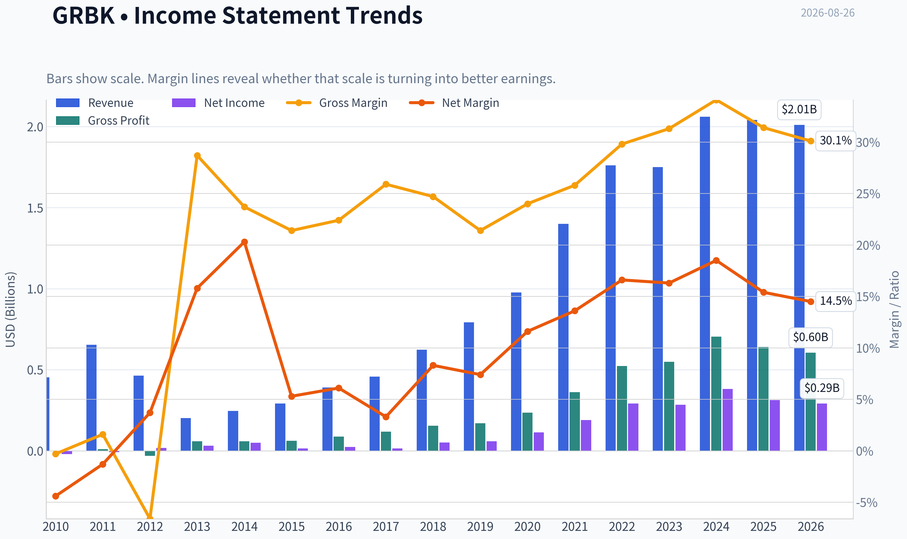

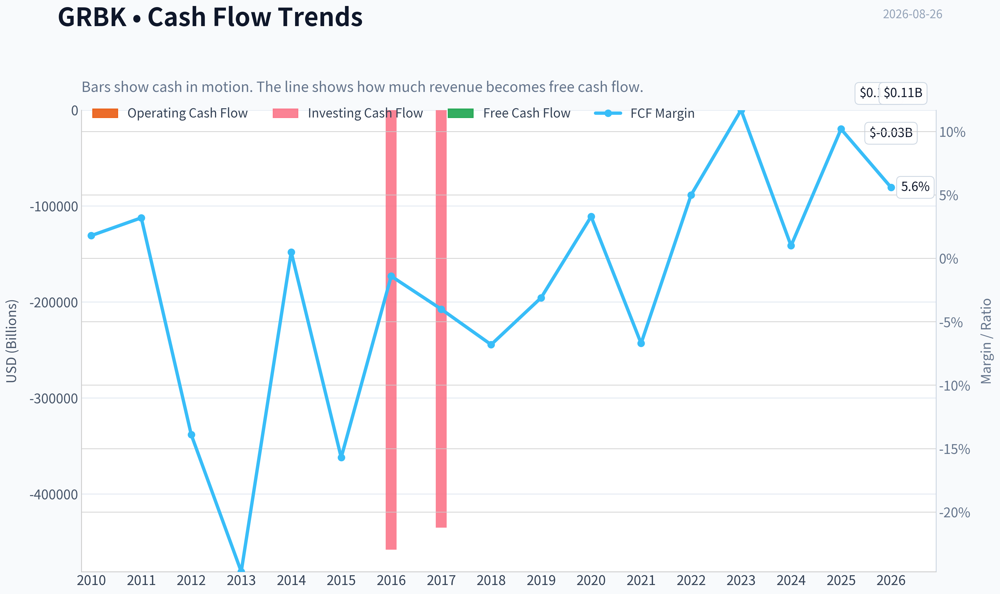

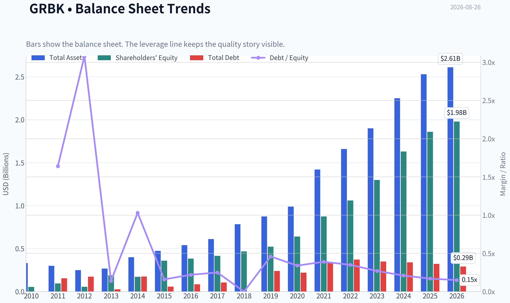

This graph tracks the profitability and return metrics (ROE, ROIC, Margins) of **GRBK** over the past decade, highlighting capital efficiency trends.

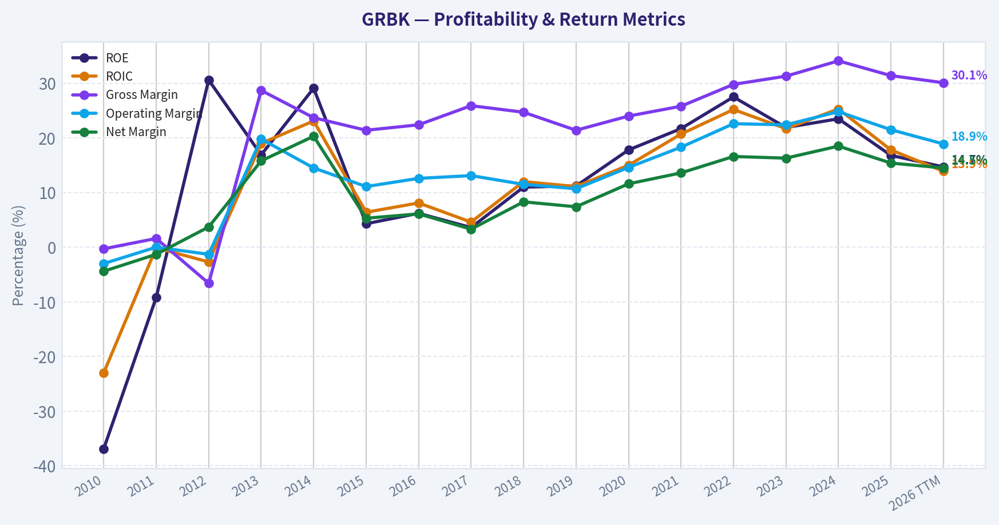

This chart illustrates the financial health of **GRBK** over the last 10 years, mapping cash equivalents and free cash flow against total obligations (Debt).

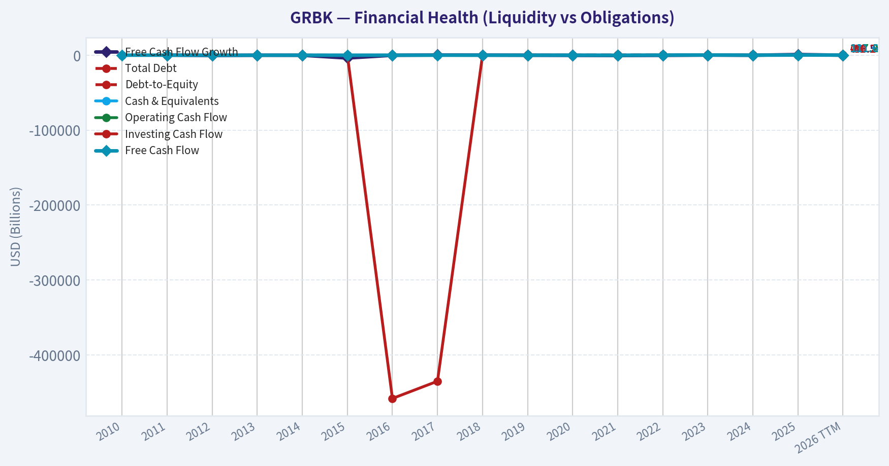

This comparison chart from *Profitability Analysis* stacks current figures against historical benchmarks for **GRBK**, making it easy to see where the company trades relative to its own averages.

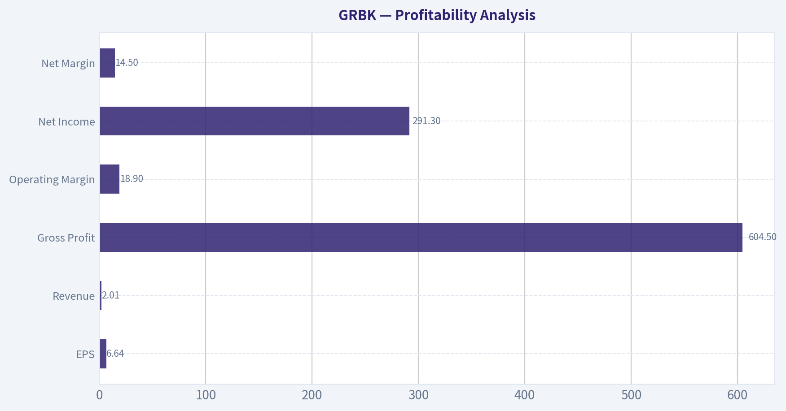

This breakdown chart from <em>Cash Flow and Capital Allocation</em> shows the proportional composition for **GRBK** - useful for understanding what drives or risks the business.

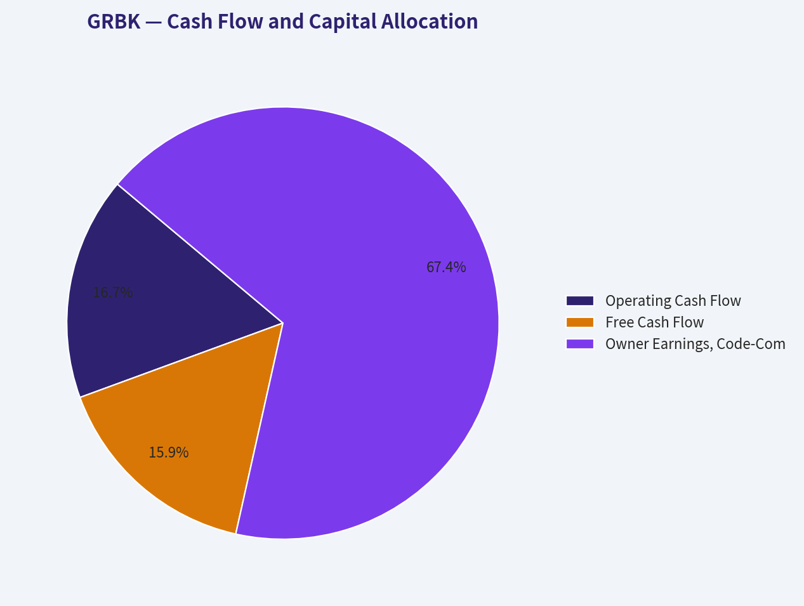

---

### Intrinsic Value Analysis (Buffett)

> *Following Warren Buffett's value investing philosophy: Circle of Competence, Economic Moat, Management Quality, and Margin of Safety.*

#### Intrinsic Value Snapshot

Price is what you pay. Intrinsic value is what the business may be worth based on the cash it can create for owners over time. We show a range, not one magic number.

- Current Price: $73.78
- Value Range (conservative to optimistic across both DCF methods): $41.37 to $602.08

##### Owner Earnings (Buffett Method)
- Net Income: $313,225,000.00
- Depreciation & Amortization: $5,111,000.00
- Capital Expenditures: $-4,798,000.00
- Working Capital Changes: $-159,363,000.00
- Owner Earnings: $472,901,000.00

##### Intrinsic Value
###### Buffett Method
Uses owner earnings. Stricter, and usually more conservative.
- Conservative: $41.37
- Average: $137.86
- Optimistic: $602.08
- Discount Rate: 10.0%

###### Cash Flow Method
Uses free cash flow. Better for companies spending heavily today to grow tomorrow.
- Conservative: $64.91
- Average: $89.08
- Optimistic: $237.91
- Discount Rate: 10.0%

ANALYST STANCE: **ADVOCATE** - Moderate Conviction

#### Green Brick Partners, Inc. - Buffett-Style Investment Review

Green Brick Partners is a regional homebuilder focused on attractive U.S. growth markets, primarily Texas, Florida, and the Southeast. The business buys and develops land, builds homes, and earns its money through the spread between home selling prices and the cost of land, materials, labor, and financing. This is not a classic "forever compounder" like a consumer brand or software platform, but Green Brick appears to be an above-average operator in a cyclical industry, trading at a meaningful discount to intrinsic value.

Current price: **$74**
Market cap: **$3.17 billion**
Headline intrinsic value estimate: **$119.66 per share**
Headline margin of safety: **38.3%**

---

#### 1. Factor Scorecard

| Factor | Score | Evidence |
|---|---:|---|
| Circle of Competence & Business Simplicity | 4.0 / 5 | The business model is understandable: acquire land, develop lots, build homes, and sell them. The main complexity is housing cyclicality, interest rates, and land inventory timing. |
| Moat Test | 3.0 / 5 | Green Brick has regional scale, land sourcing advantages, and superior gross margins, but homebuilding remains cyclical and competitive. The moat is real but not wide in the Buffett sense. |
| Management Quality & Capital Allocation | 4.0 / 5 | Management has produced strong returns on equity, maintained a conservative balance sheet, and focused on disciplined land acquisition. Succession planning appears orderly with Jed Dolson's promotion to Co-CEO. |
| Industry Structure | 2.5 / 5 | Homebuilding is fragmented, cyclical, rate-sensitive, and tied to local housing supply-demand conditions. Green Brick's markets are attractive, but the industry itself is not structurally ideal. |
| Gate 5: Quality / Solvency Hard Floor | Not Tripped | Earnings remain positive, ROE is strong at 16.8%, free cash flow yield is positive, and liquidity is strong with a current ratio near 8.0. No financial distress signal is present. |

**Key Takeaways:** Green Brick scores well on simplicity, management, and valuation, but its industry prevents it from earning a true wide-moat rating. The company is financially sound and not close to the hard-avoid solvency threshold. The investment case depends on buying a good cyclical operator at a sufficiently discounted price.

---

#### 2. Moat Analysis

| Moat Source | Assessment | Evidence |
|---|---|---|
| Intangible Assets / Brand | Moderate | Local builder reputation matters, but Green Brick does not have a national consumer brand moat comparable to luxury, payments, or software franchises. |
| Switching Costs | Low | Homebuyers generally do not face switching costs before purchase. Once a home is bought, the customer relationship has limited recurring economics. |
| Cost Advantage | Above Average | Gross margin of **31.4%** is strong for a homebuilder and suggests good land sourcing, product positioning, and operating discipline. |
| Network Effects | None | The product does not become more valuable as more customers join. |
| Land / Local Market Position | Moderate | Access to desirable lots in high-growth markets can create a local advantage, especially when land is scarce or entitled supply is limited. |

**Key Takeaways:** Green Brick's moat is best described as **narrow-to-moderate**, not wide. Its advantage comes from execution, land selection, and regional market positioning rather than brand dominance or customer lock-in. That makes valuation discipline especially important.

#### Moat Rating: **Narrow / Above-Average Operator**

Green Brick's superior margins indicate that it is not a commodity builder operating at the bottom of the industry. However, because housing demand is cyclical and buyers are rate-sensitive, this is not the type of business where one can confidently assume pricing power through all environments.

---

#### 3. Management Quality Assessment

| Management Area | Assessment |
|---|---|
| Owner Orientation | Positive. The company has historically been associated with owner-minded capital allocation and meaningful insider-aligned governance. |
| Capital Allocation | Positive. Management appears disciplined in land acquisition, inventory control, and balance sheet management. |
| Succession Planning | Positive. The promotion of COO and President Jed Dolson to Co-CEO suggests orderly long-term planning. |
| Balance Sheet Discipline | Strong. Liquidity is high, and the company does not appear to be stretching the balance sheet aggressively at this point in the cycle. |
| Shareholder Returns | Reasonable. The company prioritizes reinvestment and growth over dividends, which is appropriate if returns remain attractive. |

**Key Takeaways:** Management deserves an above-average score because the financial results show discipline: high margins, strong ROE, and a conservative liquidity position. The main test will be whether management stays disciplined if housing conditions weaken or land prices become less attractive.

---

#### 4. Financial Summary

| Metric | Latest / TTM |
|---|---:|
| Share Price | $74 |
| Market Capitalization | $3.17B |
| P/E Ratio | 11.1x |
| Estimated EPS | ~$6.66 |
| ROE | 16.8% |
| Gross Margin | 31.4% |
| Revenue Growth YoY | -1.0% |
| Free Cash Flow Yield | 6.6% |
| Current Ratio | 8.0x |
| Headline Intrinsic Value | $119.66 |
| Margin of Safety vs. Price | 38.3% |
| Reverse DCF Implied Growth | ~-18.1% per year for 10 years |

**Key Takeaways:** Green Brick trades at a modest earnings multiple despite earning a healthy return on equity. Revenue is slightly down year over year, which reflects a softer housing environment, but profitability remains strong. The reverse DCF is unusually pessimistic, implying that the market is pricing in a severe deterioration rather than even modest long-term resilience.

---

#### 5. Owner Earnings Calculation

For a homebuilder, reported free cash flow can swing significantly based on inventory investment. A conservative Buffett-style approach should distinguish between maintenance capital needs and growth land investment.

| Owner Earnings Component | Estimate |
|---|---:|
| Net Income, estimated from P/E and market cap | ~$285M |
| Plus: Depreciation & Amortization | Modest |
| Less: Maintenance CapEx | Modest |
| Less: Maintenance Working Capital Needs | Moderate |
| Normalized Owner Earnings Estimate | ~$285M |
| Normalized Owner Earnings Per Share | ~$6.66 |

**Key Takeaways:** Green Brick's normalized owner earnings are reasonably close to net income because homebuilding is not heavy in traditional maintenance capex. However, growth requires continued investment in land and inventory, so free cash flow can be lower than accounting earnings during expansion periods. The key owner question is whether retained earnings continue to compound at attractive returns.

---

#### 6. Three-Scenario DCF Valuation

Assumptions:
Discount rate: **10%**
Starting normalized owner earnings per share: **~$6.66**
Terminal growth in growth scenario: **3%**

| Scenario | Assumption | Estimated Value Per Share |
|---|---|---:|
| A - No Growth | Owner earnings capitalized at 10% | ~$66.60 |
| B - GDP Growth | 3% perpetual growth | ~$98.00 |
| C - Moderate Historical Growth | 6% growth for 10 years, then 3% terminal growth | ~$122.00 |
| Research Pack Headline Value | Weighted business-model-routed estimate | $119.66 |
| Current Price | Market price | $74.00 |

**Key Takeaways:** The no-growth case is slightly below today's price, which shows that the market is not giving Green Brick much credit for future compounding. The conservative GDP-growth case is meaningfully above the current price. The moderate-growth case aligns closely with the headline intrinsic value estimate, supporting a fair value around $120 per share.

---

#### 7. Margin of Safety Analysis

| Valuation Reference | Value Per Share | Margin of Safety vs. $74 |
|---|---:|---:|
| No-Growth Case | ~$66.60 | Negative |
| GDP-Growth Case | ~$98.00 | ~24.5% |
| Moderate-Growth DCF | ~$122.00 | ~39.3% |
| Headline Intrinsic Value | $119.66 | 38.3% |
| Owner Earnings Model | $137.86 | 46.3% |
| FCF Model | $89.08 | 16.9% |
| Damodaran FCFF Model | $75.10 | 1.5% |

**Key Takeaways:** The valuation spread is wide because homebuilder cash flows are cyclical and sensitive to inventory investment. The current price is close to the most conservative FCFF estimate but far below normalized owner-earnings and moderate-growth values. For a cyclical but high-quality operator, the roughly 38% headline margin of safety is attractive.

#### Valuation Judgment

Green Brick is not the kind of business that deserves a tiny margin of safety requirement. Because the moat is not wide and the industry is cyclical, a **25% to 35%** margin of safety is appropriate. The current headline margin of safety of **38.3%** clears that hurdle.

---

#### 8. Final Buffett Scorecard

| Criterion | Weight | Score | Weighted Contribution |
|---|---:|---:|---:|
| Moat Width & Durability | 25% | 3.0 | 0.75 |
| Valuation / Margin of Safety | 20% | 4.2 | 0.84 |
| Capital Returns - ROIC / ROE Quality | 15% | 3.8 | 0.57 |
| Business Understanding & Predictability | 12% | 4.0 | 0.48 |
| Management Quality & Capital Allocation | 12% | 4.0 | 0.48 |
| Reinvestment Runway | 8% | 3.7 | 0.30 |
| Balance Sheet Strength | 4% | 4.3 | 0.17 |
| Industry Structure | 4% | 2.5 | 0.10 |
| **Total** | **100%** |  | **3.69 / 5.00** |

**Key Takeaways:** Green Brick earns a final score in the Advocate range, mainly because valuation, management, returns, and balance sheet strength offset the cyclical industry structure. The company is not a wide-moat compounder, but it appears to be a good business available at a discounted price. The score supports ownership with moderate, not aggressive, conviction.

---

#### 9. Investment Stance

| Category | Decision |
|---|---|
| Stance | **ADVOCATE** |
| Conviction | **Moderate** |
| Suitable Investor Type | Value-oriented investor comfortable with housing cyclicality |
| Main Upside Driver | Market re-rating toward intrinsic value as earnings prove resilient |
| Main Risk | Housing downturn, affordability pressure, higher mortgage rates, or poor land timing |
| Buy Discipline | Attractive below intrinsic value; becomes more compelling if price remains below ~$80 while fundamentals hold |

**Key Takeaways:** Green Brick is a valuation-driven Advocate rather than a "buy at any price" compounder. The current price offers a meaningful discount to normalized intrinsic value, and the balance sheet appears strong enough to navigate a housing cycle. The main reason not to size it too aggressively is that homebuilding remains cyclical and does not have a wide, permanent moat.

#### Final View

Green Brick Partners is an above-average homebuilder trading at a below-average valuation. The company has strong margins, solid ROE, good liquidity, and a market price that appears to imply a materially worse future than the evidence supports. For a Buffett-style investor, this is not a perfect business, but it is a sensible investment candidate at today's price.

**Final stance: ADVOCATE - Moderate Conviction.**
#### Valuation Bridge

This bridge places the current market price beside each intrinsic value lens so readers can see whether upside depends on one method or shows up across several methods.

| Scenario | Intrinsic Value / Share |
| --- | ---: |
| Buffett Method | $137.86 |
| Cash Flow Method | $89.08 |
| Damodaran Method | $75.10 |
| Current Price | $73.78 |

#### Key Takeaways

If one method is far above the others, the upside case depends on a specific modelling assumption. When several methods cluster together, the valuation story is more robust.

#### Valuation Visuals

This comparison chart from *Latest Earnings Snapshot* stacks current figures against historical benchmarks for **GRBK**, making it easy to see where the company trades relative to its own averages.

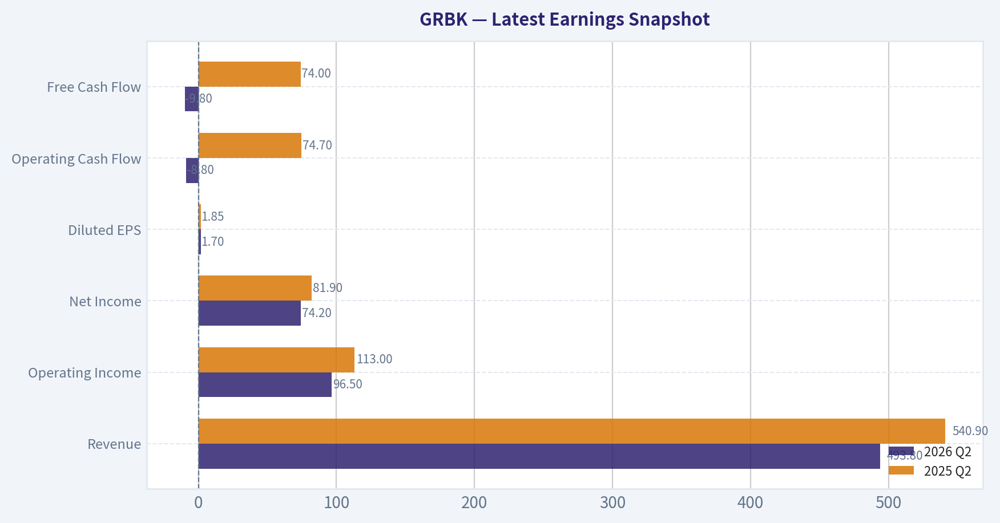

This comparison chart from *Balance Sheet and Financial Strength* stacks current figures against historical benchmarks for **GRBK**, making it easy to see where the company trades relative to its own averages.

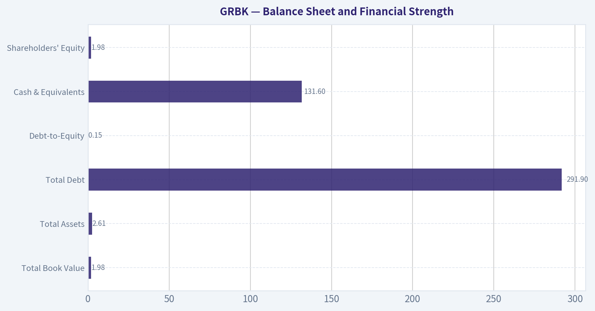

---

### Trend & Growth Analysis (Lynch/Druckenmiller/Fisher)

> *Following Peter Lynch's GARP, Stanley Druckenmiller's macro-aware approach, and Philip Fisher's scuttlebutt methodology.*

ANALYST STANCE: **WATCH**

#### GRBK Growth Investment Analysis - Green Brick Partners

Green Brick Partners is a high-quality, founder-led homebuilder with strong margins, excellent liquidity, and a potentially interesting order-cycle inflection. However, under Lynch's framework this is still primarily a **cyclical homebuilder**, not a clean secular fast grower. The valuation is attractive, but ten-bagger probability depends heavily on the housing cycle, mortgage rates, land execution, and sustained share gains.

---

#### 1. Lynch Classification

| Category | GRBK Assessment | Growth Investor Interpretation |
|---|---:|---|
| Lynch category | **Cyclical / quality compounder** | Homebuilding is economically sensitive, even when the operator is excellent |
| Current revenue growth | **-1.0% YoY** | Not currently a fast grower by reported revenue |
| Order momentum | **Q2 2026 orders +19%** | Possible early-cycle inflection signal |
| Profitability | **P/E 11.1x, ROE 16.8%, gross margin 31.4%** | Strong for a homebuilder |
| Balance sheet/liquidity | **Current ratio 8.0x** | Financially resilient |
| Lynch fit | **Not a classic fast grower** | Better suited as a cyclical value-growth watchlist name |

**Key Takeaways:** GRBK is not a pure Lynch-style fast grower today because revenue is slightly declining and the business is cyclical. But the company is unusually profitable for a homebuilder, trades at a low earnings multiple, and recent order growth suggests the cycle may be turning. That makes it interesting, but not yet a high-conviction growth buy.

---

#### 2. The Story in 3 Bullets

- **GRBK builds and sells homes**, primarily in attractive U.S. growth markets, using a land-focused operating model to earn above-average homebuilding margins.
- **The upside story is a housing-cycle reacceleration:** if mortgage rates fall or affordability improves, order growth can convert into revenue, earnings, and book-value compounding.
- **The company has quality signals:** high gross margin, strong ROE, abundant liquidity, and a valuation that appears to price in weak long-term growth.

---

#### 3. TAM Analysis and 10x Test

| Item | Estimate / Assessment |
|---|---:|
| Current annualized revenue run-rate | About **$2.0B**, using Q2 2026 revenue of $493.8M annualized |
| 10x revenue target | About **$20B** |
| Broad U.S. new-home / residential construction TAM | Hundreds of billions annually |
| Would 10x revenue still be small vs. TAM? | **Yes** |
| Practical constraint | Land acquisition, local market depth, labor, rates, cyclicality |
| TAM verdict | **Large enough, but not frictionless** |

**Key Takeaways:** The theoretical TAM is large enough for GRBK to grow many times from here. A 10x revenue outcome would still be small relative to the broader U.S. housing market. The constraint is not market size; it is execution through cycles, land availability, affordability, and capital discipline.

---

#### 4. Revenue Growth Trend

| Metric | Current Signal | Interpretation |
|---|---:|---|
| Reported revenue growth YoY | **-1.0%** | Slight contraction |
| Q2 2026 revenue | **$493.8M** | Beat estimates per latest coverage |
| Q2 2026 order growth | **+19%** | Positive forward indicator |
| Growth pattern | **Reported revenue soft, orders improving** | Possible early inflection |
| Growth verdict | **Watch for conversion of orders into revenue** | Not enough yet for ADVOCATE |

**Key Takeaways:** The revenue line is not yet accelerating, but orders are moving in the right direction. For a homebuilder, orders often lead revenue, so the 19% order increase is the most important potential inflection signal. The key test is whether that order strength persists and converts into revenue without margin erosion.

---

#### 5. Unit Economics and Operating Quality

Traditional SaaS metrics like LTV/CAC and NRR do not apply to GRBK. For a homebuilder, the better proxies are gross margin, ROE, cash generation, inventory discipline, and balance-sheet liquidity.

| Metric | GRBK Data | Quality Read |
|---|---:|---|
| Gross margin | **31.4%** | Strong for homebuilding |
| ROE | **16.8%** | Attractive capital productivity |
| FCF yield | **6.6%** | Solid cash yield |
| Current ratio | **8.0x** | Very strong liquidity |
| Rule of 40 | Not applicable | GRBK is not SaaS/subscription |
| Unit economics verdict | **Good, cyclical** | Strong operator but cycle-sensitive |

**Key Takeaways:** GRBK's unit economics look strong using homebuilder-relevant measures. High gross margin and solid ROE suggest the company has either land advantages, pricing discipline, or operational efficiency. The main caveat is that these metrics can deteriorate quickly if housing demand weakens.

---

#### 6. Inflection Point Assessment

| Inflection Type | Evidence | Strength |
|---|---|---:|
| Product cycle inflection | Not applicable; homes are not a product-cycle business | Low |
| Market share inflection | Orders +19% despite affordability pressure | Medium |
| Margin inflection | Gross margin already strong at 31.4% | Medium |
| TAM inflection | Housing demand may improve if rates fall | Medium |
| Competitive inflection | Smaller/private builders may be pressured by financing costs | Medium |
| Overall inflection score | **Potential, not confirmed** | **3/5** |

**Key Takeaways:** The best inflection signal is the surge in orders. If mortgage rates decline and GRBK keeps taking share, earnings could surprise to the upside over the next two to three years. But this is still an early signal, not yet a confirmed growth acceleration.

---

#### 7. Macro Setup Evaluation

| Macro Factor | Current Read | Impact on GRBK |
|---|---|---|
| Interest rates | Potentially improving if rate cuts materialize | Positive if mortgage rates fall |
| Housing affordability | Still pressured | Negative |
| Housing supply | Structural shortage in many U.S. markets | Positive long-term |
| Consumer confidence | Cyclical variable | Mixed |
| Credit availability | Important for buyers and builders | Mixed |
| Macro verdict | **Neutral to improving** | Watch mortgage-rate trend closely |

**Key Takeaways:** GRBK has a favorable long-term housing-supply backdrop, but affordability remains the key near-term obstacle. Falling mortgage rates would be a major catalyst. This is why the stock is macro-sensitive and better classified as a cyclical opportunity than a pure secular growth investment.

---

#### 8. Fisher 15 Points Score

| Fisher Category | Score / 5 | Comment |
|---|---:|---|
| Market potential | 4 | Large housing TAM |
| New product determination | 2 | Limited relevance for homebuilding |
| R&D effectiveness | 1 | Not an R&D-driven business |
| Sales organization | 4 | Order growth suggests effectiveness |
| Profit margin | 5 | Strong gross margin |
| Improving margins | 3 | Need trend confirmation |
| Labor/personnel relations | 3 | Insufficient data |
| Executive relations | 3 | Co-CEO succession appears planned |
| Management depth | 4 | COO promotion suggests internal bench |
| Cost/accounting discipline | 4 | Strong margins and liquidity |
| Moat/switching costs | 2 | Homebuilding has limited structural moat |
| Long-range profit outlook | 4 | Good if cycle cooperates |
| Dilution risk | 4 | No major dilution concern flagged |
| Candor in difficulties | 3 | Insufficient evidence |
| Management integrity | 3 | No red flag identified |
| **Total** | **49 / 75** | **Average to good** |

**Key Takeaways:** GRBK scores well on margins, market opportunity, and operating discipline, but poorly on Fisher-style innovation and moat characteristics. This is not a classic Fisher compounder with deep technological advantages or switching costs. The score supports a watchlist stance rather than aggressive advocacy.

---

#### 9. Valuation Analysis

| Valuation Metric | GRBK | Interpretation |
|---|---:|---|
| Current price | **$74** | Shared research pack |
| Market cap | **$3.17B** | Small/mid-cap |
| P/E | **11.1x** | Low absolute valuation |
| Approx. P/S | **~1.6x** | Reasonable for a profitable homebuilder |
| FCF yield | **6.6%** | Attractive |
| Headline intrinsic value | **$119.66** | Implies 38.3% margin of safety |
| Owner earnings DCF | **$137.86** | Bullish valuation model |
| FCF DCF | **$89.08** | Modest upside |
| Damodaran FCFF | **$75.10** | Near current price |
| Reverse DCF implication | **~ -18.1% annual growth for 10 years** | Market pricing appears very conservative |
| PEG ratio | Not meaningful | Revenue growth is currently negative |

**Key Takeaways:** Valuation is the strongest part of the GRBK thesis. The stock trades at a low earnings multiple and the reverse DCF appears to imply a deeply pessimistic future. However, the intrinsic value range is wide, which reflects the cyclicality and uncertainty of homebuilder cash flows.

---

#### 10. Scenario Analysis

| Scenario | Revenue Assumption | Multiple | Implied Market Cap | Upside / Downside vs. $3.17B |
|---|---:|---:|---:|---:|
| Bear | $1.8B revenue | 1.0x sales | $1.8B | **-43%** |
| Base | $2.3B revenue | 1.5x sales | $3.45B | **+9%** |
| Bull | $2.8B revenue | 2.0x sales | $5.6B | **+77%** |

**Key Takeaways:** The downside is meaningful if the housing cycle weakens and multiples compress. The base case is not especially exciting from a growth-investor perspective, while the bull case requires sustained order growth, better affordability, and resilient margins. The setup is asymmetric only if one has conviction that the housing cycle is turning upward.

---

#### 11. Growth Investor Scorecard

| Criterion | Weight | Score / 5 | Weighted Score |
|---|---:|---:|---:|
| The Story | 10% | 3.5 | 0.35 |
| TAM & Runway | 20% | 4.0 | 0.80 |
| Revenue Growth | 20% | 2.5 | 0.50 |
| Unit Economics | 15% | 4.0 | 0.60 |
| Competitive Position | 10% | 3.0 | 0.30 |
| Management Quality | 10% | 3.5 | 0.35 |
| Macro Setup | 5% | 3.0 | 0.15 |
| Profitability Path | 5% | 4.0 | 0.20 |
| Valuation | 5% | 4.0 | 0.20 |
| **Total** | **100%** |  | **3.45 / 5.0** |

**Key Takeaways:** GRBK lands just below the threshold for an advocate rating. The company scores well on TAM, profitability, unit economics, and valuation. The score is held back by cyclical exposure and the lack of confirmed revenue acceleration.

---

#### 12. Position Size Stance

| Investor Type | Suggested Stance |
|---|---|
| Pure growth investor | **Watchlist only** |
| GARP investor | **Small starter acceptable** |
| Cyclical/value investor | **More attractive** |
| High-conviction position size | Not yet justified |
| Suggested sizing | **0% to 2% starter**, only if comfortable with housing cyclicality |

**Key Takeaways:** GRBK is investable for a GARP or cyclical-value investor, but it is not yet a top-tier growth setup. A small starter position could be reasonable if one believes rates are headed lower and orders will keep improving. For a concentrated growth portfolio, it should remain on watch until revenue acceleration is clearer.

---

#### Key Catalysts and Risks

| Catalysts | Risks |
|---|---|
| Mortgage rates decline | Mortgage rates stay elevated |
| Q2 order surge converts into revenue | Order growth proves temporary |
| Gross margins remain above peers | Incentives rise and margins compress |
| Housing shortage supports demand | Affordability remains strained |
| Smaller builders lose share | Land costs rise or inventory turns slow |
| Intrinsic value gap closes | Homebuilder multiples compress |

**Key Takeaways:** The upside case depends on a housing-cycle recovery and sustained execution. The downside case is straightforward: affordability remains poor, orders slow, and margins normalize lower. GRBK is financially strong, but the stock will still trade with the housing cycle.

---

#### Final View

GRBK is a **high-quality cyclical compounder trading at an attractive valuation**, with a possible order-driven inflection emerging in 2026. But it is not yet a Lynch-style fast grower, and the ten-bagger case is not obvious because homebuilding is capital-intensive, cyclical, and competitively fragmented.

**Stance: WATCH.** Upgrade toward **ADVOCATE** if order growth remains above 15%, revenue reaccelerates, gross margins hold near current levels, and mortgage-rate conditions improve.

#### Growth & Scorecard Visuals

This comparison chart from *Growth Metrics Analysis* stacks current figures against historical benchmarks for **GRBK**, making it easy to see where the company trades relative to its own averages.

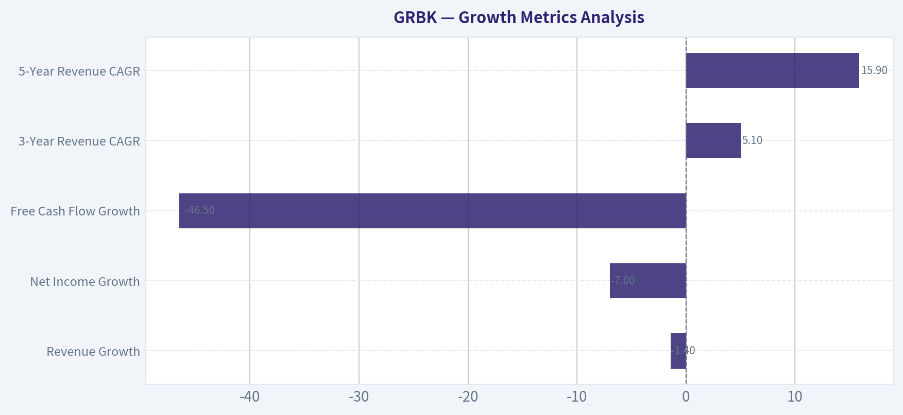

---

### Market Technical Analysis

ANALYST STANCE: **WATCH**

#### GRBK Technical Indicator Selection and Market Read

As of the latest available price data, GRBK last closed at **$73.55 on 2026-08-25**. Indicator values are reported as of **2026-08-26**. The setup has improved meaningfully from the late-July and mid-August weakness, but the stock is still testing an important medium-term decision zone rather than showing a fully confirmed bullish breakout.

| Indicator Selected | Latest Value | What It Adds | Current Read |
|---|---:|---|---|
| close_10_ema | 72.15 | Short-term trend and tactical entry timing | Price is above the 10 EMA, showing near-term momentum has turned constructive. |
| close_50_sma | 73.31 | Medium-term trend and resistance/support | Price is only slightly above the 50 SMA, so the breakout attempt is still fragile. |
| close_200_sma | 69.34 | Long-term trend filter | Price remains comfortably above the 200 SMA, keeping the broader structure constructive. |
| macd | 0.07 | Trend-momentum confirmation | MACD has just crossed back into positive territory, suggesting improving momentum. |
| macdh | 0.38 | Early momentum acceleration signal | Histogram has been rising, confirming that downside momentum has faded. |
| rsi | 56.72 | Momentum and overbought/oversold context | RSI is bullish-neutral: above 50 but not overbought. |
| atr | 1.95 | Volatility and stop placement | Volatility has cooled, allowing tighter but still risk-aware trade planning. |
| vwma | 71.55 | Volume-confirmed price trend | Price is above VWMA, suggesting recent volume-weighted participation supports the rebound. |

Key Takeaways: GRBK's short-term tone has improved, with price above the 10 EMA, VWMA, 50 SMA, and 200 SMA. However, the margin above the 50 SMA is very small, so traders should treat the current area as a confirmation zone rather than a clean breakout. Momentum indicators are improving, but volume confirmation is not yet decisive.

#### Trend Structure

GRBK experienced a strong rally into late June, reaching the **$80 area**, but that move failed to hold. The stock then entered a sharp corrective phase through July, falling toward the low **$70s**, with the 10 EMA and VWMA rolling over during that decline. That correction damaged the short-term trend, but it did not break the long-term structure because price stayed above the rising 200 SMA.

The most important current development is that price has recovered from the August low near **$69.35** and is now back near **$73.55**, just above the 50 SMA at **$73.31**. This is constructive, but not yet decisive. A close slightly above the 50 SMA can be an early bullish signal, but because the cushion is only about **0.3%**, a modest pullback could quickly put price back below this medium-term trend line.

The 200 SMA at **$69.34** is rising gradually and sits almost exactly near the August downside pivot. That makes the **$69-$70 zone** especially important. If GRBK remains above that area, the broader trend can still be interpreted as a long-term uptrend with a medium-term consolidation. A decisive break below it would be more serious and would suggest the June-to-August correction is not finished.

#### Momentum and Reversal Quality

Momentum has improved notably. MACD moved from deeply positive in late June, to negative through July and August, and has now recovered to slightly positive at **0.07**. More importantly, the MACD histogram has climbed to **0.38**, after being negative for much of the prior pullback. This suggests the pace of selling pressure has eased and buyers are beginning to regain control.

RSI confirms the same message, but in a more restrained way. At **56.72**, RSI is above the neutral 50 line, which favors the bulls, but it is not near overbought territory. This is generally healthier than a stretched rally because it leaves room for upside continuation. However, RSI is not yet strong enough to suggest aggressive trend expansion; a move toward the low-to-mid 60s would strengthen the bullish case.

The key nuance is that momentum is improving from a weak base rather than extending from a strong trend. This makes GRBK more of a **recovery setup** than a pure momentum breakout at this stage.

#### Volume and Participation

The VWMA at **$71.55** is below the latest close, which is constructive because it means price is trading above the recent volume-weighted average. This suggests that recent buyers, on average, are now positioned below the market rather than above it.

However, the most recent close at **$73.55** came on **198,000 shares**, which is not especially strong compared with the notable August 19 volume spike of **684,600 shares**. That means the price recovery is encouraging, but the latest push has not yet shown overwhelming institutional-style confirmation.

For a higher-confidence bullish signal, traders would ideally want to see GRBK close above the **$73.80-$74.00** area with volume expanding above recent average levels. Without that, the stock may still be vulnerable to another rejection near the 50 SMA and recent swing resistance.

#### Volatility and Risk Management

ATR has declined to **1.95**, down from levels above **2.3-2.5** earlier in the summer. This indicates volatility has cooled as the stock has moved from a sharp correction into a more orderly rebound. Lower ATR can be helpful for trade planning because it reduces the distance needed for tactical stops, but it can also precede a larger directional move if price compresses near resistance.

For traders using ATR-based risk controls, a one-ATR pullback from the latest close would point near **$71.60**, close to the VWMA and recent short-term support. A deeper 1.5 ATR pullback would point near **$70.60**, which aligns with the lower part of the August base. A break below that area would weaken the recovery attempt and put the 200 SMA near **$69.34** back in focus.

#### Trading Interpretation

GRBK is in a constructive but not fully confirmed recovery phase. The bullish case is supported by improving MACD, a positive MACD histogram, RSI above 50, price above VWMA, and price above the 200 SMA. The main caution is that price is only marginally above the 50 SMA, and the latest rally has not yet cleared nearby resistance with strong volume.

A bullish continuation scenario would become more compelling if GRBK closes above **$73.80-$74.00**, then follows through toward **$75.20-$75.75**. Above that zone, the next meaningful upside area would be the prior breakdown region around **$76.75-$78.65**, followed by the June highs near **$80-$83**.

A failed-breakout scenario would occur if price stalls near current levels and falls back below the 10 EMA near **$72.15**. That would suggest the recent bounce is losing energy. A further move below **$71.50** would weaken the volume-weighted support structure, while a break below **$69-$70** would materially damage the broader technical picture.

#### Final Technical Summary

| Category | Bullish Evidence | Caution / Risk | Practical Trading Implication |
|---|---|---|---|
| Short-term trend | Price is above the 10 EMA at 72.15 | The 10 EMA is still below the 50 SMA | Short-term recovery is improving, but not yet a strong trend regime. |
| Medium-term trend | Price has reclaimed the 50 SMA at 73.31 | Cushion above the 50 SMA is very thin | Need confirmation above 73.80-74.00. |
| Long-term trend | Price is well above the 200 SMA at 69.34 | A retest of 69-70 would be important | Long-term bias remains constructive while above the 200 SMA. |
| Momentum | MACD is positive and histogram is rising | MACD is only barely above zero | Momentum is turning, but still early. |
| RSI | RSI at 56.72 supports bullish-neutral momentum | Not yet strong enough to show aggressive demand | Healthy recovery, but not a chase signal. |
| Volume | Price is above VWMA at 71.55 | Latest push lacks major volume expansion | Watch for volume confirmation on a breakout. |
| Volatility | ATR has cooled to 1.95 | Compression can precede a sharp move either way | Use ATR-aware stops; avoid oversized positions. |
| Stance | Recovery setup is improving | Breakout is not fully confirmed | **WATCH** for confirmation above 74 or failure below 72. |

Key Takeaways: GRBK has rebuilt short-term momentum and is trading above several key indicators, but it is still sitting near a major confirmation zone. The most important bullish trigger is a strong close above roughly $74, preferably with expanding volume. If the stock instead falls back below $72.15 and then $71.50, the current recovery attempt would become much less convincing.

#### Market Visuals

This comparison chart from *Market Metrics Interpretation* stacks current figures against historical benchmarks for **GRBK**, making it easy to see where the company trades relative to its own averages.

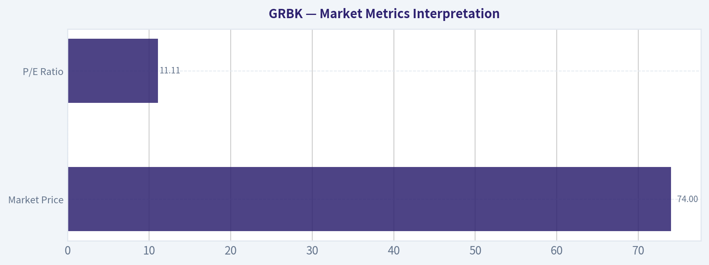

---

### Options Market Analysis

> *Reading options flow - put/call ratios, IV skew, and unusual activity - to gauge institutional positioning and event-driven risk.*

ANALYST STANCE: **WATCH**

#### GRBK Options Market Sentiment Report
*Options data as of 2026-08-26. Near-term expirations reviewed: 2026-09-18, 2026-10-16, 2026-11-20.*

#### 1. Put/Call Ratio Analysis

| Expiration | Call OI | Put OI | Put/Call OI Ratio | Call Volume | Put Volume | Put/Call Volume Ratio | Interpretation |
|---|---:|---:|---:|---:|---:|---:|---|
| 2026-09-18 | 126 | 470 | 3.73 | 24 | 12 | 0.50 | Put-heavy open interest, but current volume is call-tilted |
| 2026-10-16 | 2 | 9 | 4.50 | 2 | 2 | 1.00 | Very thin activity; ratio not very reliable |
| 2026-11-20 | 214 | 248 | 1.16 | 47 | 26 | 0.55 | Mildly put-heavy OI, but current volume favors calls |
| **Total Near-Term** | **342** | **727** | **2.13** | **73** | **40** | **0.55** | Structurally defensive OI, but not confirmed by fresh put volume |

**Key Takeaways:** GRBK's near-term open interest is meaningfully put-heavy, with an overall put/call OI ratio of **2.13**, well above the historical neutral baseline of roughly **0.7**. That suggests existing positioning is defensive or bearish. However, the current volume ratio is only **0.55**, meaning today's trading activity is more call-heavy than put-heavy, so fresh flow is not aggressively bearish.

The major signal is a split between **stockpiled downside protection** and **lighter, possibly opportunistic call buying**. Because the absolute volume is low, the put/call readings should be treated with reduced confidence.

---

#### 2. Implied Volatility Assessment

| Expiration | ATM Call IV | ATM Put IV | Put IV Premium vs. Calls | IV Read |
|---|---:|---:|---:|---|
| 2026-09-18 | 48.0% | 54.6% | +6.6 pts | Elevated put IV suggests downside protection demand |
| 2026-10-16 | 46.8% | N/A | N/A | Data too limited to assess skew |
| 2026-11-20 | 38.8% | 41.5% | +2.7 pts | Modest put premium remains present farther out |

**Key Takeaways:** Near-term puts are priced at higher implied volatility than calls, especially in the September expiration, where ATM put IV is **54.6%** versus call IV at **48.0%**. That indicates a downside skew, consistent with traders paying more for protection. The skew is not extreme across all expirations, but it leans defensive.

GRBK's near-term IV appears moderately elevated, but the available data does not identify a specific catalyst such as earnings or a corporate event. The more important read is that put protection is carrying a premium, which supports a cautious-to-bearish interpretation.

#### IV Skew Read

| Skew Category | Observation | Sentiment Implication |
|---|---|---|
| ATM Put vs. Call IV | Puts trade richer than calls in available expirations | Defensive / bearish skew |
| OTM Put vs. OTM Call IV | Not available from retrieved dataset | Cannot confirm full tail-risk skew |
| Catalyst Premium | No specific known catalyst identified in provided options data | IV may reflect sector/stock risk rather than a clear event trade |

**Key Takeaways:** The available skew data points to **put-side demand**, but the dataset does not provide enough detail to compare far OTM puts versus far OTM calls. That means the downside-risk signal is present but incomplete. Traders appear more willing to pay for downside protection than upside optionality.

---

#### 3. Unusual Options Activity

| Contract Type | Expiration | Strike | Volume vs. OI | Status | Interpretation |
|---|---|---:|---|---|---|
| Calls / Puts | Near-term expirations | N/A | No volume greater than 5x open interest | No unusual activity detected | No clear evidence of fresh aggressive institutional positioning |

**Key Takeaways:** No near-term GRBK contracts showed volume greater than **5x open interest**, so there is no strong unusual-options signal. This reduces confidence in calling the flow "smart money" or event-driven. Current positioning looks more like low-liquidity hedging and legacy open interest than a fresh institutional directional bet.

Because no unusual contracts were flagged, there is no specific strike or expiry that can be interpreted as a high-conviction bullish or bearish trade. This is important: the bearish read comes more from open interest and IV skew than from fresh options sweeps.

---

#### 4. Open Interest Concentration and Gamma Levels

| Expiration | Total Call OI | Total Put OI | Dominant Side | Potential Market Impact |
|---|---:|---:|---|---|
| 2026-09-18 | 126 | 470 | Puts | Downside/protection positioning may matter into September expiry |
| 2026-10-16 | 2 | 9 | Puts | Too little OI to infer meaningful pinning |
| 2026-11-20 | 214 | 248 | Slight put bias | More balanced, but still mildly defensive |
| **Total Near-Term** | **342** | **727** | **Puts** | Put-heavy structure may create defensive sentiment, but low liquidity limits gamma confidence |

**Key Takeaways:** Open interest is most meaningfully put-heavy in the **September 18** expiration, where puts outnumber calls by nearly four to one. That expiration could carry the most near-term defensive significance. However, strike-level open interest was not provided, so specific gamma walls, max-pain levels, or pinning strikes cannot be identified.

From a market-structure standpoint, GRBK does not show enough options liquidity to make a high-confidence gamma-wall call. The more useful takeaway is that traders have more downside exposure or protection open than upside call exposure.

---

#### 5. Overall Options Sentiment Signal

| Category | Signal | Rationale |
|---|---|---|
| Put/Call OI | Bearish | Overall put/call OI ratio of **2.13** is far above neutral |
| Put/Call Volume | Mildly Bullish / Neutral | Current volume ratio of **0.55** shows more call volume than put volume |
| IV Skew | Bearish | Puts carry higher IV than calls, especially near-term |
| Unusual Activity | Neutral | No volume > 5x OI detected |
| Liquidity Quality | Low Confidence | Absolute volume and OI are thin |
| **Overall Signal** | **BEARISH, Low Confidence** | Defensive OI and put-rich IV outweigh call-tilted daily volume |

**Key Takeaways:** The overall options signal for GRBK is **BEARISH, but low confidence**. The strongest evidence is the elevated put/call open interest ratio and higher put implied volatility, both of which suggest defensive positioning or downside concern. The caveat is that fresh volume is not bearish, unusual activity is absent, and the options market is relatively illiquid.

#### Final Read

GRBK's options market is leaning **bearish/defensive** rather than outright panic-driven. Existing positioning shows substantially more puts than calls, and near-term puts are priced with higher implied volatility than calls. That said, there is no unusual options activity and daily volume is thin, so this should be treated as a **cautious risk signal**, not a high-conviction bearish trade setup.

#### Summary Table

| Factor | Current Read | Sentiment Impact |
|---|---|---|
| Put/Call Ratio | OI ratio **2.13**, volume ratio **0.55** | Bearish OI, but current flow is not confirming |
| IV Level | ATM IV roughly **39%-55%** across available expirations | Moderately elevated |
| Skew Direction | Puts priced above calls | Bearish / downside protection demand |
| Unusual Activity | None detected | Neutral; no fresh high-conviction signal |
| Overall Signal | **BEARISH, Low Confidence** | Defensive positioning dominates, but liquidity is thin |

---

## Research Team Commentary

> *The Research Manager synthesizes the Bull vs Bear debate into action-free commentary. This is a pre-risk view, not the final stance.*

This is a classic value investing debate where we have to separate a genuinely wonderful business from a cyclical company experiencing a wonderful operating environment. After reviewing both arguments, the Bear presents the more grounded, historically aware Buffett-style analysis, though the Bull correctly identifies Green Brick's undeniable regional strengths.

Let's break down exactly what we are looking at.

The Bull's central premise is that Green Brick's 31.4% gross margin and 16.9% ROIC are structural-a durable moat built on scarce Sunbelt land. They look at the 11x P/E and a reverse-DCF implying just 2-3% growth, and conclude the stock is deeply undervalued.

The Bear correctly throws cold water on this by pointing out the cyclical reality of homebuilding. A 31% gross margin in this industry is almost never a permanent moat; it is typically a temporal mismatch. Green Brick is currently recognizing revenue on homes sold at post-2023 peak prices, built on land acquired at pre-2021 costs. As that old, cheap land inventory depletes and is replaced by newly acquired, expensive lots, those margins are highly likely to revert toward the historical industry average of 20-23%.

When we evaluate this through a strict intrinsic value lens, the Bull's reverse-DCF is flawed. It assumes the company only needs to grow at 2-3% to justify its current price. But if gross margins compress by 800 to 900 basis points, Green Brick won't be growing at 2%; it will experience a severe contraction in earnings even if volume stays flat. In cyclical industries, a low P/E at the top of a cycle is often a value trap, not a margin of safety. You usually want to buy cyclicals when their P/E looks artificially high at the bottom of the cycle, not when it looks artificially low at the top.

However, I have to integrate the lessons I learned from my previous analysis of Berkshire Hathaway (BRK-B). In that situation, I let long-term valuation "gravity" entirely blind me to a very viable short-term technical and tactical setup. I leaned too heavily on opportunity cost and structural maturity, missing that a high-quality stock sitting on a tested support zone can still experience a meaningful tactical rebound.

Furthermore, in the Berkshire case, I initially under-weighted the macroeconomic tailwinds of interest rates-higher rates actually benefited Berkshire's float. Here, we must respect the macro setup, but in reverse. As the Bear noted, Green Brick is highly vulnerable to higher-for-longer mortgage rates stifling affordability, meaning the macro environment is currently a structural headwind, not a tailwind.

Applying my updated framework, I must separate the long-term strategic view from the short-term tactical view. Strategically, Green Brick is over-earning and does not offer a Buffett-style margin of safety on normalized earnings. But tactically, the stock is testing a medium-term decision zone and has shown recent improvement. The structural Sunbelt housing shortage is a real narrative that keeps a floor under the stock.

Core Takeaway:
Green Brick Partners is a high-quality operator benefiting from a historic, but likely temporary, peak in homebuilding economics. We should not underwrite a 10-year hold based on 31% gross margins. Therefore, it does not qualify for an ADVOCATE stance. However, because of its solid balance sheet, Sunbelt positioning, and current technical stabilization, it is not a pure AVOID. The proper stance is a vigilant WATCH.

Rationale:
From a value perspective, the margin of safety must be calculated on normalized earnings, not peak cyclical earnings. If we normalize Green Brick's margins to historical averages, the P/E expands significantly, meaning it is currently fairly valued or even slightly expensive. Yet, applying my past lessons, we shouldn't heavily short or avoid a fundamentally sound company just because it isn't dirt cheap, especially when it sits near technical support in an industry with a real structural supply shortage.

Monitoring Plan:
Over the next 1 to 4 quarters, we need to separate the macro noise from the company's specific execution.
First, watch the gross margin trajectory closely. Is it compressing toward the low 20s as old land is exhausted, or are they finding a way to sustain upper 20s through operational efficiency?
Second, track their land acquisition costs and capital allocation. Are they aggressively buying expensive land at the top of the cycle (a red flag), or are they hoarding cash and returning capital to shareholders?
Third, observe the technical support zones. If the stock cleanly reclaims its moving averages, a tactical, short-term accumulation might make sense. But for core, long-term capital deployment, we need to wait for the cycle to cool and the valuation to reflect normalized, not peak, economics.

Stance: WATCH

---

## Value Investing Team Commentary

> *The Investor translates the research view into an investment thesis before risk review. This is still not the final stance.*

Evaluating Green Brick Partners (GRBK) through the lens of a long-term business owner requires us to look past the current "goldilocks" environment for homebuilders and focus on the durability of its earnings power over a full 10-year cycle.

### 1. Business Quality and the "Moat" Delusion
Green Brick's current financial performance is, by any standard, spectacular. A 31.4% gross margin and 16.9% ROIC are figures usually reserved for software companies or high-end luxury brands, not businesses that move dirt and pour concrete.

As a value investor, I must ask: **Is this margin a durable moat or a cyclical windfall?**
In homebuilding, a sustainable moat usually comes from two places: extreme scale (lowering input costs) or an asset-light model (NVR's land-option strategy). Green Brick has neither. Instead, it has **geographic concentration** in high-growth markets like Dallas-Fort Worth and Atlanta. While these markets are structurally undersupplied, land is ultimately a depleting inventory. The current margins are a result of "old" land prices meeting "new" home prices. When the inventory turns over, the margin will inevitably regress toward the mean.

### 2. Selective Contrarian Thinking: The "Lock-in" Fallacy
The prevailing market sentiment is that the "lock-in effect" (homeowners staying put to keep 3% mortgages) is a permanent tailwind for new homebuilders. The contrarian view is more sober: This effect has artificially suppressed supply, allowing builders to maintain pricing power.

However, if mortgage rates decline, the market will be flooded with existing home inventory, ending the builders' monopoly on supply. Conversely, if rates stay "higher for longer," affordability eventually hits a wall that even buy-downs can't bridge. Green Brick is currently operating in a narrow window of peak pricing power that is unlikely to persist for a decade.

### 3. Valuation and Margin of Safety
The 11.1 P/E ratio is the "Siren Song" of cyclical investing. Historically, the best time to buy a homebuilder is when the P/E looks terrifyingly high (because earnings have collapsed) and the P/B (Price-to-Book) is near or below 1.0.

A reverse-DCF suggests the market expects low single-digit growth. This sounds conservative until you normalize the margins. If gross margins revert from 31% to a healthy but more realistic 22-24%, the "E" in the P/E ratio drops significantly. We must avoid the mistake of underwriting a "wonderful business" based on a temporary expansion of the industry's economics.

### 4. Management and Capital Allocation
Management's focus on the Sunbelt and their land-heavy approach has been brilliant for this specific window. However, the real test of a "Buffett-style" manager in this industry is what they do with the cash at the top. Are they buying back shares at peak prices? Are they over-leveraging to buy land at today's valuations? GRBK's balance sheet is currently strong, which provides a "Quality-Scaled Margin of Safety," but it doesn't offset the lack of a deep discount to intrinsic value.

### 5. Integrating the "Berkshire Lesson"
In my previous analysis of BRK-B, I missed a tactical recovery because I was too focused on structural maturity. With GRBK, the tactical setup is indeed improving-the stock is testing a decision zone and the Sunbelt narrative remains the "cleanest shirt in the laundry" for the US economy. However, as a business owner, I cannot justify a 10-year commitment when the current entry point relies on the continuation of a historic housing anomaly.

### Final Assessment
Green Brick is an exceptionally well-run operator in the best neighborhoods in America. But for a long-term value investor, the price is currently "fair" only if you assume the cycle never turns. Buffett teaches us to wait for the "fat pitch." Buying a homebuilder at record-high margins and a mid-cycle valuation is swinging at a curveball.

ANALYST STANCE: **WATCH**

---

## Deep Values Commentary

> *The Risk Management Team debates and the Risk Judge provides the final action-free verdict. This section determines the final ADVOCATE / WATCH / AVOID stance.*

#### Final Stance Scorecard

This scorecard converts the final research view into a weighted decision frame. It does not replace the narrative judgement, but it makes the main drivers of the verdict easier to scan.

| Criterion | Score | Weight | Commentary |
| --- | ---: | ---: | --- |
| Business Quality | 3.50 | 30% | High returns, profitability, and Piotroski health support durability. |
| Valuation Support | 4.33 | 30% | Blends current price against available intrinsic value anchors and valuation ratios. |
| Financial Strength | 4.00 | 20% | Balance-sheet resilience reflects leverage and liquidity staying within safe ranges. |
| Growth Durability | 2.33 | 20% | Recent revenue, earnings, and free cash flow growth indicate how durable expansion looks. |
| TOTAL / FINAL STANCE | 3.62 | 100% | WATCH |

#### Key Takeaways

The weighted score lands at **3.62 / 5.0**, while the final stance remains **WATCH**. This is useful as a quick calibration aid rather than a mechanical signal.

#### Risk Summary

Higher scores indicate more risk pressure. The watch threshold is a simple guardrail: above it, the position needs tighter monitoring or a wider margin of safety.

| Dimension | Current Score | Watch Threshold | Commentary |
| --- | ---: | ---: | --- |
| Business Quality | 2.50 | 3.00 | High returns, profitability, and Piotroski health support durability. |
| Valuation Support | 1.67 | 3.00 | Blends current price against available intrinsic value anchors and valuation ratios. |
| Financial Strength | 2.00 | 3.00 | Balance-sheet resilience reflects leverage and liquidity staying within safe ranges. |
| Growth Durability | 3.67 | 3.00 | Recent revenue, earnings, and free cash flow growth indicate how durable expansion looks. |

#### Key Takeaways

This view helps readers separate *where* the risk sits: valuation, business quality, balance sheet, or growth durability. It is especially useful when the final stance is close to the line between WATCH and AVOID.
