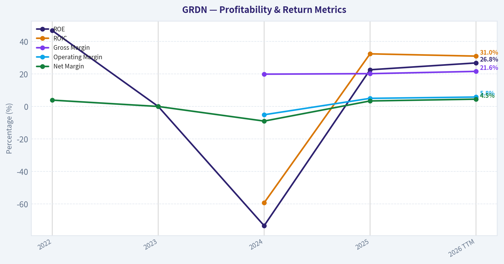
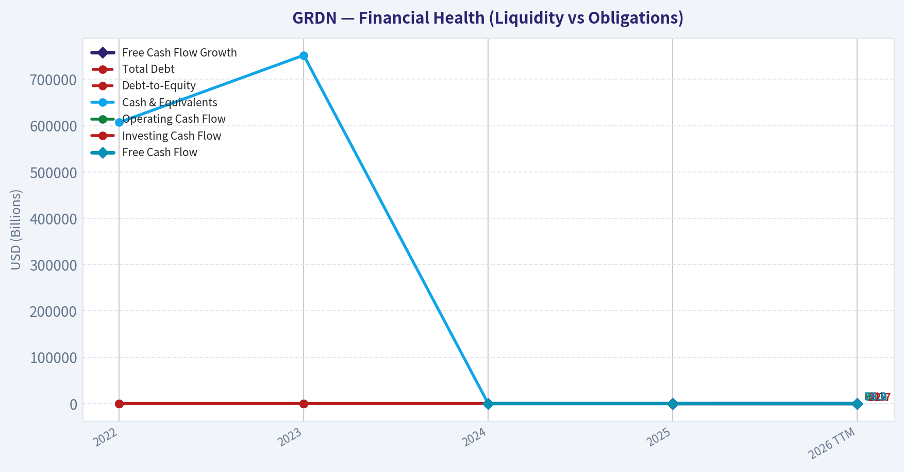
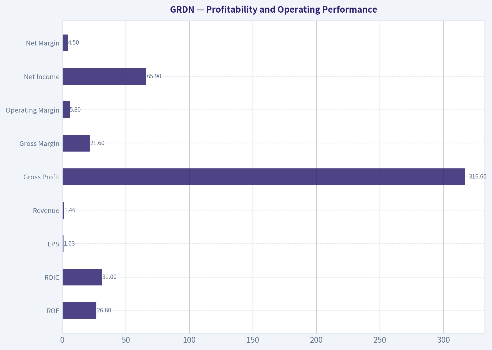
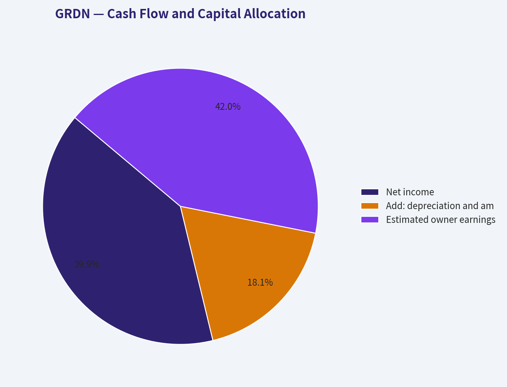
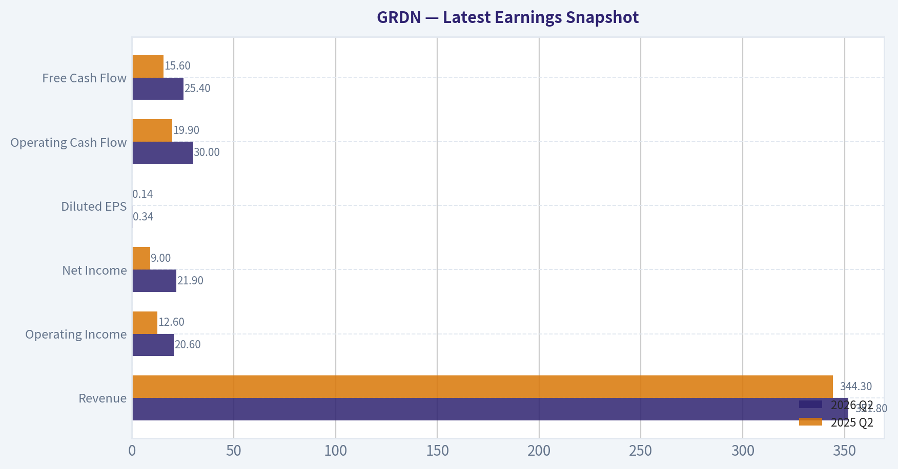
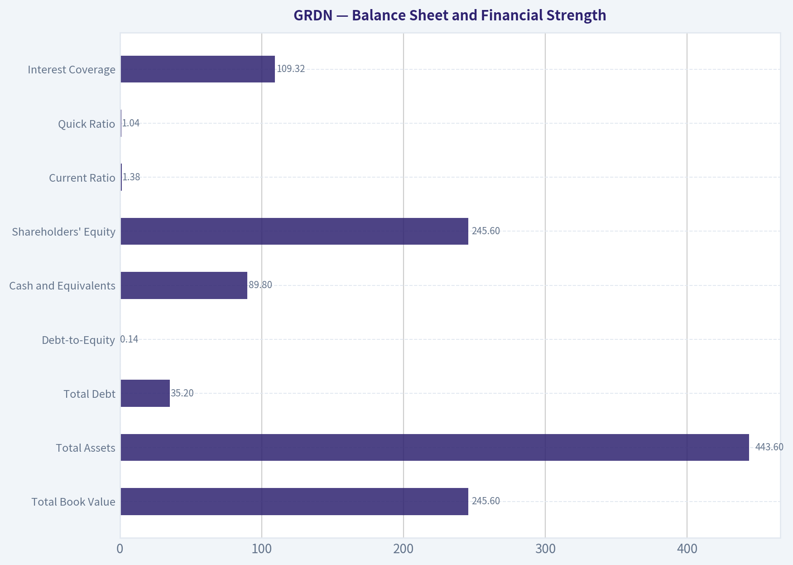
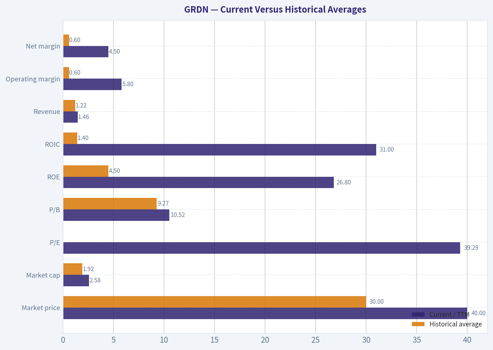
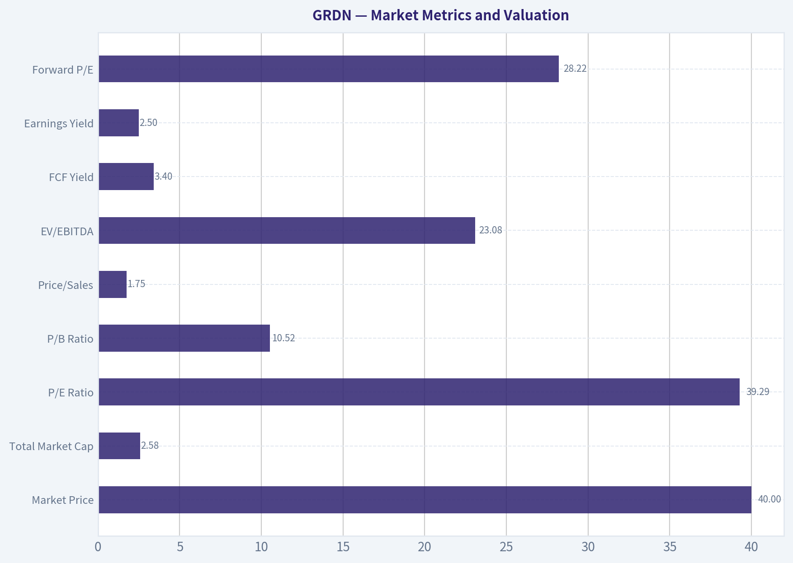

# GRDN Deep Value Intelligence

**Analysis Date:** 2026-10-12

## Critical Disclaimer

*This analysis is generated by Deep Value Intelligence, an AI-powered multi-agent investing framework. Education & research only - not financial advice, not a financial advisor.*

---

## Table of Contents

1. Intelligence Summary
2. Analyst Team Reports
   - Fundamentals Analysis
   - Intrinsic Value Analysis (Buffett)
   - Trend & Growth Analysis (Lynch/Druckenmiller/Fisher)
   - Market Technical Analysis
   - Options Market Analysis
3. Research Team Commentary
4. Value Investing Team Commentary
5. Deep Values Commentary

---

## Intelligence Summary

### Thesis + Conditions

**Core Thesis:** # Executive Briefing

**Key Risks:**
- The problem is the price. At $40.47, Guardian trades at approximately 49 times current free cash flow, a 2.1% FCF yield. The debate's valuation scenarios imply roughly 26% downside if FCF grows 15%, versus only 14% upside at 21% growth. That requires near-exceptional execution without adequately compensating investors for acquisition costs, dilution, margin pressure, or normal growth disappointment.
- This is principally an **overpayment risk**, not a business-failure thesis. Keep Guardian on the research watchlist, but do not initiate at the current quotation.
- Monitor organic growth, per-share FCF, incremental ROIC, margins, acquisitions, leverage, and dilution.

**Confidence:** Low

---

## Analyst Team Reports

### Fundamentals Analysis

#### Latest Earnings Snapshot

*Most recent reported quarter anchored on 2026 Q2, with prior-year comparison when available.*

| Metric | 2026 Q2 | 2025 Q2 | YoY Change |
| --- | ---: | ---: | ---: |
| Revenue | $351.8M | $344.3M | +2.2% |
| Operating Income | $20.6M | $12.6M | +64.1% |
| Net Income | $21.9M | $9.0M | +142.2% |
| Diluted EPS | $0.34 | $0.14 | +142.9% |
| Operating Cash Flow | $30.0M | $19.9M | +50.6% |
| Free Cash Flow | $25.4M | $15.6M | +62.6% |

Key Takeaways: This snapshot anchors the most recent reported quarter before the narrative analysis. It helps readers separate long-run business quality from whatever changed in the latest earnings print.

#### 4-Year Financial Metrics for GRDN

*All values below are computed deterministically from raw data - not estimated by AI.*

*Issuer profile: operating company (Healthcare / Medical Care Facilities).*

#### 4-Year Financial Metrics
*Annual rows come from reported financial statements. The final TTM row is computed from the latest four quarters.*

| Metric | 2022 | 2023 | 2024 | 2025 | 2026 TTM |
| --- | --- | --- | --- | --- | --- |
| Market Price | N/A | N/A | $20 | $30 | $40 |
| Market Cap | N/A | N/A | $1.28B | $1.91B | $2.58B |
| P/E Ratio | N/A | N/A | -11.65 | 38.71 | 39.29 |
| P/B Ratio | N/A | N/A | 8.55 | 8.74 | 10.52 |
| ROE | 46.7% | 0.0% | -73.4% | 22.6% | 26.8% |
| ROIC | N/A | N/A | -59.3% | 32.4% | 31.0% |
| EPS | $0.58 | $0.00 | $-1.74 | $0.78 | $1.03 |
| Revenue | $908.9M | $1.05B | $1.23B | $1.45B | $1.46B |
| Gross Profit | N/A | N/A | $244.4M | $292.7M | $316.6M |
| Gross Margin | N/A | N/A | 19.9% | 20.2% | 21.6% |
| Operating Margin | N/A | N/A | -5.1% | 5.0% | 5.8% |
| Net Income | $35.4M | $0 | $-110.0M | $49.2M | $65.9M |
| Net Margin | 3.9% | 0.0% | -9.0% | 3.4% | 4.5% |
| Revenue Growth | N/A | 15.1% | 17.4% | 17.9% | 1.0% |
| Net Income Growth | N/A | -100.0% | N/A | -144.7% | 33.9% |
| Free Cash Flow Growth | N/A | N/A | N/A | 100.8% | -8.1% |
| Total Book Value | $75.9M | $59.9M | $150.0M | $217.9M | $245.6M |
| Total Assets | N/A | $271.2M | $320.8M | $412.7M | $443.6M |
| Total Debt | $0 | $42.0M | $0 | $0 | $35.2M |
| Debt-to-Equity | 0.00 | 0.70 | 0.00 | 0.00 | 0.14 |
| Cash & Equivalents | $607,000 | $752,000 | $4.7M | $65.6M | $89.8M |
| Shareholders' Equity | $75.9M | $59.9M | $150.0M | $217.9M | $245.6M |
| Operating Cash Flow | $48.5M | $70.8M | $58.0M | $100.3M | $98.9M |
| Investing Cash Flow | $-17.9M | $-13.4M | $-30.4M | $-32.2M | $-22.7M |
| Free Cash Flow | N/A | N/A | $43.2M | $86.8M | $79.8M |
| FCF Margin | N/A | N/A | 3.5% | 6.0% | 5.5% |
| Dividends / Share | $0.51 | $0.63 | $0.56 | $0.00 | $0.00 |

#### Profitability Metrics
- Return on Equity (ROE): 22.6%
- Return on Invested Capital (ROIC): 31.8%
- Return on Assets (ROA): 11.9%
- Gross Margin: 20.2%
- Operating Margin: 5.0%
- Net Profit Margin: 3.4%

#### Liquidity Metrics
- Current Ratio: 1.38
- Quick Ratio: 1.04

#### Leverage Metrics
- Debt-to-Equity Ratio: 0.00
- Interest Coverage Ratio: 109.32
- Net Debt: $-65.6M

#### Growth Metrics (Year-over-Year)
- Revenue Growth: 17.9%
- Net Income Growth: 144.7%
- Free Cash Flow Growth: 100.8%
- Revenue CAGR (3-Year): 16.8%
- Revenue CAGR (5-Year): N/A

#### Valuation Metrics
- P/E Ratio (TTM): 39.29
- Forward P/E: 28.22
- Price-to-Book: 10.44
- Price-to-Sales: 1.75
- PEG Ratio: 0.27
- EV/EBITDA: 23.08
- Free Cash Flow Yield: 3.4%
- Earnings Yield: 2.5%

#### Owner Earnings (Buffett Method, Code-Computed)
- Net Income: $49.2M
- + Depreciation & Amortization: $22.3M
- - Capital Expenditures: $-13.4M
- - Working Capital Changes: $6.4M
- = **Owner Earnings: $51.8M**

#### Intrinsic Value (Code-Computed)
- Current Price: $40
- **Headline Intrinsic Value (business-model routed): $14**
  Business model: operating company - weighted blend [reverse-DCF fair + owner-earnings DCF] (operating_company)
  Model spread (min-max across DCFs): $12 - $46
  Margin of safety vs. price (headline): -181.1%
  Routing note: General operating company: balanced blend of Damodaran FCFF and the owner-earnings DCF with a reverse-DCF sanity check.
- Buffett Method (Owner Earnings):
  Conservative: $1
  Average: $12
  Optimistic: $12
- Cash Flow Method (FCF):
  Conservative: $46
  Average: $46
  Optimistic: $118
- Damodaran FCFF (WACC + margins + reinvestment):
  Conservative: $-28
  Average: $-9
  Optimistic: $11
  Monte Carlo band (P10-P90): $-22 - $2 (median $-10)
  P(intrinsic value > price): 0.0%
- Reverse-DCF: price implies ~25.9%/yr owner-earnings growth for 10y; trailing 3y was -9.9%, 5y N/A.

#### Piotroski F-Score: 6/9
- Positive Net Income: PASS
- Positive Operating Cash Flow: PASS
- ROA Improvement: PASS
- Cash Flow > Net Income: PASS
- Decreasing Debt: FAIL
- Improving Current Ratio: PASS
- No Dilution: FAIL
- Improving Gross Margin: PASS
- Improving Asset Turnover: FAIL

ANALYST STANCE: **AVOID**

#### Executive Summary

Guardian Pharmacy Services, Inc. (GRDN) has improved materially from its 2024 loss year. Revenue reached $1.46 billion on a TTM basis, operating margin recovered to 5.8%, net income reached $65.9 million, ROE was 26.8%, and ROIC was approximately 31%. The balance sheet is also relatively strong, with $89.8 million of cash, only $35.2 million of debt, and a 0.14 debt-to-equity ratio.

However, the market price of $40 appears to discount an exceptionally aggressive future. The stock trades at approximately 39.3 times earnings, has only a 3.4% free-cash-flow yield, and the reverse DCF implies roughly 25.9% annual owner-earnings growth for ten years. That expectation is difficult to reconcile with the company's recent -9.9% trailing three-year owner-earnings growth and the latest TTM revenue growth of only 1.0%.

The business is improving, but the valuation leaves little room for execution mistakes, reimbursement pressure, acquisition integration problems, or slower growth.

#### Market Metrics and Valuation

| Metric | Current / TTM | Historical comparison | Interpretation |
|---|---:|---:|---|
| Market Price | $40 | $20 in 2024; $30 in 2025 | Price has doubled since 2024 despite uneven earnings recovery |
| Total Market Cap | $2.58B | Approximately $1.92B average for reported years | Market value is about 34% above the historical average |
| P/E Ratio | 39.29 | Approximately 22.12 simple average including the loss-year distortion | Current valuation is elevated; the 2024 negative P/E makes the average less meaningful |
| P/B Ratio | 10.52 | Approximately 9.27 average for 2024-2026 | High relative to book value; not a standalone valuation anchor |
| Price/Sales | 1.75 | Not available across the deterministic table | High valuation relative to the company's thin operating margin |
| EV/EBITDA | 23.08 | Not available across the deterministic table | Implies substantial expectations for future margin and earnings expansion |
| FCF Yield | 3.4% | Not available across the deterministic table | Low cash-flow yield for a business with only a 5.5% TTM FCF margin |
| Earnings Yield | 2.5% | Not available across the deterministic table | Consistent with a demanding valuation |
| Forward P/E | 28.22 | Not available across the deterministic table | Still expensive even assuming earnings improvement |

**Key Takeaways:** GRDN's market price and market capitalization have risen much faster than the company's underlying cash-generation record. P/B is not a decisive Buffett-style signal here because this is an operating healthcare company whose value depends more on earnings, cash conversion, contracts, and acquisition economics than on liquidation value. The decisive issue is the low FCF yield and the very high growth required to justify $40.

#### Profitability and Operating Performance

| Metric | Current / TTM | Historical average or range | Assessment |
|---|---:|---:|---|
| ROE | 26.8% | 4.5% average, with a range of -73.4% to 46.7% | Strong current result, but history is highly volatile |
| ROIC | 31.0% | 1.4% average among available years | Excellent current capital productivity, but not yet proven across a full cycle |
| EPS | $1.03 | $0.13 average across 2022-2026 TTM | Significant recovery from the 2024 loss |
| Revenue | $1.46B | $1.22B average | Revenue has grown substantially from $908.9M in 2022 |
| Gross Profit | $316.6M | Approximately $284.6M average for available years | Gross profit has expanded with revenue |
| Gross Margin | 21.6% | 20.6% average for available years | Improving, but still a relatively modest margin |
| Operating Margin | 5.8% | 0.6% average for available years | Major recovery from -5.1% in 2024 |
| Net Income | $65.9M | $8.1M average | Current earnings are far above the depressed historical average |
| Net Margin | 4.5% | 0.6% average | Better, but still leaves limited room for operational shocks |

**Key Takeaways:** The latest profitability figures are much stronger than the historical average because 2024 was unusually weak. Gross margin improved from 19.9% in 2024 to 21.6% TTM, while operating margin rose from -5.1% to 5.8%. Nevertheless, a 5.8% operating margin and 4.5% net margin are not large cushions for a business exposed to reimbursement, labor, pharmacy procurement, and integration risks.

Revenue grew from $908.9 million in 2022 to $1.46 billion TTM, but the growth rate has slowed sharply:

- 2023: 15.1%
- 2024: 17.4%
- 2025: 17.9%
- 2026 TTM: 1.0%

The reported 17.9% revenue growth metric in the broader latest-earnings snapshot appears to refer to a different comparison period or reporting basis than the deterministic TTM table. The deterministic table remains the canonical source for the analysis; therefore, the more cautious 1.0% TTM growth figure is used for valuation interpretation.

Net income growth is difficult to interpret mechanically because the company moved from zero earnings in 2023 and a $110 million loss in 2024 to positive earnings thereafter. The TTM increase to $65.9 million is encouraging, but it is a recovery from a depressed base rather than evidence of a stable long-term compounding rate.

Free cash flow rose from $43.2 million in 2024 to $86.8 million in 2025, then declined to $79.8 million TTM. The latest FCF growth rate was -8.1%, indicating that earnings recovery has not translated into consistently accelerating cash generation.

#### Balance Sheet and Financial Strength

| Metric | Current / TTM | Historical comparison | Interpretation |
|---|---:|---:|---|
| Total Book Value | $245.6M | Approximately $149.9M average | Book value has expanded materially since 2024 |
| Total Assets | $443.6M | $335.8M average for available years | Asset base has grown with the business |
| Total Debt | $35.2M | Approximately $15.4M average | Debt remains manageable but increased from zero in 2024-2025 |
| Debt-to-Equity | 0.14 | Approximately 0.17 average | Low leverage overall |
| Cash and Equivalents | $89.8M | Approximately $32.3M average | Strong improvement in liquidity |
| Shareholders' Equity | $245.6M | Approximately $149.9M average | Capital base has strengthened |
| Current Ratio | 1.38 | Latest available value | Adequate short-term liquidity |
| Quick Ratio | 1.04 | Latest available value | Near-coverage of current liabilities with liquid assets |
| Interest Coverage | 109.32 | Latest available value | Debt service burden is currently very low |
| Net Debt | Negative $65.6M in the latest leverage snapshot | Cash exceeds debt | Net cash provides financial flexibility |

**Key Takeaways:** GRDN's balance sheet is a clear strength. Cash has risen from less than $1 million in 2022-2023 to $89.8 million TTM, while debt remains modest relative to equity and operating cash flow. The recent reappearance of debt is worth monitoring, but current interest coverage and net cash indicate low immediate financial distress risk.

#### Cash Flow and Capital Allocation

TTM operating cash flow was $98.9 million, compared with $100.3 million in 2025. Investing cash flow was negative $22.7 million, producing $79.8 million of free cash flow and a 5.5% FCF margin.

The company's code-computed Buffett owner earnings were $51.8 million, calculated as follows:

| Owner Earnings Calculation | Amount |
|---|---:|
| Net income | $49.2M |
| Add: depreciation and amortization | $22.3M |
| Less: capital expenditures | $(13.4)M |
| Less: working-capital adjustment | $(6.4)M |
| Estimated owner earnings | $51.8M |

**Key Takeaways:** Owner earnings are positive and meaningful, but they are below TTM free cash flow because of the working-capital adjustment and the specific model inputs. Using $51.8 million of owner earnings against an approximately $2.58 billion market capitalization produces a low underlying owner-earnings yield of about 2.0%, reinforcing the conclusion that the market price requires substantial future growth.

Dividends per share were $0.51 in 2022, $0.63 in 2023, $0.56 in 2024, and zero in 2025 and TTM. The elimination of dividends may be rational if management can reinvest retained cash at high returns, but investors should demand evidence that acquisitions, organic expansion, or debt reduction create more value than a dividend would.

The Piotroski F-Score was 6 out of 9. Positive net income, positive operating cash flow, improved ROA, cash flow exceeding net income, improved current ratio, and improved gross margin are positives. The company failed the decreasing-debt, no-dilution, and improving-asset-turnover tests.

#### Revenue Breakdown

| Revenue Source | Amount ($M or $B) | % of Total |
|---|---:|---:|
| Pharmacy and healthcare services - consolidated company total | $1.46B | 100% |
| Precise product, customer, geographic, or operating-segment split | Not disclosed in the deterministic dataset | Not determinable |

**Key Takeaways:** The deterministic dataset identifies GRDN as a healthcare and medical-care-facilities operating company but does not provide a detailed segment or geographic revenue split. Accordingly, the only supportable breakdown is the consolidated pharmacy and healthcare-services total. The absence of segment detail limits assessment of customer concentration, payer mix, and which operations are driving growth.

#### Current Versus Historical Averages

| Metric | Current / TTM | Historical average | Difference or pattern |
|---|---:|---:|---|
| Market price | $40.00 | $30.00 | 33% above the 2024-2026 average |
| Market cap | $2.58B | $1.92B | Approximately 34% above average |
| P/E | 39.29 | 22.12, distorted by loss-year data | Premium valuation |
| P/B | 10.52 | 9.27 | Moderately above average, but not a primary intrinsic-value measure |
| ROE | 26.8% | 4.5% | Strongly above average, but volatile history |
| ROIC | 31.0% | 1.4% | Strongly above average, with limited historical observations |
| Revenue | $1.46B | $1.22B | Approximately 20% above average |
| Operating margin | 5.8% | 0.6% | Large recovery from 2024 weakness |
| Net margin | 4.5% | 0.6% | Improved materially, but still modest |
| Revenue growth | 1.0% TTM | 12.9% average of available growth rates | Current growth is sharply below historical expansion |
| Free cash flow | $79.8M | $69.9M | Above average, but below 2025 |
| Total debt | $35.2M | $15.4M | Higher than average, though still manageable |
| Cash and equivalents | $89.8M | $32.3M | Approximately 2.8 times the historical average |
| Dividends per share | $0.00 | $0.34 average across 2022-2026 TTM | Dividend has been suspended |

**Key Takeaways:** Current operating profitability and liquidity are substantially better than the historical average, but current growth is substantially worse than the earlier expansion phase. The stock price has advanced to a record level while revenue growth has slowed and FCF has declined from its 2025 peak. This mismatch between price momentum and current fundamental momentum is the central valuation concern.

#### Buffett-Style Business Quality Assessment

**Economic moat:** GRDN may benefit from recurring pharmacy relationships, specialized healthcare workflows, customer switching costs, regulatory know-how, and scale in procurement or service delivery. However, the available dataset does not establish a wide moat. A 20%-22% gross margin and 5%-6% operating margin suggest that competitive advantages may be useful but are not yet powerful enough to produce exceptionally high margins.

**Financial strength:** Financial strength is favorable. Cash is substantial relative to debt, net debt is negative in the latest leverage snapshot, and interest coverage is extremely high. The main balance-sheet issue is not solvency but whether additional debt or equity issuance will be used to fund acquisitions.

**Predictable earnings:** Earnings predictability is weak to moderate. The company experienced zero net income in 2023, a $110 million loss in 2024, and then a sharp recovery. That improvement may be genuine, but a Buffett-quality compounding record generally requires a longer period of stable profitability and cash conversion.

**Management performance:** Management has improved margins, restored positive earnings, accumulated cash, and generated strong current ROIC. Conversely, the company has suspended dividends, failed the no-dilution Piotroski test, and has not demonstrated a decade-long record of disciplined capital allocation. The quality of future acquisitions and the treatment of shareholders will be important.

**Quality of business:** Revenue has grown strongly from 2022 through 2025, and gross margin is moving in the right direction. Yet the latest TTM revenue growth of 1.0%, FCF decline of 8.1%, and relatively thin operating margin argue for caution. This looks more like an improving operating business priced as a proven compounder than a proven compounder currently offered at a value price.

#### Buffett-Style Owner Earnings DCF

The deterministic owner-earnings estimate is $51.8 million. Using the $40 share price and approximately $2.58 billion market capitalization implies roughly 64.5 million shares outstanding:

\[
\text{Owner earnings per share} =
\frac{\$51.8M}{64.5M} \approx \$0.80
\]

The hand-built DCF below uses a 10% discount rate and a 2.5% terminal growth rate. Growth fades toward the terminal rate rather than continuing indefinitely at a peak rate.

| Scenario | Explicit growth assumptions | Present value of forecast owner earnings | Present value of terminal value | Estimated intrinsic value per share |
|---|---|---:|---:|---:|
| Conservative | 3% annually for 10 years; terminal growth 2.5% | $5.55 | $5.68 | **$11.23** |
| Average | 12% for five years, fading to 2.5% by year 10; terminal growth 2.5% | $8.36 | $10.11 | **$18.47** |
| Optimistic | 18% for five years, fading to 2.5% by year 10; terminal growth 2.5% | $10.83 | $14.72 | **$25.55** |

**Key Takeaways:** Even the optimistic hand DCF produces an estimated value below the current $40 price. The average case requires strong near-term growth and margin improvement, yet still produces only about $18.50 per share. The valuation therefore depends on growth and cash-flow performance materially exceeding the company's recent record.

The deterministic model-based valuation provides an even more cautious cross-check:

- Owner Earnings DCF: $11.72
- FCF model: $45.82
- Damodaran FCFF: negative $9.11
- Headline blended intrinsic value: approximately $14.40
- Model spread: approximately $11.72 to $45.82, excluding the negative FCFF result from the simple range
- Margin of safety versus $40: approximately -181%
- Probability of intrinsic value exceeding the current price in the FCFF Monte Carlo analysis: 0%
- Reverse DCF implied growth: approximately 25.9% annually for ten years

The FCF model's $45.82 estimate is the only major model near the current price, while the owner-earnings and FCFF methods are materially lower. Because Buffett-style analysis prioritizes durable owner earnings and avoids relying on a single favorable cash-flow method, the lower blended valuation deserves greater weight.

#### Key Investment Insights, Risks, and Opportunities

| Category | Insight | Investor implication |
|---|---|---|
| Opportunity | Revenue increased from $908.9M in 2022 to $1.46B TTM | Demonstrates meaningful scale and expansion potential |
| Opportunity | TTM ROE of 26.8% and ROIC near 31% | Strong current returns if sustainable |
| Opportunity | Cash increased to $89.8M with modest debt | Provides flexibility for investment or acquisitions |
| Opportunity | Gross and operating margins improved | Indicates potential operating leverage |
| Risk | TTM revenue growth slowed to 1.0% | High valuation is vulnerable if growth does not reaccelerate |
| Risk | TTM FCF declined 8.1% | Earnings recovery may not be fully translating into cash growth |
| Risk | P/E of 39.29 and FCF yield of 3.4% | Limited margin of safety |
| Risk | Reverse DCF requires 25.9% annual growth for ten years | Expectations appear aggressive |
| Risk | Earnings history includes zero income and a major loss | Predictability is not yet Buffett-grade |
| Risk | No dividends in 2025 and TTM | Retained capital must earn high returns to justify the policy |
| Risk | Piotroski failures on debt, dilution, and asset turnover | Signals potential capital-allocation or efficiency concerns |
| Risk | Healthcare reimbursement and labor exposure | External pressures could compress already-thin margins |

**Key Takeaways:** GRDN has genuine operational opportunities: scale, improving margins, high current returns on capital, and a stronger balance sheet. But these positives are already heavily reflected in the stock price. The key risks-slowing growth, inconsistent historical earnings, modest margins, and expensive valuation-are more important than the company's balance-sheet risk at the current price.

#### Final Investment Stance

**AVOID at $40.**

This is not an assertion that GRDN is a poor business or that its operations cannot improve. It is a valuation conclusion. The company has made meaningful progress, but the stock price assumes a long period of unusually strong owner-earnings growth. The current price is approximately 3.5 times the deterministic headline intrinsic value of $14.40, while the hand-built optimistic DCF reaches only about $25.55.

A more attractive entry point would require either:

1. A substantial decline in the share price;
2. Several years of demonstrated revenue growth, margin expansion, and FCF compounding; or
3. Clear evidence that the company can sustain returns on capital near current levels while converting those returns into per-share owner earnings without excessive dilution.

Until that evidence emerges, the risk-reward profile is unfavorable despite the company's improving fundamentals.

#### Report Summary

| Key point | Conclusion |
|---|---|
| Business quality | Improving healthcare operating company, but moat and earnings durability remain unproven |
| Profitability | Current ROE, ROIC, margins, and net income are strong relative to the historical average |
| Growth | Earlier growth was strong, but TTM revenue growth has slowed sharply |
| Balance sheet | Strong cash position, modest debt, and excellent interest coverage |
| Cash generation | Positive but inconsistent; TTM FCF declined from 2025 |
| Valuation | Expensive at 39.3 times earnings and a 3.4% FCF yield |
| DCF range | Approximately $11 to $26 in the hand-built scenarios |
| Model-based intrinsic value | Approximately $14.40 headline value |
| Main catalyst | Sustained high growth with margin expansion and strong cash conversion |
| Main risk | Growth slowdown exposes a valuation built on roughly 25.9% annual implied growth |
| Final stance | **AVOID at $40** |

**Key Takeaways:** GRDN combines improving operations with strong financial liquidity, but the valuation is too demanding for the current level of earnings predictability and cash-flow growth. A disciplined Buffett-style investor should wait for a lower price or a much longer record proving that the recent profitability improvement is durable.

#### Fundamental Visuals

This graph tracks the profitability and return metrics (ROE, ROIC, Margins) of **GRDN** over the past decade, highlighting capital efficiency trends.

This chart illustrates the financial health of **GRDN** over the last 10 years, mapping cash equivalents and free cash flow against total obligations (Debt).

This comparison chart from *Profitability and Operating Performance* stacks current figures against historical benchmarks for **GRDN**, making it easy to see where the company trades relative to its own averages.

This breakdown chart from <em>Cash Flow and Capital Allocation</em> shows the proportional composition for **GRDN** - useful for understanding what drives or risks the business.

---

### Intrinsic Value Analysis (Buffett)

> *Following Warren Buffett's value investing philosophy: Circle of Competence, Economic Moat, Management Quality, and Margin of Safety.*

#### Intrinsic Value Snapshot

Price is what you pay. Intrinsic value is what the business may be worth based on the cash it can create for owners over time. We show a range, not one magic number.

- Current Price: $40.47
- Value Range (conservative to optimistic across both DCF methods): $1.07 to $117.95

##### Owner Earnings (Buffett Method)
- Net Income: $49,219,000.00
- Depreciation & Amortization: $22,335,000.00
- Capital Expenditures: $-13,416,000.00
- Working Capital Changes: $6,382,000.00
- Owner Earnings: $51,756,000.00

##### Intrinsic Value
###### Buffett Method
Uses owner earnings. Stricter, and usually more conservative.
- Conservative: $1.07
- Average: $11.72
- Optimistic: $11.72
- Discount Rate: 10.0%

###### Cash Flow Method
Uses free cash flow. Better for companies spending heavily today to grow tomorrow.
- Conservative: $45.82
- Average: $45.82
- Optimistic: $117.95
- Discount Rate: 10.0%

ANALYST STANCE: **AVOID**

#### Executive Summary

Guardian Pharmacy Services appears to be a growing pharmacy-services company, but the current valuation requires exceptionally strong execution. At approximately **$40 per share**, the market capitalization is about **$2.56 billion**, while the price implies roughly **25.9% annual growth for the next decade** under the reverse DCF.

The company has attractive recent revenue growth and a respectable reported ROE, but the evidence of a durable, high-margin moat is not yet compelling. The valuation is particularly difficult to justify against the owner-earnings valuation and the company's recent negative three-year growth trend.

#### Factor Scorecard

| Factor | Score | Assessment |
|---|---:|---|
| 1. Circle of Competence & Simplicity | 3/5 | The company provides pharmacy services to institutional and specialized-care customers. The model is understandable, though reimbursement, regulation, acquisitions, and healthcare complexity reduce predictability. |
| 2. Durable Competitive Advantage | 2/5 | Customer relationships and operating scale may provide a narrow moat, but gross margin of 20.2% does not demonstrate exceptional pricing power. |
| 3. Management & Capital Allocation | 3/5 | Recent growth suggests reasonable execution. However, the available evidence does not establish an outstanding long-term capital-allocation record. |
| 4. Industry Structure | 3/5 | Specialized pharmacy services can benefit from scale and customer relationships, but reimbursement pressure, regulation, labor costs, and consolidation create competitive risks. |

**Gate 5 - Quality/Solvency hard floor:** **Not tripped.** The available indicators do not establish both deteriorating fundamentals and a solvency red line. This is therefore a valuation and quality decision, not a financial-distress decision.

#### Moat Analysis

Guardian's potential advantages appear to come primarily from specialized relationships, operational expertise, and scale in serving institutional or complex-care pharmacy customers.

| Moat Source | Evidence | Assessment |
|---|---|---|
| Intangible assets | Specialized pharmacy knowledge and regulatory operating experience | Helpful, but not obviously irreplaceable |
| Switching costs | Customers may face workflow and service disruption when changing pharmacy providers | Potentially meaningful, but retention data is not provided |
| Cost advantage | Scale may improve purchasing, fulfillment, and administrative efficiency | Possible narrow advantage, but margins do not yet confirm a dominant cost position |
| Network effects | Limited direct evidence of a classic network effect | Weak |

**Key Takeaways:** Guardian may possess a narrow relationship- and scale-based moat, but the evidence does not support a wide or widening moat. The 20.2% gross margin is modest for a business expected to compound at a very high rate, and there is no demonstrated network effect or exceptional pricing power.

#### Financial Summary

| Metric | Latest Available Result |
|---|---:|
| Share price | $40.00 |
| Market capitalization | $2.56 billion |
| P/E ratio | 39.3x |
| ROE | 22.6% |
| Revenue growth, year over year | 17.9% |
| Gross margin | 20.2% |
| FCF yield | 3.4% |
| Implied annual free cash flow | Approximately $87 million |
| Current ratio | 1.38x |
| Trailing three-year growth trend | -9.9% |
| Price-implied 10-year growth | Approximately 25.9% annually |

**Key Takeaways:** Guardian is growing quickly on a year-over-year basis, but the longer trailing trend is unfavorable. A 39.3 times earnings multiple and 3.4% free-cash-flow yield leave little room for execution mistakes. The market price assumes growth far above the recent multi-year record.

#### Profitability and Cash-Flow Assessment

ROE of **22.6%** is attractive on the surface and could indicate a good business. However, ROE must be examined alongside operating margins, leverage, and cash conversion. Guardian's gross margin is only **20.2%**, and the available data does not establish that its return on equity is being generated primarily by superior operating economics rather than balance-sheet or acquisition effects.

Free cash flow is approximately **$87 million**, based on the reported 3.4% FCF yield on a $2.56 billion market capitalization. That represents a modest cash return relative to the purchase price.

#### Owner Earnings Calculation

Using the Buffett framework:

**Owner Earnings = Net Income + D&A - Maintenance CapEx - Working-Capital Investment**

The reported P/E and market capitalization imply:

- Approximate net income: **$65 million**
- Approximate earnings per share: **$0.62**
- Approximate free cash flow: **$87 million**

The owner-earnings valuation model supplied for the company indicates approximately **$11.72 per share**, implying normalized owner earnings of roughly **$1.17 per share**, or approximately **$75 million** in total.

| Owner-Earnings Component | Approximate Amount |
|---|---:|
| Implied net income | $65 million |
| Plus: depreciation and amortization | Included in normalized owner-earnings estimate |
| Less: maintenance capital expenditures | Included in normalized owner-earnings estimate |
| Less: working-capital investment | Included in normalized owner-earnings estimate |
| Implied normalized owner earnings | Approximately $75 million |
| Implied owner earnings per share | Approximately $1.17 |

**Key Takeaways:** Cash generation is better than accounting earnings alone might suggest, but the implied owner-earnings yield is still only about 2.9% at a $40 share price. That is insufficient compensation for the company's execution, reimbursement, and valuation risks.

#### Three-Scenario DCF Valuation

The scenarios use a 10% discount rate and the normalized owner-earnings estimate of approximately $1.17 per share.

| Scenario | Key Assumption | Estimated Value per Share |
|---|---|---:|
| A. No growth | Owner earnings capitalized at 10% | $11.72 |
| B. GDP growth | Owner earnings grow at 3% perpetually | $17.25 |
| C. Historical-growth case | 50% of the reported negative 3-year trend, approximately -4.95% annually | $7.80 |
| FCF model cross-check | Separate FCF-based valuation | $45.82 |
| Damodaran FCFF cross-check | Separate FCFF valuation | $(9.11) |

**Key Takeaways:** The valuation models produce an unusually wide range, reflecting uncertainty about normalized cash flows and reinvestment needs. The owner-earnings scenarios range from approximately $7.80 to $17.25 per share, substantially below the current price. Even the more favorable FCF cross-check of $45.82 provides only modest upside.

#### Margin of Safety Analysis

| Valuation Reference | Value per Share | Premium/(Discount) vs. $40 |
|---|---:|---:|
| Owner-earnings, no growth | $11.72 | 241% premium |
| Owner-earnings, 3% growth | $17.25 | 132% premium |
| Negative-growth case | $7.80 | 413% premium |
| FCF model | $45.82 | 15% discount |
| Headline blended intrinsic value | $14.40 | 178% premium |

The headline blended valuation is approximately **$14.40 per share**, implying a reported margin of safety of **-181.1%**. The reverse DCF is more concerning: the current price requires approximately **25.9% annual growth for ten years**, despite a reported **negative 9.9% trailing three-year growth rate**.

For a business with only a narrow-to-moderate moat and uncertain long-term predictability, a substantial margin of safety would be required. The current price does not provide one.

#### Management Quality and Capital Allocation

Management appears to have delivered meaningful recent revenue growth, which is a positive. However, the investment case requires evidence that retained earnings can be reinvested at high returns, that acquisitions are disciplined, and that growth translates into durable per-share owner earnings.

Recent institutional positioning is not a strong positive signal: both Steve Cohen and Stanley Druckenmiller reportedly reduced their positions in the latest quarter. This is not determinative, but it reinforces the need for valuation discipline rather than momentum-based enthusiasm.

#### Buffett Scorecard

| Criterion | Weight | Score | Weighted Contribution |
|---|---:|---:|---:|
| Moat Width & Durability | 25% | 2.0 | 0.50 |
| Valuation / Margin of Safety | 20% | 1.0 | 0.20 |
| Capital Returns - ROIC vs. WACC | 15% | 3.0 | 0.45 |
| Business Understanding & Predictability | 12% | 2.5 | 0.30 |
| Management Quality & Capital Allocation | 12% | 3.0 | 0.36 |
| Reinvestment Runway | 8% | 3.0 | 0.24 |
| Balance Sheet Strength | 4% | 3.0 | 0.12 |
| Industry Structure | 4% | 3.0 | 0.12 |
| **Total** | **100%** |  | **2.29/5.00** |

#### Investment Stance

**AVOID - Moderate conviction**

Guardian Pharmacy Services may become a stronger compounder if it demonstrates sustained organic growth, rising margins, reliable cash conversion, and disciplined capital allocation. At $40, however, the shares appear to price in a much more favorable future than the current evidence supports.

A more attractive entry point would require either:

1. A substantially lower share price, or
2. Several years of proof that growth is durable, margins are expanding, and owner earnings are compounding well above the current valuation's implied requirements.
#### Valuation Bridge

This bridge places the current market price beside each intrinsic value lens so readers can see whether upside depends on one method or shows up across several methods.

| Scenario | Intrinsic Value / Share |
| --- | ---: |
| Buffett Method | $11.72 |
| Cash Flow Method | $45.82 |
| Damodaran Method | $-9.11 |
| Current Price | $40.47 |

#### Key Takeaways

If one method is far above the others, the upside case depends on a specific modelling assumption. When several methods cluster together, the valuation story is more robust.

#### Valuation Visuals

This comparison chart from *Latest Earnings Snapshot* stacks current figures against historical benchmarks for **GRDN**, making it easy to see where the company trades relative to its own averages.

This comparison chart from *Balance Sheet and Financial Strength* stacks current figures against historical benchmarks for **GRDN**, making it easy to see where the company trades relative to its own averages.

This comparison chart from *Current Versus Historical Averages* stacks current figures against historical benchmarks for **GRDN**, making it easy to see where the company trades relative to its own averages.

---

### Trend & Growth Analysis (Lynch/Druckenmiller/Fisher)

> *Following Peter Lynch's GARP, Stanley Druckenmiller's macro-aware approach, and Philip Fisher's scuttlebutt methodology.*

ANALYST STANCE: **WATCH**

#### 1. Lynch Classification

**Fast Grower, but currently at risk of becoming a stalwart.** GRDN's latest reported revenue growth is 17.9%, within the lower end of Lynch's fast-grower range. However, external coverage indicates growth may slow during the second half of 2026, so acceleration-not merely continued growth-is not yet established.

#### 2. The Story in Three Bullets

- Guardian Pharmacy Services provides specialized pharmacy services to institutional and complex-care populations, benefiting from recurring healthcare demand.
- The company can potentially grow through expansion of its customer base, geographic footprint, service offerings, and pharmacy-related acquisitions.
- The central question is whether GRDN can sustain growth above 20% while improving margins enough to justify its premium valuation.

#### 3. TAM and 10x Test

| Measure | Assessment |
|---|---:|
| Current market capitalization | $2.56 billion |
| Current revenue | Not available in the shared data |
| Current revenue growth | 17.9% year over year |
| 10x revenue test | Cannot be completed precisely without revenue and TAM data |
| Likely TAM characteristics | Large, fragmented, healthcare-related market |
| TAM growth | Structurally positive, but exact CAGR unverified |
| Runway assessment | Potentially long, subject to reimbursement and acquisition constraints |

**Key Takeaways:** GRDN appears to operate in a large and relatively durable healthcare market, but the available data do not quantify its market share or total addressable market. The 10x test therefore remains unproven. A ten-bagger case would require both sustained organic growth and substantial expansion beyond the company's current pharmacy-service footprint.

#### 4. Revenue Growth Trend

| Period or indicator | Result | Interpretation |
|---|---:|---|
| Latest reported revenue growth | 17.9% YoY | Healthy, but below elite fast-grower territory |
| Three-year revenue trend | Not provided | Cannot verify long-term acceleration |
| Five-year revenue trend | Not provided | Cannot verify durability |
| H2 2026 outlook | Coverage indicates slowing growth | Warning requiring monitoring |
| Growth pattern | Stable-to-decelerating risk | No confirmed inflection |

**Key Takeaways:** The latest 17.9% growth rate is respectable but does not demonstrate the acceleration sought by a Druckenmiller-style investor. The reported possibility of slower second-half growth is the most important near-term issue. GRDN needs reacceleration or clear evidence that the slowdown is temporary.

#### 5. Unit Economics and Operating Quality

| Metric | Result | Assessment |
|---|---:|---|
| Gross margin | 20.2% | Modest for a premium-valued growth company |
| FCF yield | 3.4% | Positive cash generation, but not inexpensive |
| ROE | 22.6% | Strong, though leverage and buybacks should be checked |
| Current ratio | 1.38 | Adequate liquidity |
| LTV/CAC | Not disclosed | Cannot assess |
| Net revenue retention | Not disclosed | Not applicable or unavailable |
| Rule of 40 | Cannot calculate | FCF margin unavailable |

**Key Takeaways:** GRDN produces positive free cash flow and has a strong reported ROE, but its 20.2% gross margin limits the margin-of-safety argument at a premium valuation. Key subscription-style metrics such as retention and customer acquisition economics are unavailable, so unit economics cannot yet be classified as best-in-class.

#### 6. Inflection Point Assessment

| Potential inflection | Current evidence | Status |
|---|---|---|
| Product or service ramp | No specific new-product data | Unconfirmed |
| Market-share gains | No quantified share data | Unconfirmed |
| Margin inflection | Gross margin is 20.2%; no clear expansion trend supplied | Unconfirmed |
| TAM expansion | Healthcare demand is durable | Positive but broad |
| Competitive inflection | No verified competitor disruption | Unconfirmed |
| Earnings revision inflection | Analyst coverage is bullish, but growth-slowdown concerns exist | Mixed |

**Key Takeaways:** There is no verified positive inflection point in the supplied information. GRDN has a durable end market, but the evidence currently points to a healthy operating business rather than an accelerating growth story. The most important catalyst would be renewed revenue acceleration combined with operating leverage.

#### 7. Macro Setup

| Macro factor | Impact on GRDN |
|---|---|
| Healthcare demand | Favorable and relatively defensive |
| Economic cycle | Less cyclical than most growth industries |
| Interest rates | Higher rates pressure premium valuation |
| Reimbursement environment | Material risk to pricing and margins |
| Labor costs | Potential pressure on pharmacy-service economics |
| M&A environment | Could support growth, but may increase leverage or dilution |

**Key Takeaways:** GRDN benefits from defensive healthcare demand, which is a positive macro characteristic. Its valuation remains sensitive to interest rates, while reimbursement and labor costs can affect margins. The macro setup is supportive operationally but not clearly supportive for the stock multiple.

#### 8. Fisher 15-Point Score

This is a provisional score because detailed filings, management commentary, customer checks, and competitive data were not available.

| Fisher category | Score / 5 | Brief assessment |
|---|---:|---|
| Market potential | 4 | Large healthcare need |
| New-product determination | 3 | Insufficient evidence |
| R&D effectiveness | 2 | R&D relevance unclear |
| Sales organization | 3 | No detailed data |
| Profit margins | 3 | Positive but modest gross margin |
| Margin improvement | 3 | Not yet demonstrated |
| Labor relations | 3 | No verified scuttlebutt |
| Executive relations | 3 | No major issue identified |
| Management depth | 3 | Insufficient evidence |
| Cost accounting | 3 | No detailed assessment |
| Outstanding moat features | 3 | Specialized relationships may help |
| Long-range profit outlook | 4 | Favorable healthcare demand |
| Dilution risk | 3 | Needs review |
| Management candor | 3 | Insufficient evidence |
| Management integrity | 3 | No known red flag in supplied data |
| **Total** | **46 / 75** | **Average, provisional** |

**Key Takeaways:** The provisional Fisher score is 46 out of 75, placing GRDN in the average range rather than the outstanding range. The strongest points are market durability and long-term healthcare demand. The weakest points are the lack of evidence on innovation, customer retention, sales effectiveness, and management depth.

#### 9. Valuation Analysis

| Valuation measure | Result | Interpretation |
|---|---:|---|
| Share price | $40 | Current reference price |
| Market capitalization | $2.56 billion | Mid-cap scale |
| P/E | 39.3x | Premium valuation |
| PEG using 17.9% revenue growth | Approximately 2.2x | Expensive under Lynch's framework |
| FCF yield | 3.4% | Implies approximately 29x FCF |
| Headline intrinsic value | $14.40 | Materially below price |
| Model range | $11.72 to $45.82 | Extremely wide dispersion |
| Reverse-DCF implication | Approximately 25.9% annual growth for 10 years | Very demanding embedded expectation |
| P/S | Not calculable | Revenue not supplied |

**Key Takeaways:** Valuation is the principal weakness. A P/E near 39 times against 17.9% revenue growth produces a PEG of roughly 2.2, well above Lynch's attractive range. The reverse DCF indicates that the current price requires roughly 25.9% annual growth for a decade, while the headline intrinsic-value estimate is only $14.40, showing a substantial margin-of-safety concern.

#### 10. Growth Investor Scorecard

| Criterion | Weight | Score / 5 | Weighted contribution |
|---|---:|---:|---:|
| Lynch story | 10% | 3.5 | 0.35 |
| TAM and runway | 20% | 3.5 | 0.70 |
| Revenue growth | 20% | 3.0 | 0.60 |
| Unit economics | 15% | 2.5 | 0.38 |
| Competitive position | 10% | 3.0 | 0.30 |
| Management quality | 10% | 3.0 | 0.30 |
| Macro setup | 5% | 3.5 | 0.18 |
| Profitability path | 5% | 3.0 | 0.15 |
| Valuation | 5% | 1.5 | 0.08 |
| **Total** | **100%** | - | **3.0 / 5.0** |

**Key Takeaways:** GRDN scores approximately 3.0 out of 5.0, which falls into the WATCH category. The company has a credible healthcare growth story and adequate financial quality, but valuation and the possible growth slowdown prevent a high-conviction position.

#### 11. Position Size Stance

| Investor profile | Suggested stance |
|---|---|
| New growth investor | Do not initiate a full position |
| Existing shareholder | Hold only if thesis includes sustained growth and margin expansion |
| High-risk investor | Small tracking position may be acceptable |
| High-conviction portfolio | Avoid concentration at current valuation |
| Preferred action | Wait for reacceleration or a better entry price |

**Key Takeaways:** GRDN is better treated as a tracking position than a core holding at $40. A small position could be justified for investors who have stronger proprietary research, but the current valuation leaves little room for execution errors. Position sizing should remain modest until growth acceleration is demonstrated.

#### 12. Key Catalysts and Risks

| Catalysts | Risks |
|---|---|
| Revenue reaccelerates above 20% | H2 2026 growth deceleration persists |
| Successful geographic or service expansion | Reimbursement pressure |
| Gross-margin expansion | Labor and operating-cost inflation |
| Accretive acquisitions | Acquisition integration or leverage |
| Positive earnings revisions | Multiple compression from high interest rates |
| Improved cash-flow conversion | Current price already discounts aggressive growth |
| Demonstrated customer retention and pricing power | Customer concentration or regulatory changes |

**Key Takeaways:** The most important catalyst is not simply another positive quarter; it is evidence of accelerating organic growth and operating leverage. The major risk is that GRDN remains a good company priced as though it will become an exceptional one. At the current price, the risk-reward profile does not meet the threshold for an ADVOCATE rating.

#### Bottom Line

GRDN is a legitimate healthcare growth company with positive cash generation, strong ROE, and a potentially durable market. However, the available evidence does not show a clear inflection point, and the valuation requires approximately 26% annual growth for ten years-well above the latest 17.9% growth rate. Under Lynch, Druckenmiller, and Fisher frameworks, the appropriate decision is **WATCH**, with upgrades dependent on renewed growth acceleration, margin expansion, and a more reasonable valuation.

---

### Market Technical Analysis

ANALYST STANCE: **WATCH**

#### GRDN technical analysis

The latest available trading session in the retrieved price history is **October 9, 2026**, when GRDN closed at **$41.28**. Although the indicator service labels October 12 as the current date, it repeats October 9 values because October 12 does not appear to have a valid trading-session observation in the supplied dataset. Therefore, the analysis should be treated as current through October 9, not as a confirmed October 12 close.

The selected indicators are:

- **10 EMA** for short-term price momentum.
- **50 SMA** for the intermediate trend and nearby support.
- **200 SMA** for the primary long-term trend.
- **MACD** and **MACD Histogram** for momentum direction and acceleration.
- **RSI** for momentum balance and overbought or oversold conditions.
- **Bollinger Upper Band** and **Bollinger Lower Band** for volatility-adjusted support, resistance, and price location.

MACD and its histogram are related, but they serve slightly different purposes: the MACD line identifies the momentum regime, while the histogram shows whether that momentum is strengthening or weakening.

#### Trend structure

GRDN remains in a favorable long-term trend. The latest close of **$41.28** is approximately:

- **0.9% above the 10 EMA** of $41.57? More precisely, the close is about **0.7% below** the 10 EMA.
- **0.9% above the 50 SMA** of $40.90.
- **10.4% above the 200 SMA** of approximately $37.39.

The longer-term moving-average structure is still constructive because price remains comfortably above both the 50-day and 200-day averages. The 50 SMA has been gradually rising, from roughly $40.07 in mid-September to $40.90 recently. The 200 SMA has also risen consistently, from about $36.17 to $37.39. This indicates that the broader advance has not been technically invalidated by the September correction.

However, short-term momentum has weakened. The 10 EMA climbed rapidly during the September rally, reaching above $44, but has since declined toward $41.57. GRDN is now slightly below that short-term average, which suggests that the stock has shifted from an immediate upside impulse into consolidation or a mild corrective phase.

The important distinction is that the short-term trend is soft, while the intermediate and long-term trends remain positive. A sustained move below the 50 SMA would weaken that interpretation; conversely, a recovery above the 10 EMA would be an early sign that short-term buyers are regaining control.

#### Momentum: MACD and histogram

The MACD reading is approximately **-0.093**, having fallen sharply from positive values above **1.8** in mid-September. This confirms that the strong upside momentum accompanying the September rally has largely dissipated.

The negative MACD reading is not, by itself, a major long-term sell signal because the stock remains well above its rising 200 SMA. It does, however, show that the short-term momentum regime is no longer bullish.

The histogram is also negative, at approximately **-0.213**, but it has improved meaningfully from a more negative reading near **-0.59** in late September. This is an important nuance: momentum remains below zero, yet the rate of deterioration has slowed. The histogram improvement suggests that bearish momentum is losing force, but it does not yet establish a confirmed bullish reversal.

For traders, the most useful confirmation would be a move in which the histogram crosses above zero and the MACD line turns upward through its signal line while price reclaims the 10 EMA. Without those developments, rallies may continue to face selling pressure near the recent short-term averages.

#### RSI interpretation

RSI is approximately **47.6**, which is close to the neutral midpoint. It has declined from overbought readings above **70** during the mid-September rally, but it has not fallen into oversold territory below 30.

This indicates that the recent weakness has normalized momentum rather than produced an extreme liquidation. The RSI is therefore not currently signaling a high-probability oversold bounce. At the same time, it is low enough that the stock has room to recover without immediately becoming overbought.

A move above 50 would improve the short-term momentum picture, particularly if accompanied by a move above the 10 EMA. A decline toward 40 or below would indicate that sellers are gaining more meaningful control, especially if GRDN simultaneously breaks below the 50 SMA.

#### Bollinger Band position and volatility

The latest Bollinger readings place the upper band near **$47.54** and the lower band near **$38.30**. The implied middle band is approximately **$42.92**. GRDN's latest close of $41.28 is below that middle level, but it remains well above the lower band.

This positioning indicates that the stock is neither at an extreme overbought level nor at an extreme oversold level. It is trading in the lower half of its recent volatility envelope, consistent with a corrective consolidation after the September surge.

The lower Bollinger Band has risen substantially from the mid-$30s in September to approximately $38.30. That rising lower boundary is constructive because it reflects a higher volatility-adjusted support zone. Still, a break below $38.30 would represent a more serious deterioration, particularly if it occurred alongside a break below the 200-day trend support area.

On the upside, the $42.90 area, corresponding approximately to the Bollinger midpoint, is an important recovery threshold. A close above that level would suggest that GRDN is moving back toward the upper half of its recent range. The upper band near $47.50 remains a significant resistance and profit-taking zone, especially because the stock recently failed after reaching the high-$40s.

#### Price levels and trading implications

The closest technical support is the **$40.90 to $41.00 area**, formed by the 50 SMA and the recent price structure. GRDN is only modestly above this level, so the next few sessions are important. Holding this zone would preserve the interpretation of a normal pullback within a broader uptrend.

A decisive close below the 50 SMA would expose the stock to approximately **$38.30**, near the lower Bollinger Band. Below that, the rising 200 SMA near **$37.40** becomes the major long-term trend reference. A break beneath the 200 SMA would materially change the technical outlook from bullish consolidation to a potentially broader trend reversal.

On the upside, the first recovery hurdle is the **$41.57 10 EMA**, followed by the approximate **$42.90 Bollinger midpoint**. Sustained closes above those levels, supported by improving MACD and RSI readings, would strengthen the case for a retest of the **$44 to $46.50** region. The September peak around $48 remains the more substantial resistance zone.

Volume has been uneven and occasionally very elevated, including exceptionally large turnover during the September 18 decline and several earlier breakout sessions. That pattern suggests event-driven or news-sensitive trading behavior. Traders should therefore be cautious about relying on a single intraday move; confirmation through closing prices and follow-through volume is especially important for GRDN.

#### Overall assessment

GRDN's technical picture is **long-term bullish but short-term unresolved**. The rising 50 SMA and 200 SMA show that the underlying trend remains constructive, while the stock's position below the 10 EMA, negative MACD, and sub-50 RSI indicate that the immediate momentum backdrop is still weak.

The improving MACD histogram is the main stabilizing feature. It suggests that downside momentum is moderating, but the improvement has not yet become a confirmed upside reversal. The most favorable setup would be a defense of the $40.90 area followed by a reclaim of $41.57 and $42.90, with RSI moving back above 50 and MACD turning positive.

Until that occurs, the more prudent stance is to **watch rather than chase**. A break below $40.90 would increase downside risk toward $38.30 and potentially $37.40, while a confirmed recovery above $42.90 would improve the probability of a renewed advance.

| Indicator or level | Latest reading | Technical interpretation | Trading significance |
|---|---:|---|---|
| Latest valid close, October 9 | $41.28 | Below the short-term EMA but above major trend averages | Consolidation within a broader uptrend |
| 10 EMA | $41.57 | Short-term momentum reference; price is slightly below it | Reclaim would be an early bullish improvement |
| 50 SMA | $40.90 | Rising intermediate trend support | Key near-term support and trend test |
| 200 SMA | $37.39 | Rising long-term trend benchmark | Major structural support |
| MACD | -0.093 | Short-term momentum remains negative | Bullish confirmation is not yet present |
| MACD Histogram | -0.213 | Still negative but improving from late September | Downside momentum is moderating |
| RSI | 47.6 | Neutral, neither overbought nor oversold | Room exists for movement in either direction |
| Bollinger midpoint, implied | Approximately $42.92 | Price is in the lower half of its recent volatility range | Recovery above it would improve trend momentum |
| Bollinger upper band | $47.54 | Important volatility-adjusted resistance | Potential target and profit-taking zone |
| Bollinger lower band | $38.30 | Downside volatility support | Break would materially weaken the setup |

**Key Takeaways:** GRDN's long-term trend remains constructive because price is above rising 50-day and 200-day averages, but short-term momentum is still weak. The stock is holding just above the 50-day SMA, making the $40.90 area the key near-term support level. A recovery above $41.57 and approximately $42.90 would improve the outlook, while a break below $40.90 could expose the stock to $38.30 and then the 200-day SMA near $37.40.

#### Market Visuals

This comparison chart from *Market Metrics and Valuation* stacks current figures against historical benchmarks for **GRDN**, making it easy to see where the company trades relative to its own averages.

---

### Options Market Analysis

> *Reading options flow - put/call ratios, IV skew, and unusual activity - to gauge institutional positioning and event-driven risk.*

#### GRDN Options Market Report

*As of October 12, 2026. This analysis reflects options positioning, not valuation. Confidence is reduced because GRDN's options activity is very thin.*

#### Put/Call Ratio Analysis

| Expiration | Call OI | Put OI | Put/Call OI Ratio | Call Volume | Put Volume | Put/Call Volume Ratio |
|---|---:|---:|---:|---:|---:|---:|
| October 16, 2026 | 206 | 65 | 0.32 | 34 | 34 | 1.00 |
| November 20, 2026 | 6 | 0 | 0.00 | 4 | 0 | 0.00 |
| January 15, 2027 | 890 | 142 | 0.16 | 12 | 18 | 1.50 |
| **Total** | **1,102** | **207** | **0.19** | **50** | **52** | **1.04** |

**Key Takeaways:** GRDN's aggregate put/call open-interest ratio of 0.19 is well below the approximately 0.70 neutral baseline, indicating substantially more call positioning than put positioning. However, trading volume is nearly balanced, with a 1.04 put/call volume ratio, suggesting that current activity is not strongly bullish and may include short-term hedging. The bullish OI reading is dominated by January 2027 calls.

#### Implied Volatility Assessment

| Expiration | Call ATM IV | Put ATM IV | Put-Call IV Difference | Interpretation |
|---|---:|---:|---:|---|
| October 16, 2026 | 80.5% | 150.6% | **+70.1 percentage points** | Very steep downside volatility premium |
| November 20, 2026 | 51.2% | N/A | N/A | Call-side data only |
| January 15, 2027 | 54.6% | 50.6% | **-4.0 percentage points** | Relatively balanced, slight call advantage |

The front-week put IV of 150.6% is extremely high relative to the 80.5% call IV. This indicates substantial demand for near-term downside protection or speculation, despite the low put/call OI ratio. The available data does not identify a known earnings, product, or corporate catalyst, so it is not possible to determine whether the elevated front-week IV is event-driven.

The supplied data does not include detailed out-of-the-money strike-by-strike IV. Therefore, the exact OTM put-versus-OTM call skew cannot be calculated; the ATM differential is being used as a proxy.

**Key Takeaways:** GRDN has a sharply defensive near-term volatility profile, with puts carrying a 70-point IV premium over calls for the October 16 expiration. Longer-dated January volatility is much more balanced. This creates an important contradiction: open interest is call-heavy, but near-term downside insurance is exceptionally expensive.

#### Unusual Options Activity

| Finding | Result |
|---|---|
| Contracts with volume greater than 5x open interest | None identified |
| Fresh directional institutional candidates | None confirmed |
| Highest reported near-term volume | 34 calls and 34 puts in the October 16 expiration |

No contract met the data provider's unusual-activity threshold. Consequently, there is no clear evidence of a fresh institutional call sweep, put sweep, or other high-conviction directional trade.

Because GRDN's absolute volume is small, even moderate transactions could materially change the ratios without meeting the unusual-activity screen. The lack of flagged contracts should therefore be interpreted as a lack of confirmed unusual activity, not as proof that institutional activity is absent.

**Key Takeaways:** There are no verified volume-versus-open-interest anomalies, so the data does not support identifying a specific smart-money trade. Activity is too limited to distinguish institutional positioning from retail speculation with confidence. The strongest signal comes from existing open interest and volatility pricing rather than new flows.

#### Open Interest Concentration and Gamma Levels

| Expiration | Call OI | Put OI | Total OI | Concentration Assessment |
|---|---:|---:|---:|---|
| October 16, 2026 | 206 | 65 | 271 | Moderate relative to other listed near-term expirations |
| November 20, 2026 | 6 | 0 | 6 | Negligible |
| January 15, 2027 | 890 | 142 | 1,032 | Dominant open-interest concentration |
| **Total** | **1,102** | **207** | **1,309** | **Call-heavy overall** |

January 15, 2027 contains approximately 79% of total listed open interest, making it the primary positioning horizon. However, the data supplied does not provide strike-level open interest, current stock price, or gamma exposure. Therefore, specific max-pain levels, gamma walls, pinning strikes, and ITM/ATM/OTM classifications cannot be determined.

The large January call concentration could dampen price movement around heavily traded strikes if dealers are hedging positively against long call exposure. Conversely, if dealers are short those calls, a move higher could generate additional hedging demand and amplify upside movement. The direction cannot be established without strike-level data and dealer-position assumptions.

**Key Takeaways:** Open interest is concentrated in January 2027 and is strongly call-heavy, which is the clearest bullish structural feature in the chain. There is not enough strike-level information to identify exact price magnets or gamma walls. The November expiration is effectively insignificant.

#### Overall Options Sentiment Signal: **BULLISH, Low Confidence**

The overall signal is **BULLISH**, primarily because the aggregate put/call OI ratio is only 0.19 versus a neutral baseline near 0.70, and most open interest is concentrated in January calls. This suggests that existing positioning favors upside exposure or call-writing structures rather than heavy long-put protection.

The bullish signal is materially weakened by three factors:

- Near-term put and call volume is almost perfectly balanced.
- October 16 put IV is exceptionally elevated at 150.6%, far above call IV.
- Total options activity is very thin, and no unusual contracts were detected.

The best interpretation is **structurally bullish but tactically cautious**. Longer-dated positioning leans bullish, while the very expensive front-week puts indicate meaningful near-term downside fear or event risk. Because the chain is illiquid and strike-level data is unavailable, confidence in the directional signal is low.

#### Summary

| Category | Assessment |
|---|---|
| Put/Call Ratio | **Bullish by OI:** 0.19, well below the 0.70 neutral baseline. **Neutral by volume:** 1.04 |
| IV Level | **Very elevated near term**, especially October puts; January IV is moderate but still substantial |
| Skew Direction | **Strong near-term put skew**; October put ATM IV exceeds call IV by 70.1 percentage points |
| Unusual Activity | **None detected**; no contract exceeded 5x open interest |
| Overall Signal | **BULLISH, low confidence**, with significant near-term downside-hedging risk |

**Key Takeaways:** GRDN's existing open interest points bullish, led by a large January call position. Near-term volatility pricing is much more defensive, with extreme demand for October puts and no confirmed fresh directional flow. The final read is bullish but low conviction because the market is thin and the short-dated skew warns of elevated downside event risk.

---

## Research Team Commentary

> *The Research Manager synthesizes the Bull vs Bear debate into action-free commentary. This is a pre-risk view, not the final stance.*

Core Takeaway: Guardian Pharmacy Services appears to be a genuinely attractive healthcare operator, but the stock at $40.47 is priced as though its emerging advantages are already a proven wide moat. The combination of recurring demand, workflow integration, local density economics, and a reported 31.8% ROIC deserves respect. Nevertheless, approximately 49 times free cash flow and an implied requirement for roughly 19% annual FCF growth over ten years leave virtually no margin for normal execution shortfalls. The business may compound successfully while the stock still produces disappointing returns. I would avoid initiating a position at this price.

The strongest bull argument is business quality. Guardian serves institutional and complex-care populations whose medication needs are recurring and relatively non-discretionary. Integration with facility workflows, billing, compliance, delivery, and medication administration creates meaningful switching friction. Local route density can also improve unit economics as Guardian adds customers within an existing territory. The reported 31.8% ROIC, 22.6% ROE, and free cash flow exceeding net income suggest that this is more than a low-quality drug distributor. If management can reinvest substantial capital at returns anywhere close to the current level, Guardian could become a valuable long-duration compounder.

The fragmented market also provides a credible expansion runway. Organic customer additions, geographic development, adjacent services, and disciplined acquisitions could collectively sustain strong growth. The 20.2% gross margin should not be compared with software margins because drug costs pass through the income statement. For this business, cash conversion, customer retention, local density, and returns on incremental capital are more informative than the gross-margin percentage alone.

The strongest bear argument, however, is the price embedded in those favorable qualities. Using approximately $87 million of FCF and an implied market capitalization of roughly $4.2 billion, the stock offers only about a 2.1% FCF yield. The debate's reverse DCF indicates that Guardian must compound FCF at approximately 19% annually for a decade merely to justify the current quotation. At roughly 21% growth, the estimated value is only around $46 per share, or about 14% above the market price. Conversely, 15% growth-a very good result for most companies-produces an estimated value near $30, roughly 27% below the current price.

That asymmetry is not a Buffett-style margin of safety. A 10%-15% discount can be sufficient for a demonstrated wide-moat compounder with highly predictable economics, but Guardian has not yet earned that classification. Its moat is plausible and developing, management's public capital-allocation record is limited, and incremental returns on new territories and acquisitions are not established. Fourteen percent upside in an optimistic scenario should not be mistaken for a 14% margin of safety.

Acquisition-funded growth also deserves more scrutiny than the bull case allows. Acquisitions can increase reported FCF, but the purchase price is not normally deducted in conventional annual FCF calculations. A forecast that incorporates acquired growth without incorporating acquisition spending, financing costs, dilution, and integration risk can materially overstate value creation. The important metric is not consolidated revenue growth or even current ROIC; it is per-share FCF growth after all acquisition costs and the incremental ROIC earned on newly deployed capital.

There are also unresolved data-quality issues. The supplied $0.62 EPS implies a P/E near 65 times, not 39.3 times. That may reflect different periods or adjusted versus GAAP earnings, but the discrepancy must be reconciled. The DCF also omits a net-debt adjustment because balance-sheet information was unavailable. Neither issue proves that Guardian is financially weak, but both make it inappropriate to underwrite the optimistic valuation with high confidence. Current FCF should also be normalized for working-capital movements, stock compensation, and acquisition accounting.

My rationale is therefore valuation-driven rather than based on a poor-business thesis. Guardian has favorable demand characteristics and potentially excellent economics, but the market is asking investors to assume that current returns can be replicated across a much larger capital base. Geographic expansion initially reduces density, reimbursement and labor pressures can absorb operating leverage, and acquisition competition can lower future returns. The company does not need to fail for shareholders to lose money; growth merely needs to settle in the low-to-mid teens for substantial multiple compression to become plausible.

The thin options market does not change that conclusion. Balanced call and put activity and unusually high near-term put volatility are not reliable signals when overall volume is sparse. Likewise, no actual EMA or SMA values were provided, so there is no defensible technical basis for upgrading or downgrading the long-term valuation conclusion.

Over the next one to four quarters, I would monitor organic revenue and patient growth separately from acquired growth; facility retention and new-customer wins; operating margins and evidence that density is producing leverage; and FCF conversion after normalizing working capital. I would also track acquisition purchase multiples, integration costs, debt, interest coverage, share dilution, and management's disclosure of returns on recent transactions. Stable consolidated ROIC is helpful, but incremental ROIC on new regions and acquisitions is the decisive test.

The thesis would strengthen if Guardian delivers high-teens organic or per-share FCF growth, expanding margins, consistently strong cash conversion, disciplined acquisition prices, and stable returns without meaningful leverage or dilution. It would weaken if growth depends increasingly on acquisitions, margins fail to improve, working capital accounts for much of reported FCF, or ROIC declines as the footprint expands.

The practical lesson from the prior NNI and Roper calls is not to stop at "good company, expensive stock" when valuation and execution risks are clearly asymmetric. A passive WATCH label would again understate the conclusion. Guardian belongs on a research watchlist, but capital should wait for either materially stronger evidence or a materially lower price-around the low $30s under the debate's assumptions, with the precise threshold dependent on net debt and normalized FCF.

Final stance: AVOID.

---

## Value Investing Team Commentary

> *The Investor translates the research view into an investment thesis before risk review. This is still not the final stance.*

### Business Quality

Guardian Pharmacy Services appears to be a good operator in an attractive healthcare niche. Medication demand from institutional and complex-care populations is recurring and relatively non-discretionary. Integration with facility workflows, compliance, billing, medication administration, and delivery creates switching costs, while local route density can improve economics as customer concentration increases.

The reported metrics-31.8% ROIC, 22.6% ROE, and free cash flow above net income-suggest more than a commodity drug distributor. The 20.2% gross margin is not inherently concerning because pharmaceutical costs pass through revenue; customer retention, cash conversion, incremental margins, and returns on newly invested capital matter more.

However, Guardian's moat remains emerging rather than conclusively established. Local density advantages can be real, but they must be recreated in every new territory. Expansion can initially dilute density, acquisitions may attract competitive bidding, and reimbursement and labor pressures could absorb anticipated operating leverage.

### Growth Runway and Capital Allocation

The fragmented market provides several avenues for growth:

- Organic customer and patient additions
- Geographic expansion
- Additional pharmacy and care-management services
- Acquisitions of regional operators

The critical distinction is between growth and value-creating growth. Conventional free cash flow does not deduct acquisition purchase prices, so an acquisition-heavy strategy can make reported FCF growth look stronger than the underlying economics. Investors should focus on **per-share FCF after acquisition spending, financing costs, integration expenses, and dilution**.

Current consolidated ROIC is encouraging, but incremental ROIC is the decisive metric. Management has not yet provided enough public evidence that today's 31.8% return can be reproduced across a much larger capital base.

### Valuation and Reverse-DCF Risk

At $40.47, the valuation leaves little room for ordinary execution setbacks:

- Approximate market capitalization: $4.2 billion
- Approximate FCF: $87 million
- Price-to-FCF: roughly 48 times
- FCF yield: approximately 2.1%
- Approximate net income: $65 million

There is also a significant data inconsistency. EPS of $0.62 implies a P/E of approximately **65 times**, not 39.3 times. The lower multiple may be based on adjusted or forward earnings, but that reconciliation is essential. Investors should not casually substitute adjusted earnings for normalized owner earnings.

The reverse DCF is the central issue. Guardian apparently needs to compound FCF at roughly 19% annually for ten years to support the current price. That is possible, but it is far from a conservative assumption for a healthcare services operator exposed to reimbursement, labor costs, integration risk, and acquisition economics.

Under the supplied scenarios:

- Around 15% FCF growth produces value near $30.
- Around 21% growth produces value near $46.
- The current price is only about 12% below the optimistic value.

A 10%-15% discount can be enough for a proven wide-moat compounder with highly predictable reinvestment economics. Guardian has not yet earned that status. Here, the apparent discount exists only after assuming exceptionally durable growth. That is not a genuine margin of safety.

The missing balance-sheet information further reduces valuation confidence. Net debt, lease obligations, interest expense, acquisition liabilities, and dilution must be incorporated before treating equity value estimates as reliable.

### Selective Contrarian View

The contrarian bullish interpretation is that investors may be underestimating Guardian's ability to build a scaled regional network. If customer retention is high, local density steadily improves margins, and management acquires small competitors at disciplined prices, the company could sustain better growth and returns than traditional pharmacy businesses. Recurring healthcare demand also provides resilience that many similarly valued growth companies lack.

Nevertheless, being contrarian does not mean accepting an unfavorable price merely because the business is promising. The market already appears to recognize the favorable narrative. At approximately 48 times current FCF, Guardian is not priced for skepticism; it is priced for successful execution.

The options data do not create a credible contrarian signal. Exceptionally high put implied volatility might superficially indicate fear, but activity is too thin to infer informed bearish positioning. Balanced calls and puts in an illiquid market are noise rather than evidence. Likewise, without actual moving-average values, technical commentary should not influence a ten-year ownership decision.

### What Would Change the Thesis?

A reassessment would be warranted if Guardian demonstrates:

- High-teens organic or per-share FCF growth, rather than acquisition-led headline growth
- Margin expansion attributable to local density
- Stable customer retention and strong organic facility additions
- Incremental ROIC remaining high as new territories mature
- Disciplined acquisition prices and transparent integration results
- Limited leverage and dilution
- FCF conversion that remains strong after normalizing working capital and stock compensation

Warning signs would include increasing dependence on acquisitions, declining incremental returns, persistent margin stagnation, aggressive adjusted metrics, substantial dilution, or reported FCF driven by temporary working-capital benefits.

The low $30s would justify renewed research, but not an automatic purchase. A suitable entry price must account for normalized FCF, net debt, and evidence that Guardian's moat and capital-allocation process are durable. If growth settles in the low-to-mid teens, the business could perform well operationally while shareholders suffer from multiple compression.

**ANALYST STANCE: AVOID.** Guardian appears to be a promising, potentially high-quality healthcare operator, but $40.47 requires near-exceptional growth and execution for many years. The risk is not business failure; it is paying today for advantages and reinvestment returns that have not yet been proven at scale. Avoid initiating a position and revisit after either stronger evidence of durable per-share compounding or a materially lower valuation.

---

## Deep Values Commentary

> *The Risk Management Team debates and the Risk Judge provides the final action-free verdict. This section determines the final ADVOCATE / WATCH / AVOID stance.*

#### Final Stance Scorecard

This scorecard converts the final research view into a weighted decision frame. It does not replace the narrative judgement, but it makes the main drivers of the verdict easier to scan.

| Criterion | Score | Weight | Commentary |
| --- | ---: | ---: | --- |
| Business Quality | 2.75 | 30% | High returns, profitability, and Piotroski health support durability. |
| Valuation Support | 2.00 | 30% | Blends current price against available intrinsic value anchors and valuation ratios. |
| Financial Strength | 4.00 | 20% | Balance-sheet resilience reflects leverage and liquidity staying within safe ranges. |
| Growth Durability | 4.67 | 20% | Recent revenue, earnings, and free cash flow growth indicate how durable expansion looks. |
| TOTAL / FINAL STANCE | 3.16 | 100% | AVOID |

#### Key Takeaways

The weighted score lands at **3.16 / 5.0**, while the final stance remains **AVOID**. This is useful as a quick calibration aid rather than a mechanical signal.

#### Risk Summary

Higher scores indicate more risk pressure. The watch threshold is a simple guardrail: above it, the position needs tighter monitoring or a wider margin of safety.

| Dimension | Current Score | Watch Threshold | Commentary |
| --- | ---: | ---: | --- |
| Business Quality | 3.25 | 3.00 | High returns, profitability, and Piotroski health support durability. |
| Valuation Support | 4.00 | 3.00 | Blends current price against available intrinsic value anchors and valuation ratios. |
| Financial Strength | 2.00 | 3.00 | Balance-sheet resilience reflects leverage and liquidity staying within safe ranges. |
| Growth Durability | 1.33 | 3.00 | Recent revenue, earnings, and free cash flow growth indicate how durable expansion looks. |

#### Key Takeaways

This view helps readers separate *where* the risk sits: valuation, business quality, balance sheet, or growth durability. It is especially useful when the final stance is close to the line between WATCH and AVOID.
