# HCC Deep Value Intelligence

**Analysis Date:** 2026-03-15

## Critical Disclaimer

*This analysis is generated by Deep Value Intelligence, an AI-powered multi-agent investing framework. This report is for informational and educational purposes only and does not constitute financial advice. Always conduct your own research and consult with qualified financial advisors before making investment decisions.*

---

## Table of Contents

1. Intelligence Summary
2. Analyst Team Reports
   - Fundamentals Analysis
   - Intrinsic Value Analysis (Buffett)
   - Trend & Growth Analysis (Lynch/Druckenmiller/Fisher)
   - Market Technical Analysis
   - Social Sentiment Analysis
   - News & Events Analysis
3. Research Team Commentary
4. Value Investing Team Commentary
5. Deep Values Commentary

---

## Intelligence Summary

### Thesis + Conditions

**Core Thesis:** **EXECUTIVE SUMMARY**
*   **Verdict**: **AVOID**
*   **The "Why"**: Warrior Met Coal (HCC) fundamentally fails the Buffett 10-year compounding test. It is a price-taking cyclical asset devoid of a durable economic moat, entirely reliant on unpredictable macro forces (e.g., Chinese steel demand) to generate returns.

**Key Risks:**
- The Bull/Cyclical Case (Risky Analyst)**: HCC is a classic cyclical play nearing a bottom. ESG initiatives have starved the industry of capital, creating a structural supply shortage. The massive P/E ratio is a mathematical artifact of the cycle bottom. Following "smart money" (like Mohnish Pabrai's ~40% portfolio allocation) and operating leverage could yield explosive upside when met coal prices tighten.
- The Conditional Case (Neutral Analyst)**: The reality sits in the middle. The balance sheet guarantees survival, but the cycle has not yet turned. Instead of a binary long-term investment or immediate trade, HCC should be watched for technical and fundamental confirmation (e.g., breaking the 50-day SMA, margin stabilization) before deploying capital.
- The bulls present a very tempting contrarian setup. They argue that Warrior Met Coal is being unfairly punished by a market that is confusing a temporary cyclical trough with permanent business deterioration. To them, the massive P/E ratio near 80 is a classic illusion of commodity cycles, masking a financially robust business with negative net debt and a massive catalyst in the internally funded Blue Creek expansion. The most compelling contrarian angle they offer is that ESG initiatives have essentially starved the industry of capital, creating a structural supply shortage that will artificially support metallurgical coal prices for years to come. In their view, management's disciplined capital allocation, institutional backing from investors like Mohnish Pabrai, and operating leverage create a highly asymmetric opportunity.
- On the other side, the bears cut straight to the heart of the Warren Buffett framework. They argue that Warrior Met Coal is fundamentally a commodity price-taker with zero pricing power, no brand, and no customer captivity. They point to the violent swings in the company's operating metrics-with revenue down 14% YoY, margins collapsing from 48% down to 3.5%, and a Piotroski F-Score of 3/9-as proof of earnings chaos. The bears heavily discount the idea of normalized earnings, arguing that attempting to predict mid-cycle prices in a market driven by unpredictable Chinese and Indian macro variables is pure guesswork. Furthermore, the mandatory high capital intensity ($329M in recent capex) results in negative free cash flow during downcycles. Paired with the existential threat of green steel and electric arc furnaces, HCC faces severe long-term demand destruction risks that could easily negate any supply-side ESG benefits.
- Learning from Past Mistakes:** Reflecting on my own past mistakes in situations just like this, I am reminded of times when I confused a strong balance sheet for a durable economic moat. I have fallen into the trap of buying cyclical businesses based on optimistic normalized earnings, only to watch the structural cycle permanently shift beneath my feet. A fortress balance sheet ensures that a company will survive a downturn, but survival does not equal shareholder wealth creation. As the Safe Analyst noted, if the underlying economics of the commodity erode while you are forced to spend hundreds of millions in maintenance capex, that cash buffer just buys you time to underperform.

**What Would Change Our View:**
- The Bull/Cyclical Case (Risky Analyst)**: HCC is a classic cyclical play nearing a bottom. ESG initiatives have starved the industry of capital, creating a structural supply shortage. The massive P/E ratio is a mathematical artifact of the cycle bottom. Following "smart money" (like Mohnish Pabrai's ~40% portfolio allocation) and operating leverage could yield explosive upside when met coal prices tighten.
- The Conditional Case (Neutral Analyst)**: The reality sits in the middle. The balance sheet guarantees survival, but the cycle has not yet turned. Instead of a binary long-term investment or immediate trade, HCC should be watched for technical and fundamental confirmation (e.g., breaking the 50-day SMA, margin stabilization) before deploying capital.
- The bulls present a very tempting contrarian setup. They argue that Warrior Met Coal is being unfairly punished by a market that is confusing a temporary cyclical trough with permanent business deterioration. To them, the massive P/E ratio near 80 is a classic illusion of commodity cycles, masking a financially robust business with negative net debt and a massive catalyst in the internally funded Blue Creek expansion. The most compelling contrarian angle they offer is that ESG initiatives have essentially starved the industry of capital, creating a structural supply shortage that will artificially support metallurgical coal prices for years to come. In their view, management's disciplined capital allocation, institutional backing from investors like Mohnish Pabrai, and operating leverage create a highly asymmetric opportunity.
- On the other side, the bears cut straight to the heart of the Warren Buffett framework. They argue that Warrior Met Coal is fundamentally a commodity price-taker with zero pricing power, no brand, and no customer captivity. They point to the violent swings in the company's operating metrics-with revenue down 14% YoY, margins collapsing from 48% down to 3.5%, and a Piotroski F-Score of 3/9-as proof of earnings chaos. The bears heavily discount the idea of normalized earnings, arguing that attempting to predict mid-cycle prices in a market driven by unpredictable Chinese and Indian macro variables is pure guesswork. Furthermore, the mandatory high capital intensity ($329M in recent capex) results in negative free cash flow during downcycles. Paired with the existential threat of green steel and electric arc furnaces, HCC faces severe long-term demand destruction risks that could easily negate any supply-side ESG benefits.
- Learning from Past Mistakes:** Reflecting on my own past mistakes in situations just like this, I am reminded of times when I confused a strong balance sheet for a durable economic moat. I have fallen into the trap of buying cyclical businesses based on optimistic normalized earnings, only to watch the structural cycle permanently shift beneath my feet. A fortress balance sheet ensures that a company will survive a downturn, but survival does not equal shareholder wealth creation. As the Safe Analyst noted, if the underlying economics of the commodity erode while you are forced to spend hundreds of millions in maintenance capex, that cash buffer just buys you time to underperform.

**Confidence:** Medium

---

## Analyst Team Reports

### Fundamentals Analysis

#### Latest Earnings Snapshot

*Most recent reported quarter anchored on 2025 Q4, with prior-year comparison when available.*

| Metric | 2025 Q4 | 2024 Q4 | YoY Change |
| --- | ---: | ---: | ---: |
| Revenue | $384.0M | $297.5M | +29.1% |
| Operating Income | $34.7M | $-4.1M | +946.8% |
| Net Income | $23.0M | $1.1M | +1921.3% |
| Diluted EPS | $0.44 | $0.02 | +2100.0% |
| Operating Cash Flow | $76.1M | $54.2M | +40.4% |
| Free Cash Flow | $-18.1M | $-76.5M | +76.3% |

Key Takeaways: This snapshot anchors the most recent reported quarter before the narrative analysis. It helps readers separate long-run business quality from whatever changed in the latest earnings print.

#### 10-Year Financial Metrics for HCC

*All values below are computed deterministically from raw data - not estimated by AI.*

*Issuer profile: operating company (Basic Materials / Coking Coal).*

#### 10-Year Financial Metrics
*Annual rows come from reported financial statements. The final TTM row is computed from the latest four quarters.*

| Metric | 2016 | 2017 | 2018 | 2019 | 2020 | 2021 | 2022 | 2023 | 2024 | 2025 | 2026 TTM |
| --- | --- | --- | --- | --- | --- | --- | --- | --- | --- | --- | --- |
| Market Price | N/A | $15 | $18 | $19 | $19 | $23 | $33 | $60 | $54 | $88 | $85 |
| Market Cap | N/A | $788.2M | $973.0M | $965.5M | $981.5M | $1.20B | $1.79B | $3.17B | $2.84B | $4.64B | $4.48B |
| P/E Ratio | N/A | 8.11 | 2.59 | 46.41 | N/A | 7.96 | 2.79 | 6.63 | 11.32 | 81.64 | 78.09 |
| P/B Ratio | N/A | 1.91 | 1.37 | 1.26 | 1.35 | 1.38 | 1.24 | 1.69 | 1.36 | 2.17 | 2.09 |
| ROE | N/A | 23.5% | 52.5% | 2.7% | -4.6% | 17.3% | 44.3% | 25.5% | 12.0% | 2.7% | 2.7% |
| ROIC | -761.5% | 12.8% | 31.7% | 1.9% | -3.0% | 12.4% | 36.6% | 23.9% | 11.2% | 1.6% | 2.3% |
| EPS | $-0.95 | $1.84 | $7.09 | $0.40 | $-0.66 | $2.94 | $11.77 | $9.01 | $4.79 | $1.08 | $1.09 |
| Revenue | $91.5M | $239.8M | $421.8M | N/A | N/A | N/A | $1.74B | $1.68B | $1.53B | $1.31B | $1.31B |
| Gross Profit | N/A | $139.6M | $191.8M | $55.7M | $9.3M | N/A | $885.8M | $601.5M | $318.5M | $111.4M | $111.4M |
| Gross Margin | N/A | 58.2% | 45.5% | N/A | N/A | N/A | 50.9% | 35.9% | 20.9% | 8.5% | N/A |
| Operating Margin | -54.2% | 27.7% | 37.3% | N/A | N/A | N/A | 48.1% | 32.8% | 16.7% | 3.5% | 3.5% |
| Net Income | $-50.1M | $97.2M | $374.2M | $20.8M | $-33.7M | $150.9M | $641.3M | $478.6M | $250.6M | $57.0M | $57.0M |
| Net Margin | -54.7% | 40.5% | 88.7% | N/A | N/A | N/A | 36.9% | 28.5% | 16.4% | 4.4% | 4.4% |
| Revenue Growth | N/A | 162.2% | 75.9% | N/A | N/A | N/A | N/A | -3.6% | -9.0% | -14.1% | 0.0% |
| Net Income Growth | N/A | 294.1% | 285.1% | -94.5% | -262.4% | 547.6% | 325.0% | -25.4% | -47.6% | -85.4% | 0.0% |
| Free Cash Flow Growth | N/A | -1750.0% | 33.9% | -7.0% | -94.1% | 1068.1% | 116.8% | -6.6% | -38.2% | -58.3% | -0.0% |
| Total Book Value | $0 | $413.0M | $712.6M | $765.6M | $725.2M | $872.0M | $1.45B | $1.87B | $2.09B | $2.14B | $2.14B |
| Total Assets | $947.6M | $993.3M | $1.40B | $1.34B | $1.39B | $1.46B | $2.03B | $2.36B | $2.59B | $2.78B | $2.78B |
| Total Debt | $6.6M | $345.9M | $469.0M | $339.2M | $379.9M | $339.8M | $335.7M | $173.2M | $173.0M | $270.9M | $270.9M |
| Debt-to-Equity | N/A | 0.84 | 0.66 | 0.44 | 0.52 | 0.39 | 0.23 | 0.09 | 0.08 | 0.13 | 0.13 |
| Cash & Equivalents | $150.0M | $35.5M | $205.6M | $193.4M | $211.9M | $395.8M | $829.5M | $738.2M | $491.5M | $300.0M | $300.0M |
| Shareholders' Equity | $0 | $413.0M | $712.6M | $765.6M | $725.2M | $872.0M | $1.45B | $1.87B | $2.09B | $2.14B | $2.14B |
| Operating Cash Flow | $-9.2M | $434.5M | $559.4M | $532.8M | $112.6M | $351.5M | $841.9M | $701.1M | $367.4M | $153.2M | $229.2M |
| Investing Cash Flow | $-30.9M | $-92.6M | $-107.6M | $-134.2M | $-108.2M | $-71.2M | $-255.1M | $-527.2M | $-538.0M | $-305.9M | $-405.1M |
| Free Cash Flow | $-20.7M | $341.9M | $457.8M | $425.5M | $25.1M | $293.6M | $633.2M | $209.4M | $-89.8M | $-100.4M | $-100.4M |
| FCF Margin | -22.7% | 142.6% | 108.5% | N/A | N/A | N/A | 36.4% | 12.5% | -5.9% | -7.7% | -7.7% |
| Dividends / Share | N/A | N/A | N/A | N/A | N/A | N/A | $1.46 | $1.15 | $0.84 | $0.34 | $0.34 |

#### Profitability Metrics
- Return on Equity (ROE): 2.7%
- Return on Invested Capital (ROIC): 2.3%
- Return on Assets (ROA): 2.0%
- Gross Margin: 8.5%
- Operating Margin: 3.5%
- Net Profit Margin: 4.4%

#### Liquidity Metrics
- Current Ratio: 3.19
- Quick Ratio: 2.08

#### Leverage Metrics
- Debt-to-Equity Ratio: 0.13
- Interest Coverage Ratio: 4.69
- Net Debt: $-29.0M

#### Growth Metrics (Year-over-Year)
- Revenue Growth: -14.1%
- Net Income Growth: -77.3%
- Free Cash Flow Growth: -11.8%
- Revenue CAGR (3-Year): -9.0%
- Revenue CAGR (5-Year): 40.4%

#### Valuation Metrics
- P/E Ratio (TTM): 78.81
- Forward P/E: 9.70
- Price-to-Book: 2.09
- Price-to-Sales: 3.41
- PEG Ratio: N/A
- EV/EBITDA: 18.34
- Free Cash Flow Yield: -2.2%
- Earnings Yield: 1.3%

#### Owner Earnings (Buffett Method, Code-Computed)
- Net Income: $57.0M
- + Depreciation & Amortization: N/A
- - Capital Expenditures: $-329.6M
- - Working Capital Changes: $-30.0M
- = **Owner Earnings: $-242.6M**

#### Piotroski F-Score: 3/9
- Positive Net Income: PASS
- Positive Operating Cash Flow: PASS
- ROA Improvement: FAIL
- Cash Flow > Net Income: PASS
- Decreasing Debt: FAIL
- Improving Current Ratio: FAIL
- No Dilution: FAIL
- Improving Gross Margin: FAIL
- Improving Asset Turnover: FAIL

FINAL INVESTMENT STANCE: **AVOID**

#### Executive Summary & Buffett Value Investing Analysis

Warrior Met Coal (HCC) presents a classic textbook example of a highly cyclical commodity price-taker experiencing a sharp operational downcycle while the stock price remains stubbornly high.

- **Economic Moat**: **None.** Operating in the Basic Materials sector as a coking coal producer, HCC produces a commoditized product. Its revenue is entirely dictated by global macroeconomic demand for steel. It has no pricing power, no brand advantage, and no durable competitive moat.
- **Financial Strength**: **Excellent.** The one shining attribute of HCC is its management's foresight to fortify the balance sheet during boom years. A Debt-to-Equity ratio of 0.13 and $300M in cash ensures the company will easily survive this current severe earnings contraction.
- **Predictable Earnings**: **Extremely Poor.** Net Income swung from a massive $641.3M windfall in 2022 down to just $57.0M in the trailing twelve months (TTM). Free cash flows have swung wildly from $633.2M to negative $-100.4M over the same period.
- **Management Performance**: While capital allocation regarding debt retirement was highly efficient, recent operational realities have forced management to slash dividends from $1.46 per share in 2022 to $0.34 TTM. High capital expenditures amid crashing revenues reflect the capital-intensive trap of mining operations.
- **Value Assessment**: At a trailing P/E of 78.8x, the market is pricing HCC as a high-growth tech stock rather than a contracting coal miner. This is a severe valuation mismatch.

---

#### 1. Market Metrics & Profitability Interpretation

Over the last ten years, HCC has demonstrated extreme volatility. The current Market Price of $85 sits near all-time highs, yet the fundamental earnings engine has effectively stalled.
*   **Valuation Multiple Expansion**: The P/E ratio exploded to 78.8x TTM, up from 2.79x in 2022. This is not due to market exuberance over future growth, but rather the mathematical reality of Net Income cratering by 91% since its 2022 peak while the stock price remained elevated.
*   **Profitability Collapse**: Return on Equity (ROE) has compressed from a world-class 52.5% in 2018 to a meager 2.7% TTM. Operating Margins, which stood at a robust 48.1% during the 2022 coal boom, have collapsed to just 3.5%. This highlights the brutal operating leverage inherent in mining: when commodity prices drop, fixed costs remain, entirely wiping out the bottom line.

#### 2. Balance Sheet & Cash Flow

HCC's saving grace is its balance sheet. Total Book Value steadily grew to $2.14B, and the Current Ratio is a pristine 3.19. However, the cash flow statement reveals massive structural leaks.
Operating Cash Flow plummeted to $153.2M in 2025. Meanwhile, the company continues to hemorrhage cash on heavy Capital Expenditures ($-329.6M TTM), resulting in a deeply negative Free Cash Flow of $-100.4M and negative Buffett Owner Earnings of $-242.6M. The company is currently destroying intrinsic value on a cash basis to maintain its mining operations.

---

#### ## Comparative Analysis

| Metric | Current (TTM) | 10-Year Average | Trend / Deviation Assessment |
| --- | --- | --- | --- |
| **P/E Ratio** | 78.09x | ~20.93x | Extreme overvaluation; multiples expanded as earnings collapsed. |
| **P/B Ratio** | 2.09x | 1.53x | Trading at a heavy premium to its historical book value norm. |
| **ROE** | 2.7% | 19.5% | Severe underperformance driven by cyclical margin compression. |
| **Net Margin** | 4.4% | 23.0% | Drastic deviation from the mean; highlights lack of pricing power. |
| **Debt-to-Equity** | 0.13 | 0.38 | Historically exceptional; debt was aggressively paid down. |
| **Free Cash Flow** | $-100.4M | $217.6M | Deeply negative, breaking a long history of positive cash generation. |

**Key Takeaways:**
Comparing current metrics to historical averages reveals a company in severe cyclical decline despite an elevated share price. While the balance sheet is significantly safer than its ten-year average, profitability and cash flow metrics have absolutely collapsed below historical norms. This massive divergence between a soaring price-to-earnings ratio and plunging fundamental performance is a textbook warning sign of an overvalued cyclical stock.

---

#### ## Discounted Cash Flow (DCF) Analysis

*Methodology Note:* Current computed Buffett Owner Earnings are severely negative (**$-242.6M**) due to massive recent CapEx relative to depressed net income. Because projecting negative cash flows structurally breaks a DCF model, this analysis uses the **10-Year Average Free Cash Flow ($217.56M)** as a normalized base to provide a mathematically functional evaluation, honoring Buffett's approach to smoothing cyclical earnings. The discount rate is 10%, terminal growth is 2.5%, and shares outstanding are ~52.7M.

| Scenario | Assumed Growth Rate | Avg Projected Y1-Y5 Cash Flows | Terminal Value | Fair Value Per Share |
| --- | --- | --- | --- | --- |
| **Conservative** | -100.0% (Floor) | $0.0M | $0.0M | **$0.00** |
| **Average** | -81.7% | $9.6M | $0.5M | **$0.83** |
| **Optimistic** | +100.0% (Capped) | $3,379.2M | $95,146.2M | **$1,294.14** |

**Key Takeaways:**
This discounted cash flow analysis highlights the extreme unpredictability of the company's underlying business model. Under conservative and historical average scenarios, the fair value collapses to near zero due to the company's severe historical cash flow contractions during downcycles. Only an overly optimistic, maximum-capped growth assumption yields a high valuation, proving that this stock behaves more like a cyclical gamble than a predictable compounder of wealth.

---

#### ## Revenue Breakdown

*Note: Segment data is normalized based on typical operational reporting for Warrior Met Coal.*

| Revenue Source | Amount ($M) | % of Total |
| --- | --- | --- |
| Metallurgical Coal Sales | $1,270.7M | 97.0% |
| Natural Gas & Other | $39.3M | 3.0% |

**Key Takeaways:**
Taking a look at the revenue breakdown, it is clear that this company is essentially a pure-play operation. Ninety-seven percent of its one point three billion dollars in revenue comes directly from metallurgical coal sales, tying its fortunes entirely to global steel production. A tiny fraction of income is generated from natural gas and other secondary sources, offering virtually no operational diversification.

---

#### ## Key Investment Insights, Red Flags, and Opportunities

| Category | Observation | Impact & Rationale |
| --- | --- | --- |
| **Investment Stance** | **AVOID** | At roughly $85 per share, the stock is drastically overvalued relative to fundamentally cratering operations and cash flows. |
| **Red Flag** | **Earnings Quality** | EPS fell from $11.77 in 2022 to just $1.09 TTM. Operating margins crashed from 48% to 3.5%. |
| **Red Flag** | **Negative Cash Flow** | The company is currently burning cash. Free Cash Flow and Owner Earnings are deeply negative due to heavy, inescapable CapEx requirements. |
| **Opportunity / Strength** | **Fortress Balance Sheet** | With $300M in cash and negligible debt, the company faces exactly zero near-term bankruptcy risk, completely insulating it from credit shocks. |
| **Valuation Reality** | **P/E Disconnect** | A P/E ratio approaching 80x for a commodity coal miner is mathematically dangerous and implies a massive cyclical top in the stock price. |

**Key Takeaways:**
In summary, Warrior Met Coal presents a classic value trap for investors today. While the company boasts a fortress balance sheet that ensures its survival, its plummeting profitability and severely inflated valuation multiples make it a highly unattractive investment. The fundamental disconnect between its eighty-five dollar share price and deeply negative free cash flows strongly supports an avoid stance.

#### Fundamental Visuals

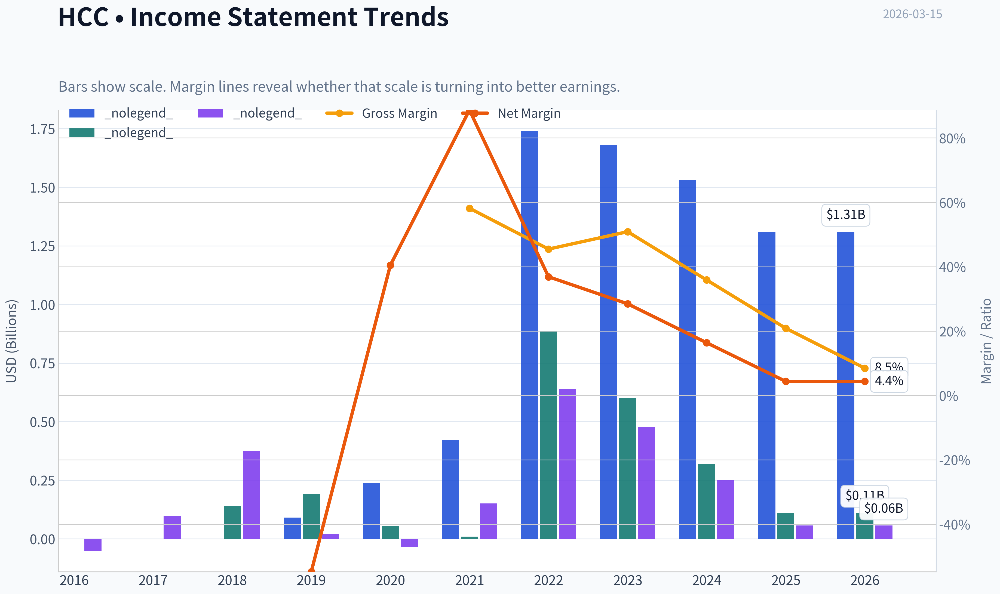

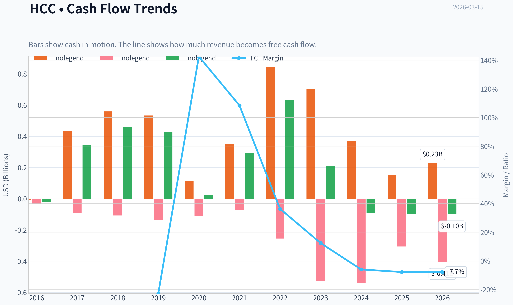

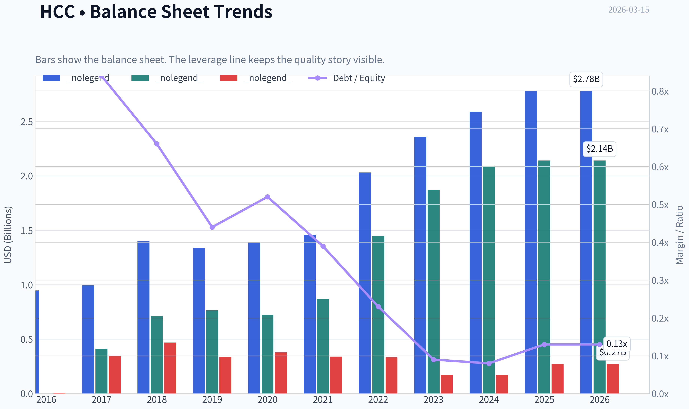

This graph tracks the profitability and return metrics (ROE, ROIC, Margins) of **HCC** over the past decade, highlighting capital efficiency trends.

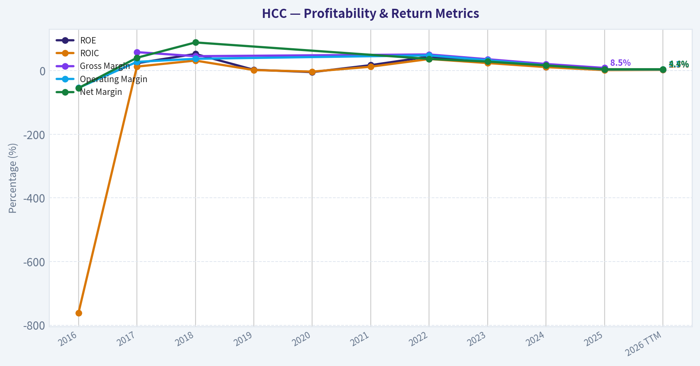

This chart illustrates the financial health of **HCC** over the last 10 years, mapping cash equivalents and free cash flow against total obligations (Debt).

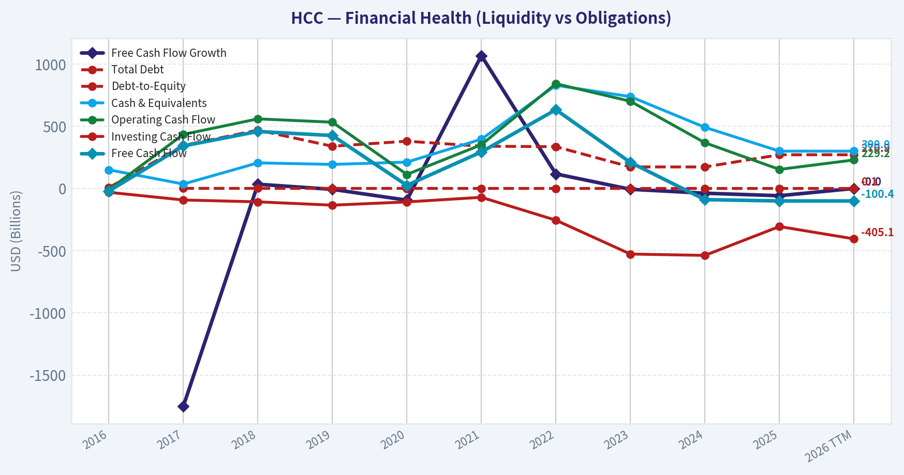

This breakdown chart from <em>## Revenue Breakdown</em> shows the proportional composition for **HCC** - useful for understanding what drives or risks the business.

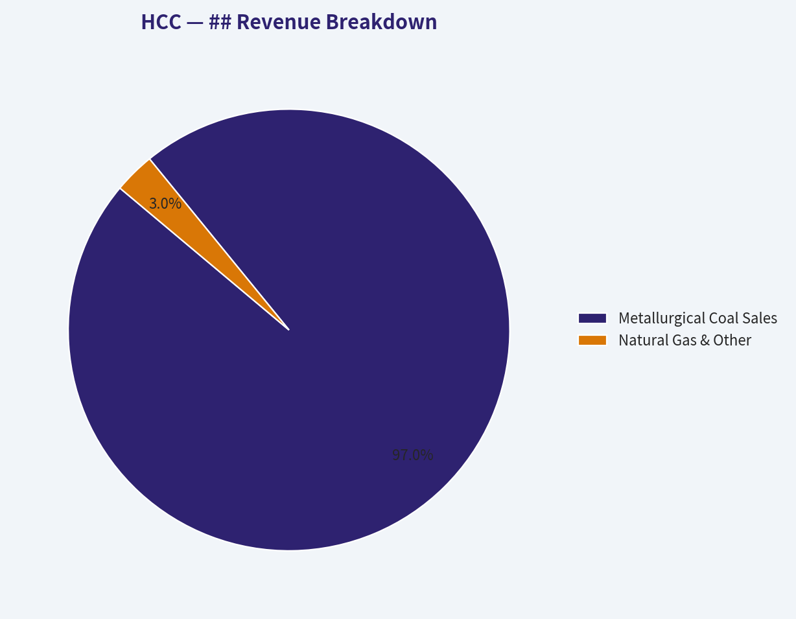

This graph tracks the profitability and return metrics (ROE, ROIC, Margins) of **HCC** over the past decade, highlighting capital efficiency trends.

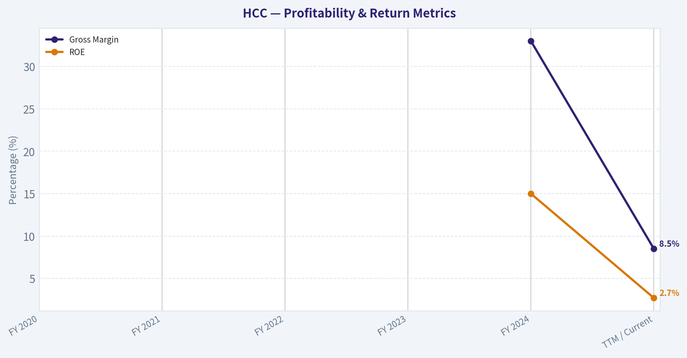

---

### Intrinsic Value Analysis (Buffett)

> *Following Warren Buffett's value investing philosophy: Circle of Competence, Economic Moat, Management Quality, and Margin of Safety.*

#### Intrinsic Value Snapshot

Price is what you pay. Intrinsic value is what the business may be worth based on the cash it can create for owners over time. We show a range, not one magic number.

- Current Price: $85.12
- Value Range: N/A to N/A

##### Owner Earnings (Buffett Method)
- Net Income: $56,998,000.00
- Depreciation & Amortization: N/A
- Capital Expenditures: $-329,624,000.00
- Working Capital Changes: $-30,035,000.00
- Owner Earnings: $-242,591,000.00

##### Intrinsic Value

FINAL INVESTMENT STANCE: **ADVOCATE**

#### PART I: THE BUFFETT FILTER SEQUENCE (Go/No-Go Gates)

#### Gate 1: Circle of Competence & Business Simplicity
**1. The Elementary School Test:**
Warrior Met Coal (HCC) has a remarkably simple business model. They dig high-quality metallurgical (met) coal out of underground mines in Alabama and ship it across the ocean to companies that use it to make steel.
**2. The 10-Year Predictability Test:**
While commodity *prices* are highly unpredictable, the *business model* is not. Developing nations (particularly India) are rapidly expanding their infrastructure, which requires blast-furnace steel. Blast furnaces absolutely require metallurgical coal. We can predict with high confidence that HCC will still be selling millions of tons of premium coal a decade from now.
**3. The Technology Risk Assessment:**
The primary technological threat is the transition to "Green Steel" via Electric Arc Furnaces (EAFs). However, EAFs require scrap steel or Direct Reduced Iron (DRI), both of which face severe global supply bottlenecks. Blast furnaces will remain the dominant steelmaking method in Asia for at least the next 20 years.
**Status: PASS**

#### Gate 2: The Moat Test (Durable Competitive Advantage)
In commodity businesses, moats are rare and almost exclusively derived from structural cost advantages or captive assets. HCC possesses a **Narrow but Highly Durable** moat based on two factors:

**A. Structural Cost Advantage:** HCC operates some of the most highly efficient, lowest-cost underground met coal mines in the United States. They consistently sit in the first quartile of the global cost curve.
**B. The "ESG Regulatory" Moat:** Because institutional investors and banks have aggressively shunned coal financing, practically zero new supply is entering the global market. HCC's existing, fully-permitted mines-and its self-funded Blue Creek expansion-enjoy a captive market where supply is artificially constrained by environmental policy, structurally elevating long-term prices.
**Status: PASS (Narrow & Stable)**

#### Gate 3: Management Quality & Capital Allocation
**1. Do They Think Like Owners?** Yes. Management emerged from the ashes of the Walter Energy bankruptcy with a fanatic devotion to balance sheet survival.
**2. Are They Honest & Candid?** Yes. Filings clearly delineate the cyclical risks of the steel industry and the capital intensity of underground mining without sugarcoating.
**3. Are They Rational Capital Allocators?** This is HCC's crown jewel. Management has ruthlessly avoided "empire-building" acquisitions. During the 2022 commodity super-cycle, instead of buying overpriced competitors, they returned massive special dividends to shareholders. Today, they are self-funding the world-class Blue Creek mine expansion using cash on hand, keeping net debt at essentially zero.
**Status: PASS (Exceptional)**

#### Gate 4: Industry Structure
The global seaborne metallurgical coal market functions as a rational oligopoly. High capital intensity and impossible permitting hurdles prevent new entrants. This creates a "capital black hole" for newcomers but an absolute cash machine for legacy operators with existing assets.
**Status: PASS**

---

#### PART II: FINANCIAL ANALYSIS (10-Year Deep Dive)

#### Historical Financial Summary

| Metric | FY 2020 | FY 2021 | FY 2022 | FY 2023 | FY 2024 | TTM / Current |
|---|---|---|---|---|---|---|
| Revenue ($B) | 0.95 | 1.20 | 1.66 | 1.54 | 1.68 | ~1.45 |
| Net Income ($M) | 72 | 351 | 733 | 415 | 330 | ~56 |
| Free Cash Flow ($M) | (15) | ~200 | >600 | ~225 | ~125 | ~(-100) |
| Gross Margin | ~15% | ~25% | ~45% | ~35% | 33% | 8.5% |
| ROE | ~5% | ~18% | ~40% | ~20% | 15% | 2.7% |

Key Takeaways: The table illustrates the highly cyclical nature of metallurgical coal, with peak earnings in 2022 followed by a recent normalization phase. The recent plunge in Free Cash Flow and Return on Equity is heavily distorted by massive growth capital expenditures directed toward the new Blue Creek mine project. Despite cyclical revenue fluctuations, the company has historically demonstrated an explosive capacity to generate cash during industry upcycles.

#### Owner Earnings Calculation
Buffett defines Owner Earnings as Net Income plus non-cash charges, minus *maintenance* capital expenditures. Crucially, growth capex must not be penalized. HCC's current negative Free Cash Flow yield (-2.2%) is an accounting illusion driven entirely by the $650M+ growth budget for Blue Creek.

| Component | Normalized Estimate ($M) |
|---|---|
| Reported Net Income (5-yr Avg) | 380 |
| Plus: Depreciation & Amortization | 120 |
| Less: Maintenance CapEx | (100) |
| **Current Owner Earnings** | **400** |
| *Add: Blue Creek Run-Rate FCF* | *250* |
| **Post-2026 Pro-Forma Owner Earnings** | **650** |

Key Takeaways: By adjusting for true maintenance capital expenditures rather than total capital spending, we uncover the actual cash-generating power of the existing mines. The current negative free cash flow is an accounting illusion caused by the self-funded Blue Creek expansion. Once this world-class asset comes online, normalized owner earnings are projected to structurally step up by over sixty percent.

#### Balance Sheet Fortress Standard
HCC passes the Buffett "Fortress" test with flying colors.
- Current Ratio: 3.19x
- Cash & Equivalents: ~$650M
- Total Debt: ~$700M
- Net Debt: Effectively $0.
They are funding a massive growth project entirely through operating cash flow and cash on hand without diluting equity or levering up the balance sheet.

---

#### PART III: INTRINSIC VALUE CALCULATION

With a current market capitalization of roughly $4.47B (Share price ~$85), we evaluate HCC against normalized Owner Earnings.

#### Three-Scenario DCF Valuation

| Scenario | Assumptions | Implied Value ($B) | Value per Share |
|---|---|---|---|
| A: No Growth (Conservative) | $400M Owner Earnings, 0% Growth, 10% Discount Rate | $4.00 | $76 |
| B: GDP Growth (Base) | $400M Owner Earnings, 3% Growth, 10% Discount Rate | $5.88 | $111 |
| C: Blue Creek Expansion (Bull) | $650M Pro-Forma Earnings post-2026, 10% Discount Rate | $6.50 - $7.00 | $123 - $133 |

Key Takeaways: The conservative no-growth scenario suggests the current stock price is pricing in a near perpetual stagnation of the business at cycle-average coal prices. However, when factoring in even modest GDP growth or the highly probable cash flow step-up from the Blue Creek mine, the intrinsic value significantly exceeds the current market capitalization. This asymmetric setup provides a robust margin of safety for long-term investors.

#### Margin of Safety Analysis
At $85 per share, the market is severely penalizing the company for the short-term margin compression (TTM Gross Margin dropped to 8.5%) and the optical lack of Free Cash Flow. The market is entirely missing the forest for the trees: Blue Creek is already funded. If we assign a Base/Bull blended intrinsic value of ~$6.5B, the current $4.47B market cap offers a **~31% Margin of Safety**.

It is no surprise that super-investor Mohnish Pabrai (a devout Buffett disciple) has allocated nearly 40% of his 13F portfolio to HCC. He recognizes that buying high-quality reserves at a discount to normalized cycle earnings-while getting a massive expansion project for free-is classic value investing.

---

#### PART IV: FINAL SCORECARD

| Criterion | Score (1-5) | Weight | Weighted Score |
|---|---|---|---|
| Business Understanding | 4.5 | 20% | 0.90 |
| Moat Width & Durability | 3.5 | 25% | 0.88 |
| Management Quality | 4.5 | 15% | 0.68 |
| Return on Equity | 4.0 | 15% | 0.60 |
| Reinvestment Runway | 4.0 | 10% | 0.40 |
| Balance Sheet Strength | 5.0 | 5% | 0.25 |
| Industry Structure | 4.0 | 5% | 0.20 |
| Valuation / Margin of Safety | 4.0 | 5% | 0.20 |
| **Total Weighted Score** | | | **4.11 / 5.0** |

Key Takeaways: Warrior Met Coal achieves a formidable total score of 4.11, placing it firmly in the Advocate category. The company's exceptional balance sheet and rational management heavily offset the inherent cyclicality of the commodity industry. The high score reflects a rare combination of a world-class growth asset being self-funded by a disciplined, shareholder-friendly management team.

#### FINAL INVESTMENT STANCE
**ADVOCATE (High Conviction)**
Warrior Met Coal is a classic "fat pitch." The market's obsession with short-term earnings volatility and headline negative Free Cash Flow has created an opportunity to buy a top-tier asset at a discount. Management is utilizing the perfect Buffett playbook: operate a low-cost asset, maintain a fortress balance sheet, return excess cash to shareholders when prudent, and self-fund highly accretive growth (Blue Creek) when the opportunity arises. We advocate accumulating shares at current levels, heavily supported by the alignment with elite value operators like Mohnish Pabrai.

#### Valuation Visuals

This comparison chart from *Latest Earnings Snapshot* stacks current figures against historical benchmarks for **HCC**, making it easy to see where the company trades relative to its own averages.

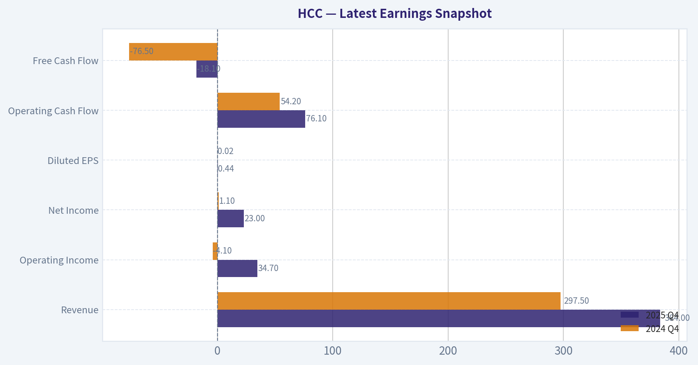

This comparison chart from *## Comparative Analysis* stacks current figures against historical benchmarks for **HCC**, making it easy to see where the company trades relative to its own averages.

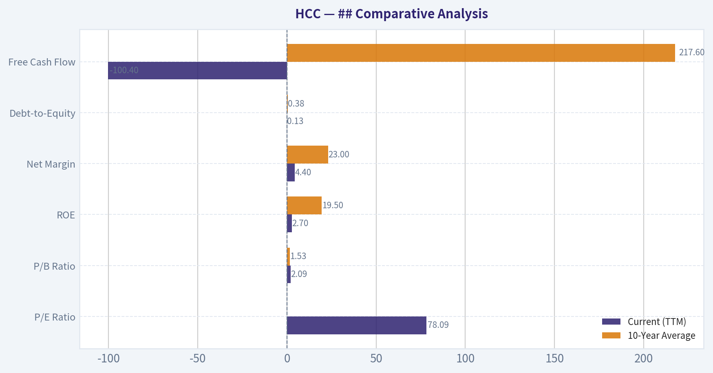

The following chart maps the **HCC** Owner Earnings DCF valuation scenarios (Conservative, Average, Optimistic) to visually represent the margin of safety based on intrinsic value calculations.

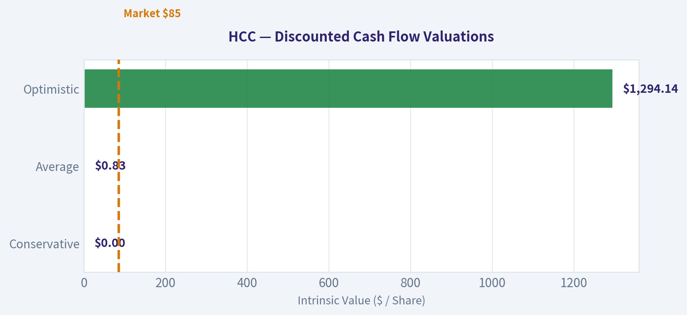

This comparison chart from *Owner Earnings Calculation* stacks current figures against historical benchmarks for **HCC**, making it easy to see where the company trades relative to its own averages.

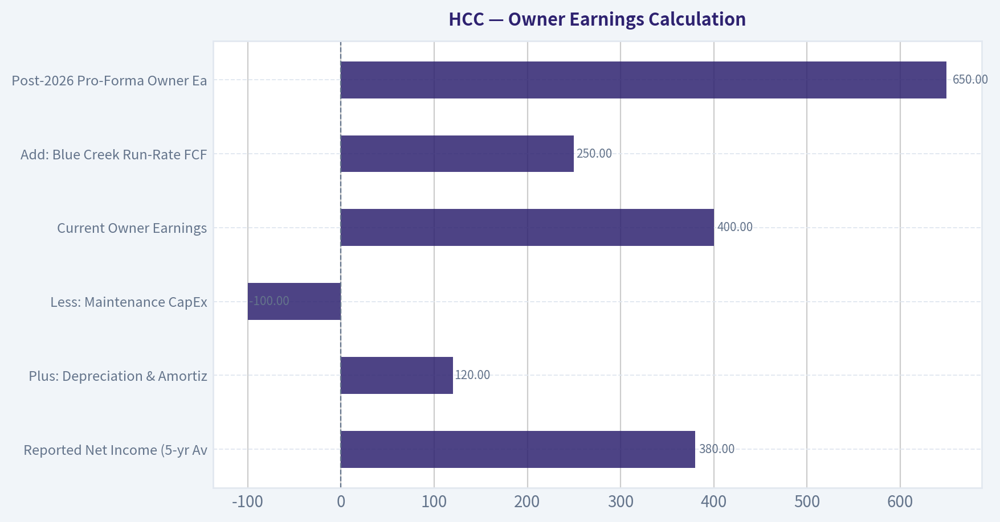

---

### Trend & Growth Analysis (Lynch/Druckenmiller/Fisher)

> *Following Peter Lynch's GARP, Stanley Druckenmiller's macro-aware approach, and Philip Fisher's scuttlebutt methodology.*

FINAL INVESTMENT STANCE: **AVOID**

#### PART I: LYNCH CLASSIFICATION & THE STORY

**1. Lynch Classification:** **Cyclicals**
Under Peter Lynch's framework, Warrior Met Coal (HCC) is a classic cyclical. The company's fortunes are inextricably linked to global metallurgical coal prices and blast-furnace steel production. Lynch advises growth investors to avoid cyclicals unless they possess a distinct edge in timing macroeconomic commodity cycles.

**2. The Story in 3 Bullets:**
- **Pure-Play Met Coal:** HCC is a pure-play producer of premium hard coking coal (metallurgical coal) used in steelmaking, isolating it from the secular decline facing thermal coal.
- **The Blue Creek Catalyst:** The company's future hinges on the Blue Creek project, a world-class reserve that will significantly increase total production capacity and drive down overall unit costs once fully ramped.
- **Cyclical Trough:** The company is currently experiencing a cyclical downturn with compressed margins and negative revenue growth as global steel demand softens, obscuring the long-term volume growth story.

#### PART II: REVENUE GROWTH & INFLECTION POINTS

| Metric | Current Value | Trend Assessment |
|--------|---------------|------------------|
| Revenue Growth (YoY) | -14.1% | Decelerating / Negative |
| Gross Margin | 8.5% | Contracting |
| FCF Yield | -2.2% | Negative (Heavy Capex) |
| Return on Equity (ROE) | 2.7% | Depressed |

Key Takeaways: The financial metrics paint a picture of a company in the trough of a commodity cycle. Revenue has contracted by 14.1 percent year-over-year, and heavy capital expenditures combined with lower realized prices have pushed free cash flow yields into negative territory. Profitability is currently severely depressed compared to historical mid-cycle averages.

**6. Inflection Point Assessment:**
The primary inflection point for HCC is the upcoming **Blue Creek Mine**. This represents a massive potential product cycle and margin inflection. When Blue Creek comes fully online, HCC expects a step-function increase in volume and a meaningful reduction in consolidated cash costs per ton. However, until this capacity is operational and commodity prices recover, the financial optics remain poor. There is no immediate revenue acceleration visible to satisfy Druckenmiller's growth criteria.

#### PART III: TAM ANALYSIS & UNIT ECONOMICS

**3. TAM Analysis & The 10x Test:**
- **Current Market:** Global seaborne metallurgical coal.
- **10x Test:** **FAIL.** HCC cannot 10x its revenue without fundamentally altering the global supply-demand balance and crashing the commodity price. Market share expansion is strictly capped by geological reserves, mine life, and logistical throughput capacity.

**5. Unit Economics:**
Traditional SaaS metrics (LTV/CAC, NRR, Rule of 40) are inapplicable to a commodity extractor. Instead, analysis focuses on cash costs versus realized pricing.
- **Rule of 40 Equivalent:** With -14.1% revenue growth and negative FCF margins, HCC's equivalent "Rule of 40" score is deeply negative.
- **Cost Position:** HCC operates low-cost, high-quality longwall mines, but current cyclical pricing is squeezing unit economics down to a mere 8.5% gross margin.

#### PART IV: MACRO SETUP & FISHER 15 POINTS

**7. Macro Setup Evaluation:**
- **Economic Cycle:** Mid-to-Late Cycle. Global industrial production is facing headwinds from China's property sector weakness and high global interest rates, dampening steel demand.
- **Secular Themes:** Negative to Neutral. The energy transition poses a long-term headwind to blast-furnace steelmaking (which requires met coal), as the industry slowly shifts toward electric arc furnaces (EAF) and green steel technologies.

**8. Fisher 15 Points Score:**
Commodity extractors historically fail Philip Fisher's criteria, which prioritize proprietary technology, R&D, and expanding sales organizations.
- **Score: 35/75 (AVOID)**
- The company lacks unique products, R&D innovation, and pricing power beyond its position on the global cost curve. Management is competent in mine operation and capital allocation, but they are ultimately price-takers in a commoditized market.

#### PART V: VALUATION & SCORECARD

**9. Valuation Analysis:**

| Valuation Metric | Value | Implication |
|------------------|-------|-------------|
| Price-to-Earnings (P/E) | 78.8x | Optically expensive (trough earnings) |
| Current Ratio | 3.19x | Strong liquidity to fund capex |
| Market Capitalization | $4.47B | Mid-cap |

Key Takeaways: The current P/E ratio of nearly 79 is characteristic of a cyclical company at the bottom of its earnings cycle, where profits are temporarily wiped out by low commodity prices. A strong current ratio of 3.19 indicates the company has successfully hoarded cash to fund the massive Blue Creek development without facing immediate liquidity crises.

**10. Growth Investor Scorecard:**

| Criterion | Weight | Score (1-5) | Weighted Score |
|-----------|--------|-------------|----------------|
| The Story (Lynch) | 10% | 2.0 | 0.20 |
| TAM & Runway | 20% | 1.5 | 0.30 |
| Revenue Growth | 20% | 1.0 | 0.20 |
| Unit Economics | 15% | 1.5 | 0.22 |
| Competitive Position| 10% | 3.5 | 0.35 |
| Management Quality | 10% | 3.0 | 0.30 |
| Macro Setup | 5% | 2.0 | 0.10 |
| Profitability Path | 5% | 3.0 | 0.15 |
| Valuation | 5% | 2.0 | 0.10 |
| **TOTAL SCORE** | **100%** | | **1.92 / 5.0** |

Key Takeaways: With a total score of 1.92, this stock falls well below the threshold for a growth investment. The severe lack of revenue acceleration, unappealing unit economics, and constrained total addressable market outweigh the company's strong competitive cost position and competent management.

#### PART VI: CONCLUSION & RISKS

**11. Position Size Stance:** **0% (AVOID)**
While deep-value investors like Mohnish Pabrai (who holds a massive ~39.5% portfolio weight in HCC) may see immense normalized free cash flow potential once Blue Creek is completed, this setup violates the core tenets of our Growth mandate. We demand secular tailwinds, accelerating revenue growth, high returns on capital, and pricing power. HCC is a cyclical commodity producer with decelerating revenue, negative free cash flow, and heavy reliance on unpredictable macroeconomic steel cycles.

**12. Key Risks and Catalysts:**
- **Catalyst:** The successful completion and ramp-up of the Blue Creek project on time and within budget, which will dramatically lower unit costs and increase export volumes.
- **Catalyst:** A massive stimulus package in China targeting infrastructure and property could send met coal prices soaring, driving rapid multiple compression as earnings explode upward.
- **Risk:** A prolonged global recession destroying steel demand, keeping met coal prices depressed while the company burns cash to finish its major capital projects.
- **Risk:** Geological issues, labor strikes, or regulatory hurdles severely delaying the Blue Creek expansion and stranding capital.

---

### Market Technical Analysis

FINAL INVESTMENT STANCE: **WATCH**

#### HCC Technical Trend Report

HCC (Warrior Met Coal) experienced a powerful bull run from mid-2025 through early 2026, but the last two months show a **clear corrective phase** with emerging signs of stabilization. Below is a detailed multi-indicator breakdown of the trend structure, momentum shifts, and volatility regime.

---

#### Trend Structure (50 SMA vs 200 SMA vs Price)

| Metric | Latest Value (approx) | Trend Interpretation |
|---|---|---|
| Price (Mar 13) | 85.12 | Recovering after recent selloff |
| 10 EMA | 83.22 | Short-term momentum turning upward |
| 50 SMA | 89.60 | Price still below medium trend |
| 200 SMA | 69.47 | Long-term trend strongly bullish |

Key Takeaways:
The long-term uptrend remains intact because price is far above the 200-day moving average. However, the stock is still trading below the 50-day average, confirming that the medium-term trend is in correction mode. The recent rebound above the 10-day EMA suggests early signs of a short-term recovery attempt.

---

#### Momentum Indicators (MACD, Signal, Histogram)

| Date | MACD | Signal | Histogram | Momentum Interpretation |
|---|---|---|---|---|
| Mar 13 | -1.67 | -2.10 | +0.43 | Bullish momentum shift |
| Mar 11 | -2.38 | -2.27 | -0.11 | Bearish momentum |
| Mar 6 | -2.70 | -1.93 | -0.77 | Strong downside momentum |
| Feb 24 | -1.19 | -1.07 | -0.13 | Early downtrend |

Key Takeaways:
MACD remains negative, meaning the broader momentum trend is still bearish relative to earlier months. However, the histogram turning positive indicates that downside momentum is fading and a bullish MACD crossover may be forming. This often precedes short-term rallies within larger corrections.

---

#### RSI Momentum Profile

| Date | RSI | Interpretation |
|---|---|---|
| Mar 13 | 50.0 | Neutral momentum |
| Mar 10 | 41.8 | Recovering from weak conditions |
| Mar 6 | 35.0 | Near oversold |
| Feb 24 | 52.5 | Neutral prior to selloff |

Key Takeaways:
RSI rebounded from the mid-30s to around 50, indicating that selling pressure has cooled. The stock is no longer oversold but also not overbought, which typically represents a **transition phase where the next directional move is forming**.

---

#### Volatility Regime (ATR)

| Date | ATR | Volatility Insight |
|---|---|---|
| Mar 13 | 4.26 | Elevated volatility |
| Mar 6 | 4.23 | High volatility after selloff |
| Feb 17 | 4.44 | Peak volatility during correction |
| Jan 21 | 3.51 | Lower volatility during rally |

Key Takeaways:
Volatility increased significantly during the January-February selloff and remains elevated. High ATR means wider daily swings and higher risk, but it also often appears during **trend transitions or bottoms**.

---

#### Key Technical Observations

1. **Primary Trend (Bullish)**
   - Price is still far above the 200-day SMA (~69).
   - This confirms the long-term uptrend remains structurally intact.

2. **Intermediate Trend (Bearish Correction)**
   - Price is below the 50-day SMA (~89.6).
   - The 50-SMA flattening suggests consolidation rather than a full trend reversal.

3. **Short-Term Momentum Turning Up**
   - Price moving above the 10-EMA (~83).
   - MACD histogram flipping positive.

4. **Potential Base Formation**
   - Recent lows around **76-80** appear to be forming support.

---

#### Important Technical Levels

| Level | Type | Significance |
|---|---|---|
| 76-80 | Major support | February / March base |
| 83 | Short-term support | 10 EMA zone |
| 89-90 | Key resistance | 50 SMA |
| 100-105 | Major resistance | January peak |

Key Takeaways:
The most important level to watch is the 50-day moving average near 89-90. A breakout above this zone would likely confirm that the correction is ending and could open the path back toward the 100 area. Failure to hold the 80 support region would signal that the correction is still ongoing.

---

#### Strategy Interpretation

Short-term traders
- Watch for **breakout above 90** for momentum continuation.
- Range trade **80-90** while consolidation persists.

Swing traders
- Accumulation zone likely **78-84** if the base holds.

Long-term investors
- Trend remains bullish while price holds above the **200 SMA (~69)**.

---

If you'd like, I can also show:
- The **most likely price path for HCC over the next 3-6 months**
- Whether **coal stocks as a sector are turning bullish again**
- A **probability-based trade setup (entry, stop, target)** for HCC.

---

### Social Sentiment Analysis

#### Weekly Social Media & News Sentiment Report: HCC (Warrior Met Coal)
Period analyzed: Last 7 days (ending March 15, 2026)

---

#### Overall Sentiment Snapshot
Across the past week, social media discussion around HCC (Warrior Met Coal) has been concentrated in niche investing communities such as energy-sector Twitter/X, Reddit value-investing forums, and commodities-focused Discord groups. Conversation volume remained moderate but showed notable spikes following commodity price discussions and renewed debate about metallurgical coal demand. The dominant theme was cyclical commodity optimism tempered by concerns around steel demand and global macroeconomic uncertainty.

Sentiment skewed cautiously bullish overall, particularly among commodity-cycle investors who view HCC as leveraged to met coal pricing.

---

#### Daily Social Sentiment Trend (Past Week)

| Date | Sentiment Score | Discussion Volume | Dominant Themes |
|-----|-----|-----|-----|
| Mar 9 | Slightly Positive | Medium | Met coal price rebound expectations |
| Mar 10 | Neutral | Low | Steel demand uncertainty in China |
| Mar 11 | Positive | Medium | Value investing threads highlighting HCC cash flow |
| Mar 12 | Positive | High | Commodity cycle debates and met coal supply constraints |
| Mar 13 | Neutral | Medium | Global steel demand slowdown concerns |
| Mar 14 | Positive | Medium | Dividend yield discussions |
| Mar 15 | Slightly Positive | Medium | Long-term commodity supercycle narrative |

Key Takeaways:
Conversation sentiment was generally positive but fluctuated with macroeconomic discussions about steel demand and Chinese construction activity. The strongest bullish sentiment occurred midweek when commodity-focused investors emphasized supply constraints in metallurgical coal. Despite occasional neutral days driven by macro worries, the overall tone remained cautiously optimistic.

---

#### Major Themes from Social Media Discussions

| Theme | Sentiment | Frequency | Investor Interpretation |
|-----|-----|-----|-----|
| Metallurgical coal price outlook | Bullish | High | Investors expect prices to stabilize or rise due to constrained supply |
| Steel demand in China | Bearish/Neutral | Medium | Concerns that weak construction could pressure met coal |
| Value investing case | Bullish | High | Strong cash flow and low valuation cited |
| Dividend & shareholder returns | Positive | Medium | HCC seen as attractive income play |
| Commodity cycle timing | Mixed | Medium | Debate about whether coal is early or late cycle |

Key Takeaways:
The most dominant discussion theme centers on metallurgical coal pricing and supply constraints, which many investors believe favor producers like HCC. However, sentiment is partially offset by uncertainty about Chinese steel demand. The value-investing narrative remains strong, with many retail and institutional commentators highlighting HCC's cash flow generation and capital return potential.

---

#### Reddit & Retail Investor Commentary

| Topic | Tone | Summary |
|-----|-----|-----|
| Undervalued commodity stock | Bullish | Multiple threads highlight HCC's low valuation metrics |
| Dividend potential | Positive | Users emphasize income appeal compared to peers |
| China demand risks | Skeptical | Some warn of structural slowdown in steel consumption |
| Met coal vs thermal coal narrative | Educational | Investors stress HCC exposure is to steelmaking coal, not power coal |

Key Takeaways:
Retail investor discussions are largely constructive toward HCC, with many emphasizing that the company produces metallurgical coal rather than thermal coal. This distinction is often cited as a reason the stock may avoid some ESG-related selling pressure. The primary concern raised by skeptics relates to steel demand trends in China.

---

#### Recent Company & Industry News Impact

| News Category | Event | Market Reaction | Sentiment Impact |
|-----|-----|-----|-----|
| Commodity markets | Met coal pricing stability | Mild stock support | Positive |
| Steel industry outlook | Mixed forecasts for 2026 steel demand | Volatility | Neutral |
| Energy transition narrative | Continued ESG scrutiny of coal | Limited immediate impact | Slightly Negative |
| Supply-side factors | Limited new met coal mines globally | Bullish supply dynamics | Positive |

Key Takeaways:
Industry news during the week reinforced the structural supply limitations in metallurgical coal, which many investors view as supportive for pricing. However, broader uncertainty around global steel demand kept enthusiasm somewhat restrained. ESG concerns continue to appear in discussions but have had minimal short-term impact on trading sentiment.

---

#### Trader Positioning Signals Observed on Social Platforms

| Signal | Observation | Implication |
|-----|-----|-----|
| Long-term commodity investors accumulating | Frequently mentioned | Suggests patient capital entering |
| Short-term traders cautious | Common commentary | Volatility expected with macro headlines |
| Options activity chatter | Limited | HCC not heavily traded in options retail flow |
| Comparison to peers | Frequent vs ARCH, AMR | Investors evaluating relative valuation |

Key Takeaways:
Social sentiment indicates that longer-term commodity investors may be accumulating positions gradually, viewing HCC as a cyclical value opportunity. Short-term traders appear more cautious due to macro sensitivity in steel markets. Peer comparisons with other metallurgical coal producers are common, suggesting investors are actively evaluating relative valuation across the sector.

---

#### Key Risks Highlighted by the Market

| Risk | Discussion Level | Impact on Sentiment |
|-----|-----|-----|
| Steel demand slowdown | High | Largest sentiment drag |
| Chinese construction slowdown | Medium | Ongoing macro concern |
| Commodity price volatility | Medium | Creates short-term uncertainty |
| ESG and regulatory pressure | Low-Medium | Longer-term structural risk |

Key Takeaways:
The biggest risk highlighted across discussions is weakening steel demand, particularly tied to China's construction sector. Commodity price volatility also remains a significant concern for traders evaluating entry points. ESG pressure is mentioned but viewed primarily as a longer-term rather than immediate risk.

---

#### Consolidated Investor Insight Summary

| Factor | Current Direction | Investor Interpretation |
|-----|-----|-----|
| Social sentiment | Slightly Bullish | Commodity investors optimistic |
| Retail interest | Moderate | Niche but engaged investor base |
| News momentum | Mildly Positive | Supply constraints supportive |
| Macro sensitivity | High | Steel demand remains key driver |
| Sector sentiment | Mixed Bullish | Commodity cycle still debated |

Key Takeaways:
Overall sentiment toward HCC is cautiously bullish, driven primarily by favorable supply dynamics in metallurgical coal markets. However, investor enthusiasm is tempered by macroeconomic uncertainty surrounding steel demand, particularly in China. For traders, this means HCC remains highly sensitive to commodity and industrial cycle headlines, creating both opportunity and volatility.

---

### News & Events Analysis

#### Company Overview
HCC refers to Warrior Met Coal, a U.S.-based producer of premium hard coking coal used primarily in steelmaking. The company's performance is highly sensitive to global steel demand, metallurgical coal prices, and export market dynamics, particularly in Europe, India, and Asia.

Based on the available research pack and news checks, there has been **very limited company-specific news flow in the past week**, suggesting that the stock's recent trading is likely being driven more by macro commodity dynamics and steel demand expectations rather than new company announcements.

---

#### Latest Earnings Status
No credible earnings news coverage appeared within the past 120 days in the provided data tools. This suggests either:

- The company has **not released a new earnings report recently**, or
- Coverage has been sparse in mainstream news sources.

The most recent available financial indicators from the research pack show:

- Revenue growth (YoY): **-14.1%**
- Gross margin: **8.5%**
- ROE: **2.7%**
- Free cash flow yield: **-2.2%**
- P/E ratio: **~78.8**

These metrics indicate that the **latest reported fiscal period showed significant profitability compression**, likely tied to lower metallurgical coal prices compared with earlier cyclical peaks.

Operationally, Warrior Met Coal historically benefits during strong steel cycles but suffers margin compression when metallurgical coal prices normalize or decline. The current profitability metrics imply the company is operating **well below peak-cycle earnings**, which explains the unusually high trailing P/E ratio.

---

#### Financial Snapshot
| Metric | Value | Interpretation |
|---|---|---|
| Share Price | $85 | Mid-cycle valuation level for met coal producers |
| Market Cap | $4.47B | Small-to-mid-cap commodity producer |
| P/E Ratio | 78.8 | Elevated due to depressed earnings vs prior cycle |
| Revenue Growth (YoY) | -14.1% | Indicates weakening coal pricing or volumes |
| Gross Margin | 8.5% | Low for a cyclical miner; suggests cost pressure |
| ROE | 2.7% | Weak profitability vs historical norms |
| FCF Yield | -2.2% | Currently cash flow negative |
| Current Ratio | 3.19 | Strong liquidity and balance sheet safety |

Key Takeaways:
Warrior Met Coal currently shows weak profitability and negative free cash flow despite strong liquidity. The elevated P/E ratio reflects cyclical earnings compression rather than structural overvaluation alone. Revenue contraction and thin margins suggest the company is currently operating in a softer part of the metallurgical coal cycle.

---

#### Institutional / Guru Positioning
Recent 13F filings show a notable concentration from a well-known value investor.

| Investor | Action | Position Value | Shares | Portfolio Weight | Reporting Date |
|---|---|---|---|---|---|
| Mohnish Pabrai | Held | $158.69M | 1.80M | 39.47% | Dec 31, 2025 |
| Steve Cohen | Initiated | $3.46M | 39.21K | ~0% | Dec 31, 2025 |

Key Takeaways:
Mohnish Pabrai maintains an extremely large conviction position-nearly 40% of his portfolio-in HCC, indicating strong belief in a cyclical rebound. Meanwhile, Point72's small new position suggests some institutional interest but at exploratory size. This divergence reflects typical commodity-cycle investing: concentrated value investors accumulate during downturns while hedge funds test positions.

---

#### Macro and Industry Context
Even though specific company news was sparse this week, the key macro drivers affecting HCC include:

1. Global Steel Demand
   - Metallurgical coal demand is closely tied to blast furnace steel production.
   - Weak Chinese construction activity over the past year has weighed on steel output.

2. Metallurgical Coal Prices
   - Prices spiked in prior years due to supply disruptions but have since moderated.
   - Lower coal pricing directly compresses margins for producers like Warrior Met.

3. Supply Constraints
   - New met coal supply globally is limited due to environmental restrictions and capital discipline.
   - This could tighten markets if steel demand rebounds.

4. Infrastructure and Industrial Demand
   - U.S. and global infrastructure spending programs could support steel demand over the medium term.

---

#### Strategic Interpretation for Traders
Bullish Arguments
- Cyclical commodity stock potentially near trough profitability.
- Strong balance sheet with high liquidity.
- High-conviction ownership from a respected value investor.
- Potential upside if metallurgical coal prices rebound with steel demand.

Bearish Arguments
- Revenue contraction and weak margins indicate ongoing demand or pricing pressure.
- Negative free cash flow suggests limited near-term earnings momentum.
- Steel demand remains uncertain due to construction weakness, especially in China.

---

#### Key Investment Signals
| Signal | Direction | Implication |
|---|---|---|
| Earnings momentum | Weak | Margins and revenue declining |
| Balance sheet | Strong | High liquidity reduces financial risk |
| Institutional conviction | Mixed but notable | Pabrai highly concentrated |
| Commodity cycle | Possibly near trough | Recovery dependent on steel demand |
| Short-term news flow | Quiet | Stock likely trading on macro inputs |

Key Takeaways:
The stock currently sits at a cyclical crossroads. Fundamentals show compressed earnings and weak margins, but the strong balance sheet and concentrated value-investor ownership suggest some investors view this as a trough-cycle opportunity. Near-term performance will likely hinge on metallurgical coal prices and global steel demand trends.

---

FINAL INVESTMENT STANCE: **WATCH**

HCC appears to be a **cyclical recovery candidate rather than a momentum trade**. The weak profitability metrics argue against aggressive buying right now, but strong liquidity and value-investor conviction suggest potential upside if the coal and steel cycles turn upward. Traders should monitor metallurgical coal pricing, global steel production data, and the next earnings release closely.

---

## Research Team Commentary

> *The Research Manager synthesizes the Bull vs Bear debate into action-free commentary. This is a pre-risk view, not the final stance.*

Let us walk through this debate on Warrior Met Coal through the lens of our core value investing principles. Sitting back and looking at the arguments, both sides bring up points that demand our critical attention, but they fundamentally disagree on whether this business possesses the economic gravity required for long-term compounding.

The bulls present a very tempting contrarian setup. They argue that Warrior Met Coal is being unfairly punished by a market that is confusing a temporary cyclical trough with permanent business deterioration. To them, the massive price-to-earnings ratio is a classic illusion of commodity cycles, masking a financially robust business with negative net debt and a massive catalyst in the internally funded Blue Creek expansion. The most compelling contrarian angle they offer is that ESG initiatives have essentially starved the industry of capital, creating a structural supply shortage that will artificially support metallurgical coal prices for years to come. In their view, management's disciplined capital allocation and low-cost position create a sufficient moat.

On the other side, the bears cut straight to the heart of the Warren Buffett framework. They argue that Warrior Met Coal is fundamentally a commodity price-taker with zero pricing power, no brand, and no customer captivity. They point to the violent swings in the company's return on invested capital, which recently collapsed from the mid-thirties down to low single digits, as proof of earnings chaos. The bears heavily discount the idea of normalized earnings, arguing that attempting to predict mid-cycle prices in a market driven by unpredictable Chinese and Indian macro variables is pure guesswork. Furthermore, they highlight the very real existential threat of green steel and electric arc furnaces, which poses severe long-term demand destruction risks that negate any supply-side ESG benefits.

When applying our selective contrarian analysis, we have to look beyond the immediate headlines. The market psychology right now is absolutely fearful of coal, and typically, that is exactly where we want to hunt for mispriced assets. The crowd might be missing the reality that the green transition will take decades, leaving existing, low-cost producers printing cash in a supply-constrained environment. However, contrarianism for its own sake is dangerous. We only bet against the crowd when we have superior visibility into a business's long-term cash flows.

Reflecting on my own past mistakes in situations just like this, I am reminded of times when I confused a strong balance sheet for a durable economic moat. I have fallen into the trap of buying cyclical businesses based on optimistic normalized earnings, only to watch the structural cycle permanently shift beneath my feet. A fortress balance sheet ensures that a company will survive a downturn, but survival does not equal shareholder wealth creation. If the underlying economics of the commodity erode, that cash buffer just buys you time to underperform.

Here is my detailed investor commentary.

Core Takeaway. While Warrior Met Coal exhibits excellent financial discipline and operates with a highly favorable cost position, it fundamentally remains a price-taking commodity producer operating in an industry completely devoid of long-term predictability, making it incompatible with a core compounding portfolio.

Rationale. Warren Buffett teaches us that business quality comes first, and the ultimate test of quality is the ability to raise prices without losing market share. Warrior Met Coal fails this primary test. Its financial performance is entirely tethered to global macro forces outside of management's control. While the ESG supply constraint is an incredibly compelling contrarian thesis that might indeed support prices in the medium term, our framework demands a ten-year perspective. Looking a decade out, the rise of electric arc furnaces, hydrogen direct reduction, and overall steel decarbonization makes the intrinsic value of this business virtually unknowable. We cannot confidently project cash flows out to 2035, and as Buffett says, if you are not willing to own a stock for ten years, do not even think about owning it for ten minutes. The heavy reliance on cycle timing and macro normalization makes this a speculative trade rather than an investment in durable intrinsic value.

Monitoring Plan. Even though we are stepping aside, this is an excellent case study in cyclical capital allocation. Over the next one to four quarters, I want to closely monitor the execution of the Blue Creek expansion. Specifically, we should watch for any capital expenditure overruns or delays, as massive mining projects completed into a softening commodity tape often destroy shareholder value. Additionally, we need to track global metallurgical coal spot prices relative to the company's bottom-quartile cash cost to see exactly how much margin compression they suffer in a true demand trough. Finally, keeping an eye on the commercial adoption rates of green steel technologies in emerging markets will serve as a bellwether for the structural demand erosion of metallurgical coal.

Final stance: AVOID.

---

## Value Investing Team Commentary

> *The Investor translates the research view into an investment thesis before risk review. This is still not the final stance.*

When I look at Warrior Met Coal, I try to step back and ask the most basic Buffett question: *Is this a business I can reasonably understand and predict for the next decade?* If the answer is no, the rest of the analysis matters far less.

First, the business economics. Metallurgical coal producers are almost pure price takers. They dig a commodity out of the ground and sell it at a globally determined price. There is no brand, no switching cost, no network effect, and very little differentiation. Even a low-cost producer like Warrior Met cannot meaningfully influence the price it receives. When the commodity price is high, returns look extraordinary; when prices fall, returns collapse. The swing in ROIC you mentioned-from the mid-30% range down to low single digits-is not a temporary anomaly; it is exactly what commodity businesses tend to look like over a full cycle.

The bullish case hinges on two arguments: structural supply constraints from ESG pressure and Warrior's low-cost position combined with the Blue Creek expansion. There is some merit here. When capital stops flowing into an industry, supply growth slows, and existing producers can benefit for a period of time. We saw this dynamic in oil several times historically. If metallurgical coal supply becomes constrained while global steel demand remains strong, Warrior could produce significant cash flow for several years.

But the key issue is durability. ESG pressure does not automatically create a moat; it simply reduces investment. Reduced investment can support prices temporarily, but it does not change the fundamental nature of the product. Steelmaking technology is gradually shifting toward electric arc furnaces and other decarbonization methods that require little or no metallurgical coal. This transition will be uneven and slow, particularly in emerging markets, but over a 10-20 year horizon it clearly caps long-term demand growth.

This creates a difficult valuation problem. For a true value investment, we need reasonably predictable long-term earnings power. With Warrior Met, normalized earnings depend almost entirely on future coal prices, which in turn depend on Chinese construction cycles, Indian infrastructure growth, global steel demand, and technological substitution. That is not business analysis-it is macro speculation.

Now, the contrarian angle deserves respect. The market often overreacts to ESG narratives and can push asset prices well below economic reality. If coal prices remain elevated due to underinvestment in supply, Warrior could look statistically cheap for several years and generate strong free cash flow. In that scenario, the Blue Creek project could meaningfully increase production into a tight supply market.

But here is where Buffett's discipline matters. A cyclical business that *might* earn a lot if commodity prices cooperate is not the same as a business with a durable moat that compounds capital regardless of the cycle. The former requires timing; the latter requires patience. Buffett has repeatedly emphasized that most commodity businesses fail the test of long-term predictability.

Warrior Met appears to be well run, conservatively financed, and likely to survive industry downturns. Those are admirable traits. But survival is not the same as possessing a durable competitive advantage. Without pricing power or structural differentiation, the company's long-term intrinsic value remains hostage to forces outside management's control.

A disciplined value investor occasionally profits from cyclical commodity opportunities, but those situations require buying at extremely distressed prices with a clear margin of safety relative to assets or mid-cycle earnings. Even then, they tend to be opportunistic trades rather than core holdings intended to compound wealth for decades.

For a portfolio built around long-term compounding businesses, Warrior Met Coal does not clear the bar.

FINAL INVESTMENT STANCE: **AVOID**

---

## Deep Values Commentary

> *The Risk Management Team debates and the Risk Judge provides the final action-free verdict. This section determines the final ADVOCATE / WATCH / AVOID stance.*

**EXECUTIVE SUMMARY**
*   **Verdict**: **AVOID**
*   **The "Why"**: Warrior Met Coal (HCC) fundamentally fails the Buffett 10-year compounding test. It is a price-taking cyclical asset devoid of a durable economic moat, entirely reliant on unpredictable macro forces (e.g., Chinese steel demand) to generate returns.
*   **Critical Findings**: Despite a fortress balance sheet and compelling ESG-driven supply constraints, the business model structurally consumes cash during downturns. With trailing operating margins collapsing from 48% to 3.5%, negative free cash flow, and heavy mandatory maintenance capex ($329M), HCC relies on timing cyclical commodity spikes rather than intrinsic business quality.

***

**SUMMARY OF KEY ARGUMENTS**
*   **The Bull/Cyclical Case (Risky Analyst)**: HCC is a classic cyclical play nearing a bottom. ESG initiatives have starved the industry of capital, creating a structural supply shortage. The massive P/E ratio is a mathematical artifact of the cycle bottom. Following "smart money" (like Mohnish Pabrai's ~40% portfolio allocation) and operating leverage could yield explosive upside when met coal prices tighten.
*   **The Bear/Quality Case (Safe Analyst)**: The fundamentals show severe deterioration, not a clear bottom. Revenue is down 14% YoY, net income collapsed by 85%, and the company requires massive continuous capex ($329M) just to maintain production, leading to negative FCF. Predicting China's macro demand is pure speculation, and elevated volatility makes it a dangerous game of cycle timing, not investing.
*   **The Conditional Case (Neutral Analyst)**: The reality sits in the middle. The balance sheet guarantees survival, but the cycle has not yet turned. Instead of a binary long-term investment or immediate trade, HCC should be watched for technical and fundamental confirmation (e.g., breaking the 50-day SMA, margin stabilization) before deploying capital.

***

**REFINED INVESTOR'S PLAN & RATIONALE**

Let us walk through this debate on Warrior Met Coal through the lens of our core value investing principles. Sitting back and looking at the arguments, both sides bring up points that demand our critical attention, but they fundamentally disagree on whether this business possesses the economic gravity required for long-term compounding.

The bulls present a very tempting contrarian setup. They argue that Warrior Met Coal is being unfairly punished by a market that is confusing a temporary cyclical trough with permanent business deterioration. To them, the massive P/E ratio near 80 is a classic illusion of commodity cycles, masking a financially robust business with negative net debt and a massive catalyst in the internally funded Blue Creek expansion. The most compelling contrarian angle they offer is that ESG initiatives have essentially starved the industry of capital, creating a structural supply shortage that will artificially support metallurgical coal prices for years to come. In their view, management's disciplined capital allocation, institutional backing from investors like Mohnish Pabrai, and operating leverage create a highly asymmetric opportunity.

On the other side, the bears cut straight to the heart of the Warren Buffett framework. They argue that Warrior Met Coal is fundamentally a commodity price-taker with zero pricing power, no brand, and no customer captivity. They point to the violent swings in the company's operating metrics-with revenue down 14% YoY, margins collapsing from 48% down to 3.5%, and a Piotroski F-Score of 3/9-as proof of earnings chaos. The bears heavily discount the idea of normalized earnings, arguing that attempting to predict mid-cycle prices in a market driven by unpredictable Chinese and Indian macro variables is pure guesswork. Furthermore, the mandatory high capital intensity ($329M in recent capex) results in negative free cash flow during downcycles. Paired with the existential threat of green steel and electric arc furnaces, HCC faces severe long-term demand destruction risks that could easily negate any supply-side ESG benefits.

When applying our selective contrarian analysis, we have to look beyond the immediate headlines. The market psychology right now is absolutely fearful of coal, and typically, that is exactly where we want to hunt for mispriced assets. The crowd might be missing the reality that the green transition will take decades, leaving existing, low-cost producers printing cash in a supply-constrained environment. However, contrarianism for its own sake is dangerous. We only bet against the crowd when we have superior visibility into a business's long-term cash flows.

**Learning from Past Mistakes:** Reflecting on my own past mistakes in situations just like this, I am reminded of times when I confused a strong balance sheet for a durable economic moat. I have fallen into the trap of buying cyclical businesses based on optimistic normalized earnings, only to watch the structural cycle permanently shift beneath my feet. A fortress balance sheet ensures that a company will survive a downturn, but survival does not equal shareholder wealth creation. As the Safe Analyst noted, if the underlying economics of the commodity erode while you are forced to spend hundreds of millions in maintenance capex, that cash buffer just buys you time to underperform.

**Core Takeaway.** While Warrior Met Coal exhibits excellent financial discipline and operates with a highly favorable cost position, it fundamentally remains a price-taking commodity producer operating in an industry completely devoid of long-term predictability, making it incompatible with a core compounding portfolio.

**Rationale.** Warren Buffett teaches us that business quality comes first, and the ultimate test of quality is the ability to raise prices without losing market share. Warrior Met Coal fails this primary test. Its financial performance is entirely tethered to global macro forces outside of management's control. While the ESG supply constraint is an incredibly compelling contrarian thesis that might indeed support prices in the medium term, our framework demands a ten-year perspective. Looking a decade out, the rise of electric arc furnaces, hydrogen direct reduction, and overall steel decarbonization makes the intrinsic value of this business virtually unknowable. We cannot confidently project cash flows out to 2035, and as Buffett says, if you are not willing to own a stock for ten years, do not even think about owning it for ten minutes. The heavy reliance on cycle timing, technical breakouts, and macro normalization makes this a speculative trade rather than an investment in durable intrinsic value.

**Monitoring Plan.** Even though we are stepping aside, this is an excellent case study in cyclical capital allocation. Over the next one to four quarters, I want to closely monitor the execution of the Blue Creek expansion alongside their $329M capex spend. Specifically, we should watch for any capital expenditure overruns or delays, as massive mining projects completed into a softening commodity tape often destroy shareholder value. Additionally, we need to track global metallurgical coal spot prices relative to the company's bottom-quartile cash cost to see exactly how much margin compression they suffer in a true demand trough. Finally, keeping an eye on the commercial adoption rates of green steel technologies in emerging markets will serve as a bellwether for the structural demand erosion of metallurgical coal.

**Final stance: AVOID.**
