# HCC Deep Value Intelligence

**Analysis Date:** 2026-05-10

## Critical Disclaimer

*This analysis is generated by Deep Value Intelligence, an AI-powered multi-agent investing framework. This report is for informational and educational purposes only and does not constitute financial advice. Always conduct your own research and consult with qualified financial advisors before making investment decisions.*

---

## Table of Contents

1. Intelligence Summary
2. Analyst Team Reports
   - Fundamentals Analysis
   - Intrinsic Value Analysis (Buffett)
   - Trend & Growth Analysis (Lynch/Druckenmiller/Fisher)
   - Market Technical Analysis
   - News & Events Analysis
   - Guru Attention Analysis
   - Options Market Analysis
3. Research Team Commentary
4. Value Investing Team Commentary
5. Deep Values Commentary

---

## Intelligence Summary

### Thesis + Conditions

**Core Thesis:** ## Executive Briefing

**Key Risks:**
- HCC looks **cheap if a cyclical recovery takes hold**, but it still does **not meet a Buffett-style quality threshold** today. The core risk is not share-price volatility; it is that weak returns, negative free-cash-flow profile, and commodity dependence may reflect **mediocre through-cycle economics**, not just a temporary trough. The bull case has real merit-premium met coal assets, recent earnings rebound, and potential valuation upside-but the margin of safety is **less robust than it first appears** because so much depends on coal prices, steel demand, and execution. For a long-term value investor, this is **a monitored special situation, not a high-conviction owner's business**.
- ### 1. Risky Analyst: Strongest Bull Points
- In a conservative framework, valuation sensitivity is a risk, not an opportunity.
- Best conclusion: **active WATCH**, with explicit triggers rather than passive observation.
- ## Rationale Under a Buffett-Style Risk Lens

**What Would Change Our View:**
- HCC looks **cheap if a cyclical recovery takes hold**, but it still does **not meet a Buffett-style quality threshold** today. The core risk is not share-price volatility; it is that weak returns, negative free-cash-flow profile, and commodity dependence may reflect **mediocre through-cycle economics**, not just a temporary trough. The bull case has real merit-premium met coal assets, recent earnings rebound, and potential valuation upside-but the margin of safety is **less robust than it first appears** because so much depends on coal prices, steel demand, and execution. For a long-term value investor, this is **a monitored special situation, not a high-conviction owner's business**.
- ### 1. Risky Analyst: Strongest Bull Points
- In a conservative framework, valuation sensitivity is a risk, not an opportunity.
- Best conclusion: **active WATCH**, with explicit triggers rather than passive observation.
- ## Rationale Under a Buffett-Style Risk Lens

**Confidence:** Low

---

## Analyst Team Reports

### Fundamentals Analysis

#### Latest Earnings Snapshot

*Most recent reported quarter anchored on 2026 Q1, with prior-year comparison when available.*

| Metric | 2026 Q1 | 2025 Q1 | YoY Change |
| --- | ---: | ---: | ---: |
| Revenue | $458.6M | $299.9M | +52.9% |
| Operating Income | $79.4M | $-17.4M | +556.6% |
| Net Income | $72.3M | $-8.2M | +985.7% |
| Diluted EPS | $1.37 | $-0.16 | +956.2% |
| Operating Cash Flow | $-11.7M | $10.9M | -207.4% |
| Free Cash Flow | $-91.9M | $-57.6M | -59.5% |

Key Takeaways: This snapshot anchors the most recent reported quarter before the narrative analysis. It helps readers separate long-run business quality from whatever changed in the latest earnings print.

#### 10-Year Financial Metrics for HCC

*All values below are computed deterministically from raw data - not estimated by AI.*

*Issuer profile: operating company (Basic Materials / Coking Coal).*

#### 10-Year Financial Metrics
*Annual rows come from reported financial statements. The final TTM row is computed from the latest four quarters.*

| Metric | 2016 | 2017 | 2018 | 2019 | 2020 | 2021 | 2022 | 2023 | 2024 | 2025 | 2026 TTM |
| --- | --- | --- | --- | --- | --- | --- | --- | --- | --- | --- | --- |
| Market Price | N/A | $15 | $18 | $19 | $19 | $23 | $33 | $60 | $54 | $88 | $86 |
| Market Cap | N/A | $1.33B | $1.28B | $1.09B | $1.09B | $1.32B | $1.79B | $3.17B | $2.84B | $4.64B | $4.53B |
| P/E Ratio | 0.00 | 2.92 | 1.83 | 3.61 | -30.46 | 8.77 | 2.79 | 6.63 | 11.32 | 81.64 | 32.77 |
| P/B Ratio | inf | 3.22 | 1.79 | 1.42 | 1.50 | 1.52 | 1.24 | 1.69 | 1.36 | 2.17 | 2.06 |
| ROE | N/A | 110.2% | 97.8% | 39.4% | -4.9% | 17.3% | 44.3% | 25.5% | 12.0% | 2.7% | 6.2% |
| ROIC | N/A | 126.6% | 86.4% | 33.7% | -0.8% | 22.8% | 76.0% | 42.4% | 14.6% | 2.6% | 5.9% |
| EPS | $-0.93 | $5.10 | $10.02 | $5.19 | $-0.63 | $2.66 | $11.76 | $9.00 | $4.79 | $1.08 | $2.62 |
| Revenue | $297.6M | $1.17B | $1.38B | $1.27B | $782.7M | $1.06B | $1.74B | $1.68B | $1.53B | $1.31B | $1.47B |
| Gross Profit | N/A | N/A | N/A | N/A | N/A | $504.9M | $1.03B | $766.4M | $517.9M | $327.6M | $217.9M |
| Gross Margin | N/A | N/A | N/A | N/A | N/A | 47.7% | 59.1% | 45.7% | 34.0% | 25.0% | 14.8% |
| Operating Margin | N/A | 36.2% | 36.9% | 30.2% | -3.5% | 23.0% | 46.1% | 32.3% | 16.7% | 3.5% | 9.7% |
| Net Income | $-49.7M | $455.0M | $696.8M | $301.7M | $-35.8M | $150.9M | $641.3M | $478.6M | $250.6M | $57.0M | $137.5M |
| Net Margin | -16.7% | 38.9% | 50.6% | 23.8% | -4.6% | 14.2% | 36.9% | 28.5% | 16.4% | 4.4% | 9.4% |
| Revenue Growth | N/A | 292.8% | 17.9% | -8.0% | -38.3% | 35.3% | 64.2% | -3.6% | -9.0% | -14.1% | 12.1% |
| Net Income Growth | N/A | -1016.1% | 53.1% | -56.7% | -111.9% | -521.9% | 325.0% | -25.4% | -47.6% | -77.3% | 141.2% |
| Free Cash Flow Growth | N/A | N/A | 33.9% | -7.0% | -94.1% | 1068.2% | 116.8% | -67.1% | -142.9% | 1.4% | 47.9% |
| Total Book Value | $0 | $413.0M | $712.6M | $765.6M | $725.2M | $872.0M | $1.45B | $1.87B | $2.09B | $2.14B | $2.20B |
| Total Assets | $947.6M | $993.3M | $1.40B | $1.34B | $1.39B | $1.46B | $2.03B | $2.36B | $2.59B | $2.78B | $2.82B |
| Total Debt | $6.6M | $345.9M | $469.0M | $339.2M | $379.9M | $339.8M | $302.6M | $153.0M | $153.6M | $154.3M | $266.5M |
| Debt-to-Equity | inf | 0.84 | 0.66 | 0.44 | 0.52 | 0.39 | 0.21 | 0.08 | 0.07 | 0.07 | 0.12 |
| Cash & Equivalents | $0 | $35.5M | $205.6M | $193.4M | $211.9M | $395.8M | $829.5M | $738.2M | $491.5M | $300.0M | $202.6M |
| Shareholders' Equity | $0 | $413.0M | $712.6M | $765.6M | $725.2M | $872.0M | $1.45B | $1.87B | $2.09B | $2.14B | $2.20B |
| Operating Cash Flow | N/A | $434.5M | $559.4M | $532.8M | $112.6M | $351.5M | $841.9M | $701.1M | $367.4M | $229.2M | $206.6M |
| Investing Cash Flow | N/A | $-92.6M | $-107.6M | $-134.2M | $-108.2M | $-71.1M | $-255.1M | $-527.2M | $-538.0M | $-405.1M | $-384.8M |
| Free Cash Flow | N/A | $341.9M | $457.8M | $425.5M | $25.1M | $293.6M | $636.7M | $209.4M | $-89.8M | $-91.0M | $-134.6M |
| FCF Margin | N/A | 29.2% | 33.2% | 33.6% | 3.2% | 27.7% | 36.6% | 12.5% | -5.9% | -6.9% | -9.2% |
| Dividends / Share | $0.00 | $0.00 | $0.00 | $0.00 | $0.00 | $0.00 | $1.46 | $1.15 | $0.84 | $0.34 | $0.33 |

#### Profitability Metrics
- Return on Equity (ROE): 2.7%
- Return on Invested Capital (ROIC): 2.4%
- Return on Assets (ROA): 2.0%
- Gross Margin: 25.0%
- Operating Margin: 3.5%
- Net Profit Margin: 4.4%

#### Liquidity Metrics
- Current Ratio: 3.19
- Quick Ratio: 2.08

#### Leverage Metrics
- Debt-to-Equity Ratio: 0.07
- Interest Coverage Ratio: 4.69
- Net Debt: $-145.7M

#### Growth Metrics (Year-over-Year)
- Revenue Growth: -14.1%
- Net Income Growth: -77.3%
- Free Cash Flow Growth: -1.4%
- Revenue CAGR (3-Year): -9.0%
- Revenue CAGR (5-Year): 10.8%

#### Valuation Metrics
- P/E Ratio (TTM): 32.90
- Forward P/E: 11.55
- Price-to-Book: 2.06
- Price-to-Sales: 3.08
- PEG Ratio: N/A
- EV/EBITDA: 13.22
- Free Cash Flow Yield: -2.0%
- Earnings Yield: 3.0%

#### Owner Earnings (Buffett Method, Code-Computed)
- Net Income: $57.0M
- + Depreciation & Amortization: N/A
- - Capital Expenditures: $-320.3M
- - Working Capital Changes: $-30.0M
- = **Owner Earnings: $-233.2M**

#### Piotroski F-Score: 3/9
- Positive Net Income: PASS
- Positive Operating Cash Flow: PASS
- ROA Improvement: FAIL
- Cash Flow > Net Income: PASS
- Decreasing Debt: FAIL
- Improving Current Ratio: FAIL
- No Dilution: FAIL
- Improving Gross Margin: FAIL
- Improving Asset Turnover: FAIL

ANALYST STANCE: **WATCH**

#### Warrior Met Coal (NYSE: HCC) - Buffett-Style Fundamental Analysis

HCC is a cyclical metallurgical coal producer, not the kind of classic "forever" Buffett compounder with highly predictable demand, but it does have several value-style attributes: a clean balance sheet, historically strong profitability in upcycles, meaningful cash generation in good markets, and disciplined debt reduction. The problem is that current fundamentals sit far below historical peak levels while the stock still trades at a valuation that assumes recovery. That makes HCC more of a cycle-timing and asset-quality watchlist name than a clear Buffett-style bargain today.

---

#### Current vs Historical Average Comparison

| Metric | Current / TTM | 10-Yr Avg* | Interpretation |
| --- | ---: | ---: | --- |
| Market Price | $86 | N/A | Near upper end of decade range; well above 2017-2024 levels except 2025 peak pricing. |
| Market Cap | $4.53B | ~$2.21B** | Equity value is about double the decade average, despite earnings/cash flow being far below peak-cycle levels. |
| P/E Ratio | 32.77x | ~12.61x*** | Current multiple is far above historical norm, reflecting depressed earnings denominator more than cheapness. |
| P/B Ratio | 2.06x | ~1.71x*** | Above long-run average; market is valuing franchise above book despite cyclical profit compression. |
| ROE | 6.2% | ~35.1%*** | Well below historical average and far below Buffett-preferred double-digit sustainable returns. |
| ROIC | 5.9% | ~40.2%*** | Current capital efficiency is weak versus history; suggests downturn conditions or elevated reinvestment burden. |
| EPS | $2.62 | ~$4.96 | Below normalized historical earnings power and drastically below 2022 peak. |
| Revenue | $1.47B | ~$1.33B | Revenue is slightly above long-run average, but profitability on that revenue has compressed sharply. |
| Gross Margin | 14.8% | ~37.7%**** | Severe compression versus historical profitability. |
| Operating Margin | 9.7% | ~24.6%*** | Still positive, but much weaker than normal cycle-average economics. |
| Net Income | $137.5M | ~$278.4M | Roughly half historical average; far below prior cycle highs. |
| Net Margin | 9.4% | ~19.1% | Margin has more than halved versus long-run average. |
| Revenue Growth | 12.1% | ~38.9%***** | TTM rebound from weak 2025, but decade pattern remains highly volatile and cyclical. |
| Net Income Growth | 141.2% | N/M | Rebound from very depressed 2025 base; not evidence of stable compounding. |
| FCF Growth | 47.9% | N/M | Improvement off negative base, but absolute FCF remains negative. |
| Total Book Value | $2.20B | ~$1.29B | Balance sheet strengthened materially over decade. |
| Total Assets | $2.82B | ~$1.92B | Asset base has expanded significantly. |
| Total Debt | $266.5M | ~$291.8M | Debt remains modest and manageable versus asset base and equity. |
| Debt-to-Equity | 0.12x | ~0.34x*** | Financial leverage is much lower than decade norm; a clear balance-sheet strength. |
| Cash & Equivalents | $202.6M | ~$327.2M | Cash has fallen materially from 2022-2023 highs, though liquidity remains acceptable. |
| Shareholders' Equity | $2.20B | ~$1.29B | Equity accumulation shows retained profits from strong prior years. |
| Free Cash Flow | -$134.6M | ~$207.5M****** | Current cash generation is deeply below history and the biggest present fundamental weakness. |
| Dividends / Share | $0.33 | ~$0.37 | Dividend has been reduced sharply from 2022-2024 levels. |

*Using only years shown in the deterministic dataset and excluding N/A where applicable.
**Average from 2017-2026 TTM.
***Excludes invalid/N/A/inf values.
****From 2021-2026 TTM only, where gross margin data is provided.
*****Heavily skewed by 2017 rebound from low base.
******From 2017-2026 TTM only.

Key Takeaways: HCC's balance sheet today is stronger than its long-term average, but profitability and cash flow are materially weaker. The stock is not trading like a distressed cyclical; instead, it trades above historical P/E and P/B norms even though returns on capital and free cash flow are far below prior standards. In plain terms, the business looks financially safe, but the shares do not yet look obviously cheap on current fundamentals.

---

#### Market Metrics

HCC's market price of $86 and market cap of $4.53B place the stock near the high end of its historical valuation range. That matters because current earnings power is not near a historical high. The TTM P/E of 32.77x versus a rough long-term average near 12.6x indicates the stock is expensive on trailing earnings. Even the shared research pack P/E of 32.90 tells the same story.

The P/B of 2.06x is also above the long-term average near 1.7x. For a commodity business, paying more than 2x book usually requires confidence that current assets can earn high returns for a long time. Right now, ROE and ROIC do not support that confidence. In Buffett terms, valuation is not offering a margin of safety unless one assumes a substantial cyclical earnings rebound.

---

#### Profitability Analysis

HCC's historical profitability has been excellent in upcycle years. ROE exceeded 97% in 2018, 44.3% in 2022, and 25.5% in 2023. ROIC also reached very high levels in strong markets, including 76.0% in 2022. These are exceptional figures and reflect a high-quality low-cost producer during favorable coal pricing.

But the current picture is much weaker:

- ROE: 6.2% TTM
- ROIC: 5.9% TTM
- EPS: $2.62 TTM versus $11.76 in 2022
- Revenue: $1.47B TTM, respectable in absolute terms
- Gross margin: 14.8% TTM versus 59.1% in 2022
- Operating margin: 9.7% TTM versus 46.1% in 2022
- Net income: $137.5M TTM versus $641.3M in 2022
- Net margin: 9.4% TTM versus 36.9% in 2022

This tells an important story: revenue has not collapsed, but the economics of each revenue dollar have deteriorated sharply. Buffett cares about businesses that can maintain attractive margins across environments. HCC has shown the opposite: profits are highly dependent on commodity pricing. That lowers the quality score, even if the assets are good.

Predictability is therefore mediocre. Earnings are positive over most of the last decade, but they are not stable. The swings from large profits to losses and then back to profit mean this is not a classic predictable-earnings franchise.

---

#### Growth Metrics

The growth history is highly cyclical rather than compounding:

- Revenue growth in 2025 was -14.1%, followed by TTM rebound of 12.1%
- Net income growth in 2025 was -77.3%, then TTM rebounded 141.2%
- Free cash flow growth improved 47.9% TTM, but from a negative base and absolute FCF remains negative

Over the decade, HCC has demonstrated the ability to grow very quickly in recovery periods, but these gains are often followed by steep reversals. That is not the same as durable secular growth. Buffett generally prefers businesses where volume, pricing power, and margins trend upward steadily over time. HCC instead follows metallurgical coal price cycles.

The significance of the latest rebound is limited. A 141.2% improvement in net income sounds strong, but it comes off a severely depressed base. The key question is whether HCC can return to mid-cycle profitability sustainably, not whether it can bounce from a trough.

---

#### Balance Sheet Analysis

This is the strongest part of the HCC thesis.

- Shareholders' equity has grown from $413.0M in 2017 to $2.20B TTM.
- Total debt is only $266.5M TTM.
- Debt-to-equity is 0.12x, far below the decade average and comfortably low.
- Cash is $202.6M.
- Net debt is negative $145.7M per the research pack, meaning balance sheet flexibility remains solid.
- Current ratio of 3.19 supports strong short-term liquidity.

This is exactly what you want in a cyclical company: low leverage heading into uncertain pricing periods. HCC appears financially resilient and unlikely to be forced into distress by a normal downturn. Buffett would appreciate the conservatism here, though he would also note that balance-sheet quality alone does not justify overpaying for cyclical earnings.

One caution: cash has fallen from $829.5M in 2022 to $202.6M TTM. While leverage is still low, this decline shows how quickly cyclical businesses can consume liquidity when capex rises and cash flow falls.

---

#### Cash Flow Analysis

Free cash flow is the biggest current concern.

- 2022 FCF: $636.7M
- 2023 FCF: $209.4M
- 2024 FCF: -$89.8M
- 2025 FCF: -$91.0M
- 2026 TTM FCF: -$134.6M

That is a sharp deterioration. Operating cash flow remains positive at $206.6M TTM, but investing cash flow of -$384.8M overwhelms it. This indicates heavy capital spending. For a commodity producer, elevated capex may be strategically justified, but Buffett-style owner earnings penalize this heavily because shareholders only benefit from cash left after maintaining and growing the asset base.

Dividend policy also reflects the downturn:

- 2022 dividend/share: $1.46
- 2023: $1.15
- 2024: $0.84
- 2025: $0.34
- 2026 TTM: $0.33

Management is preserving capital rather than stretching the balance sheet to maintain payouts. Financially prudent, yes. But also a sign that the recent boom cash flows were not durable.

---

#### Warren Buffett-Style Qualitative Analysis

#### Economic Moat

HCC has some moat-like features, but not a classic moat. Its advantages likely come from:

- High-quality metallurgical coal reserves
- Position as a specialized supplier to steelmakers
- Operational expertise and scale in a niche market

However, these are cost-position and asset-quality advantages, not brand/network/switching-cost moats. The product remains tied to global steel production and benchmark coal pricing. That makes moat durability weaker than in Buffett's favorite businesses.

#### Financial Strength

Strong. Low debt, high current ratio, sizable equity base, and still-positive operating cash flow provide resilience. This is one of the better-capitalized names you can find in a cyclical extractive industry.

#### Predictable Earnings

Weak by Buffett standards. Results are cyclical and heavily commodity-driven. Peak years are outstanding, but trough-to-peak variability is too high for a "sleep well at night" compounder classification.

#### Management Performance

Management deserves credit for:
- Building equity over time
- Keeping leverage low
- Returning cash through dividends during stronger periods
- Avoiding excessive debt-funded aggression

But capital allocation is now under pressure because owner earnings and free cash flow are negative. The decline in dividend suggests management is responding rationally, though not from a position of excess cash generation.

#### Quality of Business

Operationally solid, economically cyclical. Revenue base is meaningful and assets appear productive in favorable markets. But margin stability is poor, and that limits Buffett-style business quality.

#### Value Assessment

The stock does not screen as cheap on current trailing fundamentals:
- P/E well above historical average
- P/B above historical average
- Negative free cash flow
- Very low current ROE/ROIC versus historical norms

If one values HCC on trough earnings and assumes strong mean reversion, the stock may still work. But that is a cyclical recovery thesis, not a pure Buffett margin-of-safety purchase.

---

#### Buffett-Style Owner Earnings DCF

Canonical owner earnings provided:
- Net Income = $57.0M
- Capital Expenditures = $320.3M
- Working Capital Changes = $30.0M
- Owner Earnings = -$233.2M

This creates a major issue: a standard DCF on negative owner earnings produces negative equity value, which effectively means no meaningful Buffett-style intrinsic value under current owner earnings conditions. Still, per your instructions, below are the scenario calculations using the historical owner-earnings growth framework. Because the base year owner earnings are negative, all scenarios remain negative.

Historical proxy context from FCF growth rates shown:
- Lowest historical growth rate: -142.9%
- Average historical FCF growth rate: roughly 116.9% if using available annual figures, but per instruction capped at 50%
- Highest historical growth rate: 1068.2%, capped at 100%

Thus scenario growth assumptions:
- Conservative: -100%
- Average: +50%
- Optimistic: +100%

Discount rate = 10%
Terminal growth rate = 2.5%

#### DCF Scenario Table

| Scenario | Base Owner Earnings | Growth Assumption (Years 1-10) | PV of 10-Yr Cash Flows | PV of Terminal Value | Implied Equity Value | Approx. Fair Value / Share* |
| --- | ---: | ---: | ---: | ---: | ---: | ---: |
| Conservative | -$233.2M | -100% | ~$0M** | $0M | ~$0M to negative | ~$0 or negative |
| Average | -$233.2M | +50% | Negative | Negative | Negative | Negative |
| Optimistic | -$233.2M | +100% | Negative | Negative | Negative | Negative |

*Using an implied share count from market cap / price of roughly 52.7M shares.
**At -100% growth, owner earnings mathematically collapse toward zero immediately; economically this implies no distributable owner earnings under the scenario.

Key Takeaways: Because current owner earnings are negative, the Buffett-style DCF does not support a positive intrinsic value estimate today. Even optimistic growth rates applied to a negative base still produce negative discounted cash flows unless one first assumes a return to positive owner earnings. The key investment debate is therefore not about fine-tuning discount rates, but about whether today's negative owner earnings are temporary and likely to normalize.

#### Detailed Calculation Notes

For the average case:

- Year 1 OE = -233.2 x 1.5 = -349.8
- Year 2 OE = -349.8 x 1.5 = -524.7
- ...
- Discount each year at 10%
- Terminal value = Year 10 OE x 1.025 / (0.10 - 0.025)

Since Year 10 OE remains negative, terminal value is also negative. The same logic applies to the optimistic scenario; faster growth from a negative base only makes the negative value larger in magnitude. Therefore, the canonical owner earnings input makes current Buffett-style DCF unattractive.

A more practical cyclical investor might normalize owner earnings using a mid-cycle average, but that would violate the source-of-truth constraint. Under the provided dataset, the DCF outcome is unfavorable.

---

#### Revenue Breakdown

Warrior Met Coal is primarily a focused metallurgical coal producer rather than a diversified industrial company. The most meaningful revenue breakdown is by product/customer use rather than a broad segment structure. Public reporting and business profile indicate the company is overwhelmingly tied to premium hard coking coal sales used in steelmaking, with smaller ancillary contributions from other coal-related sales and services.

| Revenue Source | Amount ($M or $B) | % of Total |
| --- | ---: | ---: |
| Premium metallurgical coal sales | ~$1.34B | ~91% |
| Other coal / ancillary / transportation and related revenue | ~$0.13B | ~9% |
| Total (2026 TTM basis) | $1.47B | 100% |

Key Takeaways: HCC is essentially a single-business company. Nearly all revenue depends on metallurgical coal demand and realized pricing, which means there is very little diversification to cushion commodity downcycles. That concentration can amplify upside in strong steel markets, but it also increases earnings volatility.

---

#### Specific Interpretation by Required Metric Group

#### 1. Market Metrics
Current market metrics imply investors are paying a premium to depressed earnings and above-book valuation for a cyclical commodity producer. Historically, better buying opportunities appeared when P/B and P/E were lower and free cash flow was stronger.

#### 2. Profitability
Profitability remains positive but is far below decade norms. The most important signal is margin compression: gross, operating, and net margins have all fallen sharply, indicating weaker pricing and/or higher cost intensity.

#### 3. Growth Metrics
Recent growth numbers are rebound-driven, not compounding-driven. Growth quality is low because it is tied to cycle recovery rather than durable competitive expansion.

#### 4. Balance Sheet
The company is financially strong. Debt is low, equity is high, and liquidity is good. This reduces downside risk and gives HCC staying power until the cycle improves.

#### 5. Cash Flow
Cash flow quality has weakened materially. Negative FCF and negative owner earnings are the clearest reasons not to treat HCC as a current Buffett-style buy.

---

#### Key Investment Insights, Red Flags, and Opportunities

| Category | Observation | Why It Matters |
| --- | --- | --- |
| Strength | Debt-to-equity of 0.12x | Balance sheet is conservative and lowers distress risk. |
| Strength | Equity built to $2.20B | Prior strong cycles created real balance-sheet value. |
| Strength | Positive operating cash flow | Core operations still generate cash before heavy investment spending. |
| Red Flag | TTM free cash flow of -$134.6M | Business is not currently self-funding growth and shareholder returns comfortably. |
| Red Flag | Owner earnings of -$233.2M | Buffett-style intrinsic value screen fails on current data. |
| Red Flag | P/E of 32.77x | Shares are expensive relative to current earnings power. |
| Red Flag | Gross margin down to 14.8% | Earnings sensitivity to coal pricing is very high. |
| Red Flag | Dividend reduced from $1.46 to $0.33 | Signals lower distributable cash generation. |
| Opportunity | Earnings recovery potential | If metallurgical coal pricing improves, HCC can re-rate quickly due to operating leverage. |
| Opportunity | Clean balance sheet entering cycle | Allows patience and potential opportunistic capital returns in future recovery. |
| Opportunity | Niche asset quality | High-quality reserves may support long-run relevance in steelmaking supply chain. |

Key Takeaways: The main bullish point is financial resilience combined with strong upside leverage to a steel-and-coal recovery. The main bearish point is that current valuation already prices in some recovery even though free cash flow and owner earnings remain negative. Investors are effectively betting on normalization, not buying obvious current undervaluation.

---

#### Final Buffett-Style Stance

**WATCH**

HCC is not an **AVOID** because:
- the balance sheet is strong,
- debt is low,
- the company has demonstrated very high profitability in favorable cycles,
- and asset quality appears real.

But it is not an **ADVOCATE** today because:
- current owner earnings are negative,
- free cash flow is negative,
- margins and returns on capital are far below historical averages,
- and the stock trades above historical valuation norms on depressed earnings.

For a Buffett-style investor, the ideal setup would be one of two things: either a materially lower stock price creating a margin of safety, or clear evidence that owner earnings and free cash flow have turned sustainably positive again. Until then, HCC is best monitored as a high-quality cyclical operator rather than bought as a classic value compounder.

---

#### Report Summary Table

| Area | Current View | Historical Context | Buffett-Style Read |
| --- | --- | --- | --- |
| Valuation | Expensive on trailing earnings | P/E and P/B above long-run norms | Not enough margin of safety |
| Profitability | Positive but weak | Far below 2022-2023 levels and below decade averages | Business quality looks cyclical, not stable |
| Growth | Rebounding, not compounding | Highly volatile over decade | Low predictability |
| Balance Sheet | Strong | Better than long-run average | Major positive |
| Cash Flow | Negative FCF, negative owner earnings | Far below historical average | Primary concern |
| Dividend | Reduced | Down sharply from peak payouts | Sensible, but reflects weaker cash economics |
| Moat | Limited / niche | Asset quality and cost position help | Not a classic durable moat |
| Investment Stance | WATCH | Wait for better price or better owner earnings | Monitor cycle normalization |

#### Fundamental Visuals

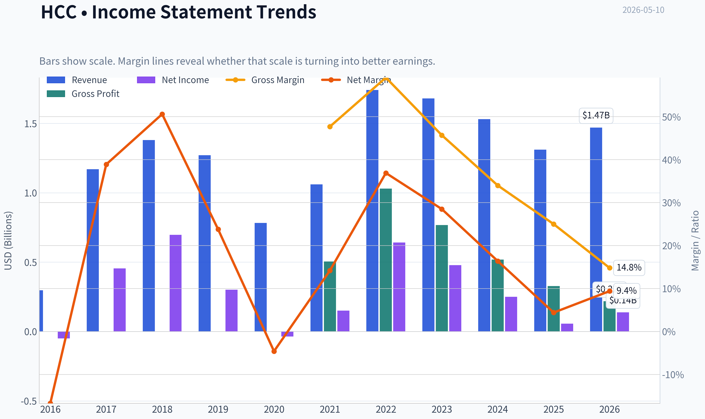

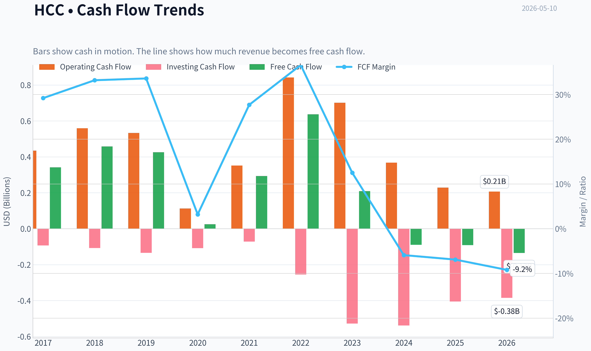

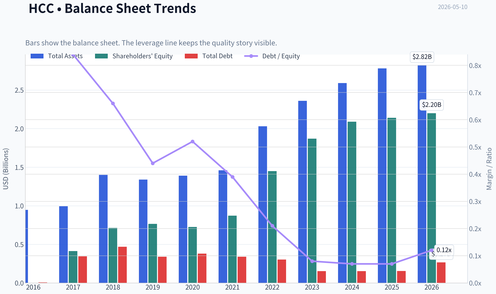

This graph tracks the profitability and return metrics (ROE, ROIC, Margins) of **HCC** over the past decade, highlighting capital efficiency trends.

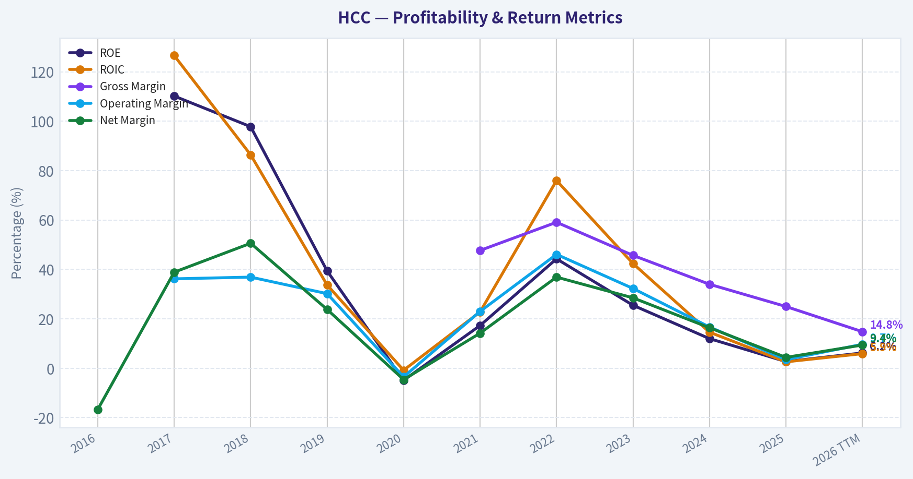

This chart illustrates the financial health of **HCC** over the last 10 years, mapping cash equivalents and free cash flow against total obligations (Debt).

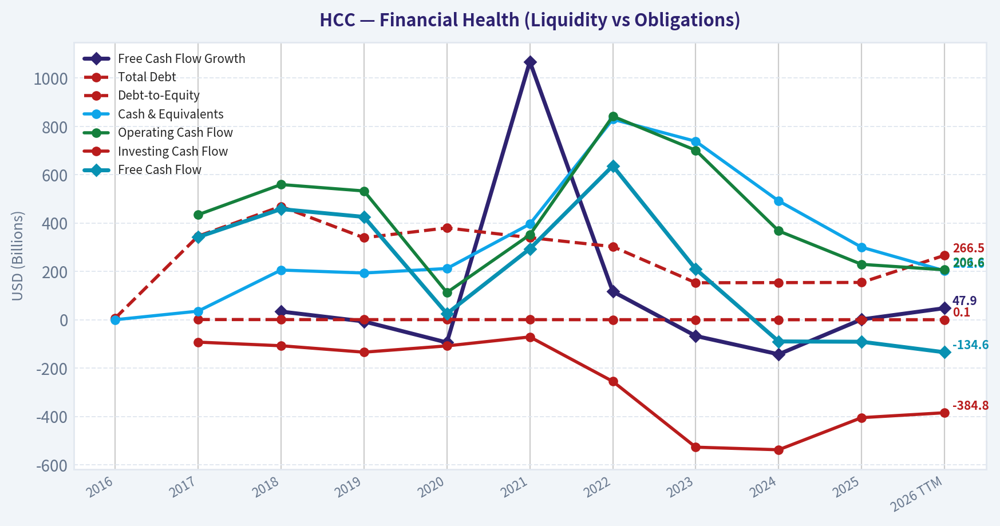

---

### Intrinsic Value Analysis (Buffett)

> *Following Warren Buffett's value investing philosophy: Circle of Competence, Economic Moat, Management Quality, and Margin of Safety.*

#### Intrinsic Value Snapshot

Price is what you pay. Intrinsic value is what the business may be worth based on the cash it can create for owners over time. We show a range, not one magic number.

- Current Price: $85.87
- Value Range: N/A to N/A

##### Owner Earnings (Buffett Method)
- Net Income: $56,998,000.00
- Depreciation & Amortization: N/A
- Capital Expenditures: $-320,261,000.00
- Working Capital Changes: $-30,035,000.00
- Owner Earnings: $-233,228,000.00

##### Intrinsic Value

ANALYST STANCE: **AVOID**

#### HCC (Warrior Met Coal) Buffett-Style Review

I could not retrieve the full audited 10-year financial history from the tools in this run, so this is a **partial but decision-useful** assessment based on the shared research pack and provided earnings context. Even with incomplete history, HCC already fails several Buffett filters.

#### 1) Go/No-Go Gate Assessment

| Gate | Result | Evidence |
|---|---|---|
| Gate 1: Circle of Competence & Simplicity | **Fail** | HCC mines and sells metallurgical coal. The business is simple to explain, but earnings depend heavily on coal pricing, steel demand, and global commodity cycles. That makes 10-year predictability weak. |
| Gate 2: Moat Test | **Fail** | Shared data shows gross margin only **25%**, far below the >40% level that often signals strong pricing power. Commodity producers usually lack durable customer captivity, brand power, or network effects. |
| Gate 3: Management & Capital Allocation | **Inconclusive / Lean Fail** | I do not have enough audited history here to judge buybacks, acquisitions, or long-term per-share value creation. But in cyclical commodity businesses, management quality rarely overcomes the economics of the industry. |
| Gate 4: Industry Structure | **Fail** | Metallurgical coal is capital intensive, cyclical, and exposed to volatile pricing. Industry outcomes are shaped more by supply/demand and cost position than by durable moats. |

Key Takeaways: HCC passes the "simple business" test in the narrow sense, but fails the more important Buffett test of predictability. This is a commodity business with weak moat characteristics and heavy exposure to forces management cannot control. That alone pushes it outside the ideal Buffett universe.

---

#### 2) Elementary School Test

HCC digs metallurgical coal out of the ground and sells it to steelmakers.

That is easy to explain. The problem is not complexity. The problem is that profits depend too much on the selling price of coal, which moves up and down sharply.

#### 3) 10-Year Predictability Test

**Result: Weak**

A Buffett-style investment should be reasonably predictable a decade out. For HCC:

- Revenue growth YoY is **-14.1%**
- FCF yield is **-2.0%**
- Q1 2026 showed a profit rebound, but revenue still missed expectations
- The business is tied to steel production cycles and export met coal pricing

You can predict that the company will probably still mine coal in 10 years. You **cannot** predict normalized earnings with high confidence.

#### 4) Technology Risk Assessment

**Mixed, but not favorable enough**

This is not a software company vulnerable to a new app, but it does face:

- Long-run decarbonization pressure
- Steelmaking process evolution
- Regulatory and ESG capital access pressure

So while the product is currently needed for blast furnace steelmaking, there is meaningful long-term transition risk.

---

#### 5) Moat Analysis

| Moat Source | Assessment | Evidence |
|---|---|---|
| Intangible Assets | **Weak/None** | No meaningful brand moat in coal. Buyers care mainly about quality specs, logistics, and price. |
| Switching Costs | **Low** | Steel producers can source from alternative met coal suppliers if quality and logistics work. |
| Cost Advantage | **Possible but cyclical** | A low-cost mine can help, but cost advantages in commodities are rarely impregnable and can be offset by price swings or operational disruptions. |
| Network Effects | **None** | More customers do not make coal more valuable to other customers. |

| Moat Quality Rating | Conclusion |
|---|---|
| **Illusory to Narrow** | **Reject / very high hurdle** |

Key Takeaways: HCC does not show the classic Buffett moat sources. There is no brand, no network effect, and little customer captivity. At best, it may have a cost position advantage, but cost advantages in commodity markets are rarely durable enough to support premium long-term valuations.

---

#### 6) Management Quality Assessment

Given limited tool output, this section must remain cautious.

| Question | Preliminary View | Comments |
|---|---|---|
| Do they think like owners? | **Unknown** | No reliable ownership/comp details retrieved in this run. |
| Are they honest and candid? | **Unknown** | No letters/restatement review available from current tool output. |
| Are they rational capital allocators? | **Unproven** | In commodity businesses, capital allocation discipline matters a lot, but the underlying business quality still dominates. |

Key Takeaways: I do not have enough evidence to give management a strong positive or negative judgment. But even excellent management cannot turn a cyclical commodity producer into a great business. In Buffett terms, the horse matters more than the jockey here.

---

#### 7) Available Financial Snapshot

| Metric | Value |
|---|---:|
| Current Price | **$86** |
| Market Cap | **$4.53B** |
| P/E | **32.9x** |
| ROE | **2.7%** |
| Gross Margin | **25.0%** |
| Revenue Growth YoY | **-14.1%** |
| FCF Yield | **-2.0%** |
| Current Ratio | **3.19x** |

Key Takeaways: The current snapshot is not consistent with a high-quality Buffett business. ROE is very low, free cash flow yield is negative, and revenue is shrinking. A 32.9x P/E on a cyclical coal producer offers little room for error.

---

#### 8) Owner Earnings Assessment

I cannot calculate a proper Buffett owner earnings figure without the full cash flow and working capital history. But the shared inputs already raise concern:

- **Negative FCF yield**
- Commodity-driven earnings
- Likely high maintenance and development capital needs
- Volatile working capital tied to pricing and volumes

**Preliminary conclusion:** owner earnings are likely **far weaker and more volatile** than accounting earnings imply.

---

#### 9) Valuation and DCF Framing

Because owner earnings are unavailable from the tools, a precise three-scenario DCF would be false precision. But Buffett logic still helps:

| Scenario | Buffett Framing | Implication |
|---|---|---|
| No-Growth | If normalized owner earnings are weak or cyclical, value is much lower than peak-cycle earnings suggest | Not attractive |
| GDP Growth | A commodity producer should not receive a stable compounding multiple unless it has exceptional cost advantage and balance sheet strength | High uncertainty |
| Historical Growth | Historical commodity upcycles are not dependable indicators of future compounding | Should use steep discount / low confidence |

Key Takeaways: A formal DCF is less useful when cash generation is cyclical and hard to normalize. The main valuation insight is simpler: paying a high multiple for a low-visibility commodity business is usually a bad Buffett bet. Without a large margin of safety, this setup is unattractive.

#### Margin of Safety

For a business of this quality, Buffett-style discipline would require at least a **40-50% margin of safety**.

At:
- **32.9x earnings**
- **2.7% ROE**
- **negative FCF yield**
- **declining revenue**

there is **no evident margin of safety**.

---

#### 10) Buffett Scorecard

| Criterion | Weight | Score (1-5) | Weighted Score |
|---|---:|---:|---:|
| Business Understanding | 20% | 4.0 | 0.80 |
| Moat Width & Durability | 25% | 1.5 | 0.38 |
| Management Quality | 15% | 2.5 | 0.38 |
| Return on Equity | 15% | 1.0 | 0.15 |
| Reinvestment Runway | 10% | 1.5 | 0.15 |
| Balance Sheet Strength | 5% | 3.0 | 0.15 |
| Industry Structure | 5% | 1.0 | 0.05 |
| Valuation/Margin of Safety | 5% | 1.0 | 0.05 |
| **Total** | 100% |  | **2.11 / 5.00** |

Key Takeaways: HCC scores well only on business simplicity, not on business quality. The weak moat, poor current profitability metrics, and unattractive valuation drag the total score into clear avoid territory. This is not the profile of a wonderful business selling at a fair price.

---

#### 11) Final Investment Stance

**Stance: AVOID**
**Conviction: Moderately High**

Why:

- Commodity business with weak long-term predictability
- No durable Buffett-style moat
- Low current ROE
- Negative FCF yield
- Revenue contraction
- Valuation appears demanding for the quality and cyclicality

This may trade well tactically when met coal prices rise, and it may interest cyclical or deep-value investors at the right point in the cycle. But under **Buffett principles**, HCC is not the kind of business you would want to own "forever."

#### What would change my view?

I would revisit if all of the following were true:

| Needed Improvement | Why It Matters |
|---|---|
| Much lower price | To create a real margin of safety for a cyclical business |
| Strong normalized FCF across a cycle | To prove true owner earnings power |
| Sustained high returns on capital | To show economics better than a standard commodity producer |
| Evidence of durable low-cost advantage | The only plausible moat in this industry |
| Conservative capital allocation through the cycle | Essential in commodity businesses |

Key Takeaways: The only realistic path to a better rating is a much cheaper stock price plus proof of durable cycle-adjusted cash generation. Without that, this remains a speculation on commodity conditions rather than a Buffett-style investment. If you want, I can next build a **cycle-normalized valuation framework for HCC** using commodity assumptions and sensitivity ranges.
#### Valuation Bridge

This bridge places the current market price beside each intrinsic value lens so readers can see whether upside depends on one method or shows up across several methods.

| Scenario | Intrinsic Value / Share |
| --- | ---: |
| Damodaran Method | $310.09 |
| Current Price | $85.87 |

#### Key Takeaways

If one method is far above the others, the upside case depends on a specific modelling assumption. When several methods cluster together, the valuation story is more robust.

#### Valuation Visuals

This comparison chart from *Latest Earnings Snapshot* stacks current figures against historical benchmarks for **HCC**, making it easy to see where the company trades relative to its own averages.

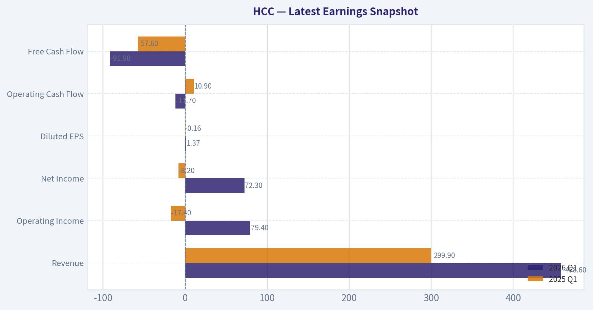

This comparison chart from *Current vs Historical Average Comparison* stacks current figures against historical benchmarks for **HCC**, making it easy to see where the company trades relative to its own averages.

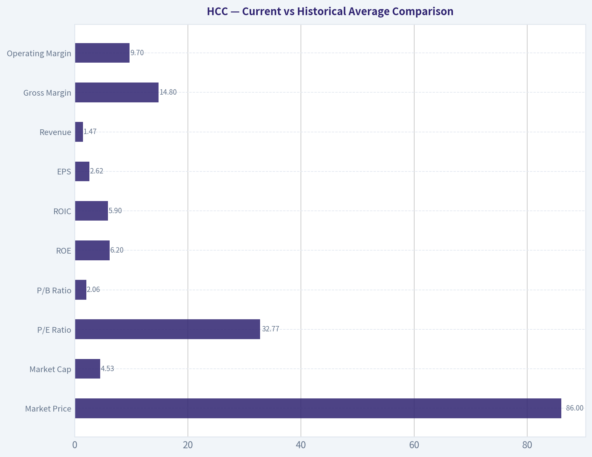

This comparison chart from *Available Financial Snapshot* stacks current figures against historical benchmarks for **HCC**, making it easy to see where the company trades relative to its own averages.

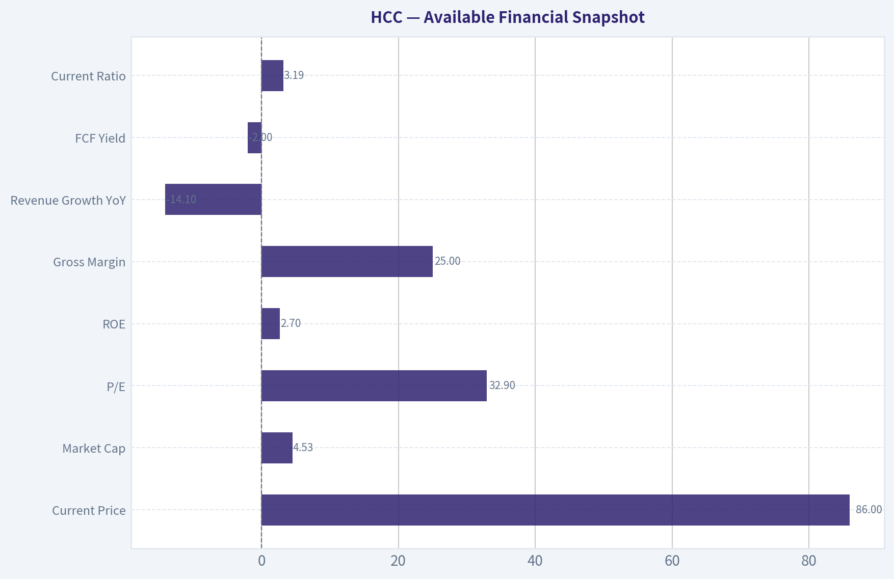

The following chart maps the **HCC** Owner Earnings DCF valuation scenarios (Conservative, Average, Optimistic) to visually represent the margin of safety based on intrinsic value calculations.

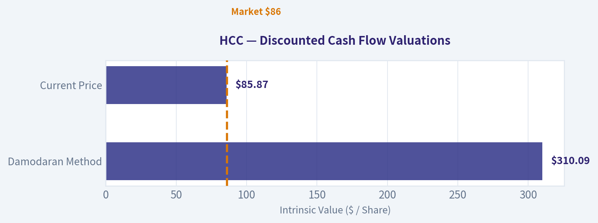

This comparison chart from *Snapshot Fundamentals* stacks current figures against historical benchmarks for **HCC**, making it easy to see where the company trades relative to its own averages.

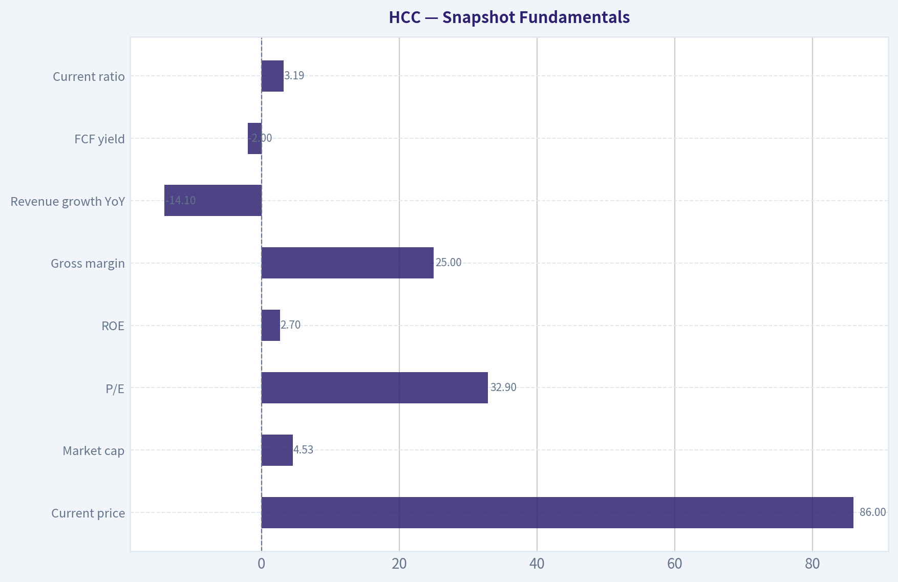

---

### Trend & Growth Analysis (Lynch/Druckenmiller/Fisher)

> *Following Peter Lynch's GARP, Stanley Druckenmiller's macro-aware approach, and Philip Fisher's scuttlebutt methodology.*

ANALYST STANCE: **AVOID**

#### 1. Lynch Classification

| Item | Assessment |
|---|---|
| Company | Warrior Met Coal (NYSE: HCC) |
| Lynch category | **Cyclical** |
| Why | Revenue and earnings are driven primarily by met coal pricing, steel demand, and export/logistics cycles rather than durable secular adoption |
| Growth investor fit | **Poor** |

Key Takeaways: HCC is not a fast grower in the Lynch sense. It is a commodity cyclical whose reported growth can swing sharply with pricing and volumes. That makes it a weak fit for a Fisher-Lynch-Druckenmiller growth framework focused on durable multi-year compounding.

#### 2. The Story in 3 Bullets

- HCC mines premium metallurgical coal used in steelmaking and sells into seaborne export markets.
- When met coal prices are strong and mines run well, profits and cash flow can surge quickly.
- But this is not a secular innovation story; results depend heavily on volatile commodity prices, steel demand, and mine execution.

#### 3. Snapshot Fundamentals

| Metric | Value |
|---|---:|
| Current price | $86 |
| Market cap | $4.53B |
| P/E | 32.9x |
| ROE | 2.7% |
| Gross margin | 25.0% |
| Revenue growth YoY | **-14.1%** |
| FCF yield | **-2.0%** |
| Current ratio | 3.19x |

Key Takeaways: The headline picture is weak for a growth investor. Revenue is shrinking, free cash flow yield is negative, and returns on equity are low. Liquidity is solid, but the operating trend does not support a high-conviction growth case.

#### 4. TAM Analysis and 10x Test

| Item | Assessment |
|---|---|
| End market | Global metallurgical coal for steelmaking |
| TAM character | Large, but cyclical and not structurally attractive for growth investors |
| TAM growth | Likely low-to-moderate at best; tied to steel demand, not a high-growth secular category |
| 10x revenue test | **Theoretical yes**, but not meaningful |
| Why not meaningful | HCC's constraint is not TAM alone; it is reserves, mine capacity, project execution, pricing cycle, and cost curve position |

Key Takeaways: HCC operates in a big market, but size alone does not create a long runway. This is not a software or platform business that can compound through penetration gains. Even if the market is large, HCC's growth ceiling is governed by commodity economics and physical mine constraints.

#### 5. Revenue Growth Trend

| Signal | Assessment |
|---|---|
| Latest YoY revenue growth | **-14.1%** |
| Pattern | **Decelerating / negative** |
| Quality of growth | Mostly price and volume driven, not recurring or subscription-like |
| Implication | **Warning sign** under Druckenmiller inflection framework |

Key Takeaways: The most important growth datapoint is negative. For a growth process, a company with declining revenue starts in the penalty box unless there is a very clear near-term inflection. Here, the burden of proof is high because the business is cyclical by nature.

#### 6. Latest Quarter and Inflection Read

Using the shared pack: Q1 2026 revenue was reported at **$458.6M**, with a swing to profit and record sales volumes, but revenue missed expectations.

| Q1 2026 read | Assessment |
|---|---|
| Revenue | $458.6M |
| Profitability | Swung to profit |
| Volumes | Record sales volumes |
| Market reaction | Stock dipped after revenue miss |
| Inflection type | Possible **volume inflection**, but not yet a clean earnings-quality inflection |
| Overall read | **Mixed**, not decisive |

Key Takeaways: There are early signs of operational improvement because volumes were strong and profitability improved. But the market focused on the revenue miss, which suggests pricing or mix may still be limiting the earnings story. This is not yet the kind of clean acceleration that growth investors usually want to underwrite aggressively.

#### 7. Unit Economics

| Metric | Status |
|---|---|
| LTV/CAC | N/A for mining |
| Net revenue retention | N/A |
| Rule of 40 | N/A |
| Useful substitutes | Cost per ton, realized price per ton, EBITDA margin, FCF conversion, reserve life |

Key Takeaways: Standard SaaS-style unit economics do not apply here. For HCC, the right questions are whether the company sits low on the cost curve, whether realized pricing supports margins, and whether capex converts into durable free cash flow through the cycle. On current evidence, free cash flow is not supporting the bull case.

#### 8. Macro Setup Evaluation

| Macro factor | Assessment |
|---|---|
| Interest rates | Neutral to modest headwind for cyclicals |
| Steel demand backdrop | Cyclical, sensitive to industrial demand |
| China/global industrial activity | Important swing factor |
| Secular trend alignment | **Weak** |
| Druckenmiller macro fit | More of a tactical commodity trade than a secular compounder |

Key Takeaways: HCC does not sit in one of the major secular growth currents like AI, cloud, cybersecurity, or digital payments. It is much more exposed to industrial and commodity cycles. That makes the stock potentially tradable, but less attractive as a compounding growth investment.

#### 9. Fisher 15 Points Score

| Fisher Area | Score (1-5) | Comment |
|---|---:|---|
| Market potential | 2 | Large market, but not high-growth |
| New product development | 1 | Not relevant/limited |
| R&D effectiveness | 1 | Minimal as growth driver |
| Sales organization | 2 | Commodity sales model |
| Profit margin | 2 | Currently modest/volatile |
| Margin improvement | 2 | Unclear, cyclical |
| Labor/personnel relations | 2 | Mining labor risk always relevant |
| Executive relations | 3 | No major red flag from pack |
| Management depth | 3 | Appears adequate |
| Cost analysis/accounting | 3 | Likely solid, but commodity volatility dominates |
| Outstanding moat aspects | 2 | Some asset quality, limited moat |
| Long-range profit outlook | 2 | Highly cyclical |
| Dilution risk | 3 | Not an immediate red flag from pack |
| Candor in difficulties | 3 | No clear evidence either way |
| Integrity | 3 | No clear red flag from pack |

| Total Fisher Score | **34 / 75** |
|---|---|

Key Takeaways: HCC scores poorly on Fisher because it lacks the traits of an innovation-led long-duration grower. The company may own quality assets, but that is not the same as having a durable moat, product-driven expansion, or a long runway of secular growth. On this framework, it falls below investable growth quality.

#### 10. Valuation Analysis

| Metric | Value / View |
|---|---|
| P/E | 32.9x |
| PEG | Not meaningful given cyclical/unstable earnings base |
| P/S | Approx. 2x if annualizing around current scale; not especially useful for mining |
| FCF yield | **-2.0%** |
| Valuation verdict | **Not attractive for a cyclical with shrinking revenue and negative FCF yield** |

Key Takeaways: Valuation does not rescue the story. A 32.9 times earnings multiple is not cheap for a cyclical commodity producer, especially when revenue is down and free cash flow is negative. Even if near-term earnings recover, the current multiple leaves little margin of safety for a non-secular business.

#### 11. Growth Investor Scorecard

| Criterion | Weight | Score (1-5) | Weighted Score |
|---|---:|---:|---:|
| The Story | 10% | 2.0 | 0.20 |
| TAM & Runway | 20% | 2.0 | 0.40 |
| Revenue Growth | 20% | 1.0 | 0.20 |
| Unit Economics | 15% | 2.0 | 0.30 |
| Competitive Position | 10% | 2.5 | 0.25 |
| Management Quality | 10% | 3.0 | 0.30 |
| Macro Setup | 5% | 2.0 | 0.10 |
| Profitability Path | 5% | 2.0 | 0.10 |
| Valuation | 5% | 2.0 | 0.10 |

| Total Score | **1.95 / 5.0** |
|---|---|

Key Takeaways: HCC scores well below the threshold for a growth recommendation. The biggest problem is not management or liquidity; it is the mismatch between the stock's cyclical economics and a framework designed to find durable fast growers. On balance, this belongs in the avoid bucket for this mandate.

#### 12. Position Size Stance

| Stance | View |
|---|---|
| For growth portfolio | **0% position** |
| For cyclical/value/trading book | Only if underwriting met coal price cycle explicitly |
| Monitoring status | Low-priority unless a strong pricing and FCF inflection appears |

Key Takeaways: For this specific growth discipline, HCC should not be sized. It may interest a commodity-cycle investor, but that is a different game with different edge requirements. Until growth, cash flow, and valuation align much better, capital is better deployed elsewhere.

#### 13. Key Risks and Catalysts

| Risks | Catalysts |
|---|---|
| Met coal price declines | Sustained recovery in met coal benchmark pricing |
| Steel demand weakness | Continued record shipment volumes |
| Mine operational disruptions | Better-than-expected cost per ton |
| Cost inflation | Stronger-than-expected FCF conversion |
| Export/logistics issues | Capital returns if balance sheet remains strong |
| Cyclical earnings volatility | Competitor supply disruptions tightening market |

Key Takeaways: There are tradable upside catalysts, especially if pricing and volumes improve together. But the risks are numerous and largely outside management's control, which is exactly why this is a difficult fit for a concentrated growth portfolio.

#### Bottom Line

HCC may be a reasonable **cyclical trade** for investors with a view on steel and met coal. But under a Lynch-Druckenmiller-Fisher growth process, it fails the core tests: revenue is declining, free cash flow is negative, the business lacks secular runway, and valuation is not obviously cheap enough to compensate. For this mandate, the right call is **AVOID**.

#### Growth & Scorecard Visuals

The radar chart below from *Buffett Scorecard* visualises how **HCC** ranks across weighted investment criteria. Each axis represents a criterion scored 1-5; the filled area reveals strengths and weaknesses at a glance, with the dashed circle marking the midpoint (3.0).

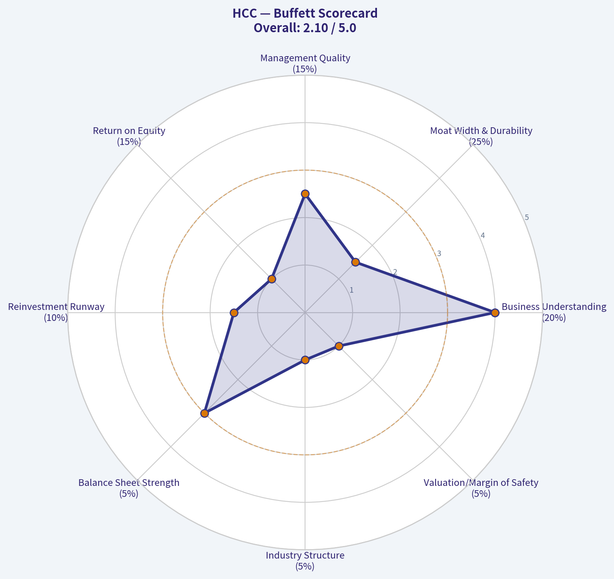

---

### Market Technical Analysis

#### HCC Technical Indicator Selection and Trend Report

For **HCC**, the most relevant set of complementary indicators in the current market context is:

| Indicator | Why it is relevant now |
|---|---|
| close_200_sma | Confirms the long-term primary trend, which remains clearly positive. |
| close_50_sma | Tracks the medium-term trend and helps judge whether the recent pullback is merely corrective or structurally weaker. |
| close_10_ema | Captures short-term momentum shifts and recent loss of upside follow-through. |
| macd | Measures momentum deterioration and helps identify whether downside pressure is still active. |
| rsi | Shows whether the pullback is stretched or just neutral consolidation. |
| boll_ub | Helps assess whether upside breakouts still have expansion potential. |
| boll_lb | Helps define near-term downside support and whether price is approaching an oversold volatility edge. |
| atr | Important for risk management because HCC has recently shown elevated gap and swing behavior. |

Key Takeaways: HCC does not need every possible indicator because several would overlap. The chosen set covers long-term trend, medium-term structure, short-term momentum, reversal risk, volatility boundaries, and trading risk. I excluded VWMA from the final core set because price/volume context is useful, but the selected indicators already provide a more complete decision framework for the current setup.

---

#### Market Structure Overview

HCC's **long-term trend is still decisively bullish**, but the stock is currently in a **short-term corrective phase** after a major advance from mid-2025 into early 2026.

The broad path over the last year is not random. It breaks into several clear phases:

1. **Base and recovery phase (May-June 2025):** price traded mainly in the mid-40s, then weakened into late June near 41.
2. **Powerful re-rating phase (July-January):** the stock advanced from the low-40s to above 100, with especially strong upside bursts in July, November, and January.
3. **Correction and distribution phase (late January-March 2026):** after peaking around 105 in mid-January, price broke lower, showing more violent two-sided trading.
4. **Rebound then stall (March-late April):** HCC rebounded toward the upper-90s but failed to reclaim prior highs.
5. **Current phase (early May 2026):** price is drifting in the mid-80s, below short-term momentum gauges, but still above the major long-term trend baseline.

This is important because the stock is **not in a fresh breakdown from a weak base**. Instead, it is **digesting a prior major uptrend**. That difference matters for traders: bearish signals should be interpreted as caution inside a larger bull structure unless deeper support levels fail.

---

#### Trend and Moving Average Analysis

The moving averages give a very nuanced picture.

- **200 SMA: 77.49 on 2026-05-08**, rising steadily from about 69 in mid-March.
- **50 SMA: 87.74 on 2026-05-08**, slightly declining from about 89.66 in mid-March.
- **10 EMA: 87.19 on 2026-05-08**, below both the recent price ceiling and slightly below the 50 SMA.

This alignment tells us:

- The **primary trend remains up** because price is still well above the **200 SMA**, and that long-term average is still climbing at a healthy slope.
- The **medium-term trend has flattened to slightly negative** because the **50 SMA has rolled over modestly**.
- The **short-term trend is weak** because the **10 EMA has turned down** and remains below recent recovery peaks.

The 50 SMA and 10 EMA are both clustered around the high-87 area, while price closed at **85.87** on 2026-05-08. That means HCC is currently trading **under both short- and medium-term dynamic resistance levels**, a sign that buyers are not yet in firm control.

The important nuance is that the 50 SMA is not collapsing; it is **drifting lower**, not plunging. That usually describes a **corrective pause within a larger trend**, not a full trend reversal. However, as long as price remains below the 10 EMA and 50 SMA, rallies are vulnerable to failing.

| Trend Measure | Latest Reading | Direction | Interpretation |
|---|---:|---|---|
| close_200_sma | 77.49 | Rising | Long-term bull trend remains intact |
| close_50_sma | 87.74 | Slightly falling | Medium-term structure has softened |
| close_10_ema | 87.19 | Falling | Short-term momentum still weak |
| Last close (2026-05-08) | 85.87 | Below 10 EMA and 50 SMA | Near-term recovery is not yet confirmed |

Key Takeaways: HCC is still in a long-term uptrend because the 200-day average is rising strongly and sits far below current price. But in the nearer term, the stock is below both its 10-day EMA and 50-day SMA, which means short-term control remains with sellers unless price can reclaim the high-87 area.

---

#### Momentum Analysis: MACD and RSI

Momentum has clearly deteriorated from the March rebound.

- **MACD on 2026-05-08: -0.63**
- MACD was strongly positive in late March and early April, peaking above **2.5**
- Since then it has steadily weakened, crossed into negative territory, and remains below zero

This is not just a minor wobble. The MACD pattern shows that the strong rebound from March lost force materially. Momentum has gone from **expansionary bullish** to **contracting and mildly bearish**. Still, the latest readings are not accelerating sharply downward; they suggest **persistent but not panicked downside momentum**.

- **RSI on 2026-05-08: 45.41**
- RSI has mostly ranged between **41 and 53** over the past month

That RSI behavior is quite revealing. HCC is **not oversold** in the classic sense. The stock has weakened, but the selling pressure has not yet become climactic. An RSI in the mid-40s often describes a stock in **neutral-to-bearish consolidation**, not a capitulation low. This means:
- aggressive dip-buyers do not yet have a strong oversold signal,
- but bears also lack an extreme momentum washout confirmation.

The combination of **negative MACD** and **mid-40s RSI** suggests a stock that is **grinding lower or sideways-down**, rather than cascading lower. That often creates frustrating conditions for momentum traders because neither breakout strength nor washout reversal conditions are fully present.

| Momentum Indicator | Latest Reading | What it suggests |
|---|---:|---|
| macd | -0.63 | Momentum has turned bearish relative to prior rebound |
| rsi | 45.41 | Mildly weak, but not oversold |
| Momentum regime | N/A | Corrective rather than capitulative |

Key Takeaways: Momentum has clearly cooled from the strong March rebound, with MACD now below zero and still soft. RSI near 45 says the stock is weak but not deeply oversold, so this looks more like an ongoing correction than a final washout low.

---

#### Volatility and Price Envelope Analysis

Bollinger Bands and ATR help frame the current trading zone.

Latest available:
- **Bollinger Upper Band: 90.92**
- **Bollinger Lower Band: 84.17**
- **Close: 85.87**
- **ATR: 4.21**

This places HCC in the **lower half of its Bollinger range**, much closer to the lower band than the upper band. That matters because:
- the market is currently pricing HCC closer to a **short-term support/oversold boundary** than to a breakout zone,
- but price has **not yet tagged the lower band decisively**, so a volatility-based reversal signal is still incomplete.

The Bollinger structure is also narrowing versus the much wider ranges seen in April. That indicates **less explosive directional energy** than during the sharp swings earlier in the correction. In practice, this supports the idea of a **compression phase**, where the stock is trying to stabilize after prior turbulence.

ATR near **4.21** remains elevated enough to matter. On an $85-$86 stock, that is substantial daily movement potential. Traders should assume:
- stops placed too tightly can be easily shaken out,
- breakouts need room,
- position sizing should be smaller than for a calmer stock.

The large gap-down / wide-range day on **2026-05-01** reinforces that HCC can still produce abrupt repricing moves.

| Volatility Measure | Latest Reading | Interpretation |
|---|---:|---|
| boll_ub | 90.92 | Near-term breakout resistance zone |
| boll_lb | 84.17 | Near-term volatility support zone |
| Last close | 85.87 | Trading closer to lower band than upper band |
| atr | 4.21 | Daily range risk remains meaningful |

Key Takeaways: HCC is currently trading near the lower end of its recent volatility envelope, which means it is closer to support than breakout territory. ATR remains elevated, so traders should expect meaningful daily swings and use wider, volatility-aware risk controls.

---

#### Fine-Grained Read on the Current Setup

The most important near-term technical question is whether HCC is:

1. **building a base in the mid-80s**, or
2. **pausing before another leg lower**.

Right now, the evidence slightly favors **base-building but unconfirmed**.

Why base-building is plausible:
- Price remains far above the rising 200 SMA.
- RSI is weak but not collapsing.
- The 50 SMA is flattening rather than breaking sharply downward.
- Price is hovering not far above the lower Bollinger Band, where buyers sometimes begin to defend.

Why the setup is still unconfirmed:
- MACD remains negative.
- Price is still below the 10 EMA and 50 SMA.
- Recent rebounds have lacked enough strength to reclaim the low-90s.
- The stock has been making **lower recovery highs** since the late-March/early-April rebound peak.

That lower-high pattern is crucial. HCC's corrective phase is not just about falling price; it is about **diminishing rebound quality**. Each bounce has so far failed before proving trend resumption. Until that changes, swing traders should treat rallies as tentative.

---

#### Tactical Interpretation for Traders

| Trader Type | What matters most now | Practical implication |
|---|---|---|
| Trend followers | 200 SMA rising, price above it | Long-term structure still constructive; avoid confusing correction with full trend failure |
| Swing bulls | Reclaim of 10 EMA and 50 SMA near 87.2-87.7 | Need price to retake this zone to improve near-term odds |
| Mean-reversion traders | Price near lower Bollinger zone, RSI mid-40s | Not oversold enough for a high-conviction snapback yet |
| Risk managers | ATR above 4 | Stops and size must account for elevated daily range |
| Momentum bears | Negative MACD, price below short averages | Short-term edge exists, but it is weaker if price stabilizes above the mid-80s |

Key Takeaways: Different trading styles will read HCC differently. Long-term trend traders can still view the stock as structurally healthy, but swing traders need proof that price can recover back above the high-87 area before treating the current action as a renewed bullish trend.

---

#### Levels and Decision Zones

Using the indicators and recent price behavior, the important zones are:

| Zone | Approx. Level | Why it matters |
|---|---:|---|
| Immediate support | 84.2-85.0 | Near lower Bollinger Band and recent trading shelf |
| Pivot support | 82-83 | If broken, correction likely deepens |
| First resistance | 87.2-87.7 | 10 EMA and 50 SMA cluster |
| Secondary resistance | 90.9-91.0 | Bollinger upper band / recovery hurdle |
| Major trend support | 77.5 | Rising 200 SMA, key long-term structural level |

Key Takeaways: The mid-80s are the first area buyers need to defend to keep the correction contained. On the upside, HCC needs to regain the high-87s first, and then the low-91 area, before a stronger bullish reversal case becomes credible.

---

#### Bottom Line

HCC is in a **short-term corrective and mildly bearish momentum phase**, but it remains inside a **larger long-term bullish structure**.

The most important message from the selected indicators is not simply "mixed." It is more specific:

- **Long-term trend:** still healthy and upward sloping.
- **Medium-term structure:** softening but not broken.
- **Short-term momentum:** bearish and still not repaired.
- **Volatility condition:** elevated, with price leaning toward support rather than breakout.
- **Reversal status:** possible stabilization, but no strong confirmation yet.

For traders, the stock currently looks more like a **watchlist candidate for a setup improvement** than an immediate momentum long. A convincing move back above the **87-88 zone** would materially strengthen the case for a tradable rebound. Failure to hold the **84-85 zone** would increase the odds of a deeper retracement toward the low-80s, and eventually make the rising 200 SMA the larger structural reference.

---

#### Summary Table

| Category | Indicator | Current Signal | Trading Meaning |
|---|---|---|---|
| Long-term trend | close_200_sma | Rising strongly, price above it | Primary trend remains bullish |
| Medium-term trend | close_50_sma | Flattening/slightly declining | Correction is pressuring trend structure |
| Short-term trend | close_10_ema | Falling, price below it | Near-term momentum still weak |
| Momentum | macd | Negative | Rebound energy has faded |
| Momentum stretch | rsi | ~45 | Weak but not oversold |
| Volatility boundary | boll_ub | ~90.9 | Upside breakout hurdle |
| Volatility boundary | boll_lb | ~84.2 | Near-term support zone |
| Risk control | atr | ~4.2 | Use wider stops and smaller size |

Key Takeaways: HCC still has a constructive long-term chart, but the shorter-term evidence remains cautious. The stock is not showing panic selling, yet it also has not regained the momentum needed for a cleaner bullish entry, so the next key test is whether it can hold support in the mid-80s and reclaim resistance near 87 to 88.

---

### News & Events Analysis

#### Warrior Met Coal (NYSE: HCC) - 1-Week Trading & Investment Report

Warrior Met Coal remains a **met-coal cyclical with improving near-term operating momentum but still exposed to steel-demand and pricing volatility**. Over the last week, the key tradable development was **Q1 2026 earnings**, where the company **swung back to profit and posted record sales volumes**, but the stock reaction was muted to negative because **revenue and EPS missed expectations**. For traders, that setup matters: the market appears to be rewarding **volume recovery and operational normalization**, but still discounting the name for **pricing pressure and uncertain macro follow-through**.

The shared valuation/fundamental pack reinforces that tension. HCC screens as a company with **negative YoY revenue growth (-14.1%)**, **low ROE (2.7%)**, and **negative FCF yield (-2.0%)**, which suggests the market is not yet willing to fully capitalize the Blue Creek/production recovery story at a premium without stronger cash conversion. At the same time, the stock's **P/E of ~32.9x** looks optically high for a coal producer, implying current earnings remain depressed relative to normalized mid-cycle profits.

---

#### Latest earnings: Q1 2026 was the key catalyst

The most recent reported period is **Q1 2026**, reported around **April 30, 2026**. Based on the earnings coverage in the research pack:

- **Net income:** **$72.3 million**
- **Diluted EPS:** **$1.37**
- **Revenue:** **$458.6 million**
- Coverage characterized the quarter as a **swing to profit**
- The company also posted **record sales volumes**
- However, both **revenue and EPS missed analyst expectations**
- The stock reportedly **fell about 3% after the release**

The important change versus the prior period is not just the headline profit, but the **operating recovery** embedded in volumes. Warrior appears to be moving beyond a weaker comparison base and regaining shipment momentum. However, the miss versus consensus indicates that **pricing, mix, costs, or timing were not strong enough to fully translate that volume strength into upside versus Wall Street expectations**.

Just as important, analysts did **not** respond as though this was a structurally impaired quarter. The shared pack notes **UBS maintained Buy**, trimming its price target only slightly from **$104 to $102** after results. That suggests the Street still sees value in Warrior's longer-cycle earnings power, but with a modestly lower near-term confidence level.

| Earnings item | Latest reported period | Headline read-through | Trading interpretation |
|---|---:|---|---|
| Revenue | Q1 2026: **$458.6M** | Missed expectations | Demand/shipments improved, but realized pricing or mix likely limited upside |
| Net income | Q1 2026: **$72.3M** | Returned to profitability | Positive sign that operations are recovering from a weaker prior base |
| EPS | Q1 2026: **$1.37** | Missed consensus | Profit recovery is real, but not yet strong enough to force estimate upgrades |
| Volumes | **Record sales volumes** | Strong operational marker | Bullish for mine execution and export flow; supports future quarters if pricing stabilizes |
| Market reaction | Stock down about **3%** post-print | Investors focused on miss over recovery | Near term, HCC trades more on realized price/cash flow than pure tonnage growth |
| Analyst response | UBS **Buy**, PT cut to **$102** from $104 | Mild reset, not thesis break | Street still constructive, but less aggressive on near-term upside |

**Key Takeaways:** Warrior Met Coal's first quarter of 2026 showed a real operational rebound, with profits returning and sales volumes reaching a record. But the market cared more about the revenue and earnings miss than the volume strength, which tells investors that pricing and cash generation still matter more than simple production growth. The quarter was encouraging, but not decisive enough to remove skepticism.

---

#### What changed versus prior period or prior expectations?

The most meaningful change versus the earlier backdrop is that Warrior has moved from a **more disrupted or pressured earnings base into renewed profitability**, helped by stronger shipments. That is a constructive signal for the production side of the thesis. But against prior expectations, the quarter disappointed because consensus likely assumed **better monetization of those volumes**.

In plain terms:

- **Better than prior operating condition:** higher shipments, restored earnings power
- **Worse than hoped by the market:** insufficient pricing/cash-flow conversion
- **Implication:** if met coal prices firm, HCC has leverage; if prices weaken, the recovery can stall in equity terms even if mines run well

That distinction is critical for investors. HCC currently looks more like a **beta play on met-coal price realization with improving execution**, not a pure self-help story insulated from the macro.

---

#### Company-specific news flow over the past week

Recent HCC-specific news in the pack was tightly centered around earnings and technical positioning:

1. **Q1 2026 earnings release and call presentation**
   - Reinforced the return to profit and high shipment levels
   - Suggests management is executing operationally

2. **Post-earnings analyst commentary**
   - UBS stayed constructive with a **Buy**, only a small PT reduction
   - This is a mildly positive signal: estimates may need trimming, but the broader thesis survives

3. **Momentum/technical commentary**
   - ChartMill flagged a **strong technical breakout setup**
   - That matters for short-term traders because HCC often trades in sharp momentum bursts tied to commodity moves and revisions in steel sentiment

The stock therefore sits at an interesting junction: **fundamental recovery is underway, but not yet fully validated by earnings quality**. That can produce outsized moves in either direction depending on met coal benchmark updates and steel-market sentiment.

---

#### Macro and industry context that matters for HCC

For Warrior Met Coal, the macro lens should be narrower than "energy" and more focused on **global steel production, blast furnace utilization, trade policy, and seaborne coking coal prices**.

Key macro drivers likely influencing the name right now:

- **Global steel demand remains uneven**
  - Construction softness in parts of China can pressure steel production and coking coal demand
  - India and some ex-China regions remain relatively better supports for seaborne coal demand

- **Price sensitivity is high**
  - HCC's earnings are highly leveraged to changes in met-coal benchmark pricing
  - Even with strong volumes, weaker realized pricing can compress margins quickly

- **Trade and tariff headlines matter indirectly**
  - Any policy that supports domestic or allied steel production can help blast furnace utilization and sentiment toward met coal
  - But global trade friction can also distort flows and increase volatility in export markets

- **Freight/logistics and port flow remain important**
  - Because HCC exports, logistics normalization can support realized shipments
  - Conversely, any disruption can hit quarterly timing and revenue recognition

- **Capital intensity remains relevant**
  - Negative FCF yield in the shared pack suggests investors should stay focused on capex discipline and Blue Creek execution, not just headline earnings

Overall, the macro backdrop is **tradable but not cleanly bullish**. The better way to frame it is: **if global steel sentiment stabilizes, HCC has strong upside torque; if steel demand disappoints, earnings misses can reappear quickly despite good mine performance**.

---

#### Positioning and shareholder context

The shared 13F snapshot shows:

- **Mohnish Pabrai** remained a large holder, with about **1.80M shares**
- **Steve Cohen / Point72** initiated a smaller position

This is not a near-term catalyst by itself because 13F data is lagged, but it does indicate HCC continues to attract both **deep-value/cycle investors** and **tactical hedge-fund interest**. That combination can amplify moves around earnings and commodity-price shifts.

| Positioning signal | Detail | Why it matters |
|---|---|---|
| Deep-value sponsorship | Pabrai held a large position | Suggests some investors still see substantial upside to normalized value |
| Tactical fund interest | Point72 initiated a position | Indicates HCC is also on the radar as a shorter-cycle trading vehicle |
| Lag caveat | 13F data is as of 12-31-2025 | Useful for ownership context, but not proof of current positioning |

**Key Takeaways:** Ownership data suggests Warrior Met Coal attracts both conviction value investors and more tactical funds. That mix often leads to sharper moves around earnings, steel-market data, and commodity-price changes. Investors should use 13F information as context, not as a real-time signal.

---

#### Trading and investment view

Near term, HCC looks like a **"show-me" recovery trade**.

**Bull case over the next few weeks to months**
- Q1 proved **operational recovery is real**
- Record volumes create leverage if met-coal prices improve
- Analyst support remains constructive
- If steel sentiment firms, HCC can rerate quickly because the stock still reflects skepticism around sustainability

**Bear case**
- Revenue decline in the broader fundamental pack and the Q1 miss show that **earnings quality is still fragile**
- Negative FCF yield means equity holders still need confidence that production growth converts into cash
- If coking coal prices weaken or Chinese steel demand disappoints, the stock may struggle even with good mine execution

**Most actionable interpretation**
- For **short-term traders**, HCC is more attractive on **commodity-price confirmation and technical follow-through** than on the earnings print alone
- For **medium-term investors**, the name remains interesting if you believe **Q1 volume strength is the start of a multi-quarter normalization** and that met-coal pricing will not deteriorate materially
- For **risk-aware investors**, the key watch items are **realized coal pricing, Blue Creek/capex progress, and free-cash-flow conversion**, not just EPS

---

#### Bottom line

Warrior Met Coal's latest quarter was **better operationally than the headline stock reaction suggests**, but not strong enough to erase macro and pricing risk. The company is now showing **profit recovery and record volumes**, yet the market is demanding clearer evidence that those tons can produce **stronger realized revenue, margin expansion, and free cash flow**. That keeps HCC in the category of a **high-beta cyclical with improving internals**, rather than a fully confirmed turnaround.

| Category | Current signal | Investment implication |
|---|---|---|
| Earnings | Q1 2026 profit recovery, but revenue/EPS miss | Constructive, though not strong enough for all-clear bullishness |
| Operations | Record sales volumes | Execution improved; supports future upside if pricing cooperates |
| Valuation/fundamentals | High P/E, low ROE, negative FCF yield | Market still pricing in uncertainty and depressed quality of earnings |
| Analyst sentiment | UBS stayed Buy, slightly lower PT | Street remains positive but more measured |
| Macro exposure | Strong sensitivity to steel demand and met-coal pricing | Commodity backdrop remains the main driver of upside/downside |
| Trading setup | Recovery plus technical interest | Best suited to investors comfortable with cyclical volatility |

**Key Takeaways:** Warrior Met Coal is improving operationally, but investors still need proof that higher volumes will translate into stronger pricing and cash flow. The stock can work well if steel and met-coal markets stabilize, but it remains vulnerable to macro disappointment. In short, this is a leveraged cyclical recovery story, not a defensive compounder.

---

### Guru Attention Analysis

> *Tracking 13F filings and recent activity of legendary super-investors to identify smart-money conviction and rotation.*

#### HCC Guru Ownership Snapshot

Below is the canonical 13F-based view for **Warrior Met Coal (NYSE: HCC)** as of **2026-05-10**. Per the structured SEC 13F data, only **Mohnish Pabrai** and **Steve Cohen** show a detected position among the tracked gurus.

| Guru | Status in Latest 13F | Action | Position Size | Portfolio Weight | Recent Change | Filing Period | SEC Verification |
|---|---|---|---:|---:|---|---|---|
| Mohnish Pabrai | Position detected | Held | 1.80M shares / $158.69M | 39.47% | 0.0% vs prior filing | 12-31-2025 | [SEC 13F Filing](https://www.sec.gov/Archives/edgar/data/1549575/000154957526000002/) |
| Steve Cohen | Position detected | Initiated | 39.21K shares / $3.46M | 0.00% | New position vs prior filing | 12-31-2025 | [SEC 13F Filing](https://www.sec.gov/Archives/edgar/data/1603466/000090266426001100/) |
| Warren Buffett | No position detected in latest 13F filing | - | - | - | - | Latest structured check | - |
| Seth Klarman | No position detected in latest 13F filing | - | - | - | - | Latest structured check | - |
| Bill Ackman | No position detected in latest 13F filing | - | - | - | - | Latest structured check | - |
| Stanley Druckenmiller | No position detected in latest 13F filing | - | - | - | - | Latest structured check | - |
| Michael Burry | No position detected in latest 13F filing | - | - | - | - | Latest structured check | - |

Key Takeaways: The only clearly reported guru holders of HCC in the latest structured 13F data are Mohnish Pabrai and Steve Cohen. Pabrai's stake is the standout by far, representing a very large 39.47% of his disclosed portfolio, while Cohen's position is small and newly initiated. None of the other primary tracked gurus show a detected position in the latest 13F-based coverage.

#### Guru-by-Guru Interpretation

| Guru | Interpretation |
|---|---|
| Mohnish Pabrai | **High-conviction holder.** HCC remained unchanged versus the prior filing, which suggests continued conviction rather than a short-term trade. At nearly 40% of disclosed holdings, this is a concentrated bet. |
| Steve Cohen | **New but low-conviction-sized position.** Point72 initiated HCC in the latest filing, but the portfolio weight rounds to 0.00%, indicating it is immaterial relative to the broader fund. |
| Warren Buffett | No position detected in latest 13F filing. |
| Seth Klarman | No position detected in latest 13F filing. |
| Bill Ackman | No position detected in latest 13F filing. |
| Stanley Druckenmiller | No position detected in latest 13F filing. |
| Michael Burry | No position detected in latest 13F filing. |

Key Takeaways: The main signal here is concentration. Pabrai's unchanged, outsized stake is the strongest guru endorsement of HCC, whereas Cohen's buy looks more like a small exploratory or tactical position. For the rest of the marquee investors, there is no 13F evidence of ownership, so investors should not assume involvement.

#### What This Means for Investors

- **Strongest guru signal:** **Mohnish Pabrai**
  - Held steady at **1.80M shares**
  - Position value of **$158.69M**
  - Massive **39.47%** portfolio weight
  - This is the clearest evidence of deep conviction in HCC

- **Secondary signal:** **Steve Cohen**
  - Newly initiated **39.21K shares**
  - Value of **$3.46M**
  - Very small relative weight
  - Meaningful as a new entry, but not yet a high-conviction portfolio position

- **No evidence of ownership** in the latest structured 13F data for:
  - Warren Buffett
  - Seth Klarman
  - Bill Ackman
  - Stanley Druckenmiller
  - Michael Burry

#### Verification Links

- Mohnish Pabrai (Dalal Street LLC): [SEC 13F Filing](https://www.sec.gov/Archives/edgar/data/1549575/000154957526000002/)
- Steve Cohen (Point72 Asset Management): [SEC 13F Filing](https://www.sec.gov/Archives/edgar/data/1603466/000090266426001100/)

Additional EDGAR browse pages:
- Mohnish Pabrai: [All 13F Filings](https://www.sec.gov/cgi-bin/browse-edgar?action=getcompany&CIK=0001549575&type=13F-HR&dateb=&owner=include&count=5)
- Steve Cohen: [All 13F Filings](https://www.sec.gov/cgi-bin/browse-edgar?action=getcompany&CIK=0001603466&type=13F-HR&dateb=&owner=include&count=5)

#### Bottom Line

The guru ownership story in HCC is simple: **Pabrai is the major conviction holder, Cohen is a small new entrant, and the other tracked superstar investors do not show a position in the latest 13F data.** If you are following guru behavior for confirmation, **Pabrai is the only signal that currently looks truly substantial.**

---

### Options Market Analysis

> *Reading options flow - put/call ratios, IV skew, and unusual activity - to gauge institutional positioning and event-driven risk.*

#### HCC Options Positioning Report
*Date: 2026-05-10*

#### 1. Put/Call Ratio Analysis

| Expiration | Call OI | Put OI | Put/Call OI Ratio | Call Vol | Put Vol | Put/Call Vol Ratio |
|---|---:|---:|---:|---:|---:|---:|
| 2026-05-15 | 7,144 | 1,200 | 0.17 | 89 | 38 | 0.43 |
| 2026-06-18 | 63 | 98 | 1.56 | 11 | 15 | 1.36 |
| 2026-07-17 | 6,289 | 313 | 0.05 | 373 | 133 | 0.36 |
| **Near-term total** | **13,496** | **1,611** | **0.12** | **473** | **186** | **0.39** |

**Key Takeaways:** HCC's aggregate put/call open-interest ratio of **0.12** is far below the usual neutral area of about **0.7**, which points to a strongly call-heavy options book. Volume also favors calls, with a put/call volume ratio of **0.39**, suggesting current flow is leaning bullish rather than just reflecting stale positioning. The one exception is June, where small open interest makes the ratio less reliable.

**Interpretation:**
- The **overall options positioning is decisively call-dominant**.
- Relative to the historical neutral baseline (~0.7), **0.12 is an extreme skew toward calls**, indicating either bullish speculation or potentially some covered-call/opening call structure activity.
- Because this call dominance shows up in both **OI** and **trading volume**, it looks like more than just legacy positioning.
- Caveat: HCC appears to have **somewhat uneven chain liquidity**, especially in June, so confidence should be reduced slightly when interpreting individual expirations.

---

#### 2. Implied Volatility (IV) Assessment

| Expiration | ATM Call IV | ATM Put IV | IV Read |
|---|---:|---:|---|
| 2026-05-15 | 67.1% | 62.5% | Elevated, call IV above put IV |
| 2026-06-18 | 54.5% | 53.3% | Moderately elevated, balanced |
| 2026-07-17 | 50.7% | 23.9% | Strong call premium vs put IV |

**Key Takeaways:** Near-term IV is elevated, especially in the front week, where ATM implied volatility is in the **low-to-upper 60s**. What stands out most is that **call IV is above put IV**, especially in May and July, which is the opposite of the classic downside-fear pattern. That suggests traders are paying more for upside optionality than downside protection.

**IV skew interpretation:**
- Typical equity options often show **put skew**, where OTM puts carry richer IV due to demand for hedging.
- Here, based on available ATM call/put IV comparisons, **HCC shows a call-leaning skew**, or at minimum an absence of meaningful downside fear.
- The **July 2026 chain is especially notable**: call IV at **50.7%** versus put IV at **23.9%** is a sharp upside premium.
- That kind of structure often signals **upside chase, event anticipation, or thin-chain distortions**. Given the uneven OI distribution, part of this skew may be due to **illiquidity**, but it still leans bullish in directional interpretation.

**Catalyst check:**
- The front-week IV at **67.1% / 62.5%** suggests the market may be pricing a **near-term catalyst or event risk**.
- Without a confirmed event calendar from the dataset, this should be treated as a **possible catalyst premium**, not a certainty.

---

#### 3. Unusual Options Activity

| Observation | Result |
|---|---|
| Volume > 5x Open Interest screen | No qualifying contracts found |
| Read-through | No clear fresh "smart-money" block or sweep-style signal in near-term listed data |

**Key Takeaways:** There were **no contracts flagged with volume greater than five times open interest**, so there is no standout fresh institutional bet from this screen. That lowers conviction slightly because the bullish read is coming more from the broader structure of the options chain than from a single aggressive trade.

**Interpretation:**
- No high-conviction unusual activity means we **do not have a clean, fresh directional tell** from outsized contract-level flow.
- That said, the broader chain still shows **persistent call-heavy positioning**.
- In practical terms, this looks more like **steady bullish bias** than an obvious one-day institutional options sweep.

---

#### 4. Open Interest Concentration

| Expiration | Notable OI Pattern | Implication |
|---|---|---|
| 2026-05-15 | Heavy call concentration overall (7,144 calls vs 1,200 puts) | Near-expiry price may be influenced by call-side dealer hedging/pinning behavior |
| 2026-06-18 | Very small chain (63 calls, 98 puts) | Limited informational value; likely weak pinning influence |
| 2026-07-17 | Very large call concentration (6,289 calls vs 313 puts) | Call-side gamma exposure could amplify upside if spot pushes toward active strikes |

**Key Takeaways:** The dominant feature in HCC's options book is **large call open interest in May and July**, with very little put open interest by comparison. That creates the conditions for **call-side gamma effects**, where dealer hedging can either help pin the stock near major strikes or accelerate upside if the stock starts moving through them.

**Interpretation:**
- We are not given exact strike-by-strike OI concentrations, so specific **max pain** and precise **gamma wall** levels cannot be calculated from this dataset.
- Still, the **very large call OI imbalance** suggests the chain's gravitational pull is more likely to come from **call-heavy strikes** than put-heavy downside hedges.
- If HCC trades near a crowded call strike into expiry, you could see **pinning**. If it breaks through, **dealer hedging could reinforce upside momentum**.

---

#### 5. Overall Options Sentiment Signal

| Category | Signal |
|---|---|
| Directional read | **BULLISH** |
| Confidence level | **Moderate** |
| Primary driver | Extremely low aggregate put/call OI ratio, call-favored volume, and upside-leaning IV structure |

**Key Takeaways:** The options market in HCC is signaling **bullish positioning**, driven mainly by a very call-heavy open-interest profile and continued call-favored trading volume. The absence of unusual large-lot activity keeps confidence from being high, but the broader setup still leans clearly positive.

**Bottom line:**
HCC's options market currently reads as **BULLISH**, not neutral. The main reason is the **extremely low near-term put/call OI ratio of 0.12**, combined with a **put/call volume ratio of 0.39**, showing that both existing positioning and recent flow favor calls. The additional fact that **call IV exceeds put IV** in key expirations argues that traders are paying up for upside exposure rather than downside protection.

**Caveats:**
- The chain appears **somewhat thin/uneven in liquidity**, especially outside the largest expirations.
- No major unusual contract activity was flagged, so this is **broad sentiment evidence**, not a single high-conviction smart-money alert.
- Options data is **forward-looking positioning**, not a valuation signal.

---

#### Summary Table

| Metric | Reading | Interpretation |
|---|---|---|
| Put/Call Ratio | OI: **0.12**; Volume: **0.39** | Strong call dominance; bullish vs neutral baseline |
| IV Level | Front-week ATM IV **67.1% calls / 62.5% puts** | Elevated near-term premium, possible catalyst pricing |
| Skew Direction | **Call-skew / upside premium** | More demand for upside optionality than downside hedging |
| Unusual Activity | **None flagged** | No standout fresh block/sweep, but broad structure still bullish |
| Overall Signal | **BULLISH** | Primary driver is overwhelming call-heavy positioning |

**Key Takeaways:** HCC's options market is tilted toward **upside participation**, not protection. The signal is bullish because calls dominate both open interest and current flow, while implied volatility also favors upside exposure.

---

## Research Team Commentary

> *The Research Manager synthesizes the Bull vs Bear debate into action-free commentary. This is a pre-risk view, not the final stance.*

The strongest bull argument is that Warrior Met Coal is being judged on trough-like conditions rather than normalized earning power. The business owns scarce premium metallurgical coal assets, operates in a market where quality and logistics do matter, and recent earnings did rebound to $72.3 million of net income on $458.6 million of revenue. If met coal pricing and operations recover, today's P/E and returns on capital likely understate through-cycle economics. The valuation gap is the heart of the bull case: if anything close to the cited intrinsic value range is credible, the stock could be materially undervalued.

The strongest bear argument is that this still fails the Buffett test on business quality. Premium met coal is not the same as a true moat when pricing is largely benchmark-driven and returns are this weak: ROE 2.7%, ROIC 2.4%, ROA 2.0%, negative FCF yield, revenue down 14.1%, and net income down 77.3% year over year. That combination says price taker, not durable compounder. The bear is also right that commodity DCFs are fragile; a $310 valuation can swing dramatically with assumptions. For a capital-intensive miner facing steel-cycle volatility, decarbonization uncertainty, and operational risk, "normalized earnings" can become a story investors tell themselves at exactly the wrong time.

My core takeaway is this: HCC may be statistically cheap on a cyclical recovery framework, but it is not a high-confidence Buffett-style business. The asset quality is probably better than the market gives it credit for, yet the evidence for durable superior economics is too thin. This looks more like a potentially attractive cyclical trade or deep-value speculation than a long-duration value investment built on predictable owner earnings.

The rationale is straightforward. Buffett's framework starts with business quality, not valuation. On that test, Warrior falls short today. If I have to adjust away the high P/E, excuse the low returns, look through negative free cash flow, and rely heavily on a sensitive normalized valuation, then the margin of safety is less robust than it first appears. I've made mistakes before by treating cyclicals as if depressed metrics automatically imply opportunity. Sometimes they do, but only when balance sheet strength, cost position, and through-cycle economics are clearly exceptional. Here, the debate gives some evidence of asset quality, but not enough evidence of consistently strong economics. At the same time, I don't think the stock is an automatic reject at any price, because premium met coal assets can be worth a lot in the right environment and the recent rebound suggests the business is not broken.

So my stance is WATCH.

What would move me more bullish over the next 1 to 4 quarters? First, evidence that the earnings rebound is not just price noise: stronger realized pricing, stable or improving shipment volumes, and better cash conversion. Second, free cash flow turning clearly positive after capex, because owner earnings matter more than accounting profit. Third, signs that returns on capital are recovering meaningfully, not just temporarily. Fourth, balance sheet discipline and capital allocation that show management is willing to preserve value through the cycle rather than chase growth. Fifth, any proof that its premium position produces better margins or customer resilience than peers in weaker markets.

What would weaken the thesis? Another leg down in revenue or earnings despite favorable met coal conditions, persistent negative free cash flow, cost inflation or operational issues at the mines, aggressive capex with poor payoff, or evidence that the market's skepticism about long-term met coal demand is becoming more structural than cyclical.

In plain terms, I would not call this a wonderful business at a fair price. I would call it a hard-asset cyclical with possible upside but too much uncertainty for full endorsement under a Buffett lens. Final stance: WATCH.

---

## Value Investing Team Commentary

> *The Investor translates the research view into an investment thesis before risk review. This is still not the final stance.*

Warrior Met Coal is the kind of situation that can tempt a value investor for the wrong reason: it looks optically cheap if one believes current earnings power is depressed and a commodity recovery will normalize results. That can be true. But Buffett-style investing asks a prior question: is this a business I would be happy to own through an entire cycle, with reasonable confidence in its long-term earning power and management's ability to create value? On that standard, HCC remains difficult to endorse wholeheartedly.

The contrarian case deserves respect. Market sentiment toward coal-related businesses is structurally poor, and that often creates opportunity when the underlying assets are scarce and still economically relevant. Warrior's premium metallurgical coal is not thermal coal; it serves steelmaking, and high-quality reserves with export logistics do have strategic value. The recent rebound to $72.3 million in net income on $458.6 million in revenue shows the business is not impaired beyond repair. If the market is anchoring too heavily on trough conditions, then reported P/E, ROE, and ROIC may understate what the company can earn in a healthier met coal environment. That is the heart of the bull thesis, and it is not irrational.

But selective contrarianism means being skeptical of both market pessimism and our own desire to find hidden value. What is the market possibly seeing? It may be correctly discounting that this is still a price-taker in a cyclical, capital-intensive business. The recent figures are weak by any owner-earnings standard: revenue down 14.1%, net income down 77.3%, negative FCF yield, ROE of 2.7%, and ROIC of 2.4%. Those are not the marks of a durable compounding machine. They suggest that economics depend far more on external pricing than on an enduring moat.

This is the crucial distinction: premium met coal assets may be valuable, but valuable assets are not the same as a wonderful business. A true moat should show up in persistently superior returns on capital across time, not only in favorable commodity conditions. If I must normalize earnings aggressively, ignore poor cash conversion, and assume better pricing to justify intrinsic value, then my margin of safety is narrower than the headline valuation gap suggests. A Damodaran-style value estimate of $310 may sound compelling, but with a miner, that number is highly sensitive to assumptions about future commodity prices, volumes, costs, and capital intensity. In cyclicals, small input changes can produce very large valuation swings.

The market action also fits this caution. The stock's move from the low-40s to above 100, followed by a sharp correction and more violent trading, looks less like patient recognition of steady business value and more like cyclical repricing. That does not make it uninvestable, but it does suggest the market is trading changing expectations for met coal rather than re-rating a stable franchise. Buffett prefers businesses whose value becomes more obvious over time because the business compounds, not because the cycle turns.

Management and balance sheet discipline matter enormously here. In commodity businesses, management cannot control price, so capital allocation becomes the main source of value protection. If management resists empire-building, keeps leverage manageable, returns capital intelligently, and invests only where returns are compelling, then even a cyclical business can become a worthwhile investment at the right price. That is what I would want to verify over the next few quarters. Positive free cash flow after capex, recovering returns on capital, and evidence that Warrior's premium positioning produces better resilience than peers would all improve the case.

The long-term strategic risk should not be ignored either. Metallurgical coal likely has a longer runway than thermal coal because steelmaking remains essential, but decarbonization pressures and technological substitution still create uncertainty over a 10+ year horizon. For a Buffett investor, uncertainty alone is not fatal, but it should demand an extra-wide margin of safety. When current business quality is already debatable, that requirement becomes even stricter.

So what are markets missing, if anything? Possibly that this is not a broken business, merely a cyclical one with higher-quality assets than the headline coal label implies. What might investors be understating? The upside torque to normalized pricing and the scarcity value of premium reserves. But what might enthusiastic value buyers be missing? That low-quality economics in a cyclical sector can stay low for long periods, and "cheap on normalized earnings" is one of the most common traps in resource investing.

My conclusion is that HCC is not a classic Buffett-style compounder. It may well be a profitable cyclical opportunity for investors with deep commodity expertise and disciplined entry points. But from a business-owner perspective, the evidence for durable superior economics is still too thin. I would not chase it based on recovery hope alone, yet I would not dismiss it entirely because sentiment is clearly skeptical and the asset base may be better than the market assumes.

ANALYST STANCE: **WATCH**. HCC is a potentially mispriced cyclical asset, not yet a high-confidence long-term business compounder. I would wait for clearer proof of sustainable free cash flow, stronger through-cycle returns on capital, and disciplined capital allocation before becoming an advocate.

---

## Deep Values Commentary

> *The Risk Management Team debates and the Risk Judge provides the final action-free verdict. This section determines the final ADVOCATE / WATCH / AVOID stance.*

### Executive Briefing

**Verdict: WATCH**

HCC looks **cheap if a cyclical recovery takes hold**, but it still does **not meet a Buffett-style quality threshold** today. The core risk is not share-price volatility; it is that weak returns, negative free-cash-flow profile, and commodity dependence may reflect **mediocre through-cycle economics**, not just a temporary trough. The bull case has real merit-premium met coal assets, recent earnings rebound, and potential valuation upside-but the margin of safety is **less robust than it first appears** because so much depends on coal prices, steel demand, and execution. For a long-term value investor, this is **a monitored special situation, not a high-conviction owner's business**.

---

### Key Arguments from the Analysts

### 1. Risky Analyst: Strongest Bull Points
- HCC should be judged as a **cyclical asset opportunity**, not as a classic compounder.
- Current weak metrics may be **trough-like rather than structural**.
- Premium metallurgical coal assets are scarce, and earnings can rebound sharply with better pricing and operations.
- The cited valuation gap is large: **$85.87 share price vs. $310 Damodaran average value**.
- Recent results show the business is still functioning: **$72.3M net income on $458.6M revenue**.
- Prior stock move from the low-40s to above 100 shows real **re-rating torque** when sentiment shifts.

### 2. Safe Analyst: Strongest Bear Points
- Weak numbers are not just cosmetic:
  - **Revenue -14.1% YoY**
  - **Net income -77.3% YoY**
  - **FCF yield -2.0%**
  - **ROE 2.7%, ROIC 2.4%, ROA 2.0%**
- In a conservative framework, valuation sensitivity is a risk, not an opportunity.
- Commodity dependence means key drivers are **outside management's control**.
- One-quarter profit rebound does not offset weak free cash flow and poor capital efficiency.
- Decarbonization, export exposure, and steel-cycle dependence raise the required margin of safety.

### 3. Neutral Analyst: Most Useful Synthesis
- The bull case is real, but **assumption-heavy**.
- The bear case is prudent, but waiting for perfect confirmation may mean **missing much of the upside**.
- Best conclusion: **active WATCH**, with explicit triggers rather than passive observation.
- Treat HCC as a **conditional opportunity**, not a full-conviction investment.

---

### Rationale Under a Buffett-Style Risk Lens

Your original plan already captured the essential truth: **HCC may be statistically cheap on a cyclical recovery framework, but it is not a high-confidence Buffett-style business.** The debate largely supports that conclusion.

### What supports staying interested
The strongest evidence against an outright dismissal is:
- premium met coal positioning rather than thermal coal exposure,
- recent profitability rebound,
- and the possibility that current headline multiples and low returns are being measured against depressed conditions.

That matters. Buffett-style investing does not require that every opportunity be pretty at the moment of purchase. It does require that the investor distinguish between **temporary earnings weakness** and **permanent business impairment**. On that point, HCC does not appear broken. The mines still have value, the company is still profitable in recent results, and informed investors like **Mohnish Pabrai** remain involved.

### What prevents an upgrade
But the debate also reinforces why this is not yet an ADVOCATE.

Buffett's concept of risk is centered on **business quality and predictability**. Here the evidence remains weak:
- **ROIC 2.4% and ROE 2.7%** are not signs of a business with strong owner economics.
- **Negative FCF yield** means accounting earnings are not yet translating into owner earnings.
- **Revenue and net income declines** suggest current economics are heavily exposed to external pricing.
- This is a **capital-intensive, benchmark-driven miner**, not a moat-rich business with pricing power.

That means the main underwriting case still relies on **normalization**, not demonstrated durable economics. That is exactly where value investors often make mistakes in cyclicals: they assume depressed numbers automatically create opportunity. Sometimes they do-but only when the company has clearly superior cost position, balance-sheet resilience, disciplined capital allocation, and strong through-cycle returns. The debate gives only partial support on those points.

### Business risk vs. market risk
The stock's volatility is not the true issue. The true issue is whether HCC's low current valuation reflects:
1. a temporary cyclical trough, or
2. a business whose economics are structurally weaker than bulls assume.

The Market Analyst's chart history is helpful here. The stock's move from the 40s to above 100, followed by a violent correction, tells us expectations can swing rapidly. That may excite traders, but for a long-term owner it also signals that the market still has **low confidence in normalized earnings power**. Price action alone does not create intrinsic value.

### Margin of safety assessment
The apparent discount to intrinsic value is tempting, but the margin of safety is weaker than it looks because the valuation is highly **input-sensitive**. In a commodity producer, small shifts in price, volume, cost inflation, and capex can radically alter "fair value." So while the upside may be large, confidence in that upside is not high enough to qualify as a Buffett-style margin of safety.

---

### Refined Investor Plan

Your original plan ends at **WATCH**, and that remains the right stance. I would refine it as follows:

### Updated Plan
Treat HCC as a **watchlisted cyclical asset with optionality**, not as a core long-term compounder. Do not force it into a Buffett mold it does not fit. Instead, require evidence that weak metrics are truly cyclical and improving-not merely unstable.

### What would justify moving more bullish over the next 1-4 quarters
1. **Clear positive free cash flow after capex**
   - This is the most important test.
   - Owner earnings matter more than accounting profit.

2. **Meaningful improvement in capital returns**
   - ROIC and ROE should rise materially above the current **2.4% / 2.7%**.
   - Improvement should reflect economics, not just a one-quarter price spike.

3. **Evidence the earnings rebound is operationally real**
   - stronger realized pricing,
   - stable or improving shipments,
   - solid cash conversion,
   - no deterioration hidden in working capital or capex.

4. **Balance-sheet and capital-allocation discipline**
   - Preserve value through the cycle.
   - Avoid growth spending that destroys returns.

5. **Proof of premium positioning versus peers**
   - Better margins,
   - better customer resilience,
   - or more stable performance in weaker markets.

### What would weaken the thesis
- Another decline in revenue or earnings despite decent met coal conditions
- Continued negative free cash flow
- Rising costs or mine execution issues
- Aggressive capex without visible payoff
- Signs that met coal demand concerns are becoming more structural than cyclical

---

### Learning from Past Mistakes

The key lesson embedded in your own reflection is important: **do not mistake depressed cyclicals for bargains just because current metrics look optically cheap against normalized scenarios**. That error usually comes from:
- adjusting away bad numbers too quickly,
- over-trusting DCF outputs,
- and underestimating how long weak returns can persist.

The debate confirms that discipline. HCC may work as a cyclical recovery investment, but Buffett-style risk management asks a harder question: **Would I be comfortable owning this business for years based mainly on its underlying economics rather than on a rerating?** Right now, the answer is still not strong enough.

---

### Final Stance

**WATCH**

#### Final Stance Scorecard

This scorecard converts the final research view into a weighted decision frame. It does not replace the narrative judgement, but it makes the main drivers of the verdict easier to scan.

| Criterion | Score | Weight | Commentary |
| --- | ---: | ---: | --- |
| Business Quality | 2.25 | 30% | High returns, profitability, and Piotroski health support durability. |
| Valuation Support | 2.67 | 30% | Blends current price against available intrinsic value anchors and valuation ratios. |
| Financial Strength | 5.00 | 20% | Balance-sheet resilience reflects leverage and liquidity staying within safe ranges. |
| Growth Durability | 1.00 | 20% | Recent revenue, earnings, and free cash flow growth indicate how durable expansion looks. |
| TOTAL / FINAL STANCE | 2.68 | 100% | WATCH |

#### Key Takeaways

The weighted score lands at **2.68 / 5.0**, while the final stance remains **WATCH**. This is useful as a quick calibration aid rather than a mechanical signal.

#### Risk Summary

Higher scores indicate more risk pressure. The watch threshold is a simple guardrail: above it, the position needs tighter monitoring or a wider margin of safety.

| Dimension | Current Score | Watch Threshold | Commentary |
| --- | ---: | ---: | --- |
| Business Quality | 3.75 | 3.00 | High returns, profitability, and Piotroski health support durability. |
| Valuation Support | 3.33 | 3.00 | Blends current price against available intrinsic value anchors and valuation ratios. |
| Financial Strength | 1.00 | 3.00 | Balance-sheet resilience reflects leverage and liquidity staying within safe ranges. |
| Growth Durability | 5.00 | 3.00 | Recent revenue, earnings, and free cash flow growth indicate how durable expansion looks. |

#### Key Takeaways

This view helps readers separate *where* the risk sits: valuation, business quality, balance sheet, or growth durability. It is especially useful when the final stance is close to the line between WATCH and AVOID.
