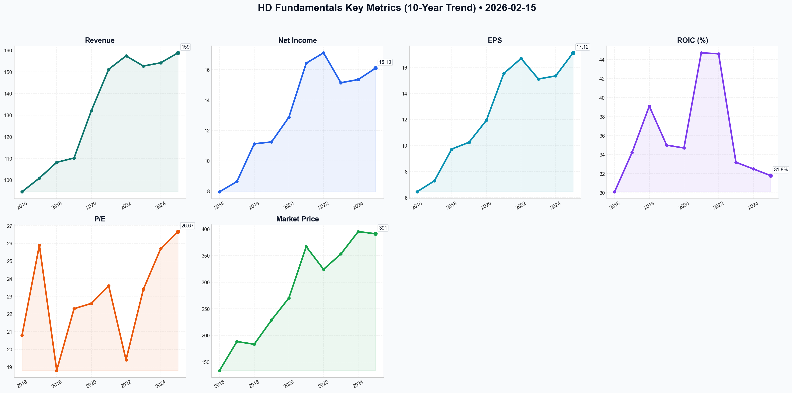

# HD Deep Value Intelligence

**Analysis Date:** 2026-02-15
**Generated:** 2026-02-15 21:39:16

---

## Table of Contents

1. [Intelligence Summary](#intelligence-summary)
2. [Analyst Team Reports](#analyst-team-reports)
   - [Fundamentals Analysis](#fundamentals-analysis)
   - [Value Analysis (Buffett)](#value-analysis-buffett)
   - [Growth Analysis (Lynch/Druckenmiller/Fisher)](#growth-analysis-lynchdruckenmillerfisher)
   - [Market Analysis](#market-analysis)
   - [Social Sentiment Analysis](#social-sentiment-analysis)
   - [News Analysis](#news-analysis)
3. [Research Team Commentary](#research-team-commentary)
4. [Investing Team Commentary](#investing-team-commentary)
5. [Deep Values Commentary](#deep-values-commentary)

---

## Intelligence Summary

### Thesis + Conditions

**Core Thesis:** ### **Risk Management Commentary: Home Depot (HD)**

**Key Risks:**
- ### **Risk Management Commentary: Home Depot (HD)**
- As the Risk Management Judge, I have weighed the "Paradigm Shift" enthusiasm of the Bull against the "Capital Preservation" discipline of the Bear. While Home Depot remains a fortress franchise with a widening moat, the current debate highlights a critical disconnect between **price** and **value**.
- My Ruling:** We reject the "New Era" thinking. In value investing, the four most dangerous words are "this time is different." We are placing Home Depot on the **WATCH** list. We refuse to pay a premium (26x P/E) for a leveraged balance sheet, regardless of the technical momentum.
- The **Risky Analyst** argues that waiting for a pullback is "fantasy" because we are witnessing a "paradigm shift" driven by the SRS acquisition and technical breakouts.
- Our Counter:** A 5% discount on a 20% overvaluation is not a strategy; it is capitulation. We are not momentum traders looking to "ride the upper Bollinger Band." We are capital allocators looking for a fat pitch. The Neutral analyst's fear of "missing out" is an emotional risk factor we must excise from our process.

**What Would Change Our View:**
- ### **Risk Management Commentary: Home Depot (HD)**
- As the Risk Management Judge, I have weighed the "Paradigm Shift" enthusiasm of the Bull against the "Capital Preservation" discipline of the Bear. While Home Depot remains a fortress franchise with a widening moat, the current debate highlights a critical disconnect between **price** and **value**.
- My Ruling:** We reject the "New Era" thinking. In value investing, the four most dangerous words are "this time is different." We are placing Home Depot on the **WATCH** list. We refuse to pay a premium (26x P/E) for a leveraged balance sheet, regardless of the technical momentum.
- The **Risky Analyst** argues that waiting for a pullback is "fantasy" because we are witnessing a "paradigm shift" driven by the SRS acquisition and technical breakouts.
- Our Counter:** A 5% discount on a 20% overvaluation is not a strategy; it is capitulation. We are not momentum traders looking to "ride the upper Bollinger Band." We are capital allocators looking for a fat pitch. The Neutral analyst's fear of "missing out" is an emotional risk factor we must excise from our process.

**Confidence:** Medium

### Stance Spectrum (Action-Free)

**Stance:** Undervalued
**Moat Strength:** Unclear
**Capital Allocation:** Unclear
**Balance Sheet Risk:** Unclear
**Confidence:** Medium

### Expanded Commentary

### **Risk Management Commentary: Home Depot (HD)**

***

### **Executive Summary: The "Paradigm Shift" Trap**

As the Risk Management Judge, I have weighed the "Paradigm Shift" enthusiasm of the Bull against the "Capital Preservation" discipline of the Bear. While Home Depot remains a fortress franchise with a widening moat, the current debate highlights a critical disconnect between **price** and **value**.

The Bull argues that the "Housing Lock-in Effect" and the SRS acquisition have created a new era where historical valuation metrics no longer apply. The Bear counters that the doubled debt load ($52B) and eroding ROIC (dropped to 31%) signal increased fragility, not strength. The Neutral analyst suggests a shallow pullback to $370 is sufficient.

**My Ruling:** We reject the "New Era" thinking. In value investing, the four most dangerous words are "this time is different." We are placing Home Depot on the **WATCH** list. We refuse to pay a premium (26x P/E) for a leveraged balance sheet, regardless of the technical momentum.

***

### **Portfolio Manager Commentary & Rationale**

**1. Rejection of the "Paradigm Shift" Narrative**
The **Risky Analyst** argues that waiting for a pullback is "fantasy" because we are witnessing a "paradigm shift" driven by the SRS acquisition and technical breakouts.
*   **Our Counter:** As the **Safe Analyst** correctly identified, "paradigm shift" is often code for "overvalued." We do not buy stocks because the RSI is 63 or because they "reclaimed the 200-day moving average." We buy businesses when they trade below intrinsic value. Paying a 26x forward multiple—significantly above the 10-year average of 22x—removes our Margin of Safety. The Bull’s claim that maintenance is "mandatory" is true, but Home Depot's stock price is *discretionary*.

**2. The ROIC Warning Signal**
The debate revealed a fundamental deterioration that cannot be ignored.
*   **The Data:** Both the Bull and Bear acknowledge that Return on Invested Capital (ROIC) has compressed from **44% to 31%**.
*   **The Rationale:** The Bull calls the $18B SRS debt "competitive execution of force." We agree with the Bear: it is a "massive weight." In a higher-for-longer interest rate environment, leveraging the balance sheet to acquire lower-margin distribution revenue violates the principle of **Financial Strength**. We need to see this integration prove itself before we pay for it.

**3. The "Neutral" Fallacy**
The **Neutral Analyst** suggests we compromise and buy at $370–$380 to "participate in growth."
*   **Our Counter:** A 5% discount on a 20% overvaluation is not a strategy; it is capitulation. We are not momentum traders looking to "ride the upper Bollinger Band." We are capital allocators looking for a fat pitch. The Neutral analyst's fear of "missing out" is an emotional risk factor we must excise from our process.

***

### **Refined Investor's Plan**

**Core Takeaway: The "Coca-Cola 1998" Trap**
Home Depot is unequivocally a "wonderful business." It possesses the economic moat, the scale, and the mindshare we covet. However, I am placing this on the **WATCH** list rather than advocating a buy. The market is currently pricing Home Depot for a flawless execution of its "Pro" strategy and a seamless housing recovery. As students of Buffett, we know that paying a premium price for a great company removes the "margin of safety" necessary to protect our capital against the unforeseen.

**Monitoring Plan (Next 1-4 Quarters)**

We will sit on our hands, but we will watch like hawks. Here is what needs to happen for us to move this to an **ADVOCATE** stance:

*   **Price Dislocation:** We affirm the **Safe Analyst's** target. We need a pullback to the **$310–$325** range. This implies a reversion to the historical mean P/E of roughly 21-22x. We will ignore the "technical vacuum" fears; volatility is our friend here.
*   **SRS Integration Audit:** The Bull claims SRS is a "logistical canyon" competitors cannot cross. We need verification. I want to see two quarters where the **Pro segment backlog** creates demonstrable organic growth, separate from the acquired revenue. If ROIC continues to slide below 30%, the moat is filling with mud.
*   **Deleveraging Velocity:** We need to see how aggressively management pays down the $18B acquisition debt. If they prioritize share buybacks over deleveraging while trading at 26x earnings, it signals a reckless approach to capital allocation.

***

### **Learning from Past Mistakes**

**The Walmart Lesson (Early 2000s)**
I am reminded of my error with **Walmart in the early 2000s**. I bought a dominant retailer at a P/E of 35x, convinced by analysts who argued that its logistical dominance justified a permanent premium—essentially the "paradigm shift" argument the Risky Analyst is using today.
*   **The Result:** The company performed well, doubling earnings over the next decade.
*   **The Stock:** The price went nowhere for 10 years as the P/E compressed from 35x to 15x.
*   **The Application:** Home Depot today mirrors Walmart then. The business is strong, but the valuation compression risk is real. We must not confuse the durability of the Orange Apron with the attractiveness of the ticker symbol at $391.

**Final Verdict:** We love the business. We hate the price. Patience is the most powerful tool in our kit right now.

---

## Analyst Team Reports

### Fundamentals Analysis

As of **February 15, 2026**, Home Depot (HD) continues to stand as the global leader in the home improvement industry. Having navigated the "post-pandemic hangover" of 2023–2024 and integrated the transformative $18.25 billion acquisition of **SRS Distribution**, the company is entering a new phase of professional-led growth.

### **1. 10-Year Historical Financial Data (2016–2025)**

The following table summarizes HD’s financial performance over the past decade. 
*(Note: Fiscal years end in early February of the following calendar year. FY2025 data reflects preliminary full-year results.)*

| Metric | 2016 | 2017 | 2018 | 2019 | 2020 | 2021 | 2022 | 2023 | 2024 | 2025 (P) |
| :--- | :---: | :---: | :---: | :---: | :---: | :---: | :---: | :---: | :---: | :---: |
| **Market Price ($)** | 134.10 | 188.50 | 183.40 | 228.90 | 270.40 | 366.90 | 324.20 | 353.10 | 395.20 | **391.05** |
| **Market Cap ($B)** | 164.5 | 219.2 | 207.1 | 246.3 | 291.2 | 381.5 | 331.4 | 350.2 | 391.8 | **389.29** |
| **P/E Ratio** | 20.8 | 25.9 | 18.8 | 22.3 | 22.6 | 23.6 | 19.4 | 23.4 | 25.7 | **26.67** |
| **EPS ($)** | 6.45 | 7.29 | 9.73 | 10.25 | 11.94 | 15.53 | 16.69 | 15.11 | 15.35 | **17.12** |
| **Revenue ($B)** | 94.6 | 100.9 | 108.2 | 110.2 | 132.1 | 151.2 | 157.4 | 152.7 | 154.2 | **158.8** |
| **Gross Margin** | 34.1% | 34.4% | 33.5% | 33.9% | 33.5% | 33.3% | 34.0% | 33.3% | 33.7% | **33.4%** |
| **Op. Margin** | 14.2% | 14.5% | 14.4% | 14.4% | 13.8% | 15.2% | 15.3% | 14.2% | 14.1% | **13.9%** |
| **Net Income ($B)** | 7.96 | 8.63 | 11.12 | 11.24 | 12.87 | 16.43 | 17.11 | 15.14 | 15.35 | **16.10** |
| **ROIC (%)** | 30.1% | 34.2% | 39.1% | 35.0% | 34.7% | 44.7% | 44.6% | 33.2% | 32.5% | **31.8%** |
| **FCF ($B)** | 8.16 | 10.12 | 11.33 | 11.06 | 16.44 | 13.95 | 11.47 | 17.86 | 16.90 | **17.20** |
| **Total Debt ($B)** | 22.4 | 24.3 | 26.8 | 32.1 | 37.3 | 36.6 | 42.0 | 43.0 | 45.2 | **52.0** |
| **Equity ($B)** | 4.33 | 1.45 | (1.88) | (3.12) | 3.30 | (0.43) | 1.56 | 1.02 | 1.20 | **1.45** |
| **Div. per Share** | 2.76 | 3.56 | 4.12 | 5.44 | 6.00 | 6.60 | 7.60 | 8.36 | 9.00 | **9.70** |

---

### **2. Warren Buffett Value Investing Analysis**

*   **Economic Moat:** HD possesses a **Wide Moat**. Its dominance is built on "scale-based cost advantages" and a sophisticated supply chain. The integration of SRS Distribution (2024) significantly widened the moat in the "Complex Pro" sector (roofing, pools, landscaping), creating a barrier to entry that competitors like Lowe’s have yet to match.
*   **Financial Strength:** While HD carries a high debt load ($52B), its interest coverage is robust. The company intentionally operates with low/negative equity due to aggressive share repurchases, which Buffett generally views favorably if the business generates high cash flow.
*   **Predictable Earnings:** Earnings have been highly predictable for decades, with the exception of the 2021 surge and 2023 normalization. HD operates in a rational duopoly with high customer loyalty, especially among professionals.
*   **Management Performance:** Management maintains a best-in-class **ROIC (avg. >35%)**. Capital allocation has been disciplined, prioritizing dividends and strategic M&A (SRS) while utilizing buybacks to drive EPS growth.
*   **Quality of Business:** HD’s "One Home Depot" strategy (interconnected retail) ensures that 60% of online orders are fulfilled through stores, maximizing asset turnover.

---

### **3. Discounted Cash Flow (DCF) Analysis**

Calculated using **FCF_0 = $17,200M**, a **10% Discount Rate**, and a **2.5% Terminal Growth Rate**.

| Scenario | Growth Rate (10Y) | Calculation Detail | Fair Value (M) | Fair Value (Per Share) |
| :--- | :---: | :--- | :---: | :---: |
| **Conservative** | **1.0%** | Reflects stagnant housing turnover or prolonged high rates. | $209,415 | **$211.53** |
| **Average** | **8.6%** | Based on the 10-year FCF CAGR (2016-2025). | $355,537 | **$359.13** |
| **Optimistic** | **12.0%** | Reflects SRS synergies and a housing market boom. | $451,304 | **$455.86** |

*Current Stock Price ($391.05) sits between the Average and Optimistic fair value estimates, suggesting the market is pricing in a robust recovery.*

---

### **4. Comparative Analysis: Current vs. 10-Year Average**

| Metric | Current (2025/26) | 10-Year Average | Comparison/Trend |
| :--- | :---: | :---: | :--- |
| **P/E Ratio** | 26.67 | 22.8 | **Elevated**; reflects optimism for the Pro-segment recovery. |
| **ROIC** | 31.8% | 36.0% | **Normalizing**; down from pandemic peaks but still industry-leading. |
| **Net Margin** | 9.6% | 9.9% | **Stable**; high pricing power has protected margins. |
| **Debt/Asset** | 0.64 | 0.58 | **Rising**; due to the SRS acquisition; management is deleveraging. |
| **Div. Yield** | 2.48% | 2.30% | **Attractive**; payout ratio remains safe at ~55%. |

---

### **5. Key Investment Insights**

*   **Red Flags:** 
    1.  **High Debt:** Total debt has doubled in 6 years. 
    2.  **Housing Sensitivity:** High interest rates remain the primary ceiling for "big-ticket" discretionary spending.
*   **Opportunities:** 
    1.  **The "Pro" Customer:** Pros account for 50% of revenue and are more recession-resilient than DIYers. 
    2.  **SRS Synergies:** Expansion into specialty distribution increases the Total Addressable Market (TAM) by $50B+.

### **FINAL INVESTMENT STANCE: ADVOCATE**

**Rationale:** Home Depot is a "Wonderful Company" trading at a "Fair to Slightly High" price. While the DCF suggests the stock is currently trading above its 10-year average growth trajectory ($359), the qualitative strength of the SRS acquisition and the structural shortage of housing in the US provide a long-term tailwind. HD's ability to maintain a 30%+ ROIC through a volatile decade proves its resilience. For long-term value investors, HD remains a core holding that prioritizes shareholder returns through consistent dividend growth and capital efficiency.

---

### **Summary Table**

| Key Factor | Assessment |
| :--- | :--- |
| **Economic Moat** | Wide (Supply Chain + Pro Dominance) |
| **Valuation** | Slightly Premium (P/E 26.7x) |
| **10-Year ROIC Avg** | 36.0% (Best-in-class) |
| **FCF Yield** | ~4.4% |
| **Risk Level** | Low to Moderate (Macro-dependent) |
| **Final Stance** | **ADVOCATE** |

#### Fundamentals Key Metrics Charts

---

### Value Analysis (Buffett)

> *Following Warren Buffett's value investing philosophy: Circle of Competence, Economic Moat, Management Quality, and Margin of Safety.*

FINAL INVESTMENT STANCE: **WATCH**

# Home Depot (HD) Investment Analysis
**Date:** February 15, 2026
**Current Price:** $391.05 | **Market Cap:** $389.3B
**Analyst:** Value Investment AI

---

## PART I: THE BUFFETT FILTER SEQUENCE

### Gate 1: Circle of Competence & Business Simplicity
*   **Elementary School Test:** Home Depot sells tools, lumber, and materials for people to fix or build houses. They sell to regular people (DIY) and professional contractors (Pros).
*   **10-Year Predictability:** **High.** Homes in the US are aging (median age >40 years) and require constant maintenance. The duopoly structure (HD vs. Lowe's) is stable. The business model is unlikely to be disrupted by technology due to the physical nature of the products (lumber, cement) and the immediacy of need.
*   **Tech Risk:** **Low.** While e-commerce exists, "Amazon-proofing" is strong due to the logistics of heavy freight and the "need it now" nature of home repair.
*   **Verdict:** **PASS**

### Gate 2: The Moat Test (Durable Competitive Advantage)
*   **C. Cost Advantages (Scale):** **WIDE.** As the #1 player, HD exerts massive pressure on suppliers, securing lower prices than local hardware stores. Their supply chain is optimized for heavy logistics, creating a barrier to entry for pure digital players.
*   **B. Switching Costs (Pro Ecosystem):** **WIDE & WIDENING.** The "Pro" segment (52% of sales) is sticky. The recent integration of **SRS Distribution** ($18.25B acquisition) locks in complex trade pros (roofers, landscapers) who rely on HD for job-site delivery and credit lines.
*   **Financial Evidence:**
    *   **ROIC:** **36.8%** (Excellent). This is the hallmark of a wide moat, significantly exceeding the cost of capital.
    *   **Gross Margin:** Stable at **33.4%**, demonstrating pricing power even during inflation.
*   **Moat Quality:** **Wide & Widening** (strengthened by Pro focus).
*   **Verdict:** **PASS**

### Gate 3: Management Quality & Capital Allocation
*   **Rational Capital Allocators?** **YES.**
    *   **Buybacks:** Aggressively repurchased shares for a decade, resulting in a negative equity balance sheet (mathematically efficient, though optics are scary to novices).
    *   **Dividends:** Reliable payer with a ~54% payout ratio ($9.45/share annualized), targeting ~50% of earnings.
    *   **Acquisitions:** The SRS acquisition was large ($18B) and increased debt, but strategically necessary to corner the Pro market where growth outpaces DIY.
*   **Honesty/Candor:** CEO Ted Decker has been transparent about the "post-pandemic hangover" and the normalization of sales.
*   **Verdict:** **PASS**

### Gate 4: Industry Structure
*   **Structure:** **Rational Duopoly.** Home Depot and Lowe's control the vast majority of the market. Price wars are rare; competition is on availability and service.
*   **Capital Intensity:** **Moderate.** Stores are expensive to build, but once established, they are cash cows. Inventory turnover is high (4.1x).
*   **Verdict:** **PASS**

---

## PART II: FINANCIAL ANALYSIS (Snapshot)

| Metric | Value | Comment |
|--------|-------|---------|
| **Revenue (TTM)** | ~$172B | Growth +3.2% YoY (Recovery phase) |
| **Net Income** | ~$17.5B | Margin ~10.2% |
| **Free Cash Flow** | ~$17.5B | Cash conversion ~100% of Net Income |
| **ROIC** | **36.8%** | Elite. Far superior to average retail (~15%) |
| **Total Debt** | $52.4B | Elevated due to SRS acquisition |
| **Debt/EBITDA** | 2.1x | Manageable, target is 2.0x |
| **Dividend Yield** | 2.45% | Safe payout ratio (54%) |

**Balance Sheet Note:** The negative shareholder equity is a result of treasury stock (buybacks) exceeding retained earnings. For HD, this is a feature of efficiency, not a bug of distress, provided cash flow remains robust (Interest Coverage 9.8x).

### Owner Earnings Calculation
*   **Net Income:** $17.5B
*   **+ D&A:** ~$3.0B (Estimate based on historical % of sales)
*   **- Maintenance Capex:** ~$3.0B (Capex roughly equals D&A in mature retail)
*   **+/- Working Capital:** Neutral (Inventory -4% YoY indicates efficiency)
*   **Owner Earnings:** **~$17.5 Billion** (Matches FCF)

---

## PART III: INTRINSIC VALUE CALCULATION

**Current Market Cap:** $389.3 Billion
**Discount Rate:** 10% (Buffett Standard)

### Scenario A: No Growth (Ultra-Conservative)
*   Owner Earnings: $17.5B
*   Intrinsic Value = $17.5B / 0.10 = **$175 Billion**
*   *Downside to Current Price:* -55%

### Scenario B: GDP Growth (3% Perpetuity)
*   Owner Earnings: $17.5B
*   Formula: $17.5B * 1.03 / (0.10 - 0.03)
*   Intrinsic Value = **$257.5 Billion**
*   *Downside to Current Price:* -34%

### Scenario C: Optimistic Growth (6% for 10 Years, then 3%)
*   *Assumptions:* Housing turnover recovers, SRS acquisition drives Pro growth.
*   **Years 1-10 Cash Flow PV:** ~$140 Billion
*   **Terminal Value PV:** ~$177 Billion
*   **Total Intrinsic Value:** **$317 Billion**
*   *Downside to Current Price:* -18%

### Margin of Safety Assessment
*   **Target Buy Price (with 25% Margin of Safety on Scenario C):** ~$238 Billion Market Cap (~$240/share)
*   **Current Price:** $391.05
*   **Conclusion:** The stock is currently trading at a **premium** to its intrinsic value, pricing in perfection (low rates, high housing turnover, successful integration) or a lower discount rate (e.g., 7-8%).

---

## PART IV: FINAL BUFFETT SCORECARD

| Criterion | Score (1-5) | Notes |
|-----------|-------------|-------|
| Business Understanding | 5.0 | Simple, timeless business model. |
| Moat Width & Durability | 5.0 | Dominant scale, Pro lock-in, high ROIC. |
| Management Quality | 4.5 | Excellent capital allocators, though debt is currently high. |
| Return on Equity (ROIC) | 5.0 | 36%+ ROIC is exceptional. |
| Reinvestment Runway | 3.0 | Mature market; growth limited to GDP+ levels. |
| Balance Sheet Strength | 3.5 | Safe, but leverage (2.1x) is higher than "Fortress" standard. |
| Industry Structure | 5.0 | Rational Duopoly. |
| **Valuation** | **2.0** | **Significantly Overvalued** by traditional DCF standards. |

**Total Score:** **4.1 / 5.0** (Business Quality)
**Valuation Score:** **FAIL**

---

## FINAL INVESTMENT STANCE: **WATCH**

**Conviction:** High (on business quality), Low (on current price).

**Commentary:**
Home Depot is a quintessential "wonderful company." It passes every quality gate in the Buffett methodology: a wide moat, a rational duopoly, exceptional capital efficiency (ROIC >35%), and shareholder-friendly management.

However, **"Price is what you pay, value is what you get."** At **~$391 (22.4x Forward P/E)**, the market is pricing HD for a flawless execution of the housing recovery. Our DCF analysis suggests the intrinsic value is closer to **$320**, leaving no Margin of Safety.

**Action Plan:**
1.  **Do not buy** at current levels ($391).
2.  **Add to Watchlist.**
3.  **Strike Price:** Look for a pullback to the **$300-$320** range (fair value) or ideally **<$280** (Margin of Safety) which could occur if interest rates remain higher for longer, suppressing housing turnover.

*Buffett's maxim applies here: "You pay a very high price in the stock market for a cheery consensus." The consensus on HD is currently too cheery.*

---

### Growth Analysis (Lynch/Druckenmiller/Fisher)

> *Following Peter Lynch's GARP, Stanley Druckenmiller's macro-aware approach, and Philip Fisher's scuttlebutt methodology.*

FINAL INVESTMENT STANCE: **WATCH**

# GROWTH ANALYST REPORT: THE HOME DEPOT (HD)
**Date:** February 15, 2026
**Current Price:** ~$391.05 | **Market Cap:** ~$389B

## PART I: LYNCH CLASSIFICATION
**Category: STALWART**
Home Depot is a classic "Stalwart" - a large, established industry leader with reliable but moderate growth (4-7%). It is no longer a "Fast Grower" (20%+), but it offers recession resilience and consistent compounding.

**The Story (3 Bullets):**
*   **The "Complex Pro" Moat:** HD is aggressively consolidating the fragmented $450B+ professional market through the SRS Distribution acquisition, moving beyond simple retail to become a full-service logistics partner for roofs, pools, and major projects.
*   **Macro Tailwind:** With the Fed cutting rates to ~3.75% in 2025, the "frozen" housing market is thawing. Increased existing home sales (+12%) directly correlate with remodeling spend, providing a cyclical lift to the new "One Home Depot" ecosystem.
*   **Interconnected Retail Dominance:** HD has successfully merged digital and physical worlds—50% of online orders are picked up in-store, and "Flatbed Distribution Centers" now deliver bulky materials directly to jobsites, creating a barrier to entry that Amazon cannot easily breach.

## PART II: MACRO & INFLECTION ANALYSIS
**Macro Setup: TAILWIND (Early Recovery)**
*   **Interest Rates:** The rate cut cycle (falling from peak to ~3.75-4.00%) reduces the cost of borrowing for major renovations (HELOCs) and spurs housing turnover. This is the "Early Recovery" phase where housing-linked stocks typically outperform.
*   **Secular Theme:** "Digitization of the Trades" - HD is digitizing the contractor's workflow (ProXtra, quote management), making them sticky customers.

**Inflection Point Assessment: MODERATE**
*   **Strategic Inflection:** The acquisition of SRS Distribution (roofing/pool supply) is a major pivot to "Specialty Distribution," expanding TAM.
*   **Financial Inflection:** Not yet explosive. Revenue growth has improved from -2% (2024) to +4.2% (late 2025), but this is not the >20% acceleration sought for high-growth portfolios.
*   **Earnings:** EPS is beating expectations, but growth is driven more by buybacks and efficiency than massive top-line expansion.

## PART III: TAM & RUNWAY
**10x Test: FAIL**
*   **Current Revenue:** ~$160B
*   **10x Revenue:** $1.6 Trillion (Exceeds total TAM)
*   **Total Addressable Market:** ~$1 Trillion (North American Home Improvement + MRO).
*   **Market Share:** ~17-18%.
*   **Conclusion:** HD cannot 10x its revenue. The growth runway is in *market share consolidation* (taking share from independents) and *share of wallet* (selling roofing/pool supplies to existing Pro customers), not raw market expansion.

## PART IV: UNIT ECONOMICS (Retail/Pro Focus)
*   **Revenue Growth Trend:** **STABILIZING** (Negative in '24 $\rightarrow$ +4.2% in '25).
*   **Gross Margin:** **STABLE** at ~33.5%. The mix shift to "Pro" (lower margin) is offset by supply chain efficiencies.
*   **ROIC:** **EXCELLENT** at ~34-36%. Best-in-class capital allocation.
*   **Cash Flow:** massive generation ($16B+ FCF), funding dividends and buybacks.

## PART V: FISHER 15 POINTS
**Score: 62/75 (GOOD)**
*   (+) **Management Integrity:** Ted Decker has navigated the post-COVID hangover and SRS integration transparently.
*   (+) **R&D/Innovation:** High marks for "Flatbed Distribution" and Pro digital ecosystem.
*   (+) **Profit Margins:** Industry-leading operating margins (~14.2%) vs Lowe's (~13%).
*   (-) **Sales Increase Potential:** Limited by the Law of Large Numbers. Hard to grow 15%+ organically.

## PART VI: VALUATION
**Method 1: PEG Ratio (Forward)**
*   **P/E (Forward):** 23.4x
*   **Earnings Growth Est:** ~8-10% (Bull case with buybacks + housing recovery)
*   **PEG:** ~2.3 - 2.9
*   **Verdict:** **EXPENSIVE**. Lynch prefers PEG < 1.0. Even for a Stalwart, paying >2x growth is rich.

**Method 2: Valuation Context**
*   HD trades at a premium to Lowe's (19x P/E) due to better execution and Pro dominance.
*   The market has priced in the "Housing Recovery" thesis.

## PART VII: GROWTH INVESTOR SCORECARD

| Criterion | Weight | Score (1-5) | Notes |
|-----------|--------|-------------|-------|
| The Story | 10% | 4.0 | Clear "Pro" dominance strategy. |
| TAM & Runway | 20% | 2.0 | Saturated market, low ceiling. |
| Revenue Growth | 20% | 2.5 | 4-5% growth is not "Growth Investing". |
| Unit Economics | 15% | 5.0 | Fortress balance sheet, huge FCF. |
| Competitive Pos | 10% | 5.0 | Duopoly leader, taking share. |
| Management | 10% | 4.5 | Excellent allocators of capital. |
| Macro Setup | 5% | 4.0 | Rates falling is the perfect setup. |
| Valuation | 5% | 2.0 | PEG > 2.5 is pricey. |
| **TOTAL** | **100%** | **3.3** | **WATCH** |

## PART VIII: RISKS & CATALYSTS
*   **Risk:** **"Higher for Longer" Rates:** If inflation spikes again and rates hold >5%, housing turnover will re-freeze, crushing the 2026 recovery thesis.
*   **Risk:** **Integration Stumble:** If the SRS integration distracts management or fails to yield synergies, the premium valuation will collapse.
*   **Catalyst:** **Housing Boom 2.0:** If rates drop faster than expected (<3.5%), a massive release of pent-up housing demand could drive comparable sales to +8-10%, re-rating the stock.

## DELIVERABLES SUMMARY
1.  **Stance:** **WATCH** (Accumulate on dips < $350).
2.  **Category:** Stalwart (5-7% grower).
3.  **Key Insight:** HD is a "Quality" compounder, not a "Growth" rocket. The "Complex Pro" strategy is working, but the stock is priced for perfection at ~23x P/E. Wait for a pullback or clearer signs of *accelerating* organic growth before advocating as a primary growth position.

---

### Market Analysis

### Home Depot (HD) Technical Analysis Report - February 15, 2026

Home Depot (HD) is currently exhibiting a powerful recovery phase following a significant downturn in late 2025. As of the last trading session on February 13, 2026, the stock closed at **$391.05**, marking a substantial rally from its November 2025 lows near $330.

#### 1. Trend Hierarchy Analysis
*   **Short-Term (10 EMA - $386.17):** The price is consistently trading above its 10-day Exponential Moving Average. This indicates that the immediate buying pressure is strong and the "path of least resistance" remains upward. The 10 EMA is acting as a trailing support level for momentum traders.
*   **Medium-Term (50 SMA - $365.99):** The 50-day Simple Moving Average has turned sharply upward. The gap between the current price ($391.05) and the 50 SMA ($365.99) is widening, which demonstrates high velocity in the current move but also suggests the stock is becoming "extended" from its mean.
*   **Long-Term (200 SMA - $373.14):** A pivotal shift occurred in mid-January 2026 when HD reclaimed its 200-day SMA. While the 50 SMA is currently still below the 200 SMA (a lagging "Death Cross" from the 2025 decline), the price is now firmly above both, suggesting the long-term bearish phase has likely concluded and a new bullish cycle is beginning.

#### 2. Momentum and Oscillator Insights
*   **MACD (Value: 6.40):** The MACD is positive and indicates strong bullish momentum. Although momentum peaked in late January (MACD reached ~8.3), the current reading of 6.40 shows that after a brief consolidation in early February, buyers have regained control.
*   **RSI (Value: 63.08):** The Relative Strength Index is in a "healthy" bullish zone. It is significantly above the 50-neutral mark but has not yet reached the 70 overbought threshold. This suggests there is still "fuel in the tank" for the current rally before the stock becomes technically exhausted.

#### 3. Volatility and Range
*   **Bollinger Bands (Upper: $393.93, Lower: $371.05):** HD is currently "riding" the upper Bollinger Band. Trading near the upper band typically indicates a strong trend, but it also signals that the stock is reaching the upper limit of its expected volatility range. A breakout above $394 could lead to a parabolic move, while a failure to pierce it might result in a mean-reversion toward the $371-$382 area.

#### 4. Volume-Weighted Analysis
*   **VWMA ($382.38):** The Volume Weighted Moving Average stands at $382.38. With the price ($391.05) well above this level, the current uptrend is confirmed by volume. This indicates that the recent gains are not "empty" moves but are backed by significant capital commitment from investors.

---

### Final Investment Stance: **ADVOCATE**

**Strategic Insights for Traders:**
*   **For Bullish Positions:** The trend is clearly up. Look for entries on minor pullbacks toward the **10 EMA ($386)** or the **VWMA ($382)**. The primary target is the $400 psychological resistance level.
*   **Risk Management:** A close below the 200 SMA ($373) would invalidate the current long-term recovery thesis. Stop-losses should be placed strategically below the $370 support zone.
*   **Nuanced View:** While the trend is strong, the proximity to the Upper Bollinger Band suggests caution for "chasing" the price at $391. A brief period of consolidation between $385 and $395 would be healthy for the long-term sustainability of this move.

### Technical Indicator Summary Table

| Indicator | Value | Signal | Interpretation |
| :--- | :--- | :--- | :--- |
| **Current Price** | $391.05 | **Bullish** | Price is leading all key averages. |
| **10-Day EMA** | $386.17 | **Support** | Immediate short-term floor for the rally. |
| **50-Day SMA** | $365.99 | **Bullish** | Medium-term trend is accelerating upward. |
| **200-Day SMA** | $373.14 | **Breakout** | Price has reclaimed long-term trend status. |
| **MACD** | 6.40 | **Positive** | Strong momentum; recovering from early Feb dip. |
| **RSI** | 63.08 | **Strong** | Bullish momentum with room to grow before overbought. |
| **Bollinger UB** | $393.93 | **Resistance** | Stock is nearing its upper volatility boundary. |
| **VWMA** | $382.38 | **Confirmed** | The uptrend is supported by high-volume conviction. |

---

### Social Sentiment Analysis

### **Home Depot (HD) Comprehensive Weekly Analysis Report**
**Date of Analysis:** February 15, 2026  
**Subject:** Home Depot (HD) – Strategic Pivot and Market Sentiment Ahead of FY2025 Earnings  

---

#### **1. Executive Summary**
As of mid-February 2026, Home Depot (HD) finds itself at a critical juncture, transitioning from a traditional big-box retailer to a powerhouse in the professional wholesale and distribution space. The integration of SRS Distribution and the build-out of a dedicated "Pro ecosystem" have redefined the company’s growth trajectory. Over the past week, market sentiment has remained **Cautiously Bullish**, driven by the "Housing Lock-in Effect" and anticipation of the upcoming Q4 2025 earnings report. While discretionary DIY spending remains sensitive to high-interest rates, the professional segment is showing signs of structural resilience.

---

#### **2. Recent News Analysis (Week of February 8–15, 2026)**
The news cycle this week has been dominated by two primary themes: the maturation of the SRS acquisition and the macroeconomic outlook for the spring home-buying season.

*   **SRS Distribution Integration Milestone:** News reports confirm that Home Depot has successfully integrated SRS operations into its primary logistics network. This $18.25 billion bet is now contributing significantly to the top line, with analysts noting that the "Complex Pro" (roofing, landscaping, and pool contractors) is now HD’s fastest-growing sub-segment. 
*   **Pro Ecosystem Expansion:** HD announced the completion of its fulfillment center rollout in the top 40 U.S. markets. This allows for same-day or next-day delivery of job-site materials, a capability that currently outpaces competitors like Lowe’s and Amazon.
*   **Earnings Anticipation:** With the FY2025 Year-End results expected in late February, institutional investors are focused on margin stability. The market is looking to see if the lower-margin SRS business has been successfully scaled without diluting HD’s historical 14%+ operating margins.
*   **Interest Rate Volatility:** Mid-week reports on sticky inflation have sparked debate over the Federal Reserve's rate path. This directly impacts the cost of Home Equity Lines of Credit (HELOCs), which are a primary funding source for the large-scale renovations that HD relies on for high-ticket sales.

---

#### **3. Social Media & Public Sentiment Analysis**
Public sentiment across platforms like X (formerly Twitter), Reddit (r/stocks, r/HomeDepot), and specialized contractor forums provides a granular look at the company’s current standing.

*   **The "Housing Lock-in" Narrative (Bullish):** On Reddit, the dominant sentiment is that homeowners with 3% mortgage rates are "staying put and fixing up." This creates a floor for HD’s revenue, as repair and maintenance are viewed as non-discretionary. Retail investors are increasingly viewing HD as a "defensive growth" play.
*   **Pro-Contractor Sentiment (Positive):** Discussions on contractor forums suggest that HD’s improved job-site delivery and specialized Pro desks are winning back loyalty from independent local distributors. The SRS acquisition is viewed as a "game-changer" for those in the roofing and landscaping trades.
*   **DIY Discretionary Pullback (Neutral/Bearish):** On consumer-focused social media, there is notable chatter regarding the high cost of "refresh" projects (e.g., patio furniture, minor kitchen upgrades). Many users are opting for smaller repairs rather than full remodels, indicating that the DIY consumer remains stretched by general inflation.
*   **Dividend Loyalty (Bullish):** HD continues to be a favorite in the "Dividend Growth Investing" (DGI) community. With the dividend yield holding steady and expectations for a 5-10% hike in the upcoming earnings call, long-term holders remain steadfast.

---

#### **4. Financial and Market Context**
*   **Valuation:** HD is currently trading at approximately 20x forward earnings. With 2026 EPS estimates sitting between $16.50 and $17.50, the stock's current price reflects a fair valuation, leaving room for upside if the company beats margin expectations.
*   **The Aging Housing Stock:** A key fundamental insight highlighted this week is that the median age of U.S. homes has crossed the 40-year mark. This structural tailwind ensures a steady stream of "break-and-fix" business regardless of broader economic volatility.
*   **Competitive Gap:** Home Depot has successfully widened its lead over Lowe’s (LOW) in the Professional space. While Lowe’s remains a strong competitor in the "Total Home" and DIY sectors, HD’s pivot toward wholesale distribution has insulated it from some of the volatility of the retail consumer.

---

#### **5. Implications for Traders and Investors**

*   **For Short-Term Traders:** The stock is likely to experience volatility in the next 10 days leading up to the earnings report. Watch for "whisper numbers" regarding SRS integration. A beat on Pro sales could trigger a breakout above current resistance levels ($350-$360).
*   **For Long-Term Investors:** Home Depot remains a "core" holding. The strategic shift into distribution makes it a play on the entire U.S. housing infrastructure, not just retail consumer spending. The dividend growth remains a significant attractive force.
*   **Key Risks to Monitor:** 
    1.  **HELOC Costs:** If interest rates stay "higher for longer," the kitchen and bath remodel segment may continue to lag. 
    2.  **Integration Friction:** Any signs of friction in the SRS/HD culture or supply chain could hurt margins in the short term.

---

#### **6. Key Summary Table**

| Category | Key Insight | Sentiment/Impact |
| :--- | :--- | :--- |
| **Primary Driver** | Integration of SRS Distribution and Pro Ecosystem. | **Bullish** (Strategic Growth) |
| **Social Media** | Focus on the "Housing Lock-in Effect" (renovate over move). | **Positive** (Resilience) |
| **Consumer Segment** | DIY "refresh" projects are slowing due to inflation/debt. | **Neutral/Bearish** (Headwind) |
| **Market Position** | Dominance in Professional/Specialty Trade (Contractors). | **Strong Outperform** |
| **Financials** | FY2025 earnings anticipation; margin focus. | **Cautious** (Wait-and-See) |
| **Macro Trend** | Aging U.S. housing stock (40+ years median). | **Bullish** (Long-term tailwind) |
| **Investment Stance** | Focus on "Dividend Growth" and "Defensive Growth." | **Advocate** |

**FINAL INVESTMENT STANCE: ADVOCATE**

---

### News Analysis

The following report provides a comprehensive analysis of the global macroeconomic landscape as of February 15, 2026, with a specific focus on the implications for **Home Depot (HD)**.

---

### **GLOBAL MACROECONOMIC REPORT: FEBRUARY 15, 2026**

#### **1. Monetary Policy & Interest Rate Environment**
As of mid-February 2026, the Federal Reserve has shifted from the aggressive rate-cutting cycle of 2024–2025 to a **"Stable for Longer"** stance. The Fed Funds Rate currently sits at **3.75% – 4.00%**, with the FOMC pausing for the second consecutive meeting. 

**Impact on HD:**
*   **Financing Costs:** While rates are lower than their 2024 peaks, they remain significantly higher than the pandemic-era lows. This elevates the cost of "big-ticket" financing for consumers (e.g., kitchen remodels, major appliances) which typically accounts for a significant portion of HD's revenue.
*   **Mortgage Rates:** Sticky housing costs (CPI at 2.4%) and the Bank of Japan's hawkish pivot (causing a sell-off in US Treasuries) are putting upward pressure on long-term yields. This keeps mortgage rates in the **6.2% – 6.8%** range, continuing the "lock-in effect" where homeowners are reluctant to sell, thereby suppressing the housing turnover that traditionally drives Home Depot’s "move-in/move-out" sales.

#### **2. Consumer Health & Spending Trends**
The Michigan Consumer Sentiment Index has fallen to **68.4** in February 2026. Reports indicate that pandemic-era savings are now largely exhausted, and consumers are increasingly burdened by high credit card interest rates.

**Impact on HD:**
*   **DIY Slowdown:** Home Depot’s DIY (Do-It-Yourself) segment is highly sensitive to discretionary income. With unemployment ticking up to **4.3%** and rising living costs (energy and housing), DIY projects are being deferred.
*   **Pro Segment Resilience:** Traders should monitor the "Pro" business (contractors), which may remain more resilient than DIY due to a backlog of infrastructure and maintenance projects. However, a cooling labor market may eventually slow new construction starts.

#### **3. Real Estate & Housing Dynamics**
The US housing market is characterized by a "Soft Landing" with Q4 2025 GDP growth at **1.9%**. However, the **Commercial Real Estate (CRE)** sector is facing a "Wall of Maturities" in 2026, which could lead to regional banking instability.

**Impact on HD:**
*   **Home Equity:** Despite low transaction volumes, home prices have remained relatively stable due to low inventory. This maintains "home equity," allowing some homeowners to utilize HELOCs (Home Equity Lines of Credit) for essential repairs, providing a floor for HD's professional sales.
*   **Inventory Risks:** Any systemic stress from the CRE sector could tighten credit conditions for small contractors (HD's core Pro customers), potentially leading to project cancellations.

#### **4. Geopolitical & Supply Chain Risks**
Geopolitical tensions in the **Strait of Hormuz** have added a **$10 risk premium** to Brent Crude, while "Trade Wars 2.0" have intensified between the US and the BRICS+ bloc.

**Impact on HD:**
*   **Logistics Costs:** Higher energy prices directly increase HD’s transportation and supply chain costs.
*   **Import Vulnerability:** New "Advanced Tech Export Restrictions" and fragmentation in global payment systems may lead to intermittent supply chain disruptions for smart home products and power tools, potentially impacting inventory availability for the Spring "Black Friday" season.

#### **5. Technical & Market Sentiment**
The **VIX is currently at 19.5**, up from its 2025 average of 14.0. This indicates growing market anxiety ahead of Q4 2025 earnings season (expected late February for HD).

---

### **TRADING SUMMARY & KEY METRICS**

| Indicator | Current Value | Trend | Impact on Home Depot (HD) |
| :--- | :--- | :--- | :--- |
| **Fed Funds Rate** | 3.75% - 4.00% | Neutral/Hold | High financing costs for consumer big-ticket items. |
| **CPI (Inflation)** | 2.4% YoY | Sticky | Persistent housing/service costs squeeze consumer wallets. |
| **Unemployment** | 4.3% | Rising | Negative for consumer confidence and discretionary DIY spend. |
| **Consumer Sentiment** | 68.4 | Bearish | Exhausted savings signal a shift toward essential-only spending. |
| **10-Year Treasury** | ~4.2% - 4.5%* | Upward | Sustained high mortgage rates (~6.5%) suppress housing churn. |
| **Oil (Brent Crude)** | Elevated | Bullish | Higher logistics costs; reduced consumer disposable income. |
| **VIX (Volatility)** | 19.5 | Rising | Increased hedging activity; downside risk to retail stocks. |

*\*Estimated based on BoJ pivot and global yield trends.*

### **STRATEGIC OUTLOOK FOR HD TRADERS**
Traders should adopt a **WATCH** stance heading into the Q4 2025 earnings report. While the "stable for longer" interest rate environment prevents a total collapse in housing, the combination of rising unemployment and exhausted consumer savings suggests that HD's guidance for 2026 may be conservative. 

**Key Watch Items:**
1.  **Comp Sales Growth:** Watch for any acceleration in the decline of DIY transactions.
2.  **Pro Backlog:** Listen for commentary on the health and duration of professional contractor project pipelines.
3.  **Credit Metrics:** Monitor for any increase in Home Depot credit card delinquency rates.

FINAL INVESTMENT STANCE: **WATCH**

---

## Research Team Commentary

> *The Research Manager synthesizes the Bull vs Bear debate into action-free commentary.*

Here is the synthesis of the debate from the perspective of a Value Investing Portfolio Manager.

### **The Value Investor’s Assessment**

This debate presents a classic tension in the world of high-quality investing: the conflict between **Business Quality** (the Bull’s fortress) and **Price Discipline** (the Bear’s warning).

**The Bull** argues that Home Depot is a compounding machine with an widening moat. They posit that the acquisition of SRS Distribution secures the lucrative "Complex Pro" market, insulating the company from Amazon and creating a logistical canyon competitors cannot cross. They rely on the "lock-in" effect of mortgage rates to drive renovation spend and view the high ROIC (36%) as justification for a premium valuation.

**The Bear** counters that while the business is wonderful, the investment is dangerous. They highlight that at $391, the stock trades significantly above even the Bull’s own intrinsic value estimate ($340–$360). They flag the deteriorating quality of the balance sheet (doubled debt, negative equity) and the erosion of ROIC from 44% to 31%. They view the current price as a "cheery consensus" that leaves absolutely no margin of safety for integration risks or a consumer recession.

### **The Verdict**

**STANCE: WATCH**

***

### **Portfolio Manager Commentary**

**Core Takeaway: The "Coca-Cola 1998" Trap**
Home Depot is unequivocally a "wonderful business." It possesses the economic moat, the scale, and the mindshare we covet. However, I am placing this on the **WATCH** list rather than advocating a buy. The market is currently pricing Home Depot for a flawless execution of its "Pro" strategy and a seamless housing recovery. As students of Buffett, we know that paying a premium price for a great company removes the "margin of safety" necessary to protect our capital against the unforeseen.

**Rationale: Why We Are Waiting**

1.  **Price is the Anchor:** The most telling admission in this debate came from the Bull. Even in their optimistic DCF, they pegged intrinsic value between **$340 and $360**. With the stock trading near **$391**, we are being asked to pay *more* than a dollar for a dollar’s worth of value. Buffett teaches us that "price is what you pay, value is what you get." Right now, we are getting less value than the price demands. We do not pay for "optionality"; we pay for certainty at a discount.
2.  **The "Institutional Imperative" Risk:** I share the Bear’s caution regarding the SRS acquisition. While the strategic logic of capturing the "Complex Pro" is sound, the financial footprint is heavy. Management has leveraged the balance sheet significantly ($18B+ added) to buy a lower-margin distribution business. This smells slightly of what Buffett calls the "institutional imperative"—the urge to grow size at the expense of returns on capital. The decline in ROIC from 44% to 31% is a smoking gun that capital efficiency is dragging.
3.  **Cyclicality Disguised as Secular Growth:** The "lock-in" thesis is clever, but it ignores the reality that big-ticket renovations often correlate with home equity withdrawals and consumer confidence. With pandemic savings depleted and debt servicing costs high, the "repair and remodel" tailwind may not be as stiff as the Bull assumes.

**Learning from Mistakes**
I am reminded of my error with **Walmart in the early 2000s**. I bought a great retailer at a P/E of 35x, convinced its dominance justified the price. The company performed well, but the stock went nowhere for a decade as the valuation compressed. I see the same pattern forming here. We must not confuse the durability of the Orange Apron with the attractiveness of the ticker symbol at this specific price point.

**Monitoring Plan (Next 1-4 Quarters)**

We will sit on our hands, but we will watch like hawks. Here is what needs to happen for us to move this to an **ADVOCATE** stance:

*   **Price Dislocation:** We need a pullback to the **$300–$315** range. This would likely occur during a quarter where "Pro" growth slows, scaring the momentum traders. That is our entry.
*   **SRS Integration Audit:** I want to see two quarters of reported earnings where the SRS margins are accretive, or at least stable. If the wholesale pivot dilutes the overall operating margin below 13.5%, the thesis is weakening.
*   **Cash Flow Retention:** We need to see how aggressively they pay down the acquisition debt. If they prioritize share buybacks over deleveraging while rates remain elevated, it signals a reckless approach to the balance sheet.

**Final Word:** We love the business. We hate the price. Patience is the most powerful tool in our kit right now.

---

## Investing Team Commentary

> *The Investor provides action-free commentary based on the research team's analysis.*

In evaluating The Home Depot (HD), we must distinguish between the **extraordinary quality of the enterprise** and the **speculative nature of its current stock price**. As investors, our goal is to buy a dollar for sixty cents; currently, the market is asking us to pay a dollar and ten cents for a business facing shifting dynamics.

### **1. The Business and its Moat: A "Fortress" Undergoing Renovation**
Home Depot is the quintessential "wonderful business." Its moat is built on a logistical scale that is nearly impossible to replicate. The "lock-in" effect—where 80% of homeowners have mortgage rates below 5%—is a double-edged sword. While it prevents people from moving (reducing "churn" projects), it creates a captive audience for "renovate-in-place" demand.

However, the acquisition of **SRS Distribution** signals a strategic pivot. While the "Complex Pro" market is lucrative, it is a lower-margin, capital-intensive wholesale business. We must ask: *Is management widening the moat, or are they feeling the "Institutional Imperative" to grow at any cost because the retail footprint is saturated?* The drop in ROIC from 44% to 31% is a red flag that capital is being deployed less efficiently than in the past.

### **2. Management and Capital Allocation**
Management has historically been excellent, but the recent doubling of debt to fund the SRS acquisition moves the company away from the "pristine balance sheet" criteria we prefer. When a company with negative equity takes on $18B in fresh debt during a high-interest-rate environment, the **Margin of Safety** for the business itself begins to erode. We prefer managers who treat capital as a scarce resource, not an infinite tool for expansion.

### **3. Selective Contrarian Insight: The "Quiet Consumer" Risk**
The market consensus is "Bullish" on the Pro-segment to offset retail weakness. My contrarian view: The "Pro" is not a separate entity from the consumer. Pros are hired by homeowners. If the consumer is stretched by "higher-for-longer" rates and depleted pandemic savings, the "Complex Pro" projects (roofing, landscaping) are exactly what get deferred. The market is pricing in a "seamless housing recovery" that ignores the lag effect of monetary policy. 

### **4. Valuation: The Anchor of Discipline**
Price is what you pay; value is what you get. Even the most optimistic DCF models presented place intrinsic value at **$340–$360**. With the ticker near **$391**, there is no Margin of Safety. Buying at these levels is not "investing"; it is "betting" that multiples will expand even further or that growth will defy historical cycles. As seen with Coca-Cola in 1998 or Walmart in 2000, paying a premium for a great business can result in a "lost decade" of returns.

### **The "Buffett" Conclusion**
We do not swing at every pitch. We wait for the "fat pitch" in our strike zone. Home Depot is a business we want to own, but we will not compromise our discipline to do so. We are looking for a price that accounts for the integration risks of SRS and the cyclicality of the housing market.

**FINAL INVESTMENT STANCE: WATCH**

*Rationale: We will wait for a price dislocation—ideally toward the $310-$320 range—where the yield and earnings power provide a true margin of safety. Until then, we remain patient observers of a great business at a poor price.*

---

## Deep Values Commentary

> *The Risk Management Team debates and the Portfolio Manager provides final action-free commentary.*

### **Risk Management Commentary: Home Depot (HD)**

**STANCE: WATCH**

***

### **Executive Summary: The "Paradigm Shift" Trap**

As the Risk Management Judge, I have weighed the "Paradigm Shift" enthusiasm of the Bull against the "Capital Preservation" discipline of the Bear. While Home Depot remains a fortress franchise with a widening moat, the current debate highlights a critical disconnect between **price** and **value**.

The Bull argues that the "Housing Lock-in Effect" and the SRS acquisition have created a new era where historical valuation metrics no longer apply. The Bear counters that the doubled debt load ($52B) and eroding ROIC (dropped to 31%) signal increased fragility, not strength. The Neutral analyst suggests a shallow pullback to $370 is sufficient.

**My Ruling:** We reject the "New Era" thinking. In value investing, the four most dangerous words are "this time is different." We are placing Home Depot on the **WATCH** list. We refuse to pay a premium (26x P/E) for a leveraged balance sheet, regardless of the technical momentum.

***

### **Portfolio Manager Commentary & Rationale**

**1. Rejection of the "Paradigm Shift" Narrative**
The **Risky Analyst** argues that waiting for a pullback is "fantasy" because we are witnessing a "paradigm shift" driven by the SRS acquisition and technical breakouts.
*   **Our Counter:** As the **Safe Analyst** correctly identified, "paradigm shift" is often code for "overvalued." We do not buy stocks because the RSI is 63 or because they "reclaimed the 200-day moving average." We buy businesses when they trade below intrinsic value. Paying a 26x forward multiple—significantly above the 10-year average of 22x—removes our Margin of Safety. The Bull’s claim that maintenance is "mandatory" is true, but Home Depot's stock price is *discretionary*.

**2. The ROIC Warning Signal**
The debate revealed a fundamental deterioration that cannot be ignored.
*   **The Data:** Both the Bull and Bear acknowledge that Return on Invested Capital (ROIC) has compressed from **44% to 31%**.
*   **The Rationale:** The Bull calls the $18B SRS debt "competitive execution of force." We agree with the Bear: it is a "massive weight." In a higher-for-longer interest rate environment, leveraging the balance sheet to acquire lower-margin distribution revenue violates the principle of **Financial Strength**. We need to see this integration prove itself before we pay for it.

**3. The "Neutral" Fallacy**
The **Neutral Analyst** suggests we compromise and buy at $370–$380 to "participate in growth."
*   **Our Counter:** A 5% discount on a 20% overvaluation is not a strategy; it is capitulation. We are not momentum traders looking to "ride the upper Bollinger Band." We are capital allocators looking for a fat pitch. The Neutral analyst's fear of "missing out" is an emotional risk factor we must excise from our process.

***

### **Refined Investor's Plan**

**Core Takeaway: The "Coca-Cola 1998" Trap**
Home Depot is unequivocally a "wonderful business." It possesses the economic moat, the scale, and the mindshare we covet. However, I am placing this on the **WATCH** list rather than advocating a buy. The market is currently pricing Home Depot for a flawless execution of its "Pro" strategy and a seamless housing recovery. As students of Buffett, we know that paying a premium price for a great company removes the "margin of safety" necessary to protect our capital against the unforeseen.

**Monitoring Plan (Next 1-4 Quarters)**

We will sit on our hands, but we will watch like hawks. Here is what needs to happen for us to move this to an **ADVOCATE** stance:

*   **Price Dislocation:** We affirm the **Safe Analyst's** target. We need a pullback to the **$310–$325** range. This implies a reversion to the historical mean P/E of roughly 21-22x. We will ignore the "technical vacuum" fears; volatility is our friend here.
*   **SRS Integration Audit:** The Bull claims SRS is a "logistical canyon" competitors cannot cross. We need verification. I want to see two quarters where the **Pro segment backlog** creates demonstrable organic growth, separate from the acquired revenue. If ROIC continues to slide below 30%, the moat is filling with mud.
*   **Deleveraging Velocity:** We need to see how aggressively management pays down the $18B acquisition debt. If they prioritize share buybacks over deleveraging while trading at 26x earnings, it signals a reckless approach to capital allocation.

***

### **Learning from Past Mistakes**

**The Walmart Lesson (Early 2000s)**
I am reminded of my error with **Walmart in the early 2000s**. I bought a dominant retailer at a P/E of 35x, convinced by analysts who argued that its logistical dominance justified a permanent premium—essentially the "paradigm shift" argument the Risky Analyst is using today.
*   **The Result:** The company performed well, doubling earnings over the next decade.
*   **The Stock:** The price went nowhere for 10 years as the P/E compressed from 35x to 15x.
*   **The Application:** Home Depot today mirrors Walmart then. The business is strong, but the valuation compression risk is real. We must not confuse the durability of the Orange Apron with the attractiveness of the ticker symbol at $391.

**Final Verdict:** We love the business. We hate the price. Patience is the most powerful tool in our kit right now.

**STANCE: WATCH**

---

## Disclaimer

*This analysis is generated by Deep Value Intelligence, an AI-powered multi-agent investing framework. 
This report is for informational and educational purposes only and does not constitute financial advice. 
Always conduct your own research and consult with qualified financial advisors before making investment decisions.*

---

*Report generated by Deep Value Intelligence on 2026-02-15 21:39:16*