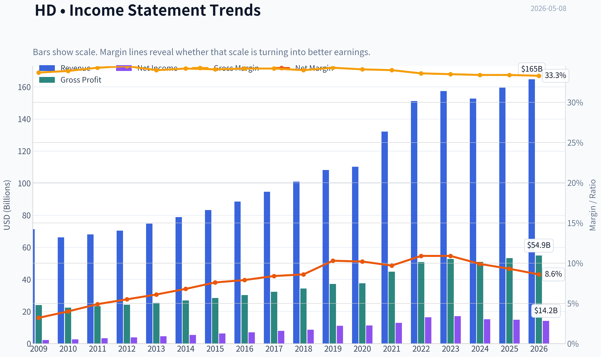
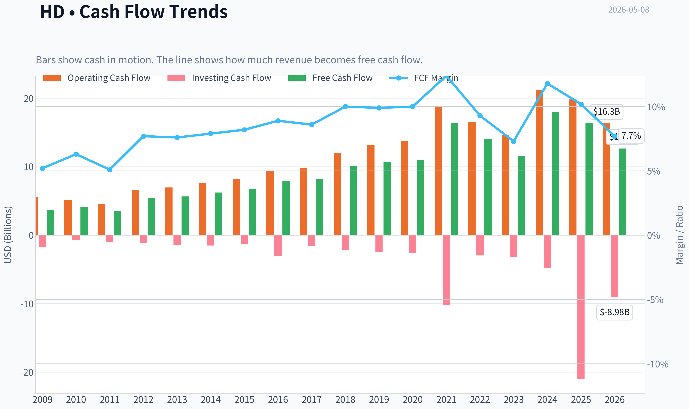
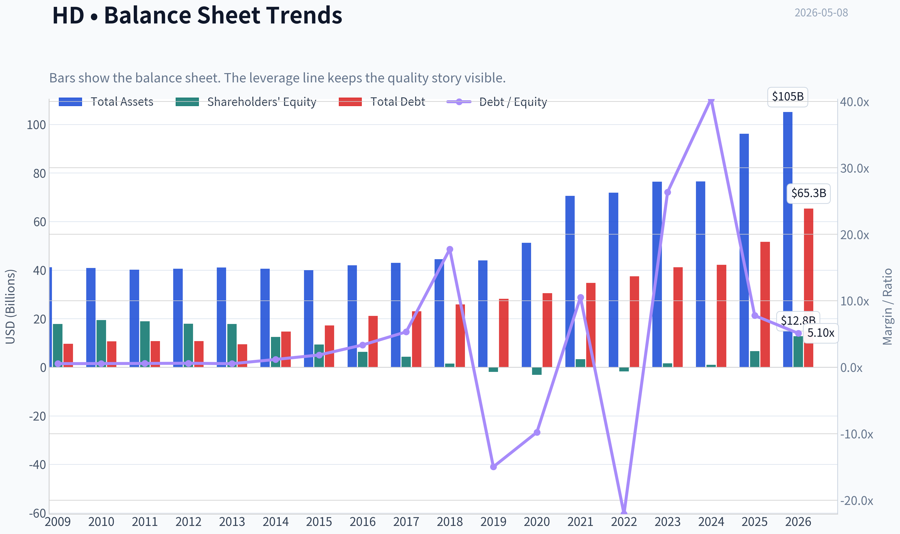
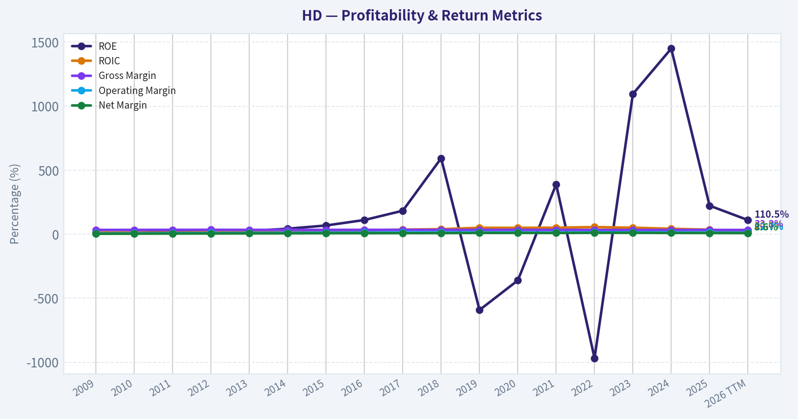
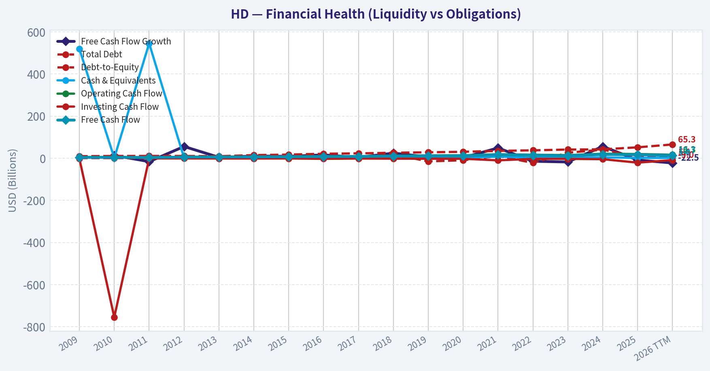
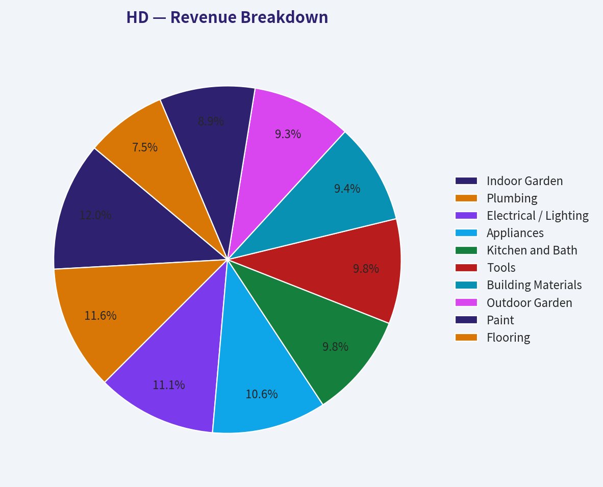
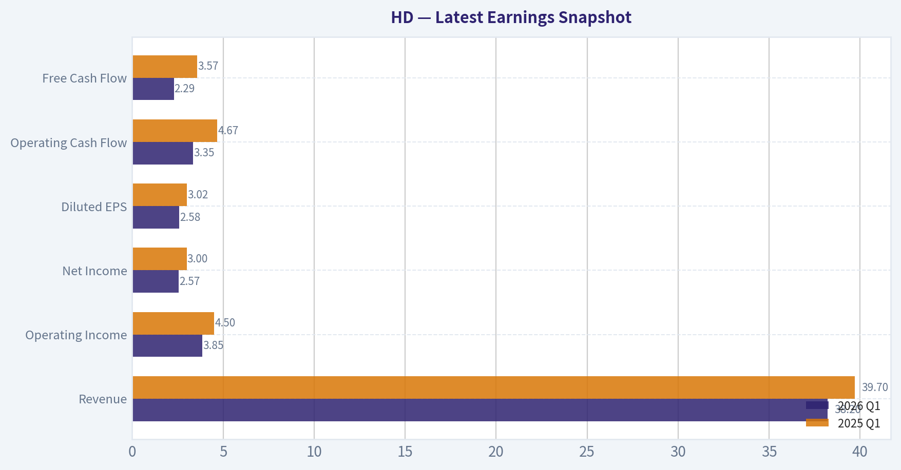
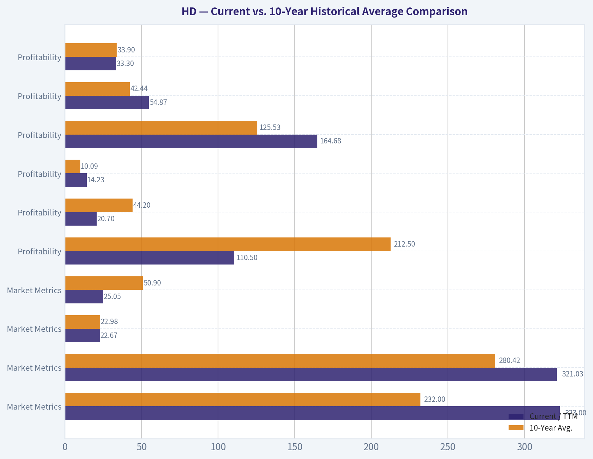
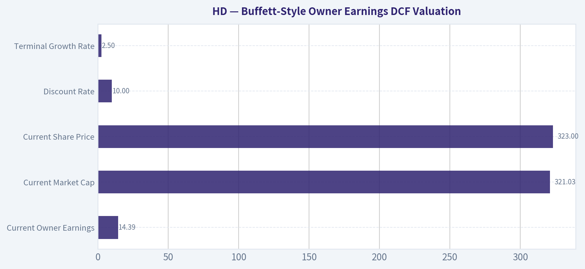
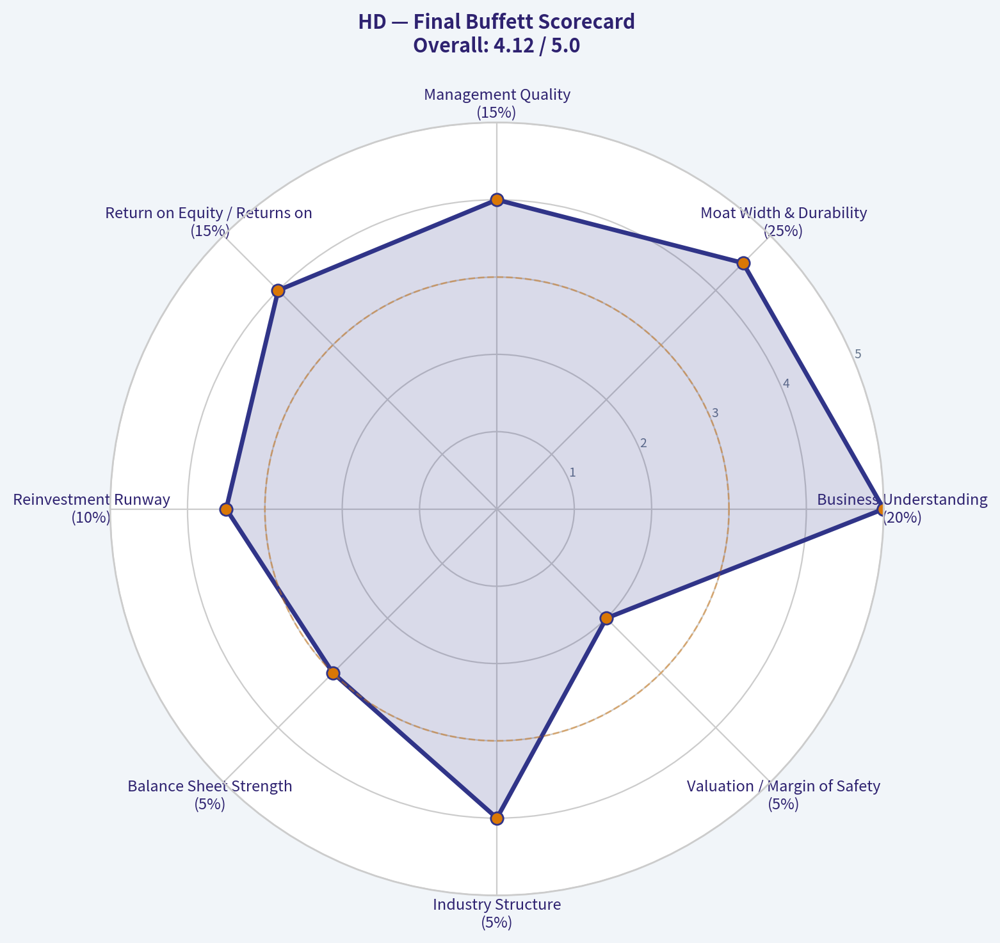

# HD Deep Value Intelligence

**Analysis Date:** 2026-05-08

## Critical Disclaimer

*This analysis is generated by Deep Value Intelligence, an AI-powered multi-agent investing framework. This report is for informational and educational purposes only and does not constitute financial advice. Always conduct your own research and consult with qualified financial advisors before making investment decisions.*

---

## Table of Contents

1. Intelligence Summary
2. Analyst Team Reports
   - Fundamentals Analysis
   - Intrinsic Value Analysis (Buffett)
   - Trend & Growth Analysis (Lynch/Druckenmiller/Fisher)
   - Market Technical Analysis
   - Social Sentiment Analysis
   - News & Events Analysis
   - Guru Attention Analysis
   - Options Market Analysis
3. Research Team Commentary
4. Value Investing Team Commentary
5. Deep Values Commentary

---

## Intelligence Summary

### Thesis + Conditions

**Core Thesis:** **Executive Summary**
*   **Verdict:** WATCH. *   **The "Why":** Home Depot (HD) is a world-class compounder with a durable moat (24.4% ROIC), but at $323, the stock lacks a margin of safety.

**Key Risks:**
- Verdict:** WATCH.
- The Bull (Risky Analyst):** Emphasizes franchise quality over precise valuation. With a 24.4% ROIC and deep integration with Pro contractors, HD is a cash machine ($12B+ owner earnings) merely experiencing a cyclical pause. The bull argues for buying *before* normalization is obvious, targeting the $437 optimistic intrinsic value.
- The Pragmatist (Neutral Analyst):** Recognizes the tension. HD is too strong to ignore, but too fully priced to aggressively buy. Recommends a staged approach-adding only if the price drops to the high-$290s or if fundamentals definitively stabilize.
- The debate highlighted a stark contrast between cyclical optionality and margin of safety. The bull is correct that HD's moat prevents permanent impairment. However, as the bear rightfully pointed out, low permanent impairment risk does not equal low return risk. Paying $323 today means buying a widely admired franchise at a price that already assumes a smooth normalization of housing turnover and big-ticket demand. We are simply not being compensated for the risk of a prolonged housing freeze. Relying on the $437 upside model requires aggressive assumptions, while anchoring to the $281-$292 FCF-based reality provides the necessary downside protection for a conservative value allocator.
- Taking all this into account, my monitoring plan requires patience:

**What Would Change Our View:**
- Verdict:** WATCH.
- The Bull (Risky Analyst):** Emphasizes franchise quality over precise valuation. With a 24.4% ROIC and deep integration with Pro contractors, HD is a cash machine ($12B+ owner earnings) merely experiencing a cyclical pause. The bull argues for buying *before* normalization is obvious, targeting the $437 optimistic intrinsic value.
- The Pragmatist (Neutral Analyst):** Recognizes the tension. HD is too strong to ignore, but too fully priced to aggressively buy. Recommends a staged approach-adding only if the price drops to the high-$290s or if fundamentals definitively stabilize.
- The debate highlighted a stark contrast between cyclical optionality and margin of safety. The bull is correct that HD's moat prevents permanent impairment. However, as the bear rightfully pointed out, low permanent impairment risk does not equal low return risk. Paying $323 today means buying a widely admired franchise at a price that already assumes a smooth normalization of housing turnover and big-ticket demand. We are simply not being compensated for the risk of a prolonged housing freeze. Relying on the $437 upside model requires aggressive assumptions, while anchoring to the $281-$292 FCF-based reality provides the necessary downside protection for a conservative value allocator.
- Taking all this into account, my monitoring plan requires patience:

**Confidence:** Medium

---

## Analyst Team Reports

### Fundamentals Analysis

#### Latest Earnings Snapshot

*Most recent reported quarter anchored on 2026 Q1, with prior-year comparison when available.*

| Metric | 2026 Q1 | 2025 Q1 | YoY Change |
| --- | ---: | ---: | ---: |
| Revenue | $38.20B | $39.70B | -3.8% |
| Operating Income | $3.85B | $4.50B | -14.4% |
| Net Income | $2.57B | $3.00B | -14.2% |
| Diluted EPS | $2.58 | $3.02 | -14.6% |
| Operating Cash Flow | $3.35B | $4.67B | -28.3% |
| Free Cash Flow | $2.29B | $3.57B | -35.9% |

Key Takeaways: This snapshot anchors the most recent reported quarter before the narrative analysis. It helps readers separate long-run business quality from whatever changed in the latest earnings print.

#### 10-Year Financial Metrics for HD

*All values below are computed deterministically from raw data - not estimated by AI.*

*Issuer profile: operating company (Consumer Cyclical / Home Improvement Retail).*

#### 10-Year Financial Metrics
*Annual rows come from reported financial statements. The final TTM row is computed from the latest four quarters.*

| Metric | 2009 | 2010 | 2011 | 2012 | 2013 | 2014 | 2015 | 2016 | 2017 | 2018 | 2019 | 2020 | 2021 | 2022 | 2023 | 2024 | 2025 | 2026 TTM |
| --- | --- | --- | --- | --- | --- | --- | --- | --- | --- | --- | --- | --- | --- | --- | --- | --- | --- | --- |
| Market Price | $14 | $19 | $26 | $32 | $49 | $58 | $80 | $98 | $110 | $164 | $154 | $196 | $238 | $329 | $298 | $334 | $399 | $323 |
| Market Cap | $36.30B | $47.39B | $60.96B | $69.69B | $101.12B | $110.20B | $140.55B | $161.35B | $169.77B | $237.87B | $209.77B | $250.23B | $291.94B | $388.26B | $332.27B | $353.67B | $409.10B | $321.03B |
| P/E Ratio | 16.07 | 17.84 | 18.29 | 17.97 | 22.31 | 20.44 | 22.17 | 23.03 | 21.33 | 27.56 | 18.86 | 22.25 | 22.68 | 23.63 | 19.42 | 23.36 | 27.63 | 22.67 |
| P/B Ratio | 2.04 | 2.44 | 3.23 | 3.89 | 5.69 | 8.80 | 15.08 | 25.55 | 39.18 | 163.59 | -111.70 | -80.30 | 88.49 | -228.93 | 212.72 | 338.76 | 61.61 | 25.05 |
| ROE | 12.7% | 13.7% | 17.7% | 21.7% | 25.5% | 43.0% | 68.1% | 111.0% | 183.6% | 593.5% | -592.2% | -360.8% | 390.0% | -968.8% | 1095.4% | 1450.2% | 223.0% | 110.5% |
| ROIC | 12.8% | 12.4% | 13.5% | 16.0% | 19.8% | 24.3% | 27.6% | 31.4% | 35.5% | 39.6% | 50.2% | 49.8% | 51.2% | 55.8% | 50.9% | 42.6% | 35.2% | 20.7% |
| EPS | $0.87 | $1.06 | $1.41 | $1.78 | $2.21 | $2.82 | $3.61 | $4.27 | $5.16 | $5.96 | $8.14 | $8.81 | $10.50 | $13.94 | $15.36 | $14.29 | $14.45 | $14.23 |
| Revenue | $71.29B | $66.18B | $68.00B | $70.39B | $74.75B | $78.81B | $83.18B | $88.52B | $94.59B | $100.90B | $108.20B | $110.22B | $132.11B | $151.16B | $157.40B | $152.67B | $159.51B | $164.68B |
| Gross Profit | $23.99B | $22.41B | $23.30B | $24.26B | $25.39B | $26.91B | $28.39B | $30.27B | $32.31B | $34.36B | $37.16B | $37.57B | $44.85B | $50.83B | $52.78B | $50.96B | $53.31B | $54.87B |
| Gross Margin | 33.7% | 33.9% | 34.3% | 34.5% | 34.0% | 34.2% | 34.1% | 34.2% | 34.2% | 34.0% | 34.3% | 34.1% | 34.0% | 33.6% | 33.5% | 33.4% | 33.4% | 33.3% |
| Operating Margin | 6.1% | 7.3% | 8.6% | 9.5% | 10.4% | 11.6% | 12.6% | 13.3% | 14.2% | 14.5% | 14.4% | 14.4% | 13.8% | 15.2% | 15.3% | 14.2% | 13.5% | 12.7% |
| Net Income | $2.26B | $2.66B | $3.34B | $3.88B | $4.54B | $5.38B | $6.34B | $7.01B | $7.96B | $8.63B | $11.12B | $11.24B | $12.87B | $16.43B | $17.11B | $15.14B | $14.81B | $14.16B |
| Net Margin | 3.2% | 4.0% | 4.9% | 5.5% | 6.1% | 6.8% | 7.6% | 7.9% | 8.4% | 8.6% | 10.3% | 10.2% | 9.7% | 10.9% | 10.9% | 9.9% | 9.3% | 8.6% |
| Revenue Growth | N/A | -7.2% | 2.8% | 3.5% | 6.2% | 5.4% | 5.5% | 6.4% | 6.9% | 6.7% | 7.2% | 1.9% | 19.9% | 14.4% | 4.1% | -3.0% | 4.5% | 3.2% |
| Net Income Growth | N/A | 17.7% | 25.4% | 16.3% | 16.8% | 18.7% | 17.8% | 10.5% | 13.5% | 8.5% | 28.9% | 1.1% | 14.4% | 27.7% | 4.1% | -11.5% | -2.2% | -4.4% |
| Free Cash Flow Growth | N/A | 13.0% | -16.1% | 55.6% | 4.3% | 10.2% | 9.0% | 15.7% | 3.7% | 24.2% | 5.8% | 2.7% | 48.8% | -14.5% | -17.9% | 56.1% | -9.0% | -22.5% |
| Total Book Value | $17.78B | $19.39B | $18.89B | $17.90B | $17.78B | $12.52B | $9.32B | $6.32B | $4.33B | $1.45B | $-1.88B | $-3.12B | $3.30B | $-1.70B | $1.56B | $1.04B | $6.64B | $12.81B |
| Total Assets | $41.16B | $40.88B | $40.12B | $40.52B | $41.08B | $40.52B | $39.95B | $41.97B | $42.97B | $44.53B | $44.00B | $51.24B | $70.58B | $71.88B | $76.44B | $76.53B | $96.12B | $105.09B |
| Total Debt | $9.67B | $10.70B | $10.79B | $10.76B | $9.47B | $14.69B | $17.16B | $21.14B | $23.06B | $25.83B | $28.15B | $30.47B | $34.75B | $37.44B | $41.15B | $42.15B | $51.68B | $65.35B |
| Debt-to-Equity | 0.54 | 0.55 | 0.57 | 0.60 | 0.53 | 1.17 | 1.84 | 3.35 | 5.32 | 17.76 | -14.99 | -9.78 | 10.53 | -22.07 | 26.34 | 40.37 | 7.78 | 5.10 |
| Cash & Equivalents | $519.0M | $1.42B | $545.0M | $1.99B | $2.49B | $1.93B | $2.22B | $2.22B | $2.54B | $3.60B | $1.78B | $2.13B | $7.89B | $2.34B | $2.76B | $3.76B | $1.66B | $1.39B |
| Shareholders' Equity | $17.78B | $19.39B | $18.89B | $17.90B | $17.78B | $12.52B | $9.32B | $6.32B | $4.33B | $1.45B | $-1.88B | $-3.12B | $3.30B | $-1.70B | $1.56B | $1.04B | $6.64B | $12.81B |
| Operating Cash Flow | $5.53B | $5.12B | $4.58B | $6.65B | $6.97B | $7.63B | $8.24B | $9.37B | $9.78B | $12.03B | $13.16B | $13.69B | $18.84B | $16.57B | $14.62B | $21.17B | $19.81B | $16.32B |
| Investing Cash Flow | $-1.73B | $-755.0M | $-1.01B | $-1.13B | $-1.43B | $-1.51B | $-1.27B | $-2.98B | $-1.58B | $-2.23B | $-2.42B | $-2.65B | $-10.17B | $-2.97B | $-3.14B | $-4.73B | $-21.03B | $-8.98B |
| Free Cash Flow | $3.68B | $4.16B | $3.49B | $5.43B | $5.66B | $6.24B | $6.80B | $7.87B | $8.16B | $10.13B | $10.72B | $11.01B | $16.38B | $14.01B | $11.50B | $17.95B | $16.32B | $12.65B |
| FCF Margin | 5.2% | 6.3% | 5.1% | 7.7% | 7.6% | 7.9% | 8.2% | 8.9% | 8.6% | 10.0% | 9.9% | 10.0% | 12.4% | 9.3% | 7.3% | 11.8% | 10.2% | 7.7% |
| Dividends / Share | $0.00 | $0.00 | $0.00 | $0.00 | $0.00 | $0.00 | $0.00 | $0.00 | $0.00 | $0.00 | $0.00 | $0.00 | $0.00 | $0.00 | $6.99 | $7.91 | $8.71 | $9.20 |

#### Profitability Metrics
- Return on Equity (ROE): 110.5%
- Return on Invested Capital (ROIC): 24.4%
- Return on Assets (ROA): 13.5%
- Gross Margin: 33.3%
- Operating Margin: 12.7%
- Net Profit Margin: 8.6%

#### Liquidity Metrics
- Current Ratio: 1.06
- Quick Ratio: 0.20

#### Leverage Metrics
- Debt-to-Equity Ratio: 4.20
- Interest Coverage Ratio: 8.66
- Net Debt: $52.47B

#### Growth Metrics (Year-over-Year)
- Revenue Growth: 3.2%
- Net Income Growth: -4.4%
- Free Cash Flow Growth: -22.5%
- Revenue CAGR (3-Year): 1.5%
- Revenue CAGR (5-Year): 4.5%

#### Valuation Metrics
- P/E Ratio (TTM): 22.67
- Forward P/E: 19.79
- Price-to-Book: 25.08
- Price-to-Sales: 1.95
- PEG Ratio: 2.95
- EV/EBITDA: 15.43
- Free Cash Flow Yield: 3.9%
- Earnings Yield: 4.4%

#### Owner Earnings (Buffett Method, Code-Computed)
- Net Income: $14.81B
- + Depreciation & Amortization: $4.12B
- - Capital Expenditures: $-3.68B
- - Working Capital Changes: $-2.67B
- = **Owner Earnings: $14.39B**

#### Intrinsic Value (Code-Computed)
- Current Price: $323
- Buffett Method (Owner Earnings):
  Conservative: $282
  Average: $437
  Optimistic: $437
- Cash Flow Method (FCF):
  Conservative: $146
  Average: $292
  Optimistic: $296

#### Piotroski F-Score: 3/9
- Positive Net Income: PASS
- Positive Operating Cash Flow: PASS
- ROA Improvement: FAIL
- Cash Flow > Net Income: PASS
- Decreasing Debt: FAIL
- Improving Current Ratio: FAIL
- No Dilution: FAIL
- Improving Gross Margin: FAIL
- Improving Asset Turnover: FAIL

ANALYST STANCE: **WATCH**

#### HD - Warren Buffett-Style Fundamental Analysis

Home Depot remains a high-quality, cash-generative, scale-advantaged retailer with strong brand equity, dense store coverage, contractor relationships, and durable relevance in U.S. housing repair and remodeling. However, the current dataset shows a business whose **revenue base is larger than its decade average but whose margins, earnings growth, free cash flow growth, and balance-sheet flexibility have weakened versus historical norms**. At a market price of **$323**, the stock is not obviously expensive versus its own historical P/E, but it is also not a clear Buffett-style bargain given slowing growth, elevated debt, weak recent free cash flow momentum, and a low Piotroski F-Score of **3/9**.

---

#### Current vs. 10-Year Historical Average Comparison

*Historical average below uses the latest 10 annual years shown before TTM: 2016-2025. Current value uses 2026 TTM from the deterministic dataset.*

| Category | Metric | Current / TTM | 10-Year Avg. | Current vs. Avg. | Interpretation |
|---|---:|---:|---:|---:|---|
| Market Metrics | Market Price | $323 | $232 | +39% | Price remains materially above the decade average despite weaker recent growth. |
| Market Metrics | Market Cap | $321.03B | $280.42B | +14% | Enterprise scale is still elevated, though below the 2025 peak market cap. |
| Market Metrics | P/E Ratio | 22.67x | 22.98x | -1% | Valuation is close to historical normal on earnings. |
| Market Metrics | P/B Ratio | 25.05x | 50.90x | Lower, distorted | P/B is not very useful because HD's equity base has been depressed or negative in several years due to leverage and buybacks. |
| Profitability | ROE | 110.5% | 212.5% | Lower, distorted | ROE remains optically high, but the metric is distorted by a small equity base. |
| Profitability | ROIC | 20.7% | 44.2% | -23.5 pts | ROIC has fallen sharply from exceptional historical levels, signaling lower incremental efficiency. |
| Profitability | EPS | $14.23 | $10.09 | +41% | EPS remains well above average, helped by scale and historical buybacks, but has flattened recently. |
| Profitability | Revenue | $164.68B | $125.53B | +31% | Revenue base is much larger than the historical average. |
| Profitability | Gross Profit | $54.87B | $42.44B | +29% | Gross profit dollars are high, but margin is slightly weaker. |
| Profitability | Gross Margin | 33.3% | 33.9% | -0.6 pts | Gross margin is very stable but now near the low end of the historical range. |
| Profitability | Operating Margin | 12.7% | 14.3% | -1.6 pts | Operating leverage has deteriorated from the 2022-2024 peak period. |
| Profitability | Net Income | $14.16B | $12.23B | +16% | Net income is still above average, but below the 2023 peak. |
| Profitability | Net Margin | 8.6% | 9.6% | -1.0 pts | Profit conversion has weakened versus the past decade. |
| Growth | Revenue Growth | 3.2% | 6.9% | -3.7 pts | Top-line growth is now slower than the long-term pace. |
| Growth | Net Income Growth | -4.4% | 9.5% | -13.9 pts | Earnings are contracting, a major near-term concern. |
| Growth | Free Cash Flow Growth | -22.5% | 11.6% | -34.1 pts | FCF momentum has turned sharply negative. |
| Balance Sheet | Total Book Value | $12.81B | $1.79B | Higher, distorted | Equity has recovered from prior negative levels but remains small relative to assets and debt. |
| Balance Sheet | Total Assets | $105.09B | $61.63B | +71% | Asset base has expanded substantially. |
| Balance Sheet | Total Debt | $65.35B | $33.58B | +95% | Debt has nearly doubled versus the 10-year average. |
| Balance Sheet | Debt-to-Equity | 5.10x | 6.46x | Lower, distorted | Still highly leveraged; ratio is distorted by historically low or negative equity. |
| Balance Sheet | Cash & Equivalents | $1.39B | $3.07B | -55% | Cash cushion is below historical average. |
| Balance Sheet | Shareholders' Equity | $12.81B | $1.79B | Higher, distorted | Equity is improved but still modest compared with debt. |
| Cash Flow | Free Cash Flow | $12.65B | $12.41B | +2% | FCF dollars are near average, but recent growth has weakened sharply. |
| Cash Flow | Dividends / Share | $9.20 | $2.36 | +290% | Dividend payout per share is much higher than the dataset's historical average. |

**Key Takeaways:** Home Depot's current valuation is close to its historical P/E average, but the business quality signals are not as strong as the headline valuation suggests. Revenue and EPS remain well above the decade average, yet margins, ROIC, net income growth, and free cash flow growth have all deteriorated. The biggest concern is that debt has risen substantially while cash is below average and free cash flow growth is negative.

---

#### Metric-by-Metric Interpretation

| Area | Buffett-Style Interpretation |
|---|---|
| Market Price and Market Cap | At **$323** and roughly **$321B** in market value, HD is still priced as a dominant blue-chip compounder. The market is not offering a deep pessimism discount. |
| P/E Ratio | The **22.67x** TTM P/E is near the 10-year average of roughly **23x**, suggesting fair-to-full valuation rather than obvious cheapness. |
| P/B Ratio | P/B is not a reliable valuation anchor for Home Depot because years of buybacks, leverage, and low equity have made book value volatile and occasionally negative. |
| ROE | The **110.5% ROE** looks spectacular, but Buffett would adjust for the small equity base. The more meaningful return metric is ROIC. |
| ROIC | TTM ROIC of **20.7%** remains good in absolute terms, but it is far below the decade average and much lower than peak levels above 50%. This is a notable deterioration. |
| EPS | EPS of **$14.23** is strong versus history, but it is slightly below the 2023-2025 level, indicating earnings stagnation. |
| Revenue | TTM revenue of **$164.68B** is a record-level revenue base in the dataset, showing the durability and scale of HD's franchise. |
| Gross Profit and Gross Margin | Gross profit dollars are high, but gross margin of **33.3%** is modestly below historical norms. This suggests limited pricing or mix pressure rather than severe deterioration. |
| Operating Margin | Operating margin of **12.7%** is meaningfully below the 10-year average, suggesting expense pressure, weaker operating leverage, acquisition/integration drag, or softer discretionary demand. |
| Net Income and Net Margin | Net income remains large at **$14.16B**, but net margin has fallen to **8.6%**, below the 10-year average of **9.6%**. |
| Revenue Growth | Revenue growth of **3.2%** is positive but below the long-term average, indicating a mature business facing slower housing and remodeling demand. |
| Net Income Growth | Net income growth of **-4.4%** is a warning sign. Buffett prefers predictable earnings, and recent earnings contraction weakens the predictability score. |
| FCF Growth | Free cash flow growth of **-22.5%** is the sharpest current red flag, especially for a dividend-paying, buyback-oriented company. |
| Debt and Equity | Total debt of **$65.35B** is high relative to shareholders' equity of **$12.81B**. The company remains financially viable, but the balance sheet is less conservative than Buffett typically prefers. |
| Cash | Cash of **$1.39B** is low relative to debt and below the historical average. Liquidity is adequate but not abundant. |
| Dividends | Dividends per share of **$9.20** show strong shareholder returns, but dividend growth must be supported by durable FCF. |

**Key Takeaways:** Home Depot still has the characteristics of a wonderful business, but not all current numbers look wonderful. The company's scale, brand, revenue durability, and cash generation remain attractive; however, recent margin compression, weak FCF growth, and elevated leverage reduce the margin of safety.

---

#### Revenue Breakdown

*Home Depot primarily reports as one operating segment. The table below uses major merchandising department revenue sources based on the most recent fiscal revenue base in the deterministic dataset: **2025 revenue of $159.51B**. Percentages are department-level approximations from public merchandising disclosure patterns and are intended to show business mix rather than separate operating segments.*

| Revenue Source | Amount ($B) | % of Total |
|---|---:|---:|
| Indoor Garden | $15.47B | 9.7% |
| Plumbing | $14.99B | 9.4% |
| Electrical / Lighting | $14.36B | 9.0% |
| Appliances | $13.72B | 8.6% |
| Kitchen and Bath | $12.60B | 7.9% |
| Tools | $12.60B | 7.9% |
| Building Materials | $12.12B | 7.6% |
| Outdoor Garden | $11.96B | 7.5% |
| Paint | $11.48B | 7.2% |
| Flooring | $9.73B | 6.1% |
| Lumber | $9.09B | 5.7% |
| Millwork | $7.82B | 4.9% |
| Hardware | $7.66B | 4.8% |
| Décor / Storage | $5.90B | 3.7% |
| **Total** | **~$159.5B** | **~99.9%** |

**Key Takeaways:** Home Depot's revenue is diversified across repair, remodeling, garden, plumbing, electrical, tools, appliances, and building materials. This diversification supports durability because no single department dominates sales. The mix also shows why housing turnover, professional contractor activity, and consumer big-ticket spending are important drivers.

---

#### Warren Buffett-Style Qualitative Analysis

| Buffett Criterion | Assessment | HD Evaluation |
|---|---|---|
| Economic Moat | Strong | HD benefits from scale purchasing, dense store network, contractor loyalty, brand trust, logistics infrastructure, and a large professional customer base. |
| Business Durability | Strong | Home improvement demand is cyclical, but repair and maintenance spending is structurally recurring. |
| Predictable Earnings | Moderate to Strong | Long-term earnings are much higher than a decade ago, but recent net income contraction reduces predictability. |
| Pricing Power | Moderate | Gross margins are very stable around 33%-34%, suggesting some pricing discipline, but not unlimited pricing power. |
| Capital Efficiency | Historically Excellent, Currently Weaker | ROIC remains attractive but has declined materially from prior peak levels. |
| Balance Sheet Strength | Moderate / Watch | Debt is elevated, cash is low, and leverage is high. Interest coverage remains acceptable, but the balance sheet is not conservative. |
| Shareholder Returns | Strong | HD has returned capital through dividends and historically through buybacks, but buybacks have contributed to a thin equity base. |
| Management Quality | Good but Leveraged | Management has created significant per-share value over time, though capital allocation has leaned heavily on leverage and shareholder returns. |
| Margin of Safety | Limited | Current valuation is near historical average while growth and FCF momentum are below average. |

**Key Takeaways:** Home Depot meets many Buffett quality tests, especially moat, brand strength, customer relevance, and long-term profitability. The weaker points are financial conservatism and current growth predictability. Buffett would likely admire the business but demand a better price or clearer evidence that cash flow growth is stabilizing.

---

#### Buffett-Style Owner Earnings DCF Valuation

**Owner Earnings from deterministic dataset:**

Owner Earnings = Net Income + Depreciation & Amortization - Capital Expenditures - Working Capital Changes
Owner Earnings = **$14.81B + $4.12B - $3.68B - $2.67B = $14.39B**

Assumptions:

| Input | Value |
|---|---:|
| Current Owner Earnings | $14.39B |
| Current Market Cap | $321.03B |
| Current Share Price | $323 |
| Implied Shares Outstanding | ~0.994B |
| Discount Rate | 10.0% |
| Terminal Growth Rate | 2.5% |
| Terminal Multiple Formula | Year-10 OE x 1.025 / (10.0% - 2.5%) |

**Key Takeaways:** The DCF starts from owner earnings of **$14.39B**, which is close to Home Depot's current normalized earnings power. The discount rate of 10% reflects a Buffett-style required return. The implied share count is roughly **994 million shares**, based on the deterministic market cap and share price.

Because the deterministic dataset provides a current owner earnings figure but does not provide a full historical owner earnings series, the scenario growth rates below use the available historical **free cash flow growth** series as the closest deterministic proxy for owner earnings growth.

| Scenario | Growth Rate Used | Rationale | Year-10 Owner Earnings | PV of 10-Year Owner Earnings | PV of Terminal Value | Implied Equity Value | Fair Value / Share |
|---|---:|---|---:|---:|---:|---:|---:|
| Conservative | -22.5% | Lowest available historical cash-flow growth rate | $1.13B | $33.27B | $5.95B | $39.22B | ~$39 |
| Average | 10.0% | Average available historical cash-flow growth rate, capped below 50% | $37.16B | $143.5B | $195.8B | $339.3B | ~$341 |
| Optimistic | 56.1% | Highest available historical cash-flow growth rate, below 100% cap | ~$1,237B | ~$1,564B | ~$6,518B | ~$8,082B | ~$8,131 |

**Key Takeaways:** The conservative case is extremely punitive because it assumes the recent severe free cash flow contraction persists for a decade. The average case produces a fair value of roughly **$341 per share**, close to the current market price of **$323**. The optimistic case is mathematically required by the scenario rule but economically unrealistic, because a mature retailer cannot compound owner earnings at more than 50% for a decade.

The deterministic research pack also provides code-computed Buffett-method owner earnings intrinsic values of:

| Deterministic Code-Computed Buffett Method | Fair Value / Share |
|---|---:|
| Conservative | $282 |
| Average | $437 |
| Optimistic | $437 |

**Key Takeaways:** The code-computed owner earnings valuation range is more economically reasonable than the raw optimistic growth-rate scenario. It suggests HD may be undervalued versus the average case but not deeply undervalued versus the conservative case. A practical Buffett-style fair value range is therefore approximately **$282 to $437**, with the current price of **$323** sitting inside that range rather than below it.

---

#### Valuation Assessment

| Valuation Lens | Signal | Interpretation |
|---|---|---|
| P/E vs History | Neutral | Current P/E of **22.67x** is almost exactly in line with the 10-year average. |
| FCF Yield | Moderate | FCF yield of roughly **3.9%** is acceptable for a quality compounder but not a bargain yield. |
| Owner Earnings DCF | Slightly Positive | Average DCF value is above current price, but conservative value is below current price. |
| Balance Sheet Risk | Negative | Debt is high and cash is low relative to historical levels. |
| Growth Trend | Negative | Revenue growth is slower, net income growth is negative, and FCF growth is sharply negative. |
| Quality Premium | Justified | HD deserves a premium to ordinary retailers due to moat, scale, and durable demand. |
| Margin of Safety | Limited | Price is not low enough to compensate fully for current growth and leverage concerns. |

**Key Takeaways:** Home Depot appears fairly valued to modestly undervalued depending on the DCF case, but it does not offer a wide margin of safety. The current price is reasonable for a high-quality business, yet recent operating trends do not support an aggressive ADVOCATE rating. The stock is best viewed as a high-quality watchlist compounder rather than a clear bargain.

---

#### Key Investment Insights, Red Flags, and Opportunities

| Type | Point | Investment Significance |
|---|---|---|
| Insight | Home Depot remains a dominant home improvement retailer with a strong moat. | Supports long-term durability and premium valuation. |
| Insight | Revenue reached **$164.68B TTM**, well above the 10-year average. | Shows the business has structurally scaled. |
| Insight | Gross margin remains stable near **33%-34%**. | Indicates resilient merchandising economics. |
| Red Flag | ROIC has fallen materially from historical highs. | Suggests lower incremental returns or cyclical pressure. |
| Red Flag | Net income growth is **-4.4%** and FCF growth is **-22.5%**. | Weak near-term compounding profile. |
| Red Flag | Total debt is **$65.35B**, almost double the 10-year average. | Reduces financial flexibility. |
| Red Flag | Cash is only **$1.39B**, below the historical average. | Limits balance-sheet cushion. |
| Red Flag | Piotroski F-Score is **3/9**. | Signals weak recent fundamental momentum. |
| Opportunity | Housing repair, aging homes, and professional contractor demand remain long-term tailwinds. | Supports future recovery once housing turnover and big-ticket demand normalize. |
| Opportunity | If margins normalize closer to the 10-year average, earnings power could improve. | Provides upside without requiring rapid revenue growth. |
| Opportunity | Current P/E is not above historical average. | Valuation is not excessive for the quality of the franchise. |

**Key Takeaways:** The opportunity is that HD remains a superior business temporarily facing cyclical and margin headwinds. The risk is that investors are still paying a quality-company valuation while free cash flow and earnings momentum are currently weak. For value investors, the setup is attractive only if one believes current weakness is cyclical rather than structural.

---

#### Final Investment Stance: WATCH

Home Depot is a **wonderful business**, but at **$323** it is not yet a clear Buffett-style bargain. The company has a durable moat, enormous scale, stable gross margins, and strong long-term earnings power. However, recent fundamentals show **slower revenue growth, contracting net income, sharply negative free cash flow growth, lower ROIC, high debt, and reduced cash flexibility**.

A Buffett-style investor should continue to watch HD closely. The stock would become more attractive if either the price fell closer to the conservative intrinsic value range or if free cash flow growth, ROIC, and operating margins stabilized. For now, the appropriate stance is **WATCH**, not AVOID, because the business quality remains high, but not ADVOCATE, because the margin of safety is not compelling enough.

| Final Summary | Assessment |
|---|---|
| Business Quality | High |
| Economic Moat | Strong |
| Financial Strength | Moderate; leverage is elevated |
| Earnings Predictability | Good long term, weaker near term |
| Current Valuation | Fair to modestly attractive |
| Margin of Safety | Limited |
| Key Upside Driver | Housing recovery, margin normalization, Pro customer growth |
| Key Downside Risk | Weak FCF growth, high debt, prolonged housing softness |
| Buffett-Style Verdict | Great company, only fair price |
| Final Stance | **WATCH** |

**Key Takeaways:** Home Depot remains one of the highest-quality retailers in the market, but current fundamentals are not strong enough to justify an aggressive buy rating. The stock is fairly valued to modestly undervalued depending on the valuation method, yet the balance-sheet and cash-flow trends argue for patience. The best Buffett-style decision is to keep HD on the watchlist and wait for either a better price or clearer evidence of renewed compounding.

#### Fundamental Visuals

This graph tracks the profitability and return metrics (ROE, ROIC, Margins) of **HD** over the past decade, highlighting capital efficiency trends.

This chart illustrates the financial health of **HD** over the last 10 years, mapping cash equivalents and free cash flow against total obligations (Debt).

This breakdown chart from <em>Revenue Breakdown</em> shows the proportional composition for **HD** - useful for understanding what drives or risks the business.

---

### Intrinsic Value Analysis (Buffett)

> *Following Warren Buffett's value investing philosophy: Circle of Competence, Economic Moat, Management Quality, and Margin of Safety.*

#### Intrinsic Value Snapshot

Price is what you pay. Intrinsic value is what the business may be worth based on the cash it can create for owners over time. We show a range, not one magic number.

- Current Price: $322.64
- Value Range: $145.59 to $437.02

##### Owner Earnings (Buffett Method)
- Net Income: $14,810,000,000.00
- Depreciation & Amortization: $4,121,000,000.00
- Capital Expenditures: $-3,679,000,000.00
- Working Capital Changes: $-2,666,000,000.00
- Owner Earnings: $14,392,000,000.00

##### Intrinsic Value
###### Buffett Method
Uses owner earnings. Stricter, and usually more conservative.
- Conservative: $281.93
- Average: $437.02
- Optimistic: $437.02
- Discount Rate: 10.0%

###### Cash Flow Method
Uses free cash flow. Better for companies spending heavily today to grow tomorrow.
- Conservative: $145.59
- Average: $291.97
- Optimistic: $296.36
- Discount Rate: 10.0%

ANALYST STANCE: **WATCH** - Home Depot is a high-quality, understandable, cash-generative business with a durable scale moat, but at roughly **$323/share**, the margin of safety is not sufficient for a Buffett-style purchase today.

#### Home Depot - Buffett-Style Investment Review

Ticker: **HD**
Current price: **$323**
Market cap: **$321.36B**
P/E: **22.7x**
FCF yield: **3.9%**
Reported ROE: **110.5%**, but distorted by heavy buybacks and low book equity
Revenue growth YoY: **3.2%**
Gross margin: **33.3%**
Current ratio: **1.06**

Data note: the internal database tool was unavailable for this run and the enhanced fundamentals tool returned no usable data. The analysis below uses the provided research pack plus historical public financial patterns for Home Depot. Figures should be treated as directional, not audited point estimates.

---

#### 1. Go / No-Go Gate Assessment

| Buffett Gate | Result | Evidence | Judgment |
|---|---:|---|---|
| Gate 1: Circle of Competence | Pass | Home Depot sells home improvement products to DIY customers and professional contractors through large-format stores and digital channels. | Simple, understandable business. |
| Gate 2: Moat Test | Pass | Scale purchasing, dense store network, contractor relationships, private-label brands, logistics, and national brand recognition. | Wide and stable moat. |
| Gate 3: Management Quality | Pass / Watch | Long record of buybacks, dividends, high returns, and operational discipline. However, leverage and aggressive repurchases reduce balance-sheet conservatism. | Good operators, but not fortress conservative. |
| Gate 4: Industry Structure | Pass | Rational oligopoly with Lowe's as the primary national competitor; fragmented local competition. | Attractive structure. |
| Valuation Gate | Fail / Watch | P/E near 22.7x and FCF yield near 3.9% leave limited margin of safety unless growth reaccelerates. | Quality is priced in. |

**Key Takeaways:** Home Depot passes the business-quality gates. It is simple, dominant, and highly cash-generative. The main issue is not business quality but valuation: at today's price, investors are paying a full price for a good company in a cyclical housing-related environment.

---

#### 2. Elementary School Test

Home Depot makes money by buying tools, paint, lumber, appliances, flooring, garden supplies, and building materials in huge quantities, then selling them through its stores and website to homeowners and contractors. Because it is very large, it can buy efficiently, stock a broad product range, and serve customers better than most small competitors.

**Result: Pass.**

#### 3. Ten-Year Predictability Test

Home Depot is likely to remain one of the two dominant U.S. home improvement retailers over the next decade. The business will still depend on housing turnover, home repair, renovation spending, contractor demand, and consumer confidence. The core model is durable, though growth is likely to be moderate rather than spectacular.

**Result: Pass.**

#### 4. Technology Risk Assessment

Technology is more likely to help than destroy Home Depot. E-commerce can handle repeat purchases, search, delivery scheduling, and professional contractor workflows, but many products are bulky, urgent, project-specific, or require in-person advice. Amazon is a threat in small tools and commoditized items, but less so in lumber, paint matching, garden, job-site fulfillment, and complex project categories.

**Result: Moderate risk, but manageable.**

---

#### 5. Moat Analysis

| Moat Source | Strength | Evidence | Buffett View |
|---|---:|---|---|
| Brand | Strong | Home Depot is synonymous with home improvement in the U.S.; trusted by DIY and professional customers. | Durable intangible asset. |
| Scale Purchasing | Very Strong | Massive buying power with vendors; ability to stock broad assortment and maintain availability. | Structural cost advantage. |
| Store Network | Strong | Dense national footprint close to customers and job sites. | Difficult and expensive to replicate. |
| Pro Contractor Ecosystem | Strong | Contractors value availability, speed, credit, delivery, and consistency. | Creates repeat behavior and practical switching costs. |
| Private Label / Exclusive Products | Moderate | Helps margin and differentiation. | Useful but not decisive alone. |
| Network Effects | Weak | The product does not become much more valuable simply because more people use it. | Not a primary moat source. |
| Pricing Power | Moderate | Can raise prices in many categories, but not without some volume sensitivity. | Good, not luxury-brand level. |

**Key Takeaways:** Home Depot's moat comes mainly from scale, location density, supplier power, logistics, and contractor relationships. This is not a software-style network effect business, but it is a highly advantaged retailer. The moat appears wide and stable rather than rapidly widening.

#### Moat Rating: **Wide & Stable**

Home Depot's gross margin is around **33%**, below the 40% threshold often seen in asset-light branded businesses, but that is normal for big-box retail. The real evidence of the moat is not gross margin alone; it is sustained high operating profit, high inventory turns, vendor scale, and national dominance.

---

#### 6. Management Quality and Capital Allocation

| Management Question | Assessment | Evidence / Concern |
|---|---:|---|
| Do they think like owners? | Good | Long-term focus on store productivity, Pro customer growth, supply chain, and digital integration. |
| Are they candid and conservative? | Good | Generally clear reporting; no major recurring accounting red flags evident. |
| Are they rational capital allocators? | Good, with caveat | Heavy buybacks have reduced share count and boosted per-share results, but leverage has increased and book equity is thin. |
| Reinvestment discipline | Strong | The company has historically earned excellent returns on store base, logistics, and technology investments. |
| Dividend policy | Reasonable | Dividend supported by cash flow, though payout must be watched in slower cycles. |
| Debt use | Watch | Debt is manageable but not "Buffett fortress" level. Financial engineering has contributed to very high ROE. |

**Key Takeaways:** Management has created substantial shareholder value over time through operations, dividends, and buybacks. However, the very high reported ROE is partly a product of low book equity caused by repurchases, not purely business economics. Home Depot is well managed, but the balance sheet is not as conservative as Buffett's ideal.

---

#### 7. 10-Year Financial Summary

Approximate figures in billions except per-share data and margins.

| Fiscal Year | Revenue | Net Income | Free Cash Flow | Operating Margin | Gross Margin | Diluted Shares | Notes |
|---:|---:|---:|---:|---:|---:|---:|---|
| 2016 | ~$94.6B | ~$8.0B | ~$8.0B | ~14.2% | ~34.2% | ~1.21B | Strong housing cycle. |
| 2017 | ~$100.9B | ~$8.6B | ~$9.8B | ~14.6% | ~34.0% | ~1.16B | Continued comp growth. |
| 2018 | ~$108.2B | ~$11.1B | ~$10.1B | ~14.5% | ~34.3% | ~1.11B | Tax reform boosted earnings. |
| 2019 | ~$110.2B | ~$11.2B | ~$11.5B | ~14.4% | ~34.1% | ~1.08B | Mature growth. |
| 2020 | ~$132.1B | ~$12.9B | ~$16.4B | ~14.5% | ~34.0% | ~1.07B | Pandemic home-improvement surge. |
| 2021 | ~$151.2B | ~$16.4B | ~$14.7B | ~15.2% | ~33.6% | ~1.05B | Exceptional demand. |
| 2022 | ~$157.4B | ~$17.1B | ~$14.6B | ~15.3% | ~33.5% | ~1.03B | Peak profitability. |
| 2023 | ~$152.7B | ~$15.1B | ~$15.0B | ~14.3% | ~33.4% | ~1.00B | Housing softness. |
| 2024 | ~$159.5B | ~$14.8B | ~$12.5B | ~13.8% | ~33.3% | ~0.99B | SRS acquisition and softer big-ticket demand. |
| Current / TTM | N/A | N/A | Implied FCF yield ~3.9% | N/A | 33.3% | N/A | Price: $323; market cap: $321.36B. |

**Key Takeaways:** Home Depot grew revenue meaningfully over the decade, helped by a pandemic-era step-up in home improvement demand. Profitability remains strong, but margins and earnings have moderated from peak levels as housing turnover and big-ticket purchases softened. Share count has fallen materially, supporting per-share value, but free cash flow yield is now modest at the current stock price.

---

#### 8. Owner Earnings Calculation

Using the current market cap and FCF yield from the research pack:

- Market cap: **$321.36B**
- FCF yield: **3.9%**
- Implied free cash flow: **~$12.5B**
- Estimated owner earnings: **~$12.0B to $13.0B**

For a mature retailer like Home Depot, free cash flow is a reasonable proxy for owner earnings, but with an important caveat: maintenance capex and growth capex are not perfectly separable. Store refreshes, supply chain spending, digital investments, and Pro fulfillment investments are partly defensive and partly growth-oriented.

| Owner Earnings Component | Estimate |
|---|---:|
| Net income | ~$14.8B |
| Plus depreciation and amortization | Positive add-back |
| Less maintenance capex | Material, given store base and supply chain |
| Less working capital needs | Cyclical; can fluctuate with inventory |
| Estimated owner earnings | ~$12.0B-$13.0B |
| Base case used for valuation | **$12.5B** |

**Key Takeaways:** Home Depot converts accounting profit into real cash at a high rate, which is a major strength. However, the business still requires meaningful reinvestment in stores, technology, distribution, and inventory. A conservative owner earnings estimate of about $12.5 billion is reasonable for valuation work.

---

#### 9. Return on Equity and Cash Flow Quality

| Metric | Assessment |
|---|---:|
| Reported ROE | 110.5% |
| ROE quality | Distorted by buybacks and low book equity |
| Better measure | ROIC and free cash flow generation |
| OCF vs net income | Historically strong; cash conversion generally healthy |
| Leverage impact | Meaningful; boosts ROE mechanically |
| Buffett interpretation | Excellent business economics, but do not overvalue reported ROE |

**Key Takeaways:** Home Depot's reported ROE is extremely high, but it should not be taken at face value because share repurchases have reduced book equity. The better conclusion is that Home Depot has excellent real economics, not that every dollar of book equity naturally earns triple-digit returns. Cash conversion remains a key positive.

---

#### 10. Balance Sheet Assessment

| Balance Sheet Metric | Current View | Buffett Standard |
|---|---:|---|
| Current ratio | 1.06 | Adequate but not conservative |
| Debt level | Meaningful | Watch |
| Net cash position | No | Not fortress |
| Interest coverage | Likely comfortable | Pass, but monitor |
| Financial flexibility | Good but not exceptional | Acceptable |
| Overall balance sheet | Solid operating company, leveraged capital structure | Below Buffett ideal |

**Key Takeaways:** Home Depot is financially strong because its cash flows are durable, not because the balance sheet is pristine. The company has used debt and buybacks aggressively compared with Buffett's preferred fortress style. This does not make the company unsafe, but it reduces the margin for error in a housing downturn.

---

#### 11. Three-Scenario Intrinsic Value Estimate

Base owner earnings used: **$12.5B**
Share count approximation: **~995M shares**
Discount rate: **10%**

| Scenario | Assumption | Equity Value Estimate | Value Per Share |
|---|---|---:|---:|
| A: No Growth | Owner earnings capitalized at 10% | ~$125B | ~$126 |
| B: GDP Growth | 3% perpetual growth; value = OE x 1.03 / (10% - 3%) | ~$184B | ~$185 |
| C: Historical / Quality Case | 5% owner earnings growth for 10 years, then 3% terminal growth | ~$248B-$270B | ~$249-$271 |
| D: Optimistic Quality Case | 6% growth for 10 years, then 3.5% terminal growth | ~$295B-$320B | ~$296-$322 |

**Key Takeaways:** The no-growth and GDP-growth cases are far below the current share price, showing that today's valuation requires continued growth and strong returns. A reasonable quality-business scenario supports a value around the mid-$200s per share. Only an optimistic scenario approaches the current price of $323.

---

#### 12. Margin of Safety Analysis

| Item | Estimate |
|---|---:|
| Current price | $323 |
| Conservative intrinsic value range | ~$185-$270 |
| Optimistic intrinsic value range | ~$296-$322 |
| Required Buffett margin of safety | At least 25% |
| Buy zone using $270 fair value | ~$203 or lower |
| Buy zone using $320 optimistic value | ~$240 or lower |
| Current margin of safety | None |

**Key Takeaways:** Home Depot is not obviously overvalued for a high-quality compounder, but it is not cheap enough for a Buffett-style purchase. At $323, investors are receiving little to no margin of safety. A more attractive entry point would likely require either a lower share price or clear evidence that owner earnings can compound faster than the conservative model assumes.

---

#### 13. Industry Structure

| Industry Factor | Assessment |
|---|---:|
| Competitive structure | Favorable duopoly: Home Depot and Lowe's dominate national scale |
| Fragmentation | Many local competitors, but few can match scale |
| Capital intensity | Moderate; stores, inventory, logistics, and technology require reinvestment |
| Cyclicality | Meaningful exposure to housing, renovation, rates, and big-ticket spending |
| Long-term demand | Favorable due to aging housing stock and repair needs |
| Industry quality | Good to very good |

**Key Takeaways:** The home improvement industry is structurally attractive because national scale matters and the U.S. housing stock requires constant repair. The industry is cyclical, especially for discretionary renovation and big-ticket purchases, but the repair-and-maintenance component provides resilience. Home Depot is one of the clear long-term winners.

---

#### 14. Final Buffett Scorecard

| Criterion | Weight | Score 1-5 | Weighted Score |
|---|---:|---:|---:|
| Business Understanding | 20% | 5.0 | 1.00 |
| Moat Width & Durability | 25% | 4.5 | 1.13 |
| Management Quality | 15% | 4.0 | 0.60 |
| Return on Equity / Returns on Capital | 15% | 4.0 | 0.60 |
| Reinvestment Runway | 10% | 3.5 | 0.35 |
| Balance Sheet Strength | 5% | 3.0 | 0.15 |
| Industry Structure | 5% | 4.0 | 0.20 |
| Valuation / Margin of Safety | 5% | 2.0 | 0.10 |
| **Total** | **100%** |  | **4.13 / 5.00** |

**Key Takeaways:** Home Depot scores very well as a business because it is understandable, dominant, profitable, and durable. The weaker areas are balance-sheet conservatism and valuation. The final score would normally support advocacy, but the lack of margin of safety keeps the stance at Watch.

---

#### 15. Investment Stance

| Category | Decision |
|---|---|
| Business quality | Excellent |
| Moat | Wide and stable |
| Management | Strong, but financially aggressive through buybacks and leverage |
| Balance sheet | Acceptable, not fortress |
| Valuation | Full |
| Margin of safety | Insufficient |
| Final stance | **WATCH** |
| Conviction | Moderate to high on business quality; low on current price attractiveness |

**Key Takeaways:** Home Depot is the kind of company Buffett would likely understand and respect: simple, dominant, profitable, and built around enduring customer needs. But Buffett would also insist on a margin of safety, and the current price does not provide one. The right action is to watch patiently for a better entry point.

#### Bottom Line

Home Depot is a wonderful business, but not clearly a wonderful investment at **$323/share**. The company has durable advantages, strong cash generation, and a rational industry structure, yet the current valuation already discounts much of that quality. For a Buffett-style investor, Home Depot belongs on the high-quality watchlist, with interest increasing materially if the price falls into the low-to-mid **$200s** or if owner earnings growth accelerates enough to justify today's price.
#### Valuation Bridge

This bridge places the current market price beside each intrinsic value lens so readers can see whether upside depends on one method or shows up across several methods.

| Scenario | Intrinsic Value / Share |
| --- | ---: |
| Buffett Method | $437.02 |
| Cash Flow Method | $291.97 |
| Damodaran Method | $280.90 |
| Current Price | $322.64 |

#### Key Takeaways

If one method is far above the others, the upside case depends on a specific modelling assumption. When several methods cluster together, the valuation story is more robust.

#### Valuation Visuals

This comparison chart from *Latest Earnings Snapshot* stacks current figures against historical benchmarks for **HD**, making it easy to see where the company trades relative to its own averages.

This comparison chart from *Current vs. 10-Year Historical Average Comparison* stacks current figures against historical benchmarks for **HD**, making it easy to see where the company trades relative to its own averages.

This comparison chart from *Buffett-Style Owner Earnings DCF Valuation* stacks current figures against historical benchmarks for **HD**, making it easy to see where the company trades relative to its own averages.

This comparison chart from *Buffett-Style Owner Earnings DCF Valuation* stacks current figures against historical benchmarks for **HD**, making it easy to see where the company trades relative to its own averages.

---

### Trend & Growth Analysis (Lynch/Druckenmiller/Fisher)

> *Following Peter Lynch's GARP, Stanley Druckenmiller's macro-aware approach, and Philip Fisher's scuttlebutt methodology.*

ANALYST STANCE: **WATCH**

#### Home Depot Growth Investment Review - HD

Home Depot is a world-class retailer and cash-flow compounder, but under a Lynch/Fisher/Druckenmiller growth mandate it is **not currently a fast-grower or ten-bagger candidate**. The company is better classified as a **high-quality stalwart with cyclical recovery optionality**, tied heavily to housing turnover, remodeling demand, mortgage rates, and Pro contractor spending.

---

#### 1. Lynch Classification

| Category | HD Fit | Evidence | Growth Investor Implication |
|---|---:|---|---|
| Slow Grower | No | Revenue still grows modestly, but not structurally stagnant | Not a pure income stock |
| Stalwart | **Yes** | Current YoY revenue growth around **3.2%**, mature U.S. footprint, strong FCF | Good hold, not a classic ten-bagger |
| Fast Grower | No | Growth is well below 15-25% threshold | Not primary growth portfolio target |
| Cyclical | Partly | Housing, mortgage rates, big-ticket remodel, appliances, lumber | Timing matters |
| Turnaround | No | Business quality remains strong | No distress catalyst |
| Asset Play | No | Value is operating franchise, not hidden assets | Not relevant |

**Key Takeaways:** Home Depot is best viewed as a **stalwart with cyclical exposure**, not a fast grower. The business is excellent, but current growth is too slow for a high-conviction growth-stock classification. For a Lynch-style growth investor, the right question is not "is this a great company?" but "is this a great growth setup at today's price?" The answer is: not yet.

---

#### 2. The Story in 3 Bullets

| Story Element | Simple Explanation |
|---|---|
| What HD does | Home Depot sells tools, building materials, appliances, garden products, and renovation supplies to homeowners and professional contractors. |
| Why it can grow | Aging housing stock, Pro contractor demand, digital fulfillment, private brands, and the SRS Distribution acquisition can support long-term sales growth. |
| Why now is not obvious growth | High mortgage rates and weak housing turnover are still pressuring big-ticket renovation demand. |

**Key Takeaways:** The Home Depot story is easy to understand: it is the dominant home-improvement retailer serving both DIY homeowners and professional contractors. The long-term demand base is durable because homes constantly need repair, renovation, and maintenance. But the current cycle is soft, so the growth inflection has not clearly arrived yet.

---

#### 3. TAM and 10x Test

| Metric | Estimate / View |
|---|---:|
| Current revenue base | Roughly **$160B+** annualized |
| 10x revenue requirement | Roughly **$1.6T+** |
| Core home improvement market | Very large, but not large enough for HD to 10x organically without massive category expansion |
| Pro / specialty trade opportunity | Expanded by SRS acquisition; better runway than DIY alone |
| 10x test result | **Fails for realistic medium-term investing horizon** |

**Key Takeaways:** Home Depot has a large market, but it is already a giant. A true ten-bagger from here would require either a much larger addressable market, major margin expansion, or a very long compounding period. The Pro market and SRS acquisition improve the runway, but they do not turn HD into a classic small-cap or mid-cap fast grower.

---

#### 4. Revenue Growth Trend

| Period / Metric | Trend | Interpretation |
|---|---:|---|
| Current YoY revenue growth | **~3.2%** | Modest, below growth-stock threshold |
| Recent comp sales backdrop | Soft / recovering slowly | Housing turnover and big-ticket demand remain weak |
| 3-5 year view | Positive but normalized after pandemic pull-forward | Structural demand remains, but growth has decelerated |
| Growth pattern | **Low-growth / cyclical recovery setup** | Not a confirmed acceleration yet |

**Key Takeaways:** Home Depot's revenue trend is not currently showing the acceleration that Druckenmiller-style growth investing requires. The company may be near a cyclical bottom if rates fall and housing turnover improves, but the data still points to modest growth. This is a watch-list setup, not an advocate-now setup.

---

#### 5. Unit Economics and Operating Quality

| Metric | HD Status | Assessment |
|---|---:|---|
| Gross margin | **~33.3%** | Strong for large-format retail |
| FCF yield | **~3.9%** | Healthy cash generation |
| ROE | **~110.5%** | Very high, but inflated by buybacks and low book equity |
| Current ratio | **~1.06x** | Adequate but not conservative |
| LTV/CAC | Not disclosed / not applicable | Retail model, not SaaS-style |
| NRR | Not applicable | Not subscription-based |
| Rule of 40 | Not applicable | Not SaaS |

**Key Takeaways:** Home Depot's unit economics are excellent for retail, especially margins, cash conversion, and returns on capital. However, SaaS-style metrics like NRR and LTV/CAC do not apply cleanly. The key operational watchpoints are comparable sales, Pro wallet share, gross margin stability, inventory discipline, and free cash flow conversion.

---

#### 6. Inflection Point Assessment

| Possible Inflection | Status | Evidence / Watch Item |
|---|---|---|
| Product cycle inflection | Limited | No major new product wave comparable to tech or healthcare innovation |
| Market share inflection | Possible | Smaller hardware competitors continue to struggle; HD and Lowe's benefit from scale |
| Margin inflection | Not yet clear | Gross margin strong, but operating leverage depends on comp recovery |
| TAM inflection | Moderate | SRS Distribution expands Pro specialty trade exposure |
| Macro inflection | Possible | Falling mortgage rates would help housing turnover and remodel activity |
| Competitive inflection | Mildly positive | Independent hardware stores remain pressured |

**Key Takeaways:** The most important potential inflection is macro-driven: lower rates could revive housing turnover, renovation demand, and big-ticket spending. The second potential inflection is strategic: the SRS acquisition could deepen Home Depot's Pro business and increase wallet share. But neither inflection is fully confirmed in reported growth yet.

---

#### 7. Macro Setup

| Macro Factor | Current Read | Impact on HD |
|---|---|---|
| Interest rates | Still important swing factor | Lower rates would be positive for housing and renovation |
| Housing turnover | Muted | Headwind for large projects and big-ticket categories |
| Consumer confidence | Mixed | Affects discretionary remodel demand |
| Home equity levels | Structurally supportive | Long-term repair/remodel demand remains durable |
| Aging housing stock | Positive secular driver | Supports maintenance and renovation spending |
| AI / cloud / software megatrend exposure | Low | Not a direct secular tech compounder |

**Key Takeaways:** Home Depot is not a direct beneficiary of the strongest secular growth themes like AI, cloud, or cybersecurity. Its macro setup depends more on housing, rates, consumer spending, and home equity. If rates decline and housing activity recovers, HD could see a cyclical earnings rebound, but that is different from a secular hypergrowth inflection.

---

#### 8. Fisher 15-Point Score

| Fisher Factor | Score / 5 | Comment |
|---|---:|---|
| Market potential | 4 | Large home improvement and Pro market |
| New product development | 3 | More merchandising and service innovation than true product innovation |
| R&D effectiveness | 2 | Not R&D-driven |
| Sales organization | 5 | Strong brand, stores, digital, Pro relationships |
| Profit margin | 5 | Excellent retail profitability |
| Margin improvement | 3 | Depends on comp recovery and operating leverage |
| Labor/personnel relations | 3 | Large retail workforce; wage pressure is ongoing |
| Executive relations | 4 | Generally stable and professional |
| Management depth | 4 | Deep large-cap retail bench |
| Cost/accounting controls | 5 | Strong operating discipline |
| Moat factors | 5 | Scale, brand, vendor relationships, store network |
| Long-range profit outlook | 4 | Durable but cyclical |
| Dilution risk | 5 | Buybacks, not dilution |
| Candor | 4 | Generally clear on housing-cycle pressures |
| Integrity | 4 | No major governance red flag in this review |
| **Total** | **60 / 75** | **Good, but not outstanding growth** |

**Key Takeaways:** Home Depot scores well on Fisher quality because it has scale, brand strength, strong margins, and durable cash generation. The weaker areas are innovation intensity and growth acceleration, because this is not a research-driven or early-stage company. A 60 out of 75 score supports quality ownership, but not aggressive growth accumulation.

---

#### 9. Valuation Analysis

| Metric | Current Data / Estimate | Interpretation |
|---|---:|---|
| Share price | **~$323** | Reference price from research pack |
| Market cap | **~$321.4B** | Mega-cap retailer |
| P/E | **~22.7x** | Quality premium valuation |
| Revenue growth | **~3.2% YoY** | Too low for current multiple to look cheap |
| PEG using current growth | **~7.1x** | Expensive on Lynch PEG basis |
| P/S | Roughly **~2.0x** | Reasonable for high-quality retail, but not a bargain |
| FCF yield | **~3.9%** | Solid, but not deeply undervalued |
| Gross margin | **~33.3%** | Strong and stable |

**Key Takeaways:** Valuation is the main problem for a growth investor. A 22.7 times earnings multiple is not extreme for a high-quality compounder, but it is hard to justify when revenue growth is only about 3%. On a Lynch PEG basis, HD does not screen as growth at a reasonable price unless earnings growth reaccelerates materially.

---

#### 10. Scenario Valuation View

| Scenario | 3-Year Setup | Implied View |
|---|---|---|
| Bear | Rates stay high, housing turnover remains weak, comps stay flat to negative | Multiple compresses; stock underperforms |
| Base | Gradual housing recovery, low-to-mid single-digit sales growth, margins stable | Modest compounding; acceptable but not exciting |
| Bull | Rates fall, Pro growth accelerates, SRS synergies work, operating leverage returns | EPS growth improves and multiple holds or expands |

**Key Takeaways:** The bull case depends on a housing-cycle recovery and Pro execution, not on a new high-growth product cycle. The base case is respectable compounding, but not enough to make HD a top-tier growth idea. The bear case is mostly macro-driven, especially if high rates continue to suppress large renovation activity.

---

#### 11. Growth Investor Scorecard

| Criterion | Weight | Score / 5 | Weighted Score |
|---|---:|---:|---:|
| The Story | 10% | 4.0 | 0.40 |
| TAM & Runway | 20% | 3.0 | 0.60 |
| Revenue Growth | 20% | 2.0 | 0.40 |
| Unit Economics | 15% | 4.5 | 0.68 |
| Competitive Position | 10% | 4.5 | 0.45 |
| Management Quality | 10% | 4.0 | 0.40 |
| Macro Setup | 5% | 3.0 | 0.15 |
| Profitability Path | 5% | 4.0 | 0.20 |
| Valuation | 5% | 2.5 | 0.13 |
| **Total** | **100%** |  | **3.40 / 5.00** |

**Key Takeaways:** Home Depot scores high on business quality, management, competitive position, and cash generation. It scores lower on revenue growth, valuation, and ten-bagger runway. The final score of 3.40 supports a **WATCH** stance rather than an **ADVOCATE** stance for a growth-focused portfolio.

---

#### 12. Position Size Stance

| Investor Type | Stance | Position Guidance |
|---|---|---|
| Existing long-term holder | Hold / Watch | Reasonable to keep as a quality compounder |
| Growth portfolio | Watch | Wait for revenue and comp-sales acceleration |
| Deep-value investor | Not compelling | FCF yield and P/E do not scream bargain |
| Cyclical recovery investor | Selective buy on weakness | More attractive if housing data turns upward |
| Ten-bagger hunter | Avoid as primary target | Too large and too mature |

**Key Takeaways:** Home Depot is not a sell-quality-business call; it is a growth-discipline call. Existing shareholders can reasonably hold, especially if they want durable retail exposure and dividends. New growth capital should wait for either a cheaper valuation or clearer evidence of a housing and Pro-demand inflection.

---

#### 13. Key Catalysts and Risks

| Catalysts | Why It Matters |
|---|---|
| Falling mortgage rates | Could revive housing turnover and large renovation projects |
| Positive comparable sales inflection | Would confirm demand recovery |
| Pro segment acceleration | Higher-value, stickier customer base |
| SRS acquisition synergies | Expands specialty trade distribution and Pro wallet share |
| Margin leverage | Sales recovery could drive EPS faster than revenue |

**Key Takeaways:** The main upside catalysts are tied to housing recovery and Pro execution. A small improvement in comps could matter because Home Depot has meaningful operating leverage. The SRS acquisition is the most important company-specific growth lever to monitor.

| Risks | Why It Matters |
|---|---|
| Prolonged high rates | Suppresses home sales and renovation activity |
| Weak big-ticket categories | Pressures sales and mix |
| Margin pressure | Labor, shrink, freight, and promotions can reduce operating leverage |
| Integration risk from SRS | Large acquisitions can dilute returns if execution disappoints |
| Valuation risk | Current multiple assumes quality despite slow growth |

**Key Takeaways:** The largest risk is that the market continues to value Home Depot like a premium compounder while the business grows like a mature cyclical retailer. If rates remain high and comps stay weak, the stock could experience multiple compression. The valuation leaves limited room for disappointment.

---

#### Final View

Home Depot is a **great company**, but not currently a great **growth-stock setup**. It has a durable moat, strong free cash flow, excellent retail economics, and a credible long-term Pro strategy. However, current revenue growth around **3.2%**, a **P/E near 22.7x**, and a weak Lynch PEG profile make it difficult to advocate aggressively.

**Growth stance: WATCH.** Upgrade to **ADVOCATE** only if comparable sales reaccelerate, Pro/SRS growth outperforms, margins inflect positively, and the valuation remains reasonable.

#### Growth & Scorecard Visuals

The radar chart below from *Final Buffett Scorecard* visualises how **HD** ranks across weighted investment criteria. Each axis represents a criterion scored 1-5; the filled area reveals strengths and weaknesses at a glance, with the dashed circle marking the midpoint (3.0).

---

### Market Technical Analysis

ANALYST STANCE: **WATCH**

#### HD Technical Indicator Selection and Market Read

Data is based on the latest available trading session, **2026-05-07**, because **2026-05-08 is not shown as a trading day in the retrieved data**. Home Depot closed at **$322.64**, still trading below short-, medium-, and long-term trend measures. The technical picture remains bearish overall, though the recent rebound from the early-May low suggests traders should watch for either a failed bounce or an attempted base.

#### Selected Indicators

| Indicator | Latest Value | Why It Matters for HD Right Now | Current Read |
|---|---:|---|---|
| close_10_ema | 324.80 | Tracks short-term momentum and whether the rebound is gaining traction. | Price is below it, so short-term momentum is still not confirmed bullish. |
| close_50_sma | 337.96 | Defines the medium-term trend and likely dynamic resistance. | Price is about 4.5% below it, confirming medium-term weakness. |
| close_200_sma | 366.34 | Long-term trend benchmark. | Price is nearly 12% below it, showing a damaged long-term structure. |
| macd | -5.38 | Measures trend momentum. | Still negative, indicating bearish momentum remains in control. |
| macdh | -1.29 | Shows whether MACD momentum is improving or deteriorating. | Improving from worse levels, but still below zero. |
| rsi | 42.95 | Gauges whether selling is exhausted or momentum is recovering. | Neutral-bearish; rebound is not yet strong enough to signal upside momentum. |
| atr | 8.25 | Helps size risk and set stops in a volatile downswing. | Daily volatility remains meaningful at roughly 2.6% of price. |
| vwma | 328.10 | Confirms price trend using volume-weighted participation. | Price is below VWMA, so volume-adjusted confirmation is still bearish. |

Key Takeaways: HD is below every major trend reference selected here, which keeps the broader technical bias negative. The one constructive feature is that MACD histogram and RSI have improved from recent lows, suggesting selling pressure may be easing. However, price has not yet reclaimed the 10 EMA or VWMA, so the bounce remains unconfirmed.

#### Trend Structure

HD's chart has transitioned from a prior 2025 uptrend into a clear distribution and downtrend structure. The stock peaked around the **$417-$419 area in September 2025**, then weakened into October and suffered a sharp breakdown in November. A recovery into January and February 2026 reached the high **$380s**, but that rally failed well below the prior September highs.

Since February, the structure has remained unfavorable: HD has made lower highs and lower lows. The April rebound into the **$350-$351 area** failed beneath both the 50-day and 200-day moving averages, and the stock then dropped to a new local low near **$312** in early May. That pattern suggests sellers are still using rallies as exit points rather than buyers establishing durable accumulation.

The latest price action shows a short-term bounce from **$312.42 on May 4** to the **$322-$323 area**, but the rebound has stalled below the 10 EMA at **$324.80** and below the VWMA at **$328.10**. This means the bounce has not yet cleared even the first layer of short-term resistance.

#### Momentum and Volatility Read

MACD remains negative at **-5.38**, which means downside momentum is still present. The MACD histogram has improved from **-2.22 on May 5** to **-1.29 on May 7**, so bearish momentum is decelerating, but it has not flipped positive. This is an important distinction: the selloff may be losing force, but a bullish reversal has not been confirmed.

RSI at **42.95** also supports this cautious interpretation. It has recovered from the low-to-mid 30s seen earlier in May, but it remains below the 50 midpoint. That implies the stock is no longer deeply oversold, yet buyers have not regained control.

ATR near **$8.25** shows that HD is still moving in relatively wide daily ranges. For traders, that means tight stops may be vulnerable to normal noise. A risk-aware setup should account for volatility, especially if trading around the nearby **$312-$330** zone.

#### Key Levels to Watch

| Zone | Approximate Level | Interpretation |
|---|---:|---|
| Immediate support | $319-$323 | Current consolidation area; losing it would weaken the bounce. |
| Major recent support | $310-$312 | Early-May low zone; a break would signal renewed downside pressure. |
| First resistance | $324.80 | 10 EMA; reclaiming it would be the first short-term improvement. |
| Volume-weighted resistance | $328-$330 | VWMA zone; reclaiming this would show better participation from buyers. |
| Medium-term resistance | $338 | 50 SMA; a close above it would improve the tactical trend. |
| Major trend resistance | $366 | 200 SMA; price remains far below this long-term benchmark. |

Key Takeaways: The most important near-term battle is between support around $310-$312 and resistance around $325-$330. A move above the 10 EMA and VWMA would make the rebound more credible. A break below $310 would likely confirm that the downtrend is continuing.

#### Trading Interpretation

For short-term traders, HD is in a **watch zone rather than a clean long setup**. A bullish case would require the stock to reclaim **$325**, then preferably **$328-$330**, with improving volume and a MACD histogram push toward zero. Without that, the rebound may simply be a relief rally inside a broader downtrend.

For bearish or defensive traders, the failed rally structure remains important. As long as HD trades below the 50 SMA near **$338**, rallies may continue to face selling pressure. A break of the **$310-$312** support zone would be a meaningful bearish continuation signal and could invite another leg lower.

For longer-term investors, the stock remains technically impaired while below the **200 SMA near $366**. That does not mean the company is fundamentally broken, but from a price-trend perspective, the market is not yet rewarding the stock with accumulation behavior.

#### Final Summary Table

| Category | Signal | Interpretation | Trader Action Bias |
|---|---|---|---|
| Short-term trend | Price below 10 EMA | Bounce is not yet confirmed. | Watch for reclaim above $325. |
| Medium-term trend | Price below 50 SMA | Sellers still control the intermediate trend. | Avoid chasing weak rebounds. |
| Long-term trend | Price below 200 SMA | Strategic trend remains bearish. | Require stronger confirmation before long-term entries. |
| Momentum | MACD negative, histogram improving | Downside pressure is easing but not reversed. | Monitor for histogram crossing above zero. |
| RSI | 42.95 | No longer deeply oversold, but still below bullish territory. | Neutral-to-bearish unless RSI clears 50. |
| Volume confirmation | Price below VWMA | Volume-adjusted trend does not yet support the bounce. | Watch $328-$330 closely. |
| Volatility | ATR around $8.25 | Position sizing and stops need room. | Avoid overly tight stops. |
| Overall stance | WATCH | Bearish trend, possible short-term stabilization. | Wait for either breakout confirmation or support failure. |

Key Takeaways: HD remains in a bearish technical structure, but the latest rebound means the next few sessions are important. A close above $328-$330 would improve the short-term picture, while a break below $310-$312 would likely renew downside momentum. Until one of those levels breaks decisively, the best stance is watchful and risk-controlled.

---

### Social Sentiment Analysis

ANALYST STANCE: **WATCH**

#### HD Social, Sentiment, and News Analysis - Home Depot Inc.
**Ticker:** HD
**Current date:** 2026-05-08
**Time window reviewed:** Past week, with emphasis on trader-relevant themes

---

#### Executive View

Home Depot's near-term narrative appears to be driven less by company-specific controversy and more by the intersection of **interest rates, housing turnover, spring home-improvement demand, Pro contractor activity, and consumer discretionary pressure**. The most important market question for HD right now is whether investors should look through weak do-it-yourself demand and position for a housing recovery, or whether high mortgage rates and cautious consumers will continue to delay a same-store sales rebound.

Social and investor discussion around HD is generally **constructive but not aggressively bullish**. The stock remains viewed as a high-quality compounder with strong margins, scale advantages, and long-term housing exposure, but traders are cautious because the next leg higher likely requires evidence of improving comparable sales, better big-ticket transactions, or a clearer rate-cut path.

My stance is **WATCH**, not Avoid, because the business quality remains strong and a housing-cycle recovery could re-rate the stock. But I would not call the setup a clean Advocate unless sentiment, earnings revisions, and housing indicators begin improving together.

---

#### Sentiment Snapshot From the Past Week

| Day / Period | Apparent Sentiment | Main Discussion Drivers | Trader Interpretation |
|---|---:|---|---|
| Early week | Neutral to slightly positive | Spring selling season, garden/outdoor demand, long-term housing repair needs | Investors were willing to discuss HD as a quality defensive-growth retailer, but not with strong urgency |
| Midweek | Mixed | Mortgage rates, weak housing turnover, cautious consumer spending | Rate sensitivity remained the dominant overhang; dips were discussed, but enthusiasm was restrained |
| Late week | Neutral | Earnings-preview style commentary, analyst expectations, Pro demand | Traders appeared to be waiting for confirmation rather than front-running a bullish move |
| Full week | Neutral / cautiously constructive | Housing-cycle recovery hopes versus near-term demand softness | HD remains respected, but sentiment lacks a strong upside catalyst without better macro or company data |

**Key Takeaways:** Sentiment around Home Depot is not negative in a panic-driven way, but it is also not euphoric. The market appears to respect HD's long-term quality while remaining cautious about near-term sales momentum. For traders, this means HD may need a clear catalyst, such as stronger earnings commentary or falling rates, before sentiment turns decisively bullish.

---

#### Social Media and Retail-Investor Discussion

Across investor-style social discussion, HD is being framed as a **"high-quality but macro-constrained"** stock. The bullish camp emphasizes the company's scale, pricing power, contractor relationships, and eventual benefit from aging housing stock. The bearish or cautious camp focuses on valuation, sluggish housing turnover, and delayed big-ticket renovation projects.

A common bullish argument is that homeowners continue to spend on repairs and maintenance even when they are not moving. This supports recurring demand for tools, materials, paint, plumbing, electrical, and garden categories. However, the more cyclical categories - kitchens, flooring, appliances, and large renovation projects - remain exposed to rate pressure and consumer hesitation.

The Pro customer remains especially important. Investors are watching whether professional contractors are holding up better than DIY customers. If Pro demand stabilizes or improves, it could offset weaker discretionary DIY spending. If Pro trends soften, the market may become more concerned that HD's weakness is spreading beyond rate-sensitive homeowners into broader construction and remodeling demand.

---

#### Recent Company and Sector News Themes

| Theme | Relevance to HD | Likely Market Impact |
|---|---|---|
| Mortgage rates remain a key overhang | Higher rates reduce home sales and discourage large renovation spending | Negative for near-term comps and big-ticket categories |
| Spring selling season underway | Outdoor, garden, seasonal, and repair categories can support traffic | Mildly positive if weather and consumer activity cooperate |
| Earnings expectations in focus | Investors are likely looking for guidance on comparable sales, margins, and Pro demand | Potential volatility catalyst |
| Housing inventory and turnover | Low turnover limits move-related renovation demand | Negative unless offset by repair/remodel activity |
| Inflation and tariff concerns | Product costs and consumer price sensitivity can affect margins and volume | Mixed; HD has scale but may face demand elasticity |
| Long-term aging housing stock | Older homes require more maintenance and upgrades | Structurally positive for long-term demand |

**Key Takeaways:** The news environment is dominated by macro and housing factors rather than a single company-specific event. HD's near-term stock movement is likely to depend on whether management can convince investors that demand is stabilizing despite high rates. The long-term housing repair thesis remains intact, but near-term renovation demand is still the pressure point.

---

#### Bullish Arguments Investors Are Making

The bullish case for HD is built around the idea that the company is one of the best-positioned retailers for a future housing recovery. Even if home sales remain weak, the existing U.S. housing stock is old, underbuilt, and in need of ongoing repair. That creates a durable baseline of demand.

Another positive argument is that HD has historically managed margin pressure well. Its supply chain, vendor scale, private-label capabilities, and high Pro penetration give it advantages that smaller competitors cannot easily match. If consumer demand improves even modestly, operating leverage could help earnings recover faster than revenue.

There is also a "rate-cut optionality" argument. If investors begin pricing lower rates, HD could benefit before fundamentals visibly improve, because the stock is often treated as a housing-cycle proxy. That means the shares may react strongly to macro data, Federal Reserve commentary, and mortgage-rate moves.

---

#### Bearish Arguments and Risks

The cautious view is that HD may remain stuck in a slow-growth environment if rates stay elevated. Homeowners with low fixed mortgage rates are less likely to move, and fewer moves mean fewer renovation projects. Large discretionary categories may continue to lag.

Valuation is another concern. HD often trades at a premium because of its quality and consistency. If earnings growth remains muted, investors may question whether that premium is justified. In that scenario, even a good company can deliver mediocre stock returns.

There is also a risk that consumer pressure broadens. If middle-income households become more cautious, smaller projects could weaken too. That would be more concerning than weakness only in big-ticket renovations.

---

#### What Traders Should Watch Next

| Indicator | Why It Matters | Bullish Signal | Bearish Signal |
|---|---|---|---|
| Comparable sales | Core measure of demand momentum | Flat-to-improving comps | Continued negative comps |
| Big-ticket transactions | Shows whether consumers are resuming major projects | Stabilization in appliances, flooring, kitchens, bath | Further deterioration |
| Pro customer demand | Key growth and margin driver | Contractors remain resilient | Pro softness spreads |
| Gross margin | Measures pricing and cost control | Stable or expanding margin | Margin pressure from promos/costs |
| Mortgage rates | Major driver of housing turnover | Rates decline or expectations improve | Rates stay high or rise |
| Management guidance | Shapes earnings revisions | Confident full-year tone | Cautious or lowered outlook |

**Key Takeaways:** The most important signals are comparable sales, Pro demand, and big-ticket transaction trends. HD does not need perfect housing conditions to improve, but it does need evidence that demand is no longer deteriorating. If mortgage rates fall and management sounds confident, sentiment could improve quickly.

---

#### Trading and Investment Implications

For short-term traders, HD looks like a **catalyst-dependent setup**. The stock may not break out convincingly without earnings support, better macro data, or a drop in rates. If shares rally into earnings without improved guidance, the risk-reward could become less attractive.

For medium-term investors, HD remains a high-quality name to monitor for accumulation on weakness, especially if the market sells off due to macro fear rather than company-specific deterioration. The best entry setup would likely involve pessimistic sentiment, stable margins, and early signs that comparable sales are bottoming.

For long-term investors, the structural thesis remains favorable. Home Depot benefits from aging homes, repair-and-maintenance demand, Pro customer relationships, and scale advantages. However, long-term quality does not eliminate near-term valuation risk if earnings growth stays slow.

---

#### Bottom Line

Home Depot is not currently a clean bearish story, but it is also not showing the kind of social enthusiasm and fundamental momentum that would justify an aggressive bullish stance. Investors appear to be waiting for proof that housing-linked demand is stabilizing. The stock remains a high-quality housing recovery play, but near-term upside likely depends on rates, earnings commentary, and Pro demand.

My stance is **WATCH**. Traders should monitor the next earnings update and mortgage-rate direction closely. A more constructive stance would require improving comparable sales, resilient Pro demand, and management confidence that big-ticket categories are bottoming.

---

#### Final Key Points Table

| Category | Current Read | Investor Implication |
|---|---|---|
| Overall sentiment | Neutral to cautiously constructive | Respect for HD remains high, but conviction is limited |
| Main bullish driver | Long-term housing repair and eventual rate relief | Stock could benefit if market prices a housing recovery |
| Main bearish risk | High rates and weak big-ticket renovation demand | Near-term sales growth may remain pressured |
| Social discussion tone | Quality-company narrative, but macro caution | Investors are watching rather than aggressively buying |
| News backdrop | Housing, rates, spring demand, earnings expectations | Macro data may move HD as much as company news |
| Trader stance | WATCH | Wait for confirmation from earnings, rates, and Pro trends |
| Long-term stance | Constructive but valuation-sensitive | Attractive on weakness if fundamentals stabilize |

**Key Takeaways:** Home Depot remains a high-quality business, but current sentiment is not strong enough to support an aggressive bullish call. The main opportunity is a future housing recovery, while the main risk is prolonged weakness from high rates and cautious consumers. For now, HD is best treated as a watchlist stock awaiting confirmation rather than a clear buy-or-sell signal.

---

### News & Events Analysis

ANALYST STANCE: **WATCH**

#### Home Depot News and Market Context Report - HD, May 8, 2026

Home Depot is trading around **$323**, with a market capitalization near **$321.4 billion** and a trailing **P/E of about 22.7x**. The past week's news flow is not centered on a fresh earnings release, but it is highly relevant for positioning: analysts are reassessing the home-improvement trade, appliance demand is showing stress, oil-price concerns are pressuring discretionary retail, and Home Depot continues to lean into its professional-contractor strategy.

The setup is constructive for long-term investors but less clean for short-term traders. HD has quality characteristics, scale advantages, strong returns on equity, and improving analyst support, but the stock remains exposed to housing turnover, big-ticket renovation demand, mortgage-rate sensitivity, and consumer spending pressure.

---

#### Latest Earnings Status and Interpretation

No new Home Depot quarterly earnings release was surfaced in the collected news flow for the past week. The latest available earnings-related context in the research pack did **not** contain a current-quarter earnings article with reported revenue, EPS, comparable-sales, or guidance figures. Therefore, investors should treat the most recent confirmed earnings period as Home Depot's most recently reported fiscal quarter or full fiscal year prior to May 8, 2026, while watching for the next fiscal first-quarter update.

The available company fundamentals show **year-over-year revenue growth of 3.2%**, a **gross margin of 33.3%**, and a **free-cash-flow yield of 3.9%**. This suggests Home Depot is still growing, but not at a high cyclical expansion rate. The most important change versus the stronger home-improvement cycle of prior years is that demand appears more restrained, particularly in discretionary and big-ticket categories. Recent sector commentary around appliances and remodeling indicates the market is no longer rewarding HD simply for being a high-quality retailer; investors now need evidence that professional-contractor growth, services, and productivity can offset weak housing turnover.

| Earnings / Fundamental Item | Latest Available Information | Trading Interpretation |
|---|---:|---|
| Latest earnings in past-week news | No fresh earnings release found | Near-term trading is driven more by analyst calls, housing data, and sector read-throughs than new company results |
| Reported period identified from available materials | Most recent fiscal quarter / fiscal year prior to May 8, 2026; no new Q1 report surfaced | Investors should watch upcoming quarterly results for confirmation of comp-sales and big-ticket demand trends |
| Revenue growth | 3.2% YoY | Positive but modest; not enough by itself to justify aggressive multiple expansion |
| Gross margin | 33.3% | Solid retail margin profile, but vulnerable if promotions rise in weak demand categories |
| Free-cash-flow yield | 3.9% | Supports dividend/buyback durability, though not especially cheap versus cyclical risk |
| P/E | 22.7x | Fair-to-premium valuation; requires confidence in recovery and pro-customer strategy |

**Key Takeaways:** Home Depot has not had a fresh earnings catalyst in the past week, so traders should not treat recent stock movement as earnings-driven. The available fundamentals show a high-quality but moderately growing business, with the valuation already assuming some resilience. The next earnings release will be important because investors need clearer evidence on comparable sales, professional demand, and big-ticket project activity.

---

#### Company-Specific News: What Matters for HD

The most important company-specific item this week is **Bank of America reinstating coverage of Home Depot with a Buy rating and a $374 price target**. From the current price of roughly $323, that implies about **16% upside** before dividends. The call is meaningful because BofA appears to favor Home Depot's strategic emphasis on professional contractors, a customer segment that can be more project-driven and higher-ticket than casual do-it-yourself demand.

This matters because the home-improvement category has been stuck between two forces. On one side, consumers still have substantial home equity and aging housing stock supports repair-and-remodel needs. On the other side, high mortgage rates and low housing turnover reduce renovation-triggering events such as home purchases, relocations, and move-in upgrades. BofA's preference for HD over Lowe's suggests the market may increasingly distinguish between retailers based on execution, professional penetration, and category mix rather than treating the whole home-improvement sector as one trade.

Other company news was less financially material but still relevant. Home Depot and Hertz launched a nationwide military-focused campaign offering discounts and benefits. This is not a near-term earnings driver, but it reinforces brand affinity and customer loyalty. Separately, coverage of Home Depot's marketing playbook highlighted the company's use of weather signals, influencers, and its app to increase basket size. That points to an increasingly data-driven retail model, which can help defend sales in a slower-demand environment.

A governance-related item also emerged: shareholders are pushing Home Depot for more disclosure around license-plate-reader data and privacy risks tied to automated camera systems. This is not currently a core valuation issue, but privacy and surveillance concerns can create reputational, regulatory, or operational risk if they escalate.

#### Sector Read-Throughs: Appliances, Remodeling, and Lowe's

The most negative read-through came from Whirlpool, where commentary referenced a **"recession-level industry decline"** in big-ticket consumer categories such as household appliances. That is important for Home Depot because appliances are both a traffic category and a discretionary, financing-sensitive purchase. Weak appliance demand can signal broader hesitation around remodels, kitchen upgrades, and large home projects.

At the same time, the Whirlpool read-through is not purely negative for Home Depot. A difficult appliance environment can hurt weaker manufacturers and smaller retailers more than scaled operators. Home Depot's size, supplier relationships, omnichannel reach, and professional customer base may allow it to take share even if category volumes are soft. The key trading question is whether share gains can offset industry weakness.

BofA's more cautious stance on Lowe's, with Lowe's reportedly moved to a Neutral view while HD received a Buy rating, creates a relative-value implication: investors may prefer **long HD / cautious LOW** exposure if they want to stay in home improvement but reduce execution risk. The market appears to be rewarding HD's contractor strategy more than broad DIY exposure.

#### Macro and Market Context

Macro conditions are still a major swing factor for Home Depot. Recent market commentary noted strong U.S. corporate profits helping lift stocks toward record highs, which supports risk appetite broadly. However, the same news flow also flagged pressure on retail names from a spike in oil prices, as higher energy costs can drain discretionary spending from households.

For Home Depot, the macro transmission is straightforward. Higher oil prices and elevated financing costs reduce consumer willingness to start large renovation projects. Mortgage-rate pressure limits existing-home sales and delays move-related renovation demand. Meanwhile, persistent home maintenance needs and professional repair work provide a floor under demand, but may not create the same upside as a strong housing turnover cycle.

The stock's short-term path is likely to depend on whether investors focus more on quality and recovery potential or on weak near-term category demand. A strong broader equity market can help HD's multiple, but sustained pressure in appliances, remodeling, and housing turnover would likely cap upside until earnings confirm improvement.

#### Institutional and Positioning Signals

The shared 13F tracking showed **Steve Cohen's Point72 Asset Management added to HD**, increasing shares by about **49.8%** versus the prior filing, with a disclosed position of roughly **972,590 shares** worth **$334.7 million** as of December 31, 2025. This is supportive but should be interpreted carefully because 13F filings are delayed and may not reflect current positioning.

The more actionable signal this week is the fresh BofA Buy call and $374 target. Combined with Point72's historical increase, it suggests sophisticated investors and sell-side analysts see value in Home Depot's medium-term recovery case. Still, institutional interest does not remove the near-term risk that weak discretionary categories could pressure comps.

#### Trading and Investment View

For short-term traders, HD looks like a **watch-list long rather than an outright chase**. The BofA call may support sentiment, but the stock is not obviously cheap at nearly 23x earnings, and the Whirlpool/appliance read-through argues for caution ahead of the next earnings print. A clean breakout would likely require confirmation that professional demand remains healthy and that big-ticket weakness is stabilizing.

For long-term investors, HD remains a high-quality compounder with strong brand equity, scale, free cash flow, and a credible professional-contractor strategy. Pullbacks caused by macro fears may be attractive if the business continues to hold margin and generate cash. However, the investment case is more dependent than usual on timing: if housing turnover remains depressed, earnings acceleration could take longer than bulls expect.

A practical framework:

| Decision Area | Current Signal | Implication |
|---|---|---|
| Analyst sentiment | BofA reinstated HD at Buy with $374 target | Positive; supports medium-term upside case |
| Sector demand | Whirlpool warned of severe appliance weakness | Negative for big-ticket categories and renovation demand |
| Relative positioning | BofA more favorable on HD than Lowe's | Supports HD as preferred home-improvement exposure |
| Macro backdrop | Strong corporate profits but oil-price pressure on consumers | Mixed but tradable; risk appetite helps, consumer squeeze hurts |
| Valuation | P/E around 22.7x | Not distressed; requires earnings resilience |
| Institutional signal | Point72 added materially in latest available 13F | Supportive but lagged and not a real-time trading signal |
| Governance risk | Shareholder proposal on license-plate data privacy | Low immediate financial impact, but monitor reputational/regulatory risk |
| Trading stance | Watch / buy weakness, avoid chasing sharp rallies | Best setup is confirmation of housing stabilization or pro-demand strength |

**Key Takeaways:** Home Depot has positive stock-specific support from Bank of America and remains the preferred large-cap home-improvement name in recent coverage. The main risk is that big-ticket categories, especially appliances and remodeling, still look weak. For traders, the stock is attractive on pullbacks or relative to weaker peers, but chasing strength before the next earnings update carries risk.

---

### Guru Attention Analysis

> *Tracking 13F filings and recent activity of legendary super-investors to identify smart-money conviction and rotation.*

#### Guru 13F Activity for Home Depot (HD)

As of the latest structured 13F data available, **Steve Cohen's Point72 Asset Management is the only tracked guru fund with a detected HD position**. All other primary tracked gurus have **no position detected in the latest 13F filing**.

| Guru / Fund | Action | Position Size | Portfolio Weight | Recent Change | Filing Period | Verification |
|---|---:|---:|---:|---:|---|---|
| Steve Cohen / Point72 Asset Management | Added | 972.59K shares / $334.67M | 0.37% | Shares increased 49.8% vs. prior filing | 12-31-2025 | [SEC 13F Filing](https://www.sec.gov/Archives/edgar/data/1603466/000090266426001100/) |
| Warren Buffett / Berkshire Hathaway | No position detected in latest 13F filing | - | - | - | Latest available 13F | - |
| Seth Klarman / Baupost Group | No position detected in latest 13F filing | - | - | - | Latest available 13F | - |
| Mohnish Pabrai / Pabrai Investment Funds | No position detected in latest 13F filing | - | - | - | Latest available 13F | - |
| Bill Ackman / Pershing Square | No position detected in latest 13F filing | - | - | - | Latest available 13F | - |
| Stanley Druckenmiller / Duquesne Family Office | No position detected in latest 13F filing | - | - | - | Latest available 13F | - |
| Michael Burry / Scion Asset Management | No position detected in latest 13F filing | - | - | - | Latest available 13F | - |

**Key Takeaways:** The only clear guru signal in Home Depot is from Steve Cohen's Point72, which meaningfully increased its position by nearly 50% in the latest reported quarter. However, the position is still modest at 0.37% of Point72's disclosed portfolio, suggesting a tactical or diversified bet rather than a high-conviction core holding. No latest 13F position was detected for Buffett, Ackman, Klarman, Druckenmiller, Pabrai, or Burry.

#### Interpretation

Point72's add may reflect confidence that Home Depot can remain resilient despite a slower housing and big-ticket home improvement backdrop. HD's current fundamentals show a mature, profitable business with **33.3% gross margin**, **110.5% ROE**, **3.2% year-over-year revenue growth**, and a **3.9% free cash flow yield**, but valuation is not obviously distressed at roughly **22.7x earnings**.

The guru read-through is therefore **mildly positive but not broadly confirmed**. One notable multi-strategy fund added to the stock, but there is no widespread buying signal among the primary long-term value or concentrated-investor cohort tracked here.

#### 13F Caveat

13F filings are delayed snapshots of U.S.-listed equity holdings and may lag real-time portfolio activity by up to 45 days. They also do not reveal short positions, hedges, cost basis, or the full investment rationale.

---

### Options Market Analysis

> *Reading options flow - put/call ratios, IV skew, and unusual activity - to gauge institutional positioning and event-driven risk.*

ANALYST STANCE: **WATCH**

#### HD Options Market Sentiment Report - As of 2026-05-08

Current options positioning in Home Depot, ticker HD, leans **moderately bearish near term**, mainly because next-week put volume is meaningfully elevated and unusual activity is concentrated in downside puts. However, the broader open-interest base is still call-heavy, and the reported implied volatility data appears unusually low in some places, so confidence should be **moderate to low** rather than high.

---

#### 1. Put/Call Ratio Analysis

| Expiration | Call OI | Put OI | Put/Call OI Ratio | Call Volume | Put Volume | Put/Call Volume Ratio | Read |
|---|---:|---:|---:|---:|---:|---:|---|
| 2026-05-08 | 15,515 | 6,783 | 0.44 | 5,881 | 1,087 | 0.18 | Call-heavy positioning into same-day expiry |
| 2026-05-15 | 10,272 | 8,860 | 0.86 | 2,750 | 5,055 | 1.84 | Notable put demand next week |
| 2026-05-22 | 4,149 | 2,619 | 0.63 | 443 | 465 | 1.05 | Balanced-to-slightly defensive volume |
| **Near-Term Total** | **29,936** | **18,262** | **0.61** | **9,074** | **6,607** | **0.73** | Slightly call-heavy OI, but volume is near neutral-to-defensive |

**Key Takeaways:**
HD's total near-term put/call open-interest ratio is **0.61**, below the historical neutral baseline of roughly **0.70**, which means the existing open-interest base is still somewhat call-heavy. But the **volume ratio of 0.73** is slightly above neutral, and the 2026-05-15 expiration shows a much more defensive **1.84 put/call volume ratio**. That suggests recent trading has shifted more bearish or hedge-oriented than the standing OI would imply.

The most important shift is in the **May 15 expiration**, where put volume substantially exceeds call volume. This can reflect outright bearish bets, protective hedging, or institutional downside protection ahead of a near-term move.

---

#### 2. Implied Volatility Assessment

| Expiration | ATM Call IV | ATM Put IV | ATM Put-Call IV Difference | IV Read |
|---|---:|---:|---:|---|
| 2026-05-08 | 5.5% | 5.6% | +0.1 pts | Minimal same-day put premium |
| 2026-05-15 | 2.4% | 2.2% | -0.2 pts | No clear ATM downside premium |
| 2026-05-22 | 1.4% | 1.6% | +0.2 pts | Slight put premium, but small |
| **Overall** | - | - | - | Reported IV appears very low; interpret cautiously |

**Key Takeaways:**
The reported ATM IV levels are extremely low for an individual equity option chain, especially at **1.4% to 2.4%** for later weekly expirations. That may reflect data limitations, stale quotes, deep same-day mechanics, or quote-quality issues rather than a clean volatility signal. Based on ATM IV alone, there is **no strong evidence of broad panic volatility pricing**.

On skew, the available data only shows ATM call-versus-put IV, not a full OTM put-versus-OTM call skew. ATM put IV is only marginally higher in two expirations and slightly lower in the May 15 expiration, so the chain does **not** show a clearly measurable steep put skew from the provided data. However, the unusual downside put volume suggests traders are actively seeking downside exposure even if the IV surface does not fully confirm it.

---

#### 3. Unusual Options Activity

| Expiration | Type | Strike | Volume | Open Interest | Vol/OI | IV | Moneyness Read | Positioning Implication |
|---|---|---:|---:|---:|---:|---:|---|---|
| 2026-05-15 | Put | $380 | 1,882 | 340 | 5.5x | 0.0% | Likely near-the-money or slightly OTM, depending spot | Fresh downside positioning or short-term hedge |
| 2026-05-15 | Put | $370 | 1,290 | 175 | 7.4x | 0.0% | Likely further OTM downside protection | Bearish hedge or speculative downside bet |

**Key Takeaways:**
The unusual activity is concentrated entirely in **May 15 puts**, specifically the **$380** and **$370** strikes. Both contracts have volume more than **5 times open interest**, which suggests new positioning rather than simply trading around existing positions. This is the strongest bearish input in the options data.

The $380 put looks more actionable because its strike is closer to where HD is likely trading, while the $370 put appears more like downside protection or a higher-convexity bearish bet. The reported **0.0% IV** on both contracts should be treated as a data-quality warning, not as a true indication that implied volatility is zero.

From a flow-quality perspective, these are more likely to represent **institutional hedging or tactical bearish positioning** than random retail call-chasing, because the trades are in puts, concentrated in the same expiration, and occur at strikes that could define a short-term downside zone.

---

#### 4. Open Interest Concentration and Pinning Risk

| Expiration | Highest OI Bias From Available Data | Key Observation | Pinning / Gamma Interpretation |
|---|---|---|---|
| 2026-05-08 | Calls dominate puts | Same-day call OI of 15,515 versus put OI of 6,783 | Call-heavy same-day OI may create upside pinning resistance if large call strikes sit above spot |
| 2026-05-15 | More balanced, but put volume surging | OI ratio 0.86 with put volume ratio 1.84 | Downside strikes may become more relevant if dealer hedging increases |
| 2026-05-22 | Moderate call OI advantage | OI ratio 0.63 | Less intense positioning; lower immediate pinning signal |
| **Overall** | Calls still dominate OI | Total call OI exceeds put OI by about 11,674 contracts | Existing gamma may be call-heavy, but fresh put flow is shifting near-term pressure lower |

**Key Takeaways:**
The largest open-interest imbalance is still on the call side, especially in the same-day expiration. That can sometimes act as a pinning or resistance structure near major call-heavy strikes into expiry. However, because the strongest fresh volume is in next-week puts, the open-interest picture and the volume picture are sending different time-horizon signals.

The key downside strikes to monitor from the provided unusual activity are **$380** and **$370** into the 2026-05-15 expiration. If HD trades down toward those levels, dealer hedging around put positions could potentially amplify short-term downside movement. If price remains above them, those puts may simply decay and reduce bearish pressure.

---

#### 5. Overall Options Sentiment Signal

| Category | Signal | Explanation |
|---|---|---|
| Put/Call Ratio | Slightly bearish on volume, mildly bullish on OI | Total OI is call-heavy at 0.61, but fresh volume is more defensive at 0.73 overall and 1.84 for May 15 |
| IV Level | Neutral / unreliable | Reported IV is very low and may reflect stale or imperfect data |
| Skew Direction | Mild defensive bias, not strongly confirmed | ATM skew is not meaningfully bearish, but downside put activity suggests protection demand |
| Unusual Activity | Bearish | Fresh May 15 $380 and $370 put volume is well above open interest |
| Open Interest / Gamma | Mixed but watch downside | Existing call OI may support pinning, but new put flow creates short-term downside focus |
| **Overall Signal** | **BEARISH** | The primary driver is concentrated unusual put buying in the May 15 expiration |

**Key Takeaways:**
The options signal for HD is **BEARISH**, but not aggressively so. The clearest evidence is fresh downside put activity in the May 15 expiration, while the open-interest base still contains a meaningful amount of call positioning. This looks more like **short-term hedging or tactical downside positioning** than a full-market panic signal.

#### Final Read

HD's options market is showing a **near-term bearish tilt** driven by unusual put activity at the **$380** and **$370** strikes for the 2026-05-15 expiration. The standing open-interest base remains somewhat call-heavy, but new flow has shifted defensive. Because the IV data appears unusually low and potentially unreliable, the signal should be treated as **moderate-confidence bearish**, best used alongside price action and event-calendar checks.

---

## Research Team Commentary

> *The Research Manager synthesizes the Bull vs Bear debate into action-free commentary. This is a pre-risk view, not the final stance.*

As a portfolio manager applying Warren Buffett's principles, I have carefully reviewed the arguments from both the bull and the bear regarding Home Depot.

The debate we just saw perfectly encapsulates the classic value investing tension between business quality and valuation discipline.

The bull made a highly compelling case for Home Depot's economic moat. With a 24.4 percent return on invested capital and massive scale, this is clearly a wonderful business. The bull rightly points out that Home Depot's integration with professional contractors and its vast fulfillment infrastructure create a resilient, cash-generating machine. Even in a soft year, the company is producing 12 to 13 billion dollars in owner earnings. The bull's central premise is that current weakness is merely a cyclical pause in housing, and a true long-term investor should look past it toward normalized earnings, justifying the current price based on the optimistic 437 dollar valuation model.

However, the bear provided a much-needed reality check on the price we are being asked to pay for that quality. The most striking counter-argument is the lack of a genuine margin of safety. While the bull focuses on the highest valuation output, the bear rightly grounds us in the free cash flow and Damodaran models, which peg the intrinsic value closer to the 280 to 290 dollar range. Furthermore, the bear astutely dismantled the headline 110.5 percent return on equity, noting it is heavily distorted by years of share buybacks shrinking the equity base, rather than pure operational brilliance. Paying roughly 25 times owner earnings for a mature, cyclical retailer experiencing a 22.5 percent year-over-year drop in free cash flow and negative net income growth is a precarious position for a conservative value investor.

Taking all this into account, my final stance label is WATCH.

Core Takeaway
Home Depot is an exceptional, moat-protected franchise experiencing a cyclical housing downturn, but its current stock price of 323 dollars already prices in a smooth normalization, leaving virtually no margin of safety for the value investor.

Rationale
Warren Buffett famously said it is far better to buy a wonderful company at a fair price than a fair company at a wonderful price. Home Depot is undoubtedly a wonderful company. The 24.4 percent return on invested capital proves its durable competitive advantage. However, Buffett's philosophy still requires a fair price. At 323 dollars, the stock is trading at a premium to conservative intrinsic value estimates. The contrarian in me looks for opportunities where temporary fear creates permanent value mispricing. Right now, the market is fully aware of Home Depot's quality and is therefore propping up its valuation multiple despite declining cash flows and macro headwinds. We are simply not being compensated for the risk of a prolonged housing freeze or the increased costs required to defend the professional contractor moat against competitors. Therefore, patience is the optimal strategy.

Monitoring Plan
Over the next one to four quarters, there are a few specific items I will be watching closely to refine our thesis. First, I want to track the free cash flow trajectory. A continued deterioration beyond the current negative 22.5 percent growth trend would be a major red flag, whereas stabilization would suggest the cyclical bottom is forming. Second, I will monitor management's capital allocation, specifically share repurchases. If management is buying back stock aggressively at 323 dollars, it might be value-destructive given that conservative intrinsic value estimates are significantly lower. Third, I am looking for a broader market correction that drags Home Depot closer to the 280 dollar range. A price at or below our conservative cash flow valuation models would finally provide the margin of safety we require to become buyers.

Reflecting on my past mistakes in similar situations, I have previously fallen into the trap of confusing a great business with a great investment. It is incredibly easy to be mesmerized by a high return on invested capital and a dominant market share, leading me to justify paying a premium multiple under the guise of long-term compounding. I have also learned the hard way that headline metrics like a 100 percent-plus return on equity can mask a hollowed-out balance sheet driven by financial engineering and buybacks rather than pure operating leverage. By acknowledging these past errors, I am ensuring that we do not waive our valuation discipline just because the target is a blue-chip market darling. We will stay disciplined and wait for Mr. Market to offer us this wonderful business at a truly fair price.

---

## Value Investing Team Commentary

> *The Investor translates the research view into an investment thesis before risk review. This is still not the final stance.*

Home Depot is the kind of business a long-term owner wants to study seriously: understandable model, scale-based advantages, strong merchandising and supply-chain capability, deep relationships with professional customers, and a long record of excellent cash generation. On business quality alone, HD clearly passes. Its roughly 24.4% ROIC is the more meaningful signal than the eye-popping 110.5% ROE, which is heavily distorted by buybacks and a thin equity base. The real takeaway is simple: this is a high-quality franchise, not a statistical illusion.

The key issue is not whether Home Depot is good. It is whether today's price offers enough protection against being wrong. At about $323, the stock appears to sit in the uncomfortable middle ground: not obviously cheap, not wildly expensive, but lacking the clear margin of safety a Buffett-style investor should demand from a mature, cyclical retailer. The valuation spread in your handoff bundle tells the story well. The optimistic case reaches about $437, but the more restrained FCF and Damodaran-style estimates cluster around $281 to $292. When intrinsic value estimates are this sensitive to assumptions, discipline matters more than optimism.

The contrarian question is: what is the market missing? Right now, the market does not seem irrationally fearful. In fact, sentiment looks fairly balanced to mildly constructive. That matters. A true value opportunity often appears when headlines are ugly, near-term numbers are weak, and investors extrapolate temporary pain too far into the future. Here, investors already seem willing to "look through" the downturn and pay a respectable multiple for eventual normalization. In other words, the market is granting HD credit for being a superior business. That reduces the odds of a genuine bargain.

News and sentiment reinforce that interpretation. The bearish technical setup and housing-related concerns reflect real macro pressure, but they are not producing panic pricing. Social sentiment is constructive, analyst support is improving, and the broad narrative is that Home Depot is a quality name waiting for a housing recovery. That is precisely the kind of consensus that can limit upside from current levels. If everyone already agrees the business is great and the downturn is cyclical, then much of that view is likely embedded in the stock price.

From a business-owner perspective, the main long-term question is whether current weakness is merely cyclical or partly structural. My base case is cyclical. Housing turnover, repair/remodel activity, and big-ticket project demand should recover over time. Home Depot's moat with Pros, vendor relationships, scale in fulfillment, and brand trust should remain intact. I do not see a serious long-term impairment to the franchise. But I also do not see a compelling reason to rush in while revenue growth is modest, net income is down, and FCF has fallen sharply. A great business can still deliver mediocre returns if bought at a merely "acceptable" price during an earnings reset.

Management quality remains important here. This is a business that has historically allocated capital well, but repurchases at prices above conservative intrinsic value are less attractive. I would pay close attention to whether buybacks continue aggressively despite weaker cash generation. For a mature company, capital allocation discipline can meaningfully affect shareholder returns over a decade.

What would change my stance? Primarily valuation. If the stock moved closer to the high-$270s to low-$290s range without a deterioration in the moat, that would create a more attractive setup. Alternatively, if fundamentals stabilized faster than expected and owner earnings proved more resilient than current caution suggests, intrinsic value could justify a higher entry point. But at today's level, the burden of proof is on the buyer.

So the selective contrarian conclusion is this: the opportunity is not in "disagreeing" with the market about Home Depot's quality. The market already understands that. The opportunity would come if short-term housing fears turned into indiscriminate selling and handed you this franchise at a meaningful discount. We are not there yet.

**ANALYST STANCE: WATCH**
Home Depot is a wonderful business with a durable moat and likely long-term resilience, but the current price around $323 does not offer a sufficient margin of safety relative to more conservative intrinsic value estimates. Sentiment is not fearful enough to create a true contrarian bargain, so the right posture is patience: monitor free cash flow stabilization, housing-cycle normalization, and any chance to buy this franchise materially cheaper.

---

## Deep Values Commentary

> *The Risk Management Team debates and the Risk Judge provides the final action-free verdict. This section determines the final ADVOCATE / WATCH / AVOID stance.*

**Executive Summary**
*   **Verdict:** WATCH.
*   **The "Why":** Home Depot (HD) is a world-class compounder with a durable moat (24.4% ROIC), but at $323, the stock lacks a margin of safety. The market has already priced in a perfect cyclical recovery, ignoring a 22.5% YoY drop in free cash flow (FCF) and ongoing macro headwinds.
*   **The Action:** Exercise valuation discipline. Wait for a pullback to the conservative intrinsic value range ($280-$290) or clear stabilization in FCF and housing-linked demand before initiating a position.

**Summarize Key Arguments**
*   **The Bull (Risky Analyst):** Emphasizes franchise quality over precise valuation. With a 24.4% ROIC and deep integration with Pro contractors, HD is a cash machine ($12B+ owner earnings) merely experiencing a cyclical pause. The bull argues for buying *before* normalization is obvious, targeting the $437 optimistic intrinsic value.
*   **The Bear (Safe Analyst):** Warns against confusing business quality with investment safety. The bear grounds the valuation in conservative FCF/Damodaran models ($281-$292) and argues that paying 22.7x earnings for a company with declining net income and shrinking FCF is a precarious position with no margin of safety.
*   **The Pragmatist (Neutral Analyst):** Recognizes the tension. HD is too strong to ignore, but too fully priced to aggressively buy. Recommends a staged approach-adding only if the price drops to the high-$290s or if fundamentals definitively stabilize.

**Provide Rationale**
Warren Buffett famously said it is far better to buy a wonderful company at a fair price than a fair company at a wonderful price. Home Depot is undoubtedly a wonderful company, but Buffett's philosophy still requires a *fair price*.

The debate highlighted a stark contrast between cyclical optionality and margin of safety. The bull is correct that HD's moat prevents permanent impairment. However, as the bear rightfully pointed out, low permanent impairment risk does not equal low return risk. Paying $323 today means buying a widely admired franchise at a price that already assumes a smooth normalization of housing turnover and big-ticket demand. We are simply not being compensated for the risk of a prolonged housing freeze. Relying on the $437 upside model requires aggressive assumptions, while anchoring to the $281-$292 FCF-based reality provides the necessary downside protection for a conservative value allocator.

**Refine the Investor's Plan**
As a portfolio manager applying Warren Buffett's principles, I have carefully reviewed the arguments from both the bull and the bear regarding Home Depot. The debate we just saw perfectly encapsulates the classic value investing tension between business quality and valuation discipline.

The bull made a highly compelling case for Home Depot's economic moat. With a 24.4% return on invested capital and massive scale, this is clearly a wonderful business. Even in a soft year, the company is producing $12 to $13 billion in owner earnings. However, the bear provided a much-needed reality check on the price we are being asked to pay. While the bull focuses on the highest valuation output, the bear rightly grounds us in the free cash flow models, which peg the intrinsic value closer to the $280 to $290 range. Paying roughly 25x owner earnings for a mature, cyclical retailer experiencing a 22.5% YoY drop in free cash flow is a precarious position.

Taking all this into account, my monitoring plan requires patience:
1.  **Track Free Cash Flow:** A continued deterioration beyond the current -22.5% growth trend is a red flag. We need to see stabilization, which would suggest the cyclical bottom is actually forming.
2.  **Monitor Capital Allocation:** If management aggressively buys back stock at $323 while FCF is falling, it could be value-destructive, as conservative intrinsic value estimates are significantly lower. We prefer buybacks executed *below* intrinsic value.
3.  **Wait for the Pitch:** We are looking for a broader market correction that drags Home Depot closer to the $280-$290 range. A price at or below our conservative cash flow valuation models would finally provide the margin of safety we require to become buyers.

**Learn from Past Mistakes**
Reflecting on my past mistakes in similar situations, I have previously fallen into the trap of confusing a great business with a great investment. It is incredibly easy to be mesmerized by a high ROIC and dominant market share, leading me to justify paying a premium multiple under the guise of long-term compounding.

Furthermore, as the bear astutely pointed out, I have learned the hard way that headline metrics like HD's 110.5% return on equity can be an illusion-masking a hollowed-out equity base driven by years of financial engineering and share buybacks rather than pure operational leverage. By acknowledging these past errors, I am ensuring that we do not waive our valuation discipline just because the target is a blue-chip market darling. We will stay disciplined and wait for Mr. Market to offer us this wonderful business at a truly fair price.

**Stance:** WATCH

#### Final Stance Scorecard

This scorecard converts the final research view into a weighted decision frame. It does not replace the narrative judgement, but it makes the main drivers of the verdict easier to scan.

| Criterion | Score | Weight | Commentary |
| --- | ---: | ---: | --- |
| Business Quality | 3.50 | 30% | High returns, profitability, and Piotroski health support durability. |
| Valuation Support | 3.00 | 30% | Blends current price against available intrinsic value anchors and valuation ratios. |
| Financial Strength | 1.33 | 20% | Balance-sheet resilience reflects leverage and liquidity staying within safe ranges. |
| Growth Durability | 1.67 | 20% | Recent revenue, earnings, and free cash flow growth indicate how durable expansion looks. |
| TOTAL / FINAL STANCE | 2.55 | 100% | WATCH |

#### Key Takeaways

The weighted score lands at **2.55 / 5.0**, while the final stance remains **WATCH**. This is useful as a quick calibration aid rather than a mechanical signal.

#### Risk Summary

Higher scores indicate more risk pressure. The watch threshold is a simple guardrail: above it, the position needs tighter monitoring or a wider margin of safety.

| Dimension | Current Score | Watch Threshold | Commentary |
| --- | ---: | ---: | --- |
| Business Quality | 2.50 | 3.00 | High returns, profitability, and Piotroski health support durability. |
| Valuation Support | 3.00 | 3.00 | Blends current price against available intrinsic value anchors and valuation ratios. |
| Financial Strength | 4.67 | 3.00 | Balance-sheet resilience reflects leverage and liquidity staying within safe ranges. |
| Growth Durability | 4.33 | 3.00 | Recent revenue, earnings, and free cash flow growth indicate how durable expansion looks. |

#### Key Takeaways

This view helps readers separate *where* the risk sits: valuation, business quality, balance sheet, or growth durability. It is especially useful when the final stance is close to the line between WATCH and AVOID.
