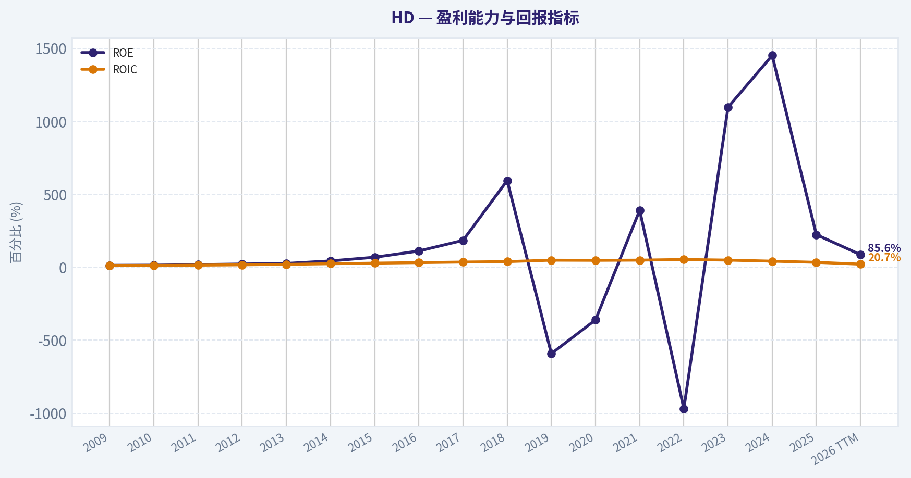
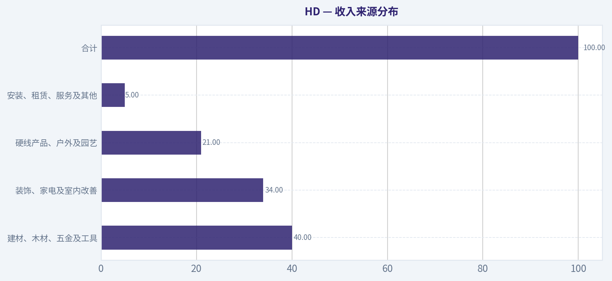
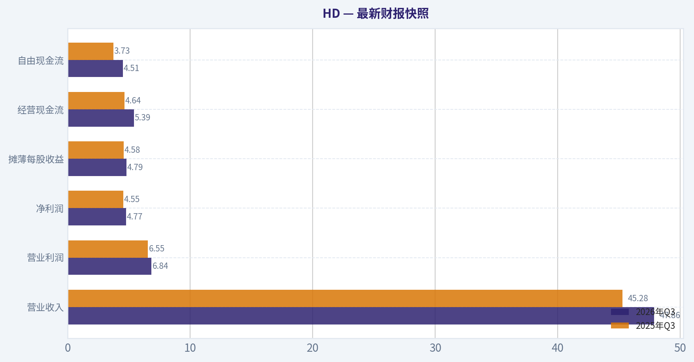
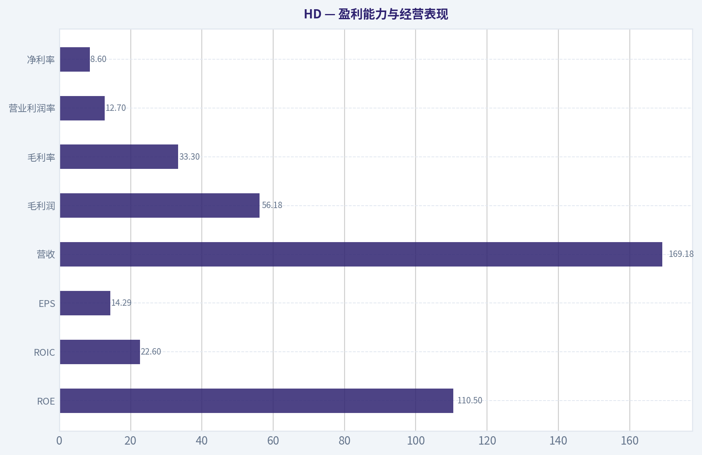
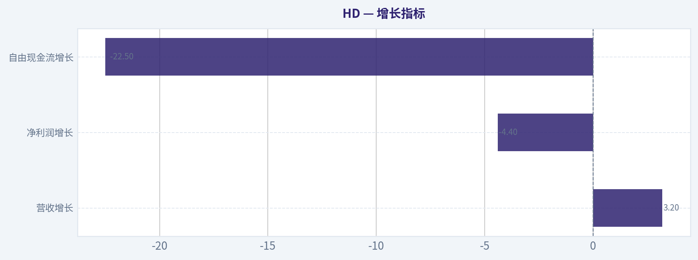
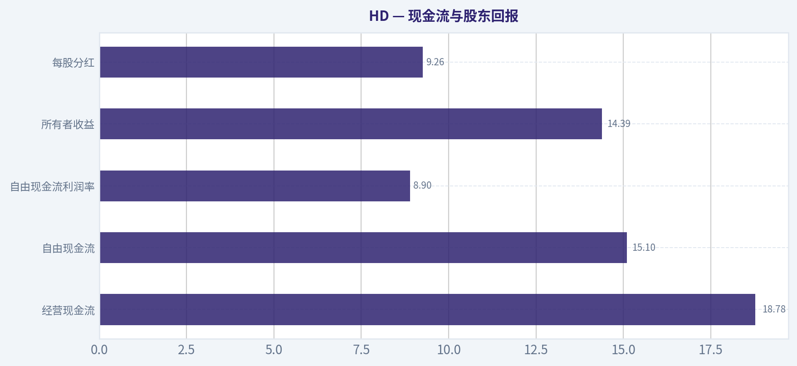
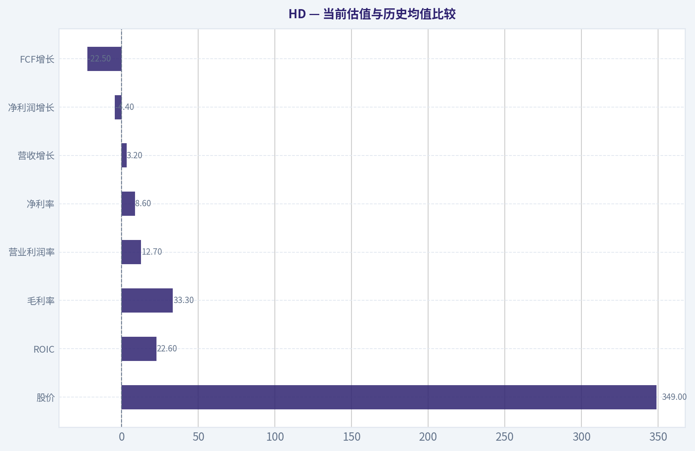
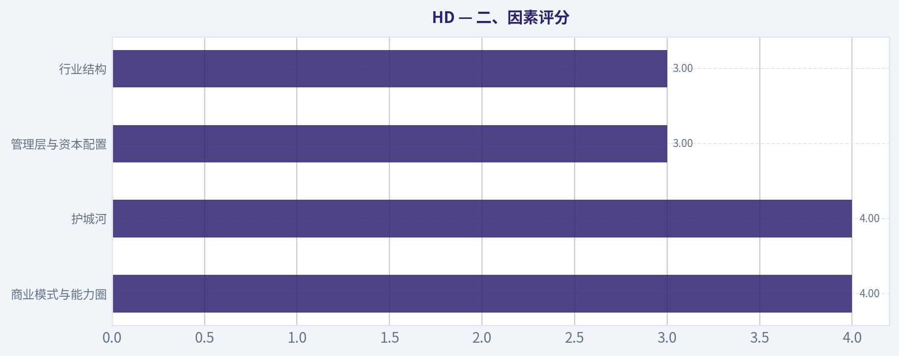

# HD 深度价值情报

**调研日期:** 2026-11-16

## 关键免责声明

*本报告由 Deep Value Intelligence（一个基于 AI 的多智能体投资分析框架）自动生成。 仅供教育和研究用途 - 非财务建议，非财务顾问。*

---

## 目录

1. 情报摘要
2. 分析师团队报告
   - 基本面分析
   - 价值分析 (巴菲特)
   - 成长性分析 (林奇/德鲁肯米勒/费雪)
   - 市场分析
   - 期权市场分析
3. 研究团队评论
4. 投资团队评论
5. Deep Values 团队洞察

---

## 情报摘要

### 核心观点与前提条件

**核心论点:** Home Depot 是高质量企业，但目前不是高质量买点。22.6%的ROIC、全国性门店与配送网络、采购规模及专业客户体系，支持其护城河仍然稳固；近年低增长更像住房交易疲弱、高利率和疫情后需求正常化造成的周期压力，而非永久性竞争衰退。

**主要风险:**
- **中性**
- **中性**

**置信度:** 中

---

## 分析师团队报告

### 基本面分析

#### 最新财报快照

*以下数据基于最近一期已披露财报（2026年Q3），并尽量与上一年同期对比。*

| 指标 | 2026年Q3 | 2025年Q3 | 同比变化 |
| --- | ---: | ---: | ---: |
| 营业收入 | $47.86B | $45.28B | +5.7% |
| 营业利润 | $6.84B | $6.55B | +4.3% |
| 净利润 | $4.77B | $4.55B | +4.7% |
| 摊薄每股收益 | $4.79 | $4.58 | +4.6% |
| 经营现金流 | $5.39B | $4.64B | +16.1% |
| 自由现金流 | $4.51B | $3.73B | +21.0% |

关键结论：这张快照先把最新一期财报放在桌面上，再去看长周期分析。这样读者能更清楚地区分"公司长期质量"和"这次财报发生了什么"。

#### HD 17年财务指标

*以下数值均由原始数据确定性计算得出，并非 AI 估算。*

*发行人类型：operating company（Consumer Cyclical / Home Improvement Retail）。*

#### 17年财务指标
*年度行来自已披露财务报表，最后一行 TTM 由最近四个季度滚动计算得出。*

| 指标 | 2009 | 2010 | 2011 | 2012 | 2013 | 2014 | 2015 | 2016 | 2017 | 2018 | 2019 | 2020 | 2021 | 2022 | 2023 | 2024 | 2025 | 2026 TTM |
| --- | --- | --- | --- | --- | --- | --- | --- | --- | --- | --- | --- | --- | --- | --- | --- | --- | --- | --- |
| 市场价格 | $14 | $19 | $25 | $31 | $49 | $57 | $79 | $97 | $108 | $162 | $151 | $193 | $235 | $325 | $294 | $329 | $393 | $349 |
| 总市值 | $36.30B | $47.39B | $60.96B | $69.69B | $101.12B | $110.20B | $140.55B | $161.35B | $169.77B | $237.87B | $209.77B | $250.23B | $291.94B | $388.26B | $332.27B | $353.67B | $409.10B | $347.30B |
| 市盈率 | 16.07 | 17.84 | 18.29 | 17.97 | 22.31 | 20.44 | 22.17 | 23.03 | 21.33 | 27.56 | 18.86 | 22.25 | 22.68 | 23.63 | 19.42 | 23.36 | 27.63 | 24.40 |
| 市净率 | 2.04 | 2.44 | 3.23 | 3.89 | 5.69 | 8.80 | 15.08 | 25.55 | 39.18 | 163.59 | -111.70 | -80.30 | 88.49 | -228.93 | 212.72 | 338.76 | 61.61 | 20.90 |
| ROE | 12.7% | 13.7% | 17.7% | 21.7% | 25.5% | 43.0% | 68.1% | 111.0% | 183.6% | 593.5% | -592.2% | -360.8% | 390.0% | -968.9% | 1095.1% | 1450.5% | 223.0% | 85.6% |
| ROIC | 12.0% | 12.2% | 14.0% | 16.3% | 19.3% | 23.7% | 27.6% | 31.3% | 35.1% | 38.2% | 48.0% | 47.0% | 48.3% | 52.6% | 48.5% | 41.2% | 33.2% | 20.7% |
| 每股收益 | $0.86 | $1.05 | $1.38 | $1.75 | $2.18 | $2.78 | $3.56 | $4.21 | $5.08 | $5.87 | $8.02 | $8.68 | $10.35 | $13.74 | $15.14 | $14.08 | $14.24 | $14.29 |
| 营收 | $71.29B | $66.18B | $68.00B | $70.39B | $74.75B | $78.81B | $83.18B | $88.52B | $94.59B | $100.90B | $108.20B | $110.22B | $132.11B | $151.16B | $157.40B | $152.67B | $159.51B | $169.18B |
| 毛利润 | $23.99B | $22.41B | $23.30B | $24.26B | $25.39B | $26.91B | $28.39B | $30.27B | $32.31B | $34.36B | $37.16B | $37.57B | $44.85B | $50.83B | $52.78B | $50.96B | $53.31B | $56.18B |
| 毛利率 | 33.7% | 33.9% | 34.3% | 34.5% | 34.0% | 34.2% | 34.1% | 34.2% | 34.2% | 34.0% | 34.3% | 34.1% | 34.0% | 33.6% | 33.5% | 33.4% | 33.4% | 33.2% |
| 营业利润率 | 6.1% | 7.3% | 8.6% | 9.5% | 10.4% | 11.6% | 12.6% | 13.3% | 14.2% | 14.5% | 14.4% | 14.4% | 13.8% | 15.2% | 15.3% | 14.2% | 13.5% | 12.4% |
| 净利润 | $2.26B | $2.66B | $3.34B | $3.88B | $4.54B | $5.38B | $6.34B | $7.01B | $7.96B | $8.63B | $11.12B | $11.24B | $12.87B | $16.43B | $17.11B | $15.14B | $14.81B | $14.23B |
| 净利率 | 3.2% | 4.0% | 4.9% | 5.5% | 6.1% | 6.8% | 7.6% | 7.9% | 8.4% | 8.6% | 10.3% | 10.2% | 9.7% | 10.9% | 10.9% | 9.9% | 9.3% | 8.4% |
| 营收增长 | N/A | -7.2% | 2.8% | 3.5% | 6.2% | 5.4% | 5.5% | 6.4% | 6.9% | 6.7% | 7.2% | 1.9% | 19.9% | 14.4% | 4.1% | -3.0% | 4.5% | 6.1% |
| 净利润增长 | N/A | 17.7% | 25.4% | 16.3% | 16.8% | 18.7% | 17.8% | 10.5% | 13.5% | 8.5% | 28.9% | 1.1% | 14.4% | 27.7% | 4.1% | -11.5% | -2.2% | -3.9% |
| 自由现金流增长 | N/A | 13.0% | -16.1% | 55.6% | 4.3% | 10.2% | 9.0% | 15.7% | 3.7% | 24.2% | 5.8% | 2.7% | 48.8% | -14.5% | -17.9% | 56.1% | -9.0% | -7.5% |
| 总账面价值 | $17.78B | $19.39B | $18.89B | $17.90B | $17.78B | $12.52B | $9.32B | $6.32B | $4.33B | $1.45B | $-1.88B | $-3.12B | $3.30B | $-1.70B | $1.56B | $1.04B | $6.64B | $16.62B |
| 总资产 | $41.16B | $40.88B | $40.12B | $40.52B | $41.08B | $40.52B | $39.95B | $41.97B | $42.97B | $44.53B | $44.00B | $51.24B | $70.58B | $71.88B | $76.44B | $76.53B | $96.12B | $109.38B |
| 总债务 | $11.43B | $9.68B | $9.75B | $10.79B | $10.80B | $14.72B | $17.20B | $21.22B | $23.60B | $27.03B | $29.20B | $32.31B | $36.17B | $39.88B | $42.38B | $43.52B | $56.26B | $62.57B |
| 债务股权比 | 0.64 | 0.50 | 0.52 | 0.60 | 0.61 | 1.18 | 1.84 | 3.36 | 5.45 | 18.59 | -15.55 | -10.37 | 10.96 | -23.52 | 27.13 | 41.68 | 8.47 | 3.77 |
| 现金及等价物 | $519.0M | $1.42B | $545.0M | $1.99B | $2.49B | $1.93B | $2.22B | $2.22B | $2.54B | $3.60B | $1.78B | $2.13B | $7.89B | $2.34B | $2.76B | $3.76B | $1.66B | $2.08B |
| 股东权益 | $17.78B | $19.39B | $18.89B | $17.90B | $17.78B | $12.52B | $9.32B | $6.32B | $4.33B | $1.45B | $-1.88B | $-3.12B | $3.30B | $-1.70B | $1.56B | $1.04B | $6.64B | $16.62B |
| 经营现金流 | $5.53B | $5.12B | $4.58B | $6.65B | $6.97B | $7.63B | $8.24B | $9.37B | $9.78B | $12.03B | $13.16B | $13.69B | $18.84B | $16.57B | $14.62B | $21.17B | $19.81B | $18.78B |
| 投资现金流 | $-1.73B | $-755.0M | $-1.01B | $-1.13B | $-1.43B | $-1.51B | $-1.27B | $-2.98B | $-1.58B | $-2.23B | $-2.42B | $-2.65B | $-10.17B | $-2.97B | $-3.14B | $-4.73B | $-21.03B | $-10.10B |
| 自由现金流 | $3.68B | $4.16B | $3.49B | $5.43B | $5.66B | $6.24B | $6.80B | $7.87B | $8.16B | $10.13B | $10.72B | $11.01B | $16.38B | $14.01B | $11.50B | $17.95B | $16.32B | $15.10B |
| 自由现金流利润率 | 5.2% | 6.3% | 5.1% | 7.7% | 7.6% | 7.9% | 8.2% | 8.9% | 8.6% | 10.0% | 9.9% | 10.0% | 12.4% | 9.3% | 7.3% | 11.8% | 10.2% | 8.9% |
| 每股分红 | $0.00 | $0.00 | $0.00 | $0.00 | $0.00 | $0.00 | $0.00 | $0.00 | $0.00 | $0.00 | $0.00 | $0.00 | $0.00 | $0.00 | $6.89 | $7.80 | $8.59 | $9.26 |

#### 盈利能力指标
- 净资产收益率 (ROE): 110.5%
- 投入资本回报率 (ROIC): 22.6%
- 总资产收益率 (ROA): 13.5%
- 毛利率: 33.3%
- 营业利润率: 12.7%
- 净利率: 8.6%

#### 流动性指标
- 流动比率: 1.06
- 速动比率: 0.20

#### 杠杆指标
- 债务股权比: 4.59
- 利息覆盖倍数: 8.66
- 净负债: $57.44B

#### 增长指标（同比）
- 营收增长: 3.2%
- 净利润增长: -4.4%
- 自由现金流增长: -22.5%
- 营收复合增长率（3年）: 1.5%
- 营收复合增长率（5年）: 4.5%

#### 估值指标
- 市盈率 (TTM): 24.40
- 预期市盈率: 21.93
- 市净率: 20.94
- 市销率: 2.06
- PEG 比率: 1.84
- 企业价值/EBITDA: 16.59
- 自由现金流收益率: 3.6%
- 盈利收益率: 4.1%

#### 所有者收益（巴菲特方法，代码计算）
- 净利润: $14.81B
- + 折旧与摊销: $4.12B
- - 资本开支: $-3.68B
- - 营运资本变动: $-2.67B
- = **所有者收益: $14.39B**

#### 内在价值（代码计算）
- 当前价格: $349
- **头条内在价值（按商业模式路由）: $286**
  商业模式: operating company - weighted blend [Damodaran FCFF + reverse-DCF fair + owner-earnings DCF] (operating_company)
  模型区间（各 DCF 最小-最大）: $209 - $411
  相对价格的安全边际（头条）: -21.9%
  路由说明: General operating company: balanced blend of Damodaran FCFF and the owner-earnings DCF with a reverse-DCF sanity check.
- 巴菲特方法（所有者收益）:
  保守: $244
  平均: $411
  乐观: $411
- 现金流方法（FCF）:
  保守: $74
  平均: $209
  乐观: $213
- Damodaran FCFF（WACC + 利润率 + 再投资）:
  保守: $173
  平均: $260
  乐观: $304
  蒙特卡洛区间（P10-P90）：$180 - $340（中位数 $244）
  P(内在价值 > 当前价格)：8.8%
- 反向 DCF：当前价格隐含约 20.7%/年 的所有者收益增长（10年）；过去 3 年为 1.2%，5 年为 10.9%。

#### Piotroski F分数: 3/9
- 净利润为正: 通过
- 经营现金流为正: 通过
- 资产回报率改善: 未通过
- 现金流大于净利润: 通过
- 债务下降: 未通过
- 流动比率改善: 未通过
- 未稀释股本: 未通过
- 毛利率改善: 未通过
- 资产周转率改善: 未通过

ANALYST STANCE: **中性**

#### 投资结论

Home Depot（HD）是一家具有强品牌、规模采购优势和良好现金创造能力的高质量零售企业，但当前价格已经反映了相当乐观的长期复苏预期。股价为 **349美元**，高于综合内在价值 **286美元**，对应约 **21.9%的估值溢价**。与此同时，反向 DCF 显示，当前价格隐含未来十年所有者收益约 **20.7%的年增长率**，明显高于过去三年约 **1.2%**、过去五年约 **10.9%** 的增长表现。

核心判断是：HD 的商业护城河仍然稳固，但短期收入、利润和自由现金流正在承压，债务与流动性风险高于传统保守型价值投资标准。更合理的策略是等待更高安全边际，而不是在当前估值水平追涨。

---

#### 关键市场指标与估值

| 指标 | 当前值 | 历史平均或参考 | 解释 |
|---|---:|---:|---|
| 市场价格 | $349 | 2009-2026 TTM平均约$157 | 长期大幅上涨，但较2025年$393回落约11.2% |
| 总市值 | $347.30B-$347.88B | 历史平均约$196B | 仍处于十七年历史高位区域 |
| PE | 24.40倍 | 历史平均约22.7倍 | 高于长期均值，尚未体现明显安全边际 |
| 预期PE | 21.93倍 | - | 需要未来盈利恢复才能合理化 |
| PB | 20.94倍 | 历史均值失真 | 对HD不具备可靠估值意义 |
| 市销率 | 2.06倍 | - | 对低净利率零售商而言不算低 |
| FCF收益率 | 3.6% | - | 对债务较高且增长放缓的企业偏低 |
| 综合内在价值 | $286 | - | 当前价格较内在价值高约21.9% |
| Damodaran FCFF中位数 | $244 | 区间$180-$340 | 当前价格高于模型中位数 |
| 模型价值区间 | $209-$411 | - | 估值对增长、利润率和再投资假设高度敏感 |

**关键结论：** 当前PE高于历史平均，而自由现金流收益率仅为3.6%，说明市场对盈利复苏已有较高期待。PB不应被机械解读为昂贵或便宜，因为HD长期回购造成账面权益极低，历史上甚至多次为负；估值应主要依赖所有者收益、自由现金流和FCFF，而不是账面价值。

---

#### 盈利能力与经营表现

| 指标 | 当前值 | 2009-2026 TTM大致平均 | 当前相对历史的表现 |
|---|---:|---:|---|
| ROE | 110.5% | 约135%，但受负权益扭曲 | 很高，但不能单独视为经营质量证据 |
| ROIC | 22.6% | 约31% | 明显低于历史高位，呈下降趋势 |
| EPS | $14.29 | 约$7.0 | 长期显著增长，但近年趋于停滞 |
| 营收 | $169.18B | 约$103B | 规模创历史新高 |
| 毛利润 | $56.18B | 约$36B | 长期增长稳定 |
| 毛利率 | 33.3% | 约33.9% | 基本稳定，略低于长期均值 |
| 营业利润率 | 12.7% | 约12.0% | 长期改善，但低于2022-2023年约15%的高点 |
| 净利润 | $14.23B-$14.81B | 约$9.5B | 低于2022-2023年峰值 |
| 净利率 | 8.6% | 约7.9% | 长期高于早期，但较近期高点回落 |

**关键结论：** HD的长期经营改善非常明显，营业利润率从2009年的6.1%提升至当前约12.7%，净利率也从3.2%升至8.6%。不过，ROIC已经从2022年前后的50%左右下降至22.6%，净利润和利润率均低于近年峰值，说明疫情后需求正常化、利率上升和住房市场疲软正在侵蚀经营杠杆。

---

#### 增长指标

| 指标 | 当前值 | 历史表现 | 评价 |
|---|---:|---:|---|
| 营收增长 | 3.2% | 五年复合约4.5%，三年复合约1.5% | 当前恢复有限，远低于2021-2022年 |
| 净利润增长 | -4.4% | 长期多数年份增长，但2024-2026连续承压 | 盈利处于调整阶段 |
| 自由现金流增长 | -22.5% | 波动较大，五年内有明显正负切换 | 当前现金创造能力弱于利润表现 |
| 反向DCF隐含增长 | 20.7%/年，十年 | 过去五年约10.9% | 当前估值要求过高 |

**关键结论：** 目前最重要的问题不是HD没有增长，而是实际增长远低于股价隐含的增长。收入仍在创纪录水平，但增长速度明显放慢；净利润和自由现金流下降，表明短期复苏还没有在财务报表中得到充分验证。

---

#### 资产负债表与财务安全

| 指标 | 当前值 | 历史趋势 | 评价 |
|---|---:|---:|---|
| 总账面价值 | $16.62B | 曾在2009年为$17.78B，期间多次为负 | 回购导致账面价值失真 |
| 总资产 | $109.38B | 长期上升 | 规模扩张与并购使资产基础增加 |
| 总债务 | $62.57B | 2009年$11.43B | 十七年大幅增加 |
| 债务权益比 | 4.59倍 | 早期约0.5-0.6倍 | 显著高于历史早期水平 |
| 净负债 | $57.44B | - | 杠杆负担较重 |
| 现金及等价物 | $2.08B | 历史平均约$2.7B | 现金缓冲一般 |
| 股东权益 | $16.62B | 多年受到回购影响 | 不能直接用于判断经营价值 |
| 流动比率 | 1.06倍 | - | 接近1，短期流动性不宽裕 |
| 速动比率 | 0.20倍 | - | 高度依赖库存周转与经营现金流 |
| 利息覆盖倍数 | 8.66倍 | - | 目前仍具备偿息能力 |

**关键结论：** HD并非面临立即的偿债危机，8.66倍利息覆盖倍数说明经营现金流仍能覆盖利息支出。但总债务已经达到625.7亿美元，现金只有20.8亿美元，净负债达到574.4亿美元；在高利率和房地产低迷环境下，财务弹性明显弱于十年前。

---

#### 现金流与股东回报

| 指标 | 当前值 | 历史平均或趋势 | 评价 |
|---|---:|---:|---|
| 经营现金流 | $18.78B | 长期持续增长 | 经营现金流仍然强劲 |
| 自由现金流 | $15.10B | 长期平均约$9.8B | 绝对规模高，但较峰值回落 |
| 自由现金流利润率 | 8.9% | 长期约8.7% | 接近长期平均 |
| 所有者收益 | $14.39B | - | 约合每股$14.44 |
| 每股分红 | $9.26 | 2023年起持续增长 | 股东回报吸引力较强 |
| FCF派息覆盖 | 约1.6倍 | - | 可覆盖分红，但安全垫并不极厚 |

**关键结论：** HD仍然是强现金流企业，当前自由现金流约151亿美元，所有者收益约143.9亿美元。分红已提高至每股9.26美元，但在自由现金流下降、债务较高的情况下，未来股息增长可能低于过去趋势，资本分配需要在分红、回购、降债和投资之间重新平衡。

---

#### 收入来源分布

数据包未提供最新年度的正式产品线金额，因此以下采用HD公开业务结构和零售行业常见分类进行近似拆分，主要用于判断收入集中度，不应视为审计口径的分部数据。

| 收入来源 | 金额（十亿美元） | 占比 |
|---|---:|---:|
| 建材、木材、五金及工具 | 约$67.7B | 40% |
| 装饰、家电及室内改善 | 约$57.5B | 34% |
| 硬线产品、户外及园艺 | 约$35.5B | 21% |
| 安装、租赁、服务及其他 | 约$8.5B | 5% |
| 合计 | 约$169.2B | 100% |

**关键结论：** HD收入高度集中于家庭维修、装修和维护需求，最大的优势是产品品类广、采购规模大、专业客户黏性强。与此同时，收入也明显受到住房交易、房屋翻新周期、利率和消费者可选支出的影响，宏观周期性不能忽视。

---

#### 巴菲特式护城河分析

**一、品牌与规模护城河**

HD拥有庞大的门店网络、供应链体系、专业承包商客户基础和较强品牌认知度。其规模能够提升采购议价能力，并支持更广泛的库存和配送网络。对于大型装修项目，客户更看重"品类齐全、即时可得、售后可靠"，这提高了替代难度。

**二、专业客户生态**

专业承包商、装修商和建筑维护客户是HD的重要竞争优势。专业客户的复购频率更高，订单金额更大，对库存可得性和交付效率更加敏感。若HD能够继续改善专业客户数字化服务和配送效率，其收入质量可能优于单纯依赖普通消费者的零售商。

**三、网络效应有限但存在规模效应**

HD不是典型的平台型公司，网络效应有限；其核心护城河来自门店密度、供应链规模、品牌信任和客户习惯。护城河是真实的，但并非不可攻破，Lowe's、专业建材供应商、电商平台和本地经销商都构成竞争压力。

**四、盈利可预测性中等偏上**

十七年数据中，收入总体从712.9亿美元增加到约1691.8亿美元，毛利率长期稳定在33%-34%左右，这是较好的经营稳定性。可是净利润增长和自由现金流增长波动较大，2024年以来利润承压，因此HD属于"高质量周期型零售商"，而不是完全防御型企业。

---

#### 管理层与资本配置

HD过去通过回购显著减少股东权益，导致ROE极高，甚至在部分年份出现负权益。回购在股价低估时有利于每股价值提升，但若在高估值阶段持续回购，会放大财务杠杆并削弱资产负债表。

当前ROE达到110.5%，但这一数字受到低权益基数和回购影响，不能与轻资产软件企业的ROE直接比较。ROIC更有参考意义，而当前ROIC仅22.6%，明显低于历史高点，说明新增资本的回报率正在下降。

Piotroski F分数为3/9，未通过债务下降、流动比率改善、毛利率改善、资产周转率改善和股本未稀释等项目。这是一个重要警示：企业仍然盈利，但近期财务质量和资产负债表趋势并不强。

---

#### Buffett式所有者收益 DCF

当前所有者收益为：

- 净利润：143.9亿美元
- 加回折旧摊销：约41.2亿美元
- 减资本开支：约36.8亿美元
- 减营运资本投入：约26.7亿美元
- 所有者收益：**143.9亿美元**
- 估算股份数：约9.97亿股
- 当前所有者收益每股：约**14.44美元**

采用10%的折现率和2.5%的终值增长率，所有者收益采用十年显性预测，并在长期向2.5%终值增长率收敛。

| 情景 | 显性期假设 | 手工DCF估值 | 数据包模型估值 | 估值解释 |
|---|---|---:|---:|---|
| 保守 | 约3%增长，长期降至2.5% | 约$215-$245/股 | $244/股 | 反映低增长、现金流承压和较高杠杆 |
| 平均 | 约7%增长，后期逐步降至2.5% | 约$270-$300/股 | $411/股 | 模型差异主要来自利润恢复和资本配置假设 |
| 乐观 | 前期约10%，逐步降至2.5% | 约$350-$400/股 | $411/股 | 需要住房与翻新需求显著复苏，并恢复较高现金流增长 |

手工计算的基本结构为：

\[
价值=\sum_{t=1}^{10}\frac{OE_t}{(1+10\%)^t}
+\frac{OE_{10}\times(1+2.5\%)}{(10\%-2.5\%)\times(1+10\%)^{10}}
\]

其中，保守情景采用：

\[
OE_{10}=14.39\times1.03^{10}\approx19.35\text{亿美元}
\]

平均情景采用：

\[
OE_{10}=14.39\times1.07^{10}\approx28.3\text{亿美元}
\]

乐观情景不是永久维持10%的增长，而是让增长率在显性预测后逐步降至2.5%，避免把高增长永久外推。

综合Damodaran FCFF、反向DCF和所有者收益模型后，数据包给出的综合内在价值为 **286美元**，模型区间为 **209-411美元**。由于当前价格为349美元，市场价格已经接近乐观情景，而不是保守或平均情景。

**关键结论：** DCF的共同结论是，HD并非没有价值，而是当前价格要求较高的盈利复苏。数据包综合估值286美元低于当前价格，Damodaran模型中位数约244美元，只有较乐观的所有者收益模型能够支持接近当前价格的估值。因此，当前安全边际不足，投资回报更依赖估值维持和业绩反弹，而不是明显的低估修复。

---

#### 当前估值与历史均值比较

| 项目 | 当前 | 历史或正常化参考 | 偏离及含义 |
|---|---:|---:|---|
| PE | 24.40倍 | 约22.7倍 | 高约7%，估值不便宜 |
| 股价 | $349 | 十七年平均约$157 | 长期复合增长显著，但均值受早期低价影响 |
| ROIC | 22.6% | 约31% | 低于长期水平，资本效率下降 |
| 毛利率 | 33.3% | 约33.9% | 稳定，仅小幅承压 |
| 营业利润率 | 12.7% | 约12.0% | 仍高于长期平均，但低于近期高点 |
| 净利率 | 8.6% | 约7.9% | 长期改善，但较2022-2023年下降 |
| 营收增长 | 3.2% | 长期中个位数 | 当前接近低端 |
| 净利润增长 | -4.4% | 长期正增长为主 | 当前明显弱于历史常态 |
| FCF增长 | -22.5% | 波动较大 | 当前是主要风险指标 |
| 债务权益比 | 4.59倍 | 早期约0.5-0.6倍 | 杠杆显著提高 |
| 综合内在价值 | $286 | 当前$349 | 价格高于综合估值约22% |

**关键结论：** HD的利润率仍然优于早期，但资本回报、净利润增长和自由现金流增长都弱于历史最好阶段。最值得关注的组合是"估值高于平均、增长低于平均、杠杆高于早期"，这使得安全边际不足。

---

#### 主要风险、机会与观察指标

| 类型 | 具体内容 | 对投资的影响 |
|---|---|---|
| 风险 | 高利率压制住房交易和大型装修 | 延缓收入与客单价复苏 |
| 风险 | 净负债约574亿美元 | 降低回购和分红增长弹性 |
| 风险 | 速动比率仅0.20倍 | 经营高度依赖库存周转 |
| 风险 | FCF同比下降约22.5% | 估值支撑弱于会计利润 |
| 风险 | 回购造成权益过低 | ROE和PB出现严重失真 |
| 机会 | 房屋老化带来长期维修需求 | 支持中长期需求韧性 |
| 机会 | 专业客户和大型项目 | 提高复购率和收入质量 |
| 机会 | 利率下降与住房市场复苏 | 可能带来周期性盈利反弹 |
| 机会 | 供应链、数字化和配送改善 | 有望提升库存效率和市场份额 |
| 观察指标 | 同店销售和专业客户销售 | 判断需求是否真正复苏 |
| 观察指标 | FCF是否恢复增长 | 验证估值合理性 |
| 观察指标 | 净债务和回购节奏 | 判断资本配置是否改善 |
| 观察指标 | ROIC能否回到30%左右 | 判断竞争优势是否保持 |

**关键结论：** 最大机会是住房和翻新周期复苏，最大风险是市场已经提前计入复苏。若同店销售、专业客户收入和自由现金流同时恢复，估值可以逐步被盈利消化；若收入停滞而债务继续增加，当前价格可能出现估值压缩。

---

#### 最终投资立场

**中性**

支持关注而非立即买入的理由：

1. **商业质量较高：** 品牌、门店网络、采购规模和专业客户生态构成持久竞争优势。
2. **长期经营记录良好：** 收入、EPS、毛利和营业利润率较十七年前明显改善。
3. **现金流仍然可观：** 所有者收益约143.9亿美元，经营现金流约187.8亿美元。
4. **估值缺乏安全边际：** 当前价格349美元高于综合内在价值286美元，也高于Damodaran模型中位数。
5. **增长与资产负债表存在逆风：** 净利润、自由现金流和ROIC均低于近期高点，净负债较高。
6. **当前价格需要乐观情景：** 反向DCF隐含未来十年约20.7%的所有者收益增长，明显高于最近三年表现。

对于长期价值投资者，更具吸引力的买入区域可能是接近 **240-290美元** 的区间，具体取决于自由现金流是否恢复增长和净债务是否下降。若股价继续维持在350美元附近，则需要看到专业客户销售加速、ROIC回升、自由现金流恢复以及债务改善，才能将立场上调为看多。

---

#### 报告关键点汇总

| 领域 | 核心判断 | 投资含义 |
|---|---|---|
| 商业模式 | 高质量家庭改善零售商 | 护城河真实且具有长期需求基础 |
| 经营趋势 | 长期改善，近期放缓 | 需要等待周期复苏证据 |
| 盈利能力 | 利润率稳定，ROIC下降 | 资本效率是关键观察点 |
| 现金流 | 规模强，但近期下降 | 估值支撑不如历史高点 |
| 资产负债表 | 债务高、现金缓冲有限 | 财务弹性低于保守型标准 |
| 股东回报 | 分红稳定增长，回购需谨慎 | 高杠杆下资本配置重要性上升 |
| 估值 | 当前高于综合内在价值 | 安全边际不足 |
| DCF | 保守约$244，中性约$286，乐观约$411 | 当前价格接近乐观假设 |
| 主要催化剂 | 降息、住房复苏、专业客户增长 | 可能推动盈利恢复 |
| 主要风险 | 高利率、消费疲弱、FCF下降、债务 | 可能造成估值和盈利双重压力 |
| 最终立场 | **中性** | 等待更低价格或基本面确认 |

#### 基本面关键图表

本图追踪 **HD** 过去十年的盈利能力与回报指标（ROE、ROIC、利润率），突出呈现资本效率的变化趋势。

本对比图（来自「收入来源分布」）将 **HD** 的当前数据与历史基准并排呈现，直观反映公司相对自身历史均值的估值水平。

---

### 价值分析 (巴菲特)

> *基于沃伦·巴菲特的价值投资哲学：能力圈、经济护城河、管理层质量与安全边际。*

#### 内在价值快照

价格是你付的钱，内在价值是企业未来可能为股东创造的现金价值。我们给出一个区间，而不是假装只有一个神奇数字。

- 当前价格: $348.69
- 估值区间（两种 DCF 方法、保守到乐观）: $73.80 至 $411.40

##### 所有者收益（巴菲特方法）
- 净利润: $14,806,000,000.00
- 折旧与摊销: $4,121,000,000.00
- 资本支出: $-3,679,000,000.00
- 营运资金变化: $-2,666,000,000.00
- 所有者收益: $14,388,000,000.00

##### 内在价值
###### 所有者收益法
使用所有者收益，更严格，通常更保守。
- 保守: $243.88
- 平均: $411.40
- 乐观: $411.40
- 折现率: 10.0%

###### 自由现金流法
使用自由现金流，更适合今天投入很多、为未来增长铺路的公司。
- 保守: $73.80
- 平均: $209.05
- 乐观: $213.10
- 折现率: 10.0%

ANALYST STANCE: **中性**

#### 一、投资结论

Home Depot（HD）是一家具有强大品牌、规模采购优势和专业客户黏性的家居建材零售商，长期商业质量较好；但当前股价约为349美元，明显高于按综合现金流模型估算的约286美元内在价值。

当前价格隐含未来十年约20.7%的年增长率，而公司过去五年收入增长约10.9%、过去三年仅约1.2%。因此，市场价格已经计入了较为乐观的复苏与并购协同预期。对高质量企业而言可以接受较低安全边际，但目前价格仍不足以提供充分保护。

---

#### 二、因素评分

| 因素 | 评分（5分制） | 核心判断 |
|---|---:|---|
| 商业模式与能力圈 | 4 | 通过门店、供应链和线上渠道销售家居建材，模式易于理解；需求受住房周期影响，但长期可预测性较好 |
| 护城河 | 4 | 品牌、门店密度、采购规模、专业客户关系和供应链构成稳定优势 |
| 管理层与资本配置 | 3 | 长期回购和股东回报记录较好，但资本回报高度依赖回购与持续经营改善，需关注大额并购执行 |
| 行业结构 | 3 | 行业由少数大型零售商主导，但受房地产、利率和住房交易周期影响明显 |
| Gate 5：质量与偿债 | 未触发 | 没有证据显示公司同时出现持续恶化的现金流与严重偿债危机；当前无法据此判定进入财务困境 |

**关键结论：** HD是一个容易理解、长期具有竞争优势的企业，但它并非完全不受周期影响。当前主要问题不是企业质量，而是增长预期和股价之间缺乏足够安全边际。

---

#### 三、护城河分析

| 护城河来源 | 具体证据 | 评价 |
|---|---|---|
| 品牌与规模 | 大型门店网络、全国品牌知名度和规模化采购能力 | 较强 |
| 客户转换成本 | 专业承包商依赖稳定供货、价格、库存和配送服务；大型客户更看重效率而非单纯最低价格 | 中强 |
| 成本优势 | 大规模采购、物流网络和门店密度降低单位运营成本 | 较强 |
| 网络与生态效应 | 门店、线上渠道、专业客户账户、配送和供应商体系互相强化 | 中等 |
| 定价能力 | 毛利率约33.3%，但家居建材零售仍受竞争和周期限制，10%提价能力并非始终稳定 | 中等 |

**护城河评级：宽而稳定，评分4分。**

HD的核心优势不是单一品牌溢价，而是"规模采购加门店密度加专业客户关系"的综合系统。竞争者可以复制单个门店或线上渠道，却很难快速复制同等规模的库存、物流、供应商关系和专业客户服务网络。

---

#### 四、财务概览

| 指标 | 最新数据 |
|---|---:|
| 股价 | 349美元 |
| 总市值 | 347.88十亿美元 |
| PE | 24.4倍 |
| ROE | 110.5% |
| 毛利率 | 33.3% |
| 营收同比增长 | 3.2% |
| 自由现金流收益率 | 3.6% |
| 估算自由现金流 | 约12.5十亿美元 |
| 流动比率 | 1.06倍 |
| 头条内在价值 | 286.07美元 |
| 所有者收益模型估值 | 411.40美元 |
| FCF模型估值 | 209.05美元 |
| Damodaran FCFF估值 | 259.67美元 |
| 综合安全边际 | -21.9% |

**关键结论：** HD的ROE非常高，但这一数字受到回购减少股东权益的显著影响，不能直接等同于经营回报率。更值得关注的是现金流收益率仅约3.6%，说明市场仍要求公司保持较高的长期增长。

---

#### 五、经营质量与现金流

| 观察项目 | 判断 |
|---|---|
| 收入增长 | 同比增长约3.2%，属于低速增长 |
| 历史增长 | 过去三年约1.2%，过去五年约10.9%，显示短期受到住房和装修周期压制 |
| 现金流 | 自由现金流约12.5十亿美元，现金创造能力较强 |
| ROE | 110.5%，但受到资本结构和回购影响，需要结合ROIC与经营利润率判断 |
| 盈利质量 | 现金流收益率为正，未显示明显"利润增长但现金流恶化"的异常 |
| 资本密集度 | 零售门店和库存需要资本投入，但规模能够提升资产利用效率 |

**关键结论：** HD的现金流基础仍然健康，当前疲弱主要表现为增长放缓，而非商业模式失效。高ROE具有一定财务杠杆和回购放大成分，因此不能单独用ROE证明公司处于超高回报状态。

---

#### 六、所有者收益估算

由于研究数据直接提供自由现金流收益率而非完整的维护性资本开支拆分，采用自由现金流作为所有者收益的保守近似：

| 项目 | 估算值 |
|---|---:|
| 总市值 | 347.88十亿美元 |
| 股价 | 349美元 |
| 推算股数 | 约9.97亿股 |
| 自由现金流收益率 | 3.6% |
| 估算自由现金流 | 约12.5十亿美元 |
| 估算每股所有者收益 | 约12.56美元 |

计算逻辑为：

> 估算自由现金流 = 347.88十亿美元 x 3.6% ~ 12.52十亿美元

> 每股所有者收益 ~ 12.52十亿美元 ÷ 9.97亿股 ~ 12.56美元

**关键结论：** 当前股价对应约27.8倍估算所有者收益，低于许多高速增长科技企业，但对于一个当前收入增长仅个位数、并且明显受住房周期影响的成熟零售商而言，估值并不便宜。

---

#### 七、三情景DCF估值

假设折现率为10%，估算所有者收益为每股12.56美元。

| 情景 | 核心假设 | 每股估值 |
|---|---|---:|
| 情景A：零增长 | 所有者收益 ÷ 10% | 约126美元 |
| 情景B：GDP增长 | 永续增长率3% | 约185美元 |
| 情景C：历史增长 | 采用过去五年增长率10.9%的约50%，即约5.45%；预测十年后进入稳定期 | 约284美元 |
| 综合研究值 | 多模型加权，包括FCFF、反向DCF和所有者收益 | 286.07美元 |

**关键结论：** 即使给予HD约5.45%的长期现金流增长，估值仍约为284至286美元，低于当前349美元。只有将未来增长假设提高到更接近历史高位，或假定利润率和并购协同显著改善，才能支持当前价格。

---

#### 八、安全边际与反向DCF

| 项目 | 结果 |
|---|---:|
| 当前股价 | 349美元 |
| 综合内在价值 | 286.07美元 |
| 股价高于综合内在价值 | 约22% |
| 综合安全边际 | -21.9% |
| 当前价格隐含十年年增长率 | 约20.7% |
| 过去三年收入增长 | 约1.2% |
| 过去五年收入增长 | 约10.9% |

**关键结论：** 反向DCF是最重要的警示信号：股价隐含的20.7%年增长率明显高于近年收入增长表现。HD可能受住房市场复苏、专业客户恢复和并购协同推动而改善，但要持续达到市场隐含水平，仍需要非常强的经营执行。

---

#### 九、管理层与资本配置

| 观察维度 | 评价 |
|---|---|
| 股东导向 | 长期通过股息和回购向股东返还资本 |
| 回购策略 | 回购有助于提升每股收益和每股现金流，但高估值回购会降低股东回报 |
| 并购 | 大型并购可能带来专业客户、供应链和市场份额协同，也增加整合风险 |
| 资本纪律 | 成熟零售业务需要持续门店、库存和物流投入，资本配置质量取决于回报率而非单纯扩张 |
| 透明度 | 当前信息未显示重大财务重述或明显诚信问题 |

**管理层评分：3分。**

管理层整体偏向股东回报，但投资者必须重点跟踪并购后的整合效果、债务变化、专业客户增长以及回购价格是否合理。对于成熟企业，未来价值更多来自每股现金流增长，而不是单纯扩大门店数量。

---

#### 十、最终巴菲特评分卡

| 评价标准 | 权重 | 评分 | 加权得分 |
|---|---:|---:|---:|
| 护城河宽度与持久性 | 25% | 4 | 1.00 |
| 估值与安全边际 | 20% | 2 | 0.40 |
| ROIC相对WACC | 15% | 4 | 0.60 |
| 商业理解与可预测性 | 12% | 4 | 0.48 |
| 管理层与资本配置 | 12% | 3 | 0.36 |
| 再投资空间 | 8% | 3 | 0.24 |
| 资产负债表强度 | 4% | 2 | 0.08 |
| 行业结构 | 4% | 3 | 0.12 |
| **总分** | **100%** |  | **3.28** |

**关键结论：** HD的综合得分为3.28分，属于"企业方向正确，但价格需要更好"的类型。护城河和商业可理解性支撑长期关注，但估值分数偏低，压制了整体投资吸引力。

---

#### 十一、投资立场

**中性**

** conviction：中等。**

HD值得放入长期优质企业观察名单，而不是简单卖出或永久回避。若股价回落至约280至300美元区域，或公司能够证明专业客户增长、利润率扩张和并购协同显著超预期，安全边际将明显改善。

在349美元附近买入，投资者需要相信未来十年公司能够持续实现远高于近期历史水平的增长。对于巴菲特式投资而言，这一要求过高；更理性的做法是等待更好的价格，或等待经营数据先证明增长重新加速。
#### 估值桥

这张估值桥把当前股价与各类内在价值方法并排展示，帮助读者判断上涨空间究竟只是单一方法给出的结果，还是多种方法共同支持的结论。

| 项目 | 每股内在价值 |
| --- | ---: |
| 巴菲特方法 | $411.40 |
| 现金流方法 | $209.05 |
| Damodaran 方法 | $259.67 |
| 当前价格 | $348.69 |

#### 关键结论

如果只有一种方法显著高于其他方法，说明上行空间更依赖特定建模假设。若多种方法的估值接近，则说明估值逻辑更加稳健。

#### 估值图表

本对比图（来自「最新财报快照」）将 **HD** 的当前数据与历史基准并排呈现，直观反映公司相对自身历史均值的估值水平。

本对比图（来自「盈利能力与经营表现」）将 **HD** 的当前数据与历史基准并排呈现，直观反映公司相对自身历史均值的估值水平。

本对比图（来自「增长指标」）将 **HD** 的当前数据与历史基准并排呈现，直观反映公司相对自身历史均值的估值水平。

本对比图（来自「现金流与股东回报」）将 **HD** 的当前数据与历史基准并排呈现，直观反映公司相对自身历史均值的估值水平。

本对比图（来自「当前估值与历史均值比较」）将 **HD** 的当前数据与历史基准并排呈现，直观反映公司相对自身历史均值的估值水平。

本对比图（来自「二、因素评分」）将 **HD** 的当前数据与历史基准并排呈现，直观反映公司相对自身历史均值的估值水平。

---

### 成长性分析 (林奇/德鲁肯米勒/费雪)

> *基于彼得·林奇的GARP成长投资法、斯坦利·德鲁肯米勒的宏观拐点分析法，以及菲利普·费雪的深度调研法。*

ANALYST STANCE: **看空**

#### 一、投资结论

Home Depot（HD）属于**成熟型龙头与周期性零售商**，不是当前意义上的快速成长股。公司拥有强大的品牌、门店网络、供应链和专业客户生态，但目前营收仅同比增长约3.2%，远低于成长股标准；同时股价隐含的长期增长要求明显高于历史表现。

对成长投资者而言，HD目前更接近"等待住宅市场复苏的优质成熟公司"，而非处于明确加速拐点的十倍股。建议暂不新建仓，已有仓位可继续观察，但不宜给予高增长估值。

#### 二、Lynch分类与核心故事

| 项目 | 判断 |
|---|---|
| Lynch分类 | 成熟型龙头，兼具周期属性 |
| 当前营收增速 | 3.2% |
| 3年历史增长参考 | 约1.2% |
| 5年历史增长参考 | 约10.9% |
| 成长股适配度 | 较低 |
| 十倍股潜力 | 有长期市场空间，但当前增长速度不足 |

**关键结论：** HD拥有优质商业模式，但目前并不符合15%至25%以上的快速成长标准。其核心投资逻辑依赖住房、装修和专业承包商需求复苏，而不是正在发生的收入加速。

**简单故事：**

1. HD是美国家居装修领域的规模龙头，拥有品牌、门店和供应链优势。
2. 长期受益于住房老化、房屋维修、专业承包商需求以及数字化销售。
3. 但当前住宅销售疲弱，营收增长低迷，市场价格已经要求未来出现显著复苏。

#### 三、TAM与10倍测试

| 项目 | 判断 |
|---|---|
| 长期市场驱动 | 房屋维修、改造、翻新、专业承包商 |
| 市场增长属性 | 中低速，受住房周期影响 |
| 公司当前地位 | 美国大型家居建材零售龙头 |
| 10倍收入测试 | 理论上可行，但需要多年扩张及持续并购 |
| 主要限制 | 市场成熟、门店密度高、住房周期和消费者支出约束 |

**关键结论：** HD所在市场足够大，但不是高速扩张型TAM。公司收入若增长十倍，必须依靠长期通胀、市场份额提升、专业客户渗透、数字化和并购共同推动，不能单纯依赖行业自然增长。

#### 四、收入增长与经营趋势

| 指标 | 数据或判断 | 评价 |
|---|---:|---|
| 最新营收同比增长 | 3.2% | 成熟型增长 |
| 过去3年增长参考 | 约1.2% | 明显疲弱 |
| 过去5年增长参考 | 约10.9% | 包含周期及特殊时期影响 |
| 增长方向 | 未见明确加速 | 偏负面 |
| 毛利率 | 33.3% | 尚具质量，但需观察趋势 |
| ROE | 110.5% | 很高，但受资本结构和回购影响，不能单独视为增长信号 |

**关键结论：** 当前收入表现更接近低速稳定，而不是加速增长。高ROE主要说明资本效率和资本结构强劲，并不能抵消营收增速不足的问题。

#### 五、单位经济与盈利质量

| 指标 | 数据或判断 | 结论 |
|---|---:|---|
| 毛利率 | 33.3% | 具备成熟零售商的盈利基础 |
| 自由现金流收益率 | 3.6% | 现金回报尚可，但不算便宜 |
| 流动比率 | 1.06 | 流动性可接受，但缓冲不宽 |
| LTV/CAC | 未披露 | 无法可靠计算 |
| NRR | 不适用 | 非典型订阅商业模式 |
| Rule of 40 | 不适用 | 非SaaS公司 |
| 现金流质量 | 正向，但增长有限 | 偏成熟型 |

**关键结论：** HD的核心优势是稳定现金流和规模效率，而不是订阅型复利增长。由于缺乏LTV/CAC和NRR等指标，应重点关注同店销售、专业客户增长、库存周转和自由现金流增长。

#### 六、拐点判断

| 潜在拐点 | 当前判断 | 重要性 |
|---|---|---|
| 产品周期 | 未见重大新产品周期 | 低 |
| 市场份额 | 龙头地位稳定，但未显示加速夺份额 | 中 |
| 利润率 | 规模和并购可能带来改善 | 中 |
| TAM扩张 | 专业客户、数字渠道和服务市场提供增量 | 中 |
| 宏观周期 | 住房销售处于约16年来低位 | 短期负面 |
| 并购协同 | 可能带来长期收入与成本协同 | 中高 |

**关键结论：** 当前最重要的潜在拐点是住宅市场和家装支出的周期性复苏，而不是内部产品创新。若未来出现同店销售连续加速、专业客户增长回升及毛利率改善，投资逻辑才可能重新转强。

#### 七、宏观环境

住宅销售疲弱、融资成本较高以及消费者大额支出谨慎，均对大型家装项目形成压力。住房存量老化、维修需求刚性和未来利率下降，则构成中长期支撑。

| 宏观因素 | 对HD影响 |
|---|---|
| 住宅销售低迷 | 负面，降低搬家及大额装修需求 |
| 高融资成本 | 负面，压制房屋交易和装修融资 |
| 房屋老化 | 正面，支撑维修和翻新 |
| 利率下降 | 潜在强催化剂 |
| 专业承包商需求 | 中长期正面 |
| 消费者可选支出 | 当前偏谨慎 |

**关键结论：** 宏观风向目前偏逆风，特别是住宅销售弱于长期平均水平。若利率下行并带动房屋交易、装修融资和消费者信心回升，HD可能出现周期性反弹，但时点仍不明确。

#### 八、Fisher 15项评分

| Fisher维度 | 评分（5分制） | 评价 |
|---|---:|---|
| 市场潜力 | 4 | 房屋维修和翻新需求长期存在 |
| 新产品与服务投入 | 3 | 有数字化和专业服务扩展，但创新性有限 |
| 研发或运营改进 | 3 | 重点在供应链和运营效率 |
| 销售组织 | 4 | 门店和专业客户体系强 |
| 利润率质量 | 4 | 毛利率与现金流基础较好 |
| 利润率改善 | 3 | 需等待规模和并购协同验证 |
| 员工关系 | 3 | 大型零售商正常水平 |
| 管理层协同 | 3 | 需要继续观察并购整合效果 |
| 管理深度 | 4 | 规模大、组织成熟 |
| 成本分析与会计 | 4 | 信息披露和成本控制体系成熟 |
| 特殊竞争优势 | 5 | 品牌、门店、供应链和专业客户生态 |
| 长期利润前景 | 4 | 稳健，但增长速度有限 |
| 股权稀释 | 4 | 通常不是主要风险 |
| 逆境坦诚度 | 3 | 暂无足够资料给予更高评分 |
| 管理层诚信 | 4 | 暂无重大治理警示 |

| 总分 | 结论 |
|---:|---|
| 55/75 | 良好，但非卓越成长型 |

**关键结论：** HD在竞争优势、销售组织、现金流和管理深度方面得分较高，但创新速度和长期增长率限制了总分。它更像高质量成熟企业，而不是具备强烈创新驱动的快速成长公司。

#### 九、估值分析

| 估值指标 | 当前数据 | 解读 |
|---|---:|---|
| 股价 | 349美元 | 高于模型内在价值 |
| 总市值 | 347.88B美元 | 规模已非常大 |
| PE | 24.4倍 | 对3.2%增长而言偏高 |
| PEG | 约7.6倍 | 明显昂贵 |
| 自由现金流收益率 | 3.6% | 现金流估值不便宜 |
| 综合内在价值 | 286.07美元 | 低于现价 |
| 所有者收益模型 | 411.40美元 | 偏乐观 |
| FCF模型 | 209.05美元 | 偏保守 |
| Damodaran FCFF模型 | 259.67美元 | 低于现价 |
| 综合安全边际 | -21.9% | 缺乏安全边际 |

**关键结论：** 按当前3.2%的增长率计算，PEG约为7.6，远高于成长股合理区间。不同估值模型分歧较大，但综合内在价值约286美元，明显低于349美元现价，说明市场已经提前计入了相当程度的周期复苏。

**情景分析：**

| 情景 | 未来假设 | 估值含义 |
|---|---|---|
| 悲观 | 住宅市场继续疲弱，收入低增长，估值压缩 | 现价下行风险较高 |
| 基准 | 未来几年温和复苏，收入恢复中个位数增长 | 回报主要依靠股息和估值稳定 |
| 乐观 | 利率下降、房屋交易复苏、专业客户加速 | 可支持较好反弹，但需要多个催化剂同时发生 |

**关键结论：** 悲观情景的风险较明确，而乐观情景依赖宏观复苏、同店销售回升和并购协同兑现。当前价格并未提供足够安全边际，因此风险回报比不适合成长型新仓位。

#### 十、成长投资评分卡

| 维度 | 权重 | 评分（5分制） | 加权分 |
|---|---:|---:|---:|
| Lynch故事 | 10% | 3.0 | 0.30 |
| TAM与增长跑道 | 20% | 3.0 | 0.60 |
| 收入增长 | 20% | 2.0 | 0.40 |
| 单位经济 | 15% | 3.0 | 0.45 |
| 竞争地位 | 10% | 4.0 | 0.40 |
| 管理质量 | 10% | 3.0 | 0.30 |
| 宏观环境 | 5% | 2.0 | 0.10 |
| 盈利路径 | 5% | 4.0 | 0.20 |
| 估值 | 5% | 2.0 | 0.10 |
| **总分** | **100%** |  | **2.85/5.0** |

**关键结论：** HD总分约2.85，低于成长投资的3.0观察线。公司质量并不差，问题在于增长不足、宏观逆风和估值缺乏安全边际。

#### 十一、仓位建议、风险与催化剂

| 项目 | 建议 |
|---|---|
| 新建仓位 | 0%，等待更好价格或增长重新加速 |
| 已有仓位 | 可持有观察，但不建议追涨 |
| 成长投资定位 | 不适合作为核心快速成长仓位 |
| 防守型定位 | 可作为成熟消费与家装周期观察标的 |

**主要风险：**

- 住宅销售和房屋交易持续低迷。
- 高利率延长，家装融资和大额项目继续推迟。
- 当前估值对未来复苏预期较高。
- 并购整合不及预期，拖累利润率和资本回报。
- 同店销售长期低迷，市场份额无法继续提升。
- 流动比率约1.06，经营缓冲空间并不宽裕。

**主要催化剂：**

- 利率下降并带动住宅交易回暖。
- 同店销售连续多个季度加速。
- 专业承包商客户恢复增长。
- 并购协同带来收入和毛利率改善。
- 自由现金流增长重新超过营收增长。
- 股价回落至综合内在价值附近，提供更合理安全边际。

总体而言，HD是优秀的成熟企业，但不是当前具有明显收入加速和十倍潜力的成长股。除非出现经营增长重新加速，或股价显著回落至约286美元内在价值附近，否则不建议以成长投资逻辑买入。

---

### 市场分析

ANALYST STANCE: **中性**

#### HD 技术面概览

截至当前日期 2026 年 11 月 16 日，数据源最新可用收盘价为 2026 年 11 月 13 日的 **348.69 美元**。11 月 16 日暂未提供新的交易日数据，因此以下判断以 11 月 13 日为基准。

HD 当前呈现"短中期转强、长期趋势仍需确认"的结构。股价已经站上 10 日指数移动平均线、50 日简单移动平均线、200 日简单移动平均线以及成交量加权均线，说明近期买方重新取得优势；不过 50 日均线仍低于 200 日均线，且 200 日均线尚在缓慢下行，长期趋势并未完成反转确认。

#### 核心指标数据

| 指标 | 最新值或状态 | 近期变化 | 技术含义 |
|---|---:|---|---|
| 收盘价 | 348.69 美元 | 高于 10 日、50 日、200 日均线 | 短中期价格结构偏强 |
| 10 日 EMA | 344.83 | 从 299.54 持续升至 344.83 | 短线动能明显改善，约 344.8 美元成为近端动态支撑 |
| 50 日 SMA | 312.15 | 从 311.38 升至 312.15 | 中期趋势正在修复，但斜率仍较缓 |
| 200 日 SMA | 329.41 | 从 332.08 降至 329.41 | 长期趋势仍偏弱，下降速度有所放缓 |
| MACD | 11.90 | 由 12.57 回落，但仍处正值 | 多头动能仍在，但上涨速度正在减弱 |
| RSI | 63.97 | 从 74.46 降至 63.97 | 动能偏强但未进入明显超买区 |
| ATR | 8.98 美元 | 由 6.74 升至 8.98 | 波动率明显扩大，单日价格噪音和止损风险上升 |
| 布林上轨 | 364.90 美元 | 随价格上行而抬升 | 约 355 至 365 美元构成上方压力和潜在获利区 |
| VWMA | 342.34 美元 | 从 292.39 升至 342.34 | 价格位于成交量加权成本之上，量价结构暂时支持多头 |

关键结论：HD 的价格已经明显高于主要短中期均线，近期趋势改善较为明确；但 200 日均线仍然下行，说明这更像是长期下降趋势中的反弹确认阶段，而不是已经完全确立的新一轮长期牛市。MACD 和 RSI 仍支持偏多判断，但两者都显示短线动能较前期高点有所降温。

#### 趋势与动能分析

**第一，价格结构已经从弱势反弹转为短中期偏强。**
11 月 13 日收盘价为 348.69 美元，高于 10 日 EMA 344.83 美元，也明显高于 50 日 SMA 312.15 美元和 200 日 SMA 329.41 美元。尤其是 10 日 EMA 从 10 月中旬约 299.54 美元快速上升至 344.83 美元，显示最近一个月的反弹具有较强连续性，而不是单日脉冲式上涨。

不过，价格距离 50 日均线已经较远，说明短期涨幅相对集中。一旦市场风险偏好下降，股价可能先回测 10 日 EMA 或成交量加权均线，而不是直接持续上行。

**第二，中期趋势正在改善，但长期反转尚未完成。**
50 日均线已经由约 311.38 美元升至 312.15 美元，开始呈现向上倾向；但 200 日均线从 332.08 美元降至 329.41 美元，仍然处于下降通道。当前 50 日均线低于 200 日均线，尚未形成黄金交叉，因此不能仅依据近期反弹就确认长期趋势已经转牛。

较积极的信号是，股价已经重新站上 200 日均线约 329.41 美元。如果 HD 后续能够持续守住 329 至 330 美元区域，并推动 50 日均线继续上行，长期趋势才可能逐步从"下降中的反弹"转向"中期趋势反转"。

**第三，MACD 仍然是正值，但上涨动能正在边际减弱。**
MACD 从 10 月 19 日的负值快速转正，并在 11 月 11 日达到约 12.57，之后回落至 11 月 13 日的 11.90。这个变化并不代表已经出现明确的空头反转，因为 MACD 仍处在较高正值区间；它更准确地说明，多头仍然占优，但价格继续快速上升所需要的新增动能正在减少。

因此，若股价继续上涨但 MACD 继续走低，需警惕短线顶背离；若股价回落而 MACD 保持正值并重新拐头向上，则可能是健康的趋势内回调。

**第四，RSI 表示强势但尚未极端。**
RSI 曾在 11 月 4 日达到 74.46，随后回落至 63.97。RSI 从超买区回落而价格仍能维持在 348 美元附近，通常说明市场完成了一部分获利了结，但并未出现明显的动能崩溃。

目前 RSI 接近 64，仍处于偏强区间。如果 RSI 能够在 55 至 65 附近企稳，随后重新升向 70，通常有利于价格向上测试前高；如果 RSI 跌破 50，同时价格跌破 10 日 EMA，则短期反弹可能进入更深的整理阶段。

**第五，成交量加权趋势仍支持价格，但支持力度并不算非常强。**
VWMA 为 342.34 美元，低于最新收盘价约 6.35 美元，表明近期较大成交量对应的平均持仓成本位于当前价格下方。价格高于 VWMA 是偏多信号，342 美元附近也因此成为重要的短线多空分界区域。

如果 HD 能在 342 美元上方横向整理，说明前期买入资金暂时没有明显撤退；如果跌破 342 美元并伴随成交量放大，则反弹的量价质量会恶化，价格可能重新测试 330 美元附近的 200 日均线。

#### 波动率、支撑与阻力

ATR 已从 10 月中旬约 6.74 美元升至 8.98 美元，当前约相当于股价的 2.6%。这说明近期价格波动显著扩大，既增加了突破机会，也提高了追高和设置过紧止损的风险。

布林上轨位于 364.90 美元，而股价为 348.69 美元，尚未贴近上轨运行。因此，HD 并非处于典型的极端超买状态；但 355 至 365 美元区域仍可能形成较强压力，特别是前期 11 月 4 日曾触及 356.02 美元。如果价格放量突破 356 美元，并进一步站稳 365 美元上方，才更接近趋势延伸型突破。

下方可以关注三个层次：

- **344 至 342 美元：** 10 日 EMA 与 VWMA 附近，是近期最直接的动态支撑。
- **330 至 329 美元：** 200 日均线区域，是判断长期反弹是否仍然有效的关键支撑。
- **312 美元附近：** 50 日均线区域，若价格跌至此处，意味着近期反弹大部分已经被消化。

交易上，较稳健的做法不是在 348 至 355 美元区间盲目追涨，而是观察价格能否在 342 美元上方整理后再次放量突破 356 美元。若回调至 342 美元附近并出现缩量企稳，可以视为风险收益比较合理的观察区域；若跌破 329 美元，则应明显降低对中期反转的判断。

#### 指标选择与适用性

本次选择 8 个指标，覆盖趋势、动能、成交量和风险控制，尽量避免信息重复：

| 指标 | 选择理由 |
|---|---|
| 10 日 EMA | 识别快速趋势变化和短线动态支撑 |
| 50 日 SMA | 衡量中期趋势及回调支撑 |
| 200 日 SMA | 判断长期趋势是否真正反转 |
| MACD | 衡量趋势动能及动能衰减 |
| RSI | 评估强弱程度和超买超卖风险 |
| ATR | 为止损距离和仓位大小提供波动率依据 |
| 布林上轨 | 识别潜在突破区和上方压力 |
| VWMA | 结合成交量判断市场平均持仓成本 |

关键结论：这些指标共同显示，HD 当前最重要的事实是"价格偏强，但长期趋势尚未完全确认"。短线交易者可重点观察 342 美元支撑和 356 美元突破；中线投资者则应等待股价持续站稳 200 日均线，并让 50 日均线进一步转为明确上升。综合来看，当前更适合保持中性偏多、等待确认，而不是激进追高。

---

### 期权市场分析

> *解读期权流向--认沽/认购比、隐含波动率偏斜与异常活跃合约--以判断机构定位与事件驱动风险。*

ANALYST STANCE: **看空**

#### 一、数据概览

截至 2026 年 11 月 16 日，HD 近端期权数据如下：

| 到期日 | 距到期 | 看涨期权 OI | 看跌期权 OI | 看涨成交量 | 看跌成交量 | 看跌/看涨 OI |
|---|---:|---:|---:|---:|---:|---:|
| 2026-11-20 | 4天 | 106 | 1,002 | 3,344 | 3,952 | 9.45 |
| 2026-11-27 | 11天 | 0 | 0 | 789 | 374 | 不适用 |
| 2026-12-04 | 18天 | 0 | 0 | 338 | 561 | 不适用 |
| **合计** | - | **106** | **1,002** | **4,471** | **4,887** | **9.45** |

**关键结论：** HD 的近端看跌期权未平仓量远高于看涨期权，整体看跌/看涨 OI 比率达到 9.45，显著高于约 0.7 的历史中性基线。成交量比率为 1.09，仅显示轻度看跌，因此极高的 OI 比率可能部分反映既有保护性仓位，而不完全代表新开立的看空交易。

#### 二、看跌/看涨比率分析

| 指标 | 当前值 | 中性基线 | 解读 |
|---|---:|---:|---|
| 看跌/看涨 OI 比率 | 9.45 | 约0.70 | 极度偏向看跌期权 |
| 看跌/看涨成交量比率 | 1.09 | 约0.70 | 轻度偏向看跌成交 |
| 11月20日 OI结构 | 看跌1,002、看涨106 | - | 近端保护性需求明显 |
| 11月27日及12月4日 OI | 双方均为0 | - | 远端 OI 数据不完整或流动性极低 |

**关键结论：** OI 结构是本次最明显的偏空信号，尤其集中在仅剩 4 天到期的合约上。可是，成交量只略偏向看跌，无法证明市场正在大规模新增看空仓位；这更像是短期保护性看跌仓位占主导，信号方向偏空但强度需要打折。

#### 三、隐含波动率与偏斜

| 到期日 | 看涨 ATM IV | 看跌 ATM IV | 看跌相对看涨 |
|---|---:|---:|---:|
| 2026-11-20 | 2.3% | 2.7% | 看跌高0.4个百分点 |
| 2026-11-27 | 1.9% | 1.8% | 看跌低0.1个百分点 |
| 2026-12-04 | 1.6% | 1.3% | 看跌低0.3个百分点 |

**关键结论：** 最近到期日的看跌 ATM IV 高于看涨 IV，呈现轻微下行保护偏斜，说明短线尾部风险定价略高。整体 IV 数值异常偏低，且数据未提供完整的 OTM 看跌与 OTM 看涨 IV，因此无法确认是否存在陡峭的完整波动率偏斜；目前没有明确证据显示市场正在为重大事件支付高额波动率溢价。

#### 四、异常期权活动

工具定义的异常活动标准为：成交量超过未平仓量 5 倍。本次未发现符合条件的合约。

| 项目 | 结果 | 含义 |
|---|---|---|
| 成交量超过 OI 5倍的合约 | 未发现 | 无明确新开立的大额异常仓位 |
| 大额看涨扫单 | 未发现 | 无显著短线追涨信号 |
| 大额看跌扫单 | 未发现 | 无明确机构级新增对冲或做空信号 |
| 机构与散户行为区分 | 无法判断 | 缺少逐笔成交方向、买卖价和订单规模 |

**关键结论：** 没有异常活动意味着当前数据不能指向某一笔明显的机构方向性押注。偏空判断主要来自看跌 OI 的集中，而不是来自高成交量的新仓位，因此应避免把 9.45 的 OI 比率直接解读为强烈的新增做空信号。

#### 五、未平仓量集中与潜在 Gamma 影响

| 项目 | 可用数据 | 评估 |
|---|---|---|
| 最高看跌 OI | 1,002，集中于11月20日到期 | 近端看跌仓位明显集中 |
| 最高看涨 OI | 106，集中于11月20日到期 | 看涨仓位规模很小 |
| 具体高 OI 行权价 | 未提供 | 无法确定价格引力位 |
| 最大痛点 | 无法计算 | 缺少各行权价完整 OI |
| Gamma 墙 | 无法确认 | 缺少行权价、Delta、Gamma及合约乘数数据 |
| 价格钉住风险 | 可能存在，但方向不明 | 近端到期集中度高，需关注临近到期的价格波动 |

**关键结论：** 近端 OI 高度集中在 11 月 20 日，但数据没有提供行权价，因此无法识别真正的最大痛点或 Gamma 墙。若这些看跌仓位是保护性买入，临近到期可能带来对冲交易；但没有行权价和持仓方向，不能可靠预测具体支撑位或压力位。

#### 六、催化剂与数据质量

| 项目 | 观察 | 影响 |
|---|---|---|
| 近期催化剂 | 工具未提供 | 无法确认是否临近财报、宏观事件或公司公告 |
| 期权流动性 | 近端成交量存在，但远端 OI 为零 | 远端数据可信度较低 |
| IV 数据完整性 | 仅提供 ATM IV | 无法完整评估 OTM IV skew |
| 当前股价 | 未提供 | 无法判断具体合约的 ITM、ATM、OTM状态 |
| 数据置信度 | 低至中等 | 适合判断仓位倾向，不适合精确预测价格目标 |

**关键结论：** 这组数据存在明显不完整之处，尤其是远端到期日 OI 全为零、缺少当前股价和具体行权价。没有已知催化剂信息，也不能确认异常低 IV 是否为真实市场状态，因此整体信号需要降低置信度。

#### 七、综合判断

| 驱动因素 | 方向 | 权重判断 |
|---|---|---|
| 看跌/看涨 OI 比率9.45 | 偏空 | 最强信号 |
| 看跌/看涨成交量比率1.09 | 轻度偏空 | 中等偏弱 |
| 最近到期看跌 IV 溢价 | 偏空 | 辅助信号 |
| 异常活动 | 中性 | 没有新增方向性确认 |
| 远端 OI与链条完整性 | 负面数据质量因素 | 降低置信度 |

**关键结论：** 综合信号为 **BEARISH（看空）**，主要原因是近端看跌 OI 极度集中，以及最近到期看跌 IV 略高于看涨 IV。由于成交量仅轻度偏空、没有异常合约、且数据链不完整，这更适合解释为"短线下行风险与对冲需求占优"，而不是确认强烈的机构新增做空。

#### 八、最终摘要

| 项目 | 结论 |
|---|---|
| 看跌/看涨比率 | OI 9.45，极度偏空；成交量1.09，轻度偏空 |
| IV水平 | ATM IV约1.3%至2.7%，表面偏低，但可能存在数据质量问题 |
| 偏斜方向 | 最近到期看跌 IV 略高，轻微看跌偏斜；完整 OTM skew 无法确认 |
| 异常活动 | 未发现成交量超过 OI 5倍的合约 |
| OI集中 | 看跌 OI 主要集中于2026年11月20日；具体行权价未知 |
| 整体信号 | **BEARISH（看空）**，置信度偏低至中等 |

**关键结论：** HD 期权市场当前呈现看空倾向，核心依据是近端看跌仓位远超看涨仓位。由于缺少行权价、当前股价、完整 OTM IV 和逐笔成交方向，建议将该信号视为风险偏好偏弱和保护性对冲增加，而不是单独作为强力做空依据。

---

## 研究团队评论

> *研究经理将多空辩论综合为中性评论。此为风险评审前的初步观点，并非最终立场。*

核心结论

Home Depot 是高质量但价格不够友好的企业。品牌、采购规模、门店与配送网络、专业客户关系，以及22.6%的ROIC，共同证明其护城河真实存在。近期低增长更可能主要来自住房交易疲弱、高利率和疫情后需求正常化，而不是竞争地位已经永久受损。

但在约349美元的价格上，投资者并没有获得安全边际。该价格较约286美元的现金流估值高约22%，PE约24.4倍，而近三年营收复合增长仅约1.2%至1.5%。当前估值已经提前计入需求复苏、专业客户扩张、利润率改善和并购协同。即使这些因素最终兑现，回报也可能只是合理，而不是特别优异；一旦复苏推迟或协同不及预期，估值压缩的风险就相当现实。

因此，我不会因为短期期权偏空而卖空这家公司，也不会因为护城河优秀而忽略价格。对现有长期股东，可以继续持有并检验基本面；对新增资金，现在更适合等待，而非追价。

最有力的多头观点

Home Depot 的优势是一套相互强化的经营系统，而不只是一个知名品牌。大件建材的即时可得性、本地库存、门店提货、复杂配送、供应商关系和专业服务，均不容易被纯线上竞争者复制。对专业承包商而言，缺货或延迟交付可能直接影响项目进度，因此可靠性往往比最低价格更重要。

公司约22.6%的ROIC是最有说服力的质量指标。它说明现有业务能够以明显高于资本成本的回报运营。110.5%的ROE受回购、低账面权益和资本结构影响，不应机械外推，但ROIC、经营现金流和自由现金流仍可支持"优质复利企业"的判断。

长期需求也有结构性支撑。美国住房存量老化会持续带来屋顶、暖通、管道、电气、厨房和浴室等维修需求。住房交易下降会压制搬迁相关的大型项目，却不会消除维护性支出。若公司能够继续扩大专业客户业务，并把门店、数字渠道和配送体系整合起来，中个位数收入增长配合适度利润率改善、股息与合理回购，仍可能形成不错的每股价值复利。

最有力的空头观点

最核心的问题不是企业会不会消失，而是当前价格要求多少好消息才能成立。约349美元比约286美元的估值高出22%左右，意味着市场不是在低迷期以悲观价格出售这家公司，而是在提前支付正常化甚至偏乐观的结果。

近三年收入增长只有约1.2%至1.5%，但当前估值需要多个条件同时兑现：可比销售转正、专业客户增长加速、利润率恢复、并购协同实现、债务成本受控，而且回购仍能有效提升每股价值。每个条件单独看都有可能，全部同时发生却不能作为保守基准情景。

门店网络也是双刃剑。它既构成履约优势，也带来人工、库存、物流和维护性资本开支。在需求疲弱时，这些成本不容易同步下降。专业客户虽然具有一定黏性，但通常会使用多个供应商，价格、账期、库存和配送能力都可能影响份额。住房老化只能证明行业需求长期存在，不能保证Home Depot必然以稳定毛利率获得大部分增量。

反向DCF所称未来十年约20.7%的隐含增长率需要谨慎解读。它高度依赖起始自由现金流、折现率、终值和利润率假设，不能直接等同于收入每年增长20.7%。不过，其方向性结论仍然有效：当前价格需要显著强于近期趋势的每股现金流表现。模型应进一步核验，而不是把单一增长数字当成精确事实。

综合判断与价值投资理由

这是"优秀企业、一般买点"，而不是"坏企业"或"明显泡沫"。Home Depot 的质量足以让我们采用较低的安全边际要求，但质量调整并不意味着可以在高于估计内在价值22%的位置买入。按照宽护城河企业约10%至15%的折价要求，若286美元估值保持不变，更有吸引力的区间大致在243至257美元。接近286美元时可以重新评估，但那仍只是接近估计公允价值，并非明显便宜。

当然，286美元并不是永恒不变的数字。如果未来几个季度证明专业客户扩张、利润率恢复和并购回报均好于当前模型，内在价值会向上修正，届时未必需要股价跌至上述区间。相反，如果自由现金流、ROIC或财务弹性恶化，即使股价下跌也不一定代表便宜。

短期期权看跌未平仓量很高，但成交量仅轻度偏空，且仓位集中于近端到期合约，更可能包含保护性对冲。它可以提示财报附近的波动风险，却不能改变十年现金流价值。342美元或329美元等技术位置同样适合交易参考，不应成为长期买卖依据。

这次需要吸取的教训是，不能再次把"好公司"误当成"好价格"，也不能把周期复苏当作确定事实。另一方面，也不应看到三年低增长就断言护城河失效。更好的做法是同时检查当前市场条件、正常化自由现金流和完整周期ROIC，并用多情景估值而非单一叙事作决定。

未来1至4个季度的监测计划

第一，观察可比销售、客流、客单价和大额项目需求。若连续两至三个季度可比销售转正，且不是单纯依靠价格上涨，将支持需求正常化；若大额装修继续显著下滑，则复苏预期需要下调。

第二，重点跟踪专业客户业务。专业客户收入增速、留存率、配送时效和交叉销售若持续优于普通消费者业务，会强化护城河与并购逻辑；若增长主要依赖折扣或宽松账期，则收入质量值得怀疑。

第三，检查毛利率和营业利润率。销售恢复同时利润率稳定或改善，说明规模优势正在转化为现金流；若促销、人工和物流成本导致利润率继续下降，当前估值将更难成立。

第四，跟踪自由现金流而非只看调整后EPS。经营现金流应足以覆盖资本开支、股息和合理回购。若EPS增长主要来自回购，而自由现金流停滞，应降低对每股增长的评价。

第五，检查并购后的增量ROIC、协同兑现和资产负债表。净债务相对EBITDA、利息覆盖率及债务到期安排应保持稳定。若并购后ROIC明显跌破历史水平，或者债务增长持续快于自由现金流，质量溢价应被削减。

第六，评估资本配置纪律。在股价高于保守内在价值时，大规模回购并不理想；管理层若优先去杠杆、整合业务并投资高回报项目，会增强长期信心。

最终而言，Home Depot 值得放在高质量观察名单中，但349美元附近缺少足够的估值保护。基本面没有差到应当回避，价格也没有便宜到值得积极加仓。

中性

---

## 投资团队评论

> *投资经理将研究观点转化为投资论点，等待风险评审。此仍非最终立场。*

### 对 Home Depot（HD）的价值投资判断

Home Depot 是一家容易理解、也具备真实护城河的企业，但目前更接近"值得长期关注的优质公司"，而不是"可以不计价格买入的优质公司"。

### 一、企业质量：护城河真实，但增长并非没有周期性

Home Depot 的优势并不只是品牌知名度，而是一套较难复制的经营系统：

- 大规模采购带来的成本优势；
- 密集门店网络与本地库存；
- 大件商品的配送、安装和门店提货能力；
- 面向专业承包商的客户关系与服务体系；
- 多年积累的供应商、物流和商品管理能力；
- 数字渠道与实体门店的协同。

这些优势在家居建材领域尤其重要。纯线上竞争者可以提供更多商品信息，却未必能在本地迅速提供木材、管道、屋顶材料、工具或大型装修商品。对于专业客户而言，缺货和延迟交付可能造成项目延期，因此"可靠供应"本身就是客户愿意付费的价值。

22.6%的ROIC支持公司拥有高质量经营基础。不过，110.5%的ROE不能简单视为经营回报极强的直接证据，因为回购和较低账面权益会显著抬高ROE。评价Home Depot时，ROIC、自由现金流、完整周期利润率和债务承受能力，比ROE更值得重视。

### 二、近期疲弱更像周期问题，而非护城河崩塌

当前低增长主要受到几个因素压制：

1. 高利率降低了房屋交易和搬迁活动；
2. 房主推迟大型装修项目；
3. 疫情期间家居消费提前透支；
4. 高房价和融资成本抑制可选消费；
5. 专业客户面临住宅建设和改造项目节奏放缓。

这些因素解释了近三年约1.2%至1.5%的低收入增长。重要的是，住房交易疲弱不等于所有家居需求消失。维修、翻新、暖通、电气、管道和屋顶更换仍具有一定刚性，老旧住房存量也提供长期需求支撑。

但多头不能把"长期住房老化"直接等同于"未来收入必然高速增长"。住房老化是行业需求的长期顺风，而不是Home Depot每年稳定取得高增长的保证。竞争、消费者收入、承包商活跃度、商品价格和公司的执行力仍然决定最终现金流。

### 三、当前估值的核心问题：市场已提前支付复苏

股价约349美元，PE约24.4倍。对于高ROIC、强品牌和长期现金流较稳定的企业，这一估值并不必然荒谬；问题在于，近期增长数据还没有充分支持这样的价格。

根据所提供的估值，合理价值约为286美元。即使考虑模型误差，349美元仍然意味着投资者需要相信以下多个假设会同时兑现：

- 可比销售持续恢复；
- 专业客户业务加速；
- 毛利率和营业利润率改善；
- 并购协同顺利实现；
- 债务成本保持可控；
- 回购继续提升每股现金流；
- 家居装修需求在未来几年明显正常化。

这些事情分别发生都具有合理性，但把它们全部纳入基准情景，就不再是保守估值。当前价格更像是在为"较顺利的复苏"定价，而不是在市场悲观时购买一家被低估的企业。

反向DCF所提示的约20.7%隐含增长率需要谨慎解释。它未必意味着收入每年增长20.7%，因为结果会受到起始自由现金流、利润率、折现率和终值假设影响。但它清楚传达了一个方向：市场价格要求未来每股现金流表现显著好于最近几年的经营趋势。对于目前只有低个位数甚至接近停滞收入增长的公司，这个要求并不低。

### 四、选择性逆向思考：市场可能低估什么，也可能高估什么

#### 市场可能低估的因素

市场若过度关注当前家居交易和大型装修低迷，可能低估了以下长期价值：

- 住房维修需求通常不会永久消失；
- 房屋存量老化会逐步提高维护支出；
- 专业客户业务可能带来更高频、更稳定的收入；
- 门店、配送和数字系统的结合，可能增强对复杂商品的控制力；
- 当前周期低谷若结束，经营杠杆可能推动利润率较快恢复。

如果未来几个季度出现"交易市场仍然疲弱，但维修和专业客户需求改善"的组合，Home Depot的盈利恢复可能好于市场预期。这会是值得关注的逆向机会。

#### 市场可能高估的因素

另一方面，市场可能把长期需求顺风过度资本化：

- 住房老化并不代表装修预算不受经济周期影响；
- 专业承包商通常会同时使用多个供应商；
- 并购协同需要时间，也可能被整合成本、客户流失和债务负担削弱；
- 门店网络虽是护城河，也意味着人工、库存、物流和维护成本；
- EPS增长若主要来自回购，而非自由现金流增长，质量需要打折；
- 利率下降并不保证消费者马上恢复大型装修支出。

真正值得观察的不是管理层对长期机会的描述，而是自由现金流、专业客户留存、毛利率和增量ROIC是否同步改善。

### 五、期权市场与技术位置：有信息，但不是投资结论

看跌期权未平仓量显著高于看涨期权，表面上属于偏空信号，但成交量比率仅轻微偏空，而且大量仓位集中于近端到期合约。更合理的解释可能是投资者进行财报或短期波动保护，而不是市场一致判断Home Depot的十年商业价值正在恶化。

因此，期权市场可以提示短期风险和潜在波动，却不能替代现金流估值。342美元、329美元等技术支撑位也只能用于观察市场情绪，不能成为长期买入理由。如果股价跌到329美元，但盈利预期同步下修，股票未必比349美元时更便宜；反之，如果基本面改善，即使价格高于技术支撑，也可能具有更高内在价值。

### 六、估值与操作框架

若286美元是较合理的基础估值，则：

- 约349美元：估值偏紧，不适合新增资金追价；
- 接近286美元：接近公允价值，可重新评估基本面；
- 约243至257美元：相当于在基础估值上提供约10%至15%的质量调整折价，更符合高质量企业的买入要求；
- 更低价格：若基本面没有永久性恶化，安全边际会明显改善。

不过，估值区间不是固定目标价。若未来自由现金流恢复速度更快、专业客户业务表现优异、并购增量ROIC良好，内在价值可以上修。反过来，如果利润率、现金流和资产负债表恶化，286美元也可能过于乐观。

### 七、未来重点观察指标

未来一至四个季度，最重要的不是股价是否跌到某条均线，而是以下经营证据：

1. 可比销售是否连续改善，且改善不只是由涨价推动；
2. 专业客户收入、留存率、配送效率和交叉销售是否增强；
3. 毛利率及营业利润率是否在销售恢复时同步改善；
4. 自由现金流能否覆盖资本开支、股息和回购；
5. 并购后的协同、客户保留率和增量ROIC是否达到预期；
6. 净债务、利息覆盖和债务到期结构是否保持稳健；
7. 管理层是否在估值较高时避免过度回购，并优先保持财务弹性。

### 结论

Home Depot更像是"高质量、周期受压、估值尚未充分消化风险"的企业。当前低增长不足以证明护城河已经失效，但强大的护城河也不足以合理化任何价格。对长期股东而言，继续持有并观察基本面是合理选择；对新增资金而言，当前更重要的是等待价格提供安全边际，或等待经营数据证明内在价值正在快速上修。

**ANALYST STANCE: 中性**

---

## Deep Values 团队洞察

> *风险管理团队进行辩论，由风险裁判给出最终不含操作建议的裁定。本章节决定最终的「看多 / 中性 / 看空」立场。*

#### 最终立场评分卡

这张评分卡把最终研究结论转成加权决策框架。它不替代文字判断，但能让读者更快看清楚这次结论的核心驱动因素。

| 维度 | 评分 | 权重 | 说明 |
| --- | ---: | ---: | --- |
| 业务质量 | 3.50 | 30% | 高回报率、盈利能力与 Piotroski 评分共同支撑业务韧性。 |
| 估值支撑 | 2.67 | 30% | 综合当前股价相对内在价值锚点以及常用估值比率。 |
| 财务强度 | 1.33 | 20% | 资产负债表韧性主要取决于杠杆与流动性是否处于安全区间。 |
| 成长持续性 | 1.67 | 20% | 近期营收、利润与自由现金流增长共同反映增长是否可持续。 |
| 总分 / 最终立场 | 2.45 | 100% | 中性 |

#### 关键结论

加权总分为 **2.45 / 5.0**，最终立场为 **中性**。它更适合作为快速校准工具，而不是机械买卖信号。

#### 风险摘要

分数越高代表风险压力越大。观察阈值是一个简单的护栏：一旦高于该阈值，就意味着需要更严格跟踪，或者需要更大的安全边际。

| 维度 | 当前分数 | 观察阈值 | 说明 |
| --- | ---: | ---: | --- |
| 业务质量 | 2.50 | 3.00 | 高回报率、盈利能力与 Piotroski 评分共同支撑业务韧性。 |
| 估值支撑 | 3.33 | 3.00 | 综合当前股价相对内在价值锚点以及常用估值比率。 |
| 财务强度 | 4.67 | 3.00 | 资产负债表韧性主要取决于杠杆与流动性是否处于安全区间。 |
| 成长持续性 | 4.33 | 3.00 | 近期营收、利润与自由现金流增长共同反映增长是否可持续。 |

#### 关键结论

这张图帮助读者区分风险究竟来自哪里：估值、业务质量、资产负债表，还是增长持续性。尤其当最终结论处在「观望」与「回避」边缘时，这种拆解非常有帮助。
