# HD Deep Value Intelligence

**Analysis Date:** 2026-11-16

## Critical Disclaimer

*This analysis is generated by Deep Value Intelligence, an AI-powered multi-agent investing framework. Education & research only - not financial advice, not a financial advisor.*

---

## Table of Contents

1. Intelligence Summary
2. Analyst Team Reports
   - Fundamentals Analysis
   - Intrinsic Value Analysis (Buffett)
   - Trend & Growth Analysis (Lynch/Druckenmiller/Fisher)
   - Market Technical Analysis
   - Options Market Analysis
3. Research Team Commentary
4. Value Investing Team Commentary
5. Deep Values Commentary

---

## Intelligence Summary

### Thesis + Conditions

**Core Thesis:** Home Depot is a durable, high-return franchise, but **$349 at 24.4x earnings does not provide a clearly demonstrated margin of safety**. Its scale, brand, store-based fulfillment network, and Pro relationships reduce the risk of permanent competitive impairment.

**Key Risks:**
- Home Depot is a durable, high-return franchise, but **$349 at 24.4x earnings does not provide a clearly demonstrated margin of safety**. Its scale, brand, store-based fulfillment network, and Pro relationships reduce the risk of permanent competitive impairment. ROIC of 22.6% and ROA of 13.5% reinforce that assessment.
- The principal risk is **overpayment**, not business distress. The current 4.1% earnings yield requires continued growth, resilient margins, and sound capital allocation. Yet detailed free cash flow, debt, interest coverage, normalized capital spending, and multi-year margin data are absent. Extreme put positioning may create contrarian upside, but it cannot establish intrinsic value.
- The Safe Analyst properly distinguishes a good company from a good purchase. At 24.4x earnings, investors begin with a roughly 4.1% earnings yield and need growth to earn an attractive return. That creates downside if:

**Confidence:** Medium

---

## Analyst Team Reports

### Fundamentals Analysis

#### Latest Earnings Snapshot

*Most recent reported quarter anchored on 2026 Q3, with prior-year comparison when available.*

| Metric | 2026 Q3 | 2025 Q3 | YoY Change |
| --- | ---: | ---: | ---: |
| Revenue | $47.86B | $45.28B | +5.7% |
| Operating Income | $6.84B | $6.55B | +4.3% |
| Net Income | $4.77B | $4.55B | +4.7% |
| Diluted EPS | $4.79 | $4.58 | +4.6% |
| Operating Cash Flow | $5.39B | $4.64B | +16.1% |
| Free Cash Flow | $4.51B | $3.73B | +21.0% |

Key Takeaways: This snapshot anchors the most recent reported quarter before the narrative analysis. It helps readers separate long-run business quality from whatever changed in the latest earnings print.

#### 17-Year Financial Metrics for HD

*All values below are computed deterministically from raw data - not estimated by AI.*

*Issuer profile: operating company (Consumer Cyclical / Home Improvement Retail).*

#### 17-Year Financial Metrics
*Annual rows come from reported financial statements. The final TTM row is computed from the latest four quarters.*

| Metric | 2009 | 2010 | 2011 | 2012 | 2013 | 2014 | 2015 | 2016 | 2017 | 2018 | 2019 | 2020 | 2021 | 2022 | 2023 | 2024 | 2025 | 2026 TTM |
| --- | --- | --- | --- | --- | --- | --- | --- | --- | --- | --- | --- | --- | --- | --- | --- | --- | --- | --- |
| Market Price | $14 | $19 | $25 | $31 | $49 | $57 | $79 | $97 | $108 | $162 | $151 | $193 | $235 | $325 | $294 | $329 | $393 | $349 |
| Market Cap | $36.30B | $47.39B | $60.96B | $69.69B | $101.12B | $110.20B | $140.55B | $161.35B | $169.77B | $237.87B | $209.77B | $250.23B | $291.94B | $388.26B | $332.27B | $353.67B | $409.10B | $347.30B |
| P/E Ratio | 16.07 | 17.84 | 18.29 | 17.97 | 22.31 | 20.44 | 22.17 | 23.03 | 21.33 | 27.56 | 18.86 | 22.25 | 22.68 | 23.63 | 19.42 | 23.36 | 27.63 | 24.40 |
| P/B Ratio | 2.04 | 2.44 | 3.23 | 3.89 | 5.69 | 8.80 | 15.08 | 25.55 | 39.18 | 163.59 | -111.70 | -80.30 | 88.49 | -228.93 | 212.72 | 338.76 | 61.61 | 20.90 |
| ROE | 12.7% | 13.7% | 17.7% | 21.7% | 25.5% | 43.0% | 68.1% | 111.0% | 183.6% | 593.5% | -592.2% | -360.8% | 390.0% | -968.9% | 1095.1% | 1450.5% | 223.0% | 85.6% |
| ROIC | 12.0% | 12.2% | 14.0% | 16.3% | 19.3% | 23.7% | 27.6% | 31.3% | 35.1% | 38.2% | 48.0% | 47.0% | 48.3% | 52.6% | 48.5% | 41.2% | 33.2% | 20.7% |
| EPS | $0.86 | $1.05 | $1.38 | $1.75 | $2.18 | $2.78 | $3.56 | $4.21 | $5.08 | $5.87 | $8.02 | $8.68 | $10.35 | $13.74 | $15.14 | $14.08 | $14.24 | $14.29 |
| Revenue | $71.29B | $66.18B | $68.00B | $70.39B | $74.75B | $78.81B | $83.18B | $88.52B | $94.59B | $100.90B | $108.20B | $110.22B | $132.11B | $151.16B | $157.40B | $152.67B | $159.51B | $169.18B |
| Gross Profit | $23.99B | $22.41B | $23.30B | $24.26B | $25.39B | $26.91B | $28.39B | $30.27B | $32.31B | $34.36B | $37.16B | $37.57B | $44.85B | $50.83B | $52.78B | $50.96B | $53.31B | $56.18B |
| Gross Margin | 33.7% | 33.9% | 34.3% | 34.5% | 34.0% | 34.2% | 34.1% | 34.2% | 34.2% | 34.0% | 34.3% | 34.1% | 34.0% | 33.6% | 33.5% | 33.4% | 33.4% | 33.2% |
| Operating Margin | 6.1% | 7.3% | 8.6% | 9.5% | 10.4% | 11.6% | 12.6% | 13.3% | 14.2% | 14.5% | 14.4% | 14.4% | 13.8% | 15.2% | 15.3% | 14.2% | 13.5% | 12.4% |
| Net Income | $2.26B | $2.66B | $3.34B | $3.88B | $4.54B | $5.38B | $6.34B | $7.01B | $7.96B | $8.63B | $11.12B | $11.24B | $12.87B | $16.43B | $17.11B | $15.14B | $14.81B | $14.23B |
| Net Margin | 3.2% | 4.0% | 4.9% | 5.5% | 6.1% | 6.8% | 7.6% | 7.9% | 8.4% | 8.6% | 10.3% | 10.2% | 9.7% | 10.9% | 10.9% | 9.9% | 9.3% | 8.4% |
| Revenue Growth | N/A | -7.2% | 2.8% | 3.5% | 6.2% | 5.4% | 5.5% | 6.4% | 6.9% | 6.7% | 7.2% | 1.9% | 19.9% | 14.4% | 4.1% | -3.0% | 4.5% | 6.1% |
| Net Income Growth | N/A | 17.7% | 25.4% | 16.3% | 16.8% | 18.7% | 17.8% | 10.5% | 13.5% | 8.5% | 28.9% | 1.1% | 14.4% | 27.7% | 4.1% | -11.5% | -2.2% | -3.9% |
| Free Cash Flow Growth | N/A | 13.0% | -16.1% | 55.6% | 4.3% | 10.2% | 9.0% | 15.7% | 3.7% | 24.2% | 5.8% | 2.7% | 48.8% | -14.5% | -17.9% | 56.1% | -9.0% | -7.5% |
| Total Book Value | $17.78B | $19.39B | $18.89B | $17.90B | $17.78B | $12.52B | $9.32B | $6.32B | $4.33B | $1.45B | $-1.88B | $-3.12B | $3.30B | $-1.70B | $1.56B | $1.04B | $6.64B | $16.62B |
| Total Assets | $41.16B | $40.88B | $40.12B | $40.52B | $41.08B | $40.52B | $39.95B | $41.97B | $42.97B | $44.53B | $44.00B | $51.24B | $70.58B | $71.88B | $76.44B | $76.53B | $96.12B | $109.38B |
| Total Debt | $11.43B | $9.68B | $9.75B | $10.79B | $10.80B | $14.72B | $17.20B | $21.22B | $23.60B | $27.03B | $29.20B | $32.31B | $36.17B | $39.88B | $42.38B | $43.52B | $56.26B | $62.57B |
| Debt-to-Equity | 0.64 | 0.50 | 0.52 | 0.60 | 0.61 | 1.18 | 1.84 | 3.36 | 5.45 | 18.59 | -15.55 | -10.37 | 10.96 | -23.52 | 27.13 | 41.68 | 8.47 | 3.77 |
| Cash & Equivalents | $519.0M | $1.42B | $545.0M | $1.99B | $2.49B | $1.93B | $2.22B | $2.22B | $2.54B | $3.60B | $1.78B | $2.13B | $7.89B | $2.34B | $2.76B | $3.76B | $1.66B | $2.08B |
| Shareholders' Equity | $17.78B | $19.39B | $18.89B | $17.90B | $17.78B | $12.52B | $9.32B | $6.32B | $4.33B | $1.45B | $-1.88B | $-3.12B | $3.30B | $-1.70B | $1.56B | $1.04B | $6.64B | $16.62B |
| Operating Cash Flow | $5.53B | $5.12B | $4.58B | $6.65B | $6.97B | $7.63B | $8.24B | $9.37B | $9.78B | $12.03B | $13.16B | $13.69B | $18.84B | $16.57B | $14.62B | $21.17B | $19.81B | $18.78B |
| Investing Cash Flow | $-1.73B | $-755.0M | $-1.01B | $-1.13B | $-1.43B | $-1.51B | $-1.27B | $-2.98B | $-1.58B | $-2.23B | $-2.42B | $-2.65B | $-10.17B | $-2.97B | $-3.14B | $-4.73B | $-21.03B | $-10.10B |
| Free Cash Flow | $3.68B | $4.16B | $3.49B | $5.43B | $5.66B | $6.24B | $6.80B | $7.87B | $8.16B | $10.13B | $10.72B | $11.01B | $16.38B | $14.01B | $11.50B | $17.95B | $16.32B | $15.10B |
| FCF Margin | 5.2% | 6.3% | 5.1% | 7.7% | 7.6% | 7.9% | 8.2% | 8.9% | 8.6% | 10.0% | 9.9% | 10.0% | 12.4% | 9.3% | 7.3% | 11.8% | 10.2% | 8.9% |
| Dividends / Share | $0.00 | $0.00 | $0.00 | $0.00 | $0.00 | $0.00 | $0.00 | $0.00 | $0.00 | $0.00 | $0.00 | $0.00 | $0.00 | $0.00 | $6.89 | $7.80 | $8.59 | $9.26 |

#### Profitability Metrics
- Return on Equity (ROE): 110.5%
- Return on Invested Capital (ROIC): 22.6%
- Return on Assets (ROA): 13.5%
- Gross Margin: 33.3%
- Operating Margin: 12.7%
- Net Profit Margin: 8.6%

#### Liquidity Metrics
- Current Ratio: 1.06
- Quick Ratio: 0.20

#### Leverage Metrics
- Debt-to-Equity Ratio: 4.59
- Interest Coverage Ratio: 8.66
- Net Debt: $57.44B

#### Growth Metrics (Year-over-Year)
- Revenue Growth: 3.2%
- Net Income Growth: -4.4%
- Free Cash Flow Growth: -22.5%
- Revenue CAGR (3-Year): 1.5%
- Revenue CAGR (5-Year): 4.5%

#### Valuation Metrics
- P/E Ratio (TTM): 24.40
- Forward P/E: 21.93
- Price-to-Book: 20.94
- Price-to-Sales: 2.06
- PEG Ratio: 1.84
- EV/EBITDA: 16.59
- Free Cash Flow Yield: 3.6%
- Earnings Yield: 4.1%

#### Owner Earnings (Buffett Method, Code-Computed)
- Net Income: $14.81B
- + Depreciation & Amortization: $4.12B
- - Capital Expenditures: $-3.68B
- - Working Capital Changes: $-2.67B
- = **Owner Earnings: $14.39B**

#### Intrinsic Value (Code-Computed)
- Current Price: $349
- **Headline Intrinsic Value (business-model routed): $286**
  Business model: operating company - weighted blend [Damodaran FCFF + reverse-DCF fair + owner-earnings DCF] (operating_company)
  Model spread (min-max across DCFs): $209 - $411
  Margin of safety vs. price (headline): -21.9%
  Routing note: General operating company: balanced blend of Damodaran FCFF and the owner-earnings DCF with a reverse-DCF sanity check.
- Buffett Method (Owner Earnings):
  Conservative: $244
  Average: $411
  Optimistic: $411
- Cash Flow Method (FCF):
  Conservative: $74
  Average: $209
  Optimistic: $213
- Damodaran FCFF (WACC + margins + reinvestment):
  Conservative: $173
  Average: $260
  Optimistic: $304
  Monte Carlo band (P10-P90): $180 - $340 (median $244)
  P(intrinsic value > price): 8.8%
- Reverse-DCF: price implies ~20.7%/yr owner-earnings growth for 10y; trailing 3y was 1.2%, 5y 10.9%.

#### Piotroski F-Score: 3/9
- Positive Net Income: PASS
- Positive Operating Cash Flow: PASS
- ROA Improvement: FAIL
- Cash Flow > Net Income: PASS
- Decreasing Debt: FAIL
- Improving Current Ratio: FAIL
- No Dilution: FAIL
- Improving Gross Margin: FAIL
- Improving Asset Turnover: FAIL

ANALYST STANCE: **Neutral**

#### Executive Summary

Home Depot remains a high-quality home-improvement retailer with a durable brand, extensive store network, contractor relationships, purchasing scale, and strong long-term cash-generation history. However, the current valuation requires a significant recovery in earnings growth that is not supported by recent operating trends.

At $349 per share and approximately $347.3 billion of market capitalization, HD trades at 24.4 times TTM earnings and produces only a 3.6% free-cash-flow yield. The deterministic dataset's blended intrinsic value is approximately $286 per share, implying roughly 22% downside. The model range is wide, from $209 to $411 per share, reflecting sensitivity to assumptions about housing recovery, margin normalization, and the pace of professional-customer growth.

The business is attractive; the present price is less attractive. A stronger margin of safety would likely require either a materially lower entry price or clear evidence that earnings and free cash flow have resumed a durable mid-to-high-single-digit growth trajectory.

#### Current Metrics and Historical Context

| Metric | Current / 2026 TTM | Approx. 2009-2026 Average | Interpretation |
|---|---:|---:|---|
| Market Price | $349 | $161.70 | Price has more than doubled the long-term average, although the average includes earlier years |
| Market Capitalization | $347.30B | $107.60B | Scale and valuation have expanded substantially |
| P/E Ratio | 24.40x | 21.62x | Above the long-term average; not an obvious bargain |
| P/B Ratio | 20.90x | Not meaningful | Book value has been heavily distorted by buybacks and periods of negative equity |
| ROE | 85.6% | Distorted by buybacks and negative equity | Very high, but not a clean measure of underlying economics |
| ROIC | 20.7% | 31.6% | Still strong, but materially below the decade's strongest levels |
| Revenue | $169.18B | $107.61B | Long-term scale growth is substantial |
| Operating Margin | 12.4% | 12.3% | Approximately normal, but below the 14%-15% peak range |
| Net Margin | 8.4% | 7.9% | Slightly above the long-term average, but below recent highs |
| Free Cash Flow | $15.10B | $9.70B | Long-term cash generation is strong, but current FCF is below recent peaks |
| Total Debt | $62.57B | $27.70B | Leverage has increased significantly |
| Cash and Equivalents | $2.08B | $2.44B | Below the long-term average and modest relative to debt |
| Dividends per Share | $9.26 | $2.37 approximately | Dividend has grown materially, but cash returns compete with balance-sheet repair |

Key Takeaways: HD is operating at roughly normal long-term margins but below its strongest ROIC and cash-flow periods. The valuation is above the historical P/E norm while debt is far above its historical average and cash is relatively limited. Book value should not be used as a conventional cheapness test because extensive repurchases and fluctuating equity have made P/B economically unreliable.

#### Market Metrics

The current market price is $349, compared with the historical range of $14 to $393 in the deterministic dataset. Market capitalization is approximately $347.3 billion. The stock has declined from the 2025 price of $393, but the decline has not produced a historically cheap earnings multiple.

The 24.4x P/E is approximately 13% above the 17-year average of about 21.6x. It is also above many periods when HD generated faster earnings growth. The current earnings yield is only about 4.1%, while the free-cash-flow yield is approximately 3.6%.

The P/B ratio of approximately 20.9x should not be interpreted mechanically. Home Depot is an operating retailer with a balance sheet affected by substantial share repurchases, and shareholder equity was negative in several historical years. In this context, P/B is not a reliable indicator of undervaluation. Cash-flow-based measures, particularly owner earnings, FCFF, and normalized FCF, are more appropriate.

#### Profitability and Operating Quality

Revenue reached $169.18 billion, and gross profit was $56.18 billion. The gross margin was 33.2%, close to the long-term average of approximately 33.9%. This stability reflects purchasing scale and the company's ability to maintain broad merchandise margins despite changes in the housing and consumer cycles.

Operating income implied by the 12.4% operating margin is approximately $21.0 billion. The current margin is almost exactly in line with the long-term average but below the 14%-15% levels reached during 2017-2023. Margin pressure may reflect weaker transaction volumes, lower operating leverage, wage and fulfillment costs, and the normalization of pandemic-era demand.

Net income was $14.23 billion, producing an 8.4% net margin. Net income has declined from $17.11 billion in 2023 and $14.81 billion in 2025. The current net margin remains above the early-decade range but below the 9.9%-10.9% results achieved in 2019-2024.

ROIC of 20.7% remains excellent for a large retailer, but it is well below the 31.6% long-term average calculated from the deterministic series. The fall from 52.6% in 2022 to 20.7% currently is significant. It suggests that the business is still productive, but the exceptional pandemic and post-pandemic returns have not been sustained.

ROE of 85.6% is also very high, but it is not directly comparable with a conventional asset-heavy company because Home Depot's equity base has been compressed by buybacks and historically became negative. ROIC is therefore the more useful measure of operating performance.

#### Growth Analysis

| Growth Metric | Current / Latest | Historical Pattern | Assessment |
|---|---:|---|---|
| Revenue Growth | 6.1% in deterministic TTM row; 3.2% in latest snapshot | Long-term growth was generally mid-single digit, with pandemic-related surges | Revenue growth has slowed materially from 14.4% in 2022 and 19.9% in 2021 |
| Net Income Growth | -3.9% in deterministic TTM row; -4.4% latest snapshot | Strong growth through 2022, followed by contraction | Earnings are currently declining |
| FCF Growth | -7.5% in deterministic TTM row; -22.5% latest snapshot | Volatile, with major declines in 2022-2023 and recovery in 2024 | Current cash-flow momentum is weak |
| Revenue CAGR, 3-Year | 1.5% | Below the long-term growth profile | Indicates a soft recent demand environment |
| Revenue CAGR, 5-Year | 4.5% | Closer to normalized HD growth | Long-term growth remains respectable but not exceptional |

Key Takeaways: Recent growth is the main weakness in the investment case. Revenue remains resilient, but net income and free cash flow are contracting, while the three-year revenue CAGR is only 1.5%. The stock price appears to discount a much stronger recovery than the recent operating record demonstrates.

The deterministic revenue-growth series shows a structurally cyclical business. Revenue declined in 2010, grew steadily through 2019, surged during 2021-2022, declined in 2024, and then recovered modestly. Net income has been more volatile because operating leverage magnifies changes in sales.

Free cash flow also fluctuates meaningfully. It reached $17.95 billion in 2024, declined to $16.32 billion in 2025, and stood at $15.10 billion in the latest TTM period. This is still a powerful absolute cash-flow stream, but the direction is unfavorable.

#### Balance Sheet and Financial Strength

Total assets are $109.38 billion, while total debt is $62.57 billion. Cash and equivalents are only $2.08 billion, producing net debt of approximately $57.44 billion. The dataset reports a debt-to-equity ratio of approximately 3.77x, while the latest snapshot reports 4.59x. Both indicate substantial leverage.

The current ratio is approximately 1.06 and the quick ratio is approximately 0.20. Liquidity is not necessarily alarming for a high-volume retailer with reliable inventory turnover and recurring operating cash flow, but the low quick ratio means that the balance sheet depends heavily on continued inventory conversion and operating cash generation.

Interest coverage of approximately 8.66x provides a meaningful cushion, but it is not immune to deterioration if operating profit falls further or refinancing costs rise. The Piotroski F-score of 3 out of 9 is a warning signal. Failures include increasing debt, weak current-ratio improvement, lack of margin improvement, weak asset-turnover improvement, and earnings-quality deterioration.

The balance sheet is therefore adequate for a mature, cash-generative retailer, but it is not exceptionally conservative. Debt reduces flexibility during a prolonged housing downturn or a period of elevated interest rates.

#### Cash Flow and Capital Allocation

| Cash-Flow Metric | Current / 2026 TTM | Historical Comparison |
|---|---:|---|
| Operating Cash Flow | $18.78B | Above most early-period results, but below the $21.17B peak in 2024 |
| Free Cash Flow | $15.10B | Above the 2009-2020 average, but below the $17.95B 2024 peak |
| Owner Earnings | $14.39B | Approximately $14.44 per share using about 997 million implied shares |
| FCF Margin | 8.9% | Below the 10%-12% levels seen in several recent years |
| Dividends per Share | $9.26 | Substantial increase from zero before 2023 |
| Dividend Coverage by Owner Earnings | About 1.56x | Covered, but not with an enormous margin |

Key Takeaways: Home Depot continues to generate substantial operating cash flow and owner earnings, but current free cash flow is below recent peaks. The dividend is covered by owner earnings, although the payout leaves less cash available for debt reduction, reinvestment, and repurchases than in a lower-leverage capital structure.

Home Depot's capital allocation has historically emphasized dividends and share repurchases. Repurchases helped increase per-share earnings but also reduced book equity and contributed to unusually high or negative P/B and ROE readings. The dividend is now a meaningful shareholder-return component, but management must balance future payouts against debt reduction and the need to fund strategic investments.

#### Revenue Breakdown

The deterministic dataset does not provide a current segment revenue table. The following is a directional geographic estimate based on Home Depot's reported business concentration and operating footprint rather than a precisely reported deterministic split.

| Revenue Source | Amount ($B, estimated) | % of Total |
|---|---:|---:|
| United States retail and professional customers | $165.80 | 98.0% |
| Canada operations | $2.03 | 1.2% |
| Mexico operations and other international | $1.35 | 0.8% |
| **Total revenue** | **$169.18** | **100.0%** |

Key Takeaways: Home Depot is overwhelmingly exposed to the United States, making U.S. housing turnover, remodeling activity, contractor demand, and consumer credit conditions the dominant drivers. International operations are too small to materially diversify the business. The company's competitive advantage is therefore strongest where its U.S. store density, supplier scale, and professional-customer relationships are deepest.

Economically, Home Depot's revenue base is also diversified across building materials, décor, appliances, tools, hardware, lumber, garden, and services. The most important distinction is between professional customers and do-it-yourself consumers. Professional demand can provide larger-ticket and more recurring sales, while DIY demand is more sensitive to household confidence and discretionary spending.

#### Buffett-Style Business Analysis

**Economic moat.** Home Depot benefits from a broad store network, high brand recognition, supplier purchasing power, private-label and exclusive merchandise, distribution infrastructure, and a large base of professional contractors. The network effect is not as strong as in a digital platform, but geographic density and inventory breadth make the company convenient and difficult to replicate.

The professional customer opportunity is particularly important. Contractors value product availability, credit terms, delivery, knowledgeable associates, and one-stop purchasing. These attributes can create switching costs even though individual products are often commoditized.

**Business durability.** Homes require ongoing maintenance, repair, replacement, and improvement regardless of the economic cycle. This provides a durable baseline demand stream. However, large remodeling projects, appliances, building materials, and home transactions are cyclical. HD is durable, but not immune to recessions or high mortgage rates.

**Predictable earnings.** Revenue and gross margin are relatively predictable over a long period, but earnings growth is less predictable because operating leverage amplifies changes in sales. The period from 2021 through 2024 included unusually strong and then unusually weak conditions, making recent growth rates unreliable as a simple forecasting base.

**Management and capital allocation.** Management has demonstrated an ability to convert revenue into cash and maintain strong margins. However, debt has increased significantly, book equity has been compressed, and the F-score of 3/9 indicates deteriorating financial-quality signals. Capital allocation has been shareholder-friendly but should be evaluated against the balance-sheet risk.

**Quality of business.** The combination of a 33.2% gross margin, 12.4% operating margin, and 20.7% ROIC remains attractive for a mature retailer. The current quality concern is not the basic business model; it is the combination of slowing demand, lower returns on capital, elevated debt, and a valuation that assumes a meaningful recovery.

#### Owner Earnings DCF

The code-computed owner earnings base is:

- Net income: $14.81 billion
- Plus depreciation and amortization: $4.12 billion
- Less capital expenditures: $3.68 billion
- Less working-capital investment: $2.67 billion
- **Owner earnings: $14.39 billion**
- Implied shares: approximately 997 million
- Owner earnings per share: approximately **$14.44**

A standard perpetuity formula is:

\[
Value = \frac{OE_1}{r-g}
\]

For the scenario analysis, the explicit forecast period uses declining growth rates that fade toward a 2.5% terminal growth rate. The discount rate is approximately 10%, reflecting HD's strong franchise but also its cyclical exposure and leverage.

| Scenario | Explicit Growth Assumption | Terminal Growth | Estimated Value per Share | Interpretation |
|---|---|---:|---:|---|
| Conservative | Approximately 3% initial growth, fading toward 2.5% | 2.5% | $244 | Reflects weak recent growth and limited margin expansion |
| Average / Base | Approximately 8% initial growth, fading toward 2.5% | 2.5% | $411 | Requires a meaningful housing and professional-demand recovery |
| Optimistic | Approximately 10% initial growth, fading toward 2.5% | 2.5% | $411 in the supplied model | Assumes stronger recovery, but the model caps or converges the upside |
| Blended intrinsic value | Weighted blend of owner earnings, FCFF, and reverse DCF | 2.5% | **$286** | Preferred anchor because it balances competing model sensitivities |

Key Takeaways: The conservative owner-earnings value of $244 is well below the current price, while the supplied average and optimistic owner-earnings outputs reach $411. The wide spread shows that valuation depends heavily on the assumed recovery rate. The blended $286 value is more useful than relying on the most optimistic owner-earnings case alone.

The supplied model outputs provide an additional cross-check:

- Owner Earnings DCF: $411 average case
- FCF valuation: $209 average case
- Damodaran FCFF: $260 average case
- Headline blended intrinsic value: $286
- Damodaran Monte Carlo range: $180 to $340, with a median of $244
- Probability that intrinsic value exceeds the current price: approximately 8.8%

At $349, the market price implies roughly 20.7% annual owner-earnings growth for ten years in the reverse DCF. That is substantially above the trailing three-year owner-earnings growth rate of approximately 1.2% and above the five-year rate of approximately 10.9%. The implied expectation appears aggressive for a mature retailer with current negative earnings and FCF growth.

#### Valuation Assessment

| Valuation Measure | Current / Model Value | Implication |
|---|---:|---|
| Current share price | $349 | Market price |
| TTM P/E | 24.40x | Above historical average |
| Forward P/E | 21.93x | Assumes earnings recovery |
| Price-to-sales | 2.06x | Reasonable only if margins and growth recover |
| EV/EBITDA | 16.59x | Not inexpensive for a cyclical retailer |
| FCF yield | 3.6% | Low relative to the risk and leverage |
| Owner-earnings conservative value | $244 | 30% below current price |
| Owner-earnings average value | $411 | 18% above current price |
| FCF average value | $209 | 40% below current price |
| Damodaran FCFF average value | $260 | 26% below current price |
| Blended headline intrinsic value | $286 | Approximately 18%-22% below current price |

Key Takeaways: HD is not priced as a distressed retailer; it is priced for a recovery. The forward P/E is lower than the trailing P/E, but that benefit depends on earnings actually recovering. The low FCF yield, substantial debt, and blended intrinsic value below the market price argue for patience rather than aggressive buying.

#### Key Investment Insights, Red Flags, and Opportunities

| Category | Key Point | Investor Significance |
|---|---|---|
| Opportunity | Strong U.S. housing and remodeling recovery | Could restore sales leverage and push margins toward 14%-15% |
| Opportunity | Continued professional-customer growth | Larger recurring projects can improve revenue quality |
| Opportunity | Scale and brand advantages | Supports durable gross margins and supplier economics |
| Opportunity | Dividend growth | Provides a meaningful shareholder return while waiting |
| Red flag | Net income and FCF are declining | Current valuation depends on a recovery that has not yet appeared |
| Red flag | Debt of $62.57B and net debt of $57.44B | Reduces flexibility and increases interest-rate sensitivity |
| Red flag | ROIC has fallen to 20.7% | Still strong, but well below the long-term average |
| Red flag | Piotroski score of 3/9 | Indicates deteriorating balance-sheet and operating trends |
| Red flag | Price implies approximately 20.7% owner-earnings growth | Aggressive expectation for a mature retailer |
| Risk | Housing-market weakness | Low transactions and high mortgage rates can defer projects |
| Risk | Consumer pressure | Appliances and discretionary remodeling are economically sensitive |
| Risk | Lowe's and digital competition | May pressure price, convenience, and customer engagement |

Key Takeaways: The principal opportunity is a cyclical recovery in housing, remodeling, and professional demand. The principal risk is that recovery arrives slowly while debt, dividends, and valuation continue to constrain financial flexibility. Investors should focus on FCF recovery, debt reduction, ROIC stabilization, and professional sales growth rather than relying solely on reported EPS.

#### Final Investment Stance

**Neutral**

Home Depot has the characteristics of a good Buffett-style business: a recognizable brand, durable demand, purchasing scale, strong long-term cash generation, and a meaningful competitive position. Its gross margin stability and still-high ROIC support the conclusion that the underlying franchise remains high quality.

However, the current price does not provide a sufficient margin of safety under conservative assumptions. The stock trades above its long-term average P/E, its FCF yield is only 3.6%, recent earnings and FCF are declining, debt is elevated, and the reverse DCF implies unusually strong future owner-earnings growth. The blended intrinsic value of approximately $286 is below the current $349 price.

A more attractive setup would involve one or more of the following:

1. A materially lower share price closer to the conservative valuation range.
2. Several quarters of positive comparable-sales and professional-customer growth.
3. Free cash flow returning toward or above $18 billion.
4. ROIC stabilizing or recovering toward the high-20% range.
5. Debt declining relative to cash flow.

HD is suitable for a watchlist and may become attractive if the market offers a larger margin of safety. At the present valuation, the evidence supports patience rather than aggressive accumulation.

#### Key Points Summary

| Area | Assessment |
|---|---|
| Business quality | High-quality, durable retail franchise |
| Moat | Strong brand, store density, purchasing scale, contractor relationships |
| Growth | Currently weak; long-term normalized growth likely mid-single digit |
| Profitability | Strong but below peak ROIC and operating margins |
| Balance sheet | Manageable but highly leveraged relative to historical levels |
| Cash flow | Substantial, but currently declining |
| Valuation | Above historical P/E and below preferred intrinsic-value estimate |
| Main catalyst | Housing, remodeling, and professional-demand recovery |
| Main risk | Prolonged housing weakness combined with high debt |
| Buffett conclusion | Good business, insufficient current margin of safety |
| Final stance | **Neutral** |

#### Fundamental Visuals

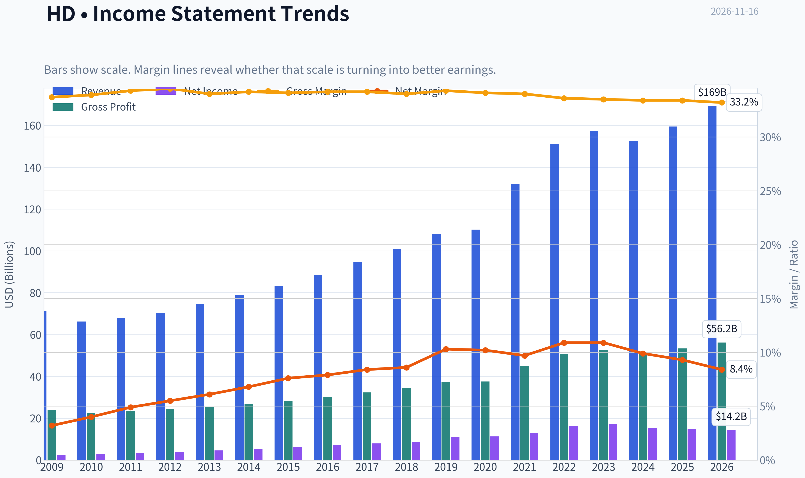

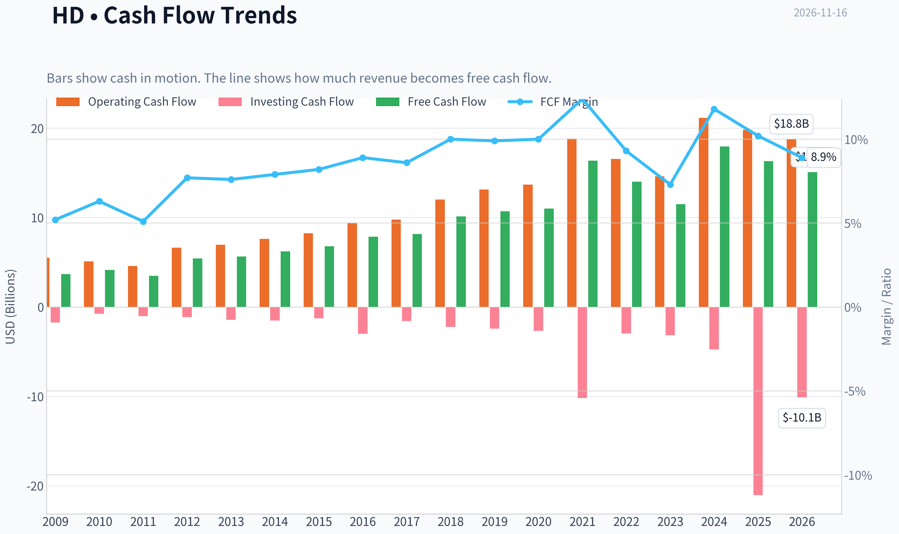

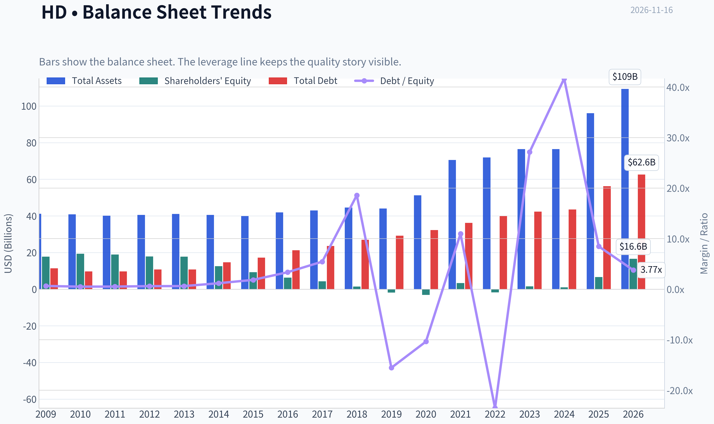

This graph tracks the profitability and return metrics (ROE, ROIC, Margins) of **HD** over the past decade, highlighting capital efficiency trends.

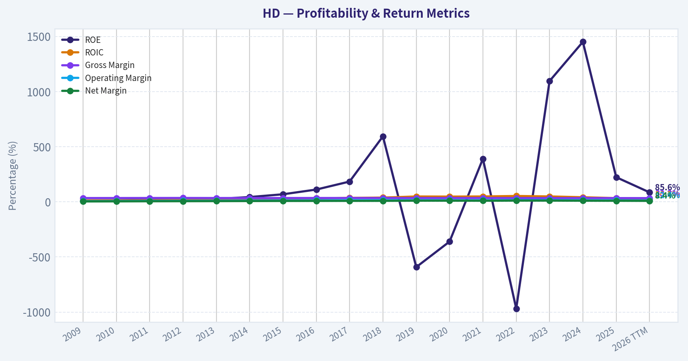

This chart illustrates the financial health of **HD** over the last 10 years, mapping cash equivalents and free cash flow against total obligations (Debt).

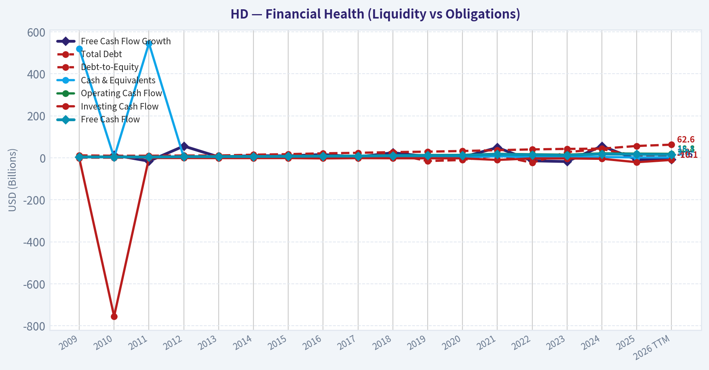

This breakdown chart from <em>Revenue Breakdown</em> shows the proportional composition for **HD** - useful for understanding what drives or risks the business.

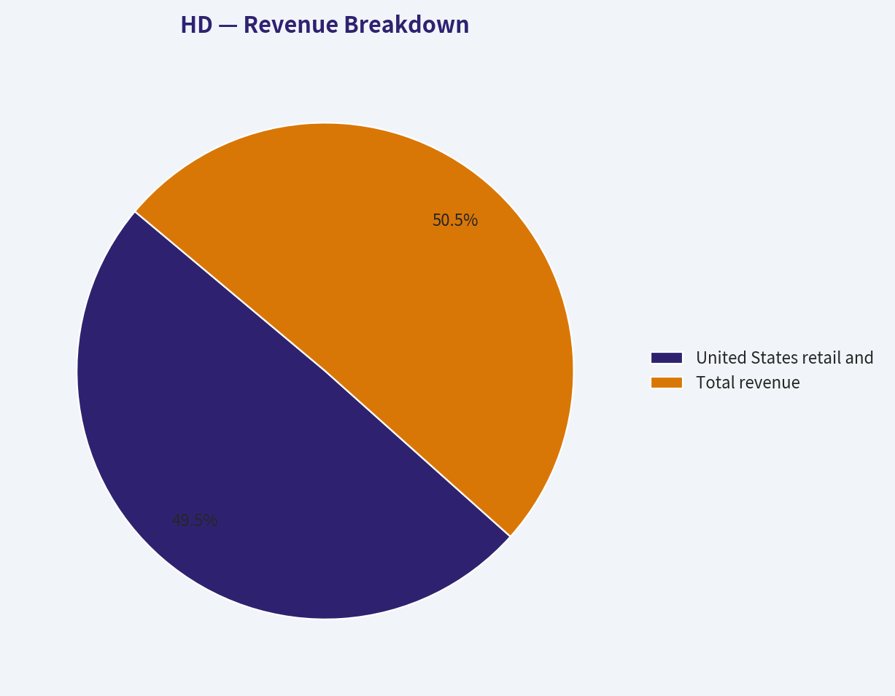

---

### Intrinsic Value Analysis (Buffett)

> *Following Warren Buffett's value investing philosophy: Circle of Competence, Economic Moat, Management Quality, and Margin of Safety.*

#### Intrinsic Value Snapshot

Price is what you pay. Intrinsic value is what the business may be worth based on the cash it can create for owners over time. We show a range, not one magic number.

- Current Price: $348.69
- Value Range (conservative to optimistic across both DCF methods): $73.80 to $411.40

##### Owner Earnings (Buffett Method)
- Net Income: $14,806,000,000.00
- Depreciation & Amortization: $4,121,000,000.00
- Capital Expenditures: $-3,679,000,000.00
- Working Capital Changes: $-2,666,000,000.00
- Owner Earnings: $14,388,000,000.00

##### Intrinsic Value
###### Buffett Method
Uses owner earnings. Stricter, and usually more conservative.
- Conservative: $243.88
- Average: $411.40
- Optimistic: $411.40
- Discount Rate: 10.0%

###### Cash Flow Method
Uses free cash flow. Better for companies spending heavily today to grow tomorrow.
- Conservative: $73.80
- Average: $209.05
- Optimistic: $213.10
- Discount Rate: 10.0%

ANALYST STANCE: **Neutral**

#### Executive Summary

Home Depot is a high-quality, understandable home-improvement retailer with meaningful scale advantages, a strong brand, and attractive long-term exposure to housing repair and remodeling. However, at **$349 per share**, the stock appears expensive relative to the research pack's blended intrinsic value of **$286.07** and its cash-flow-based valuation range.

The business is investable; the current price is not sufficiently attractive. The reverse DCF implies approximately **20.7% annual growth for the next decade**, far above recent three-year growth of **1.2%** and above five-year growth of **10.9%**.

#### Factor Scorecard

| Factor | Score | Evidence |
|---|---:|---|
| Circle of Competence & Simplicity | 4/5 | Simple model: sells home-improvement products to professionals and do-it-yourself customers. Long-term demand is understandable, though housing and interest-rate cycles affect results. |
| Durable Competitive Advantage | 4/5 | National scale, brand recognition, supplier relationships, distribution infrastructure, and customer convenience. The moat is wide and stable rather than rapidly widening. |
| Management & Capital Allocation | 3/5 | Mature management team operating a strong franchise, but the acquisition of SRS Distribution increases execution and integration demands. |
| Industry Structure | 4/5 | Home improvement is a scale-driven duopoly-like market, with Home Depot and Lowe's benefiting from supplier purchasing power and dense store networks. |

**Gate 5 hard floor:** **Not tripped.** Available indicators do not show the combination of clearly deteriorating cash flow and a solvency red line such as sub-1x interest coverage. The business remains profitable and cash-generative.

#### Moat Analysis

Home Depot's moat comes primarily from **scale, brand, distribution, and professional-customer relationships**.

- **Scale advantage:** Its store network and purchasing volume support broad assortment and competitive pricing.
- **Brand and trust:** Contractors and homeowners value reliable product availability, knowledgeable associates, and convenient locations.
- **Distribution advantage:** Large stores function as local fulfillment points, supporting both do-it-yourself customers and professional contractors.
- **Professional customer relationships:** Pro customers can be particularly valuable because they purchase frequently and in larger amounts.
- **Network and ecosystem benefits:** The business does not possess a classic digital network effect, but store density, supplier relationships, customer data, and fulfillment infrastructure reinforce one another.

The primary threats are housing weakness, online competition, labor and supply-chain costs, and execution risk from integrating SRS. These risks weaken predictability somewhat but do not destroy the franchise.

#### Financial Summary

| Metric | Latest Reading |
|---|---:|
| Share price | $349 |
| Market capitalization | $347.88 billion |
| P/E ratio | 24.4x |
| Revenue growth, year over year | 3.2% |
| Gross margin | 33.3% |
| ROE | 110.5% |
| FCF yield | 3.6% |
| Current ratio | 1.06x |
| Headline intrinsic value | $286.07 |
| Margin of safety versus price | -21.9% |
| Three-model valuation range | $209.05-$411.40 |

**Key Takeaways:** Home Depot is growing modestly, with revenue up 3.2% year over year and a 3.6% free-cash-flow yield. The very high ROE is likely amplified by the company's capital structure and share repurchases, so it should not be interpreted as evidence of equally high returns on all operating assets. Most importantly, the blended intrinsic value is below the current share price.

#### Financial Quality Assessment

The **33.3% gross margin** is solid for a large-format retailer, though it does not meet the very high gross-margin profile of asset-light software or platform businesses. Home Depot's economics depend more on scale, inventory productivity, store density, and purchasing power.

The **110.5% ROE** is exceptional on its face but requires caution. Retailers that have repurchased shares and carry meaningful financing can report very high or even mathematically distorted ROE. ROIC and free cash flow are more useful measures of underlying operating quality.

The **3.6% FCF yield** indicates that the stock is priced for continued resilience and meaningful future growth. That is not an unreasonable expectation for Home Depot, but it leaves limited room for disappointing housing activity or integration results.

#### Owner Earnings Calculation

A normalized owner-earnings figure can be inferred from the owner-earnings valuation in the research pack:

| Item | Amount |
|---|---:|
| Implied normalized owner earnings | Approximately $41.14 per share |
| No-growth value at 10% discount rate | Approximately $411.40 per share |
| Current share price | $349 |
| Implied earnings yield | Approximately 11.8% |

**Key Takeaways:** The owner-earnings method produces a substantially higher value than the FCF and Damodaran FCFF methods. That spread signals sensitivity to the definition of maintenance capital expenditure, working-capital normalization, and the treatment of cyclical earnings. I would therefore give greater weight to the blended value and the more conservative FCF-based estimates than to the most optimistic owner-earnings result.

#### Three-Scenario DCF Valuation

Using normalized owner earnings of approximately $41.14 per share:

| Scenario | Assumption | Indicative Value |
|---|---|---:|
| A. No growth | 10% discount rate, no earnings growth | $411 |
| B. GDP growth | 3% perpetual growth, 10% discount rate | $605 |
| C. Historical-growth case | 50% of five-year growth rate, approximately 5.45% growth | Approximately $954 |
| Research-pack blended valuation | FCFF, reverse DCF, and owner-earnings blend | $286 |
| Conservative FCF-based model | FCF valuation | $209 |

**Key Takeaways:** The owner-earnings scenarios produce high values because small changes in perpetual growth create large changes in terminal value. The FCF and FCFF estimates are materially more conservative, ranging from roughly $209 to $260. The blended headline value of $286 is the most useful anchor because it reduces dependence on any single aggressive assumption.

#### Margin of Safety Analysis

At $349 per share:

- Versus the blended intrinsic value of $286.07: **approximately 21.9% overvaluation**
- Versus the FCF valuation of $209.05: **approximately 67% overvaluation**
- Versus the Damodaran FCFF valuation of $259.67: **approximately 34% overvaluation**
- Versus the owner-earnings valuation of $411.40: **approximately 15% discount**

For a wide-moat, high-quality company, a 10%-15% discount can be acceptable. However, Home Depot's current valuation does not clearly provide that discount against the blended or cash-flow-oriented estimates. The reverse DCF is especially concerning: a 20.7% annual growth requirement appears heroic relative to recent operating performance.

#### Management Quality Assessment

Management benefits from operating a durable franchise with understandable economics. The company's long-term priorities-store productivity, professional-customer growth, digital integration, and supply-chain investment-are strategically coherent.

The principal capital-allocation concern is the acquisition of SRS Distribution. It may expand Home Depot's professional-contractor opportunity, but acquisitions add integration risk and can destroy value if purchased at excessive prices. Management deserves a positive but not exceptional score until the returns from this investment are demonstrated.

#### Final Buffett Scorecard

| Criterion | Weight | Score | Weighted Contribution |
|---|---:|---:|---:|
| Moat width and durability | 25% | 4.0 | 1.00 |
| Valuation and margin of safety | 20% | 2.5 | 0.50 |
| Capital returns versus WACC | 15% | 4.0 | 0.60 |
| Business understanding and predictability | 12% | 4.0 | 0.48 |
| Management and capital allocation | 12% | 3.0 | 0.36 |
| Reinvestment runway | 8% | 3.5 | 0.28 |
| Balance-sheet strength | 4% | 3.0 | 0.12 |
| Industry structure | 4% | 4.0 | 0.16 |
| **Total** | **100%** |  | **3.50 / 5.00** |

**Key Takeaways:** Home Depot scores well on moat, industry structure, and business understandability. The valuation score is the main weakness: the stock price assumes unusually strong future growth despite only moderate recent revenue growth. The resulting score supports a watch rating rather than an outright avoidance decision.

#### Investment Stance

**Neutral - Moderate conviction**

Home Depot is the type of company a long-term value investor should want to own: understandable, scaled, durable, and positioned to benefit from long-term remodeling and housing-related demand. But at $349, the market appears to be pricing in an exceptionally strong decade.

A more attractive entry point would be near or below the blended intrinsic value of approximately **$286**, with stronger conviction in the **$250-$275** range depending on housing conditions, SRS integration progress, and free-cash-flow growth. At the current price, patience is preferable to chasing a good business with a thin or negative margin of safety.
#### Valuation Bridge

This bridge places the current market price beside each intrinsic value lens so readers can see whether upside depends on one method or shows up across several methods.

| Scenario | Intrinsic Value / Share |
| --- | ---: |
| Buffett Method | $411.40 |
| Cash Flow Method | $209.05 |
| Damodaran Method | $259.67 |
| Current Price | $348.69 |

#### Key Takeaways

If one method is far above the others, the upside case depends on a specific modelling assumption. When several methods cluster together, the valuation story is more robust.

#### Valuation Visuals

This comparison chart from *Latest Earnings Snapshot* stacks current figures against historical benchmarks for **HD**, making it easy to see where the company trades relative to its own averages.

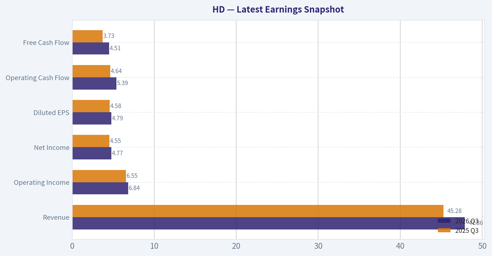

This comparison chart from *Current Metrics and Historical Context* stacks current figures against historical benchmarks for **HD**, making it easy to see where the company trades relative to its own averages.

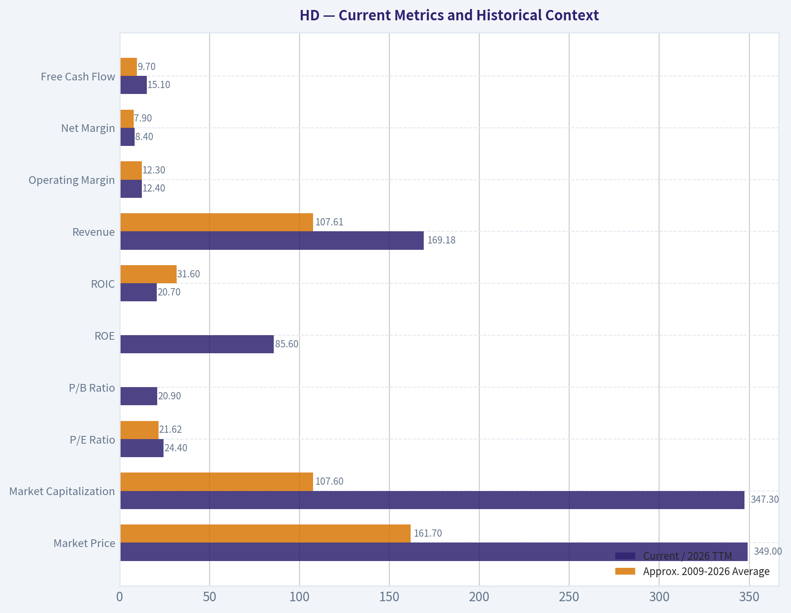

This comparison chart from *Cash Flow and Capital Allocation* stacks current figures against historical benchmarks for **HD**, making it easy to see where the company trades relative to its own averages.

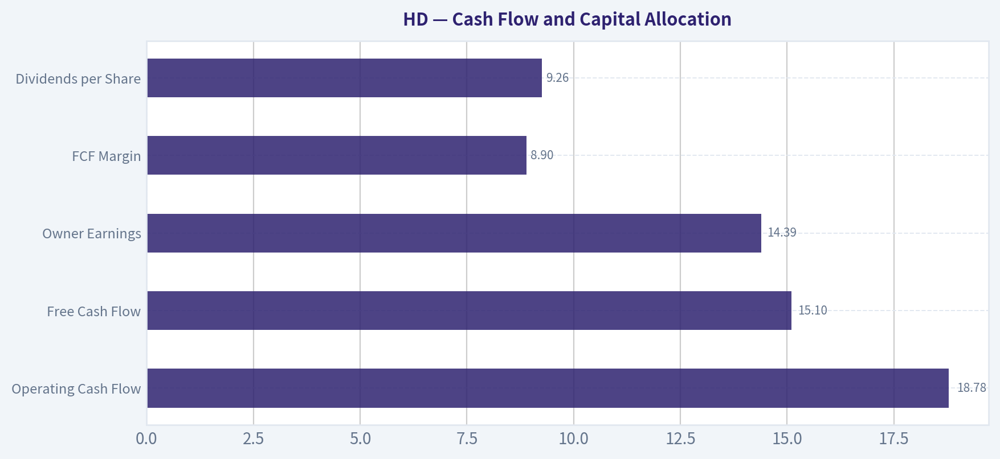

The following chart maps the **HD** Owner Earnings DCF valuation scenarios (Conservative, Average, Optimistic) to visually represent the margin of safety based on intrinsic value calculations.

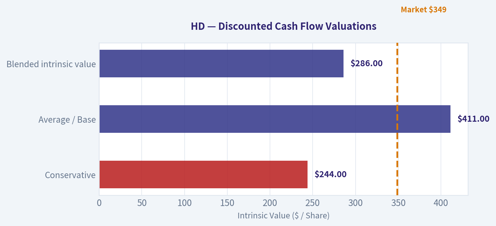

This comparison chart from *Valuation Assessment* stacks current figures against historical benchmarks for **HD**, making it easy to see where the company trades relative to its own averages.

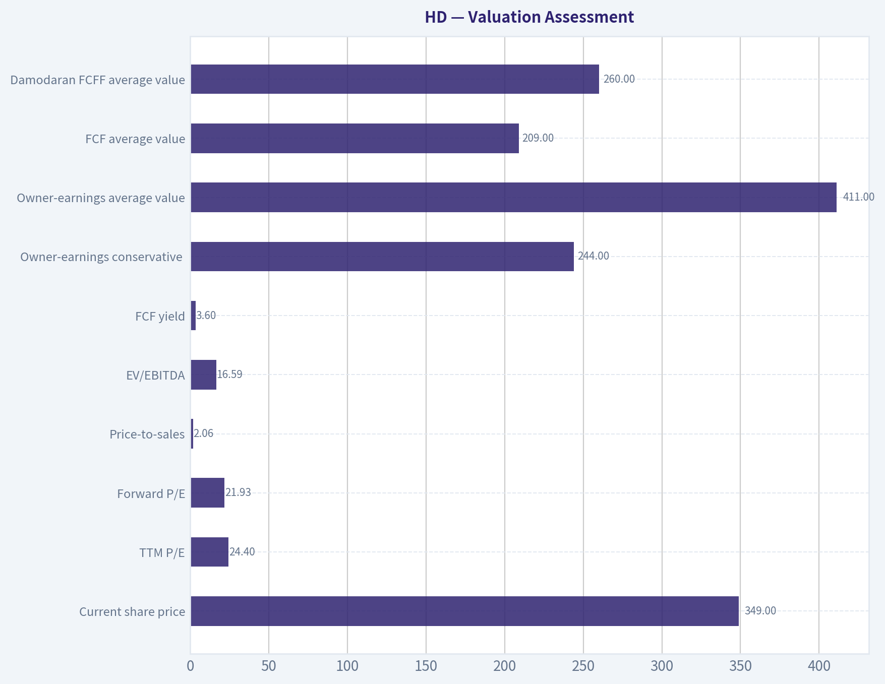

---

### Trend & Growth Analysis (Lynch/Druckenmiller/Fisher)

> *Following Peter Lynch's GARP, Stanley Druckenmiller's macro-aware approach, and Philip Fisher's scuttlebutt methodology.*

ANALYST STANCE: **Bearish**

#### 1. Lynch Classification

**Home Depot is primarily a stalwart with cyclical characteristics, not a fast grower.**

Its scale, brand, distribution network, and professional-customer relationships are strong. However, current revenue growth is only **3.2% year over year**, while housing activity and discretionary home-improvement demand remain pressured. This does not meet the 15-25% growth threshold for a primary growth investment.

#### 2. The Story in 3 Bullets

- Home Depot is the dominant U.S. home-improvement retailer, benefiting from brand trust, scale, supplier purchasing power, and a large professional-contractor customer base.
- The long-term opportunity is tied to housing turnover, aging homes, repair-and-remodel spending, and continued market-share gains from smaller competitors.
- The present issue is valuation versus growth: the stock trades at approximately **24.4 times earnings** despite only **3.2% recent revenue growth** and a long-term growth profile that is materially slower than fast-growth companies.

#### 3. Core Financial Snapshot

| Metric | Value | Interpretation |
|---|---:|---|
| Current price | $349 | Elevated relative to modeled intrinsic value |
| Market capitalization | $347.9 billion | Very large scale limits 10-bagger potential |
| P/E ratio | 24.4x | Not obviously cheap for current growth |
| Revenue growth, year over year | 3.2% | Stalwart-level growth |
| Three-year revenue CAGR | Not provided; reverse-DCF reference: approximately 1.2% | Weak recent growth trend |
| Five-year revenue CAGR | Approximately 10.9% | Better historical profile, but slowing |
| Gross margin | 33.3% | Strong retail economics |
| FCF yield | 3.6% | Modest cash-flow yield |
| Current ratio | 1.06x | Adequate but not excessive liquidity |
| ROE | 110.5% | Inflated by leverage and shareholder returns; not directly comparable with asset-light businesses |
| Headline intrinsic value | $286.07 | Approximately 21.9% below the current price |

**Key Takeaways:** Home Depot remains financially powerful, but its current growth is much closer to a mature retailer than a fast grower. The stock price appears to discount a substantial improvement in future growth, while the headline intrinsic-value estimate is about 22% below the market price.

#### 4. TAM Analysis and the 10x Test

Home Depot participates in the very large home-improvement and repair-and-remodel market. The market should expand over time through housing aging, inflation in construction and labor costs, and professional-contractor demand. However, Home Depot is already one of the world's largest retailers, so the relevant opportunity is more likely **steady share gains and category expansion**, not a tenfold corporate scaling event.

| TAM Question | Assessment |
|---|---|
| Is the underlying market large? | Yes |
| Is the market rapidly expanding? | Moderate; housing and remodeling are cyclical |
| Can Home Depot grow revenue 10x and remain below 20% market share? | Unlikely or difficult to establish |
| Main growth levers | Market share, Pro customer penetration, online sales, supply-chain productivity, acquisitions |
| TAM inflection | Not currently evident |

**Key Takeaways:** Home Depot has a large and durable market, but its existing scale makes a ten-bagger outcome improbable. The investment case depends on moderate market-share gains and a housing-cycle recovery rather than a newly emerging market.

#### 5. Revenue Growth Trend

| Period or Indicator | Growth |
|---|---:|
| Latest year-over-year revenue growth | 3.2% |
| Three-year historical reference | Approximately 1.2% CAGR |
| Five-year historical reference | Approximately 10.9% CAGR |
| Current trend classification | Slow to stable, not accelerating |

**Key Takeaways:** The available data show deceleration from the stronger five-year period. There is no confirmed revenue acceleration from 3% toward 15% or 20%, so the current setup does not qualify as a Druckenmiller-style growth inflection.

#### 6. Unit Economics

Home Depot is a mature retail business rather than a subscription software company. LTV/CAC, net revenue retention, and Rule of 40 are therefore not the appropriate primary measures.

| Metric | Assessment |
|---|---|
| LTV/CAC | Not disclosed in a directly comparable form |
| Net revenue retention | Not applicable |
| Rule of 40 | Not applicable |
| Gross margin | 33.3% |
| Free-cash-flow yield | 3.6% |
| Retail unit economics | Supported by scale, repeat purchases, Pro customers, and supplier purchasing power |

**Key Takeaways:** The company has attractive retail economics, but not the explosive unit-economic profile associated with software or platform businesses. Its financial appeal comes from scale and cash generation, not from rapidly compounding customer cohorts.

#### 7. Inflection Point Assessment

| Potential Inflection | Evidence | Assessment |
|---|---|---|
| Product cycle | No major new product cycle identified | Neutral |
| Market share | Long-term share opportunity versus smaller retailers | Positive, but gradual |
| Margin expansion | Strong gross margin, but no clear current acceleration | Neutral |
| TAM expansion | Housing and remodeling remain large but cyclical | Moderate |
| Competitive inflection | Possible benefits from smaller competitors' weakness | Positive if confirmed |
| Earnings inflection | Not yet visible in current revenue data | Negative |

**Key Takeaways:** Home Depot may eventually benefit from a housing or remodeling recovery, but that is a cyclical catalyst rather than a proven structural acceleration. The key missing evidence is sustained revenue reacceleration accompanied by improved comparable-store sales and operating leverage.

#### 8. Macro Setup

| Macro Factor | Impact on Home Depot |
|---|---|
| Housing turnover | Headwind while existing-home sales remain depressed |
| Mortgage rates | High rates discourage moving and large remodeling projects |
| Aging housing stock | Long-term structural tailwind |
| Consumer spending | Mixed; essential repairs hold up better than discretionary projects |
| Interest-rate direction | Falling rates would be beneficial |
| Economic cycle | Late-cycle or soft-demand characteristics rather than early-recovery momentum |

**Key Takeaways:** The macro backdrop is mixed to unfavorable today. Falling rates, better housing turnover, and improving consumer confidence could create a cyclical rebound, but the stock does not yet offer the combination of accelerating fundamentals and attractive valuation typically sought by a concentrated growth investor.

#### 9. Fisher 15-Point Assessment

Scores are necessarily approximate because the available data do not include detailed management interviews, employee surveys, supplier checks, or full operating disclosures.

| Fisher Criterion | Score / 5 |
|---|---:|
| Market potential | 4 |
| Management determination to develop products | 3 |
| R&D effectiveness | 3 |
| Sales organization | 4 |
| Profit margins | 4 |
| Margin improvement potential | 3 |
| Labor relations | 3 |
| Executive relations | 3 |
| Management depth | 4 |
| Cost analysis and accounting | 4 |
| Outstanding competitive aspects | 4 |
| Long-range profit outlook | 4 |
| Dilution profile | 4 |
| Candor in difficulties | 3 |
| Management integrity | 4 |
| **Total** | **52 / 75** |

**Key Takeaways:** Home Depot scores as an average-to-good Fisher company, with strong market position, scale, and long-term relevance. The score is held back by limited evidence of superior current growth, incomplete scuttlebutt data, and the cyclical nature of demand.

#### 10. Valuation Analysis

**PEG:** Using the latest revenue-growth rate as a rough growth proxy gives:

`PEG ~ 24.4 P/E ÷ 3.2% growth = 7.6`

This is not an attractive PEG. It also illustrates why a mature retailer should not be valued like a fast-growing technology company.

| Valuation Method | Estimate or Implication |
|---|---:|
| Current market price | $349 |
| Headline intrinsic value | $286 |
| Owner-earnings DCF reference | $411 |
| FCF-model reference | $209 |
| Damodaran FCFF reference | $260 |
| Reverse-DCF implied 10-year growth | Approximately 20.7% annually |
| Bear illustrative scenario | Approximately $312 |
| Base illustrative scenario | Approximately $389 |
| Bull illustrative scenario | Approximately $480 |

The scenario figures are illustrative, using current implied earnings of roughly $14.30 per share, three years of assumed EPS growth, and different terminal P/E multiples.

**Key Takeaways:** Valuation is highly sensitive to the model used, but the reverse-DCF result is the most concerning: the current price appears to require roughly 20.7% annual growth for ten years, far above recent revenue growth. The stock could perform well if housing demand rebounds sharply, but the margin of safety is not compelling at $349.

#### 11. Growth Investor Scorecard

| Criterion | Weight | Score / 5 | Weighted Result |
|---|---:|---:|---:|
| Lynch story | 10% | 3.5 | 0.35 |
| TAM and runway | 20% | 3.0 | 0.60 |
| Revenue growth | 20% | 2.0 | 0.40 |
| Unit economics | 15% | 3.5 | 0.53 |
| Competitive position | 10% | 4.0 | 0.40 |
| Management quality | 10% | 3.5 | 0.35 |
| Macro setup | 5% | 2.5 | 0.13 |
| Profitability path | 5% | 4.0 | 0.20 |
| Valuation | 5% | 2.0 | 0.10 |
| **Total** | **100%** |  | **3.06 / 5.00** |

**Key Takeaways:** Home Depot scores in the **Neutral** range on business quality but does not meet the bar for a growth-investment recommendation. Weak current growth, cyclical macro exposure, and limited valuation support reduce the overall score.

#### 12. Position Size Stance

- **New position:** Avoid initiating at current prices.
- **Existing shareholder:** Hold only if seeking a high-quality, mature retailer and willing to wait for a housing-cycle recovery.
- **Growth portfolio allocation:** 0% to 1% maximum until revenue growth reaccelerates and valuation becomes more reasonable.
- **More attractive setup:** Consider reassessing near or below the modeled intrinsic-value range, especially if comparable sales and professional-customer growth begin accelerating.

#### 13. Key Catalysts and Risks

| Catalysts | Risks |
|---|---|
| Falling mortgage rates | Housing turnover remains depressed |
| Recovery in existing-home sales | Prolonged consumer weakness |
| Reacceleration in comparable-store sales | Revenue remains near low-single-digit growth |
| Stronger professional-contractor demand | Valuation compression |
| Market-share gains from smaller competitors | Persistent inflation in labor and operating costs |
| Supply-chain and digital productivity | Acquisition integration or leverage risk |

**Key Takeaways:** The principal catalyst is a housing and remodeling recovery, potentially amplified by lower interest rates. The principal risk is that Home Depot remains a slow-growing retailer while the market continues valuing it as though a major earnings acceleration is already underway.

#### Bottom Line

Home Depot is a high-quality, durable business with a strong competitive position, but it is currently a **stalwart/cyclical rather than a fast grower**. At approximately 24.4 times earnings and $349 per share, the market appears to price in a much stronger growth trajectory than recent revenue performance supports. For a Lynch, Druckenmiller, and Fisher growth portfolio, the appropriate stance is **Bearish for new money and Neutral for a future housing-led inflection**.

---

### Market Technical Analysis

ANALYST STANCE: **Neutral**

#### HD technical analysis

The latest available HD close is **$348.69 on November 13, 2026**; November 16 is not represented as a trading day in the retrieved dataset. The technical picture is constructive over the medium term, but the stock is also extended from its September low and has recently shown signs of momentum moderation. This favors a watchful, confirmation-based approach rather than chasing strength.

#### Indicator selection

The selected indicators are:

- **close_10_ema** - short-term price momentum and tactical support.
- **close_50_sma** - intermediate trend direction.
- **close_200_sma** - long-term trend regime.
- **macd** - trend momentum and possible momentum deterioration.
- **rsi** - momentum intensity and overbought risk.
- **atr** - volatility-aware position sizing and stop placement.
- **boll_ub** - upside extension and breakout reference.
- **boll_lb** - downside risk and mean-reversion reference.

These indicators cover trend, momentum, volatility, and potential price extremes without relying excessively on multiple versions of the same signal.

#### Trend structure

HD remains clearly above all three selected moving averages:

- The **10-day EMA is $344.83**, placing the stock approximately **1.1% above** its short-term trend line.
- The **50-day SMA is $312.15**, approximately **11.7% below** the latest close.
- The **200-day SMA is $329.41**, approximately **5.8% below** the latest close.

This alignment-price above the 10-day EMA, 50-day SMA, and 200-day SMA-is generally bullish. It indicates that the late-October and early-November advance has not yet broken the broader trend structure. The 50-day average has also turned upward from roughly $308 in late October to $312.15, confirming improving intermediate momentum.

However, the 200-day SMA is still gently declining, moving from approximately $332 in mid-October to $329.41. That means the long-term trend has improved relative to the September decline but has not fully transitioned into a strongly rising regime. HD is therefore in a recovery or rebuilding phase rather than an unambiguously mature long-term uptrend.

The most important near-term support is the **$344-$345 area**, where the 10-day EMA currently sits. A sustained close below that zone would suggest that the latest short-term impulse is weakening. The 50-day SMA near **$312** is much more distant and represents the more meaningful intermediate trend-support level.

#### Momentum and MACD interpretation

MACD remains strongly positive:

- MACD rose from **-1.18 on October 19** to **12.57 on November 11**.
- It eased to **11.90 by November 13**.

The move from negative to strongly positive territory confirms that the October recovery developed substantial momentum. The recent decline in MACD, despite HD remaining near $349, is an early indication that upside momentum is no longer accelerating at the same pace.

This is not yet a bearish reversal signal. Positive MACD readings indicate that the bullish trend remains dominant, but the recent deceleration calls for attention to price follow-through. A renewed move above the recent **$355-$356 resistance zone**, accompanied by expanding momentum, would strengthen the bullish case. Conversely, a break below the 10-day EMA while MACD continues to decline would increase the probability of consolidation or a deeper pullback.

#### RSI and overextension risk

RSI was **63.97 on November 13**, down from **68.25 on November 9** and from readings above 70 earlier in the month. This gives a nuanced signal:

- RSI remains above the neutral 50 level, supporting a positive momentum regime.
- It has moved away from overbought territory, reducing immediate overheating risk.
- The decline from the upper 60s while price has held near $349 suggests some loss of momentum, although not a confirmed bearish divergence.

HD's RSI is therefore bullish-neutral rather than aggressively overbought. A move back above 70 would indicate renewed thrust but would also raise the risk of a short-term exhaustion move. A fall through the 50-55 area would be more meaningful evidence that the recovery is losing internal strength.

#### Bollinger Bands and price location

The latest Bollinger reference levels are:

- **Upper band: $364.90**
- **Lower band: $302.76**
- Latest close: **$348.69**

HD is approximately **$16.21 below the upper band** and nearly **$45.93 above the lower band**. Price is positioned in the upper portion of its recent volatility range, consistent with a strong recovery but not an immediate upper-band breakout.

The recent high near **$355.44** remains the first important resistance level. A decisive push through $355-$356 could open a test of the upper Bollinger band around $365. However, failure near that resistance followed by a close below the 10-day EMA would suggest that the stock is reverting toward its middle range rather than beginning a fresh breakout.

The Bollinger range is wide, which reflects the substantial volatility that accompanied the September decline and subsequent rebound. Consequently, touching or approaching the upper band should not automatically be interpreted as a sell signal; in a strong trend, prices can remain elevated. Confirmation from MACD and RSI is important.

#### Volatility and risk management

ATR is approximately **$8.98**, equivalent to about **2.6% of the latest share price**. This is meaningful daily volatility for a large-cap retailer. A normal one-day movement of roughly $9 means that tight stops placed immediately beneath the entry price could be vulnerable to ordinary noise.

The ATR has eased from approximately $9.68 on November 9, suggesting that volatility has moderated slightly after the early-November surge. It remains elevated enough to justify:

- Smaller position sizing than would be appropriate in a low-volatility environment.
- Stops based on the stock's structure rather than arbitrary narrow percentages.
- Allowing room around the $344-$345 short-term support area if using a swing-trading timeframe.

A close below the 10-day EMA would be an early warning, while a sustained break beneath the 50-day SMA near $312 would represent a much more serious deterioration in the medium-term trend.

#### Trading scenarios

**Constructive scenario:** HD holds above approximately $344-$345, MACD stabilizes or turns higher, and RSI remains above 55-60. A close above the $355-$356 recent high would then provide a stronger continuation signal, with the upper Bollinger band near $365 as a potential next reference.

**Consolidation scenario:** Price remains between roughly $340 and $356 while RSI cools toward the mid-50s. This would allow the moving averages to catch up and could create a healthier base without damaging the broader recovery.

**Bearish-risk scenario:** HD loses the 10-day EMA and begins closing below the low-$340s, while MACD continues to weaken. The next downside areas would be the low-$330s and then the 200-day SMA near $329. A break below the 200-day SMA would materially weaken the current recovery thesis and could expose the stock to a retest of the low-$310s or lower.

Overall, HD's trend is bullish on a medium-term basis, but the stock is approaching meaningful resistance after a rapid recovery. The most favorable risk-reward setup would generally come from either a confirmed breakout above $355-$356 or a controlled pullback that holds above rising trend support, rather than an unconfirmed purchase directly beneath resistance.

| Indicator / area | Latest reading | Interpretation | Trading relevance |
|---|---:|---|---|
| Latest close | $348.69 | Strong recovery level, but below recent $355.44 high | Watch for breakout or rejection |
| 10-day EMA | $344.83 | Price is about 1.1% above short-term trend | First tactical support |
| 50-day SMA | $312.15 | Rising intermediate trend; price about 11.7% above it | Major medium-term support, though distant |
| 200-day SMA | $329.41 | Price remains above long-term benchmark, but average is still gently declining | Key regime-defining support |
| MACD | 11.90 | Strongly positive, but down from 12.57 peak | Bullish trend with slowing momentum |
| RSI | 63.97 | Positive momentum, below overbought territory | Constructive, but monitor weakening readings |
| Bollinger upper band | $364.90 | Upside volatility boundary | Potential target after a confirmed $355-$356 breakout |
| Bollinger lower band | $302.76 | Broad downside volatility boundary | Risk reference, not an immediate forecast |
| ATR | $8.98, about 2.6% | Elevated daily movement | Use wider, structure-based risk controls |

**Key Takeaways:** HD remains above its short-, medium-, and long-term trend averages, so the broader technical bias is constructive. Momentum is still positive, but MACD and RSI have softened from their early-November highs, while price is approaching resistance near $355-$356. A confirmed breakout would improve the outlook, whereas a loss of the $344-$345 area would favor consolidation and raise the risk of a move toward the low-$330s.

---

### Options Market Analysis

> *Reading options flow - put/call ratios, IV skew, and unusual activity - to gauge institutional positioning and event-driven risk.*

ANALYST STANCE: **BEARISH**

#### HD Options Market Overview

Data is as of November 16, 2026. The near-term options market is dominated by put open interest, although trading volume is much more balanced between calls and puts.

| Expiration | Days to Expiry | Call OI | Put OI | Call Volume | Put Volume | Put/Call OI Ratio | Put/Call Volume Ratio |
|---|---:|---:|---:|---:|---:|---:|---:|
| Nov. 20, 2026 | 4 | 106 | 1,002 | 3,344 | 3,952 | 9.45 | 1.18 |
| Nov. 27, 2026 | 11 | 0 | 0 | 789 | 374 | N/A | 0.47 |
| Dec. 4, 2026 | 18 | 0 | 0 | 338 | 561 | N/A | 1.66 |
| **Near-term total** | - | **106** | **1,002** | **4,471** | **4,887** | **9.45** | **1.09** |

**Key Takeaways:** HD's aggregate put/call open-interest ratio of 9.45 is exceptionally above the roughly 0.7 neutral baseline. This indicates substantial downside protection or bearish positioning concentrated in the November 20 expiration. However, the 1.09 volume ratio is close to neutral, suggesting that current trading is not showing an equally aggressive wave of fresh put buying.

#### Implied Volatility Assessment

| Expiration | Call ATM IV | Put ATM IV | Relative IV Signal |
|---|---:|---:|---|
| Nov. 20, 2026 | 2.3% | 2.7% | Mild put premium |
| Nov. 27, 2026 | 1.9% | 1.8% | Essentially balanced; slight call premium |
| Dec. 4, 2026 | 1.6% | 1.3% | Slight call premium |

The reported near-term ATM IV levels are low, with the highest reading being 2.7% for November 20 puts. The November 20 put IV is modestly above call IV, consistent with some downside hedging, but the difference is not large enough by itself to indicate severe panic.

A true OTM volatility-skew calculation was not provided, so the difference between OTM put IV and OTM call IV cannot be measured precisely. The available ATM data suggests only a mild downside skew in the front expiration.

No verified catalyst calendar was included in the data. Therefore, it is not possible to determine whether the front-week IV is elevated specifically because of earnings or another scheduled event.

**Key Takeaways:** Implied volatility is low overall, which argues against a broad fear spike. The slight front-expiration premium for puts supports a cautious downside bias, but the volatility market is not signaling extreme event risk based on the data supplied.

#### Unusual Options Activity

No contracts met the screening rule of volume greater than five times open interest.

| Finding | Interpretation |
|---|---|
| No unusual contracts detected | No clear fresh, high-conviction directional trade identified |
| Front-week volume | Active, but not demonstrably tied to newly opened positions |
| Smart-money signal | Inconclusive from volume/open-interest behavior |

Because no contract-level unusual activity was supplied, there are no reliable individual strikes to classify as ITM, ATM, or OTM. The current price and contract strike list were also not provided, preventing a more granular directional assessment.

**Key Takeaways:** There is no identifiable options sweep or volume-versus-open-interest imbalance pointing to a specific institutional bet. The bearish signal comes primarily from existing put open interest rather than from clearly traceable new positioning.

#### Open Interest Concentration and Gamma Levels

| Concentration Measure | Observation |
|---|---|
| Largest call OI | 106 contracts, all included in the near-term aggregate |
| Largest put OI | 1,002 contracts, concentrated in the Nov. 20 expiration |
| Dominant expiration | Nov. 20, 2026 |
| Strike-level concentration | Not available |
| Gamma walls or pinning levels | Cannot be confirmed without strike-level OI and gamma data |

The extreme imbalance in front-week put open interest may create a significant expiration-related positioning effect. However, without strike-level data, it is not possible to identify a specific maximum-pain price, put wall, call wall, or likely pinning level.

**Key Takeaways:** The November 20 expiration is the key positioning center for HD, with puts vastly outnumbering calls. This could provide downside hedging pressure or create dealer-related price effects near expiration, but the absence of strike data prevents confirmation of exact support or resistance levels.

#### Overall Options Sentiment

The overall signal is **BEARISH**, with reduced confidence.

The primary driver is the extremely elevated 9.45 put/call open-interest ratio, far above the approximately 0.7 neutral baseline. This points to unusually heavy downside protection or bearish exposure in the front expiration. The signal is tempered by three factors: the put/call volume ratio is close to neutral, implied volatility is low, and no unusual volume-to-open-interest contracts were detected.

The put positioning may represent institutional hedging rather than outright bearish speculation. Consequently, the options market indicates a downside-leaning risk profile, not a definitive forecast of an imminent decline. Liquidity appears active in the November 20 expiration, but the lack of strike-level data limits confidence in gamma and price-level conclusions.

| Category | Assessment |
|---|---|
| Put/Call Ratio | **Very bearish by OI: 9.45; near-neutral by volume: 1.09** |
| IV Level | **Low overall; front-week put IV modestly higher** |
| Skew Direction | **Mild downside skew in the front expiration; full OTM skew unavailable** |
| Unusual Activity | **None detected under the volume greater than 5x OI screen** |
| Overall Signal | **BEARISH, with moderate-to-low confidence** |

**Key Takeaways:** HD's options positioning is bearish mainly because of an unusually large concentration of near-term put open interest. Current volume and volatility do not confirm aggressive fresh bearish conviction, so the position may be primarily protective hedging. The best overall read is bearish risk bias, but not a high-confidence directional sell signal.

---

## Research Team Commentary

> *The Research Manager synthesizes the Bull vs Bear debate into action-free commentary. This is a pre-risk view, not the final stance.*

Core takeaway: Home Depot is a high-quality franchise, but at $349 and 24.4 times earnings, the stock does not offer enough demonstrated margin of safety to justify initiating a full position. The business merits respect; the valuation merits patience.

The strongest bull argument is business quality. Home Depot's scale, purchasing power, brand trust, local inventory, distribution network, and professional-contractor relationships form a durable moat that smaller retailers and pure online competitors cannot easily reproduce. Stores are both selling locations and fulfillment nodes, particularly valuable for urgent, bulky, or project-specific purchases. The aging U.S. housing stock also creates a long-duration need for maintenance and replacement spending, even if discretionary remodeling remains cyclical.

The reported 22.6% ROIC and 13.5% ROA support the quality thesis. ROIC is the more relevant figure; the 110.5% ROE is substantially influenced by buybacks and a reduced accounting-equity base and should not be taken at face value. Home Depot appears capable of earning well above its cost of capital, but we need a multi-year trend and cash-flow reconciliation before assuming today's returns are permanent.

The bull is also right that current housing weakness should not automatically be extrapolated indefinitely. Mortgage-rate lock-in and weak turnover can defer large projects, but they do not eliminate eventual repair and replacement needs. Extreme put positioning may reflect hedging around near-term housing and rate uncertainty rather than informed judgment about Home Depot's ten-year value. A put/call open-interest ratio of 9.45 is a sentiment warning, not an intrinsic-value calculation.

The strongest bear argument is price. At a 24.4 P/E, investors receive an earnings yield of only about 4.1% and depend on years of growth to generate an adequate return. A reasonable outcome of mid-single-digit operating growth, stable margins, and sensible repurchases could make the investment work. But the present price leaves little protection if owner earnings are below reported EPS, housing softness lasts longer than expected, fulfillment and labor costs pressure margins, or repurchases are executed at unattractive valuations.

The bull's illustrative $350-$400 intrinsic-value range implies anywhere from essentially no discount to about a 13% discount at $349. A 10%-15% discount can be sufficient for a highly predictable, wide-moat compounder, but only when the intrinsic-value estimate is well supported. Here, detailed free cash flow, maintenance capital expenditure, debt, interest coverage, share-count, and multi-year margin data are missing. The lower end of the range provides no margin of safety, while a more conservative 4%-5% growth framework could place value materially below the market price. That uncertainty argues against treating $349 as an obvious quality-scaled bargain.

The bear case should not be overstated, however. Home Depot does not require a housing boom or double-digit growth to justify a reasonable valuation. Aging homes, fragmented competition, Pro-customer initiatives, and eventual housing normalization could support moderate growth. Nor is there evidence of distress or permanent moat erosion. This is principally a valuation and expected-return concern, not a low-quality-business thesis.

My refined judgment is to separate franchise admiration from purchase discipline. A past mistake in situations like this is allowing a strong brand and high point-in-time returns to substitute for owner-earnings analysis. The opposite mistake is allowing weak short-term market conditions or bearish derivatives positioning to obscure a durable franchise. The correct response is neither enthusiastic buying nor outright avoidance: wait for either better evidence or a better price.

Over the next one to four quarters, I would monitor comparable sales, transaction counts, average ticket, and especially big-ticket project demand. Stabilization without heavy promotions would support the normalization thesis. Continued declines combined with discounting would suggest weaker pricing power or a longer cyclical downturn.

I would also track Pro-customer sales relative to DIY sales, delivery performance, and any disclosed returns from Pro-focused distribution investments. Pro growth is most valuable if it produces attractive incremental margins and cash returns rather than merely buying market share.

Margins require close attention. Gross margin should be considered alongside operating margin, labor costs, shrink, delivery expenses, inventory turnover, and markdowns. Stable gross margin with falling operating margin would indicate that the omnichannel network is becoming more expensive to operate.

Cash conversion is another decisive test. Free cash flow should be compared with net income after normalized capital expenditures and working-capital needs. I would also examine net debt, interest coverage, lease obligations, and whether dividends and buybacks are being funded by genuine excess cash. Share repurchases at approximately 24 times earnings deserve particular scrutiny.

Finally, I would watch management's outlook for housing turnover and large remodeling projects, while comparing actual results with those expectations. The thesis strengthens if ROIC remains near 20% or better, free cash flow tracks earnings, Pro share gains are profitable, margins stabilize, and the stock falls enough to offer roughly a 10%-15% discount to a cash-flow-supported intrinsic value. It weakens if operating margins and ROIC decline structurally, debt rises to sustain capital returns, or the valuation remains elevated despite low-single-digit growth.

Home Depot is a wonderful business priced for continued competent execution, not a clear bargain. Existing long-term holders can reasonably continue holding, but new capital should wait for stronger cash-flow evidence or a more attractive entry point.

Neutral

---

## Value Investing Team Commentary

> *The Investor translates the research view into an investment thesis before risk review. This is still not the final stance.*

Home Depot remains a high-quality business, but the investment case at $349 is more dependent on future normalization than on a clearly demonstrated margin of safety.

### Business quality and moat

Home Depot's competitive advantages are substantial:

- **Scale and purchasing power** support competitive pricing and broad assortment.
- **Brand trust and product availability** matter greatly for contractors and homeowners working under time constraints.
- **The store network doubles as a fulfillment infrastructure**, particularly for bulky, urgent, or project-specific purchases that are difficult to serve economically through pure e-commerce.
- **Professional customers create recurring demand** and can be less discretionary than occasional DIY spending.

The aging U.S. housing stock, eventual normalization of housing turnover, and fragmented competition provide a credible long-term demand runway. Importantly, a weak housing market delays many projects; it does not eliminate the need to repair roofs, replace HVAC systems, renovate kitchens, or maintain older homes.

This is therefore not a thesis dependent on a housing boom. It is a thesis based on Home Depot retaining its position in a structurally attractive category while repair-and-remodel spending gradually expands.

### Returns and financial quality

The reported 22.6% ROIC and 13.5% ROA are encouraging and more informative than the 110.5% ROE. The exceptionally high ROE is likely amplified by a heavily reduced accounting-equity base following buybacks and should not be interpreted as evidence that the underlying business earns 110% returns on all capital employed.

The more important questions are:

1. Does ROIC remain comfortably above the cost of capital through a full housing and remodeling cycle?
2. Does free cash flow broadly track net income after normalized capital expenditure?
3. Are buybacks creating value, or merely reducing the share count while the stock trades at a demanding multiple?
4. Can Home Depot maintain operating margins as delivery, labor, shrink, and fulfillment costs increase?

A high-quality retailer can justify a premium valuation, but only if its returns are durable and its cash conversion remains strong.

### Valuation and reverse-DCF risk

At $349 and 24.4 times earnings, Home Depot offers an earnings yield of approximately 4.1%. That is not automatically excessive for a durable franchise, but it leaves limited room for execution mistakes, prolonged housing weakness, or margin pressure.

The critical issue is what the current price requires. If Home Depot produces only low- to mid-single-digit earnings growth, maintains roughly stable margins, and continues sensible capital returns, the stock may generate an acceptable long-term return-but probably not an especially attractive one from this entry point. The market appears to be assuming a reasonably smooth recovery in housing-related demand and continued high-quality execution.

The estimated $350-$400 intrinsic-value range is too broad to support an aggressive purchase without additional cash-flow evidence. At the lower end, $349 provides virtually no discount. At the upper end, the discount is approximately 13%, which would be acceptable for a wide-moat compounder if the underlying estimate were firmly supported by normalized owner earnings.

The proper discipline is to distinguish between:

- **A good business at a defensible price**, and
- **A good investment with an attractive expected return from today's price.**

Home Depot clearly satisfies the first condition. The information provided does not yet establish the second.

### Contrarian interpretation of sentiment

The put/call open-interest ratio of 9.45 is striking, but it should not be treated as a standalone bearish signal. Heavy put positioning may reflect institutional hedging, structured trades, or protection against interest-rate and housing volatility rather than a well-researched conclusion that Home Depot's decade-long earnings power is impaired.

This creates a potentially useful contrarian point: if the stock declines because of temporary housing weakness while ROIC, market share, Pro-customer economics, and cash conversion remain intact, pessimism could eventually offer an attractive entry point. Derivatives sentiment can identify fear, but it cannot determine intrinsic value.

At the same time, contrarianism should not become an excuse to ignore the valuation. A crowded bearish options market does not make a 24.4 P/E inexpensive. The market may be overly pessimistic about the next few quarters while still being approximately correct that long-term returns from the current price will be moderate.

### What would change the conclusion?

The thesis would improve meaningfully if:

- Comparable sales and transaction volumes stabilize without aggressive discounting.
- Big-ticket project demand begins recovering.
- Pro sales grow with attractive incremental margins.
- Gross margin remains stable and operating expenses normalize.
- Free cash flow tracks or exceeds reported earnings.
- ROIC remains near or above 20% through weaker conditions.
- Net debt, lease obligations, and interest costs remain manageable.
- The stock falls toward a level offering at least a credible 10%-15% discount to conservative intrinsic value.

The thesis would weaken if operating margins decline structurally, Pro investments require persistent discounting, free cash flow fails to convert earnings, or management continues repurchasing shares at valuations that leave little room for error.

For existing owners, holding is reasonable if the original investment thesis remains intact and the position is appropriately sized. For new investors, the opportunity cost of buying a wonderful business at a full valuation should be taken seriously. Patience is not a rejection of Home Depot; it is a demand for a better risk-reward relationship.

**ANALYST STANCE: Neutral** - Home Depot is a durable, high-return franchise with a credible long-term moat, but at $349 the valuation appears to discount a reasonably successful recovery. Do not sell solely because of bearish options sentiment, but wait for stronger cash-flow confirmation or a more attractive entry price before initiating a meaningful position.

---

## Deep Values Commentary

> *The Risk Management Team debates and the Risk Judge provides the final action-free verdict. This section determines the final Bullish / Neutral / Bearish stance.*

#### Final Stance Scorecard

This scorecard converts the final research view into a weighted decision frame. It does not replace the narrative judgement, but it makes the main drivers of the verdict easier to scan.

| Criterion | Score | Weight | Commentary |
| --- | ---: | ---: | --- |
| Business Quality | 3.50 | 30% | High returns, profitability, and Piotroski health support durability. |
| Valuation Support | 2.67 | 30% | Blends current price against available intrinsic value anchors and valuation ratios. |
| Financial Strength | 1.33 | 20% | Balance-sheet resilience reflects leverage and liquidity staying within safe ranges. |
| Growth Durability | 1.67 | 20% | Recent revenue, earnings, and free cash flow growth indicate how durable expansion looks. |
| TOTAL / FINAL STANCE | 2.45 | 100% | Neutral |

#### Key Takeaways

The weighted score lands at **2.45 / 5.0**, while the final stance remains **Neutral**. This is useful as a quick calibration aid rather than a mechanical signal.

#### Risk Summary

Higher scores indicate more risk pressure. The watch threshold is a simple guardrail: above it, the position needs tighter monitoring or a wider margin of safety.

| Dimension | Current Score | Watch Threshold | Commentary |
| --- | ---: | ---: | --- |
| Business Quality | 2.50 | 3.00 | High returns, profitability, and Piotroski health support durability. |
| Valuation Support | 3.33 | 3.00 | Blends current price against available intrinsic value anchors and valuation ratios. |
| Financial Strength | 4.67 | 3.00 | Balance-sheet resilience reflects leverage and liquidity staying within safe ranges. |
| Growth Durability | 4.33 | 3.00 | Recent revenue, earnings, and free cash flow growth indicate how durable expansion looks. |

#### Key Takeaways

This view helps readers separate *where* the risk sits: valuation, business quality, balance sheet, or growth durability. It is especially useful when the final stance is close to the line between Neutral and Bearish.
