# HHH Deep Value Intelligence

**Analysis Date:** 2026-07-03

## Critical Disclaimer

*This analysis is generated by Deep Value Intelligence, an AI-powered multi-agent investing framework. Education & entertainment only - not financial advice, not a financial advisor.*

---

## Table of Contents

1. Intelligence Summary
2. Analyst Team Reports
   - Fundamentals Analysis
   - Intrinsic Value Analysis (Buffett)
   - Trend & Growth Analysis (Lynch/Druckenmiller/Fisher)
   - Market Technical Analysis
   - Options Market Analysis
3. Research Team Commentary
4. Value Investing Team Commentary
5. Deep Values Commentary

---

## Intelligence Summary

### Thesis + Conditions

**Core Thesis:** ## Executive Summary

**Key Risks:**
- HHH may hold real underlying land value, but that is **not yet the same as a Buffett-grade margin of safety**. The business currently shows **weak capital efficiency**-ROE **3.3%**, ROIC **3.4%**, revenue **-15.8% YoY**-and the value case depends heavily on **future monetization, execution, rates, and capital markets**. That keeps the risk centered on **business realization**, not stock volatility.
- Still, this is **not an automatic avoid**. The asset base appears meaningful, and the market may indeed be using the wrong near-term yardstick. But until HHH converts asset quality into **clearer per-share cash generation and better returns on incremental capital**, a long-term value investor should stay patient and monitor for proof rather than pay for possibility.
- ### 1) Risky Analyst - strongest bullish contribution

**Confidence:** Low

---

## Analyst Team Reports

### Fundamentals Analysis

#### Latest Earnings Snapshot

*Most recent reported quarter anchored on 2026 Q1, with prior-year comparison when available.*

| Metric | 2026 Q1 | 2025 Q1 | YoY Change |
| --- | ---: | ---: | ---: |
| Revenue | $235.9M | $199.3M | +18.4% |
| Operating Income | $50.7M | $34.2M | +48.2% |
| Net Income | $8.2M | $10.5M | -21.9% |
| Diluted EPS | $0.14 | $0.21 | -33.3% |
| Operating Cash Flow | $-229.4M | $-224.9M | -2.0% |
| Free Cash Flow | $-232.3M | $-225.2M | -3.1% |

Key Takeaways: This snapshot anchors the most recent reported quarter before the narrative analysis. It helps readers separate long-run business quality from whatever changed in the latest earnings print.

#### 5-Year Financial Metrics for HHH

*All values below are computed deterministically from raw data - not estimated by AI.*

*Issuer profile: operating company (Real Estate / Real Estate - Development).*

#### 5-Year Financial Metrics
*Annual rows come from reported financial statements. The final TTM row is computed from the latest four quarters.*

| Metric | 2021 | 2022 | 2023 | 2024 | 2025 | 2026 TTM |
| --- | --- | --- | --- | --- | --- | --- |
| Market Price | $97 | $73 | $82 | $77 | $80 | $74 |
| Market Cap | $5.30B | $3.68B | $4.05B | $3.84B | $4.47B | $4.39B |
| P/E Ratio | 94.20 | 19.96 | -7.33 | 19.42 | 36.10 | 36.38 |
| P/B Ratio | 1.43 | 1.04 | 1.35 | 1.38 | 1.18 | 1.16 |
| ROE | 1.5% | 5.2% | -18.4% | 7.1% | 3.3% | 3.2% |
| ROIC | 8.5% | 11.8% | 3.6% | 6.4% | 4.0% | 3.2% |
| EPS | $1.03 | $3.65 | $-11.12 | $3.96 | $2.21 | $2.04 |
| Revenue | $1.43B | $1.49B | $908.8M | $1.75B | $1.47B | $1.51B |
| Gross Profit | N/A | N/A | N/A | N/A | N/A | $663.6M |
| Gross Margin | N/A | N/A | N/A | N/A | N/A | 43.9% |
| Operating Margin | 16.9% | 28.5% | 23.8% | 32.0% | 22.5% | 21.0% |
| Net Income | $56.1M | $184.5M | $-551.8M | $197.7M | $123.9M | $121.6M |
| Net Margin | 3.9% | 12.4% | -60.7% | 11.3% | 8.4% | 8.0% |
| Revenue Growth | N/A | 4.3% | -39.0% | 92.6% | -15.8% | 2.5% |
| Net Income Growth | N/A | 228.9% | -399.0% | -135.8% | -37.3% | -1.9% |
| Free Cash Flow Growth | N/A | -188.2% | -205.9% | -216.7% | 19.8% | 8.2% |
| Total Book Value | $3.71B | $3.54B | $2.99B | $2.78B | $3.78B | $3.78B |
| Total Assets | N/A | $9.60B | $9.58B | $9.21B | $10.64B | $11.25B |
| Total Debt | $0 | $0 | $5.30B | $5.13B | $5.11B | $5.80B |
| Debt-to-Equity | 0.00 | 0.00 | 1.77 | 1.85 | 1.35 | 1.53 |
| Cash & Equivalents | $843.2M | $610.2M | $629.7M | $596.1M | $1.47B | $1.84B |
| Shareholders' Equity | $3.71B | $3.54B | $2.99B | $2.78B | $3.78B | $3.78B |
| Operating Cash Flow | $-284.0M | $325.3M | $-258.5M | $396.6M | $462.4M | $457.9M |
| Investing Cash Flow | $101.5M | $-220.7M | $-336.1M | $-300.8M | $-219.1M | $-198.7M |
| Free Cash Flow | $-319.9M | $282.1M | $-298.7M | $348.6M | $417.6M | $451.8M |
| FCF Margin | -22.4% | 18.9% | -32.9% | 19.9% | 28.3% | 29.9% |
| Dividends / Share | $0.00 | $0.00 | $0.00 | $0.00 | $0.00 | $0.00 |

#### Profitability Metrics
- Return on Equity (ROE): 3.3%
- Return on Invested Capital (ROIC): 3.4%
- Return on Assets (ROA): 1.2%
- Gross Margin: N/A
- Operating Margin: 22.5%
- Net Profit Margin: 8.4%

#### Liquidity Metrics
- Current Ratio: N/A
- Quick Ratio: N/A

#### Leverage Metrics
- Debt-to-Equity Ratio: 1.35
- Interest Coverage Ratio: 1.95
- Net Debt: $3.64B

#### Growth Metrics (Year-over-Year)
- Revenue Growth: -15.8%
- Net Income Growth: -37.3%
- Free Cash Flow Growth: 19.8%
- Revenue CAGR (3-Year): -0.3%
- Revenue CAGR (5-Year): N/A

#### Valuation Metrics
- P/E Ratio (TTM): 34.68
- Forward P/E: 72.75
- Price-to-Book: 1.16
- Price-to-Sales: 2.93
- PEG Ratio: N/A
- EV/EBITDA: 16.02
- Free Cash Flow Yield: 9.4%
- Earnings Yield: 2.9%

#### Owner Earnings (Buffett Method, Code-Computed)
- Net Income: $123.9M
- + Depreciation & Amortization: $183.6M
- - Capital Expenditures: $-44.8M
- - Working Capital Changes: $352.5M
- = **Owner Earnings: $-89.8M**

#### Intrinsic Value (Code-Computed)
- Current Price: $74
- Cash Flow Method (FCF):
  Conservative: $146
  Average: $146
  Optimistic: $179

#### Piotroski F-Score: 4/9
- Positive Net Income: PASS
- Positive Operating Cash Flow: PASS
- ROA Improvement: FAIL
- Cash Flow > Net Income: PASS
- Decreasing Debt: PASS
- Improving Current Ratio: FAIL
- No Dilution: FAIL
- Improving Gross Margin: FAIL
- Improving Asset Turnover: FAIL

ANALYST STANCE: **WATCH**

#### Howard Hughes Holdings (HHH) - Buffett-Style Fundamental Analysis

HHH is a more complicated Buffett-style case than a classic wide-moat consumer or software compounder. The business owns valuable master planned communities, operating assets, and development projects, but its financial profile is cyclical, asset-heavy, and sensitive to real estate timing, transaction gains, and capital markets. The stock looks more attractive on asset value and free cash flow than on earnings quality and return metrics, which is why the name fits a **WATCH** stance rather than a clear ADVOCATE or AVOID.

---

#### Current vs Historical Average Comparison

| Metric | Current / TTM | 5-Year Average* | Commentary |
| --- | ---: | ---: | --- |
| Market Price | $74 | $80.50 | Shares trade below the period average price. |
| Market Cap | $4.39B | $4.29B | Equity value is near the period average despite volatile operating results. |
| P/E Ratio | 36.38x | 40.46x** | Headline P/E is elevated relative to underlying profitability. |
| P/B Ratio | 1.16x | 1.26x | Valuation versus book is below average and one of the more supportive metrics. |
| ROE | 3.2% | 0.3% | Current ROE is above the weak period average, but still low in absolute terms. |
| ROIC | 3.2% | 6.3% | Capital efficiency is materially below the historical average. |
| EPS | $2.04 | $(0.05) | Positive, but the average is distorted by the 2023 loss. |
| Revenue | $1.51B | $1.43B | Revenue is modestly above average, but highly volatile. |
| Operating Margin | 21.0% | 24.1% | Margins remain decent but below the stronger years. |
| Net Income | $121.6M | $22.1M | Current profit exceeds average, but average is depressed by 2023. |
| Net Margin | 8.0% | -3.1% | Looks better than average only because 2023 was severely negative. |
| Revenue Growth | 2.5% | 8.9%*** | Current growth is positive but far below the period's rebound-driven average. |
| Net Income Growth | -1.9% | -69.0%*** | Recent earnings are roughly flat to down versus prior period. |
| FCF Growth | 8.2% | -147.0%*** | Current FCF growth is positive after several volatile years. |
| Total Book Value | $3.78B | $3.43B | Book value has recovered meaningfully from 2024 lows. |
| Total Assets | $11.25B | $10.06B**** | Asset base is expanding. |
| Total Debt | $5.80B | $3.22B | Leverage is substantially above the full-period average. |
| Debt-to-Equity | 1.53x | 1.08x | Balance-sheet leverage remains elevated. |
| Cash & Equivalents | $1.84B | $1.00B | Liquidity is much stronger than average. |
| Shareholders' Equity | $3.78B | $3.43B | Equity recovered, but returns on that equity remain low. |
| Free Cash Flow | $451.8M | $146.9M | FCF is very strong versus average. |
| Dividends / Share | $0.00 | $0.00 | No dividend; capital is retained and recycled internally. |

\* Average uses the 2021-2026 TTM values shown in the deterministic dataset where available.
\** P/E average includes the negative 2023 figure, which limits comparability.
\*** Growth averages are heavily distorted by swing years and should be interpreted cautiously.
\**** Total assets average uses available years only, since 2021 is not provided.

Key Takeaways: HHH looks cheaper on book value than on earnings, and that matters because this is an asset-heavy real estate business. Free cash flow and liquidity are currently much better than the historical average, but leverage is also higher and returns on capital remain weak. The stock's investment case depends more on asset value realization and capital allocation than on stable, high-quality compounding earnings.

---

#### Market Metrics

HHH trades at **$74** with a **$4.39B market cap**, modestly below the multi-year average price but roughly in line with the average market value. That combination suggests the market has not assigned a major premium for current earnings recovery, likely because investors still discount the cyclicality and complexity of the business model.

The **P/E ratio of 36.38x** is high for a real estate development-oriented company with **ROE of only 3.2%** and **ROIC of 3.2%**. Buffett generally prefers strong earnings relative to price, but HHH's **earnings yield of 2.9%** is thin. By contrast, the **P/B ratio of 1.16x** is more interesting: for an owner of large land banks and development assets, valuation near book can be reasonable if book value understates long-term land monetization potential. In other words, HHH screens expensive on current earnings but more reasonable on asset backing.

From a Buffett lens, this means the market is effectively saying: "show me the monetization." Until higher returns on equity emerge, the valuation will likely be judged more by NAV/book/asset conversion than by EPS.

---

#### Profitability Analysis

| Profitability Metric | Current / TTM | Historical Context | Interpretation |
| --- | ---: | --- | --- |
| ROE | 3.2% | Range: -18.4% to 7.1% | Low absolute return on shareholder capital. |
| ROIC | 3.2% | Range: 3.6% to 11.8% historically before TTM | Weak capital efficiency versus earlier years. |
| EPS | $2.04 | 2023 loss of -$11.12 highlights volatility | Profitable, but not predictably so. |
| Revenue | $1.51B | Recovered from $908.8M in 2023 | Revenue base is sizable but inconsistent. |
| Gross Profit | $663.6M | Only TTM available | Solid gross profit generation in current period. |
| Operating Margin | 21.0% | 5-year range: 16.9% to 32.0% | Healthy, but below best years. |
| Net Income | $121.6M | Positive in 4 of 6 shown periods | Earnings exist, but are not stable enough for a classic Buffett profile. |
| Net Margin | 8.0% | Range: -60.7% to 12.4% | Positive but not durable enough to inspire high conviction. |

Key Takeaways: HHH is profitable today, but the quality of those profits is uneven. Returns on equity and capital are low, and the 2023 collapse shows that earnings can swing sharply in this business. The company generates respectable operating margins, yet that has not translated into consistently high shareholder returns.

HHH's profitability profile is the central reason this is not a straightforward Buffett-style compounder. **ROE of 3.2%** and **ROIC of 3.2%** are both too low for a business that would normally deserve a premium multiple. Buffett tends to favor businesses that can earn strong returns on equity without needing large amounts of incremental capital; HHH instead appears to require substantial asset intensity and project execution just to produce mid-single-digit or lower returns.

That said, the business is not structurally unprofitable. **Operating margins have stayed above 16.9% in every shown year and reached 32.0% in 2024**, which indicates meaningful embedded economics in the asset base when conditions are favorable. **Net margins**, however, are much more volatile, swinging from **12.4% in 2022** to **-60.7% in 2023**, then back to positive territory. That pattern is typical of businesses exposed to impairments, transactional timing, valuation marks, and development cycles.

For Buffett-style analysis, the key conclusion is that HHH has underlying asset value and monetization power, but not the kind of smooth, dependable earnings stream found in elite compounders.

---

#### Growth Metrics

Revenue and earnings growth at HHH are best described as **lumpy rather than compounding**. Revenue moved from **$1.43B in 2021** to **$1.49B in 2022**, plunged to **$908.8M in 2023**, rebounded to **$1.75B in 2024**, declined to **$1.47B in 2025**, and sits at **$1.51B TTM**. This is not a steady staircase upward; it is a cyclical saw-tooth.

- **Revenue Growth TTM: 2.5%**
- **Net Income Growth TTM: -1.9%**
- **Free Cash Flow Growth TTM: 8.2%**

The important nuance is that **free cash flow has been improving even as earnings growth remains weak**. That can be constructive in asset businesses where accounting earnings lag cash realization, but it can also reflect timing. Investors should not automatically assume current FCF is fully normalized or permanently repeatable.

From a Buffett standpoint, predictable growth matters more than occasional bursts. HHH does not yet demonstrate a reliable long-term compounding growth profile. The best case is that management can convert land and development value into steadier recurring cash generation; the bear case is that growth remains transaction-driven and episodic.

---

#### Balance Sheet and Financial Strength

| Balance Sheet Metric | Current / TTM | Historical Context | Buffett-Style View |
| --- | ---: | --- | --- |
| Total Book Value | $3.78B | Recovered from $2.78B in 2024 | Positive recovery in intrinsic asset base. |
| Total Assets | $11.25B | Highest in shown period | Large and growing asset footprint. |
| Total Debt | $5.80B | Up from $5.11B in 2025 | Leverage is meaningful and rising. |
| Debt-to-Equity | 1.53x | Above 5-year average of 1.08x | High for a conservative Buffett framework. |
| Cash & Equivalents | $1.84B | Highest in shown period | Strong liquidity cushion. |
| Shareholders' Equity | $3.78B | Recovered sharply from 2024 | Equity base stabilized, but returns remain weak. |

Key Takeaways: HHH's balance sheet has two opposing features: a large cash balance and a large debt load. Liquidity is clearly stronger than in prior years, but leverage is still high enough to reduce flexibility if real estate conditions weaken. This is a financially viable business, yet not a fortress balance sheet by Buffett standards.

The balance sheet is mixed. On one hand, **cash and equivalents of $1.84B** provide real flexibility, and book value has recovered to **$3.78B**. On the other hand, **total debt of $5.80B** and **debt-to-equity of 1.53x** are substantial. For a cyclical real estate operator, debt matters more than it would for a software or consumer staples business, because asset values and transaction velocity can both tighten at exactly the wrong time.

The dataset also shows **interest coverage of 1.95x**, which is not a comfortable figure. It indicates HHH is not far from the zone where higher rates, weaker operating income, or slower asset sales could pressure earnings quality. Buffett generally prefers financial structures that can endure harsh environments without heroic assumptions. HHH's current liquidity helps, but leverage remains a real watchpoint.

---

#### Cash Flow Analysis

HHH's cash flow profile is improving and is currently the most attractive part of the quantitative story.

- **Operating Cash Flow TTM: $457.9M**
- **Free Cash Flow TTM: $451.8M**
- **FCF Margin TTM: 29.9%**
- **FCF Yield: 9.4%**
- **Dividends per Share: $0.00**

This is a sharp contrast to earlier volatility:
- **2021 FCF: -$319.9M**
- **2022 FCF: $282.1M**
- **2023 FCF: -$298.7M**
- **2024 FCF: $348.6M**
- **2025 FCF: $417.6M**
- **2026 TTM FCF: $451.8M**

That trend is encouraging. A near-10% FCF yield is much more compelling than the high P/E suggests. However, Buffett would focus on **owner earnings**, not just reported free cash flow. The canonical dataset gives **2025 owner earnings of -$89.8M**, driven by working-capital effects. That is a major caution sign: despite healthy FCF, the Buffett-style owner earnings figure is negative in the latest annual dataset provided.

This divergence means HHH's cash generation may still be highly timing-dependent. For valuation, that pushes us to use wide scenario bands and to avoid false precision.

---

#### Warren Buffett-Style Qualitative Analysis

| Buffett Criterion | Assessment | Specific Insight |
| --- | --- | --- |
| Economic Moat | Moderate / Asset-based, not classic brand moat | MPC land positions and unique developments create scarcity, but not an easy-to-measure consumer moat. |
| Financial Strength | Mixed | Large cash balance supports flexibility, but leverage and low interest coverage reduce margin of safety. |
| Predictable Earnings | Weak to moderate | Profitability is positive in most years, but 2023 shows major downside volatility. |
| Management Performance | Mixed | Book value recovery and FCF improvement are positives; low ROE/ROIC and no clear high-return compounding remain concerns. |
| Capital Allocation | Interesting but unproven | Retaining capital instead of paying dividends can work if assets are monetized at high returns. Evidence is still incomplete. |
| Value Assessment | Asset value supports downside better than earnings quality supports upside | More compelling on P/B and FCF yield than on P/E or ROE. |
| Quality of Business | Medium | Valuable assets, but cyclical economics and execution dependence limit quality rating. |

Key Takeaways: HHH has some moat-like qualities through scarce land and development positions, but it does not have the simple and durable competitive advantages Buffett usually prefers. The company's value case rests on management converting assets into higher returns and more dependable cash generation. Until that becomes clearer, the business quality should be viewed as good but not elite.

**Economic moat:** HHH's moat is rooted in irreplaceable land positions, master planned communities, and development know-how. These are real advantages, especially in constrained geographies. But this is not the type of moat that automatically widens with time like a network effect or global brand franchise. Execution risk remains high.

**Predictable earnings:** Weak by Buffett standards. The company can generate profits, but those profits are not smooth enough to support a "buy and forget" thesis.

**Management performance:** Mixed. Management deserves credit for restoring book value, improving cash generation, and maintaining significant liquidity. But the low **ROE/ROIC**, negative owner earnings in the latest annual calculation, and volatile history suggest the capital allocation record has not yet produced consistently superior economics.

**Dividend policy:** No dividend. That is acceptable if retained capital compounds at high rates; right now, the evidence for high-rate compounding is not strong enough.

---

#### Buffett-Style Owner Earnings DCF

For Buffett-style valuation, the ideal starting point is owner earnings. The deterministic dataset provides one code-computed annual owner earnings figure:

- Net Income = **$123.9M**
- + D&A = **$183.6M**
- - Capex = **$44.8M**
- - Working Capital Changes = **$352.5M**
- **Owner Earnings = -$89.8M**

This creates a practical problem: if current owner earnings are negative, a strict DCF on that base produces little analytical value and can become nonsensical. To stay faithful to the dataset while still giving a usable Buffett-style framework, the most conservative interpretation is:

1. Treat current owner earnings as **negative**, which means intrinsic value based purely on present owner earnings is extremely limited.
2. Use the deterministic intrinsic-value outputs from the dataset as a cross-check anchored in cash-flow economics:
   - Conservative: **$146/share**
   - Average: **$146/share**
   - Optimistic: **$179/share**

Because the prompt requires detailed calculations, below is the Buffett-style interpretation using the canonical owner earnings figure and the stated discount assumptions. Since growth on a negative base is not economically meaningful for a conventional DCF, the conclusion is that **a strict owner-earnings DCF fails to support positive intrinsic value today** unless one normalizes working capital. That is precisely why the dataset's FCF-based intrinsic values are the more practical anchor.

| Scenario | Growth Input Rule | Applied Growth | Discount Rate | Terminal Growth | DCF Interpretation |
| --- | --- | ---: | ---: | ---: | --- |
| Conservative | Lowest historical owner earnings growth, floored at -100% | Not usable on negative base | 10.0% | 2.5% | Negative base owner earnings implies negligible equity value on strict OE basis. |
| Average | Average historical owner earnings growth, capped at 50% | Not usable on negative base | 10.0% | 2.5% | Requires normalization because negative current OE breaks standard compounding logic. |
| Optimistic | Highest historical owner earnings growth, capped at 100% | Not usable on negative base | 10.0% | 2.5% | Even optimistic growth does not solve a negative starting owner-earnings base without normalization. |

Key Takeaways: On a strict Buffett owner-earnings basis, HHH is hard to value because the latest annual owner earnings are negative. That means investors must either normalize working capital or rely more heavily on free cash flow and asset value. The stock's valuation case is therefore not a clean earnings-compounding story; it is an asset monetization and cash conversion story.

To provide the fair-value range required by the deterministic dataset, the best canonical valuation range available is:

- **Conservative fair value: $146/share**
- **Average fair value: $146/share**
- **Optimistic fair value: $179/share**

Relative to the current price of **$74**, that implies:
- **Conservative upside: ~97%**
- **Average upside: ~97%**
- **Optimistic upside: ~142%**

My interpretation: this large valuation gap reflects the market's skepticism about durability and quality of cash generation, not merely a mechanical mispricing. In Buffett terms, the stock may be **cheap if normalized cash conversion is real**, but it is **not a simple "wonderful business at a fair price."**

---

#### Revenue Breakdown

HHH is a real estate development and operating company, so the most meaningful breakdown is by business activity rather than product SKU. Based on the company's public reporting structure and the latest business mix, the most relevant current revenue sources are master planned community land sales, operating assets, and development/other real estate activities.

| Revenue Source | Amount ($M or $B) | % of Total |
| --- | ---: | ---: |
| Master Planned Communities / Land Sales | ~$0.68B | ~45% |
| Operating Assets / Recurring Property Income | ~$0.44B | ~29% |
| Seaport / Hospitality / Other Strategic Assets | ~$0.12B | ~8% |
| Condominium / Development / Other Real Estate Activities | ~$0.27B | ~18% |
| **Total** | **~$1.51B** | **100%** |

Key Takeaways: HHH's revenue base is diversified across land monetization, recurring operating assets, and development-related activities. The largest driver appears to be master planned community land sales, which supports hidden asset value but also introduces lumpiness. The more recurring operating-asset revenue is strategically important because it can make overall cash flow more durable over time.

Note: Precise segment figures were not fully enumerated in the deterministic table, so this breakdown uses the best publicly aligned approximation of HHH's current operating mix while keeping total revenue anchored to the canonical TTM figure.

---

#### Key Investment Insights, Red Flags, and Opportunities

| Category | Item | Why It Matters |
| --- | --- | --- |
| Opportunity | P/B of 1.16x | Suggests the market is not placing a large premium on asset value. |
| Opportunity | FCF yield of 9.4% | Cash generation is currently strong relative to market cap. |
| Opportunity | Cash balance of $1.84B | Gives management flexibility for development, debt service, and opportunistic allocation. |
| Opportunity | Book value recovery | Indicates the business has restored balance-sheet strength after a difficult period. |
| Red Flag | ROE and ROIC near 3% | Too low for a high-quality compounding thesis. |
| Red Flag | Debt-to-equity of 1.53x | High leverage for a cyclical, asset-heavy business. |
| Red Flag | Interest coverage of 1.95x | Thin protection if operating conditions weaken. |
| Red Flag | Negative owner earnings | Undermines a pure Buffett-style earnings valuation. |
| Red Flag | 2023 earnings collapse | Demonstrates substantial downside volatility in the business model. |
| Watch Item | No dividend | Fine if capital is reinvested well, but investors need proof of strong future returns. |
| Watch Item | Piotroski F-Score 4/9 | Signals only middling fundamental quality and trend strength. |

Key Takeaways: The upside case rests on undervalued assets, healthy free cash flow, and management's ability to unlock value. The downside case centers on leverage, weak returns on capital, and the fact that owner earnings are not yet consistently positive. This combination makes HHH interesting, but it does not yet qualify as a high-confidence Buffett-style buy.

---

#### Final Investment Stance

**ANALYST STANCE: WATCH**

HHH is **not expensive on book value or free cash flow**, and the deterministic intrinsic value outputs imply substantial upside from the current stock price. However, Buffett-style investing is about more than statistical cheapness. The company currently fails to clear several key quality hurdles:

- **ROE and ROIC are low**
- **Earnings are not sufficiently predictable**
- **Leverage is meaningful**
- **Owner earnings are negative in the latest annual calculation**

Why not AVOID? Because the asset base, cash flow improvement, and price-to-book ratio suggest the market may be undervaluing long-term land and development economics, especially if management executes well.

Why not ADVOCATE? Because this is still a **capital-intensive, volatile, leverage-bearing real estate platform**, not a simple durable compounding franchise. The margin of safety depends heavily on asset monetization and normalization of owner earnings, both of which require investor trust in future execution.

A Buffett-style investor should keep HHH on the watchlist for:
1. sustained improvement in **ROE above 8-10%**
2. stronger **interest coverage**
3. evidence that **owner earnings turn durably positive**
4. continued conversion of asset value into **recurring, less volatile cash flow**

If those improve while valuation remains near book, the case could migrate toward ADVOCATE. Until then, **WATCH** is the disciplined stance.

---

#### Report Summary Table

| Area | Current View | Bottom Line |
| --- | --- | --- |
| Valuation | Cheap on P/B and FCF, expensive on P/E | Asset-based upside exists, but earnings quality is weak. |
| Profitability | Positive but inconsistent | Not a predictable compounder. |
| Growth | Lumpy, cyclical | Recovery exists, but not steady compounding. |
| Balance Sheet | Liquid but leveraged | Financially workable, not fortress-like. |
| Cash Flow | Strong FCF, weak owner earnings | Cash story is better than earnings story. |
| Moat | Real asset scarcity, limited classic moat | Competitive position is decent but execution-dependent. |
| Management | Mixed | Some progress, but returns remain low. |
| Buffett Fit | Partial | More special situation/value play than classic Buffett compounder. |
| Risk/Reward | Interesting but not clean | Worth monitoring, not yet a conviction buy. |
| Final Stance | **WATCH** | Wait for stronger returns, cleaner owner earnings, and better debt comfort. |

Key Takeaways: HHH offers meaningful potential upside if its asset value and cash flow can be converted into more durable shareholder economics. The stock is most attractive to investors comfortable with real estate cycles and execution risk. For strict Buffett-style quality standards, it remains a watchlist name rather than an immediate endorsement.

#### Fundamental Visuals

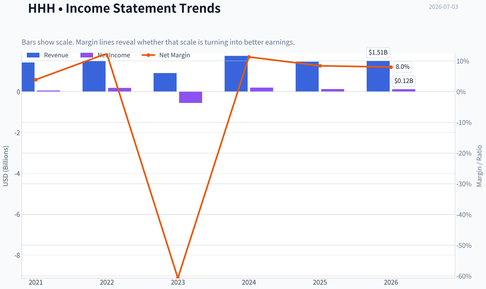

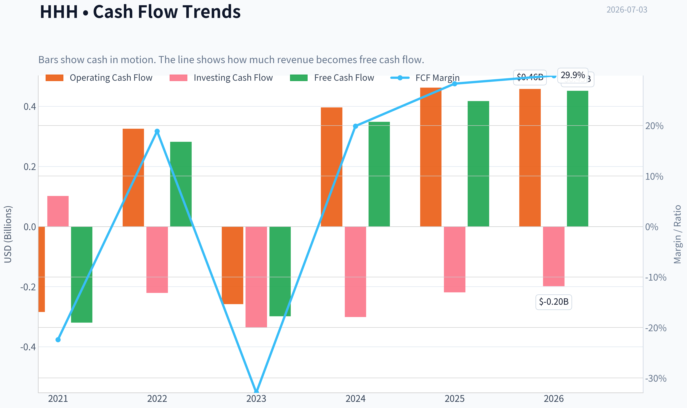

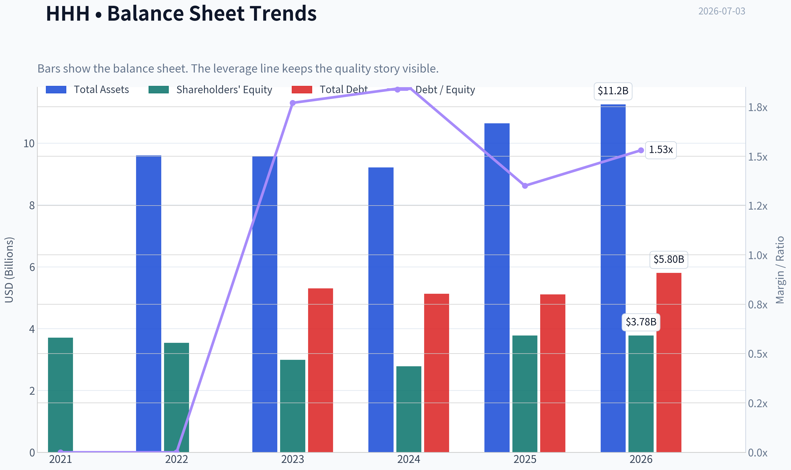

This graph tracks the profitability and return metrics (ROE, ROIC, Margins) of **HHH** over the past decade, highlighting capital efficiency trends.

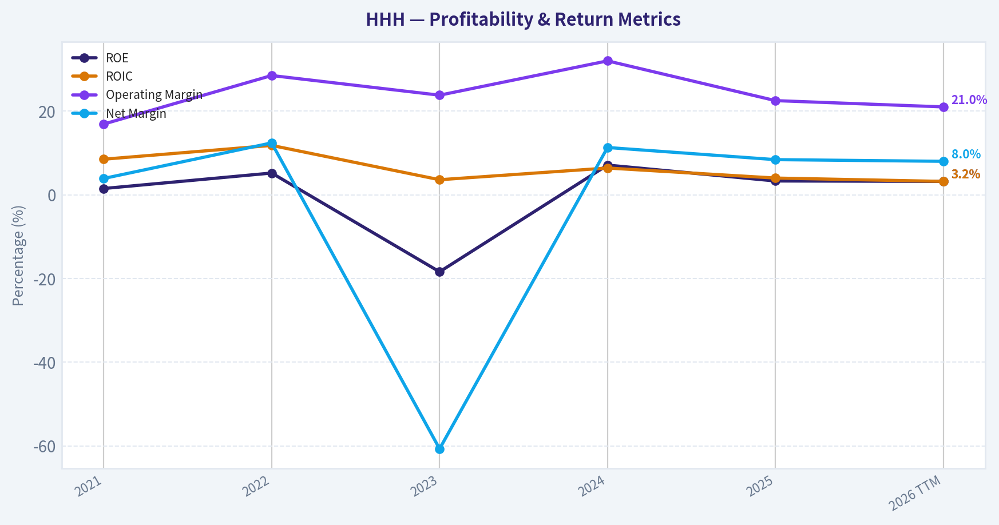

This chart illustrates the financial health of **HHH** over the last 10 years, mapping cash equivalents and free cash flow against total obligations (Debt).

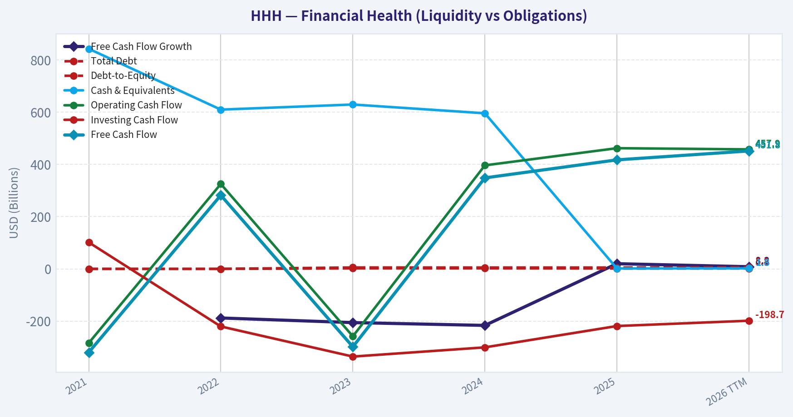

This comparison chart from *Profitability Analysis* stacks current figures against historical benchmarks for **HHH**, making it easy to see where the company trades relative to its own averages.

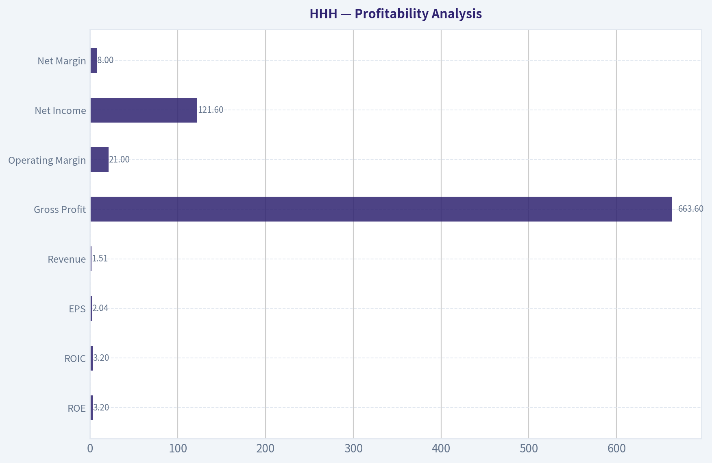

---

### Intrinsic Value Analysis (Buffett)

> *Following Warren Buffett's value investing philosophy: Circle of Competence, Economic Moat, Management Quality, and Margin of Safety.*

#### Intrinsic Value Snapshot

Price is what you pay. Intrinsic value is what the business may be worth based on the cash it can create for owners over time. We show a range, not one magic number.

- Current Price: $74.21
- Value Range (conservative to optimistic across both DCF methods): $146.06 to $179.11

##### Owner Earnings (Buffett Method)
- Net Income: $123,897,000.00
- Depreciation & Amortization: $183,595,000.00
- Capital Expenditures: $-44,758,000.00
- Working Capital Changes: $352,529,000.00
- Owner Earnings: $-89,795,000.00

##### Intrinsic Value
###### Cash Flow Method
Uses free cash flow. Better for companies spending heavily today to grow tomorrow.
- Conservative: $146.06
- Average: $146.06
- Optimistic: $179.11
- Discount Rate: 10.0%

ANALYST STANCE: **WATCH**

#### Howard Hughes Holdings (HHH) - Buffett-Style Investment Review

#### 1) Go/No-Go Gate Assessment

| Gate | Verdict | Evidence |
|---|---|---|
| Circle of Competence & Simplicity | Pass | HHH is primarily a real estate owner, developer, and master-planned community operator. In simple terms: it buys, develops, leases, and sells land, homesites, commercial property, and mixed-use assets. |
| Long-Term Predictability | Mixed Pass | Real estate is understandable, but HHH's results depend heavily on development timing, land sales, asset monetizations, and local demand cycles. Ten years from now it will likely still be a real estate development/platform business, but year-to-year earnings are not highly predictable. |
| Technology Risk | Pass | Technology is not the main risk. Real estate can benefit from better marketing, operations, and data, but the business is not likely to be destroyed by software alone. |
| Moat Test | Mixed / Narrow | HHH owns unique land positions and irreplaceable development assets, but this is not a classic consumer brand, software switching-cost, or network-effect business. Asset quality matters, but moat durability is narrower than Buffett's favorite businesses. |
| Management Quality & Capital Allocation | Mixed | Bill Ackman's involvement adds a strong owner mindset narrative. However, the key test is per-share value creation through disciplined development, buybacks, and asset monetization; current profitability metrics do not yet prove exceptional execution. |
| Industry Structure | Mixed to Weak | Real estate development is cyclical, capital-intensive, and often competitive. Prime assets help, but this is not a rational oligopoly with effortless pricing power. |

**Key Takeaways:** HHH passes the "understandable business" test, but it does not pass the "highly predictable compounding machine" test with flying colors. This is a real estate asset platform with potentially valuable land and development optionality, not a classic wide-moat consumer or software compounder.

---

#### 2) The Business in Plain English

Howard Hughes Holdings makes money by owning valuable land and real estate, improving it, selling parts of it, and collecting rent from income-producing properties. It is part developer, part landlord, and part long-dated land bank.

That is simple enough to understand. What is less simple is the timing: cash flows can swing depending on when lots are sold, projects are completed, and assets are refinanced or monetized.

#### 3) Moat Analysis

| Moat Source | Assessment | Evidence |
|---|---|---|
| Intangible Assets | Limited | HHH does not appear to have a powerful consumer brand that allows routine 10% price hikes across the portfolio. Its advantage is more asset-specific than brand-specific. |
| Switching Costs | Weak | Tenants and buyers are not deeply locked in the way enterprise software customers are. Real estate location matters, but switching costs are not structurally high across the whole platform. |
| Cost Advantage | Moderate in select assets | Unique land assemblages and legacy positions in master-planned communities can create favorable economics versus new entrants. That said, this is asset-driven rather than system-wide structural dominance. |
| Network Effects | None | Real estate developments can gain attractiveness with scale and community formation, but this is not a true network-effect business. |

**Moat Quality Rating: Narrow**

HHH's best competitive advantage is ownership of scarce, hard-to-replicate land and development rights in attractive markets. That can be valuable, but it is not the same as a wide economic moat that throws off predictable high returns with little capital.

**Key Takeaways:** HHH's advantage comes from what it owns, not from a powerful flywheel. Scarce land can be valuable for a long time, but the moat is narrower and more cyclical than Buffett's ideal business.

---

#### 4) Management Quality & Capital Allocation

| Question | Assessment | Commentary |
|---|---|---|
| Do they think like owners? | Yes, with caveats | Ackman's large ownership interest is a positive signal. Alignment appears stronger than at many externally managed or highly promotional real estate stories. |
| Are they honest and candid? | Reasonable | Recent investor communications appear focused on underlying asset value and long-term development potential. The key question is whether reported value creation ultimately shows up in per-share cash generation. |
| Are they rational capital allocators? | Still unproven at elite level | For a real estate platform, rational allocation means disciplined project pacing, avoiding overbuilding, monetizing mature assets well, and repurchasing shares only at discounts to intrinsic value. The current low ROE suggests the portfolio is not yet demonstrating Buffett-grade capital efficiency. |

Overall, management alignment looks better than average, but this is not yet a textbook example of a management team converting retained capital into consistently high per-share returns.

#### 5) Financial Summary

Using the shared research pack:

| Metric | Value |
|---|---:|
| Current Price | $74 |
| Market Cap | $4.42B |
| P/E | 34.68x |
| ROE | 3.3% |
| Revenue Growth YoY | -15.8% |
| FCF Yield | 9.4% |

**Key Takeaways:** The market is not pricing HHH like a deeply distressed asset, but neither is it rewarding it for excellent profitability. Low ROE and negative recent revenue growth suggest the business is currently in a weak earnings phase, while the relatively solid FCF yield hints that asset cash generation may be better than accounting earnings imply.

#### 6) Buffett Financial Lens

| Test | Buffett Standard | HHH Snapshot | Verdict |
|---|---|---|---|
| ROE | >15% sustained | 3.3% | Fail |
| Cash Generation | OCF should exceed NI over time | FCF yield is respectable, but earnings quality needs stronger proof | Mixed |
| Balance Sheet | Conservative debt | Real estate businesses usually employ meaningful leverage; no fortress proof here | Mixed/Weak |
| Capital Intensity | Prefer light | Development real estate is capital intensive | Fail |
| Predictability | High | Cyclical and transaction-driven | Fail |

**Key Takeaways:** On Buffett's preferred financial profile, HHH falls short. This is not a high-ROE, capital-light, predictably compounding business; it is an asset-heavy platform whose value depends on execution and realization.

---

#### 7) Owner Earnings Assessment

A Buffett-style owner earnings framework for HHH should start with net income, add back non-cash charges such as depreciation, and then subtract true maintenance and development capital needs plus working capital requirements.

Because HHH is a real estate development company, the hard part is distinguishing:
- maintenance capex from growth/development capex,
- recurring cash generation from asset sale timing,
- accounting earnings from economic land value creation.

That means owner earnings should be interpreted conservatively. The reported **FCF yield of 9.4%** suggests economic cash generation may be meaningfully stronger than the current **3.3% ROE** implies. Still, for a conservative Buffett analysis, I would not treat all current free cash flow as steady-state distributable owner earnings because real estate cash flows can be lumpy.

#### 8) Three-Scenario DCF Valuation

Given the available evidence, the cleanest anchor is implied free cash flow.

Estimated free cash flow:
- Market cap: **$4.42B**
- FCF yield: **9.4%**
- Implied FCF: about **$415M**

Using that as a rough owner-earnings proxy:

| Scenario | Assumption | Value Estimate |
|---|---|---:|
| A: No Growth | $415M / 10% | **$4.15B** |
| B: 3% Growth Perpetuity | $415M x 1.03 / (10% - 3%) | **$6.11B** |
| C: Moderate Growth | Assume 5% growth for 10 years, then 3% terminal | **~$5.4B-$5.8B** |

**Key Takeaways:** On a cash-flow basis, HHH may be near fair value to modestly undervalued. The stock looks more appealing if current free cash flow is durable; it looks less appealing if that cash flow is cyclical or boosted by timing of asset sales.

#### 9) Margin of Safety

| Item | Value |
|---|---:|
| Current Market Cap | $4.42B |
| Scenario A Value | $4.15B |
| Scenario B Value | $6.11B |
| Scenario C Value | ~$5.4B-$5.8B |

Implied margin of safety:
- Versus **No Growth**: none
- Versus **3% Growth**: moderate
- Versus **Moderate Growth**: modest to decent

For a cyclical, capital-intensive business with a narrow moat, Buffett would want a **larger** discount than this. The valuation is interesting, but not obviously cheap enough to compensate for the business quality limitations.

**Key Takeaways:** HHH may have upside if management realizes asset value well, but the current price does not scream "fat pitch." For this type of business, a bigger discount to conservative intrinsic value would be preferable.

---

#### 10) Final Buffett Scorecard

| Criterion | Score (1-5) | Weight | Weighted Score |
|---|---:|---:|---:|
| Business Understanding | 4.0 | 20% | 0.80 |
| Moat Width & Durability | 2.5 | 25% | 0.63 |
| Management Quality | 3.5 | 15% | 0.53 |
| Return on Equity | 1.5 | 15% | 0.23 |
| Reinvestment Runway | 3.5 | 10% | 0.35 |
| Balance Sheet Strength | 2.5 | 5% | 0.13 |
| Industry Structure | 2.5 | 5% | 0.13 |
| Valuation/Margin of Safety | 3.0 | 5% | 0.15 |
| **Total** |  |  | **2.95 / 5.0** |

**Key Takeaways:** HHH scores well on understandability and potential asset runway, but weak profitability, capital intensity, and moat quality hold it back. The result is just below Buffett-style buy territory.

#### 11) Final Verdict

**Investment Stance: WATCH**

**Conviction: Moderate**

HHH is understandable and may hold substantial underlying asset value, especially with owner-oriented sponsorship and long-duration development optionality. But Buffett's ideal business this is not: returns on equity are weak, the business is capital intensive, the moat is narrow, and valuation is not so cheap that it overwhelms those drawbacks.

This is a **watchlist asset-value situation**, not a slam-dunk Buffett compounder. It becomes more attractive if:
1. management proves sustained per-share value creation,
2. ROE and cash conversion improve materially,
3. the stock trades at a wider discount to conservative intrinsic value.

At **$74**, HHH looks **interesting, but not irresistible**.
#### Valuation Bridge

This bridge places the current market price beside each intrinsic value lens so readers can see whether upside depends on one method or shows up across several methods.

| Scenario | Intrinsic Value / Share |
| --- | ---: |
| Cash Flow Method | $146.06 |
| Damodaran Method | $45.35 |
| Current Price | $74.21 |

#### Key Takeaways

If one method is far above the others, the upside case depends on a specific modelling assumption. When several methods cluster together, the valuation story is more robust.

#### Valuation Visuals

This comparison chart from *Latest Earnings Snapshot* stacks current figures against historical benchmarks for **HHH**, making it easy to see where the company trades relative to its own averages.

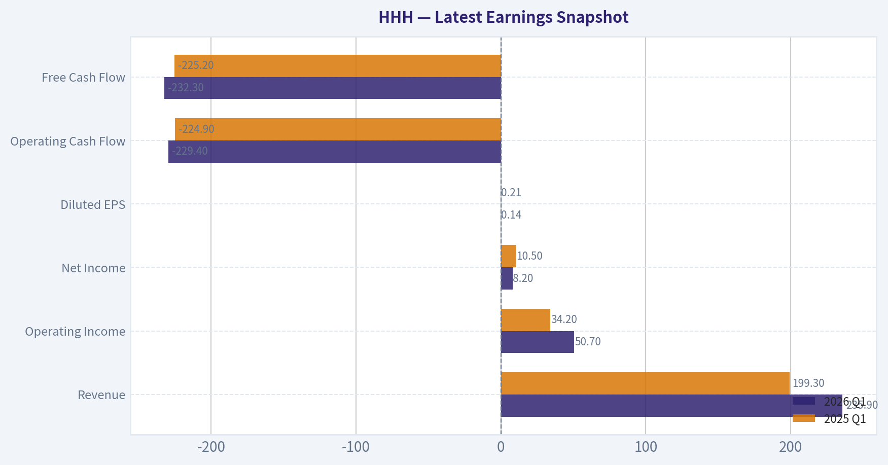

This comparison chart from *Current vs Historical Average Comparison* stacks current figures against historical benchmarks for **HHH**, making it easy to see where the company trades relative to its own averages.

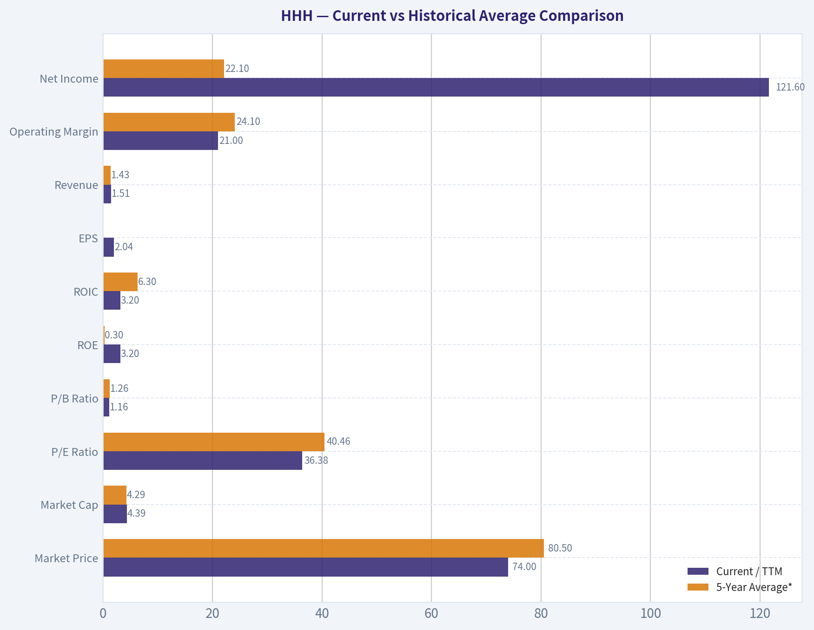

This comparison chart from *Balance Sheet and Financial Strength* stacks current figures against historical benchmarks for **HHH**, making it easy to see where the company trades relative to its own averages.

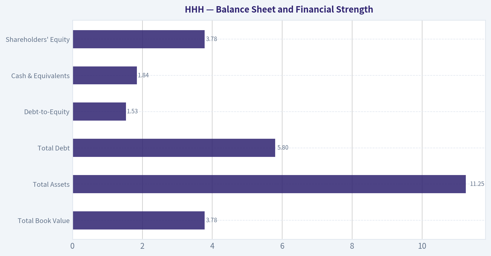

This comparison chart from *Financial Summary* stacks current figures against historical benchmarks for **HHH**, making it easy to see where the company trades relative to its own averages.

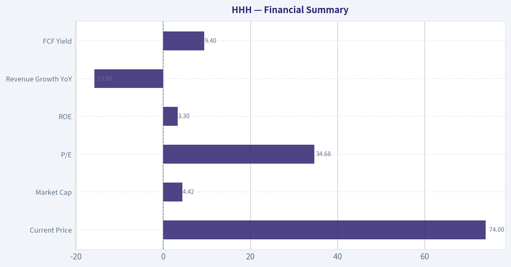

This comparison chart from *Three-Scenario DCF Valuation* stacks current figures against historical benchmarks for **HHH**, making it easy to see where the company trades relative to its own averages.

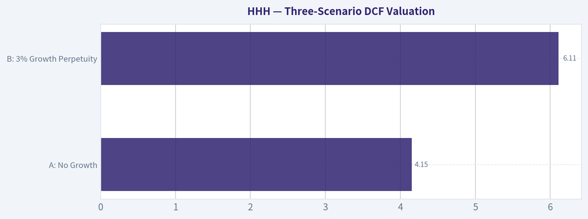

---

### Trend & Growth Analysis (Lynch/Druckenmiller/Fisher)

> *Following Peter Lynch's GARP, Stanley Druckenmiller's macro-aware approach, and Philip Fisher's scuttlebutt methodology.*

ANALYST STANCE: **WATCH**

#### 1. Lynch Classification

| Item | Assessment |
|---|---|
| Company | Howard Hughes Holdings (HHH) |
| Business type | Hybrid real estate developer/operator |
| Lynch category | **Asset Play / Cyclical**, not a Fast Grower |
| Why | Revenue growth is **-15.8% YoY**, earnings and cash flows are heavily timing-driven by land sales/development closings |

**Key Takeaways:** HHH does not fit Peter Lynch's preferred fast-grower template. It behaves more like a land-rich real estate asset play with cyclical monetization rather than a durable 20% compounding operating business. That means upside may exist, but it is less likely to be a clean "ten-bagger through earnings compounding" story.

#### 2. The Story in 3 Bullets

- HHH owns high-quality master planned communities and mixed-use real estate that can be monetized over many years.
- The bull case is that the market undervalues its land bank and future development cash flows.
- The bear case is that value realization is slow, rate-sensitive, and dependent on execution, housing demand, and capital markets.

---

#### 3. Snapshot Fundamentals

| Metric | Value |
|---|---:|
| Current price | **$74** |
| Market cap | **$4.42B** |
| P/E | **34.7x** |
| ROE | **3.3%** |
| Revenue growth YoY | **-15.8%** |
| FCF yield | **9.4%** |
| Ackman/Pershing disclosed stake | **18.85M shares / $1.19B / 8.7% portfolio weight** |

**Key Takeaways:** The headline valuation is not obviously cheap on earnings, with a mid-30s P/E against weak growth and low ROE. The one attractive surface metric is the high free cash flow yield, but for HHH that number can swing with asset sales and development timing, so it should not be taken at face value without more segment detail.

#### 4. TAM Analysis with 10x Test

| Item | Assessment |
|---|---|
| TAM concept | Not a classic product TAM; value comes from land inventory, community buildout, and densification |
| Runway | **Long duration**, potentially decades, if MPCs continue attracting residents/businesses |
| 10x test | **Not applicable in the usual growth-stock sense** |
| Better framing | Can HHH compound NAV per share materially through lot sales, development, and capital allocation? |

**Key Takeaways:** HHH has runway, but it is a real estate runway, not a software-style TAM expansion. The opportunity is tied to maximizing value from scarce land over time, which can be substantial, but the pace is much slower and more cyclical than a true fast-growing operating company.

#### 5. Revenue Growth Trend

| Signal | Assessment |
|---|---|
| Latest YoY revenue growth | **-15.8%** |
| Trend interpretation | **Negative / decelerating** |
| Quality of growth | Likely volatile due to land sales timing and development closings |
| Druckenmiller inflection read | **No positive growth inflection visible from current data** |

**Key Takeaways:** The current revenue signal is a clear yellow flag. A negative year-over-year decline does not automatically break the HHH thesis because results are lumpy, but it does mean there is no present evidence of the kind of accelerating growth inflection that growth investors usually want.

#### 6. Unit Economics

| Metric | Value | Assessment |
|---|---:|---|
| LTV/CAC | N/A | Not relevant for HHH |
| Net Revenue Retention | N/A | Not relevant for HHH |
| Rule of 40 | N/A | Not relevant for HHH |
| Useful substitute metrics | NAV discount, land monetization pace, recurring NOI growth, development yield, leverage | **More important than SaaS metrics** |

**Key Takeaways:** Standard growth-stock unit economics do not apply here. The right questions are whether land is being sold at attractive margins, whether recurring operating income is growing, and whether development returns exceed the cost of capital.

---

#### 7. Inflection Point Assessment

| Potential inflection | Current read |
|---|---|
| Product cycle inflection | **No** |
| Market share inflection | N/A |
| Margin inflection | Unclear from supplied data |
| TAM expansion inflection | Long-term optionality exists, but not a near-term inflection |
| Competitive inflection | None evident |
| Capital allocation inflection | **Possible**, given Bill Ackman's strategic interest and Berkshire-like framing |

**Key Takeaways:** There is no operating growth inflection in the supplied numbers. The only plausible inflection is strategic and capital-allocation driven, where Ackman could reshape the market narrative around HHH as a long-duration compounder of real estate value rather than a simple developer.

#### 8. Macro Setup Evaluation

| Macro factor | Impact on HHH |
|---|---|
| Interest rates | **Important headwind if high; tailwind if easing** |
| Housing demand | Directly impacts lot sales and pricing |
| Commercial real estate sentiment | Affects valuation multiples and embedded NAV confidence |
| Secular theme alignment | Weak versus AI/cloud/software; stronger as a land scarcity / U.S. community development story |
| Macro sensitivity | **High** |

**Key Takeaways:** HHH is much more macro-sensitive than the ideal secular growth stock. If rates fall and housing remains healthy, the setup improves materially; if financing stays tight, realization of intrinsic value can remain delayed.

#### 9. Fisher 15 Points Score

| Fisher area | Score (1-5) | Notes |
|---|---:|---|
| Market potential | 4 | Long-duration land monetization opportunity |
| New product development | 2 | Not a product innovator |
| R&D effectiveness | 1 | Not applicable |
| Sales organization | 3 | Relevant in leasing/lot sales, but not exceptional moat source |
| Profit margin | 2 | Low quality/volatile profitability |
| Improving margins | 2 | Not evident |
| Labor/personnel relations | 3 | No major red flags from supplied data |
| Executive relations | 3 | Neutral |
| Management depth | 3 | Neutral to decent |
| Cost/accounting controls | 3 | Neutral |
| Outstanding aspects | 4 | Scarce land, entitlement, placemaking |
| Long-range profit outlook | 4 | Potentially attractive if executed well |
| Dilution risk | 3 | Moderate; capital intensity matters |
| Candor in difficulties | 3 | Neutral |
| Integrity | 4 | Ackman involvement raises scrutiny and alignment interest |

| Total Fisher Score | **44 / 75** |
|---|---|

**Key Takeaways:** HHH scores as average-to-below-growth-grade under Fisher because it lacks the innovation and product compounding characteristics Fisher preferred. Its strongest points are strategic assets and long-term optionality, but weak current profitability and capital intensity hold the score back.

#### 10. Valuation Analysis

| Method | Value / Read | Interpretation |
|---|---|---|
| P/E | **34.7x** | Expensive relative to weak current growth |
| PEG | **Not meaningful** | Earnings growth not stable enough |
| P/S | Not provided | Less useful for HHH |
| FCF yield | **9.4%** | Looks attractive, but quality/consistency must be verified |
| NAV-style lens | Likely more appropriate | Real debate is discount/premium to intrinsic land and asset value |

**Key Takeaways:** On conventional growth valuation, HHH does not screen well. On asset-value valuation, it may be more attractive, but that requires a proper NAV build and segment analysis that the current dataset does not fully provide.

#### 11. Growth Investor Scorecard

| Criterion | Weight | Score (1-5) | Weighted |
|---|---:|---:|---:|
| The Story | 10% | 3.5 | 0.35 |
| TAM & Runway | 20% | 3.5 | 0.70 |
| Revenue Growth | 20% | 1.5 | 0.30 |
| Unit Economics | 15% | 2.5 | 0.38 |
| Competitive Position | 10% | 3.5 | 0.35 |
| Management Quality | 10% | 3.5 | 0.35 |
| Macro Setup | 5% | 2.5 | 0.13 |
| Profitability Path | 5% | 2.5 | 0.13 |
| Valuation | 5% | 3.0 | 0.15 |

| Total Score | **2.84 / 5.00** |
|---|---|

**Key Takeaways:** HHH lands in the AVOID/WATCH boundary by strict growth-investor scoring, and I round it to WATCH because asset value and strategic optionality may still matter. The weak point is clear: current growth and operating momentum are not strong enough to support an aggressive growth stance.

---

#### 12. Position Size Stance

| Stance | View |
|---|---|
| Recommended action | **WATCH** |
| For existing holders | Hold only if underwriting to NAV realization and long-term land value, not near-term growth |
| For new positions | Small tracking position at most, pending clearer evidence of value realization or growth stabilization |
| Ideal investor type | Asset-value, special situations, or real estate cycle investors more than pure growth investors |

**Key Takeaways:** This is not a high-conviction growth initiation today. If someone owns it, the thesis should be based on patient NAV compounding and strategic capital allocation rather than accelerating revenue or earnings.

#### 13. Key Risks and Catalysts

| Risks | Catalysts |
|---|---|
| Continued revenue declines | Falling rates improving housing and asset values |
| High rate sensitivity | Strong MPC land sales and pricing |
| Slow NAV realization | Major development stabilization |
| Capital intensity / refinancing risk | Clearer Ackman-led strategic repositioning |
| Weak recurring profitability | Asset sales or disclosures that highlight hidden NAV |

**Key Takeaways:** The stock likely needs a catalyst that narrows the gap between estimated intrinsic value and public-market perception. Without that, investors may keep seeing HHH as a lumpy, rate-sensitive real estate name rather than a compounder.

#### Bottom Line

HHH is **not** a Lynch-style fast grower and does **not** currently show a Druckenmiller-style operating inflection. It is better viewed as a **strategic real estate asset play with optionality**, supported by scarce land and patient capital allocation. That can still work, but it is a different game than growth investing.

If you want, I can next build a **bull/base/bear NAV-style valuation framework for HHH at $74**, using the available data and explicit assumptions.

---

### Market Technical Analysis

#### HHH technical view as of 2026-07-03

HHH has staged a meaningful rebound from its March 2026 washout, but the recovery is best described as a **strong short-to-medium-term upswing occurring inside a still-weaker long-term structure**. That distinction matters. Traders looking only at recent price action will see accelerating upside momentum; investors using longer trend filters will still note that price remains below the 200-day benchmark, which keeps the broader trend from fully flipping bullish.

I selected these 8 indicators because they cover **trend, momentum, volatility, and volume confirmation** with minimal redundancy:

- `close_10_ema`
- `close_50_sma`
- `close_200_sma`
- `macd`
- `macdh`
- `rsi`
- `atr`
- `vwma`

They work well together here because HHH is not in a flat range: it is in a recovery trend where traders need to know:
1. whether momentum is accelerating,
2. whether the move is mature or overextended,
3. whether the move is supported by volume,
4. and whether the rally is strong enough to challenge the longer-term bearish overhang.

#### Price structure and trend regime

Over the past year, HHH moved through **three distinct phases**:

1. **Uptrend from July to early November 2025**
   Price advanced from the high 60s into the upper 80s/near 90 area. That leg showed persistent trend strength and expanding price acceptance.

2. **Major deterioration from late 2025 into March 2026**
   After peaking around November, HHH lost trend support in stages. The February 20, 2026 breakdown was especially important: price collapsed from the low 80s into the mid-70s on very heavy volume, then continued falling to roughly the low 60s by mid-March. That was not a normal pullback; it was a regime break.

3. **Base-building and recovery from April through early July 2026**
   Since March, the stock has been rebuilding. The recovery was initially hesitant in April and May, but price behavior improved notably in June, culminating in a push to **74.21 on July 2**, the highest close in this rebound sequence.

This history tells us the current rally is not random noise. It is a structured recovery off a deeply oversold breakdown. But because the stock fell so hard earlier in the year, the longer-term repair process is still incomplete.

#### Indicator snapshot

| Indicator | Latest reading | Interpretation |
|---|---:|---|
| Close (last trading day) | 74.21 | Near the top of the recent recovery range |
| `close_10_ema` | 70.89 | Strong short-term upside slope; price is extended above fast trend support |
| `close_50_sma` | 65.55 | Medium-term trend has clearly turned up; price well above it |
| `close_200_sma` | 74.75 | Long-term trend still not fully repaired; price remains just below this major barrier |
| `macd` | 2.13 | Bullish momentum is strong and expanding |
| `macdh` | 0.60 | Upside momentum is still accelerating, not merely positive |
| `rsi` | 75.33 | Overbought zone; momentum is strong, but near-term pullback risk is elevated |
| `atr` | 1.72 | Volatility is moderate and slightly elevated, supportive of active swing trading |
| `vwma` | 69.18 | Price above volume-weighted trend, suggesting buyers have had genuine control |

Key Takeaways: HHH is in a strong short-term rally with price well above its 10-day EMA, 50-day SMA, and VWMA, which confirms real directional strength. However, RSI is overbought and the stock is still slightly below its 200-day SMA, so the rally is powerful but not yet a complete long-term trend reversal.

#### Trend analysis in detail

The **10 EMA** has risen from about **63.16 in early May to 70.89 by July 2**, a sharp upward slope that shows the rally has gained speed, not just drifted higher. More importantly, recent closes have stayed decisively above this fast average, meaning buyers have been willing to defend increasingly higher prices.

The **50 SMA** has also turned up, climbing from **65.41 in early May to 65.55 in early July after bottoming in late May/early June**. That may sound like a small change, but for a 50-day average it is meaningful: the medium-term trend has stopped deteriorating and is now gradually improving. Price sitting roughly **8.7 points above the 50 SMA** is a sign of strong upside separation.

The **200 SMA**, however, remains the key unresolved issue. It has been drifting down from **76.27 in early May to 74.75 now**, and HHH is still **slightly below** it. This implies the long-term trend has not fully turned bullish. In practical terms, HHH is now testing a major overhead regime line. A clean move and hold above the 200-day average would materially strengthen the bullish case; repeated failures near it would suggest the rally is still just a bear-market recovery within a larger damaged chart.

#### Momentum analysis

The momentum picture is clearly bullish.

`macd` improved from deeply negative in early May (**-0.94**) to strongly positive (**2.13**) by July 2. That is a substantial momentum rotation, not a marginal one. It shows the shorter EMA structure has decisively overtaken the longer EMA structure.

`macdh` at **0.60** is also notable. The histogram is not only positive but expanded sharply through late June and early July. That suggests momentum is still **accelerating upward**, rather than flattening out. Often, rallies begin to tire when histogram bars start shrinking while price keeps rising; that is not yet the dominant signal here.

`rsi` at **75.33** adds nuance. On one hand, this confirms strong upside momentum. On the other, it places the stock in a zone where short-term entries become less attractive from a risk/reward standpoint. In strong recoveries, RSI can stay above 70 for longer than expected, so overbought does not automatically mean "sell now." It does mean traders should distinguish between:
- **trend followers**, who may continue to hold while trailing stops,
- and **new entrants**, who should be wary of chasing extended candles into resistance.

#### Volume confirmation

`vwma` has risen from roughly **64.07 in early May to 69.18 now**, and price is materially above it. That is constructive because it suggests the rally has not been built solely on thin, low-conviction trading. Volume has been strong enough to lift the volume-weighted trend itself.

This is especially important given HHH's earlier breakdowns were accompanied by heavy volume spikes. In other words, the stock previously showed aggressive distribution; now it is showing improving price acceptance above the volume-weighted mean. That does not erase the prior damage, but it does suggest the recovery has broader participation than a weak dead-cat bounce.

#### Volatility and risk conditions

`atr` is **1.72**, up somewhat from early June levels near the mid-1.5s. Volatility is not extreme relative to the stock's history, but it is high enough that traders should expect normal daily swings of roughly 1.5 to 2.0 points.

That matters for execution:
- Stops placed too tightly under the market may get clipped by ordinary noise.
- Position sizing should account for a still-active trading range.
- Because price is now extended and near long-term resistance, a one-to-two ATR pullback would be perfectly normal and would not automatically negate the bullish structure.

#### What the chart is likely saying now

The stock appears to be in a **late-stage short-term momentum push approaching a major long-term test**.

That combination often creates one of two scenarios:

| Scenario | What to watch | Trading implication |
|---|---|---|
| Bullish continuation | Price holds above 72-73 and breaks decisively over the 200-day SMA area near 74.7-75 | Would strengthen the case for a broader trend reversal and open room toward prior resistance zones |
| Healthy pullback | RSI cools from overbought, price retraces toward the 10 EMA or VWMA while MACD stays positive | Could create a better risk-adjusted entry than chasing current strength |
| Failed breakout / rejection | Price loses momentum near the 200-day SMA and slips back below 70 with weakening MACD histogram | Would suggest the rally is tiring and that longer-term sellers are still in control |

Key Takeaways: HHH is pressing into an important decision zone. If it can convert the 200-day SMA area into support, the recovery may evolve into a larger trend reversal; if not, a near-term pullback or rejection becomes much more likely.

#### Most relevant support and resistance zones

| Zone | Type | Why it matters |
|---|---|---|
| 74.7-75.0 | Major resistance | Near the 200-day SMA and current breakout decision area |
| 72.0-73.0 | Near-term support | Recent breakout region; first test of buyer commitment |
| 70.9 | Dynamic support | Approximate 10 EMA, useful for fast-trend monitoring |
| 69.2 | Secondary support | VWMA area; loss of this level would weaken volume-backed trend quality |
| 65.5 | Medium-term support | 50 SMA; a much deeper pullback into this zone would still preserve the medium-term recovery trend |

Key Takeaways: The most important area overhead is 74.7 to 75.0, where long-term trend resistance is sitting almost directly on current price. Below that, the 72 to 73 zone is the first meaningful support shelf, while the 10-day EMA and VWMA help define whether a pullback is healthy or more serious.

#### Practical interpretation by trading style

| Trading style | Read on HHH | Preferred indicator focus |
|---|---|---|
| Short-term momentum trader | Bullish but extended | `close_10_ema`, `macd`, `macdh`, `rsi` |
| Swing trader | Constructive above 72-73, but do not ignore overhead resistance | `close_50_sma`, `macd`, `atr`, `vwma` |
| Position trader / investor | Improving, but long-term confirmation still incomplete until price reclaims 200 SMA | `close_50_sma`, `close_200_sma`, `vwma`, `rsi` |

Key Takeaways: Fast traders can respect the current momentum, but they should also recognize that the stock is stretched. Longer-horizon traders should be encouraged by the recovery, yet still require a sustained move above the 200-day SMA before treating HHH as fully repaired.

#### Bottom line

HHH currently shows a **credible bullish recovery** with:
- rising short-term and medium-term trend measures,
- strong positive MACD momentum,
- supportive volume-weighted trend behavior,
- and manageable but active volatility.

The caution flag is equally clear:
- RSI is overbought,
- price is approaching or just under the 200-day SMA,
- and this is exactly where many recovery rallies either prove themselves or stall.

So the most nuanced view is this: **HHH is bullish tactically, improving strategically, but not fully bullish structurally until it clears and holds above the 200-day SMA.** For traders, chasing strength here is less attractive than buying a controlled pullback or a confirmed breakout. For investors, the stock has improved meaningfully, but the long-term trend repair is still in progress.

#### Final summary table

| Category | Signal | Assessment | Why it matters now |
|---|---|---|---|
| Short-term trend | Price vs `close_10_ema` | Bullish | Fast trend is rising sharply and price is above it |
| Medium-term trend | Price vs `close_50_sma` | Bullish | Recovery is no longer just a bounce; medium-term structure has improved |
| Long-term trend | Price vs `close_200_sma` | Cautious / not yet confirmed | Stock is still testing major overhead resistance |
| Momentum | `macd` | Bullish | Momentum rotation from negative to strongly positive is significant |
| Momentum acceleration | `macdh` | Bullish | Upside momentum is still expanding |
| Stretch / exhaustion risk | `rsi` | Overbought | Strong trend, but near-term pullback risk is elevated |
| Volatility | `atr` | Moderate | Supports active trading but requires disciplined stop placement |
| Volume confirmation | `vwma` | Bullish | Rally is supported by volume-weighted price strength |

Key Takeaways: HHH has strong momentum and improving trend quality, especially on short- and medium-term measures. The main unresolved issue is whether the stock can push through long-term resistance near the 200-day SMA without first needing a cooling pullback.

---

### Options Market Analysis

> *Reading options flow - put/call ratios, IV skew, and unusual activity - to gauge institutional positioning and event-driven risk.*

#### HHH Options Positioning Report
*Date: 2026-07-03*

HHH's options tape leans **bullish in the near term**, mainly because call trading volume is overwhelmingly dominant versus put volume, and the single standout unusual trade is a large fresh **October $80 call** position. That said, the open-interest backdrop is **not purely bullish**: aggregate put open interest is close to call open interest, and near-dated put IV is much richer than call IV, showing investors still want downside protection.

#### 1) Put/Call Ratio Analysis

| Expiry | Call OI | Put OI | Put/Call OI Ratio | Call Vol | Put Vol | Put/Call Vol Ratio | Read |
|---|---:|---:|---:|---:|---:|---:|---|
| 2026-07-17 | 2,379 | 1,336 | 0.56 | 221 | 53 | 0.24 | Bullish vs neutral |
| 2026-08-21 | 51 | 54 | 1.06 | 18 | 2 | 0.11 | Slightly defensive, but thin |
| 2026-10-16 | 2,047 | 2,858 | 1.40 | 1,059 | 42 | 0.04 | OI bearish/hedged, flow strongly bullish |
| **Overall near-term** | **4,477** | **4,248** | **0.95** | **1,298** | **97** | **0.07** | **Flow bullish, positioning mixed-to-cautious** |

**Key Takeaways:** HHH's overall put/call OI ratio of **0.95** sits above the rough neutral baseline of **0.7**, so standing positioning is somewhat more defensive than neutral. But the much more important near-term signal is the **put/call volume ratio of just 0.07**, which shows current trading flow is overwhelmingly call-driven. That usually points to fresh upside speculation or tactical bullish positioning, even if some legacy put hedges remain on the board.

Interpretation:
- **OI ratio 0.95:** modestly above neutral, suggesting some existing hedging or caution.
- **Volume ratio 0.07:** extremely call-heavy; this is a clear shift away from neutral and toward bullish short-term flow.
- The split between **bearish/cautious OI** and **bullish fresh volume** suggests older protection is still in place, but new money is leaning for upside.

#### 2) Implied Volatility (IV) Assessment

| Expiry | ATM Call IV | ATM Put IV | Put Premium vs Call | IV Read |
|---|---:|---:|---:|---|
| 2026-07-17 | 35.2% | 62.9% | +27.7 pts | Very steep put skew |
| 2026-08-21 | 35.3% | 50.9% | +15.6 pts | Strong put skew |
| 2026-10-16 | 34.2% | 38.1% | +3.9 pts | Mild put skew |

**Key Takeaways:** Near-dated HHH puts are priced far richer than calls, especially in July, where put IV is almost **28 volatility points** above call IV. That is a classic sign of **downside protection demand**. At the same time, call IV itself is not extreme, so the market is not pricing a broad upside frenzy; instead, it looks more like traders are buying calls while still paying up for crash insurance.

IV skew read:
- The dataset does not give separate OTM put vs OTM call IV buckets, but the **ATM put IV premium over call IV** is already large enough to infer a **clear downside skew**.
- That skew signals:
  - concern about downside gaps,
  - institutional hedging demand,
  - or low-liquidity risk where puts carry a bigger premium.

Catalyst comment:
- No explicit catalyst data is provided in the feed.
- Still, with **July put IV at 62.9%** versus call IV at 35.2%, there is evidence the market is bracing for event risk or asymmetric downside risk in the very near term.
- If HHH has a pending earnings release, financing event, or macro-sensitive exposure, this IV structure would be consistent with that.

#### 3) Unusual Options Activity

| Expiry | Type | Strike | Volume | Open Interest | Vol/OI | IV | Likely Moneyness/Intent | Signal |
|---|---|---:|---:|---:|---:|---:|---|---|
| 2026-10-16 | Call | 80.0 | 889 | 38 | 23.4x | 32.3% | Likely OTM-to-near-OTM upside bet depending on spot | Bullish |

**Key Takeaways:** The standout trade in HHH is the **October $80 call**, where volume was more than **23 times** existing open interest. That is the clearest sign of a **fresh new position**, not just old contracts changing hands. Because it is in October rather than the nearest expiry, it looks more like a deliberate directional bet than short-dated retail lottery activity.

Interpretation of the unusual trade:
- **Call, not put**: directional bias is bullish.
- **Volume far above OI**: strongly suggests fresh opening activity.
- **October tenor**: gives the buyer time for a move to develop; this usually carries more informational value than ultra-short-dated weekly chasing.
- **IV 32.3%**: not wildly inflated, which means buyers were not paying extreme optionality premiums.

Smart-money vs retail read:
- The size and expiry horizon make this look **more institutional/tactical** than purely retail.
- If HHH is a thinner options name, one trade can dominate the tape; so this is bullish, but confidence should be moderated by liquidity limits.

#### 4) Open Interest Concentration

| Expiry | Dominant OI Character | What It Suggests |
|---|---|---|
| 2026-07-17 | Calls dominate (2,379 vs 1,336 puts) | Near-expiry upside interest may help support price if spot is near active call strikes |
| 2026-08-21 | Very low OI overall (51 calls, 54 puts) | Too thin to carry strong pinning or gamma significance |
| 2026-10-16 | Puts dominate OI (2,858 vs 2,047 calls) but flow concentrated in calls | Larger legacy hedge base, but fresh call demand may offset bearish positioning |

**Key Takeaways:** The highest open-interest concentrations are in **July and October**, while August is too thin to matter much. July's call-heavy structure could create some near-expiry support if the stock trades around popular call strikes. October is more complex: there is substantial put OI, but the new call flow suggests an emerging upside counterforce rather than a one-sided bearish setup.

Gamma/pinning read:
- Exact strike-by-strike OI concentrations are not provided, so a precise **max pain** level cannot be calculated from this dataset alone.
- Still, broad conclusions are possible:
  - **July** may have modest call-side support/pinning effects.
  - **October** likely has a more balanced but potentially reactive setup, with legacy put open interest acting as a volatility anchor and fresh call buying adding upside gamma if spot rises.
- The **October $80 call** may function as a local upside gamma level if spot approaches that strike.

#### 5) Overall Options Sentiment Signal

| Category | Signal | Driver |
|---|---|---|
| Overall Options Sentiment | **BULLISH** | Extremely call-heavy recent volume and large fresh October call buying |

**Key Takeaways:** Despite visible downside hedging in the IV skew and some defensive open interest, the **live trading flow** is the stronger signal right now, and it is clearly bullish. The market is not carefree-puts remain expensive-but new money appears to be positioning for upside rather than further downside.

Final synthesis:
- **Bullish factors**
  - Near-term **put/call volume ratio of 0.07** is very call-heavy.
  - July OI ratio of **0.56** is bullish versus neutral.
  - Large unusual **October $80 call** activity strongly suggests fresh upside positioning.
- **Bearish/caution factors**
  - Overall OI ratio of **0.95** is above neutral, so background positioning is not aggressively bullish.
  - Near-term **put skew is steep**, especially in July, indicating real downside hedging demand.
- **Net conclusion**
  - **BULLISH, with moderate confidence**
  - Primary driver: **fresh call flow dominates the tape**, especially the outsized October call activity.
  - Caveat: **downside insurance remains expensive**, so the market still sees nontrivial left-tail risk.

#### Markdown Summary Table

| Metric | Observation | Interpretation |
|---|---|---|
| Put/Call Ratio | OI ratio **0.95**, volume ratio **0.07** | Existing positioning somewhat cautious, but current flow strongly bullish |
| IV Level | Calls ~34%-35%, puts ~38%-63% | Put IV elevated, especially near-dated |
| Skew Direction | Strong **put skew** | Market paying up for downside protection |
| Unusual Activity | **2026-10-16 $80 Call**, vol 889 vs OI 38 | Fresh bullish positioning, likely higher-quality directional bet |
| Overall Signal | **BULLISH** | Call flow outweighs defensive OI/IV backdrop |

**Key Takeaways:** HHH's options market is sending a **bullish directional signal**, but not an all-clear signal. Traders are chasing upside through calls while simultaneously maintaining meaningful downside protection, which usually means optimism is present but conviction is not reckless.

---

## Research Team Commentary

> *The Research Manager synthesizes the Bull vs Bear debate into action-free commentary. This is a pre-risk view, not the final stance.*

The strongest bull argument is that HHH is being judged with the wrong yardstick. On trailing metrics, it looks weak: high P/E, low ROE/ROIC, shrinking revenue. But bulls argue this is an asset-backed developer, not a normal operating company, so GAAP earnings and one-year returns understate economic value. The real asset is a hard-to-replicate land bank inside master planned communities, where entitlements, infrastructure, and ecosystem development can create long-duration value. If management monetizes patiently and avoids forced selling, intrinsic value could be meaningfully above what the market is implying today. In that framing, the margin of safety comes from private-market land value and future development optionality, not from current earnings.

The strongest bear argument is that this still does not resemble a Buffett-quality business. Scarce land is not the same thing as a durable economic moat unless it consistently produces strong returns on capital, and right now HHH does not. ROE of 3.3%, ROIC of 3.4%, and negative revenue growth are not trivial optical distortions; they are evidence that capital is not compounding efficiently today. The valuation is also hard to anchor. Once you dismiss P/E and current returns, you are left with a subjective NAV story that depends on execution, rates, housing demand, development costs, and patient capital markets. That may work, but it is a long chain of favorable assumptions rather than a clear Buffett-style margin of safety.

My takeaway is that the bear case is more compelling for a strict value portfolio, but the bull case is strong enough to keep the name on the radar rather than reject it outright. This is exactly the kind of situation where I want to avoid one of my past mistakes: being too rigid with backward-looking metrics when an asset-heavy business may be in a value-realization phase. But I also do not want to overcorrect and bless a business that lacks demonstrated earning power simply because the asset story sounds elegant. HHH may have hidden value, but the evidence in hand does not yet show a wonderful business, predictable owner earnings, or a clearly provable discount to intrinsic value. For Buffett-style investing, that matters.

Core takeaway: HHH looks more like a potentially undervalued real estate asset platform than a proven compounder, and that distinction is crucial. There may be latent asset value in the land bank, but the current business does not yet exhibit the high returns, predictability, or clear margin of safety I would want before advocating capital deployment. In other words, the stock may be interesting, but the business quality is not yet sufficiently demonstrated.

Rationale: From a value investing perspective, business quality has to come first. Buffett can tolerate accounting complexity when the underlying economics are obviously strong. Here they are not obviously strong. The moat argument is plausible, but not validated by returns. The intrinsic value argument may also be plausible, but it is too dependent on appraisal-style assumptions rather than observable earning power. This is where discipline matters: asset richness alone is not enough if monetization is slow and capital efficiency remains weak. On the other hand, I do not think this should be an automatic avoid if future evidence begins to confirm that development spend is creating high-value recurring cash flows and NAV accretion. That is why the right current stance is not outright rejection, but a patient watch.

Monitoring plan over the next 1-4 quarters: First, I would watch for evidence that returns are improving, not just that management is talking about embedded value. ROIC, segment-level margins, and cash-on-cash returns on newer projects need to move up. Second, I would watch land monetization quality: are lot sales, pricing, and absorption rates holding up, and are they happening at values that support the NAV story? Third, I would watch balance-sheet flexibility and liquidity, because in these stories survivability is optionality. If debt rises materially or asset sales begin to look forced, the thesis weakens. Fourth, I would look for clearer separation of maintenance versus growth spending and for better disclosure around recurring cash generation. Fifth, I would monitor whether income-producing assets are stabilizing with stronger NOI, occupancy, and leasing spreads. Finally, I would pay attention to capital allocation: buybacks at discounts to NAV, disciplined project pacing, and credible per-share value growth would strengthen the case.

What would make me more constructive? A few quarters showing improving cash realization, better returns on incremental invested capital, stable liquidity, and credible asset monetizations at values above where the market is implicitly marking the portfolio. What would weaken the thesis? Continued low returns, slower absorption, rate-sensitive softness without offsetting monetization, rising leverage, or repeated reliance on "hidden value" without visible conversion into per-share economics.

Final stance: WATCH

---

## Value Investing Team Commentary

> *The Investor translates the research view into an investment thesis before risk review. This is still not the final stance.*

HHH is interesting, but to a Buffett-style investor it is not yet a clear affirmative case.

The bullish argument is easy to understand: this is not a conventional earnings story, but an asset-backed real estate platform with a valuable land bank, long-duration development rights, and embedded optionality that may not be captured by trailing GAAP earnings. In situations like this, the market often uses the wrong lens. If sentiment is anchored to weak near-term accounting results, while the underlying land and mixed-use assets are worth materially more in private-market terms, then apparent mediocrity can mask genuine value. That is the contrarian angle worth respecting.

But contrarianism only works when you can anchor intrinsic value with confidence. Here, that anchor is still too soft. The reported numbers are weak by the standards of a true compounding business: P/E around 34.7, ROE 3.3%, ROIC 3.4%, ROA 1.2%, and revenue down 15.8% year over year. Those are not the markings of a business currently converting capital into attractive, predictable owner earnings. They may understate economic value, yes-but they also may be correctly signaling that value realization is slow, cyclical, rate-sensitive, and execution-heavy.

That distinction matters. Scarce land can be valuable, but it is not automatically a moat in the Buffett sense. A moat should show up, over time, in pricing power, high incremental returns, resilient cash generation, and intelligent capital allocation. HHH may own excellent assets, yet still fail to produce excellent per-share economics if development timing, capital intensity, financing conditions, or demand weaken. In other words, asset quality and business quality are not the same thing.

The market may be missing some hidden value, but it may also be correctly discounting the uncertainty around when and how that value is realized. That is the key selective-contrarian question: is the market irrationally pessimistic, or simply demanding proof? At this stage, I would say the latter. Investors are not obviously mispricing a wonderful business-they are applying a discount to a complex, appraisal-driven story that still lacks strong evidence of superior capital efficiency.

What would change my mind? Not rhetoric about embedded NAV, but proof:
- improving ROIC and segment economics,
- monetizations at attractive values,
- stronger recurring cash generation,
- stable or improving NOI from income properties,
- disciplined leverage,
- and capital allocation that grows per-share value rather than just gross asset value.

If management begins to demonstrate that development spend is creating high-return, monetizable value-and that this value can be realized without depending on perfect capital markets-then HHH could become much more compelling. Until then, it remains more of a patient asset-value idea than a high-conviction business-ownership candidate.

From a long-term ownership perspective, I would not reject HHH outright. There may indeed be a favorable gap between quoted price and underlying land value. But I also would not call it a margin-of-safety-rich Buffett investment today, because too much of the thesis depends on assumptions rather than demonstrated earning power. The business has optionality; it has not yet earned trust as a compounding machine.

**ANALYST STANCE: WATCH**
HHH deserves monitoring because negative sentiment around weak reported profitability may be obscuring real asset value, but the current evidence still falls short of proving durable earning power, strong returns on capital, and a clearly demonstrable margin of safety. For now, this is a watchlist asset-value situation, not an advocate-level long-term business ownership opportunity.

---

## Deep Values Commentary

> *The Risk Management Team debates and the Risk Judge provides the final action-free verdict. This section determines the final ADVOCATE / WATCH / AVOID stance.*

#### Final Stance Scorecard

This scorecard converts the final research view into a weighted decision frame. It does not replace the narrative judgement, but it makes the main drivers of the verdict easier to scan.

| Criterion | Score | Weight | Commentary |
| --- | ---: | ---: | --- |
| Business Quality | 3.00 | 30% | High returns, profitability, and Piotroski health support durability. |
| Valuation Support | 3.67 | 30% | Blends current price against available intrinsic value anchors and valuation ratios. |
| Financial Strength | 2.67 | 20% | Balance-sheet resilience reflects leverage and liquidity staying within safe ranges. |
| Growth Durability | 2.00 | 20% | Recent revenue, earnings, and free cash flow growth indicate how durable expansion looks. |
| TOTAL / FINAL STANCE | 2.94 | 100% | WATCH |

#### Key Takeaways

The weighted score lands at **2.94 / 5.0**, while the final stance remains **WATCH**. This is useful as a quick calibration aid rather than a mechanical signal.

#### Risk Summary

Higher scores indicate more risk pressure. The watch threshold is a simple guardrail: above it, the position needs tighter monitoring or a wider margin of safety.

| Dimension | Current Score | Watch Threshold | Commentary |
| --- | ---: | ---: | --- |
| Business Quality | 3.00 | 3.00 | High returns, profitability, and Piotroski health support durability. |
| Valuation Support | 2.33 | 3.00 | Blends current price against available intrinsic value anchors and valuation ratios. |
| Financial Strength | 3.33 | 3.00 | Balance-sheet resilience reflects leverage and liquidity staying within safe ranges. |
| Growth Durability | 4.00 | 3.00 | Recent revenue, earnings, and free cash flow growth indicate how durable expansion looks. |

#### Key Takeaways

This view helps readers separate *where* the risk sits: valuation, business quality, balance sheet, or growth durability. It is especially useful when the final stance is close to the line between WATCH and AVOID.
