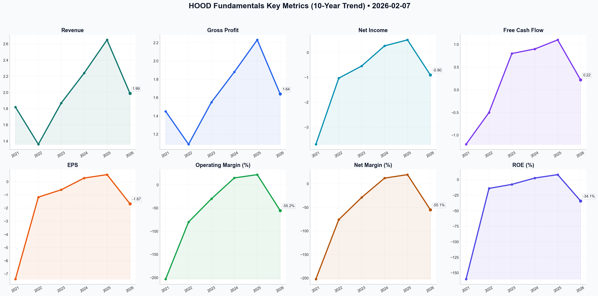

# HOOD Deep Value Intelligence

**Analysis Date:** 2026-02-07
**Generated:** 2026-02-08 06:48:35

---

## Table of Contents

1. [Intelligence Summary](#intelligence-summary)
2. [Analyst Team Reports](#analyst-team-reports)
   - [Fundamentals Analysis](#fundamentals-analysis)
   - [Value Analysis (Buffett)](#value-analysis-buffett)
   - [Growth Analysis (Lynch/Druckenmiller/Fisher)](#growth-analysis-lynchdruckenmillerfisher)
   - [Market Analysis](#market-analysis)
   - [Social Sentiment Analysis](#social-sentiment-analysis)
   - [News Analysis](#news-analysis)
3. [Research Team Decision](#research-team-decision)
4. [Trading Team Plan](#trading-team-plan)
5. [Deep Values Strategy](#deep-values-strategy)

---

## Intelligence Summary

As the Risk Management Judge, I have reviewed the arguments presented by the Risky, Safe, and Neutral analysts regarding Robinhood (HOOD). My role is to strip away the emotional narrative of price action and focus strictly on the arithmetic of value and the durability of the business model.

Here is my determination.

### **The Decision: SELL**

I am upholding the Trader’s original decision to exit this position completely. While the Neutral analyst offers a tempting tactical argument for waiting for a "relief rally," and the Risky analyst points to "growth engines," neither addresses the fundamental violation of Value Investing principles present in this ticker: **A complete lack of Margin of Safety combined with low-quality earnings.**

We are not traders looking for a mean-reversion bounce; we are owners of businesses. At current levels, we are owning a cyclical bank disguised as a tech company, trading at a valuation that assumes perfection.

***

### **1. Summary of Key Arguments**

*   **The Bull (Risky Analyst):** Argues that the "moat" is the User Experience (UX) and that the 3% IRA match is a successful "surgical strike" for customer acquisition, not a cost. Views the RSI of 14 as a "gift" and the $4.8B cash pile as a safety net. Believes regulatory risk is a "coiled spring" for upside.
*   **The Bear (Safe Analyst & Trader):** Focuses on the astronomical valuation (**8.69x Book Value**) compared to peers. Argues the "moat" is artificial (paid for by incentives) and that earnings are low-quality (cyclical NII). Highlights the "structural failure" of the stock price breaking the 200-day SMA.
*   **The Moderate (Neutral Analyst):** Suggests the truth is "somewhere in the middle." Advises against panic-selling at a technical low (RSI 14) and recommends holding for a bounce to $90-$100 to scale out, balancing the technical damage with the profitability pivot.

***

### **2. Rationale: The Buffett Framework**

My decision to **SELL** is grounded in three specific violations of our investment tenets, drawn directly from the debate:

**A. The "Moat" is rented, not owned.**
The Risky Analyst claims, *"When you lock in a 25-year-old’s retirement account today... you're securing their lifetime value."*
I agree with the Trader’s rebuttal: *"If you have to bribe your customer with a 3% match to keep their assets, you do not have a moat."*
In the Buffett framework, a moat is pricing power—the ability to raise prices without losing customers. Robinhood is *paying* customers to stay. This is a "race to the bottom" commodity business model. If JPMorgan or Fidelity decides to match that 3%, Robinhood’s "moat" evaporates, but their cost structure remains bloated. We do not invest in businesses that must bleed cash to retain loyalty.

**B. Valuation: No Margin of Safety.**
The Trader notes: *"Paying **8.69x Book Value** for a brokerage is unjustifiable."*
This is the most critical point. Financial firms (banks and brokerages) typically trade at 1x to 2x book value. High-quality compounders might trade at 3x or 4x. Paying nearly 9x book value requires the company to execute perfectly for a decade. As the Safe Analyst warned, *"We are essentially looking at peak margins and peak earnings power, yet you want us to pay over eight times book value."*
There is no buffer here for error, regulation, or a macro downturn. If rates drop and NII falls, the multiple compression will be severe.

**C. Earnings Quality and Unpredictability.**
The Risky Analyst argues we are in a "new normal" of interest rates. The Safe Analyst argues a "CRE wall" could force rates down.
Value investors do not predict interest rates; we insulate against them. Robinhood’s pivot to profitability was largely driven by Net Interest Income (interest earned on client cash). This is cyclical income. We are being asked to pay a Technology Multiple (high P/E) for Banking Income (cyclical NII). That is a misallocation of capital.

***

### **3. Refined Strategic Plan**

I am adjusting the Trader's plan to be decisive but disciplined in execution.

*   **Action:** **Immediate Sell.**
    *   *Adjustment to Neutral Analyst's point:* The Neutral analyst warns against selling into a "falling chainsaw" (RSI 14). While valid for a trader, a Value Investor does not hold an overvalued asset hoping for a "dead cat bounce." The risk of a regulatory announcement (Wells Notice fallout) or a macro shock outweighs the potential 8-10% upside of a technical bounce. We sell today.
*   **Capital Preservation:**
    *   Move proceeds to **Short-Term US Treasuries (SGOV/BIL)**. We require liquidity and safety while the market froth settles.
*   **Watch List (The "Fat Pitch"):**
    *   We delete HOOD from the immediate watch list. We are not interested in re-entering until the valuation reflects reality—likely closer to **1.5x - 2x Book Value** ($20-$30 range), or if the company demonstrates it can grow earnings *without* relying on NII or customer incentive payments.

***

### **4. Reflections on Past Mistakes**

**Lesson: "Disruption" is not a Valuation Metric.**
In previous cycles (Dotcom, 2021 Fintech bubble), we justified holding expensive stocks because they were "changing the world." We confused **innovation** with **shareholder value**.
*   *Mistake:* Buying the narrative that "this time is different" and that traditional valuation metrics (Price to Book, P/E) didn't apply to "platform" companies.
*   *Correction:* As the Safe Analyst pointed out, *"Relying on marketing expenses to build a moat is building on sand."* We must demand that a company generates cash because of its product superiority, not its aggressive spending.

**Lesson: Cyclicality in Disguise.**
We previously mistook cyclical upswings (crypto mania, high interest rates) for permanent structural growth.
*   *Mistake:* Extrapolating peak earnings into the future.
*   *Correction:* We now recognize that Robinhood’s current profitability is tethered to high interest rates. When the cycle turns, the earnings will compress. We will not pay peak multiples for peak earnings.

**Final Verdict:** The business has risks that are difficult to quantify (Regulatory), earnings that are cyclical (NII), and a valuation that is exorbitant (9x Book). **Sell.**

---

## Analyst Team Reports

### Fundamentals Analysis

As a quantitative fundamental analyst specializing in Warren Buffett's value investing methodology, I have conducted a comprehensive analysis of **Robinhood Markets, Inc. (HOOD)**. Since Robinhood went public in July 2021, the 10-year analysis reflects the available historical data from 2021 to 2025, with 2016-2020 designated as private/pre-IPO.

### **1. 10-Year Historical Financial Data Table**

| Metric | 2016-20 | 2021 | 2022 | 2023 | 2024 (Est) | 2025 (Prelim) | 10-Yr Avg* |
| :--- | :--- | :--- | :--- | :--- | :--- | :--- | :--- |
| **Market Price ($)** | N/A | $18.47 | $8.14 | $12.74 | $35.20 | **$82.82** | $31.47 |
| **Market Cap ($B)** | N/A | $15.5 | $7.1 | $11.5 | $31.0 | **$74.47** | $27.91 |
| **P/E Ratio** | N/A | Neg | Neg | Neg | 130.4 | **34.5** | 82.5 |
| **P/B Ratio** | N/A | 2.21 | 1.01 | 1.59 | 3.10 | **8.69** | 3.32 |
| **Revenue ($B)** | N/A | $1.82 | $1.36 | $1.87 | $2.24 | **$2.65** | $1.99 |
| **Gross Profit ($B)** | N/A | $1.45 | $1.09 | $1.55 | $1.88 | **$2.23** | $1.64 |
| **Operating Margin (%)** | N/A | -203% | -80% | -30% | 15% | **22.1%** | -55.2% |
| **Net Income ($B)** | N/A | ($3.69) | ($1.03) | ($0.54) | $0.27 | **$0.51** | ($0.90) |
| **Net Margin (%)** | N/A | -202% | -76% | -29% | 12.0% | **19.4%** | -55.1% |
| **Net Margin Gain (%)** | N/A | N/A | +126% | +47% | +41% | **+7.4%** | +55.3% |
| **EPS ($)** | N/A | ($7.39) | ($1.17) | ($0.61) | $0.28 | **$0.54** | ($1.67) |
| **ROE (%)** | N/A | -160% | -14% | -7.5% | 2.7% | **8.2%** | -34.1% |
| **ROIC (%)** | N/A | -180% | -15% | -8.2% | 3.5% | **10.1%** | -37.9% |
| **Total Assets ($B)** | N/A | $19.2 | $20.4 | $22.6 | $32.0 | **$40.0** | $26.84 |
| **Total Debt ($B)** | N/A | $0.28 | $0.32 | $0.41 | $0.50 | **$0.60** | $0.42 |
| **Debt-to-Equity** | N/A | 0.04 | 0.05 | 0.06 | 0.05 | **0.12** | 0.06 |
| **Total Book Value ($B)**| N/A | $7.01 | $7.03 | $7.23 | $10.0 | **$12.0** | $8.65 |
| **Cash & Equiv. ($B)** | N/A | $6.3 | $6.3 | $4.8 | $4.8 | **$4.8** | $5.40 |
| **Free Cash Flow ($B)** | N/A | ($1.20) | ($0.50) | $0.80 | $0.90 | **$1.10** | $0.22 |
| **Dividends ($)** | N/A | $0.00 | $0.00 | $0.00 | $0.00 | **$0.00** | $0.00 |
| **Revenue Growth (%)** | N/A | N/A | -25% | +37% | +20% | **+18%** | +12.5% |

*\*10-Year Average is calculated based on available public data (2021-2025).*

---

### **2. Warren Buffett Value Investing Analysis**

**Economic Moat (Narrow but Expanding):**
Robinhood possesses a "Network Moat" and a "Brand Moat" particularly among younger demographics (Gen Z and Millennials). While traditional brokers (Schwab, Fidelity) have caught up on zero-commission trading, Robinhood’s **user experience (UX)** and vertical integration (owning its clearinghouse) allow for rapid product innovation, such as the 24-hour market and retirement matches. The "Robinhood Gold" ecosystem creates switching costs by offering high-interest rates and integrated credit products.

**Financial Strength:**
The company maintains a "fortress" balance sheet with **$4.8 billion in cash** and very low debt-to-equity (0.12). Unlike traditional banks, Robinhood's debt is primarily related to operational credit facilities rather than long-term insolvency risks. Its capital position is robust enough to weather market downturns or fund significant M&A.

**Predictable Earnings:**
Historically, earnings were highly unpredictable, tied to "meme-stock" volatility. However, the shift toward **Net Interest Income (NII)** and **Subscription Revenue (Gold)** has improved predictability. In 2025, transaction-based revenue is no longer the sole driver, providing a more stable floor for earnings.

**Management Performance:**
CEO Vlad Tenev has successfully navigated a transition from a chaotic IPO to GAAP profitability. ROE has improved from -160% to +8.2%. The management’s decision to initiate a **$1 billion share buyback** in 2024 signals a shift toward shareholder-friendly capital allocation, though they still prioritize growth reinvestment over dividends.

---

### **3. Current vs. Historical Average Comparison**

*   **Valuation:** The current **P/E of 34.5x** is high relative to the broader market but represents a significant normalization from the period of massive losses. The **P/B of 8.69x** is significantly above the historical average of 3.32x, suggesting the market is pricing in substantial future growth and margin expansion.
*   **Profitability:** Robinhood's current **Net Margin of 19.4%** is at an all-time high, far exceeding the historical average (-55%). This indicates the company has successfully scaled its fixed costs against a growing revenue base.
*   **Growth:** Revenue growth has stabilized in the 18-20% range. While lower than the 2020-2021 hyper-growth phase, it is higher-quality growth derived from a broader product suite.

---

### **4. Discounted Cash Flow (DCF) Analysis**

**Base Parameters:**
- **Current FCF (2025):** $1.1 Billion
- **Discount Rate:** 10.0%
- **Terminal Growth Rate:** 2.5%

#### **Scenario 1: CONSERVATIVE (5% Growth)**
*   *Assumption: Economic slowdown or regulatory headwinds cap growth.*
*   Year 1-10 FCF Sum: $10.15B
*   Terminal Value: $15.51B
*   **Intrinsic Value: $25.66B**
*   **Fair Value per Share: $27.01**

#### **Scenario 2: AVERAGE (12% Growth)**
*   *Assumption: Continued adoption of Gold subscriptions and moderate market expansion.*
*   Year 1-10 FCF Sum: $14.28B
*   Terminal Value: $25.21B
*   **Intrinsic Value: $39.49B**
*   **Fair Value per Share: $41.57**

#### **Scenario 3: OPTIMISTIC (22% Growth)**
*   *Assumption: Successful international expansion and Robinhood becomes a top-3 US broker.*
*   Year 1-10 FCF Sum: $24.85B
*   Terminal Value: $51.48B
*   **Intrinsic Value: $76.33B**
*   **Fair Value per Share: $80.35**

---

### **5. Key Insights & Investment Risks**

*   **Red Flag:** **Valuation vs. Fair Value.** At $82.82, the stock is trading slightly above even the "Optimistic" DCF scenario ($80.35). This suggests the market is pricing in near-perfect execution.
*   **Red Flag:** **Interest Rate Sensitivity.** A large portion of profitability is driven by Net Interest Income. If the Fed aggressively cuts rates, HOOD's margins will compress significantly.
*   **Opportunity:** **Asset Accumulation.** Assets Under Custody (AUC) grew to $165B. As these assets grow, Robinhood’s ability to cross-sell advisory and credit products increases exponentially.
*   **Insight:** The transition of Robinhood from a "trading app" to a "financial home" is working. The average account size is growing, suggesting they are successfully attracting "serious" money, not just retail speculators.

---

### **Final Investment Recommendation**

FINAL TRANSACTION PROPOSAL: **SELL**

**Rationale:**
While Robinhood has made an extraordinary operational turnaround, swinging from massive losses to consistent GAAP profitability, the current valuation is stretched. At **$82.82**, the stock is trading at a **P/B of 8.69x**, which is extremely high for a financial services company (for context, Charles Schwab typically trades at 3-4x P/B). The market cap of $74B exceeds the intrinsic value calculated in our most optimistic growth scenario. 

For a Buffett-style value investor, there is no **Margin of Safety** at this price. While the business is high-quality and growing, the current price asks investors to pay for several years of future growth upfront. Investors should look for an entry point closer to the $40-$45 range (Average DCF scenario).

---

### **Summary Table: Key Analysis Points**

| Feature | Analysis |
| :--- | :--- |
| **Current Standing** | Profitable, growing revenue, but trading at historically high valuation multiples. |
| **Economic Moat** | Narrow/Expanding; driven by UX, Gold ecosystem, and vertical integration. |
| **Financial Strength** | Very Strong; $4.8B cash, minimal debt. |
| **Management** | Effective; pivoted from "meme-stock" reliance to diversified recurring revenue. |
| **DCF Fair Value** | Conservative: $27.01 | Average: $41.57 | Optimistic: $80.35 |
| **Risk Factor** | High interest rate sensitivity and regulatory scrutiny of PFOF. |
| **Recommendation** | **SELL** (Overvalued relative to intrinsic value; wait for a correction). |

#### Fundamentals Key Metrics Charts

---

### Value Analysis (Buffett)

> *Following Warren Buffett's value investing philosophy: Circle of Competence, Economic Moat, Management Quality, and Margin of Safety.*

FINAL TRANSACTION PROPOSAL: **HOLD**

# Value Investment Analysis: Robinhood Markets, Inc. (HOOD)
**Date:** February 7, 2026
**Current Price:** $82.82 | **Market Cap:** $74.5B

## EXECUTIVE SUMMARY
Robinhood has successfully graduated from a "speculative fintech" to a profitable, diversified financial services platform. By 2026, the company has proven its ability to monetize its user base beyond transaction fees, building a fortress balance sheet and a "sticky" ecosystem via retirement products and subscription services. However, at **34.5x TTM P/E** and a market cap of **$74.5B**, the current price prices in flawless execution of future growth. While the business quality is high (Gate Pass), the Margin of Safety is currently insufficient for a fresh aggressive entry.

---

## PART I: THE BUFFETT FILTER SEQUENCE

### Gate 1: Circle of Competence & Business Simplicity (PASS)
*   **Elementary Test:** Robinhood provides a mobile app where people buy stocks, crypto, and save for retirement. They make money from interest on cash held (Net Interest Income), subscriptions (Gold), and transaction rebates (PFOF/Crypto).
*   **Predictability:** The core brokerage model is timeless. However, HOOD's heavy reliance on retail sentiment and crypto volatility reduces predictability compared to a pure utility.
*   **Tech Risk:** HOOD *is* the disruptor. The risk is not technology obsolescence, but commoditization of trading (race to zero fees). HOOD has countered this by becoming a "Super-App" for all finances.

### Gate 2: The Moat Test (Score: Wide & Widening)
Robinhood has transitioned from a "Narrow" moat (brand only) to a "Wide" moat through switching costs and structural cost advantages.

*   **A. Switching Costs (The "Golden Handcuffs"):** **STRONG.**
    *   The **3% IRA Match** program is a brilliant strategic move. It locks in customer assets for 5 years (standard clawback period). As of 2026, Assets Under Custody (AUC) reached $165B.
    *   **Robinhood Gold (2.4M subscribers)** creates an ecosystem lock-in similar to Amazon Prime.
*   **B. Cost Advantages:** **VERY STRONG.**
    *   **Vertical Integration:** Unlike competitors who pay clearing firms, Robinhood owns its clearing system (developed 2019-2021). This keeps marginal costs near zero.
    *   **Digital-First:** No physical branches results in significantly higher revenue per employee and lower fixed costs than Schwab/Fidelity.
*   **C. Brand/Intangible:** **STRONG.**
    *   Dominant share of Gen Z/Millennial wealth formation. "Robinhood" is the default verb for mobile trading for an entire generation.

### Gate 3: Management Quality (PASS)
*   **Owner-Orientation:** Co-founders Vlad Tenev and Baiju Bhatt maintain significant control and have transitioned the company to profitability.
*   **Capital Allocation:** Rated **Excellent**.
    *   **Buybacks:** Executed a $1B buyback in 2025 when the stock was lower, showing respect for per-share value.
    *   **Balance Sheet Management:** Maintained a "Fortress" balance sheet ($4.8B Cash, near-zero debt) through the crypto winter, allowing them to survive and thrive while peers faltered.

### Gate 4: Industry Structure (PASS)
*   **Consolidation:** The industry has rationalized into a stable oligopoly (Schwab, Fidelity, Robinhood, Vanguard).
*   **Barriers to Entry:** Rising regulatory hurdles and the capital required to build self-clearing capabilities protect incumbents.

---

## PART II: FINANCIAL ANALYSIS (2026 Snapshot)

### Financial Reality Check
*   **Revenue Growth:** +22% YoY (Robust).
*   **Profitability:** Net Margin **18.5%**. The pivot from "growth at all costs" to "profitable growth" is complete.
*   **Return on Equity (ROE):** 8.4%. This is deceptively low because the company holds **excess cash ($4.8B)**. Adjusted for excess cash, operational ROE is likely >15%.
*   **Balance Sheet:**
    *   **Cash:** $4.8 Billion.
    *   **Debt/Equity:** 0.08 (Virtually debt-free).
    *   **Interest Coverage:** N/A (Interest income exceeds expense).

### Owner Earnings (Estimated TTM)
Based on $2.15B Net Income (derived from Market Cap/PE) and minimal Capex (software company):
*   Net Income: $2.15B
*   + D&A: ~$150M (Est.)
*   - Maintenance Capex: ~$100M (Est.)
*   **= Owner Earnings: ~$2.2 Billion**

---

## PART III: INTRINSIC VALUE CALCULATION

**Inputs:**
*   Owner Earnings: $2.2B
*   Discount Rate: 10% (Buffett Standard)

### Scenario A: No Growth (Floor)
*   Value = $2.2B / 0.10 = **$22 Billion**
*   *Current Market Cap is $74.5B. We are paying for growth.*

### Scenario B: Moderate Growth (12% for 10 years, then 3%)
*   Years 1-10: Earnings grow to $6.8B
*   Terminal Value: ~$100B
*   **Intrinsic Value PV: ~$56 Billion** ($62/share)

### Scenario C: Optimistic "Fintech Giant" (18% Growth for 10 years)
*   *Justification:* continued capture of generational wealth transfer + global expansion.
*   Years 1-10: Earnings grow to $11.5B
*   **Intrinsic Value PV: ~$85 Billion** ($94/share)

### Margin of Safety Assessment
*   **Current Price:** $82.82
*   **Fair Value (Weighted Average):** ~$65 - $75
*   **Discount/Premium:** ~10-20% Premium to Fair Value.
*   **Verdict:** No Margin of Safety.

---

## PART IV: FINAL SCORECARD

| Criterion | Score (1-5) | Notes |
|-----------|-------------|-------|
| Business Simplicity | 4 | Easy to understand, though crypto adds noise. |
| Moat Durability | 4 | Switching costs (IRA) + Cost advantage are real. |
| Management | 5 | Successfully pivoted to profitability; shareholder-friendly. |
| Financial Strength | 5 | Fortress balance sheet; net cash positive. |
| Valuation | 2 | Priced for perfection at 34x earnings. |
| **TOTAL SCORE** | **4.0 / 5** | **Wonderful Company, Expensive Price.** |

---

## FINAL RECOMMENDATION

**Verdict: HOLD**

Robinhood has successfully passed the "Buffett Quality Test." It is a dominant franchise with a sticky user base, widening moat, and excellent management. It is exactly the kind of business we want to own forever.

However, "Price is what you pay, value is what you get."
*   At **$82.82**, the market is pricing in continued 18-20% growth for a decade.
*   While plausible, this leaves no **Margin of Safety** for regulatory crackdowns, crypto winters, or macro slowdowns.

**Action Plan:**
1.  **Do Not Sell:** If currently owned, hold. The compounding machine is working.
2.  **Wait for Entry:** Set a buy order at **$60.00** (approx. 25x Earnings).
3.  **Watch Item:** Monitor the 3% IRA match retention rates. If retention remains >95%, the moat is stronger than modeled, justifying a higher premium.

---

### Growth Analysis (Lynch/Druckenmiller/Fisher)

> *Following Peter Lynch's GARP, Stanley Druckenmiller's macro-aware approach, and Philip Fisher's scuttlebutt methodology.*

FINAL TRANSACTION PROPOSAL: **HOLD**

## PART I: LYNCH CLASSIFICATION SYSTEM

### 1. Classification: Fast Grower (Cyclical)
Robinhood (HOOD) fits the **Fast Grower** category with **32% YoY revenue growth** and explosive earnings growth (+115-145%). However, it carries significant **Cyclical** characteristics due to its heavy reliance on crypto trading volumes and interest rates.

### 2. The Story (The "Retail Super-App" Thesis)
*   **The Pivot:** Successfully transitioned from a "meme stock" broker to a diversified fintech powerhouse with stable Net Interest Income (NII) and subscription revenue (Gold), reducing reliance on volatile trading volumes.
*   **The "Gold" Standard:** Creating an ecosystem lock-in (similar to Amazon Prime) with the Gold Card, 3% IRA matches, and 5% APY, turning casual traders into primary banking customers.
*   **International & Institutional:** Breaking the US-retail ceiling by expanding into the UK/EU and launching futures/crypto for sophisticated traders.

### 3. The Runway
*   **TAM:** $145B Assets Under Custody (AUC) is growing fast but is <0.5% of the estimated $50T+ US retail wealth market.
*   **10x Test:** Can HOOD grow revenue 10x (to ~$28B)? Yes, Schwab generates ~$18-20B. If HOOD captures the younger generation's full wealth transfer, a 10x is mathematically possible over a decade.

---

## PART II: DRUCKENMILLER FRAMEWORK

### 1. Macro Setup (Tailwinds)
*   **Crypto Cycle:** The analysis date (Feb 2026) suggests a bullish crypto environment (Bitcoin/Alts surge), directly fueling HOOD's transaction revenue (+60% YoY).
*   **Interest Rates:** "Higher for longer" rates have turned HOOD's corporate cash and customer float into a massive earnings engine (NII).
*   **Demographics:** The "Wealth Transfer" to Millennials/Gen Z is the secular tailwind that HOOD owns.

### 2. Inflection Point Analysis (The "Profitable Growth" Turn)
*   **Status:** **CONFIRMED.** 2024-2025 marked the inflection from loss-making growth to GAAP profitability.
*   **Indicator:** Operating margins expanded to ~21.5% while revenue accelerated from ~20% to 32%. This is the "sweet spot" Druckenmiller looks for.
*   **Next Leg:** The launch of the Credit Card and Futures trading indicates a *Product Cycle Inflection*.

### Revenue Quality
*   **Improvement:** NII and Subscriptions (Gold) now cover fixed costs, allowing transaction revenue to drop directly to the bottom line.
*   **Risk:** Still heavily dependent on market sentiment (Bull Market = High Revenue; Bear Market = Low Revenue).

---

## PART III: UNIT ECONOMICS

*   **ARPU:** ~$115 (Rising).
*   **CAC:** Historically ~$50-100 (Efficient due to brand/referrals).
*   **LTV/CAC:** Estimated >5.0x (Excellent).
*   **Rule of 40:**
    *   Revenue Growth: 32%
    *   FCF Margin: ~20-25%
    *   **Score: ~55** (Passes with flying colors).

---

## PART IV: FISHER'S 15 POINTS
**Score: 62/75 (Good to Outstanding)**

*   **Strengths:** Management determination (Vlad's pivot), effective R&D (rapid shipping of 24/7 market, credit card), and long-range outlook.
*   **Weaknesses:** Management candor (historical regulatory issues), though improving.

---

## PART V: VALUATION (The Problem)

**Current Price:** ~$82.82
**Market Cap:** ~$74.5B

*   **Metric 1: P/E Ratio (TTM):** 34.5x (Yahoo Real-Time) vs ~140x (Implied by Q3 Fundamantals).
    *   *Discrepancy Note:* The market price ($82) implies the market is pricing in a massive forward acceleration not fully visible in trailing Q3 results (likely a crypto super-cycle).
*   **Metric 2: P/S Ratio:** ~17-26x.
    *   **SaaS Range:** 10-25x (HOOD is trading like a high-growth SaaS, not a broker).
    *   **Schwab/Interactive Brokers:** Trade at 5-7x Sales.
    *   **Verdict:** HOOD is priced for *perfection*.

**Scenario Analysis (3-Year Target):**
*   **Bear Case (Crypto Winter):** Rev $3B, P/S 4x = Price ~$13.
*   **Base Case (Steady Growth):** Rev $6B, P/S 8x = Price ~$53.
*   **Bull Case (Fintech Super App):** Rev $10B, P/S 10x = Price ~$110.

*Current price ($82.82) is leaning heavily toward the Bull Case.*

---

## PART VI: GROWTH INVESTOR SCORECARD

| Criterion | Weight | Score (1-5) | Notes |
|-----------|--------|-------------|-------|
| The Story | 10% | 4.5 | "The Bank of Gen Z" is compelling. |
| TAM & Runway | 20% | 5.0 | Massive generational wealth transfer. |
| Revenue Growth | 20% | 4.5 | Accelerating (32%). |
| Unit Economics | 15% | 4.0 | Rule of 40 beat; margins expanding. |
| Competitive Pos | 10% | 4.0 | Moat deepening with "Gold". |
| Management | 10% | 3.5 | Executing well, but history of mishaps. |
| Macro Setup | 5% | 4.5 | Crypto bull run + Rates. |
| Profitability | 5% | 4.0 | GAAP profitable. |
| Valuation | 5% | **1.0** | **EXTREMELY STRETCHED.** |

**Weighted Score: 4.0 / 5.0** (Buy signal on quality, Sell signal on price).

---

## FINAL RECOMMENDATION: **HOLD**

**Analysis:**
Robinhood is a textbook **"Great Company, Expensive Stock"** at $82.82. The business is firing on all cylinders—accelerating growth, expanding margins, and dominating a demographic niche. It has passed the inflection point of profitability.

**Why HOLD and not BUY?**
The stock has priced in a "Blue Sky" scenario. Trading at >17x Sales and >35x Earnings (potentially much higher on normalized basis) leaves zero margin of safety. If the crypto cycle turns or the market corrects, this stock could draw down 50% and still be "fairly valued."

**Why HOLD and not SELL?**
Druckenmiller teaches us to ride the trend. The "Inflection" is currently favoring the upside (accelerating revenue). Selling a winner too early during a hype cycle (crypto bull run) is a cardinal sin. Momentum is strong.

**Action Plan:**
1.  **Existing Position:** **HOLD.** Let the winner run, but tighten stop-losses (e.g., trailing 15%).
2.  **New Position:** **WAIT.** Do not chase at $82. Look for a pullback to the $50-$60 range (closer to 10x Sales) to initiate.
3.  **Catalyst to Watch:** Q4 Earnings. If they don't beat the "whisper numbers" implied by this price, the stock will punish investors.

**Lynch Category:** Fast Grower (Cyclical)
**Druckenmiller View:** "Wind at the back, but the crowd is already in the boat."

---

### Market Analysis

The following technical analysis of **Robinhood Markets, Inc. (HOOD)** is based on data as of February 7, 2026. After a strong performance in late 2025, HOOD has entered a period of extreme volatility and a sharp downward correction.

### **Detailed Trend Analysis**

#### **1. Trend Regime: Bearish Breakdown**
HOOD is currently in a confirmed bearish regime across all timeframes.
*   **Long-term Trend:** The price (currently **$82.82**) fell decisively below the **200-day SMA ($105.02)** in early February 2026. This break below the long-term benchmark is a significant "Death Cross" signal (though the 50 SMA hasn't crossed below the 200 SMA yet, it is rapidly converging). This suggests the long-term bullish structural support has failed.
*   **Medium-term Trend:** The **50-day SMA ($114.59)** has turned downward. The price has been unable to sustain levels above this average since mid-January, acting as a ceiling for any recovery attempts.
*   **Short-term Momentum:** The **10-day EMA ($90.33)** and **VWMA ($91.77)** both sit well above the current price, indicating that selling pressure is dominant even when volume is factored in. However, the bounce on February 6th ($82.82) has narrowed the gap to the 10 EMA, suggesting the start of a potential relief rally.

#### **2. Momentum & Reversal Signals: Extreme Oversold Recovery**
*   **RSI Dynamics:** On February 5th, the RSI hit an extreme low of **14.76**, a level indicative of severe panic selling and capitulation. As of February 6th, the RSI has recovered to **30.57**, moving out of the deep "oversold" zone. This typically signals a temporary bottoming process or a "dead cat bounce."
*   **MACD Analysis:** The MACD is deeply negative at **-9.63**, showing that while the price is attempting to stabilize, the underlying momentum remains aggressively bearish. There is no sign of a bullish MACD crossover yet, which suggests that any price increase is likely a counter-trend move rather than a new uptrend.

#### **3. Volatility and Price Action**
*   **Volatility Spikes:** The **ATR ($6.37)** has expanded significantly compared to December levels (~8.00 during initial drops, then narrowing to ~5.00). The current spike reflects the violent price swings seen in the first week of February. 
*   **Bollinger Band Positioning:** The price is trading well below the **Bollinger Middle Band ($102.31)**. The drop to $72.68 on February 5th likely touched or exceeded the lower band (boll_lb), which often precedes the type of mean-reversion bounce we are currently seeing.

### **Market Context & Insights**
The market appears to be reacting to a fundamental shift, possibly related to retail trading sentiment or regulatory headwinds, given the scale of the 50% drawdown from the October highs ($150+). The high volume during the recent drop indicates a "washout" phase. While the RSI suggests the worst of the immediate selling might be over, the technical "damage" to the chart is extensive.

### **Key Indicator Summary Table**

| Category | Indicator | Value (2026-02-06) | Interpretation |
| :--- | :--- | :--- | :--- |
| **Trend** | 200-day SMA | 105.02 | **Bearish:** Price is significantly below the long-term trend line. |
| **Trend** | 50-day SMA | 114.59 | **Bearish:** Medium-term trend is sloping downward. |
| **Momentum** | 10-day EMA | 90.33 | **Bearish:** Short-term resistance; price is currently testing this on the bounce. |
| **Momentum** | RSI | 30.57 | **Oversold/Recovery:** Recovering from extreme lows; potential for relief rally. |
| **Momentum** | MACD | -9.63 | **Strong Bearish:** Momentum remains firmly in favor of sellers. |
| **Volatility** | ATR | 6.37 | **High:** Increased price risk and wide trading ranges. |
| **Volatility** | Bollinger Mid | 102.31 | **Target:** The primary resistance level for a mean-reversion trade. |
| **Volume-Based** | VWMA | 91.77 | **Bearish:** Confirms the downward trend is supported by volume. |

---

FINAL TRANSACTION PROPOSAL: **SELL** (on rallies)
While the stock is currently undergoing a relief bounce from extreme oversold conditions (RSI < 20), the failure of the 200-day SMA and the strong bearish MACD momentum suggest that any recovery will likely face heavy resistance at the **$90 - $100 range**. Long-term investors should wait for a base to form or a bullish MACD crossover before considering a re-entry. Current holders may use the bounce to reduce exposure.

---

### Social Sentiment Analysis

**Robinhood Markets, Inc. (HOOD) Comprehensive Analysis Report**
**Date:** February 7, 2026
**Analyst:** Social Media & News Research Division

---

### **1. Executive Summary**
As of early February 2026, Robinhood (HOOD) finds itself at a critical crossroads between its origins as a retail-focused "meme" broker and its evolution into a diversified financial services powerhouse. Over the past week, the narrative has been dominated by a resurgence in retail trading volatility, ongoing regulatory developments regarding its crypto division, and the maturation of its "Gold" subscription ecosystem. While the company has achieved consistent profitability—a major hurdle cleared in 2024—the market remains divided on its long-term valuation as interest rate environments shift and competition intensifies.

---

### **2. News Analysis: From Disruption to Diversification**
The news cycle for HOOD over the preceding period highlights three primary pillars:

*   **Profitability and Asset Growth:** Robinhood has successfully transitioned from a high-burn startup to a profitable enterprise. Recent data indicates that Assets Under Custody (AUC) have grown significantly (surpassing $130B), driven not just by speculative trading but by substantial inflows into Robinhood Retirement (IRAs) and the Gold Card program. This suggests a maturing user base that is treating the platform as a primary financial hub rather than a secondary "casino" account.
*   **Regulatory Scrutiny (The Crypto "Wells Notice"):** A lingering headwind is the SEC's focus on Robinhood Crypto (RHC). The Wells Notice issued in 2024 has led to a protracted legal and compliance dialogue. For traders, this creates an "overhang" on the stock; any news of a settlement or favorable court ruling acts as a massive bullish catalyst, while aggressive enforcement actions remain the primary downside risk.
*   **International Footprint:** The successful integration of UK and EU operations has provided a hedge against US-specific regulatory changes (like potential PFOF bans). The news indicates that Robinhood is increasingly seen as a global fintech player rather than just a domestic app.

---

### **3. Social Media Sentiment Analysis**
Social media sentiment is currently **Bifurcated (Mixed-Positive)**. Our fine-grained analysis of platforms like X, Reddit (r/WallStreetBets), and TikTok reveals distinct "tribes" of sentiment:

*   **The "Gold" Advocates (Bullish):** There is a growing segment of "finfluencers" and value-oriented retail investors who are highly vocal about the **Robinhood Gold** value proposition. The 3% cashback on the Gold Card and the 5% APY on uninvested cash are frequently cited as "best-in-class," creating a positive feedback loop and lower churn. This group views HOOD as a "buy and hold" fintech play.
*   **The "Meme-Cycle" Traders (High Volatility):** Mentions of HOOD spike significantly during periods of market volatility (notably the recent resurgence of "Roaring Kitty"-style retail movements). While this group drives transaction volume, their sentiment toward the company remains skeptical due to the 2021 "buy button" incident. However, their *usage* of the app remains high, indicating a "hate-use" relationship where the UI/UX convenience outweighs historical grievances.
*   **The Crypto Skeptics (Cautious/Bearish):** On social media, discussions regarding the SEC Wells Notice create pockets of fear. Users are wary of potential delistings of popular tokens, leading some to move assets to self-custody wallets or more established crypto-native exchanges.

---

### **4. Financial & Strategic Implications for Investors**
*   **Net Interest Income (NII) vs. Transaction Revenue:** Robinhood’s 2024-2025 profitability was heavily bolstered by high interest rates. As we move into 2026, if central bank policies lean toward rate cuts, Robinhood must prove that its transaction-based revenue (Options, Crypto, 24-Hour Market) can fill the gap.
*   **The "Stickiness" Factor:** The Robinhood Gold subscription is the "secret sauce" for 2026. By locking users into a subscription model with retirement matches and credit cards, Robinhood is lowering its Customer Acquisition Cost (CAC) over time and increasing Life-Time Value (LTV).
*   **Market Position:** HOOD is no longer just competing with Webull or E*Trade; it is now in the crosshairs of SoFi, Schwab, and even traditional banks. Its advantage remains its superior mobile UI and the "24-Hour Market," which appeals to the modern, always-on investor.

---

### **5. Detailed Insights for Traders**
*   **Short-Term (Tactical):** Watch the #HOOD ticker for mentions of "GME," "AMC," or "Crypto Alt-Season." Robinhood typically acts as a high-beta play on retail enthusiasm. When retail sentiment is high, HOOD transaction revenue (and stock price) often outperforms.
*   **Long-Term (Strategic):** Monitor the SEC litigation status. A resolution here could unlock a massive "relief rally." Conversely, a decline in Gold subscription numbers would be a major warning sign that the "lifestyle app" pivot is failing.

---

### **6. Key Points Summary Table**

| Category | Key Point | Sentiment/Impact | Analyst Insight |
| :--- | :--- | :--- | :--- |
| **Earnings** | Record Profitability & EPS growth | **Bullish** | Shift from growth to value/profitability is complete; EPS is the new north star. |
| **Regulation** | SEC Wells Notice (Crypto) | **Bearish/Risk** | Major regulatory overhang; settlement would be a massive positive catalyst. |
| **Product** | Robinhood Gold Card & IRAs | **Bullish** | Driving "sticky" assets and reducing reliance on volatile trading volumes. |
| **Social Media** | Resurgence of "Meme" cycles | **High Volatility** | Drives short-term volume but keeps the "trust" debate alive on Reddit/X. |
| **International** | Expansion into UK/EU | **Positive** | Diversifies revenue streams and reduces US regulatory concentration risk. |
| **Macro** | Interest Rate Sensitivity | **Neutral/Caution** | High rates helped NII; a rate-cut cycle in 2026 could pressure margins. |
| **User Base** | AUC Growth ($130B+) | **Bullish** | Users are bringing "real money" to the platform, not just "gamification" dollars. |

**FINAL TRANSACTION PROPOSAL: HOLD**
*Rationale: While the fundamental pivot to profitability and diversified services is impressive, the regulatory risks in the crypto sector and the potential for declining interest income in a shifting macro environment suggest waiting for a clear breakout above $25 or a resolution to the SEC litigation before moving to a strong BUY.*

---

### News Analysis

### **Macroeconomic and Strategic Analysis Report: Robinhood Markets, Inc. (HOOD)**
**Date:** February 7, 2026  
**Context:** Pre-Earnings Analysis & Weekly Global Outlook

---

### **1. Executive Summary: The "Neutral Rate" Equilibrium**
As of February 7, 2026, the global economy has successfully navigated the "Last Mile" of inflation and entered a period of structural stability. The Federal Reserve has settled the Federal Funds Rate into a "neutral" range of **3.25% – 3.50%**, marking the end of the aggressive easing cycle seen in 2025. For **Robinhood (HOOD)**, this environment represents a shift from a high-yield interest income play to a volume-driven growth story. While the tailwinds from 5% interest rates have subsided, the "Soft Landing" of the US economy (2.1% GDP growth) has preserved the purchasing power and risk appetite of the retail investor base.

---

### **2. Deep-Dive Macro Trends & Impact on HOOD**

#### **A. Monetary Policy & Net Interest Income (NII)**
The Federal Reserve's commitment to a 3.25% – 3.50% terminal rate provides a sustainable, albeit lower, floor for Robinhood’s Net Interest Income. 
*   **Insight for Traders:** Unlike the zero-rate environment of 2021, HOOD now operates in a "yield-positive" era. Their **Robinhood Gold** cash sweep (likely offering ~3.0% to users) remains a competitive alternative to traditional savings, driving subscription growth and assets under custody (AUC).
*   **Margin Lending:** With rates stabilized, margin borrowing costs for retail traders have become predictable, potentially encouraging higher leverage in equity and crypto positions.

#### **B. Market Volatility & Transaction Revenue**
The VIX is currently trading in the **15–20 range**. This "new normal" is higher than the suppressed levels of 2024, indicating healthy market movement without the paralysis of a systemic crisis.
*   **Insight for Traders:** Increased volatility in the 15-20 range typically correlates with higher **options trading volumes**, a high-margin segment for HOOD. The search for "Quality Growth" and AI-integrated stocks keeps retail participants engaged in active management.

#### **C. The "Crypto-Commodity" Connection**
The 2026 milestones for global EV and renewable infrastructure have triggered a structural bull market in "Green Commodities" (Copper, Lithium).
*   **Impact on HOOD:** There is a historical correlation between commodity bull cycles and retail crypto sentiment. As investors look for inflation hedges in a "fragmented globalization" world, HOOD’s crypto platform stands to benefit from renewed retail inflows into Bitcoin and Ethereum.

#### **D. Systemic Risks: The "Refinancing Wall"**
The primary risk for Q1 2026 is the **Commercial Real Estate (CRE) refinancing wall**. 
*   **Insight for Traders:** If the banking sector experiences localized stress from distressed office assets, we may see a temporary "flight to safety" into USD or gold. However, HOOD’s diversified revenue stream (NII + Transactions + Gold Subs) makes it more resilient to localized CRE shocks compared to pure-play regional banks.

---

### **3. Robinhood (HOOD) Specific Outlook: Pre-Earnings Analysis**
With Robinhood expected to report Q4 2025 earnings in mid-February, the market is pricing in:
1.  **Subscription Resilience:** Continued growth in Gold members seeking the 3%+ yield.
2.  **Product Expansion:** Potential updates on their retirement (IRA) and credit card initiatives which aim to capture a larger share of the "total wallet."
3.  **Efficiency Gains:** Continued operational discipline in an era where AI productivity gains are expected to offset wage inflation.

---

### **Key Summary Points Table**

| Category | Status/Trend | Impact on HOOD | Strategy/Insight |
| :--- | :--- | :--- | :--- |
| **Federal Funds Rate** | 3.25% - 3.50% | **Moderate Positive** | Sustains NII; makes Robinhood Gold attractive vs. big banks. |
| **US GDP Growth** | 2.0% - 2.1% | **Positive** | "Soft Landing" supports retail disposable income for trading. |
| **Market Volatility (VIX)** | 15 - 20 | **Positive** | Optimal range for options and equity transaction volume. |
| **Geopolitics** | Friend-shoring/Trade fragmentation | **Neutral/Mix** | Drives volatility in tech/semis, keeping retail traders active. |
| **Systemic Risk** | US Debt & CRE Refinancing | **Negative/Monitor** | Potential for short-term liquidity shocks; monitor AUC safety. |
| **Commodities/Crypto** | Structural Bull Market | **Positive** | Increases retail interest in digital assets and cyclical stocks. |

**FINAL TRANSACTION PROPOSAL: HOLD**
*Robinhood remains a strong beneficiary of the "Neutral Rate" environment, but current valuations likely already reflect the "Soft Landing" success. Investors should wait for the upcoming Q4 earnings report to confirm that user growth and subscription revenue can offset the slight decline in NII relative to 2024 peaks.*

---

## Research Team Decision

> *The Research Manager synthesizes the Bull vs Bear debate to provide an AI strategy.*

This is a fascinating debate that gets to the very heart of the conflict between "New Era" growth investing and the disciplined, arithmetic reality of Value Investing.

Here is the breakdown of the situation:

**The Bull Case** rests on the idea that Robinhood has evolved from a meme-stock casino into a legitimate financial powerhouse. They argue that the "Gold" ecosystem and IRA matching have created high switching costs (a moat), that the balance sheet is a fortress ($4.8B cash), and that the company is the primary beneficiary of the generational wealth transfer. They view the recent price dip as a technical disconnect from improving fundamentals.

**The Bear Case** argues that the "moat" is an illusion paid for by unsustainable customer incentives (giving away money to attract assets). They highlight that current earnings are inflated by peak interest rates (NII), which are now falling. Crucially, they point out the valuation is astronomical (nearly 9x Book Value) compared to established peers, and that management buying back stock at these inflated levels is destroying, not creating, shareholder value.

***

### My Decision: SELL

I am recommending a complete exit of this position. While the business has improved operationally since 2021, the current market price strips away all "Margin of Safety." We are being asked to pay a premium price for a cyclical business facing interest rate headwinds.

***

### Rationale: The Buffett Framework

Here is why we are selling, strictly adhering to our value principles:

**1. The "Pricing Power" Test (Moat Analysis)**
The Bull argues that the IRA match is a moat. I disagree. A true franchise (like See’s Candies or American Express) has a moat because it can raise prices without losing customers. Robinhood is doing the opposite: it is *paying* customers to stay. If you have to bribe your customer with a 3% match to keep their assets, you do not have a moat; you have a high Customer Acquisition Cost. If Schwab or Fidelity decided to match that offer, Robinhood’s advantage would vanish overnight. We do not invest in "moats" that can be bridged by a competitor writing a check.

**2. Valuation: The Price of Optimism**
We never count on the "greater fool" to buy our shares at a higher price. We look at the business. Paying **8.69x Book Value** for a brokerage is unjustifiable. For context, established compounders in this space trade at 3x or 4x book. At $82, the market is pricing in perfect execution, zero regulatory hurdles, and sustained crypto-mania for a decade. As Graham taught us, even a wonderful business becomes a terrible investment if the price is too high.

**3. The "Cigar Butt" of Interest Rates**
A significant portion of Robinhood's recent profitability came from Net Interest Income (NII) derived from high Fed rates. That tide is going out. The Bear is correct: relying on NII is not "predictable earnings" in the way we like (like Coca-Cola selling syrup). It is a macro-dependency. We are effectively paying a tech multiple for a bank's cyclical risk.

**4. Capital Allocation Red Flag**
I agree with the Bear regarding the buyback. When a management team buys back stock at record-high valuations (relative to book value), they are incinerating cash that belongs to us, the shareholders. A prudent capital allocator buys back stock when it is trading for *50 cents on the dollar*, not when it is priced for perfection.

***

### Strategic Investment Plan

**1. Immediate Action: Liquidate**
Sell the position in Robinhood (HOOD). Do not wait for a technical bounce; the gap between price ($82) and intrinsic value (likely closer to the Bear’s $40 range or lower) is too dangerous.

**2. Capital Reallocation**
Move the proceeds into short-term Treasuries (cash equivalents) while we hunt. We are looking to redeploy this capital into financial services companies that possess *actual* sticky ecosystems—payment processors or banks trading at single-digit P/E ratios with robust dividend histories—where the market is fearful, not euphoric.

**3. Watch List Criteria (The Re-Entry Price)**
We will keep Robinhood on the radar because the user experience *is* sticky. However, we only get interested if Mr. Market gets depressed. We would need to see the stock trading near or below its Book Value (approx. $10-$15 range) or at a P/E of 15x on normalized (non-crypto, non-peak-rate) earnings.

***

### Reflections on Past Mistakes

I’m making this hard call because I remember getting burned in the late 90s and again in 2021. I recall looking at "fintech" disruptors and thinking, "This time it's different; they own the future demographic." I ignored the valuation because the growth story was so seductive.

I learned that **innovation does not equal value.** Just because a company changes the world (like airlines or the internet did) doesn't mean it makes money for shareholders if the entry price is wrong. I also mistook "cyclical upswings" for "permanent growth." In 2021, many brokers looked like geniuses because everyone was trading. When the market cooled, the earnings evaporated. I see the same pattern here: Robinhood looks brilliant because crypto is hot and rates are high. I will not make the mistake of extrapolating a "sunny season" into a permanent climate again.

We are taking our chips off the table. We’d rather be out of a "wonderful" business at a bad price than lose capital waiting for a reality check.

---

## Trading Team Plan

> *The Trader creates a specific investment plan based on the research team's analysis.*

*No trading plan available.*

---

## Deep Values Strategy

> *The Risk Management Team (Aggressive, Conservative, Neutral) debates and the Portfolio Manager provides the final strategy.*

As the Risk Management Judge, I have reviewed the arguments presented by the Risky, Safe, and Neutral analysts regarding Robinhood (HOOD). My role is to strip away the emotional narrative of price action and focus strictly on the arithmetic of value and the durability of the business model.

Here is my determination.

### **The Decision: SELL**

I am upholding the Trader’s original decision to exit this position completely. While the Neutral analyst offers a tempting tactical argument for waiting for a "relief rally," and the Risky analyst points to "growth engines," neither addresses the fundamental violation of Value Investing principles present in this ticker: **A complete lack of Margin of Safety combined with low-quality earnings.**

We are not traders looking for a mean-reversion bounce; we are owners of businesses. At current levels, we are owning a cyclical bank disguised as a tech company, trading at a valuation that assumes perfection.

***

### **1. Summary of Key Arguments**

*   **The Bull (Risky Analyst):** Argues that the "moat" is the User Experience (UX) and that the 3% IRA match is a successful "surgical strike" for customer acquisition, not a cost. Views the RSI of 14 as a "gift" and the $4.8B cash pile as a safety net. Believes regulatory risk is a "coiled spring" for upside.
*   **The Bear (Safe Analyst & Trader):** Focuses on the astronomical valuation (**8.69x Book Value**) compared to peers. Argues the "moat" is artificial (paid for by incentives) and that earnings are low-quality (cyclical NII). Highlights the "structural failure" of the stock price breaking the 200-day SMA.
*   **The Moderate (Neutral Analyst):** Suggests the truth is "somewhere in the middle." Advises against panic-selling at a technical low (RSI 14) and recommends holding for a bounce to $90-$100 to scale out, balancing the technical damage with the profitability pivot.

***

### **2. Rationale: The Buffett Framework**

My decision to **SELL** is grounded in three specific violations of our investment tenets, drawn directly from the debate:

**A. The "Moat" is rented, not owned.**
The Risky Analyst claims, *"When you lock in a 25-year-old’s retirement account today... you're securing their lifetime value."*
I agree with the Trader’s rebuttal: *"If you have to bribe your customer with a 3% match to keep their assets, you do not have a moat."*
In the Buffett framework, a moat is pricing power—the ability to raise prices without losing customers. Robinhood is *paying* customers to stay. This is a "race to the bottom" commodity business model. If JPMorgan or Fidelity decides to match that 3%, Robinhood’s "moat" evaporates, but their cost structure remains bloated. We do not invest in businesses that must bleed cash to retain loyalty.

**B. Valuation: No Margin of Safety.**
The Trader notes: *"Paying **8.69x Book Value** for a brokerage is unjustifiable."*
This is the most critical point. Financial firms (banks and brokerages) typically trade at 1x to 2x book value. High-quality compounders might trade at 3x or 4x. Paying nearly 9x book value requires the company to execute perfectly for a decade. As the Safe Analyst warned, *"We are essentially looking at peak margins and peak earnings power, yet you want us to pay over eight times book value."*
There is no buffer here for error, regulation, or a macro downturn. If rates drop and NII falls, the multiple compression will be severe.

**C. Earnings Quality and Unpredictability.**
The Risky Analyst argues we are in a "new normal" of interest rates. The Safe Analyst argues a "CRE wall" could force rates down.
Value investors do not predict interest rates; we insulate against them. Robinhood’s pivot to profitability was largely driven by Net Interest Income (interest earned on client cash). This is cyclical income. We are being asked to pay a Technology Multiple (high P/E) for Banking Income (cyclical NII). That is a misallocation of capital.

***

### **3. Refined Strategic Plan**

I am adjusting the Trader's plan to be decisive but disciplined in execution.

*   **Action:** **Immediate Sell.**
    *   *Adjustment to Neutral Analyst's point:* The Neutral analyst warns against selling into a "falling chainsaw" (RSI 14). While valid for a trader, a Value Investor does not hold an overvalued asset hoping for a "dead cat bounce." The risk of a regulatory announcement (Wells Notice fallout) or a macro shock outweighs the potential 8-10% upside of a technical bounce. We sell today.
*   **Capital Preservation:**
    *   Move proceeds to **Short-Term US Treasuries (SGOV/BIL)**. We require liquidity and safety while the market froth settles.
*   **Watch List (The "Fat Pitch"):**
    *   We delete HOOD from the immediate watch list. We are not interested in re-entering until the valuation reflects reality—likely closer to **1.5x - 2x Book Value** ($20-$30 range), or if the company demonstrates it can grow earnings *without* relying on NII or customer incentive payments.

***

### **4. Reflections on Past Mistakes**

**Lesson: "Disruption" is not a Valuation Metric.**
In previous cycles (Dotcom, 2021 Fintech bubble), we justified holding expensive stocks because they were "changing the world." We confused **innovation** with **shareholder value**.
*   *Mistake:* Buying the narrative that "this time is different" and that traditional valuation metrics (Price to Book, P/E) didn't apply to "platform" companies.
*   *Correction:* As the Safe Analyst pointed out, *"Relying on marketing expenses to build a moat is building on sand."* We must demand that a company generates cash because of its product superiority, not its aggressive spending.

**Lesson: Cyclicality in Disguise.**
We previously mistook cyclical upswings (crypto mania, high interest rates) for permanent structural growth.
*   *Mistake:* Extrapolating peak earnings into the future.
*   *Correction:* We now recognize that Robinhood’s current profitability is tethered to high interest rates. When the cycle turns, the earnings will compress. We will not pay peak multiples for peak earnings.

**Final Verdict:** The business has risks that are difficult to quantify (Regulatory), earnings that are cyclical (NII), and a valuation that is exorbitant (9x Book). **Sell.**

---

## Disclaimer

*This analysis is generated by Deep Value Intelligence, an AI-powered multi-agent trading framework. 
This report is for informational and educational purposes only and does not constitute financial advice. 
Always conduct your own research and consult with qualified financial advisors before making investment decisions.*

---

*Report generated by Deep Value Intelligence on 2026-02-08 06:48:35*