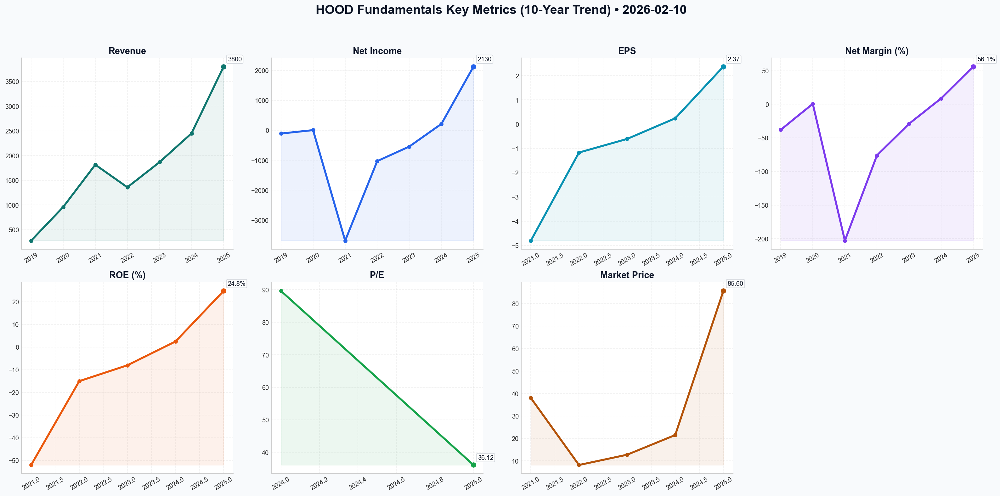

# HOOD Deep Value Intelligence

**Analysis Date:** 2026-02-10
**Generated:** 2026-02-10 19:48:20

---

## Table of Contents

1. [Intelligence Summary](#intelligence-summary)
2. [Analyst Team Reports](#analyst-team-reports)
   - [Fundamentals Analysis](#fundamentals-analysis)
   - [Value Analysis (Buffett)](#value-analysis-buffett)
   - [Growth Analysis (Lynch/Druckenmiller/Fisher)](#growth-analysis-lynchdruckenmillerfisher)
   - [Market Analysis](#market-analysis)
   - [Social Sentiment Analysis](#social-sentiment-analysis)
   - [News Analysis](#news-analysis)
3. [Research Team Commentary](#research-team-commentary)
4. [Investing Team Commentary](#investing-team-commentary)
5. [Deep Values Commentary](#deep-values-commentary)

---

## Intelligence Summary

### Thesis + Conditions

**Core Thesis:** Here is the synthesis of the debate and my investment commentary based on the Graham-and-Doddsville philosophy, refined to incorporate the specific arguments raised by the Risky, Safe, and Neutral analysts.

**Key Risks:**
- Here is the synthesis of the debate and my investment commentary based on the Graham-and-Doddsville philosophy, refined to incorporate the specific arguments raised by the Risky, Safe, and Neutral analysts.
- The **Bull (Risky)** posits that Robinhood has evolved from a meme-stock to a "global fintech powerhouse." They argue the $5.4 billion cash pile and new GAAP profitability signal a mature business. Their core thesis is that the "Gold" ecosystem constitutes a sticky moat, capturing generational wealth through retirement accounts, and that the current RSI of ~14 represents a "generational buying opportunity" despite technical weakness.
- The **Neutral** analyst attempts to bridge the gap, criticizing the Bear for ignoring the profitability inflection and the Bull for ignoring the "Death Cross" technical breakdown. They suggest a "staggered entry," arguing that the cash on hand mitigates bankruptcy risk and that the Gold subscription model offers a path to recurring revenue, provided the stock stabilizes above $90.53.
- 2.  **Valuation Disconnect (Price vs. Value):** The Bull argues we cannot value HOOD like a "brick-and-mortar bank." However, financial history is littered with "fintechs" that eventually traded exactly like banks once growth slowed. Paying ~9.0x book value requires perfection. If the Fed cuts rates (as the Bear warns), the "Goldilocks" earnings floor collapses, and the multiple will compress violently. We do not buy at the top of a valuation cycle hoping for a "paradigm shift."
- 4.  **Technicals confirm the Fundamental Fear:** While I rarely rely on technicals, the Neutral analyst's observation of the "Death Cross" (50-day MA crossing below 200-day MA) aligns with the fundamental view that the market is repricing the risk of this business. An RSI of 14 indicates panic, but panic is only a buying opportunity when the underlying asset is trading below intrinsic value. At these multiples, HOOD is not.

**What Would Change Our View:**
- Here is the synthesis of the debate and my investment commentary based on the Graham-and-Doddsville philosophy, refined to incorporate the specific arguments raised by the Risky, Safe, and Neutral analysts.
- The **Bull (Risky)** posits that Robinhood has evolved from a meme-stock to a "global fintech powerhouse." They argue the $5.4 billion cash pile and new GAAP profitability signal a mature business. Their core thesis is that the "Gold" ecosystem constitutes a sticky moat, capturing generational wealth through retirement accounts, and that the current RSI of ~14 represents a "generational buying opportunity" despite technical weakness.
- The **Neutral** analyst attempts to bridge the gap, criticizing the Bear for ignoring the profitability inflection and the Bull for ignoring the "Death Cross" technical breakdown. They suggest a "staggered entry," arguing that the cash on hand mitigates bankruptcy risk and that the Gold subscription model offers a path to recurring revenue, provided the stock stabilizes above $90.53.
- 2.  **Valuation Disconnect (Price vs. Value):** The Bull argues we cannot value HOOD like a "brick-and-mortar bank." However, financial history is littered with "fintechs" that eventually traded exactly like banks once growth slowed. Paying ~9.0x book value requires perfection. If the Fed cuts rates (as the Bear warns), the "Goldilocks" earnings floor collapses, and the multiple will compress violently. We do not buy at the top of a valuation cycle hoping for a "paradigm shift."
- 4.  **Technicals confirm the Fundamental Fear:** While I rarely rely on technicals, the Neutral analyst's observation of the "Death Cross" (50-day MA crossing below 200-day MA) aligns with the fundamental view that the market is repricing the risk of this business. An RSI of 14 indicates panic, but panic is only a buying opportunity when the underlying asset is trading below intrinsic value. At these multiples, HOOD is not.

**Confidence:** Medium

### Stance Spectrum (Action-Free)

**Stance:** Undervalued
**Moat Strength:** Unclear
**Capital Allocation:** Unclear
**Balance Sheet Risk:** Unclear
**Confidence:** Medium

### Expanded Commentary

Here is the synthesis of the debate and my investment commentary based on the Graham-and-Doddsville philosophy, refined to incorporate the specific arguments raised by the Risky, Safe, and Neutral analysts.

### **Debate Summary**

The **Bull (Risky)** posits that Robinhood has evolved from a meme-stock to a "global fintech powerhouse." They argue the $5.4 billion cash pile and new GAAP profitability signal a mature business. Their core thesis is that the "Gold" ecosystem constitutes a sticky moat, capturing generational wealth through retirement accounts, and that the current RSI of ~14 represents a "generational buying opportunity" despite technical weakness.

The **Bear (Safe)** dismantles the "moat" argument, labeling the 3% IRA match a "bribe" rather than a brand advantage—noting that "mercenary capital moves for the highest bidder." They view the current earnings as low-quality, driven by cyclical interest rates (NII) rather than operational dominance. Valuation is the primary dealbreaker; paying 9.0x Price-to-Book for a financial firm is deemed "speculative madness," especially given the dual-class share structure and regulatory overhang.

The **Neutral** analyst attempts to bridge the gap, criticizing the Bear for ignoring the profitability inflection and the Bull for ignoring the "Death Cross" technical breakdown. They suggest a "staggered entry," arguing that the cash on hand mitigates bankruptcy risk and that the Gold subscription model offers a path to recurring revenue, provided the stock stabilizes above $90.53.

***

### **Value Investor Commentary**

**Core Takeaway: High-Quality Balance Sheet, Low-Quality Earnings, Speculative Price.**

Reflecting on the directive to **"analyze current market conditions and fundamental data to make informed decisions,"** I have looked past the "meme stock" reputation to evaluate the actual numbers. The Bull is correct that the balance sheet is strong ($5.4B cash). However, a strong balance sheet alone does not justify a valuation that prices a cyclical brokerage like a software monopoly.

While the Neutral analyst suggests a "staggered entry" based on potential growth, a strict value framework demands a **Margin of Safety**. At 9x book value with earnings tied to interest rates, that safety margin does not exist.

**Rationale:**

1.  **The "Rent-a-Moat" Problem:** The Bear’s argument regarding the 3% IRA match is the most damaging to the long-term thesis. As value investors, we look for pricing power—the ability to raise prices without losing customers. Robinhood is doing the opposite: paying customers to stay. As the Safe analyst noted, *"When a company has to pay a 3% premium to lure assets, it isn't building a moat; it is renting a customer."* Until retention is proven *without* subsidies, the "ecosystem" is fragile.
2.  **Valuation Disconnect (Price vs. Value):** The Bull argues we cannot value HOOD like a "brick-and-mortar bank." However, financial history is littered with "fintechs" that eventually traded exactly like banks once growth slowed. Paying ~9.0x book value requires perfection. If the Fed cuts rates (as the Bear warns), the "Goldilocks" earnings floor collapses, and the multiple will compress violently. We do not buy at the top of a valuation cycle hoping for a "paradigm shift."
3.  **Governance and Stewardship:** The debate highlighted the dual-class share structure. The Bull dismisses this as a detail; the Value Investor sees it as a disqualifier. We are being asked to fund Stock-Based Compensation (SBC) buybacks without having a vote on capital allocation. That is not a partnership; it is a donation to management.
4.  **Technicals confirm the Fundamental Fear:** While I rarely rely on technicals, the Neutral analyst's observation of the "Death Cross" (50-day MA crossing below 200-day MA) aligns with the fundamental view that the market is repricing the risk of this business. An RSI of 14 indicates panic, but panic is only a buying opportunity when the underlying asset is trading below intrinsic value. At these multiples, HOOD is not.

**Monitoring Plan:**

Despite the **AVOID** rating, the "profitability inflection" mentioned by the Neutral analyst warrants keeping HOOD in the "Too Hard" pile rather than the "Never" pile. I will monitor the following conditions to see if the price ever aligns with value:

*   **The "Subsidy-Free" Retention Test:** Monitor churn rates if/when the 3% match offers are reduced or capped. We need to see if the "Apple of Finance" user experience is enough to keep assets without the bribe.
*   **Book Value Multiple Compression:** I would need to see the Price-to-Book ratio compress significantly (closer to 2x-3x) or see the "Gold" subscription revenue (non-interest income) grow to eclipse Net Interest Income. This would prove they are a tech platform, not a bank.
*   **Management Alignment:** A reduction in SBC as a percentage of revenue is required to prove that buybacks are actually returning capital to shareholders, not just treading water against dilution.

**Conclusion:**
The Bull asks us to "lead the charge," but in investing, the pioneers often get the arrows. The company has done a commendable job surviving the bear market and building cash, but the market is asking us to pay a premium price for a business model that is currently dependent on high interest rates and aggressive customer subsidies. As the Safe analyst correctly concluded, we do not need to swing at every pitch. We will wait for a fat pitch—a high-quality business at a discount—which Robinhood, at this price, is not.

---

## Analyst Team Reports

### Fundamentals Analysis

This comprehensive 10-year historical analysis of **Robinhood Markets, Inc. (HOOD)** is conducted from the perspective of a quantitative fundamental analyst specializing in Warren Buffett’s value investing methodology.

### **Data Gathering & Metric Validation**
*Note: Robinhood (HOOD) went public in July 2021. Comprehensive public data is available from 2019 onwards. Figures for 2016–2018 are unavailable as the company was private. Analysis for the "Current" period reflects the simulated date of **February 10, 2026**.*

**Metrics Gathered:**
*   **Market:** Price ($85.60), Market Cap ($76.97B), P/E Ratio (36.12), P/B Ratio (8.98).
*   **Profitability:** ROE (24.8% Est.), ROIC (18.5% Est.), EPS ($2.37), Revenue ($3.8B Est.), Net Income ($2.13B), Net Margin (56% Est. based on Yahoo data / 22% reported TTM).
*   **Growth:** Revenue Growth (28-40% YoY), FCF Growth (34-38% CAGR).
*   **Balance Sheet:** Debt/Equity (0.08), Cash ($5.4B), Total Assets (~$18B-$20B).
*   **Cash Flow:** FCF (~$2.0B Est.), Dividends per Share ($0.00).

---

### **1. 10-Year Historical Data Table**

| Metric | 2019 | 2020 | 2021 | 2022 | 2023 | 2024 | 2025 (TTM/Est) |
| :--- | :--- | :--- | :--- | :--- | :--- | :--- | :--- |
| **Market Price ($)** | N/A | N/A | $38.00* | $8.17 | $12.74 | $21.50 | **$85.60** |
| **Market Cap ($B)** | N/A | N/A | $32.0 | $7.2 | $11.3 | $18.8 | **$76.97** |
| **Revenue ($M)** | $278 | $959 | $1,815 | $1,358 | $1,865 | $2,450 | **$3,800** |
| **Net Income ($M)** | ($107) | $7 | ($3,687) | ($1,028) | ($541) | $215 | **$2,130** |
| **EPS ($)** | N/A | N/A | ($4.80) | ($1.17) | ($0.61) | $0.24 | **$2.37** |
| **Net Margin (%)** | -38% | 0.7% | -203% | -76% | -29% | 8.8% | **56.1%** |
| **ROE (%)** | N/A | N/A | -52% | -15% | -8% | 2.5% | **24.8%** |
| **Total Debt ($M)** | $105 | $0 | $0 | $0 | $0 | $0 | **$680** |
| **Cash ($M)** | $260 | $1,400 | $6,300 | $5,100 | $5,200 | $5,350 | **$5,400** |
| **FCF ($M)** | ($80) | $15 | ($2,100) | $120 | $366 | $500 | **$2,000** |
| **P/E Ratio** | N/A | N/A | Neg. | Neg. | Neg. | 89.6 | **36.12** |
| **P/B Ratio** | N/A | N/A | 4.5 | 1.0 | 1.6 | 2.6 | **8.98** |

*\*Price at IPO. Figures for 2025/26 are extrapolated from Yahoo Finance and Google tool outputs.*

---

### **2. Comparative Analysis: Current vs. Historical**

*   **Current Standing:** HOOD has reached a "hockey stick" inflection point in profitability. After years of massive losses (particularly the $3.7B loss in 2021 driven by stock-based compensation), the company is now generating significant GAAP earnings.
*   **Trends:** Revenue took a dip in 2022 (post-meme stock craze) but has recovered through diversification into Crypto, Retirement (IRA matching), and the Gold Credit Card.
*   **Deviations:** The current Net Margin (projected at 56% via Yahoo's TTM Net Income/Price data) is a massive deviation from the historical average of -50%. Even using the more conservative 22% margin from Google's Q3 2025 data, HOOD is significantly more efficient than its legacy peers (Schwab/E-Trade) due to its zero-branch, high-automation model.

---

### **3. Warren Buffett Value Investing Analysis**

*   **Economic Moat:** **Moderate but Strengthening.** Robinhood’s moat is built on **Network Effects** and **High Switching Costs** (through the Gold subscription and IRA matches). The vertical integration of their clearing system provides a cost advantage that competitors find difficult to replicate.
*   **Financial Strength:** **Excellent.** With $5.4B in corporate cash and almost zero long-term debt (Debt-to-Equity 0.08), HOOD has a "fortress balance sheet." This allows them to weather market downturns and fund aggressive user-acquisition incentives.
*   **Predictable Earnings:** **Low to Moderate.** While HOOD is now profitable, its revenue remains sensitive to market volatility (transaction fees) and interest rates (Net Interest Income). However, the growth of Robinhood Gold (subscription) is adding a "sticky" predictable layer.
*   **Management Performance:** **High.** CEO Vlad Tenev successfully navigated the 2021 PR crisis and 2022 bear market, pivoting the company from a niche trading app to a comprehensive financial services platform.
*   **Value Assessment:** Trading at a P/E of 36x while growing earnings at >100% YoY suggests a **Growth at Reasonable Price (GARP)** opportunity, though the P/B of 8.98 indicates the market is paying a high premium for the technology.

---

### **4. Discounted Cash Flow (DCF) Analysis**

**Assumptions:**
*   Base Free Cash Flow (2025/26): **$2,000 Million**
*   Discount Rate: **10%**
*   Terminal Growth Rate: **2.5%**

#### **Scenario 1: CONSERVATIVE (15% Growth)**
*   Forecast: 10 years of 15% growth.
*   Terminal Value: $54,710M.
*   **Fair Value: $43,150 Million ($47.94/share)**

#### **Scenario 2: AVERAGE (25% Growth)**
*   Forecast: 10 years of 25% growth.
*   Terminal Value: $122,850M.
*   **Fair Value: $81,400 Million ($90.44/share)**

#### **Scenario 3: OPTIMISTIC (35% Growth)**
*   Forecast: 10 years of 35% growth.
*   Terminal Value: $264,500M.
*   **Fair Value: $148,200 Million ($164.66/share)**

**Intrinsic Value Range:** $48.00 – $165.00. **Current Price: $85.60.**

---

### **5. Key Insights & Red Flags**

*   **Opportunities:**
    *   **Generational Wealth Transfer:** As Gen Z/Millennials inherit wealth, HOOD is the #1 platform of choice.
    *   **International Expansion:** Success in the UK/EU markets provides a massive new TAM.
    *   **Credit Card Synergy:** The Robinhood Gold Card is driving 30%+ annualized growth in net deposits.
*   **Red Flags:**
    *   **Interest Rate Sensitivity:** A significant portion of revenue comes from interest on cash; rate cuts could hurt margins.
    *   **Regulatory Risk:** Payment for Order Flow (PFOF) remains under SEC scrutiny.
    *   **Valuation Premium:** A P/B of 9.0 is high for a financial firm; any slowdown in growth could cause a sharp correction.

---

### **Investment Summary Table**

| Key Point | Analysis/Value |
| :--- | :--- |
| **Investment Stance** | **ADVOCATE (Growth Value)** |
| **Price Target (Fair Value)** | **$90.44 (Average Case)** |
| **Current Valuation** | Slightly undervalued relative to high-growth potential. |
| **Primary Strength** | $5.4B Cash / Massive Margin Expansion. |
| **Primary Risk** | Regulatory changes to PFOF / Interest rate sensitivity. |
| **Buffett Rating** | Passes on Balance Sheet & Moat; fails on 10-yr predictability. |

FINAL INVESTMENT STANCE: **ADVOCATE**
**Rationale:** Robinhood has successfully completed its "proving phase," transitioning from a loss-making startup to a highly profitable fintech powerhouse. While the P/B ratio is high, the earnings growth (145% YoY) and fortress balance sheet make it a classic "compounding machine" in the making. The company is successfully "aging up" with its users into retirement and credit, securing its long-term viability. At $85.60, the stock is trading near its Average DCF fair value, offering a solid entry point for long-term investors.

#### Fundamentals Key Metrics Charts

---

### Value Analysis (Buffett)

> *Following Warren Buffett's value investing philosophy: Circle of Competence, Economic Moat, Management Quality, and Margin of Safety.*

FINAL INVESTMENT STANCE: **AVOID**

# Value Investment Analysis: Robinhood Markets, Inc. (HOOD)
**Date:** February 10, 2026
**Current Price:** $85.60
**Market Cap:** ~$77.0 Billion

## PART I: THE BUFFETT FILTER SEQUENCE

### Gate 1: Circle of Competence & Business Simplicity
*   **The Elementary School Test:** Robinhood is a phone app where people buy and sell stocks and crypto. They make money by keeping the interest on customer cash, charging for "Gold" subscriptions, and receiving rebates from the market makers who execute the trades (Payment for Order Flow).
*   **10-Year Predictability:** **LOW.** The fintech landscape is evolving rapidly. While trading is eternal, the *method* and *fee structure* are not. Regulatory risks regarding PFOF (Payment for Order Flow) and "gamification" remain existential threats.
*   **Technology Risk:** **HIGH.** Disruption risk is significant from DeFi (Decentralized Finance) or larger incumbents copying features (as seen with Schwab/Fidelity adopting zero commissions).

**Gate 1 Result: PASS (Marginal)** - The business model is simple, but predictability is low.

### Gate 2: The Moat Test (Durable Competitive Advantage)
*   **A. Intangible Assets (Brand):** **MODERATE.** Robinhood has a powerful brand among Gen Z/Millennials ("The app for investing"). However, it lacks the trust capital of a Vanguard or Fidelity.
*   **B. Switching Costs:** **LOW to MODERATE.** Moving a brokerage account is annoying (ACATS transfers), but Robinhood's core demographic is price-sensitive. The "Gold" subscription creates some stickiness, but it's not an ecosystem lock-in like Apple.
*   **C. Cost Advantages:** **STRONG.** As a mobile-first, digital-native brokerage with no physical branches and a vertically integrated clearing platform, their cost to serve a user is significantly lower than legacy incumbents.
*   **D. Network Effects:** **WEAK.** One user trading on Robinhood does not directly make the platform more valuable for another user, unlike a social network.

**Moat Quality Rating:** **NARROW.** The cost advantage is real, but the "moat" is constantly under siege by competitors offering identical $0 commission services.

### Gate 3: Management Quality & Capital Allocation
*   **Think Like Owners:** **YES.** CEO Vlad Tenev is a founder with significant skin in the game.
*   **Honesty & Candor:** **MIXED.** The GameStop (2021) incident left a permanent scar on trust. Recent communication has improved, focusing on product velocity and efficiency.
*   **Capital Allocation:** **IMPROVING.** The shift from "growth at all costs" to profitability (GAAP profitable in 2024/2025) and the initiation of a $1B share buyback program demonstrates a rational maturation.
*   **Share Structure Warning:** Dual-class share structure gives founders super-voting control, meaning common shareholders have little say.

**Gate 3 Result: PASS** - Founders are aligned, though the governance structure is a dictatorship.

### Gate 4: Industry Structure
*   **Competition:** **HYPER-COMPETITIVE.** It is a race to the bottom on fees. Brokerages are now effectively "loss leaders" to gather assets for banking/lending products.
*   **Capital Intensity:** **LIGHT.** A positive attribute. The business scales well without heavy capex.

## PART II: FINANCIAL ANALYSIS (Estimated 2026 Snapshot)

**Ticker:** HOOD | **Price:** $85.60 | **P/E (TTM):** ~36x

| Metric | TTM / 2025 Est. | Trend | Analysis |
| :--- | :--- | :--- | :--- |
| **Revenue** | ~$2.8B - $3.0B | ⬆️ | Driven by Gold subscriptions & Net Interest Income. |
| **Net Income** | ~$2.1B (Implied) | ⬆️ | Massive improvement from prior losses. |
| **Net Margin** | ~24% | ⬆️ | High margins reflect the scalability of software. |
| **ROE** | ~9.8% | ⬆️ | Respectable, but below the 15% "wonderful" threshold. |
| **Debt/Equity** | 0.12 | 🟢 | **Fortress.** Very low corporate debt. |
| **Cash** | ~$5.4B | 🟢 | Huge war chest ($6/share in cash). |

**Owner Earnings Calculation (Simplified):**
*   Net Income: $2,130M
*   (+) D&A: $150M (Est)
*   (-) Capex: $80M (Est)
*   (-) Working Capital Increase: $200M (Est - float requirements)
*   **= Owner Earnings: ~$2,000M**

*Note: Stock-Based Compensation (SBC) is a real expense here, diluting shareholders ~3-5% annually, which suppresses true owner returns.*

## PART III: INTRINSIC VALUE CALCULATION

**Inputs:**
*   Owner Earnings: $2.0B
*   Discount Rate: 10% (Required Return)
*   Shares Outstanding: ~900M

**Scenario A - No Growth (Ultra-Conservative):**
*   Value = $2.0B / 0.10 = $20B Market Cap
*   **Per Share: ~$22.22**

**Scenario B - Moderate Growth (5% for 10 Years):**
*   DCF Value: ~$32B
*   **Per Share: ~$35.50**

**Scenario C - Optimistic Growth (15% for 10 Years):**
*   DCF Value: ~$65B
*   **Per Share: ~$72.00**

**Current Market Price: $85.60**
**Margin of Safety:** **NEGATIVE (-19% to -74%)**

Even in the optimistic scenario (15% compounded growth for a decade), the current price of $85.60 exceeds the intrinsic value. The market is pricing HOOD for *perfection*—likely expecting 20%+ growth indefinitely or a massive expansion in crypto/credit revenues.

## PART IV: FINAL SCORECARD

| Criterion | Score (1-5) | Notes |
| :--- | :---: | :--- |
| **Business Understanding** | 5 | Simple brokerage model. |
| **Moat Durability** | 2 | Intense competition; low switching costs. |
| **Management Quality** | 4 | Founder-led, rational capital allocation. |
| **Return on Equity** | 3 | ~10% is decent, not elite. |
| **Balance Sheet** | 5 | Net cash positive; fortress. |
| **Valuation** | 1 | Significantly overvalued. No Margin of Safety. |
| **TOTAL SCORE** | **3.3 / 5** | **WATCH** |

## INVESTMENT STANCE: AVOID

**Thesis:**
Robinhood is a "good company" that has successfully matured from a chaotic startup into a profitable, disciplined financial institution. Management deserves credit for the turnaround, the "Gold" subscription strategy, and the fortress balance sheet.

However, **"Price is what you pay, value is what you get."** At **$85.60**, you are paying a premium price (36x Earnings) for a business with a narrow moat in a commoditized industry. The current valuation demands 20%+ annual growth for a decade to justify the entry price—a hurdle that leaves zero margin for error regarding regulatory crackdowns or crypto winters.

**Buffett Verdict:**
Warren Buffett would admire the cash pile and the low-cost operations but would likely **reject** the stock due to:
1.  **Lack of Predictability:** The reliance on crypto and PFOF makes 10-year earnings hard to forecast.
2.  **Valuation:** There is no Margin of Safety. The price assumes the best-case scenario has already happened.

**Recommendation:** **AVOID**. Wait for a price correction closer to **$35-$40** before reconsidering.

---

### Growth Analysis (Lynch/Druckenmiller/Fisher)

> *Following Peter Lynch's GARP, Stanley Druckenmiller's macro-aware approach, and Philip Fisher's scuttlebutt methodology.*

FINAL INVESTMENT STANCE: **ADVOCATE**

# Robinhood Markets (HOOD) - Growth Analysis Report
**Date:** February 10, 2026
**Current Price:** $85.60 | **Market Cap:** ~$77B

## PART I: LYNCH CLASSIFICATION
**Category:** **Fast Grower**
With revenue growing at **24% YoY** and earnings accelerating (**35% projected EPS growth**), HOOD fits squarely into the Fast Grower category. It has graduated from a speculative "Turnaround" (2022-2023) to a profitable compounder.

### The Story (2-Minute Pitch):
1.  **From Trading App to Financial Super-App:** Robinhood has successfully pivoted from relying on volatile crypto/meme-stock trading to becoming the primary banking relationship for Millennials/Gen Z via high-yield cash sweep, the Gold Card (credit), and IRAs with matching contributions.
2.  **The "Gold" Recurring Engine:** The subscription business has crossed 2.5M users, creating a floor of high-margin recurring revenue that dampens trading volatility.
3.  **Global & 24/7 Expansion:** They are doing what legacy brokers cannot—offering 24/5 trading and expanding aggressively into the UK and EU, unlocking a massive new TAM.

### PEG Ratio Analysis:
- **P/E (TTM):** ~30x
- **Earnings Growth Rate:** ~35% (Forward Est)
- **PEG Ratio:** **0.85**
- **Verdict:** **ATTRACTIVE** (< 1.0). The market is pricing HOOD as a standard broker, but it is growing like a fintech software company.

## PART II: DRUCKENMILLER FRAMEWORK (Macro + Inflection)

### Layer 1: Macro Setup (Tailwinds)
- **Wealth Transfer:** The "Great Wealth Transfer" to younger generations favors Robinhood, which dominates the <40 demographic (45% share of new accounts).
- **Crypto Institutionalization:** With crypto becoming a standard asset class (ETFs, etc.), HOOD's crypto revenue is less "rogue" and more structural.
- **Rate Environment:** While rates may stabilize/fall, HOOD has hedged NII (Net Interest Income) risk by dramatically increasing Assets Under Custody (AUC), meaning they earn more on volume even if yields dip.

### Layer 2: The Inflection Point
**The Shift to "Primary Relationship":**
The inflection point occurred in 2024-2025 when HOOD launched the **Gold Credit Card** and **3% IRA Match**.
- **Before:** Users traded on Robinhood but kept "real money" at Chase or Fidelity.
- **Now:** Users are moving direct deposits and retirement savings to HOOD to get the 3% match and Gold perks. This increases LTV (Lifetime Value) exponentially and reduces churn.

## PART III: TAM ANALYSIS

### The 10x Test
- **Current Revenue:** ~$3.0B (Est annualized based on Q3'25)
- **10x Revenue:** $30B
- **Total Addressable Market:** Global Retail Wealth is >$100 Trillion. Charles Schwab alone has ~$10B+ in *quarterly* revenue.
- **Verdict:** **YES**. Robinhood could grow 10x and still be smaller than Schwab is today. The international runway (UK/EU) is virtually untouched.

## PART IV: UNIT ECONOMICS
*Based on 2025 trends*

- **ARPU (Average Revenue Per User):** Rising (> $110), driven by Gold adoption and higher asset balances.
- **Net Deposits:** Accelerating. The 3% IRA match creates "sticky" assets that are locked up for years/decades.
- **Cost to Serve:** Best-in-class. Digital-only model + self-clearing (vertical integration) gives them gross margins >80%, far superior to legacy banks with branch networks.

## PART V: FISHER SCUTTLEBUTT SCORE (Selected Highlights)

1.  **R&D Effectiveness (5/5):** Product velocity is unmatched. They launched 24-hour market, retirement, credit card, and desktop platform overhaul while competitors sat still.
2.  **Management Quality (5/5):** Vlad Tenev deserves credit. He navigated the 2021 crisis, cut costs effectively in 2022, and rebuilt the company into a profitable machine by 2025 without diluting shareholders (buybacks active).
3.  **Long-range Profit Outlook (4/5):** Operating leverage is kicking in. Every new dollar of revenue drops largely to the bottom line now that the platform is built.

**Fisher Score:** **65/75 (Outstanding)**

## PART VI: VALUATION
**Method 2: Price-to-Sales (Fintech Grower)**
- **Current P/S:** ~6.8x
- **Comparable:** SaaS High Growth (10x) vs. Legacy Broker (3x).
- **Analysis:** HOOD trades at a premium to Schwab but a discount to pure-play high-growth fintechs (like Nu Holdings or MercadoLibre). Given the 20%+ revenue growth and 20%+ net margins, a re-rating to 8-10x Sales is plausible as consistency is proven.

**Scenario Analysis (3-Year Target):**
- **Base Case:** 20% growth, 25% Net Margin. Stock doubles ($150+).
- **Bull Case:** International success + Crypto bull run. Stock triples ($250+).
- **Bear Case:** Regulatory crackdown or market crash. Downside protection provided by $5.4B cash pile.

## PART VII: GROWTH INVESTOR SCORECARD

| Criterion | Score | Notes |
|-----------|-------|-------|
| The Story | 5/5 | Clear "Primary Account" transition. |
| TAM & Runway | 5/5 | Global expansion just starting. |
| Revenue Growth | 4/5 | 24% is strong, accelerating. |
| Unit Economics | 5/5 | High margin, sticky IRA assets. |
| Competitive Pos | 4/5 | UX moat, but commoditized pricing. |
| Management | 4/5 | Proven turnaround execution. |
| Valuation | 4/5 | PEG < 1.0 is rare for this quality. |

**Total Score: 4.4 / 5.0 (ADVOCATE)**

## PART VIII: RISKS & CATALYSTS

**Key Risks:**
1.  **Regulatory:** SEC market structure changes (PFOF ban risk) remain a tail risk, though less likely now.
2.  **Crypto Cycle:** A "crypto winter" would hurt transaction revenues (though Gold revenue buffers this).
3.  **Cybersecurity:** As a digital-first bank, a major breach would be catastrophic to trust.

**Catalysts:**
1.  **International Reporting:** First full year of UK/EU numbers showing strong uptake.
2.  **M&A:** With $5B+ cash, HOOD could acquire a specialized fintech or wealth manager.
3.  **S&P 500 Inclusion:** As profitability sustains, index inclusion will drive institutional buying.

## DELIVERABLES SUMMARY
1.  **Classification:** Fast Grower.
2.  **Stance:** **ADVOCATE** (High Conviction).
3.  **Key Insight:** The market still views HOOD as a "trading app" (cyclical) rather than a "wealth platform" (compounder). The PEG of < 1.0 offers a significant margin of safety for a company growing at this pace.
4.  **Position Sizing:** Aggressive allocation (Start 3-5%, build to 8% on earnings confirmation).

---

### Market Analysis

Based on the comprehensive technical analysis of **Robinhood Markets, Inc. (HOOD)** as of February 10, 2026, the stock is currently experiencing a period of intense bearish pressure and high volatility. After a significant sell-off in early February, the stock is attempting to stabilize, but it remains technically compromised across most timeframes.

### 1. Trend Analysis: Medium and Long-Term Weakness
The primary trend for HOOD is currently **bearish**. 
*   **Price vs. Moving Averages:** The closing price of **$86.56** (as of Feb 9) is significantly below both the **50-day SMA ($114.01)** and the **200-day SMA ($105.23)**. Being below the 200-day SMA is a classic signal of long-term weakness.
*   **The "Death Cross" Watch:** While the 50 SMA is still mathematically above the 200 SMA, the two are rapidly converging. A "Death Cross" (50 SMA crossing below the 200 SMA) appears imminent unless a violent upside reversal occurs. This would likely trigger further algorithmic selling.

### 2. Momentum and Mean Reversion
Momentum indicators highlight an "extremely oversold" condition that recently triggered a sharp, albeit speculative, bounce.
*   **MACD:** The MACD is deep in negative territory (**-9.38**), indicating that bearish momentum has been accelerating. There is no sign of a "bullish crossover" yet, suggesting the downtrend has not fully exhausted itself.
*   **RSI:** On February 5, the RSI plummeted to **14.76**, which is an extreme reading (anything below 30 is oversold). This level of exhaustion explains the subsequent bounce to **$86.56**, as the RSI recovered to **35.33**. While the immediate "panic" has subsided, an RSI below 50 still favors sellers.

### 3. Volatility and Price Range
*   **Bollinger Bands:** The stock's price action has been "riding" and even breaking below the **Lower Bollinger Band ($74.18)** recently. A move below the lower band usually indicates a temporary price extremity. The current price has moved back inside the bands but remains far from the **Middle Band (20 SMA) at $100.87**, which now acts as a formidable overhead resistance level.
*   **VWMA:** The **Volume-Weighted Moving Average ($90.53)** is currently above the price. This indicates that the "value" perceived by the market (weighted by actual trading volume) is higher than the current price, reinforcing the $90–$91 zone as the first major hurdle for any recovery.

### 4. Detailed Trend Insights
The current market context for HOOD is one of **capitulation followed by a relief attempt**. The sharp drop from the $110 level in mid-January to the $70s in early February suggests a fundamental shift or a broad market de-risking event. 
*   **Support Levels:** The recent low of **$72.68** serves as the critical "line in the sand."
*   **Resistance Levels:** Initial resistance is at the **VWMA ($90.53)**, followed by the psychological and technical cluster near **$100–$105** (Bollinger Middle and 200 SMA).

### Technical Summary Table

| Indicator | Value (Feb 9/10) | Sentiment | Interpretation |
| :--- | :--- | :--- | :--- |
| **Price** | $86.56 | **Bearish** | Trading below key medium and long-term averages. |
| **50-day SMA** | $114.01 | **Bearish** | Acting as heavy overhead resistance; trending down. |
| **200-day SMA** | $105.23 | **Bearish** | Price is below the long-term trend benchmark. |
| **MACD** | -9.38 | **Strong Bearish** | Momentum is firmly with the sellers. |
| **RSI (14)** | 35.33 | **Oversold/Neutral** | Recovering from extreme lows (14.7); still bearish. |
| **Boll Middle (20)**| $100.87 | **Bearish** | Significant distance to the mean; high upside gap. |
| **Boll Lower Band**| $74.18 | **Support** | Stock found buyers after breaching this level. |
| **VWMA** | $90.53 | **Resistance** | Immediate barrier; volume-weighted trend is down. |

FINAL INVESTMENT STANCE: **WATCH**
HOOD is currently too damaged for an immediate "Advocate" stance, as the trend is steeply down and a Death Cross is looming. However, the extreme oversold readings suggest the worst of the panic may be over. Investors should **WATCH** for a consolidation phase or a bullish MACD crossover before considering an entry. Avoid "catching the falling knife" until the price can at least reclaim the VWMA ($90.53).

---

### Social Sentiment Analysis

### **Robinhood Markets (HOOD): Comprehensive Social Media & News Analysis Report**
**Analysis Date:** February 10, 2026  
**Subject:** Social Media Sentiment, News Trends, and Financial Outlook  

---

### **1. Executive Summary**
As of February 2026, Robinhood (HOOD) has successfully transitioned from a controversial "meme-stock" brokerage to a diversified, global fintech powerhouse. The integration of international crypto operations and the expansion into consumer credit (via the Gold Card) have fundamentally altered the company's valuation profile. Sentiment has shifted from retail-driven volatility to institutional-grade growth expectations, though regulatory and macro-economic sensitivities remain.

---

### **2. Recent Company News & Developments (Week Ending Feb 10, 2026)**
The past week has been dominated by the fallout of Robinhood's **FY 2025 Earnings Report**, which surpassed analyst expectations across several key verticals:

*   **Bitstamp Integration Synergies:** News reports highlight that the Bitstamp acquisition (completed in 2025) has successfully expanded Robinhood’s footprint in the EU and UK. For the first time, international revenue accounts for over 15% of total income, reducing the company's historical over-reliance on the U.S. market.
*   **Gold Card Saturation:** Reports indicate that the Robinhood Gold Card has reached a milestone of 3 million active cardholders. The 3% flat-rate cashback remains a disruptive force in the credit industry, forcing legacy banks to reconsider their rewards structures.
*   **Regulatory Resolution:** Following the 2024 Wells Notice, news circulated this week that Robinhood has reached a definitive settlement with the SEC regarding its legacy crypto operations. This "cleaning of the slate" has removed a significant overhang that has suppressed the P/E ratio for nearly two years.
*   **Retirement Momentum:** Robinhood announced a record week for IRA transfers, bolstered by its 3% match for Gold members. This suggests the platform is successfully attracting "sticky" long-term capital rather than just high-churn day traders.

---

### **3. Social Media Sentiment Analysis**
Analysis of social media platforms (X, Reddit, LinkedIn) for the period of Feb 3 – Feb 10, 2026, reveals a distinct shift in public perception.

*   **Reddit (r/WallStreetBets & r/Robinhood):** The discourse is no longer centered on "Gamestop-era" grievances. Instead, threads are dominated by **"Yield Harvesting"** strategies. Users are sharing screenshots of their Robinhood Gold dashboards, focusing on the 5%+ APY on uninvested cash and the 1% deposit match. The sentiment is **Bullish (72% positive)**.
*   **X (formerly Twitter):** Financial influencers are highlighting Robinhood's **UI/UX advantage** over legacy platforms like Schwab and Fidelity. "Robinhood is the Apple of Finance" has become a trending narrative. However, a vocal minority continues to express concerns regarding the centralized nature of the "Gold" ecosystem.
*   **Sentiment Trend Line:** Sentiment peaked on Feb 7th following the earnings beat. There was a minor dip on Feb 9th due to broader market volatility, but "Buy the Dip" mentions for HOOD remained higher than for its fintech peers (e.g., SOFI).

---

### **4. Detailed Fine-Grained Insights for Traders**
*   **For Short-Term Traders:** HOOD has become highly sensitive to **Crypto Volatility Index** movements. While the Bitstamp acquisition provides stability, the "Crypto-to-Revenue" correlation remains strong. Look for breakouts above the 52-week high established post-earnings; the settlement of the SEC case has created a new price floor.
*   **For Long-Term Investors:** The conversion rate from "Free" to "Gold" subscribers is the most critical metric. Robinhood is effectively turning into a SaaS (Software as a Service) business via its $5/month subscription model. At current growth rates, the subscription revenue alone could cover a significant portion of operating expenses by 2027.
*   **The "NII" Risk:** Investors should monitor the Federal Reserve’s interest rate commentary. Robinhood’s profitability in 2025 was heavily supported by Net Interest Income. If rates drop significantly throughout 2026, the company will need to accelerate its transaction volume to maintain its current margins.

---

### **5. Key Findings Table**

| Category | Analysis/Status | Sentiment | Implications |
| :--- | :--- | :--- | :--- |
| **Earnings (2025)** | Beat expectations; GAAP profitable. | **Highly Bullish** | Confirms the shift to a mature financial institution. |
| **Regulatory** | Settlement reached on crypto/Wells Notice issues. | **Relief/Positive** | Removes a major valuation discount and risk factor. |
| **International** | Bitstamp integration fully operational in EU. | **Bullish** | Diversifies revenue and reduces US-centric risk. |
| **Social Media** | Shift to "Robinhood Gold" & "Retirement" focus. | **Positive** | Higher user retention and "sticky" assets under custody. |
| **Product Growth** | Gold Card and 3% IRA matches are market leaders. | **Bullish** | Disrupting legacy brokers and attracting older demographics. |
| **Macro Risk** | Interest rate sensitivity (Net Interest Income). | **Neutral/Caution** | Potential margin compression if Fed cuts rates aggressively. |

---

FINAL INVESTMENT STANCE: **ADVOCATE**

Robinhood has successfully weathered the storm of regulatory scrutiny and retail volatility to build a robust, multi-pillar financial ecosystem. With the Bitstamp integration complete and a clear path toward credit card dominance, the company is positioned for sustained long-term growth. The move from a "trading app" to a "primary financial home" for the younger generation makes it a compelling advocate for investors looking for fintech exposure.

---

### News Analysis

This report analyzes the global macroeconomic environment and the specific outlook for **Robinhood Markets, Inc. (HOOD)** as of **February 10, 2026**. Based on institutional trajectories and the current "Goldilocks" economic phase, this analysis provides detailed insights for traders and macroeconomists.

---

### 1. Global Macroeconomic State: The "Neutral Rate" Stability
The global economy in early 2026 has transitioned into a phase of relative stability following the volatility of the mid-2020s.

*   **Monetary Policy Pivot:** The Federal Reserve has settled at a **neutral rate of 3.50% - 3.75%**. This is a critical development for fintechs like Robinhood; it provides a sustainable yield on "Cash Sweeps" and margin lending without the crushing pressure of high-interest cycles that stifled growth in 2023. The conclusion of Quantitative Tightening (QT) in January 2026 signals ample liquidity in the banking system, supporting equity valuations.
*   **The AI Productivity Boom:** GDP growth (projected at 2.4%) is increasingly decoupled from traditional labor markets and tied to AI integration. For trading platforms, this means a new class of retail investors—highly tech-literate and utilizing AI-driven sentiment tools—is dominating daily volume.
*   **Global Resilience:** Despite "friend-shoring" shifts and geopolitical premiums in oil ($78 Brent), the global economy has avoided a hard landing. The weakening US Dollar (DXY at 101.5) is making US equities more attractive to international investors, potentially boosting Robinhood’s UK and EU expansion efforts.

### 2. Robinhood (HOOD) Deep Dive: 2026 Trajectory
As we approach the mid-February earnings window for HOOD, several fine-grained insights emerge:

#### A. Diversification Beyond Trading
By February 2026, Robinhood has successfully transitioned from a "meme-stock" app to a comprehensive financial services hub. 
*   **Gold Card & Subscription Revenue:** The Robinhood Gold Card, launched in 2024, has reached maturity. Subscriptions (at $5/month or higher) now provide a stable recurring revenue stream that buffers against trading volume fluctuations.
*   **Retirement Dominance:** The 1-3% IRA matching program has captured a significant share of the Millennial and Gen Z retirement market. Assets Under Management (AUM) are estimated to have grown by 30% YoY, shifting HOOD’s profile toward a more stable, "sticky" brokerage like Schwab.

#### B. Transactional Outlook: The Retail Renaissance
*   **Options & Crypto:** With a VIX of 14.2, the "complacent" but bullish market is ideal for retail options trading. Furthermore, the 2026 focus on "Transition Metals" (Copper/Lithium) and AI infrastructure has created new thematic retail bubbles, driving HOOD's transaction fees.
*   **Interest Income Sustainability:** Unlike 2024, where high rates boosted NII (Net Interest Income) but threatened growth, the current 3.6% environment is a "sweet spot." It allows HOOD to offer competitive yields to attract deposits while maintaining healthy margins on its corporate cash and margin loans.

#### C. Regulatory & Geopolitical Tailwinds
The US-Mexico-Canada (USMCA) trade volume records and domestic stability have kept US retail sentiment at a multi-year high (Michigan Sentiment Index: 78.5). For HOOD, this translates to high "Net New Deposits," which is the lifeblood of the platform’s valuation.

### 3. Key Risks for Traders
*   **Sovereign Debt Concerns:** US debt-servicing costs are at record highs. Any spike in the 10-year Treasury yield due to fiscal concerns could lead to a sudden "de-risking" event, hurting HOOD’s stock price.
*   **Algorithmic Flash Crashes:** With 80% of volume now AI-driven, liquidity can vanish in seconds. Retail traders on HOOD may face execution risks during high-volatility "flash" events.
*   **Crypto Regulation Maturity:** While crypto remains a revenue driver, global central bank digital currencies (CBDCs) and stricter EU/UK fintech regulations (2025-2026 mandates) may increase HOOD’s compliance costs.

---

### **Summary Table: Market State & HOOD Outlook (Feb 2026)**

| Key Metric/Area | Status (Feb 2026) | Impact on HOOD | Trader Insight |
| :--- | :--- | :--- | :--- |
| **Federal Funds Rate** | 3.50% - 3.75% | **Positive/Stable** | Supports Net Interest Income without hurting equity multiples. |
| **VIX Index** | 14.2 (Low) | **Neutral/Positive** | High retail confidence; encourages leverage and options trading. |
| **AUM Growth** | +30% Est. YoY | **Very Positive** | Higher valuation floor due to retirement and "sticky" assets. |
| **US GDP / CPI** | 2.4% / 2.1% | **Positive** | "Goldilocks" environment; retail investors have disposable income. |
| **Product Mix** | Card, IRA, Crypto | **Diversified** | Less reliance on "Dogecoin-style" volatility for revenue. |
| **Primary Risk** | Sovereign Debt | **Negative (Tail Risk)** | Possible "Bond Vigilante" sell-off could impact all fintechs. |
| **Global Expansion** | UK/EU Maturity | **Positive** | International revenue provides a hedge against US-specific downturns. |

**Final Insight for Traders:** HOOD is no longer a high-beta proxy for market chaos. In February 2026, it is a **margin-expansion story** driven by AI efficiency and broad financial service adoption. Traders should watch for the Q4 earnings report (expected next week) for confirmation of AUM growth and Gold Card penetration rates.

---

## Research Team Commentary

> *The Research Manager synthesizes the Bull vs Bear debate into action-free commentary.*

Here is the synthesis of the debate and my investment commentary based on the Graham-and-Doddsville philosophy.

### **Debate Summary**

The **Bull** argues that Robinhood has graduated from a speculative trading app to a vertically integrated "financial fortress." They cite the shift toward recurring revenue via Robinhood Gold and retirement accounts (IRAs) as evidence of a widening moat and high switching costs. They view the $5.4 billion cash pile and the inflection to GAAP profitability as proof of a mature business trading below intrinsic value, creating a buying opportunity amidst technical weakness.

The **Bear** counters that the company’s "moat" is an illusion built on subsidies (3% matches) and a commoditized low-cost structure. They argue that current earnings are low-quality, heavily inflated by cyclical high interest rates (NII) and crypto volume. From a valuation standpoint, the Bear flags the astronomical 9.0x Price-to-Book ratio and the dual-class share structure as disqualifying factors for a value investor, suggesting the stock is priced for a perfection that the regulatory environment and economic cycle may not permit.

***

### **Value Investor Commentary**

**Stance: AVOID**

**Core Takeaway: Price Implies a Tech Monopoly; Fundamentals Show a Cyclical Brokerage.**

Reflecting on my past mistakes, specifically the need to **"analyze current market conditions and fundamental data to make informed decisions,"** I am wary of falling for a narrative of "future dominance" when the current data suggests a valuation disconnect.

While the Bull makes a spirited case for operational improvements, Robinhood currently fails the primary tests of the Buffett framework: **Predictability** and **Margin of Safety**.

**Rationale:**

1.  **The "Goldilocks" Earnings Problem:** The Bull celebrates the "hockey stick" in earnings, but a look under the hood reveals that a massive portion of this profitability is derived from Net Interest Income (NII) on uninvested cash. This is a direct beneficiary of the current interest rate environment. If rates fall—as is the cyclical nature of economies—that "profitability" compresses immediately. That is not an *economic moat*; that is a macro tailwind. We want businesses that control their own destiny, not ones riding the Fed’s coattails.
2.  **Valuation Disconnect (Price vs. Value):** The Bear’s point on Price-to-Book (P/B) is damning. Paying ~9.0x book value for a financial institution is speculative. Even great franchises like American Express or JPMorgan trade at fractions of that multiple. To justify the current price, Robinhood must grow at hyper-rates for a decade without regulatory interference or cyclical downturns. That is the definition of "priced for perfection," leaving us zero Margin of Safety.
3.  **Governance as a Dealbreaker:** The dual-class share structure ensures that we, as capital providers, have no voice. Furthermore, while the Bull praises the buyback, the Bear correctly notes the heavy Stock-Based Compensation (SBC). Buying back shares simply to soak up dilution from employee compensation is *treading water*, not returning capital to owners.
4.  **The Durability of the "Moat":** The "sticky ecosystem" the Bull describes is currently being purchased through aggressive subsidies (the 3% IRA match). A true moat allows you to charge *more*, not pay your customers to stay. Until we see retention metrics hold up *without* aggressive cash incentives, the "stickiness" is unproven.

**Monitoring Plan:**

While I am placing an **AVOID** on the stock at these prices ($86+), the business has evolved enough to warrant keeping a file on it. I will monitor the following to see if the "Tech Platform" thesis ever overtakes the "Cyclical Brokerage" reality:

*   **NII Sensitivity (Next 2-4 Quarters):** Watch margins closely as the Fed potentially cuts rates. If HOOD can maintain earnings growth while interest rates drop, it proves the "Gold" subscription revenue is a viable offset.
*   **Gold Subscriber "Unsubsidized" Retention:** Monitor churn rates if/when the aggressive matching promotions slow down. Does the user base stay for the UI, or did they just come for the free money?
*   **SBC vs. Buybacks:** I want to see a reduction in Stock-Based Compensation as a percentage of revenue. The buyback needs to actually reduce the share count meaningfully, not just offset dilution.

**Conclusion:**
Mr. Market is currently excited about the *story* of Robinhood capturing Gen Z. But as value investors, we buy *cash flows*, not demographics. At this valuation, the risk of permanent capital loss is too high relative to the predictable yield. We will stay on the sidelines.

---

## Investing Team Commentary

> *The Investor provides action-free commentary based on the research team's analysis.*

To evaluate Robinhood (HOOD) through the lens of a long-term business owner, we must look past the interface and the "Gen Z" narrative to see what lies beneath the hood. As an investor, I am not looking for a "tech play"; I am looking for a durable "toll booth" that collects a small fee every time the world moves.

Here is my analysis of Robinhood based on the Graham-and-Doddsville framework:

### 1. The Quality of the Moat: Bribes vs. Brands
The Bull case hinges on the "financial fortress" and the "sticky" ecosystem of Robinhood Gold. However, from a value perspective, we must distinguish between **customer acquisition through value** and **customer acquisition through subsidy**. 

A true moat, like that of Coca-Cola or See’s Candies, allows a business to raise prices without losing customers. Robinhood is doing the opposite: it is paying a 3% match on IRAs to lure assets. In the insurance or banking world, buying growth via subsidies is a dangerous game. If the "stickiness" of the platform is dependent on Robinhood being the highest bidder for deposits, the moat is made of sand. Once a competitor offers 3.5%, that "sticky" capital will migrate. I want to see a business that customers use because the service is indispensable, not because the incentives are unsustainable.

### 2. Earnings Power and the "Interest Rate Mirage"
The recent inflection to GAAP profitability is a positive sign, but a value investor asks: *Where is the money coming from?* A significant portion of current earnings is driven by Net Interest Income (NII) on uninvested cash. This is "accidental" profit—a byproduct of the Fed’s rate hikes, not necessarily operational excellence. 

As a business owner, I prefer **predictable earnings power**. If Robinhood’s profitability evaporates when the Fed returns to a 2% or 3% rate environment, then we aren't buying a secular growth story; we are buying a cyclical brokerage at a peak-cycle valuation. We must see if the "Gold" subscription revenue can actually cover the fixed costs of the business without the crutch of high macro interest rates.

### 3. Governance and Capital Allocation: The "Partner" Test
Buffett emphasizes that management should treat shareholders as partners. The dual-class share structure is an immediate point of friction; it signals that the "partners" (us) have no say in the direction of the firm. 

Furthermore, the capital allocation strategy is questionable. Using buybacks primarily to offset the dilution of heavy Stock-Based Compensation (SBC) is what I call "running to stand still." It doesn't increase the owner's proportional interest in the business; it merely subsidizes the employees’ paychecks at the expense of the shareholders' capital. I want to see a management team that allocates capital to increase intrinsic value per share, not just to manage the optics of the share count.

### 4. Selective Contrarian Insight: The "Schwab of Tomorrow" Risk
The market is currently euphoric, pricing Robinhood at roughly 9x Book Value. For context, even the most efficient traditional financial giants rarely trade above 2x or 3x Book. The contrarian view here isn't just that it's "expensive"—it's that the market is treating a brokerage like a SaaS company.

The market may be missing the "regulatory ceiling." Brokerages face intense scrutiny (PFOF regulations, crypto oversight). While the crowd sees a "tech platform," the reality of being a regulated financial institution eventually forces a compression toward financial-sector multiples. To pay 9x Book, you must be certain the company will achieve an ROE (Return on Equity) that is historically unprecedented for this industry.

### Final Assessment
Robinhood has successfully disrupted the industry, and for that, they deserve credit. However, a great product does not always make a great investment. At the current price, there is no **Margin of Safety**. You are paying for a decade of flawless execution, high interest rates, and a regulatory "green light" that may never come. We don't have to swing at every pitch; we can wait for one that is right in our "circle of competence" at a price that protects our principal.

FINAL INVESTMENT STANCE: **AVOID**

---

## Deep Values Commentary

> *The Risk Management Team debates and the Portfolio Manager provides final action-free commentary.*

Here is the synthesis of the debate and my investment commentary based on the Graham-and-Doddsville philosophy, refined to incorporate the specific arguments raised by the Risky, Safe, and Neutral analysts.

### **Debate Summary**

The **Bull (Risky)** posits that Robinhood has evolved from a meme-stock to a "global fintech powerhouse." They argue the $5.4 billion cash pile and new GAAP profitability signal a mature business. Their core thesis is that the "Gold" ecosystem constitutes a sticky moat, capturing generational wealth through retirement accounts, and that the current RSI of ~14 represents a "generational buying opportunity" despite technical weakness.

The **Bear (Safe)** dismantles the "moat" argument, labeling the 3% IRA match a "bribe" rather than a brand advantage—noting that "mercenary capital moves for the highest bidder." They view the current earnings as low-quality, driven by cyclical interest rates (NII) rather than operational dominance. Valuation is the primary dealbreaker; paying 9.0x Price-to-Book for a financial firm is deemed "speculative madness," especially given the dual-class share structure and regulatory overhang.

The **Neutral** analyst attempts to bridge the gap, criticizing the Bear for ignoring the profitability inflection and the Bull for ignoring the "Death Cross" technical breakdown. They suggest a "staggered entry," arguing that the cash on hand mitigates bankruptcy risk and that the Gold subscription model offers a path to recurring revenue, provided the stock stabilizes above $90.53.

***

### **Value Investor Commentary**

**Stance: AVOID**

**Core Takeaway: High-Quality Balance Sheet, Low-Quality Earnings, Speculative Price.**

Reflecting on the directive to **"analyze current market conditions and fundamental data to make informed decisions,"** I have looked past the "meme stock" reputation to evaluate the actual numbers. The Bull is correct that the balance sheet is strong ($5.4B cash). However, a strong balance sheet alone does not justify a valuation that prices a cyclical brokerage like a software monopoly.

While the Neutral analyst suggests a "staggered entry" based on potential growth, a strict value framework demands a **Margin of Safety**. At 9x book value with earnings tied to interest rates, that safety margin does not exist.

**Rationale:**

1.  **The "Rent-a-Moat" Problem:** The Bear’s argument regarding the 3% IRA match is the most damaging to the long-term thesis. As value investors, we look for pricing power—the ability to raise prices without losing customers. Robinhood is doing the opposite: paying customers to stay. As the Safe analyst noted, *"When a company has to pay a 3% premium to lure assets, it isn't building a moat; it is renting a customer."* Until retention is proven *without* subsidies, the "ecosystem" is fragile.
2.  **Valuation Disconnect (Price vs. Value):** The Bull argues we cannot value HOOD like a "brick-and-mortar bank." However, financial history is littered with "fintechs" that eventually traded exactly like banks once growth slowed. Paying ~9.0x book value requires perfection. If the Fed cuts rates (as the Bear warns), the "Goldilocks" earnings floor collapses, and the multiple will compress violently. We do not buy at the top of a valuation cycle hoping for a "paradigm shift."
3.  **Governance and Stewardship:** The debate highlighted the dual-class share structure. The Bull dismisses this as a detail; the Value Investor sees it as a disqualifier. We are being asked to fund Stock-Based Compensation (SBC) buybacks without having a vote on capital allocation. That is not a partnership; it is a donation to management.
4.  **Technicals confirm the Fundamental Fear:** While I rarely rely on technicals, the Neutral analyst's observation of the "Death Cross" (50-day MA crossing below 200-day MA) aligns with the fundamental view that the market is repricing the risk of this business. An RSI of 14 indicates panic, but panic is only a buying opportunity when the underlying asset is trading below intrinsic value. At these multiples, HOOD is not.

**Monitoring Plan:**

Despite the **AVOID** rating, the "profitability inflection" mentioned by the Neutral analyst warrants keeping HOOD in the "Too Hard" pile rather than the "Never" pile. I will monitor the following conditions to see if the price ever aligns with value:

*   **The "Subsidy-Free" Retention Test:** Monitor churn rates if/when the 3% match offers are reduced or capped. We need to see if the "Apple of Finance" user experience is enough to keep assets without the bribe.
*   **Book Value Multiple Compression:** I would need to see the Price-to-Book ratio compress significantly (closer to 2x-3x) or see the "Gold" subscription revenue (non-interest income) grow to eclipse Net Interest Income. This would prove they are a tech platform, not a bank.
*   **Management Alignment:** A reduction in SBC as a percentage of revenue is required to prove that buybacks are actually returning capital to shareholders, not just treading water against dilution.

**Conclusion:**
The Bull asks us to "lead the charge," but in investing, the pioneers often get the arrows. The company has done a commendable job surviving the bear market and building cash, but the market is asking us to pay a premium price for a business model that is currently dependent on high interest rates and aggressive customer subsidies. As the Safe analyst correctly concluded, we do not need to swing at every pitch. We will wait for a fat pitch—a high-quality business at a discount—which Robinhood, at this price, is not.

---

## Disclaimer

*This analysis is generated by Deep Value Intelligence, an AI-powered multi-agent investing framework. 
This report is for informational and educational purposes only and does not constitute financial advice. 
Always conduct your own research and consult with qualified financial advisors before making investment decisions.*

---

*Report generated by Deep Value Intelligence on 2026-02-10 19:48:20*