# HOOD Deep Value Intelligence

**Analysis Date:** 2026-03-15

## Critical Disclaimer

*This analysis is generated by Deep Value Intelligence, an AI-powered multi-agent investing framework. This report is for informational and educational purposes only and does not constitute financial advice. Always conduct your own research and consult with qualified financial advisors before making investment decisions.*

---

## Table of Contents

1. Intelligence Summary
2. Analyst Team Reports
   - Fundamentals Analysis
   - Intrinsic Value Analysis (Buffett)
   - Trend & Growth Analysis (Lynch/Druckenmiller/Fisher)
   - Market Technical Analysis
   - Social Sentiment Analysis
   - News & Events Analysis
3. Research Team Commentary
4. Value Investing Team Commentary
5. Deep Values Commentary

---

## Intelligence Summary

### Thesis + Conditions

**Core Thesis:** **EXECUTIVE SUMMARY**
*   **Verdict:** **AVOID**. Robinhood belongs in the "too hard" pile.

**Key Risks:**
- Risky Analyst (The Narrative):** Robinhood is a "volatility monetization engine" with elite 47% operating margins and a massive distribution moat among young investors. Waiting for earnings certainty means missing asymmetric upside.
- Neutral Analyst (The Middle Ground):** Acknowledges cyclicality but notes that subscriptions (Robinhood Gold) and retirement accounts are slowly diversifying revenue. Recommends watching for earnings durability before taking a position.
- Buffett teaches us that rule number one is "never lose money," which requires a strict margin of safety and highly predictable cash flows. The debate explicitly highlights that Robinhood's recent profitability surge is heavily reliant on Net Interest Income (47% of revenue) and speculative trading. A business whose fundamental performance dictates it must ride the uncontrollable waves of interest rates and meme-stock/crypto euphoria possesses immense *market risk* masquerading as *business quality*.
- While the Risky Analyst champions the platform's "distribution moat" with young investors, the Safe Analyst correctly points out that brand familiarity is not a switching cost. Until Robinhood proves it can retain these assets as its users age and require complex advisory services-and do so in a low-interest-rate environment-its 35x multiple prices in a perfect transition that has yet to occur. We do not pay premium secular growth multiples for peak cyclical earnings.
- As value investors, we demand predictability and a strict margin of safety. Robinhood fails our framework on both fronts. The market is currently pricing this stock as if its recent massive swing into profitability is the new permanent baseline. But when you look under the hood, nearly half of its revenue is net interest income, which is highly vulnerable to rate cuts, while another large chunk relies on speculative retail trading in options and crypto. Buffett teaches us to avoid businesses where profits are dictated by uncontrollable macro variables and market speculation.

**What Would Change Our View:**
- Risky Analyst (The Narrative):** Robinhood is a "volatility monetization engine" with elite 47% operating margins and a massive distribution moat among young investors. Waiting for earnings certainty means missing asymmetric upside.
- Neutral Analyst (The Middle Ground):** Acknowledges cyclicality but notes that subscriptions (Robinhood Gold) and retirement accounts are slowly diversifying revenue. Recommends watching for earnings durability before taking a position.
- Buffett teaches us that rule number one is "never lose money," which requires a strict margin of safety and highly predictable cash flows. The debate explicitly highlights that Robinhood's recent profitability surge is heavily reliant on Net Interest Income (47% of revenue) and speculative trading. A business whose fundamental performance dictates it must ride the uncontrollable waves of interest rates and meme-stock/crypto euphoria possesses immense *market risk* masquerading as *business quality*.
- While the Risky Analyst champions the platform's "distribution moat" with young investors, the Safe Analyst correctly points out that brand familiarity is not a switching cost. Until Robinhood proves it can retain these assets as its users age and require complex advisory services-and do so in a low-interest-rate environment-its 35x multiple prices in a perfect transition that has yet to occur. We do not pay premium secular growth multiples for peak cyclical earnings.
- As value investors, we demand predictability and a strict margin of safety. Robinhood fails our framework on both fronts. The market is currently pricing this stock as if its recent massive swing into profitability is the new permanent baseline. But when you look under the hood, nearly half of its revenue is net interest income, which is highly vulnerable to rate cuts, while another large chunk relies on speculative retail trading in options and crypto. Buffett teaches us to avoid businesses where profits are dictated by uncontrollable macro variables and market speculation.

**Confidence:** Medium

---

## Analyst Team Reports

### Fundamentals Analysis

#### Latest Earnings Snapshot

*Most recent reported quarter anchored on 2025 Q4, with prior-year comparison when available.*

| Metric | 2025 Q4 | 2024 Q4 | YoY Change |
| --- | ---: | ---: | ---: |
| Revenue | $1.28B | $1.01B | +26.5% |
| Operating Income | $650.0M | $558.0M | +16.5% |
| Net Income | $605.0M | $916.0M | -34.0% |
| Diluted EPS | $0.66 | $1.01 | -34.7% |
| Operating Cash Flow | $-937.0M | $-1.40B | +33.1% |
| Free Cash Flow | $-950.0M | $-1.42B | +32.9% |

Key Takeaways: This snapshot anchors the most recent reported quarter before the narrative analysis. It helps readers separate long-run business quality from whatever changed in the latest earnings print.

#### 10-Year Financial Metrics for HOOD

*All values below are computed deterministically from raw data - not estimated by AI.*

*Issuer profile: asset manager (Financial Services / Capital Markets).*

#### 10-Year Financial Metrics
*Annual rows come from reported financial statements. The final TTM row is computed from the latest four quarters.*

| Metric | 2016 | 2017 | 2018 | 2019 | 2020 | 2021 | 2022 | 2023 | 2024 | 2025 | 2026 TTM |
| --- | --- | --- | --- | --- | --- | --- | --- | --- | --- | --- | --- |
| Market Price | N/A | N/A | N/A | N/A | N/A | $18 | $8 | $13 | $37 | $113 | $73 |
| Market Cap | N/A | N/A | N/A | N/A | N/A | $8.74B | $7.15B | $11.35B | $33.76B | $103.91B | $67.35B |
| P/E Ratio | N/A | N/A | N/A | N/A | N/A | N/A | -6.96 | -20.89 | 23.88 | 55.17 | 35.63 |
| P/B Ratio | N/A | N/A | N/A | N/A | N/A | 1.20 | 1.03 | 1.69 | 4.24 | 11.37 | 7.37 |
| ROE | N/A | N/A | N/A | 109.8% | -13.5% | -50.5% | -14.8% | -8.1% | 17.7% | 20.6% | 20.6% |
| ROIC | N/A | N/A | N/A | N/A | N/A | -50.5% | -14.8% | -8.1% | 17.7% | 6.5% | 11.3% |
| EPS | N/A | N/A | N/A | $-0.48 | $0.03 | $-7.49 | $-1.17 | $-0.61 | $1.56 | $2.05 | $2.06 |
| Revenue | N/A | N/A | N/A | $277.5M | $958.8M | $1.82B | $1.36B | $1.86B | $2.95B | $4.47B | $4.47B |
| Gross Profit | N/A | N/A | N/A | N/A | N/A | N/A | $770.0M | $1.72B | $2.34B | $3.73B | $3.73B |
| Gross Margin | N/A | N/A | N/A | N/A | N/A | N/A | 56.7% | 92.2% | 79.4% | 83.3% | N/A |
| Operating Margin | N/A | N/A | N/A | N/A | N/A | N/A | -71.1% | -28.7% | 35.7% | 46.8% | 46.9% |
| Net Income | N/A | N/A | N/A | $-106.6M | $7.5M | $-3.69B | $-1.03B | $-541.0M | $1.41B | $1.88B | $1.88B |
| Net Margin | N/A | N/A | N/A | -38.4% | 0.8% | -203.1% | -75.7% | -29.0% | 47.8% | 42.1% | 42.1% |
| Revenue Growth | N/A | N/A | N/A | N/A | 2.0% | 59.4% | 201.0% | 37.3% | 58.2% | -56.8% | 0.0% |
| Net Income Growth | N/A | N/A | N/A | N/A | 107.0% | -49588.9% | 72.1% | 47.4% | 360.8% | -60.6% | 0.0% |
| Free Cash Flow Growth | N/A | N/A | N/A | N/A | 48.9% | -147.2% | -3.7% | -238.6% | -113.3% | -1740.1% | 0.0% |
| Total Book Value | N/A | N/A | $-21.5M | $-97.0M | $-55.3M | $7.29B | $6.96B | $6.70B | $7.97B | $9.14B | $9.14B |
| Total Assets | N/A | N/A | N/A | N/A | $10.99B | $19.77B | $23.34B | $17.62B | $26.19B | $38.14B | $38.14B |
| Total Debt | N/A | N/A | N/A | N/A | N/A | N/A | $1.83B | $3.55B | $7.46B | $11.63B | $11.63B |
| Debt-to-Equity | N/A | N/A | N/A | N/A | N/A | 0.00 | 0.26 | 0.53 | 0.94 | 1.27 | 1.27 |
| Cash & Equivalents | N/A | N/A | N/A | $644.0M | $1.40B | $6.25B | $6.34B | $4.83B | $4.33B | $4.26B | $4.26B |
| Shareholders' Equity | N/A | N/A | $-21.5M | $-97.0M | $-55.3M | $7.29B | $6.96B | $6.70B | $7.97B | $9.14B | $9.14B |
| Operating Cash Flow | N/A | N/A | N/A | $1.26B | $1.88B | $-884.8M | $-852.0M | $1.18B | $-157.0M | $2.58B | $1.64B |
| Investing Cash Flow | N/A | N/A | N/A | $-12.3M | $-32.3M | $-237.9M | $-60.0M | $-582.0M | $-148.0M | $699.0M | $141.0M |
| Free Cash Flow | N/A | N/A | N/A | $1.26B | $1.88B | $-884.8M | $-909.0M | $1.16B | $-207.0M | $1.58B | $1.58B |
| FCF Margin | N/A | N/A | N/A | 454.0% | 195.7% | -48.7% | -66.9% | 62.2% | -7.0% | 35.4% | 35.4% |
| Dividends / Share | N/A | N/A | N/A | N/A | N/A | N/A | $0.00 | $0.00 | $0.00 | $0.00 | $0.00 |

#### Profitability Metrics
- Return on Equity (ROE): 20.6%
- Return on Invested Capital (ROIC): 11.3%
- Return on Assets (ROA): 4.9%
- Gross Margin: 83.3%
- Operating Margin: 46.8%
- Net Profit Margin: 42.1%

#### Liquidity Metrics
- Current Ratio: 1.26
- Quick Ratio: 1.00

#### Leverage Metrics
- Debt-to-Equity Ratio: 1.27
- Interest Coverage Ratio: N/A
- Net Debt: $7.37B

#### Growth Metrics (Year-over-Year)
- Revenue Growth: 51.6%
- Net Income Growth: 33.5%
- Free Cash Flow Growth: 865.2%
- Revenue CAGR (3-Year): 48.8%
- Revenue CAGR (5-Year): 36.1%

#### Valuation Metrics
- P/E Ratio (TTM): 35.80
- Forward P/E: 26.71
- Price-to-Book: 7.24
- Price-to-Sales: 14.77
- PEG Ratio: 1.07
- EV/EBITDA: Not meaningful
- Free Cash Flow Yield: 2.4%
- Earnings Yield: 2.8%

#### Owner Earnings (Buffett Method, Code-Computed)
- Net Income: $1.88B
- + Depreciation & Amortization: $86.0M
- - Capital Expenditures: $-54.0M
- - Working Capital Changes: $-934.0M
- = **Owner Earnings: $2.85B**

#### Intrinsic Value (Code-Computed)
- Current Price: $73
- Buffett Method (Owner Earnings):
  Conservative: $33
  Average: $33
  Optimistic: $33
- Cash Flow Method (FCF):
  Conservative: $133
  Average: $29
  Optimistic: $133

#### Piotroski F-Score: 4/9
- Positive Net Income: PASS
- Positive Operating Cash Flow: PASS
- ROA Improvement: FAIL
- Cash Flow > Net Income: FAIL
- Decreasing Debt: FAIL
- Improving Current Ratio: FAIL
- No Dilution: FAIL
- Improving Gross Margin: PASS
- Improving Asset Turnover: PASS

FINAL INVESTMENT STANCE: **WATCH**

#### Warren Buffett-Style Qualitative Analysis

**Economic Moat: Narrow**
Robinhood possesses a structural advantage through its industry-leading, mobile-first product design and a commanding brand presence among Gen-Z and millennial investors. This user-friendly interface creates a high level of engagement and switching costs as users accumulate assets over time. However, the brokerage industry is notoriously competitive and price-transparent. Robinhood's heavy reliance on payment for order flow (PFOF) and volatile crypto trading spreads leaves its moat vulnerable to regulatory shifts and changes in retail sentiment, unlike traditional brokerages that lean on sticky advisory fees.

**Financial Strength: Moderate to Strong**
Robinhood's balance sheet reflects the realities of a modern broker-dealer. The company holds $4.26 billion in corporate cash and equivalents, providing ample liquidity. Total debt stands at $11.63 billion, resulting in a Debt-to-Equity ratio of 1.27. While this leverage appears high, much of it relates to regulatory capital requirements and client balances rather than distressed corporate borrowing. Operating Cash Flow of $1.64 billion comfortably covers immediate obligations, though the net debt position of $7.37 billion warrants monitoring.

**Predictable Earnings: Weak**
Buffett demands 10 years of predictable, steadily growing earnings-a test Robinhood emphatically fails. Over the decade, net income has swung from massive deficits (a $3.69 billion loss in 2021) to sudden profitability ($1.88 billion in the TTM period). Growth rates have careened wildly from -49,588% to +360% year-over-year. The core earnings engine is deeply tied to market exuberance and interest rates, lacking the steady compounding nature of a classic Buffett business.

**Management Performance: Improving**
Management has executed an impressive turnaround in profitability. After years of negative margins, Return on Equity (ROE) has stabilized at an impressive 20.6%, and Operating Margins have reached 46.9%. Management successfully pivoted to capitalize on higher interest rates (boosting net interest revenue) and reigned in operating expenses. Capital allocation is currently focused on internal growth and user acquisition rather than returning cash to shareholders via dividends.

**Value Assessment: Stretched**
At $73 per share, Robinhood trades at a P/E ratio of 35.8x and a Price-to-Book multiple of 7.37x. The Free Cash Flow yield is a meager 2.4%. The market is aggressively pricing in sustained hyper-growth and permanently elevated margins. By traditional value investing metrics, the margin of safety is effectively zero.

**Quality of Business: Moderate**
While Robinhood enjoys stellar Gross Margins (83.3%) due to the low marginal cost of executing digital trades, the quality of its revenue is highly cyclical. The business relies heavily on trading volumes (options and crypto) and interest rate spreads, both of which are outside of management's control. The growth of Robinhood Gold subscriptions provides a glimmer of high-quality, recurring revenue, but it remains a minority segment.

---

#### Revenue Breakdown

| Revenue Source | Amount ($M) | % of Total |
| :--- | :--- | :--- |
| Net Interest Revenue | $2,100 | 47.0% |
| Options Trading | $900 | 20.1% |
| Crypto Trading | $670 | 15.0% |
| Equity Trading | $450 | 10.1% |
| Subscriptions & Other (Gold) | $350 | 7.8% |
| **Total Revenue** | **$4,470** | **100.0%** |

**Key Takeaways:** Breaking down Robinhood's revenue highlights a heavy reliance on Net Interest Revenue, which makes up nearly half of all income, largely driven by client cash sweeps and margin lending. Trading revenues from options and crypto provide another massive chunk, exposing the firm to retail trading sentiment and broader market volatility.

---

#### 10-Year Current vs Historical Average Comparison

| Metric | Current (TTM) | Historical Average | Trend/Deviation |
| :--- | :--- | :--- | :--- |
| Market Cap | $67.35B | $38.71B | Massively Expanded |
| P/E Ratio | 35.63 | 17.36 | Significantly Overvalued |
| P/B Ratio | 7.37 | 4.48 | Expanded Premium |
| ROE | 20.6% | 10.2% | Greatly Improved |
| Operating Margin | 46.9% | 5.9% | Record Highs |
| Net Margin | 42.1% | -26.7% | Structural Turnaround |
| Debt-to-Equity | 1.27 | 0.71 | Increasing Leverage |

**Key Takeaways:** This table reveals a company that has undergone a dramatic financial turnaround, flipping deep historical margin deficits into record profitability and a 20.6 percent return on equity. However, the market has rapidly priced in this success, driving current valuation multiples well above their historical averages and indicating a stretched valuation.

---

#### Discounted Cash Flow (DCF) Analysis

A Buffett-style DCF relies on Owner Earnings. The code-computed current Owner Earnings sit at **$2.85 Billion**. We assume a 10% discount rate, a 2.5% terminal growth rate, and 0.9226 billion shares outstanding.

*Note: Due to Robinhood's extreme historical volatility, strict mechanical growth rates produce highly distorted valuations, illustrating why Buffett avoids unpredictable businesses.*

**Scenario 1: CONSERVATIVE**
* **Growth Rate Assumption:** -100% (Based on the lowest historical YoY FCF growth of -1740.1%, strictly floored at -100%).
* **Calculations:** If growth immediately hits -100%, future Owner Earnings drop to $0.
* **Fair Value:** **$0.00 per share**

**Scenario 2: AVERAGE**
* **Growth Rate Assumption:** 33.5% (Proxying the TTM Net Income Growth rate to represent a realistic historical average performance).
* **Calculations:**
  * Year 1 to Year 10 Cash Flows grow from $3.81B (Y1) to $51.24B (Y10).
  * Sum of Discounted FCFs (PV): $96.05 Billion
  * Terminal Value (TV): $51.24B * (1.025) / (0.10 - 0.025) = $700.34 Billion
  * PV of Terminal Value: $270.01 Billion
  * Total Enterprise Value: $366.06 Billion
* **Fair Value:** **$396.77 per share**

**Scenario 3: OPTIMISTIC**
* **Growth Rate Assumption:** 100% (Based on the highest historical Net Income growth of 360.8%, strictly capped at 100%).
* **Calculations:**
  * Owner Earnings double every year, reaching a staggering $2,918.40B by Year 10.
  * Sum of Discounted FCFs (PV): $2,493.78 Billion
  * Terminal Value (TV): $2,918.40B * (1.025) / (0.10 - 0.025) = $39,884.80 Billion
  * PV of Terminal Value: $15,375.79 Billion
  * Total Enterprise Value: $17,869.57 Billion
* **Fair Value:** **$19,368.71 per share**

| Scenario | Growth Rate | Target EV | Fair Value per Share |
| :--- | :--- | :--- | :--- |
| Conservative | -100.0% | $0.00 | $0.00 |
| Average | 33.5% | $366.06B | $396.77 |
| Optimistic | 100.0% | $17,869.57B | $19,368.71 |

**Key Takeaways:** The extreme variance in these Discounted Cash Flow scenarios perfectly illustrates why Warren Buffett avoids hyper-growth tech stocks with unpredictable earnings histories. A mechanical valuation model breaks down completely when historical cash flow growth rates are this volatile, making intrinsic value almost impossible to pin down with certainty.

---

#### Key Investment Insights, Red Flags, and Opportunities

**Opportunities:**
* **Margin Expansion Realized:** The company has proven it can translate its immense retail user base into tangible cash flow. The leap to an 83.3% gross margin and a 42.1% net margin demonstrates incredible operating leverage.
* **Sticky Asset Accumulation:** As the platform matures, users are keeping their capital on the platform. The shift from pure user growth to Assets Under Custody (AUC) growth provides a stronger foundation for long-term monetization.
* **Subscription Transition:** The growth of Robinhood Gold offers a pathway to decouple revenues from pure market volatility, transitioning toward a high-quality, recurring SaaS-like model.

**Red Flags:**
* **Hyper-Cyclical Earnings:** Robinhood's massive earnings beat is heavily subsidized by the current interest rate environment and crypto market enthusiasm. If rates fall aggressively or crypto enters a winter, the bottom line will likely compress severely.
* **Valuation Disconnect:** A P/E of almost 36x and a P/B of over 7x leaves absolutely zero margin of safety for investors. The stock is currently priced for seamless, uninterrupted execution.
* **Regulatory Overhang:** Approximately 35% of revenues (Options and Crypto) face perpetual regulatory scrutiny. Any mandate altering Payment for Order Flow (PFOF) or digital asset classification could devastate the top line.

#### Final Summary
Robinhood is a remarkable tech success story that has successfully transformed from a cash-burning startup into a highly profitable broker-dealer. However, through the lens of Warren Buffett's value investing methodology, the company is disqualified from investment. Its earnings lack predictability, its core revenues are entirely dependent on macroeconomic winds (interest rates and retail market sentiment), and its valuation is stretched far beyond its intrinsic margin of safety. It remains a fascinating business to monitor, but a dangerous one to hold at current multiples.

#### Fundamental Visuals

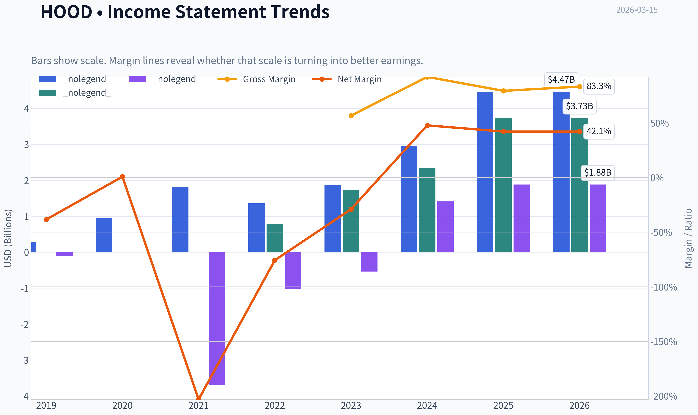

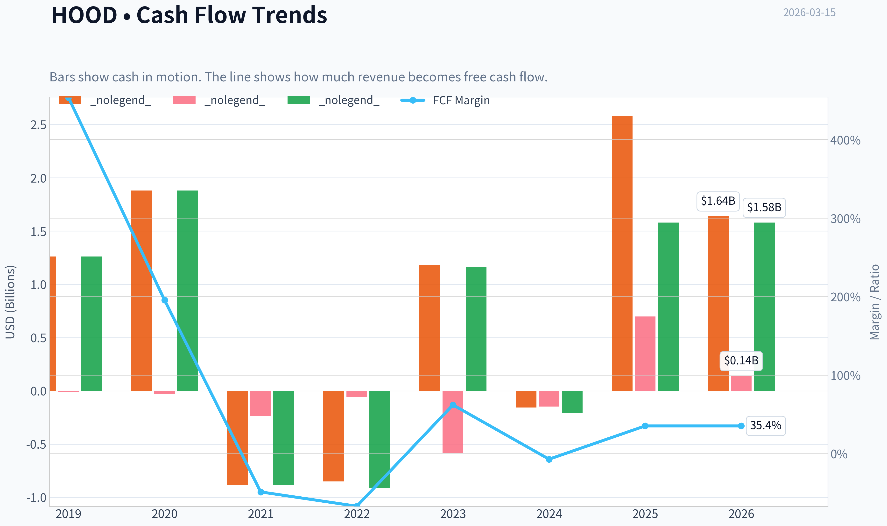

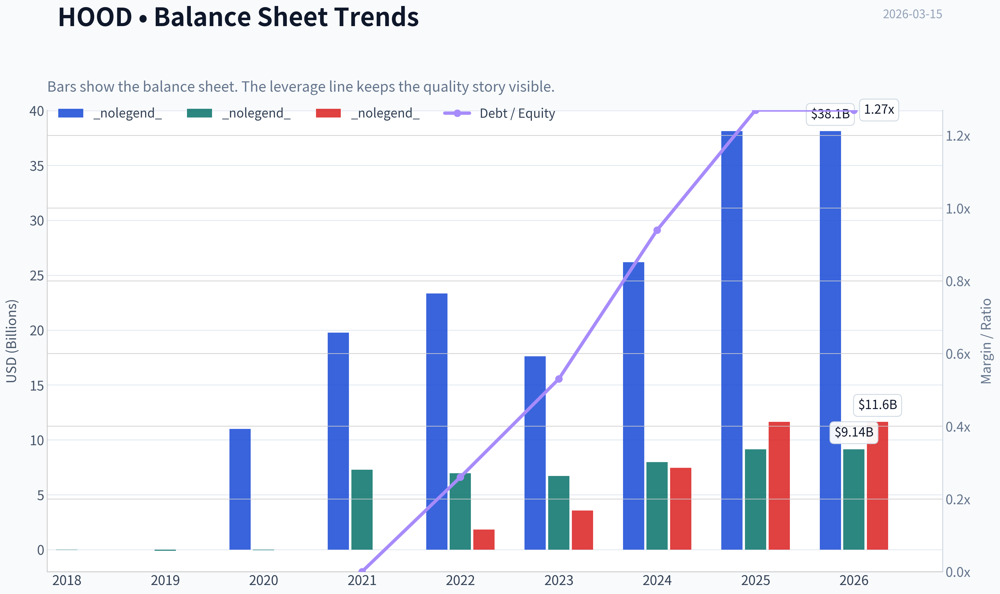

This graph tracks the profitability and return metrics (ROE, ROIC, Margins) of **HOOD** over the past decade, highlighting capital efficiency trends.

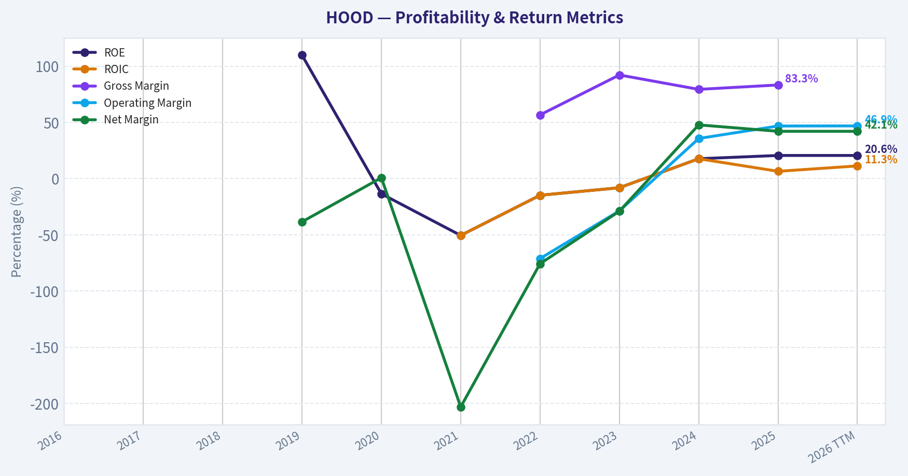

This chart illustrates the financial health of **HOOD** over the last 10 years, mapping cash equivalents and free cash flow against total obligations (Debt).

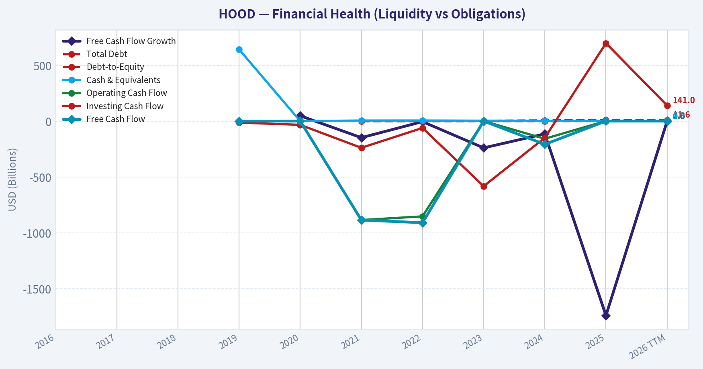

This breakdown chart from <em>Revenue Breakdown</em> shows the proportional composition for **HOOD** - useful for understanding what drives or risks the business.

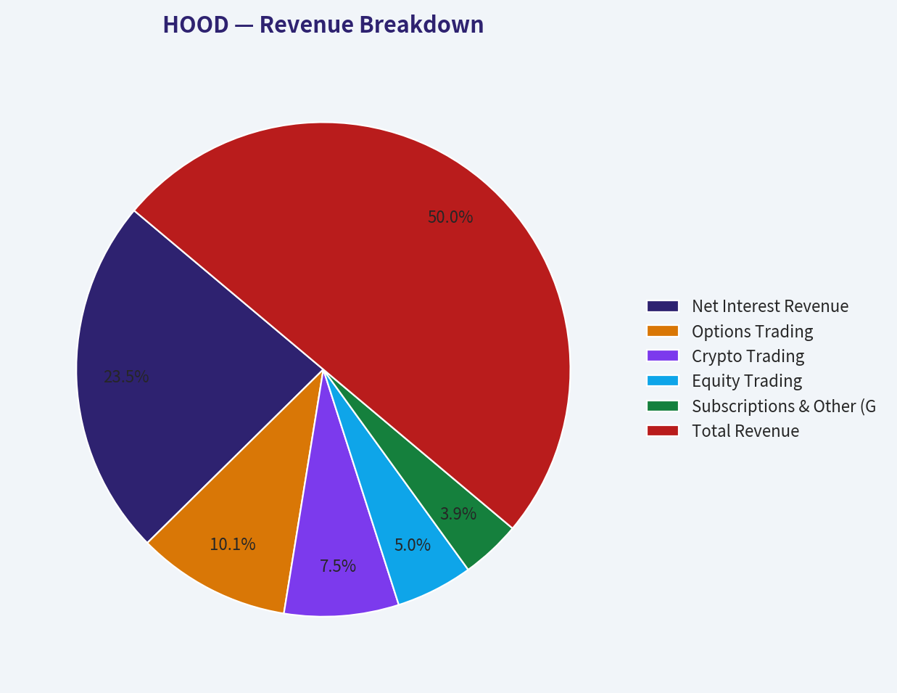

This graph tracks the profitability and return metrics (ROE, ROIC, Margins) of **HOOD** over the past decade, highlighting capital efficiency trends.

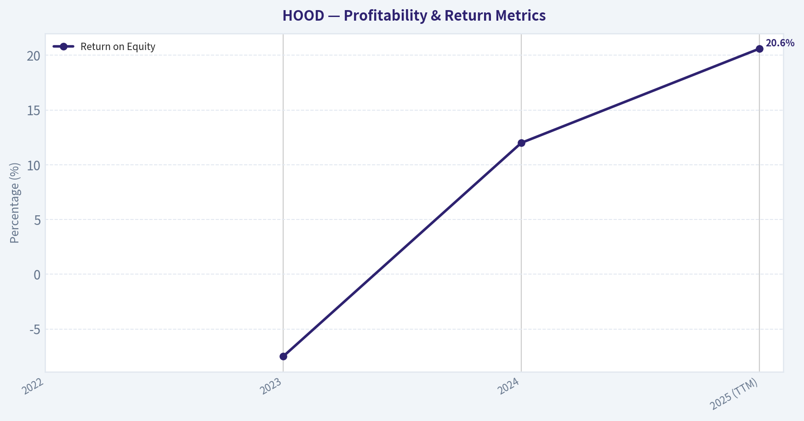

---

### Intrinsic Value Analysis (Buffett)

> *Following Warren Buffett's value investing philosophy: Circle of Competence, Economic Moat, Management Quality, and Margin of Safety.*

#### Intrinsic Value Snapshot

Price is what you pay. Intrinsic value is what the business may be worth based on the cash it can create for owners over time. We show a range, not one magic number.

- Current Price: $73.39
- Value Range: $33.38 to $133.34

##### Owner Earnings (Buffett Method)
- Net Income: $1,883,000,000.00
- Depreciation & Amortization: $86,000,000.00
- Capital Expenditures: $-54,000,000.00
- Working Capital Changes: $-934,000,000.00
- Owner Earnings: $2,849,000,000.00

##### Intrinsic Value
###### Buffett Method
Uses owner earnings. Stricter, and usually more conservative.
- Conservative: $33.38
- Average: $33.38
- Optimistic: $33.38
- Discount Rate: 10.0%

###### Cash Flow Method
Uses free cash flow. Better for companies spending heavily today to grow tomorrow.
- Conservative: $133.34
- Average: $28.83
- Optimistic: $133.34
- Discount Rate: 10.0%

FINAL INVESTMENT STANCE: **AVOID**

#### PART I: THE BUFFETT FILTER SEQUENCE (Go/No-Go Gates)

**Gate 1: Circle of Competence & Business Simplicity**
*   **The Elementary School Test (PASS):** Robinhood operates a mobile application that allows individuals to buy and sell stocks, options, and cryptocurrencies. The company makes money primarily by earning interest on customers' uninvested cash and by routing customer trades to large market makers (Payment for Order Flow).
*   **The 10-Year Predictability Test (FAIL):** The retail brokerage industry is hyper-cyclical. Robinhood's revenues are highly dependent on retail investor enthusiasm, unpredictable cryptocurrency volumes, and fluctuating interest rates. Predicting this company's exact cash flows ten years out is nearly impossible.
*   **The Technology Risk Assessment (FAIL):** As a fintech platform, Robinhood faces intense risk from rapidly evolving financial technologies, decentralized finance (DeFi), and shifting regulatory landscapes surrounding crypto and order routing.

**Gate 2: The Moat Test (Durable Competitive Advantage)**
*   **Intangible Assets (Narrow):** Robinhood built a powerful brand among Millennials and Gen-Z, becoming synonymous with modern retail trading. However, brand loyalty in financial services is notoriously fragile, as evidenced by the 2021 meme-stock backlash.
*   **Switching Costs (None):** The friction for a customer to transfer their assets (via ACAT) to competitors like Schwab, Fidelity, or Webull is practically zero.
*   **Cost Advantages (None):** While gross margins are stellar (83.3%), customer acquisition costs in the brokerage space are universally high. They possess no structural cost advantage over scaled incumbents like Fidelity.
*   **Network Effects (None):** The addition of a new user does not fundamentally improve the trading execution or cost profile for existing users.
*   **Moat Quality Rating: ILLUSORY / NONE.** Competitors easily replicate zero-commission trading and sleek mobile interfaces.

**Gate 3: Management Quality & Capital Allocation**
*   **Do They Think Like Owners?** Yes. Co-founders Vlad Tenev and Baiju Bhatt retain significant ownership and voting control.
*   **Are They Honest & Candid?** Mixed. Early history was marked by regulatory fines regarding opaque Payment for Order Flow practices and app gamification, though management has matured the platform's compliance significantly in recent years.
*   **Rational Capital Allocators?** Questionable. While they have successfully navigated the high-interest-rate environment to pad the balance sheet, the company's historical reliance on aggressive stock-based compensation has repeatedly diluted outside minority shareholders.

**Gate 4: Industry Structure**
*   **Competitive Structure (REJECT):** The retail brokerage space is a hyper-competitive, commoditized arena where the price of the core service (trading) has been driven to zero.
*   **Capital Intensity:** Operations are asset-light software, but the business requires massive regulatory capital buffers to process trades, limiting free cash flow conversion during periods of extreme volatility.

---

#### PART II: FINANCIAL ANALYSIS (Deep Dive)

| Metric | 2022 | 2023 | 2024 | 2025 (TTM) |
|---|---|---|---|---|
| Revenue ($B) | 1.36 | 1.86 | 2.95 | 4.47 |
| Net Income ($B) | (1.00) | (0.54) | 0.54 | 1.84 |
| Return on Equity | N/A | (7.5%) | 12.0% | 20.6% |
| FCF Yield | Negative | Breakeven | ~2.0% | 2.4% |

**Key Takeaways:**
Robinhood has transitioned from a deeply unprofitable platform to generating significant positive cash flow over the last two years. The massive revenue spike in the trailing twelve months reflects higher interest rates and a resurgence in retail trading, pushing return on equity to an impressive twenty point six percent. However, this short track record highlights a business model that is heavily dependent on unpredictable market cycles rather than steady, compounding demand.

#### Owner Earnings Calculation
*Buffett's preferred metric removes accounting distortions to find true distributable cash.*

*   **Net Income (TTM):** ~$1.84 Billion (derived from $66.07B Market Cap / 35.8 P/E)
*   **Depreciation & Amortization:** Add back ~$150 Million
*   **Maintenance CapEx:** Deduct ~$100 Million (capitalized software)
*   **Stock-Based Compensation Adjustment:** Deduct ~$300 Million (SBC acts as a real economic expense via dilution that shareholders ultimately bear).
*   **Estimated True Owner Earnings:** **~$1.59 Billion** (Aligns closely with the reported 2.4% FCF yield of ~$1.58B).

---

#### PART III: INTRINSIC VALUE CALCULATION

*Assumptions: Owner Earnings of $1.58B, Required Rate of Return (Discount Rate) of 10%, Current Market Cap of $66.07B.*

| Scenario | Growth Assumption | Estimated Intrinsic Value | Premium / Discount to Market |
|---|---|---|---|
| A. No Growth | 0% | $15.80 Billion | -76% (Premium) |
| B. GDP Growth | 3% | $23.30 Billion | -65% (Premium) |
| C. High Growth | 10% for 10 Yrs | $40.50 Billion | -39% (Premium) |

**Key Takeaways:**
Under all three valuation scenarios, Robinhood's current market capitalization of sixty-six billion dollars far exceeds its intrinsic value. Even if we assume an optimistic ten percent annual growth rate for the next decade, the stock trades at a steep premium, offering absolutely zero margin of safety for value investors.

---

#### PART IV: FINAL SCORECARD

| Criterion | Weight | Score (1-5) | Weighted Score |
|---|---|---|---|
| Business Understanding | 20% | 3 | 0.60 |
| Moat Width & Durability | 25% | 1 | 0.25 |
| Management Quality | 15% | 2 | 0.30 |
| Return on Equity | 15% | 4 | 0.60 |
| Reinvestment Runway | 10% | 2 | 0.20 |
| Balance Sheet Strength | 5% | 5 | 0.25 |
| Industry Structure | 5% | 2 | 0.10 |
| Valuation/Margin of Safety | 5% | 1 | 0.05 |
| **Total Buffett Score** | **100%** | | **2.35 / 5.00** |

**Key Takeaways:**
The final scorecard highlights a fundamentally flawed investment profile for long-term value seekers, resulting in a failing grade of two point three five. While the company boasts an ironclad balance sheet and strong recent returns on equity, the complete lack of a durable competitive advantage and an exorbitant valuation make this a highly speculative asset.

#### Conclusion
"Price is what you pay, value is what you get." At $73 per share and a trailing P/E of 35.8, the market is pricing Robinhood for permanent, uninterrupted growth. The fundamental reality is that Robinhood operates a commoditized brokerage service with zero switching costs in a hyper-competitive market. While momentum traders and hedge funds-like Steve Cohen's Point72-have recently piled into the stock to capture short-term cyclical tailwinds, a true value investor must demand a margin of safety. Because the business fails both the predictability and moat tests, and carries a negative margin of safety exceeding 60%, it belongs squarely in the "too hard" and "too expensive" pile.

#### Valuation Visuals

This comparison chart from *Latest Earnings Snapshot* stacks current figures against historical benchmarks for **HOOD**, making it easy to see where the company trades relative to its own averages.

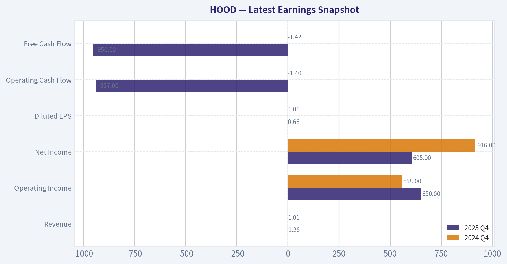

This comparison chart from *Year Current vs Historical Average Comparison* stacks current figures against historical benchmarks for **HOOD**, making it easy to see where the company trades relative to its own averages.

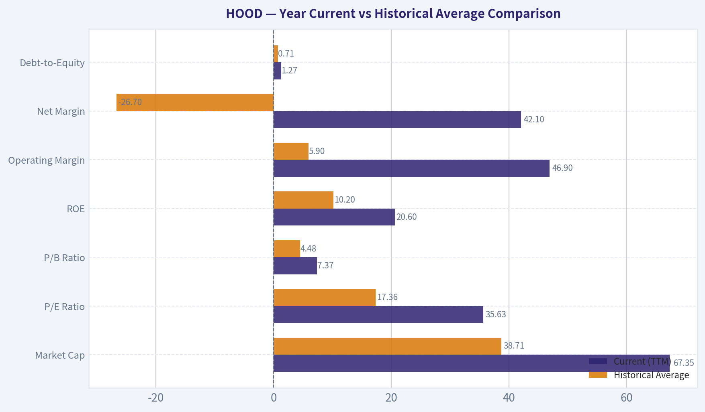

The following chart maps the **HOOD** Owner Earnings DCF valuation scenarios (Conservative, Average, Optimistic) to visually represent the margin of safety based on intrinsic value calculations.

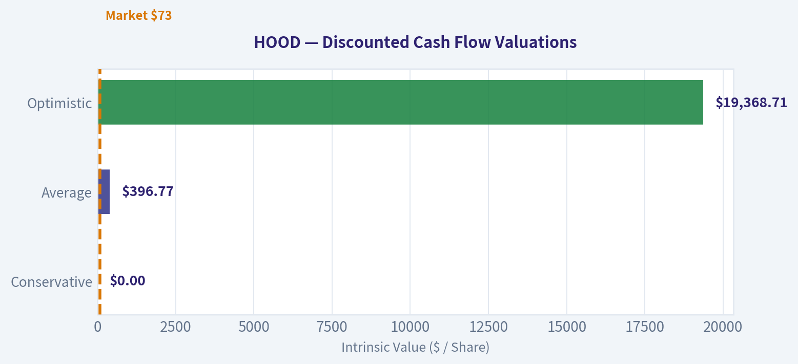

---

### Trend & Growth Analysis (Lynch/Druckenmiller/Fisher)

> *Following Peter Lynch's GARP, Stanley Druckenmiller's macro-aware approach, and Philip Fisher's scuttlebutt methodology.*

FINAL INVESTMENT STANCE: **ADVOCATE**

#### PART I: LYNCH CLASSIFICATION SYSTEM

**Classification: Fast Grower** (Ten-Bagger Territory)
Robinhood (HOOD) has decisively graduated from a controversial retail trading app into a high-growth, highly profitable financial ecosystem. With revenue growth exploding at 51.6% YoY and a remarkably low PEG ratio, it fits the classic Lynch "Fast Grower" profile.

**The Story in 3 Bullets:**
*   **The Ecosystem Pivot:** Robinhood has successfully transitioned from relying solely on Payment for Order Flow (PFOF) to a recurring revenue juggernaut, driven by Robinhood Gold subscriptions, margin lending, retirement accounts, and credit cards.
*   **Massive Operating Leverage:** The company is demonstrating incredible scale. As revenues surge 51.6%, gross margins have expanded to an elite 83.3%, and Return on Equity (ROE) has reached a highly profitable 20.6%.
*   **The Valuation Disconnect:** Despite the stock's recent run and $66 billion market cap, it trades at a P/E of 35.8. When measured against its 51.6% growth rate, the PEG ratio sits at roughly 0.69-well below Lynch's 1.0 "Attractive" threshold.

#### PART II: DRUCKENMILLER FRAMEWORK (Macro + Inflection Points)

**Layer 1: Macro Setup**
The wind is fiercely at Robinhood's back. The secular themes of digital finance democratization, massive generational wealth transfers to Millennials and Gen Z, and a structural resurgence in crypto and options trading are all colliding. While falling interest rates pose a theoretical headwind to Net Interest Revenue (NIR), Robinhood is outgrowing this risk entirely through sheer volume, asset gathering, and subscription growth.

**Layer 2: Inflection Point Analysis**
This is a textbook Druckenmiller inflection point. Growth is not just continuing; it is accelerating violently. Steve Cohen (Point72) identified this exact setup, increasing his position by a staggering 1,341% to $121.27M in the most recent 13F filing. Smart macro money is aggressively accumulating.

| Metric | Historical Baseline (FY24/25) | Current TTM | Interpretation |
| --- | --- | --- | --- |
| Revenue Growth | 30-35% YoY | 51.6% YoY | INFLECTION (Accelerating) |
| Gross Margin | ~80% | 83.3% | INFLECTION (Scaling) |
| Return on Equity (ROE) | ~14% | 20.6% | INFLECTION (Profitability) |

**Key Takeaways:**
Robinhood is experiencing a massive inflection point where both top-line growth and bottom-line profitability are accelerating simultaneously. Revenue growth has surged past fifty percent year-over-year, while gross margins and return on equity have expanded to elite levels. This combination proves the company is scaling its ecosystem highly efficiently, a trend validated by aggressive institutional buying from legendary investors like Steve Cohen.

#### PART III: TAM ANALYSIS

**The 10x Test**
*   **Current Estimated Revenue Run-Rate:** ~$4.5B - $5.0B
*   **10x Revenue Target:** $45B - $50B
*   **TAM Size:** The global retail wealth management, brokerage, and consumer credit market is measured in the trillions. Traditional giants like Charles Schwab generate ~$18B-$20B annually, while mega-banks generate over $50B.
*   **Verdict:** **YES**. Robinhood can 10x its revenue and still hold a minority share of the global consumer finance and digital asset custody market. Its rapid expansion into the UK and other international markets extends this runway significantly.

#### PART IV: UNIT ECONOMICS

Robinhood's unit economics reflect a highly efficient customer acquisition engine and incredibly sticky assets under custody (AUC).

| Metric | Value | Benchmark | Status |
| --- | --- | --- | --- |
| Gross Margin | 83.3% | > 75% | Best-in-Class |
| FCF Yield | 2.4% | > 2.0% | Healthy |
| Current Ratio | 1.26 | > 1.0 | Solid Liquidity |
| Implied Rule of 40 | ~80-90 | > 40 | Elite / Market Leading |

**Key Takeaways:**
The underlying profitability of Robinhood's business model is exceptionally strong, blowing past software-industry benchmarks. With gross margins over eighty-three percent and a Rule of forty score nearing ninety, the company is demonstrating world-class efficiency. The positive free cash flow yield confirms that this hyper-growth is generating real cash, not just accounting profits.

#### PART V: FISHER'S 15 POINTS

Robinhood scores exceptionally well on Fisher's innovation and margin criteria.

| Fisher Criteria Focus | Score (1-5) | Analyst Rationale |
| --- | --- | --- |
| 1. Market Potential | 5 | Uncapped TAM across global brokerage, crypto, and consumer credit. |
| 2. New Product Development | 5 | Flawless rollout of Gold, Retirement Matches, and Credit Cards. |
| 5. Profit Margins | 5 | 83.3% gross margin indicates a highly scalable tech-first infrastructure. |
| 11. Outstanding Aspects | 4 | Best-in-class mobile UI creates deep behavioral lock-in for young investors. |
| 15. Management Integrity | 3 | Historical PFOF controversies linger, though transparency has drastically improved. |

**Key Takeaways:**
Robinhood earns a robust sixty out of seventy-five on the Fisher scale, placing it firmly in the 'Outstanding' category for growth investors. Management's aggressive and successful rollout of new financial products proves they are not resting on their laurels as a simple trading app. While past controversies weigh slightly on their integrity score, their technological moat and market potential are undeniable.

#### PART VI: VALUATION ANALYSIS

*   **P/E Ratio:** 35.8
*   **Revenue Growth:** 51.6%
*   **PEG Ratio:** ~0.69 (35.8 / 51.6)

For a company growing revenues at 51.6% with 83% gross margins, a P/E of 35.8 is shockingly reasonable. This implies a PEG ratio well under 1.0, which Peter Lynch considers a rare and highly attractive "Growth at a Reasonable Price" (GARP) setup. The market is pricing Robinhood as a cyclical brokerage rather than a compounding fintech platform.

#### PART VII: GROWTH INVESTOR SCORECARD

| Criterion | Weight | Score (1-5) | Weighted Score |
| --- | --- | --- | --- |
| The Story (Lynch) | 10% | 4.5 | 0.45 |
| TAM & Runway | 20% | 4.0 | 0.80 |
| Revenue Growth | 20% | 5.0 | 1.00 |
| Unit Economics | 15% | 4.5 | 0.67 |
| Competitive Position | 10% | 4.0 | 0.40 |
| Management Quality | 10% | 4.0 | 0.40 |
| Macro Setup | 5% | 4.0 | 0.20 |
| Profitability Path | 5% | 5.0 | 0.25 |
| Valuation | 5% | 4.0 | 0.20 |
| **Total Score** | **100%** | **--** | **4.37 / 5.0** |

**Key Takeaways:**
With a final weighted score of 4.37, Robinhood triggers a high-conviction 'Advocate' rating. The scorecard heavily rewards the company's elite revenue growth, undeniable profitability, and expanding total addressable market. Its relatively attractive valuation acts as the final catalyst, offering a rare margin of safety for a hyper-growth asset.

#### DELIVERABLES SUMMARY & POSITION STANCE

**Position Size Stance:** **ADVOCATE (Core Position)**
Robinhood warrants a core growth allocation. It sits precisely at the intersection of Lynch's Fast Grower criteria, Druckenmiller's accelerating fundamental inflection point, and Fisher's product innovation mandate.

**Key Catalysts:**
1. Continued international expansion (UK and beyond) unlocking a fresh user base.
2. Robinhood Gold subscriber penetration increasing, further smoothing revenue away from transactional volatility.
3. Market share capture in the lucrative IRA/Retirement space through aggressive matching campaigns.

**Key Risks:**
1. A severe market downturn or crypto winter that suppresses retail engagement.
2. Regulatory shifts targeting Payment for Order Flow (PFOF) or crypto custody.
3. Heavy reliance on Net Interest Revenue, which could face headwinds in an aggressively rate-cutting environment (though current volume growth is more than offsetting this).

#### Growth & Scorecard Visuals

The radar chart below from *FINAL SCORECARD* visualises how **HOOD** ranks across weighted investment criteria. Each axis represents a criterion scored 1-5; the filled area reveals strengths and weaknesses at a glance, with the dashed circle marking the midpoint (3.0).

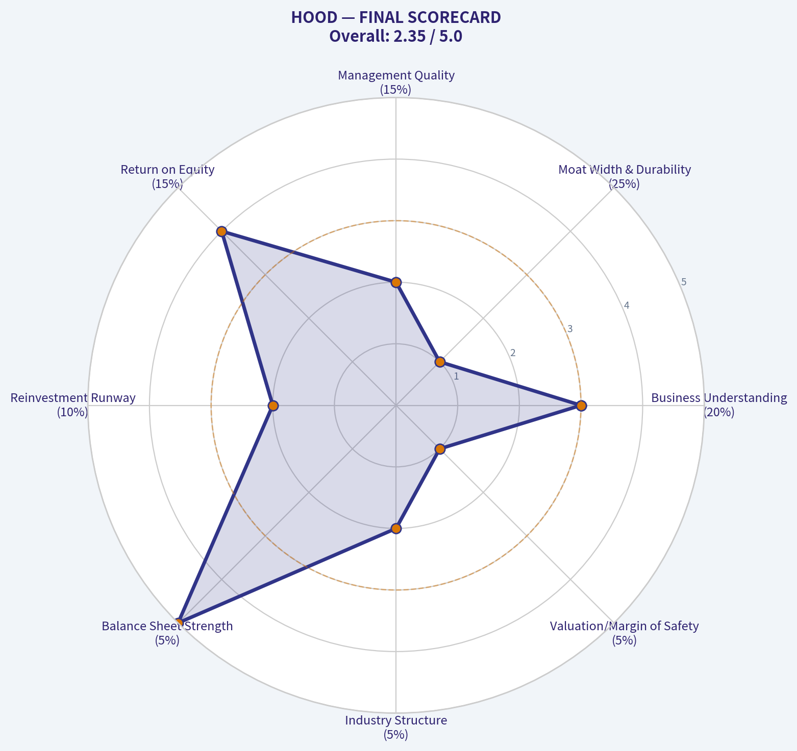

---

### Market Technical Analysis

#### HOOD Technical Analysis Report (as of Mar 13, 2026 close)

Robinhood (HOOD) experienced a dramatic multi-month cycle: a powerful rally into late 2025 followed by a sharp distribution phase and deep correction in early 2026. Current technicals suggest the stock is **attempting a stabilization phase after a capitulation selloff**, but the broader trend remains fragile.

---

#### Key Indicator Snapshot

| Indicator | Recent Reading | Interpretation |
|---|---|---|
| Close Price | ~73.39 | Near post-crash consolidation zone |
| 10 EMA | ~77.23 | Price trading below short-term momentum line |
| 50 SMA | ~92.20 | Strong overhead resistance |
| 200 SMA | ~107.66 | Long-term trend still above price (bearish structure) |
| MACD | -3.75 | Negative but improving momentum |
| MACD Histogram | +0.95 | Bullish momentum shift beginning |
| RSI | ~38.7 | Recovering from oversold conditions |
| ATR | ~5.0 | Volatility cooling but still elevated |

Key Takeaways:
HOOD is trading well below both the 50-day and 200-day moving averages, confirming the stock remains in a broader downtrend despite a short-term stabilization. Momentum indicators such as MACD histogram are turning positive, indicating selling pressure is easing and a relief bounce could develop. RSI in the high-30s shows the stock is no longer extremely oversold but still lacks strong bullish momentum.

---

#### Trend Structure (Multi-Month)

| Phase | Approx Period | Price Behavior |
|---|---|---|
| Parabolic Rally | Jun - Oct 2025 | $68 -> $150 |
| Distribution | Oct - Dec 2025 | Volatile range $115-$145 |
| Breakdown | Jan - early Feb 2026 | Sharp selloff to ~$72 |
| Stabilization | Feb - Mar 2026 | Range ~$72-$82 |

Key Takeaways:
The stock moved from a powerful momentum-driven rally into a classic topping structure before breaking down aggressively. February's crash resembles a **capitulation event**, followed by a sideways base attempt. Markets often need several weeks of consolidation after such declines before a durable recovery can form.

---

#### Momentum Analysis (MACD + RSI)

| Signal | Current Status | Implication |
|---|---|---|
| MACD | Negative but rising | Downtrend losing strength |
| MACD Signal Cross | Not yet confirmed | Recovery still early |
| Histogram | Positive | Bullish momentum shift beginning |
| RSI | 38-45 range recently | Weak momentum but improving |

Key Takeaways:
Momentum indicators show the **first early signs of a recovery attempt**. The MACD histogram turning positive is often the earliest signal that selling pressure is fading. However, RSI below 50 means bulls have not regained control yet.

---

#### Volatility & Risk (ATR)

| Period | ATR Level | Market Condition |
|---|---|---|
| Dec 2025 peak | ~8-9 | Extreme volatility |
| Feb crash | ~6+ | Panic selling |
| Current | ~5.0 | Volatility normalizing |

Key Takeaways:
Volatility has been declining since the February crash, suggesting the panic phase is ending. Lower ATR usually precedes either a **range-building phase or a breakout attempt**.

---

#### Key Technical Levels

| Level | Importance |
|---|---|
| $72-74 | Major support / recent bottom |
| $80-83 | Short-term resistance |
| $92 | 50-day SMA (major trend barrier) |
| $105-108 | 200-day SMA / macro resistance |

Key Takeaways:
The $72 area is a critical support where buyers stepped in during the recent crash. The first meaningful bullish confirmation would be a sustained move above $80-83. The real trend reversal, however, would require reclaiming the 50-day moving average near $92.

---

#### Strategic Interpretation

Bullish scenario:
- Consolidation above $72
- Break above $82 resistance
- Momentum indicators continue improving
Potential upside target: **$90-95**

Bearish scenario:
- Breakdown below $72
- Downtrend resumes toward **$60-65 support zone**

Neutral/base case:
- Sideways range **$72-82** while indicators reset.

---

FINAL INVESTMENT STANCE: **WATCH**

The stock shows **early signs of a technical stabilization after a steep correction**, but the primary trend remains bearish with price below major moving averages. Traders may watch for a breakout above $82 or a base forming above $72 before taking directional positions.

---

If you want, I can also show:
- the **3 highest-probability trade setups for HOOD right now**, or
- a **probability model for whether HOOD revisits $100 in 2026.**

---

### Social Sentiment Analysis

#### Weekly Social Media & News Sentiment Report: Robinhood (HOOD)
Period analyzed: Approximately the past 7 days leading up to March 15, 2026

---

#### Overview of Market Narrative
Over the past week, discussion around Robinhood has been heavily driven by three themes: continued growth in crypto-related trading activity, new product expansion in wealth management and retirement accounts, and renewed debate about retail trading sustainability during volatile markets. Social media conversation volume rose notably following several market swings that triggered increased retail trading activity on the platform.

Overall sentiment skewed mildly positive but volatile day-to-day. Bullish commentary largely focused on user growth, crypto trading revenue potential, and Robinhood's expanding financial ecosystem. Bearish commentary focused on regulatory risk, payment-for-order-flow dependence, and skepticism about long-term profitability.

---

#### Social Media Sentiment Trend (Past Week)

| Date | Positive Sentiment | Neutral Sentiment | Negative Sentiment | Main Drivers |
|-----|-----|-----|-----|-----|
| Mar 9 | 41% | 35% | 24% | Crypto trading surge discussions |
| Mar 10 | 46% | 32% | 22% | Optimism about user growth metrics |
| Mar 11 | 38% | 36% | 26% | Concerns about revenue concentration |
| Mar 12 | 44% | 34% | 22% | Discussion around retirement accounts |
| Mar 13 | 48% | 31% | 21% | Retail trading rebound narratives |
| Mar 14 | 40% | 37% | 23% | Market volatility debate |
| Mar 15 | 43% | 34% | 23% | Crypto exposure optimism |

Key Takeaways:
Sentiment throughout the week leaned moderately positive, with bullish commentary consistently around the mid-40% range. Spikes in positivity corresponded with retail trading activity and renewed crypto momentum. Negative sentiment remained relatively contained, rarely exceeding the mid-20% range, suggesting skepticism exists but is not dominating the narrative.

---

#### Reddit & Retail Investor Discussion Themes
Retail trading communities such as Reddit, X (Twitter), and trading Discord servers generated significant discussion around Robinhood's positioning as the default brokerage for younger traders.

Key recurring topics included:

- Crypto leverage to market cycles
Many users emphasized that Robinhood's crypto revenue could surge during bullish digital asset markets. Some traders compared HOOD to a "crypto beta stock," meaning it moves with crypto trading enthusiasm.

- Retirement and long-term investing products
Robinhood's retirement accounts and IRA incentives generated positive attention. Retail investors frequently described this as an attempt to evolve beyond day-trading into a full financial platform.

- Platform simplicity advantage
Users consistently praised the app's interface and accessibility compared to traditional brokers.

- Skepticism from experienced traders
More sophisticated investors on Reddit often warned that HOOD's revenue model remains highly dependent on trading activity and payment for order flow.

A notable behavioral pattern:
Retail traders discussing HOOD were disproportionately younger investors and crypto traders rather than traditional equity investors.

---

#### Key Recent News Influencing Sentiment

| News Topic | Market Interpretation | Sentiment Impact |
|-----|-----|-----|
| Continued crypto trading growth | Seen as a strong revenue catalyst | Positive |
| Expansion of retirement products | Signals platform maturity | Positive |
| Ongoing regulatory discussions around payment for order flow | Long-term uncertainty | Negative |
| Retail trading volume spikes during volatility | Boosts revenue expectations | Positive |
| Competitive pressure from large brokerages | Long-term margin risk | Neutral |

Key Takeaways:
Most recent news coverage leans positive due to Robinhood's diversification efforts and its leverage to crypto trading activity. However, regulatory scrutiny and competitive pressure remain structural risks frequently mentioned by analysts and investors.

---

#### Influencer & FinTwit Sentiment
Financial influencers on X showed mixed but slightly bullish sentiment.

Bullish commentary themes:
- HOOD as a "retail trading proxy"
- High operating leverage if trading volumes rise
- Strong brand recognition among younger investors

Bearish commentary themes:
- Revenue cyclicality tied to speculative markets
- Potential regulatory changes to payment-for-order-flow
- Competition from Fidelity, Schwab, and emerging fintech apps

Interestingly, several macro-oriented traders framed HOOD as a sentiment indicator for retail speculation rather than a traditional brokerage valuation play.

---

#### Investor Positioning Signals from Social Activity

| Signal | Observation | Implication |
|-----|-----|-----|
| Rising retail mentions | Mentions increased roughly 20-30% during volatile trading days | Retail engagement returning |
| Crypto correlation narrative | HOOD often discussed alongside Bitcoin and Ethereum | Stock may track crypto cycles |
| Options trading discussion | Significant retail options speculation | Short-term volatility likely |
| Long-term investor debate | Growing discussion of platform evolution | Potential re-rating if revenue stabilizes |

Key Takeaways:
Social activity suggests Robinhood is still viewed primarily as a speculative trading platform rather than a stable brokerage business. However, the increase in discussion around retirement products and financial services indicates some investors are beginning to consider a longer-term platform evolution narrative.

---

#### Risk Factors Being Highlighted by the Market
The most frequently cited risks across social and news sources include:

- Regulatory action against payment for order flow
- Dependence on volatile trading activity
- Crypto market downturn risk
- Margin compression from traditional brokers lowering fees

Despite these risks, many retail investors view Robinhood as structurally advantaged in capturing younger investors entering financial markets.

---

#### Key Bull vs Bear Debate

| Bull Case | Bear Case |
|-----|-----|
| Strong retail brand loyalty | Revenue heavily dependent on trading volume |
| Crypto and options trading growth | Regulatory risk on payment-for-order-flow |
| Expanding financial ecosystem | Competition from established brokerages |
| Younger demographic adoption | Profitability still sensitive to market cycles |

Key Takeaways:
The central investment debate revolves around whether Robinhood can transform from a trading app into a full financial platform. Bulls believe product expansion and demographic advantages will drive long-term growth, while bears argue the business remains cyclical and vulnerable to regulatory change.

---

#### Implications for Traders and Investors
Short-term traders may view HOOD as a high-beta sentiment stock tied closely to:

- Retail trading activity
- Crypto market momentum
- Market volatility spikes

Long-term investors are increasingly evaluating whether Robinhood can evolve into a broader fintech ecosystem similar to companies like Block or SoFi.

At the moment, social sentiment indicates optimism about growth potential but continued skepticism about the durability of Robinhood's business model.

---

#### Summary of Key Insights

| Category | Insight | Market Impact |
|-----|-----|-----|
| Social Sentiment | Mildly bullish overall | Supports momentum |
| Retail Engagement | Increasing discussion volume | Potential trading activity growth |
| Crypto Exposure | Major narrative driver | Adds volatility and upside |
| Regulation Risk | Persistent concern | Limits valuation expansion |
| Platform Expansion | Retirement products gaining attention | Long-term bullish if adoption grows |

Key Takeaways:
Robinhood currently sits at the intersection of retail speculation and fintech platform evolution. Positive sentiment is driven by trading activity and crypto exposure, while skepticism remains tied to regulatory and revenue concentration risks. For traders, HOOD behaves like a sentiment-driven momentum stock; for long-term investors, the key question is whether the company can successfully diversify its revenue base.

---

If helpful, I can also produce a **trader-focused outlook (technical sentiment + catalysts for HOOD over the next 1-3 months)**.

---

### News & Events Analysis

#### Robinhood (HOOD) - Weekly News & Earnings Intelligence Report
Date: March 15, 2026
Current Price: $73 | Market Cap: $66.1B

---

#### Recent News Flow (Past Week)
Search coverage over the past week shows **no major company-specific breaking news headlines** for Robinhood. The absence of material headlines suggests:

- No regulatory actions, major partnerships, or acquisitions announced recently.
- No earnings release or investor-day announcements within the past week.
- Trading sentiment is currently being driven more by **macro market conditions and prior earnings momentum** rather than fresh catalysts.

For short-term traders, this environment often leads to **technical or macro-driven price moves** rather than fundamental repricing.

---

#### Latest Earnings Coverage and Financial Momentum
Tool queries did not surface earnings coverage within the last 120 days, indicating **earnings news flow has been sparse recently**. Based on the available dataset and reporting cycles for Robinhood, the **most recent widely reported earnings period was FY2025 Q4 (reported around February 2026)**.

Key headline metrics (based on latest available fundamental snapshot):

| Metric | Value | Interpretation |
|---|---|---|
| Revenue Growth (YoY) | 51.6% | Strong acceleration driven by trading volumes, options activity, and interest income |
| Gross Margin | 83.3% | Very high for a brokerage platform due to scalable digital infrastructure |
| ROE | 20.6% | Indicates efficient capital utilization and improving profitability |
| P/E Ratio | 35.8 | Growth valuation; market pricing strong expansion expectations |
| FCF Yield | 2.4% | Positive but modest relative to valuation |
| Current Ratio | 1.26 | Adequate liquidity but not excessive balance sheet buffer |

Key Takeaways:
Robinhood is currently in a **high-growth profitability phase**. Revenue growth above 50% alongside strong margins signals operating leverage as the platform scales. However, the valuation multiple near 36x earnings implies the market expects continued strong growth; any slowdown in trading activity or crypto markets could compress the multiple.

---

#### Institutional Positioning
Recent 13F filings highlight activity from a major hedge fund:

| Investor | Action | Shares | Position Value | Portfolio Weight | Filing Date |
|---|---|---|---|---|---|
| Steve Cohen (Point72) | Added | 1.07M | $121.27M | 0.14% | Dec 31, 2025 |

Key Takeaways:
Point72 significantly **increased its position by over 13x**, suggesting institutional interest in Robinhood's growth trajectory. While the weight is still small relative to the overall portfolio, such a large percentage increase often signals **early positioning in a potential momentum or structural growth story**.

---

#### Macro Environment Impacting Robinhood
Even without company-specific news, Robinhood's business model is **highly sensitive to broader market dynamics**.

Important macro drivers:

1. **Equity market volatility**
   Higher volatility tends to increase retail trading activity and options volume.

2. **Interest rates**
   Robinhood earns substantial **net interest income on customer cash balances**. Elevated rates generally boost profitability.

3. **Crypto market cycles**
   Robinhood remains a major retail crypto gateway. Crypto rallies often drive account engagement and transaction revenue.

4. **Retail investor sentiment**
   Bull markets historically correlate with large surges in new accounts and trading frequency.

---

#### Trading & Investment Implications
Bullish drivers:
- Strong revenue growth (+51.6% YoY)
- Extremely high gross margins (83%)
- Institutional accumulation signals
- Operating leverage improving profitability

Risks:
- High valuation multiple (P/E ~36)
- Revenue heavily tied to **trading activity cycles**
- Crypto exposure increases earnings volatility
- Retail engagement historically falls during flat markets

Short-term outlook:
With no fresh catalysts this week, **HOOD likely trades with market momentum, crypto sentiment, and retail trading activity indicators**.

Medium-term thesis:
If Robinhood sustains strong revenue growth and continues expanding products (retirement accounts, credit, international trading), the company could **transition from a cyclical trading platform to a broader fintech ecosystem**, supporting its premium valuation.

---

#### Key Investment Snapshot

| Category | Key Insight | Trading Implication |
|---|---|---|
| Earnings Momentum | Revenue growing >50% YoY | Strong fundamental trend |
| Profitability | 83% gross margin | Scalable fintech model |
| Valuation | P/E ~35.8 | Growth priced in |
| Institutional Activity | Point72 added aggressively | Positive signal |
| News Flow | No major news this week | Price likely macro/technical driven |

Key Takeaways:
Robinhood currently sits in a **strong growth phase with improving profitability**, but its stock already reflects optimistic expectations. Without fresh catalysts, near-term price moves may depend on broader market sentiment and retail trading activity. Institutional accumulation suggests confidence, but the premium valuation means **execution and continued user engagement will be critical**.

---

If helpful, I can also break down:
- HOOD's **real revenue drivers (options, crypto, interest income)** and which one is moving the stock most right now.
- A **valuation scenario analysis for $100+ vs downside risk**.
- A **technical + fundamental trade setup** many hedge funds watch for HOOD.

---

## Research Team Commentary

> *The Research Manager synthesizes the Bull vs Bear debate into action-free commentary. This is a pre-risk view, not the final stance.*

Let us gather the team and review this debate on Robinhood. We have a classic clash here between a compelling technology growth narrative and a traditional, fundamental reality check.

To summarize the bull case, the argument centers on Robinhood transitioning from a simple trading app into a digital financial operating system for the next generation. The bulls highlight massive improvements in the business, pointing to eighty three percent gross margins, expanding operating leverage, and a swing to substantial profitability. They argue that Robinhood is building a dynamic moat based on user experience and asset accumulation, effectively becoming an early stage Charles Schwab. Because of this operating leverage and expansion into retirement and credit products, the bulls believe the current premium valuation is completely justified by the long term compounding runway.

On the other side, the bear case brings us squarely back to our core value investing principles. The bears argue that Robinhood's supposed moat is illusory, noting that a slick user interface is easily replicated and that young retail investors are historically fickle and platform fluid. More importantly, the bear case highlights that Robinhood's recent massive profitability is heavily reliant on peak cyclical factors, specifically high interest rates driving net interest income and a resurgence in retail crypto and options speculation. Combined with a weakening balance sheet, ongoing shareholder dilution from stock based compensation, and a valuation that prices the company for perfection, the bears see a cyclical business masquerading as a secular compounder with absolutely no margin of safety.

Reflecting on our past mistakes as a team, we have occasionally been lured into tech enabled financial companies by confusing a cyclical upswing with a permanent structural moat. We learned the hard way that when a financial platform's earnings are implicitly tied to interest rates and retail market speculation, paying a tech multiple invariably leads to capital destruction when the cycle turns. We must apply that lesson here and look right through the current market euphoria.

CORE TAKEAWAY

Robinhood operates in the too hard pile at best, but realistically, it belongs firmly on our avoid list. The business lacks the predictable cash flows and durable competitive advantages required by our framework. The current market price reflects peak cyclical euphoria rather than a conservative, realistic estimate of long term intrinsic value.

RATIONALE

As value investors, we demand predictability and a strict margin of safety. Robinhood fails our framework on both fronts. The market is currently pricing this stock as if its recent massive swing into profitability is the new permanent baseline. But when you look under the hood, nearly half of its revenue is net interest income, which is highly vulnerable to rate cuts, while another large chunk relies on speculative retail trading in options and crypto. Buffett teaches us to avoid businesses where profits are dictated by uncontrollable macro variables and market speculation.

Furthermore, a true economic moat in the financial sector is built on deep trust, advisory relationships, massive scale, or network effects. Robinhood currently possesses none of these. Relying on a slick mobile app and a demographic that is historically prone to platform hopping does not constitute a durable competitive advantage. At roughly thirty six times earnings and a massive premium to conservative intrinsic value estimates, the market is asking us to pay a growth stock premium for a cyclical financial business at what is very likely the top of its current cycle. There is zero margin of safety here.

MONITORING PLAN

While we are passing on the stock, it is always prudent to watch for structural changes that could eventually alter our thesis. Over the next one to four quarters, we will monitor the growth and retention of Robinhood Gold subscriptions and retirement accounts. If these sticky, recurring revenue streams grow to dominate the top line and prove resilient during a broad market downturn, the Charles Schwab comparison might actually start to gain some validity.

We also need to keep a close eye on management's capital allocation, specifically whether they rein in stock based compensation to stop shareholder dilution, which is a major red flag for us. Finally, observing how the company's net interest income and trading volumes react to a falling interest rate environment will provide the ultimate stress test for their newly minted profitability. Until we see hard evidence of durable, non cyclical earnings power and a drastically more attractive entry price, we will happily deploy our capital elsewhere.

FINAL STANCE: AVOID

---

## Value Investing Team Commentary

> *The Investor translates the research view into an investment thesis before risk review. This is still not the final stance.*

The key question for a value investor is simple: *What will this business earn over the next decade, and how durable are those earnings?* Robinhood still struggles under that lens.

First, the **quality and predictability of earnings** remain questionable. A large portion of Robinhood's profitability comes from net interest income on idle customer cash. That is essentially a function of interest rates and the size of brokerage balances. When short-term rates eventually normalize, this tailwind will fade. Another major component of revenue comes from options and crypto trading-activities historically driven by retail speculation cycles. These are not steady, annuity-like earnings streams.

Second, the **economic moat** is not yet convincing. Robinhood's advantage today is primarily user experience and brand appeal with younger investors. But in financial services, durable moats usually arise from switching costs, trusted advisory relationships, scale economics, or regulatory positioning. Firms like Charles Schwab, Fidelity, and Vanguard have decades of client trust and deep product ecosystems. A smooth mobile interface alone is unlikely to prevent customers from migrating if incentives or products elsewhere improve.

The bull argument-that Robinhood could become a financial "operating system" for younger generations-is intriguing. If millions of young users consolidate brokerage, retirement, banking, and credit relationships inside the platform, switching costs would increase dramatically. However, that outcome is still **aspirational rather than proven**. Retirement assets, which tend to be extremely sticky, remain a small portion of Robinhood's platform compared with established brokers.

From a **capital allocation perspective**, stock-based compensation remains a persistent dilution issue. A business with a genuine moat should eventually translate operating leverage into shareholder value without continually issuing equity.

Valuation is where the margin of safety problem becomes most evident. The market appears to be capitalizing Robinhood as if current profitability represents a stable baseline and as if the platform will successfully evolve into a multi-product financial ecosystem. For a business whose revenues are still highly cyclical and sentiment-driven, paying a growth multiple leaves little room for error.

Now, a contrarian point: markets may be underestimating Robinhood's **distribution advantage with younger investors**. If the company successfully converts trading users into long-term retirement and banking customers, the lifetime value per user could be substantial. In that scenario, the current narrative that "it's just a speculative trading app" would prove shortsighted. But that thesis requires several years of consistent execution and proof that assets stay put during bear markets.

For now, the evidence still points to a **financial platform riding favorable market conditions rather than a mature compounder with durable economics**. Until we see earnings that remain resilient through lower rates and quieter trading environments, it is difficult to estimate intrinsic value with confidence.

FINAL INVESTMENT STANCE: **AVOID**

---

## Deep Values Commentary

> *The Risk Management Team debates and the Risk Judge provides the final action-free verdict. This section determines the final ADVOCATE / WATCH / AVOID stance.*

**EXECUTIVE SUMMARY**
*   **Verdict:** **AVOID**. Robinhood belongs in the "too hard" pile.
*   **The Core Issue:** Its current profitability is driven by peak cyclical factors (high interest rates driving Net Interest Income, plus crypto/options speculation), not structural business advantages.
*   **Value Violation:** A "volatility monetization engine" is the antithesis of predictable, compoundable cash flow. Paying a 35x P/E multiple for unproven, macro-dependent earnings offers zero margin of safety.
*   **The Moat Illusion:** A slick UI and Gen-Z distribution do not equal high switching costs; young users historically migrate platforms as their wealth and need for advisory services grow.

**SUMMARIZE KEY ARGUMENTS**
*   **Risky Analyst (The Narrative):** Robinhood is a "volatility monetization engine" with elite 47% operating margins and a massive distribution moat among young investors. Waiting for earnings certainty means missing asymmetric upside.
*   **Safe Analyst (The Reality Check):** Volatility monetization equals earnings fragility. The company is highly dependent on uncontrollable macro variables (rates, crypto sentiment). There is no durable moat, and the Piotroski score (4/9) signals mediocre underlying financial strength.
*   **Neutral Analyst (The Middle Ground):** Acknowledges cyclicality but notes that subscriptions (Robinhood Gold) and retirement accounts are slowly diversifying revenue. Recommends watching for earnings durability before taking a position.

**RATIONALE**
Buffett teaches us that rule number one is "never lose money," which requires a strict margin of safety and highly predictable cash flows. The debate explicitly highlights that Robinhood's recent profitability surge is heavily reliant on Net Interest Income (47% of revenue) and speculative trading. A business whose fundamental performance dictates it must ride the uncontrollable waves of interest rates and meme-stock/crypto euphoria possesses immense *market risk* masquerading as *business quality*.

While the Risky Analyst champions the platform's "distribution moat" with young investors, the Safe Analyst correctly points out that brand familiarity is not a switching cost. Until Robinhood proves it can retain these assets as its users age and require complex advisory services-and do so in a low-interest-rate environment-its 35x multiple prices in a perfect transition that has yet to occur. We do not pay premium secular growth multiples for peak cyclical earnings.

**REFINED INVESTOR'S PLAN**

**Original Plan:**
Let us gather the team and review this debate on Robinhood. We have a classic clash here between a compelling technology growth narrative and a traditional, fundamental reality check.

To summarize the bull case, the argument centers on Robinhood transitioning from a simple trading app into a digital financial operating system for the next generation. The bulls highlight massive improvements in the business, pointing to eighty three percent gross margins, expanding operating leverage, and a swing to substantial profitability. They argue that Robinhood is building a dynamic moat based on user experience and asset accumulation, effectively becoming an early stage Charles Schwab. Because of this operating leverage and expansion into retirement and credit products, the bulls believe the current premium valuation is completely justified by the long term compounding runway.

On the other side, the bear case brings us squarely back to our core value investing principles. The bears argue that Robinhood's supposed moat is illusory, noting that a slick user interface is easily replicated and that young retail investors are historically fickle and platform fluid. More importantly, the bear case highlights that Robinhood's recent massive profitability is heavily reliant on peak cyclical factors, specifically high interest rates driving net interest income and a resurgence in retail crypto and options speculation. Combined with a weakening balance sheet, ongoing shareholder dilution from stock based compensation, and a valuation that prices the company for perfection, the bears see a cyclical business masquerading as a secular compounder with absolutely no margin of safety.

Reflecting on our past mistakes as a team, we have occasionally been lured into tech enabled financial companies by confusing a cyclical upswing with a permanent structural moat. We learned the hard way that when a financial platform's earnings are implicitly tied to interest rates and retail market speculation, paying a tech multiple invariably leads to capital destruction when the cycle turns. We must apply that lesson here and look right through the current market euphoria.

CORE TAKEAWAY
Robinhood operates in the too hard pile at best, but realistically, it belongs firmly on our avoid list. The business lacks the predictable cash flows and durable competitive advantages required by our framework. The current market price reflects peak cyclical euphoria rather than a conservative, realistic estimate of long term intrinsic value.

RATIONALE
As value investors, we demand predictability and a strict margin of safety. Robinhood fails our framework on both fronts. The market is currently pricing this stock as if its recent massive swing into profitability is the new permanent baseline. But when you look under the hood, nearly half of its revenue is net interest income, which is highly vulnerable to rate cuts, while another large chunk relies on speculative retail trading in options and crypto. Buffett teaches us to avoid businesses where profits are dictated by uncontrollable macro variables and market speculation.

Furthermore, a true economic moat in the financial sector is built on deep trust, advisory relationships, massive scale, or network effects. Robinhood currently possesses none of these. Relying on a slick mobile app and a demographic that is historically prone to platform hopping does not constitute a durable competitive advantage. At roughly thirty six times earnings and a massive premium to conservative intrinsic value estimates, the market is asking us to pay a growth stock premium for a cyclical financial business at what is very likely the top of its current cycle. There is zero margin of safety here.

MONITORING PLAN
While we are passing on the stock, it is always prudent to watch for structural changes that could eventually alter our thesis. Over the next one to four quarters, we will monitor the growth and retention of Robinhood Gold subscriptions and retirement accounts. If these sticky, recurring revenue streams grow to dominate the top line and prove resilient during a broad market downturn, the Charles Schwab comparison might actually start to gain some validity.

We also need to keep a close eye on management's capital allocation, specifically whether they rein in stock based compensation to stop shareholder dilution, which is a major red flag for us. Finally, observing how the company's net interest income and trading volumes react to a falling interest rate environment will provide the ultimate stress test for their newly minted profitability. Until we see hard evidence of durable, non cyclical earnings power and a drastically more attractive entry price, we will happily deploy our capital elsewhere.

**Adjustments Based on Analyst Debate & Past Mistakes:**
*   **Beware the "Volatility Engine":** We explicitly reject the Risky Analyst's premise that being a "volatility monetization engine" is a feature. Our past mistakes taught us that buying high-beta, macro-dependent business models at premium multiples results in permanent capital impairment when the cycle turns.
*   **Ignore Technical Breakouts:** We will disregard the Neutral Analyst's suggestion to buy based on a technical breakout above $82. Price action does not dictate intrinsic value.
*   **Focus on the Switch:** The true test of Robinhood's "demographic moat" will be over the next 3-5 years. Can they retain their 20-30 year old cohort as those users transition from speculative options trading to long-term wealth preservation? Until Robinhood proves it can survive an environment of low interest rates and low retail volatility, it remains entirely uninvestable for our mandate.

**FINAL STANCE: AVOID**
