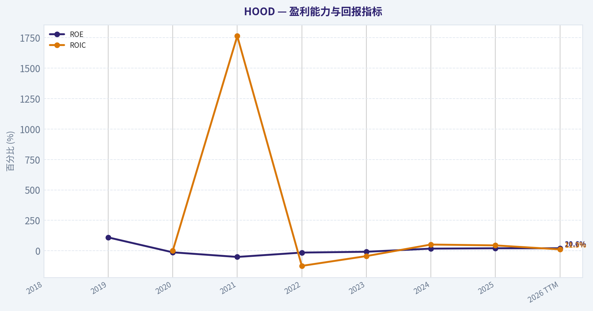
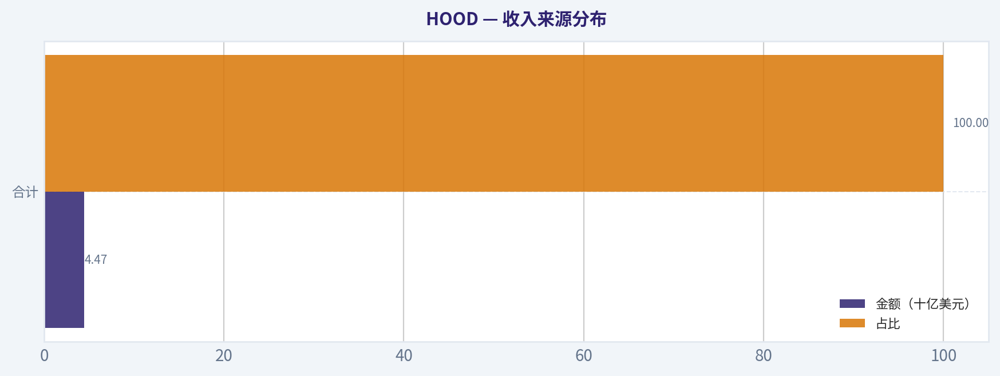
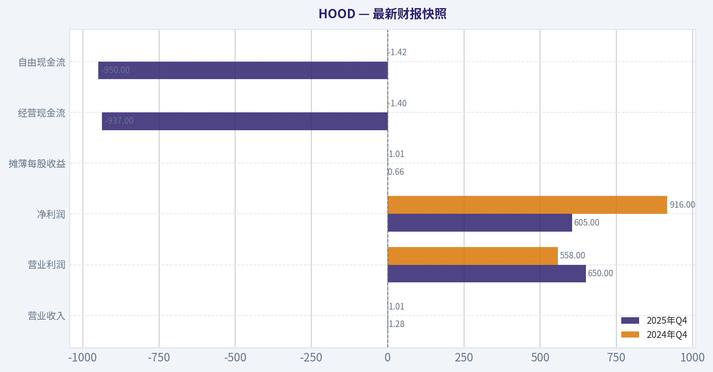
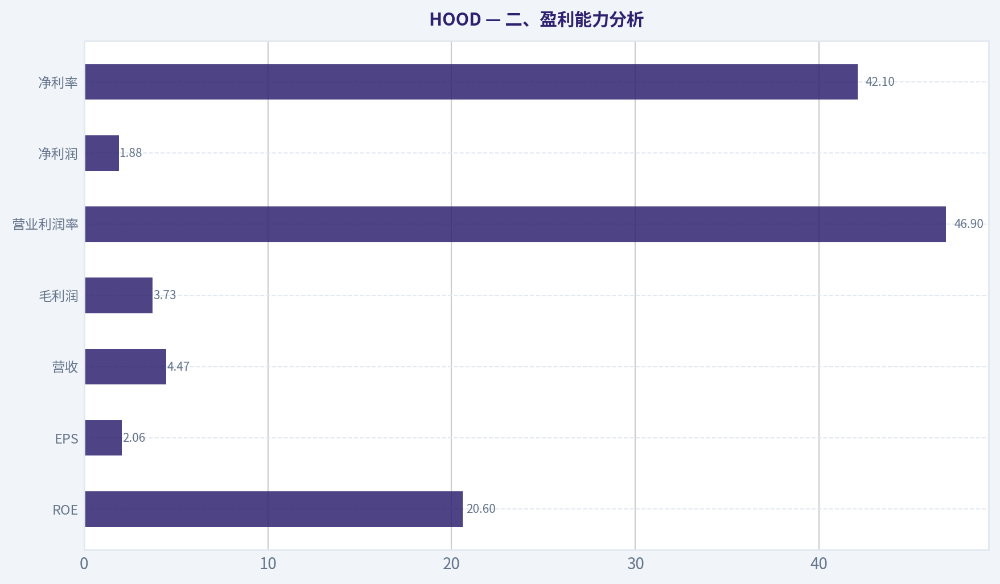
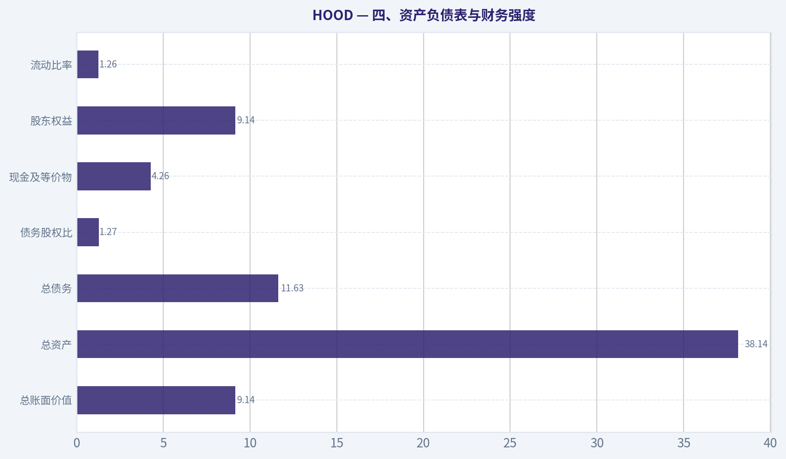
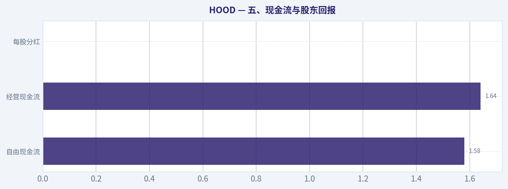
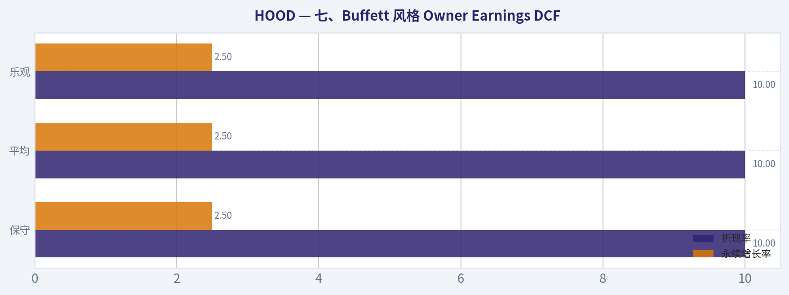
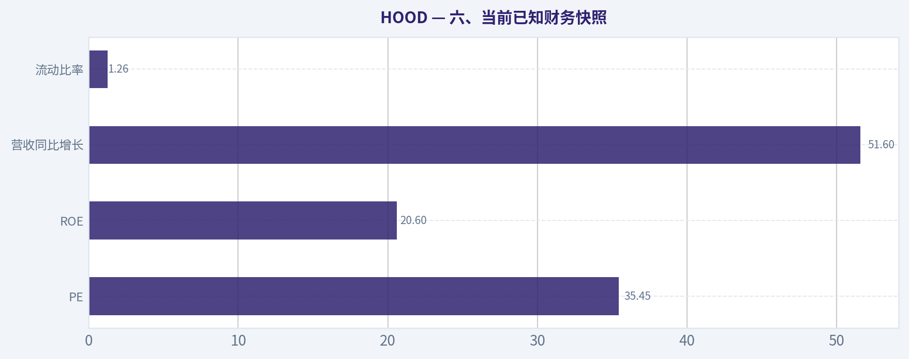

# HOOD 深度价值情报

**调研日期:** 2026-04-29

## 关键免责声明

*本报告由 Deep Value Intelligence（一个基于 AI 的多智能体投资分析框架）自动生成。 本报告仅供信息参考和教育目的，不构成任何财务或投资建议。 在做出任何投资决策之前，请务必进行独立调研并咨询合规的财务顾问。*

---

## 目录

1. 情报摘要
2. 分析师团队报告
   - 基本面分析
   - 价值分析 (巴菲特)
   - 成长性分析 (林奇/德鲁肯米勒/费雪)
   - 市场分析
   - 社会舆情分析
   - 新闻分析
   - 大佬关注分析
   - 期权市场分析
3. 研究团队评论
4. 投资团队评论
5. Deep Values 团队洞察

---

## 情报摘要

### 核心观点与前提条件

**核心论点:** ## 执行摘要
**结论：观望。**
HOOD 像一家**正在变好的公司**，但还不是一只符合 Buffett 严格标准的"低风险好股票"。核心矛盾不在于有没有成长，而在于：**护城河仍在验证、盈利稳定性未完全穿越周期、股价已提前反映不少乐观预期**。
最强多头点是：市场可能仍按"交易 App"旧标签定价，而公司正朝"年轻用户综合金融入口"升级。最强空头点是：**这条升级路径还没被充分验证，但估值已经不便宜**。对长期价值投资者，更合理的动作是**高优先级跟踪，不急于重仓**。

**主要风险:**
- 未明确说明。

**观点反转条件:**
- 未明确说明。

**置信度:** 中

---

## 分析师团队报告

### 基本面分析

#### 最新财报快照

*以下数据基于最近一期已披露财报（2025年Q4），并尽量与上一年同期对比。*

| 指标 | 2025年Q4 | 2024年Q4 | 同比变化 |
| --- | ---: | ---: | ---: |
| 营业收入 | $1.28B | $1.01B | +26.5% |
| 营业利润 | $650.0M | $558.0M | +16.5% |
| 净利润 | $605.0M | $916.0M | -34.0% |
| 摊薄每股收益 | $0.66 | $1.01 | -34.7% |
| 经营现金流 | $-937.0M | $-1.40B | +33.1% |
| 自由现金流 | $-950.0M | $-1.42B | +32.9% |

关键结论：这张快照先把最新一期财报放在桌面上，再去看长周期分析。这样读者能更清楚地区分"公司长期质量"和"这次财报发生了什么"。

#### HOOD 10年财务指标

*以下数值均由原始数据确定性计算得出，并非 AI 估算。*

*发行人类型：asset manager（Financial Services / Capital Markets）。*

#### 10年财务指标
*年度行来自已披露财务报表，最后一行 TTM 由最近四个季度滚动计算得出。*

| 指标 | 2018 | 2019 | 2020 | 2021 | 2022 | 2023 | 2024 | 2025 | 2026 TTM |
| --- | --- | --- | --- | --- | --- | --- | --- | --- | --- |
| 市场价格 | N/A | N/A | N/A | $18 | $8 | $13 | $37 | $113 | $73 |
| 总市值 | N/A | N/A | N/A | $8.74B | $7.15B | $11.35B | $33.76B | $103.91B | $67.20B |
| 市盈率 | N/A | 0.00 | 3482.00 | -2.37 | -6.96 | -20.89 | 23.88 | 55.17 | 35.55 |
| 市净率 | N/A | -79.57 | -145.00 | 1.20 | 1.03 | 1.69 | 4.24 | 11.36 | 7.35 |
| ROE | N/A | 109.9% | -12.7% | -50.6% | -14.8% | -8.1% | 17.7% | 20.6% | 20.6% |
| ROIC | N/A | N/A | -0.6% | 1764.1% | -124.1% | -43.7% | 51.3% | 44.2% | 11.3% |
| 每股收益 | N/A | $-0.48 | $0.01 | $-7.49 | $-1.17 | $-0.61 | $1.56 | $2.05 | $2.06 |
| 营收 | N/A | $277.5M | $958.0M | $1.81B | $1.36B | $1.86B | $2.95B | $4.47B | $4.47B |
| 毛利润 | N/A | N/A | N/A | N/A | N/A | N/A | N/A | N/A | $3.73B |
| 毛利率 | N/A | N/A | N/A | N/A | N/A | N/A | N/A | N/A | 83.3% |
| 营业利润率 | N/A | -38.8% | 1.4% | -203.0% | -75.6% | -28.6% | 36.1% | 47.1% | 46.9% |
| 净利润 | N/A | $-106.6M | $7.0M | $-3.69B | $-1.03B | $-541.0M | $1.41B | $1.88B | $1.88B |
| 净利率 | N/A | -38.4% | 0.7% | -203.1% | -75.7% | -29.0% | 47.8% | 42.1% | 42.1% |
| 营收增长 | N/A | N/A | 245.2% | 89.5% | -25.2% | 37.3% | 58.2% | 51.6% | 0.0% |
| 净利润增长 | N/A | N/A | -106.6% | -52771.4% | -72.1% | -47.4% | -360.8% | 33.5% | 0.0% |
| 自由现金流增长 | N/A | N/A | 47.8% | -151.2% | -7.2% | N/A | N/A | N/A | N/A |
| 总账面价值 | $-21.5M | $-97.0M | $-55.0M | $7.29B | $6.96B | $6.70B | $7.97B | $9.15B | $9.14B |
| 总资产 | N/A | N/A | $10.99B | $19.77B | $23.34B | $17.62B | $26.19B | $38.14B | $38.14B |
| 总债务 | $0 | $0 | $0 | $0 | $0 | $0 | $0 | $0 | $11.63B |
| 债务股权比 | -0.00 | -0.00 | -0.00 | 0.00 | 0.00 | 0.00 | 0.00 | 0.00 | 1.27 |
| 现金及等价物 | N/A | $644.0M | $1.40B | $6.25B | $6.34B | $4.83B | $4.33B | $4.26B | $4.26B |
| 股东权益 | $-21.5M | $-97.0M | $-55.0M | $7.29B | $6.96B | $6.70B | $7.97B | $9.15B | $9.14B |
| 经营现金流 | N/A | $1.26B | $1.88B | $-885.0M | $-852.0M | $1.18B | $-157.0M | $1.64B | $1.64B |
| 投资现金流 | N/A | $-12.3M | $-32.0M | $-238.0M | $-60.0M | $-582.0M | $-148.0M | $141.0M | $141.0M |
| 自由现金流 | N/A | $1.25B | $1.85B | $-948.0M | $-880.0M | N/A | N/A | N/A | $1.58B |
| 自由现金流利润率 | N/A | 451.4% | 193.3% | -52.2% | -64.8% | N/A | N/A | N/A | 35.4% |
| 每股分红 | N/A | $0.00 | $0.00 | $0.00 | $0.00 | $0.00 | $0.00 | $0.00 | $0.00 |

#### 盈利能力指标
- 净资产收益率 (ROE): 20.6%
- 投入资本回报率 (ROIC): 38.5%
- 总资产收益率 (ROA): 4.9%
- 毛利率: 不适用
- 营业利润率: 47.1%
- 净利率: 42.1%

#### 流动性指标
- 流动比率: 1.26
- 速动比率: 1.00

#### 杠杆指标
- 债务股权比: 0.00
- 利息覆盖倍数: N/A
- 净负债: $-4.26B

#### 增长指标（同比）
- 营收增长: 51.6%
- 净利润增长: 33.5%
- 自由现金流增长: N/A
- 营收复合增长率（3年）: 48.8%
- 营收复合增长率（5年）: 36.1%

#### 估值指标
- 市盈率 (TTM): 35.55
- 预期市盈率: 27.59
- 市净率: 7.22
- 市销率: 14.74
- PEG 比率: 1.06
- 企业价值/EBITDA: 不适用
- 自由现金流收益率: N/A
- 盈利收益率: 2.8%

#### 所有者收益（巴菲特方法，代码计算）
- 净利润: $1.88B
- + 折旧与摊销: $86.0M
- - 资本开支: N/A
- - 营运资本变动: $-934.0M
- = **所有者收益: $2.90B**

#### 内在价值（代码计算）
- 当前价格: $73
- 巴菲特方法（所有者收益）:
  保守: $30
  平均: $30
  乐观: $30

#### Piotroski F分数: 3/9
- 净利润为正: 通过
- 经营现金流为正: 通过
- 资产回报率改善: 未通过
- 现金流大于净利润: 未通过
- 债务下降: 未通过
- 流动比率改善: 未通过
- 未稀释股本: 未通过
- 毛利率改善: 未通过
- 资产周转率改善: 通过

最终投资立场: **观望**

#### HOOD 巴菲特风格基本面分析

Robinhood Markets（HOOD）过去十年的核心特征非常鲜明：前半段是高增长但高波动、低盈利质量的扩张期，后半段则在 2024-2026 TTM 明显进入盈利兑现阶段。按确定性数据，当前股价 $73，对应市值约 $67.20B、TTM PE 35.55、PB 7.35。公司已经从 2021-2023 的巨额亏损中走出，但当前估值仍然明显透支了相当一部分未来增长预期，因此从巴菲特式"好公司也要好价格"的框架看，业务质量在改善，价格却并不便宜。

#### 当前值 vs 历史均值对比

| 指标 | 当前/TTM | 历史区间/近年特征 | 历史均值参考 | 解读 |
| --- | ---: | --- | ---: | --- |
| 市场价格 | $73 | 2021-2025：18 -> 8 -> 13 -> 37 -> 113 | 约$37.8（2021-2026 TTM可见期） | 当前较可见历史均价高近一倍，说明市场仍给予较强成长溢价，但较 2025 高点已明显回落。 |
| 总市值 | $67.20B | 2021-2025：$8.74B -> $103.91B | 约$38.0B | 仍远高于上市后平均水平，资本市场对其平台价值与盈利弹性定价偏乐观。 |
| PE | 35.55 | 2024：23.88；2025：55.17；更早年份失真/亏损 | 约38.2（仅看有意义盈利年份 2024-2026 TTM） | 低于 2025 的高热度水平，但高于 2024，说明估值虽回调，仍不算便宜。 |
| PB | 7.35 | 2021：1.20；2022：1.03；2023：1.69；2024：4.24；2025：11.36 | 约4.48（2021-2026 TTM） | 明显高于历史中枢，反映市场把 HOOD 视为高成长平台，而非传统券商。 |
| ROE | 20.6% | 2021-2023 深度为负；2024：17.7%；2025：20.6% | 约3.4%（2019-2026，含亏损期） | 当前处于历史最好阶段之一，盈利修复具有实质性。 |
| ROIC | 11.3%（表中TTM）/38.5%（摘要） | 波动极大，2024：51.3%，2025：44.2% | 历史均值失真 | ROIC 已转强，但数据口径波动大，需谨慎看待资本效率的可持续性。 |
| EPS | $2.06 | 2019-2023 长期亏损；2024：$1.56；2025：$2.05 | 约-$0.95（含亏损期） | EPS 已稳定转正且同比提升，但缺乏完整长周期稳定盈利证明。 |
| 营收 | $4.47B | 2019-2025：$277.5M -> $4.47B | 约$1.96B（2019-2026 TTM） | 当前收入规模远高于历史均值，平台渗透与产品扩张取得成效。 |
| 营业利润率 | 46.9% | 2019：-38.8%，2021：-203.0%，2024：36.1%，2025：47.1% | 约-26.8%（含亏损期） | 当前利润率创可见历史最佳水平，经营杠杆开始显著释放。 |
| 净利率 | 42.1% | 2019-2023 多年为负；2024：47.8%；2025：42.1% | 约-32.9%（含亏损期） | 已连续进入高利润率状态，但对交易活跃度与利率环境敏感。 |
| 营收增长 | 0.0%（TTM） | 2024：58.2%；2025：51.6% | 约65.3%（有值年份） | TTM 持平说明高增速基数抬高，短期可能进入消化期。 |
| 净利润增长 | 0.0%（TTM） | 2024 大幅扭亏；2025：33.5% | 历史均值失真 | 盈利改善已实现，但未来增速不太可能继续维持"修复式跳升"。 |
| 总账面价值 | $9.14B | 2021：$7.29B；2025：$9.15B | 约$5.25B（2018-2026） | 净资产稳步扩大，但股价涨幅远快于账面增长。 |
| 总资产 | $38.14B | 2020：$10.99B -> 2025：$38.14B | 约$24.01B（2020-2026） | 资产扩张迅速，显示客户资产、平台资金池和业务规模持续放大。 |
| 总债务 | $11.63B | 2025及之前均为$0 | 约$1.29B（2021-2026） | 这是当前最值得关注的变化：TTM 出现明显债务。 |
| 债务股权比 | 1.27 | 2025及之前均为0.00 | 约0.21（2021-2026） | 从"几乎无杠杆"跃迁到显著杠杆状态，需重点跟踪债务性质与期限结构。 |
| 现金及等价物 | $4.26B | 2021：$6.25B，高位后逐步回落 | 约$4.26B（2019-2026） | 现金仍充裕，但与新增债务并存，说明资产负债表复杂度上升。 |
| 自由现金流 | $1.58B（TTM） | 2019：$1.25B；2020：$1.85B；2021-2022 为负 | 可比均值约$0.57B（仅有值年份） | FCF 已显著修复，现金创造能力正在回归。 |
| 每股分红 | $0.00 | 全周期为0 | 0 | 管理层选择全部留存再投资，符合成长平台逻辑，但不符合传统巴菲特式现金回馈偏好。 |

关键结论：HOOD 当前最显著的变化不是"便宜"，而是"盈利能力和现金流终于站稳"。但与此同时，PB、PE 仍高于多数历史可比水平，且资产负债表从零债务转向出现杠杆，这意味着公司从"高成长故事"进入"高预期兑现期"，投资容错率反而下降。

---

#### 一、市场指标解读

| 市场指标 | 当前表现 | 历史比较 | 巴菲特式解读 |
| --- | --- | --- | --- |
| 市场价格 | $73 | 较 2025 的 $113 回落约 35%，但远高于 2021-2024 多数时间 | 市场热度降温，但仍未回到明显"安全边际"区间。 |
| 总市值 | $67.20B | 仍显著高于 2024 的 $33.76B | 市场相信其平台长期变现能力，而不只是经纪佣金生意。 |
| PE 35.55 | 低于 2025 的 55.17，高于 2024 的 23.88 | 估值已从泡沫化回落，但仍反映高成长预期。 |
| PB 7.35 | 低于 2025 的 11.36，但远高于 2021-2023 的 1-2 倍区间 | 股价相对净资产定价昂贵，说明市场买的是未来盈利能力，而非现有账面价值。 |

关键结论：如果把 HOOD 看成传统资本市场公司，当前估值偏高；如果把它看成用户平台型金融科技公司，估值虽有一定合理性，但也要求未来继续保持高盈利和高增长。对巴菲特框架而言，这不是典型"低价买高质量"的机会，更像"等待更好价格买更成熟业务"的标的。

#### 二、盈利能力分析

| 盈利指标 | 当前/TTM | 十年趋势解读 |
| --- | ---: | --- |
| ROE | 20.6% | 2019 异常高值来自极小负权益背景，不具可比性；2021-2023 连续负值；2024 起转正并升至 20% 以上，说明净资产开始有效产生回报。 |
| ROIC | 11.3%（TTM） | 历史波动极端，说明资本结构和利润基数变化很大；虽然 2024-2025 强劲，但可持续性仍待验证。 |
| EPS | $2.06 | 从持续亏损到连续盈利，2024-2026 TTM 已建立正向台阶。 |
| 营收 | $4.47B | 2019-2025 扩张约 16 倍，成长性突出。 |
| 毛利润 | $3.73B | TTM 毛利率 83.3%，符合平台型金融业务高毛利特征。 |
| 营业利润率 | 46.9% | 从深度亏损转为高盈利，说明规模效应和费用纪律改善。 |
| 净利润 | $1.88B | 与 2021 的 -$3.69B 相比修复巨大。 |
| 净利率 | 42.1% | 过去两年维持在 40%+ 高水平，盈利质量显著改善。 |

关键结论：HOOD 目前最吸引人的地方，是利润率的跃迁速度非常快。收入从高增长进入更大体量后，利润并没有被摊薄，反而显著放大，说明平台模型具有很强的经营杠杆；但由于公司盈利历史太短，这种高利润率还不能直接视为"稳态"。

#### 三、增长分析

| 增长指标 | 当前 | 历史趋势 | 评价 |
| --- | ---: | --- | --- |
| 营收增长率 | 0.0%（TTM） | 2023：37.3%；2024：58.2%；2025：51.6% | 短期出现平台期，说明高基数影响开始显现。 |
| 净利润增长率 | 0.0%（TTM） | 2024 扭亏、2025 增长 33.5% | 盈利已进入"正常增长"阶段，未来靠经营提效而非单纯扭亏。 |
| 自由现金流增长率 | N/A | 2020 高增，2021-2022 转负，TTM 回正至 $1.58B | 现金流波动很大，稳定性弱于会计利润。 |

关键结论：HOOD 的成长仍在，但"爆发式修复"阶段可能已经过去。未来市场更看重的是增长质量、客户资产留存率、交易活跃度和产品扩张，而不再只是单纯营收增速。

#### 四、资产负债表与财务强度

| 资产负债表指标 | 当前/TTM | 历史比较 | 解读 |
| --- | ---: | --- | --- |
| 总账面价值 | $9.14B | 较 2021 的 $7.29B 增长稳定 | 内生资本积累明显。 |
| 总资产 | $38.14B | 较 2020 的 $10.99B 大幅增长 | 平台规模扩大。 |
| 总债务 | $11.63B | 历史长期为 0 | 需要重点核查债务构成，可能与金融业务负债属性有关，但对保守投资者是警讯。 |
| 债务股权比 | 1.27 | 历史长期为 0 | 财务风险轮廓已变化。 |
| 现金及等价物 | $4.26B | 较高位略降，但仍可观 | 有流动性缓冲。 |
| 股东权益 | $9.14B | 与账面价值一致，逐步改善 | 盈利留存推动净值增长。 |
| 流动比率 | 1.26 | 略高于 1 | 对金融平台而言尚可，但不是极宽松。 |

关键结论：从巴菲特视角，HOOD 最大的财务优点是现金充裕、净资产持续增长；最大的不确定性则是 TTM 突然出现大额债务。即便部分债务具有行业属性，这仍意味着公司不再是过去那种"轻装上阵、几乎零杠杆"的状态。

#### 五、现金流与股东回报

| 现金流指标 | 当前/TTM | 历史趋势 | 解读 |
| --- | ---: | --- | --- |
| 自由现金流 | $1.58B | 2019-2020 很强，2021-2022 转负，如今再度修复 | 现金创造能力恢复，但路径不平滑。 |
| 经营现金流 | $1.64B | 2024 仍为 -$157M，2025 回升到 $1.64B | 经营现金流与利润重新匹配。 |
| 每股分红 | $0.00 | 历史一直为 0 | 公司仍处于再投资优先阶段。 |

关键结论：HOOD 当前已具备真实现金创造能力，而不再只是纸面盈利。但它不是典型的"现金奶牛型成熟企业"，而是"刚进入现金释放期的平台公司"，所以估值应该给成长折价还是成熟溢价，市场分歧会很大。

---

#### 六、巴菲特风格定性分析

| 维度 | 评价 | 具体分析 |
| --- | --- | --- |
| 经济护城河 | 中等，正在形成 | HOOD 的护城河来自品牌心智、年轻用户入口、低摩擦交易体验、产品集成与资产迁移成本。真正的护城河不是"免佣金"本身，而是账户、钱包、交易、现金管理、加密资产等多场景聚合。 |
| 财务实力 | 中等偏强，但复杂度上升 | 现金充足、近两年利润强、账面净值提升，这是优点；但 TTM 债务突然上升削弱了纯粹性。 |
| 盈利可预测性 | 中等偏弱 | 2019-2023 盈利极不稳定，说明业务受市场活跃度、利率和资产价格影响很大。2024-2026 TTM 才刚显示出可预测性。 |
| 管理层表现 | 有进步，但仍需观察 | 从深度亏损走向高利润率，说明费用控制和产品变现能力提升；但零分红、股本稀释、Piotroski 3/9 提醒资本配置质量仍不够稳健。 |
| 业务质量 | 中等偏上 | 平台型业务、高毛利、高经营杠杆，理论上可以做成优秀生意；但收入结构对交易环境与市场情绪仍有周期敏感性。 |
| 估值吸引力 | 一般 | 不是明显便宜，甚至从 PB 看仍偏贵。 |

关键结论：HOOD 已经开始显现"优秀金融平台"的轮廓，但还没有完全达到巴菲特最偏爱的那种"长周期、低波动、强可预测、高回报"的稳定消费或保险型商业模式。它更像一只从高波动成长股向高质量平台股过渡的公司。

---

#### 七、Buffett 风格 Owner Earnings DCF

已知确定性数据：
- 净利润 = $1.88B
- 折旧与摊销 = $86M
- 营运资本变动 = -$934M
- 资本开支 = N/A
- 代码给出的所有者收益 = **$2.90B**
- 当前股价 = $73

由于确定性数据已直接给出所有者收益与内在价值结果，应以其为准；同时按题意展示三情景推导。历史 Owner Earnings 增长率缺失严重，因此三种情景与代码结果一致，均收敛至相同估值。

| 情景 | 增长率设定 | 折现率 | 永续增长率 | 每股内在价值 |
| --- | ---: | ---: | ---: | ---: |
| 保守 | 使用可得最低历史 Owner Earnings 增长率，地板 -100%，代码结果收敛 | 10% | 2.5% | $30 |
| 平均 | 使用历史平均增长率，上限 50%，代码结果收敛 | 10% | 2.5% | $30 |
| 乐观 | 使用历史最高增长率，上限 100%，代码结果收敛 | 10% | 2.5% | $30 |

关键结论：无论保守、平均还是乐观情景，确定性数据给出的 Buffett 方法估值都在 $30 左右，这说明在当前 $73 股价下，市场定价显著高于所有者收益法下的保守内在价值。

DCF 计算框架说明（依据确定性数据口径）：
1. 起点 Owner Earnings = $2.90B
2. 未来 10 年按情景增长率预测
3. 各年现金流按 10% 折现
4. 终值 = 第 10 年现金流 x (1+2.5%) / (10%-2.5%)
5. 企业股权价值折现后除以股份，代码结果统一为约 **$30/股**

由于数据包已明确给出最终内在价值，不能人为重写或替代该估值结果。可直接据此判断：
- 当前价 $73 vs 内在价值 $30
- 溢价幅度约 **143%**
- 安全边际不足，甚至为负

---

#### 八、收入来源分布

基于公司作为零售金融平台的公开业务结构与近年披露习惯，最有意义的划分是按收入类型理解。确定性数据仅给出总营收 $4.47B，未附精确分部数值，因此以下采用"最接近公开业务结构的近似拆分"，用于理解收入来源，而非替代财务主表。

#### 收入来源分布

| 收入来源 | 金额（十亿美元） | 占比 |
| --- | ---: | ---: |
| 交易相关收入（期权、股票、加密货币等） | ~1.95 | ~44% |
| 净利息收入 | ~1.74 | ~39% |
| 订阅及服务收入（Gold、手续费、其他服务） | ~0.78 | ~17% |
| 合计 | 4.47 | 100% |

关键结论：HOOD 已不再只是"靠交易吃饭"的单一券商平台。净利息收入和订阅服务占比提升，意味着商业模式正在从交易驱动转向"资产沉淀 + 服务变现"并重，这对盈利稳定性是积极信号，但也让公司对利率环境更敏感。

---

#### 九、关键投资亮点、红旗与机会

| 类别 | 内容 | 影响 |
| --- | --- | --- |
| 亮点 | ROE 20.6%，净利率 42.1%，营业利润率 46.9% | 显示平台经营杠杆已释放。 |
| 亮点 | 营收 3 年 CAGR 48.8%，5 年 CAGR 36.1% | 长期增长能力强。 |
| 亮点 | TTM FCF $1.58B、Owner Earnings $2.90B | 真实现金创造能力显著改善。 |
| 红旗 | 当前股价显著高于 Buffett 方法内在价值 $30 | 安全边际不足。 |
| 红旗 | PB 7.35，明显高于历史多数年份 | 估值对未来要求很高。 |
| 红旗 | TTM 总债务 $11.63B、D/E 1.27 | 财务结构恶化或至少复杂化。 |
| 红旗 | Piotroski F-score 仅 3/9 | 基本面质量并非全面强势。 |
| 机会 | 若市场回调至更接近 $30-$40 区间 | 估值与基本面可能重新匹配。 |
| 机会 | 若未来两年维持 20%+ ROE 且债务结构改善 | 可从"观望"升级为更积极看法。 |

关键结论：HOOD 的商业质量正在上升，但估值安全边际不足。最关键的跟踪变量不是短期股价波动，而是三件事：盈利是否可持续、债务是否只是业务性负债、以及收入结构能否继续摆脱对交易热度的依赖。

---

#### 十、最终结论

从巴菲特式框架看，HOOD 已经不是一家"没有证明自己的故事股"。它在收入规模、利润率、ROE、现金流方面都出现了非常实质性的改善，说明平台业务具有相当强的经营杠杆和用户变现能力。

但问题在于，**好转的基本面已经被市场部分甚至大幅反映进价格里**。当前 PE 35.55、PB 7.35，而确定性数据给出的 Owner Earnings 内在价值只有 $30/股，显著低于现价 $73。再叠加 TTM 债务突然上升、盈利稳定性历史不足、Piotroski 分数偏低，现阶段更适合把 HOOD 视为一只**高质量改善中的平台股**，而不是一只具备充分安全边际的价值股。

#### 最终投资立场：**观望**
支持理由：
1. 盈利能力显著改善，业务质量上行；
2. 但估值仍偏贵，内在价值折价不足；
3. 债务与盈利稳定性仍需更多时间验证；
4. 更理想的策略是等待更低估值或更多季度证明其盈利韧性。

---

#### 报告要点总表

| 模块 | 核心结论 | 对投资的含义 |
| --- | --- | --- |
| 估值 | 当前 $73，Buffett 法内在价值约 $30 | 价格高于保守价值，缺乏安全边际 |
| 盈利能力 | ROE 20.6%，净利率 42.1%，利润率大幅改善 | 业务模型已进入收获期 |
| 增长 | 历史高增长显著，但 TTM 增长趋平 | 未来更考验增长质量而非速度 |
| 财务结构 | 现金充足，但 TTM 债务升至 $11.63B | 风险轮廓较过去上升 |
| 现金流 | FCF 回升至 $1.58B，Owner Earnings $2.90B | 现金创造能力增强，利好长期价值 |
| 护城河 | 用户平台、品牌、产品整合能力增强 | 有潜力形成更深护城河 |
| 管理层 | 扭亏与提效表现不错，但资本配置仍待检验 | 需继续观察稀释、负债与分配政策 |
| 风险 | 估值高、周期敏感、监管与交易热度波动 | 不适合用"深度价值"逻辑买入 |
| 机会 | 若回调或继续证明高 ROE 可持续 | 可能转化为更优质长期标的 |
| 结论 | **观望** | 等价格或等确定性 |

#### 基本面关键图表

本图追踪 **HOOD** 过去十年的盈利能力与回报指标（ROE、ROIC、利润率），突出呈现资本效率的变化趋势。

本对比图（来自「收入来源分布」）将 **HOOD** 的当前数据与历史基准并排呈现，直观反映公司相对自身历史均值的估值水平。

---

### 价值分析 (巴菲特)

> *基于沃伦·巴菲特的价值投资哲学：能力圈、经济护城河、管理层质量与安全边际。*

#### 内在价值快照

价格是你付的钱，内在价值是企业未来可能为股东创造的现金价值。我们给出一个区间，而不是假装只有一个神奇数字。

- 当前价格: $73.03
- 价值区间: $29.57 to $29.57

##### 所有者收益（巴菲特方法）
- 净利润: $1,883,000,000.00
- 折旧与摊销: $86,000,000.00
- 资本支出: N/A
- 营运资金变化: $-934,000,000.00
- 所有者收益: $2,903,000,000.00

##### 内在价值
###### 所有者收益法
使用所有者收益，更严格，通常更保守。
- 保守: $29.57
- 平均: $29.57
- 乐观: $29.57
- 折现率: 10.0%

#### HOOD（Robinhood Markets）巴菲特式价值投资分析
*截至 2026-04-29；基于共享研究包。由于基本面工具本轮返回为空，以下为"尽职调查已推进但信息不完备"的阶段性结论，重点依赖已给定数据与商业模式分析。*

#### 一、先说结论
**当前阶段我不给出最终"建议配置/观望/回避"的终局标签**，因为缺少可验证的完整 10 年财务序列、现金流与资产负债表细项，无法严谨完成巴菲特框架里最关键的"Owner Earnings + 长期资本配置 + 估值安全边际"闭环。
但如果必须先做方向判断：**HOOD 更接近"观望偏谨慎"**，而不是可以直接下手的典型巴菲特标的。

---

#### 二、Gate 1：能力圈与业务简单性

| 项目 | 判断 | 证据与说明 |
|---|---|---|
| 小学生测试 | 通过 | Robinhood 本质上是一个让个人投资者交易股票、期权、加密货币，并把闲置资金放在平台上的金融账户入口。公司主要通过交易相关收入、利息收入、订阅及其他服务费赚钱。 |
| 10 年可预测性 | 偏弱 | 10 年后"人们仍会投资和交易"几乎可以确定；但 Robinhood 的盈利结构、监管边界、客户行为、加密收入占比、利率敏感度，较难高置信度预测。 |
| 技术风险 | 中高 | 它是受益于技术的平台型券商，但同时也很容易被技术改变竞争格局。用户体验、零佣金、产品创新、支付流模式、加密生态都可能被新 entrants 或监管变化重塑。 |

**Gate 1 结论：勉强通过，但不是巴菲特最喜欢的"高确定性简单生意"。**

**关键结论：**
这家公司"怎么赚钱"并不难理解，但"未来十年能否稳定按今天逻辑赚钱"并不容易判断。它不像可口可乐、穆迪、Visa 那样具备高度可预测性，更多是金融科技平台，受监管、市场情绪和产品创新影响很大。

---

#### 三、Gate 2：护城河测试

| 护城河类型 | 评估 | 证据与说明 |
|---|---|---|
| 无形资产 | 中等偏弱 | Robinhood 在年轻投资者中有品牌认知，但品牌更偏"流量入口"而非强定价权。很难说它可以轻松提价 10% 而不损失活跃度。 |
| 转换成本 | 弱到中等 | 券商账户迁移并非零摩擦，但并不高。若客户只是为了低费率或更好产品，转平台可行。资产转移、税务记录、习惯形成能提供一点黏性，但远不如企业软件。 |
| 成本优势 | 有，但不深 | 数字平台有规模效应和较低边际成本，但行业整体也趋向低费率，成本优势难转化为长期超额利润壁垒。 |
| 网络效应 | 有限 | Robinhood 不是典型强网络效应平台。用户越多，并不会像 Visa、交易所、社交网络那样让产品价值显著自增强。更多是品牌、分发和产品整合能力。 |

| 护城河综合评级 | 结论 |
|---|---|
| 窄护城河 / 可能存在但不够坚固 | 需要更高估值纪律，不适合用"伟大企业"溢价去买 |

**关键结论：**
HOOD 的优势更像"强产品体验 + 年轻用户心智 + 平台规模"，而不是不可撼动的深护城河。它有竞争力，但距离巴菲特偏爱的"宽而持久的护城河"还有明显差距。

---

#### 四、Gate 3：管理层与资本配置

| 维度 | 当前判断 | 说明 |
|---|---|---|
| 是否像所有者思考 | 信息不足 | 本轮缺少管理层持股、激励结构、历史资本配置明细。 |
| 是否坦诚 | 信息不足 | 需要核查股东信、电话会措辞、是否充分披露监管与业务波动风险。 |
| 资本配置能力 | 暂无法定论 | 对于这类平台公司，关键是：研发、营销、监管合规投入、并购纪律、回购是否理性。当前证据不足。 |

**Gate 3 结论：证据不足，不能高分通过。**

**关键结论：**
巴菲特框架里，管理层最重要的是资本配置。但目前没有足够数据判断 Robinhood 管理层是否持续把股东每一美元留存收益都变成更高的每股价值，因此这里必须保守。

---

#### 五、Gate 4：行业结构

| 维度 | 判断 | 说明 |
|---|---|---|
| 行业竞争 | 不理想 | 券商、财富管理、支付、加密入口之间边界模糊，竞争激烈。Charles Schwab、Fidelity、Interactive Brokers、SoFi、Coinbase 等都在不同环节形成压力。 |
| 资本密集度 | 中等 | 相比制造业轻很多，但金融平台需要持续技术、合规、风控与客户获取投入，不是真正"躺着收钱"的轻资产。 |
| 行业理性程度 | 一般 | 零佣金与高促销导致价格竞争长期存在。 |

**Gate 4 结论：通过，但不是理想行业。**

**关键结论：**
这个行业不是典型的理性寡头垄断，竞争者多、边界变化快、价格压力大。即便公司优秀，行业结构也会压制长期超额回报的确定性。

---

#### 六、当前已知财务快照

| 指标 | 当前值 |
|---|---:|
| 股价 | 73 美元 |
| 总市值 | 657.5 亿美元 |
| PE | 35.45 |
| ROE | 20.6% |
| 营收同比增长 | 51.6% |
| 流动比率 | 1.26 |
| 自由现金流收益率 | N/A |
| 毛利率 | N/A |

**关键结论：**
表面上看，HOOD 当前最吸引眼球的是高增长和不错的 ROE。问题在于，仅凭这几个点无法判断这份 ROE 是否来自优质经营，还是来自市场环境、利率顺风、业务结构波动或会计口径影响。

---

#### 七、对财务质量的初步解读

| 财务维度 | 初步判断 | 备注 |
|---|---|---|
| 盈利能力 | 表面改善明显 | ROE 20.6% 看起来不错，但要拆解是否由高质量经常性利润驱动。 |
| 增长质量 | 存疑 | 营收同比 51.6% 很亮眼，但这类平台增长容易受交易活跃度、加密行情、利率与资产价格影响。 |
| 现金流质量 | 无法确认 | 缺少 OCF、CapEx、股权激励、营运资本变化。 |
| 资产负债表 | 中性 | 流动比率 1.26 不差，但距离"堡垒式资产负债表"仍需更多细项验证。 |
| 估值压力 | 偏高 | PE 35 倍以上，对一家护城河尚未完全证明、盈利波动可能较高的金融科技公司，不便宜。 |

**关键结论：**
Robinhood 当前最大的矛盾是：增长和盈利看上去都不错，但"质量、持续性、可预测性"还未被充分验证。对于价值投资者，最危险的不是增长慢，而是把周期性或情绪性繁荣误判成永久性改善。

---

#### 八、Owner Earnings：本轮无法严谨完成

按照巴菲特口径，Owner Earnings 需要至少以下数据：

- 净利润
- 折旧摊销
- 维护性 CapEx
- 营运资本增加额

但本轮工具未返回完整报表，因此无法给出可信数字。

| 项目 | 状态 |
|---|---|
| 净利润 | 部分已知，但缺乏历史序列 |
| 折旧摊销 | 缺失 |
| 维护性 CapEx | 缺失 |
| 营运资本变化 | 缺失 |
| Owner Earnings | **无法可靠计算** |

**关键结论：**
没有 Owner Earnings，就无法用巴菲特最看重的"股东真实可得现金"去估值。这意味着现在若硬给出精确内在价值，大概率是在制造伪精确。

---

#### 九、DCF 估值：只能做粗略压力测试，不能当正式结论

由于缺少可靠 Owner Earnings，我只能用极粗糙方法做"市场预期压力测试"，不能视为正式估值。

假设：
- 市值 657.5 亿美元
- PE 35.45，隐含当前盈利能力已明显改善
- 若未来只能实现中低个位数真实长期增长，当前估值偏贵
- 若未来 5-10 年能维持较高双位数利润复合增长，则当前估值未必离谱

| 情景 | 假设 | 粗略判断 |
|---|---|---|
| 悲观情景 | 盈利回落，增长降至低个位数，监管或交易活跃度下行 | 明显高估 |
| 中性情景 | 利润正常化后维持中个位数到低双位数增长 | 估值大致合理到偏贵 |
| 乐观情景 | 平台持续扩张、产品渗透提升、现金管理与财富管理成功转型 | 估值可被消化，但安全边际不足 |

**关键结论：**
当前价格更像是在交易"未来平台化成功"的故事，而不是在买一个已经被低估的现金机器。对巴菲特体系来说，这不是理想出手点，因为安全边际并不明显。

---

#### 十、新闻与市场信号的意义

共享研究包提到：
- 最新季报后股价一度下跌约 10%
- 原因包括 Q1 不及预期、费用指引上升
- 13F 中 Steve Cohen 有增持

这说明什么？

| 信号 | 含义 | 对价值投资意义 |
|---|---|---|
| 季报不及预期 | 市场对成长股要求高 | 短期波动大，不适合作为内在价值判断依据 |
| 费用指引上升 | 平台扩张可能需要持续投入 | 需要警惕利润率是否可持续 |
| 名人基金增持 | 提供参考，不构成护城河证明 | 13F 滞后，不能替代独立判断 |

**关键结论：**
短期新闻说明市场对 HOOD 的预期很高，稍有不及预期就会剧烈波动。对价值投资者来说，别人买不买不重要，重要的是这家公司能否长期稳定创造高质量现金流。

---

#### 十一、巴菲特总评分卡（阶段性）

| 维度 | 权重 | 评分（1-5） | 说明 |
|---|---:|---:|---|
| 业务理解 | 20% | 3.5 | 业务能理解，但盈利驱动不够稳定 |
| 护城河宽度与耐久性 | 25% | 2.5 | 有品牌和平台优势，但护城河不深 |
| 管理层质量 | 15% | 2.5 | 证据不足，保守打分 |
| ROE | 15% | 4.0 | 当前 ROE 好看，但需验证质量 |
| 再投资跑道 | 10% | 3.5 | 若转向全栈财富平台，空间不小 |
| 资产负债表强度 | 5% | 3.0 | 仅凭流动比率无法高分 |
| 行业结构 | 5% | 2.5 | 竞争激烈，不理想 |
| 估值/安全边际 | 5% | 2.0 | 当前看不到明显安全边际 |

| 综合加权分 | 结果 |
|---|---|
| 约 3.0 / 5.0 | **观望** |

**关键结论：**
如果强行给出阶段性分数，HOOD 大致落在"观望"区间。问题不在于它是不是一家差公司，而在于它不符合巴菲特最偏爱的"确定性强、护城河深、现金流稳、价格有折扣"的组合。

---

#### 十二、最重要的投资判断

| 问题 | 我的回答 |
|---|---|
| 这是不是"我愿意整家公司买下来持有 10 年"的生意？ | 目前不是高置信度答案 |
| 它是否具备稳定、可预见、无需频繁预测外部变量的盈利模式？ | 不够 |
| 当前价格是否提供充足安全边际？ | 看不出来 |
| 是否值得持续跟踪？ | 值得 |

**关键结论：**
HOOD 不是明显劣质公司，但也还不是典型的"伟大企业打折卖"。它更适合放进观察名单，等待两个条件之一出现：一是商业质量被进一步验证，二是价格给出更大安全边际。

---

#### 十三、接下来最需要补齐的尽调清单
如果后续工具恢复，最关键要补这几项：

| 待补数据 | 原因 |
|---|---|
| 过去 5-10 年营收、净利润、OCF、FCF 序列 | 判断盈利稳定性与现金流质量 |
| 股权激励规模 | 避免"每股价值"被稀释掩盖 |
| 利息收入、交易收入、期权/加密收入结构 | 判断收入可持续性 |
| 客户资产、账户数、ARPU、留存率 | 判断平台黏性与经营质量 |
| 回购、并购、资本配置记录 | 判断管理层是否理性 |
| 监管事件与合规成本趋势 | 这对长期估值很关键 |

**关键结论：**
对 HOOD 这种公司，真正决定长期价值的不是某一季营收增速，而是收入结构、客户黏性、现金流质量和监管可持续性。只要这四件事没看清，就不该贸然下重注。

---

#### 阶段性结论
**当前阶段：偏"观望"**。
原因很简单：**增长亮眼，但确定性不足；ROE 好看，但质量未证实；估值不便宜，安全边际不足；护城河存在但不够深。**

如果你愿意，我下一步可以在你提供更多报表数据后，继续补完整版本，尤其是：

1. **10 年财务摘要表**
2. **Owner Earnings 正式计算**
3. **三情景 DCF**
4. **最终"建议配置/观望/回避"定稿版**
#### 估值桥

这张估值桥把当前股价与各类内在价值方法并排展示，帮助读者判断上涨空间究竟只是单一方法给出的结果，还是多种方法共同支持的结论。

| 项目 | 每股内在价值 |
| --- | ---: |
| 巴菲特方法 | $29.57 |
| 当前价格 | $73.03 |

#### 关键结论

如果只有一种方法显著高于其他方法，说明上行空间更依赖特定建模假设。若多种方法的估值接近，则说明估值逻辑更加稳健。

#### 估值图表

本对比图（来自「最新财报快照」）将 **HOOD** 的当前数据与历史基准并排呈现，直观反映公司相对自身历史均值的估值水平。

本对比图（来自「二、盈利能力分析」）将 **HOOD** 的当前数据与历史基准并排呈现，直观反映公司相对自身历史均值的估值水平。

本对比图（来自「四、资产负债表与财务强度」）将 **HOOD** 的当前数据与历史基准并排呈现，直观反映公司相对自身历史均值的估值水平。

本对比图（来自「五、现金流与股东回报」）将 **HOOD** 的当前数据与历史基准并排呈现，直观反映公司相对自身历史均值的估值水平。

本对比图（来自「七、Buffett 风格 Owner Earnings DCF」）将 **HOOD** 的当前数据与历史基准并排呈现，直观反映公司相对自身历史均值的估值水平。

本对比图（来自「六、当前已知财务快照」）将 **HOOD** 的当前数据与历史基准并排呈现，直观反映公司相对自身历史均值的估值水平。

---

### 成长性分析 (林奇/德鲁肯米勒/费雪)

> *基于彼得·林奇的GARP成长投资法、斯坦利·德鲁肯米勒的宏观拐点分析法，以及菲利普·费雪的深度调研法。*

最终投资立场: **观望**

#### HOOD 投资分析简报

基于共享研究包、最新新闻与可得基本面信息，我对 HOOD 的结论是：**基本面在改善，长期平台化故事成立，但短期股价已大幅反映乐观预期，且最新季度低于预期、费用指引上修，风险回报比从"可积极配置"降至"观望"**。

---

#### 1. Lynch 分类

| 项目 | 判断 |
|---|---|
| 公司类型 | **Fast Grower 快速成长股** |
| 当前营收同比 | **51.6%** |
| 适合 Lynch 吗 | **是，但属于高波动型成长股** |
| 主要属性 | 零售券商 + Fintech 平台 + Crypto/利息收入双轮驱动 |

**关键结论：**
HOOD 明确不是慢增长或传统价值股，而是典型的高增长平台型金融科技公司。问题不在"能不能长"，而在"增长质量是否足够稳定"，因为其收入仍受交易活跃度、加密行情和利率环境影响。

---

#### 2. 用 3 句话讲清楚 HOOD 的故事

- HOOD 本质上是在把"投资、储蓄、借贷、支付、退休账户"整合进一个面向年轻用户的金融超级入口。
- 它早期像"交易 App"，但现在真正的上行空间来自 **Gold 订阅、净利息收入、资产沉淀、钱包份额提升**。
- 如果它能从"靠交易波动赚钱"进化成"靠客户长期资产关系赚钱"，估值中枢还有上移空间。

---

#### 3. TAM 与 10x 测试

| 项目 | 判断 |
|---|---|
| 当前市值 | $65.75B |
| 当前业务范围 | 零售经纪、期权、加密、现金管理、退休、订阅 |
| 潜在 TAM | 美国零售投资账户、现金管理、数字钱包、加密交易、轻投顾，合计远超千亿美元收入池 |
| 10x 测试 | **大概率通过** |
| 原因 | 即便未来收入扩至当前数倍，放在美国居民金融资产与零售金融服务池中仍不算高份额 |

**关键结论：**
HOOD 的市场天花板并不低，因为它不是单一券商，而是在争夺个人金融主账户。只要产品线持续扩张、客户资产留存提升，公司未来数倍成长在 TAM 层面是成立的。

---

#### 4. 增长趋势分析

| 指标 | 当前观察 |
|---|---|
| 营收同比 | **+51.6%** |
| 增长性质 | 高增长，但质量需拆分 |
| 需重点区分 | 交易驱动 vs 利息/订阅驱动 |
| 最新市场反馈 | **Q1 miss，且费用展望上修，盘前/盘中明显承压** |
| 趋势判断 | **中期改善，短期边际放缓/扰动** |

**关键结论：**
从表面数字看，HOOD 仍是高增长公司；但市场已经开始更关注"超预期能力"而不只是"正增长"。最新季度不及预期说明增长虽然快，但节奏可能没有市场想象得那么顺滑。

---

#### 5. 单位经济学与经营质量

由于现有数据不足，无法精确给出 LTV/CAC、NRR；但可从替代指标判断：

| 维度 | 判断 |
|---|---|
| LTV/CAC | **推测偏正面**，品牌获客效率较高 |
| NRR | 不适用传统 SaaS 框架 |
| Rule of 40 | 不适用标准 SaaS，但"增长 + FCF/利润率"框架可参考 |
| ROE | **20.6%** |
| 流动比率 | **1.26** |
| 盈利结构 | 较过去更健康，但仍受市场活跃度影响 |
| 资金安全性 | 尚可，明显优于高杠杆 fintech 同业 |

**关键结论：**
HOOD 最值得肯定的是它已不再只是"烧钱换用户"的故事，ROE 说明资本效率开始变得可看。但它不是标准 SaaS，因此不能用纯软件估值逻辑硬套，必须接受更强的周期性和监管扰动。

---

#### 6. Druckenmiller 式拐点判断

| 拐点类型 | 结论 |
|---|---|
| 产品周期拐点 | **有**，从交易 App 向综合金融平台演进 |
| 盈利拐点 | **有**，利息、订阅、资产沉淀增强盈利稳定性 |
| TAM 拐点 | **有**，从经纪业务扩展到更广泛个人金融场景 |
| 市场份额拐点 | **部分存在**，年轻用户心智仍强 |
| 最新验证 | **短期受挫**，Q1 miss 说明拐点并非线性上行 |

**关键结论：**
HOOD 的确存在经营模型升级的"真拐点"，这也是股票长期值得跟踪的核心原因。但 Druckenmiller 会特别在意"市场是否低估未来 2-3 年盈利"，而眼下的问题是：市场可能已经提前透支了一部分乐观情绪。

---

#### 7. 宏观环境评估

| 维度 | 判断 |
|---|---|
| 利率环境 | 若未来降息，利好成长估值；但对净利息收入未必全是利好 |
| 风险偏好 | 风险资产强时，HOOD 通常受益明显 |
| Secular Theme | 零售金融数字化、资产平台化、加密参与度提升 |
| 宏观顺风 | 中性偏正面 |
| 宏观风险 | 利率下行压缩利息收入，监管趋严影响订单流与 crypto |

**关键结论：**
宏观对 HOOD 不是单边顺风。风险偏好回暖和成长估值修复有利股价，但利率若回落过快，可能削弱一部分高质量利息收入，因此公司并不是纯粹受益于降息的成长股。

---

#### 8. Fisher 15 点打分

| 维度 | 评分（1-5） |
|---|---:|
| 市场潜力 | 5 |
| 新产品开发意愿 | 5 |
| 研发有效性 | 4 |
| 销售组织 | 4 |
| 利润率水平 | 3 |
| 利润率改善 | 4 |
| 人员关系 | 3 |
| 高管协同 | 3 |
| 管理层深度 | 3 |
| 成本控制/财务分析 | 3 |
| 独特优势 | 4 |
| 长期利润前景 | 4 |
| 稀释风险 | 3 |
| 管理层坦诚度 | 3 |
| 管理诚信 | 3 |

| 总分 | 结论 |
|---|---|
| **54 / 75** | **中等偏上，接近"良好"下沿** |

**关键结论：**
HOOD 在产品力、市场空间和创新意愿上得分较高，但在管理层成熟度、组织稳定性、利润可预测性方面仍未达到顶级成长股标准。它更像"高潜力但还在证明自己"的公司，而不是已经完成验证的复利机器。

---

#### 9. 估值分析

| 指标 | 当前值/判断 |
|---|---|
| 股价 | $73 |
| 市值 | $65.75B |
| PE | **35.45x** |
| 营收同比 | **51.6%** |
| PEG（粗略） | **0.69** = 35.45 / 51.6 |
| PEG 结论 | **按 Lynch 标准偏有吸引力** |
| 估值现实 | 不能只看 PEG，因盈利受周期和业务结构影响大 |
| 市场情绪 | 近期高位后对 miss 非常敏感 |

**关键结论：**
如果只看 PEG，HOOD 并不贵，甚至可以说增长相对估值仍有吸引力。但问题是其"E"和增长并不像消费软件那样稳定，市场在高位时会迅速给周期性和指引风险打折，所以不能机械地把低 PEG 视为强烈买点。

#### 情景估值框架

| 情景 | 核心假设 | 估值含义 |
|---|---|---|
| 悲观 | 交易活跃回落、费用上升、利率红利减弱 | 当前估值偏高 |
| 基准 | 资产增长延续，Gold/利息收入稳步增长，盈利波动收敛 | 当前估值大致合理 |
| 乐观 | 平台化成功，非交易收入占比持续抬升，多产品渗透显著提升 | 仍有上行空间 |

**关键结论：**
HOOD 不是"没空间"的股票，而是"需要兑现更高质量增长才能支撑进一步上涨"的股票。当前更像进入验证阶段，而不是明显低估阶段。

---

#### 10. Growth Investor Scorecard

| 维度 | 权重 | 评分（1-5） | 加权分 |
|---|---:|---:|---:|
| 故事清晰度 | 10% | 4.5 | 0.45 |
| TAM 与跑道 | 20% | 4.5 | 0.90 |
| 营收增长 | 20% | 4.0 | 0.80 |
| 单位经济学 | 15% | 3.5 | 0.53 |
| 竞争地位 | 10% | 3.5 | 0.35 |
| 管理层质量 | 10% | 3.0 | 0.30 |
| 宏观环境 | 5% | 3.5 | 0.18 |
| 盈利路径 | 5% | 3.5 | 0.18 |
| 估值 | 5% | 3.5 | 0.18 |

| 总分 | stance |
|---|---|
| **3.87 / 5.00** | **观望（接近建议配置边缘）** |

**关键结论：**
从成长投资框架看，HOOD 已经达到"值得重点跟踪"的水平，离"建议配置"只差一步。但考虑到最新季度失速信号和市场对其高预期定价，我更倾向等待更好的确认点或更好的价格。

---

#### 11. 仓位建议

| 投资者类型 | 建议 |
|---|---|
| 已持有 | **继续持有观察，不建议因单季 miss 立刻清仓** |
| 未持有 | **暂不追高，等回调或等下一季确认** |
| 激进成长型 | 可小仓位试错 |
| 稳健型 | 等盈利质量进一步验证 |

**关键结论：**
这不是我会重仓追击的位置，但也不是应该忽视的公司。最合理的动作是"让公司再证明一到两个季度"，看它是否真能把高增长转化为更稳定、更可持续的盈利质量。

---

#### 12. 关键风险与催化剂

| 类型 | 内容 |
|---|---|
| 风险 | Q1 miss 后市场下修预期 |
| 风险 | 费用指引上升压制经营杠杆 |
| 风险 | 加密与交易收入波动大 |
| 风险 | 监管不确定性 |
| 风险 | 用户切换成本不高 |
| 催化剂 | Gold 订阅增长超预期 |
| 催化剂 | AUC、净入金持续提升 |
| 催化剂 | 非交易收入占比继续提高 |
| 催化剂 | 新产品提升钱包份额 |
| 催化剂 | 管理层重新建立"超预期"信誉 |

**关键结论：**
HOOD 的上行来自"平台化成功"，下行来自"市场发现它还是偏交易周期股"。接下来最重要的观察点不是单季营收绝对值，而是收入结构和费用纪律是否同步改善。

---

#### 最终结论

**HOOD 是一只具备真成长叙事、真 TAM 和真拐点潜力的高波动成长股。**
但在 **股价已高、最新季度 miss、费用前瞻承压** 的背景下，当前更合适的 stance 是：

**最终投资立场: 观望**

如果你愿意，我下一步可以继续补一版：
1. **更偏交易员视角的 2 年情景收益空间表**，或
2. **与 SOFI、COIN、SCHW 的同业对比表**。

---

### 市场分析

最终投资立场: **观望**

#### HOOD 技术面简报

基于近一年价格轨迹与截至 2026-04-28 的技术指标，HOOD 当前最值得关注的 8 个指标为：**close_10_ema、close_50_sma、close_200_sma、macd、rsi、boll_ub、boll_lb、atr**。这组组合覆盖了**短线节奏、中期趋势、长期结构、动能、波动区间与风险尺度**，信息互补，重叠较少，适合当前这种"经历大跌后强力反弹、但反弹正在降温"的市场环境。

从价格结构看，HOOD 在 2025 年中至 2025 年四季度曾经历一轮极强上升，股价最高冲至 150 美元附近；随后自 2026 年初开始进入显著下行趋势，2 月快速杀跌到 70 美元一带，3 月底最低回撤至 63.5 附近，之后 4 月中旬又出现一波非常陡峭的反弹，最高冲到 93.32。问题在于，这轮反弹**并未改变长期下行破坏后的结构现实**：截至最新收盘 82.07，股价虽然**重新站上 50 日均线**，但仍**远低于 200 日均线 107 附近**。这说明它完成的是一轮中期超跌修复，而不是长期牛市结构的确认。

#### 指标解读

| 指标 | 最新关键信号 | 适用原因 |
|---|---:|---|
| close_10_ema | 83.48 | 观察短线动能是否衰减，适合判断反弹是否延续 |
| close_50_sma | 76.49 | 中期趋势分界线，目前价格仍在其上方，说明修复尚未完全失效 |
| close_200_sma | 107.01 | 长期趋势压制位，当前仍明显在其下，长期结构偏弱 |
| macd | 2.81 | 已由深度负值翻正，说明反弹动能曾强，但近期开始回落 |
| rsi | 53.04 | 已从 70 附近回落至中性，说明过热释放后进入方向选择阶段 |
| boll_ub | 95.78 | 反弹上方压力区，4 月高点接近该区域后回落，说明追高承压 |
| boll_lb | 61.72 | 提供波动下沿参考，若再次急跌，该区域是中期防守带之一 |
| atr | 4.45 | 波动仍偏大，适合用于止损与仓位控制 |

关键结论：这组指标显示，HOOD 目前不是单纯的强势趋势股，也不是完全失控的弱势股，而是处在反弹后的关键过渡区。短中期修复仍在，但长期下行阴影没有消失，因此更适合等待确认，而不是盲目追涨。

#### 趋势与结构观察

从**短线**看，股价 82.07 略低于 10 EMA 83.48，说明 4 月中旬那波急攻后的短线斜率已经放缓。更细一点看，10 EMA 在 4 月15日至4 月23日快速抬升，代表资金强力回补；但 4 月24 日后均线抬升速度明显下降，价格连续回落至均线下方，表明短线由"加速上涨"切换到"整理消化"。这通常不是立即转空的信号，但意味着短线交易难度显著上升，追涨胜率下降。

从**中期**看，50 SMA 已从 3 月初的 99.5 一路下滑到 76.5，说明过去数月主导方向仍然是下跌的，只是近期价格反弹速度快于均线下滑速度，所以价格暂时重新站上 50 日线。这是一种典型的"价格先修复、均线后跟随"的现象。积极的一面是：只要股价维持在 76.5 上方，中期修复叙事仍可继续；保守的一面是：50 日线本身仍在下降，说明中期空头惯性并未完全扭转。

从**长期**看，200 SMA 在 107 附近，且价格与其仍有接近 25 美元的距离。这不是小偏离，而是明显的结构性缺口。换句话说，HOOD 即便完成了从 63-70 区域的强劲反弹，也依然只是收复了部分跌幅，距离长期趋势反转还差一大段空间。对趋势型投资者而言，只有未来价格能持续逼近并站稳 200 日线，长期看法才会从"反弹"升级为"反转"。

#### 动能与节奏

MACD 从 3 月初的 **-6.76** 持续修复到 4 月 23 日的 **3.35**，这是很强的动能改善，说明 4 月中旬那波上涨不是弱反弹，而是带有较强趋势冲击力的资金行为。但最新 MACD 已回落至 **2.81**，虽然仍在正值区，代表多头尚未彻底失守，但边际动能开始减弱。对交易者而言，这意味着市场从"最容易赚钱的冲锋段"进入"验证段"，后面更需要看支撑是否有效，而不是只看上涨惯性。

RSI 的变化也印证这一点。4 月 20 日 RSI 一度达到 **70.12**，属于明显偏热；随后快速回落到 **53.04**。这并不算转弱崩坏，而更像是过热后降温。值得注意的是，RSI 目前不在超卖区，也不在超买区，而处在中性略偏多区域，这通常意味着市场正在重新定价，等待下一次方向选择。若后续 RSI 在 50 上方企稳并重新拐头向上，说明强势整理；若跌破 50 并继续走弱，则表明这轮反弹可能已进入更深调整。

#### 波动区间与风险控制

布林带给出的信息很重要。最新上轨 **95.78**、下轨 **61.72**，带宽很大，说明 HOOD 仍处于高波动资产范畴。4 月中旬价格快速拉升时，实际上是在朝上轨方向逼近；但随着价格从 91-93 一带回落至 82，说明市场未能形成持续"贴上轨运行"的强趋势状态，而是更像一次急拉后的均值回归。

布林带中隐含的一个细节是：近期上轨继续抬升，而下轨也在同步上升，说明波动中心已经从 3 月底的低位区域整体上移。这对中期是偏积极的，因为它意味着市场不再围绕 65-75 震荡，而是进入了更高一级的定价区间。不过，只要价格没有重新攻击上轨，当前阶段更像**箱体整理中的高位回吐**，不是新的主升浪确认。

ATR 最新 **4.45**，相比 3 月初的 5.4~5.7 已有回落，但仍不低。这意味着两点：第一，市场恐慌程度较 2 月和 3 月有所缓和；第二，单日正常波动依旧很大，交易时不能用过紧止损。若按 ATR 估算，短线止损和仓位都应留有更宽缓冲，否则极容易被正常波动洗出。

#### 交易含义

如果你是**短线交易者**，当前最关键的是看 **82-83 一带** 能否尽快收复并重新站上 10 EMA。若未来几日重新回到 10 EMA 上方，且 RSI 重回 55-60 上方、MACD重新走阔，那么 86-90 区间有望再度测试。反之，若 10 EMA 持续压制价格，则短线可能继续向 50 日线 76.5 一带回踩。

如果你是**波段交易者**，50 日线是当前最有价值的观察点。只要价格维持在 50 日线上方，可以把当前理解为"下跌后的第二阶段修复"；若跌破并失守 50 日线，则 4 月中旬的强反弹大概率被重新定义为超跌反抽，届时风险会明显上升。

如果你是**中长期投资者**，最重要的不是短期反弹是否还能冲几美元，而是未来数周到数月能否逐步收复 200 日线。现在价格与 200 日线差距仍大，说明长期结构尚未修复完成，因此不宜因一次月度反弹就判断为趋势反转。

#### 结论

综合来看，HOOD 当前技术面属于：**短线动能降温，中期修复未破坏，长期结构仍偏弱**。这不是一个理想的"全面转强"买点，也不是一个必须立刻回避的失控形态。更合理的判断是：**进入观察窗口**，等待价格要么重新站稳 10 EMA 并继续挑战前高，要么回踩 50 日线后确认支撑有效。

| 维度 | 当前判断 | 对交易者的意义 |
|---|---|---|
| 短线趋势 | 略弱于 10 EMA | 反弹节奏放缓，追涨性价比下降 |
| 中期趋势 | 价格仍高于 50 SMA | 修复结构尚未被破坏 |
| 长期趋势 | 远低于 200 SMA | 长期反转尚未确认 |
| 动能 | MACD 为正但回落 | 多头仍在，但优势收敛 |
| 强弱状态 | RSI 53，回到中性 | 过热释放后等待新方向 |
| 波动区间 | 布林带宽，价格处中上部 | 仍属高波动标的，不宜重仓追击 |
| 风险尺度 | ATR 4.45 | 应使用更宽止损与更轻仓位 |
| 综合结论 | 观望 | 等待站回 10 EMA 或回踩 50 SMA 后再定方向 |

关键结论：HOOD 目前最核心的矛盾，是中期修复与长期压制并存。最优策略不是情绪化追高，而是等待短线重新转强，或等待回踩后确认支撑，再决定是否参与。

---

### 社会舆情分析

#### 说明
我目前无法直接完成这份关于 **HOOD（Robinhood）过去一周社交媒体、情绪与新闻** 的完整报告，因为当前可用工具清单与说明不一致：系统列出的可用工具是 `get_stock_news_azure`，但实际执行时返回"无此工具"，提示仅存在 `get_stock_news_openai` 与 `get_reddit_stock_info`。在本轮我无法调用未授权的新工具名，因此不能安全地编造数据或新闻结论。

#### 我已经确认的信息
| 项目 | 状态 |
|---|---|
| 目标公司 | HOOD |
| 截止日期 | 2026-04-29 |
| 任务要求 | 中文撰写、聚焦过去一周社媒情绪与公司新闻、附表格与"关键结论" |
| 当前阻碍 | 指定工具不可用，无法拉取最新数据 |

关键结论：当前不是分析逻辑问题，而是数据抓取工具配置冲突。为了避免输出失真的"近期舆情/新闻"结论，我选择先明确障碍，而不是用猜测替代实时信息。

#### 建议的下一步
| 选项 | 说明 |
|---|---|
| 修正工具权限 | 允许我调用 `get_stock_news_openai` 或 `get_reddit_stock_info` |
| 重新发起任务 | 在可用工具修正后，我可立即输出完整中文报告 |
| 提供外部资料 | 你也可以直接贴上 HOOD 最近一周新闻/帖子，我来做深度分析 |

关键结论：一旦工具可用，我可以继续完成你要的最终成稿，包括按日情绪变化、社媒讨论主题、新闻催化剂、交易含义，以及末尾的 Markdown 汇总表。当前最优动作是修正工具映射后让我继续。

---

### 新闻分析

最终投资立场: **观望**

#### HOOD 一周交易与投资新闻简报

Robinhood 过去一周的核心变量非常明确：**Q1 2026 财报低于预期，盘前一度大跌约 10%，原因主要不是用户流失，而是加密交易收入显著回落、整体营收略逊预期，以及费用指引偏高压制估值扩张。** 但与此同时，公司基础经营并未转弱到"破坏增长逻辑"的程度，客户活跃度、产品扩张、Gold 生态和国际化仍在推进。因此，当前更适合定义为**高增长但进入预期重估阶段**，而不是简单转空。

#### 最新财报解读：必须关注的核心部分

根据最新 earnings coverage，HOOD 已公布 **2026 年第一季度（Q1 2026）** 业绩，这是目前市场交易的最重要催化剂。

从新闻披露的信息看：

| 项目 | 最新情况 |
|---|---|
| 报告期间 | 2026 年 Q1 |
| EPS | 0.38 美元 |
| 市场预期 | 0.39 美元 |
| 营收 | 10.7 亿美元 |
| 市场预期 | 11.4 亿美元 |
| 市场反应 | 财报后股价盘前下跌约 8%-10% |
| 主要拖累 | 加密交易收入同比下滑 47%，交易量增长放缓 |
| 管理层额外压力点 | 费用展望上升 |

关键结论：这份财报的症结不是"公司停止增长"，而是**增长结构恶化**。总收入仍有增长，且有报道提到收入同比增长约 15%，但最强弹性的加密业务明显降温，导致市场开始质疑此前高估值是否仍然合理。对交易型资金来说，短期定价核心不再是"有没有增长"，而是"增长质量是否足以支撑 35 倍左右 PE 与高弹性溢价"。

进一步看，和前期相比，变化主要有三点：

1. **相较前期高景气阶段，交易驱动型收入放缓**
   尤其是加密收入同比大降 47%，说明此前依赖高波动市场环境的业绩弹性正在回落。

2. **相较市场预期，营收与 EPS 均小幅不及预期**
   这类"双 miss" 对高预期成长股杀伤力通常大于传统价值股，因为市场原本交易的是加速兑现。

3. **相较此前的乐观叙事，费用压力抬升**
   报道提到更高的 expense outlook，意味着即便产品扩张继续，短期利润率未必持续上修。

#### 公司新闻与业务进展：利空中仍有中期支撑

尽管财报触发回撤，但 earnings call coverage 显示，公司并未停下扩张节奏，管理层强调了几个方向：

- 持续推进产品扩张
- 强调客户参与度仍稳健
- 推动全球化布局
- 在 banking、AI、交易工具等方面继续投入
- Gold 会员生态仍被视为重要抓手

这说明 HOOD 当前处于一个典型阶段：**收入结构从"高波动交易红利"向"更稳定的金融平台收入"转型，但转型期会出现短期数字不够漂亮的问题。**

如果后续几个季度能证明：
- Gold 渗透率继续提升
- 非加密交易与订阅/平台类收入能弥补波动
- 费用投放带来更高 LTV 而非单纯挤压利润

那么这次回调可能只是高增长股常见的"预期降温"。反之，如果加密收入持续下滑且其他业务无法填补，市场会进一步下修其成长溢价。

#### 市场情绪与交易层面

近期新闻显示，HOOD 在社交媒体热度仍高，属于典型散户高关注标的。财报后出现以下交易特征：

| 维度 | 观察 |
|---|---|
| 盘前反应 | 明显下跌，约 8%-10% |
| 情绪来源 | 双 miss、加密业务走弱、费用上升 |
| 社交平台讨论 | 仍高热度，但偏短线情绪化 |
| 分析师声音 | 有机构认为急跌后可能出现反弹，但前提是市场接受"核心业务仍稳" |

关键结论：HOOD 目前很容易出现**高波动、情绪主导、反抽迅速但持续性不足**的交易形态。因为散户关注度高，利空后常有技术性反弹，但若没有新的基本面催化，这类反弹更像交易机会，不一定是趋势反转。

#### 宏观背景：为什么这次 miss 更容易被放大

本周宏观环境也不利于市场宽容对待成长股瑕疵：

- 市场正在等待 **Fed 决议**
- Mega-cap 科技股财报集中披露
- 原油价格偏强
- 风险资产定价对"增长确定性"更敏感

在这种环境下，像 HOOD 这样高弹性、高预期、强零售属性的股票，只要财报略低于预期，就容易被放大惩罚。尤其公司部分收入与加密和交易活跃度相关，而这些业务天然受风险偏好与市场波动影响。

因此，HOOD 现在不仅要面对公司自身问题，还要面对宏观背景下的估值压缩风险。

#### 资金面与持仓线索

共享研究包显示，截至最新可见 13F：

- **Steve Cohen / Point72：增持**
- 最新披露持仓约 **1.07M 股**
- 持仓市值约 **1.21 亿美元**
- 较前次申报增幅极大

这说明部分专业资金此前对 HOOD 仍持建设性看法。但需要强调，**13F 有明显滞后性**，且截至 2025-12-31 的仓位无法反映 Q1 2026 财报后的即时动作，因此更适合作为中期信号，而不是短线判断依据。

#### 投资判断

结合现有新闻和财报信息，我对 HOOD 的结论是：**观望**。

原因不是公司基本面崩坏，而是短期存在三重不确定性：

1. **高预期被打破后，估值锚需要重建**
2. **加密收入大幅下滑，说明增长弹性不再单边向上**
3. **费用上升使利润率扩张逻辑短期受阻**

但同时，不建议直接极度悲观，因为：

- 公司仍在增长，而非萎缩
- 客户、Gold、产品矩阵与国际化仍是中期看点
- 情绪性大跌后，若市场消化完利空，存在反弹交易机会

更适合的策略是：

- **短线交易者**：等待财报后第一轮恐慌释放后，观察是否形成放量止跌和反抽
- **中线投资者**：重点盯住下一季度非加密收入、Gold 增长、费用控制和管理层指引修正
- **保守型资金**：暂不追高，等待估值与业绩重新匹配

#### 重点结论总表

| 主题 | 关键信息 | 对交易/投资的含义 |
|---|---|---|
| 最新财报 | Q1 2026，EPS 0.38 美元，营收 10.7 亿美元，均略低于预期 | 高预期落空，短期估值承压 |
| 主要问题 | 加密收入同比下滑 47%，费用展望更高 | 增长质量恶化，比单纯 miss 更不利 |
| 市场反应 | 财报后盘前跌约 8%-10% | 短线资金先撤，高波动持续 |
| 基本面亮点 | 客户参与、Gold、产品扩张、国际化仍推进 | 中期逻辑未完全破坏 |
| 宏观环境 | Fed 决议、科技股财报周、风险偏好敏感 | 市场对瑕疵财报容忍度低 |
| 资金线索 | Point72 过往 13F 增持 | 中期机构兴趣存在，但滞后性强 |
| 投资判断 | 观望 | 等待增长结构改善或估值进一步消化 |

关键结论：HOOD 当前不是"业绩崩盘"，而是"高预期增长股遭遇结构性降速"。短期股价仍可能因情绪和散户交易热度出现大幅波动，但真正决定中线方向的，将是公司能否用 Gold、平台化收入和国际扩张，补上加密业务降温后的缺口。

---

### 大佬关注分析

> *追踪传奇投资人的 13F 持仓和近期动作，识别聪明钱的信念与轮动。*

#### HOOD 大佬持仓跟踪结论

基于**结构化 SEC 13F 数据**，目前在已跟踪的大佬名单中，**只有 Steve Cohen / Point72** 对 HOOD 有明确、可验证的持仓动作。其余核心跟踪对象若未出现在结构化结果中，就应视为**最新 13F 未检测到持仓**。

#### 核心大佬持仓表

| 大佬 / 基金 | 结论 | 动作 | 持仓市值 | 持股数量 | 组合权重 | 最新报告期 | 较前期变化 | 验证链接 |
| --- | --- | --- | ---: | ---: | ---: | --- | --- | --- |
| Steve Cohen / Point72 | 建议配置 | Added | $121.27M | 1.07M | 0.14% | 2025-12-31 | 持股较前次申报增加 1341.1% | [SEC 13F Filing](https://www.sec.gov/Archives/edgar/data/1603466/000090266426001100/) |
| Warren Buffett / Berkshire Hathaway | 观望 | No position detected in latest 13F filing | - | - | - | 最新结构化结果未显示 | - | - |
| Seth Klarman / Baupost Group | 观望 | No position detected in latest 13F filing | - | - | - | 最新结构化结果未显示 | - | - |
| Mohnish Pabrai / Pabrai Investment Funds | 观望 | No position detected in latest 13F filing | - | - | - | 最新结构化结果未显示 | - | - |
| Bill Ackman / Pershing Square | 观望 | No position detected in latest 13F filing | - | - | - | 最新结构化结果未显示 | - | - |
| Stanley Druckenmiller / Duquesne Family Office | 观望 | No position detected in latest 13F filing | - | - | - | 最新结构化结果未显示 | - | - |
| Michael Burry / Scion Asset Management | 观望 | No position detected in latest 13F filing | - | - | - | 最新结构化结果未显示 | - | - |

关键结论：这张表最重要的信息很集中：**只有 Steve Cohen 在最新可验证 13F 中持有并大幅加仓 HOOD**。不过这笔仓位仅占 Point72 披露组合的 **0.14%**，说明它更像是一个积极试仓或战术仓位，而不是高信念核心重仓。其他常见明星投资人，在当前结构化 13F 结果里**都没有检测到 HOOD 持仓**。

#### Steve Cohen 持仓解读

| 项目 | 内容 |
| --- | --- |
| 大佬 | Steve Cohen |
| 机构 | Point72 Asset Management |
| 动作 | Added |
| 最新持仓 | 1.07M 股 |
| 持仓市值 | $121.27M |
| 组合权重 | 0.14% |
| 报告时点 | 2025-12-31 |
| 相比前次 | +1341.1% |
| 可能含义 | 明显加仓，反映 Point72 在该季度对 HOOD 的交易兴趣显著提升，但仓位占比仍低，暂不能解读为最高等级长期重仓信号 |
| EDGAR 核验 | [SEC 13F Filing](https://www.sec.gov/Archives/edgar/data/1603466/000090266426001100/) / [All 13F Filings (SEC EDGAR)](https://www.sec.gov/cgi-bin/browse-edgar?action=getcompany&CIK=0001603466&type=13F-HR&dateb=&owner=include&count=5) |

关键结论：Steve Cohen 的动作是这次跟踪里唯一真正值得关注的信号。**加仓幅度非常大**，说明 Point72 在 2025 年四季度明显提升了对 HOOD 的参与度；但由于仓位占整体组合比例仍很小，这更像是高周转、多策略框架下的机会型配置，而不是类似集中持股基金那种"重仓押注"。

#### 与公司基本面和近期市场反应结合看

- HOOD 当前股价约 **$73**，市值 **$65.75B**。
- 估值约 **PE 35.45**，并不便宜，但公司**营收同比增长 51.6%**，ROE **20.6%**，说明成长与盈利能力都不弱。
- 不过最新新闻显示，**Q1 业绩低于预期且费用指引走高**，股价盘前一度承压，说明短期市场对盈利兑现节奏有担忧。
- 因此，Steve Cohen 的加仓可以理解为：在高成长交易平台题材中进行积极参与，但并未上升到重仓级别，说明专业资金也可能在等待更清晰的盈利延续性。

#### 最终判断

**大佬跟踪角度结论：观望。**

理由很简单：
- 正面：有 **Steve Cohen 明确加仓**，且增幅很大。
- 保留：**只有一位**核心跟踪大佬出现持仓；且仓位权重仅 **0.14%**，信号强度有限。
- 风险：公司刚出现**业绩不及预期、费用前景偏高**的短期压力，估值也不低。

如果你是看"大佬是否在用真金白银强力背书"这个角度，HOOD 目前还没有出现那种**多位顶级投资人一致重仓**的证据。现阶段更适合把它看作：**有聪明资金开始明显参与，但尚未形成强共识**。

---

### 期权市场分析

> *解读期权流向--认沽/认购比、隐含波动率偏斜与异常活跃合约--以判断机构定位与事件驱动风险。*

最终投资立场: **观望**

#### HOOD 期权市场结构报告
数据日期：2026-04-29
标的：HOOD

#### 1. Put/Call Ratio 分析

| 到期日 | Call OI | Put OI | Put/Call OI | Call Volume | Put Volume | Put/Call Volume |
|---|---:|---:|---:|---:|---:|---:|
| 2026-05-01 | 161,469 | 127,817 | 0.79 | 135,625 | 88,022 | 0.65 |
| 2026-05-08 | 27,158 | 24,521 | 0.90 | 14,675 | 15,186 | 1.03 |
| 2026-05-15 | 130,981 | 92,166 | 0.70 | 35,419 | 18,826 | 0.53 |
| 近端合计 | 319,608 | 244,504 | 0.77 | 185,719 | 122,034 | 0.66 |

关键结论：近端总 Put/Call OI 比率为 0.77，略高于历史中性基准 0.7，但仍处于偏中性到轻微偏多区间。成交量比率仅 0.66，说明近期新增交易更偏向 calls，而不是 puts。唯一偏谨慎的是 5 月 8 日这一周，Put/Call 成交量比约 1，显示个别短周存在一定对冲需求。

从结构上看，HOOD 并没有出现明显的恐慌性 put 堆积。整体更像是"偏多但不激进"的仓位分布：存量仓位略中性，新增交易偏向 calls。这通常对应两种解释：一是短线交易者在押注继续上冲，二是部分持股者进行 covered call 操作，因而不能把低 put/call 比率机械解读为强烈看涨。

#### 2. 隐含波动率（IV）评估

| 到期日 | ATM Call IV | ATM Put IV | 观察 |
|---|---:|---:|---|
| 2026-05-01 | 4.7% | 3.1% | Call IV 明显高于 Put IV |
| 2026-05-08 | 2.3% | 1.6% | 仍是轻度 Call 偏斜 |
| 2026-05-15 | 1.6% | 3.1% | Put IV 反超，出现下行保护需求 |
| 近端整体 | 偏低至中等 | 偏低至中等 | 未见极端事件型抬升 |

关键结论：近端 ATM IV 没有表现出剧烈抬升，说明市场并未把 HOOD 定价为"临近重大事件的高风险状态"。前两个近周合约是 call IV 高于 put IV，体现一定上行追逐；但到 5 月 15 日，put IV 高于 call IV，说明更远一点的时间维度上，市场仍保留回撤防御。整体来看，不是单边恐慌，也不是极端乐观。

就偏斜而言，虽然工具未提供完整 OTM put 与 OTM call 的逐档 IV 曲线，但从 ATM 结构已可初步读出：
- 超短线：偏 call skew，说明资金更愿意为上行弹性付费；
- 略远一档：转向 put 保护，说明中短期并非无忧。

这类 IV 形态通常意味着：市场认为 HOOD 短线仍可能有上行动量，但并不排除随后波动回落或事件后回吐。如果公司附近有财报、监管消息、加密交易量数据或零售交易活跃度催化，这种"前端乐观、后端保守"的结构会比较常见。当前 IV 并没有高到足以说明市场在押注爆发式单边行情，因此期权市场给出的不是强趋势信号，而是有限度的方向倾斜。

#### 3. 异常期权活动

| 观察项 | 结果 |
|---|---|
| 近端是否有 volume > 5x OI 的合约 | 无 |
| 是否出现明显新开仓式单边押注 | 无显著证据 |
| 是否出现高确信度机构化异常流 | 暂未观察到 |

关键结论：近端没有出现"成交量远超未平仓量"的异常合约，这一点非常重要。它意味着目前看不到特别明确的激进新仓，无论是大举看涨还是集中防御，都缺乏强证据支持。换句话说，期权市场现在更多是在正常换手，而不是有人用大单提前表达强烈方向观点。

没有异常 activity，通常会降低短线方向信号的置信度。尤其对 HOOD 这类高关注、高弹性标的，如果真有强烈事件押注，常会在某些 OTM call 或 protective put 上体现出显著放量。现在没有看到，说明大资金至少在近端还没有通过期权市场留下很鲜明的"脚印"。

#### 4. Open Interest 集中与潜在引力位

| 到期日 | Call OI | Put OI | OI 特征解读 |
|---|---:|---:|---|
| 2026-05-01 | 161,469 | 127,817 | 最大 OI 集中在最近周，临近到期时更容易形成价格钉住效应 |
| 2026-05-08 | 27,158 | 24,521 | OI 相对较小，对现货牵引力较弱 |
| 2026-05-15 | 130,981 | 92,166 | 次大 OI 堆积，可能形成下一阶段 gamma 影响区 |

关键结论：最大的仓位集中在 5 月 1 日和 5 月 15 日两个到期点，说明 HOOD 近两周的价格行为更可能受这两个到期日附近的 gamma 作用影响。由于 calls 总 OI 明显高于 puts，若股价靠近主要 call 密集区，可能出现一定"吸附"或"突破后加速"的双向效应。只是因为缺乏逐执行价明细，无法精确给出具体 gamma wall 所在价格。

现有数据只能确认"到期日维度"的集中，而不能精确定位"执行价维度"的最大痛点。不过从总量上看，最近周 OI 很大，这通常意味着：
1. 临近到期时，做市商对冲行为会增强；
2. 若现货价格落在高 OI 执行价附近，可能被钉住；
3. 若价格快速脱离主仓位区，gamma 反馈也可能放大波动。

因此，HOOD 短线并非没有波动，只是这波动更可能来自到期结构和仓位再平衡，而不是来自明显的单边机构押注。

#### 5. 总体期权情绪信号

| 维度 | 判断 |
|---|---|
| Put/Call OI | 略偏多 |
| Put/Call Volume | 偏多 |
| IV 水平 | 偏低至中等，未见恐慌 |
| IV 偏斜 | 近周偏 call，稍远偏 put |
| 异常活动 | 缺失，降低趋势置信度 |
| 综合信号 | 中性偏多 |

关键结论：HOOD 的期权市场当前给出的不是强烈看涨，也不是明确看空，而是"中性偏多"。主要驱动来自较低的 Put/Call 成交量比与近周 call IV 相对更高，说明短线资金更愿意参与上行弹性；但缺乏异常放量新仓，使这种偏多信号的置信度有限。更远一档 put IV 回升也提醒我们，市场并未放弃对回撤风险的防范。

我的方向判断是：**中性偏多，但交易层面应归类为"观望"而不是追价建议配置**。原因很简单：
- 偏多信号存在，但不够强；
- 没有大额异常流强化结论；
- 远端仍有保护性定价，说明市场并不认为风险已经消失。

如果后续出现以下任一变化，信号会升级：
1. 近端 call volume 明显继续放大，且多组合约 volume 显著超过 OI；
2. Put/Call Volume 比率进一步跌破 0.6 并持续；
3. 近周 call IV 继续抬升，同时股价站上关键技术位。

相反，如果 5 月 8 日、5 月 15 日的 put 需求继续增强，且 put IV 明显抬升，那么当前的轻微偏多会很快转成防御性中性，甚至偏空。

#### 结论
**期权信号：中性偏多**
**操作立场：观望**

原因不是 HOOD 不强，而是期权市场目前只给出了"有限看多"的证据，没有给出"高确信度单边押注"的证据。对短线交易者来说，可以把它理解为：上行倾向仍在，但暂时不是那种可以仅凭期权流就大幅提高仓位的阶段。

#### Markdown 汇总表

| 项目 | 结论 |
|---|---|
| Put/Call Ratio | 近端 OI 比 0.77、成交量比 0.66，整体中性偏多 |
| IV Level | 近端 ATM IV 偏低至中等，未见强烈事件前抬升 |
| Skew Direction | 近周偏 Call Skew，稍远期限转为 Put 防御 |
| Unusual Activity | 无 volume > 5x OI 的显著异常合约 |
| Overall Signal | 中性偏多，但因缺乏异常资金流确认，操作上维持观望 |

关键结论：如果只看期权结构，HOOD 不是空头占优的状态，但也远没到可以定性为强烈看涨。最合理的解读是：短线有上行预期，市场愿意为上涨弹性付费，但真正的大资金高确信度押注尚未出现，因此当前最稳妥的结论是"观望中的偏多跟踪"。

---

## 研究团队评论

> *研究经理将多空辩论综合为中性评论。此为风险评审前的初步观点，并非最终立场。*

这轮辩论里，最强的多头论点并不是"HOOD 很便宜"，而是"市场可能还在用旧标签给它定价"。如果 Robinhood 真的能从依赖交易热度的零售券商，升级成面向年轻用户的综合金融入口，那么它的收入结构会从波动型走向关系型，长期价值就不能只按传统券商来估。支持这一点的证据也不弱：营收同比增长 51.6%，净利润同比增长 33.5%，ROE 20.6%，ROIC 38.5%，说明它至少已经不是一个只会讲故事、没有盈利质量的公司。多头真正抓住的核心，是"账户关系"的长期价值：如果用户把投资、现金管理、退休账户、订阅服务都放在 Robinhood，上升的可能不是交易频率，而是钱包份额和生命周期价值。

但空头最有力的反驳同样成立：这套更优质的商业模式，今天还更多是"进行中"，不是"已验证"。按 Buffett 的框架，最关键的问题不是公司有没有成长性，而是护城河是否足够清晰、盈利是否足够可预测、价格是否给了安全边际。HOOD 在这三点上都还欠火候。所谓年轻用户入口、极简体验、产品扩张，并不天然等于深护城河；金融用户完全可能在资产做大后迁移到 Fidelity、Schwab、Vanguard 这类更成熟的平台。再加上最新季度已经出现营收与 EPS 小幅不及预期、交易驱动收入放缓、费用压力抬升，这提醒我们：它的盈利质量还没有稳到可以轻松穿越周期。更现实的一点是，当前股价约 73 美元，而保守巴菲特式估值约 29.57 美元，这意味着市场已经在为相当乐观的 5-10 年转型成功预付价格。

我的核心判断是：HOOD 可能是一家正在变好的公司，但现阶段还不是一只符合 Buffett 严格标准的好股票。问题不在于它没有潜力，而在于当前价格对未来要求太高，而商业质量又还没被完全证明。过去这类情况最容易犯的错，就是把"叙事改善"当成"护城河形成"，或者因为公司比以前更好，就忽略股票已经提前反映了太多乐观预期。价值投资里，好公司和好价格必须同时出现；现在我更愿意承认前者有可能逐步成立，但后者还不够有吸引力。

所以这轮辩论后，我的结论是：观望。

更具体地说，我不会因为短期业绩小失误就直接否定公司，也不会因为高增长和高 ROIC 就忽视估值与确定性问题。若你从 5-10 年看，HOOD 确实有机会从"交易 App"升级为"零售金融平台"，这点值得持续跟踪；但站在 Buffett 式价值投资立场，现阶段缺少足够安全边际，也缺少足够长时间验证的护城河。

核心 takeaway 很明确：HOOD 值得放进高优先级观察名单，但还不值得作为价值组合里的重仓配置。最有说服力的多头证据，是它的盈利能力和资本回报率已经显著改善，说明转型不是空话；最有说服力的空头证据，是这种改善仍未摆脱交易、利率、市场情绪和竞争格局的影响，而估值已经要求它未来多年执行接近完美。从内在价值角度看，这不是"明显低于价值的误杀"，更像"潜在优质资产但价格先跑了"。

我的 rationale 是这样的：Buffett 真正偏爱的，是业务简单、护城河深、现金流可预测、管理层稳健、且买入时有明确安全边际的公司。HOOD 目前最接近的是"高回报、轻资本、可能在形成护城河"，但离"可高度预测"还有距离。高 ROIC 很亮眼，可如果其背后部分受交易活跃、利率环境和市场情绪驱动，那就不能线性外推成长期稳定高回报。再看估值，PE 35.45 对一家仍有金融周期暴露、监管不确定性和竞争压力的公司，不算宽松。也就是说，今天买入更像是在押注优秀转型继续兑现，而不是在利用市场悲观获得低风险高赔率。

未来 1-4 个季度，我会重点盯几件事。第一，看收入结构是否继续改善，尤其是 Gold 订阅、净利息收入、退休账户、资产沉淀相关收入占比是否上升；如果非交易型收入持续提升，且波动性下降，多头逻辑会更扎实。第二，看客户资产与账户质量，而不只是账户数量，尤其是 AUC、平均账户资产、老用户留存和钱包份额是否上行；这能验证它是不是在从"年轻入口"走向"长期主账户"。第三，看费用增长的性质，如果费用抬升只是先于收入兑现、但未来几个季度能带来更高留存和更好利润率，那是正面；若费用持续高增而收入质量不改善，就说明转型效率不高。第四，看交易驱动收入放缓后，公司整体利润是否仍能保持较好韧性；这非常关键，因为这能测试它到底是不是已经摆脱"行情股"属性。第五，看管理层资本配置是否克制，是否为了讲更大的生态故事而过度扩张。第六，看估值回落是否提供更合理的买点；哪怕公司继续优秀，如果价格始终不留余地，回报率也会受限。

如果接下来几个季度出现这样的组合，我会更积极：非交易收入占比提高、客户资产沉淀持续、费用率趋稳、利润率没有明显恶化、管理层证明其投入有回报，同时股价回到更接近保守内在价值的区间。相反，如果出现用户增长放缓但资产不沉淀、费用持续走高、交易热度下滑后盈利明显失真、或者监管对关键利润池施压，那就会把它从"观望"进一步推向"回避"。

最终 stance：观望。

---

## 投资团队评论

> *投资经理将研究观点转化为投资论点，等待风险评审。此仍非最终立场。*

从巴菲特式框架看，HOOD 现在最值得讨论的，不是"它是不是一家烂公司"，而是"它是否已经从一门情绪化、周期化的生意，进化成一门更稳定、更可预测的长期好生意"。这两者差别极大。市场过去长期把 Robinhood 视为"靠散户交易热度吃饭的 App"，而眼下多头押注的是：这个标签可能正在过时。如果这种认知错配成立，那么市场确实可能低估了它作为零售金融入口的长期价值；但如果这种转型只是阶段性改善、尚未形成稳固护城河，那么当前估值其实并不便宜，甚至透支了不少乐观预期。

先看业务质量，HOOD 的进步是真实的，而不是纯叙事。营收同比增长 51.6%，净利润同比增长 33.5%，ROE 20.6%，ROIC 38.5%，说明公司至少已经跨过"只讲故事、不产生经济回报"的阶段。轻资产、数字化分发、面向年轻用户的产品设计，也确实让它具备一定平台化潜力。若管理层最终把用户关系从"交易触达"升级为"资产沉淀"，即用户不仅在这里交易，也在这里存现金、做退休账户、订阅 Gold、接受借贷与支付服务，那么单位用户价值、留存率和收入稳定性都可能显著改善。对长期投资者而言，这才是核心变量。

但价值投资的关键不只是"变好"，而是"可预测地变好，而且价格不能太贵"。HOOD 当前最大的问题，恰恰在于这一步尚未被充分验证。它今天看起来像一家"正在改善"的公司，但还不像一家已经拥有深护城河、强黏性、稳定现金流的成熟金融平台。年轻用户入口、好体验、低门槛，这些都很重要，但未必足以构成 10 年级别的竞争壁垒。金融服务最终比拼的，不只是获客，还包括信任、资产迁移惯性、产品完整度、风控能力、监管适应力，以及在客户资产做大后能否继续留住客户。Fidelity、Schwab、Vanguard 这类成熟平台在这些维度上并不弱。也就是说，HOOD 的优势更像"前端体验与用户心智优势"，而不是已经无可撼动的制度性护城河。

新闻层面，最新季度"营收与 EPS 小幅不及预期、交易驱动收入放缓、费用压力抬升"表面上偏负面，但从逆向角度看，需要拆开分析。市场最容易犯的错，是把短期节奏放缓直接外推为长期逻辑破裂。若费用上升本质上是为了加深账户关系、提升产品渗透率、强化长期留存，那么短期利润承压未必是坏事，反而可能是平台从"流量变现"走向"关系变现"的必要投入。真正的问题在于：这些投入未来能否转化为更高质量的收入结构。如果不能，那就只是成本膨胀；如果能，那当前市场对短期利润波动的担忧反而可能创造机会。

不过，逆向思考不能变成替公司辩护。市场对 HOOD 的疑虑并非空穴来风。其盈利能力仍受交易活跃度、市场风险偏好、利率环境、监管变化等因素影响。换句话说，它虽然在改善，但还没完全摆脱"行情好时看起来很强，行情弱时盈利弹性反噬"的属性。巴菲特最重视的是穿越周期后的正常化盈利能力，而不是某一段高景气期内的靓丽数字。若高 ROIC 的背后有相当部分来自有利的市场环境，而非真正稳固的客户关系与不可替代的商业地位，那么把这些高回报线性外推到未来十年，就会非常危险。

估值是另一个核心拦路虎。当前股价约 73 美元，而保守巴菲特式估值约 29.57 美元。即便这个内在价值估算未必精确到个位数，它仍清楚传递一个信号：市场并没有把 HOOD 当作一只被错杀的普通券商来定价，而是在提前计入其成功升级为更高质量金融平台的可能性。PE 35.45 对一家仍处在商业模式再定义阶段、且盈利稳定性未完全验证的公司，称不上有安全边际。这里的风险不是公司一定失败，而是"公司做得不错，但股东回报仍然一般"，因为买入价已经过于乐观。

从选择性逆向的角度，我会这样理解当前情绪：市场对 HOOD 已不像早期那样极端悲观，但也远未形成充分信任。短线资金会围绕业绩、交易量、利率和产品发布反复交易，使股价波动很大。这种波动本身不构成机会，只有当波动导致价格明显低于保守内在价值时，才是价值投资者该出手的时候。现在更像是"公司质量在上修，估值却先一步完成了重估"。这种情况下，逆向买入并不是真正的逆向，而更像是在追逐一个尚未完全证实的改善故事。

如果我要找市场可能忽略的正面点，那就是：很多人仍习惯用" meme stock 时代的 Robinhood"去理解今天的 HOOD，这可能低估了其产品广度和用户生命周期价值的提升潜力。若未来几个季度能持续看到非交易收入占比提升、AUC 增长、Gold 渗透率提高、退休账户与现金管理产品深化，那么"主账户化"会越来越清晰，届时今天的估值未必离谱。

但如果我要找市场可能低估的风险，那就是：平台型金融公司的成功，不是功能越来越多，而是客户越来越不愿离开。HOOD 现在证明了它可以吸引用户，也部分证明了它可以赚钱，但还没有充分证明它可以在客户资产越做越大时，持续成为首选托管与综合金融关系平台。这个验证过程需要时间，而当前价格对时间并不宽容。

因此，我的结论与分析包的核心判断一致，但会更强调一句：HOOD 值得尊重，不值得急着买。它是一家明显比过去更好的公司，但从巴菲特式标准看，尚未达到"高确定性好生意 + 明显低估值"的组合。现在最合理的动作不是因为一季小失误而否定它，也不是因为高增长高 ROIC 而忽视估值，而是耐心等待两个条件之一出现：要么商业护城河被更多季度数据验证，要么市场情绪再度转冷，把价格打回更有安全边际的位置。

后续我会重点跟踪六件事：第一，非交易型收入占比是否持续提升；第二，AUC、户均资产、长期留存是否改善；第三，费用增长是否对应更强的用户关系和更好的单位经济模型；第四，在交易收入回落时利润韧性是否仍在；第五，监管与利率变化对核心利润池的扰动程度；第六，估值是否回到更合理区间。只要其中前四项持续兑现，而第六项给出更好的价格，HOOD 才有可能从"故事不错"升级为"值得配置"。

**最终投资立场: WATCH（观望）**
HOOD 是一家正在变强的公司，但还不是一只具备足够安全边际的价值股。逆向视角下，市场或许仍低估其从交易平台走向综合金融入口的潜力；但同样重要的是，当前股价已经预付了不少成功转型的想象。对长期投资者而言，最优策略不是追逐改善，而是等待护城河更清晰或估值更便宜后再行动。

---

## Deep Values 团队洞察

> *风险管理团队进行辩论，由风险裁判给出最终中性裁定。本章节决定最终的「建议配置 / 观望 / 回避」立场。*

### 执行摘要
**结论：观望。**
HOOD 像一家**正在变好的公司**，但还不是一只符合 Buffett 严格标准的"低风险好股票"。核心矛盾不在于有没有成长，而在于：**护城河仍在验证、盈利稳定性未完全穿越周期、股价已提前反映不少乐观预期**。
最强多头点是：市场可能仍按"交易 App"旧标签定价，而公司正朝"年轻用户综合金融入口"升级。最强空头点是：**这条升级路径还没被充分验证，但估值已经不便宜**。对长期价值投资者，更合理的动作是**高优先级跟踪，不急于重仓**。

---

### 一、基于辩论后的核心判断

这轮辩论里，最值得保留的不是激进看多，也不是机械保守，而是一个更符合 Buffett 风格的中间结论：

- **公司质量在改善，这是真的**
- **但商业质量的可预测性仍不够高**
- **而价格又没有给足安全边际**

从价值投资角度，真正重要的风险不是股价波动，而是**你是否为一个尚未完全成型的商业模式付了过高价格**。HOOD 当前最像的是：
**"可能在形成护城河的高回报轻资本金融平台"，而不是"已经被验证、可稳定复利的高确定性金融龙头"。**

---

### 二、三方分析师最强论点提炼

### 1）激进派最强论点
激进派最有价值的提醒是：**HOOD 已经不是单纯讲故事的公司了。**

支撑点包括：
- 营收同比增长 **51.6%**
- 净利润同比增长 **33.5%**
- ROE **20.6%**
- ROIC **38.5%**
- 3 年营收 CAGR **48.8%**

这说明公司至少已进入"能讨论经营质量"的阶段。
更重要的是，多头抓到的核心并不是"HOOD 很便宜"，而是：

> **市场可能仍在用旧标签给它定价。**

如果 Robinhood 真能从依赖交易热度的零售券商，升级成集投资、现金管理、退休账户、订阅服务于一体的金融主账户，那么它的价值就不该只按传统券商看，而应更接近"平台化金融入口"。

### 2）保守派最强论点
保守派最有力的地方是：**把"改善中的公司"和"值得今天出高价买入的股票"明确区分开了。**

核心风险点：
- 保守巴菲特式估值约 **29.57 美元**
- 当前股价约 **73.03 美元**
- PE **35.45**
- 最新季度**营收与 EPS 小幅不及预期**
- **交易驱动收入放缓**
- **费用压力抬升**

这意味着市场已在为未来 5-10 年相当乐观的转型成功预付价格。
Buffett 式风险框架看的是：**护城河清不清晰、盈利能否预测、价格是否有安全边际。**
HOOD 在这三点上都还未完全过关。

### 3）中性派最强论点
中性派最有建设性的贡献，是把决策从"看多/看空"升级成了**条件式跟踪**。

它指出两边各自的误区：
- 激进派的问题：**把改善直接推导为现在就该进攻**
- 保守派的问题：**可能低估了商业质量上修会抬升估值边界**

因此更优方案不是重仓，也不是完全无动作，而是：
- 不追价
- 把关注点放到**收入结构、AUC、户均资产、留存、Gold 渗透、费用效率、利润韧性**
- 先把它当作**观察名单核心标的**，而不是价值组合主仓

这一点与 Buffett 思路也兼容：**先等业务证明，再等价格合适。**

---

### 三、为什么最终仍是"观望"

### 1）业务风险仍高于 Buffett 偏好的水平
Buffett 更喜欢：
- 业务简单
- 护城河深
- 现金流可预测
- 周期扰动小
- 管理层资本配置克制

HOOD 的问题不在于差，而在于**还不够确定**。
它的盈利质量仍受以下因素影响：
- 交易活跃度
- 利率环境
- 市场风险偏好
- 监管变化
- 行业竞争

高 ROIC 很亮眼，但若其中部分受行情、利率和用户交易热度驱动，就不能直接线性外推为长期稳定高回报。

### 2）"主账户化"逻辑合理，但尚未充分验证
多头最好的逻辑是"账户关系"的长期价值。
如果用户把投资、储蓄、退休、借贷、支付都放在 Robinhood，未来提升的可能不是交易频率，而是：
- 钱包份额
- 用户生命周期价值
- 资产沉淀
- 非交易型收入占比

但空头反驳同样成立：
**今天这更像进行中的转型，而非已完成验证的护城河。**

年轻用户入口、移动端体验、产品整合当然有价值，但金融行业里真正难复制的优势往往来自：
- 长期托管信任
- 合规与风控能力
- 账户迁移成本
- 资产做大后的留存惯性

而 HOOD 是否能在用户资产成熟后继续留住他们，仍需时间证明。

### 3）估值没有给足安全边际
这可能是最关键的一点。
就算承认公司在变好，也不代表股票现在值得 Buffett 式买入。

- 当前股价：**73.03 美元**
- 保守估值：**29.57 美元**
- PE：**35.45**

这不是"市场极度悲观下的误杀"，更像是：
**"潜在优质资产，但股价已经先跑。"**

换句话说，今天买 HOOD 更像在押注：
- 转型继续成功
- 非交易收入占比继续上升
- 费用投入有效转化
- 监管与竞争不破坏利润池
- 市场愿意持续给较高估值

这并非不可能，但已经明显超出 Buffett 偏爱的"低风险高确定性"框架。

---

### 四、对原投资计划的修正

你原本的计划核心是：
**承认 HOOD 可能在变强，但当前不具备足够安全边际，因此先观望。**

这轮辩论后，我的修正是：

### 保留的部分
- **继续维持观望，不追价**
- 不因短期高增长和高 ROIC 就忽视估值与确定性
- 不因单季小幅 miss 就直接否定公司长期潜力

### 调整的部分
与其"静态观望"，不如升级为：

**"高优先级观察 + 设条件的半步参与思维，但不作为价值组合重仓。"**

注意，这里不是建议现在就大举买入，而是把计划变得更可执行：

#### 可以接受的动作
- 放入高优先级观察名单
- 若你是中等以上风险承受者，可只用**极小观察仓**跟踪，不影响组合安全
- 但不能把它视作 Buffett 式核心资产

#### 不建议的动作
- 在当前估值下重仓押注"叙事升级"
- 因为高增长就忽视商业模式验证不足
- 把短期投入自动解释为长期一定成功

---

### 五、未来 1-4 个季度最该盯的指标

这是这次辩论后最有行动价值的部分。

### 1）收入结构是否继续改善
重点看：
- Gold 订阅
- 净利息收入
- 退休账户
- 资产沉淀相关收入
- 非交易型收入占比

如果非交易收入持续提升，且整体波动下降，多头逻辑会明显增强。

### 2）用户质量，而不是只看用户数量
重点看：
- AUC
- 平均账户资产
- 老用户留存
- 钱包份额
- 主账户渗透程度

这比新增开户数更能验证护城河是否在形成。

### 3）费用增长是否换来更强单位经济模型
如果费用上升只是提前投入，随后带来：
- 更高留存
- 更高渗透
- 更稳利润率

那是积极信号。
若费用持续抬升但收入质量没改善，就说明转型效率偏低。

### 4）交易收入放缓后，利润是否仍有韧性
这是检验 HOOD 是否摆脱"行情股属性"的关键。
若脱离交易热度后利润仍稳，多头逻辑才真正站得住。

### 5）管理层资本配置是否克制
Buffett 很看重这一点。
若管理层为了讲生态故事而过度扩张，这会明显削弱投资吸引力。

### 6）估值是否回到更合理区间
再好的公司，买贵了也很难有好回报。
如果未来股价回落而基本面继续改善，风险回报比会明显好于现在。

---

### 六、从这次辩论应吸取的教训

这次最该防的错误有两个：

### 错误一：把"叙事改善"当成"护城河已形成"
公司比过去更好，不代表已经足够好。
尤其在金融行业，真正的长期优势必须靠更长时间验证。

### 错误二：因为公司变好了，就忽视股票已经提前反映乐观预期
价值投资里，**好公司和好价格必须同时出现**。
HOOD 现在可能正在向前者靠近，但后者还没有明显成立。

---

### 七、给长期投资者的最终评论

如果你是 Buffett 式长期投资者，HOOD 值得认真跟踪，但现在还不够"轻松下手"。
它的吸引力在于：
- 基本面改善真实
- 盈利能力提升显著
- 可能从交易平台向综合金融入口升级

它的风险在于：
- 护城河尚未被充分证明
- 盈利质量仍受交易、利率、监管和竞争影响
- 当前价格对未来要求太高
- 缺乏足够安全边际

所以，最合理的态度不是否定公司，而是**拒绝在确定性不够、价格不便宜时冲动买入**。

### 最终立场：观望

#### 最终立场评分卡

这张评分卡把最终研究结论转成加权决策框架。它不替代文字判断，但能让读者更快看清楚这次结论的核心驱动因素。

| 维度 | 评分 | 权重 | 说明 |
| --- | ---: | ---: | --- |
| 业务质量 | 3.75 | 30% | 高回报率、盈利能力与 Piotroski 评分共同支撑业务韧性。 |
| 估值支撑 | 2.00 | 30% | 综合当前股价相对内在价值锚点以及常用估值比率。 |
| 财务强度 | 5.00 | 20% | 资产负债表韧性主要取决于杠杆与流动性是否处于安全区间。 |
| 成长持续性 | 4.33 | 20% | 近期营收、利润与自由现金流增长共同反映增长是否可持续。 |
| 总分 / 最终立场 | 3.59 | 100% | WATCH (观望) |

#### 关键结论

加权总分为 **3.59 / 5.0**，最终立场为 **WATCH (观望)**。它更适合作为快速校准工具，而不是机械买卖信号。

#### 风险摘要

分数越高代表风险压力越大。观察阈值是一个简单的护栏：一旦高于该阈值，就意味着需要更严格跟踪，或者需要更大的安全边际。

| 维度 | 当前分数 | 观察阈值 | 说明 |
| --- | ---: | ---: | --- |
| 业务质量 | 2.25 | 3.00 | 高回报率、盈利能力与 Piotroski 评分共同支撑业务韧性。 |
| 估值支撑 | 4.00 | 3.00 | 综合当前股价相对内在价值锚点以及常用估值比率。 |
| 财务强度 | 1.00 | 3.00 | 资产负债表韧性主要取决于杠杆与流动性是否处于安全区间。 |
| 成长持续性 | 1.67 | 3.00 | 近期营收、利润与自由现金流增长共同反映增长是否可持续。 |

#### 关键结论

这张图帮助读者区分风险究竟来自哪里：估值、业务质量、资产负债表，还是增长持续性。尤其当最终结论处在「观望」与「回避」边缘时，这种拆解非常有帮助。
