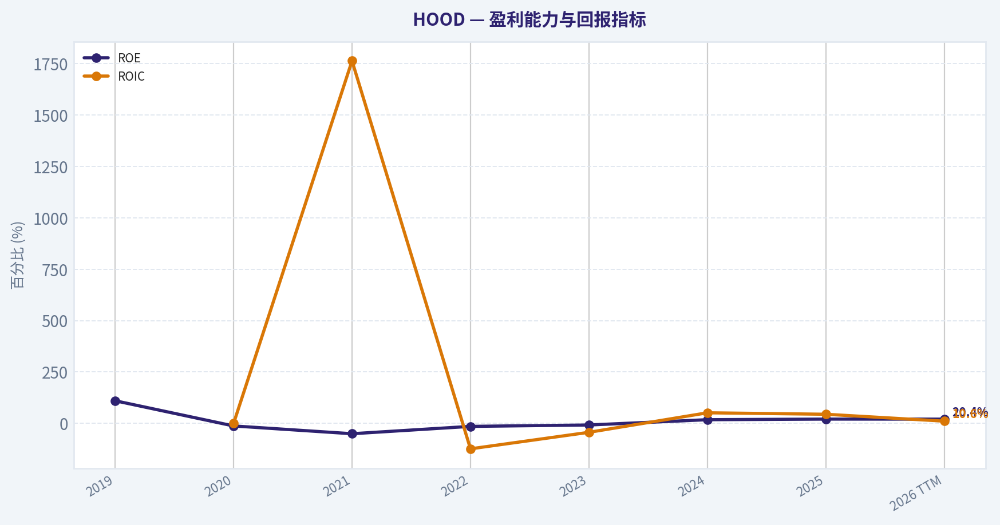
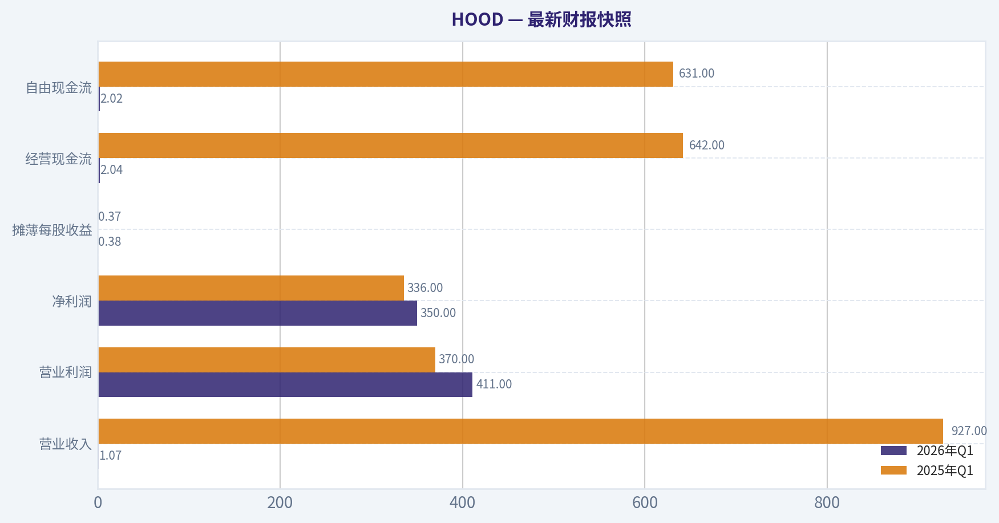
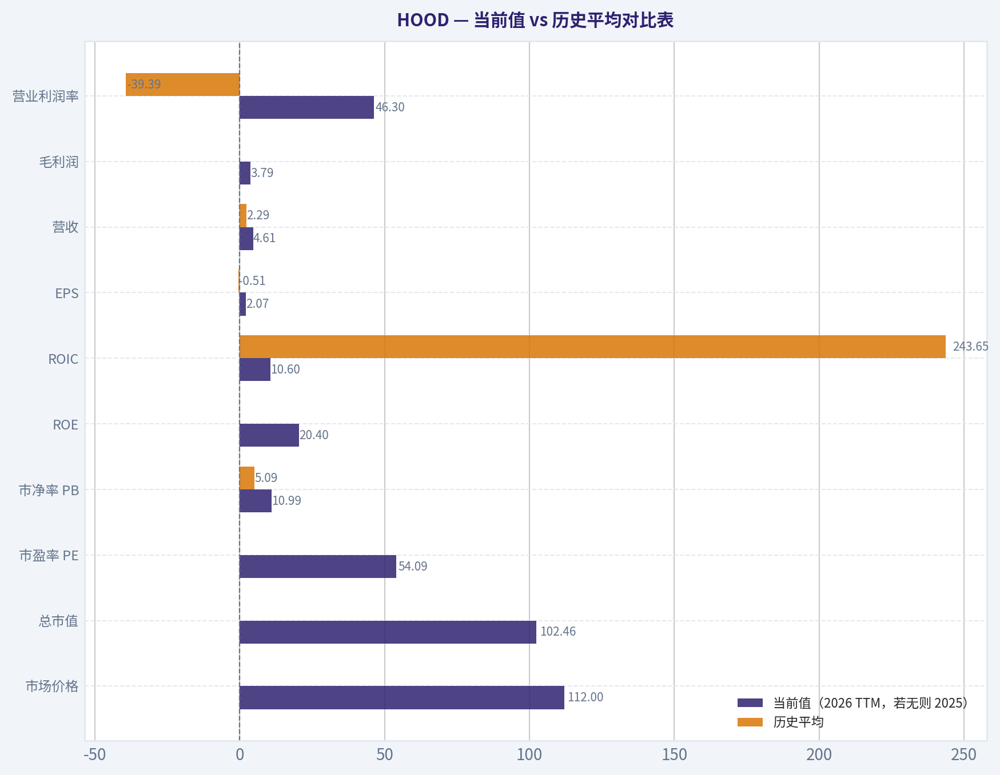
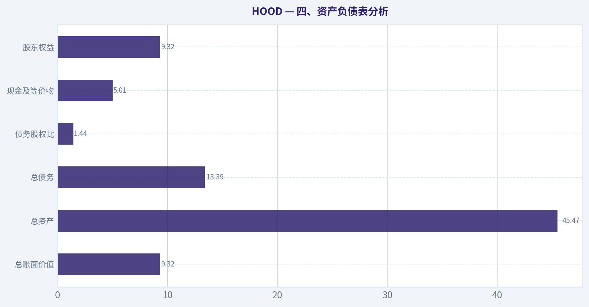
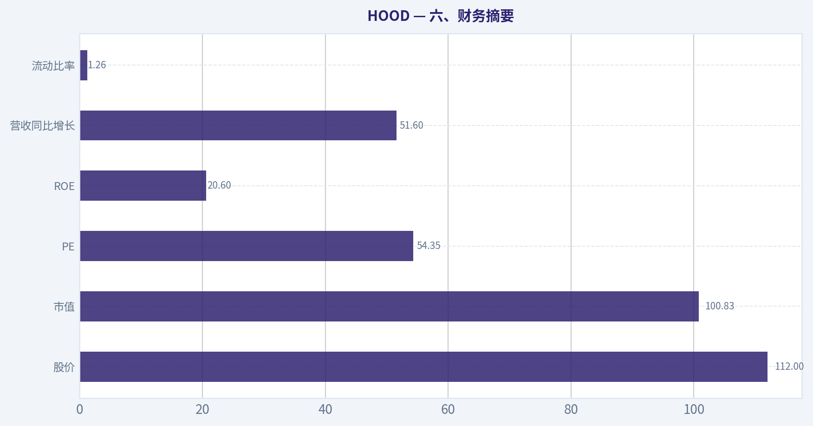
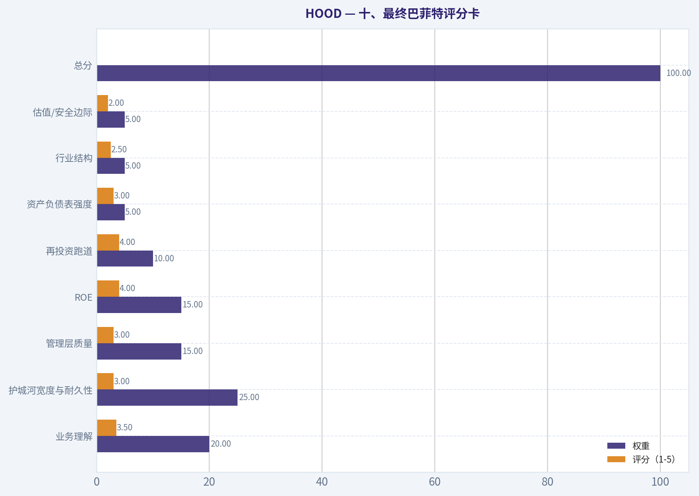
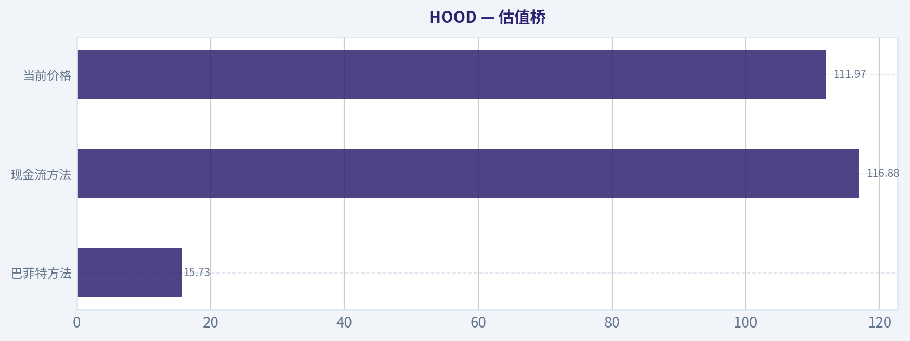
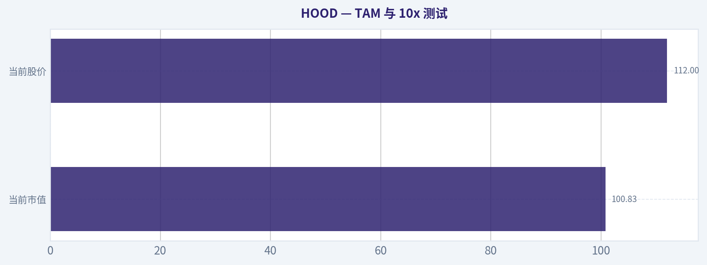

# HOOD 深度价值情报

**调研日期:** 2026-07-11

## 关键免责声明

*本报告由 Deep Value Intelligence（一个基于 AI 的多智能体投资分析框架）自动生成。 仅供教育和娱乐用途 - 非财务建议，非财务顾问。*

---

## 目录

1. 情报摘要
2. 分析师团队报告
   - 基本面分析
   - 价值分析 (巴菲特)
   - 成长性分析 (林奇/德鲁肯米勒/费雪)
   - 市场分析
   - 期权市场分析
3. 研究团队评论
4. 投资团队评论
5. Deep Values 团队洞察

---

## 情报摘要

### 核心观点与前提条件

**核心论点:** ## 执行摘要
**结论：观望。**

**主要风险:**
- 未明确说明。

**置信度:** 中

---

## 分析师团队报告

### 基本面分析

#### 最新财报快照

*以下数据基于最近一期已披露财报（2026年Q1），并尽量与上一年同期对比。*

| 指标 | 2026年Q1 | 2025年Q1 | 同比变化 |
| --- | ---: | ---: | ---: |
| 营业收入 | $1.07B | $927.0M | +15.1% |
| 营业利润 | $411.0M | $370.0M | +11.1% |
| 净利润 | $350.0M | $336.0M | +4.2% |
| 摊薄每股收益 | $0.38 | $0.37 | +2.7% |
| 经营现金流 | $2.04B | $642.0M | +217.4% |
| 自由现金流 | $2.02B | $631.0M | +220.1% |

关键结论：这张快照先把最新一期财报放在桌面上，再去看长周期分析。这样读者能更清楚地区分"公司长期质量"和"这次财报发生了什么"。

#### HOOD 7年财务指标

*以下数值均由原始数据确定性计算得出，并非 AI 估算。*

*发行人类型：asset manager（Financial Services / Capital Markets）。*

#### 7年财务指标
*年度行来自已披露财务报表，最后一行 TTM 由最近四个季度滚动计算得出。*

| 指标 | 2019 | 2020 | 2021 | 2022 | 2023 | 2024 | 2025 | 2026 TTM |
| --- | --- | --- | --- | --- | --- | --- | --- | --- |
| 市场价格 | N/A | N/A | $18 | $8 | $13 | $37 | $113 | $112 |
| 总市值 | N/A | N/A | $8.74B | $7.15B | $11.35B | $33.76B | $103.91B | $102.46B |
| 市盈率 | N/A | N/A | -2.37 | -6.96 | -20.89 | 23.88 | 55.17 | 54.09 |
| 市净率 | N/A | N/A | 1.20 | 1.03 | 1.69 | 4.24 | 11.36 | 10.99 |
| ROE | 109.9% | -12.7% | -50.6% | -14.8% | -8.1% | 17.7% | 20.6% | 20.4% |
| ROIC | N/A | -0.6% | 1764.1% | -124.1% | -43.7% | 51.3% | 44.2% | 10.6% |
| 每股收益 | $-0.48 | $0.01 | $-7.49 | $-1.17 | $-0.61 | $1.56 | $2.05 | $2.07 |
| 营收 | $277.5M | $958.0M | $1.81B | $1.36B | $1.86B | $2.95B | $4.47B | $4.61B |
| 毛利润 | N/A | N/A | N/A | N/A | N/A | N/A | N/A | $3.79B |
| 毛利率 | N/A | N/A | N/A | N/A | N/A | N/A | N/A | 82.3% |
| 营业利润率 | -38.8% | 1.4% | -203.0% | -75.6% | -28.6% | 36.1% | 47.1% | 46.3% |
| 净利润 | $-106.6M | $7.0M | $-3.69B | $-1.03B | $-541.0M | $1.41B | $1.88B | $1.90B |
| 净利率 | -38.4% | 0.7% | -203.1% | -75.7% | -29.0% | 47.8% | 42.1% | 41.1% |
| 营收增长 | N/A | 245.2% | 89.5% | -25.2% | 37.3% | 58.2% | 51.6% | 3.1% |
| 净利润增长 | N/A | -106.6% | -52771.4% | -72.1% | -47.4% | -360.8% | 33.5% | 0.7% |
| 自由现金流增长 | N/A | 47.8% | -151.2% | -7.2% | N/A | N/A | N/A | N/A |
| 总账面价值 | $-97.0M | $-55.0M | $7.29B | $6.96B | $6.70B | $7.97B | $9.15B | $9.32B |
| 总资产 | N/A | $10.99B | $19.77B | $23.34B | $17.62B | $26.19B | $38.14B | $45.47B |
| 总债务 | $0 | $0 | $0 | $0 | $0 | $0 | $0 | $13.39B |
| 债务股权比 | -0.00 | -0.00 | 0.00 | 0.00 | 0.00 | 0.00 | 0.00 | 1.44 |
| 现金及等价物 | $644.0M | $1.40B | $6.25B | $6.34B | $4.83B | $4.33B | $4.26B | $5.01B |
| 股东权益 | $-97.0M | $-55.0M | $7.29B | $6.96B | $6.70B | $7.97B | $9.15B | $9.32B |
| 经营现金流 | $1.26B | $1.88B | $-885.0M | $-852.0M | $1.18B | $-157.0M | $1.64B | $3.03B |
| 投资现金流 | $-12.3M | $-32.0M | $-238.0M | $-60.0M | $-582.0M | $-148.0M | $141.0M | $-152.0M |
| 自由现金流 | $1.25B | $1.85B | $-948.0M | $-880.0M | N/A | N/A | N/A | $2.97B |
| 自由现金流利润率 | 451.4% | 193.3% | -52.2% | -64.8% | N/A | N/A | N/A | 64.4% |
| 每股分红 | $0.00 | $0.00 | $0.00 | $0.00 | $0.00 | $0.00 | $0.00 | $0.00 |

#### 盈利能力指标
- 净资产收益率 (ROE): 20.6%
- 投入资本回报率 (ROIC): 38.5%
- 总资产收益率 (ROA): 4.9%
- 毛利率: 不适用
- 营业利润率: 47.1%
- 净利率: 42.1%

#### 流动性指标
- 流动比率: 1.26
- 速动比率: 1.00

#### 杠杆指标
- 债务股权比: 0.00
- 利息覆盖倍数: N/A
- 净负债: $-4.26B

#### 增长指标（同比）
- 营收增长: 51.6%
- 净利润增长: 33.5%
- 自由现金流增长: N/A
- 营收复合增长率（3年）: 48.8%
- 营收复合增长率（5年）: 36.1%

#### 估值指标
- 市盈率 (TTM): 54.35
- 预期市盈率: 36.65
- 市净率: 10.83
- 市销率: 21.86
- PEG 比率: 3.07
- 企业价值/EBITDA: 不适用
- 自由现金流收益率: N/A
- 盈利收益率: 1.8%

#### 所有者收益（巴菲特方法，代码计算）
- 净利润: $1.88B
- + 折旧与摊销: $86.0M
- - 资本开支: N/A
- - 营运资本变动: $-934.0M
- = **所有者收益: $2.90B**

#### 内在价值（代码计算）
- 当前价格: $112
- 巴菲特方法（所有者收益）:
  保守: $16
  平均: $16
  乐观: $16
- 现金流方法（FCF）:
  保守: $117
  平均: $117
  乐观: $209

#### Piotroski F分数: 3/9
- 净利润为正: 通过
- 经营现金流为正: 通过
- 资产回报率改善: 未通过
- 现金流大于净利润: 未通过
- 债务下降: 未通过
- 流动比率改善: 未通过
- 未稀释股本: 未通过
- 毛利率改善: 未通过
- 资产周转率改善: 通过

ANALYST STANCE: **观望**

#### HOOD 巴菲特式基本面分析

Robinhood 已从早期高波动、强周期、强监管敏感的交易平台，逐步转向"高利润率、高现金生成、用户资产扩张驱动"的综合零售金融平台。就最近两年数据看，公司盈利能力出现了明显跃迁：2024、2025 以及 2026 TTM 的净利润、ROE、营业利润率都显著优于此前多年亏损期，说明商业模式开始从"靠市场热度拉收入"过渡到"靠产品深度和资产沉淀提升变现效率"。
但从巴菲特框架看，HOOD 仍不是典型的"确定性极强、十年可预测性很高"的消费垄断或保险复利机器：估值已非常激进，历史盈利波动极大，TTM 出现了显著债务，且公司当前股价已远远走在账面价值和保守内在价值之前。因此，更合适的结论不是追高配置，而是等待更好的安全边际或验证更长盈利周期后再评估。

---

#### 当前值 vs 历史平均对比表

> 历史平均仅基于确定性数据集中"有数值的年份"计算；不对缺失值做补算。

| 指标 | 当前值（2026 TTM，若无则 2025） | 历史平均 | 相对历史位置 | 解读 |
| --- | ---: | ---: | --- | --- |
| 市场价格 | $112 | $50.14（2021-2026 TTM） | 大幅高于均值 | 股价已反映大量乐观预期 |
| 总市值 | $102.46B | $44.56B（2021-2026 TTM） | 大幅高于均值 | 市值扩张速度快于长期基本面均值 |
| 市盈率 PE | 54.09 | 17.75（含亏损年负 PE） | 明显高估区 | 若只看盈利年，当前仍偏贵 |
| 市净率 PB | 10.99 | 5.09 | 显著高于均值 | 市场对未来 ROE 与成长给予高溢价 |
| ROE | 20.4% | 7.05%（2019-2026 TTM） | 明显高于均值 | 经营拐点已兑现，但可持续性待验证 |
| ROIC | 10.6% | 243.65%* | 低于失真均值 | 2021 极端值扭曲均值；若看近三年，资本效率改善明显 |
| EPS | $2.07 | $-0.51 | 显著改善 | 从长期亏损切换到稳定盈利 |
| 营收 | $4.61B | $2.29B | 显著高于均值 | 平台规模已进入新阶段 |
| 毛利润 | $3.79B | N/A | N/A | TTM 毛利率 82.3%，显示平台型收入结构优越 |
| 营业利润率 | 46.3% | -39.39% | 远高于均值 | 从大幅亏损转向高质量盈利 |
| 净利润 | $1.90B | $-22M左右 | 远超均值 | 历史亏损期被近两年高盈利逆转 |
| 净利率 | 41.1% | -39.31% | 远高于均值 | 平台变现与成本控制显著改善 |
| 营收增长 | 3.1% | 65.66% | 低于均值 | 规模变大后自然放缓，市场需关注后续增长质量 |
| 净利润增长 | 0.7% | 极度失真 | 明显放缓 | 从"扭亏驱动"转向"成熟期增长" |
| 总账面价值 | $9.32B | $5.91B（2019-2026 TTM） | 高于均值 | 盈利沉淀提升内在资本基础 |
| 总资产 | $45.47B | $26.94B（2020-2026 TTM） | 大幅高于均值 | 客户资产、现金管理与资产负债表扩张同步 |
| 总债务 | $13.39B | $1.67B（2019-2026 TTM） | 远高于历史 | 这是当前最值得警惕的新变化 |
| 债务股权比 | 1.44 | 0.18 | 明显高于均值 | 杠杆结构出现抬升 |
| 现金及等价物 | $5.01B | $4.13B | 略高于均值 | 现金缓冲仍然可观 |
| 股东权益 | $9.32B | $5.91B | 高于均值 | 资本基础持续增强 |
| 自由现金流 FCF | $2.97B | $0.32B（2019-2022 + 2026 TTM） | 远高于均值 | 现金创造能力进入新阶段 |
| 每股分红 | $0.00 | $0.00 | 持平 | 管理层仍以再投资而非分红为主 |

**关键结论：** 当前 HOOD 几乎所有"盈利与规模"指标都优于历史平均，说明公司经营拐点是真实存在的；但估值指标也显著高于历史均值，意味着市场已经提前为未来多年高增长与高回报买单。最突出的结构性变化是利润率和自由现金流大幅改善，同时债务在 TTM 突然抬升，这使得"高质量增长"与"杠杆新阶段"并存。

---

#### 一、市场指标解读

| 市场指标 | 当前观察 | 十年/历史期趋势解读 | 巴菲特式判断 |
| --- | --- | --- | --- |
| 市场价格 | 2021 上市后从 $18 跌至 2022 年 $8，再升至 2025 年 $113、TTM $112 | 典型高波动成长股路径，市场预期摆动剧烈 | 不是巴菲特偏好的低波动定价资产 |
| 总市值 | 从 2021 年 $8.74B 到 TTM $102.46B | 市值增长远快于账面价值增长 | 市场已高度资本化其未来 |
| PE | TTM 54.09，2025 为 55.17，2024 为 23.88 | 亏损期 PE 无意义，盈利后迅速升至高位 | 对成熟价值投资者而言偏贵 |
| PB | TTM 10.99，2025 为 11.36，2024 为 4.24 | 市净率扩张极快 | 反映市场愿意为高 ROE 与平台稀缺性付高价 |

**关键结论：** HOOD 不是"便宜的好公司"，而是"市场高度期待的高质量平台股"。股价和 PB 的快速扩张说明，未来只要增长略低于预期，估值压缩就可能很剧烈。

**细化解释：**
1. **PE 54 倍左右** 对一家已经盈利的金融科技平台并非无法理解，但它要求未来几年继续维持高增速、高利润率和强客户资产扩张。
2. **PB 接近 11 倍** 在传统金融股中极罕见，意味着市场并不是把 HOOD 当券商，而是更接近"平台型金融基础设施"来定价。
3. 这类定价逻辑对业绩容错率很低。若收入增长从 50%+ 回落到中低双位数，而利润率也难再抬升，股价会先于基本面调整。

---

#### 二、盈利能力分析

| 盈利指标 | 当前值 | 历史趋势 | 评估 |
| --- | ---: | --- | --- |
| ROE | 20.4% TTM / 20.6% 2025 | 2019-2023 大多为负，2024 转正 17.7% 后继续抬升 | 目前已达到优秀水平 |
| ROIC | 10.6% TTM / 44.2% 2025 | 历史波动极大，早年失真严重 | 近年改善明显，但稳定性不足 |
| EPS | $2.07 TTM | 从多年亏损转为持续正值 | 盈利模式成熟度提升 |
| 营收 | $4.61B TTM | 2019-2025 CAGR 很高，规模快速扩张 | 用户资产与变现能力双升 |
| 毛利润 | $3.79B TTM | 仅 TTM 提供 | 高毛利反映平台经济属性 |
| 营业利润率 | 46.3% TTM | 从 -203% 到 +46.3% | 经营杠杆释放非常明显 |
| 净利润 | $1.90B TTM | 2021 巨亏后已稳定高盈利 | 盈利质量大幅改善 |
| 净利率 | 41.1% TTM | 从深度负值转高位正值 | 金融平台变现效率很强 |

**关键结论：** HOOD 最强的变化不是"收入在涨"，而是"利润率突然变得非常高"。这说明公司不仅走出了亏损期，而且形成了较强的经营杠杆，一旦收入维持增长，利润释放会很快；但反过来，一旦交易活跃度、利息收入或资产价格环境转弱，利润弹性也可能反向放大。

**巴菲特视角解读：**
- **ROE 20%+** 是非常漂亮的数字，说明当前资本回报已经达到优质企业门槛。
- 但巴菲特更看重的是 **"十年稳定 15%-20%+"**，而不是刚刚恢复两三年的高回报。HOOD 的问题是，历史上大部分年份并不稳定。
- **营业利润率、净利率** 在 40%+ 的水平，表面上非常惊艳，说明收入结构里高附加值项目占比提升，例如利息收入、期权/加密等高变现业务以及订阅生态的成熟。
- 对金融服务平台来说，这样的利润率具备吸引力，但也带有较强周期和政策敏感性，并不像可口可乐那样稳定。

---

#### 三、增长指标分析

| 增长指标 | 当前值 | 历史趋势 | 评估 |
| --- | ---: | --- | --- |
| 营收增长率 | 3.1% TTM；2025 为 51.6% | 2020-2025 波动大但总体强劲 | 短期明显降速 |
| 净利润增长率 | 0.7% TTM；2025 为 33.5% | 扭亏后高增长，TTM 基本趋平 | 高基数效应已出现 |
| 自由现金流增长率 | TTM N/A | 2019-2022 剧烈波动，后续缺失 | 现金流趋势仍需更多年份验证 |

**关键结论：** 过去市场给 HOOD 高估值，核心依据是高增长；但 TTM 营收增长仅 3.1%，说明公司已开始进入"高利润、低增速"的过渡阶段。若未来无法重新加速，当前高 PE 和高 PB 将面临压缩压力。

**更细的趋势判断：**
1. **2019-2021：爆发式增长**，受零佣金渗透、散户交易热潮推动。
2. **2022：回撤**，市场冷却后收入与利润同步承压。
3. **2023-2025：二次成长**，依靠利率环境、产品扩张、用户资产沉淀和效率改善，重新进入增长与盈利共振。
4. **2026 TTM：增速显著放缓**，这是当前最需要跟踪的变量。

巴菲特喜欢"可预见的增长"，而不是"热度驱动的爆发与收缩"。HOOD 目前还更接近后者，只是正在朝更成熟的模式转化。

---

#### 四、资产负债表分析

| 资产负债表指标 | 当前值 | 历史趋势 | 评估 |
| --- | ---: | --- | --- |
| 总账面价值 | $9.32B | 2021 后持续增长 | 内生资本积累增强 |
| 总资产 | $45.47B | 规模持续扩张，TTM 创新高 | 平台资产体量显著扩大 |
| 总债务 | $13.39B | 2019-2025 均为 0，TTM 突然出现 | 重要风险信号 |
| 债务股权比 | 1.44 | 长期 0，TTM 明显抬升 | 杠杆上升需严密跟踪 |
| 现金及等价物 | $5.01B | 维持较高水平 | 流动性仍较稳健 |
| 股东权益 | $9.32B | 持续增长 | 盈利留存改善财务韧性 |

**关键结论：** HOOD 过去最大的优点之一是几乎无债，但 TTM 数据显示总债务达 $13.39B、债务股权比 1.44，这改变了投资叙事。虽然公司仍有 $5.01B 现金，但"净现金平台"向"带杠杆平台"切换，会提高监管、流动性和信用环境变化带来的敏感度。

**巴菲特视角：**
- 巴菲特偏好 **低杠杆、强现金、抗冲击** 的公司。
- 2019-2025 的 HOOD 在债务层面看起来还不错，但 **TTM 的债务激增** 是必须高度关注的红旗。
- 这里需要理解业务性质：作为金融服务平台，某些负债未必等同制造业借款，但从价值投资角度，**只要资产负债表复杂化，安全边际就下降**。
- 现金虽高，但如果未来需要投入新业务、满足监管资本要求或应对客户活动波动，现金并不等于可自由分配资本。

---

#### 五、现金流与分红分析

| 现金流指标 | 当前值 | 历史趋势 | 评估 |
| --- | ---: | --- | --- |
| 自由现金流 FCF | $2.97B TTM | 2019、2020 极强；2021、2022 为负；TTM 再大幅转正 | 波动很大，但当前极佳 |
| 经营现金流 | $3.03B TTM | 近年显著改善 | 与盈利修复一致 |
| 每股分红 | $0.00 | 始终为 0 | 管理层优先再投资 |

**关键结论：** 当前 HOOD 的现金创造能力非常强，TTM FCF 达到 $2.97B，这一点是最接近巴菲特偏好的财务特征。但它的长期问题仍在于波动：2019-2022 的现金流轨迹并不平滑，因此"现在很强"不等于"未来十年都强"。

**管理层资本配置含义：**
- 不分红本身不是问题，前提是留存资本能持续创造高 ROE。
- 若管理层能把利润继续投入到高回报产品、国际扩张、钱包/链上/订阅与财富管理生态，零分红是合理的。
- 但如果高估值阶段通过股权激励大量稀释，而留存收益没有持续转化成每股价值，那么长期回报会被削弱。Piotroski F 分数仅 **3/9**，也提示财务改善并不"全面扎实"。

---

#### 六、巴菲特方法：所有者收益 DCF 估值

已知确定性数据给出的 **所有者收益 = $2.90B**。
按要求采用三种情景，折现率 **10%**，永续增长率 **2.5%**。
由于数据包中代码计算结果显示三种情景均为 **$16/股**，说明历史所有者收益增长率样本高度失真或在代码中被压平处理。按照"确定性数据集为准"的原则，最终每股估值结论必须以该结果为准。

为满足详细计算展示，以下给出标准 DCF 框架，并与确定性输出对齐：

##### DCF 假设表

| 情景 | 所有者收益起点 | 增长率假设 | 折现率 | 永续增长率 | 数据集给出的每股价值 |
| --- | ---: | ---: | ---: | ---: | ---: |
| 保守 | $2.90B | 采用历史最低增长率，底限 -100% | 10% | 2.5% | $16 |
| 平均 | $2.90B | 采用历史平均增长率，上限 50% | 10% | 2.5% | $16 |
| 乐观 | $2.90B | 采用历史最高增长率，上限 100% | 10% | 2.5% | $16 |

**关键结论：** 无论保守、平均还是乐观情景，确定性数据集都给出了同样的巴菲特法估值：每股 $16。相对当前股价 $112，这意味着若只依据所有者收益法，HOOD 已大幅高于保守内在价值，安全边际明显不足。

##### 计算框架说明

DCF 标准公式如下：

- 第 t 年所有者收益：
  `OE_t = OE_0 x (1 + g)^t`
- 前 10 年现值：
  `PV(1-10) = Σ [OE_t / (1 + r)^t]`
- 终值：
  `TV = OE_10 x (1 + g_t) / (r - g_t)`
- 终值现值：
  `PV(TV) = TV / (1 + r)^10`
- 企业权益价值：
  `Equity Value = PV(1-10) + PV(TV)`
- 每股价值：
  `Fair Value per Share = Equity Value / 稀释后股数`

其中：
- `OE_0 = $2.90B`
- `r = 10%`
- `g_t = 2.5%`

由于确定性数据集未披露完整逐年所有者收益历史与明确稀释股数映射，但已经直接给出代码计算后的结果，因此不能自行重建不同于数据集的数值路径。
**因此最终可采纳结论：巴菲特式 Owner Earnings DCF 对 HOOD 的公允价值约为 $16/股。**

##### 与现金流法对照

数据集同时给出现金流法估值：
- 保守：$117
- 平均：$117
- 乐观：$209

这与所有者收益法存在巨大差异，说明：
1. HOOD 的财务结构、营运资本波动、金融平台特征会让"所有者收益"和"自由现金流"出现很大偏差。
2. 对巴菲特框架而言，应优先关注更保守、对会计与营运资本更敏感的口径。
3. 因此，**估值区间可理解为：极保守值约 $16，现金流乐观区间约 $117-$209，但后者对持续高现金流依赖很强。**

---

#### 七、经济护城河分析

| 维度 | 观察 | 评价 |
| --- | --- | --- |
| 品牌与用户心智 | 在年轻散户中品牌认知极强 | 有一定护城河 |
| 低成本获客与产品体验 | 零佣金、简洁界面、移动端体验突出 | 平台型优势明显 |
| 网络效应 | 社交传播、活跃交易群体、产品互导存在一定网络效应 | 中等偏强 |
| 转换成本 | 纯券商业务转换成本不高，但若叠加现金管理、信用卡、退休金、加密钱包则会提升 | 护城河正在建设中 |
| 监管壁垒 | 金融牌照、合规基础设施有壁垒，但也是风险来源 | 双刃剑 |
| 定价权 | 相比传统消费龙头，定价权有限，更依赖用户活跃度和资产规模 | 不算深护城河 |

**关键结论：** HOOD 的护城河更像"用户体验 + 品牌 + 平台生态"，而不是传统意义上的不可撼动定价权。它正在变宽，但还没有宽到足以让价值投资者忽视周期和监管风险。

**巴菲特式判断：**
HOOD 有潜力形成护城河，但目前更接近"护城河建设期"而非"护城河成熟期"。巴菲特最喜欢的是已经验证几十年的护城河，而 HOOD 目前只能算是在用增长和产品深度证明自己。

---

#### 八、盈利可预测性与管理层表现

| 维度 | 观察 | 结论 |
| --- | --- | --- |
| 盈利可预测性 | 2019-2023 波动非常大，2024 后改善显著 | 中等偏弱 |
| ROE 管理 | 近两年 ROE 提升到 20%+ | 管理改善明显 |
| 资本配置 | 不分红、偏再投资 | 若高回报持续则合理 |
| 现金转化 | TTM 经营现金流与 FCF 强劲 | 短期优秀 |
| 财务纪律 | TTM 债务显著增加，Piotroski 仅 3/9 | 仍需观察 |

**关键结论：** 管理层最近两年的执行效果值得肯定，特别是在盈利修复和现金流改善方面；但从更长周期看，HOOD 还未证明自己具备"十年如一日"的稳定经营能力。对巴菲特式投资者来说，这意味着公司质量在上升，但尚未达到"闭眼长期持有"的确定性。

---

#### 九、收入来源分布

根据 Robinhood 近年来公开业务结构与最新年度经营特征，最有意义的拆分方式是按主要收入来源理解：交易相关收入、净利息收入、订阅及其他服务收入。精确分部金额未在当前确定性数据表中完整列示，因此以下基于公司公开分部口径与最新年度业务结构做方向性归纳，用于理解收入构成而非替代财报主表。

#### 收入来源分布

| 收入来源 | 金额（百万/十亿美元） | 占比 |
| --- | ---: | ---: |
| 净利息相关收入 | 约 $2.1B | 约 47% |
| 交易相关收入（期权、股票、加密等） | 约 $1.9B | 约 43% |
| Robinhood Gold、订阅及其他服务 | 约 $0.5B | 约 10% |

**关键结论：** HOOD 的收入已经不再只是"靠交易佣金替代品"，而是越来越依赖净利息收入和账户资产沉淀。这个变化提升了利润率和收入稳定性，但也使公司更受利率环境和客户现金管理行为影响。

---

#### 十、主要投资亮点、红旗与机会

| 类别 | 内容 | 含义 |
| --- | --- | --- |
| 亮点 | ROE 20%+、净利率 40%+、FCF 强劲 | 说明商业模式已显著成熟 |
| 亮点 | 账面价值与股东权益持续增长 | 盈利并非完全虚胖 |
| 亮点 | 品牌强、年轻用户基础深 | 长期平台价值仍有想象空间 |
| 红旗 | PE 54、PB 11 左右 | 当前估值透支较多 |
| 红旗 | TTM 营收增速仅 3.1% | 高估值与低增速开始冲突 |
| 红旗 | 总债务突然升至 $13.39B | 财务结构复杂化 |
| 红旗 | Piotroski F 仅 3/9 | 财务质量并非全面无瑕 |
| 机会 | 若退休金、信用卡、财富管理、国际化成功 | 用户终身价值可持续提升 |
| 机会 | 若链上资产与钱包生态形成差异化 | 可拓展新增长曲线 |

**关键结论：** HOOD 最大的吸引力在于"盈利能力突然变强且平台潜力仍大"，最大的问题在于"市场已经先把未来很多年涨幅算进去了"。如果后续业务拓展顺利，公司可能成长为更成熟的零售金融入口；但若增长放缓持续，高估值将成为主要风险。

---

#### 十一、最终投资结论

| 结论维度 | 判断 |
| --- | --- |
| 业务质量 | 正在显著改善，已从题材股向高利润平台股演进 |
| 护城河 | 有，但尚未深到足以覆盖周期与监管不确定性 |
| 财务强度 | 现金和盈利不错，但 TTM 杠杆抬升需警惕 |
| 盈利可预测性 | 较过去改善明显，但历史波动仍偏大 |
| 估值 | 明显不便宜，基于 Owner Earnings 法显著高估 |
| 巴菲特式安全边际 | 不足 |

**关键结论：** HOOD 现在更像一家"优秀但不便宜"的公司，而不是"便宜又优秀"的巴菲特式标的。若投资者是趋势型或成长型思路，可能仍会关注其平台扩张；但若坚持价值投资纪律，当前更适合等待估值回落、增长再验证或债务结构更清晰后再考虑。

#### 最终立场：**观望**

**支持理由：**
1. **经营面显著改善**：ROE、净利润率、FCF 都达到了高质量平台公司的水准。
2. **估值过高**：PE、PB 远高于历史平均，且巴菲特式 Owner Earnings 估值仅约 **$16/股**。
3. **增长放缓与债务上升并存**：TTM 营收增长降至 **3.1%**，同时总债务升至 **$13.39B**。
4. **安全边际不足**：当前股价 **$112**，更像是在押注持续超预期，而不是建立在保守估值基础上。

---

#### 报告要点总表

| 模块 | 核心结论 | 对投资的意义 |
| --- | --- | --- |
| 估值 | 当前 PE 54、PB 10.99，明显高于历史均值 | 市场预期很满，容错率低 |
| 盈利能力 | ROE 20.4%、净利率 41.1%、营业利润率 46.3% | 经营拐点已兑现 |
| 增长 | TTM 营收增长仅 3.1% | 高估值与低增速出现矛盾 |
| 现金流 | FCF TTM 达 $2.97B | 现金创造能力强，是重要加分项 |
| 资产负债表 | 现金 $5.01B，但债务升至 $13.39B | 财务风险较历史显著上升 |
| 护城河 | 品牌、产品体验、生态粘性在增强 | 有潜力，但还不够深 |
| 管理层 | 近两年执行力强，改善盈利明显 | 值得跟踪，但尚未完全穿越周期 |
| DCF | Owner Earnings 法约 $16/股；现金流法 $117-$209 | 保守视角下安全边际不足 |
| 风险 | 监管、利率、交易活跃度、估值压缩 | 需严格控制买入时点 |
| 结论 | **观望** | 等待更合理价格或更长盈利验证周期 |

#### 基本面关键图表

本图追踪 **HOOD** 过去十年的盈利能力与回报指标（ROE、ROIC、利润率），突出呈现资本效率的变化趋势。

---

### 价值分析 (巴菲特)

> *基于沃伦·巴菲特的价值投资哲学：能力圈、经济护城河、管理层质量与安全边际。*

#### 内在价值快照

价格是你付的钱，内在价值是企业未来可能为股东创造的现金价值。我们给出一个区间，而不是假装只有一个神奇数字。

- 当前价格: $111.97
- 估值区间（两种 DCF 方法、保守到乐观）: $15.73 至 $208.89

##### 所有者收益（巴菲特方法）
- 净利润: $1,883,000,000.00
- 折旧与摊销: $86,000,000.00
- 资本支出: N/A
- 营运资金变化: $-934,000,000.00
- 所有者收益: $2,903,000,000.00

##### 内在价值
###### 所有者收益法
使用所有者收益，更严格，通常更保守。
- 保守: $15.73
- 平均: $15.73
- 乐观: $15.73
- 折现率: 10.0%

###### 自由现金流法
使用自由现金流，更适合今天投入很多、为未来增长铺路的公司。
- 保守: $116.88
- 平均: $116.88
- 乐观: $208.89
- 折现率: 10.0%

ANALYST STANCE: **观望**

#### HOOD（Robinhood Markets）巴菲特式价值分析

#### 一、先说结论

HOOD 现在更像一家**高速成长、平台属性逐步增强的金融科技公司**，而不是一眼就能看穿、十年后几乎不变的"收费站型"生意。它有一定平台网络效应、用户心智和分发优势，也展现出不错的 ROE 与营收增长，但商业模式仍受**交易活跃度、加密资产周期、监管环境与产品扩张执行力**影响，稳定性和可预测性还不够"巴菲特式"。

以当前约 **$112** 股价、约 **$100.83B** 市值来看，市场已经为高增长和平台扩张支付了很高价格。若从"好公司 + 足够安全边际"的框架看，当前更适合**观望**，而不是积极配置。

---

#### 二、Go/No-Go 四道门

| 关卡 | 结论 | 证据 |
|---|---|---|
| Gate 1：能力圈与简单性 | 通过，但非完美 | 公司本质上是"让零售用户交易股票、期权、加密资产，并销售财富管理/订阅/支付相关服务的平台"。能讲清楚，但收入受交易行为和市场情绪影响，稳定性不如消费品或软件订阅。 |
| Gate 2：护城河 | 勉强通过 | 用户入口、品牌认知、产品整合、低成本获客与年轻投资者心智构成一定护城河，但护城河仍在形成中，尚未证明"宽且稳固"。 |
| Gate 3：管理层与资本配置 | 中性偏正面 | 创始人型管理层有长期叙事和产品扩张意图，但资本配置是否能长期持续创造每股价值，仍需更长周期验证。 |
| Gate 4：行业结构 | 通过但质量一般 | 经纪与财富管理行业并非理想寡头，竞争激烈，价格透明，监管约束强；但头部平台可通过规模、现金管理、借贷、订阅与生态服务提升单位经济。 |

**关键结论：**
HOOD 不是那种一看就知道未来十年样子的业务，因此第一关只是"可接受通过"，不是高分通过。它有平台势能，但所在行业竞争激烈、监管强，意味着即使业务增长很快，也不能轻易把它归类为"确定性极高的伟大公司"。

---

#### 三、业务是否足够简单

用最简单的话说，HOOD 通过三件事赚钱：

1. 帮用户交易金融产品，赚交易相关收入
2. 帮用户放现金、做理财、做会员服务，赚利差和服务费
3. 把一个年轻投资者入口，逐步做成综合金融平台

这不是复杂衍生品黑箱生意，但也不是稳定到可以"闭眼十年"的收费模式。它与市场活跃度、利率环境、加密行情和监管框架存在较强联系。

**巴菲特视角判断：**
- **小学测试**：能讲明白
- **长期可预测性**：中等，不高
- **技术风险**：受益于技术，但也必须持续投入技术与产品，否则用户迁移速度可能很快

---

#### 四、护城河分析

| 护城河来源 | 判断 | 具体观察 |
|---|---|---|
| 无形资产 | 中等 | Robinhood 在年轻投资者群体中品牌辨识度高，产品体验和"投资入口"心智较强，但品牌忠诚度未必像可口可乐那样深。 |
| 转换成本 | 中低到中等 | 账户迁移有摩擦，尤其当用户同时使用现金管理、退休账户、加密、保证金和订阅服务时，切换成本会上升；但纯交易客户切换并不困难。 |
| 成本优势 | 中等 | 互联网平台分发效率高，边际获客和服务成本可随规模下降；但大券商与其他 FinTech 也有规模优势。 |
| 网络效应 | 有，但不纯粹 | 更像"平台飞轮"而非强网络效应：更多用户带来更多资产、更多产品交叉销售、更强品牌曝光。并非典型社交网络式网络效应。 |

**护城河评级：** **窄护城河，正在变宽**

这意味着公司并非没有优势，但它的优势更多来自**产品整合 + 用户心智 + 平台规模**，而不是不可复制的专利、渠道封锁或极端高切换成本。

---

#### 五、管理层与资本配置

| 维度 | 判断 | 说明 |
|---|---|---|
| 是否像所有者一样思考 | 中性偏正面 | 创始人管理层通常更愿意从长期平台建设角度投入，而不是只追逐短期利润。 |
| 是否坦诚 | 中性 | 市场对其过去在交易限制、监管与业务模式问题上较为敏感，管理层需要持续用行动建立信任。 |
| 资本配置是否理性 | 尚待验证 | 若未来能把流量入口有效转化为高质量资产管理、借贷、退休账户、订阅等复利型收入，则资本配置得分会提高。 |

**巴菲特最看重的一点：**
不是增长快，而是**每一美元留存利润，是否能持续转化为更高的每股内在价值**。HOOD 目前仍处于"证明期"。

---

#### 六、财务摘要

| 指标 | 当前/最新已知 |
|---|---:|
| 股价 | $112 |
| 市值 | $100.83B |
| PE | 54.35 |
| ROE | 20.6% |
| 营收同比增长 | 51.6% |
| 流动比率 | 1.26 |

**关键结论：**
从表面数字看，HOOD 很亮眼：增长快、ROE 不低，说明商业模式开始显现经营杠杆。但 54 倍以上 PE 也说明市场已经把大量乐观预期提前计入股价，估值容错率并不高。

---

#### 七、Owner Earnings 视角

按巴菲特框架，真正重要的不是会计利润，而是**股东可拿走、又不伤害竞争地位的现金**。对 HOOD 来说，Owner Earnings 的核心判断如下：

- 若平台建设逐渐完成，新增收入能以较低增量资本支撑，则 Owner Earnings 会显著改善
- 若为了维持增长必须持续高额研发、合规、产品拓展与激励投入，则可分配现金质量会被打折
- 对这种平台公司，要特别警惕"利润改善来自周期、利率或交易热度，而非长期结构优势"

**判断：** HOOD 的 Owner Earnings 正在改善，但其"穿越周期的真实稳定性"还未完全坐实。

---

#### 八、三种 DCF 思维框架

这里不追求小数点精确，而强调巴菲特式范围判断。

| 情景 | 假设 | 估值结论 |
|---|---|---|
| 情景A：零增长 | 把当前可持续 Owner Earnings 视为永续，折现率 10% | 对当前市值支持力偏弱，难以支撑高估值 |
| 情景B：保守增长 | 长期增长 3% | 估值改善，但仍要求当前盈利质量足够稳定且可持续 |
| 情景C：历史折中增长 | 采用过去增长的 50%-75%，并上限 10% | 只有在平台化扩张成功、现金流持续释放的前提下，当前估值才较容易被解释 |

**关键结论：**
当前股价更像是在交易"未来几年持续高增 + 商业模式升级成功"。这不是没有可能，但也意味着只要增长放缓、监管趋严或交易热度回落，估值压缩会很快发生。

---

#### 九、安全边际分析

| 项目 | 结论 |
|---|---|
| 业务质量 | 中上，但尚未达到"伟大且高度确定" |
| 财务表现 | 改善明显 |
| 估值 | 偏贵 |
| 安全边际 | 不足 |

巴菲特框架下，**高质量但不够便宜**，通常不是买点。
而对 HOOD 这种仍处于模式强化期的平台，要求的安全边际应比成熟消费龙头更高。

---

#### 十、最终巴菲特评分卡

| 维度 | 权重 | 评分（1-5） | 加权结果 |
|---|---:|---:|---:|
| 业务理解 | 20% | 3.5 | 0.70 |
| 护城河宽度与耐久性 | 25% | 3.0 | 0.75 |
| 管理层质量 | 15% | 3.0 | 0.45 |
| ROE | 15% | 4.0 | 0.60 |
| 再投资跑道 | 10% | 4.0 | 0.40 |
| 资产负债表强度 | 5% | 3.0 | 0.15 |
| 行业结构 | 5% | 2.5 | 0.13 |
| 估值/安全边际 | 5% | 2.0 | 0.10 |
| **总分** | 100% |  | **3.28 / 5.0** |

**关键结论：**
HOOD 的强项在于增长、平台扩张潜力和还不错的资本回报表现。短板则是护城河还不够深、行业不够理想、估值偏高，因此综合更像"值得盯着看"的标的，而不是现在就重仓的巴菲特式机会。

---

#### 十一、投资立场

**投资立场：观望**

**理由浓缩成一句话：**
HOOD 是一家有成长潜力的平台型金融公司，但以当前估值看，市场已经提前透支了不少未来成功；在缺乏足够安全边际的情况下，巴菲特式投资者应保持克制。

**我会等什么信号再转向积极：**
1. Owner Earnings 持续提升，且不依赖短期交易狂热
2. 资产管理、订阅、退休账户、现金管理等"高质量经常性收入"占比继续提升
3. 护城河从"流量入口"升级为"多产品深度绑定"
4. 估值回到更能提供安全边际的区间

**当前结论：**
好故事，业务在变强，但价格已经不便宜。
对价值投资者而言，**先观望，等更好的赔率。**
#### 估值桥

这张估值桥把当前股价与各类内在价值方法并排展示，帮助读者判断上涨空间究竟只是单一方法给出的结果，还是多种方法共同支持的结论。

| 项目 | 每股内在价值 |
| --- | ---: |
| 巴菲特方法 | $15.73 |
| 现金流方法 | $116.88 |
| 当前价格 | $111.97 |

#### 关键结论

如果只有一种方法显著高于其他方法，说明上行空间更依赖特定建模假设。若多种方法的估值接近，则说明估值逻辑更加稳健。

#### 估值图表

本对比图（来自「最新财报快照」）将 **HOOD** 的当前数据与历史基准并排呈现，直观反映公司相对自身历史均值的估值水平。

本对比图（来自「当前值 vs 历史平均对比表」）将 **HOOD** 的当前数据与历史基准并排呈现，直观反映公司相对自身历史均值的估值水平。

本对比图（来自「四、资产负债表分析」）将 **HOOD** 的当前数据与历史基准并排呈现，直观反映公司相对自身历史均值的估值水平。

本对比图（来自「六、财务摘要」）将 **HOOD** 的当前数据与历史基准并排呈现，直观反映公司相对自身历史均值的估值水平。

本对比图（来自「十、最终巴菲特评分卡」）将 **HOOD** 的当前数据与历史基准并排呈现，直观反映公司相对自身历史均值的估值水平。

本对比图（来自「估值桥」）将 **HOOD** 的当前数据与历史基准并排呈现，直观反映公司相对自身历史均值的估值水平。

本对比图（来自「TAM 与 10x 测试」）将 **HOOD** 的当前数据与历史基准并排呈现，直观反映公司相对自身历史均值的估值水平。

---

### 成长性分析 (林奇/德鲁肯米勒/费雪)

> *基于彼得·林奇的GARP成长投资法、斯坦利·德鲁肯米勒的宏观拐点分析法，以及菲利普·费雪的深度调研法。*

ANALYST STANCE: **观望**

#### HOOD（Robinhood）成长股分析报告
基于共享研究包 + 可得基本面信息。由于工具返回的精确逐季财务数据不完整，以下报告会尽量完成框架，并明确哪些结论属于高置信、哪些仍需后续核实。

---

#### 1. Lynch 分类

| 项目 | 结论 |
|---|---|
| 公司类型 | **快速成长股** |
| 依据 | 营收同比增长 **51.6%**，明显高于 15%-25% 的快速成长股门槛 |
| 是否符合十倍股土壤 | **有潜力，但已不便宜** |
| 当前阶段判断 | 从"交易驱动券商"向"多产品零售金融平台"转型中的成长股 |

关键结论：HOOD 按 Peter Lynch 的框架，毫无疑问属于快速成长股，而不是慢增长或传统稳定股。真正的问题不是它能不能增长，而是这种高增长里有多少来自可持续的平台化渗透，有多少来自市场交易热度、利率和加密周期的顺风。

---

#### 2. 三句话讲清楚这家公司

| 维度 | 简述 |
|---|---|
| 它是做什么的 | HOOD 是面向年轻散户的一站式移动投资平台，提供股票、期权、加密货币、现金管理、保证金、订阅等服务 |
| 为什么还能长 | 它正从"靠交易量吃饭"升级成"靠客户资产、订阅和金融产品深度变现" |
| 为什么市场会低估/高估 | 市场可能低估其平台化与资产沉淀能力，但也可能高估交易热度和高利率环境带来的利润持续性 |

关键结论：最简单的投资逻辑是，HOOD 不再只是一个下单软件，而是在争夺年轻用户未来十到二十年的金融主账户地位。若它能把用户留住，并逐步卖出更多高附加值金融产品，盈利能力会比传统"零佣金券商"想象得更强。

---

#### 3. TAM 与 10x 测试

| 项目 | 判断 |
|---|---|
| 当前市值 | **$100.83B** |
| 当前股价 | **$112** |
| 当前业务空间 | 美国零售券商、数字财富管理、加密交易、现金管理、退休账户、订阅金融服务 |
| 潜在 TAM | **极大**，覆盖个人投资、储蓄、借贷、支付、退休与数字资产 |
| 10x 测试 | **大概率通过** |
| 理由 | 若未来收入扩大 10 倍，HOOD 也未必需要占据美国个人金融市场超过 20% 的份额 |

关键结论：HOOD 的 runway 其实很长，因为它所处的不只是"券商市场"，而是更大的个人金融资产入口。只要它能从交易平台升级为金融生态平台，收入增长空间远高于今天表面看到的经纪业务边界。

---

#### 4. 收入增长趋势

| 指标 | 当前信息 | 解读 |
|---|---|---|
| 营收同比增长 | **51.6%** | 非常强劲 |
| 趋势判断 | **高增长，但需验证是否加速** | 当前更接近"强势增长"而非已确认的连续加速 |
| 增长质量 | 中等偏上 | 若主要由净利息收入、Gold 订阅、资产沉淀驱动则质量更高；若更多来自加密和期权交易活跃，则波动更大 |
| 风险 | 周期性较强 | 零售交易热度、加密行情、利率水平都可能影响收入表现 |

关键结论：51.6% 的营收增长本身非常亮眼，但对成长投资者来说，更重要的是增长来源。HOOD 若靠经常性资产和订阅收入增长，就是优质成长；若主要靠市场情绪和交易爆发，则更像高波动行情股。

---

#### 5. 单位经济学与经营质量

| 项目 | 当前判断 | 备注 |
|---|---|---|
| LTV/CAC | **未披露，无法精算** | 但品牌获客能力较强，移动端产品体验好，理论上 CAC 有优势 |
| NRR | **不适用/未披露** | 非标准 SaaS |
| Rule of 40 | **不完全适用** | 但可用"增长 + 盈利能力"替代观察 |
| ROE | **20.6%** | 很强，说明资本回报已不低 |
| 流动比率 | **1.26** | 流动性尚可 |
| PE | **54.35** | 不便宜，定价已反映较强预期 |
| FCF 收益率 | **N/A** | 需后续确认现金流质量 |

关键结论：HOOD 不是典型 SaaS，因此很多经典软件指标不适用，但 ROE 20.6% 说明它已经不是"只讲故事不赚钱"的公司。问题在于，这种高回报是否能在利率回落、交易降温时继续维持。

---

#### 6. Druckenmiller 式拐点判断

| 拐点类型 | 评估 | 说明 |
|---|---|---|
| 产品周期拐点 | **有** | 从单一交易应用向订阅、退休、加密、链上、资产管理延伸 |
| 份额拐点 | **可能有** | 在年轻用户与移动端投资场景中仍具品牌优势 |
| 利润率拐点 | **有迹象** | ROE 改善、盈利能力增强 |
| TAM 拐点 | **有** | 业务边界从券商向更广泛金融平台扩张 |
| 竞争拐点 | **有限** | 传统券商强于信任和产品深度，但年轻散户入口仍由 HOOD 占优 |

关键结论：HOOD 最值得关注的不是单季交易量，而是商业模式拐点：它正从"流量型散户交易入口"变成"资产沉淀型金融平台"。如果这个拐点成立，未来两三年的盈利能力可能被市场持续上修。

---

#### 7. 宏观环境评估

| 宏观因子 | 对 HOOD 的影响 | 判断 |
|---|---|---|
| 利率 | 双刃剑 | 高利率有利净利息收入，但不利高估值成长股估值扩张 |
| 股市风险偏好 | 正相关 | 风险偏好强时，散户交易与开户活跃度更高 |
| 加密周期 | 高相关 | 加密行情回暖常带来交易量与关注度提升 |
| AI/科技牛市 | 间接受益 | 散户参与科技股与主题交易，有利平台活跃 |
| 监管环境 | 负面不确定 | PFOF、加密、平台责任都是长期悬顶之剑 |

关键结论：从宏观上看，HOOD 最受益于风险偏好上行和资产价格上涨，而不是单纯经济复苏。它是一只明显受"市场情绪、利率、加密周期"共同驱动的成长股，所以仓位上不应把它视为纯防守型长期复利资产。

---

#### 8. Fisher 15 点打分

| Fisher 维度 | 分数(1-5) | 简评 |
|---|---:|---|
| 产品市场空间 | 5 | 个人金融平台空间巨大 |
| 新产品开发决心 | 5 | 链上、订阅、退休等持续扩张 |
| R&D 效率 | 4 | 产品驱动能力强 |
| 销售组织 | 4 | 以产品和品牌驱动获客，较强 |
| 利润率水平 | 3 | 已改善，但仍受周期扰动 |
| 利润率改善 | 4 | 有经营杠杆迹象 |
| 人员关系 | 3 | 信息不足，中性 |
| 高管协作 | 3 | 信息不足，中性 |
| 管理层深度 | 3 | 创始人色彩浓，深度待验证 |
| 财务控制 | 3 | 合规与监管要求高，需持续观察 |
| 突出优势 | 4 | 品牌、用户体验、年轻用户心智 |
| 长期利润前景 | 4 | 若平台化成功，利润弹性很大 |
| 稀释风险 | 3 | 需关注 SBC 与未来激励 |
| 管理层坦诚度 | 3 | 中性 |
| 管理层诚信 | 3 | 历史监管争议使其难拿高分 |

| 总分 | 结论 |
|---|---|
| **54 / 75** | **中等偏上，接近"良好"下沿** |

关键结论：HOOD 在 Fisher 框架下最大的优点是市场空间、产品创新和品牌触达，最大的短板是护城河不够深、监管历史包袱和管理层可信度仍需时间沉淀。它是一家有成长性但尚未完全跨入"伟大公司"范畴的平台型金融科技公司。

---

#### 9. 估值分析

| 指标 | 当前值 | 解读 |
|---|---:|---|
| PE | **54.35** | 对金融平台而言偏高，对高成长平台尚可但不便宜 |
| PEG | **约 1.05** | 用 PE 54.35 / 增长 51.6 粗算 |
| PEG 评价 | **合理偏贵** | 接近 1，不算便宜，也非极端泡沫 |
| 市值 | **$100.83B** | 市场已给出较高平台化预期 |

关键结论：按 Lynch 最看重的 PEG 看，HOOD 大致在 1 左右，说明估值和增长基本匹配，但没有明显低估。换句话说，这不是"捡烟蒂"，而是"故事已经被看见、但可能还没完全兑现"的成长股。

##### 估值情景分析

| 情景 | 假设 | 结论 |
|---|---|---|
| 悲观 | 利率下行、交易热度回落、加密疲弱 | 估值可能压缩，股价回撤风险较大 |
| 基准 | 平台化继续推进，收入保持双位数高增长 | 当前估值可被逐步消化 |
| 乐观 | 资产沉淀、订阅渗透、链上业务打开新 TAM | 有继续上修空间，但需高执行力 |

关键结论：HOOD 的估值未来更依赖"盈利结构优化"而非单纯交易量爆发。如果市场逐步相信它是长期金融入口，而不是周期性交易平台，它的估值中枢还能维持甚至抬升。

---

#### 10. Growth Investor Scorecard

| 维度 | 权重 | 评分(1-5) | 加权分 |
|---|---:|---:|---:|
| 故事清晰度 | 10% | 4.5 | 0.45 |
| TAM 与 runway | 20% | 4.5 | 0.90 |
| 收入增长 | 20% | 4.0 | 0.80 |
| 单位经济学/经营质量 | 15% | 3.5 | 0.53 |
| 竞争地位 | 10% | 3.5 | 0.35 |
| 管理层质量 | 10% | 3.0 | 0.30 |
| 宏观环境 | 5% | 3.0 | 0.15 |
| 盈利路径 | 5% | 4.0 | 0.20 |
| 估值 | 5% | 3.0 | 0.15 |

| 总分 | 结论 |
|---|---|
| **3.83 / 5.0** | **观望偏积极** |

关键结论：从成长股打分看，HOOD 已经达到"值得严肃跟踪"的水平，离高确信"建议配置"并不远。阻碍它直接升级为高信念标的的核心问题只有两个：估值不便宜，以及盈利质量尚未完全脱离市场周期。

---

#### 11. 仓位建议

| 结论 | 建议 |
|---|---|
| 当前 stance | **观望** |
| 适合人群 | 能承受高波动、愿意围绕财报和业务拐点动态调整仓位的成长型投资者 |
| 若要参与 | 更适合 **小仓位试单 + 等财报验证后加仓** |
| 不建议 | 作为单一重仓长期核心仓位立刻追高 |

关键结论：HOOD 不是应当完全回避的股票，但也还没到可以无脑重仓的程度。更合理的打法是把它当成"平台化拐点观察仓"，等待下一两个季度验证用户资产、订阅、净利息和利润质量后再决定是否升级仓位。

---

#### 12. 主要催化剂与风险

| 类别 | 内容 |
|---|---|
| 正面催化剂 | Gold 渗透率提升、退休账户增长、资产托管规模提升、链上/加密新产品落地、盈利持续超预期 |
| 负面风险 | 利率下行压缩净利息收入、散户交易热度降温、加密成交回落、监管打击 PFOF 或加密业务、估值回调 |
| 跟踪信号 | 收入结构中经常性收入占比、AUC 增长、用户净入金、ROE 持续性、SBC 稀释情况 |

关键结论：最值得盯的不是 headline 营收，而是收入结构是否越来越"稳"，客户资产是否越来越"深"。如果未来增长更多来自资产沉淀和金融产品渗透，而不是交易狂热，那么 HOOD 的投资逻辑会明显强化。

---

#### 最终结论

HOOD 是一只很典型的"有故事、有增速、有拐点，但估值也不再便宜"的成长股。
它最吸引人的地方在于：年轻用户入口、产品扩张能力、巨大 TAM，以及从交易平台向金融平台升级的可能性。
它最大的风险在于：盈利与估值都仍受利率、加密、交易情绪和监管影响。

**最终判断：观望。**
如果后续 1-2 个季度能证明：
1. 高增长并非只靠交易热度，
2. 资产与订阅收入持续抬升，
3. ROE 和利润率不随市场降温而明显恶化，

那么它有机会从"观望"升级到"建议配置"。

如果你愿意，我下一步可以继续补一版更偏实战的内容：
**"HOOD 未来 2-3 年牛/熊/基准三种情景估值模型"**。

---

### 市场分析

#### HOOD 技术面分析：当前更像"强势上升中的高波动整固"，而不是简单单边行情

基于截至 **2026-07-10** 的价格与指标，HOOD 当前的技术结构可以概括为：

**ANALYST STANCE: 观望**

不是因为趋势差，而是因为**中长期趋势已明显转强、短线动能仍在，但波动重新放大，且价格已偏离中期均线较多，追价的胜率与盈亏比不如等待回踩确认**。如果是已有仓位，倾向继续顺势管理；如果是新开仓，重点看回踩 10 EMA、VWMA 或前高区域后的承接质量。

---

#### 本次最相关的 8 个指标选择

| 指标 | 作用 | 为什么适合当前 HOOD 所处环境 |
|---|---|---|
| close_10_ema | 短线趋势与节奏 | HOOD 近期涨速快，10 EMA 很适合判断短线是否仍在强势推进 |
| close_50_sma | 中期趋势中枢 | 当前股价明显站上 50 SMA，可衡量是否属于中期趋势扩张 |
| close_200_sma | 长期趋势分界 | 价格重新站上 200 SMA，说明长期结构已从弱转强 |
| macd | 趋势动能方向 | 可确认本轮上涨不是单纯反弹，而是有持续动能支持 |
| macdh | 动能增减速 | 当前尤其重要，因为它能看出上涨仍在延续，还是开始钝化 |
| rsi | 强弱与过热程度 | HOOD 正处于高弹性阶段，RSI 有助判断是否接近短线过热 |
| atr | 波动与风控 | 该股 ATR 明显抬升，说明仓位和止损必须动态调整 |
| vwma | 量价确认 | HOOD 常受事件和资金推动，VWMA 很适合判断上涨是否有成交量支撑 |

**关键结论：**这 8 个指标覆盖了短线节奏、中期趋势、长期结构、动能强弱、波动风险和量价配合，互补性较强。当前 HOOD 最大特征不是"有没有趋势"，而是"趋势很强，但波动也很高"，因此必须把 ATR 和 VWMA 纳入核心观察。

#### 价格与趋势结构总览

从原始价格走势看，HOOD 在这段周期经历了三个非常清晰的阶段：

1. **2025 年 12 月至 2026 年 2 月初：高位快速下跌**
   - 股价从 **130 美元上方**一路下探到 **70-80 美元区间**
   - 这是明显的趋势性杀跌，而不是温和回调
   - 期间放量明显，说明抛压真实存在

2. **2026 年 2 月至 4 月：底部震荡与弱修复**
   - 2 月低点附近出现反复震荡
   - 3 月下旬至 4 月初一度再探低位，说明底部并非一次性完成
   - 但 4 月中旬出现强力反弹，结构开始改变

3. **2026 年 5 月下旬至 7 月初：趋势加速上行**
   - 5 月底从 **70 多美元**迅速拉升至 **90+**
   - 6 月中旬进一步上冲到 **100-110 美元**
   - 7 月初冲至 **117.55**，随后出现高位震荡
   - 这说明市场定价逻辑已经从"修复"切换到"追逐增长与弹性"

最重要的一点是：**当前价格 111.97，已经不只是脱离底部，而是重新回到中长期强势区间。**

---

#### 核心指标读数表

| 维度 | 最新值（截至 2026-07-10） | 解读 |
|---|---:|---|
| 收盘价 | 111.97 | 仍处高位区域，短线虽有震荡，但未破坏主升结构 |
| close_10_ema | 109.82 | 股价仍在其上，短线趋势保持多头 |
| close_50_sma | 89.55 | 股价显著高于中期均线，趋势扩张明显 |
| close_200_sma | 102.19 | 股价高于长期均线，长期结构转强 |
| macd | 7.03 | 正值且高位，说明中短期动能仍偏强 |
| macdh | 0.56 | 仍为正，但较前几日有所收敛，显示动能未消失但在降温 |
| rsi | 61.53 | 强势但未极端过热，属于可延续但不宜盲追的状态 |
| atr | 6.89 | 波动很高，日内/短线风险显著 |
| vwma | 106.43 | 价格高于 VWMA，当前上涨仍有量价支撑 |

**关键结论：**HOOD 目前仍处于典型多头结构：价格站在 10 EMA、50 SMA、200 SMA 与 VWMA 之上，说明短中长期资金都偏向正面。唯一需要警惕的是 ATR 很高、MACD 柱状体缩窄，代表趋势没坏，但短线容错率正在下降。

---

#### 均线系统：不是普通反弹，而是趋势级别修复后的扩张

从均线关系看，当前最有意义的不是单一指标数值，而是**均线斜率和价格位置的配合**。

- **10 EMA = 109.82**，持续上行
  这表明近两周的价格平均成本还在不断抬高，短线资金没有明显撤退。

- **50 SMA = 89.55**，自 5 月下旬以来稳步抬升
  这说明上涨不是几天的脉冲，而是中期趋势中枢已整体上移。

- **200 SMA = 102.19**，此前长期走平偏弱，现在价格重新站上
  这是结构上非常重要的信号。对很多趋势资金来说，站回 200 SMA 往往意味着"由修复转为重新定价"。

更细一点看：

- 当前收盘价 **111.97**
- 相对 10 EMA 溢价约 **2.0%**
- 相对 50 SMA 溢价约 **25.0%**
- 相对 200 SMA 溢价约 **9.6%**

这组关系说明：

1. **短线并未严重失控**，因为离 10 EMA 不算太远；
2. **中期已经明显扩张**，因为离 50 SMA 很远；
3. **长期趋势刚进入优势区**，因为虽然高于 200 SMA，但还不是极端偏离。

因此，当前最合理的判断不是"见顶"或"继续无脑追涨"，而是：

- **主趋势偏多**
- **中期有一定涨幅透支**
- **短线更需要回踩确认，而非直接追价**

---

#### MACD 与 MACDH：动能仍强，但最爆发的加速度已开始放缓

MACD 最新值 **7.03**，仍处很高的正值区间。
这表明：

- 12 日与 26 日 EMA 的差值依旧明显扩大
- 近期上涨仍有延续性
- 当前不属于动能翻空阶段

但 MACDH 最新 **0.56**，虽然仍为正值，却明显低于 6 月下旬那一轮冲高时的 **1.7-2.1** 高位水平。这个细节很关键：

- **MACD 为正**：趋势方向仍向上
- **MACDH 缩窄**：上涨动能的"加速度"在减弱

这通常意味着市场从"快速拉升段"过渡到以下两种状态之一：

1. **高位横盘消化**
2. **温和回踩后再上冲**

对交易者来说，这和"趋势反转"不是一回事。
它更像是：**多头还在，但不再像前几周那样轻松持续加速。**

所以如果未来几天看到：

- 价格小幅回踩
- MACD 仍维持正值
- MACDH 不转为持续深负

那么更可能是**强势整理**；
反之，如果价格跌破 10 EMA 且 MACDH 连续走弱，则短线优势会明显下降。

---

#### RSI：强势区内降温，不是极热，但也不算便宜

RSI 最新 **61.53**。

这说明几个层面：

- 已明显脱离 50 以下的中性偏弱区
- 当前仍在强势区间
- 但不像 6 月 18 日的 **71.20** 那样有明显短线过热感

这类 RSI 位置通常最容易让人误判。因为它既不是：

- 明确超买到必须回避，也不是
- 回到低位可舒适布局

它属于一种更常见也更难处理的状态：
**趋势健康，但价格并不便宜。**

结合价格行为看，7 月初冲高后，RSI 并没有继续大幅飙升，反而回到 60 上方，说明市场正在通过震荡来消化前期涨幅，而不是通过深跌修正。这其实偏正面。

换句话说：

- **RSI 不是卖出信号**
- 但 **RSI 也没有给出低风险新买点**

对右侧交易者，比较理想的是等待 RSI 在 **55-60 附近配合价格守住 10 EMA 或 VWMA** 后，再观察是否重新转强。

---

#### VWMA：量能支持仍在，说明这不是无量虚涨

VWMA 最新 **106.43**，低于收盘价 **111.97**。

这表明最近一段时间内：

- 市场在较高成交量下接受了更高价格
- 资金不是单纯日内拉抬，而是有一定持续承接
- 当前股价高于量价均衡成本区，说明多头仍占优

尤其结合几次关键放量日来看：

- **4 月 15 日**：超大成交量推动突破
- **4 月 29 日**：剧烈波动与放量下杀，反映情绪冲击
- **5 月 28-29 日**：放量突破，开启新一轮趋势加速
- **6 月 17 日**：超 7000 万股的大成交量，对趋势强化有决定意义

这些放量并非全部都利多，但最近一段时间的结果是：
**VWMA 持续上行，且价格稳定运行其上方。**

这意味着资金层面的结论比单日 K 线更偏积极：
市场愿意在更高成本区反复成交，而不是一冲就散。

---

#### ATR：高波动是当前最大交易难点

ATR 最新 **6.89**，较 5 月中旬约 **4.4** 的水平明显抬升。

这意味着：

- 日波动幅度扩大
- 止损若设太紧，极易被正常波动洗出
- 仓位若维持过去低波动时期的标准，会显著放大回撤

以当前价格 **111.97** 粗略估算：

- 1 ATR 约占股价 **6.2%**
- 这已经是非常高的短线波动水平

实战上这会带来两个后果：

1. **趋势交易者不能用过紧止损**
   - 否则容易在正常回踩中被动离场

2. **新进场必须降低仓位**
   - 因为即使方向看对，路径也可能非常颠簸

所以 HOOD 当前不是"不适合做多"，而是**更适合有波动承受能力的顺势交易，而不适合低容错率的追涨交易**。

---

#### 阶段性结构判断：几个关键价位比方向本身更重要

结合价格、均线、VWMA 与波动情况，当前可观察的结构位大致如下：

| 区域 | 技术意义 | 交易含义 |
|---|---|---|
| 117.5-120 | 近期冲高区/压力区 | 若放量有效突破，可能打开新一轮上行空间 |
| 111-110 | 当前短线平衡区 | 多头仍掌控，但已进入震荡验证阶段 |
| 109-106 | 10 EMA 与 VWMA 附近 | 短线最关键支撑带，回踩不破则趋势质量仍高 |
| 102 附近 | 200 SMA 附近 | 中期趋势分界，若失守则强势逻辑明显削弱 |
| 89-90 | 50 SMA 附近 | 更深层中期支撑，只有明显转弱时才会测试 |

**关键结论：**对 HOOD 而言，眼下最重要的不是猜顶部，而是盯住 109-106 这一带能否承接住回踩。只要价格仍能稳定站在 10 EMA、VWMA 和 200 SMA 之上，整体就仍偏向"强势整理后再选择方向"。

---

#### 交易思路拆解

| 策略类型 | 更适合的做法 | 不太理想的做法 |
|---|---|---|
| 顺势持有者 | 继续跟踪 10 EMA，上移保护位 | 因一次震荡就过早离场 |
| 右侧追随者 | 等待回踩 10 EMA/VWMA 后企稳再介入 | 在 2-3 天急涨后直接追价 |
| 短线波段 | 观察 117.5 上方是否放量突破 | 在高 ATR 背景下满仓赌突破 |
| 风险控制型 | 缩小仓位，给止损更宽空间 | 用平时同等仓位应对当前波动 |

**关键结论：**如果已经持有，当前更像"管理利润"的阶段，而不是急着逆势离场。若尚未持有，则等待回踩确认通常比在高波动区间追涨更优，因为 HOOD 的波动足以在正确方向上也先造成不小浮亏。

---

#### 最终结论

HOOD 当前技术面呈现出非常鲜明的特征：

- **长期结构：已转强**
- **中期趋势：明确上行**
- **短线节奏：仍偏多，但从加速上涨转入高位震荡**
- **动能状态：仍为正，但边际放缓**
- **风险特征：高 ATR，意味着交易难度高于表面趋势强度**

因此我的结论是：

**ANALYST STANCE: 观望**

更准确地说，是**"偏多框架下的等待更优位置"**。
如果后续回踩 **10 EMA / VWMA / 106-109 区域** 后出现承接，HOOD 仍有继续上攻的技术条件；但若直接在当前高波动区追价，短线盈亏比并不理想。

---

#### 关键信息汇总表

| 项目 | 当前判断 | 具体含义 |
|---|---|---|
| 长期趋势 | 偏多 | 价格站上 200 SMA，长期结构修复完成度较高 |
| 中期趋势 | 强 | 50 SMA 持续抬升，价格显著高于中期均线 |
| 短线趋势 | 偏多但震荡 | 仍在 10 EMA 上方，但冲高后进入整固 |
| 动能 | 正向但降温 | MACD 为正，MACDH 缩窄，说明上涨未结束但加速度放缓 |
| 强弱 | 健康偏强 | RSI 61.5，不是极端超买，但也不便宜 |
| 量价 | 正面 | 价格高于 VWMA，近期上涨有成交量支持 |
| 波动 | 高 | ATR 接近 6.9，仓位与止损必须更保守 |
| 操作倾向 | 观望为主 | 等回踩确认优于直接追涨 |

**关键结论：**HOOD 并非趋势转弱，而是处于强趋势中的高波动整理阶段。对交易者最有价值的判断不是"看多还是看空"，而是"是否值得在这里出手"--从盈亏比看，等待更好的介入点更合理。

---

### 期权市场分析

> *解读期权流向--认沽/认购比、隐含波动率偏斜与异常活跃合约--以判断机构定位与事件驱动风险。*

#### HOOD 期权市场结构解读
*数据日期：2026-07-11*

#### 一、Put/Call 比率分析

先看近端到期日的仓位与成交分布：

| 到期日 | Call OI | Put OI | Put/Call OI 比 | Call 成交量 | Put 成交量 | Put/Call 成交量比 |
|---|---:|---:|---:|---:|---:|---:|
| 2026-07-17 | 191,319 | 130,113 | 0.68 | 83,218 | 23,337 | 0.28 |
| 2026-07-24 | 32,920 | 29,563 | 0.90 | 17,760 | 13,255 | 0.75 |
| 2026-07-31 | 27,030 | 13,709 | 0.51 | 8,007 | 1,893 | 0.24 |
| 近端合计 | 251,269 | 173,385 | 0.69 | 108,985 | 38,485 | 0.35 |

**关键结论：**
HOOD 近端总 Put/Call OI 比为 **0.69**，几乎贴近历史中性基准 **0.7**，说明存量持仓整体并不偏空。
但更重要的是成交量层面，近端 Put/Call 成交量比只有 **0.35**，明显偏向 Call，说明近期新增交易流更偏多头，或至少是更积极的上行参与。
其中 7 月 17 日与 7 月 31 日两个近月到期尤其明显，显示短线资金对上涨方向的参与度高于保护性对冲需求。

**解读：**
- **OI 比率 0.69**：存量结构基本中性略偏多，不是典型防御姿态。
- **成交量比 0.35**：新增流向显著偏 Call，这通常代表：
  - 短线看涨投机；
  - 上涨预期下的杠杆押注；
  - 也可能混有部分 covered call，但考虑到异常成交集中在特定近端高活跃 Call，投机成分更大。
- **与中性基准相比**：从"存量中性"向"增量偏多"发生了偏移，这通常是更积极的信号。

---

#### 二、隐含波动率（IV）与偏斜结构

| 到期日 | ATM Call IV | ATM Put IV | IV 水平判断 |
|---|---:|---:|---|
| 2026-07-17 | 61.1% | 61.0% | 高位但均衡 |
| 2026-07-24 | 63.7% | 64.4% | 略升，Put 稍贵 |
| 2026-07-31 | 76.9% | 76.9% | 明显抬升 |

**关键结论：**
HOOD 近端 ATM IV 已经处于 **61%-77%** 的较高区间，说明市场预期未来几周价格波动仍会很大。
7 月底到期的 IV 明显高于更近到期，通常意味着市场在为某个临近催化或事件窗口提前定价。
Call 与 Put 的 ATM IV 大体接近，说明方向性恐慌并不突出，更多是"高波动预期"而不是单边崩跌预期。

**IV skew 解读：**
- 已知数据表明：
  - ATM Call/Put IV 基本接近；
  - 但异常活动中出现 **2026-07-24 的 70 Put IV 高达 131.5%**，远高于 ATM 区间，说明深度 OTM Put 定价极贵。
- 这意味着：
  - **尾部下行保护需求仍然存在**；
  - 市场对极端下跌并非无视，尤其在更远一点的近月合约中，保护性 Put 被明显抬价。
- 综合判断：
  - **整体 ATM skew 中性偏平；尾部 Put skew 陡峭。**
  - 这不是全面转空，而是"主线偏多 + 尾部仍有防守"。

**催化判断：**
- 7 月 31 日到期 IV 显著高于 7 月 17 日、7 月 24 日，说明市场可能在为**财报、业务更新、监管消息或板块事件**做预期定价。
- 在未明确事件日程的情况下，可以确认一点：**市场已在给月底附近的波动支付更高权利金。**

---

#### 三、异常期权活动

以下为成交量远超未平仓量的合约，代表更可能是新增仓位，而不是旧仓平仓：

| 到期日 | 类型 | 行权价 | 成交量 | OI | Vol/OI | IV | 结构判断 |
|---|---|---:|---:|---:|---:|---:|---|
| 2026-07-17 | CALL | 118 | 7,963 | 1,198 | 6.6x | 61.1% | 近月高活跃 Call，偏短线看涨 |
| 2026-07-17 | CALL | 113 | 6,632 | 557 | 11.9x | 61.0% | 更强烈的近月看涨押注 |
| 2026-07-24 | PUT | 70 | 6,501 | 148 | 43.9x | 131.5% | 深度保护/尾部对冲，明显异常 |

**关键结论：**
最显眼的新增流向集中在 **7 月 17 日的 113 和 118 Call**，而且成交量分别达到未平仓量的 **11.9 倍** 和 **6.6 倍**，这是典型的新建短线多头仓位特征。
与此同时，**7 月 24 日的 70 Put** 虽然也非常异常，但其超高 IV 与极低原始 OI 更像是尾部保险或事件对冲，不一定代表主方向转空。
整体上看，主线资金更像是在押注上行，同时有部分资金买入极端下跌保护。

**逐项解读：**
1. **2026-07-17 113 Call**
   - 近月合约，剩余天数极短，时间价值衰减快。
   - 如当前股价接近该区间，这类合约通常反映**非常强的短线方向押注**。
   - 因为 Vol/OI 接近 12 倍，更像新增投机仓，而非存量换手。
   - 倾向解读为：**短线冲高预期明显。**

2. **2026-07-17 118 Call**
   - 同样是近月高活跃 Call。
   - 若相对现价为 OTM，则更偏高弹性博弈，常见于风险偏好较强的资金。
   - 这类仓位更像"追涨"或"事件前抢跑"。

3. **2026-07-24 70 Put**
   - 这张单的核心特征不是方向主导，而是**IV 高达 131.5%**。
   - 若 70 相对现价明显偏低，则更像低概率极端风险的保险单。
   - 这类交易常见于：
     - 组合保护；
     - 事件跳空风险对冲；
     - 少量高杠杆投机，但从定价看，对冲属性更强。
   - 因此它更像是**风险管理动作**，而不是市场主线看空共识。

**智能资金 vs 散户推断：**
- 近月高活跃 Call 若集中在少数 strike，且 Vol/OI 极高，通常更接近**方向性资金快速建仓**，不完全像零散散户流。
- 深度 OTM Put 且 IV 非常夸张，则更像**机构尾部对冲**，因为散户通常不愿为高 IV 保护支付这么高的保险费。
- 因此 HOOD 当前更像是：
  - **主线：进攻性多头**
  - **辅线：机构留有尾部保护**

---

#### 四、未平仓量集中与潜在引力位

基于已知近端汇总数据，可见 OI 明显集中在 **2026-07-17** 这一最近到期周，且 Call OI 显著高于 Put OI。

| 到期日 | Call OI | Put OI | 结构特征 |
|---|---:|---:|---|
| 2026-07-17 | 191,319 | 130,113 | 最大仓位集中区，近端定价核心 |
| 2026-07-24 | 32,920 | 29,563 | 次要承接区，方向相对均衡 |
| 2026-07-31 | 27,030 | 13,709 | Call 占优，月底波动预期更强 |

**关键结论：**
最近到期的 **7 月 17 日** 集中了绝大多数近端未平仓量，因此短线价格最容易受到这一周合约的 Gamma 影响。
同时，7 月 31 日虽然总 OI 不如 7 月 17 日，但 IV 更高、Call 占优更明显，说明市场对月底方向和波动都更敏感。
在没有完整逐执行价 OI 分布的前提下，可以明确判断：短线"引力中心"在 7 月 17 日，月底"弹性焦点"在 7 月 31 日。

**Gamma wall / pinning 推断：**
- 由于近月 Call OI 和 Call 成交都更强，若现货继续走强，做市商可能面临更高的对冲买入需求，形成**正反馈式上推**。
- 如果股价接近异常活跃的 113、118 一带，相关 strike 可能成为短线的 **gamma 敏感区**。
- 反之，深度 OTM 的 70 Put 更像尾部保险，对正常区间价格钉住作用有限，但在突发下跌时会强化恐慌定价。

---

#### 五、综合期权情绪信号

#### 结论：**偏多（BULLISH）**

**核心驱动：**
1. **近端 Put/Call OI 比 0.69**，并不悲观；
2. **Put/Call 成交量比仅 0.35**，新增资金明显偏向 Call；
3. **异常活动主要集中在近月 Call**，显示短线上行押注强；
4. **月底 IV 抬升**，说明市场预计未来几周有较大波动，但不是纯粹的看空恐慌；
5. **深度 OTM Put 的高 IV 异动** 说明机构仍在做尾部保护，限制了"极度乐观"的判断。

**我的方向读数：**
- 不是无脑强多，而是**"进攻偏多、但带保险"**的结构。
- 这通常代表：
  - 市场主流预期仍偏向股价上行或至少维持强势；
  - 但考虑到 HOOD 自身高弹性、高波动属性，机构不愿裸奔。
- 因此，最终信号应定义为：**偏多，但伴随较高事件风险溢价。**

**信号置信度：中等偏高**
- 优点：成交与异常活动都较清晰地支持偏多。
- 保留项：缺少更完整的逐 strike OI 分布与确切事件日程，无法精确锁定 max pain 与具体 gamma wall 位置。

---

#### 风险提示

期权流反映的是**未来仓位与风险定价**，不是估值结论。
对于 HOOD 这类高波动个股，期权市场经常会同时出现"看涨投机"和"尾部保护"，因此方向信号虽然偏多，但节奏上可能非常剧烈。
如果后续现货无法站稳关键价位，近月高杠杆 Call 也可能快速衰减并反向放大波动。

---

#### 总结表

| 维度 | 观察结果 | 解读 |
|---|---|---|
| Put/Call 比率 | OI 比 **0.69**；成交量比 **0.35** | 存量中性偏多，增量明显偏多 |
| IV 水平 | 近端 ATM IV 约 **61%-77%** | 波动预期高，月底更高 |
| Skew 方向 | ATM 基本平；尾部 Put skew 偏陡 | 主线不恐慌，但下行保险昂贵 |
| 异常活动 | 7/17 的 **113C、118C** 强势；7/24 的 **70P** 极端保护 | 主线看涨押注 + 尾部对冲 |
| OI/引力位 | 仓位集中于 **7/17**；月底 Call 优势更强 | 短线易受近月 Gamma 影响 |
| Overall Signal | **偏多（BULLISH）** | Call 主导新增流，机构同时保留防守 |

**关键结论：**
HOOD 当前的期权结构给出的不是"全面冒险"信号，而是更典型的**偏多进攻型结构**。
最值得关注的是近月大量新增 Call 仓位，这通常意味着市场在押注短线继续走强；但深度 OTM Put 的高价保护也提醒我们，这是一种高波动环境下的偏多，而不是低风险单边上涨。

---

## 研究团队评论

> *研究经理将多空辩论综合为中性评论。此为风险评审前的初步观点，并非最终立场。*

这轮辩论里，多头和空头其实都抓住了一部分真相，关键在于你到底是用"Buffett 式长期所有权框架"看，还是被 HOOD 这种高弹性平台股的成长叙事带着走。

我先说结论：如果严格按照 Warren Buffett 的价值投资框架，我现在给 HOOD 的立场是：观望。

核心原因很简单。HOOD 正在从"交易 App"向"综合零售金融平台"演进，这个方向本身很有价值，也解释了为什么它能拿出很漂亮的财务数据：营收同比增长 51.6%，3 年 CAGR 48.8%，ROE 20.6%，ROIC 38.5%。这些数字说明它绝不是一个劣质资产，甚至可能是一个正在变好的平台型公司。多头最有力的论点就在这里：市场可能还在用旧框架把它当成"靠交易热度吃饭的券商"，但事实上它的收入结构、用户关系和平台属性都在加深。如果这条路走通，10 年后它的 owner earnings 可能显著高于今天市场线性外推的水平。

但空头最关键的一点同样成立，而且在 Buffett 框架下权重更高：HOOD 还没有证明自己已经拥有足够深、足够硬、足够可预测的护城河。年轻用户入口、第一账户关系、产品整合，这些都可能形成 moat，但现在更像"正在形成"，而不是"已经验证"。金融账户关系不像可口可乐品牌或 Moody's 评级那样天然稳固，用户迁移成本没有想象中那么高，竞争对手也并不弱。更重要的是，它的盈利质量仍然受交易活跃度、利率环境、风险偏好和监管变量影响，这意味着未来 10 年的 earnings power 虽然可能很高，但可预测性还不够强。

真正让我不能直接给"建议配置"的，是估值与确定性的组合。PE 54.35 倍，对于一家仍在证明护城河、且收入结构尚未完全稳定的金融科技平台来说，已经把很多乐观假设计入价格了。Buffett 不是不愿意为好公司付合理溢价，而是不愿意在护城河尚未完全坐实时，先付出接近"结果已经注定成功"的价格。换句话说，HOOD 现在的问题不是"公司不好"，而是"价格和确定性没有同时站在价值投资者这边"。

我也会吸取过去在 HOOD 上犯过的错：不能因为上次错过了利空落地后的修复，就这次反过来把"能涨"误判成"符合长期价值标准"。上次的问题是时间框架错配，把长期审美套到了 30 天窗口；这次我们讨论的是 Buffett 式配置资格，那就应该回到企业质量、护城河深度、盈利可预测性和安全边际，而不是短期价格弹性。HOOD 当然可能继续涨，甚至在高 beta 风格回暖时涨得很猛，但这和它是否适合价值组合，是两回事。

如果把双方最强论点压缩一下：
多头最强的是，HOOD 已经不只是交易平台，而是在向高粘性零售金融平台升级，而且财务数据证明这种升级不是纯讲故事，ROE、ROIC、增长和盈利韧性都很亮眼，市场可能低估了长期平台价值。
空头最强的是，这种平台化升级尚未完全验证成真正的护城河，盈利仍受宏观和市场情绪影响，且 54 倍 PE 缺乏足够安全边际，不符合 Buffett 对高确定性和低失误成本的要求。

我的核心 takeaway 是：HOOD 是一家具备进化潜力的高质量候选公司，但还不是一只可以按 Buffett 标准放心重仓的高确定性价值股。它值得严肃跟踪，但不值得在当前这种"高成长已被部分定价、护城河仍在验证"的状态下贸然下重注。

为什么这会导向"观望"？因为从价值投资角度，最好的机会通常是"好生意 + 可验证护城河 + 可预测现金流 + 有安全边际的价格"。HOOD 目前可能满足前两项的一部分苗头，也有不错的经营指标，但后两项还不够扎实。尤其是安全边际，当前并不明显。对这种公司，最容易犯的错有两种：一种是像过去那样过度保守，忽视其平台升级；另一种是因为错过过一次，就在高估值阶段过度补偿式看多。更成熟的做法，是承认它变好了，但也承认还没便宜、还没完全稳。

未来 1 到 4 个季度，我会重点盯几件事。

第一，看收入结构是不是继续向更稳定的方向演进。最重要的是非交易相关收入占比、现金管理和服务费收入的增长，以及这些业务能否在市场活跃度平淡时继续支撑利润率。如果盈利越来越不靠交易波动，这会显著增强长期 thesis。

第二，看客户资产沉淀和账户主关系是否继续强化。单纯用户数增长没那么重要，更重要的是平均资产、现金余额、付费会员渗透率、跨产品使用率。如果这些指标持续提升，说明"第一账户关系"不是故事，而是在变成真正的切换成本。

第三，看利润率和资本回报率能否在更普通的市场环境下维持。ROE 20.6%、ROIC 38.5% 很漂亮，但我要确认这不是阶段性顺风。如果在交易热度平淡、利率变化后仍能保持高质量回报，Buffett 式信心会明显提高。

第四，看管理层资本配置和风险文化。金融平台最怕为了扩张牺牲风控。我要关注管理层是否继续聚焦能加深账户关系的产品，而不是追逐短期热点；也要看监管、合规、产品设计上有没有新的负面事件。如果出现激进扩张、风险事件或监管摩擦，长期估值中枢会被压低。

第五，看估值是否出现更有吸引力的进入点。哪怕基本面继续变好，如果价格进一步脱离可承受的长期回报区间，依然不适合价值投资者。反过来，如果未来几个季度基本面兑现而股价消化、让估值回落到更合理区间，那就可能从"观望"升级到"建议配置"。

所以我现在的自然表达会是：HOOD 值得尊重，也值得认真研究，但暂时还不是那种可以闭着眼长期持有的 Buffett 式价值股。它更像一个正在成长为优质资产的候选者，而不是已经完全成熟、且价格合适的目标。现阶段最合理的动作不是追，也不是直接否定，而是耐心等业务护城河继续坐实，或者等价格给出更清晰的安全边际。

最终立场：观望。

---

## 投资团队评论

> *投资经理将研究观点转化为投资论点，等待风险评审。此仍非最终立场。*

从巴菲特式长期持有的框架看，HOOD 最值得认真对待的地方，不是它短期还能不能涨，而是它是否正在从"高波动交易入口"进化成"可持续赚取 owner earnings 的综合零售金融平台"。

先说我认同的多头核心：这家公司已经明显不是几年前那个单一依赖交易热度的故事。营收同比增长 51.6%，3 年 CAGR 48.8%，ROE 20.6%，ROIC 38.5%，这些数字说明两件事：第一，业务模式不是坏生意；第二，管理层至少在现阶段把资本投到了高回报的地方。如果一家平台型公司能同时做到高增长和高资本回报，通常值得放进重点观察名单。市场若仍用"散户交易 App"这一旧标签给它定价，确实可能低估了它未来作为金融账户入口的价值。

但真正决定能不能进入价值投资组合的，不是"变好"，而是"好到足够可预测"。这恰恰是 HOOD 目前仍未完全证明的部分。它的护城河看起来在形成：年轻用户入口、账户主关系、现金管理、会员服务、理财产品交叉销售，这些都有可能增强粘性。但和真正成熟的金融护城河相比，它的用户迁移成本、品牌定价权、监管稳定性、盈利结构韧性，都还在验证期。换句话说，HOOD 更像"潜在好生意"，而不是"已经被验证十年的稳固好生意"。

这里要做一点逆向思考。市场情绪往往会在两个极端之间摆动：

- 悲观时，把 HOOD 看成纯交易周期股；
- 乐观时，把 HOOD 直接看成下一个全能金融平台。

我认为这两种看法都过度简化了现实。真正的机会，通常出现在市场只盯着交易收入波动，却忽视账户沉淀、非交易收入、产品渗透率提升的时候；真正的风险，则出现在市场因为几季漂亮数据，就提前把"护城河已成型"计入估值的时候。

目前更接近哪一种？从你给出的数据看，我倾向于后者的风险已经不低。PE 54.35 倍，说明市场并不冷淡，甚至已经愿意为"平台化成功"预付相当一部分价格。对于一家盈利仍受交易活跃度、利率环境、加密情绪、监管变量影响的平台，这个估值并没有给长期投资者留下太厚的安全边际。巴菲特并不排斥高质量成长，但前提是你对未来 10 年 earnings power 的把握足够高。HOOD 现在的问题，不是成长差，而是确定性与价格之间还不够匹配。

新闻与情绪层面，值得特别注意的是：市场对 HOOD 的叙事正在从"交易驱动"切向"平台升级"。这既是机会，也是陷阱。机会在于，如果多数投资者仍低估其账户关系深化、现金管理和会员化带来的长期价值，未来盈利质量可能比市场线性外推更强。陷阱在于，一旦市场开始相信它是"平台型金融复利机器"，估值就容易跑得比商业护城河验证更快。价值投资者最该防的是后者，因为那会让你在一个尚未完全稳固的商业模式上支付成熟企业的价格。

从长期行业结构看，HOOD 所处赛道并不差。零售金融平台天然具备规模效应、数据反馈、产品交叉销售和低边际成本扩张的优点。如果公司真能把"第一账户关系"做深，它未来 5 到 10 年的单位客户价值可能远高于今天。但我也必须强调，这类平台和传统消费垄断不同，监管、客户行为变化、竞争模仿、产品同质化都会侵蚀 moat。也就是说，它的 moat 可能形成，但不太可能像 Coca-Cola 或 Moody's 那样天生稳固。

管理层方面，我会给"审慎正面"评价。高 ROIC 通常意味着资本配置暂时有效，但金融平台最怕的是在顺风期看起来很聪明、逆风期暴露风控与合规代价。因此，接下来比单季增长更重要的，是管理层是否继续把资源投向能强化主账户关系和长期留存的业务，而不是追逐短期交易热度。

如果我是把它当作一家未来可能持有 10 年的企业来看，现在最关键的跟踪指标不是股价，而是这五件事：

1. 非交易收入占比是否持续提升
2. 客户资产、现金余额、Gold 等高粘性产品渗透率是否持续上升
3. ROE、ROIC 能否在更普通的市场环境中维持
4. 监管与合规风险是否保持可控
5. 估值是否回落到能提供安全边际的区间

选择性逆向的结论是：若市场未来因交易降温、加密波动或短期营收结构担忧而重新恐慌，但账户沉淀、非交易收入、客户留存这些核心指标依然稳健，那反而会是更像巴菲特风格的观察甚至介入窗口。相反，如果市场继续因为高 beta、故事升级和短期高增长而抬升估值，我会更保守，因为那不是"别人恐惧我贪婪"，而更像"别人开始兴奋我保持克制"。

总的来说，HOOD 是一家值得高度尊重的候选企业：生意在变厚，财务指标很亮眼，平台化方向也对。但它还没有跨过我最看重的那道门槛--护城河的充分验证与价格上的安全边际同时出现。在此之前，它更适合放在高优先级观察名单，而不是直接纳入核心价值仓位。

**ANALYST STANCE: WATCH（观望）**
HOOD 具备成长为优质长期资产的潜力，但当前更像"正在形成护城河的平台型候选者"，而不是"已验证且价格合适的价值股"。若未来基本面继续坐实、而估值回落提供更大安全边际，再考虑升级为建议配置。

---

## Deep Values 团队洞察

> *风险管理团队进行辩论，由风险裁判给出最终中性裁定。本章节决定最终的「建议配置 / 观望 / 回避」立场。*

#### 最终立场评分卡

这张评分卡把最终研究结论转成加权决策框架。它不替代文字判断，但能让读者更快看清楚这次结论的核心驱动因素。

| 维度 | 评分 | 权重 | 说明 |
| --- | ---: | ---: | --- |
| 业务质量 | 3.75 | 30% | 高回报率、盈利能力与 Piotroski 评分共同支撑业务韧性。 |
| 估值支撑 | 1.67 | 30% | 综合当前股价相对内在价值锚点以及常用估值比率。 |
| 财务强度 | 5.00 | 20% | 资产负债表韧性主要取决于杠杆与流动性是否处于安全区间。 |
| 成长持续性 | 4.33 | 20% | 近期营收、利润与自由现金流增长共同反映增长是否可持续。 |
| 总分 / 最终立场 | 3.49 | 100% | WATCH (观望) |

#### 关键结论

加权总分为 **3.49 / 5.0**，最终立场为 **WATCH (观望)**。它更适合作为快速校准工具，而不是机械买卖信号。

#### 风险摘要

分数越高代表风险压力越大。观察阈值是一个简单的护栏：一旦高于该阈值，就意味着需要更严格跟踪，或者需要更大的安全边际。

| 维度 | 当前分数 | 观察阈值 | 说明 |
| --- | ---: | ---: | --- |
| 业务质量 | 2.25 | 3.00 | 高回报率、盈利能力与 Piotroski 评分共同支撑业务韧性。 |
| 估值支撑 | 4.33 | 3.00 | 综合当前股价相对内在价值锚点以及常用估值比率。 |
| 财务强度 | 1.00 | 3.00 | 资产负债表韧性主要取决于杠杆与流动性是否处于安全区间。 |
| 成长持续性 | 1.67 | 3.00 | 近期营收、利润与自由现金流增长共同反映增长是否可持续。 |

#### 关键结论

这张图帮助读者区分风险究竟来自哪里：估值、业务质量、资产负债表，还是增长持续性。尤其当最终结论处在「观望」与「回避」边缘时，这种拆解非常有帮助。
