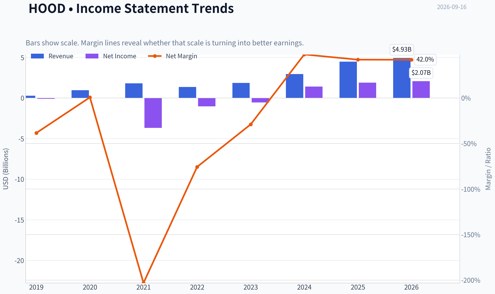
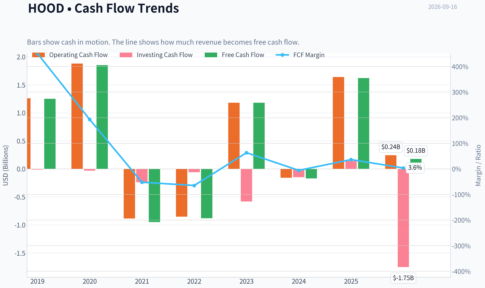
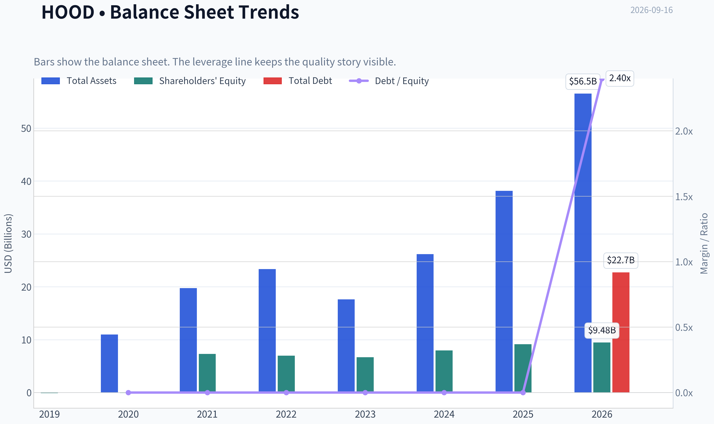
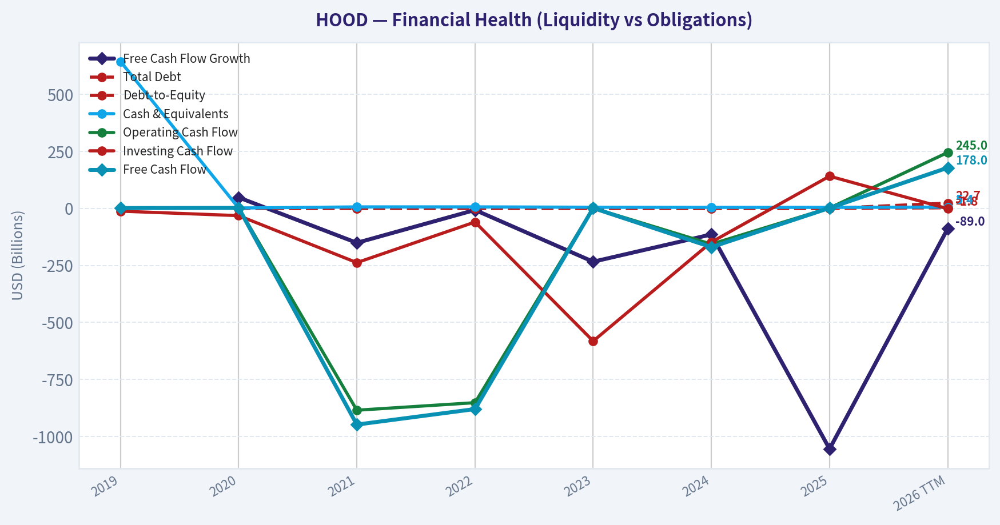
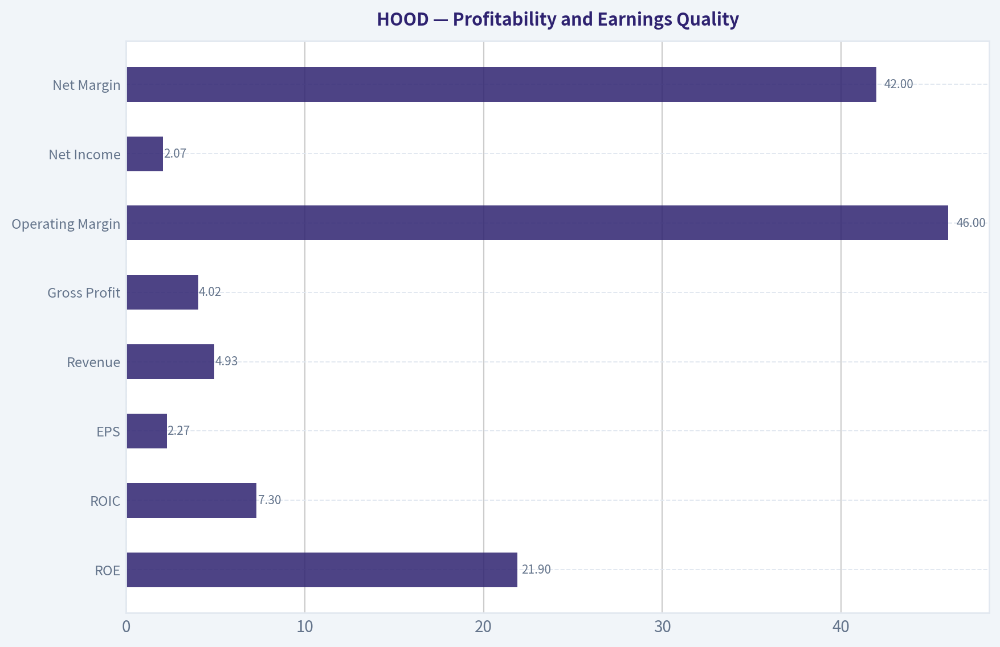
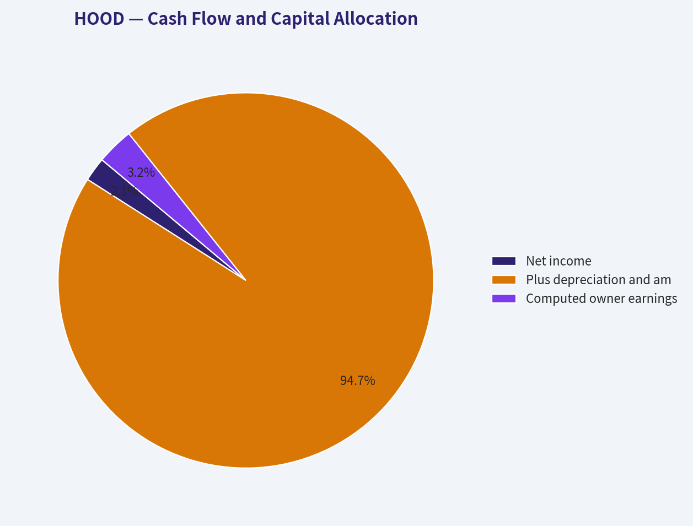
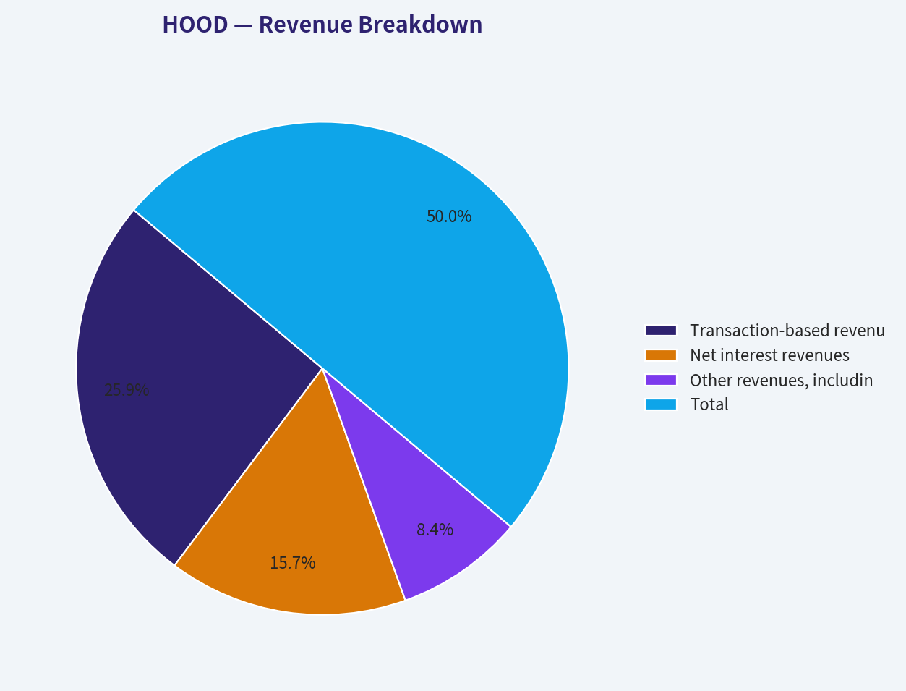
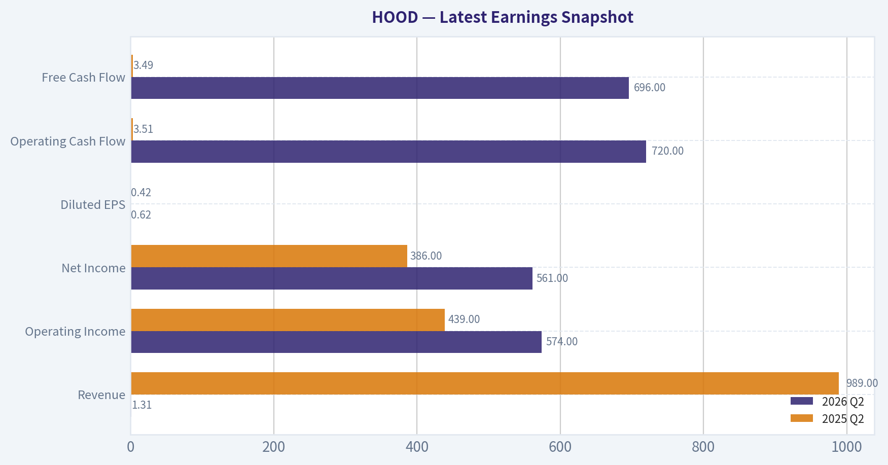
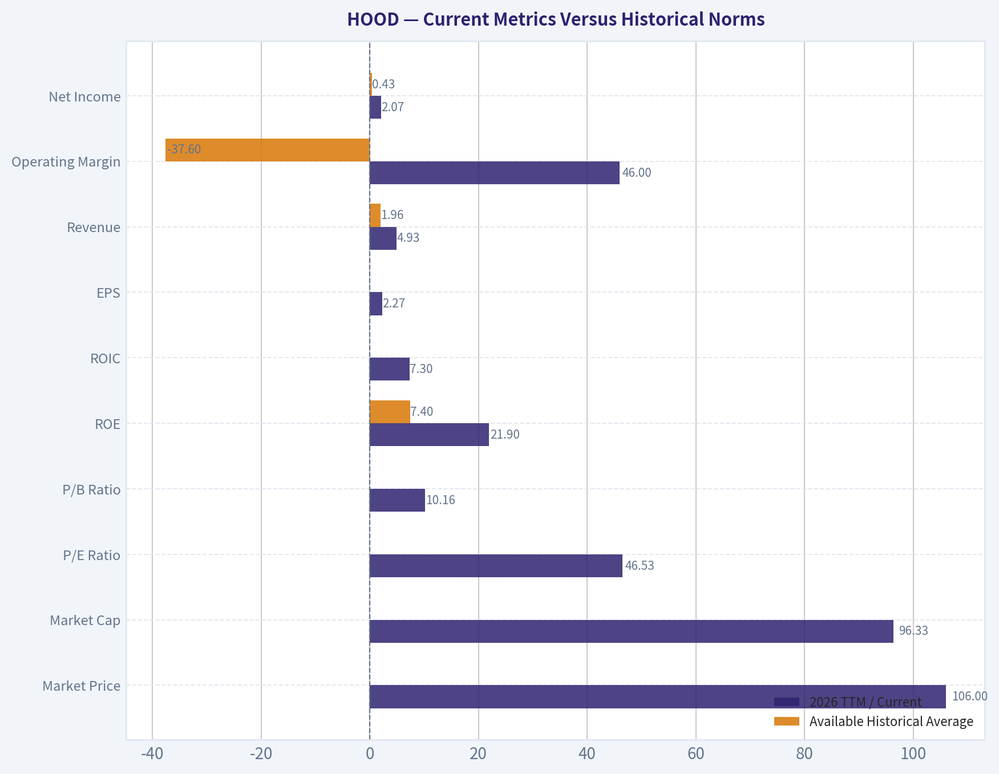

# HOOD Deep Value Intelligence

**Analysis Date:** 2026-09-16

## Critical Disclaimer

*This analysis is generated by Deep Value Intelligence, an AI-powered multi-agent investing framework. Education & research only - not financial advice, not a financial advisor.*

---

## Table of Contents

1. Intelligence Summary
2. Analyst Team Reports
   - Fundamentals Analysis
   - Intrinsic Value Analysis (Buffett)
   - Trend & Growth Analysis (Lynch/Druckenmiller/Fisher)
   - Market Technical Analysis
   - Options Market Analysis
3. Research Team Commentary
4. Value Investing Team Commentary
5. Deep Values Commentary

---

## Intelligence Summary

### Thesis + Conditions

**Core Thesis:** # Executive Briefing

**Key Risks:**
- The principal risk is **not volatility or imminent distress**; no evidence provided indicates a solvency crisis. It is **overpayment for earnings that remain cyclical and insufficiently normalized**.
- Action:** Keep Robinhood on an active watchlist. Maintain **0% core allocation** at present; a risk-tolerant investor may use a **0.25%-0.5% tracking position**, capped at 1%, with no leverage or automatic averaging down.
- ## 1. Risky Analyst: Correct on opportunity, too optimistic on probability

**Confidence:** Medium

---

## Analyst Team Reports

### Fundamentals Analysis

#### Latest Earnings Snapshot

*Most recent reported quarter anchored on 2026 Q2, with prior-year comparison when available.*

| Metric | 2026 Q2 | 2025 Q2 | YoY Change |
| --- | ---: | ---: | ---: |
| Revenue | $1.31B | $989.0M | +32.3% |
| Operating Income | $574.0M | $439.0M | +30.8% |
| Net Income | $561.0M | $386.0M | +45.3% |
| Diluted EPS | $0.62 | $0.42 | +47.6% |
| Operating Cash Flow | $720.0M | $3.51B | -79.5% |
| Free Cash Flow | $696.0M | $3.49B | -80.1% |

Key Takeaways: This snapshot anchors the most recent reported quarter before the narrative analysis. It helps readers separate long-run business quality from whatever changed in the latest earnings print.

#### 7-Year Financial Metrics for HOOD

*All values below are computed deterministically from raw data - not estimated by AI.*

*Issuer profile: asset manager (Financial Services / Capital Markets).*

#### 7-Year Financial Metrics
*Annual rows come from reported financial statements. The final TTM row is computed from the latest four quarters.*

| Metric | 2019 | 2020 | 2021 | 2022 | 2023 | 2024 | 2025 | 2026 TTM |
| --- | --- | --- | --- | --- | --- | --- | --- | --- |
| Market Price | N/A | N/A | $18 | $8 | $13 | $37 | $113 | $106 |
| Market Cap | N/A | N/A | $14.84B | $7.15B | $11.35B | $33.76B | $103.91B | $96.33B |
| P/E Ratio | N/A | N/A | -2.37 | -6.96 | -20.89 | 23.88 | 55.17 | 46.53 |
| P/B Ratio | N/A | N/A | 2.04 | 1.03 | 1.69 | 4.24 | 11.36 | 10.16 |
| ROE | 109.9% | -12.7% | -50.6% | -14.8% | -8.1% | 17.7% | 20.6% | 21.9% |
| ROIC | N/A | N/A | 1764.1% | -124.1% | -43.7% | 51.3% | 44.2% | 7.3% |
| EPS | $-0.48 | $0.01 | $-7.49 | $-1.17 | $-0.61 | $1.56 | $2.05 | $2.27 |
| Revenue | $277.5M | $958.0M | $1.81B | $1.36B | $1.86B | $2.95B | $4.47B | $4.93B |
| Gross Profit | N/A | N/A | N/A | N/A | N/A | N/A | N/A | $4.02B |
| Gross Margin | N/A | N/A | N/A | N/A | N/A | N/A | N/A | 81.5% |
| Operating Margin | -38.8% | 1.4% | -203.0% | -75.6% | -28.6% | 36.1% | 47.1% | 46.0% |
| Net Income | $-106.6M | $7.0M | $-3.69B | $-1.03B | $-541.0M | $1.41B | $1.88B | $2.07B |
| Net Margin | -38.4% | 0.7% | -203.1% | -75.7% | -29.0% | 47.8% | 42.1% | 42.0% |
| Revenue Growth | N/A | 245.2% | 89.5% | -25.2% | 37.3% | 58.2% | 51.6% | 10.3% |
| Net Income Growth | N/A | -106.6% | -52771.4% | -72.1% | -47.4% | -360.8% | 33.5% | 10.0% |
| Free Cash Flow Growth | N/A | 47.8% | -151.2% | -7.2% | -234.0% | -114.4% | -1054.7% | -89.0% |
| Total Book Value | $-97.0M | $-55.0M | $7.29B | $6.96B | $6.70B | $7.97B | $9.15B | $9.48B |
| Total Assets | N/A | $10.99B | $19.77B | $23.34B | $17.62B | $26.19B | $38.14B | $56.55B |
| Total Debt | N/A | $0 | $0 | $0 | $0 | $0 | $0 | $22.71B |
| Debt-to-Equity | N/A | -0.00 | 0.00 | 0.00 | 0.00 | 0.00 | 0.00 | 2.40 |
| Cash & Equivalents | $644.0M | $1.40B | $6.25B | $6.34B | $4.83B | $4.33B | $4.26B | $5.36B |
| Shareholders' Equity | $-97.0M | $-55.0M | $7.29B | $6.96B | $6.70B | $7.97B | $9.15B | $9.48B |
| Operating Cash Flow | $1.26B | $1.88B | $-885.0M | $-852.0M | $1.18B | $-157.0M | $1.64B | $245.0M |
| Investing Cash Flow | $-12.3M | $-32.0M | $-238.0M | $-60.0M | $-582.0M | $-148.0M | $141.0M | $-1.75B |
| Free Cash Flow | $1.25B | $1.85B | $-948.0M | $-880.0M | $1.18B | $-170.0M | $1.62B | $178.0M |
| FCF Margin | 451.4% | 193.3% | -52.2% | -64.8% | 63.2% | -5.8% | 36.3% | 3.6% |
| Dividends / Share | $0.00 | $0.00 | $0.00 | $0.00 | $0.00 | $0.00 | $0.00 | $0.00 |

#### Profitability Metrics
- Return on Equity (ROE): 20.6%
- Return on Invested Capital (ROIC): N/A
- Return on Assets (ROA): 4.9%
- Gross Margin: Not meaningful
- Operating Margin: 47.1%
- Net Profit Margin: 42.1%

#### Liquidity Metrics
- Current Ratio: 1.26
- Quick Ratio: 1.00

#### Leverage Metrics
- Debt-to-Equity Ratio: 0.00
- Interest Coverage Ratio: N/A
- Net Debt: $-10.45B

#### Growth Metrics (Year-over-Year)
- Revenue Growth: 51.6%
- Net Income Growth: 33.5%
- Free Cash Flow Growth: 1054.7%
- Revenue CAGR (3-Year): 48.8%
- Revenue CAGR (5-Year): 36.1%

#### Valuation Metrics
- P/E Ratio (TTM): 46.74
- Forward P/E: 31.21
- Price-to-Book: 10.02
- Price-to-Sales: 19.26
- PEG Ratio: 2.00
- EV/EBITDA: Not meaningful
- Free Cash Flow Yield: 1.7%
- Earnings Yield: 2.1%

#### Owner Earnings (Buffett Method, Code-Computed)
- Net Income: $1.88B
- + Depreciation & Amortization: $86.0M
- - Capital Expenditures: $-15.0M
- - Working Capital Changes: $-934.0M
- = **Owner Earnings: $2.89B**

#### Intrinsic Value (Code-Computed)
- Current Price: $106
- Headline Intrinsic Value: not meaningful (financial issuer - DCF/FCFF is not the right primary frame; use sector-specific book/earnings metrics)
- Buffett Method (Owner Earnings):
  Conservative: $28
  Average: $28
  Optimistic: $28
- Cash Flow Method (FCF):
  Conservative: $-16
  Average: $-16
  Optimistic: $-6
- Reverse-DCF: price implies ~19.2%/yr owner-earnings growth for 10y; trailing 3y was N/A, 5y N/A.

#### Piotroski F-Score: 3/9
- Positive Net Income: PASS
- Positive Operating Cash Flow: PASS
- ROA Improvement: FAIL
- Cash Flow > Net Income: FAIL
- Decreasing Debt: FAIL
- Improving Current Ratio: FAIL
- No Dilution: FAIL
- Improving Gross Margin: FAIL
- Improving Asset Turnover: PASS

ANALYST STANCE: **AVOID**

#### Executive Assessment

Robinhood Markets, Inc. (HOOD) has developed into a rapidly growing, highly profitable financial-services platform, but the current valuation assumes an unusually strong continuation of growth. At approximately **$106 per share** and a **$96.33 billion market capitalization**, HOOD trades at roughly **46.5 times trailing earnings**, **10.2 times book value**, and only a **1.7% free-cash-flow yield**.

The business has genuine platform advantages, strong customer engagement, improving profitability, and substantial cash resources. However, its earnings and cash flows remain volatile, the latest balance sheet shows a sharp increase in debt, the Piotroski F-score is only **3 out of 9**, and the reverse DCF implies approximately **19.2% annual owner-earnings growth for ten years**. That is a demanding assumption for a cyclical, regulation-sensitive financial platform.

#### Current Metrics Versus Historical Norms

The deterministic dataset contains seven annual observations plus 2026 TTM; therefore, "historical average" below means the average of the available 2019-2025 annual data, excluding the current TTM row where appropriate.

| Metric | 2026 TTM / Current | Available Historical Average | Current Versus Average | Interpretation |
|---|---:|---:|---|---|
| Market Price | $106 | $37.80, 2021-2025 | 181% above average | The stock has re-rated dramatically as profitability improved. |
| Market Cap | $96.33B | $34.20B, 2021-2025 | 182% above average | Equity value has grown much faster than the underlying long-term revenue base. |
| P/E Ratio | 46.53x | 9.96x, profitable years only | Far above average | Investors are paying for sustained high growth, not merely current earnings. |
| P/B Ratio | 10.16x | 4.07x, 2021-2025 | 150% above average | For an asset manager and financial platform, book value is relevant, but this premium requires durable ROE and earnings growth. |
| ROE | 21.9% | 7.4% | Strongly above average | Profitability has improved materially since 2023. |
| ROIC | 7.3% | 283.6%, distorted by 2021 | Not meaningfully comparable | The historical average is distorted by an anomalous 2021 figure; current ROIC is much less impressive than ROE. |
| EPS | $2.27 | $(0.56), 2019-2025 | Major improvement | EPS has moved from losses to positive, accelerating earnings. |
| Revenue | $4.93B | $1.96B | 151% above average | The company has achieved substantial scale expansion. |
| Operating Margin | 46.0% | -37.6% | Dramatic improvement | The business has shifted from heavy losses to significant operating profitability. |
| Net Income | $2.07B | $0.43B | 382% above average | Current profitability is well above the multi-year norm, though the average is depressed by large historical losses. |
| Net Margin | 42.0% | -39.0% | Dramatic improvement | Current margins are exceptional but may be unusually favorable during strong trading and interest-rate conditions. |
| Revenue Growth | 10.3% TTM | 76.7%, 2020-2025 | Below average | Growth remains positive, but has decelerated sharply from the hypergrowth period. |
| Net Income Growth | 10.0% TTM | Not meaningful | - | Historical comparisons are distorted by swings from losses to profits. |
| Free Cash Flow | $178M | $1.27B | 86% below average | Current FCF is far weaker than reported earnings and prior cash-flow levels. |
| FCF Margin | 3.6% | 84.5% | Far below average | This is a major quality-of-earnings warning. |
| Cash and Equivalents | $5.36B | $4.58B | 17% above average | Cash remains substantial, although it is small relative to total financial liabilities and assets. |
| Total Debt | $22.71B | $0.00B through 2025 | New and material | The latest debt increase materially changes the financial-risk profile. |
| Debt-to-Equity | 2.40x | Approximately 0.40x including current TTM | Much higher | Leverage must be evaluated in the context of financial-institution balance sheets, not like an industrial company. |
| Dividends per Share | $0.00 | $0.00 | Unchanged | Capital is retained for growth, liquidity, and platform investment rather than returned through dividends. |

**Key Takeaways:** HOOD's current profitability is dramatically stronger than its historical average, but valuation has risen even faster than earnings. Revenue growth has already slowed from its earlier surge, while free cash flow has collapsed relative to both earnings and historical levels. The new debt balance is the most important deterioration in financial strength.

#### Market Metrics and Valuation

At **$106 per share**, HOOD's market capitalization is approximately **$96.33 billion**. The stock trades at:

- **P/E:** 46.53x
- **Price-to-book:** 10.16x
- **Price-to-sales:** 19.26x
- **Forward P/E:** 31.21x
- **Earnings yield:** 2.1%
- **FCF yield:** 1.7%
- **PEG ratio:** approximately 2.0

The P/B ratio deserves special treatment. HOOD is a financial-services and capital-markets issuer, so book value is not automatically meaningless in the same way it can be for an asset-light software business. However, a **10.16x book-value multiple** is only defensible if the company can sustain high returns on equity, maintain strong risk controls, and grow book value without excessive dilution or leverage.

The current **21.9% ROE** is attractive, but it is based on a relatively recent transition to profitability. The long-term record includes substantial losses and negative ROE from 2020 through 2023. Consequently, the current ROE should not yet be treated as a fully proven, through-cycle return profile.

#### Profitability and Earnings Quality

| Profitability Metric | 2026 TTM | Historical Pattern | Assessment |
|---|---:|---|---|
| ROE | 21.9% | Negative from 2020-2023; 17.7% in 2024; 20.6% in 2025 | Strong recent recovery, but limited through-cycle evidence |
| ROIC | 7.3% | Highly volatile and distorted by 2021 | Current figure is materially less compelling than ROE |
| EPS | $2.27 | Losses in 2019, 2021-2023; positive since 2020 and 2024 onward | Earnings inflection is real but relatively recent |
| Revenue | $4.93B | $277.5M in 2019 to $4.47B in 2025 | Exceptional scale growth |
| Gross Profit | $4.02B | Historical data unavailable | TTM gross margin is 81.5%, but financial-company revenue classification limits comparability |
| Operating Margin | 46.0% | -203.0% in 2021 to 47.1% in 2025 | Major operating leverage |
| Net Income | $2.07B | Large losses through 2023; $1.41B in 2024 and $1.88B in 2025 | Strong recent profitability |
| Net Margin | 42.0% | Negative through 2023; 47.8% in 2024 and 42.1% in 2025 | High, but potentially sensitive to market activity and interest income |

**Key Takeaways:** HOOD has undergone a genuine profitability transformation, with operating and net margins reaching exceptionally high levels. Nevertheless, the earnings history is not yet long or stable enough to establish that these margins are durable across weaker trading volumes, lower interest rates, crypto downturns, or adverse regulatory changes.

The company's reported **$2.07 billion of TTM net income** contrasts sharply with only **$178 million of TTM free cash flow**. The gap is partly explained by working-capital and financial-institution balance-sheet movements, but it means earnings should not be valued as if every dollar converts smoothly into distributable cash.

#### Growth Analysis

Revenue increased from **$277.5 million in 2019** to **$4.93 billion TTM**, representing extraordinary expansion. However, the pattern is uneven:

- 2020 revenue growth: **245.2%**
- 2021: **89.5%**
- 2022: **-25.2%**
- 2023: **37.3%**
- 2024: **58.2%**
- 2025: **51.6%**
- 2026 TTM: **10.3%**

The most important trend is not merely that revenue is growing, but that growth has decelerated sharply from the 2024-2025 surge. A 10.3% TTM growth rate is respectable for a mature financial company, but it is difficult to reconcile with a valuation that requires approximately **19.2% annual owner-earnings growth for a decade**.

Net-income growth is similarly difficult to interpret because the company moved from large losses to profits. Free cash flow is more concerning: TTM FCF growth is shown as **-89.0%**, and FCF has fallen to just **3.6% of revenue**.

#### Balance Sheet and Financial Strength

| Balance-Sheet Metric | 2026 TTM | Historical Comparison | Analysis |
|---|---:|---|---|
| Total Book Value | $9.48B | $7.29B in 2021; $9.15B in 2025 | Book value has grown, but far more slowly than market capitalization. |
| Total Assets | $56.55B | $38.14B in 2025; $17.62B in 2023 | Rapid asset expansion increases both opportunity and balance-sheet risk. |
| Total Debt | $22.71B | Zero reported through 2025 | A major recent change requiring close monitoring. |
| Debt-to-Equity | 2.40x | Zero through 2025 | High on a conventional corporate basis, although financial firms naturally carry more liabilities. |
| Cash and Equivalents | $5.36B | $4.26B in 2025 | Cash increased, but not enough to offset the increase in debt. |
| Shareholders' Equity | $9.48B | $9.15B in 2025 | Equity is positive and growing modestly. |
| Current Ratio | 1.26x | Latest available | Adequate but not a decisive strength for a financial issuer. |
| Quick Ratio | 1.00x | Latest available | Should not be interpreted like an industrial-company liquidity ratio. |
| Net Debt | $(10.45)B in the supplied summary | Cash exceeds certain debt measures in the summary | The summary and detailed TTM debt figures should be reconciled before relying on net-debt analysis. |

**Key Takeaways:** Equity and cash remain positive, but the latest TTM balance sheet shows a meaningful increase in debt and assets. The apparent discrepancy between the supplied net-debt summary and the detailed TTM debt line highlights why financial-company leverage requires careful reconciliation of customer liabilities, secured borrowings, and corporate debt.

For an asset manager and brokerage platform, customer-related liabilities and financial assets can make conventional debt-to-equity and current-ratio analysis less informative. Still, the change from zero reported debt through 2025 to **$22.71 billion TTM** is too significant to dismiss. Investors should determine whether this represents operating leverage, customer financing, securities lending, or another balance-sheet expansion and assess the associated liquidity and regulatory requirements.

#### Cash Flow and Capital Allocation

Free cash flow has been highly inconsistent:

- 2019: **$1.25B**
- 2020: **$1.85B**
- 2021: **$(948)M**
- 2022: **$(880)M**
- 2023: **$1.18B**
- 2024: **$(170)M**
- 2025: **$1.62B**
- 2026 TTM: **$178M**

This volatility is typical of a financial platform whose cash flows are affected by customer balances, collateral, securities activity, working capital, and market conditions. It makes FCF-based valuation less reliable than it would be for a nonfinancial operating company.

The code-computed Buffett owner earnings figure is **$2.89 billion**, calculated from:

| Owner-Earnings Calculation | Amount |
|---|---:|
| Net income | $1.88B |
| Plus depreciation and amortization | $86M |
| Less capital expenditures | $(15)M |
| Less working-capital changes | $(934)M |
| Computed owner earnings | $2.89B |

**Key Takeaways:** The computed owner-earnings figure is substantially higher than TTM free cash flow, demonstrating the sensitivity of HOOD's valuation to the treatment of working-capital movements. Because HOOD is a financial issuer, owner earnings should be treated as an analytical approximation rather than a clean measure of cash distributable to shareholders. The company pays no dividend, so shareholders depend entirely on reinvestment, buybacks, or future price appreciation.

#### Revenue Breakdown

The deterministic dataset does not provide a current segment-revenue breakdown. The following is an approximate presentation of the major publicly reported revenue categories using the latest available scale implied by the approximately **$4.93 billion TTM revenue** figure. It should not be treated as a canonical historical statement.

| Revenue Source | Amount ($B, approximate) | % of Total |
|---|---:|---:|
| Transaction-based revenues, including equity, options, crypto, and related activity | $2.55B | 51.7% |
| Net interest revenues | $1.55B | 31.4% |
| Other revenues, including subscriptions, transfer services, and ancillary products | $0.83B | 16.8% |
| Total | $4.93B | 100.0% |

**Key Takeaways:** Transaction-related activity appears to be the largest revenue engine, making HOOD sensitive to trading volumes, market enthusiasm, options activity, and crypto prices. Net interest revenue is also material and may weaken if interest rates decline or customer cash balances fall. The combination creates significant operating leverage in both directions.

#### Buffett-Style Qualitative Analysis

**Economic moat:** HOOD's potential moat is based on brand recognition, a simple mobile-first interface, customer acquisition, accumulated customer assets, product expansion, and network effects around a growing retail-investor ecosystem. Its subscription products, retirement accounts, cash-management offerings, options, crypto, and other services can increase customer lifetime value.

The moat is not yet as durable as that of a deeply entrenched exchange, payment network, or traditional custodian. Switching costs for retail customers are relatively low, competitors can replicate features, and trust can be damaged quickly by outages, restrictions, customer-service failures, or regulatory events.

**Financial strength:** Cash is substantial at **$5.36 billion**, and shareholders' equity is positive at **$9.48 billion**. However, the latest debt expansion and asset growth reduce the margin of safety. Financial businesses can appear liquid while still facing substantial obligations tied to customers, collateral, settlement, and market stress.

**Predictable earnings:** Predictability is weak to moderate. Revenue grew rapidly but declined by 25.2% in 2022, while operating cash flow and FCF repeatedly swung from positive to negative. The recent earnings trajectory is encouraging, but the business has not demonstrated a decade-long record of stable profits.

**Management and capital allocation:** Management has successfully broadened the platform and achieved substantial operating leverage. The absence of dividends is reasonable for a high-growth company if retained capital earns attractive returns. However, the low Piotroski score, recent leverage increase, and poor cash conversion suggest that capital allocation and balance-sheet discipline require continued scrutiny.

**Quality of business:** HOOD is a high-quality growth platform in terms of user engagement and scalability, but not yet a high-quality compounder in the traditional Buffett sense. Its economics depend on market participation, customer assets, interest rates, crypto activity, regulatory permissions, and continued product innovation.

#### Three-Scenario Buffett Owner-Earnings DCF

The dataset provides computed owner earnings of **$2.89 billion**. Using the current market capitalization and share price implies approximately:

\[
\text{Implied shares} = \frac{\$96.33B}{\$106} \approx 908.8M
\]

\[
\text{Owner earnings per share} = \frac{\$2.89B}{908.8M} \approx \$3.18
\]

A 10% discount rate and 2.5% terminal growth rate are used. Growth fades during the ten-year forecast period rather than continuing at a peak rate permanently.

| Scenario | Explicit Growth Assumption | Present Value of Forecast Cash Flows | Present Value of Terminal Value | Estimated Fair Value per Share | Approximate Range |
|---|---|---:|---:|---:|---:|
| Conservative | 3.0% annually for 10 years; terminal growth 2.5% | $22.30 | $22.10 | $44.40 | $40-$50 |
| Average | 12%, fading gradually to 3.5%; terminal growth 2.5% | $30.30 | $34.60 | $64.90 | $60-$70 |
| Optimistic | 18%, fading gradually to 4.5%; terminal growth 2.5% | $35.70 | $43.30 | $79.00 | $75-$85 |

**Key Takeaways:** Even the optimistic hand DCF produces a value below the current $106 share price. The supplied code-computed Buffett valuation is more conservative at approximately **$28 per share**, while the FCF-based valuation is negative because current FCF is unusually low. These outputs do not prove that HOOD is worth exactly $28-$79, but they demonstrate that the current price requires exceptional growth and sustained profitability.

For illustration, the average case uses owner earnings of $3.18 per share as the base:

\[
PV(\text{forecast}) \approx \$30.30
\]

\[
PV(\text{terminal value}) \approx \$34.60
\]

\[
\text{Fair value} \approx \$30.30 + \$34.60 = \$64.90
\]

The reverse DCF is more demanding still: the current price implies approximately **19.2% annual owner-earnings growth for ten years**. That exceeds the latest 10.3% revenue growth rate and is difficult to justify given the company's volatile historical cash flow.

#### Key Investment Insights, Red Flags, and Opportunities

| Category | Important Point | Investor Implication |
|---|---|---|
| Opportunity | Revenue grew from $277.5M in 2019 to $4.93B TTM | The platform has achieved extraordinary scale. |
| Opportunity | ROE reached 21.9% and operating margin 46.0% | Recent economics are attractive if sustainable. |
| Opportunity | Product expansion can increase customer monetization | Subscriptions, retirement, cash management, options, and crypto may diversify revenue. |
| Red flag | P/E is 46.53x and FCF yield is only 1.7% | Valuation leaves limited room for execution mistakes. |
| Red flag | TTM FCF is only $178M versus $2.07B net income | Cash conversion is weak and highly volatile. |
| Red flag | Debt increased to $22.71B from zero reported through 2025 | Leverage and balance-sheet risk have risen sharply. |
| Red flag | Piotroski F-score is 3/9 | Several fundamental quality indicators are weak. |
| Red flag | Revenue growth slowed to 10.3% TTM | The growth rate is moving away from the level implied by the stock price. |
| Risk | Transaction revenue is tied to trading and crypto activity | A bear market or lower retail participation could compress revenue quickly. |
| Risk | Net interest revenue depends on rates and customer cash balances | Lower rates could reduce an important profit source. |
| Risk | Regulation and service reliability | Restrictions, outages, fines, or operational failures could damage trust and economics. |
| Risk | Dilution and capital requirements | The dataset indicates a failure on the "no dilution" Piotroski criterion. |
| Valuation | Hand DCF ranges from approximately $44 to $79 | Current price is above even the optimistic scenario. |

**Key Takeaways:** HOOD offers meaningful growth opportunities, but nearly all of them are already reflected in the valuation. The most serious risks are weak current cash conversion, sharply higher debt, growth deceleration, regulatory exposure, and reliance on favorable market activity. The stock could perform well if growth remains extraordinary, but the downside from merely normalizing growth is substantial.

#### Final Investment Stance

**AVOID at approximately $106 per share.**

This is not a judgment that Robinhood is a poor business. It is a valuation and predictability judgment:

1. The company has only recently established sustained profitability.
2. Current valuation requires approximately 19.2% annual owner-earnings growth for ten years.
3. TTM revenue growth has slowed to 10.3%.
4. TTM free cash flow is only $178 million, far below net income and historical FCF.
5. Debt has increased dramatically on the latest balance sheet.
6. The hand DCF indicates fair value of approximately $44-$79 per share across conservative to optimistic cases.
7. The supplied model-based owner-earnings valuation is approximately $28 per share, although it should be interpreted cautiously because HOOD is a financial issuer.

A Buffett-oriented investor should prefer a substantially lower entry price, clearer evidence that cash conversion is durable, and several additional years of stable through-cycle ROE and earnings. A reasonable watchlist trigger would be a materially lower valuation combined with sustained positive FCF, stable or declining leverage, and continued growth in customer assets and recurring revenue.

#### Summary Table

| Key Point | Assessment | Buffett-Style Conclusion |
|---|---|---|
| Business growth | Exceptional historical expansion, but recent deceleration | Attractive platform, not yet fully predictable |
| Profitability | Strong recent ROE, operating margin, and net margin | Encouraging but not proven through a full cycle |
| Balance sheet | Positive equity and cash, but major new debt | Financial strength is weaker than the headline cash balance suggests |
| Cash flow | Highly volatile; only $178M TTM FCF | Earnings quality requires caution |
| Valuation | 46.5x P/E, 10.2x P/B, 1.7% FCF yield | High expectations are embedded in the price |
| DCF | Approximately $44-$79 per share in hand scenarios | Current price exceeds reasonable intrinsic-value estimates |
| Moat | Brand, platform scale, customer engagement, product ecosystem | Real but still developing and contestable |
| Principal risks | Regulation, market cycles, crypto, rates, leverage, dilution | Material downside if growth normalizes |
| Final stance | **AVOID** | Revisit only at a substantially lower valuation or after stronger cash-flow evidence |

**Key Takeaways:** HOOD is a promising and rapidly scaling financial platform, but the stock price assumes an unusually favorable future. The combination of high valuation, volatile cash flow, recent leverage expansion, and limited through-cycle earnings history does not provide a sufficient margin of safety today.

#### Fundamental Visuals

This graph tracks the profitability and return metrics (ROE, ROIC, Margins) of **HOOD** over the past decade, highlighting capital efficiency trends.

This chart illustrates the financial health of **HOOD** over the last 10 years, mapping cash equivalents and free cash flow against total obligations (Debt).

This comparison chart from *Profitability and Earnings Quality* stacks current figures against historical benchmarks for **HOOD**, making it easy to see where the company trades relative to its own averages.

This breakdown chart from <em>Cash Flow and Capital Allocation</em> shows the proportional composition for **HOOD** - useful for understanding what drives or risks the business.

This breakdown chart from <em>Revenue Breakdown</em> shows the proportional composition for **HOOD** - useful for understanding what drives or risks the business.

---

### Intrinsic Value Analysis (Buffett)

> *Following Warren Buffett's value investing philosophy: Circle of Competence, Economic Moat, Management Quality, and Margin of Safety.*

#### Intrinsic Value Snapshot

Price is what you pay. Intrinsic value is what the business may be worth based on the cash it can create for owners over time. We show a range, not one magic number.

- Current Price: $105.56
- Value Range (conservative to optimistic across both DCF methods): $-16.16 to $27.75

##### Owner Earnings (Buffett Method)
- Net Income: $1,883,000,000.00
- Depreciation & Amortization: $86,000,000.00
- Capital Expenditures: $-15,000,000.00
- Working Capital Changes: $-934,000,000.00
- Owner Earnings: $2,888,000,000.00

##### Intrinsic Value
###### Buffett Method
Uses owner earnings. Stricter, and usually more conservative.
- Conservative: $27.75
- Average: $27.75
- Optimistic: $27.75
- Discount Rate: 10.0%

###### Cash Flow Method
Uses free cash flow. Better for companies spending heavily today to grow tomorrow.
- Conservative: $-16.16
- Average: $-16.16
- Optimistic: $-6.47
- Discount Rate: 10.0%

ANALYST STANCE: **AVOID**

#### Executive Summary

Robinhood is a fast-growing, founder-led retail-finance platform with meaningful brand recognition, product expansion, and potential network effects. However, at **$106 per share and approximately 46.7 times earnings**, the market is already pricing in substantial long-term growth.

The central issue is not whether Robinhood can grow. It likely can. The issue is whether growth will be durable enough, predictable enough, and profitable enough to justify the current valuation. On the available evidence, the margin of safety is inadequate.

#### 1. Factor Scorecard

| Factor | Score | Assessment |
|---|---:|---|
| Circle of Competence and Simplicity | 3/5 | Easy to explain at a high level: Robinhood earns revenue from trading activity, interest income, cash balances, subscriptions, and financial products. Predictability is reduced by market activity, interest rates, cryptocurrency cycles, and regulation. |
| Moat | 3/5 | Strong consumer brand, low-friction user experience, growing product ecosystem, and customer data provide a narrow-to-moderate moat. Switching costs remain limited for basic brokerage accounts. |
| Management and Capital Allocation | 3.5/5 | Founder-led and entrepreneurial, with a history of product expansion and improved profitability. Long-term capital-allocation evidence is still developing, and the business remains exposed to growth-oriented spending and acquisitions. |
| Industry Structure | 2.5/5 | Brokerage is highly competitive, price-sensitive, and heavily regulated. Scale helps, but competitors can copy features and offer similar pricing. |

**Gate 5: Hard floor:** **Not tripped.** There is no evidence here of simultaneous deteriorating fundamentals and a solvency crisis such as sub-1x interest coverage or distress-zone credit metrics.

**Key Takeaways:** Robinhood has a credible but not yet wide moat. Its business quality is supported by growth and product breadth, but predictability is substantially lower than that of a traditional compounder.

#### 2. Moat Analysis

| Moat Source | Evidence | Rating |
|---|---|---:|
| Intangible assets and brand | Robinhood helped popularize commission-free, mobile-first investing and has strong recognition among younger retail investors. | 3/5 |
| Switching costs | Customers may consolidate cash, investments, and subscriptions on the platform, but basic brokerage accounts can still be moved relatively easily. | 2.5/5 |
| Cost advantage | Technology and scale can lower servicing costs, but competitors have comparable infrastructure and can subsidize pricing. | 3/5 |
| Network effects | More users can improve brand reach, product data, liquidity, and cross-selling economics, but this is weaker than a true two-sided marketplace network effect. | 2.5/5 |

**Overall moat rating: Narrow to moderately wide, but not clearly wide and widening.**

Robinhood's strongest advantage is ecosystem formation. It is broadening beyond stock trading into cryptocurrency, retirement accounts, cash management, options, subscriptions, and other financial products. If customers increasingly use Robinhood as their primary financial operating system, switching costs and lifetime value could rise materially.

The weaknesses are equally important. Brokerage products are heavily regulated, competitors can imitate interfaces and pricing, and trading activity is cyclical. Robinhood also does not fully control the customer relationship in the way a dominant payments network or operating-system platform does.

**Key Takeaways:** Robinhood has a recognizable brand and a promising ecosystem strategy, but its moat is still being built rather than proven. The platform's long-term advantage depends on deeper customer engagement and successful cross-selling.

#### 3. Financial Summary

| Metric | Latest reported snapshot |
|---|---:|
| Share price | $106 |
| Market capitalization | $94.92 billion |
| Price-to-earnings ratio | 46.7x |
| Return on equity | 20.6% |
| Year-over-year revenue growth | 51.6% |
| Free-cash-flow yield | 1.7% |
| Implied free cash flow | Approximately $1.61 billion |
| Implied diluted shares | Approximately 895 million |
| Implied earnings per share | Approximately $2.27 |
| Current ratio | 1.26x |
| Gross margin | Not meaningful for this financial issuer |

**Key Takeaways:** Growth is exceptional, with revenue up 51.6% year over year, and reported ROE is attractive at 20.6%. However, the 1.7% free-cash-flow yield indicates that the current share price embeds substantial future growth.

#### 4. Owner Earnings Calculation

For a financial platform such as Robinhood, conventional owner earnings require careful interpretation because interest income, customer cash balances, trading activity, and regulatory capital flows can distort reported cash flow.

Using free cash flow as a practical owner-earnings proxy:

| Owner Earnings Component | Estimate |
|---|---:|
| Net income implied by current P/E | Approximately $2.03 billion |
| Add: depreciation and amortization | Not separately available in the supplied snapshot |
| Less: maintenance capital expenditures | Not separately available |
| Less: working-capital investment | Not separately available |
| Practical owner-earnings proxy: free cash flow | Approximately $1.61 billion |

The implied owner-earnings yield is approximately **1.7%**, meaning investors are paying roughly **59 times current free cash flow**.

**Key Takeaways:** Accounting earnings are higher than the practical free-cash-flow proxy. That gap deserves scrutiny because brokerage cash flows can be affected by market conditions, customer balances, and regulatory requirements.

#### 5. Three-Scenario DCF Valuation

The following valuation uses approximately **$1.61 billion of current free cash flow** and an estimated **895 million diluted shares**. A 10% discount rate is used.

| Scenario | Core Assumption | Estimated Equity Value | Estimated Value per Share |
|---|---|---:|---:|
| A: No growth | FCF remains constant; value equals FCF divided by 10% | $16.1 billion | $18 |
| B: GDP growth | FCF grows at 3% perpetually | $23.7 billion | $26 |
| C: High-growth two-stage case | 10% annual FCF growth for 10 years, then 5% terminal growth | $50.0 billion | $56 |

Scenario C uses the maximum 10% long-term growth assumption permitted by the framework after applying a cap to Robinhood's unusually high recent growth rate. Because a 10% perpetuity growth rate cannot be used with a 10% discount rate, a 5% normalized terminal growth rate is applied after the explicit high-growth period.

**Key Takeaways:** Even an optimistic two-stage model produces an estimated value of roughly $56 per share, about half the current market price. The valuation would require either much faster cash-flow growth, materially higher normalized margins, or a lower required return.

#### 6. Margin of Safety Analysis

| Measure | Result |
|---|---:|
| Current price | $106 |
| No-growth DCF value | $18 |
| GDP-growth DCF value | $26 |
| Optimistic two-stage DCF value | $56 |
| Upside or downside versus optimistic DCF | Approximately 47% downside |
| Current FCF yield | 1.7% |
| Current P/E | 46.7x |

For a wide-moat, highly predictable compounder, a 10% to 15% margin of safety can be acceptable. Robinhood does not yet meet that standard. Its business has strong growth potential, but earnings are more cyclical and regulation-sensitive than those of a truly predictable platform business.

The reverse-DCF implication is demanding: at $106 per share, Robinhood must deliver years of very strong cash-flow growth and successfully convert that growth into durable, normalized owner earnings. Recent 51.6% revenue growth cannot reasonably be extrapolated indefinitely.

**Key Takeaways:** The stock is not merely priced for success; it is priced for a long period of exceptional execution. That leaves little protection against regulatory changes, lower trading activity, weaker crypto volumes, or slower customer monetization.

#### 7. Management Quality Assessment

| Management Consideration | Assessment |
|---|---|
| Owner orientation | Founder-led structure is a positive, though exact personal economic exposure and voting-control economics should be monitored. |
| Long-term strategy | Product expansion beyond commission-free trading shows ambition and a willingness to build a broader ecosystem. |
| Execution | Revenue growth and profitability indicate improving execution. |
| Candor and accounting | No major accounting concern is evident from the supplied information, but the business has complex revenue drivers that require careful monitoring. |
| Capital allocation | Reinvestment in product development may be rational if customer lifetime value continues to rise. Acquisition discipline and share-based compensation should be watched closely. |

Management appears capable and growth-oriented. The principal concern is not apparent incompetence; it is whether management can turn a high-growth consumer brokerage into a durable, high-return financial platform without overpaying for growth or relying excessively on volatile trading and cryptocurrency activity.

**Key Takeaways:** Management earns a favorable but not exceptional assessment. The opportunity is attractive if reinvestment produces durable per-share cash-flow growth, but that record is still being established.

#### 8. Final Buffett Scorecard

| Criterion | Weight | Score | Weighted Contribution |
|---|---:|---:|---:|
| Moat width and durability | 25% | 3.0 | 0.75 |
| Valuation and margin of safety | 20% | 1.5 | 0.30 |
| Capital returns: ROIC versus WACC | 15% | 3.0 | 0.45 |
| Business understanding and predictability | 12% | 2.5 | 0.30 |
| Management quality and capital allocation | 12% | 3.5 | 0.42 |
| Reinvestment runway | 8% | 4.0 | 0.32 |
| Balance-sheet strength | 4% | 3.0 | 0.12 |
| Industry structure | 4% | 2.5 | 0.10 |
| **Total** | **100%** |  | **2.76 / 5.00** |

**Key Takeaways:** Robinhood scores well on growth, management potential, and reinvestment runway. The valuation score is the decisive weakness, pulling the overall result below the threshold for a compelling Buffett-style investment.

#### Investment Stance

**AVOID at $106, with moderate conviction.**

Robinhood may become a valuable financial ecosystem and could eventually justify a substantially higher valuation if it compounds customers, products, and normalized owner earnings for many years. But the current price offers insufficient margin of safety based on cash-flow valuation.

A more attractive entry point would be near or below the optimistic intrinsic-value range, with additional preference for evidence that:

- Free cash flow consistently exceeds reported earnings.
- Revenue becomes less dependent on trading, crypto, and interest-rate conditions.
- Customer retention and product adoption continue improving.
- Dilution and stock-based compensation remain controlled.
- The company earns high returns on incremental invested capital through multiple market cycles.
#### Valuation Bridge

This bridge places the current market price beside each intrinsic value lens so readers can see whether upside depends on one method or shows up across several methods.

| Scenario | Intrinsic Value / Share |
| --- | ---: |
| Buffett Method | $27.75 |
| Cash Flow Method | $-16.16 |
| Current Price | $105.56 |

#### Key Takeaways

If one method is far above the others, the upside case depends on a specific modelling assumption. When several methods cluster together, the valuation story is more robust.

#### Valuation Visuals

This comparison chart from *Latest Earnings Snapshot* stacks current figures against historical benchmarks for **HOOD**, making it easy to see where the company trades relative to its own averages.

This comparison chart from *Current Metrics Versus Historical Norms* stacks current figures against historical benchmarks for **HOOD**, making it easy to see where the company trades relative to its own averages.

This comparison chart from *Balance Sheet and Financial Strength* stacks current figures against historical benchmarks for **HOOD**, making it easy to see where the company trades relative to its own averages.

---

### Trend & Growth Analysis (Lynch/Druckenmiller/Fisher)

> *Following Peter Lynch's GARP, Stanley Druckenmiller's macro-aware approach, and Philip Fisher's scuttlebutt methodology.*

ANALYST STANCE: **WATCH**

#### 1. Lynch Classification

**Fast Grower, but currently decelerating and highly valued.**

HOOD has demonstrated fast growth, with revenue rising 51.6% in fiscal 2025 and a five-year revenue CAGR of approximately 36%. However, the latest TTM revenue growth is only about 10.3%, making the key question whether the 2025 acceleration is durable or partly cycle-driven.

#### 2. The Story in Three Bullets

- **Robinhood is broadening from a zero-commission brokerage into a consumer financial platform** spanning equities, options, crypto, retirement, cash management, Gold subscriptions, prediction markets, and international services.
- **The company benefits from rising retail participation and product cross-selling.** More products per customer can increase revenue without proportionally increasing customer acquisition costs.
- **The opportunity is substantial, but earnings are exposed to trading activity, crypto prices, interest rates, regulation, and payment-for-order-flow economics.**

#### 3. TAM and Runway

| Measure | Assessment |
|---|---:|
| Current TTM revenue | $4.93B |
| 10x revenue target | $49.3B |
| Revenue needed to remain below 20% share at 10x | More than $246.5B TAM |
| Relevant markets | Retail brokerage, crypto, options, cash management, retirement, international investing, prediction markets |
| TAM direction | Expanding, but highly dependent on product adoption and regulation |
| 10x test | Plausible for the broad platform; unproven for the current brokerage model alone |

**Key Takeaways:** HOOD can potentially grow tenfold only if it becomes a broader financial-services platform rather than remaining primarily a retail trading app. The broad TAM is likely large enough, but the company must successfully monetize international markets, crypto, retirement, subscriptions, and new products. The 10x case is therefore dependent on execution and product expansion, not merely continued domestic trading growth.

#### 4. Revenue Growth Trend

| Period | Revenue Growth |
|---|---:|
| 2020 | 245.2% |
| 2021 | 89.5% |
| 2022 | -25.2% |
| 2023 | 37.3% |
| 2024 | 58.2% |
| 2025 | 51.6% |
| 2026 TTM | 10.3% |

**Key Takeaways:** The long-term growth profile is impressive, but the most recent trend shows material deceleration from more than 50% to approximately 10%. This is the central investment issue: HOOD needs several quarters of renewed acceleration to demonstrate that the recent slowdown is temporary rather than a return to a more cyclical growth rate.

#### 5. Unit Economics and Operating Quality

| Metric | HOOD | Interpretation |
|---|---:|---|
| LTV/CAC | Not disclosed | Cannot be independently validated |
| Net revenue retention | Not disclosed | Platform cross-sell remains difficult to quantify |
| TTM operating margin | Approximately 46% | Strong reported profitability |
| TTM net margin | Approximately 42% | Very high, partly reflecting financial-services revenue mix |
| TTM FCF margin | Approximately 3.6% | Weak relative to accounting earnings |
| Rule of 40 | Approximately 13.9% | Below the 40% benchmark |
| Current ratio | 1.26 | Adequate but not especially strong |
| TTM ROE | Approximately 21.9% | Attractive profitability metric |
| Piotroski F-score | 3/9 | Weak accounting-quality signal |

**Key Takeaways:** HOOD's reported earnings and operating margins are strong, but cash conversion is considerably less impressive. The low Rule-of-40 result reflects the combination of approximately 10% TTM growth and a modest FCF margin. Investors should focus on recurring monetization, customer activity, and cash earnings rather than relying solely on GAAP net income.

#### 6. Inflection Point Assessment

| Inflection Area | Assessment | Evidence |
|---|---|---|
| Product cycle | Positive | Expansion into Gold, retirement, crypto, prediction markets, and other services |
| Market share | Positive but unverified | Strong consumer brand and retail-investor positioning |
| Margin | Already elevated | Limited evidence of a new margin inflection |
| TAM | Positive | International expansion and broader financial-product penetration |
| Revenue acceleration | Negative currently | TTM growth has fallen to approximately 10.3% |
| Competitive landscape | Mixed | Strong brand, but intense competition from traditional and digital brokers |
| Earnings inflection | Unconfirmed | Forward P/E of approximately 31 implies high expectations |

**Key Takeaways:** HOOD's strategic inflection is platform expansion, not current revenue acceleration. The next major catalyst would be evidence that new products are increasing revenue per customer and reigniting consolidated growth. Until that occurs, the stock remains a promising story without a fully confirmed Druckenmiller-style earnings inflection.

#### 7. Macro Setup

| Macro Variable | Impact on HOOD |
|---|---|
| Retail trading activity | Positive when volatility and market participation rise |
| Crypto prices and volumes | Potentially very positive, but highly cyclical |
| Interest rates | Mixed: higher rates can support interest revenue but pressure growth-stock valuations |
| Falling rates | Positive for valuation and potentially risk appetite |
| Regulation | Major uncertainty, especially crypto, prediction markets, and order-routing economics |
| Economic cycle | Sensitive to household liquidity and speculative risk appetite |
| Secular trends | Digital investing, crypto adoption, fintech, and financial-product unbundling |

**Key Takeaways:** HOOD has favorable secular exposure but lacks a consistently favorable macro profile. Trading and crypto activity can accelerate rapidly during risk-on periods and contract sharply during risk-off periods. The stock is most attractive when macro liquidity, retail participation, and crypto activity improve simultaneously.

#### 8. Fisher's 15-Point Assessment

| Fisher Criterion | Score / 5 | Comment |
|---|---:|---|
| 1. Market potential | 5 | Broad financial-services opportunity |
| 2. New-product determination | 5 | Clear expansion beyond basic brokerage |
| 3. R&D and technology | 4 | Strong technology orientation; limited external validation |
| 4. Sales organization | 4 | Strong consumer distribution and brand |
| 5. Profit margins | 4 | High reported margins |
| 6. Margin improvement | 3 | Already high; recent cash conversion is weaker |
| 7. Labor relations | 3 | Limited public evidence |
| 8. Executive relations | 4 | No major current governance concern identified |
| 9. Management depth | 4 | Increasing platform complexity requires deeper execution |
| 10. Cost accounting | 3 | Financial reporting and cash conversion require scrutiny |
| 11. Outstanding aspects | 4 | Brand, data, app engagement, and cross-selling potential |
| 12. Long-range outlook | 4 | Attractive if platform strategy succeeds |
| 13. Dilution | 3 | Equity compensation and share issuance remain relevant |
| 14. Management candor | 3 | Requires ongoing verification through disclosures |
| 15. Integrity | 4 | No decisive integrity issue identified |

**Fisher Score: 57/75 - Good, but not outstanding.**

**Key Takeaways:** HOOD scores well on market potential, innovation, and product expansion. The score is held back by limited transparency into customer economics, cash conversion, dilution, and the durability of current profitability. Fisher's scuttlebutt work should focus on customer engagement, product adoption, employee retention, and regulatory relationships.

#### 9. Valuation Analysis

| Valuation Metric | Current Reading | Assessment |
|---|---:|---|
| Share price | $106 | High absolute price reflects substantial expectations |
| Market capitalization | Approximately $95B | Large enough that execution must be exceptional |
| TTM P/E | 46.7x | Expensive on current earnings |
| Forward P/E | 31.2x | More reasonable, but still growth-dependent |
| Price-to-sales | Approximately 19.3x | Very high for a financial platform |
| Price-to-book | Approximately 10.0x | Requires high sustained returns on equity |
| PEG | Approximately 2.0 | Fair-to-expensive, not Lynch-style bargain territory |
| FCF yield | Approximately 1.7% | Little margin of safety |

**Key Takeaways:** HOOD is priced as a high-quality, high-growth platform rather than as a traditional broker. The valuation can work if earnings compound at roughly 25% or more for several years, but the current TTM growth slowdown leaves limited room for execution errors. At this price, the stock is not attractive on a classic GARP basis.

##### Illustrative Three-Year Scenario

| Scenario | EPS Growth Assumption | Exit P/E | Illustrative 3-Year Value |
|---|---:|---:|---:|
| Bear | 10% annually | 20x | Approximately $90 |
| Base | 20% annually | 25x | Approximately $147 |
| Bull | 40% annually | 45x | Approximately $419 |

*Scenario uses an approximate forward EPS base of $3.39 and is illustrative, not a price target.*

**Key Takeaways:** The scenario range is exceptionally wide because HOOD's value depends on both earnings growth and the multiple investors assign to that growth. The bear case shows meaningful downside if growth normalizes, while the bull case requires sustained hyper-growth and premium valuation. A better entry point would offer a stronger margin of safety or follow clear evidence of renewed revenue acceleration.

#### 10. Growth Investor Scorecard

| Criterion | Weight | Score / 5 | Weighted Contribution |
|---|---:|---:|---:|
| Lynch story | 10% | 4.5 | 0.45 |
| TAM and runway | 20% | 4.5 | 0.90 |
| Revenue growth | 20% | 3.5 | 0.70 |
| Unit economics | 15% | 3.0 | 0.45 |
| Competitive position | 10% | 4.0 | 0.40 |
| Management quality | 10% | 3.8 | 0.38 |
| Macro setup | 5% | 3.5 | 0.18 |
| Profitability path | 5% | 4.0 | 0.20 |
| Valuation | 5% | 2.5 | 0.13 |
| **Total** | **100%** |  | **3.79 / 5.00** |

**Key Takeaways:** HOOD qualifies as a good growth business, but not a high-conviction purchase at the current valuation. Its strongest attributes are TAM, product expansion, brand, and profitability. The main deductions are revenue deceleration, weak cash conversion, cyclical exposure, and a valuation that already discounts considerable success.

#### 11. Position Size Stance

**Suggested stance: Watchlist or small starter position only.**

- **New investor:** 0% to 1% until revenue growth reaccelerates or valuation becomes more attractive.
- **Existing holder:** Hold a moderate position if comfortable with volatility, but avoid allowing it to become an outsized portfolio concentration.
- **High-conviction allocation:** Requires confirmation of approximately 20% to 25% sustainable revenue growth, improving FCF conversion, and continued product adoption.

#### 12. Key Risks and Catalysts

| Catalysts | Risks |
|---|---|
| Reacceleration in quarterly revenue growth | Revenue and earnings remain highly trading-cycle dependent |
| Strong adoption of Gold, retirement, and other products | Crypto and prediction-market regulation |
| International expansion | Payment-for-order-flow restrictions |
| Higher revenue per funded customer | Intense competition from established brokers |
| Improving free-cash-flow conversion | Valuation compression if growth falls toward 10% |
| Durable crypto-volume growth | Dilution and stock-based compensation |
| More institutional participation in crypto | Customer activity declines during risk-off markets |

**Key Takeaways:** The most important catalyst is not another isolated strong quarter; it is sustained acceleration across multiple products and geographies. The principal risk is that investors are paying a premium platform multiple for earnings that remain cyclical and cash conversion that is currently modest. HOOD becomes more compelling if growth reaccelerates before the valuation expands further.

---

### Market Technical Analysis

ANALYST STANCE: **WATCH**

#### HOOD technical analysis - September 16, 2026

The latest available trading data ends on September 15, when HOOD closed at **$110.45**. September 16 is marked as a non-trading day in the data feed, so the analysis uses September 15 as the effective observation date.

The selected indicators are:

- **10 EMA** - short-term momentum and trend responsiveness
- **50 SMA** - intermediate trend and support/resistance
- **200 SMA** - long-term trend regime
- **MACD** - directional momentum and momentum acceleration
- **RSI** - momentum balance and overbought/oversold context
- **ATR** - volatility and risk-management calibration
- **VWMA** - price trend confirmation weighted by trading volume
- **Bollinger upper and lower bands** were not selected because the eight-indicator limit favors volume and volatility information over another closely related band-based signal.

#### Trend structure

HOOD remains in a constructive long-term position, but the short-term trend has weakened.

The stock closed at **$110.45**, below its **10-day EMA of $112.49** and its **volume-weighted moving average of $113.51**. This indicates that the recent pullback has displaced price beneath both the short-term price trend and the level at which recent trading volume has been concentrated. The immediate momentum picture is therefore cautious rather than decisively bullish.

The broader trend is stronger. HOOD remains approximately **6.9 percent above its 50-day SMA of $103.32** and **16.1 percent above its 200-day SMA of $95.13**. Both longer-term averages are below the current price, which means the stock has not yet broken its intermediate- or long-term bullish structure. However, the 200-day SMA has been gradually declining, from roughly $97 in mid-August to $95.13 recently. That flattening and decline suggest that the long-term trend is recovering from earlier weakness but has not yet developed a strong upward slope.

This creates a three-layered structure: the long-term trend remains supportive, the intermediate trend is still positive, and the short-term trend is undergoing a pullback.

#### Momentum and price action

The **MACD is positive at 4.05**, which confirms that the medium-term momentum remains above its neutral baseline. However, MACD has fallen from **5.19 on September 9** and **4.96 on September 10**. This decline shows that bullish momentum has been losing force since the sharp September 3 breakout.

The recent sequence is important. HOOD surged from **$106.99 on September 2 to $124.72 on September 3**, accompanied by volume of approximately **51.6 million shares**. The stock then closed at $122.11 on September 4 before retreating to $110.45 by September 15. This represents a substantial retracement of the breakout move. The pullback has not yet invalidated the broader trend, but it shows that the initial upside impulse was not sustained.

The **RSI is 52.97**, down from **68.92 on September 3** and **65.94 on September 4**. RSI has therefore moved from near-overbought conditions to a neutral reading. This is not a bearish oversold signal; instead, it indicates that the stock has worked off much of its earlier momentum excess. A recovery in RSI above 60, especially if accompanied by a move back above the 10-day EMA and VWMA, would strengthen the case for renewed upside. Conversely, a move below 50 followed by a break under the 50-day SMA would imply that momentum is transitioning from consolidation into a deeper correction.

#### Volume-weighted confirmation

The **VWMA is $113.51**, more than three dollars above the latest close. HOOD's price has remained above the VWMA during much of the recent advance, but the September decline has pushed it below that volume-weighted reference point. This is a meaningful short-term warning because it suggests that the average price paid by recent market participants is currently above the market price.

The September 3 breakout had notably high volume, and the subsequent decline means that some participants who bought into that move may now be underwater. That can create overhead supply near **$113 to $115**, where the short-term EMA and VWMA are clustered. A decisive close above this zone, preferably with expanding volume, would indicate that buyers are absorbing that supply. Failure near this area would preserve the current short-term corrective pattern.

#### Volatility and risk

The **ATR is $6.44**, a large move relative to the $110.45 share price. This corresponds to roughly **5.8 percent of the stock price per trading session**, underscoring that HOOD remains a high-volatility instrument.

The ATR increased from approximately **$5.10 in mid-August** to more than **$6.70 around September 8**, before easing modestly. Volatility is therefore still elevated even though it has begun to cool. Traders should avoid using tight stops that are placed only a few dollars below entry, since ordinary daily fluctuations can exceed that distance. A risk framework based on approximately one ATR should be adjusted for position size, trading horizon, and whether the position is intended as a short-term trade or a longer-term investment.

#### Key levels and scenarios

The first recovery test is the **$112.50 to $113.50 region**, defined by the 10-day EMA and VWMA. Reclaiming that area would improve the short-term outlook, but it would not by itself confirm a full continuation of the September breakout.

Above that zone, the next important resistance area is approximately **$117 to $118**, followed by the **$122 to $125** region that contains the recent breakdown and September swing highs. A return above $125 would materially strengthen the bullish continuation case.

On the downside, the first support area is approximately **$105 to $103**, near the recent consolidation zone and the 50-day SMA. A successful defense there could produce a higher low and preserve the medium-term uptrend. A decisive close below the 50-day SMA would be more concerning and could expose the stock to a retest of the **$95 area**, near the 200-day SMA.

Overall, HOOD is not showing a confirmed long-term breakdown. It is better characterized as a high-volatility pullback within a still-positive intermediate structure. The most favorable bullish setup would be stabilization above the $103-$105 support region followed by a reclaim of $113-$115 with stronger volume. Until that occurs, chasing the stock is less attractive than waiting for confirmation or a controlled retest of support.

| Indicator | Latest reading | Direction or condition | Trading interpretation |
|---|---:|---|---|
| 10 EMA | $112.49 | Price below EMA | Short-term momentum has weakened; $112-$113 is the first recovery hurdle |
| 50 SMA | $103.32 | Price above SMA | Intermediate trend remains constructive; $103 is important support |
| 200 SMA | $95.13 | Price well above SMA | Long-term structure is still positive, though the average is not strongly rising |
| MACD | 4.05 | Positive but declining | Bullish momentum remains, but the September breakout impulse is fading |
| RSI | 52.97 | Neutral | Momentum has cooled from near-overbought levels without becoming oversold |
| ATR | $6.44 | Elevated volatility | Position sizes and stops should accommodate large daily price swings |
| VWMA | $113.51 | Price below VWMA | Recent volume-weighted holders are likely facing losses; overhead supply may exist near $113-$115 |
| Overall setup | - | Long-term constructive, short-term corrective | Watch for support near $103-$105 and confirmation above $113-$115 |

**Key Takeaways:** HOOD's long- and intermediate-term trends remain constructive because the stock is above both its 50-day and 200-day averages. Short-term momentum has weakened, with price below the 10-day EMA and VWMA, while MACD and RSI have both declined from stronger September readings. The key decision points are support near $103 to $105 and resistance near $113 to $115; a break below support would increase downside risk, while a high-volume reclaim of resistance would improve the bullish case.

---

### Options Market Analysis

> *Reading options flow - put/call ratios, IV skew, and unusual activity - to gauge institutional positioning and event-driven risk.*

ANALYST STANCE: **ADVOCATE**

#### HOOD Options Flow Report

**Data date:** September 16, 2026
**Near-term expirations analyzed:** September 18, September 25, and October 2, 2026

#### Put/Call Ratio Analysis

| Expiration | Call OI | Put OI | Put/Call OI | Call Volume | Put Volume | Put/Call Volume |
|---|---:|---:|---:|---:|---:|---:|
| Sep. 18 | 219,142 | 158,987 | 0.73 | 58,315 | 37,852 | 0.65 |
| Sep. 25 | 38,083 | 31,609 | 0.83 | 25,510 | 13,344 | 0.52 |
| Oct. 2 | 19,028 | 13,356 | 0.70 | 9,464 | 6,520 | 0.69 |
| **Total** | **276,253** | **203,952** | **0.74** | **93,289** | **57,716** | **0.62** |

**Key Takeaways:** The aggregate put/call OI ratio of 0.74 is close to the approximately 0.70 neutral baseline, indicating modestly call-heavy positioning rather than aggressive bearish protection. The 0.62 volume ratio is more clearly bullish, with call volume substantially exceeding put volume. The September 25 expiration shows the strongest call-volume bias, while its higher OI ratio of 0.83 suggests some offsetting protection or existing put positioning.

#### Implied Volatility Assessment

| Expiration | Call ATM IV | Put ATM IV | IV Difference, Put Minus Call | Assessment |
|---|---:|---:|---:|---|
| Sep. 18 | 63.1% | 63.5% | +0.4 percentage points | Essentially balanced, slight put skew |
| Sep. 25 | 59.4% | 58.0% | -1.4 points | Mild call skew |
| Oct. 2 | 60.3% | 59.0% | -1.3 points | Mild call skew |

**Key Takeaways:** Near-term ATM implied volatility is elevated at roughly 59% to 64%, consistent with a high-volatility equity and significant short-dated event risk. The skew is not showing meaningful downside fear: puts are only slightly richer in the nearest expiration and are actually cheaper than calls in the later expirations. No earnings, product launch, or other specific catalyst was provided, so the elevated IV should not be attributed to a known event.

#### Unusual Options Activity

The data provider flags contracts where volume exceeds five times open interest. The underlying spot price was not included, so exact ITM, ATM, or OTM classification cannot be confirmed from the supplied data. Based on the strikes clustered around $98 to $107, these are likely near- to modestly out-of-the-money contracts if HOOD is trading near the middle of that range, but this remains conditional.

| Expiration | Type | Strike | Volume | Open Interest | Volume/OI | IV | Positioning Read |
|---|---|---:|---:|---:|---:|---:|---|
| Oct. 2 | Put | $100 | 4,012 | 743 | 5.4x | 59.2% | Fresh downside hedge or bearish speculation; relatively longer near-term horizon |
| Sep. 18 | Call | $107 | 3,588 | 354 | 10.1x | 62.1% | Aggressive short-dated upside speculation or directional call buying |
| Sep. 18 | Call | $106 | 2,902 | 275 | 10.6x | 62.5% | Strongest volume/OI signal; potentially fresh bullish positioning |
| Sep. 25 | Put | $98 | 2,846 | 302 | 9.4x | 59.4% | Downside hedge or bearish bet, with one-week exposure |

**Key Takeaways:** Unusual activity is mixed in contract type but bullish in aggregate because the two largest short-dated call trades have exceptionally high volume-to-open-interest ratios. The October $100 put and September $98 put indicate that traders are still buying downside protection, but those hedges do not outweigh the pronounced near-term call activity. High volume relative to OI suggests fresh trades, although the data cannot distinguish opening transactions from closing trades or identify institutional execution style.

#### Open Interest Concentration and Gamma Levels

| Expiration | Highest Reported Aggregate OI | Call OI | Put OI | Likely Market Effect |
|---|---:|---:|---:|---|
| Sep. 18 | 378,129 contracts | 219,142 | 158,987 | Most important near-term expiration; potential pinning and elevated gamma |
| Sep. 25 | 69,692 contracts | 38,083 | 31,609 | Secondary concentration, with a modest call bias |
| Oct. 2 | 32,384 contracts | 19,028 | 13,356 | Smaller but still relevant short-term positioning |

**Key Takeaways:** September 18 dominates the listed near-term open interest, so it is the most likely expiration to create pinning or sharp dealer-hedging effects. The available data does not provide open interest by every individual strike, preventing a definitive identification of specific gamma walls or maximum-pain levels. The reported $106 and $107 calls may become upside resistance or acceleration points, while the $98 to $100 puts represent potential downside hedging levels.

#### Overall Options Sentiment

| Factor | Signal | Interpretation |
|---|---|---|
| Put/Call OI | Mildly bullish to neutral | Ratio of 0.74 is close to neutral but below the baseline |
| Put/Call volume | Bullish | Volume ratio of 0.62 shows materially greater call activity |
| IV level | Elevated | Approximately 59% to 64% near-term ATM IV implies substantial expected movement |
| IV skew | Neutral to mildly bullish | No steep put skew; later expirations show modest call skew |
| Unusual activity | Bullish-leaning but mixed | Aggressive September calls outweigh the observed put hedges |
| OI concentration | Short-term volatility risk | September 18 concentration may amplify moves or create pinning |
| **Overall signal** | **BULLISH** | Call-heavy flow and favorable skew outweigh moderate downside hedging |

**Key Takeaways:** HOOD's options market gives a **bullish** near-term signal, driven primarily by the 0.62 put/call volume ratio and unusually large September 18 call activity at the $106 and $107 strikes. The signal is not unequivocal because traders are also purchasing $98 to $100 puts, and elevated IV means the bullish view carries substantial volatility and timing risk. Confidence is moderate rather than high because the underlying price, full strike-level OI, and catalyst calendar were not supplied.

#### Summary

| Category | Conclusion |
|---|---|
| Put/Call Ratio | OI ratio 0.74, near neutral but modestly call-heavy; volume ratio 0.62 is bullish |
| IV Level | Elevated, with near-term ATM IV around 59% to 64% |
| Skew Direction | Neutral to mildly bullish; no significant downside put skew |
| Unusual Activity | High-volume September $106 and $107 calls, offset by $98 and $100 puts |
| Overall Signal | **BULLISH**, with elevated volatility and short-dated expiration risk |

**Key Takeaways:** The dominant message is bullish short-term positioning, especially in the September 18 calls. However, the presence of fresh put activity and elevated implied volatility argues for a measured interpretation: upside conviction exists, but traders are also paying for protection against a sharp move in either direction.

---

## Research Team Commentary

> *The Research Manager synthesizes the Bull vs Bear debate into action-free commentary. This is a pre-risk view, not the final stance.*

Core Takeaway: Robinhood is a rapidly improving financial platform, but at $106 the valuation gives investors little protection if today's favorable growth and market conditions normalize. The bull case is credible: 51.6% revenue growth, 20.6% ROE, expanding products, and potentially low-cost cross-selling could support a valuable ecosystem. However, the price appears to require approximately 17% annual owner-earnings growth for ten years under relatively favorable DCF assumptions. That is plausible, but not conservative enough to constitute a Buffett-style margin of safety for a moat and earnings base that remain unproven through a full cycle. I would not initiate a long-term value position at this price, but I would keep Robinhood under active review rather than classify it as a structurally poor business.

The strongest bull argument is that Robinhood is no longer merely a commission-free trading application. Its brand, existing customer base, regulatory infrastructure, and widening product suite create a potentially powerful cross-selling model. As customers add retirement accounts, cash balances, subscriptions, advisory products, credit, and crypto assets, customer lifetime value and switching friction should rise without an equivalent increase in acquisition costs. If this transition works, Robinhood could compound earnings substantially faster than a mature broker.

The current numbers support taking that possibility seriously. Revenue growth of 51.6% is exceptional, reported ROE of 20.6% is attractive, and the indication that free cash flow exceeds earnings is encouraging, subject to the accounting complexities of a brokerage. The market's implied high-teens earnings-growth hurdle is demanding but not absurd. Robinhood does not need to sustain 50% revenue growth; it needs to translate product adoption and asset growth into high-teens per-share earnings growth. If it can sustain roughly 20%, a valuation around $125-$135 is defensible.

The strongest bear argument is that this attractive future is already embedded in the share price. Current revenue growth cannot be directly compared with a decade-long per-share earnings requirement. Robinhood must navigate multiple trading, crypto, interest-rate, regulatory, and credit cycles while limiting dilution and preserving margins. At 17% annual growth, earnings must increase almost fivefold over ten years. Even if that happens, multiple compression could absorb much of the shareholder return.

The DCF disagreement is particularly important. A 10% discount rate and 4% terminal growth rate can support a value near $132 if owner earnings grow around 20% for a decade. Using an 11% discount rate and 3% terminal growth produces a value around $100 under the same growth assumption. Neither set of assumptions is inherently definitive, but the sensitivity shows that the claimed upside is not robust. Much of the bullish valuation depends on terminal value, sustained margins, and treating current EPS as a reasonable owner-earnings base.

That last assumption deserves caution. Free cash flow for a broker can be distorted by customer balances, collateral, regulatory capital, and changes in financial assets and liabilities. The statement that cash flow exceeds earnings is positive, but it is not enough without a reconciliation showing how much cash is genuinely distributable after regulatory requirements, reinvestment, and stock-based compensation.

Business quality is improving, but the moat is still emerging. Robinhood has brand strength and distribution, yet customers can maintain accounts across several financial institutions. Product breadth may increase retention, but it also adds compliance, servicing, credit, cybersecurity, and execution risks. There is not yet enough evidence on retention, products per customer, incremental margins, or through-cycle returns to classify Robinhood as a proven wide-moat compounder deserving only a 10%-15% valuation discount.

Rationale: The appropriate conclusion is therefore neither enthusiastic advocacy nor a categorical rejection. Robinhood is financially healthier and strategically more promising than a static "cyclical broker" label implies, so an automatic AVOID would risk repeating the earlier mistake of underestimating an improving platform and the market's willingness to capitalize growth. At the same time, the lesson from GRAB remains relevant: a compelling platform narrative should not be mistaken for demonstrated economics, especially when the valuation requires near-flawless execution.

The options market is tactically constructive, with call volume exceeding put volume, but implied volatility around 59%-64% signals substantial event and price risk. That may support continued momentum, but it does not create intrinsic value. With no detailed price-trend or support data in the current bundle, the options flow should not be used to override the valuation conclusion.

For a business of this still-developing quality, I would normally require approximately a 25%-35% discount to a conservatively estimated intrinsic value. At $106, the shares are near fair value under optimistic assumptions and above fair value under more conservative ones. That is insufficient compensation for uncertainty around normalized earnings, revenue diversification, regulatory exposure, and dilution. A lower price is one route to a margin of safety; stronger evidence that the moat and earnings quality are durable is the other.

Monitoring Plan: Over the next one to four quarters, the first priority is revenue quality. I want to see non-transactional and recurring revenue growing faster than dependence on trading, crypto, net interest income, and payment for order flow. Management should provide measurable progress in funded customers, net deposits, assets under custody, Gold subscriptions, retirement assets, products per customer, and retention.

Second, I would test earnings quality. Reported free cash flow should be reconciled with customer-balance movements, regulatory capital, and stock-based compensation. Per-share earnings and cash generation must grow without material dilution. Continued revenue growth accompanied by weaker cash conversion or rapidly rising compensation would weaken the thesis.

Third, I would watch operating leverage and capital efficiency. ROE near 20% should remain resilient even if trading activity, crypto engagement, or interest rates become less favorable. Evidence that margins and returns collapse when market conditions cool would suggest that current earnings are cyclical rather than platform-like.

Fourth, I would monitor regulation and product risk, particularly payment-for-order-flow rules, crypto oversight, compliance spending, cybersecurity, and any expansion into credit. Diversification is valuable only if new products generate attractive risk-adjusted returns rather than merely adding complexity.

I would become more constructive if recurring revenue, net deposits, customer assets, and products per customer continue rising while dilution remains controlled and the reverse-DCF hurdle falls toward the low-to-mid teens through either higher normalized earnings or a lower share price. I would move to AVOID if revenue growth decelerates sharply, cash conversion deteriorates, ROE falls materially, dependence on speculative activity remains high, or regulatory changes impair monetization.

Robinhood may become a wonderful business, but at $106 investors are paying for much of that maturation before it has been demonstrated through a full cycle. The opportunity deserves continued attention, not a full-price commitment.

Final stance: WATCH.

---

## Value Investing Team Commentary

> *The Investor translates the research view into an investment thesis before risk review. This is still not the final stance.*

### Investment Commentary

Robinhood is evolving from a transaction-driven trading application into a broader financial platform. That transformation is credible and economically important: retirement accounts, Gold subscriptions, cash management, advisory services, credit, and crypto custody can increase customer lifetime value while spreading acquisition costs across more products. If customer assets and products per customer continue rising, switching friction and recurring revenue should improve.

The present results justify taking that opportunity seriously. Revenue growth of 51.6% and ROE of 20.6% are impressive, while free cash flow reportedly exceeding earnings is directionally encouraging. Robinhood's brand, young customer base, regulatory infrastructure, and product distribution provide real strategic assets. The market may therefore be correct that the company deserves a higher valuation than a conventional cyclical broker.

However, these results do not yet establish a durable, wide-moat compounder. Revenue and earnings remain sensitive to trading volumes, crypto activity, interest rates, payment for order flow, and risk appetite. Customers can maintain accounts at multiple institutions, so product breadth does not automatically create strong switching costs. Expansion into credit and other financial products could improve economics, but it also introduces underwriting, servicing, compliance, and capital risks.

### Valuation and Reverse-DCF Test

At $106 and approximately 46.7 times earnings, Robinhood offers an earnings yield of only about 2.1%. The investment case therefore depends primarily on sustained earnings growth rather than current earning power.

The estimated reverse-DCF hurdle of roughly 17% annual owner-earnings growth for ten years is plausible, but demanding:

- At 17% growth, owner earnings must increase almost fivefold over a decade.
- At approximately 20% growth, a value around $125-$135 may be defensible under favorable discount-rate and terminal-growth assumptions.
- With an 11% discount rate and 3% terminal growth, estimated value falls toward $100 even with similar operating growth.

This sensitivity is the central valuation problem. At $106, investors are not receiving much protection against slower growth, weaker margins, dilution, regulatory changes, or multiple compression. A valuation supported only by optimistic assumptions is not a Buffett-style margin of safety.

Robinhood also does not yet warrant the modest 10%-15% discount appropriate for a proven, wide-moat compounder. Until its through-cycle economics are demonstrated, a discount closer to 25%-35% is appropriate. Depending on normalized owner earnings, that could imply an attractive entry price somewhere from the mid-$70s to the mid-$90s. Alternatively, sustained earnings growth can create a margin of safety without a major price decline by raising intrinsic value over time.

### Earnings Quality Requires Further Proof

The reported free-cash-flow strength should not be accepted at face value without reconciliation. Brokerage cash flows can be distorted by customer balances, collateral, financial assets and liabilities, and regulatory-capital movements. The relevant measure is distributable owner earnings after:

- Required regulatory capital
- Normal reinvestment and compliance spending
- Stock-based compensation and dilution
- Customer-balance and collateral movements
- Credit losses and product-launch costs

ROE of 20.6% is attractive, but ROA of 4.9% and the absence of a reliable ROIC measure warrant caution. The key question is whether Robinhood can preserve attractive returns when crypto trading, market activity, and interest income normalize.

### Selective Contrarian View

The bullish options activity and strong growth narrative suggest enthusiasm rather than neglect. Call volume exceeding put volume may reflect genuine optimism, but it can also include spreads, hedges, and other positioning that is not a clean directional signal. Near-term implied volatility of roughly 59%-64% confirms that the market expects substantial uncertainty. Neither bullish options flow nor volatility creates intrinsic value.

The constructive contrarian insight is that skeptics may still underestimate Robinhood's transition into a diversified financial ecosystem. If recurring revenue, net deposits, customer assets, Gold subscriptions, retirement balances, and products per customer continue compounding, today's apparently high valuation could eventually prove reasonable.

The opposing contrarian insight is more relevant at the current price: investors may be extrapolating favorable market conditions and recent 51.6% revenue growth too far into the future. High recent growth does not necessarily make the 17% ten-year earnings hurdle conservative. Much depends on whether current earnings are genuinely platform-like or remain amplified by unusually favorable trading, crypto, and interest-rate conditions.

### What Would Change the Decision?

I would become more constructive if Robinhood demonstrates:

1. Recurring and non-transactional revenue growing faster than cyclical trading revenue.
2. Persistent net deposits and growth in assets under custody.
3. Rising Gold subscriptions, retirement assets, retention, and products per customer.
4. Strong cash conversion after regulatory-capital movements and stock-based compensation.
5. Per-share earnings growth without material dilution.
6. Resilient margins and ROE through weaker trading and crypto conditions.
7. A lower reverse-DCF hurdle through either a lower share price or higher normalized owner earnings.

I would move toward **AVOID** if revenue decelerates sharply, cash conversion deteriorates, dilution offsets operating growth, ROE falls materially during ordinary market conditions, or regulation structurally impairs payment for order flow or crypto monetization.

The fundamental analyst's categorical AVOID stance is too harsh because Robinhood is not a deteriorating or financially distressed business. Nevertheless, the final WATCH conclusion is appropriate: this is an increasingly attractive enterprise offered at a price that already anticipates substantial maturation.

**ANALYST STANCE: WATCH** - Robinhood has a credible path toward becoming a valuable financial-services ecosystem, but at $106 the valuation requires sustained high-teens owner-earnings growth before its moat and through-cycle economics are fully proven. Keep the company under active review, but wait for either a meaningfully better price or stronger evidence of recurring revenue, durable returns, and controlled dilution.

---

## Deep Values Commentary

> *The Risk Management Team debates and the Risk Judge provides the final action-free verdict. This section determines the final ADVOCATE / WATCH / AVOID stance.*

#### Final Stance Scorecard

This scorecard converts the final research view into a weighted decision frame. It does not replace the narrative judgement, but it makes the main drivers of the verdict easier to scan.

| Criterion | Score | Weight | Commentary |
| --- | ---: | ---: | --- |
| Business Quality | 3.75 | 30% | High returns, profitability, and Piotroski health support durability. |
| Valuation Support | 1.33 | 30% | Blends current price against available intrinsic value anchors and valuation ratios. |
| Financial Strength | 5.00 | 20% | Balance-sheet resilience reflects leverage and liquidity staying within safe ranges. |
| Growth Durability | 5.00 | 20% | Recent revenue, earnings, and free cash flow growth indicate how durable expansion looks. |
| TOTAL / FINAL STANCE | 3.52 | 100% | WATCH |

#### Key Takeaways

The weighted score lands at **3.52 / 5.0**, while the final stance remains **WATCH**. This is useful as a quick calibration aid rather than a mechanical signal.

#### Risk Summary

Higher scores indicate more risk pressure. The watch threshold is a simple guardrail: above it, the position needs tighter monitoring or a wider margin of safety.

| Dimension | Current Score | Watch Threshold | Commentary |
| --- | ---: | ---: | --- |
| Business Quality | 2.25 | 3.00 | High returns, profitability, and Piotroski health support durability. |
| Valuation Support | 4.67 | 3.00 | Blends current price against available intrinsic value anchors and valuation ratios. |
| Financial Strength | 1.00 | 3.00 | Balance-sheet resilience reflects leverage and liquidity staying within safe ranges. |
| Growth Durability | 1.00 | 3.00 | Recent revenue, earnings, and free cash flow growth indicate how durable expansion looks. |

#### Key Takeaways

This view helps readers separate *where* the risk sits: valuation, business quality, balance sheet, or growth durability. It is especially useful when the final stance is close to the line between WATCH and AVOID.
