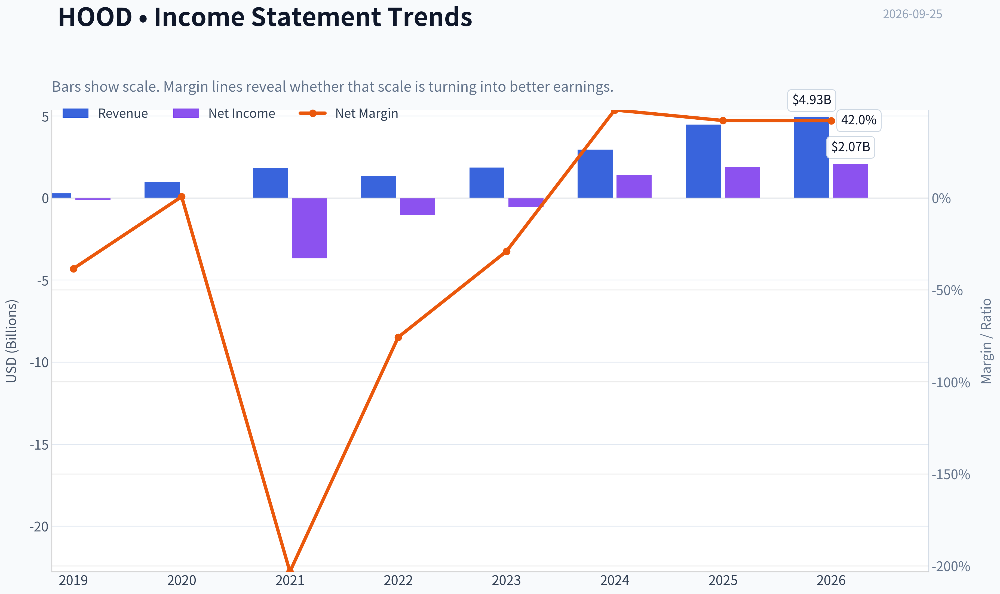
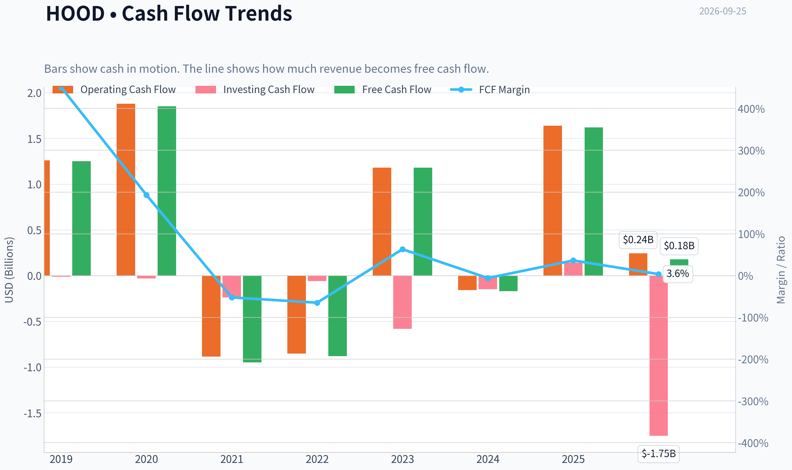
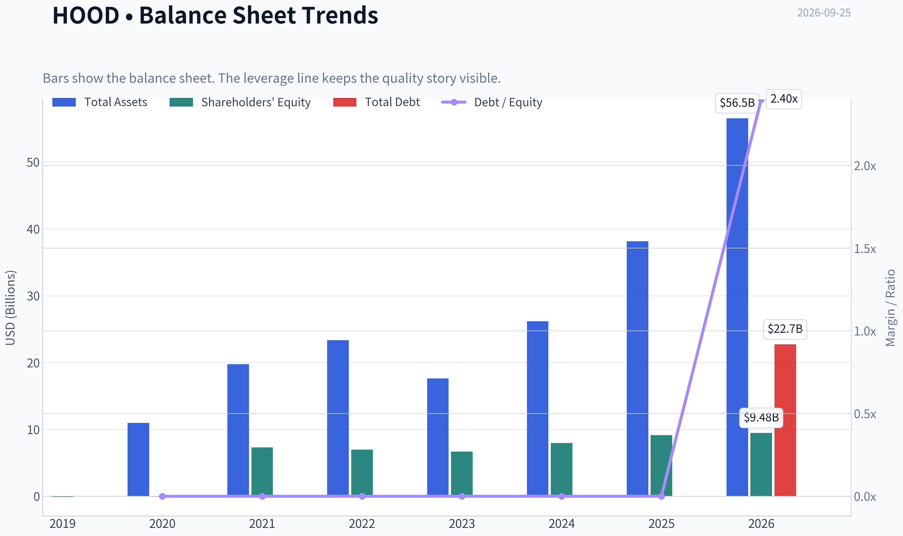
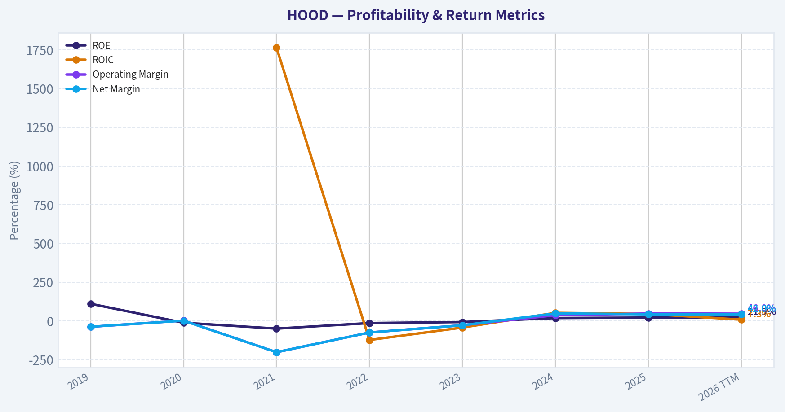
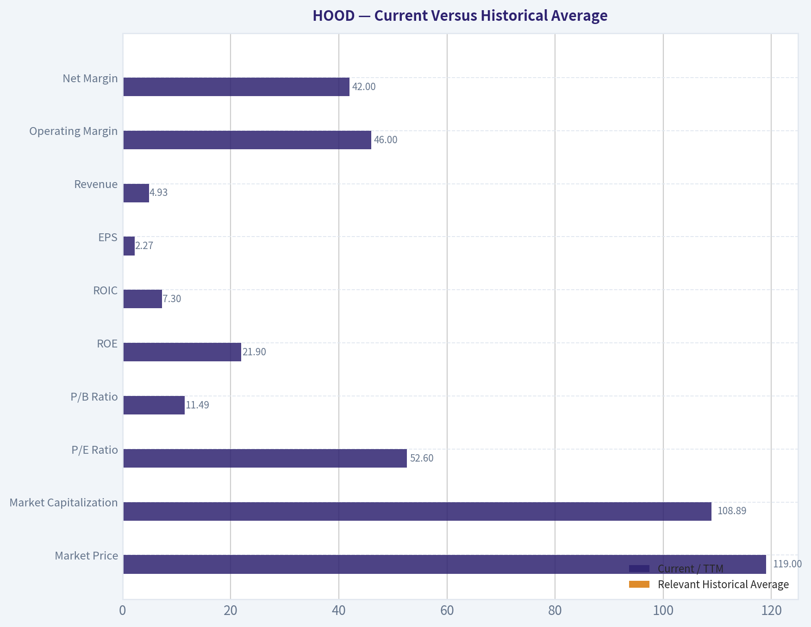
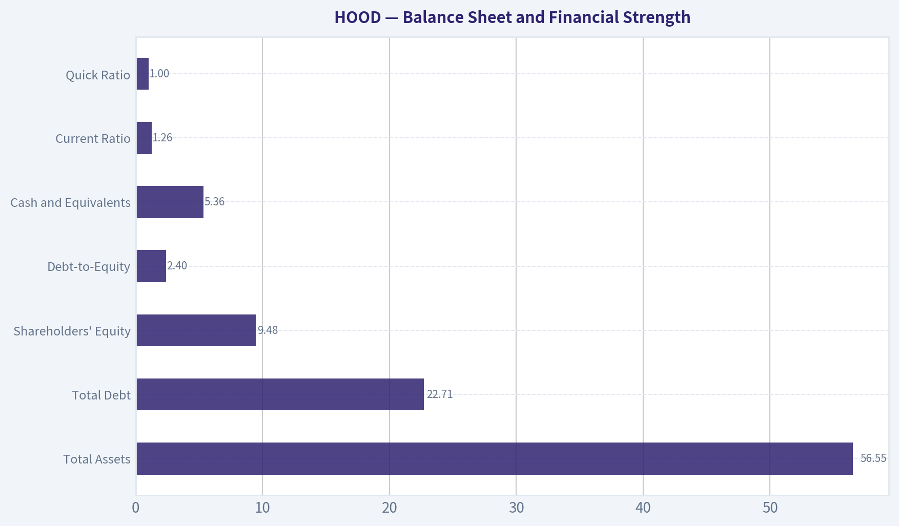
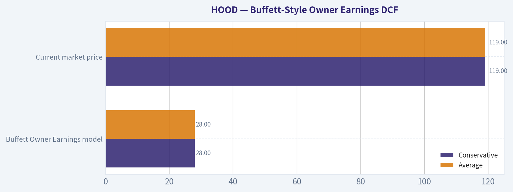
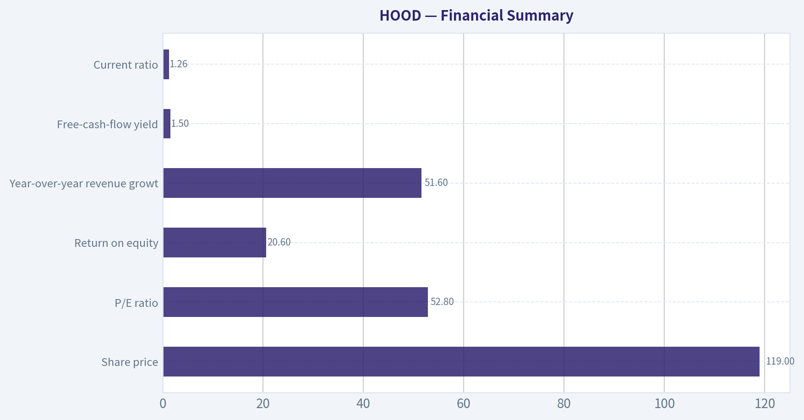

# HOOD Deep Value Intelligence

**Analysis Date:** 2026-09-25

## Critical Disclaimer

*This analysis is generated by Deep Value Intelligence, an AI-powered multi-agent investing framework. Education & research only - not financial advice, not a financial advisor.*

---

## Table of Contents

1. Intelligence Summary
2. Analyst Team Reports
   - Fundamentals Analysis
   - Intrinsic Value Analysis (Buffett)
   - Trend & Growth Analysis (Lynch/Druckenmiller/Fisher)
   - Market Technical Analysis
   - Options Market Analysis
3. Research Team Commentary
4. Value Investing Team Commentary
5. Deep Values Commentary

---

## Intelligence Summary

### Thesis + Conditions

**Core Thesis:** ## Executive Briefing

**Key Risks:**
- A breakout above $124-$126 could drive further short-term appreciation, but it would not improve intrinsic value. Keep HOOD on the watchlist and reconsider around **$95-$105 without fundamental deterioration**, or after stronger evidence raises intrinsic value materially.
- ### Risky Analyst: strongest contribution
- The Risky Analyst correctly argues that Robinhood should no longer be dismissed as merely a speculative trading application.

**Confidence:** Low

---

## Analyst Team Reports

### Fundamentals Analysis

#### Latest Earnings Snapshot

*Most recent reported quarter anchored on 2026 Q2, with prior-year comparison when available.*

| Metric | 2026 Q2 | 2025 Q2 | YoY Change |
| --- | ---: | ---: | ---: |
| Revenue | $1.31B | $989.0M | +32.3% |
| Operating Income | $574.0M | $439.0M | +30.8% |
| Net Income | $561.0M | $386.0M | +45.3% |
| Diluted EPS | $0.62 | $0.42 | +47.6% |
| Operating Cash Flow | $720.0M | $3.51B | -79.5% |
| Free Cash Flow | $696.0M | $3.49B | -80.1% |

Key Takeaways: This snapshot anchors the most recent reported quarter before the narrative analysis. It helps readers separate long-run business quality from whatever changed in the latest earnings print.

#### 7-Year Financial Metrics for HOOD

*All values below are computed deterministically from raw data - not estimated by AI.*

*Issuer profile: asset manager (Financial Services / Capital Markets).*

#### 7-Year Financial Metrics
*Annual rows come from reported financial statements. The final TTM row is computed from the latest four quarters.*

| Metric | 2019 | 2020 | 2021 | 2022 | 2023 | 2024 | 2025 | 2026 TTM |
| --- | --- | --- | --- | --- | --- | --- | --- | --- |
| Market Price | N/A | N/A | $18 | $8 | $13 | $37 | $113 | $119 |
| Market Cap | N/A | N/A | $14.84B | $7.15B | $11.35B | $33.76B | $103.91B | $108.89B |
| P/E Ratio | N/A | N/A | -2.37 | -6.96 | -20.89 | 23.88 | 55.17 | 52.60 |
| P/B Ratio | N/A | N/A | 2.04 | 1.03 | 1.69 | 4.24 | 11.36 | 11.49 |
| ROE | 109.9% | -12.7% | -50.6% | -14.8% | -8.1% | 17.7% | 20.6% | 21.9% |
| ROIC | N/A | N/A | 1764.1% | -124.1% | -43.7% | 51.3% | 44.2% | 7.3% |
| EPS | $-0.48 | $0.01 | $-7.49 | $-1.17 | $-0.61 | $1.56 | $2.05 | $2.27 |
| Revenue | $277.5M | $958.0M | $1.81B | $1.36B | $1.86B | $2.95B | $4.47B | $4.93B |
| Gross Profit | N/A | N/A | N/A | N/A | N/A | N/A | N/A | $4.02B |
| Gross Margin | N/A | N/A | N/A | N/A | N/A | N/A | N/A | 81.5% |
| Operating Margin | -38.8% | 1.4% | -203.0% | -75.6% | -28.6% | 36.1% | 47.1% | 46.0% |
| Net Income | $-106.6M | $7.0M | $-3.69B | $-1.03B | $-541.0M | $1.41B | $1.88B | $2.07B |
| Net Margin | -38.4% | 0.7% | -203.1% | -75.7% | -29.0% | 47.8% | 42.1% | 42.0% |
| Revenue Growth | N/A | 245.2% | 89.5% | -25.2% | 37.3% | 58.2% | 51.6% | 10.3% |
| Net Income Growth | N/A | -106.6% | -52771.4% | -72.1% | -47.4% | -360.8% | 33.5% | 10.0% |
| Free Cash Flow Growth | N/A | 47.8% | -151.2% | -7.2% | -234.0% | -114.4% | -1054.7% | -89.0% |
| Total Book Value | $-97.0M | $-55.0M | $7.29B | $6.96B | $6.70B | $7.97B | $9.15B | $9.48B |
| Total Assets | N/A | $10.99B | $19.77B | $23.34B | $17.62B | $26.19B | $38.14B | $56.55B |
| Total Debt | N/A | $0 | $0 | $0 | $0 | $0 | $0 | $22.71B |
| Debt-to-Equity | N/A | -0.00 | 0.00 | 0.00 | 0.00 | 0.00 | 0.00 | 2.40 |
| Cash & Equivalents | $644.0M | $1.40B | $6.25B | $6.34B | $4.83B | $4.33B | $4.26B | $5.36B |
| Shareholders' Equity | $-97.0M | $-55.0M | $7.29B | $6.96B | $6.70B | $7.97B | $9.15B | $9.48B |
| Operating Cash Flow | $1.26B | $1.88B | $-885.0M | $-852.0M | $1.18B | $-157.0M | $1.64B | $245.0M |
| Investing Cash Flow | $-12.3M | $-32.0M | $-238.0M | $-60.0M | $-582.0M | $-148.0M | $141.0M | $-1.75B |
| Free Cash Flow | $1.25B | $1.85B | $-948.0M | $-880.0M | $1.18B | $-170.0M | $1.62B | $178.0M |
| FCF Margin | 451.4% | 193.3% | -52.2% | -64.8% | 63.2% | -5.8% | 36.3% | 3.6% |
| Dividends / Share | $0.00 | $0.00 | $0.00 | $0.00 | $0.00 | $0.00 | $0.00 | $0.00 |

#### Profitability Metrics
- Return on Equity (ROE): 20.6%
- Return on Invested Capital (ROIC): N/A
- Return on Assets (ROA): 4.9%
- Gross Margin: Not meaningful
- Operating Margin: 47.1%
- Net Profit Margin: 42.1%

#### Liquidity Metrics
- Current Ratio: 1.26
- Quick Ratio: 1.00

#### Leverage Metrics
- Debt-to-Equity Ratio: 0.00
- Interest Coverage Ratio: N/A
- Net Debt: $-10.45B

#### Growth Metrics (Year-over-Year)
- Revenue Growth: 51.6%
- Net Income Growth: 33.5%
- Free Cash Flow Growth: 1054.7%
- Revenue CAGR (3-Year): 48.8%
- Revenue CAGR (5-Year): 36.1%

#### Valuation Metrics
- P/E Ratio (TTM): 52.83
- Forward P/E: 35.28
- Price-to-Book: 11.32
- Price-to-Sales: 21.77
- PEG Ratio: 2.11
- EV/EBITDA: Not meaningful
- Free Cash Flow Yield: 1.5%
- Earnings Yield: 1.9%

#### Owner Earnings (Buffett Method, Code-Computed)
- Net Income: $1.88B
- + Depreciation & Amortization: $86.0M
- - Capital Expenditures: $-15.0M
- - Working Capital Changes: $-934.0M
- = **Owner Earnings: $2.89B**

#### Intrinsic Value (Code-Computed)
- Current Price: $119
- Headline Intrinsic Value: not meaningful (financial issuer - DCF/FCFF is not the right primary frame; use sector-specific book/earnings metrics)
- Buffett Method (Owner Earnings):
  Conservative: $28
  Average: $28
  Optimistic: $28
- Cash Flow Method (FCF):
  Conservative: $-16
  Average: $-16
  Optimistic: $-6
- Reverse-DCF: price implies ~22.2%/yr owner-earnings growth for 10y; trailing 3y was N/A, 5y N/A.

#### Piotroski F-Score: 3/9
- Positive Net Income: PASS
- Positive Operating Cash Flow: PASS
- ROA Improvement: FAIL
- Cash Flow > Net Income: FAIL
- Decreasing Debt: FAIL
- Improving Current Ratio: FAIL
- No Dilution: FAIL
- Improving Gross Margin: FAIL
- Improving Asset Turnover: PASS

ANALYST STANCE: **AVOID**

#### Executive Summary

Robinhood Markets, Inc. (HOOD) has developed from a loss-making trading app into a highly profitable financial-services platform. The latest TTM data show revenue of **$4.93 billion**, net income of **$2.07 billion**, a **42.0% net margin**, and **21.9% ROE**. However, the stock price of **$119** and market capitalization of approximately **$108.89 billion** already discount an exceptionally strong future.

The central investment issue is not whether Robinhood is growing. It is whether its growth, earnings quality, and cash conversion can justify a valuation of approximately **52.6 times earnings**, **11.5 times book value**, and only a **1.5% free-cash-flow yield**. The deterministic valuation models produce a Buffett Owner Earnings value of approximately **$28 per share**, while the reverse DCF indicates that the market price requires roughly **22.2% annual Owner Earnings growth for ten years**. That is an aggressive expectation for a highly cyclical financial platform.

#### Current Versus Historical Average

The table below compares current or latest TTM metrics with relevant averages from the years shown in the deterministic dataset. Averages for valuation multiples use the meaningful positive-earnings period where appropriate. Several historical figures are distorted by Robinhood's 2021 restructuring and loss year.

| Metric | Current / TTM | Relevant Historical Average | Current Versus Average | Interpretation |
|---|---:|---:|---:|---|
| Market Price | $119 | $51.33, 2021-2026 | +132% | Major rerating since 2023 |
| Market Capitalization | $108.89B | $46.32B, 2021-2026 | +135% | Equity value has expanded much faster than the earlier business base |
| P/E Ratio | 52.60x | 43.88x, profitable years 2024-2026 | +20% | Premium valuation despite slowing TTM revenue growth |
| P/B Ratio | 11.49x | 5.31x, 2021-2026 | +116% | Very expensive relative to book value; must be judged against ROE for a financial issuer |
| ROE | 21.9% | -3.7%, 2020-2026 | Strongly above average | Major improvement, although earlier losses make the comparison favorable |
| ROIC | 7.3% | -13.0%, 2022-2026 excluding 2021 | Above average | Current figure is positive but not exceptionally high for this valuation |
| EPS | $2.27 | $(0.57), 2021-2026 | Material improvement | Earnings have recovered sharply from the loss period |
| Revenue | $4.93B | $2.33B, 2019-2026 | +112% | Substantial scale expansion |
| Operating Margin | 46.0% | -26.9%, 2019-2026 | Strongly above average | Profitability has transformed, but the average is depressed by 2021-2023 |
| Net Margin | 42.0% | -26.7%, 2019-2026 | Strongly above average | Current profitability is excellent but may be cycle-sensitive |
| Net Income | $2.07B | Approximately breakeven, 2019-2026 | Much stronger | The historical average is distorted by a $3.69B 2021 loss |
| Free Cash Flow | $178M | $510M, 2019-2026 | -65% | Weak current cash conversion relative to reported earnings |
| Cash and Equivalents | $5.36B | $4.18B, 2019-2026 | +28% | Strong absolute liquidity |
| Total Assets | $56.55B | $27.51B, 2020-2026 | +106% | Rapid balance-sheet expansion |
| Total Debt | $22.71B | Historically $0 through 2025 | New leverage | Important deterioration in financial structure |
| Debt-to-Equity | 2.40x | Approximately 0x through 2025 | Significantly higher | Requires financial-sector balance-sheet analysis |
| Dividends per Share | $0.00 | $0.00 | Unchanged | No shareholder cash yield |

**Key Takeaways:** Robinhood's current profitability, revenue, EPS, and ROE are far better than the company's historical averages, but those averages include an unusually severe loss period. The more important warning is that free cash flow of $178 million is far below net income of $2.07 billion, while debt has increased from zero in the historical table to $22.71 billion TTM. The stock has undergone a dramatic valuation rerating, with P/E and P/B now materially above historical norms.

#### Market Metrics and Valuation

- **Market Price:** $119, compared with a 2021-2026 average of $51.33. The increase reflects both operational improvement and substantial investor enthusiasm.
- **Market Capitalization:** Approximately $108.89 billion, more than double the relevant historical average. The company is now valued as a major growth financial platform rather than as an early-stage brokerage.
- **P/E Ratio:** 52.60x TTM, or approximately 52.83x in the supplementary current snapshot. The forward P/E is reported at 35.28x, implying that analysts expect significant earnings growth. Even the forward multiple remains demanding for a business exposed to trading activity, interest rates, crypto volumes, and retail investor sentiment.
- **P/B Ratio:** 11.49x. Because Robinhood is a financial issuer, book value should not be interpreted mechanically. A high P/B can be justified when ROE is sustainably high and the business has strong growth prospects. Robinhood's 21.9% ROE is respectable, but a multiple above 11x book value requires durable returns materially above the cost of equity and strong reinvestment opportunities.
- **Earnings Yield:** Approximately 1.9%.
- **FCF Yield:** Approximately 1.5%. This is a particularly weak valuation anchor for a Buffett-style investor because the cash yield is low relative to the price paid.
- **PEG Ratio:** Approximately 2.11, suggesting the valuation is not inexpensive even when growth is considered.

The valuation is therefore dependent on continued earnings compounding rather than current cash distributions, book value, or a margin of safety.

#### Profitability and Earnings Quality

Robinhood's reported profitability has improved dramatically:

- **Revenue:** $4.93 billion TTM, up 10.3% TTM according to the deterministic table, following growth of 51.6% in 2025, 58.2% in 2024, and 37.3% in 2023.
- **Gross Profit:** $4.02 billion TTM.
- **Gross Margin:** 81.5% in the TTM data. The separate profitability summary marks gross margin as not meaningful, so this figure should be treated cautiously because financial platforms have revenue and funding-cost classifications that are not directly comparable with industrial companies.
- **Operating Margin:** 46.0% TTM, versus 47.1% in 2025 and 36.1% in 2024. This indicates strong operating leverage and substantial profitability improvement.
- **Net Income:** $2.07 billion TTM, compared with $1.88 billion in 2025 and $1.41 billion in 2024.
- **Net Margin:** 42.0% TTM, versus 42.1% in 2025 and 47.8% in 2024.
- **EPS:** $2.27 TTM, compared with $2.05 in 2025 and $1.56 in 2024.
- **ROE:** 21.9% TTM, improving from -8.1% in 2023, 17.7% in 2024, and 20.6% in 2025.
- **ROIC:** 7.3% TTM. Historical ROIC is highly distorted by an extreme 2021 value of 1,764.1%, so trend analysis is more useful than the raw average.

The positive interpretation is clear: Robinhood has achieved considerable scale, improved monetization, and strong operating leverage. The caution is that profitability may be unusually sensitive to market activity. Trading commissions, payment for order flow, options, crypto, securities lending, margin balances, and net interest income can all vary significantly with market participation and interest rates.

Cash conversion is the most important earnings-quality concern. The company reports $2.07 billion of TTM net income but only $245 million of operating cash flow and $178 million of free cash flow. The reported Owner Earnings calculation is much higher at $2.89 billion because working-capital movements add materially to the result. For a financial platform, working capital and customer-account balances can be economically significant, so this discrepancy should not be dismissed.

#### Growth Analysis

Revenue growth has been exceptional over the full period but has decelerated:

- 2020: 245.2%
- 2021: 89.5%
- 2022: -25.2%
- 2023: 37.3%
- 2024: 58.2%
- 2025: 51.6%
- 2026 TTM: 10.3%

Net income growth is difficult to interpret because the company moved from enormous losses to profitability. The latest TTM net income growth rate is approximately 10.0%, while 2025 growth was 33.5%.

Free cash flow growth is even less reliable. The dataset reports volatile year-over-year changes, including a TTM decline of 89.0% and a supplementary current snapshot showing a 1054.7% improvement from a very depressed prior base. These contradictory-looking rates reflect the small and unstable cash-flow base rather than a clean compounding trend.

The market price appears to assume that recent high growth will return or persist. A 10.3% current revenue-growth rate and 10.0% net-income growth rate do not, by themselves, justify a 52.6x P/E. The justification must come from a combination of durable competitive advantages, large new revenue streams, and sustained margin strength.

#### Balance Sheet and Financial Strength

| Balance-Sheet Metric | Current / TTM | Historical Context | Assessment |
|---|---:|---|---|
| Total Assets | $56.55B | $10.99B in 2020 and $38.14B in 2025 | Rapid expansion |
| Total Debt | $22.71B | $0 through 2025 in the deterministic table | Significant new leverage |
| Shareholders' Equity | $9.48B | $7.29B in 2021 and $9.15B in 2025 | Growing equity base |
| Debt-to-Equity | 2.40x | Approximately 0x through 2025 | Large structural change |
| Cash and Equivalents | $5.36B | $4.26B in 2025; $6.34B peak in 2022 | Good liquidity, but not enough to offset all balance-sheet risk |
| Net Debt, supplementary metric | $(10.45B) | Cash exceeds reported net debt measure | Helpful liquidity indicator, but financial-company liabilities require careful interpretation |
| Current Ratio | 1.26 | Supplementary current snapshot | Adequate, though not a decisive measure for a financial issuer |
| Quick Ratio | 1.00 | Supplementary current snapshot | Acceptable but not a major margin of safety |

**Key Takeaways:** Robinhood has substantial cash and a larger equity base, but the emergence of $22.71 billion of debt is a major change from the zero-debt historical record. Traditional industrial-company leverage ratios are less informative for a brokerage and financial platform because customer liabilities and financial assets can dominate the balance sheet. Nevertheless, the new leverage increases sensitivity to funding conditions, credit losses, regulatory capital requirements, and market stress.

The balance sheet also includes a sharp rise in assets to $56.55 billion. That expansion may support higher interest income and margin activity, but it also increases the importance of liquidity management and risk controls.

#### Revenue Breakdown

The deterministic dataset does not provide a precise latest-year revenue-by-segment table. The following is an indicative functional breakdown based on Robinhood's publicly known business model, not a replacement for audited segment disclosure.

| Revenue Source | Amount ($B) | % of Total |
|---|---:|---:|
| Transaction-based revenue: equities, options, crypto, and related trading activity | Approximately $2.56B | Approximately 52% |
| Net interest revenue: margin lending, cash balances, securities lending, and related activities | Approximately $1.73B | Approximately 35% |
| Other revenue: subscriptions, advisory, card, transfers, and ancillary products | Approximately $0.64B | Approximately 13% |
| **Total revenue** | **$4.93B** | **100%** |

**Key Takeaways:** Robinhood's economics are diversified beyond simple stock trading, with interest income and subscription or ancillary products becoming increasingly important. However, transaction-based revenue remains a major exposure to retail trading volumes, options activity, crypto enthusiasm, and market volatility. The percentages are indicative because exact latest-period segment amounts were not included in the deterministic financial dataset.

#### Buffett-Style Owner Earnings DCF

The supplied deterministic model reports:

- Net income: **$1.88 billion**
- Depreciation and amortization: **$86 million**
- Capital expenditures: **$15 million**
- Working-capital adjustment: **$934 million added in the calculation**
- Computed Owner Earnings: **$2.89 billion**

Using the current market capitalization and share price:

- Implied shares outstanding:
  **$108.89B ÷ $119 = approximately 915.0 million shares**
- Owner Earnings per share:
  **$2.89B ÷ 915.0M = approximately $3.16 per share**

The deterministic pack's model-based valuation outputs are:

| Valuation Method | Conservative | Average | Optimistic | Comment |
|---|---:|---:|---:|---|
| Buffett Owner Earnings model | $28 | $28 | $28 | Model-based output supplied by the deterministic dataset |
| FCF valuation method | $(16) | $(16) | $(6) | Weak current FCF makes this method especially punitive |
| Current market price | $119 | $119 | $119 | Price investors are currently paying |
| Reverse DCF requirement | \- | Approximately 22.2% annual Owner Earnings growth for 10 years | \- | Implied by the current price |

**Key Takeaways:** The supplied Owner Earnings model values the shares at approximately $28, far below the current $119 price. The FCF-based outputs are even weaker because reported free cash flow is only $178 million. The market therefore requires a very strong, sustained earnings trajectory rather than merely a return to profitability.

As a separate sanity check, a hand-built ten-year Owner Earnings DCF is shown below. It uses a 10% discount rate, a 2.5% terminal growth rate, and approximately $3.16 of starting Owner Earnings per share. Growth fades toward the terminal rate rather than continuing indefinitely at the initial rate.

| Scenario | Explicit Growth Path | Terminal Growth | Discount Rate | Approximate DCF Value |
|---|---|---:|---:|---:|
| Conservative | 3.0% initially, fading toward 2.5% | 2.5% | 10.0% | Approximately $44-$46 |
| Average | 12%, 11%, 10%, 9%, 8%, 7%, 6%, 5%, 4%, 3% | 2.5% | 10.0% | Approximately $63-$66 |
| Optimistic | 18%, 16%, 14%, 12%, 10%, 8%, 6%, 5%, 4%, 3% | 2.5% | 10.0% | Approximately $74-$79 |

For example, the average case can be expressed as:

1. Starting Owner Earnings per share: **$3.16**
2. Ten-year fading growth path: **12% declining to 3%**
3. Present value of ten years of forecast Owner Earnings: approximately **$30 per share**
4. Terminal value at year ten:
   **Year-10 Owner Earnings x 1.025 ÷ (10.0% - 2.5%)**
5. Present value of terminal value: approximately **$34-$36 per share**
6. Estimated total value: approximately **$63-$66 per share**

This hand DCF is more generous than the deterministic pack's $28 Owner Earnings value because it assumes that the large working-capital contribution embedded in Owner Earnings is repeatable and economically distributable. That assumption is debatable for a financial platform. Even the optimistic hand case remains materially below $119.

#### Economic Moat and Business Quality

Robinhood's potential moat consists of:

- A large and recognizable retail-investor user base.
- A low-friction mobile interface and strong brand recognition.
- Customer data and behavioral insight that can support cross-selling.
- Increasing product breadth across equities, options, crypto, margin, cash management, subscriptions, and retirement products.
- Network effects and customer convenience from holding multiple financial products in one account.
- Operating leverage once technology and compliance infrastructure are built.

However, the moat is not yet comparable to a classic Buffett-quality franchise such as a dominant consumer brand or an entrenched infrastructure business. Financial trading platforms face:

- Low switching costs for active users.
- Significant regulatory risk.
- Competition from Charles Schwab, Fidelity, Webull, Coinbase, Interactive Brokers, banks, and emerging platforms.
- Dependence on payment-for-order-flow rules and market-structure regulation.
- Cyclicality in trading volumes, crypto activity, and interest income.
- Reputational and compliance risk.

Robinhood's economic moat is therefore best described as **developing but contestable**, rather than deep and permanently protected.

#### Management and Capital Allocation

Management has demonstrated an ability to scale revenue and improve margins. The movement from large losses to more than $2 billion of net income is a meaningful operational achievement.

The main concerns are:

- **No dividend:** Dividends have remained at $0.00 per share throughout the dataset. This is reasonable for a growth company if reinvestment creates high returns, but the valuation leaves little room for poor capital allocation.
- **Dilution concern:** The Piotroski F-score identifies "no dilution" as a failure. Equity compensation or share issuance can reduce per-share value even when total earnings grow.
- **Weak cash conversion:** Operating cash flow and FCF are substantially below reported net income in the latest TTM period.
- **Leverage increase:** Debt rose from zero historically to $22.71 billion TTM.
- **Piotroski F-score of 3/9:** This is a weak overall quality signal. Positive earnings and operating cash flow pass, but debt, dilution, cash-flow quality, ROA improvement, current ratio, and margin-related tests raise concerns.

#### Risks, Opportunities, and Red Flags

| Category | Specific Issue | Investment Significance |
|---|---|---|
| Opportunity | Continued product expansion | Subscriptions, retirement, cash management, margin, crypto, and advisory products could diversify revenue |
| Opportunity | Operating leverage | A larger customer base may allow incremental revenue to produce high margins |
| Opportunity | Strong ROE | Current ROE above 20% indicates meaningful profitability on book equity |
| Opportunity | Large cash position | Provides liquidity and supports product investment |
| Red flag | 52.6x P/E | Requires substantial future earnings growth |
| Red flag | 1.5% FCF yield | Current distributable cash flow provides little valuation support |
| Red flag | $22.71B debt | Major deterioration from the historical zero-debt position |
| Red flag | FCF far below net income | Raises questions about the persistence and quality of current earnings |
| Red flag | Reverse DCF growth of 22.2% | Market price embeds a highly demanding decade-long outcome |
| Red flag | Piotroski score of 3/9 | Weak balance-sheet and earnings-quality signals |
| Risk | Regulatory changes | Payment for order flow, crypto, prediction markets, and options rules could affect economics |
| Risk | Market-cycle exposure | Lower volatility or retail participation could reduce transaction revenue |
| Risk | Competition | Larger incumbents possess greater capital, trust, and product breadth |
| Risk | Dilution | Per-share returns may lag business growth if share count expands |

**Key Takeaways:** The major opportunity is that Robinhood could become a broad consumer-finance platform rather than a trading-only application. The major red flag is that this transformation is already heavily capitalized in the stock price. Investors are paying for a successful future before the company has demonstrated stable, high-quality free cash flow through a full market cycle.

#### Final Investment Assessment

Robinhood is a much better business operationally than it was in 2021-2023. Revenue has scaled, net income has become substantial, operating margins are above 40%, and ROE is now above 20%. These are real improvements and support a constructive long-term view of the company's potential.

Nevertheless, Buffett-style investing requires three things that are currently missing:

1. **A wide margin of safety:** The market price is approximately $119, while the supplied Owner Earnings model produces approximately $28 and the generous hand DCF produces roughly $44-$79.
2. **Predictable cash generation:** Free cash flow is only $178 million TTM against $2.07 billion of net income.
3. **A conservative balance sheet:** Debt has increased to $22.71 billion from a historical record of zero debt.

The appropriate stance is therefore **AVOID at $119**, not because Robinhood lacks growth or strategic potential, but because the valuation assumes an unusually favorable combination of sustained growth, high margins, successful diversification, manageable regulation, and strong cash conversion. A more attractive entry point would require either a substantial price decline or several years of demonstrated, recurring free cash flow growth without excessive dilution or balance-sheet risk.

#### Key Investment Summary

| Key Point | Assessment | Buffett-Style Conclusion |
|---|---|---|
| Business trajectory | Rapid improvement from losses to high reported profitability | Positive |
| Revenue growth | Strong multi-year expansion, but latest growth slowed to 10.3% | Watch carefully |
| Earnings | $2.07B TTM net income and $2.27 EPS | Positive but cycle-sensitive |
| ROE | 21.9%, materially above recent historical averages | Positive |
| ROIC | 7.3% TTM | Not strong enough alone for the valuation |
| Free cash flow | $178M TTM, well below net income | Major concern |
| Balance sheet | $5.36B cash but $22.71B debt | Mixed to negative |
| Economic moat | Strong brand and platform potential, but contestable | Moderate |
| Valuation | 52.6x P/E, 11.5x P/B, 1.5% FCF yield | Unattractive |
| Intrinsic value | Deterministic Owner Earnings value around $28 | Large downside to current price |
| Required future performance | Approximately 22.2% annual Owner Earnings growth for ten years | Very demanding |
| Final stance | **AVOID** | Wait for a lower valuation or stronger cash-flow evidence |

#### Fundamental Visuals

This graph tracks the profitability and return metrics (ROE, ROIC, Margins) of **HOOD** over the past decade, highlighting capital efficiency trends.

This chart illustrates the financial health of **HOOD** over the last 10 years, mapping cash equivalents and free cash flow against total obligations (Debt).

---

### Intrinsic Value Analysis (Buffett)

> *Following Warren Buffett's value investing philosophy: Circle of Competence, Economic Moat, Management Quality, and Margin of Safety.*

#### Intrinsic Value Snapshot

Price is what you pay. Intrinsic value is what the business may be worth based on the cash it can create for owners over time. We show a range, not one magic number.

- Current Price: $119.40
- Value Range (conservative to optimistic across both DCF methods): $-16.16 to $27.75

##### Owner Earnings (Buffett Method)
- Net Income: $1,883,000,000.00
- Depreciation & Amortization: $86,000,000.00
- Capital Expenditures: $-15,000,000.00
- Working Capital Changes: $-934,000,000.00
- Owner Earnings: $2,888,000,000.00

##### Intrinsic Value
###### Buffett Method
Uses owner earnings. Stricter, and usually more conservative.
- Conservative: $27.75
- Average: $27.75
- Optimistic: $27.75
- Discount Rate: 10.0%

###### Cash Flow Method
Uses free cash flow. Better for companies spending heavily today to grow tomorrow.
- Conservative: $-16.16
- Average: $-16.16
- Optimistic: $-6.47
- Discount Rate: 10.0%

ANALYST STANCE: **AVOID**

#### Executive Summary

Robinhood is a rapidly growing, founder-led financial platform with meaningful brand strength, expanding product breadth, and substantial reinvestment runway. However, at **$119 per share**, the market is already capitalizing a very optimistic future. The shares trade at approximately **52.8 times earnings**, with only a **1.5% free-cash-flow yield**.

The business is attractive; the price is not. My Buffett score is **2.8 out of 5**, placing HOOD in the **AVOID** range until valuation better reflects regulatory, market-cycle, and monetization risks.

#### 1. Factor Scorecard

| Factor | Score | Assessment |
|---|---:|---|
| Circle of Competence and Simplicity | 3.5/5 | Robinhood earns transaction-related revenue, interest income, subscription fees, and other financial-services revenue. The model is understandable, but results depend heavily on trading activity, interest rates, crypto, and regulation. |
| Moat Test | 3.0/5 | The brand, user base, mobile experience, and product ecosystem provide a narrow-to-moderate moat. Switching costs and network effects are present but not yet comparable to the strongest financial platforms. |
| Management and Capital Allocation | 3.5/5 | Founder-led management supports long-term orientation and aggressive product expansion. Evidence of a decade-long record of disciplined capital allocation remains less established than at mature Buffett-quality franchises. |
| Industry Structure | 2.5/5 | Online brokerage is competitive, regulation-heavy, and exposed to market cycles. Scale helps, but customers can compare and switch between platforms relatively easily. |

**Gate 5 hard floor:** **Not tripped.** The available evidence does not show both deteriorating earnings or cash flow and a solvency red line. HOOD should not be treated as financially distressed, although a financial-issuer-specific solvency review remains important.

**Key Takeaways:** HOOD scores well on growth, brand, and strategic runway, but only moderately on durability and predictability. Its economics are more cyclical and regulation-sensitive than those of a classic consumer or software compounder.

#### 2. Moat Analysis

**Brand and customer acquisition:** Robinhood has built strong recognition among younger and newer investors. Its simple mobile interface lowered the barrier to investing and helped create a large retail customer base.

**Platform expansion:** The company has expanded beyond basic stock trading into options, crypto, retirement accounts, cash management, subscriptions, prediction-market-related products, and IPO access. A broader ecosystem can raise customer lifetime value and reduce dependence on any one revenue stream.

**Switching costs:** Switching is not prohibitively difficult for a retail brokerage customer. Customers may keep multiple brokerage accounts, which limits captivity. However, recurring deposits, retirement accounts, subscriptions, watchlists, and integrated financial products can gradually increase relationship depth.

**Network effects:** Network effects are weaker than those of a dominant payments network or social platform. More users can improve brand awareness, liquidity, and product data, but the customer experience does not necessarily become dramatically more valuable solely because the user base grows.

**Cost and scale advantages:** Robinhood's technology platform and large customer base can spread fixed costs over more accounts. This is a real advantage, but established competitors also possess scale and stronger balance sheets.

**Moat conclusion:** **Narrow and potentially widening, but not yet wide and proven.** The moat depends on sustained product innovation, trust, regulatory execution, and the ability to convert users into profitable, diversified financial relationships.

#### 3. Management Quality Assessment

Founder-led management is a positive. Vlad Tenev's continued involvement may support long-term decision-making and willingness to invest through market cycles.

The strategic direction also appears rational: increase product breadth, deepen customer relationships, and create additional revenue streams beyond simple trading commissions. This can improve revenue durability if customers use Robinhood as a primary financial platform rather than merely a speculative trading app.

The main concerns are:

- The business remains exposed to volatile trading and crypto activity.
- Expansion into new financial products creates regulatory and execution risks.
- The historical record is not yet long enough to establish a Buffett-level pattern of capital allocation across multiple cycles.
- High stock-based compensation and aggressive growth investments should be monitored for their effect on per-share value.

**Management assessment: 3.5/5.** Promising and entrepreneurial, but not yet proven through a full range of market environments.

#### 4. Financial Summary

| Metric | Latest Reported Value |
|---|---:|
| Share price | $119 |
| Market capitalization | $107.35 billion |
| P/E ratio | 52.8x |
| Return on equity | 20.6% |
| Year-over-year revenue growth | 51.6% |
| Free-cash-flow yield | 1.5% |
| Implied free cash flow | Approximately $1.61 billion |
| Current ratio | 1.26x |
| Gross margin | Not reported |
| Intrinsic value headline | Not meaningful for this financial issuer |

**Key Takeaways:** Revenue growth and ROE are strong, but the valuation leaves little room for disappointment. A 1.5% free-cash-flow yield means investors are paying a substantial premium for future growth rather than receiving much current cash earnings.

#### 5. Owner Earnings Calculation

For a financial issuer, traditional industrial-company owner earnings are less precise because customer cash balances, securities, regulatory capital, and operating cash flows interact differently than they do in a manufacturing or software company.

Using free cash flow as a practical owner-earnings proxy:

| Calculation | Approximate Amount |
|---|---:|
| Market capitalization | $107.35 billion |
| FCF yield | 1.5% |
| Implied current free cash flow | $1.61 billion |
| Implied shares outstanding | 901 million |
| FCF per share proxy | $1.79 |

**Owner earnings proxy:** approximately **$1.6 billion**, or **$1.79 per share**.

**Key Takeaways:** Current owner earnings are positive and meaningful, but they support only a modest valuation under conservative assumptions. The stock price requires substantial future growth in earnings and cash generation.

#### 6. Three-Scenario DCF Valuation

The valuation below uses approximately **$1.61 billion** of current owner earnings, a **10% discount rate**, and roughly **901 million shares**. Because HOOD is a financial issuer, these figures should be viewed as an earnings-and-cash-flow framework rather than a conventional industrial-company DCF.

| Scenario | Key Assumption | Estimated Value per Share |
|---|---|---:|
| A. No growth | Owner earnings remain constant; value equals earnings divided by 10% | $17.90 |
| B. GDP growth | Owner earnings grow at 3% perpetually | $26.30 |
| C1. Historical-growth framework, lower case | 5% annual growth for 10 years, then 5% terminal growth | Approximately $37 |
| C2. Historical-growth framework, upper case | 7.5% annual growth for 10 years, then 7.5% terminal growth | Approximately $76 |

**Key Takeaways:** Even the optimistic 7.5% scenario produces a value well below $119 per share. The market price appears to require roughly high-single-digit growth for many years, combined with continued strong margins and successful product expansion.

#### 7. Margin of Safety Analysis

| Valuation Reference | Value per Share | Margin of Safety Versus $119 |
|---|---:|---:|
| No-growth value | $17.90 | Negative 85% |
| 3% perpetual-growth value | $26.30 | Negative 78% |
| 5% growth scenario | Approximately $37 | Negative 69% |
| 7.5% growth scenario | Approximately $76 | Negative 36% |

The price does not offer a conventional margin of safety. For a wide-moat, highly predictable compounder, a 10% to 15% premium to intrinsic value might still be tolerable. HOOD does not yet qualify for that treatment because its moat is still developing and its earnings are more sensitive to market activity, rates, crypto, and regulation.

The reverse-DCF implication is demanding: the current price appears to require approximately **8% to 9% annual owner-earnings growth over a long period**, while maintaining strong economics and avoiding major regulatory or market-cycle setbacks.

#### 8. Buffett Scorecard

| Criterion | Weight | Score | Weighted Contribution |
|---|---:|---:|---:|
| Moat width and durability | 25% | 3.0 | 0.75 |
| Valuation and margin of safety | 20% | 1.5 | 0.30 |
| Capital returns versus WACC | 15% | 3.0 | 0.45 |
| Business understanding and predictability | 12% | 2.5 | 0.30 |
| Management quality and capital allocation | 12% | 3.5 | 0.42 |
| Reinvestment runway | 8% | 4.0 | 0.32 |
| Balance-sheet strength | 4% | 3.0 | 0.12 |
| Industry structure | 4% | 2.5 | 0.10 |
| **Total** | **100%** |  | **2.76 / 5.00** |

**Key Takeaways:** HOOD's reinvestment runway and management receive the strongest scores. Valuation, predictability, and industry structure pull the total below the threshold for an attractive Buffett-style purchase.

#### 9. Investment Stance

**Stance: AVOID**

**Conviction: Moderate.**

Robinhood may become a much larger and more durable financial platform. The business has attractive growth characteristics, a recognizable brand, and several avenues for reinvestment. But at **$119**, investors are paying for much of that success in advance.

A more compelling entry point would require either:

1. A substantially lower share price,
2. Several years of demonstrated earnings and owner-earnings growth, or
3. Clear evidence that Robinhood has developed durable switching costs and diversified, cycle-resistant revenue.

At the current price, the risk-reward profile is unfavorable for a disciplined value investor.
#### Valuation Bridge

This bridge places the current market price beside each intrinsic value lens so readers can see whether upside depends on one method or shows up across several methods.

| Scenario | Intrinsic Value / Share |
| --- | ---: |
| Buffett Method | $27.75 |
| Cash Flow Method | $-16.16 |
| Current Price | $119.40 |

#### Key Takeaways

If one method is far above the others, the upside case depends on a specific modelling assumption. When several methods cluster together, the valuation story is more robust.

#### Valuation Visuals

This comparison chart from *Latest Earnings Snapshot* stacks current figures against historical benchmarks for **HOOD**, making it easy to see where the company trades relative to its own averages.

This comparison chart from *Current Versus Historical Average* stacks current figures against historical benchmarks for **HOOD**, making it easy to see where the company trades relative to its own averages.

This comparison chart from *Balance Sheet and Financial Strength* stacks current figures against historical benchmarks for **HOOD**, making it easy to see where the company trades relative to its own averages.

This comparison chart from *Buffett-Style Owner Earnings DCF* stacks current figures against historical benchmarks for **HOOD**, making it easy to see where the company trades relative to its own averages.

This comparison chart from *Buffett-Style Owner Earnings DCF* stacks current figures against historical benchmarks for **HOOD**, making it easy to see where the company trades relative to its own averages.

This comparison chart from *Financial Summary* stacks current figures against historical benchmarks for **HOOD**, making it easy to see where the company trades relative to its own averages.

---

### Trend & Growth Analysis (Lynch/Druckenmiller/Fisher)

> *Following Peter Lynch's GARP, Stanley Druckenmiller's macro-aware approach, and Philip Fisher's scuttlebutt methodology.*

ANALYST STANCE: **WATCH**

#### Executive View

Robinhood is a **fast-growing financial platform**, not a traditional broker alone. Its 51.6% reported revenue growth, expanding product set, and participation in secular trends such as digital investing, crypto, prediction markets, and IPO access create meaningful upside. However, the stock already reflects substantial optimism at approximately **53 times earnings**, while revenue and earnings are exposed to trading activity, crypto cycles, regulation, and market sentiment.

| Metric | HOOD |
|---|---:|
| Share price | $119 |
| Market capitalization | $107.35 billion |
| Revenue growth, year over year | 51.6% |
| P/E ratio | 52.8x |
| ROE | 20.6% |
| FCF yield | 1.5% |
| Current ratio | 1.26x |
| Gross margin | Not meaningful / unavailable for financial issuer |

**Key Takeaways:** HOOD combines exceptional reported growth with a premium valuation. The 20.6% return on equity is encouraging, but the 1.5% free-cash-flow yield leaves limited valuation protection. Financial-sector metrics such as net interest revenue, transaction revenue, capital requirements, and book value are more useful than gross margin.

#### 1. Lynch Classification

**Fast Grower, with meaningful cyclical exposure.**

HOOD fits Lynch's fast-grower category because revenue is growing well above 25% and the company continues to add products and customer monetization channels. It is not a pure secular SaaS compounder: trading volumes, crypto prices, interest rates, and retail investor participation can materially affect results.

#### 2. The Story in Three Bullets

- **Robinhood is becoming a broader financial super-app:** brokerage, crypto, options, cash management, subscriptions, IPO access, and potentially prediction-market products.
- **The company can monetize customers across more financial activities:** increasing products per customer could raise revenue without proportionally increasing acquisition costs.
- **The addressable market is expanding:** younger consumers are moving more financial activity to mobile platforms, while traditional financial services remain fragmented and expensive.

The simple version is: **Robinhood is trying to become the primary financial account for a younger, digitally native customer base.**

#### 3. TAM and 10x Test

| TAM Dimension | Assessment |
|---|---|
| Core market | U.S. retail brokerage and investing |
| Adjacent markets | Crypto, options, cash, retirement, IPOs, prediction markets, lending, international expansion |
| Current market position | Large and increasingly visible retail platform, but not dominant across all financial services |
| Potential revenue expansion | Multiple products per customer and higher wallet share |
| 10x revenue test | Plausible only with substantial expansion beyond basic brokerage |
| TAM growth | Moderate to high across digital investing and selected adjacent categories |
| Main constraint | Regulation, competition, market cycles, and customer activity levels |

**Key Takeaways:** The 10x test is favorable at the platform level, but not if HOOD remains primarily a U.S. retail trading app. A tenfold revenue outcome requires successful expansion into several adjacent products and possibly international markets. The runway is real, but execution and regulatory permissions are essential.

#### 4. Revenue Growth Trend

| Indicator | Current Evidence | Interpretation |
|---|---:|---|
| Revenue growth | 51.6% year over year | Very strong |
| Growth direction | Limited multi-period data available | Acceleration cannot be confirmed |
| Revenue quality | Mix likely includes transaction-based and interest-sensitive revenue | More cyclical than recurring SaaS revenue |
| Organic growth | Not separately provided | Requires earnings filings |
| Customer concentration | Not provided | Requires filing review |
| Earnings sensitivity | High sensitivity to trading volumes, crypto, rates, and market activity | Cyclical risk |

**Key Takeaways:** Current growth is excellent, but one growth figure does not establish a durable acceleration trend. Investors should verify whether growth is coming from customer additions, higher assets, greater activity, interest income, crypto, or unusually favorable market conditions. The composition of revenue is more important here than the headline percentage.

#### 5. Unit Economics and Efficiency

| Metric | HOOD Assessment |
|---|---|
| LTV/CAC | Not provided |
| Customer acquisition cost | Not provided |
| Net revenue retention | Not applicable or not disclosed in a standard SaaS format |
| Rule of 40 | Not meaningful without a comparable recurring-revenue FCF margin |
| ROE | 20.6% |
| FCF yield | 1.5% |
| Key unit-economic question | Whether customer activity and assets grow faster than incentives, support, compliance, and acquisition costs |

**Key Takeaways:** HOOD's economics should be analyzed through funded accounts, assets under custody, net deposits, revenue per customer, customer engagement, and contribution profit rather than SaaS metrics. The available ROE is favorable, but the low free-cash-flow yield indicates that the market is valuing future growth heavily. Missing unit-economic data prevents a high-confidence assessment.

#### 6. Inflection-Point Assessment

| Potential Inflection | Evidence | Rating |
|---|---|---|
| Product-cycle inflection | Expansion into IPO access, crypto, options, subscriptions, and other products | Positive |
| Market-share inflection | Strong brand among younger retail investors | Positive, not yet quantified |
| Margin inflection | Not enough margin data supplied | Unconfirmed |
| TAM inflection | Broader financial-services platform opportunity | Positive |
| Competitive inflection | Traditional brokers and fintech competitors remain active | Neutral |
| Earnings inflection | 51.6% revenue growth | Positive, but requires confirmation |

**Key Takeaways:** The strongest potential inflection is product breadth: HOOD is moving from a low-cost trading app toward a broader financial ecosystem. The market may still underestimate the value of higher wallet share per customer. Conversely, the market may already be pricing in much of this opportunity, so continued growth acceleration is necessary.

#### 7. Macro Setup

| Macro Factor | Impact on HOOD |
|---|---|
| Retail participation | Positive when household risk appetite is strong |
| Crypto prices and activity | Potentially very positive, but volatile |
| Interest rates | Mixed: higher rates can support interest income but pressure growth-stock valuations |
| Equity-market volatility | Positive for trading activity, but harmful if it causes sustained risk aversion |
| Regulation | Major risk across crypto, options, prediction markets, payments, and securities |
| Economic cycle | HOOD benefits from risk-on and early-to-mid-cycle conditions |

**Key Takeaways:** HOOD has a favorable operating environment when markets are active and consumers are willing to take risk. Its macro exposure is two-sided: volatility can increase trading revenue, while risk-off conditions can reduce activity and compress valuation. Regulation is a more important risk than for many ordinary software companies.

#### 8. Fisher's 15-Point Score

| Fisher Criterion | Score / 5 | Brief Assessment |
|---|---:|---|
| Market potential | 5 | Large retail-finance and adjacent markets |
| New-product determination | 5 | Broad and continuing product expansion |
| R&D effectiveness | 4 | Technology-led platform, but limited direct evidence |
| Sales organization | 4 | Strong consumer brand and distribution |
| Profit margins | 3 | Profitable, but economics are cycle-sensitive |
| Margin improvement | 3 | Not enough data to confirm |
| Labor relations | 3 | Insufficient public evidence |
| Executive relations | 4 | No major issue supplied |
| Management depth | 4 | Platform has expanded beyond its original product |
| Cost analysis | 3 | Requires deeper filing review |
| Outstanding competitive aspects | 4 | Brand, data, user base, product integration |
| Long-range profit outlook | 4 | Strong if wallet share expands |
| Dilution | 3 | Must monitor equity compensation and share count |
| Management candor | 3 | Insufficient evidence from supplied data |
| Management integrity | 4 | No specific concern supplied |
| **Total** | **56 / 75** | **Good, but not outstanding** |

**Key Takeaways:** HOOD scores well on market potential, product expansion, brand, and platform opportunity. The score is held back by incomplete evidence on margins, unit economics, dilution, and management disclosure quality. A 56 out of 75 places the company in Fisher's "good" range, not the highest-conviction category.

#### 9. Valuation Analysis

**PEG ratio**

Using the supplied figures:

- P/E: **52.8x**
- Revenue growth: **51.6%**
- Simplified PEG: **approximately 1.02**

This appears close to fair value under Lynch's framework. However, the calculation is imperfect because PEG should use sustainable earnings growth, not necessarily one year of revenue growth. If earnings growth normalizes materially below 50%, the true PEG would be higher.

| Scenario | Illustrative EPS Growth | EPS in 3 Years* | Exit P/E | Implied Price* |
|---|---:|---:|---:|---:|
| Bear | 15% annually | $3.42 | 30x | $103 |
| Base | 25% annually | $4.39 | 40x | $176 |
| Bull | 35% annually | $5.53 | 55x | $304 |

\*Approximation based on current implied EPS of roughly $2.25, calculated from $119 divided by 52.8. This is not a formal earnings forecast and excludes dilution, taxes, capital requirements, and changes in business mix.

**Key Takeaways:** The valuation can work if HOOD sustains roughly 25% or greater earnings growth and remains a premium platform. The bear case shows that even a profitable, fast-growing company can produce disappointing returns if growth normalizes and the valuation multiple contracts. The stock is not obviously cheap; it requires continued execution.

P/S analysis cannot be calculated reliably from the supplied data because current revenue and the appropriate financial-company revenue definition were not provided. For HOOD, price-to-book, earnings power, net interest revenue, transaction revenue, and free-cash-flow conversion should supplement P/E.

#### 10. Growth Investor Scorecard

| Criterion | Weight | Score / 5 | Weighted Contribution |
|---|---:|---:|---:|
| Lynch story | 10% | 4.5 | 0.45 |
| TAM and runway | 20% | 4.2 | 0.84 |
| Revenue growth | 20% | 4.8 | 0.96 |
| Unit economics | 15% | 3.0 | 0.45 |
| Competitive position | 10% | 4.0 | 0.40 |
| Management quality | 10% | 3.8 | 0.38 |
| Macro setup | 5% | 3.5 | 0.18 |
| Profitability path | 5% | 4.0 | 0.20 |
| Valuation | 5% | 3.0 | 0.15 |
| **Total** | **100%** | - | **4.01 / 5** |

**Key Takeaways:** HOOD's operating score is strong, driven by revenue growth, product expansion, and TAM. The principal deductions are valuation, cyclical revenue quality, and insufficient visibility into customer economics. The numerical score supports an **Advocate-quality business**, but the overall stance remains **Watch** because the current price leaves less room for execution misses.

#### 11. Position Size Stance

**Suggested stance: Watchlist or starter position only.**

- **Existing holder:** Hold while growth, deposits, customer engagement, and product adoption remain strong.
- **New investor:** Prefer staged buying rather than a full position at approximately 53 times earnings.
- **Illustrative position size:** 1% to 2% starter position; increase only after confirming durable earnings growth and improving revenue quality.
- **High-conviction position:** Requires evidence that growth is broad-based rather than primarily crypto-, trading-volume-, or market-cycle-driven.

#### 12. Key Catalysts and Risks

| Catalysts | Risks |
|---|---|
| Sustained growth in net deposits and assets | Trading and crypto activity normalize |
| Higher products per customer | Regulatory restrictions or enforcement |
| Subscription and Gold-member monetization | Multiple compression from high P/E |
| Successful IPO and private-market access | Aggressive competition from established brokers |
| International expansion | Customer acquisition or incentive costs rise |
| Prediction-market or new-product adoption | Dilution and stock-based compensation |
| Operating leverage | Market downturn reduces retail participation |

**Key Takeaways:** The most important catalyst is evidence that HOOD is increasing customer wallet share across multiple products. The most important risk is that recent growth reflects favorable market activity rather than a durable platform transformation. Continued revenue growth alone is insufficient; investors need improving deposits, engagement, monetization, and free-cash-flow conversion.

#### Bottom Line

HOOD is a compelling **fast-growing financial platform** with possible ten-bagger characteristics over a long period if it becomes a broad consumer-finance ecosystem. The company has the story, runway, brand, and product momentum that Lynch, Druckenmiller, and Fisher would investigate.

At $119, however, the stock is priced for strong execution. **WATCH** is the appropriate stance: attractive business, promising inflection point, but not enough valuation margin of safety for an aggressive full-size position.

---

### Market Technical Analysis

ANALYST STANCE: **WATCH**

#### HOOD technical market report

**Data basis:** Yahoo Finance daily data through September 24, 2026, the latest available trading session. September 25 was not a trading day in the retrieved dataset. The indicator-report tool returned incomplete values, so the moving-average and momentum readings below are calculated or closely estimated from the supplied daily prices rather than treated as official tool outputs.

#### Price structure and trend

HOOD closed at **$120.82 on September 24**, after retreating from the recent September 21-22 high area near **$124-$126**. The broader price structure has improved materially from the late-July low near **$86.60** and the early-August base around **$90-$95**. However, the current advance is not yet a clean, uninterrupted uptrend: the stock has experienced several sharp reversals, including the September 3 surge from approximately **$107 to $124.72**, followed by a pullback toward **$104.42** on September 16.

The key distinction is between **intermediate-term recovery** and **short-term momentum**. HOOD remains well above its likely medium-term trend area, but the last several sessions show consolidation and some loss of upside momentum. The stock is attempting to hold the breakout region around **$117-$120**. Sustaining that area would preserve the bullish recovery structure; losing it would increase the probability of a deeper retracement toward the low-$110s or the $104-$106 area.

#### Moving averages

The estimated **10-day EMA is approximately $117-$118**, placing the current price modestly above the short-term trend line. That is constructive, but the margin is not large. A close below the 10-day EMA, especially if accompanied by increasing volume, would suggest that the September rebound is losing near-term sponsorship.

The estimated **50-day SMA is approximately $102-$104**, and the estimated **200-day SMA is approximately $104-$108**. HOOD is therefore trading substantially above both longer-term averages. This supports a positive intermediate-term bias and indicates that the stock has recovered from the prolonged decline that carried it from the mid-$140s in October 2025 to the low-$70s in February and March 2026.

At the same time, the distance above the longer-term averages means the stock has accumulated meaningful trend-extension risk. A retreat toward the 50-day average would not automatically invalidate the broader recovery; it could represent a normal mean-reversion move after the rapid rise from the $70s and $80s.

#### Momentum and MACD interpretation

The price action from late August through September 3 was strongly bullish. HOOD advanced from roughly **$95 to $124.72**, and the September 3 move occurred with volume above **51 million shares**, substantially higher than the quieter late-August sessions. This indicates that the breakout had meaningful participation rather than being purely a low-liquidity price movement.

Momentum has since cooled. The stock moved lower from $124.72 to $104.42 before recovering to $124.25, and the latest close at $120.82 is below the recent peak. This sequence is consistent with a **momentum reset or consolidation**, not necessarily a confirmed bearish reversal. A MACD-based trader would want to see the MACD histogram turn positive and expand again while price reclaims the $124-$126 region. Conversely, a rollover below the zero line alongside a break beneath $117 would strengthen the bearish case.

The available price sequence suggests that momentum is currently **neutral-to-cautiously positive**, rather than decisively bullish.

#### RSI and overbought or oversold conditions

A rough 14-day RSI estimate is near the **upper-40s to low-50s**. That reading is important because it indicates that the recent pullback has removed the extreme overbought condition that could have followed the September surge. HOOD is not currently showing a classic oversold setup, nor is it displaying an overbought reading that would by itself argue for immediate exhaustion.

The neutral RSI leaves room for either direction. A move above 60, accompanied by a break over $124-$126, would indicate that bullish momentum is rebuilding. A decline below 45, particularly if price falls under $117, would imply that sellers are gaining control of the short-term trend.

#### Volatility and risk management

HOOD remains a high-volatility stock. Recent daily ranges have frequently been several dollars wide, and the September 3 and September 18-21 moves demonstrate that gap and momentum risk can be substantial. A practical recent ATR estimate is around **$5-$7 per share**, although volatility expands considerably during news-driven sessions.

This has two implications:

1. Tight stops placed just below the current price are vulnerable to ordinary intraday noise.
2. Position sizing should be smaller than it would be for a lower-volatility large-cap stock, with stops calibrated to the stock's actual range rather than to a fixed percentage.

The most important risk-management reference levels are the recent consolidation boundaries rather than a single precise indicator value.

#### Volume and VWMA interpretation

Volume was strongest during major directional events. The September 3 breakout produced approximately **51.6 million shares**, while the September 18 rebound toward $119.82 generated nearly **39.4 million shares**. By contrast, the September 22-24 consolidation occurred on approximately **16-19 million shares per day**.

That declining volume during the latest pullback is not inherently bearish. It can indicate that sellers are less aggressive than buyers were during the prior rebound. However, it also means the market has not yet demonstrated strong demand above $120. A convincing close above $124-$126 should ideally occur with volume clearly above the recent baseline.

The volume-weighted trend is therefore constructive but unconfirmed. Price remains above the likely short-term VWMA region, yet the recent consolidation needs renewed volume to validate another upside leg.

#### Key levels and scenarios

- **$124-$126:** Immediate resistance and the September swing-high zone. A decisive close above this area would signal continuation of the recovery and could expose the stock to the upper-$120s or low-$130s.
- **$120-$121:** Current pivot area. Holding this zone would keep the recent recovery intact, but repeated failures here would weaken the setup.
- **$116-$118:** Important short-term support near the estimated 10-day EMA and recent trading structure.
- **$110-$113:** Secondary support created by the September 9-17 trading range.
- **$104-$106:** Major recovery support and the September 16 low area. A break below this zone would materially damage the intermediate-term bullish structure.
- **$90-$95:** Deeper support from the August base and prior breakout area.

The bullish scenario requires stabilization above $117-$120 followed by a high-volume breakout over $124-$126. The neutral scenario is continued range trading between approximately $110 and $126 while momentum indicators reset. The bearish scenario begins with a sustained break below $116-$118 and becomes more serious below $104-$106.

#### Selected indicators

The most relevant indicator set for HOOD is:

1. **close_10_ema** - captures fast changes in the short-term trend.
2. **close_50_sma** - identifies medium-term support and trend direction.
3. **close_200_sma** - provides the long-term trend filter.
4. **macd** - evaluates trend momentum and potential reversals.
5. **macdh** - detects acceleration or weakening in momentum.
6. **rsi** - measures whether the recent move is stretched or has room to continue.
7. **atr** - adjusts stops and position size for HOOD's unusually high volatility.
8. **vwma** - confirms whether price strength is supported by meaningful trading volume.

These indicators are complementary: the moving averages establish trend context, MACD and RSI evaluate momentum, ATR controls risk, and VWMA tests the quality of price movement through volume. Bollinger Bands were not prioritized because ATR and the moving-average framework already provide the most actionable volatility and trend information for this setup.

| Area | Current interpretation | Important confirmation or warning |
|---|---|---|
| Latest close | $120.82 on September 24 | Holding above $117-$120 keeps the rebound constructive |
| Short-term trend | Price is modestly above estimated 10-day EMA near $117-$118 | A close below this area would weaken near-term momentum |
| Medium-term trend | Price is well above estimated 50-day SMA near $102-$104 | Trend remains positive, but the stock is extended from its average |
| Long-term trend | Price is above estimated 200-day SMA near $104-$108 | Supports an intermediate-term recovery bias |
| Momentum | Neutral-to-cautiously positive after a momentum reset | MACD improvement and a break above $124-$126 would be bullish |
| RSI | Roughly upper-40s to low-50s | Neither overbought nor oversold; direction remains open |
| Volatility | High; recent ATR is roughly $5-$7 | Use volatility-adjusted stops and smaller position sizes |
| Volume | Strong on breakouts, lighter during recent consolidation | Breakout above $126 is more reliable with renewed volume |
| Resistance | $124-$126 | Breakout could target the upper-$120s or low-$130s |
| Support | $117-$118, then $110-$113 and $104-$106 | Break below $104-$106 would damage the recovery structure |
| Overall assessment | Recovery trend intact, but short-term confirmation is lacking | Watch for either high-volume continuation or a loss of $117-$118 |

**Key Takeaways:** HOOD has recovered into a stronger intermediate-term trend, trading well above its estimated 50-day and 200-day moving averages. Short-term momentum has cooled to neutral after the September surge, with $117-$118 acting as the first important support and $124-$126 as the key breakout zone. The setup is constructive but not yet decisive, so traders should watch for volume-backed continuation above resistance or a breakdown below short-term support.

---

### Options Market Analysis

> *Reading options flow - put/call ratios, IV skew, and unusual activity - to gauge institutional positioning and event-driven risk.*

#### HOOD Options Market Report

*Data as of September 25, 2026. Near-term expirations analyzed: October 2, October 9, and October 16, 2026.*

#### 1. Put/Call Ratio Analysis

| Expiration | Call OI | Put OI | Put/Call OI | Call Volume | Put Volume | Put/Call Volume |
|---|---:|---:|---:|---:|---:|---:|
| Oct. 2 | 58,607 | 46,461 | 0.79 | 61,554 | 19,758 | 0.32 |
| Oct. 9 | 22,323 | 19,196 | 0.86 | 7,638 | 6,467 | 0.85 |
| Oct. 16 | 115,621 | 112,415 | 0.97 | 9,068 | 11,574 | 1.28 |
| **Total** | **196,551** | **178,072** | **0.91** | **78,260** | **37,799** | **0.48** |

**Key Takeaways:** HOOD's aggregate put/call open-interest ratio is 0.91, above the historical neutral reference of approximately 0.70, indicating a relatively substantial put inventory or downside protection. However, the volume ratio is much more bullish at 0.48, driven primarily by heavy call activity in the October 2 expiration. This suggests fresh near-term call demand despite a more balanced or hedged overall open-interest structure.

The October 2 expiration shows the strongest bullish imbalance, with call volume more than three times put volume. By contrast, October 16 has a nearly balanced OI ratio and modestly put-heavy volume, implying that some longer-dated positioning remains defensive.

#### 2. Implied Volatility Assessment

| Expiration | Call ATM IV | Put ATM IV | Call-Put IV Difference | Interpretation |
|---|---:|---:|---:|---|
| Oct. 2 | 60.7% | 59.9% | +0.8 pts | Slight call premium |
| Oct. 9 | 58.7% | 57.0% | +1.7 pts | Moderate call premium |
| Oct. 16 | 59.4% | 57.0% | +2.4 pts | Call-side premium |
| **Range** | **58.7%-60.7%** | **57.0%-59.9%** | **Calls generally richer** | **Upside demand, not downside skew** |

**Key Takeaways:** Near-term ATM implied volatility is elevated in absolute terms, ranging from roughly 57% to 61%, indicating that the market expects meaningful movement. Calls carry slightly higher ATM IV than puts across all listed expirations, which is consistent with upside demand rather than pronounced downside fear. A full OTM volatility skew comparison was not provided, so the strength of the put-versus-call skew cannot be measured precisely.

The data does not identify a specific upcoming catalyst, such as earnings or a product announcement. Therefore, the elevated IV should be treated as general event or movement risk rather than definitively attributed to a known event.

#### 3. Unusual Options Activity

| Expiration | Type | Strike | Volume | OI | Volume/OI | IV | Positioning Read |
|---|---|---:|---:|---:|---:|---:|---|
| Oct. 2 | Call | $121 | 6,474 | 526 | 12.3x | 61.0% | Fresh upside speculation or call buying |
| Oct. 2 | Call | $126 | 6,028 | 830 | 7.3x | 61.5% | Fresh bullish exposure, likely short-dated directional demand |
| Oct. 2 | Call | $175 | 638 | 55 | 11.6x | 103.9% | Very speculative far-upside lottery-style positioning |

**Key Takeaways:** All flagged unusual contracts are calls expiring October 2, and each has volume well above existing open interest, which is consistent with new activity rather than merely closing old positions. The $121 and $126 calls are the most significant because they combine high volume with comparatively moderate IV. The $175 calls have extremely high IV and low open interest, making them more consistent with speculative retail-style upside chasing than a high-conviction institutional position.

The underlying price was not included in the supplied data, so the $121, $126, and $175 strikes cannot be classified reliably as in-the-money, at-the-money, or out-of-the-money. Their short time to expiration-approximately seven calendar days-does, however, make them highly directional and sensitive to rapid price movement and time decay.

#### 4. Open Interest Concentration and Potential Gamma Levels

| Expiration | Total Call OI | Total Put OI | Combined OI | Concentration Assessment |
|---|---:|---:|---:|---|
| Oct. 2 | 58,607 | 46,461 | 105,068 | Largest near-term trading activity and strongest immediate call bias |
| Oct. 9 | 22,323 | 19,196 | 41,519 | Lightest OI concentration |
| Oct. 16 | 115,621 | 112,415 | 228,036 | Largest overall OI and potentially important pinning zone |
| **Total** | **196,551** | **178,072** | **374,623** | **Broadly balanced, with call-heavy total OI** |

**Key Takeaways:** October 16 contains the largest open-interest concentration, accounting for approximately 61% of total listed call and put OI. That concentration could create pinning or gravitational effects as expiration approaches, although the specific strike-level distribution is unavailable. October 2 has the most aggressive current volume and could produce the greatest immediate gamma sensitivity, particularly around the heavily traded $121 and $126 calls.

A definitive gamma wall or max-pain level cannot be identified because strike-by-strike open interest and underlying price data were not supplied. The available data supports an expiration-level concentration assessment, not a precise price-level forecast.

#### 5. Overall Options Sentiment

**Overall Signal: BULLISH, with moderate confidence.**

The primary bullish driver is the strong near-term call-volume imbalance: calls represent roughly 67% of combined volume across the analyzed expirations, producing an aggregate put/call volume ratio of 0.48. The unusual-activity screen also identifies three fresh call positions, all expiring October 2, with the largest activity at the $121 and $126 strikes.

The main caveat is that the aggregate put/call OI ratio of 0.91 is materially above the approximately 0.70 neutral baseline. This indicates that existing positioning contains meaningful put exposure or hedging, especially in the October 16 expiration. ATM IV near 60% is also elevated, so the bullish positioning comes with substantial expected volatility and rapid time decay.

Confidence is reduced because the data does not include the current share price, complete OTM IV skew, strike-level OI concentration, or confirmation of a known catalyst. The $175 call activity should be discounted as lower-quality evidence because of its extreme 103.9% IV and very small existing OI.

#### Summary

| Category | Assessment |
|---|---|
| Put/Call Ratio | OI ratio of 0.91 is defensive versus the 0.70 neutral baseline; volume ratio of 0.48 is strongly call-led |
| IV Level | Elevated, with near-term ATM IV around 57%-61% |
| Skew Direction | Mild call-side premium; full OTM skew unavailable |
| Unusual Activity | Fresh short-dated call activity at $121, $126, and speculative $175 strikes |
| Overall Signal | **BULLISH**, with moderate confidence and elevated volatility risk |

**Key Takeaways:** HOOD's options flow leans bullish because fresh near-term call volume is substantially heavier than put volume and all flagged unusual contracts are calls. Nevertheless, elevated put open interest and high implied volatility indicate hedging and event risk beneath the bullish surface. The best overall read is bullish but tactical, rather than a low-risk or high-conviction long-term signal.

---

## Research Team Commentary

> *The Research Manager synthesizes the Bull vs Bear debate into action-free commentary. This is a pre-risk view, not the final stance.*

Core Takeaway: Robinhood is becoming a better business, but at $119 the stock is priced as though that evolution has already succeeded. The company has genuine platform potential, 51.6% revenue growth, improving profitability, and a 20.6% ROE. Yet the supplied reverse DCF indicates that the current price requires approximately 19%-20% annual earnings growth for a full decade. That is possible, but too demanding to constitute a Buffett-style margin of safety while the moat, revenue durability, and capital-allocation record remain unproven. My stance is AVOID at the current price, meaning avoid initiating a long-term value position-not that the stock must decline over the next several weeks.

The strongest bull argument is that Robinhood should no longer be valued as merely a trading application. Its recognizable consumer brand, mobile-first distribution, regulatory infrastructure, and expanding product ecosystem give it a credible path toward becoming a primary financial platform for younger customers. Brokerage brought users into the ecosystem, while retirement accounts, cash management, subscriptions, crypto, options, and other products could increase customer lifetime value without proportionately increasing acquisition costs. If customers retain the platform as their income and assets grow, Robinhood could benefit from rising assets, deeper engagement, and considerable operating leverage.

The recent numbers support taking that possibility seriously. Revenue growth of 51.6% and ROE of 20.6% indicate that Robinhood is no longer only pursuing user growth; it is beginning to convert its platform into meaningful earnings. The bull is also correct that a 52.8 times P/E ratio is not, by itself, proof of overvaluation. If per-share earnings can compound above 20% for many years, today's multiple can compress naturally while shareholders still earn attractive returns.

The strongest bear argument, however, is the valuation asymmetry revealed by the bull's own model. At approximately $2.25 of current earnings per share, $119 already discounts around 19%-20% annual earnings growth for ten years. The cited 22% growth case produces value of roughly $142, only about 19% above the current price, while the 12% case produces value near $68, approximately 43% below it. Even growth of 15%-17%-an excellent long-term result for most businesses-would reportedly support only about $85-$100.

That is not enough downside protection. The estimated 16% discount from $119 to the bull's $142 base value might be adequate for an established, highly predictable, wide-moat compounder. Robinhood has not yet earned that classification. An emerging financial platform with meaningful trading and crypto exposure, moderate switching costs, regulatory complexity, and a limited multi-cycle record should generally offer a wider 25%-35% discount. On the bull's $142 estimate, that would suggest a more defensible entry region around $92-$107, with the appropriate point depending on how subsequent evidence changes normalized earnings and business quality.

The moat also remains more prospective than demonstrated. Robinhood has brand recognition, scale, and efficient digital distribution, but most of its products are available from large, well-capitalized competitors. Customers can maintain multiple brokerage and financial accounts, so product breadth does not automatically create strong switching costs or pricing power. Regulation may deter smaller entrants, but established brokers and banks already possess the necessary licenses, capital, trust, and compliance infrastructure.

The revenue-diversification argument also needs closer examination. More revenue channels are beneficial, but they are not necessarily exposed to independent economic drivers. Trading, options, crypto, subscription engagement, customer deposits, and asset values can all weaken during a broad risk-off period. Interest-related revenue can also normalize as rates and customer cash allocation change. The important evidence will be whether recurring and asset-based economics continue growing when trading enthusiasm and crypto activity are less favorable.

Management deserves credit for broadening the platform and improving profitability, but it has not yet demonstrated Buffett-level capital allocation across multiple cycles. The relevant tests include per-share earnings rather than aggregate growth, disciplined share-based compensation, sensible product expansion, regulatory execution, and the conversion of reported earnings into distributable owner economics. A current ROE of 20.6% is encouraging, but it must remain attractive without relying on unusually favorable trading, crypto, or interest-rate conditions.

I am explicitly incorporating the lessons from the earlier HOOD mistake. Valuation concerns should not be treated as a 30-day price forecast. HOOD could break through the $124-$126 resistance zone, benefit from improving sentiment, and continue rising despite being unattractive under a conservative long-term valuation. The 0.91 put/call open-interest ratio and nearby resistance may influence short-term volatility, but neither determines intrinsic value. Conversely, the lesson from GRAB is that a cautious analysis should lead to a properly cautious portfolio decision. Strong business momentum does not justify paying for near-perfect execution.

Over the next one to four quarters, I would monitor customer net deposits and total platform assets first. Consistent organic asset growth-including during weaker markets-would support the idea that Robinhood is becoming a primary financial relationship rather than remaining mainly a trading venue. Retirement assets, recurring deposits, and retention of larger customer balances would be particularly valuable evidence.

Second, I would examine revenue mix and normalized growth. The thesis strengthens if subscriptions, retirement, cash, and other recurring or asset-linked sources grow faster than transactional revenue without excessive customer incentives. It weakens if growth remains predominantly tied to crypto prices, options volume, trading activity, or temporarily favorable interest income.

Third, I would track normalized EPS and operating leverage against the reverse-DCF hurdle. The company does not need to maintain 51.6% revenue growth, but guidance and results must continue supporting a credible path to roughly 20% long-term per-share earnings growth. A rapid deceleration toward the mid-teens, particularly without valuation compression, would reinforce the bear case.

Fourth, I would scrutinize earnings quality, regulatory capital, share-based compensation, and diluted share count. Reported earnings growth is less valuable if it requires substantial retained capital or is offset by dilution. Stable or declining diluted shares, disciplined expenses, and strong cash conversion would improve confidence in owner earnings.

Finally, I would watch regulatory developments and management's expansion discipline. New products should deepen profitable customer relationships without producing outsized compliance costs, legal exposure, or reputational damage. A major regulatory failure would damage both earnings and the emerging trust-based moat.

A move above $124-$126 could support a tactical momentum case, but it would not by itself change the value conclusion. I would move from AVOID to WATCH if either the price entered roughly the $95-$105 range without fundamental deterioration or several quarters provided convincing evidence of durable diversification, controlled dilution, and through-cycle earnings strength. An ADVOCATE stance would require a more substantial discount to updated intrinsic value or enough evidence that Robinhood has become a genuinely wide-moat, predictable compounder deserving a smaller margin of safety.

Final stance: AVOID.

---

## Value Investing Team Commentary

> *The Investor translates the research view into an investment thesis before risk review. This is still not the final stance.*

### Investment Commentary

Robinhood is evolving from a transaction-driven brokerage into a broader consumer financial platform. That development deserves serious attention: 51.6% revenue growth, a 20.6% ROE, expanding product breadth, and improving profitability suggest that the business is materially stronger than its earlier "meme-stock trading app" reputation implies.

However, a better business is not automatically an attractive investment at every price. At $119, investors appear to be paying today for much of the platform transformation that Robinhood still needs to prove.

### Business quality and moat

Robinhood's most promising competitive advantage is its mobile-first relationship with younger investors. Its brand, regulatory infrastructure, low-cost distribution, and expanding ecosystem could allow it to sell more products to existing customers without proportionate increases in acquisition costs. Retirement accounts, Gold subscriptions, cash management, crypto, and other products can increase customer lifetime value and deepen engagement.

The central long-term question is whether that ecosystem becomes a genuine primary financial relationship. A customer holding retirement assets, recurring deposits, idle cash, and multiple subscribed products is more valuable and potentially more durable than one opening the application primarily during periods of speculative enthusiasm.

Nevertheless, the moat remains emerging rather than established:

- Customers can maintain accounts at several brokers simultaneously.
- Most products are also available from large brokers, banks, and fintech competitors.
- Low prices and attractive incentives can generate customer growth without necessarily creating pricing power.
- Robinhood's regulatory infrastructure is valuable, but established competitors already possess comparable capabilities.
- Trust, retention, and switching costs have not yet been demonstrated through multiple adverse cycles.

Product breadth should not be confused with revenue durability. Crypto, options, trading activity, customer cash balances, interest income, and asset-linked revenue may look diversified while remaining correlated with financial-market confidence. A prolonged risk-off environment could pressure several revenue categories simultaneously.

### Earnings quality and management

The current growth and profitability figures are encouraging. A 20.6% ROE shows that Robinhood is beginning to produce meaningful returns, although its 4.9% ROA and unavailable ROIC leave an incomplete picture of underlying capital efficiency. Gross margin is not especially informative for this type of financial platform, so owner earnings, regulatory capital requirements, cash conversion, and per-share economics deserve greater attention.

Management has executed well in broadening the platform, but the capital-allocation record remains relatively short. Over the next several years, the important tests will include:

- Growth in normalized earnings per diluted share
- Control of share-based compensation and dilution
- Conversion of accounting earnings into distributable cash
- Sensible regulatory and acquisition spending
- Avoidance of expansion into products with unfavorable legal or reputational asymmetry
- Continued customer and asset retention during weaker market conditions

Aggregate revenue growth is not sufficient if shareholder dilution absorbs a meaningful part of the gain.

### Valuation and reverse-DCF expectations

At approximately 52.8 times earnings, Robinhood is not cheap, although the multiple alone does not settle the valuation question. A business compounding per-share earnings above 20% for a long period can produce satisfactory returns even from an initially elevated multiple.

The more revealing test is the reverse DCF. At $119, the valuation reportedly requires approximately 19%-20% annual earnings growth for a decade. That outcome is possible, but it leaves little room for ordinary business disappointments.

The scenario asymmetry is unfavorable:

- A 22% growth case supports an estimated value around $142, roughly 19% above the price.
- A 15%-17% outcome reportedly supports approximately $85-$100.
- A 12% case supports roughly $68.

Thus, an excellent but less-than-exceptional result could still lead to disappointing investment returns. Robinhood is not financially distressed, and the supplied base-case value is above the market price, so describing the shares as unequivocally overvalued would be too strong. But the estimated 16% discount to $142 is insufficient for a business whose moat and through-cycle earnings remain unproven.

A 10%-15% margin of safety can be adequate for a predictable, wide-moat compounder. Robinhood presently warrants something closer to a 25%-35% discount because its earnings remain more cyclical and its competitive durability is less certain. Using the supplied $142 estimate, that suggests an initial consideration range around $92-$107. Given the uncertainty surrounding normalized earnings, the lower half of that range would be more attractive unless business quality improves further.

### Selective contrarian view

The conventional bearish view may underestimate Robinhood's ability to mature alongside its customers. If younger users retain the platform as their incomes and financial assets increase, current customer relationships may be worth substantially more than backward-looking transaction revenue suggests. The market could also be underestimating operating leverage from distributing additional products through an already established platform.

That is the legitimate contrarian opportunity-but it needs evidence. The most persuasive evidence would be sustained net deposits, retirement asset growth, higher assets per customer, controlled incentives, and resilient recurring revenue during a weak trading or crypto environment.

Conversely, the bullish "financial super-app" narrative may overstate diversification. If several products ultimately depend on the same risk appetite, the platform could remain more cyclical than its product count suggests. Paying over 50 times earnings before that question is resolved shifts much of the execution risk to the shareholder.

The options put/call open-interest ratio of 0.91 indicates meaningful hedging or bearish positioning, but it is not independently a long-term signal. It could contribute to a short-term rally or squeeze if the price clears $124-$126, yet such a breakout would change momentum, not intrinsic value. Likewise, failure at that resistance would not prove the long-term business thesis wrong.

The earlier HOOD lesson remains important: valuation discipline should not be mistaken for a short-term bearish forecast. The shares could advance materially despite lacking a conservative margin of safety. The correct response is not to predict an imminent decline, but to decline ownership until either price or evidence improves.

### What would change the assessment?

I would consider initiating ownership if one of two paths emerged:

1. **Price-led opportunity:** The shares decline toward approximately $95-$105 without deterioration in deposits, customer assets, normalized earnings, or regulatory standing.
2. **Quality-led opportunity:** Several quarters demonstrate durable net deposits, recurring and asset-based revenue growth, controlled dilution, strong cash conversion, and resilience outside favorable trading and crypto conditions.

A fall in price caused by temporary sentiment-while platform assets and normalized owner earnings remain intact-would represent the most attractive contrarian setup. By contrast, a lower price caused by weakening deposits, poor retention, regulatory damage, or persistent dilution would not automatically create value.

**ANALYST STANCE: WATCH** - Robinhood is a rapidly improving platform with credible long-term compounding potential, but $119 embeds close to 20% annual earnings growth for a decade without offering sufficient compensation for its still-emerging moat and cyclical revenue exposure. I would not initiate a long-term position at the current price, but outright AVOID is too severe because the business is healthy and the supplied base-case intrinsic value exceeds the market price. Wait for a wider discount or stronger proof of through-cycle quality.

---

## Deep Values Commentary

> *The Risk Management Team debates and the Risk Judge provides the final action-free verdict. This section determines the final ADVOCATE / WATCH / AVOID stance.*

#### Final Stance Scorecard

This scorecard converts the final research view into a weighted decision frame. It does not replace the narrative judgement, but it makes the main drivers of the verdict easier to scan.

| Criterion | Score | Weight | Commentary |
| --- | ---: | ---: | --- |
| Business Quality | 3.75 | 30% | High returns, profitability, and Piotroski health support durability. |
| Valuation Support | 1.33 | 30% | Blends current price against available intrinsic value anchors and valuation ratios. |
| Financial Strength | 5.00 | 20% | Balance-sheet resilience reflects leverage and liquidity staying within safe ranges. |
| Growth Durability | 5.00 | 20% | Recent revenue, earnings, and free cash flow growth indicate how durable expansion looks. |
| TOTAL / FINAL STANCE | 3.52 | 100% | AVOID |

#### Key Takeaways

The weighted score lands at **3.52 / 5.0**, while the final stance remains **AVOID**. This is useful as a quick calibration aid rather than a mechanical signal.

#### Risk Summary

Higher scores indicate more risk pressure. The watch threshold is a simple guardrail: above it, the position needs tighter monitoring or a wider margin of safety.

| Dimension | Current Score | Watch Threshold | Commentary |
| --- | ---: | ---: | --- |
| Business Quality | 2.25 | 3.00 | High returns, profitability, and Piotroski health support durability. |
| Valuation Support | 4.67 | 3.00 | Blends current price against available intrinsic value anchors and valuation ratios. |
| Financial Strength | 1.00 | 3.00 | Balance-sheet resilience reflects leverage and liquidity staying within safe ranges. |
| Growth Durability | 1.00 | 3.00 | Recent revenue, earnings, and free cash flow growth indicate how durable expansion looks. |

#### Key Takeaways

This view helps readers separate *where* the risk sits: valuation, business quality, balance sheet, or growth durability. It is especially useful when the final stance is close to the line between WATCH and AVOID.
