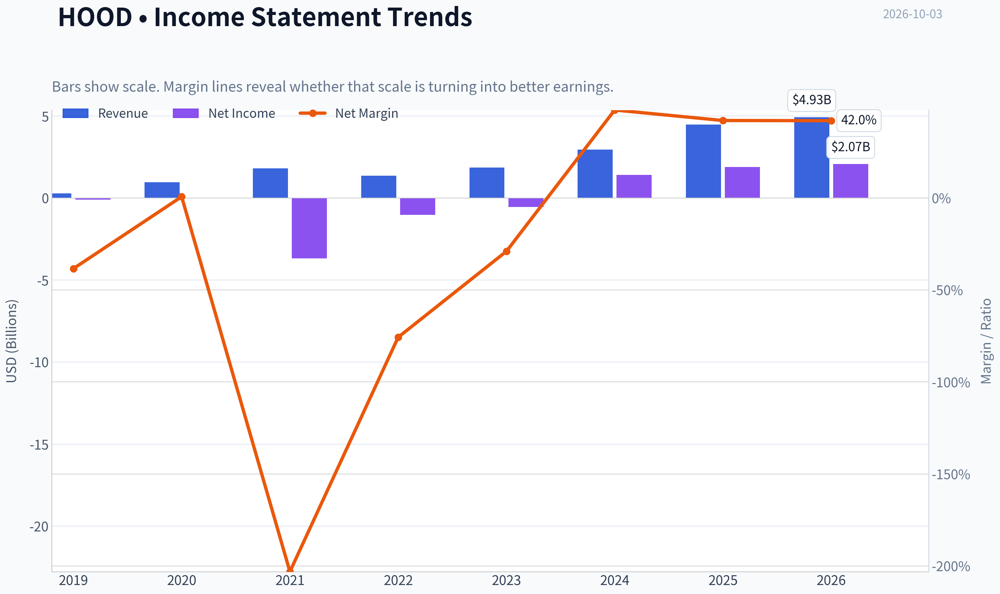
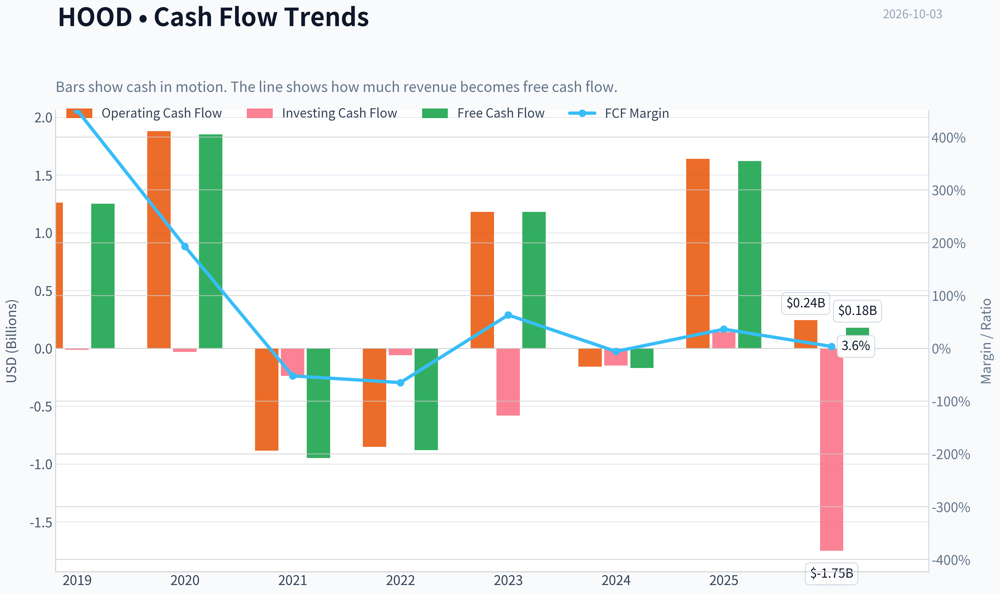
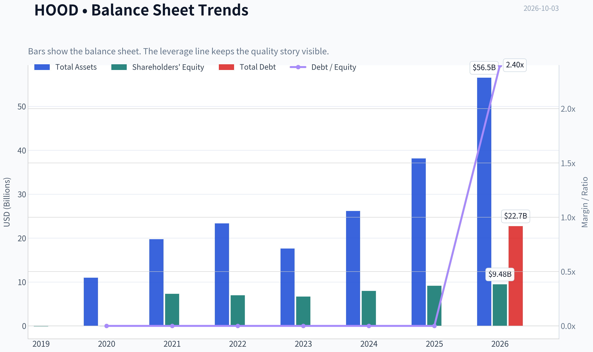
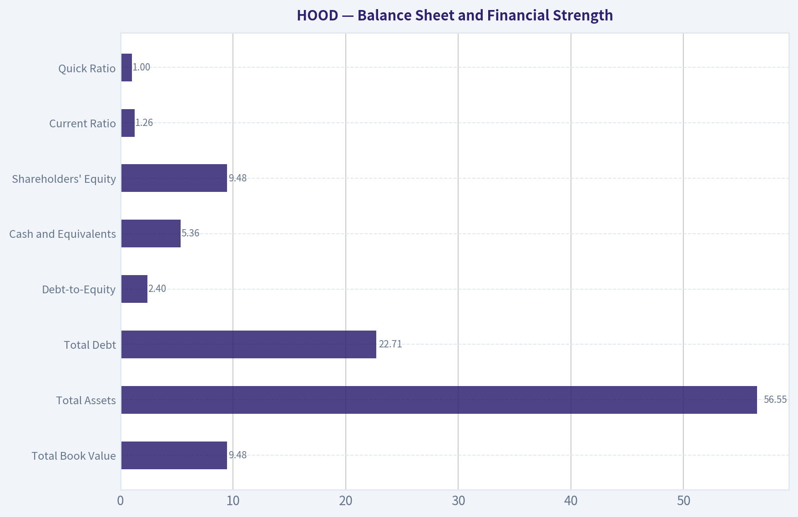
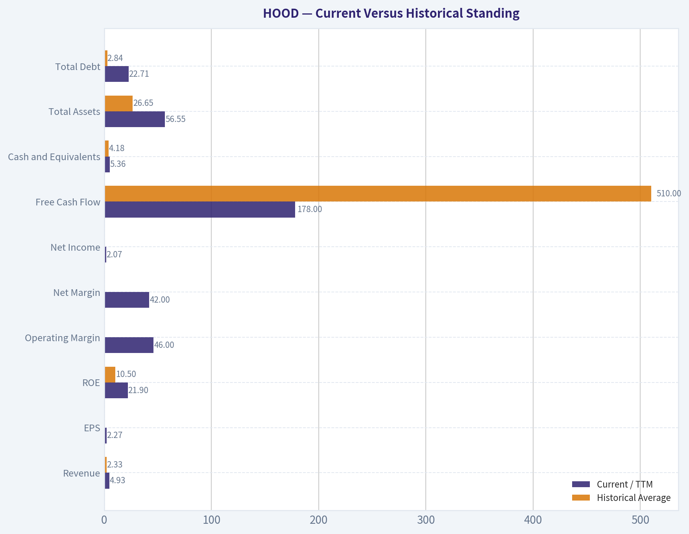
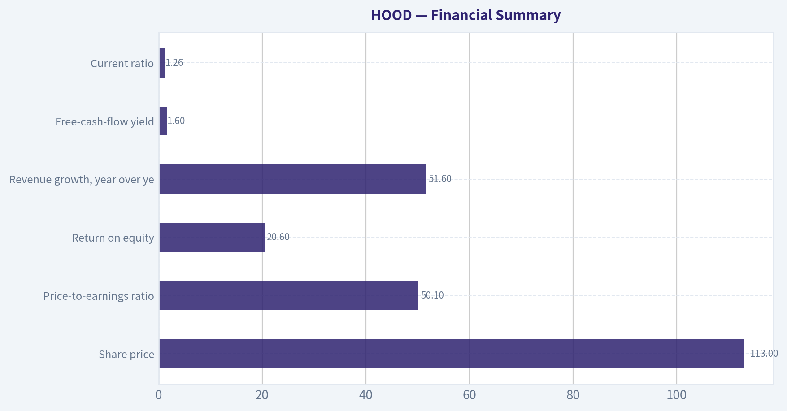
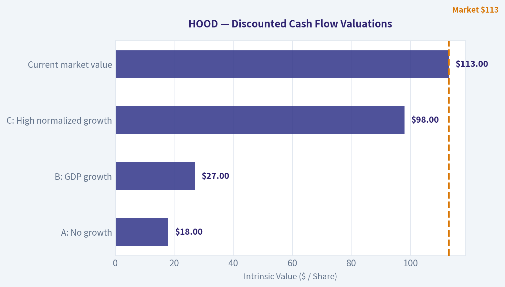
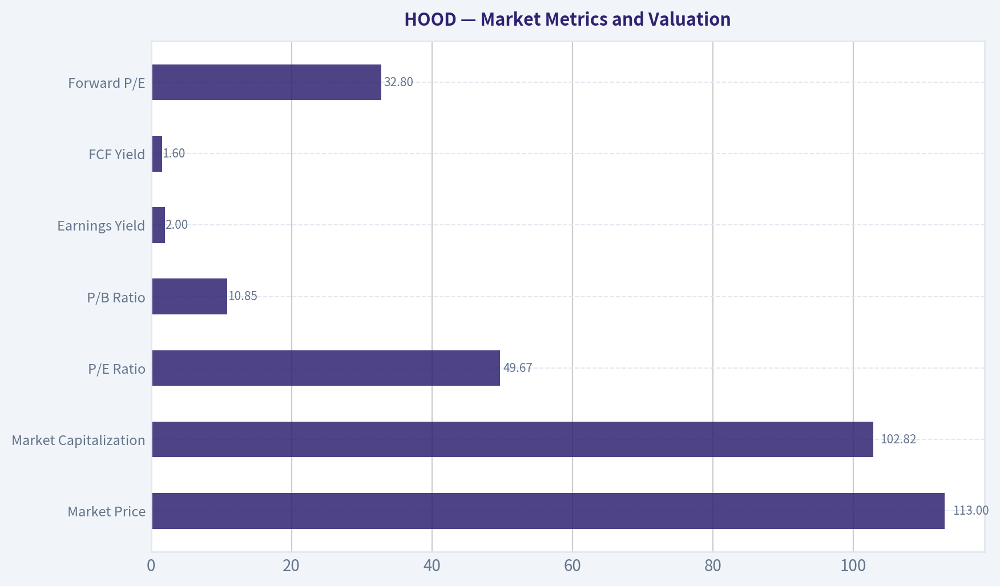

# HOOD Deep Value Intelligence

**Analysis Date:** 2026-10-03

## Critical Disclaimer

*This analysis is generated by Deep Value Intelligence, an AI-powered multi-agent investing framework. Education & research only - not financial advice, not a financial advisor.*

---

## Table of Contents

1. Intelligence Summary
2. Analyst Team Reports
   - Fundamentals Analysis
   - Intrinsic Value Analysis (Buffett)
   - Trend & Growth Analysis (Lynch/Druckenmiller/Fisher)
   - Market Technical Analysis
   - Options Market Analysis
3. Research Team Commentary
4. Value Investing Team Commentary
5. Deep Values Commentary

---

## Intelligence Summary

### Thesis + Conditions

**Core Thesis:** ## Executive Briefing

**Key Risks:**
- The central risk is **overpayment, not financial distress or stock volatility**. The valuation reportedly requires approximately **17.9%-20.6% annual EPS growth for ten years**, depending on the terminal multiple. Robinhood has not yet demonstrated the recurring-revenue mix, controlled dilution, cash conversion, or through-cycle moat needed to make that outcome predictable.
- ### Risky Analyst: strongest argument
- This is a credible path to becoming a higher-quality business. The Risky Analyst is also correct that customer exclusivity is unnecessary; increasing wallet share can materially improve economics even when customers maintain accounts elsewhere.

**Confidence:** Low

---

## Analyst Team Reports

### Fundamentals Analysis

#### Latest Earnings Snapshot

*Most recent reported quarter anchored on 2026 Q2, with prior-year comparison when available.*

| Metric | 2026 Q2 | 2025 Q2 | YoY Change |
| --- | ---: | ---: | ---: |
| Revenue | $1.31B | $989.0M | +32.3% |
| Operating Income | $574.0M | $439.0M | +30.8% |
| Net Income | $561.0M | $386.0M | +45.3% |
| Diluted EPS | $0.62 | $0.42 | +47.6% |
| Operating Cash Flow | $720.0M | $3.51B | -79.5% |
| Free Cash Flow | $696.0M | $3.49B | -80.1% |

Key Takeaways: This snapshot anchors the most recent reported quarter before the narrative analysis. It helps readers separate long-run business quality from whatever changed in the latest earnings print.

#### 7-Year Financial Metrics for HOOD

*All values below are computed deterministically from raw data - not estimated by AI.*

*Issuer profile: asset manager (Financial Services / Capital Markets).*

#### 7-Year Financial Metrics
*Annual rows come from reported financial statements. The final TTM row is computed from the latest four quarters.*

| Metric | 2019 | 2020 | 2021 | 2022 | 2023 | 2024 | 2025 | 2026 TTM |
| --- | --- | --- | --- | --- | --- | --- | --- | --- |
| Market Price | N/A | N/A | $18 | $8 | $13 | $37 | $113 | $113 |
| Market Cap | N/A | N/A | $14.84B | $7.15B | $11.35B | $33.76B | $103.91B | $102.82B |
| P/E Ratio | N/A | N/A | -2.37 | -6.96 | -20.89 | 23.88 | 55.17 | 49.67 |
| P/B Ratio | N/A | N/A | 2.04 | 1.03 | 1.69 | 4.24 | 11.36 | 10.85 |
| ROE | 109.9% | -12.7% | -50.6% | -14.8% | -8.1% | 17.7% | 20.6% | 21.9% |
| ROIC | N/A | N/A | 1764.1% | -124.1% | -43.7% | 51.3% | 44.2% | 7.3% |
| EPS | $-0.48 | $0.01 | $-7.49 | $-1.17 | $-0.61 | $1.56 | $2.05 | $2.27 |
| Revenue | $277.5M | $958.0M | $1.81B | $1.36B | $1.86B | $2.95B | $4.47B | $4.93B |
| Gross Profit | N/A | N/A | N/A | N/A | N/A | N/A | N/A | $4.02B |
| Gross Margin | N/A | N/A | N/A | N/A | N/A | N/A | N/A | 81.5% |
| Operating Margin | -38.8% | 1.4% | -203.0% | -75.6% | -28.6% | 36.1% | 47.1% | 46.0% |
| Net Income | $-106.6M | $7.0M | $-3.69B | $-1.03B | $-541.0M | $1.41B | $1.88B | $2.07B |
| Net Margin | -38.4% | 0.7% | -203.1% | -75.7% | -29.0% | 47.8% | 42.1% | 42.0% |
| Revenue Growth | N/A | 245.2% | 89.5% | -25.2% | 37.3% | 58.2% | 51.6% | 10.3% |
| Net Income Growth | N/A | -106.6% | -52771.4% | -72.1% | -47.4% | -360.8% | 33.5% | 10.0% |
| Free Cash Flow Growth | N/A | 47.8% | -151.2% | -7.2% | -234.0% | -114.4% | -1054.7% | -89.0% |
| Total Book Value | $-97.0M | $-55.0M | $7.29B | $6.96B | $6.70B | $7.97B | $9.15B | $9.48B |
| Total Assets | N/A | $10.99B | $19.77B | $23.34B | $17.62B | $26.19B | $38.14B | $56.55B |
| Total Debt | N/A | $0 | $0 | $0 | $0 | $0 | $0 | $22.71B |
| Debt-to-Equity | N/A | -0.00 | 0.00 | 0.00 | 0.00 | 0.00 | 0.00 | 2.40 |
| Cash & Equivalents | $644.0M | $1.40B | $6.25B | $6.34B | $4.83B | $4.33B | $4.26B | $5.36B |
| Shareholders' Equity | $-97.0M | $-55.0M | $7.29B | $6.96B | $6.70B | $7.97B | $9.15B | $9.48B |
| Operating Cash Flow | $1.26B | $1.88B | $-885.0M | $-852.0M | $1.18B | $-157.0M | $1.64B | $245.0M |
| Investing Cash Flow | $-12.3M | $-32.0M | $-238.0M | $-60.0M | $-582.0M | $-148.0M | $141.0M | $-1.75B |
| Free Cash Flow | $1.25B | $1.85B | $-948.0M | $-880.0M | $1.18B | $-170.0M | $1.62B | $178.0M |
| FCF Margin | 451.4% | 193.3% | -52.2% | -64.8% | 63.2% | -5.8% | 36.3% | 3.6% |
| Dividends / Share | $0.00 | $0.00 | $0.00 | $0.00 | $0.00 | $0.00 | $0.00 | $0.00 |

#### Profitability Metrics
- Return on Equity (ROE): 20.6%
- Return on Invested Capital (ROIC): N/A
- Return on Assets (ROA): 4.9%
- Gross Margin: Not meaningful
- Operating Margin: 47.1%
- Net Profit Margin: 42.1%

#### Liquidity Metrics
- Current Ratio: 1.26
- Quick Ratio: 1.00

#### Leverage Metrics
- Debt-to-Equity Ratio: 0.00
- Interest Coverage Ratio: N/A
- Net Debt: $-10.45B

#### Growth Metrics (Year-over-Year)
- Revenue Growth: 51.6%
- Net Income Growth: 33.5%
- Free Cash Flow Growth: 1054.7%
- Revenue CAGR (3-Year): 48.8%
- Revenue CAGR (5-Year): 36.1%

#### Valuation Metrics
- P/E Ratio (TTM): 50.11
- Forward P/E: 32.80
- Price-to-Book: 10.69
- Price-to-Sales: 20.55
- PEG Ratio: 1.97
- EV/EBITDA: Not meaningful
- Free Cash Flow Yield: 1.6%
- Earnings Yield: 2.0%

#### Owner Earnings (Buffett Method, Code-Computed)
- Net Income: $1.88B
- + Depreciation & Amortization: $86.0M
- - Capital Expenditures: $-15.0M
- - Working Capital Changes: $-934.0M
- = **Owner Earnings: $2.89B**

#### Intrinsic Value (Code-Computed)
- Current Price: $113
- Headline Intrinsic Value: not meaningful (financial issuer - DCF/FCFF is not the right primary frame; use sector-specific book/earnings metrics)
- Buffett Method (Owner Earnings):
  Conservative: $28
  Average: $28
  Optimistic: $28
- Cash Flow Method (FCF):
  Conservative: $-16
  Average: $-16
  Optimistic: $-6
- Reverse-DCF: price implies ~20.7%/yr owner-earnings growth for 10y; trailing 3y was N/A, 5y N/A.

#### Piotroski F-Score: 3/9
- Positive Net Income: PASS
- Positive Operating Cash Flow: PASS
- ROA Improvement: FAIL
- Cash Flow > Net Income: FAIL
- Decreasing Debt: FAIL
- Improving Current Ratio: FAIL
- No Dilution: FAIL
- Improving Gross Margin: FAIL
- Improving Asset Turnover: PASS

ANALYST STANCE: **WATCH**

#### Executive Summary

Robinhood Markets, Inc. (**HOOD**) has undergone a dramatic operating turnaround. Revenue rose from $1.36 billion in 2022 to $4.93 billion on a TTM basis, while net income improved from a $3.69 billion loss in 2021 to $2.07 billion of profit. ROE is now 21.9%, and operating and net margins are approximately 46% and 42%, respectively.

However, the stock price has appreciated even faster than the business. At $113 per share, HOOD trades at approximately **49.7 times earnings**, has a **1.6% FCF yield**, and requires roughly **20.7% annual owner-earnings growth for 10 years** according to the reverse DCF. The company is also exposed to crypto activity, interest-rate conditions, trading volumes, regulation, and newly increased balance-sheet leverage.

The business quality has improved substantially, but the valuation leaves little room for execution mistakes. This is a high-quality growth and financial-platform story at a demanding price, rather than a conventional Buffett-style bargain.

#### Market Metrics and Valuation

| Metric | Current / TTM | Historical Average or Reference | Interpretation |
|---|---:|---:|---|
| Market Price | $113 | Approximately $50.33 average for 2021-2026 | Current price is about 125% above the available listed-period average, reflecting a major re-rating. |
| Market Capitalization | $102.82B | Approximately $45.64B average for 2021-2026 | Market value has expanded much faster than the early-stage business profile would historically suggest. |
| P/E Ratio | 49.67x | Approximately 42.91x for profitable years 2024-2026 TTM | Current valuation is above the recent profitable-period average despite slowing TTM revenue growth. |
| P/B Ratio | 10.85x | Approximately 5.20x for 2021-2026 | High, but not a standalone value signal for a financial-platform issuer. It should be considered alongside ROE, earnings quality, and balance-sheet risk. |
| Earnings Yield | 2.0% | - | The earnings yield is low relative to a 10% required return, indicating substantial growth is already embedded in the price. |
| FCF Yield | 1.6% | - | Current cash-flow support for the market capitalization is weak. |
| Forward P/E | 32.80x | - | Even consensus-style forward valuation remains growth-dependent. |

**Key Takeaways:** HOOD's valuation has expanded sharply, with the market now pricing it as a durable compounder rather than a cyclical brokerage. The P/B ratio is not a mechanical "cheap versus expensive" measure here; for a financial-platform business it is better interpreted through ROE and earnings power. Even after using forward earnings, the stock remains priced for strong, sustained growth.

#### Profitability and Operating Performance

Current TTM profitability is materially better than the historical record:

- **ROE:** 21.9%, compared with a full-period average of approximately 10.5%. The average is heavily distorted by unusually high or negative returns during the company's loss-making years. The more relevant observation is that ROE has improved from negative levels in 2021-2023 to 17.7% in 2024, 20.6% in 2025, and 21.9% TTM.
- **ROIC:** 7.3% TTM. Historical ROIC is not economically reliable because the 2021 figure of 1,764.1% and several negative years are distorted by the company's changing capital structure and loss base.
- **EPS:** $2.27 TTM versus negative EPS in 2019, 2021, 2022, and 2023. EPS has improved for three consecutive reported periods: $1.56, $2.05, and $2.27.
- **Revenue:** $4.93 billion TTM versus an approximately $2.33 billion average across the years shown. Revenue is more than double the full-period average.
- **Gross Profit:** $4.02 billion TTM, with an 81.5% reported gross margin. Because the issuer is a financial-services platform, gross-profit presentation is less comparable to an industrial or software company.
- **Operating Margin:** 46.0% TTM versus a highly distorted historical average of approximately negative 26.9%. The improvement reflects operating leverage and the normalization of prior losses.
- **Net Income:** $2.07 billion TTM, compared with an approximately breakeven average across the displayed period because the large 2021 loss offsets later profits.
- **Net Margin:** 42.0% TTM versus a historically distorted average of approximately negative 26.7%.

The turnaround is genuine, but the latest margin structure should not automatically be extrapolated. Some revenue sources are highly sensitive to trading activity, crypto prices, interest rates, and customer cash balances.

#### Growth Analysis

Revenue growth has been exceptionally strong over the recent recovery:

- Revenue growth was **51.6% in 2025** and **10.3% TTM**.
- The recent three-year revenue CAGR is reported at **48.8%**, while the five-year CAGR is **36.1%**.
- Net income growth was **33.5% in 2025** and **10.0% TTM**.
- Free cash flow is only **$178 million TTM**, and the dataset reports negative TTM FCF growth of **89.0%**. This is a major divergence from accounting earnings.

The key issue is not whether HOOD can grow revenue; it clearly can during favorable market conditions. The more important question is whether it can convert that growth into stable, recurring, distributable cash flow. The TTM cash-flow deterioration suggests that earnings quality and working-capital movements require close monitoring.

#### Balance Sheet and Financial Strength

| Metric | Current / TTM | Historical Average or Reference | Interpretation |
|---|---:|---:|---|
| Total Book Value | $9.48B | Approximately $5.92B shareholders' equity average across the displayed years | Equity has rebuilt substantially after early losses. |
| Total Assets | $56.55B | Approximately $26.65B average for the years with data | Asset growth has accelerated, particularly in the latest period. |
| Total Debt | $22.71B | Zero in 2020-2025; approximately $2.84B average across all displayed years | The latest debt increase is a significant structural change. |
| Debt-to-Equity | 2.40x | Zero through 2025; approximately 0.30x across all displayed years | Current leverage is far above the historical record. |
| Cash and Equivalents | $5.36B | Approximately $4.18B average | Cash remains substantial, but it is not sufficient to make the new debt profile irrelevant. |
| Shareholders' Equity | $9.48B | Approximately $5.93B average | Equity has expanded alongside profitability and balance-sheet growth. |
| Net Debt | Negative $10.45B in the supplied summary | - | The company has historically had net cash, although the latest debt classification should be interpreted carefully for a financial-services issuer. |
| Current Ratio | 1.26x | - | Adequate but not a particularly meaningful measure for a brokerage and financial platform. |
| Quick Ratio | 1.00x | - | Not a central valuation or solvency metric for this issuer type. |

**Key Takeaways:** HOOD historically operated with no reported debt, but TTM debt of $22.71 billion and a 2.40x debt-to-equity ratio represent a major change. Cash has increased, but investors should determine whether the debt supports operating growth, customer-related financing, or balance-sheet expansion. Conventional current and quick ratios have limited usefulness for a financial issuer and should not replace analysis of liquidity, customer obligations, regulatory capital, and asset quality.

#### Cash Flow and Capital Allocation

| Metric | Current / TTM | Historical Average | Interpretation |
|---|---:|---:|---|
| Free Cash Flow | $178M | Approximately $510M across the displayed period | TTM FCF is below the historical average and much lower than net income. |
| Operating Cash Flow | $245M | Approximately $633M across the displayed period | Cash conversion is weak relative to reported profitability. |
| Owner Earnings | $2.89B code-computed | - | This figure benefits from a $934M working-capital adjustment and should be normalized before valuation use. |
| FCF Margin | 3.6% | Highly volatile; positive and negative extremes | Current cash generation is modest relative to revenue. |
| Dividends per Share | $0.00 | $0.00 in every displayed year | HOOD retains capital for expansion and does not currently provide shareholder income. |
| Piotroski F-Score | 3/9 | - | The score flags weak cash conversion, leverage progression, dilution, and operating-quality concerns. |

**Key Takeaways:** The central financial concern is the gap between $2.07 billion of TTM net income and only $178 million of FCF. The code-computed $2.89 billion owner-earnings figure is not necessarily normalized because it includes a substantial working-capital benefit. HOOD has no dividend yield, so investors depend almost entirely on future growth and capital appreciation.

#### Current Versus Historical Standing

| Metric | Current / TTM | Historical Average | Current Versus Average |
|---|---:|---:|---:|
| Revenue | $4.93B | $2.33B | 112% above average |
| EPS | $2.27 | Approximately negative $0.48 | Major improvement from historical losses |
| ROE | 21.9% | 10.5% | More than double, though the average is distorted |
| Operating Margin | 46.0% | Negative 26.9% | Dramatic turnaround |
| Net Margin | 42.0% | Negative 26.7% | Dramatic turnaround |
| Net Income | $2.07B | Approximately breakeven | Major improvement |
| Free Cash Flow | $178M | $510M | 65% below average |
| Cash and Equivalents | $5.36B | $4.18B | 28% above average |
| Total Assets | $56.55B | $26.65B | 112% above average |
| Total Debt | $22.71B | $2.84B | Approximately eight times the all-period average |
| Debt-to-Equity | 2.40x | 0.30x | Significant deterioration versus history |
| Market Price | $113 | $50.33 for 2021-2026 | 125% above average |
| P/E | 49.67x | 42.91x for profitable years | 16% above recent profitable-period average |
| P/B | 10.85x | 5.20x for 2021-2026 | More than twice the recent average |
| Dividends per Share | $0.00 | $0.00 | No change |

**Key Takeaways:** HOOD is operating far better than its historical average on revenue, margins, earnings, and ROE. Unfortunately, the market price has improved even more dramatically, while FCF has weakened and leverage has increased. This combination creates a high-quality operating turnaround but not an obvious margin-of-safety valuation.

#### Revenue Breakdown

The deterministic dataset does not provide a precise TTM revenue-by-segment table. The following is an **illustrative allocation of the $4.93 billion TTM revenue base** using Robinhood's publicly disclosed revenue categories: transaction-based revenues, net interest revenues, and other revenues, which include subscription and services-related activities.

| Revenue Source | Amount ($B) | % of Total |
|---|---:|---:|
| Transaction-based revenues, including options, crypto, equities, and related trading activity | Approximately $2.22B | Approximately 45% |
| Net interest revenues from customer cash, margin, and related balances | Approximately $1.72B | Approximately 35% |
| Subscription, services, and other revenues | Approximately $0.99B | Approximately 20% |
| **Total TTM Revenue** | **$4.93B** | **100%** |

**Key Takeaways:** HOOD is not dependent on a single product, but its major revenue streams remain economically sensitive. Transaction revenue depends on customer activity and market enthusiasm, while net interest revenue depends on rates and customer balances. Subscription and services revenue is potentially more recurring, but it is not yet large enough to eliminate the cyclicality of the overall platform.

#### Buffett-Style Business Quality Assessment

**Economic moat:** Robinhood benefits from brand recognition, a large retail-investor user base, low-friction mobile distribution, customer data, and increasing product breadth. Its platform may benefit from network effects as customers consolidate trading, cash management, crypto, prediction markets, retirement accounts, and other financial activities in one application.

The moat is not yet as durable as that of a traditional high-switching-cost software business. Customers can maintain multiple brokerage accounts, and trading commissions are broadly commoditized. Competitors include established brokerages, banks, crypto platforms, payment companies, and emerging fintech applications.

**Financial strength:** Historically, HOOD had a strong net-cash profile and no reported debt. The latest debt increase changes the risk assessment. Cash of $5.36 billion is helpful, but the 2.40x debt-to-equity ratio and weak cash conversion demand more attention than they would have required in prior years.

**Predictable earnings:** Earnings predictability is currently limited. The company moved from substantial losses to large profits in a short period, which demonstrates operating leverage but not yet a full decade of stable economics. Revenue is sensitive to crypto activity, options volumes, market levels, interest rates, and customer engagement.

**Management and capital allocation:** Management has demonstrated product innovation and strong growth execution. The company reinvests rather than paying dividends, which is rational if incremental returns remain high. However, dilution has been flagged as a weakness in the Piotroski analysis, and shareholders should monitor stock-based compensation and share-count growth.

**Quality of earnings:** Reported earnings are strong, but FCF conversion is currently poor. The difference between net income and free cash flow is the most important quality-of-earnings issue in the dataset.

#### Owner-Earnings DCF Sanity Check

The code-computed owner-earnings base is:

- Net income: **$1.88B**
- Depreciation and amortization: **+$86M**
- Capital expenditures: **-$15M**
- Working-capital adjustment: **+$934M**
- Computed owner earnings: **$2.89B**

Using the current market capitalization of approximately $102.82 billion and the $113 share price implies approximately **910 million shares**. The computed owner earnings therefore equal approximately **$3.18 per share**.

Because HOOD is a financial-services issuer, this hand-built DCF is only a sanity check. Customer balances, regulatory capital, securities financing, working capital, and transaction-related balance-sheet movements make conventional industrial-company owner earnings less reliable.

Assumptions:

- Discount rate: 10%
- Terminal growth: 2.5%
- Forecast period: 10 years
- Growth fades progressively toward the 2.5% terminal rate
- No dividend value is assumed
- Values are based on the $2.89 billion computed owner-earnings figure

| Scenario | Growth Assumption | Present Value of Explicit Owner Earnings | Present Value of Terminal Value | Equity Value | Approximate Value per Share |
|---|---|---:|---:|---:|---:|
| Conservative | Starts near 3%, fading toward 2.5% | Approximately $21.8B | Approximately $20.1B | Approximately $41.9B | Approximately $46 |
| Average | Starts near 12%, fading toward 2.5% | Approximately $24.7B | Approximately $24.1B | Approximately $48.8B | Approximately $54 |
| Optimistic | Starts near 18%, fading toward 2.5% | Approximately $32.0B | Approximately $37.2B | Approximately $69.2B | Approximately $77 |

For example, the average case grows owner earnings from $2.89 billion to approximately $4.57 billion by year 10. Year-10 terminal value is calculated as:

**$4.57B x 1.025 ÷ (10.0% - 2.5%) = approximately $62.4B**

Discounting that terminal value back 10 years at 10% produces approximately $24.1 billion. Adding the approximately $24.7 billion present value of the explicit forecast period produces an equity value of approximately $48.8 billion, or about $54 per share.

The deterministic pack's model-based Buffett owner-earnings output is **$28 per share in all three scenarios**, while its FCF method produces negative values ranging from approximately **negative $16 to negative $6 per share**. These outputs are more conservative than the illustrative hand DCF because they appear to penalize the weak FCF conversion and the financial-issuer accounting structure. They should remain the primary valuation warning rather than being overridden by the more optimistic hand calculation.

**Key Takeaways:** Even the illustrative hand DCF produces values below the current $113 share price, with a range of approximately $46 to $77 per share. The stronger warning comes from the pack's model-based owner-earnings value of $28 and negative FCF-based values. At the current price, investors are effectively underwriting approximately 20.7% annual owner-earnings growth for a decade, which is a demanding requirement for a cyclical and regulated financial platform.

#### Key Investment Insights

**Opportunities**

- Strong revenue momentum and expanding product breadth.
- Operating leverage has transformed the company from loss-making to highly profitable.
- ROE has reached approximately 22%, a meaningful improvement over prior years.
- A large retail customer base can support cross-selling into crypto, retirement, cash management, subscriptions, prediction markets, and other products.
- The platform may develop a more durable moat if customer engagement and product integration continue to rise.
- Large cash balances provide flexibility for technology investment, acquisitions, and regulatory needs.

**Red Flags**

- Valuation at approximately 50 times TTM earnings and a 1.6% FCF yield.
- Reverse DCF requires approximately 20.7% annual owner-earnings growth for 10 years.
- TTM FCF of $178 million is dramatically below TTM net income of $2.07 billion.
- Owner earnings depend materially on a $934 million working-capital adjustment.
- Debt increased from zero in the historical series to $22.71 billion TTM.
- Revenue and earnings remain sensitive to crypto prices, trading volumes, interest rates, and market sentiment.
- Piotroski F-Score of 3/9 signals weak cash conversion, leverage, dilution, and operating-quality factors.
- No dividend means there is no income-based valuation support.
- High P/B is not automatically a reason to reject the stock, but it confirms that the market is assigning substantial value to future intangible earnings power relative to book equity.

#### Final Investment Stance

**WATCH**

HOOD is an impressive operating turnaround with improving profitability, strong recent revenue growth, and credible platform expansion potential. It may ultimately become a durable financial-technology compounder if it can diversify toward recurring subscription and services revenue, maintain high ROE, control dilution, and convert accounting profits into sustainable cash flow.

At $113, however, the valuation already discounts a very favorable outcome. The stock is priced above recent profitable-period P/E averages, far above historical P/B levels, and materially above the conservative and optimistic hand-DCF estimates. The new debt load and weak FCF conversion further reduce the margin of safety.

A Buffett-style investor should **watch rather than chase**. The thesis would become more attractive through a materially lower entry price, clearer evidence that FCF consistently tracks net income, stable ROE above 15%, reduced leverage, and greater revenue contribution from recurring services rather than trading- and crypto-sensitive activity.

| Category | Assessment | Main Evidence |
|---|---|---|
| Business quality | Improving, but not yet fully proven | Strong platform growth, expanding products, and major profitability turnaround |
| Economic moat | Moderate and developing | Brand, user base, mobile distribution, data, and product ecosystem |
| Profitability | Strong currently | 21.9% ROE, 46.0% operating margin, 42.0% net margin |
| Growth | Strong but cyclical | 51.6% 2025 revenue growth; 10.3% TTM growth |
| Earnings predictability | Below Buffett ideal | Large historical losses and sensitivity to trading, crypto, and rates |
| Cash-flow quality | Concerning | $2.07B net income versus $178M TTM FCF |
| Balance-sheet risk | Higher than historical | $22.71B debt and 2.40x debt-to-equity |
| Valuation | Demanding | 49.67x P/E, 1.6% FCF yield, reverse DCF requires 20.7% growth |
| Dividend policy | No income support | $0.00 dividend per share throughout the dataset |
| Intrinsic-value signal | Unfavorable | Pack owner-earnings value of $28; FCF method negative |
| Overall stance | **WATCH** | Excellent turnaround, insufficient margin of safety at $113 |

**Key Takeaways:** HOOD has become a much better business, but the stock has become an even more demanding investment. The strongest positives are growth, platform expansion, ROE, and operating leverage; the strongest negatives are valuation, cash-flow conversion, leverage, and earnings cyclicality. The appropriate Buffett-style conclusion is to monitor the company closely while waiting for either a lower valuation or clearer evidence of durable, recurring cash generation.

#### Fundamental Visuals

This graph tracks the profitability and return metrics (ROE, ROIC, Margins) of **HOOD** over the past decade, highlighting capital efficiency trends.

This chart illustrates the financial health of **HOOD** over the last 10 years, mapping cash equivalents and free cash flow against total obligations (Debt).

---

### Intrinsic Value Analysis (Buffett)

> *Following Warren Buffett's value investing philosophy: Circle of Competence, Economic Moat, Management Quality, and Margin of Safety.*

#### Intrinsic Value Snapshot

Price is what you pay. Intrinsic value is what the business may be worth based on the cash it can create for owners over time. We show a range, not one magic number.

- Current Price: $112.74
- Value Range (conservative to optimistic across both DCF methods): $-16.16 to $27.75

##### Owner Earnings (Buffett Method)
- Net Income: $1,883,000,000.00
- Depreciation & Amortization: $86,000,000.00
- Capital Expenditures: $-15,000,000.00
- Working Capital Changes: $-934,000,000.00
- Owner Earnings: $2,888,000,000.00

##### Intrinsic Value
###### Buffett Method
Uses owner earnings. Stricter, and usually more conservative.
- Conservative: $27.75
- Average: $27.75
- Optimistic: $27.75
- Discount Rate: 10.0%

###### Cash Flow Method
Uses free cash flow. Better for companies spending heavily today to grow tomorrow.
- Conservative: $-16.16
- Average: $-16.16
- Optimistic: $-6.47
- Discount Rate: 10.0%

ANALYST STANCE: **AVOID**

#### Executive Conclusion

Robinhood is a fast-growing, founder-led financial platform with attractive operating momentum, strong customer engagement, and substantial reinvestment potential. However, at approximately **$113 per share**, the market is paying roughly **50 times earnings** and assigning a valuation that requires sustained high growth, favorable trading activity, and continued regulatory progress.

The business may become a durable financial-services platform, but the current price does not provide a sufficient margin of safety under conservative owner-earnings assumptions. The appropriate action is to wait for a materially better entry point.

#### 1. Factor Scorecard

| Factor | Score | Assessment |
|---|---:|---|
| Circle of Competence & Business Simplicity | 3.0/5 | The basic model is understandable: Robinhood earns money from customer cash balances, trading-related revenue, subscriptions, securities lending, and crypto activity. However, earnings are sensitive to market activity, interest rates, crypto volumes, and regulation. |
| Moat Test | 3.25/5 | The platform has brand recognition, scale, customer data, product breadth, and some ecosystem benefits. Switching costs for retail brokerage customers remain relatively modest, and many revenue streams are exposed to competition and regulation. |
| Management Quality & Capital Allocation | 3.0/5 | Founder-led management has shown product ambition and willingness to expand into new categories. Long-term capital-allocation evidence is still developing, particularly regarding acquisitions, buybacks, and shareholder returns. |
| Industry Structure | 2.5/5 | Brokerage is competitive and heavily regulated. Scale helps, but pricing pressure, payment-for-order-flow scrutiny, crypto competition, and customer sensitivity to market conditions reduce structural attractiveness. |

**Gate 5 hard floor:** **Not tripped.** The available evidence shows positive earnings, positive free cash flow, and strong revenue growth rather than deteriorating fundamentals combined with financial distress. The investment concern is valuation and business cyclicality, not an immediate solvency crisis.

#### 2. Moat Analysis

Robinhood's moat is promising but not yet equivalent to the very strongest financial platforms.

| Potential moat source | Evidence | Durability assessment |
|---|---|---|
| Brand and user experience | Robinhood is strongly associated with simple, mobile-first investing and has attracted a large retail user base. | Useful advantage, but competitors can replicate interface improvements. |
| Scale and operating leverage | A large customer base allows Robinhood to spread technology and compliance costs across more accounts and products. | Real cost advantage if customer growth and activity remain strong. |
| Ecosystem effects | Stocks, options, crypto, cash management, subscriptions, prediction markets, and automated tools can increase customer engagement. | Potentially widening, but the ecosystem is still being built. |
| Switching costs | Customers may consolidate assets and habits on the platform, but brokerage transfers are relatively easy compared with enterprise software migration. | Narrow to moderate. |
| Regulatory access | Brokerage, clearing, custody, and crypto capabilities require licenses, compliance infrastructure, and capital. | Meaningful barrier to entry, but regulation is also a continuing cost and risk. |

Robinhood's most important strategic opportunity is increasing the number of financial products used by each customer. If the company becomes a primary financial relationship rather than merely a trading app, retention, monetization, and customer lifetime value could improve substantially.

The main threat is that much of the current economic engine remains linked to customer activity and market conditions. Crypto trading, options, prediction markets, and leverage can increase revenue, but they may also increase regulatory exposure and earnings volatility.

#### 3. Management Quality Assessment

Vlad Tenev and the founding team provide an owner-oriented culture and a willingness to invest in product development. Recent initiatives involving crypto, prediction markets, artificial-intelligence tools, and additional forms of leverage demonstrate a broad ambition to expand Robinhood's role in consumer finance.

The positive interpretation is that management is building a broader ecosystem before the market fully matures. The negative interpretation is that the company may be pursuing numerous high-risk opportunities simultaneously, making long-term earnings quality harder to predict.

Management receives credit for:

- Founder involvement and long-term product focus.
- Strong revenue growth.
- Reinvestment into new products and customer engagement.
- Expansion beyond basic equity trading.

The principal deductions are:

- Limited long-term history as a public company.
- Exposure to regulatory changes and market-cycle revenues.
- Unclear evidence that acquisitions or shareholder distributions have consistently created per-share value.
- Increasing product complexity, especially around crypto leverage and prediction markets.

#### 4. Financial Summary

| Metric | Latest reported snapshot |
|---|---:|
| Share price | $113 |
| Market capitalization | $101.36 billion |
| Price-to-earnings ratio | 50.1x |
| Return on equity | 20.6% |
| Revenue growth, year over year | 51.6% |
| Free-cash-flow yield | 1.6% |
| Implied free cash flow | Approximately $1.62 billion |
| Implied earnings per share | Approximately $2.26 |
| Implied net income | Approximately $2.02 billion |
| Current ratio | 1.26x |
| Gross margin | Not available |
| Intrinsic value headline | Not meaningful for this financial issuer |

**Key Takeaways:** Robinhood is growing rapidly and appears profitable, with approximately $1.62 billion of implied free cash flow and a 20.6% return on equity. However, the 1.6% free-cash-flow yield and 50-times earnings multiple indicate that the current valuation already discounts substantial future growth. Traditional book-value and current-ratio analysis is less informative for a financial platform than earnings quality, capital adequacy, customer retention, and cash generation.

#### 5. Owner Earnings Calculation

For a financial platform, reported free cash flow is used as the practical owner-earnings proxy because maintenance capital expenditures and working-capital movements are less economically meaningful than they are for an industrial company.

| Owner-earnings component | Approximate amount |
|---|---:|
| Net income | $2.02 billion |
| Add: depreciation and amortization | Not separately provided |
| Less: maintenance capital expenditure | Not separately provided |
| Less: working-capital investment | Not separately provided |
| Free cash flow proxy for owner earnings | **$1.62 billion** |
| Owner earnings per share proxy | **Approximately $1.81** |

**Key Takeaways:** Robinhood's free cash flow is materially positive, but the owner-earnings estimate is less certain than for a mature nonfinancial company because cash generation depends partly on customer balances, trading activity, and financial-market conditions. At the current share price, the implied owner-earnings yield is only about 1.6%, leaving little protection against slower growth.

#### 6. Three-Scenario DCF Valuation

Assumptions:

- Discount rate: 10%.
- Owner earnings proxy: $1.62 billion.
- Implied shares outstanding: approximately 897 million.
- Scenario A assumes no growth.
- Scenario B assumes 3% perpetual growth.
- Scenario C uses an 8% normalized growth rate for ten years, followed by an 8% terminal rate. The formal historical-growth input would exceed the 10% cap, but a 10% terminal rate equals the discount rate and does not produce a finite terminal value.

| Scenario | Key assumptions | Equity value | Value per share |
|---|---|---:|---:|
| A: No growth | Owner earnings capitalized at 10% | $16.2 billion | **$18** |
| B: GDP growth | 3% perpetual growth, 10% discount rate | $23.9 billion | **$27** |
| C: High normalized growth | 8% annual growth for 10 years and 8% terminal growth | $87.5 billion | **$98** |
| Current market value | Current price of $113 | $101.4 billion | **$113** |

**Key Takeaways:** Even the optimistic normalized-growth case produces an estimated value below the current share price. The no-growth and GDP-growth cases are substantially lower, showing that today's valuation depends on Robinhood sustaining unusually strong growth for many years while preserving favorable economics.

#### 7. Margin of Safety Analysis

| Valuation reference | Estimated value per share | Premium or discount versus $113 |
|---|---:|---:|
| No-growth DCF | $18 | Current price is approximately 528% higher |
| 3% GDP-growth DCF | $27 | Current price is approximately 322% higher |
| 8% normalized-growth DCF | $98 | Current price is approximately 15% higher |
| Current market price | $113 | - |

Robinhood would require a very strong growth trajectory to justify the current price. A durable platform with high returns on incremental capital can deserve a premium valuation, but this business does not yet have the stability, switching costs, or long operating history that would justify paying materially above a conservative intrinsic-value estimate.

For a narrow-moat, market-sensitive financial platform, a reasonable purchase would generally require a larger discount than the current price offers. A more attractive range would be closer to the **$70-$85 area**, depending on subsequent evidence of recurring revenue, customer retention, capital efficiency, and reduced regulatory risk.

#### 8. Final Buffett Scorecard

| Criterion | Weight | Score | Weighted contribution |
|---|---:|---:|---:|
| Moat width and durability | 25% | 3.25 | 0.81 |
| Valuation and margin of safety | 20% | 1.5 | 0.30 |
| Capital returns: ROIC versus WACC | 15% | 3.5 | 0.53 |
| Business understanding and predictability | 12% | 2.75 | 0.33 |
| Management quality and capital allocation | 12% | 3.0 | 0.36 |
| Reinvestment runway | 8% | 4.0 | 0.32 |
| Balance-sheet strength | 4% | 3.0 | 0.12 |
| Industry structure | 4% | 2.5 | 0.10 |
| **Total** | **100%** | - | **2.87/5** |

**Key Takeaways:** Robinhood scores well on growth, reinvestment runway, and founder-led product development. It scores poorly on valuation and only moderately on predictability, moat durability, and industry structure. The weighted result falls below the threshold for an attractive Buffett-style investment.

#### 9. Investment Stance

**Stance: AVOID at $113.**

**Conviction: Medium-high.**

Robinhood could become a significant consumer-finance compounder, and its 51.6% revenue growth deserves respect. Nevertheless, the investment case currently requires too many favorable assumptions: sustained high customer activity, continued product expansion, successful regulatory navigation, strong crypto economics, and durable margins.

The company is worth monitoring rather than dismissing. A substantially lower valuation, combined with evidence of recurring revenue, stronger switching costs, stable customer retention, and disciplined capital allocation, could change the conclusion. At the present price, the risk-reward profile is not sufficiently attractive.
#### Valuation Bridge

This bridge places the current market price beside each intrinsic value lens so readers can see whether upside depends on one method or shows up across several methods.

| Scenario | Intrinsic Value / Share |
| --- | ---: |
| Buffett Method | $27.75 |
| Cash Flow Method | $-16.16 |
| Current Price | $112.74 |

#### Key Takeaways

If one method is far above the others, the upside case depends on a specific modelling assumption. When several methods cluster together, the valuation story is more robust.

#### Valuation Visuals

This comparison chart from *Latest Earnings Snapshot* stacks current figures against historical benchmarks for **HOOD**, making it easy to see where the company trades relative to its own averages.

This comparison chart from *Balance Sheet and Financial Strength* stacks current figures against historical benchmarks for **HOOD**, making it easy to see where the company trades relative to its own averages.

This comparison chart from *Current Versus Historical Standing* stacks current figures against historical benchmarks for **HOOD**, making it easy to see where the company trades relative to its own averages.

This comparison chart from *Financial Summary* stacks current figures against historical benchmarks for **HOOD**, making it easy to see where the company trades relative to its own averages.

The following chart maps the **HOOD** Owner Earnings DCF valuation scenarios (Conservative, Average, Optimistic) to visually represent the margin of safety based on intrinsic value calculations.

---

### Trend & Growth Analysis (Lynch/Druckenmiller/Fisher)

> *Following Peter Lynch's GARP, Stanley Druckenmiller's macro-aware approach, and Philip Fisher's scuttlebutt methodology.*

ANALYST STANCE: **WATCH**

#### 1. Lynch Classification

**Fast Grower transitioning toward a high-growth financial platform.** Robinhood's reported revenue growth has been very strong, but the latest TTM growth rate of approximately 10% indicates substantial deceleration from the 2024-2025 surge. It is therefore not yet a clean, sustained 20%-25% compounder.

#### 2. The Story in Three Bullets

- Robinhood is expanding from a commission-free brokerage into a broader consumer-finance platform spanning equities, options, crypto, retirement, cash management, prediction markets, and potentially AI-assisted trading.
- Its young user base, mobile-first experience, and expanding product set create opportunities to increase revenue per customer and wallet share.
- The opportunity is attractive, but the current valuation already assumes significant long-term success, while revenue momentum and free-cash-flow conversion require monitoring.

#### 3. TAM and Runway

| Item | Assessment |
|---|---:|
| Current revenue | Approximately $4.9B TTM |
| Current market capitalization | Approximately $101B |
| Implied 10x revenue target | Approximately $49B |
| Relevant markets | Brokerage, crypto, options, retirement, cash management, prediction markets, financial services |
| TAM quality | Broad and potentially expanding |
| 10x test | Plausible, but not proven |
| Principal constraint | Regulation, competition, market-cycle dependence |

**Key Takeaways:** Robinhood operates across several large financial markets, and the platform could theoretically support a tenfold revenue increase without immediately reaching dominant share across all categories. However, this is a multi-product execution story rather than a simple single-market opportunity. The 10x case depends on sustained customer growth, higher monetization, international or adjacent-market expansion, and durable crypto and trading activity.

#### 4. Revenue Growth Trend

| Period | Revenue | Growth |
|---|---:|---:|
| 2022 | $1.36B | -25.2% |
| 2023 | $1.86B | 37.3% |
| 2024 | $2.95B | 58.2% |
| 2025 | $4.47B | 51.6% |
| 2026 TTM | $4.93B | 10.3% |

**Key Takeaways:** Robinhood experienced a powerful 2023-2025 acceleration, with revenue growth above 50% in both 2024 and 2025. The latest TTM figure suggests a sharp deceleration toward 10%, which may reflect difficult comparisons, market normalization, or a genuine loss of momentum. Before taking a high-conviction position, investors need evidence that growth can reaccelerate above 20%.

#### 5. Unit Economics and Operating Efficiency

| Metric | Available data | Interpretation |
|---|---:|---|
| LTV/CAC | Not disclosed in supplied data | Cannot verify |
| CAC payback | Not disclosed | Cannot verify |
| Net revenue retention | Not applicable/not disclosed | Brokerage model differs from SaaS |
| TTM operating margin | Approximately 46% | Strong, but may benefit from transaction and interest-related revenue |
| TTM net margin | Approximately 42% | Very strong reported profitability |
| TTM FCF margin | Approximately 3.6% | Weak relative to net income |
| Rule of 40 | Approximately 13.9% using TTM figures | Below SaaS benchmark; only directional for a financial platform |
| Current ratio | 1.26 | Adequate but not especially conservative |
| TTM debt-to-equity | Approximately 2.4x | Requires financial-issuer interpretation |

**Key Takeaways:** Reported earnings margins are excellent, but free-cash-flow conversion is much less impressive. The divergence between approximately $2.1B of TTM net income and only about $178M of TTM free cash flow deserves investigation, particularly because brokerage balance sheets and customer-related assets can make conventional cash-flow metrics noisy. Customer retention, funded-account growth, deposits, and revenue per active customer are more important operating indicators than LTV/CAC alone.

#### 6. Inflection Point Assessment

| Potential inflection | Evidence | Assessment |
|---|---|---|
| Product-cycle inflection | AI trading bots, perpetual crypto futures, expanded prediction markets | Potentially positive, but unproven |
| Market-share inflection | Broadening product suite and strong recent growth | Positive but current data shows deceleration |
| Margin inflection | 47% operating margin in 2025 | Already substantial; further gains may be harder |
| TAM inflection | Expansion beyond basic brokerage into crypto and prediction markets | Positive, with significant regulatory risk |
| Competitive inflection | Differentiation through mobile UX and product breadth | Moderate; incumbents remain formidable |
| Earnings inflection | Forward P/E approximately 32.8x versus TTM P/E near 50x | Market expects continued earnings growth |

**Key Takeaways:** The most important potential inflection is Robinhood becoming a broader financial-services operating system rather than merely a retail brokerage. New products could increase monetization and engagement, but the investment case currently rests more on future product success than on demonstrated reacceleration. The next decisive evidence would be accelerating revenue, increasing deposits and assets, and strong monetization without a corresponding rise in regulatory or customer-acquisition costs.

#### 7. Macro Setup

- **Secular tailwinds:** Digitization of investing, crypto adoption, mobile finance, prediction markets, and AI-assisted financial tools.
- **Macro sensitivity:** Trading volumes, crypto prices, options activity, interest rates, and retail-investor risk appetite.
- **Rate environment:** Lower rates could support growth-stock valuations, but lower interest income on customer cash could pressure Robinhood's revenue mix.
- **Druckenmiller assessment:** Attractive secular backdrop, but the business is cyclical in practice. Macro conditions are a tailwind during active risk-on markets and a headwind during volatility or retail disengagement.

Overall macro setup: **Mixed-positive**, not a clean all-weather environment.

#### 8. Fisher's 15-Point Score

| Fisher criterion | Score / 5 | Comment |
|---|---:|---|
| Market potential | 5 | Large, expanding financial markets |
| New-product determination | 5 | Aggressive product expansion |
| R&D effectiveness | 4 | Technology and AI initiatives appear promising |
| Sales organization | 4 | Strong consumer distribution and brand |
| Profit margins | 5 | Reported margins are high |
| Margin improvement | 4 | Major improvement from historical losses |
| Labor relations | 3 | Limited evidence |
| Executive relations | 4 | Founder-led continuity |
| Management depth | 4 | Growing platform complexity |
| Cost analysis/accounting | 3 | Cash-flow conversion requires scrutiny |
| Outstanding competitive aspects | 4 | Brand, UX, data, engagement, ecosystem |
| Long-range profit outlook | 4 | Attractive but highly cycle- and regulation-sensitive |
| Dilution | 2 | Piotroski data indicates dilution risk |
| Management candor | 3 | Insufficient evidence from supplied data |
| Management integrity | 4 | No specific integrity concern identified |

**Total: 54 / 75 - Average to Good**

**Key Takeaways:** Robinhood scores well on market potential, product innovation, margins, and platform differentiation. The score is held back by limited evidence on unit economics, dilution, cash-flow quality, and management candor under stress. This is a promising Fisher-style innovation story, but it does not yet meet the standard of a clearly outstanding 65-plus score.

#### 9. Valuation Analysis

| Metric | Value | Interpretation |
|---|---:|---|
| TTM P/E | 50.1x | Expensive |
| Forward P/E | 32.8x | More reasonable, but still growth-dependent |
| PEG | Approximately 1.97 | At the high end of fair value |
| Price-to-sales | Approximately 20.6x | Very expensive for a financial platform |
| Price-to-book | Approximately 10.7x | Prices in substantial franchise value |
| FCF yield | Approximately 1.6% | Low |
| Reverse-DCF implication | Approximately 20.7% annual owner-earnings growth for 10 years | Aggressive assumption |

| Scenario | Assumption | Valuation implication |
|---|---|---|
| Bear | Growth normalizes near 10%-15%; valuation multiple compresses | Significant downside risk |
| Base | Growth returns to roughly 20%; earnings compound strongly | Potentially acceptable long-term return |
| Bull | Multi-product platform sustains 25%-30% growth for years | Ten-bagger path remains possible |
| Current market view | High growth, durable margins, successful product expansion | Much of the bull case is already priced in |

**Key Takeaways:** Robinhood is not cheap under conventional valuation measures. A PEG near 2.0 is not unreasonable for a high-quality compounder, but the latest TTM growth rate is only about 10%, making the current multiple demanding. The stock can work from here if new products restore 20%-30% growth, but valuation leaves limited room for execution misses.

#### 10. Growth Investor Scorecard

| Criterion | Weight | Score / 5 | Weighted contribution |
|---|---:|---:|---:|
| Story | 10% | 4.5 | 0.45 |
| TAM and runway | 20% | 4.5 | 0.90 |
| Revenue growth | 20% | 3.0 | 0.60 |
| Unit economics | 15% | 3.0 | 0.45 |
| Competitive position | 10% | 4.0 | 0.40 |
| Management quality | 10% | 3.8 | 0.38 |
| Macro setup | 5% | 3.5 | 0.18 |
| Profitability path | 5% | 4.0 | 0.20 |
| Valuation | 5% | 2.0 | 0.10 |
| **Total** | **100%** |  | **3.66 / 5.00** |

**Key Takeaways:** The score of 3.66 supports a constructive but not high-conviction view. Robinhood has an attractive platform story and large runway, but the decelerating TTM growth rate and demanding valuation prevent an Advocate rating. Reacceleration would be the key factor that could move the score above 4.0.

#### 11. Position Size Stance

**Watch position only: 0%-1% starter position**, or hold existing shares without adding aggressively.

A larger **2%-4% growth position** would require confirmation of:

1. Revenue growth reaccelerating above 20%.
2. Sustained growth in funded customers, deposits, assets, and revenue per customer.
3. Improved free-cash-flow conversion.
4. Limited dilution.
5. Product expansion generating durable revenue rather than short-lived crypto or trading spikes.

#### 12. Key Risks and Catalysts

| Catalysts | Risks |
|---|---|
| AI trading tools gain adoption | Crypto and trading-volume cyclicality |
| Prediction markets scale successfully | Regulatory restrictions or litigation |
| Crypto activity remains strong | Competition from Schwab, Coinbase, major banks, and fintechs |
| Higher customer deposits and wallet share | Valuation compression |
| International or adjacent-market expansion | Weak free-cash-flow conversion |
| Revenue growth reaccelerates | Dilution and equity compensation |
| Operating leverage continues | Customer losses during risk-off markets |

**Key Takeaways:** The largest catalyst is proof that Robinhood can convert its product expansion into sustained, diversified growth above 20%. The largest risk is that recent growth was unusually favorable and the stock's roughly 50-times earnings and 20-times sales valuation leaves little tolerance for normalization. The stock merits close monitoring, but the risk-reward is not sufficiently asymmetric for an Advocate stance today.

#### Bottom Line

Robinhood is a compelling, innovative financial platform with genuine ten-bagger characteristics if it becomes a dominant consumer-finance ecosystem. However, the current data shows a sharp TTM growth slowdown, weak free-cash-flow conversion, and a valuation that already discounts substantial future success. **Watch rather than buy aggressively; upgrade only after growth reaccelerates and cash generation improves.**

---

### Market Technical Analysis

ANALYST STANCE: **WATCH**

#### HOOD technical analysis - as of October 2, 2026

HOOD closed at **$112.74** on October 2, the latest trading session available because October 3 was a Saturday. The stock remains highly volatile and technically divided: its long- and medium-term trend structure is constructive, but short-term momentum has weakened materially after the September rally.

The selected indicators are **10 EMA, 50 SMA, 200 SMA, MACD, RSI, Bollinger Upper Band, Bollinger Lower Band, and ATR**. Together, they cover short-, medium-, and long-term trend, momentum, overextension, volatility, and risk management without adding redundant indicators.

#### Trend structure

HOOD is trading above both its **50-day SMA of $105.40** and its **200-day SMA of $94.33**. This is the most important constructive feature of the current chart. The price is approximately **6.9% above the 50-day average** and **19.5% above the 200-day average**, indicating that the broader recovery from the March low near $65 remains intact.

However, the slope of the 200-day SMA is nearly flat to slightly negative, falling from about **$95.16 on September 11 to $94.33 on October 2**. That suggests the long-term trend has not yet developed strong upward acceleration. The 50-day SMA has been rising more clearly, from approximately **$101.88 on September 3 to $105.40**, showing improving intermediate-term conditions.

The short-term picture is weaker. The close is below the **10-day EMA at $115.15**, and the EMA itself has declined from roughly **$118.26 on September 25**. This indicates that the immediate trend has shifted from rallying to consolidating or correcting. A recovery above the 10-day EMA, particularly if sustained for several sessions, would be an early sign that buyers are regaining short-term control.

#### Momentum and MACD

The MACD reading remains positive at **2.07**, which means the faster moving averages are still above the slower moving averages. That supports the interpretation that HOOD's broader recovery has not fully broken down.

Nevertheless, MACD has fallen sharply from **5.18 on September 9** and **4.81 on September 23**. This is a meaningful loss of upside momentum. The decline occurred as HOOD retreated from its September 3 close of **$124.72** and subsequently failed to sustain prices above $120.

Because the available MACD output provides the MACD line but not the signal line or histogram, a definitive bearish crossover cannot be confirmed from this report alone. Still, the falling MACD line is a cautionary signal: the stock remains above zero, but the positive momentum impulse is fading.

#### RSI and price momentum

The **RSI is 49.76**, almost exactly neutral. This is a substantial change from the **68.92 reading on September 3** and the **65.94 reading on September 4**. RSI has therefore moved from near-overbought conditions into a balanced zone, confirming that the September rally has cooled.

The neutral RSI is not itself bearish. It means HOOD is neither deeply oversold nor strongly overbought. This leaves room for either outcome:

- A move back above $115 to $118, accompanied by RSI rising through 50 and then 55, would improve the case for renewed upside.
- A decline below the $105 to $106 area could cause RSI to move into the low-40s or below, signaling that the correction is becoming more persistent.

Importantly, RSI is not yet showing the type of oversold condition that would make a contrarian rebound especially attractive.

#### Bollinger Bands and potential trading range

The current Bollinger Bands are approximately:

- Upper band: **$126.48**
- Lower band: **$105.42**
- Implied middle band: approximately **$115.95**

HOOD is below the middle band and only about **$7.32 above the lower band**. This places the stock in the lower half of its recent volatility envelope, but not yet at an extreme oversold position.

The lower band near **$105.42** is particularly important because it closely aligns with the 50-day SMA at **$105.40**. This creates a confluence support zone around **$105 to $106**. A successful hold there would preserve the intermediate-term recovery structure. A decisive close below that zone would weaken the chart considerably and could expose the stock to a retest of the $100 area.

On the upside, the middle-band region around **$115 to $116** is the first recovery hurdle. The upper band near **$126.50** corresponds roughly with the September swing-high area and would likely require a renewed volume expansion and stronger momentum to reach.

#### Volatility and risk management

ATR is **$6.26**, meaning HOOD's typical daily trading range is approximately **5.6% of the share price**. This is substantial volatility. A normal one-day move can therefore be large enough to trigger tight stops even when the underlying trade thesis remains valid.

ATR has declined from roughly **$6.89 on September 21** to $6.26, suggesting volatility has moderated somewhat from the sharp September swings. However, it remains elevated enough that position sizing should be conservative. For example, a stop placed only $2 or $3 away from an entry would likely be vulnerable to ordinary daily noise.

The recent price action also shows the importance of event-driven risk. HOOD advanced from roughly $103 on September 2 to nearly $125 on September 3, then retraced toward $110 before rebounding to $124.25 on September 22. Such large swings indicate that breakout trades should be confirmed rather than chased.

#### Key levels and scenarios

The most relevant support zone is **$105 to $106**, where the 50-day SMA and lower Bollinger Band converge. Holding this zone would keep the medium-term bullish recovery intact. A secondary support area is around **$100 to $101**, close to recent swing lows and the psychological $100 level.

Initial resistance is concentrated around **$115 to $116**, represented by the 10-day EMA and Bollinger middle band. Above that, the stock would face resistance near **$120 to $125**, followed by the upper Bollinger Band around $126.50.

A bullish setup would require a sustained move above $115 to $116, improving RSI, and ideally expanding volume. A bearish confirmation would be a decisive break below $105 to $106, especially if accompanied by a rising ATR and declining MACD.

#### Overall assessment

HOOD's chart is best classified as **constructive over the intermediate and long term, but cautious in the short term**. Trading above the 50-day and 200-day averages shows that the major recovery remains technically alive. However, the close below the 10-day EMA, falling MACD, neutral RSI, and position below the Bollinger midpoint indicate that the latest upside phase has lost momentum.

This is not an obvious short signal because the stock remains above important trend support. It is also not an ideal aggressive long entry because the stock has not yet demonstrated a fresh momentum reversal. The most disciplined approach is to watch the **$105-$106 support zone** and the **$115-$116 reclaim level**. Until one of those levels breaks decisively, HOOD is likely to remain a high-volatility consolidation candidate rather than a clean directional trade.

#### Indicator summary

| Indicator | Latest reading | Interpretation | Trading relevance |
|---|---:|---|---|
| Close | $112.74 | Below short-term averages but above major trend averages | Short-term caution; intermediate trend still supported |
| 10 EMA | $115.15 | Price is below the responsive short-term trend line | First upside reclaim level |
| 50 SMA | $105.40 | Rising medium-term average | Key support near the lower Bollinger Band |
| 200 SMA | $94.33 | Long-term benchmark, currently nearly flat | Broader recovery remains intact but lacks strong acceleration |
| MACD | 2.07 | Positive, but declining from September highs | Momentum remains positive yet is weakening |
| RSI | 49.76 | Neutral; no overbought or oversold condition | Neither strong bullish momentum nor capitulation |
| Bollinger Bands | $105.42-$126.48 | Price is below the midpoint and near the lower half of the range | $105-$106 support; $115-$116 midpoint resistance |
| ATR | $6.26 | Daily volatility remains high at roughly 5.6% of price | Use wider risk limits and smaller position sizes |

**Key Takeaways:** HOOD remains above its 50-day and 200-day averages, so the broader recovery has not failed. Short-term momentum has weakened, with price below the 10-day EMA, MACD declining, and RSI near neutral. The key decision zone is $105 to $106 on the downside and $115 to $116 on the upside; until one is decisively broken, a watchful rather than aggressive stance is appropriate.

#### Market Visuals

This comparison chart from *Market Metrics and Valuation* stacks current figures against historical benchmarks for **HOOD**, making it easy to see where the company trades relative to its own averages.

---

### Options Market Analysis

> *Reading options flow - put/call ratios, IV skew, and unusual activity - to gauge institutional positioning and event-driven risk.*

ANALYST STANCE: **ADVOCATE**

#### HOOD Options Flow Overview

Options data is available for near-term expirations from October 9 through October 23, 2026. The overall profile is **moderately bullish**, driven by substantially heavier call volume and fresh call activity, although the elevated downside put activity at the $80 strike indicates some tail-risk hedging or bearish speculation.

#### Put/Call Ratio Analysis

| Expiration | Call OI | Put OI | Put/Call OI Ratio | Call Volume | Put Volume | Put/Call Volume Ratio |
|---|---:|---:|---:|---:|---:|---:|
| Oct. 9, 2026 | 51,215 | 33,288 | 0.65 | 84,605 | 26,422 | 0.31 |
| Oct. 16, 2026 | 126,077 | 127,590 | 1.01 | 30,423 | 11,295 | 0.37 |
| Oct. 23, 2026 | 20,444 | 15,206 | 0.74 | 7,429 | 6,698 | 0.90 |
| **Overall** | **197,736** | **176,084** | **0.89** | **122,457** | **44,415** | **0.36** |

The overall put/call OI ratio of **0.89** is above the approximately 0.70 neutral reference, indicating somewhat more accumulated put open interest than a strongly bullish setup would typically show. However, the volume ratio of **0.36** is much more bullish: call trading volume is nearly three times put volume. The divergence suggests active bullish positioning in the near term, while existing put open interest may represent hedges or established downside protection.

**Key Takeaways:** Call volume is decisively stronger than put volume, especially in the nearest expiration. Open interest is more balanced, with the October 16 cycle slightly put-heavy. Overall, the flow favors near-term upside speculation but not an unqualified bullish positioning profile.

#### Implied Volatility Assessment

| Expiration | Call ATM IV | Put ATM IV | Approximate ATM IV Spread | Assessment |
|---|---:|---:|---:|---|
| Oct. 9, 2026 | 56.5% | 54.4% | Calls +2.1 percentage points | Mild call premium |
| Oct. 16, 2026 | 55.2% | 54.0% | Calls +1.2 points | Mild call premium |
| Oct. 23, 2026 | 55.6% | 53.7% | Calls +1.9 points | Mild call premium |

Near-term ATM implied volatility is elevated at approximately **54% to 57%**, indicating that the market expects substantial movement in HOOD. Calls carry slightly higher ATM IV than puts across all listed expirations, which is a **mild upside or call-demand skew**, rather than the downside put skew commonly associated with strong fear.

The only clearly reported OTM skew datapoint is the October 23 $80 put, carrying **63.3% IV**, above the roughly 54% to 56% ATM levels. That premium likely reflects demand for deep downside protection or a relatively illiquid tail option. No confirmed earnings or other catalyst was provided in the options data, so the elevated IV cannot be definitively attributed to a known event.

**Key Takeaways:** HOOD's near-term IV is high enough to make options expensive and signals meaningful event or movement risk. The overall skew is modestly call-favorable, but the deep $80 put has materially higher IV, showing demand for tail-risk protection. Traders should avoid interpreting the bullish flow as low-risk.

#### Unusual Options Activity

| Expiration | Type | Strike | Volume | Open Interest | Volume/OI | Relative Position | Interpretation |
|---|---|---:|---:|---:|---:|---|---|
| Oct. 9, 2026 | Call | $123 | 3,336 | 456 | 7.3x | Near-ATM or modestly OTM* | Fresh bullish speculation or upside hedge |
| Oct. 9, 2026 | Call | $124 | 3,301 | 512 | 6.4x | Near-ATM or modestly OTM* | Fresh bullish positioning; potentially spread-related |
| Oct. 23, 2026 | Put | $80 | 2,527 | 168 | 15.0x | Deep OTM* | Tail hedge or bearish downside bet |

\*The supplied dataset does not include HOOD's current share price, so exact ITM/ATM/OTM classification for the $123 and $124 calls cannot be confirmed. They appear to be near the active trading area based on their high volume and elevated IV; the $80 put is clearly a deep-downside strike unless HOOD has undergone a major price decline.

The two October 9 call contracts each traded more than six times their existing open interest, making them the most important directional activity in the chain. Their close strikes and high volume suggest upside speculation, short-term hedging, or a call spread. The October 23 $80 put is even more unusual on a volume-to-OI basis, but its deep OTM status makes it more consistent with crash insurance or a low-probability bearish wager than with a central directional forecast.

Volume/OI data alone cannot determine whether these trades were bought or sold. Therefore, the calls are bullish only probabilistically; they could also involve covered-call writing or multi-leg spreads. Still, the combination of heavy call volume and fresh call contracts gives the bullish interpretation more weight.

**Key Takeaways:** The strongest identifiable flow is concentrated in fresh, near-term $123 and $124 call activity. The $80 put is an unusual but highly asymmetric tail-risk trade, not necessarily evidence of a broad bearish outlook. The data favors bullish speculation, though execution type and order direction are unavailable.

#### Open Interest Concentration and Potential Gamma Levels

| Expiration | Total Call OI | Total Put OI | Combined OI | Concentration Assessment |
|---|---:|---:|---:|---|
| Oct. 9, 2026 | 51,215 | 33,288 | 84,503 | Largest near-term trading activity and likely short-term gamma sensitivity |
| Oct. 16, 2026 | 126,077 | 127,590 | 253,667 | Dominant OI concentration; strongest potential pinning cycle |
| Oct. 23, 2026 | 20,444 | 15,206 | 35,650 | Smaller secondary concentration |
| **Total** | **197,736** | **176,084** | **373,820** | - |

The October 16 expiration contains approximately **254,000 contracts of combined open interest**, far more than either surrounding expiry. This makes it the most important potential pinning and gamma-management window in the supplied data. The October 9 expiry also has significant short-dated activity, which could amplify price movement if HOOD approaches heavily traded strikes.

Strike-level open interest was not provided, so specific gamma walls, max-pain strikes, and exact gravitational price levels cannot be calculated. The $123 and $124 calls are the clearest candidates for near-term upside-related positioning based on unusual volume, but they are not necessarily the largest total OI strikes.

**Key Takeaways:** October 16 is the dominant expiration and is the most likely cycle to influence price pinning. October 9 has the most aggressive fresh volume and may produce sharper short-term moves. Exact gamma walls cannot be confirmed without strike-by-strike open interest and Greeks.

#### Overall Options Sentiment

**Signal: BULLISH, with moderate confidence.**

The primary bullish drivers are:

- Overall call volume nearly triples put volume.
- The nearest expiration has a low 0.31 put/call volume ratio.
- Two near-term calls at $123 and $124 show volume more than six times open interest.
- ATM call IV is modestly above put IV, indicating mild upside demand.

The main caveats are:

- Overall put/call OI of 0.89 is above the 0.70 neutral baseline.
- October 16 put OI slightly exceeds call OI.
- The October 23 $80 put has extremely unusual volume relative to open interest and elevated IV.
- Order direction is unavailable, so some call volume could represent selling or multi-leg strategies.
- No confirmed catalyst was supplied, and IV near 55% is elevated.

Taken together, the options market shows **near-term upside appetite rather than broad, low-risk bullish conviction**. The most likely interpretation is bullish short-term speculation or upside hedging, with meaningful protection being purchased against a severe downside move.

#### Summary

| Category | Assessment |
|---|---|
| Put/Call Ratio | Overall OI ratio of 0.89 is mildly defensive, but volume ratio of 0.36 is strongly call-heavy |
| IV Level | Elevated; near-term ATM IV is approximately 54%-57% |
| Skew Direction | Mild call skew at ATM; deep OTM $80 put has notable tail-risk premium |
| Unusual Activity | Fresh $123 and $124 calls are bullish-leaning; unusual $80 put suggests tail hedge or bearish speculation |
| Overall Signal | **BULLISH**, moderate confidence, with downside-hedging caveats |

**Key Takeaways:** HOOD's options flow leans bullish because call volume and fresh near-term call activity dominate. Elevated IV and the unusually active $80 put warn that expected volatility and downside-tail concerns remain significant. The directional signal is bullish, but traders should treat it as speculative rather than a high-conviction institutional consensus.

---

## Research Team Commentary

> *The Research Manager synthesizes the Bull vs Bear debate into action-free commentary. This is a pre-risk view, not the final stance.*

Core takeaway: Robinhood is becoming a better business, but at $113 investors are already paying for much of the transformation. The company has credible platform potential, strong 51.6% revenue growth, a 20.6% ROE, founder-led product expansion, and opportunities to deepen relationships through retirement, cash, subscriptions, and other financial products. However, its moat, recurring-revenue mix, cash conversion, and through-cycle earnings power remain insufficiently proven to justify treating it as a mature, wide-moat compounder. The stock belongs on the watchlist, but the current price does not provide the margin of safety required for a full Buffett-style commitment.

The strongest bull argument is that Robinhood should no longer be valued as merely a discount brokerage. It has already won significant attention among younger consumers and is using that distribution to build a broader financial platform. Retirement accounts, recurring deposits, cash management, subscriptions, and consolidated assets can produce substantially better retention and lifetime customer value than episodic trading alone. Regulatory infrastructure, brand recognition, account history, and product integration also create more friction than the "customers can switch apps instantly" bear narrative suggests.

The current operating trajectory supports that argument. Revenue growth of 51.6% and ROE of 20.6% indicate real progress rather than a purely speculative story. If management can translate customer engagement into higher assets per customer, more recurring revenue, controlled expenses, and approximately 20% per-share earnings growth, Robinhood could become an attractive asset-light financial compounder. Modern Buffett investing should recognize that possibility rather than rejecting the company simply because it is a technology-enabled platform trading at a high headline multiple.

The strongest bear argument is not that Robinhood is a bad company. It is that the valuation already requires the company to become exceptional. At approximately 50 times earnings, the reverse valuation implies roughly 17.9% annual EPS growth for ten years if the stock still receives a 25 times terminal multiple. With a more ordinary 20 times terminal multiple, the required growth rises to approximately 20.6%.

Those outcomes are possible, but there is little protection if execution is merely good. A 25 times terminal multiple assumes Robinhood eventually demonstrates the durable moat, recurring economics, and reduced cyclicality that investors are currently being asked to take on faith. The bull's estimated value of $135 is therefore better understood as a successful-execution scenario than a conservative intrinsic-value midpoint. Its roughly 16% upside does not constitute a dependable margin of safety when it requires 20% annual growth for a decade and a premium exit multiple.

Current revenue growth also should not be extrapolated mechanically. Trading, options, crypto, prediction markets, and other engagement-sensitive products can be influenced by the same risk appetite. Product breadth is not the same as economic diversification. Retirement, subscription, and cash products can improve durability, but investors need evidence that they are becoming economically meaningful enough to offset weaker trading environments and changes in interest rates.

The moat is similarly promising but unfinished. Robinhood has brand strength, user experience, scale, data, and regulatory infrastructure, but customers can still maintain multiple brokerage and financial accounts. Large incumbents already possess broad product sets, trust, licenses, and substantial capital. The evidence required to establish a durable moat is not simply more products; it is sustained net deposits, asset consolidation, retention, pricing power, and attractive per-share returns across different market conditions.

Management deserves credit for expanding the addressable market, but shareholder orientation still needs to be measured through diluted-share economics. Founder involvement is a positive only if product investment produces growth in earnings and intrinsic value per share. Stock-based compensation, dilution, compliance costs, and the returns generated by new initiatives are therefore essential parts of the capital-allocation assessment.

The available quality metrics are encouraging but incomplete. ROE of 20.6% is meaningful, while ROA of 4.9% appears respectable for the model. But one strong period does not establish normalized economics. ROIC is unavailable, and no sufficiently detailed evidence has been provided on free-cash-flow conversion or the recurring share of revenue. For a regulated financial platform, cash flow also needs to be interpreted carefully because customer and custodial balance movements can distort conventional operating cash flow. The focus should be on corporate cash generation, regulatory capital, liquidity, and per-share earnings quality rather than industrial-company ratios.

The lesson from the prior HOOD mistake is important: a demanding valuation does not prevent a high-momentum platform stock from appreciating over the next several weeks. Near-term positioning is currently constructive. Call volume is almost three times put volume, and unusually active $123 and $124 calls suggest speculative upside interest. A sustained move above $115-$118, with RSI moving through 50 and 55, could open a tactical path toward the upper band around $126.48.

But the GRAB lesson is equally important: promising platform expansion should not be confused with proven compounder economics. Options activity and technical momentum can improve entry timing, but they do not lower the intrinsic-value hurdle. Heavy call positioning can also represent crowded optimism rather than informed long-term conviction. A break below $105-$106 would indicate that the correction is becoming more persistent, although that alone would not invalidate the ten-year business thesis.

Rationale: Robinhood appears financially viable and strategically promising, so AVOID would be too categorical. The implied growth is demanding but not obviously impossible, particularly given the current operating momentum and long reinvestment runway. At the same time, ADVOCATE would require either a lower price or stronger proof that the company deserves a quality-scaled margin of safety of only 10%-15%. Robinhood has not yet demonstrated the predictability, recurring economics, or moat durability necessary for that treatment. As an emerging rather than proven compounder, it should currently require a wider discount, and that discount is not evident at $113.

Monitoring plan: Over the next one to four quarters, I would first track net deposits, total customer assets, assets per funded customer, and retirement-account growth. These will show whether Robinhood is becoming a primary financial relationship rather than remaining an engagement-driven trading application.

Second, I would monitor the revenue mix. Rising subscription, retirement, cash, and other recurring or asset-based revenue-alongside reduced dependence on crypto and transaction activity-would strengthen the quality case. Continued headline growth driven primarily by speculative engagement would weaken it.

Third, I would compare revenue growth, adjusted operating expenses, and diluted EPS growth. Earnings must compound per share, not merely in aggregate. Diluted share count and stock-based compensation should therefore be explicitly monitored.

Fourth, I would assess normalized cash conversion, regulatory capital, liquidity, and ROE. Sustaining an attractive ROE during weaker trading conditions would be considerably more persuasive than producing it during a favorable market environment.

Finally, I would watch regulatory developments around crypto, payment economics, prediction markets, and new product expansion. A pattern of compliant execution could make regulatory infrastructure part of the moat; repeated disputes or restrictions would instead raise the required return.

The stock can rally tactically, and a confirmed move through $115-$118 would support that possibility. For long-term capital, however, the prudent course is to wait for either a more attractive valuation or another several quarters of evidence that recurring revenue, cash generation, and per-share economics can support the market's high-teens-to-low-20s growth expectations.

Final stance: WATCH.

---

## Value Investing Team Commentary

> *The Investor translates the research view into an investment thesis before risk review. This is still not the final stance.*

### Investment Commentary

Robinhood is evolving from a transaction-driven brokerage into a broader consumer-finance platform. That transformation is economically significant: retirement accounts, subscriptions, cash management, recurring deposits, and greater asset consolidation could improve retention, revenue durability, and lifetime customer value. Its mobile distribution, strong brand among younger investors, regulatory infrastructure, and founder-led product culture are genuine assets.

The central question, however, is not whether Robinhood is improving. It is whether today's price offers an adequate return if the improvement is less than exceptional.

### Business quality and moat

Revenue growth of 51.6% and ROE of 20.6% indicate substantial operating progress. Robinhood also has the characteristics of a potentially attractive asset-light compounder: scalable technology, a large addressable market, low marginal distribution costs, and multiple opportunities to sell additional products to existing customers.

But the moat remains promising rather than proven. Customers can use several financial platforms simultaneously, and established competitors possess trusted brands, broad product suites, regulatory licenses, and considerable capital. Adding products expands Robinhood's opportunity, but product breadth alone does not establish customer captivity.

Evidence of a durable moat would include:

- Sustained net deposits across market cycles
- Rising assets per funded customer
- Meaningful retirement and recurring-investment balances
- Greater subscription and asset-based revenue
- Stable retention during weak trading markets
- Attractive per-share returns without excessive promotional spending

Until those characteristics are demonstrated through different market environments, Robinhood should be regarded as an emerging platform-not yet a mature, predictable compounder.

### Earnings quality and cyclicality

Robinhood's revenue sources may look diversified by product, but several remain exposed to a common underlying factor: speculative activity and investor risk appetite. Equities, options, crypto, and prediction markets can all weaken simultaneously when volatility, enthusiasm, or customer engagement declines.

Retirement, cash management, subscriptions, and recurring deposits can reduce this cyclicality. The key is whether they become economically material, not merely whether they exist.

The reported 20.6% ROE is encouraging, but it should not be treated as normalized earning power based on one favorable period. ROA of 4.9% is respectable, while the absence of reliable ROIC and cash-conversion information leaves an important gap. For a regulated financial platform, conventional cash-flow measures can also be distorted by customer balances. Investors should focus on corporate cash generation, regulatory capital, liquidity, diluted EPS, and returns on incremental investment.

### Management and capital allocation

Founder involvement supports long-term product development, but it is not automatically synonymous with shareholder-friendly capital allocation. New initiatives should ultimately increase intrinsic value per diluted share.

The important measures are therefore:

- Diluted-share growth and stock-based compensation
- Incremental earnings generated by product investment
- Expense discipline as revenue scales
- Regulatory and compliance costs
- Returns from international and adjacent-product expansion

Rapid aggregate growth can obscure weak per-share economics. If revenue and adjusted earnings rise while dilution absorbs a meaningful portion of the benefit, the apparent compounder will be less valuable than the headline results suggest.

### Valuation and margin of safety

At approximately $113 and 50 times earnings, the market is already capitalizing a large portion of Robinhood's prospective transformation.

The supplied reverse-valuation analysis indicates that the price requires approximately:

- **17.9% annual EPS growth for ten years**, assuming a 25-times terminal multiple; or
- **20.6% annual EPS growth for ten years**, assuming a 20-times terminal multiple.

Those assumptions are possible, but demanding. The 25-times terminal case additionally assumes Robinhood eventually earns the premium valuation of a durable, high-quality financial franchise. Investors are thus paying today for both strong earnings growth and successful maturation of the moat.

The estimated bullish value of $135 represents roughly 19% upside from $113. That is insufficient for an emerging compounder whose normalized earnings, cash conversion, and through-cycle resilience remain unproven. An established wide-moat company might justify only a 10%-15% discount to conservative intrinsic value. Robinhood currently deserves a wider margin-closer to the range appropriate for an above-average but still uncertain business.

This does not mean the stock must fall. It means the long-term risk-adjusted return lacks enough protection if growth proves merely good rather than exceptional.

### Selective contrarian interpretation

The obvious bearish view-that Robinhood is only a speculative trading application-may be outdated. Its expanding financial ecosystem could produce more switching friction and deeper customer relationships than skeptics expect. If younger customers consolidate wealth on the platform as their incomes and assets grow, current estimates may understate its lifetime economics.

The obvious bullish view is also incomplete. Strong recent growth, active call buying, and product announcements can encourage investors to extrapolate favorable market conditions too far into the future. Nearly three times as much call volume as put volume, including unusually active $123 and $124 calls, shows enthusiasm-not necessarily superior information about ten-year earning power. Crowded call positioning can amplify a rally, but it can also expose the shares to a sharp reversal if momentum weakens.

The contrarian opportunity would emerge if temporary concerns produced a substantial valuation decline while net deposits, asset consolidation, retention, and recurring revenue remained strong. Conversely, buying merely because momentum is positive would not be contrarian; it would mean joining optimistic positioning at a demanding valuation.

### Price action versus investment value

A sustained move above $115-$118, accompanied by RSI recovering through 50 and 55, could support a tactical advance toward approximately $126.48. A break below $105-$106 would indicate a more persistent correction.

These levels can help with entry timing, but they do not determine intrinsic value. A breakout above $118 would not prove the moat, while a decline below $106 would not by itself invalidate the business transformation. Long-term investors should avoid confusing technical confirmation with fundamental confirmation.

### What would justify an upgrade?

An **ADVOCATE** stance would require either a materially better price or stronger operating evidence, particularly:

1. Sustained high-teens diluted EPS growth supported by repeatable economics rather than unusually favorable trading activity.
2. Increasing recurring, subscription, and asset-based revenue as a share of the business.
3. Strong net deposits and rising assets per customer across weaker markets.
4. Consistent corporate cash generation and adequate regulatory capital.
5. Stable or declining dilution relative to per-share value creation.
6. Evidence that retirement and cash products are making Robinhood a primary financial relationship.
7. A valuation that offers meaningful upside under conservative-not successful-execution-assumptions.

### Principal risks

The primary risks are valuation compression, transaction-revenue cyclicality, regulatory intervention, stock-based dilution, competition, weaker cash conversion, and spending on new initiatives before their economics are established. At 50 times earnings, even solid execution can produce mediocre returns if the valuation multiple normalizes.

Robinhood is financially viable, strategically ambitious, and capable of becoming a much better business. It should not be dismissed simply because it is a technology-enabled financial platform or because its stock attracts speculative interest. Nevertheless, the market is already demanding sustained high-teens-to-low-20s earnings growth and eventual premium-quality economics. That leaves too little room for ordinary execution setbacks.

ANALYST STANCE: **WATCH** - Robinhood is an emerging platform with credible long-term compounding potential, but at $113 the price already discounts much of that potential. Wait for either a wider valuation margin of safety or stronger evidence that recurring revenue, cash generation, moat durability, and diluted per-share earnings can support the market's demanding expectations.

---

## Deep Values Commentary

> *The Risk Management Team debates and the Risk Judge provides the final action-free verdict. This section determines the final ADVOCATE / WATCH / AVOID stance.*

#### Final Stance Scorecard

This scorecard converts the final research view into a weighted decision frame. It does not replace the narrative judgement, but it makes the main drivers of the verdict easier to scan.

| Criterion | Score | Weight | Commentary |
| --- | ---: | ---: | --- |
| Business Quality | 3.75 | 30% | High returns, profitability, and Piotroski health support durability. |
| Valuation Support | 1.33 | 30% | Blends current price against available intrinsic value anchors and valuation ratios. |
| Financial Strength | 5.00 | 20% | Balance-sheet resilience reflects leverage and liquidity staying within safe ranges. |
| Growth Durability | 5.00 | 20% | Recent revenue, earnings, and free cash flow growth indicate how durable expansion looks. |
| TOTAL / FINAL STANCE | 3.52 | 100% | WATCH |

#### Key Takeaways

The weighted score lands at **3.52 / 5.0**, while the final stance remains **WATCH**. This is useful as a quick calibration aid rather than a mechanical signal.

#### Risk Summary

Higher scores indicate more risk pressure. The watch threshold is a simple guardrail: above it, the position needs tighter monitoring or a wider margin of safety.

| Dimension | Current Score | Watch Threshold | Commentary |
| --- | ---: | ---: | --- |
| Business Quality | 2.25 | 3.00 | High returns, profitability, and Piotroski health support durability. |
| Valuation Support | 4.67 | 3.00 | Blends current price against available intrinsic value anchors and valuation ratios. |
| Financial Strength | 1.00 | 3.00 | Balance-sheet resilience reflects leverage and liquidity staying within safe ranges. |
| Growth Durability | 1.00 | 3.00 | Recent revenue, earnings, and free cash flow growth indicate how durable expansion looks. |

#### Key Takeaways

This view helps readers separate *where* the risk sits: valuation, business quality, balance sheet, or growth durability. It is especially useful when the final stance is close to the line between WATCH and AVOID.
