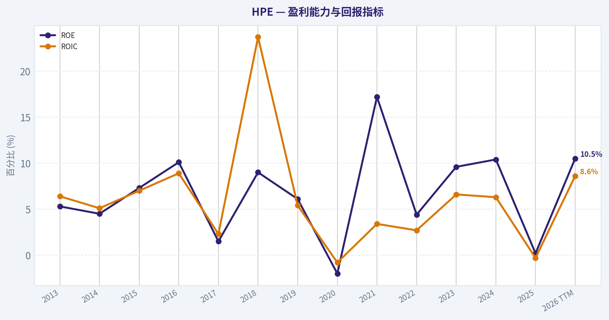
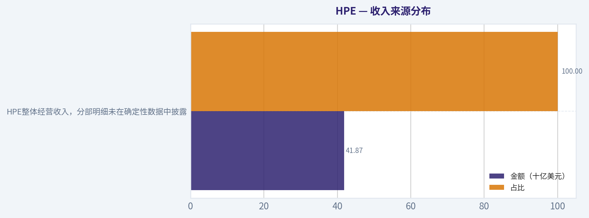
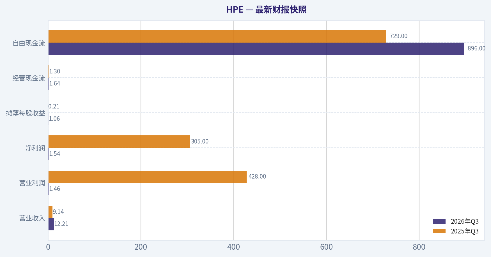
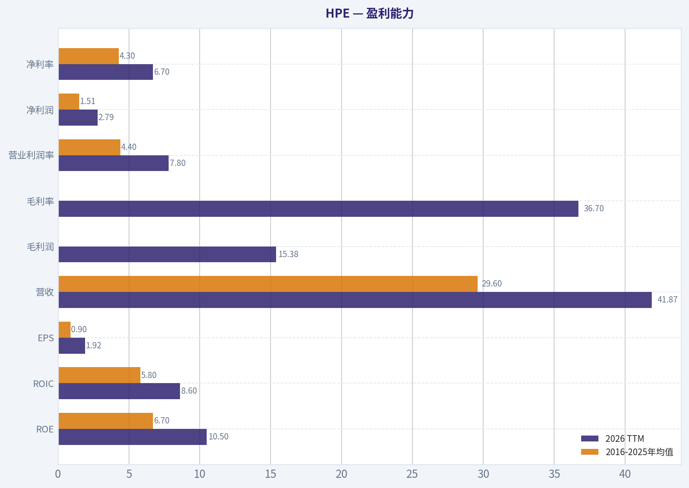
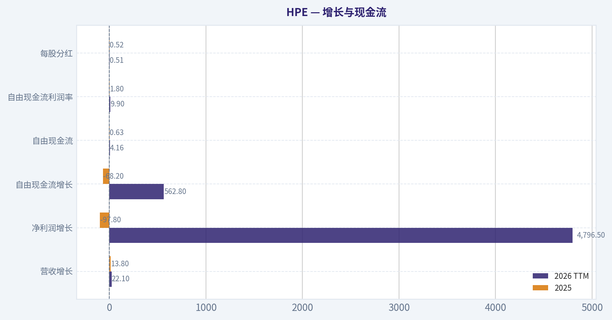
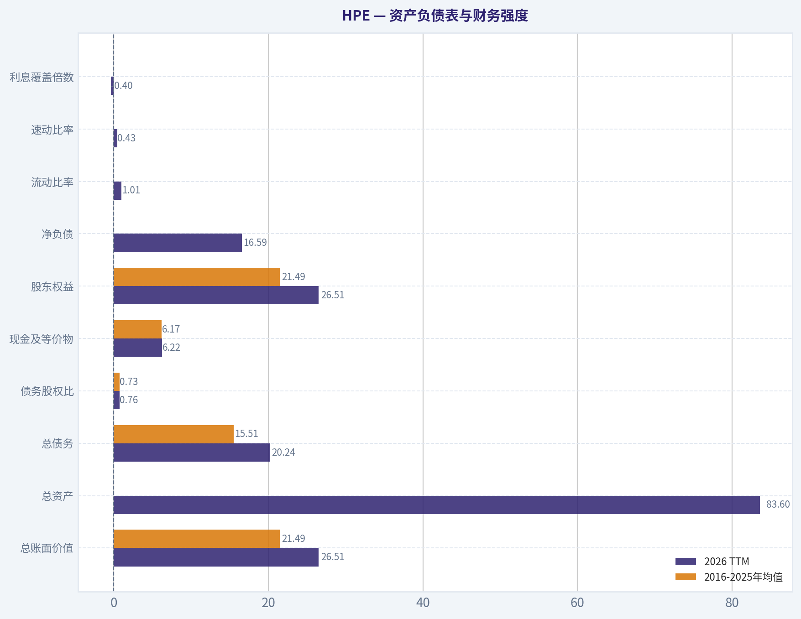
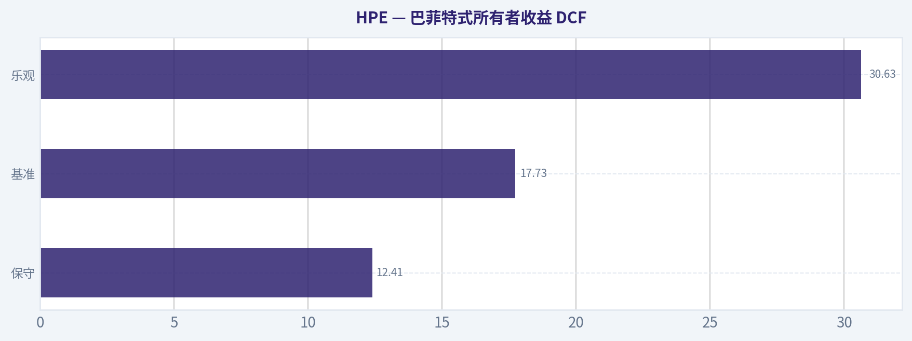
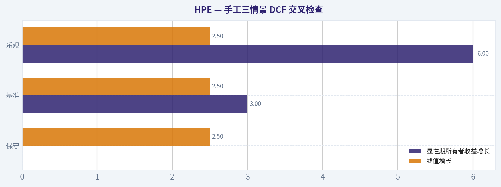

# HPE 深度价值情报

**调研日期:** 2026-11-21

## 关键免责声明

*本报告由 Deep Value Intelligence（一个基于 AI 的多智能体投资分析框架）自动生成。 仅供教育和研究用途 - 非财务建议，非财务顾问。*

---

## 目录

1. 情报摘要
2. 分析师团队报告
   - 基本面分析
   - 价值分析 (巴菲特)
   - 成长性分析 (林奇/德鲁肯米勒/费雪)
   - 市场分析
   - 期权市场分析
3. 研究团队评论
4. 投资团队评论
5. Deep Values 团队洞察

---

## 情报摘要

### 核心观点与前提条件

**核心论点:** HPE 的 AI 基础设施、Juniper 网络资产及混合云整合具有真实战略价值，但尚未证明这些机会已经转化为定价权、自由现金流和高于资本成本的回报。

**主要风险:**
- 未明确说明。

**置信度:** 中

---

## 分析师团队报告

### 基本面分析

#### 最新财报快照

*以下数据基于最近一期已披露财报（2026年Q3），并尽量与上一年同期对比。*

| 指标 | 2026年Q3 | 2025年Q3 | 同比变化 |
| --- | ---: | ---: | ---: |
| 营业收入 | $12.21B | $9.14B | +33.7% |
| 营业利润 | $1.46B | $428.0M | +242.1% |
| 净利润 | $1.54B | $305.0M | +404.9% |
| 摊薄每股收益 | $1.06 | $0.21 | +404.8% |
| 经营现金流 | $1.64B | $1.30B | +25.7% |
| 自由现金流 | $896.0M | $729.0M | +22.9% |

关键结论：这张快照先把最新一期财报放在桌面上，再去看长周期分析。这样读者能更清楚地区分"公司长期质量"和"这次财报发生了什么"。

#### HPE 13年财务指标

*以下数值均由原始数据确定性计算得出，并非 AI 估算。*

*发行人类型：operating company（Technology / Communication Equipment）。*

#### 13年财务指标
*年度行来自已披露财务报表，最后一行 TTM 由最近四个季度滚动计算得出。*

| 指标 | 2013 | 2014 | 2015 | 2016 | 2017 | 2018 | 2019 | 2020 | 2021 | 2022 | 2023 | 2024 | 2025 | 2026 TTM |
| --- | --- | --- | --- | --- | --- | --- | --- | --- | --- | --- | --- | --- | --- | --- |
| 市场价格 | N/A | N/A | $6 | $10 | $11 | $12 | $13 | $7 | $13 | $13 | $14 | $19 | $24 | $41 |
| 总市值 | N/A | N/A | $15.69B | $22.71B | $23.30B | $23.68B | $22.42B | $11.18B | $19.48B | $18.86B | $20.24B | $26.06B | $32.33B | $59.28B |
| 市盈率 | N/A | N/A | 6.38 | 7.18 | 66.29 | 12.40 | 21.31 | -34.56 | 5.68 | 21.62 | 9.99 | 10.10 | 0.00 | 21.31 |
| 市净率 | N/A | N/A | 0.47 | 0.72 | 0.99 | 1.12 | 1.31 | 0.70 | 0.98 | 0.95 | 0.96 | 1.05 | 1.31 | 2.24 |
| ROE | 5.3% | 4.5% | 7.3% | 10.1% | 1.5% | 9.0% | 6.1% | -2.0% | 17.2% | 4.4% | 9.6% | 10.4% | 0.2% | 10.5% |
| ROIC | 6.4% | 5.1% | 7.0% | 8.9% | 2.3% | 23.7% | 5.4% | -0.8% | 3.4% | 2.7% | 6.6% | 6.3% | -0.3% | 8.6% |
| 每股收益 | $0.65 | $0.52 | $1.00 | $1.38 | $0.16 | $0.97 | $0.62 | $-0.21 | $2.25 | $0.60 | $1.43 | $1.85 | $-0.04 | $1.92 |
| 营收 | $57.37B | $55.12B | $31.08B | $30.28B | $28.87B | $30.85B | $29.14B | $26.98B | $27.78B | $28.50B | $29.14B | $30.13B | $34.30B | $41.87B |
| 毛利润 | $45.01B | $42.73B | $17.78B | $17.24B | $16.16B | $16.77B | N/A | N/A | N/A | N/A | N/A | N/A | N/A | $15.38B |
| 毛利率 | 78.5% | 77.5% | 57.2% | 56.9% | 56.0% | 54.4% | N/A | N/A | N/A | N/A | N/A | N/A | N/A | 36.7% |
| 营业利润率 | 5.1% | 4.2% | 6.3% | 12.9% | 2.0% | 5.6% | 4.4% | -1.2% | 4.1% | 2.7% | 7.2% | 7.3% | -1.3% | 7.8% |
| 净利润 | $2.05B | $1.65B | $2.46B | $3.16B | $344.0M | $1.91B | $1.05B | $-322.0M | $3.43B | $868.0M | $2.02B | $2.58B | $57.0M | $2.79B |
| 净利率 | 3.6% | 3.0% | 7.9% | 10.4% | 1.2% | 6.2% | 3.6% | -1.2% | 12.3% | 3.0% | 7.0% | 8.6% | 0.2% | 6.7% |
| 营收增长 | N/A | -3.9% | -43.6% | -2.6% | -4.7% | 6.9% | -5.6% | -7.4% | 3.0% | 2.6% | 2.2% | 3.4% | 13.8% | 22.1% |
| 净利润增长 | N/A | -19.6% | 49.3% | 28.4% | -89.1% | 454.7% | -45.0% | -130.7% | -1164.3% | -74.7% | 133.3% | 27.4% | -97.8% | 4796.5% |
| 自由现金流增长 | N/A | -47.3% | -90.4% | 460.3% | -201.5% | -100.4% | 14162.5% | -112.5% | -2455.9% | -56.3% | 8.8% | 23.4% | -68.2% | 562.8% |
| 总账面价值 | $38.38B | $36.78B | $33.53B | $31.45B | $23.47B | $21.24B | $17.10B | $16.05B | $19.97B | $19.86B | $21.18B | $24.82B | $24.69B | $26.51B |
| 总资产 | N/A | $65.07B | $79.92B | $79.63B | $61.41B | $55.49B | $51.80B | $54.02B | $57.70B | $57.12B | $57.15B | $71.26B | $75.91B | $83.60B |
| 总债务 | N/A | $1.38B | $15.79B | $15.69B | $14.03B | $12.14B | $13.82B | $15.94B | $13.45B | $12.46B | $12.36B | $18.25B | $22.36B | $20.24B |
| 债务股权比 | N/A | 0.04 | 0.47 | 0.50 | 0.60 | 0.57 | 0.81 | 0.99 | 0.67 | 0.63 | 0.58 | 0.74 | 0.91 | 0.76 |
| 现金及等价物 | $2.18B | $2.32B | $9.84B | $12.99B | $9.58B | $4.88B | $3.75B | $4.23B | $4.00B | $4.16B | $4.27B | $14.85B | $5.77B | $6.22B |
| 股东权益 | $38.38B | $36.78B | $33.53B | $31.45B | $23.47B | $21.24B | $17.10B | $16.05B | $19.97B | $19.86B | $21.18B | $24.82B | $24.69B | $26.51B |
| 经营现金流 | $8.74B | $6.91B | $3.66B | $5.06B | $1.33B | $2.96B | $4.00B | $2.24B | $5.87B | $4.59B | $4.43B | $4.34B | $2.92B | $6.69B |
| 投资现金流 | $-2.23B | $-2.97B | $-5.41B | $419.0M | $-5.35B | $-1.88B | $-3.46B | $-2.58B | $-2.80B | $-2.09B | $-3.28B | $-53.0M | $-13.19B | $229.0M |
| 自由现金流 | $6.24B | $3.29B | $317.0M | $1.78B | $-1.80B | $8.0M | $1.14B | $-143.0M | $3.37B | $1.47B | $1.60B | $1.97B | $627.0M | $4.16B |
| 自由现金流利润率 | 10.9% | 6.0% | 1.0% | 5.9% | -6.2% | 0.0% | 3.9% | -0.5% | 12.1% | 5.2% | 5.5% | 6.6% | 1.8% | 9.9% |
| 每股分红 | $0.00 | $0.00 | $0.00 | $0.00 | $0.00 | $0.00 | $0.00 | $0.00 | $0.00 | $0.42 | $0.44 | $0.48 | $0.52 | $0.51 |

#### 盈利能力指标
- 净资产收益率 (ROE): 0.2%
- 投入资本回报率 (ROIC): 0.2%
- 总资产收益率 (ROA): 0.1%
- 毛利率: N/A
- 营业利润率: -1.3%
- 净利率: 0.2%

#### 流动性指标
- 流动比率: 1.01
- 速动比率: 0.43

#### 杠杆指标
- 债务股权比: 0.91
- 利息覆盖倍数: -0.40
- 净负债: $16.59B

#### 增长指标（同比）
- 营收增长: 13.8%
- 净利润增长: -97.8%
- 自由现金流增长: -68.2%
- 营收复合增长率（3年）: 6.4%
- 营收复合增长率（5年）: 4.9%

#### 估值指标
- 市盈率 (TTM): 21.09
- 预期市盈率: 8.64
- 市净率: 2.05
- 市销率: 1.30
- PEG 比率: 0.36
- 企业价值/EBITDA: 9.94
- 自由现金流收益率: 1.2%
- 盈利收益率: 4.7%

#### 所有者收益（巴菲特方法，代码计算）
- 净利润: $57.0M
- + 剔除的非现金、非经常性项目（可转债/衍生品/SAFE 公允价值变动、减值）: $1.62B
- + 折旧与摊销: $2.74B
- - 资本开支: $-2.29B
- + 营运资本（现金流量表口径；负数=占用现金）: $-2.71B
- = **所有者收益: $-986.2M**

#### 内在价值（DeepValues 应用 - SEC 申报数据管道）
- **内在价值（DeepValues 应用，头条）: $17.73** - Owner Earnings (Buffett), 方法 buffett-1986-v2, 截至 2026-11-20 (FY2025)
  区间（保守-乐观）: $12.41 - $30.63
  相对价格的安全边际: -130.7% (价格 $40.91)
  应用使用的输入 (ttm_2026Q3): after-tax operating income $2.4B (operating income $2.6B, tax 9.2%) + D&A $3.5B - capex charge $3.4B (three-year average capex/revenue x trailing revenue; reported capex $2.5B) - working capital $0.0B = owner earnings $2.5B.
  Growth 0.0% fading to 2.5% terminal (min(owner-earnings CAGR, 5-year revenue CAGR), clamped [0, 10%]); discount rate 8.4% (30Y Treasury 5.40% + 3 pts (as of 2026-11-19)); net cash $-14.0B (cash $6.2B + marketable securities $0.0B - debt $20.2B); 1,449M shares.
- Owner Earnings (Buffett): $12.41 / $17.73 / $30.63 (保守 / 基准 / 乐观) ← headline
- Free cash flow DCF: $-9.10 / $41.01 / $120.19 (保守 / 基准 / 乐观)
- Damodaran two-stage FCFF: N/A - Projected cash flows do not cover net debt - no positive equity value to report
  这就是内在价值：引用它作为内在价值，并据此衡量安全边际。其他地方的 DVI 情景数字仅为辅助交叉检查，不是估值。

#### DVI 情景模型（辅助交叉检查 - 不是内在价值）
DVI 基于 Yahoo 数据的情景，仅作敏感性检查。请勿将其作为内在价值引用；内在价值是上方的 DeepValues 应用估值。
- 当前价格: $41
- DVI 情景值（按商业模式路由）: $55
  商业模式: cyclical - owner-earnings DCF (cyclical)
  模型区间（各 DCF 最小-最大）: $9 - $55
  相对价格的安全边际（头条）: 25.8%
  路由说明: Cyclical: margins/FCF are volatile - headline blends FCFF, reverse-DCF and owner-earnings roughly evenly; treat the range as the honest read.
- 巴菲特方法（所有者收益）:
  保守: $29
  平均: $55
  乐观: $171
- 现金流方法（FCF）:
  保守: $-7
  平均: $9
  乐观: $20
- Damodaran FCFF（WACC + 利润率 + 再投资）:
  保守: $-4
  平均: $-0
  乐观: $5
  蒙特卡洛区间（P10-P90）：$-3 - $4（中位数 $0）
  P(内在价值 > 当前价格)：0.0%
- 反向 DCF：当前价格隐含约 6.5%/年 的所有者收益增长（10年）；过去 3 年为 N/A，5 年为 N/A。

#### Piotroski F分数: 4/9
- 净利润为正: 通过
- 经营现金流为正: 通过
- 资产回报率改善: 未通过
- 现金流大于净利润: 通过
- 债务下降: 未通过
- 流动比率改善: 未通过
- 未稀释股本: 未通过
- 毛利率改善: 未通过
- 资产周转率改善: 通过

ANALYST STANCE: **看空**

#### 结论摘要

HPE 是一家拥有大型企业客户基础、服务器、网络和混合云能力的技术设备公司，但当前财务质量仍明显弱于一个高质量复利型企业。2026 年 TTM 营收增长较强，营业利润率和自由现金流较 2025 年恢复；然而 ROE、ROIC、利息覆盖、流动性和净负债仍构成重要约束。

按确定性数据，股价约为 **41 美元**，而 DeepValues 的巴菲特式所有者收益内在价值为 **17.73 美元**，保守至乐观区间为 **12.41-30.63 美元**。因此，现价已经隐含了较高的未来所有者收益增长，而当前回报率和资产负债表尚未充分证明这种预期。

#### 市场指标与估值

| 指标 | 2026 TTM / 当前值 | 十年年均或参考值 | 解释 |
|---|---:|---:|---|
| 市场价格 | $41 | 2016-2025均值约$15 | 股价显著高于历史常态 |
| 总市值 | $59.28B | 2016-2025均值约$23.1B | 市场规模较历史均值扩大，部分来自估值重估 |
| PE | 21.31倍 | 历史波动极大，正常盈利年份约10-22倍 | 现值不算极端，但已经高于多数正常历史阶段 |
| PB | 2.24倍 | 约1.01倍 | 高于历史水平；但对于技术设备公司，PB只能作为辅助指标 |
| 市销率 | 1.30倍 | 未提供统一可比均值 | 估值不高，但低市销率不能抵消低利润率和债务负担 |
| 自由现金流收益率 | 1.2% | 历史波动较大 | 对当前价格而言现金回报偏低 |

**关键结论：** 当前股价和市值已经明显脱离历史均值，但 PE 并未达到极端水平，说明市场定价主要依赖未来盈利修复和 AI、网络基础设施需求。PB 对 HPE 只能提供有限参考，因为技术资产、并购商誉、回购及资本结构都会影响账面价值；估值判断应主要锚定所有者收益和自由现金流。

#### 盈利能力

| 指标 | 2026 TTM | 2016-2025年均值 | 当前相对历史表现 |
|---|---:|---:|---|
| ROE | 10.5% | 6.7% | 高于历史均值 |
| ROIC | 8.6% | 5.8% | 高于历史均值，但尚未达到稳定高回报水平 |
| EPS | $1.92 | $0.90 | 明显高于均值，但历史波动很大 |
| 营收 | $41.87B | $29.60B | 明显高于均值 |
| 毛利润 | $15.38B | 可比数据不足 | TTM毛利率为36.7% |
| 毛利率 | 36.7% | 2016-2018均值约55.8%，口径不连续 | 受业务组合变化影响，不能机械比较 |
| 营业利润率 | 7.8% | 4.4% | 高于均值，显示经营修复 |
| 净利润 | $2.79B | $1.51B | 高于均值 |
| 净利率 | 6.7% | 4.3% | 高于均值，但仍非高利润率企业 |

**关键结论：** TTM 盈利能力较 2025 年大幅恢复，ROE、ROIC、营业利润率和净利率均改善。不过，ROIC 仅为8.6%，仍低于长期资本成本可能要求的优质企业水平；历史上还出现过负 ROIC、负净利润和负营业利润率，说明盈利稳定性不足。

#### 增长与现金流

| 指标 | 2026 TTM | 2025 | 2016-2025年均值或趋势 |
|---|---:|---:|---|
| 营收增长 | 22.1% | 13.8% | 明显高于过去多数年份 |
| 净利润增长 | 4,796.5% | -97.8% | 主要是低基数反弹，不能视为正常增长率 |
| 自由现金流增长 | 562.8% | -68.2% | 由低基数恢复，波动性很高 |
| 自由现金流 | $4.16B | $0.627B | 高于十年均值约$1.00B |
| 自由现金流利润率 | 9.9% | 1.8% | 明显改善 |
| 每股分红 | $0.51 | $0.52 | 自2022年后较稳定 |

**关键结论：** 营收增长是较有意义的改善，但净利润和自由现金流增长率受到2025年低基数影响，不能直接外推。自由现金流恢复是积极因素，但过去曾出现负自由现金流，且经营现金流和资本开支均有较大波动，因此现金流预测应采用较宽安全范围。

#### 资产负债表与财务强度

| 指标 | 2026 TTM | 2016-2025年均值 | 评价 |
|---|---:|---:|---|
| 总账面价值 | $26.51B | $21.49B | 账面权益恢复并增长 |
| 总资产 | $83.60B | 约$64.9B | 资产规模扩大 |
| 总债务 | $20.24B | $15.51B | 高于历史均值 |
| 债务股权比 | 0.76 | 0.73 | 接近历史均值，但绝对债务较重 |
| 现金及等价物 | $6.22B | $6.17B | 接近历史均值 |
| 股东权益 | $26.51B | $21.49B | 高于历史均值 |
| 净负债 | $16.59B | 未提供统一均值 | 对股权价值构成明显拖累 |
| 流动比率 | 1.01 | 当前参考值 | 短期偿付缓冲有限 |
| 速动比率 | 0.43 | 当前参考值 | 流动性弱于表面流动比率 |
| 利息覆盖倍数 | -0.40 | 当前参考值 | 受报告口径及低利润影响，属于警示信号 |

**关键结论：** HPE 并非无债务、现金充裕型企业。现金约62.2亿美元，但债务约202.4亿美元，净负债约165.9亿美元。流动比率接近1、速动比率仅0.43，意味着营运资本和库存周转对短期财务稳定性较重要；DeepValues 也采用约140亿美元净债务调整，这显著压低每股内在价值。

#### 收入来源分布

确定性数据提供了公司层面的总收入，但未提供可验证的最新分部收入拆分。因此，以下表格不对 Compute、Networking、HPC 与 AI 等业务进行未经数据支持的金额分配。

| 收入来源 | 金额（十亿美元） | 占比 |
|---|---:|---:|
| HPE整体经营收入，分部明细未在确定性数据中披露 | $41.87 | 100% |

**关键结论：** 可验证数据只能确认 HPE 2026 TTM 总收入为418.7亿美元，不能可靠确认各产品线的金额占比。分析上应重点关注服务器、网络、HPC与AI基础设施及服务业务的收入质量、毛利率和现金转换，而不能仅根据总收入增长判断企业价值。

#### 管理层与资本配置

HPE 的管理表现呈现"收入规模扩大、资本回报不稳定"的特征：

- ROE 从2020年的负值恢复到2026 TTM的10.5%，但2025年只有0.2%，说明回报率容易受重组、减值、并购和非经常性项目影响。
- ROIC 从2025年的负值恢复至8.6%，但距离长期稳定的高回报企业仍有差距。
- 2022年后开始持续分红，每股分红约0.42-0.52美元，显示出一定股东回报纪律。
- 过去十年自由现金流不稳定，2017年、2020年和2025年均明显偏弱。
- Piotroski F分数为4/9，说明财务质量处于中等偏弱水平；债务、流动比率、股本稀释和利润率改善等项目未通过。
- 2026 TTM净利润增长率极高，主要由于2025年净利润仅5700万美元，增长率缺乏正常周期意义。

#### 经济护城河与业务质量

HPE 的潜在护城河主要来自企业客户关系、长期服务合同、IT基础设施迁移成本、渠道体系和复杂系统集成能力。大型企业通常不会频繁更换核心服务器、网络和混合云供应商，这为收入提供一定黏性。

但护城河并非无条件稳固：

1. 硬件业务通常面临价格竞争和产品迭代压力。
2. 大型云服务商、自研芯片、网络设备厂商和其他服务器供应商会压缩利润率。
3. AI基础设施需求可能推动短期收入，但也可能带来较高资本开支、库存和供应链风险。
4. 并购可以扩大产品组合，但同时增加债务、商誉和整合风险。
5. HPE 的历史营业利润率均值仅约4.4%，说明规模并未持续转化为高利润。

因此，HPE 更接近"周期性企业技术基础设施供应商"，而不是具备极高利润率和极强定价权的软件平台。

#### 巴菲特式所有者收益 DCF

DeepValues 的主要估值输入如下：

- TTM税后经营利润：约24亿美元
- 折旧与摊销：约35亿美元
- 资本开支扣除：约34亿美元
- 营运资本调整：约为零
- 所有者收益：约25亿美元
- 净负债：约140亿美元
- 股份数：约14.49亿股
- 折现率：8.4%
- 终值增长率：2.5%

计算框架为：

\[
\text{股权价值}
=
\text{未来所有者收益现值}
+
\text{终值现值}
-
\text{净负债}
\]

DeepValues 巴菲特式所有者收益估值结果：

| 情景 | 每股内在价值 | 相对当前约$41的含义 | 核心假设特征 |
|---|---:|---|---|
| 保守 | $12.41 | 现价显著高于估值 | 所有者收益缺乏增长，资本负担较重 |
| 基准 | $17.73 | 现价约为内在价值的2.3倍 | 所有者收益增长为0%，逐步过渡至2.5%终值增长 |
| 乐观 | $30.63 | 即使乐观情景仍低于现价 | 需要更强的利润修复和现金流兑现 |

**关键结论：** DeepValues 的基准内在价值为17.73美元，明显低于约41美元的市场价格；即使乐观估值30.63美元，也没有覆盖当前定价。主要原因不是收入规模不足，而是净负债、资本开支和所有者收益转换率限制了最终股权价值。

#### 手工三情景 DCF 交叉检查

为了进行独立的合理性检查，采用约25亿美元的当前所有者收益、140亿美元净负债、14.49亿股股份、10年显性预测期、10%折现率和2.5%终值增长率。该手工模型仅作敏感性分析，不替代DeepValues的内在价值。

| 情景 | 显性期所有者收益增长 | 终值增长 | 估算股权价值 | 估算每股价值 |
|---|---:|---:|---:|---:|
| 保守 | 0% | 2.5% | 约$14.5B | 约$10.0 |
| 基准 | 3% | 2.5% | 约$18.6B | 约$12.9 |
| 乐观 | 6% | 2.5% | 约$29.6B | 约$20.4 |

计算示例：

- 保守情景：前10年现金流现值约153.6亿美元，终值现值约131.7亿美元，减去140亿美元净负债后，股权价值约145亿美元。
- 基准情景：前10年现金流现值约149.5亿美元，终值现值约176.9亿美元，减去净负债后，股权价值约186亿美元。
- 乐观情景：前10年现金流现值约200.5亿美元，终值现值约235.8亿美元，减去净负债后，股权价值约296亿美元。

**关键结论：** 手工模型给出的约10-20美元每股区间低于DeepValues的12.41-30.63美元区间，但方向一致，均表明债务和资本开支对股东价值有重大压制。不同模型的差异主要来自折现率、所有者收益定义和现金流增长假设，而不是估值方向发生根本变化。

#### 反向 DCF 与市场隐含预期

DVI 反向 DCF 显示，约41美元的股价隐含未来十年所有者收益约 **6.5%的年增长率**。这一要求并非数学上不可能，但它明显高于：

- HPE过去五年约4.9%的营收复合增长率；
- HPE过去三年约6.4%的营收复合增长率；
- 其长期历史中较低且波动的资本回报率。

如果 AI服务器、网络和混合云业务能够持续提升利润率，同时资本开支不同比例增加，6.5%的所有者收益增长或许可以实现。反之，如果收入增长主要依赖低利润率硬件出货，收入增长未必能转化为同等幅度的股东现金流增长。

#### 主要风险、机会与观察指标

| 类别 | 具体内容 | 对估值的影响 |
|---|---|---|
| 风险 | 净负债约165.9亿美元 | 提高股权价值对经营现金流的敏感度 |
| 风险 | 流动比率约1.01、速动比率0.43 | 短期财务缓冲较薄 |
| 风险 | 利息覆盖倍数为负 | 显示盈利质量或报告口径存在明显压力 |
| 风险 | 资本开支与营运资本波动 | 会造成净利润与所有者收益背离 |
| 风险 | 硬件竞争和利润率压力 | 高收入增长未必带来高回报 |
| 机会 | TTM收入增长22.1% | AI及基础设施需求可能推动规模扩张 |
| 机会 | 营业利润率恢复至7.8% | 表明经营效率较2025年显著改善 |
| 机会 | 自由现金流恢复至41.6亿美元 | 若能持续，可改善债务承受能力 |
| 机会 | 企业客户关系和系统黏性 | 有助于维持一定续约和交叉销售能力 |
| 关键观察 | ROIC能否持续高于资本成本 | 决定增长是否真正创造价值 |
| 关键观察 | 净债务是否持续下降 | 决定每股内在价值能否改善 |
| 关键观察 | AI收入的毛利率和现金转换 | 区分真实经济收益与单纯收入扩张 |

**关键结论：** 最大机会是AI和网络基础设施带来的收入、利润率与自由现金流同步改善；最大风险是收入增长停留在低利润率硬件层面，同时债务和资本开支继续占用现金。对估值最重要的不是单一季度的收入增速，而是ROIC、自由现金流利润率和净债务能否连续改善。

#### 最终投资立场

**看空**

该立场代表估值与财务证据之间存在明显不匹配，并非对公司业务完全否定。HPE具备企业客户基础、基础设施产品和AI相关增长机会，2026 TTM经营数据也显示修复迹象；但当前约41美元定价已经隐含了较强的未来所有者收益增长，而DeepValues基准内在价值仅17.73美元，乐观值30.63美元仍低于现价。

在缺乏持续高ROIC、更强自由现金流转换和明显去杠杆证据之前，现有数据不足以支持当前估值水平。历史盈利波动、低利息覆盖、较高净负债以及分部收入数据不足，进一步降低了估值结论的确定性。

#### 关键要点汇总

| 维度 | 核心判断 | 证据 |
|---|---|---|
| 业务质量 | 中等，具备企业基础设施护城河但竞争激烈 | 企业客户黏性、硬件价格压力 |
| 盈利趋势 | TTM明显修复，但历史波动高 | 营业利润率7.8%，ROIC8.6% |
| 现金流 | 当前改善，长期不稳定 | TTM自由现金流41.6亿美元，历史出现负值 |
| 财务强度 | 偏弱至中等 | 净债务165.9亿美元，速动比率0.43 |
| 估值 | 偏高 | 股价约41美元，DeepValues基准17.73美元 |
| 市场隐含增长 | 要求较高 | 反向DCF隐含所有者收益年增长约6.5% |
| 主要催化因素 | AI、网络和混合云需求 | 营收增长22.1% |
| 主要风险因素 | 债务、资本开支、利润率和现金转换 | F分数4/9、历史盈利波动 |
| 最终立场 | **看空** | 当前价格缺乏足够的所有者收益安全边际 |

**关键结论：** HPE的经营修复是真实的，但尚未转化为足够稳定、低资本强度和高回报的所有者收益。综合质量、财务强度和DCF结果，当前估值对未来增长的要求明显高于历史表现所能稳健证明的水平。

#### 基本面关键图表

本图追踪 **HPE** 过去十年的盈利能力与回报指标（ROE、ROIC、利润率），突出呈现资本效率的变化趋势。

本对比图（来自「收入来源分布」）将 **HPE** 的当前数据与历史基准并排呈现，直观反映公司相对自身历史均值的估值水平。

---

### 价值分析 (巴菲特)

> *基于沃伦·巴菲特的价值投资哲学：能力圈、经济护城河、管理层质量与安全边际。*

#### 内在价值快照

价格是你付的钱，内在价值是企业未来可能为股东创造的现金价值。我们给出一个区间，而不是假装只有一个神奇数字。

- 当前价格: $40.91
- 估值区间（两种 DCF 方法、保守到乐观）: $-9.10 至 $120.19

##### 所有者收益（巴菲特方法）
- 净利润: $57,000,000.00
- 折旧与摊销: $2,737,000,000.00
- 资本支出: $-2,292,000,000.00
- 营运资金变化: $-2,707,000,000.00
- 所有者收益: $-986,230,000.00

##### 内在价值
###### 所有者收益法
使用所有者收益，更严格，通常更保守。
- 保守: $12.41
- 平均: $17.73
- 乐观: $30.63
- 折现率: 8.4%

###### 自由现金流法
使用自由现金流，更适合今天投入很多、为未来增长铺路的公司。
- 保守: $-9.10
- 平均: $41.01
- 乐观: $120.19
- 折现率: 9.2%

分析师立场：**看空**

#### 一、结论摘要

HPE 的业务受益于 AI 服务器、网络设备和混合云基础设施需求，营收同比增长 13.8%，但当前估值与现金创造能力并不匹配。公司约 543.1 亿美元市值对应约 1,400 亿美元净负债调整后的资本结构，账面所有者收益约 25 亿美元，而 DeepValues 应用给出的内在价值仅为每股 **17.73 美元**，明显低于当前约 **41 美元**。

HPE 并未触发唯一的财务困境硬性门槛，因为现有资料没有显示利息覆盖率低于 1 倍或明确进入破产风险区间。但低 ROE、低自由现金流收益率、较高净负债和估值安全边际不足，使综合评分落入看空区间。

#### 二、因素评分

| 因素 | 得分（满分5分） | 主要依据 |
|---|---:|---|
| 业务理解与可预测性 | 2.5 | 服务器、网络和混合云业务容易理解，但受企业IT周期、AI资本开支及技术迭代影响较大 |
| 护城河 | 2.5 | 企业客户关系、服务能力和规模形成一定优势，但硬件竞争激烈，产品替代和价格竞争持续存在 |
| 管理层与资本配置 | 2.5 | 具备大型企业运营经验，但高负债和收购整合要求资本配置持续创造协同价值 |
| 行业结构 | 3.0 | 企业基础设施市场规模大、客户粘性尚可，但服务器和硬件领域竞争强，利润率受压 |
| Gate 5 财务困境硬门槛 | 未触发 | 没有证据表明同时存在明显恶化的现金流轨迹与利息覆盖率低于1倍等偿债红线 |

**关键结论：** HPE 不是一个明显濒临财务危机的公司，但业务质量尚不足以抵消估值和资本结构压力。评分中最主要的扣分项是现金回报能力和净负债，而不是企业完全缺乏经营价值。

#### 三、护城河分析

| 护城河来源 | 评价 | 具体证据 |
|---|---|---|
| 无形资产与品牌 | 中等 | HPE 在企业级服务器、网络和数据中心领域拥有长期品牌认知与客户关系，但产品差异化不如高软件含量平台 |
| 转换成本 | 中等 | 企业基础设施涉及部署、服务和运维流程，迁移存在成本；但硬件替代商较多，客户并非完全锁定 |
| 成本优势 | 偏弱至中等 | 规模采购、渠道和服务网络有助于降低成本，但硬件市场价格透明，成本优势不够绝对 |
| 网络效应 | 偏弱 | HPE 的基础设施生态具有一定协同效应，但不具备典型消费平台或软件网络效应 |
| 护城河评级 | 窄 | 业务基础较稳固，但暂不足以称为宽阔且持续扩大的护城河 |

HPE 的潜在增长来自 AI 服务器、网络升级、混合云和企业数据中心现代化。问题在于，AI 基础设施需求可以推升收入，却未必同步推升股东现金流：硬件业务通常需要库存、研发和资本开支投入，且供应链与竞争者可能将增长收益转化为更低价格。

#### 四、管理层与资本配置

| 观察项目 | 评价 |
|---|---|
| 所有者意识 | 中等偏弱；公开资料未显示核心管理层持股足以构成高度集中式所有者激励 |
| 财务透明度 | 中等；经营指标可追踪，但收购、折旧、资本开支与营运资本变化会显著影响现金收益 |
| 再投资能力 | 有潜力但尚未充分验证；AI和网络基础设施可提供增长机会，然而回报率需要中性 |
| 收购与整合 | 重要风险点；大型基础设施收购能扩大规模，也会增加债务和整合复杂度 |
| 股东回报 | 当前自由现金流收益率约1.2%，说明现金回报相对于市值偏低 |

管理层能否将收入增长转化为每股自由现金流增长，是HPE估值能否改善的关键。单纯的营收增长不足以证明资本配置成功，尤其是在净负债约140亿美元的背景下。

#### 五、财务摘要

| 指标 | 最新数据 |
|---|---:|
| 当前股价 | 约41.00美元 |
| 总市值 | 543.1亿美元 |
| PE | 21.09倍 |
| 营收同比增长 | 13.8% |
| ROE | 0.2% |
| 毛利率 | 未提供 |
| 自由现金流收益率 | 1.2% |
| 推算自由现金流 | 约6.5亿美元 |
| 现金及现金等价物 | 62亿美元 |
| 总债务 | 202亿美元 |
| 净负债 | 约140亿美元 |
| 流动比率 | 1.01倍 |
| 追踪股份数 | 约14.49亿股 |

**关键结论：** HPE 的收入增长较好，但ROE仅为0.2%，说明收入增长尚未转化为相应的股东资本回报。净负债约140亿美元，流动比率接近1倍，资产负债表没有达到"堡垒型"水平；1.2%的自由现金流收益率也难以支持当前估值的强安全边际。

#### 六、所有者收益计算

DeepValues 应用采用的所有者收益输入如下：

| 项目 | 金额 |
|---|---:|
| 税后经营利润 | 24亿美元 |
| 折旧与摊销 | 35亿美元 |
| 资本开支扣除 | 34亿美元 |
| 营运资本变动 | 约0亿美元 |
| 所有者收益 | 约25亿美元 |
| 净负债扣除 | 约140亿美元 |
| 股份数 | 约14.49亿股 |

计算逻辑为：

> 所有者收益 = 税后经营利润 + 折旧与摊销 - 维护性资本开支 - 营运资本增加
> 约为 24 + 35 - 34 - 0 = 25亿美元

**关键结论：** 折旧与摊销规模较大，但资本开支也很高，因此折旧并不能全部视为可自由分配现金。扣除资本开支后，所有者收益相对于543亿美元市值仍显不足，且净负债进一步压低股权价值。

#### 七、三情景 DCF 交叉估值

以下情景以约25亿美元所有者收益、10%的长期折现率和约140亿美元净负债为基础。它们是辅助交叉检查，不取代DeepValues应用的头条内在价值。

| 情景 | 核心假设 | 股权价值估算 | 每股估算 |
|---|---|---:|---:|
| 情景A：零增长 | 所有者收益永久维持25亿美元 | 约110亿美元 | 约7.59美元 |
| 情景B：GDP增长 | 首年增长3%，永续增长3%，折现率10% | 约228亿美元 | 约15.72美元 |
| 情景C：历史增长交叉检验 | 初始所有者收益不增长，终值采用2.5%增长 | 约228亿美元 | 约15.72美元 |
| DeepValues应用头条内在价值 | 增长率由0%逐步过渡至2.5%，折现率8.4%，计入净负债 | - | **17.73美元** |

**关键结论：** 即使给予3%至2.5%的长期增长假设，辅助模型每股价值仍低于41美元。DeepValues应用的17.73美元内在价值已综合考虑所有者收益、增长、折现率和净负债，是本报告采用的核心估值。

#### 八、内在价值与安全边际

| 项目 | 数值 |
|---|---:|
| 当前价格 | 约41.00美元 |
| DeepValues应用内在价值 | 17.73美元 |
| 保守区间 | 12.41美元 |
| 乐观区间 | 30.63美元 |
| 应用显示的相对价格安全边际 | -130.7% |
| 当前价格相对基准内在价值溢价 | 约131% |

对于具有高ROIC、强预测性和宽阔护城河的复合增长企业，10%至15%的安全边际有时可以接受。但HPE目前的ROE、自由现金流收益率和净负债结构并不支持这种高质量溢价，因此不适用"高质量企业可接受较小折价"的估值逻辑。

#### 九、最终巴菲特评分卡

| 评分标准 | 权重 | 得分 | 加权得分 |
|---|---:|---:|---:|
| 护城河宽度与持久性 | 25% | 2.5 | 0.63 |
| 估值与安全边际 | 20% | 1.0 | 0.20 |
| 资本回报：ROIC相对WACC | 15% | 1.5 | 0.23 |
| 业务理解与可预测性 | 12% | 2.5 | 0.30 |
| 管理层与资本配置 | 12% | 2.5 | 0.30 |
| 再投资空间 | 8% | 3.0 | 0.24 |
| 资产负债表强度 | 4% | 2.0 | 0.08 |
| 行业结构 | 4% | 3.0 | 0.12 |
| **总分** | **100%** | - | **2.10 / 5.00** |

**关键结论：** HPE拥有真实的企业基础设施业务和AI相关增长空间，但当前综合得分仅约2.10分。估值安全边际、资本回报和资产负债表三项不足，抵消了营收增长和行业需求带来的正面因素。

#### 十、投资立场与确定性

**分析师立场：看空**

**确定性：中高。**

研究证据显示，HPE并非没有经营价值，也未触发财务困境硬门槛；但在约41美元价格下，市场需要公司将AI和基础设施增长快速转化为更高的持续所有者收益，同时消化约140亿美元净负债。以当前25亿美元所有者收益、0.2% ROE和1.2%自由现金流收益率衡量，现有价格明显高于17.73美元的应用内在价值，估值证据不支持当前价格水平。
#### 估值桥

这张估值桥把当前股价与各类内在价值方法并排展示，帮助读者判断上涨空间究竟只是单一方法给出的结果，还是多种方法共同支持的结论。

| 项目 | 每股内在价值 |
| --- | ---: |
| 巴菲特方法 | $17.73 |
| 现金流方法 | $41.01 |
| 当前价格 | $40.91 |

#### 关键结论

如果只有一种方法显著高于其他方法，说明上行空间更依赖特定建模假设。若多种方法的估值接近，则说明估值逻辑更加稳健。

#### 估值图表

本对比图（来自「最新财报快照」）将 **HPE** 的当前数据与历史基准并排呈现，直观反映公司相对自身历史均值的估值水平。

本对比图（来自「盈利能力」）将 **HPE** 的当前数据与历史基准并排呈现，直观反映公司相对自身历史均值的估值水平。

本对比图（来自「增长与现金流」）将 **HPE** 的当前数据与历史基准并排呈现，直观反映公司相对自身历史均值的估值水平。

本对比图（来自「资产负债表与财务强度」）将 **HPE** 的当前数据与历史基准并排呈现，直观反映公司相对自身历史均值的估值水平。

本对比图（来自「巴菲特式所有者收益 DCF」）将 **HPE** 的当前数据与历史基准并排呈现，直观反映公司相对自身历史均值的估值水平。

本对比图（来自「手工三情景 DCF 交叉检查」）将 **HPE** 的当前数据与历史基准并排呈现，直观反映公司相对自身历史均值的估值水平。

---

### 成长性分析 (林奇/德鲁肯米勒/费雪)

> *基于彼得·林奇的GARP成长投资法、斯坦利·德鲁肯米勒的宏观拐点分析法，以及菲利普·费雪的深度调研法。*

ANALYST STANCE: **中性**

#### 结论摘要

HPE 属于偏成熟的基础设施与服务器企业，目前更接近"稳健型公司叠加 AI 基础设施机会"，尚未满足典型 15%-25% 以上持续高速成长股的标准。营收同比增长 13.8%，低于快速成长分类门槛；同时，当前股价约 41 美元显著高于研究包中的基准内在价值 17.73 美元，估值需要依赖 AI 业务持续超预期扩张才能获得充分解释。

---

#### 1. 林奇分类与公司故事

| 项目 | 判断 |
|---|---|
| 林奇分类 | 偏稳健型公司，带有 AI 基础设施转型特征 |
| 当前营收增长 | 13.8%，接近稳健型上沿，但尚未达到快速成长标准 |
| 核心业务 | 服务器、网络设备、混合云与企业级基础设施 |
| 主要成长主题 | AI 计算、高性能计算、数据中心网络、混合云 |
| 当前市值 | 约 543.1 亿美元 |
| 当前 PE | 约 21.1 倍 |

**关键结论：** HPE 的故事容易理解：企业和政府需要更多计算、网络与混合云基础设施，AI 正在提高单个客户的基础设施投入。但当前增长率仍不足以证明它已经进入高速成长阶段，AI 机会与成熟硬件业务之间存在明显的增长质量差异。

**三句话解释公司故事：**

1. HPE 向企业提供运行 AI、云计算和关键业务所需的服务器与网络设备。
2. AI 训练和推理带来更高的计算、存储与高速网络需求，可能扩大基础设施市场。
3. 若 HPE 能将 AI 订单转化为持续收入并改善利润率，公司可能出现新的增长阶段；否则，它仍主要是低增长硬件供应商。

---

#### 2. TAM 与十倍测试

| 项目 | 分析 |
|---|---|
| 当前收入基准 | 研究包未提供最新绝对营收；同比增长为 13.8% |
| 10 倍收入测试 | 需要收入达到当前规模的 10 倍 |
| 潜在市场 | 企业服务器、AI 计算、高性能计算、网络、混合云 |
| TAM 特征 | AI 基础设施部分快速扩张；传统服务器市场增长较温和 |
| 市占率可扩张性 | AI 基础设施市场仍有空间，但 HPE 需要与大型云厂商、服务器和网络竞争者竞争 |
| 主要限制 | 资本密集、客户采购周期长、硬件价格竞争和供应链约束 |

**关键结论：** 广义 AI 基础设施 TAM 足以容纳 HPE 大幅增长，但"理论 TAM 很大"不等于 HPE 能取得相应份额。若只看传统服务器与企业硬件，十倍收入测试缺乏可信度；若 HPE 在 AI 网络、高性能计算和服务收入中建立更高份额，增长空间才会明显扩大。

---

#### 3. 收入增长与收入质量

| 指标 | 当前观察 | 判断 |
|---|---:|---|
| 营收同比增长 | 13.8% | 稳健，但低于快速成长标准 |
| 增长趋势 | 研究包仅提供单期增速 | 无法确认是否加速 |
| 有机增长 | 未披露于研究包 | 无法确认 |
| 并购贡献 | 未披露于研究包 | 需要拆分 |
| 客户集中度 | 未披露于研究包 | 需要关注大型企业和政府客户 |
| 毛利率 | N/A | 无法评估产品组合与定价能力 |
| ROE | 0.2% | 偏弱，反映盈利效率有限 |

**关键结论：** 目前最重要的信息缺口是连续季度增长序列。单一的 13.8% 增速只能说明业务有扩张，不能证明存在"加速型拐点"；而 ROE 极低及毛利率缺失，使得增长质量和资本效率仍需进一步验证。

---

#### 4. 单位经济与盈利路径

| 指标 | 数据或判断 | 结论 |
|---|---:|---|
| LTV/CAC | 未披露 | 不适用于硬件为主的业务，或暂无法计算 |
| NRR | 未披露 | 只有订阅及服务部分适合使用 |
| 自由现金流收益率 | 1.2% | 现金回报率偏低 |
| 流动比率 | 1.01 | 短期流动性缓冲有限 |
| 净债务 | 约 140 亿美元 | 财务杠杆明显 |
| 规则四十 | 无法完整计算 | 缺少自由现金流率和可比订阅收入拆分 |
| 现金与证券 | 约 62 亿美元现金；证券为零 | 对 202 亿美元债务覆盖有限 |

**关键结论：** HPE 不是典型 SaaS 公司，LTV/CAC、NRR 和规则四十并非最核心指标；更关键的是自由现金流转换率、毛利率、服务收入占比和债务负担。当前自由现金流收益率仅 1.2%，结合约 140 亿美元净债务，说明市场估值对未来现金流改善已有较高要求。

---

#### 5. inflection point（拐点）评估

| 潜在拐点 | 证据 | 强度 |
|---|---|---|
| 产品周期 | AI 服务器、高性能计算和网络需求 | 中等偏强 |
| 市场份额 | 研究包未提供连续份额数据 | 未确认 |
| 毛利率 | 毛利率数据缺失 | 未确认 |
| TAM 扩张 | AI 基础设施扩大总市场 | 强 |
| 竞争格局 | 行业竞争激烈，未见明确竞争者失速 | 偏弱 |
| 现金流拐点 | 基准 Owner Earnings 约 25 亿美元，但现金流估值分歧较大 | 中等偏弱 |
| 管理层执行 | 需要观察 AI 订单转化和并购整合 | 未确认 |

**关键结论：** HPE 最可信的拐点来自 TAM 扩张，而不是已经被验证的利润率或市场份额拐点。当前更像"潜在拐点"，还不是"已确认拐点"；未来几个财季需要看到 AI 相关收入持续增长、毛利率稳定以及现金流改善同时出现。

---

#### 6. 宏观环境

| 宏观因素 | 对 HPE 的影响 |
|---|---|
| 长期 AI 基础设施需求 | 顺风 |
| 企业 IT 预算 | 中性，取决于经济周期 |
| 利率环境 | 偏逆风；30 年期美国国债收益率约 5.40% |
| 资本开支周期 | AI 资本开支有利，传统企业 IT 可能较慢 |
| 债务融资成本 | 偏逆风 |
| 硬件供应链 | 可能造成交付和毛利率波动 |
| 竞争强度 | 偏逆风，行业参与者众多 |

**关键结论：** AI 资本开支是 HPE 的主要宏观顺风，但高利率和较高净债务会压低长期现金流估值。宏观环境并非全面支持成长股重估，更接近"行业需求强、估值折现率偏高"的混合环境。

---

#### 7. Fisher 15 项评分

| Fisher 项目 | 评分（5分制） | 依据 |
|---|---:|---|
| 市场潜力 | 4 | AI、网络和混合云扩大市场 |
| 新产品开发决心 | 3 | 有 AI 与高性能计算方向，但资料有限 |
| 研发有效性 | 3 | 缺少研发回报和产品数据 |
| 销售组织 | 4 | 企业级渠道和客户基础较强 |
| 利润率水平 | 2 | 毛利率缺失，现金流收益率偏低 |
| 利润率改善 | 3 | AI 组合可能改善，但尚未确认 |
| 员工关系 | 3 | 数据不足 |
| 高管关系 | 3 | 数据不足 |
| 管理层深度 | 3 | 大型企业具备一定组织深度 |
| 成本与会计 | 3 | 未见足够资料评估 |
| 特殊竞争优势 | 3 | 企业客户、渠道和整合能力，但硬件竞争激烈 |
| 长期利润前景 | 3 | 取决于 AI 收入持续性 |
| 股权稀释 | 3 | 研究包未显示明显严重稀释 |
| 管理层坦诚度 | 3 | 数据不足 |
| 管理层诚信 | 3 | 数据不足 |
| **总分** | **45/75** | **平均水平** |

**关键结论：** Fisher 评分为 45 分，处于平均水平下沿，主要扣分来自盈利质量、毛利率透明度和长期执行证据不足。HPE 拥有企业客户和基础设施能力，但还没有足够资料证明其具备高成长公司所需的强研发回报、持续高利润率和显著竞争壁垒。

---

#### 8. 估值分析

| 估值方法 | 结果 | 含义 |
|---|---:|---|
| 当前股价 | 约 41.00 美元 | 市场定价 |
| PE | 21.09 倍 | 对成熟硬件企业不算极低 |
| PEG（以 13.8%营收增速近似） | 约 1.53 | 属于合理至偏贵区间；且不是标准盈利增速 |
| Owner Earnings 保守情景 | 12.41 美元 | 显著低于当前价格 |
| Owner Earnings 基准情景 | 17.73 美元 | 显著低于当前价格 |
| Owner Earnings 乐观情景 | 30.63 美元 | 仍低于当前价格 |
| FCF DCF 基准情景 | 41.01 美元 | 接近当前价格，但对现金流假设敏感 |
| 净债务 | 约 140 亿美元 | 压低股权价值 |
| Damodaran FCFF | 无可报告正股权价值 | 预测现金流不足以覆盖净债务 |

**关键结论：** 以 Owner Earnings 为核心的基准内在价值为 17.73 美元，约为当前价格的 43%；乐观情景 30.63 美元仍低于当前价格。FCF DCF 基准结果约 41.01 美元与市场价格接近，但由于保守情景为负值、乐观情景极高，说明估值对现金流假设高度敏感，当前价格并未留下明显安全边际。

---

#### 9. 估值敏感性

| 情景 | 每股估值参考 | 相对约 41 美元市场价格 |
|---|---:|---:|
| Owner Earnings 保守 | 12.41 美元 | 低约 70% |
| Owner Earnings 基准 | 17.73 美元 | 低约 57% |
| Owner Earnings 乐观 | 30.63 美元 | 低约 25% |
| FCF DCF 保守 | -9.10 美元 | 现金流不足以支持正股权价值 |
| FCF DCF 基准 | 41.01 美元 | 基本接近 |
| FCF DCF 乐观 | 120.19 美元 | 需要极强现金流兑现 |

**关键结论：** 估值区间异常宽，反映 HPE 的价值高度取决于 AI 业务的增长速度、利润率和资本开支假设。研究包中的主要内在价值方法并不支持约 41 美元的充分安全边际；要使当前价格更有说服力，必须看到持续的现金流加速，而非单纯的订单增长。

---

#### 10. 成长投资评分卡

| 维度 | 权重 | 评分（5分制） | 加权分 |
|---|---:|---:|---:|
| 故事清晰度 | 10% | 3.5 | 0.35 |
| TAM 与成长跑道 | 20% | 3.5 | 0.70 |
| 收入增长 | 20% | 3.0 | 0.60 |
| 单位经济 | 15% | 2.5 | 0.38 |
| 竞争地位 | 10% | 3.0 | 0.30 |
| 管理层质量 | 10% | 3.0 | 0.30 |
| 宏观环境 | 5% | 3.0 | 0.15 |
| 盈利路径 | 5% | 2.5 | 0.13 |
| 估值 | 5% | 2.0 | 0.10 |
| **总分** | **100%** |  | **3.01/5.00** |

**关键结论：** 3.01 分落在"观察"区间，主要原因是 AI TAM 和企业客户基础较有吸引力，但收入增速尚未达到快速成长标准，现金流与债务指标也削弱了估值支撑。当前证据更支持持续验证经营拐点，而不是将 HPE 视为已经确认的十倍增长案例。

---

#### 11. 主要风险与催化因素

| 类型 | 因素 | 影响 |
|---|---|---|
| 催化因素 | AI 服务器与网络订单持续增长 | 可能推动营收重新加速 |
| 催化因素 | AI 产品组合改善毛利率 | 可能带来利润率拐点 |
| 催化因素 | 服务、软件和混合云收入占比提高 | 有助于提高收入质量 |
| 催化因素 | 净债务下降、自由现金流改善 | 有助于降低估值折价 |
| 主要风险 | AI 订单集中于一次性项目 | 收入可能波动，持续性不足 |
| 主要风险 | 硬件竞争导致毛利率承压 | 增长未必转化为利润 |
| 主要风险 | 净债务约 140 亿美元 | 放大利率和现金流风险 |
| 主要风险 | 流动比率约 1.01 | 短期财务缓冲有限 |
| 主要风险 | 传统业务增长放缓 | AI 增长可能被成熟业务拖累 |
| 主要风险 | 高估值已反映部分 AI 预期 | 若增长未加速，估值可能承压 |

**关键结论：** 最重要的验证信号是连续季度 AI 收入增长、毛利率稳定改善、自由现金流增长和净债务下降。若这些指标没有同步改善，当前约 41 美元的定价与基准内在价值之间的差距仍然难以解释。

---

### 市场分析

ANALYST STANCE: **看空**

#### 结论摘要

本报告仅分析纽约证券交易所上市的 Hewlett Packard Enterprise Co（代码：HPE）。数据截至 2026 年 11 月 20 日收盘；2026 年 11 月 21 日为非交易日。

HPE 当前呈现出**中长期趋势破坏、短期动能偏弱、波动率显著升高**的组合特征。RSI 已进入接近超卖区域，说明短线下跌较为集中，但这并不等同于趋势已经反转；价格仍低于 10 日 EMA、50 日 SMA 和 200 日 SMA，MACD 也处于深度负值区间。技术证据对当前价格所隐含的估值支撑并不充分，尤其是在股价从 10 月高点大幅回落、同时长期均线结构转弱的背景下。

#### 价格表现与趋势结构

| 项目 | 数据或区间 | 解读 |
|---|---:|---|
| 2025-11-21 收盘价 | 20.16 美元 | 一年前的价格基准 |
| 2026-11-20 收盘价 | 40.91 美元 | 一年累计仍上涨约 102.9% |
| 2026 年期间高点 | 73.46 美元，2026-10-09 | 当前价格较高点回落约 44.3% |
| 2026-11-20 单日表现 | 收盘 40.91 美元，前一日 45.49 美元 | 单日下跌约 10.1%，且日内最低触及 40.48 美元 |
| 近五个交易日 | 50.16 -> 40.91 美元 | 累计下跌约 18.4% |
| 近期成交量 | 2026-11-20 为 21.49 百万股 | 高于 11 月中旬多数交易日，显示下跌伴随一定成交参与度 |

关键结论：HPE 虽然过去一年仍保留显著累计涨幅，但近期从 73.46 美元高点回撤超过四成，已经不能简单视为普通的短期整理。11 月 20 日出现较大的单日跌幅，且价格接近当日低点收盘，说明卖方压力在最新交易日明显占优。

#### 均线与趋势确认

| 指标 | 2026-11-20 数值 | 与收盘价关系 | 趋势含义 |
|---|---:|---:|---|
| 收盘价 | 40.91 美元 | - | 最新市场定价 |
| 10 日 EMA | 46.49 美元 | 低约 12.0% | 短线动能偏弱 |
| 50 日 SMA | 57.65 美元 | 低约 29.0% | 中期趋势明显转空 |
| 200 日 SMA | 42.58 美元 | 低约 3.9% | 长期趋势基准已被跌破 |
| 10 日 EMA 方向 | 由 10 月初约 63.46 美元降至 46.49 美元 | 持续下降 | 下跌并非单日孤立事件 |
| 50 日 SMA 方向 | 11 月初约 59.62 美元降至 57.65 美元 | 近期转为下降 | 中期均线开始反映顶部后的回撤 |

关键结论：价格同时低于三条关键均线，其中跌破 200 日 SMA 尤其重要，因为该均线通常代表长期趋势分界。10 日 EMA 已明显低于 50 日 SMA，且两者都在下行，说明短期弱势已经扩散至中期结构；仅凭 RSI 偏低，尚不足以抵消这种均线层面的趋势压力。

#### MACD 与动量

| 指标 | 近期数值 | 变化特征 | 解读 |
|---|---:|---:|---|
| MACD，2026-10-09 | 4.26 | 正值区间 | 当时仍有较强上行动能 |
| MACD，2026-10-19 | 0.45 | 接近零轴 | 上行动能快速衰减 |
| MACD，2026-10-30 | -1.19 | 转为负值 | 下行趋势得到确认 |
| MACD，2026-11-05 | -3.17 | 负值扩大 | 跌势加速 |
| MACD，2026-11-20 | -3.90 | 进一步恶化 | 空头动能仍未显著修复 |
| MACD 形态 | 10 月中旬由正转负，11 月持续负值 | 没有形成有效修复 | 反弹基础较弱 |

关键结论：MACD 在 10 月中旬由正转负，随后负值不断扩大，表明价格从高位回落后，动能恶化具有持续性。11 月 20 日 MACD 进一步降至约负 3.90，暂未出现足以确认动能反转的改善信号；因此，当前的低 RSI 更像是快速下跌后的压力释放，而不是已经完成趋势筑底的证据。

#### RSI、布林带与波动率

| 指标 | 2026-11-20 数值 | 相对位置 | 解释 |
|---|---:|---:|---|
| RSI | 29.34 | 接近 30 的超卖阈值 | 短期下跌较集中，存在技术性反弹可能 |
| RSI，2026-11-13 | 39.17 | 弱势区间 | 动能在一周内继续恶化 |
| 布林上轨 | 61.89 美元 | 价格低约 33.9% | 价格远离近期波动区间上沿 |
| 布林中轨，按上下轨中值估算 | 50.31 美元 | 价格低约 18.7% | 价格显著低于 20 日均衡水平 |
| 布林下轨 | 38.73 美元 | 价格高约 5.6% | 尚未有效跌破下轨，但已接近下方压力区域 |
| ATR | 3.53 美元 | 约为收盘价的 8.6% | 日常波动风险显著升高 |
| ATR，2026-10-16 | 3.95 美元 | 当时约为收盘价的 7.2% | 高波动状态已持续一段时间 |

关键结论：RSI 为 29.34，说明短线已经接近超卖，价格在布林通道中也靠近下轨，这使技术性反弹概率有所上升。然而，ATR 仍处于较高水平，且价格尚未重新站回布林中轨或短期均线，因此超卖更多反映下跌速度过快，而非趋势已经扭转。高波动环境下，单一反弹信号的可靠性会受到限制。

#### 分阶段价格行为

| 阶段 | 价格行为 | 成交与技术特征 | 趋势判断 |
|---|---|---|---|
| 2026 年 3 月至 5 月 | 约 21.87 美元上升至 37.38 美元 | 价格逐步抬高，均线同步上行 | 上升趋势形成 |
| 2026 年 5 月末至 6 月初 | 37.00 美元附近快速升至 55.84 美元 | 成交量显著放大，价格波动急剧增加 | 趋势加速并伴随投机性放大 |
| 2026 年 6 月至 8 月 | 在约 41 至 60 美元间大幅震荡 | ATR维持较高水平 | 高波动上升后的宽幅整理 |
| 2026 年 9 月至 10 月初 | 50.74 美元升至 73.46 美元 | 价格重新突破前期区间 | 最后一轮强势上攻 |
| 2026 年 10 月中旬至 11 月 | 73.46 美元回落至 40.91 美元 | 10 日 EMA、MACD、RSI同步转弱 | 高位反转并进入明显下行阶段 |

关键结论：HPE 的走势经历了"缓慢上升-急速加速-高位震荡-快速反转"的完整过程。10 月高点之后，价格不仅回撤幅度大，而且跌破了中期与长期均线，说明这不是单纯的高位横盘；目前的技术结构更接近上涨趋势后的深度修正或阶段性趋势反转。

#### 指标选择及互补性

本次选择 8 个指标，覆盖趋势、动能、超买超卖、波动率四个维度，并尽量避免同类指标的重复使用。

| 指标 | 类别 | 选用原因 |
|---|---|---|
| close_10_ema | 短期趋势 | 观察最新价格动能和短期反弹是否具有持续性 |
| close_50_sma | 中期趋势 | 判断高位回落是否已经演变为中期趋势转弱 |
| close_200_sma | 长期趋势 | 识别价格是否跌破长期趋势基准 |
| macd | 趋势动能 | 判断上涨动能何时衰减，以及负动能是否持续扩大 |
| rsi | 摆动动能 | 衡量快速下跌后的超卖程度，避免把超卖直接等同于反转 |
| boll_ub | 波动区间 | 观察价格相对于近期波动上沿的位置 |
| boll_lb | 波动区间 | 判断价格是否接近或跌破近期统计意义上的下沿 |
| atr | 绝对波动率 | 衡量价格波动是否足以削弱单一技术信号的可靠性 |

关键结论：这组指标显示，HPE 的主要问题并非单一动量指标转弱，而是短期均线、中期均线、长期均线和 MACD 同时恶化。RSI 与布林下轨则揭示了短期超卖和反弹可能性，但 ATR 所代表的高波动环境意味着这类反弹信号仍缺乏趋势确认。

#### 综合判断与估值含义

截至 2026 年 11 月 20 日：

- **趋势层面**：收盘价低于 10 日 EMA、50 日 SMA 和 200 日 SMA，短中长期结构均偏弱。
- **动能层面**：MACD 处于深度负值，且近期没有明显收窄；RSI 接近超卖，说明下跌速度已经较快。
- **波动层面**：ATR 约为股价的 8.6%，日内价格波动较大，技术信号的噪声明显增加。
- **价格结构层面**：股价较 10 月高点回落约 44.3%，最新单日又下跌约 10.1%，显示高位估值溢价已经明显收缩。
- **估值含义**：价格较过去一年起点仍有约一倍涨幅，但长期均线已经被跌破，市场此前给予的增长或题材溢价正在被重新评估。当前技术证据尚不足以支持较高估值能够稳定维持；即使出现短期技术反弹，也需要重新回到关键均线之上，才能改善趋势与估值之间的匹配关系。

| 维度 | 当前状态 | 对估值的含义 |
|---|---|---|
| 长期趋势 | 跌破 200 日 SMA | 长期趋势溢价受到削弱 |
| 中期趋势 | 低于 50 日 SMA，且均线下行 | 市场对中期增长预期趋于谨慎 |
| 短期动能 | 低于 10 日 EMA，MACD深度负值 | 当前价格缺乏明确的上行动能确认 |
| 超卖状态 | RSI 29.34，接近超卖 | 存在技术反弹可能，但不代表基本趋势反转 |
| 波动风险 | ATR约占股价8.6% | 价格发现不稳定，估值波动区间扩大 |
| 综合判断 | 趋势偏空、短线超卖 | 现有技术证据不支持较高估值溢价得到充分确认 |

关键结论：HPE 当前最重要的矛盾是"短线已经超卖"与"中长期趋势仍然偏空"同时存在。超卖状态可能带来阶段性反弹，但在价格重新站回关键均线、MACD负值明显收窄之前，技术面仍不支持较高估值溢价获得充分确认；因此，本报告维持 **看空** 立场。

---

### 期权市场分析

> *解读期权流向--认沽/认购比、隐含波动率偏斜与异常活跃合约--以判断机构定位与事件驱动风险。*

ANALYST STANCE: **看多**

#### HPE 近期期权市场概览

截至 2026 年 11 月 21 日，HPE 近期期权显示出轻度偏多的结构：看涨期权未平仓量和成交量均高于看跌期权，整体未平仓量 put/call ratio 为 0.68，略低于约 0.70 的历史中性基线。需要注意的是，数据未提供 HPE 当前股价，因此无法准确判断具体执行价相对于现价属于 ITM、ATM 还是 OTM。

| 期限 | 距到期日 | 看涨未平仓量 | 看跌未平仓量 | 未平仓量 P/C | 看涨成交量 | 看跌成交量 | 成交量 P/C |
|---|---:|---:|---:|---:|---:|---:|---:|
| 2026-11-27 | 6 天 | 13,016 | 8,205 | 0.63 | 5,521 | 3,920 | 0.71 |
| 2026-12-04 | 13 天 | 6,775 | 3,547 | 0.52 | 1,117 | 1,008 | 0.90 |
| 2026-12-11 | 20 天 | 5,469 | 5,479 | 1.00 | 356 | 654 | 1.84 |
| 合计 | - | 25,260 | 17,231 | **0.68** | 6,994 | 5,582 | **0.80** |

**关键结论：**近期期权总体未平仓量结构略偏看涨，主要由 11 月 27 日和 12 月 4 日期权推动。整体成交量 P/C 为 0.80，说明近期看跌期权交易并未占主导，但 12 月 11 日期权的看跌成交量明显较高，显示较远一档存在一定保护性需求。

#### 隐含波动率与偏斜

| 期限 | 看涨 ATM IV | 看跌 ATM IV | 看跌相对看涨 | 解读 |
|---|---:|---:|---:|---|
| 2026-11-27 | 127.5% | 132.2% | +4.7 个百分点 | 短线下行保护需求略强 |
| 2026-12-04 | 113.5% | 106.4% | -7.1 个百分点 | 看涨波动率略高 |
| 2026-12-11 | 103.6% | 103.7% | +0.1 个百分点 | 基本平衡 |
| 近期期限范围 | 103.6%-127.5% | 103.7%-132.2% | - | 绝对 IV 较高 |

数据仅提供 ATM IV，未提供 OTM 看跌和 OTM 看涨 IV，因此无法严格计算完整的 OTM skew。当前可观察到的 ATM 结构是：最短期限看跌 IV 略高，而 12 月 4 日期限看涨 IV 反而更高。

**关键结论：**HPE 近期期权隐含波动率处于较高水平，市场预计未来数日价格可能出现较大幅度波动。最短到期日存在轻微下行保护溢价，但并未形成持续、全面的看跌偏斜。数据中未提供已确认的财报、产品发布或其他催化剂日期，因此不能断言高 IV 一定对应特定事件。

#### 异常期权活动

| 到期日 | 类型 | 执行价 | 成交量 | 未平仓量 | 成交量/未平仓量 | IV | 初步含义 |
|---|---|---:|---:|---:|---:|---:|---|
| 2026-11-27 | 看涨期权 | 42.5 美元 | 501 | 1 | 501.0 倍 | 123.1% | 极可能是新开方向性交易，但方向强度取决于成交价和现价 |

该合约成交量远高于原有未平仓量，符合新资金进入或大额开仓的特征。不过，仅凭成交量和未平仓量无法确认是主动买入看涨期权、卖出看跌期权，还是复杂组合的一部分；也没有逐笔成交方向、买卖价位置或 HPE 当前股价，因此无法确认其属于价内、平值或价外，也无法准确判断其净多头性质。

**关键结论：**11 月 27 日、42.5 美元看涨期权是最显著的异常活动，501 倍成交量/未平仓量比值支持"新鲜资金"的判断，并对短线情绪构成偏多信号。由于缺少成交方向和现价信息，该信号更适合视为看涨倾向，而不是确定性的机构净买入证据。

#### 未平仓量集中与潜在价格引力

| 到期日 | 看涨未平仓量 | 看跌未平仓量 | 总未平仓量 | 观察 |
|---|---:|---:|---:|---|
| 2026-11-27 | 13,016 | 8,205 | 21,221 | 近端最大集中度，42.5 美元附近存在重要看涨期权关注点 |
| 2026-12-04 | 6,775 | 3,547 | 10,322 | 看涨未平仓量明显占优 |
| 2026-12-11 | 5,469 | 5,479 | 10,948 | 多空未平仓量基本均衡 |
| 合计 | 25,260 | 17,231 | 42,491 | 近端整体看涨期权占优 |

目前只提供按到期日汇总的数据，没有完整的逐执行价未平仓量分布，因此无法确认严格意义上的最大痛点、具体 gamma wall 或最大 gamma 暴露。42.5 美元看涨期权是已识别的异常执行价，但其实际是否构成价格阻力或支撑，仍取决于 HPE 现价及该执行价附近的总持仓结构。

**关键结论：**未平仓量主要集中在 11 月 27 日，短线到期结构可能增加价格向高持仓执行价附近收敛或出现对冲驱动波动的可能性。由于缺少逐执行价数据，无法可靠计算最大痛点或确认 gamma 墙，相关判断置信度有限。

#### 综合情绪判断

| 维度 | 观察结果 | 对情绪的影响 |
|---|---|---|
| Put/Call 未平仓量 | 0.68，低于 0.70 中性基线 | 轻度偏多 |
| Put/Call 成交量 | 0.80，看涨成交量占优 | 轻度偏多 |
| ATM IV | 约 104%-132%，整体较高 | 波动风险显著 |
| IV 偏斜 | 最短期限看跌 IV 略高，其他期限接近平衡或看涨占优 | 中性至轻度偏多 |
| 异常活动 | 42.5 美元看涨期权，成交量为未平仓量的 501 倍 | 偏多，但成交方向未确认 |
| 流动性与数据完整度 | 近端成交量尚可，但缺少现价、逐笔方向和逐执行价 OI | 降低置信度 |

**关键结论：**综合信号为 **BULLISH（偏多）**，主要驱动因素是整体 P/C 比低于中性基线、近端看涨未平仓量占优，以及 42.5 美元看涨期权出现极端的成交量/未平仓量比值。高 IV 和最短期限轻微看跌偏斜表明市场同时计入了较大的下行风险，因此该偏多信号的置信度为中等，而非强烈看涨。期权数据反映的是市场定位与波动预期，不构成估值或交易操作结论。

#### 汇总表

| 项目 | 结论 |
|---|---|
| Put/Call Ratio | 未平仓量 0.68、成交量 0.80，均显示轻度偏多 |
| IV 水平 | 近端 ATM IV 约 104%-132%，处于高波动状态 |
| Skew 方向 | 最短期限轻微看跌偏斜；更远期限整体平衡至略偏看涨 |
| 异常活动 | 11 月 27 日 42.5 美元看涨期权成交量 501，未平仓量 1，疑似新鲜方向性资金 |
| Overall Signal | **BULLISH（偏多）**，但受高 IV、缺少现价及逐执行价数据影响，置信度中等 |

---

## 研究团队评论

> *研究经理将多空辩论综合为中性评论。此为风险评审前的初步观点，并非最终立场。*

核心结论

HPE 的多头逻辑具有产业基础：AI 服务器、高速网络、混合云和 Juniper 资产确实可能把公司从传统服务器供应商推向更完整的企业基础设施平台。企业客户的认证、迁移、运维和停机成本也能形成一定黏性。

但当前价格已经提前计入了相当程度的转型成功，而现有财务结果尚未证明 HPE 拥有与该估值匹配的护城河、定价权或资本回报。约40.91美元的股价相对 DeepValues 每股17.73美元的内在价值高出约131%，不是小幅质量溢价。约543亿美元市值对应约25亿美元所有者收益，现金收益率只有约4.6%；对于 ROIC 接近零、竞争激烈且杠杆较高的硬件企业，这一回报并不构成安全边际。

因此，最有说服力的判断是：HPE 拥有真实的转型期权，但市场似乎已将相当一部分期权按成功结果计价。现阶段证据更支持低回报硬件企业正在尝试升级，而非高质量复利企业已经形成。

多头最强论点

多头最有价值的观点不是短期收入增长，而是 HPE 有可能建立计算、网络、存储、混合云管理和服务的一体化能力。AI 集群的部署复杂度较高，企业客户往往需要系统设计、网络互联、数据管理、安全、运维及后续扩容。HPE 若能承担整体集成责任，其经济价值会高于单纯组装服务器。

Juniper 也可能强化这一方向。网络业务通常比标准化服务器更有机会产生软件、订阅和长期客户关系。若交叉销售与协同兑现，HPE 的收入结构、利润率和现金流稳定性可能改善。

近期13.8%的收入增长及三年6.4%的收入复合增速说明公司并非处于结构性萎缩。AI 基础设施也可能是多年周期，而不仅是一个季度的订单脉冲。现有资料没有显示利息覆盖不足或迫近的流动性危机，因此这不是典型的财务困境案例。

此外，极低的 ROIC 可能受到商誉、并购资产和一次性整合成本影响。若分母已经纳入新增资本，而协同收益尚未完整进入利润，当前回报率可能低估转型后的稳态水平。这给多头保留了验证空间。

空头最强论点

行业增长不等于 HPE 能够保留经济利润。AI 服务器的核心价值很大程度上来自外部芯片、内存和网络组件，HPE 面对 Dell、Lenovo、Supermicro、Cisco、Arista、云厂商自研系统以及其他集成商的竞争。客户也可通过多供应商采购和标准化接口限制供应商定价权。

这意味着收入增长可能只是更多低利润硬件通过公司流转。若新增销售同步占用库存、应收账款和供应链融资，却没有带来毛利率、经营利润率及自由现金流改善，那么规模增长不会自动增加每股内在价值。

ROE约0.2%、ROIC约0.2%、ROA约0.1%是目前最不利的经营证据。即使这些数字存在会计口径扭曲，它们仍说明已投入资本尚未产生足够回报。商誉也不能简单从资本配置评价中排除，因为收购溢价最终由股东承担。Juniper 的战略逻辑合理，但协同、整合成本、债务下降和资本回报均未得到连续现金流验证。

估值是决定性约束。40.91美元相对17.73美元内在价值不是10%至15%的优质企业溢价，而是超过一倍的差距。约21倍PE也不低，尤其考虑到 HPE 尚未证明自己是高ROIC、低资本强度、具有强定价权的复利企业。

从反向DCF角度看，当前价格并非只要求温和收入增长，而是要求多项条件同时成立：AI需求持续、产品组合改善、利润率扩张、自由现金流转换增强、Juniper协同兑现、净债务受控且不发生重大减值。每一项单独看都可能实现，但联合成功的要求削弱了安全边际。

综合评价

我不会因为 HPE 属于硬件行业就机械地否定它。Buffett框架完全可以认可资产较轻、技术驱动或处于增长阶段的公司，前提是护城河、资本回报和未来现金流能够被合理验证。HPE 当前的问题不是"太现代"，而是经济质量尚未赶上市场给予的价格。

多头关于客户切换成本的论证部分成立，但切换成本是否能转化为定价权，必须从毛利率、客户留存和资本回报中观察。大型企业客户的采购流程、多供应商战略及议价能力，可能让黏性更多体现为收入稳定，而不是超额利润。

管理层的战略方向也不能替代资本配置结果。真正重要的不是公司覆盖了多少热门市场，而是每投入一美元资本能够增加多少税后自由现金流。若 Juniper 带来软件收入、交叉销售和可持续协同，同时净债务下降，管理层的资本配置评价会明显改善；反之，若收入扩大但现金流和ROIC没有同步上升，转型叙事就更接近规模扩张。

技术面和期权数据的证据权重较低。股价低于主要均线、MACD偏弱，说明市场情绪和趋势尚未稳定；RSI接近超卖，只说明下跌速度较快。期权未平仓量看跌/看涨比约0.68，显示短期情绪略偏积极，但不能回答未来十年的所有者收益问题。这些数据均不足以推翻基本面估值结论。

需要特别注意的是，所给ROIC及净负债调整资本结构数据异常极端，下一步应核对计算口径，包括是否混入融资业务负债、并购会计调整或一次性费用。若标准化后的ROIC显著高于0.2%，空头论据会有所减弱；但即便如此，DeepValues内在价值与市价之间超过一倍的差距仍需要显著且持续的经营改善才能弥合。

经验修正

类似案例最容易出现的错误，是把热门行业需求当成公司护城河，把收入增长当成价值创造，再把尚未实现的协同提前资本化。AI基础设施需求可以真实且强劲，但利润可能被芯片供应商、客户和竞争者分走。

另一个常见错误是过早忽略低ROIC，理由是转型期或并购会暂时扭曲数据。更稳健的处理方式不是直接认定低ROIC永久有效，也不是假定其必然反弹，而是要求后续多个季度的经营利润、自由现金流和净债务共同验证。转型期权应当计入分析，但不能按已经兑现的现金流定价。

监测计划

未来一至四个季度，最重要的是以下几组证据：

第一，AI系统收入的盈利质量。需要同时观察AI收入增速、订单转化、毛利率、客户集中度和营运资本占用。如果AI收入增长伴随毛利率下滑、库存及应收账款上升，说明公司更多是在扩大低回报销售规模。若收入与利润率同步改善，多头逻辑会增强。

第二，Juniper整合效果。重点是已实现协同、整合现金支出、客户流失、交叉销售、网络业务利润率及软件和订阅收入占比。管理层给出的协同口径应与实际自由现金流相互核对，而不能只看调整后EBITDA。

第三，自由现金流转换。需要观察经营现金流、资本开支、营运资本和一次性整合成本后的真实自由现金流，以及每股自由现金流是否增长。若会计利润上升但现金流没有改善，估值支撑仍然薄弱。

第四，资本回报率。应核对标准化ROIC，分别观察剔除与不剔除商誉的结果，并判断税后经营利润是否超过资本成本。连续改善比单季跳升更有意义。

第五，资产负债表。关注净债务、净债务与EBITDA、利息覆盖、债务到期结构和商誉减值风险。自由现金流若优先推动净债务下降，将提高股权价值的容错空间；若债务继续上升，估值风险会加大。

第六，管理层资本纪律。应关注并购后的资本配置、回购价格、股息覆盖及是否继续以收入规模而非每股现金流为主要目标。

若未来几个季度出现利润率扩张、自由现金流转换增强、净债务下降以及标准化ROIC明显高于资本成本，当前估值与内在价值之间的差距可能收窄。若收入增长仍未转化为现金回报，或Juniper整合推高债务和费用，DeepValues的保守估值将更具解释力。

最终立场：看空

---

## 投资团队评论

> *投资经理将研究观点转化为投资论点，等待风险评审。此仍非最终立场。*

### 综合判断

HPE 的核心矛盾并不是缺乏增长机会，而是增长能否转化为每股自由现金流和持续的资本回报。AI 服务器、高速网络、混合云以及 Juniper 的结合，确实可能提升 HPE 在企业基础设施中的战略地位；但产业需求旺盛，并不等同于 HPE 能够获得超额经济利润。

当前数据对企业质量的支持仍然不足。营收同比增长 13.8%、三年复合增长率 6.4%，说明业务并非结构性衰退，但 ROE、ROIC 和 ROA 接近零，表明此前投入的资本尚未产生相称回报。即使这些指标受到商誉、并购整合成本或会计口径影响，也不能在缺乏连续现金流证据的情况下直接假设其会大幅改善。

### 选择性逆向分析

市场可能低估了 HPE 在 AI 集群部署中的系统集成价值。企业客户需要网络互联、存储、数据管理、安全、运维和扩容服务，复杂度越高，供应商的认证关系与客户黏性越可能增加。Juniper 若能带来更高比例的软件、订阅和网络服务收入，HPE 的利润结构可能明显优于传统服务器组装业务。

但市场也可能高估了这种潜力已经兑现的程度。AI 基础设施的主要价值可能被芯片供应商、网络芯片企业、云平台和大型客户瓜分。HPE 若主要承担硬件集成和供应链周转职能，收入增长未必带来更高毛利率。尤其需要关注库存、应收账款和资本开支是否与收入同步扩张；如果营运资本占用上升而现金流没有改善，规模增长的经济价值会明显打折。

Juniper 的战略逻辑具有吸引力，但并购协同不能仅凭管理层预测进行资本化。真正有说服力的验证，应来自持续的网络业务利润率改善、交叉销售、订阅收入增长、整合成本下降和净债务收缩。调整后 EBITDA 的改善若没有对应的自由现金流增长，质量仍然有限。

### 估值与反向 DCF

按提供的数据，股价约 40.91 美元，DeepValues 每股内在价值约 17.73 美元，前者约高出 131%。这不是普通的优质企业溢价，而是市场需要提前计入相当程度的转型成功。

约 21 倍 PE 对一家 ROIC 接近零、竞争激烈且资本结构承压的硬件企业而言，要求并不低。当前价格隐含的经营路径大致包括：AI 需求持续多年、产品组合改善、利润率扩张、自由现金流转换增强、Juniper 协同兑现、净债务受控，以及重大减值风险有限。单独看，每项假设均有合理性；但它们需要同时成立，估值才可能得到支持。

因此，DeepValues 的估值未必是精确答案，但它揭示了一个重要事实：当前市场价格对未来改善的要求显著高于现有经营数据能够证明的程度。即便将内在价值模型上调，仍需要较大的持续改善才能解释现价。

### 数据质量与风险修正

"约 543 亿美元市值对应约 1,400 亿美元净负债调整后的资本结构"这一表述存在明显口径疑点，可能混用了企业价值、总资本或融资相关负债。应核对净债务、租赁负债、融资业务负债、商誉以及一次性整合费用的定义。

这项数据疑点会影响估值精度，但不会自动改变结论。即使标准化后的 ROIC 高于 0.2%，HPE 仍需证明利润率、自由现金流和每股价值能够持续改善，才能缩小现价与内在价值之间的巨大差距。

技术面偏弱、RSI 接近超卖以及期权看涨/看跌比例约 0.68，主要反映短期情绪和交易结构，不能证明未来十年的所有者收益。期权市场略偏积极，反而说明短期市场情绪并未完全反映基本面担忧，但这类乐观情绪缺乏长期估值上的解释力。

### 最重要的后续证据

未来数季应重点观察：

1. AI 收入增长是否伴随毛利率和经营利润率改善。
2. 自由现金流是否超过整合成本、资本开支和营运资本增加后的真实需求。
3. Juniper 是否带来可验证的订阅收入、交叉销售和利润率提升。
4. 净债务与 EBITDA、利息覆盖率及债务到期结构是否改善。
5. 标准化 ROIC 是否持续高于资本成本，而非仅出现单季跳升。
6. 管理层是否以每股现金流和资本回报为核心，而不是单纯追求收入规模。

若这些指标共同改善，HPE 的转型期权才可能逐步转化为可计量的内在价值。若收入继续增长但现金流、ROIC 和净债务没有同步改善，市场更像是在为尚未兑现的协同与 AI 利润率提前付费。

**ANALYST STANCE: 看空**：HPE 拥有真实的 AI 基础设施和网络业务机会，短期情绪也未必极度悲观；但当前证据仍显示资本回报偏低、现金创造能力不足，且现价已隐含较高的转型成功率。现有基本面不支持约 40.91 美元估值，除非未来多个季度同时证明利润率、自由现金流、ROIC 与净债务趋势出现持续改善。

---

## Deep Values 团队洞察

> *风险管理团队进行辩论，由风险裁判给出最终不含操作建议的裁定。本章节决定最终的「看多 / 中性 / 看空」立场。*

#### 最终立场评分卡

这张评分卡把最终研究结论转成加权决策框架。它不替代文字判断，但能让读者更快看清楚这次结论的核心驱动因素。

| 维度 | 评分 | 权重 | 说明 |
| --- | ---: | ---: | --- |
| 业务质量 | 2.25 | 30% | 高回报率、盈利能力与 Piotroski 评分共同支撑业务韧性。 |
| 估值支撑 | 2.00 | 30% | 综合当前股价相对内在价值锚点以及常用估值比率。 |
| 财务强度 | 2.00 | 20% | 资产负债表韧性主要取决于杠杆与流动性是否处于安全区间。 |
| 成长持续性 | 2.00 | 20% | 近期营收、利润与自由现金流增长共同反映增长是否可持续。 |
| 总分 / 最终立场 | 2.08 | 100% | 看空 |

#### 关键结论

加权总分为 **2.08 / 5.0**，最终立场为 **看空**。它更适合作为快速校准工具，而不是机械买卖信号。

#### 风险摘要

分数越高代表风险压力越大。观察阈值是一个简单的护栏：一旦高于该阈值，该维度对估值判断的影响更大，需要更大的安全边际。

| 维度 | 当前分数 | 观察阈值 | 说明 |
| --- | ---: | ---: | --- |
| 业务质量 | 3.75 | 3.00 | 高回报率、盈利能力与 Piotroski 评分共同支撑业务韧性。 |
| 估值支撑 | 4.00 | 3.00 | 综合当前股价相对内在价值锚点以及常用估值比率。 |
| 财务强度 | 4.00 | 3.00 | 资产负债表韧性主要取决于杠杆与流动性是否处于安全区间。 |
| 成长持续性 | 4.00 | 3.00 | 近期营收、利润与自由现金流增长共同反映增长是否可持续。 |

#### 关键结论

这张图帮助读者区分风险究竟来自哪里：估值、业务质量、资产负债表，还是增长持续性。尤其当最终结论处在「观望」与「回避」边缘时，这种拆解非常有帮助。
