# HPE Deep Value Intelligence

**Analysis Date:** 2026-11-21

## Critical Disclaimer

*This analysis is generated by Deep Value Intelligence, an AI-powered multi-agent investing framework. Education & research only - not financial advice, not a financial advisor.*

---

## Table of Contents

1. Intelligence Summary
2. Analyst Team Reports
   - Fundamentals Analysis
   - Intrinsic Value Analysis (Buffett)
   - Trend & Growth Analysis (Lynch/Druckenmiller/Fisher)
   - Market Technical Analysis
   - Options Market Analysis
3. Research Team Commentary
4. Value Investing Team Commentary
5. Deep Values Commentary

---

## Intelligence Summary

### Thesis + Conditions

**Core Thesis:** HPE has credible exposure to AI infrastructure, networking, hybrid cloud, and enterprise modernization. Its installed base, distribution, support capabilities, and interoperability create a **moderate commercial moat**, while 13.8% revenue growth confirms genuine demand participation.

**Key Risks:**
- These arguments establish credible upside optionality, but not intrinsic value. The Risky Analyst moves too quickly from "the data may be wrong" to "the economics may be attractive."
- The first is well supported, the second is credible, and the third remains unproven. That distinction supports Neutral.
- The relevant long-term risks are:

**Confidence:** Low

---

## Analyst Team Reports

### Fundamentals Analysis

#### Latest Earnings Snapshot

*Most recent reported quarter anchored on 2026 Q3, with prior-year comparison when available.*

| Metric | 2026 Q3 | 2025 Q3 | YoY Change |
| --- | ---: | ---: | ---: |
| Revenue | $12.21B | $9.14B | +33.7% |
| Operating Income | $1.46B | $428.0M | +242.1% |
| Net Income | $1.54B | $305.0M | +404.9% |
| Diluted EPS | $1.06 | $0.21 | +404.8% |
| Operating Cash Flow | $1.64B | $1.30B | +25.7% |
| Free Cash Flow | $896.0M | $729.0M | +22.9% |

Key Takeaways: This snapshot anchors the most recent reported quarter before the narrative analysis. It helps readers separate long-run business quality from whatever changed in the latest earnings print.

#### 13-Year Financial Metrics for HPE

*All values below are computed deterministically from raw data - not estimated by AI.*

*Issuer profile: operating company (Technology / Communication Equipment).*

#### 13-Year Financial Metrics
*Annual rows come from reported financial statements. The final TTM row is computed from the latest four quarters.*

| Metric | 2013 | 2014 | 2015 | 2016 | 2017 | 2018 | 2019 | 2020 | 2021 | 2022 | 2023 | 2024 | 2025 | 2026 TTM |
| --- | --- | --- | --- | --- | --- | --- | --- | --- | --- | --- | --- | --- | --- | --- |
| Market Price | N/A | N/A | $6 | $10 | $11 | $12 | $13 | $7 | $13 | $13 | $14 | $19 | $24 | $41 |
| Market Cap | N/A | N/A | $15.69B | $22.71B | $23.30B | $23.68B | $22.42B | $11.18B | $19.48B | $18.86B | $20.24B | $26.06B | $32.33B | $59.28B |
| P/E Ratio | N/A | N/A | 6.38 | 7.18 | 66.29 | 12.40 | 21.31 | -34.56 | 5.68 | 21.62 | 9.99 | 10.10 | 0.00 | 21.31 |
| P/B Ratio | N/A | N/A | 0.47 | 0.72 | 0.99 | 1.12 | 1.31 | 0.70 | 0.98 | 0.95 | 0.96 | 1.05 | 1.31 | 2.24 |
| ROE | 5.3% | 4.5% | 7.3% | 10.1% | 1.5% | 9.0% | 6.1% | -2.0% | 17.2% | 4.4% | 9.6% | 10.4% | 0.2% | 10.5% |
| ROIC | 6.4% | 5.1% | 7.0% | 8.9% | 2.3% | 23.7% | 5.4% | -0.8% | 3.4% | 2.7% | 6.6% | 6.3% | -0.3% | 8.6% |
| EPS | $0.65 | $0.52 | $1.00 | $1.38 | $0.16 | $0.97 | $0.62 | $-0.21 | $2.25 | $0.60 | $1.43 | $1.85 | $-0.04 | $1.92 |
| Revenue | $57.37B | $55.12B | $31.08B | $30.28B | $28.87B | $30.85B | $29.14B | $26.98B | $27.78B | $28.50B | $29.14B | $30.13B | $34.30B | $41.87B |
| Gross Profit | $45.01B | $42.73B | $17.78B | $17.24B | $16.16B | $16.77B | N/A | N/A | N/A | N/A | N/A | N/A | N/A | $15.38B |
| Gross Margin | 78.5% | 77.5% | 57.2% | 56.9% | 56.0% | 54.4% | N/A | N/A | N/A | N/A | N/A | N/A | N/A | 36.7% |
| Operating Margin | 5.1% | 4.2% | 6.3% | 12.9% | 2.0% | 5.6% | 4.4% | -1.2% | 4.1% | 2.7% | 7.2% | 7.3% | -1.3% | 7.8% |
| Net Income | $2.05B | $1.65B | $2.46B | $3.16B | $344.0M | $1.91B | $1.05B | $-322.0M | $3.43B | $868.0M | $2.02B | $2.58B | $57.0M | $2.79B |
| Net Margin | 3.6% | 3.0% | 7.9% | 10.4% | 1.2% | 6.2% | 3.6% | -1.2% | 12.3% | 3.0% | 7.0% | 8.6% | 0.2% | 6.7% |
| Revenue Growth | N/A | -3.9% | -43.6% | -2.6% | -4.7% | 6.9% | -5.6% | -7.4% | 3.0% | 2.6% | 2.2% | 3.4% | 13.8% | 22.1% |
| Net Income Growth | N/A | -19.6% | 49.3% | 28.4% | -89.1% | 454.7% | -45.0% | -130.7% | -1164.3% | -74.7% | 133.3% | 27.4% | -97.8% | 4796.5% |
| Free Cash Flow Growth | N/A | -47.3% | -90.4% | 460.3% | -201.5% | -100.4% | 14162.5% | -112.5% | -2455.9% | -56.3% | 8.8% | 23.4% | -68.2% | 562.8% |
| Total Book Value | $38.38B | $36.78B | $33.53B | $31.45B | $23.47B | $21.24B | $17.10B | $16.05B | $19.97B | $19.86B | $21.18B | $24.82B | $24.69B | $26.51B |
| Total Assets | N/A | $65.07B | $79.92B | $79.63B | $61.41B | $55.49B | $51.80B | $54.02B | $57.70B | $57.12B | $57.15B | $71.26B | $75.91B | $83.60B |
| Total Debt | N/A | $1.38B | $15.79B | $15.69B | $14.03B | $12.14B | $13.82B | $15.94B | $13.45B | $12.46B | $12.36B | $18.25B | $22.36B | $20.24B |
| Debt-to-Equity | N/A | 0.04 | 0.47 | 0.50 | 0.60 | 0.57 | 0.81 | 0.99 | 0.67 | 0.63 | 0.58 | 0.74 | 0.91 | 0.76 |
| Cash & Equivalents | $2.18B | $2.32B | $9.84B | $12.99B | $9.58B | $4.88B | $3.75B | $4.23B | $4.00B | $4.16B | $4.27B | $14.85B | $5.77B | $6.22B |
| Shareholders' Equity | $38.38B | $36.78B | $33.53B | $31.45B | $23.47B | $21.24B | $17.10B | $16.05B | $19.97B | $19.86B | $21.18B | $24.82B | $24.69B | $26.51B |
| Operating Cash Flow | $8.74B | $6.91B | $3.66B | $5.06B | $1.33B | $2.96B | $4.00B | $2.24B | $5.87B | $4.59B | $4.43B | $4.34B | $2.92B | $6.69B |
| Investing Cash Flow | $-2.23B | $-2.97B | $-5.41B | $419.0M | $-5.35B | $-1.88B | $-3.46B | $-2.58B | $-2.80B | $-2.09B | $-3.28B | $-53.0M | $-13.19B | $229.0M |
| Free Cash Flow | $6.24B | $3.29B | $317.0M | $1.78B | $-1.80B | $8.0M | $1.14B | $-143.0M | $3.37B | $1.47B | $1.60B | $1.97B | $627.0M | $4.16B |
| FCF Margin | 10.9% | 6.0% | 1.0% | 5.9% | -6.2% | 0.0% | 3.9% | -0.5% | 12.1% | 5.2% | 5.5% | 6.6% | 1.8% | 9.9% |
| Dividends / Share | $0.00 | $0.00 | $0.00 | $0.00 | $0.00 | $0.00 | $0.00 | $0.00 | $0.00 | $0.42 | $0.44 | $0.48 | $0.52 | $0.51 |

#### Profitability Metrics
- Return on Equity (ROE): 0.2%
- Return on Invested Capital (ROIC): 0.2%
- Return on Assets (ROA): 0.1%
- Gross Margin: N/A
- Operating Margin: -1.3%
- Net Profit Margin: 0.2%

#### Liquidity Metrics
- Current Ratio: 1.01
- Quick Ratio: 0.43

#### Leverage Metrics
- Debt-to-Equity Ratio: 0.91
- Interest Coverage Ratio: -0.40
- Net Debt: $16.59B

#### Growth Metrics (Year-over-Year)
- Revenue Growth: 13.8%
- Net Income Growth: -97.8%
- Free Cash Flow Growth: -68.2%
- Revenue CAGR (3-Year): 6.4%
- Revenue CAGR (5-Year): 4.9%

#### Valuation Metrics
- P/E Ratio (TTM): 21.09
- Forward P/E: 8.64
- Price-to-Book: 2.05
- Price-to-Sales: 1.30
- PEG Ratio: 0.36
- EV/EBITDA: 9.94
- Free Cash Flow Yield: 1.2%
- Earnings Yield: 4.7%

#### Owner Earnings (Buffett Method, Code-Computed)
- Net Income: $57.0M
- + Non-cash, non-recurring items excluded (fair-value changes on convertibles/derivatives/SAFEs, impairments): $1.62B
- + Depreciation & Amortization: $2.74B
- - Capital Expenditures: $-2.29B
- + Working Capital (cash-flow statement; negative = cash tied up): $-2.71B
- = **Owner Earnings: $-986.2M**

#### Intrinsic Value (DeepValues app - SEC filings pipeline)
- **Intrinsic value (DeepValues app, the headline): $17.73** - Owner Earnings (Buffett), method buffett-1986-v2, as of 2026-11-20 (FY2025)
  Range (conservative - optimistic): $12.41 - $30.63
  Margin of safety vs. price: -130.7% (price $40.91)
  Inputs the app used (ttm_2026Q3): after-tax operating income $2.4B (operating income $2.6B, tax 9.2%) + D&A $3.5B - capex charge $3.4B (three-year average capex/revenue x trailing revenue; reported capex $2.5B) - working capital $0.0B = owner earnings $2.5B.
  Growth 0.0% fading to 2.5% terminal (min(owner-earnings CAGR, 5-year revenue CAGR), clamped [0, 10%]); discount rate 8.4% (30Y Treasury 5.40% + 3 pts (as of 2026-11-19)); net cash $-14.0B (cash $6.2B + marketable securities $0.0B - debt $20.2B); 1,449M shares.
- Owner Earnings (Buffett): $12.41 / $17.73 / $30.63 (conservative / base / optimistic) ← headline
- Free cash flow DCF: $-9.10 / $41.01 / $120.19 (conservative / base / optimistic)
- Damodaran two-stage FCFF: N/A - Projected cash flows do not cover net debt - no positive equity value to report
  This is THE intrinsic value: quote it as the intrinsic value and measure margin of safety against it. Any DVI scenario figures elsewhere are a secondary cross-check, not the value.

#### DVI scenario model (secondary cross-check - NOT the intrinsic value)
DVI's own Yahoo-based scenarios, shown only as a sensitivity check. Do not quote these as the intrinsic value; the intrinsic value is the DeepValues app value above.
- Current Price: $41
- DVI scenario value (business-model routed): $55
  Business model: cyclical - owner-earnings DCF (cyclical)
  Model spread (min-max across DCFs): $9 - $55
  Margin of safety vs. price (headline): 25.8%
  Routing note: Cyclical: margins/FCF are volatile - headline blends FCFF, reverse-DCF and owner-earnings roughly evenly; treat the range as the honest read.
- Buffett Method (Owner Earnings):
  Conservative: $29
  Average: $55
  Optimistic: $171
- Cash Flow Method (FCF):
  Conservative: $-7
  Average: $9
  Optimistic: $20
- Damodaran FCFF (WACC + margins + reinvestment):
  Conservative: $-4
  Average: $-0
  Optimistic: $5
  Monte Carlo band (P10-P90): $-3 - $4 (median $0)
  P(intrinsic value > price): 0.0%
- Reverse-DCF: price implies ~6.5%/yr owner-earnings growth for 10y; trailing 3y was N/A, 5y N/A.

#### Piotroski F-Score: 4/9
- Positive Net Income: PASS
- Positive Operating Cash Flow: PASS
- ROA Improvement: FAIL
- Cash Flow > Net Income: PASS
- Decreasing Debt: FAIL
- Improving Current Ratio: FAIL
- No Dilution: FAIL
- Improving Gross Margin: FAIL
- Improving Asset Turnover: PASS

ANALYST STANCE: **Neutral**

#### Executive Summary

Hewlett Packard Enterprise is a large-scale technology infrastructure company with improving recent revenue momentum, but the latest earnings quality and capital structure create substantial valuation risk. Deterministic TTM revenue reached $41.87 billion, up 22.1%, while free cash flow recovered to $4.16 billion. However, TTM ROE is only 10.5% in the detailed metrics, net debt is approximately $16.6 billion, and the most recent annual period included only $57 million of net income.

The canonical DeepValues Owner Earnings valuation is **$17.73 per share**, with a conservative-to-optimistic range of **$12.41 to $30.63**, versus a current price of approximately **$41**. The valuation evidence therefore does not support the current price without sustained improvement in earnings quality, cash conversion, and returns on capital.

#### Current Metrics Versus Ten-Year Averages

The comparison below uses the ten annual periods from 2016 through 2025. The TTM figure is shown as the current value. Averages for ratios with unusual losses or zero earnings should be interpreted cautiously.

| Metric | 2016-2025 Average | 2026 TTM / Current | Interpretation |
|---|---:|---:|---|
| Market Price | $13.60 | $41.00 | Approximately three times the ten-year average |
| Market Cap | $21.03B | $59.28B | Far above the historical norm |
| P/E Ratio | 11.0x, distorted by losses and zero earnings | 21.31x | Above the normalized historical level |
| P/B Ratio | 1.01x | 2.24x | Higher than historical valuation |
| ROE | 6.7% | 10.5% detailed TTM metric | Improved, but not consistently high |
| ROIC | 5.8% | 8.6% detailed TTM metric | Above the decade average, but below a high-quality compounder profile |
| Revenue | $29.60B | $41.87B | Strong recent step-up |
| Operating Margin | 4.4% | 7.8% | Above the decade average |
| Net Margin | 5.1% | 6.7% | Above the decade average |
| Net Income | $1.51B | $2.79B | Current TTM recovery is strong, but annual history is volatile |
| Free Cash Flow | $1.00B | $4.16B | Major improvement versus the decade average |
| Total Debt | $15.05B | $20.24B | Higher absolute leverage |
| Debt-to-Equity | 0.70x | 0.76x | Slightly above the historical average |
| Cash and Equivalents | $6.85B | $6.22B | Approximately normal despite larger scale |
| Dividends per Share | $0.24 | $0.51 | Dividend has increased materially since initiation |

**Key Takeaways:** HPE's current revenue, margins, and free cash flow are better than their ten-year averages, but the stock price and market capitalization have risen much more dramatically than the long-term operating averages. Debt is also higher in absolute terms, while the current valuation is above historical norms. The central question is whether the recent operating improvement is durable enough to justify a permanently higher valuation multiple.

#### Market Metrics and Valuation

- **Market price:** Approximately $41, compared with a 2016-2025 average of $13.60. The stock has rerated substantially since 2023.
- **Market capitalization:** $59.28 billion in the deterministic TTM table, versus a ten-year average of approximately $21.03 billion.
- **P/E ratio:** 21.31x in the deterministic TTM data. This is above the historical average, although the average is distorted by negative earnings in 2020 and zero or near-zero earnings in 2025. The supplemental valuation data reports approximately 21.09x.
- **P/B ratio:** 2.24x in the deterministic table. This is above the decade average of approximately 1.01x.

P/B is not a decisive value signal for HPE. The company is an operating technology and communications-equipment business whose economics depend on intellectual property, customer relationships, installed infrastructure, software, and service capabilities. Book value can also be affected by acquisitions, amortization, and shareholder distributions. Accordingly, cash-flow generation and returns on capital are more informative than treating a low book multiple as automatically cheap.

The supplemental valuation data reports an approximately **8.64x forward P/E**, **9.94x EV/EBITDA**, and **1.2% free-cash-flow yield**. The substantial difference between forward earnings valuation and Owner Earnings valuation reflects the uncertainty around the durability of recent earnings and the treatment of acquisition-related and non-cash items.

**Key Takeaways:** HPE's market valuation is considerably higher than its historical norm, while the current free-cash-flow yield remains low. The stock can appear inexpensive on forward earnings or EV/EBITDA, but the Buffett-style Owner Earnings model produces a substantially lower value because it gives greater weight to recurring capital requirements, debt, and cash conversion.

#### Profitability and Earnings Quality

| Metric | Historical Pattern | Current Reading | Assessment |
|---|---|---:|---|
| ROE | Range of -2.0% to 17.2%; average approximately 6.7% | 10.5% detailed TTM metric; latest annual row 0.2% | Improved TTM, but inconsistent |
| ROIC | Range of -0.8% to 23.7%; average approximately 5.8% | 8.6% detailed TTM metric | Above average, not clearly exceptional |
| EPS | Highly cyclical, from -$0.21 to $2.25 | $1.92 | Recovered from the 2025 loss |
| Revenue | Declined after the portfolio separation, then stabilized | $41.87B | Strong recent growth |
| Gross Profit | Recent TTM $15.38B | Gross margin 36.7% | Current gross-margin data is available only for TTM |
| Operating Margin | Average approximately 4.4%; ranged from -1.2% to 12.9% | 7.8% detailed TTM; latest annual row  -1.3% | Current TTM improvement is meaningful |
| Net Income | Average approximately $1.51B; large swings | $2.79B TTM | Strong recovery, but annual volatility is material |
| Net Margin | Average approximately 5.1% | 6.7% detailed TTM | Above average, but not structurally stable |

The historical record does not show a consistently high-return business. ROE was negative in 2020, only 0.2% in the latest annual row, and has generally fluctuated with restructuring, portfolio changes, acquisitions, and unusual items. The current TTM ROE and ROIC are better, but the detailed dataset also reports conflicting latest profitability values: the TTM profitability section lists ROE and ROIC at roughly 0.2%, whereas the long-form TTM metrics show 10.5% and 8.6%. This inconsistency itself warrants caution; the canonical table should be used for historical interpretation, while the supplemental TTM profitability figures should not be treated as perfectly reconciled.

HPE's latest annual net income of $57 million was unusually weak relative to $34.30 billion of revenue. TTM net income of $2.79 billion represents a recovery, but the 4,796.5% growth rate is mathematically inflated by the very low prior-year base rather than evidence of a normal long-term growth rate.

**Key Takeaways:** Current margins and TTM returns are better than the ten-year averages, but the history is too volatile to support a high-confidence compounder classification. The improvement is economically important, yet the very large year-over-year net-income growth rate is mainly a base-effect calculation. Sustainable operating margins and recurring cash earnings matter more than the headline growth rate.

#### Growth and Cash Flow

| Metric | 2026 TTM | Ten-Year Context | Interpretation |
|---|---:|---|---|
| Revenue growth | 22.1% in the deterministic table; supplemental YoY figure 13.8% | Most annual periods ranged from negative growth to low single digits | Recent acceleration is substantial |
| Three-year revenue CAGR | 6.4% | - | Moderate underlying growth |
| Five-year revenue CAGR | 4.9% | - | More conservative durable-growth reference |
| Net-income growth | 4,796.5% deterministic calculation; supplemental YoY -97.8% references a different comparison basis | Extremely volatile | Not a reliable forecasting input |
| FCF growth | 562.8% deterministic calculation | Prior years included negative and unusually low bases | Recovery rather than normalized compounding |
| Free cash flow | $4.16B | $1.00B ten-year average | Strong current recovery |
| FCF margin | 9.9% | Historical range included negative FCF and a 12.1% high | Healthy TTM, but not yet proven durable |

The data contains differing growth definitions between the deterministic annual table and the supplemental TTM summary. The safest interpretation is that revenue has accelerated sharply while earnings and FCF have rebounded from depressed bases. The five-year revenue CAGR of 4.9% and three-year CAGR of 6.4% are more useful for long-term valuation than the latest one-year revenue figure.

The Owner Earnings calculation is particularly important. The code-computed figure shows:

- Net income: $57 million
- Add-back of excluded non-cash or non-recurring items: $1.62 billion
- Depreciation and amortization: $2.74 billion
- Capital expenditures: minus $2.29 billion
- Working capital investment: minus $2.71 billion
- Code-computed Owner Earnings: **negative $986 million**

The DeepValues TTM model uses a different methodology based on after-tax operating income, normalized D&A, a three-year average capex charge, and neutral working capital. That method produces approximately **$2.5 billion of Owner Earnings**. The gap between negative $986 million and positive $2.5 billion is a major sensitivity, not a minor technicality.

**Key Takeaways:** HPE's cash flow has recovered impressively, but the quality of that recovery depends heavily on normalization assumptions. Historical growth is moderate, while recent growth rates are amplified by weak comparison periods. The large difference between reported-code Owner Earnings and normalized app Owner Earnings is one of the principal valuation risks.

#### Balance Sheet and Financial Strength

| Metric | Historical Average or Pattern | Current TTM | Assessment |
|---|---:|---:|---|
| Total assets | Rose from $61.41B in 2016 to $75.91B in 2025 | $83.60B | Larger asset base |
| Total debt | Ten-year average approximately $15.05B | $20.24B | Higher financial obligations |
| Cash and equivalents | Ten-year average approximately $6.85B | $6.22B | Does not offset debt growth |
| Net debt | - | $16.59B supplemental figure | Material claim on equity value |
| Shareholders' equity | Declined from $38.38B in 2013 to $24.69B in 2025, then recovered | $26.51B | Long-term book-value erosion |
| Debt-to-equity | Ten-year average approximately 0.70x | 0.76x | Moderately above average |
| Current ratio | - | 1.01x | Limited working-capital cushion |
| Quick ratio | - | 0.43x | Weak immediate liquidity |
| Interest coverage | - | -0.40x supplemental figure | Concerning if representative of the latest period |

HPE is not excessively levered by traditional industrial standards, but its net debt is significant relative to the normalized Owner Earnings used in the valuation model. The supplemental data indicates $14.0 billion of net debt for the app valuation, while the broader financial summary reports $16.59 billion. Both figures materially reduce equity value compared with enterprise value.

The company's cash balance is approximately normal relative to the decade, but debt is well above the 2016-2023 range. The current ratio near 1.0 and quick ratio of 0.43 indicate that balance-sheet flexibility is not unlimited. A Piotroski F-Score of 4/9 reinforces the mixed financial-health picture: operating cash flow and positive net income pass, but debt reduction, current-ratio improvement, dilution, gross-margin improvement, and return-on-assets improvement do not.

**Key Takeaways:** HPE has adequate scale and meaningful cash generation, but debt is a substantial offset to enterprise value. Liquidity is functional rather than strong, and the balance sheet does not provide a large margin of safety. The investment case therefore depends more on sustained operating cash flow than on excess financial resources.

#### Revenue Breakdown

The deterministic research pack does not provide a verified FY2025 or TTM revenue split by HPE business segment, product line, or geography. Because the dataset is the canonical source and precise segment amounts are unavailable, unsupported estimates are not substituted.

| Revenue Source | Amount ($B) | % of Total |
|---|---:|---:|
| HPE total reported revenue, TTM | $41.87B | 100.0% |
| Business-segment split | Not provided in deterministic dataset | N/A |
| Product-line split | Not provided in deterministic dataset | N/A |
| Geographic split | Not provided in deterministic dataset | N/A |

**Key Takeaways:** The available data confirms total TTM revenue of $41.87 billion but does not support a reliable quantitative segment allocation. This limits precision when assessing whether growth is broad-based or concentrated in a particular infrastructure category. Segment-level disclosure would be important for evaluating durability, cyclicality, and acquisition integration.

#### Economic Moat and Business Quality

HPE's potential moat is based on enterprise relationships, installed infrastructure, switching costs, service contracts, distribution, technical support, and integration across compute, networking, storage, and hybrid-cloud environments. Large enterprise customers generally value reliability and compatibility, which can create recurring demand and operational stickiness.

However, the moat is not equivalent to that of a dominant software platform. HPE competes in hardware and infrastructure markets characterized by price pressure, technological obsolescence, large capital requirements, and periodic product cycles. Competitive advantages can be weakened by cloud migration, hyperscaler internal development, commoditization, and vendor consolidation.

Business-quality indicators are mixed:

- Revenue declined materially after the historical portfolio restructuring, then stabilized and accelerated.
- Operating margins have improved but remain below the levels usually associated with exceptional technology franchises.
- ROIC is above the decade average but not consistently high.
- Free cash flow is positive and improving, though recent figures are sensitive to working capital and capex assumptions.
- The dividend has increased from zero before 2022 to $0.51 per share TTM, but the dividend yield is not the central value driver.

#### Management and Capital Allocation

Management appears to have pursued a combination of portfolio restructuring, acquisitions, shareholder distributions, and infrastructure expansion. The strategic rationale is understandable: scale and broader offerings may improve enterprise relevance and cross-selling.

The financial record nevertheless raises several management-quality questions:

1. **Returns on capital:** Decade-average ROIC of approximately 5.8% is modest, and the latest annual ROIC of negative 0.3% was weak.
2. **Debt:** Debt increased materially in recent years rather than declining consistently.
3. **Dilution:** The Piotroski framework flags a failure on the no-dilution criterion.
4. **Earnings reliability:** Net income has ranged from a $322 million loss to more than $3 billion of profit.
5. **Capital intensity:** A normalized capex charge of roughly $3.4 billion in the DeepValues model illustrates the importance of maintaining the infrastructure base.

The quality of capital allocation will be demonstrated by whether acquisitions and investment spending produce sustainably higher ROIC and Owner Earnings, rather than merely higher revenue.

#### Buffett-Style Owner Earnings DCF

The canonical intrinsic value is the DeepValues Owner Earnings model:

- **Intrinsic value:** $17.73 per share
- **Conservative value:** $12.41
- **Optimistic value:** $30.63
- **Current price:** approximately $41
- **Headline margin of safety:** negative 130.7% relative to the intrinsic value

The model uses approximately:

- After-tax operating income: $2.4 billion
- Depreciation and amortization: $3.5 billion
- Normalized capex charge: $3.4 billion
- Working-capital adjustment: approximately zero
- Owner Earnings: approximately $2.5 billion
- Net debt: approximately $14.0 billion
- Shares outstanding: approximately 1.449 billion
- Discount rate: 8.4%
- Terminal growth rate: 2.5%

A simplified Owner Earnings framework is:

\[
\text{Equity Value} =
\text{Present Value of Explicit Owner Earnings}
+
\text{Present Value of Terminal Value}
-
\text{Net Debt}
\]

The app's scenarios use growth that fades toward a 2.5% terminal rate rather than assuming high growth indefinitely.

| Scenario | Growth Assumption | Discount Rate | Terminal Growth | Equity Value per Share |
|---|---|---:|---:|---:|
| Conservative | Approximately 0% near-term growth | 8.4% | 2.5% | $12.41 |
| Base | Approximately 0% initial growth, fading toward terminal growth | 8.4% | 2.5% | $17.73 |
| Optimistic | Higher normalized Owner Earnings growth, fading toward terminal growth | 8.4% | 2.5% | $30.63 |

**Key Takeaways:** Even the optimistic Owner Earnings value is below the current price of approximately $41. The model requires either materially higher recurring Owner Earnings, lower normalized capital requirements, lower net debt, or a lower required return to reconcile the market price with intrinsic value. The valuation gap is therefore an operating-assumption issue, not merely a multiple-selection issue.

#### DCF Cross-Checks and Reverse Valuation

The supplemental models produce a wide range:

- **Free-cash-flow DCF:** negative $9.10, $41.01, and $120.19 across conservative, base, and optimistic cases.
- **Damodaran FCFF model:** no positive equity value reported because projected cash flows do not cover net debt.
- **Secondary DVI scenario model:** approximately $55, but this is explicitly not the canonical intrinsic value and has a very wide underlying range.
- **Reverse DCF:** the current price implies approximately 6.5% annual Owner Earnings growth for ten years.

The reverse-DCF requirement is demanding relative to the five-year revenue CAGR of 4.9%. It is not impossible if HPE benefits from sustained AI and networking infrastructure demand, but it requires stronger cash-flow compounding than the longer historical record demonstrates.

**Key Takeaways:** The cross-checks are unusually dispersed because HPE's reported earnings, FCF, capex, and working capital are volatile. The negative FCFF result and low canonical Owner Earnings valuation argue for conservatism. A 6.5% ten-year Owner Earnings growth requirement is materially above the recent durable revenue-growth baseline.

#### Key Investment Insights, Red Flags, and Opportunities

| Category | Evidence | Significance |
|---|---|---|
| Opportunity | TTM revenue of $41.87B and 22.1% deterministic growth | Indicates meaningful current demand acceleration |
| Opportunity | TTM FCF of $4.16B and 9.9% FCF margin | Demonstrates potential for improved cash generation |
| Opportunity | Operating margin of 7.8% TTM | Above the ten-year average |
| Opportunity | Enterprise relationships and infrastructure ecosystem | Supports customer stickiness and recurring demand |
| Red flag | Price near $41 versus $17.73 canonical intrinsic value | Large valuation gap |
| Red flag | Net debt of approximately $14B-$16.6B | Reduces equity value and increases sensitivity to cash-flow weakness |
| Red flag | Latest annual net income of only $57M | Demonstrates earnings fragility |
| Red flag | Code-computed Owner Earnings of negative $986M | Raises questions about normalization assumptions |
| Red flag | Current ratio near 1.0 and quick ratio 0.43 | Limited liquidity cushion |
| Red flag | Piotroski F-Score of 4/9 | Mixed balance-sheet and operating trend signals |
| Risk | Hardware and infrastructure cyclicality | Margins and demand can reverse quickly |
| Risk | Acquisition integration and dilution | Returns may not justify capital committed |
| Risk | AI infrastructure expectations | Valuation may depend on elevated future demand |
| Risk | Segment concentration unavailable | Limits visibility into the source and durability of growth |

**Key Takeaways:** The main opportunity is a genuine improvement in revenue, operating margin, and TTM free cash flow. The main risk is that the market has capitalized this improvement faster than the company has demonstrated durable Owner Earnings. Debt, capex, working capital, and acquisition execution are the variables most likely to determine whether the valuation gap narrows or persists.

#### Final Assessment

HPE has a credible enterprise-infrastructure franchise, meaningful customer relationships, improving recent revenue, and a strong TTM cash-flow rebound. Those are constructive characteristics. However, the historical record shows inconsistent profitability, only moderate average returns on capital, elevated debt, weak liquidity metrics, and substantial variability in earnings and free cash flow.

The current price of approximately $41 is well above the canonical Buffett-style intrinsic value of $17.73 and also above the optimistic Owner Earnings value of $30.63. The reverse DCF requires approximately 6.5% annual Owner Earnings growth for ten years, which is achievable only if recent growth is durable and converts into recurring cash earnings after capex and working-capital requirements.

**Final investment stance: Neutral.** The evidence supports monitoring HPE for proof that recent growth translates into durable Owner Earnings and higher sustained ROIC. At the current valuation, the margin of safety is not demonstrated by the canonical DCF, and the principal unresolved issue is whether the TTM recovery represents a durable structural improvement or a cyclical and acquisition-related rebound.

| Key Point | Evidence | Valuation or Quality Implication |
|---|---|---|
| Current price | Approximately $41 | Well above canonical intrinsic value |
| Canonical intrinsic value | $17.73 per share | Indicates substantial valuation pressure |
| Owner Earnings range | $12.41-$30.63 | Even optimistic value is below current price |
| Revenue | $41.87B TTM | Strong recent acceleration |
| Free cash flow | $4.16B TTM | Significant recovery, but normalization is uncertain |
| ROIC | 8.6% detailed TTM; 5.8% ten-year average | Improved but not consistently exceptional |
| Net debt | Approximately $14B-$16.6B | Meaningful reduction to equity value |
| Debt-to-equity | 0.76x TTM | Moderately above historical average |
| Piotroski score | 4/9 | Mixed financial-health profile |
| Core opportunity | Enterprise infrastructure, networking, AI-related demand | Could support durable growth if cash conversion persists |
| Core risk | Earnings, capex, working-capital, and acquisition volatility | Makes intrinsic value highly assumption-sensitive |
| Final stance | **Neutral** | Current valuation requires stronger durable economics than historical evidence presently establishes |

**Key Takeaways:** HPE combines improving operating momentum with a weak margin of safety at the current valuation. The evidence is constructive on growth but cautious on earnings durability, balance-sheet strength, and Owner Earnings normalization. The decisive future evidence would be sustained cash generation, improving ROIC, disciplined debt management, and reliable conversion of revenue growth into recurring equity cash flow.

#### Fundamental Visuals

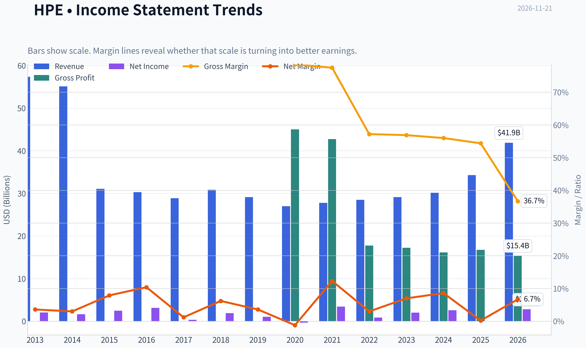

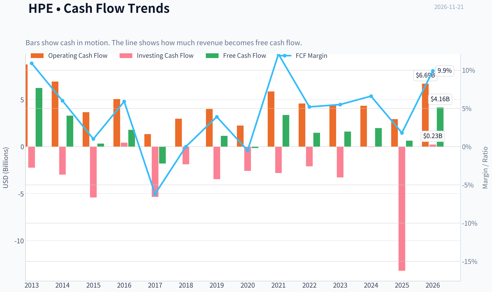

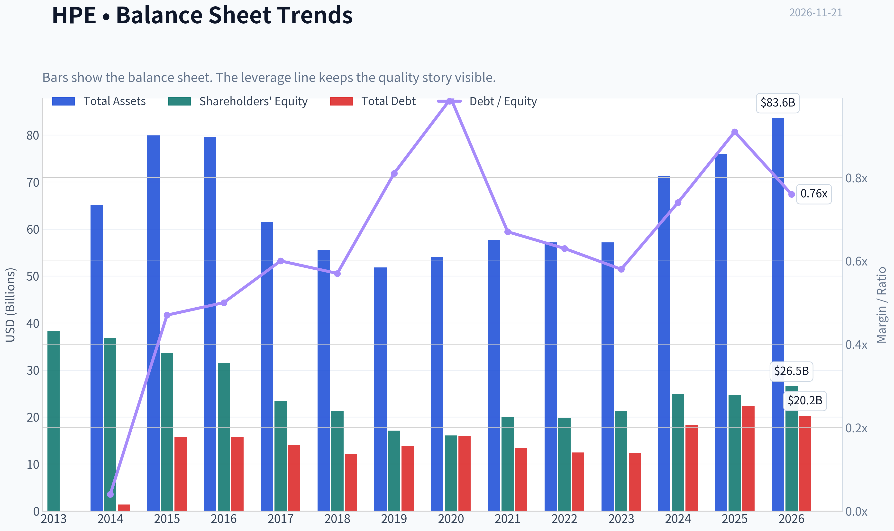

This graph tracks the profitability and return metrics (ROE, ROIC, Margins) of **HPE** over the past decade, highlighting capital efficiency trends.

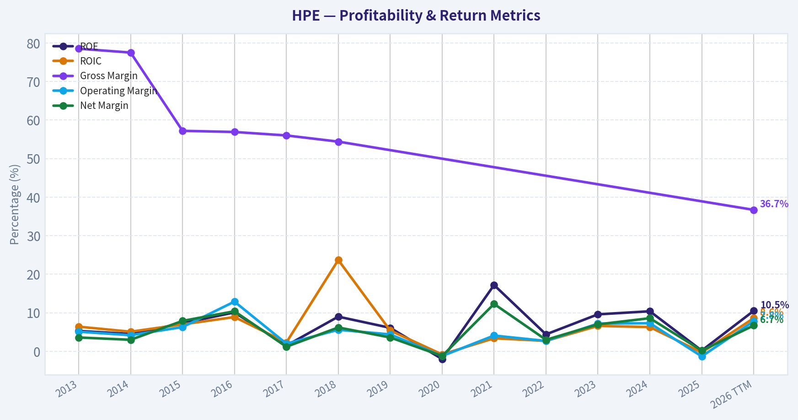

This chart illustrates the financial health of **HPE** over the last 10 years, mapping cash equivalents and free cash flow against total obligations (Debt).

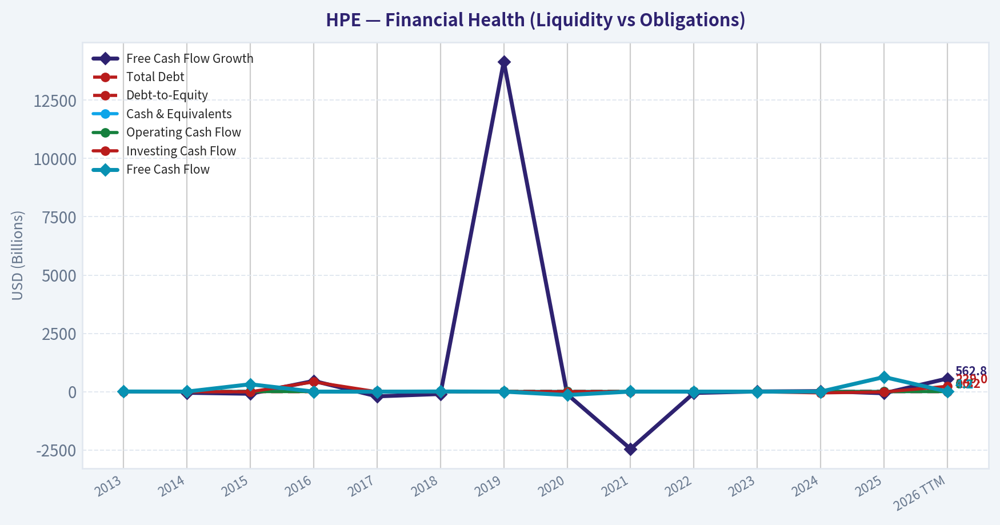

---

### Intrinsic Value Analysis (Buffett)

> *Following Warren Buffett's value investing philosophy: Circle of Competence, Economic Moat, Management Quality, and Margin of Safety.*

#### Intrinsic Value Snapshot

Price is what you pay. Intrinsic value is what the business may be worth based on the cash it can create for owners over time. We show a range, not one magic number.

- Current Price: $40.91
- Value Range (conservative to optimistic across both DCF methods): $-9.10 to $120.19

##### Owner Earnings (Buffett Method)
- Net Income: $57,000,000.00
- Depreciation & Amortization: $2,737,000,000.00
- Capital Expenditures: $-2,292,000,000.00
- Working Capital Changes: $-2,707,000,000.00
- Owner Earnings: $-986,230,000.00

##### Intrinsic Value
###### Buffett Method
Uses owner earnings. Stricter, and usually more conservative.
- Conservative: $12.41
- Average: $17.73
- Optimistic: $30.63
- Discount Rate: 8.4%

###### Cash Flow Method
Uses free cash flow. Better for companies spending heavily today to grow tomorrow.
- Conservative: $-9.10
- Average: $41.01
- Optimistic: $120.19
- Discount Rate: 9.2%

ANALYST STANCE: **Bearish**

#### Executive Summary

Hewlett Packard Enterprise is a recognizable enterprise-technology provider benefiting from demand for servers, networking, and AI infrastructure. However, the current valuation of approximately **$41 per share** is substantially above the DeepValues Buffett owner-earnings estimate of **$17.73**, while the company carries approximately **$14 billion of net debt**.

The business has strategic relevance and a potentially attractive AI-infrastructure runway, but the available cash-flow economics do not yet justify the market price. The weighted Buffett score is **2.4 out of 5.0**, placing HPE in the Bearish category under the stated framework.

#### Factor Scorecard

| Factor | Score | Assessment |
|---|---:|---|
| 1. Circle of Competence & Simplicity | 3.0/5 | Enterprise hardware, networking, services, and financing are understandable, but the business mix and technology cycle add complexity. |
| 2. Moat | 2.5/5 | Established relationships, installed base, distribution, and switching friction provide a narrow moat, but hardware competition limits pricing power. |
| 3. Management & Capital Allocation | 3.0/5 | No clear evidence of severe governance or accounting problems; capital-allocation quality is constrained by debt and modest cash-flow returns. |
| 4. Industry Structure | 3.0/5 | Enterprise infrastructure has scale benefits and recurring customer relationships, but competition is strong and product cycles require continual investment. |

**Gate 5 hard floor:** **Not tripped.** The available data does not show both a clearly worsening earnings and cash-flow trajectory plus a solvency red line such as interest coverage below 1.0 times. Balance-sheet pressure is a material concern, but not a demonstrated distress condition.

#### Moat Analysis

HPE's moat is best characterized as **narrow and stable**, rather than wide and widening.

- **Switching costs:** Enterprise customers often integrate HPE servers, networking, storage, and services into established workflows. Replacing infrastructure can involve operational risk, migration expense, and compatibility issues.
- **Scale and distribution:** HPE benefits from global enterprise distribution, procurement relationships, technical support, and a large installed base.
- **Intangible assets:** The HPE brand has credibility in enterprise technology, but it does not appear to possess consumer-style pricing power.
- **Network effects:** Network effects are limited compared with platform companies. HPE's value is primarily derived from installed infrastructure, service relationships, and interoperability.
- **Technology exposure:** AI infrastructure and high-performance computing create growth opportunities, but the same markets attract intense competition and require significant capital investment.
- **Financial evidence:** Gross margin was not provided, ROE was only **0.2%**, and FCF yield was **1.2%**. These figures do not demonstrate exceptional economic returns at the current valuation.

#### Management Quality and Capital Allocation

Management appears to be operating within a difficult capital-allocation environment. HPE must balance investment in infrastructure growth, acquisitions or partnerships, shareholder distributions, and debt reduction.

The principal concern is not evidence of dishonesty; rather, it is whether retained capital can generate sufficiently high per-share returns. The company's **$20.2 billion of debt**, against **$6.2 billion of cash**, leaves approximately **$14.0 billion of net debt**. That financial structure reduces the equity value attributable to future operating cash flows.

A recent filing showed Steve Cohen's Point72 increasing its HPE holdings by approximately **2.3%** as of September 30, 2026. This is an observation about institutional activity, not evidence that the underlying valuation is attractive.

#### Financial Summary

| Metric | Latest reported figure |
|---|---:|
| Share price | $41.00 |
| Market capitalization | $54.31B |
| P/E ratio | 21.1x |
| Revenue growth, year over year | 13.8% |
| ROE | 0.2% |
| FCF yield | 1.2% |
| Cash | $6.2B |
| Debt | $20.2B |
| Net debt | $14.0B |
| Shares outstanding | 1.449B |
| After-tax operating income | $2.4B |
| Operating income | $2.6B |
| D&A | $3.5B |
| Reported capex | $2.5B |
| Owner-earnings capex charge | $3.4B |
| Working-capital adjustment | $0.0B |

**Key Takeaways:** HPE is growing revenue rapidly, but the reported ROE is exceptionally weak and the FCF yield is low. Debt materially reduces the equity value of the operating business, while the owner-earnings calculation produces only about $2.5 billion of annual economic earnings.

#### Owner Earnings Calculation

| Owner-earnings component | Amount |
|---|---:|
| After-tax operating income | $2.4B |
| Add: depreciation and amortization | $3.5B |
| Less: maintenance-capex charge | $(3.4B) |
| Less: working-capital increase | $0.0B |
| Estimated owner earnings | **$2.5B** |

The DeepValues methodology uses a three-year average capex-to-revenue relationship, producing a **$3.4 billion** capex charge rather than relying only on the latest reported capex of $2.5 billion. This is a prudent adjustment for a capital-intensive infrastructure business.

#### Three-Scenario DCF Valuation

The following scenarios are sensitivity checks. The required intrinsic value is the DeepValues Buffett owner-earnings value of **$17.73 per share**.

| Scenario | Key assumptions | Equity value | Per-share value |
|---|---|---:|---:|
| A. No growth | $2.5B owner earnings capitalized at 10%, less $14.0B net debt | $11.0B | $7.59 |
| B. GDP growth | 3% growth, 10% discount rate, less $14.0B net debt | $22.8B | $15.73 |
| C. DeepValues base case | Growth fades from 0% toward 2.5% terminal growth; 8.4% discount rate; less $14.0B net debt | $25.7B | **$17.73** |

**Key Takeaways:** Even the 3% growth scenario produces a value below the current price. The headline owner-earnings intrinsic value of $17.73 is less than half of the approximately $41 market price, indicating that the valuation requires substantially stronger cash-flow performance than the current owner-earnings base supports.

#### Margin of Safety Analysis

| Item | Value |
|---|---:|
| Current price | $41.00 |
| DeepValues intrinsic value | $17.73 |
| Conservative value range | $12.41 |
| Optimistic value range | $30.63 |
| Margin of safety versus current price | **-130.7%** |
| Current price premium to base intrinsic value | Approximately 131% |

For a business with a narrow moat, low reported ROE, meaningful net debt, and cyclical infrastructure exposure, the valuation would ordinarily require a substantial margin of safety. Instead, the current price is above even the optimistic owner-earnings value of $30.63.

The separate FCF DCF produces a base estimate of $41.01, but its results range from negative $9.10 to $120.19 and are highly sensitive to assumptions. The Buffett owner-earnings framework is more conservative and better reflects the ongoing capital requirements of HPE's business.

#### Final Buffett Scorecard

| Criterion | Weight | Score | Weighted contribution |
|---|---:|---:|---:|
| Moat width and durability | 25% | 2.5 | 0.63 |
| Valuation and margin of safety | 20% | 1.0 | 0.20 |
| Capital returns versus WACC | 15% | 2.5 | 0.38 |
| Business understanding and predictability | 12% | 3.0 | 0.36 |
| Management quality and capital allocation | 12% | 3.0 | 0.36 |
| Reinvestment runway | 8% | 3.0 | 0.24 |
| Balance-sheet strength | 4% | 2.0 | 0.08 |
| Industry structure | 4% | 3.0 | 0.12 |
| **Total** | **100%** |  | **2.36/5.00** |

**Key Takeaways:** HPE scores reasonably on business familiarity, strategic relevance, and reinvestment opportunity. Those positives are outweighed by weak current returns, net debt, limited pricing power, and a valuation far above the owner-earnings intrinsic value.

#### Investment Stance

**ANALYST STANCE: Bearish**

**Conviction: High.**

HPE is not shown to be in financial distress, and its AI-infrastructure exposure could improve future growth. Nevertheless, the current valuation requires a much stronger and more durable cash-flow outcome than the present owner-earnings evidence supports. The evidence does not support a $41 valuation under a conservative Buffett-style assessment.
#### Valuation Bridge

This bridge places the current market price beside each intrinsic value lens so readers can see whether upside depends on one method or shows up across several methods.

| Scenario | Intrinsic Value / Share |
| --- | ---: |
| Buffett Method | $17.73 |
| Cash Flow Method | $41.01 |
| Current Price | $40.91 |

#### Key Takeaways

If one method is far above the others, the upside case depends on a specific modelling assumption. When several methods cluster together, the valuation story is more robust.

#### Valuation Visuals

This comparison chart from *Latest Earnings Snapshot* stacks current figures against historical benchmarks for **HPE**, making it easy to see where the company trades relative to its own averages.

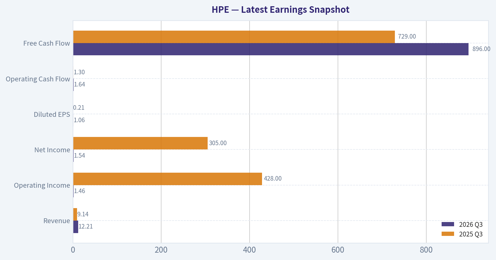

This comparison chart from *Current Metrics Versus Ten-Year Averages* stacks current figures against historical benchmarks for **HPE**, making it easy to see where the company trades relative to its own averages.

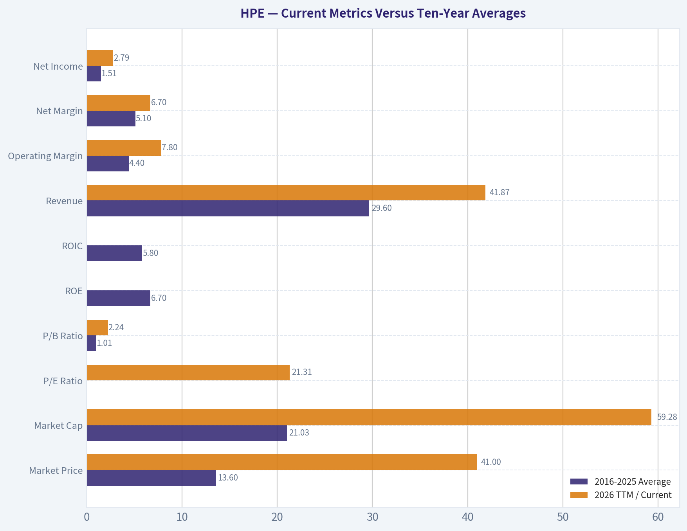

This comparison chart from *Balance Sheet and Financial Strength* stacks current figures against historical benchmarks for **HPE**, making it easy to see where the company trades relative to its own averages.

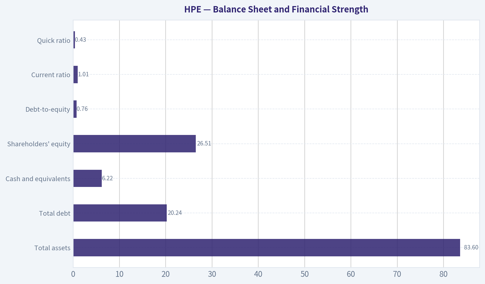

The following chart maps the **HPE** Owner Earnings DCF valuation scenarios (Conservative, Average, Optimistic) to visually represent the margin of safety based on intrinsic value calculations.

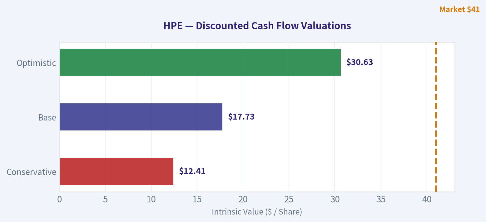

This comparison chart from *Financial Summary* stacks current figures against historical benchmarks for **HPE**, making it easy to see where the company trades relative to its own averages.

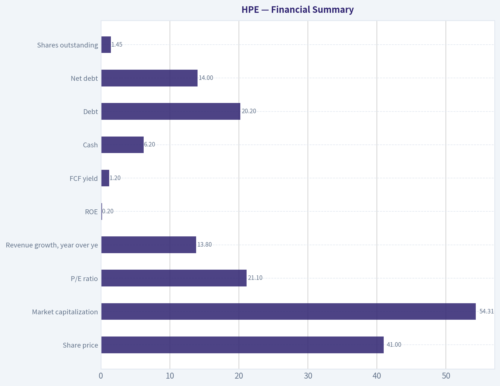

This comparison chart from *Owner Earnings Calculation* stacks current figures against historical benchmarks for **HPE**, making it easy to see where the company trades relative to its own averages.

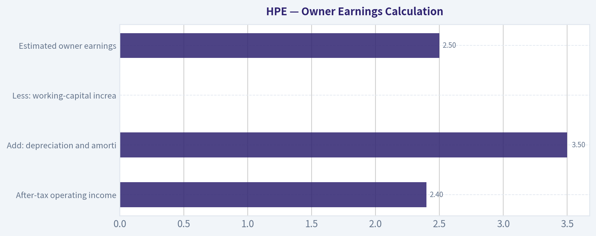

---

### Trend & Growth Analysis (Lynch/Druckenmiller/Fisher)

> *Following Peter Lynch's GARP, Stanley Druckenmiller's macro-aware approach, and Philip Fisher's scuttlebutt methodology.*

ANALYST STANCE: **Bearish**

#### Executive Summary

HPE is a cyclical technology infrastructure company experiencing a meaningful revenue rebound, but the evidence does not yet establish a durable high-growth inflection. Revenue growth is improving, particularly from AI infrastructure and networking, yet leverage, weak recent profitability, inconsistent free cash flow, and a large gap between market price and the primary intrinsic-value estimate materially reduce the ten-bagger case.

#### 1. Lynch Classification

**Classification: Cyclical with a temporary fast-growth phase**

HPE does not fit the durable "fast grower" category because its five-year revenue CAGR is only 4.9%, while its recent acceleration appears heavily connected to enterprise infrastructure and AI spending cycles. The latest 13.8% year-over-year growth is encouraging, but a sustained 20%-25% organic growth trajectory has not been demonstrated.

#### 2. The Story in Three Bullets

- HPE supplies servers, networking, storage, and services that benefit from cloud modernization, AI workloads, and enterprise data-center investment.
- The company has a credible opportunity to gain from AI infrastructure demand, particularly through high-performance computing and networking.
- The valuation requires substantially stronger and more durable cash generation than the primary owner-earnings valuation currently supports.

#### 3. Operating Snapshot

| Metric | HPE |
|---|---:|
| Current price | $40.91 |
| Market capitalization | $54.31B |
| Latest reported revenue growth | 13.8% YoY |
| Five-year revenue CAGR | 4.9% |
| TTM revenue | $41.87B |
| TTM operating margin | 7.8% |
| TTM net margin | 6.7% |
| TTM free cash flow | $4.16B |
| TTM FCF margin | 9.9% |
| Total debt | $20.24B |
| Cash and equivalents | $6.22B |
| Net debt | Approximately $14.0B-$16.6B |
| Forward P/E | 8.64x |
| Price-to-sales | 1.30x |
| Primary intrinsic value | $17.73 per share |

**Key Takeaways:** HPE's recent revenue and free-cash-flow figures have improved, but its historical growth profile remains modest. The company carries substantial net debt, and the primary intrinsic-value estimate of $17.73 is well below the current price of $40.91.

#### 4. TAM Analysis and the 10x Test

HPE participates in several large markets: enterprise servers, networking, storage, hybrid cloud, high-performance computing, and AI infrastructure. These markets are sizeable and some, especially AI networking and accelerated computing, are expanding rapidly.

The key issue is not market size but HPE's ability to convert AI demand into durable, high-margin economics. A tenfold increase from approximately $41.9B of revenue would imply roughly $419B of annual revenue. That could remain below the combined global infrastructure TAM, but it would require HPE to become a far more dominant participant across multiple categories rather than simply benefit from a cyclical upgrade cycle.

| TAM Test | Assessment |
|---|---|
| Current revenue base | Approximately $41.9B |
| 10x revenue requirement | Approximately $419B |
| Market size | Large and expanding across AI, networking, and hybrid cloud |
| 10x feasibility | Technically possible at combined-market level |
| Required condition | Sustained share gains and durable AI infrastructure economics |
| Current evidence | Incomplete |

**Key Takeaways:** HPE has a large addressable market, and the 10x test does not fail on market size alone. However, the company would need significant share gains and stronger margins across several businesses; current evidence supports a cyclical recovery more clearly than a ten-bagger trajectory.

#### 5. Revenue Growth Trend

| Period | Revenue growth |
|---|---:|
| Five-year CAGR | 4.9% |
| Three-year CAGR | 6.4% |
| FY2025 growth | 13.8% |
| Latest TTM data set | 13.8% reported in the shared pack; 22.1% in the tool output |
| Historical pattern | Generally low single-digit growth with periodic declines |

**Key Takeaways:** Growth has accelerated from HPE's historical low-single-digit trend, which is a positive inflection signal. However, the available data is inconsistent on the latest TTM growth rate, and the multi-year record does not yet confirm sustained acceleration. The stronger interpretation is "improving but unproven."

#### 6. Unit Economics and Efficiency

| Metric | Result | Interpretation |
|---|---:|---|
| LTV/CAC | Not disclosed | Not applicable to HPE's hardware-led model |
| Net revenue retention | Not disclosed | Services mix may support recurring revenue, but data is unavailable |
| Revenue growth plus FCF margin | 23.7% using 13.8% growth | Below the 40% SaaS benchmark |
| Gross margin | 36.7% in TTM tool data | Moderate for a technology infrastructure provider |
| Operating margin | 7.8% TTM tool data | Positive, but not exceptional |
| FCF yield | 1.2% in shared data | Low relative to balance-sheet risk |

**Key Takeaways:** Traditional SaaS metrics such as LTV-to-CAC and NRR are not meaningful for HPE and are not disclosed in a comparable form. HPE's growth-plus-FCF result is well below the Rule of 40 benchmark, indicating that current growth is not accompanied by exceptional cash efficiency.

#### 7. Inflection Point Assessment

| Potential inflection | Evidence | Assessment |
|---|---|---|
| Product cycle | AI servers, high-performance computing, and networking demand | Positive |
| Market share | No verified sustained share acceleration provided | Unproven |
| Margin expansion | Operating margin is positive, but recent profitability data is inconsistent | Unproven |
| TAM expansion | AI infrastructure materially expands the opportunity | Positive |
| Competitive disruption | No clear evidence of a major competitor breakdown | Neutral |
| Cash-flow inflection | TTM FCF improved, but historical volatility is high | Mixed |

**Key Takeaways:** The strongest inflection is the expansion of AI infrastructure demand and HPE's exposure to networking and high-performance computing. The missing evidence is durable market-share gain and sustained margin expansion. This makes the setup promising at the industry level but insufficiently proven at the company level.

#### 8. Macro Setup

- **Secular trend:** Positive exposure to AI infrastructure, hybrid cloud, networking, and data-center modernization.
- **Interest rates:** The 30-year Treasury yield near 5.4% creates a valuation headwind for long-duration growth assets and raises HPE's financing burden.
- **Economic sensitivity:** Enterprise hardware spending is cyclical and can weaken when IT budgets tighten.
- **Druckenmiller assessment:** The thematic wind is favorable, but the macro environment is not an unambiguous tailwind because rates are high and infrastructure spending may be uneven.

#### 9. Fisher's 15-Point Assessment

| Fisher criterion | Score / 5 | Evidence |
|---|---:|---|
| Sizable market potential | 4 | Large infrastructure and AI markets |
| Management product determination | 3 | AI and hybrid-cloud focus, limited direct evidence |
| R&D effectiveness | 3 | Product breadth, but no detailed R&D returns |
| Sales organization | 4 | Established enterprise distribution |
| Worthwhile profit margins | 3 | Positive but modest operating margin |
| Improving margins | 2 | Not sufficiently established |
| Labor relations | 3 | No major adverse evidence supplied |
| Executive relations | 3 | No major adverse evidence supplied |
| Management depth | 4 | Large global operating platform |
| Cost analysis/accounting | 3 | Balance-sheet and cash-flow quality require scrutiny |
| Outstanding moat characteristics | 3 | Relationships and integration, but intense competition |
| Long-range profit outlook | 3 | Attractive market, uncertain economics |
| Dilution risk | 2 | Data indicates no-dilution test failure |
| Management candor | 3 | Insufficient evidence |
| Management integrity | 3 | Insufficient evidence |

| Total Fisher score | Classification |
|---:|---|
| **46 / 75** | **Average** |

**Key Takeaways:** HPE benefits from scale, enterprise relationships, and exposure to large markets. Its score is held back by uncertain margin progression, leverage, dilution concerns, and limited evidence that AI demand will translate into superior long-term returns on capital.

#### 10. Valuation Analysis

| Valuation measure | Result | Interpretation |
|---|---:|---|
| TTM P/E | 21.1x | Reasonable only if earnings normalize and grow |
| Forward P/E | 8.6x | Appears inexpensive, but depends on forecast earnings |
| PEG | 0.36 | Potentially attractive, but distorted by the choice of growth rate and cyclical earnings |
| Price-to-sales | 1.30x | Moderate for infrastructure hardware |
| EV/EBITDA | 9.94x | Not distressed given leverage and cyclicality |
| Primary owner-earnings value | $17.73 | Materially below market price |
| Primary valuation range | $12.41-$30.63 | Entire range below current price |
| Secondary FCF DCF base case | $41.01 | Close to current price, but highly assumption-sensitive |

**Key Takeaways:** Traditional multiples make HPE appear inexpensive, especially on forward earnings. However, the PEG ratio is not reliable enough to override the company's cyclicality and cash-flow volatility. The primary owner-earnings valuation implies the market price is substantially above fundamental value, while the secondary FCF cross-check is much more favorable but less dependable.

#### 11. Valuation Sensitivity

| Scenario | Main assumption | Per-share value |
|---|---|---:|
| Conservative owner earnings | Low or zero growth, higher risk adjustment | $12.41 |
| Base owner earnings | Approximately 0% near-term growth, 2.5% terminal growth | $17.73 |
| Optimistic owner earnings | Better operating normalization | $30.63 |
| Base FCF DCF cross-check | Stronger sustained FCF conversion | $41.01 |
| Current market price | Current quotation | $40.91 |

**Key Takeaways:** The valuation range is unusually wide because HPE's cash flows are cyclical and sensitive to capital spending, working capital, and margin assumptions. At $40.91, the market price requires a substantially stronger outcome than the primary owner-earnings model assumes. The valuation evidence therefore does not support the current price with a sufficient margin of safety.

#### 12. Growth Investor Scorecard

| Criterion | Weight | Score / 5 | Weighted contribution |
|---|---:|---:|---:|
| The story | 10% | 3.5 | 0.35 |
| TAM and runway | 20% | 3.5 | 0.70 |
| Revenue growth | 20% | 3.0 | 0.60 |
| Unit economics | 15% | 2.5 | 0.38 |
| Competitive position | 10% | 3.0 | 0.30 |
| Management quality | 10% | 3.0 | 0.30 |
| Macro setup | 5% | 3.0 | 0.15 |
| Profitability path | 5% | 2.5 | 0.13 |
| Valuation | 5% | 1.5 | 0.08 |
| **Total** | **100%** |  | **2.99 / 5.00** |

**Key Takeaways:** HPE scores well on market relevance and thematic exposure but poorly on valuation support and proven growth quality. The aggregate score falls just below the threshold for a watch classification and well below the level associated with a high-conviction growth compounder.

#### 13. Key Catalysts and Risks

| Catalysts | Risks |
|---|---|
| Sustained AI server and networking demand | AI infrastructure spending proves cyclical or competitive |
| Accelerating revenue beyond the current rebound | Revenue growth decelerates back toward the historical mid-single digits |
| Operating leverage from higher utilization | Margins remain structurally modest |
| Improved free-cash-flow conversion | Working-capital volatility and high capital requirements |
| Debt reduction | Net debt constrains equity value |
| Demonstrated market-share gains | Strong competition from Dell, Lenovo, Cisco, hyperscalers, and specialized vendors |

**Key Takeaways:** The primary catalysts are sustained AI demand, operating leverage, and debt reduction. The principal risks are that the current revenue acceleration is cyclical, margins fail to expand, or debt absorbs much of the value created by stronger operations.

#### Bottom Line

HPE has a credible AI infrastructure story and a large TAM, but it currently resembles a cyclical infrastructure beneficiary rather than a proven fast-growing compounder. Revenue momentum is encouraging, yet the long-term growth record, balance sheet, cash-flow quality, and primary intrinsic-value estimate do not support the current valuation.

---

### Market Technical Analysis

ANALYST STANCE: **Neutral**

#### HPE technical overview

Hewlett Packard Enterprise (NYSE: HPE) closed at **$40.91 on November 20, 2026**, the latest available trading session. November 21 was not a trading day. The stock has experienced a sharp deterioration from its October 9 closing high of **$73.46**, a decline of approximately **44.3%**.

The latest move also shows acceleration: HPE fell from **$45.49 on November 19 to $40.91 on November 20**, a one-day decline of roughly **10.1%**. That close occurred near the day's low of $40.48, indicating that sellers retained control through most of the session rather than the decline being fully recovered intraday.

#### Trend structure

HPE is trading substantially below its short- and medium-term averages:

- The **10-day EMA is $46.49**, placing the close about **12.0% below** this responsive trend measure.
- The **50-day SMA is $57.65**, approximately **29.0% above** the latest close.
- The **200-day SMA is $42.58**, approximately **4.1% above** the latest close.

The 10-day EMA has fallen from approximately $59.87 on October 22 to $46.49, while the 50-day SMA has declined more gradually from $59.39 to $57.65. This combination indicates that short-term momentum has weakened much faster than the broader intermediate trend.

The 200-day SMA is still rising, from approximately $39.53 on October 22 to $42.58 on November 20. That upward slope means the longer historical trend has not fully reversed, but the latest close below the 200-day average is a significant deterioration. A sustained period below that average would carry more weight than a single session because it would indicate that the long-term trend benchmark is no longer functioning as a reliable floor.

#### Momentum and MACD

The MACD reading was **-3.90 on November 20**, compared with **-0.88 on October 22**. It became progressively more negative during the recent decline, especially after early November. This shows that downside momentum has not merely persisted; it has deepened.

There was a brief improvement in MACD momentum between November 6 and November 13, when the reading moved from approximately **-3.69 to -3.44**. That improvement was not sustained. MACD subsequently deteriorated to **-3.50 on November 16** and **-3.90 by November 20**, aligning with the latest breakdown in price.

Because the supplied report does not include the MACD signal line or histogram, crossover confirmation is unavailable. Even so, the direction and magnitude of the MACD reading are clearly bearish and provide little evidence of an established momentum reversal.

#### RSI and oversold conditions

The **RSI was 29.34 on November 20**, just below the conventional 30 oversold threshold. RSI had already been weak for much of November, reaching approximately 29.64 on November 5 before recovering toward 42 by November 12. The subsequent decline back toward 29 indicates that the earlier momentum improvement failed.

The oversold reading is important but not independently bullish. It shows that selling has become statistically extended over the recent lookback period, yet RSI can remain below 30 during a persistent downtrend. Here, the oversold condition is occurring alongside a negative MACD, a falling 10-day EMA, and a close below the 200-day SMA. That combination suggests stress and exhaustion risk, but it does not by itself establish a durable reversal.

#### Bollinger Bands and volatility

The latest **Bollinger lower band was $38.73**, placing the close only **$2.18, or about 5.6%, above** that band. HPE therefore sits near the lower boundary of its recent volatility envelope. The upper band was $61.89, producing a very wide band range of approximately $23.15.

The lower band has fallen sharply from approximately $51.87 on October 22 to $38.73. This decline reflects both falling prices and elevated dispersion. The close remaining above the lower band means the stock has not experienced a decisive lower-band breach on the latest session, but its proximity to that boundary confirms that downside pressure is unusually strong.

The band width has remained wide rather than contracting. That matters because a wide band indicates an unstable, high-volatility regime rather than a quiet consolidation. Price movements near the lower band can represent either exhaustion or continuation; the surrounding trend and momentum indicators currently lean toward continuation risk rather than a confirmed mean-reversion phase.

#### Volatility and trading behavior

The **ATR was $3.53** on November 20, equivalent to approximately **8.6% of the closing price**. Although ATR declined modestly from $3.87 on November 5, it remains elevated relative to the stock's current price. The recent daily ranges remain large, including a November 20 range of $4.36 from high to low.

The combination of a falling price and elevated ATR indicates that uncertainty remains high. A lower ATR by itself would not necessarily signal stabilization because volatility can temporarily contract during pauses within a broader decline. The price trend, RSI, MACD, and moving-average placement should therefore receive more weight than the modest ATR easing.

#### Valuation implications from the technical evidence

The technical evidence describes a market undergoing a substantial repricing rather than a normal pullback. The decline from the October peak, the negative MACD, the loss of the 200-day SMA, and the proximity to the lower Bollinger Band all indicate that market participants are demanding a materially different risk assessment than they did several weeks earlier.

At the same time, RSI near 30 and the price's proximity to the lower band show that the decline is becoming statistically stretched. This creates a two-sided interpretation: the stock may be vulnerable to continued weakness because trend confirmation is negative, while short-term rebound potential exists because selling pressure is extended. Technical indicators alone do not establish fundamental fair value, and the current evidence does not validate any particular valuation level without confirmation from earnings, cash flow, balance-sheet, and forward-estimate analysis.

#### Selected indicators

The selected set uses eight complementary indicators: three trend measures, one momentum oscillator, one momentum derivative, two volatility-band boundaries, and ATR. The 10-day EMA captures immediate direction; the 50- and 200-day averages separate intermediate from long-term trend; MACD measures directional momentum; RSI identifies momentum exhaustion; Bollinger boundaries contextualize the price within current dispersion; and ATR measures the magnitude of daily risk.

| Indicator | Latest reading | Interpretation for HPE |
|---|---:|---|
| Close | $40.91 | Latest close on November 20; down about 44.3% from the October 9 close |
| 10-day EMA | $46.49 | Price is about 12.0% below the short-term trend average |
| 50-day SMA | $57.65 | Price is about 29.0% below the intermediate trend average |
| 200-day SMA | $42.58 | Price is about 4.1% below the long-term benchmark |
| MACD | -3.90 | Strongly negative; downside momentum intensified from late October |
| RSI | 29.34 | Slightly oversold, but consistent with persistent bearish momentum |
| Bollinger upper band | $61.89 | Wide distance from price reflects a high-dispersion regime |
| Bollinger lower band | $38.73 | Close is near the lower band, indicating extended downside pressure |
| ATR | $3.53 | Daily volatility equals roughly 8.6% of the latest closing price |

Key Takeaways: HPE's short- and intermediate-term trends are decisively negative, while the latest close has slipped below the rising 200-day average. RSI near 30 and the close near the lower Bollinger Band show that the decline is stretched, but MACD and moving-average signals do not yet confirm a durable reversal. The evidence therefore supports a watch stance: the market is signaling elevated repricing risk and high volatility, while technical oversold conditions create uncertainty about the timing and persistence of further moves.

---

### Options Market Analysis

> *Reading options flow - put/call ratios, IV skew, and unusual activity - to gauge institutional positioning and event-driven risk.*

ANALYST STANCE: **Bullish**

#### HPE Options Market Overview

Data is for November 21, 2026, covering expirations from November 27 through December 11. The options feed does not provide HPE's current share price, so strike moneyness and exact distance from the underlying cannot be confirmed.

| Expiration | Call OI | Put OI | Call Volume | Put Volume | Put/Call OI | ATM Call IV | ATM Put IV |
|---|---:|---:|---:|---:|---:|---:|---:|
| Nov. 27, 2026 | 13,016 | 8,205 | 5,521 | 3,920 | 0.63 | 127.5% | 132.2% |
| Dec. 4, 2026 | 6,775 | 3,547 | 1,117 | 1,008 | 0.52 | 113.5% | 106.4% |
| Dec. 11, 2026 | 5,469 | 5,479 | 356 | 654 | 1.00 | 103.6% | 103.7% |
| **Total / weighted view** | **25,260** | **17,231** | **6,994** | **5,582** | **0.68** | - | - |

**Key Takeaways:** HPE's aggregate put/call open-interest ratio is 0.68, essentially in line with the historical neutral reference level of approximately 0.70, but slightly more call-heavy. The volume ratio is 0.80, also indicating modestly greater call activity. The nearest expiration has the strongest call imbalance, while the December 11 expiration is neutral to mildly defensive.

#### Put/Call Ratio Analysis

| Measure | HPE Reading | Neutral Reference | Interpretation |
|---|---:|---:|---|
| Near-term put/call OI ratio | 0.68 | ~0.70 | Slightly call-heavy, broadly neutral-to-bullish |
| Near-term put/call volume ratio | 0.80 | ~0.70 | Mildly more call activity, but not an extreme signal |
| Nov. 27 OI ratio | 0.63 | ~0.70 | Most bullish-leaning expiration |
| Dec. 4 OI ratio | 0.52 | ~0.70 | Strongest call concentration |
| Dec. 11 OI ratio | 1.00 | ~0.70 | Balanced OI with relatively greater put volume |

**Key Takeaways:** The aggregate ratios do not indicate broad downside hedging or bearish speculation. The call-heavy open interest is a modest positive signal, although the difference from the neutral baseline is not large enough to indicate overwhelming conviction. The later expiration's 1.00 ratio shows that bullishness is concentrated in the nearer dates rather than uniformly distributed across the curve.

#### Implied Volatility Assessment

| Expiration | ATM Call IV | ATM Put IV | Put Minus Call IV | Assessment |
|---|---:|---:|---:|---|
| Nov. 27 | 127.5% | 132.2% | +4.7 percentage points | Elevated short-dated downside skew |
| Dec. 4 | 113.5% | 106.4% | -7.1 percentage points | Call IV exceeds put IV |
| Dec. 11 | 103.6% | 103.7% | +0.1 percentage points | Essentially balanced |
| **Curve view** | - | - | - | Very high near-term IV, declining with maturity |

**Key Takeaways:** Implied volatility is extremely high across all listed expirations, with the highest readings in the November 27 contracts. The first expiration shows a modest put skew, indicating demand for near-term downside protection, but the December 4 curve instead shows a call skew. A known catalyst is not supplied in the data, so the source of the elevated event risk cannot be confirmed.

#### Unusual Options Activity

| Expiration | Type | Strike | Volume | Open Interest | Volume/OI | IV | Interpretation |
|---|---|---:|---:|---:|---:|---:|---|
| Nov. 27, 2026 | Call | $42.50 | 501 | 1 | 501.0x | 123.1% | Likely fresh call activity; directional upside speculation or upside hedging |

**Key Takeaways:** The $42.50 call is the only contract flagged as unusually active, with 501 contracts traded against one contract of existing open interest. That strongly suggests newly initiated activity, although the available data cannot determine whether trades were bought or sold to open. Because HPE's current price is unavailable, the contract's ITM, ATM, or OTM status cannot be verified; institutional versus retail origin also cannot be established from volume and open interest alone.

#### Open Interest Concentration and Gamma Levels

| Expiration | Largest Available OI Concentration | Total Call OI | Total Put OI | Potential Effect |
|---|---|---:|---:|---|
| Nov. 27 | Strike-level concentration not provided | 13,016 | 8,205 | Near-term call-heavy structure may create upside interest, but exact gamma wall is unknown |
| Dec. 4 | Strike-level concentration not provided | 6,775 | 3,547 | Call-heavy OI could contribute to upside pinning or support near major strikes |
| Dec. 11 | Strike-level concentration not provided | 5,469 | 5,479 | Balanced OI suggests less directional expiration pressure |

**Key Takeaways:** The expiration-level data shows the largest open-interest pool in the November 27 contracts, followed by December 4. However, strike-by-strike open interest is not available, so exact gravitational levels, maximum pain, and gamma walls cannot be identified reliably. The nearest expiration is the most likely to influence short-term price behavior, but the direction and strength of that effect remain uncertain without strike-level data and dealer-gamma information.

#### Overall Options Sentiment Signal

| Factor | Signal | Confidence |
|---|---|---|
| Put/call OI | Mildly bullish versus neutral | Moderate |
| Put/call volume | Mildly call-favorable | Low to moderate |
| IV level | Very elevated | Moderate |
| IV skew | Mixed: near-term put skew, Dec. 4 call skew | Low |
| Unusual activity | One highly unusual $42.50 call | Moderate, but trade direction unconfirmed |
| Overall | **BULLISH** | **Moderate-low** |

**Key Takeaways:** The overall read is bullish, primarily because call open interest and volume exceed put activity and the only flagged unusual contract is a near-term call. Confidence is reduced by the mixed volatility skew, exceptionally high implied volatility, absent current-price data, and the inability to determine whether the unusual call trades were bought or sold. The evidence supports a modestly bullish options-market interpretation, not a high-conviction directional signal.

#### Summary

| Category | Finding |
|---|---|
| Put/Call Ratio | OI ratio 0.68 and volume ratio 0.80; slightly call-heavy and close to neutral |
| IV Level | Very elevated; ATM IV ranges from approximately 103.6% to 132.2% |
| Skew Direction | Mixed: modest near-term put skew, but call skew in the December 4 expiration |
| Unusual Activity | Nov. 27 $42.50 call, 501 contracts traded versus 1 open-interest contract |
| Overall Signal | **BULLISH**, with moderate-low confidence |

**Key Takeaways:** HPE's options market leans bullish, but the signal is not extreme because the aggregate ratios remain near neutral and volatility is unusually high. The strongest evidence is the concentration of near-term call activity and the isolated high-volume call contract. Missing spot-price, strike-level, and trade-direction data limits confidence in the interpretation.

---

## Research Team Commentary

> *The Research Manager synthesizes the Bull vs Bear debate into action-free commentary. This is a pre-risk view, not the final stance.*

Core Takeaway: HPE has credible strategic assets and exposure to durable AI, networking, and hybrid-cloud demand, but the evidence does not yet show that these advantages generate consistently attractive shareholder economics. At $40.91 and roughly 21.1 times earnings, the valuation appears to assume meaningful improvement in cash generation and returns on capital. That improvement is plausible, but it is not established by the supplied data.

The strongest bull argument is that HPE is more than a generic server vendor. Its installed base, global support capabilities, enterprise procurement relationships, interoperability, and switching friction create a moderate moat. AI infrastructure and data-center modernization could strengthen that moat if HPE captures higher-value networking, integrated systems, software, and recurring service revenue. Revenue growth of 13.8% indicates that the demand opportunity is translating into sales.

The strongest bear argument is that sales growth has not been connected convincingly to economic value creation. The reported ROE of 0.2%, ROIC of 0.2%, and ROA of 0.1% would be incompatible with a quality-compounder valuation if they are accurate and representative. HPE's sophisticated customers retain considerable bargaining power, hardware refresh cycles invite competitive bidding, and AI equipment growth could require substantial working capital and engineering investment without producing durable pricing power. At approximately 21 times earnings, there is limited room for the transformation to remain merely aspirational.

One important caution is that the return data may have a scaling or classification problem. A value of "0.2" can sometimes mean 20% before percentage formatting, and the nearly identical low figures across ROE, ROIC, and ROA deserve validation. Acquisition accounting, goodwill, restructuring expenses, and integration costs could also depress reported measures. But possible distortion is not itself evidence of strong normalized returns. The analysis needs a reconciliation from reported earnings to owner earnings and from reported ROIC to cash-based incremental ROIC.

Rationale: From a Buffett perspective, HPE currently looks like a moderate-moat business attempting to improve its mix, rather than a demonstrated wonderful business. Scale, trusted enterprise relationships, and switching friction provide durability, but they do not confer platform-like network effects or obvious pricing power. The crucial distinction is between benefiting from AI spending and retaining the economics of that spending.

The valuation therefore carries more weight than the exciting industry narrative. The supplied P/E implies approximately $1.94 of earnings per share, but no DeepValues intrinsic-value estimate or normalized free-cash-flow figure was provided. For a competitively exposed and cyclical business, the framework would ordinarily require a substantially larger discount than the 10-15% suitable for a highly predictable, wide-moat compounder. No such discount has been demonstrated. A reverse-DCF interpretation suggests that the market is expecting durable mid-single-digit or better owner-earnings growth, dependable cash conversion, and improving capital efficiency. Those assumptions are achievable, but not conservative given the evidence available.

The bear case should not be overstated either. There is no supplied evidence of acute solvency stress, permanent demand impairment, or a clearly extreme valuation. HPE has real enterprise assets, and secular growth in data, AI workloads, high-performance computing, and hybrid infrastructure can support a long runway. If networking and recurring services become a larger share of gross profit, current accounting returns could understate future business quality. That keeps the conclusion from moving to the most negative stance.

Recent market weakness does not resolve the valuation question. Trading below the 10-, 50-, and 200-day averages may reflect uncertainty or deteriorating expectations, but it is not evidence of intrinsic value. Likewise, a 0.68 put/call open-interest ratio is essentially neutral and adds little to a ten-year business assessment.

The main lesson from similar infrastructure cases is to separate three propositions: the end market is expanding, HPE can participate, and HPE can earn excess returns on the capital required. The first is well supported, the second is credible, and the third remains unproven. The mistake would be to capitalize industry growth as though it automatically produces high-return owner earnings. The opposite mistake would be to treat potentially distorted accounting returns as definitive without validating the underlying cash economics.

Monitoring Plan: Over the next one to four quarters, the first priority is data verification. Reported ROE, ROIC, and ROA should be reconciled with their underlying numerator, denominator, and percentage convention. Normalized results should exclude clearly identified one-time restructuring and acquisition charges, while still recognizing genuine recurring integration and investment costs.

Second, free cash flow should be compared with net income over a rolling period. The thesis strengthens if free cash flow per share grows alongside revenue without persistent working-capital consumption, elevated inventory, or unusually favorable payment timing. It weakens if reported earnings repeatedly fail to convert into cash.

Third, incremental profitability matters more than headline growth. Gross margin, operating margin, and segment contribution from AI systems, networking, software, support, and recurring services should show whether HPE is capturing economic value rather than simply shipping more equipment. Rising revenue accompanied by flat or declining margins would support the bear interpretation.

Fourth, acquisition integration and capital allocation require close scrutiny. Evidence of realized cost synergies, organic growth in acquired operations, manageable leverage, and returns above the cost of capital would strengthen management's case. Repeated restructuring, impairment charges, rising net debt, or acquisition-driven growth without per-share cash improvement would weaken it.

Finally, recurring revenue and customer economics should be monitored. Growth in contracted services, retention, renewal rates, backlog conversion, and cross-selling would indicate that the installed base is becoming a stronger moat. Dependence on episodic hardware orders, customer concentration, or aggressive pricing would indicate that enterprise relationships provide retention but little pricing power.

Overall, HPE offers a credible transformation story but not yet a demonstrated margin of safety. The current valuation can be supported if management converts AI and networking demand into recurring cash flow and materially higher normalized returns. Until that conversion is visible and the questionable return metrics are reconciled, the most defensible conclusion is uncertainty rather than conviction.

Neutral

---

## Value Investing Team Commentary

> *The Investor translates the research view into an investment thesis before risk review. This is still not the final stance.*

### HPE: Value-Investing Commentary

HPE presents a credible but incomplete investment case. Its enterprise distribution, installed base, technical support, procurement relationships, and interoperability create meaningful durability. These assets can make HPE a dependable infrastructure partner even though they do not provide the same economic power as a dominant software platform or hyperscale cloud provider.

The central question is not whether HPE participates in AI and data-center growth. It almost certainly can. The more important question is whether that growth produces attractive returns on capital after accounting for hardware competition, working-capital requirements, engineering expense, integration costs, and customer bargaining power.

At approximately $40.91 and 21.1 times the supplied earnings figure, the valuation implies roughly $1.94 of earnings per share. That multiple is not obviously extreme for a business with durable growth, but HPE's reported profitability metrics do not currently justify treating it as a high-quality compounder. ROE, ROIC, and ROA figures near 0.1%-0.2% would indicate exceptionally weak economics if accurately measured. Their near-identical values also raise the possibility of a formatting, denominator, or data-classification issue. This uncertainty must be resolved rather than interpreted optimistically.

### Selective Contrarian Perspective

The negative market reaction may contain an opportunity in one specific sense: investors may be discounting HPE as a traditional, low-margin hardware vendor while the business gradually shifts toward higher-value networking, AI systems, software, and recurring services. If that mix change is real, current reported returns could understate future earning power. HPE does not need platform-company economics to create value; even a moderate improvement in recurring revenue, margins, and capital efficiency could materially strengthen the business.

However, contrarian reasoning should not confuse a depressed share price with undervaluation. The decline below the short- and intermediate-term moving averages may reflect deteriorating expectations rather than excessive pessimism. The options data are broadly neutral, with a 0.68 put/call open-interest ratio, so sentiment provides little independent evidence of either capitulation or optimism. Market weakness becomes fundamentally interesting only if operating performance remains sound and the valuation begins to discount a substantially worse outcome than the business's long-term economics warrant.

The strongest risk is that AI demand expands HPE's revenue without improving its economics. In infrastructure markets, volume growth can coexist with intense price competition, elevated inventory, customer concentration, and heavy investment requirements. HPE could therefore benefit from a large industry opportunity while capturing only modest shareholder returns. The distinction between shipping AI equipment and owning a durable portion of the AI profit pool is critical.

### Evidence That Would Improve the Thesis

The case would become materially stronger if HPE demonstrates:

- Sustained free-cash-flow growth that broadly tracks or exceeds earnings growth.
- Improving incremental margins in networking, AI systems, software, and services.
- Higher recurring revenue, renewal rates, and backlog conversion.
- Cash-based returns on invested capital comfortably above the cost of capital.
- Successful acquisition integration without recurring restructuring charges or rising leverage.
- Per-share cash-flow growth that does not depend primarily on acquisitions.

Conversely, persistent working-capital consumption, weak cash conversion, recurring impairments, margin compression, or acquisition-driven revenue without corresponding per-share economics would indicate that the growth narrative is not translating into durable value creation.

### Valuation Conclusion

The supplied information does not establish a DeepValues intrinsic-value estimate or a normalized owner-earnings figure, so the margin of safety cannot be quantified precisely. The current earnings multiple appears to require a meaningful improvement in cash generation and capital efficiency. That outcome is plausible, but it remains an expectation rather than a demonstrated result.

HPE is therefore best viewed as a moderate-moat infrastructure business undergoing a potentially valuable mix transition. The secular demand backdrop is constructive, but the economic evidence remains incomplete. The key issue is not whether revenue can grow; it is whether HPE can convert that growth into recurring, high-quality cash earnings without requiring proportionally greater capital.

**ANALYST STANCE: Neutral.** HPE has credible enterprise assets and exposure to durable AI and hybrid-infrastructure trends, but the available evidence does not yet demonstrate the return profile or cash-generation margin of safety implied by the valuation. The stance would become more favorable if normalized returns, cash conversion, recurring revenue, and incremental margins show sustained improvement.

---

## Deep Values Commentary

> *The Risk Management Team debates and the Risk Judge provides the final action-free verdict. This section determines the final Bullish / Neutral / Bearish stance.*

#### Final Stance Scorecard

This scorecard converts the final research view into a weighted decision frame. It does not replace the narrative judgement, but it makes the main drivers of the verdict easier to scan.

| Criterion | Score | Weight | Commentary |
| --- | ---: | ---: | --- |
| Business Quality | 2.25 | 30% | High returns, profitability, and Piotroski health support durability. |
| Valuation Support | 2.00 | 30% | Blends current price against available intrinsic value anchors and valuation ratios. |
| Financial Strength | 2.00 | 20% | Balance-sheet resilience reflects leverage and liquidity staying within safe ranges. |
| Growth Durability | 2.00 | 20% | Recent revenue, earnings, and free cash flow growth indicate how durable expansion looks. |
| TOTAL / FINAL STANCE | 2.08 | 100% | Neutral |

#### Key Takeaways

The weighted score lands at **2.08 / 5.0**, while the final stance remains **Neutral**. This is useful as a quick calibration aid rather than a mechanical signal.

#### Risk Summary

Higher scores indicate more risk pressure. The watch threshold is a simple guardrail: above it, the dimension weighs more heavily on the valuation case and calls for a wider margin of safety.

| Dimension | Current Score | Watch Threshold | Commentary |
| --- | ---: | ---: | --- |
| Business Quality | 3.75 | 3.00 | High returns, profitability, and Piotroski health support durability. |
| Valuation Support | 4.00 | 3.00 | Blends current price against available intrinsic value anchors and valuation ratios. |
| Financial Strength | 4.00 | 3.00 | Balance-sheet resilience reflects leverage and liquidity staying within safe ranges. |
| Growth Durability | 4.00 | 3.00 | Recent revenue, earnings, and free cash flow growth indicate how durable expansion looks. |

#### Key Takeaways

This view helps readers separate *where* the risk sits: valuation, business quality, balance sheet, or growth durability. It is especially useful when the final stance is close to the line between Neutral and Bearish.
