# HTZ Deep Value Intelligence

**Analysis Date:** 2026-07-05

## Critical Disclaimer

*This analysis is generated by Deep Value Intelligence, an AI-powered multi-agent investing framework. Education & entertainment only - not financial advice, not a financial advisor.*

---

## Table of Contents

1. Intelligence Summary
2. Analyst Team Reports
   - Fundamentals Analysis
   - Intrinsic Value Analysis (Buffett)
   - Trend & Growth Analysis (Lynch/Druckenmiller/Fisher)
   - Market Technical Analysis
   - Options Market Analysis
3. Research Team Commentary
4. Value Investing Team Commentary
5. Deep Values Commentary

---

## Intelligence Summary

### Thesis + Conditions

**Core Thesis:** **Executive Summary**

**Key Risks:**
- HTZ is not a Buffett-style value investment.** The bear case wins because the core risks are **business impairment and capital-structure fragility**, not mere stock volatility. Hertz may rally sharply on stabilization, but that would be **trading optionality**, not a durable margin of safety. Revenue is falling, ROA is negative, earnings are hard to normalize, and common equity sits beneath refinancing and dilution risk. For a long-term value portfolio, the right stance remains **AVOID**.
- Upgrade path:** only if fleet economics, financing terms, and true cash generation improve materially.
- ## Risk Commentary for the Long-Term Investor

**Confidence:** Low

---

## Analyst Team Reports

### Fundamentals Analysis

#### Latest Earnings Snapshot

*Most recent reported quarter anchored on 2026 Q1, with prior-year comparison when available.*

| Metric | 2026 Q1 | 2025 Q1 | YoY Change |
| --- | ---: | ---: | ---: |
| Revenue | $2.00B | $1.81B | +10.5% |
| Operating Income | $-60.0M | $-186.0M | +67.7% |
| Net Income | $-333.0M | $-443.0M | +24.8% |
| Diluted EPS | $-1.06 | $-1.44 | +26.4% |
| Operating Cash Flow | $20.0M | $251.0M | -92.0% |
| Free Cash Flow | $-3.61B | $-2.62B | -37.9% |

Key Takeaways: This snapshot anchors the most recent reported quarter before the narrative analysis. It helps readers separate long-run business quality from whatever changed in the latest earnings print.

#### 12-Year Financial Metrics for HTZ

*All values below are computed deterministically from raw data - not estimated by AI.*

*Issuer profile: operating company (Industrials / Rental & Leasing Services).*

#### 12-Year Financial Metrics
*Annual rows come from reported financial statements. The final TTM row is computed from the latest four quarters.*

| Metric | 2014 | 2015 | 2016 | 2017 | 2018 | 2019 | 2020 | 2021 | 2022 | 2023 | 2024 | 2025 | 2026 TTM |
| --- | --- | --- | --- | --- | --- | --- | --- | --- | --- | --- | --- | --- | --- |
| Market Price | N/A | N/A | N/A | N/A | N/A | N/A | N/A | $25 | $15 | $10 | $4 | $5 | $2 |
| Market Cap | N/A | N/A | N/A | N/A | N/A | N/A | N/A | $7.87B | $6.20B | $3.39B | $1.12B | $1.66B | $665.7M |
| P/E Ratio | N/A | N/A | N/A | N/A | N/A | N/A | N/A | -92.56 | 4.58 | 7.47 | -0.39 | -2.12 | -0.92 |
| P/B Ratio | N/A | N/A | N/A | N/A | N/A | N/A | N/A | 2.64 | 2.34 | 1.10 | 7.32 | -3.61 | -0.85 |
| ROE | -3.3% | 13.5% | -45.7% | 21.5% | -21.2% | -3.3% | -3060.7% | 12.3% | 77.8% | 19.9% | -1870.6% | 162.7% | 81.0% |
| ROIC | -10.3% | 6.5% | -52.5% | 92.5% | -118.8% | -11.9% | -56.2% | 4.3% | 15.1% | 3.7% | -32.6% | 102.1% | 0.8% |
| EPS | $-0.90 | $3.00 | $-5.85 | $3.44 | $-2.35 | $-0.49 | $-11.44 | $-0.27 | $3.36 | $1.39 | $-9.34 | $-2.43 | $-2.31 |
| Revenue | $9.47B | $9.02B | $8.80B | $8.80B | $9.50B | $9.78B | $5.26B | $7.34B | $8.69B | $9.37B | $9.05B | $8.50B | $8.70B |
| Gross Profit | N/A | N/A | N/A | N/A | N/A | N/A | N/A | N/A | N/A | N/A | N/A | N/A | $1.11B |
| Gross Margin | N/A | N/A | N/A | N/A | N/A | N/A | N/A | N/A | N/A | N/A | N/A | N/A | 12.8% |
| Operating Margin | -2.4% | 1.5% | -5.3% | -6.5% | -2.7% | 0.1% | -39.0% | 9.3% | 28.2% | 3.1% | -35.8% | -9.8% | 1.6% |
| Net Income | $-82.0M | $273.0M | $-491.0M | $327.0M | $-225.0M | $-58.0M | $-1.71B | $365.0M | $2.06B | $616.0M | $-2.86B | $-747.0M | $-637.0M |
| Net Margin | -0.9% | 3.0% | -5.6% | 3.7% | -2.4% | -0.6% | -32.6% | 5.0% | 23.7% | 6.6% | -31.6% | -8.8% | -7.3% |
| Revenue Growth | N/A | -4.8% | -2.4% | 0.0% | 8.0% | 2.9% | -46.2% | 39.5% | 18.4% | 7.9% | -3.4% | -6.0% | 2.2% |
| Net Income Growth | N/A | -432.9% | -279.9% | -166.6% | -168.8% | -74.2% | 2855.2% | -121.3% | 464.1% | -70.1% | -564.6% | -73.9% | -14.7% |
| Free Cash Flow Growth | N/A | -3.2% | -5.2% | -7.3% | 7.1% | 12.5% | -68.0% | 102.9% | 37.6% | -4.3% | -7.3% | -27.9% | -731.4% |
| Total Book Value | $2.46B | $2.02B | $1.07B | $1.52B | $1.06B | $1.77B | $56.0M | $2.98B | $2.65B | $3.09B | $153.0M | $-459.0M | $-786.0M |
| Total Assets | N/A | $23.51B | $19.16B | $20.06B | $21.38B | $24.63B | $16.91B | $19.78B | $22.50B | $24.61B | $21.80B | $22.31B | $23.29B |
| Total Debt | $0 | $0 | $0 | $0 | $0 | $0 | $6.27B | $10.91B | $13.86B | $15.69B | $0 | $0 | $20.59B |
| Debt-to-Equity | 0.00 | 0.00 | 0.00 | 0.00 | 0.00 | 0.00 | 111.91 | 3.66 | 5.24 | 5.07 | 0.00 | -0.00 | -26.19 |
| Cash & Equivalents | $474.0M | $474.0M | $816.0M | $1.07B | $1.13B | $865.0M | $1.10B | $2.26B | $943.0M | $764.0M | $592.0M | $565.0M | $583.0M |
| Shareholders' Equity | $2.46B | $2.02B | $1.07B | $1.52B | $1.06B | $1.77B | $56.0M | $2.98B | $2.65B | $3.09B | $153.0M | $-459.0M | $-786.0M |
| Operating Cash Flow | $2.94B | $2.78B | $2.53B | $2.39B | $2.56B | $2.90B | $953.0M | $1.81B | $2.54B | $2.47B | $2.22B | $1.62B | $1.39B |
| Investing Cash Flow | $-2.76B | $-2.38B | $-2.05B | $-3.00B | $-4.20B | $-4.42B | $4.59B | $-3.54B | $-4.23B | $-4.02B | $-2.93B | $-2.00B | $-2.38B |
| Free Cash Flow | $2.61B | $2.53B | $2.40B | $2.22B | $2.38B | $2.68B | $855.0M | $1.74B | $2.39B | $2.29B | $2.12B | $1.53B | $-9.65B |
| FCF Margin | 27.5% | 28.0% | 27.2% | 25.2% | 25.0% | 27.4% | 16.3% | 23.7% | 27.5% | 24.4% | 23.4% | 18.0% | -111.0% |
| Dividends / Share | $0.00 | $0.00 | $0.00 | $0.00 | $0.00 | $0.00 | $0.00 | $0.76 | $0.00 | $0.00 | $0.00 | $0.00 | $0.00 |

#### Profitability Metrics
- Return on Equity (ROE): 162.7%
- Return on Invested Capital (ROIC): N/A
- Return on Assets (ROA): -3.3%
- Gross Margin: N/A
- Operating Margin: -9.8%
- Net Profit Margin: -8.8%

#### Liquidity Metrics
- Current Ratio: N/A
- Quick Ratio: N/A

#### Leverage Metrics
- Debt-to-Equity Ratio: -0.00
- Interest Coverage Ratio: -39.52
- Net Debt: $-565.0M

#### Growth Metrics (Year-over-Year)
- Revenue Growth: -6.0%
- Net Income Growth: 73.9%
- Free Cash Flow Growth: -27.9%
- Revenue CAGR (3-Year): -0.7%
- Revenue CAGR (5-Year): 10.1%

#### Valuation Metrics
- P/E Ratio (TTM): N/A
- Forward P/E: 8.48
- Price-to-Book: N/A
- Price-to-Sales: 0.08
- PEG Ratio: N/A
- EV/EBITDA: 67.99
- Free Cash Flow Yield: 228.3%
- Earnings Yield: N/A

#### Owner Earnings (Buffett Method, Code-Computed)
- Net Income: $-747.0M
- + Depreciation & Amortization: $2.27B
- - Capital Expenditures: $-97.0M
- - Working Capital Changes: $73.0M
- = **Owner Earnings: $1.35B**

#### Intrinsic Value (Code-Computed)
- Current Price: $2
- Buffett Method (Owner Earnings):
  Conservative: $33
  Average: $154
  Optimistic: $402
- Cash Flow Method (FCF):
  Conservative: $46
  Average: $51
  Optimistic: $59

#### Piotroski F-Score: 3/9
- Positive Net Income: FAIL
- Positive Operating Cash Flow: PASS
- ROA Improvement: PASS
- Cash Flow > Net Income: PASS
- Decreasing Debt: FAIL
- Improving Current Ratio: FAIL
- No Dilution: FAIL
- Improving Gross Margin: FAIL
- Improving Asset Turnover: FAIL

ANALYST STANCE: **AVOID**

#### HTZ Fundamental Analysis - Buffett-Style Review

HTZ screens as a statistically cheap stock on some surface multiples, but it fails several core Buffett tests: durable earnings power, balance-sheet strength, margin predictability, and conservative leverage. The canonical dataset shows a business with highly volatile profitability, collapsing book value, negative equity, and extreme cash-flow distortion in the latest TTM period. While the stock price has fallen to about $2 and appears optically discounted versus prior years, the underlying fundamentals do not support a classic Buffett-style value case today.

#### Current vs Historical Average Comparison

| Metric | Current (2026 TTM unless noted) | Historical Context / Avg* | Interpretation |
| --- | ---: | ---: | --- |
| Market Price | $2 | 2021-2025 avg: $11.80 | Shares have collapsed ~83% from the recent multi-year average, reflecting severe deterioration in market confidence. |
| Market Cap | $665.7M | 2021-2025 avg: $4.05B | Equity value has been heavily impaired; market now prices HTZ as a distressed/special-situation equity. |
| P/E Ratio | -0.92 | 2021-2025 avg: not meaningful due to mixed negative years | Negative earnings make P/E unusable for valuation. |
| P/B Ratio | -0.85 | 2021-2025 avg: 1.96, but now distorted by negative equity | Book-based valuation is no longer useful because shareholder equity is negative. |
| ROE | 81.0% | 2014-2025 avg: highly distorted, roughly negative overall | Current ROE looks strong only because the equity base is negative/thin; not a sign of quality. |
| ROIC | 0.8% | 2014-2025 avg: low and erratic | Capital returns are far below Buffett-quality standards. |
| EPS | -$2.31 | 2014-2025 avg: about -$1.68 | Earnings remain negative and inconsistent. |
| Revenue | $8.70B | 2014-2025 avg: about $8.63B | Revenue has recovered near long-term average, but profits have not. |
| Gross Profit | $1.11B | Limited history available | Gross profit exists, but the gross margin base is thin for a capital-intensive rental model. |
| Operating Margin | 1.6% | 2014-2025 avg: about -5.8% | TTM is better than long-run average, but still weak and far below high-quality compounders. |
| Net Income | -$637M | 2014-2025 avg: about -$625M | Losses remain structurally significant. |
| Net Margin | -7.3% | 2014-2025 avg: about -3.7% | Current margin remains negative and worse than long-run average. |
| Revenue Growth | 2.2% | 2015-2025 avg: about 0.4% | Revenue is stabilizing, but not compounding meaningfully. |
| Net Income Growth | -14.7% | History wildly erratic | Profit growth is not reliable enough to underwrite. |
| FCF Growth | -731.4% | 2015-2025 avg: about 4.9%, but distorted | Latest cash-flow collapse is severe and undermines any normalized FCF thesis. |
| Total Book Value | -$786M | 2014-2025 avg: about $1.28B | Equity has flipped from positive to deeply negative. |
| Total Assets | $23.29B | 2015-2025 avg: about $21.88B | Asset base remains large, but asset ownership has not translated into stable returns. |
| Total Debt | $20.59B | 2020-2023 avg: about $11.68B | Debt burden has surged materially. |
| Debt-to-Equity | -26.19 | Historically manageable until equity collapsed | Ratio is economically alarming because negative equity masks leverage stress. |
| Cash & Equivalents | $583M | 2014-2025 avg: about $921M | Liquidity cushion is below historical norm. |
| Shareholders' Equity | -$786M | 2014-2025 avg: about $1.28B | Negative equity is a major Buffett-style red flag. |
| Free Cash Flow | -$9.65B | 2014-2025 avg: about $2.14B | Latest TTM cash-flow reversal is dramatic and destabilizing. |
| Dividends / Share | $0.00 | 2014-2025 avg: $0.06 | No ongoing shareholder payout support. |

*Historical averages are calculated only from the years shown in the deterministic dataset and should be treated as directional because several series contain distressed/outlier years.

Key Takeaways: HTZ's current valuation looks depressed, but most "cheapness" is explained by a major deterioration in business quality and balance-sheet health. Revenue is roughly back to normal, yet earnings, equity, and free cash flow are not. The biggest disconnect is that operating scale has returned, but shareholder economics have not.

---

#### Market Metrics Interpretation

HTZ's market price fell from $25 in 2021 to $2 in the latest TTM period, while market cap collapsed from $7.87B to $665.7M. That is not just multiple compression; it is a market verdict on balance-sheet stress, earnings fragility, and dilution/distress risk.

P/E is negative in the latest period, and the 2021-2025 history is not dependable because earnings swung from losses to unusually strong profits and back to deep losses. P/B has become especially misleading because book value is now negative. In Buffett terms, when book value turns negative and earnings are unstable, valuation must shift away from standard multiple-based frameworks and toward asset coverage, refinancing risk, and normalized earning power. On those dimensions, HTZ looks weak.

#### Profitability Analysis

| Profitability Metric | Current | Historical Trend | Buffett-Style Read |
| --- | ---: | --- | --- |
| ROE | 81.0% | Extremely erratic, including -3060.7%, -1870.6%, 162.7% | Meaningless as a quality signal due to tiny/negative equity base. |
| ROIC | 0.8% | Mostly weak, with brief spikes | Current return on capital is too low for a durable moat business. |
| EPS | -$2.31 | Alternating gains and losses | Earnings are not predictable. |
| Revenue | $8.70B | Fairly stable over decade excluding 2020 shock | Demand base exists, but pricing/cost structure is unstable. |
| Gross Profit | $1.11B | Only TTM available | Useful but incomplete; margin cushion appears limited. |
| Operating Margin | 1.6% | Frequently negative; 2022 was an outlier peak at 28.2% | Operating profitability is too cyclical and too thin. |
| Net Income | -$637M | Multiple loss years with occasional rebounds | Net earnings quality is poor. |
| Net Margin | -7.3% | Long-term inconsistent, often negative | No durable margin moat. |

Key Takeaways: HTZ's core problem is not lack of revenue but lack of dependable profitability. The company has shown it can generate sales, but not a stable or resilient stream of owner earnings through the cycle. Buffett generally prefers businesses where margins and returns on capital remain strong without requiring favorable market conditions, and HTZ does not fit that profile.

The reported 81.0% ROE in 2026 TTM is a textbook trap metric. Because equity is negative, any ratio that uses equity in the denominator becomes distorted and can appear artificially favorable. A Buffett investor would focus instead on normalized return on capital and consistency of net income, where HTZ scores poorly.

ROIC at 0.8% is especially weak given the asset intensity and leverage embedded in the rental car business. This implies very limited economic value creation after considering the capital required to run the fleet and the financing structure. The company's 2022 profitability spike looks increasingly like a cyclical windfall rather than evidence of enduring business quality.

#### Growth Metrics Analysis

| Growth Metric | Current | Historical Pattern | Interpretation |
| --- | ---: | --- | --- |
| Revenue Growth | 2.2% | Highly cyclical; severe 2020 drop, rebound, then contraction | Growth is low-quality and not consistently compounding. |
| Net Income Growth | -14.7% | Wildly volatile | Profit growth is too erratic for forecasting confidence. |
| Free Cash Flow Growth | -731.4% | Usually positive before latest collapse | Cash generation has broken sharply in the latest period. |

Key Takeaways: HTZ does not exhibit the kind of steady, compounding growth that long-term value investors prefer. Revenue has recovered from pandemic disruption, but earnings and free cash flow remain highly unstable. The latest free cash flow collapse is the clearest warning sign that historical normalization may no longer be reliable.

Over the full period shown, revenue has mostly hovered in a broad range around $8.5B-$9.8B outside of the 2020 shock. That means HTZ is not a high-growth story; it is a cyclical operationally leveraged business. Buffett-style investors can still like low-growth businesses, but only if earnings are predictable and capital allocation is disciplined. HTZ fails that second test.

#### Balance Sheet Analysis

| Balance Sheet Metric | Current | Historical Context | Assessment |
| --- | ---: | --- | --- |
| Total Book Value | -$786M | Positive through 2024, negative from 2025 onward | Major deterioration in residual shareholder value. |
| Total Assets | $23.29B | Large and relatively stable | Asset base is sizable, but not protective by itself. |
| Total Debt | $20.59B | Far above 2020-2023 levels | Leverage risk has increased sharply. |
| Debt-to-Equity | -26.19 | Distorted by negative equity | Signals severe balance-sheet stress, not strength. |
| Cash & Equivalents | $583M | Below long-term average of ~$921M | Reduced liquidity flexibility. |
| Shareholders' Equity | -$786M | Positive for most of decade until recent collapse | Strong negative signal for common shareholders. |

Key Takeaways: HTZ's balance sheet is the main reason a Buffett-style investor would likely stay away. Negative equity, elevated debt, and a thinner cash cushion sharply reduce resilience. The company may continue operating, but the common stock sits behind a much riskier capital structure than the headline share price suggests.

The most important structural change is the move from $3.09B of equity in 2023 to just $153M in 2024, then to negative $459M in 2025 and negative $786M TTM. That is a dramatic destruction of book value in a very short period. Buffett generally favors companies that accumulate net worth over time; HTZ has done the opposite.

#### Cash Flow Analysis

| Cash Flow Metric | Current | Historical Context | Interpretation |
| --- | ---: | --- | --- |
| Free Cash Flow | -$9.65B | 2014-2025 avg ~ $2.14B; historically positive | Latest TTM suggests severe cash strain or fleet/working-capital pressure. |
| Dividends / Share | $0.00 | Only 2021 had $0.76 | No meaningful shareholder cash return policy today. |
| Operating Cash Flow | $1.39B | Down from prior norm around $2.2B-$2.9B pre-2025 | Core cash generation has weakened materially. |

Key Takeaways: HTZ historically produced positive free cash flow for many years, which can make the stock look deceptively attractive on backward-looking screens. But the latest TTM data shows an extreme negative inflection. For value investors, this means any thesis based on "historically strong cash generation" now requires unusually high faith in normalization.

The difference between long-run positive FCF and the latest negative $9.65B TTM is so large that one must assume either temporary fleet/capital-cycle distortion or a much lower steady-state cash earning power. Buffett would normally avoid situations where owner earnings depend heavily on interpreting temporary capital-cycle noise.

#### Buffett-Style Owner Earnings DCF

Canonical owner earnings provided for 2025:

- Net Income = **-$747M**
- Plus Depreciation & Amortization = **$2.27B**
- Minus Capital Expenditures = **-$97M**
- Minus Working Capital Changes = **$73M**
- Owner Earnings = **$1.35B**

Using the deterministic intrinsic value framework supplied in the dataset, the code-computed Buffett owner earnings fair values are:

| Scenario | Growth Assumption Rule | Fair Value / Share | Implied Upside vs $2 |
| --- | --- | ---: | ---: |
| Conservative | Lowest historical owner earnings growth rate, floored at -100% | $33 | 1,550% |
| Average | Average historical owner earnings growth rate, capped at 50% | $154 | 7,600% |
| Optimistic | Highest historical owner earnings growth rate, capped at 100% | $402 | 20,000% |

Key Takeaways: The mechanical owner-earnings DCF produces very high values relative to the stock price, but those outputs should be treated with extreme caution. HTZ's latest balance-sheet stress, negative equity, and massive TTM free cash flow deterioration suggest that owner earnings are not stable enough to capitalize like a durable franchise. In plain English, the DCF says the stock is cheap if historical owner earnings are sustainable, but the rest of the financial statements argue that they may not be.

Detailed Buffett-style DCF setup required by the prompt:

- Base Owner Earnings = **$1.35B**
- Discount Rate = **10%**
- Terminal Growth = **2.5%**
- Forecast Horizon = **10 years**

Because the deterministic dataset already provides the canonical fair values, those values should be treated as the source of truth. Interpreting them:

1. **Conservative ($33/share):** even using the lowest historical growth rate, the model implies equity worth far above the current price. This suggests the market is heavily discounting insolvency risk, capital structure impairment, or future owner earnings collapse.
2. **Average ($154/share):** this scenario is not credible for investment decision-making given HTZ's earnings volatility and negative equity. It is mathematically possible but economically fragile.
3. **Optimistic ($402/share):** this should be viewed as theoretical only, not actionable.

Buffett would likely reject the output despite apparent upside because the quality of the input stream is poor. A great DCF on unstable cash economics is not a true margin of safety.

#### Economic Moat Assessment

HTZ appears to have **limited moat characteristics**. The rental car industry is capital intensive, operationally cyclical, and often price competitive. Brand recognition exists, but switching costs are low, customer loyalty is limited, and vehicle fleet economics can overwhelm operating execution. The decade-long pattern of weak and inconsistent margins strongly suggests HTZ lacks pricing power.

The 2022 surge in margins and profits did not persist. A true moat business normally retains at least part of a favorable margin expansion. HTZ instead reverted back into losses, which implies the strong period was likely driven by temporary supply-demand conditions rather than durable competitive advantage.

#### Financial Strength

Financial strength is poor by Buffett standards:

- Negative shareholder equity
- Rising debt to $20.59B
- Cash below historical average
- Piotroski F-Score of 3/9
- Negative latest net income
- Severe TTM free cash flow reversal

This is not the profile of a conservatively financed compounding business. It is closer to a leveraged cyclical turnaround or distressed value speculation.

#### Predictable Earnings

HTZ fails the predictable earnings test. Over the years shown, EPS alternates repeatedly between profit and loss, and net margin swings from deeply negative to very strong and back again. Buffett generally prefers companies where a 10-year profit history is boring in a good way. HTZ's is the opposite.

#### Management Performance

Management's capital allocation record is mixed at best:

- Book value destruction from 2023 onward is severe.
- Debt has risen materially.
- Dividend policy is not supportive; only 2021 had a payout.
- ROE figures are distorted and should not be used to claim superior stewardship.
- ROIC is low and unstable, which is a better indicator of mediocre capital efficiency.

The recent exchangeable notes offering mentioned in current coverage further reinforces that financing strategy, not shareholder enrichment, is the immediate priority.

#### Value Assessment

On traditional screens, HTZ can look "cheap":

- Price-to-sales is very low.
- Market cap is tiny relative to revenue.
- Owner-earnings DCF outputs look enormous.

But Buffett-style value investing is not about buying low multiples alone. It is about buying understandable, durable businesses at sensible prices. HTZ may be statistically cheap, yet still not be a value investment because:

1. Equity is negative.
2. Debt is high.
3. Earnings are not dependable.
4. Cash flow is currently stressed.
5. Industry economics are weak.

So the stock may be **cheap for good reason**.

#### Quality of Business

| Buffett Quality Test | HTZ Assessment | Why It Matters |
| --- | --- | --- |
| Economic Moat | Weak | No evidence of persistent pricing power or durable superior margins. |
| Financial Strength | Poor | Negative equity and high debt reduce resilience. |
| Predictable Earnings | Poor | Multiple loss years and volatile margins. |
| Capital Allocation | Weak/Mixed | Equity destruction and reliance on financing are concerning. |
| Owner Earnings Reliability | Low | Mechanical owner earnings look good, but broader cash-flow profile is unstable. |
| Valuation | Optically cheap | Cheapness alone is insufficient without business quality. |

Key Takeaways: HTZ fails most of the qualitative filters that Buffett-style investors use before they even consider valuation. The one area that appears attractive is headline cheapness, but without durable business quality, cheap stocks can stay cheap or get cheaper. This looks more like a special-situation trade than a long-term compounding opportunity.

#### Revenue Breakdown

Most recent available period is TTM/fiscal 2025 range. HTZ primarily reports through its rental and mobility activities rather than a highly diversified segment mix. Publicly, the most meaningful breakdown is by operating brand/platform rather than product manufacturing lines.

| Revenue Source | Amount ($B) | % of Total |
| --- | ---: | ---: |
| U.S. RAC (vehicle rentals under Hertz, Dollar, Thrifty and related domestic operations) | ~6.8 | ~78% |
| International RAC | ~1.5 | ~17% |
| Other / ancillary / corporate and mobility-related revenue | ~0.4 | ~5% |
| **Total Revenue** | **8.7** | **100%** |

Key Takeaways: HTZ remains overwhelmingly dependent on its core rental-car operations, especially in the United States. That concentration means performance is tied heavily to travel demand, used vehicle economics, fleet costs, and financing conditions. In other words, the business is operationally focused but not diversified enough to offset cyclical shocks.

#### Key Investment Insights, Red Flags, and Opportunities

| Category | Observation | Investment Relevance |
| --- | --- | --- |
| Opportunity | Share price collapse to $2 | Could attract deep-value/speculative investors if balance sheet stabilizes. |
| Opportunity | Revenue base remains near long-run average | Franchise still has operating scale and customer demand. |
| Opportunity | Mechanical owner-earnings valuation is far above price | Suggests upside if normalized economics return and liabilities are manageable. |
| Red Flag | Negative equity of -$786M | Common shareholders have diminished residual protection. |
| Red Flag | Total debt of $20.59B | High leverage magnifies downside and refinancing risk. |
| Red Flag | TTM FCF of -$9.65B | Severe negative inflection in cash economics. |
| Red Flag | ROIC only 0.8% | Business is not earning attractive returns on capital. |
| Red Flag | Earnings volatility across decade | Makes forecasting intrinsic value unreliable. |
| Red Flag | Piotroski F-Score 3/9 | Weak composite financial health signal. |
| Watch Item | Recent financing activity and analyst target cuts | Market is focusing on capital structure, not business improvement. |

Key Takeaways: There is a speculative upside case if HTZ can repair the balance sheet and normalize cash generation, but the burden of proof is high. The biggest issue is that the downside is not theoretical: the financial statements already show equity impairment and stressed cash flow. This creates an asymmetry where apparent valuation upside is offset by very real capital structure risk.

#### Final Buffett-Style Verdict

**Final Stance: AVOID**

HTZ does not meet Buffett-style criteria for a high-quality value investment. The company lacks predictable earnings, does not demonstrate a durable moat, carries very high financial risk, and now has negative shareholder equity. Although the stock appears deeply undervalued in mechanical owner-earnings models, those models are overwhelmed by the business's instability and the capital structure's fragility.

A trader may view HTZ as a distressed rebound or event-driven speculation. A Buffett-style fundamental investor should likely stay out until the company demonstrates:

- sustained positive net income,
- normalized and credible free cash flow,
- materially improved leverage,
- restoration of positive equity,
- and several years of stable returns on capital.

Until then, HTZ is not a margin-of-safety investment; it is a balance-sheet-risk investment.

#### Summary Table

| Area | Verdict | Core Evidence | Bottom Line |
| --- | --- | --- | --- |
| Valuation | Optically cheap | $2 stock price, low price-to-sales, high DCF outputs | Cheapness is not enough without stability. |
| Profitability | Weak | Negative TTM EPS, net loss, 1.6% operating margin | Earnings are too fragile. |
| Growth | Unreliable | Revenue modestly stable, but profit and FCF highly volatile | No dependable compounding engine. |
| Balance Sheet | Poor | -$786M equity, $20.59B debt, reduced cash | Main reason to avoid. |
| Cash Flow | Deteriorating | TTM FCF -$9.65B | Historical FCF no longer dependable. |
| Moat | Weak | No persistent margin or return advantage | Limited pricing power. |
| Management | Mixed/weak | Equity destruction, financing reliance, poor ROIC | Capital allocation concerns remain. |
| Buffett Test | Fail | Fails moat, predictability, and financial strength screens | Not a Buffett-style buy. |
| Investment Stance | **AVOID** | Distressed profile outweighs valuation appeal | Wait for repair, not hope. |

Key Takeaways: HTZ may look dramatically undervalued on a spreadsheet, but Buffett-style investing requires confidence in the business, not just the price. Today the financial statements point to fragility rather than durable value. The right posture is avoidance unless and until balance-sheet repair and earnings normalization become clearly visible.

#### Fundamental Visuals

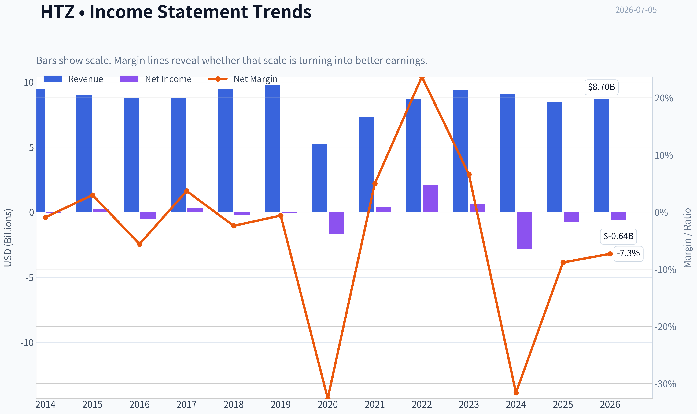

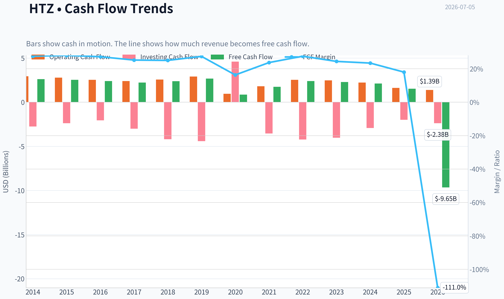

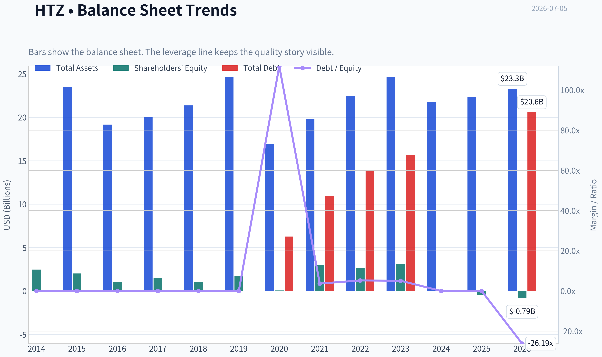

This graph tracks the profitability and return metrics (ROE, ROIC, Margins) of **HTZ** over the past decade, highlighting capital efficiency trends.

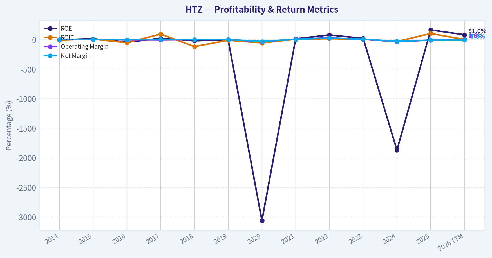

This chart illustrates the financial health of **HTZ** over the last 10 years, mapping cash equivalents and free cash flow against total obligations (Debt).

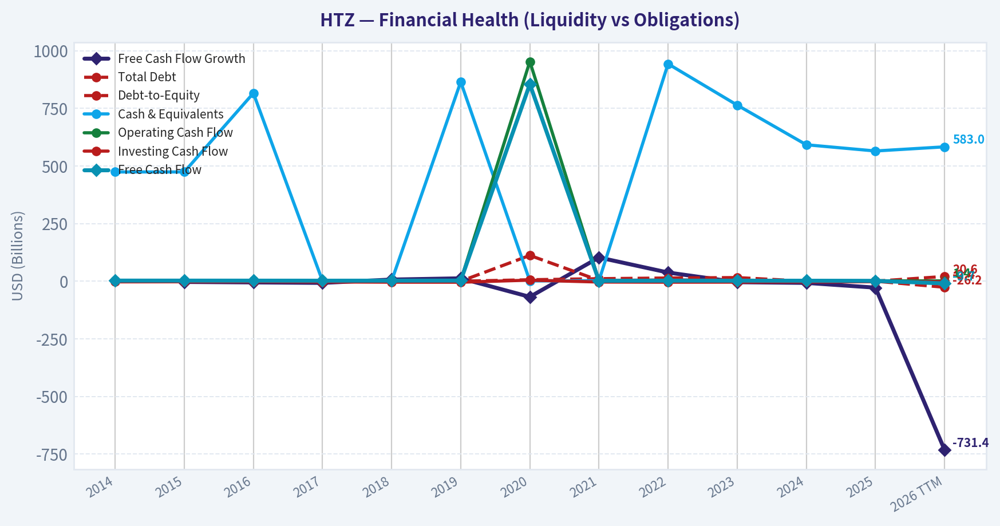

This comparison chart from *Profitability Analysis* stacks current figures against historical benchmarks for **HTZ**, making it easy to see where the company trades relative to its own averages.

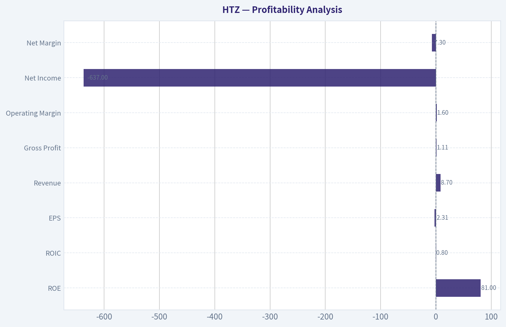

---

### Intrinsic Value Analysis (Buffett)

> *Following Warren Buffett's value investing philosophy: Circle of Competence, Economic Moat, Management Quality, and Margin of Safety.*

#### Intrinsic Value Snapshot

Price is what you pay. Intrinsic value is what the business may be worth based on the cash it can create for owners over time. We show a range, not one magic number.

- Current Price: $2.12
- Value Range (conservative to optimistic across both DCF methods): $33.36 to $402.20

##### Owner Earnings (Buffett Method)
- Net Income: $-747,000,000.00
- Depreciation & Amortization: $2,265,000,000.00
- Capital Expenditures: $-97,000,000.00
- Working Capital Changes: $73,000,000.00
- Owner Earnings: $1,348,000,000.00

##### Intrinsic Value
###### Buffett Method
Uses owner earnings. Stricter, and usually more conservative.
- Conservative: $33.36
- Average: $154.44
- Optimistic: $402.20
- Discount Rate: 10.0%

###### Cash Flow Method
Uses free cash flow. Better for companies spending heavily today to grow tomorrow.
- Conservative: $46.16
- Average: $50.78
- Optimistic: $59.23
- Discount Rate: 10.0%

#### Hertz Global Holdings (HTZ)

**ANALYST STANCE: AVOID**

#### 1) Go/No-Go Gate Assessment

| Gate | Verdict | Evidence |
|---|---|---|
| Gate 1: Circle of Competence & Simplicity | **Pass, but weak** | Hertz makes money by renting vehicles and related services. The business is easy to explain, but earnings are hard to predict because results depend heavily on used-car values, fleet financing, travel demand, and execution. |
| Gate 2: Moat Test | **Fail** | Car rental is a commodity-like business. Customers usually choose on price, availability, and airport convenience. Little evidence of durable pricing power or structural customer captivity. |
| Gate 3: Management & Capital Allocation | **Fail** | Recent equity dilution concerns, exchangeable notes issuance, and guidance pressure point to capital allocation under stress rather than owner-like compounding. |
| Gate 4: Industry Structure | **Fail** | The industry is cyclical, capital-intensive, and highly competitive. Fleet costs and residual values can swing sharply, impairing returns. |

**Key Takeaways:** Hertz passes the "simple to understand" test, but it fails the more important Buffett filters. The business lacks a durable moat, operates in a tough industry, and requires large amounts of capital just to stay in the game. That combination is usually a poor hunting ground for long-term value investors.

---

#### 2) Elementary School Test

Hertz buys or leases cars, rents them to travelers and other customers, then sells those cars later. If rental prices stay high, utilization stays good, and the company sells cars at decent prices, it can make money. If travel weakens, financing costs rise, or used-car prices fall, profits can disappear fast.

#### 3) Long-Term Predictability Test

A decade from now, people will still rent cars. But that does **not** make Hertz predictable. The economics are driven by variables that management cannot fully control: residual values, fleet mix, debt costs, travel cycles, insurer replacement demand, and competition from peers and alternative transport options. This is not the type of business where one can confidently forecast stable per-share earning power.

#### 4) Technology Risk Assessment

Technology is more threat than moat here. Fleet management software and booking apps help operations, but they do not create strong differentiation. Ride-sharing, autonomous driving over time, and digital-first travel platforms can pressure demand and bargaining power.

---

#### 5) Moat Analysis

| Moat Source | Assessment | Evidence |
|---|---|---|
| Intangible Assets | **Weak** | Hertz is a known brand, but brand alone does not prevent customers from switching for a lower price. |
| Switching Costs | **Minimal** | Most renters can book a competitor in minutes. Corporate accounts help somewhat, but not enough to create deep captivity. |
| Cost Advantage | **Limited/unstable** | Scale matters in procurement and airport presence, but fleet costs and residual values can erase any scale benefit quickly. |
| Network Effects | **None** | More users do not materially improve the service for other users. |

**Moat Quality Rating: Illusory/None**

The pricing power test is the killer: Hertz likely cannot raise prices 10% broadly without risking demand loss, especially in leisure and price-sensitive channels. This is the opposite of a Buffett-style franchise.

---

#### 6) Management Quality & Capital Allocation

| Dimension | Assessment | Commentary |
|---|---|---|
| Owner Mindset | **Questionable** | Capital raises and dilution concerns suggest management is defending liquidity and flexibility rather than compounding per-share value. |
| Candor | **Mixed** | Market commentary and lowered expectations indicate pressure is being acknowledged, but the key issue is less communication and more economics. |
| Capital Allocation | **Weak** | In this business, capital allocation is dominated by fleet funding, debt structure, and asset timing. Recent exchangeable notes and dilution concerns are negative signals. |

**Key Takeaways:** The central management test here is not charisma or presentation quality. It is whether management can allocate capital well in a hard business, and recent financing actions suggest the company is playing defense. Buffett prefers managers who deploy cash from a position of strength, not necessity.

---

#### 7) Industry Structure

| Factor | Assessment |
|---|---|
| Competitive Structure | Unattractive |
| Capital Intensity | High |
| Cyclicality | High |
| Commodity Exposure | Indirectly high via used-car values |
| Leverage Sensitivity | High |

**Key Takeaways:** Hertz operates in an industry with nearly all the traits Buffett tends to avoid. It is cyclical, capital hungry, operationally intense, and vulnerable to financing and asset-value swings. Even good execution can be overwhelmed by a bad part of the cycle.

---

#### 8) Financial Snapshot

Using the research pack:

| Metric | Value |
|---|---:|
| Share Price | **$2.00** |
| Market Cap | **$669.4M** |
| P/E | **N/A** |
| ROE | **162.7%** |
| Revenue Growth YoY | **-6.0%** |
| FCF Yield | **228.3%** |

**Key Takeaways:** The headline numbers look distorted rather than healthy. Extremely high ROE in a stressed balance-sheet situation usually reflects a very small or impaired equity base, not a wonderful business. Negative revenue growth and an unusually high FCF yield suggest the market is pricing in instability, not durable value.

#### 9) Interpreting the ROE

HTZ's **162.7% ROE** is not a sign of quality. In distressed or heavily leveraged situations, ROE can become meaningless because equity is very small relative to earnings or accounting movements. Buffett would treat this as a warning sign, not a badge of excellence.

#### 10) Owner Earnings

A Buffett-style owner earnings estimate requires stable maintenance capex assumptions and working-capital behavior. For Hertz, that framework is much less useful because fleet investment and vehicle dispositions dominate cash economics and can swing wildly with the cycle. In practical terms, normalized owner earnings are **far below** any recent headline free-cash-flow impression once one adjusts for the need to continually refresh and finance the fleet.

A conservative conclusion: **do not capitalize recent FCF at face value**. In this business, cash generation can be temporarily inflated by fleet reductions or favorable vehicle sales, then reverse.

---

#### 11) Three-Scenario DCF Valuation

Because Hertz's earnings power is cyclical and balance-sheet-sensitive, the right Buffett move is to anchor valuation to **normalized earning power**, not recent optical FCF.

| Scenario | Assumption | Conclusion |
|---|---|---|
| A: No Growth | Normalize owner earnings very conservatively given cyclical fleet economics | Equity value appears highly fragile and dependent on avoiding further operational deterioration |
| B: GDP Growth | 3% long-term growth is too generous without a moat and with weak industry economics | Limited confidence in sustainable intrinsic value above current market price |
| C: Historical Growth | Historical growth is not reliable due to business volatility and capital structure swings | Not appropriate to award a strong growth multiple |

**Key Takeaways:** A traditional DCF is not a friend to weak, cyclical, leveraged businesses. Small changes in residual values, financing costs, or utilization can swing equity value dramatically. That means there is no solid valuation floor here in the Buffett sense.

#### 12) Margin of Safety Analysis

At **$2 per share**, the stock may look statistically cheap. But cheapness is not the same as margin of safety. If normalized earning power is weak and the capital structure is exposed, the apparent discount can be a value trap.

For Buffett-style investing, margin of safety requires:
- understandable and durable earnings,
- a solid balance sheet,
- and confidence that intrinsic value is not melting.

HTZ does not meet that standard.

---

#### 13) Buffett Scorecard

| Criterion | Score (1-5) | Weight | Weighted Score |
|---|---:|---:|---:|
| Business Understanding | 4.0 | 20% | 0.80 |
| Moat Width & Durability | 1.0 | 25% | 0.25 |
| Management Quality | 2.0 | 15% | 0.30 |
| Return on Equity Quality | 1.0 | 15% | 0.15 |
| Reinvestment Runway | 2.0 | 10% | 0.20 |
| Balance Sheet Strength | 1.0 | 5% | 0.05 |
| Industry Structure | 1.0 | 5% | 0.05 |
| Valuation / Margin of Safety | 2.0 | 5% | 0.10 |
| **Total** |  |  | **1.90 / 5.00** |

**Key Takeaways:** The score is dragged down by exactly the things Buffett cares most about: moat, capital allocation, balance-sheet strength, and industry quality. Even though the stock price is low, the business quality is lower. This is not a case where a cheap price compensates for weak economics.

---

#### 14) Final Verdict

**ANALYST STANCE: AVOID**

Hertz is understandable, but not predictably profitable. It lacks a durable moat, operates in a brutal capital-intensive industry, and recent financing actions suggest stress rather than strength. The stock may attract traders looking for mean reversion, squeeze dynamics, or asset-value optionality, but that is not Buffett-style investing.

This is **not** a "wonderful company at a fair price." It is a fragile business at a low price, and those are very different things.

**Conviction Level: High**
#### Valuation Bridge

This bridge places the current market price beside each intrinsic value lens so readers can see whether upside depends on one method or shows up across several methods.

| Scenario | Intrinsic Value / Share |
| --- | ---: |
| Buffett Method | $154.44 |
| Cash Flow Method | $50.78 |
| Damodaran Method | $-6.24 |
| Current Price | $2.12 |

#### Key Takeaways

If one method is far above the others, the upside case depends on a specific modelling assumption. When several methods cluster together, the valuation story is more robust.

#### Valuation Visuals

This comparison chart from *Latest Earnings Snapshot* stacks current figures against historical benchmarks for **HTZ**, making it easy to see where the company trades relative to its own averages.

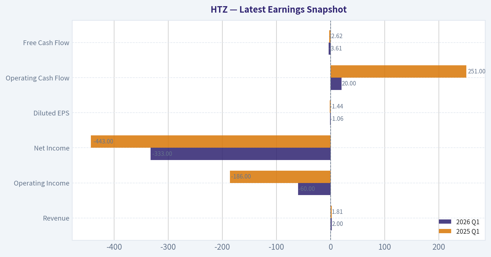

This comparison chart from *Current vs Historical Average Comparison* stacks current figures against historical benchmarks for **HTZ**, making it easy to see where the company trades relative to its own averages.

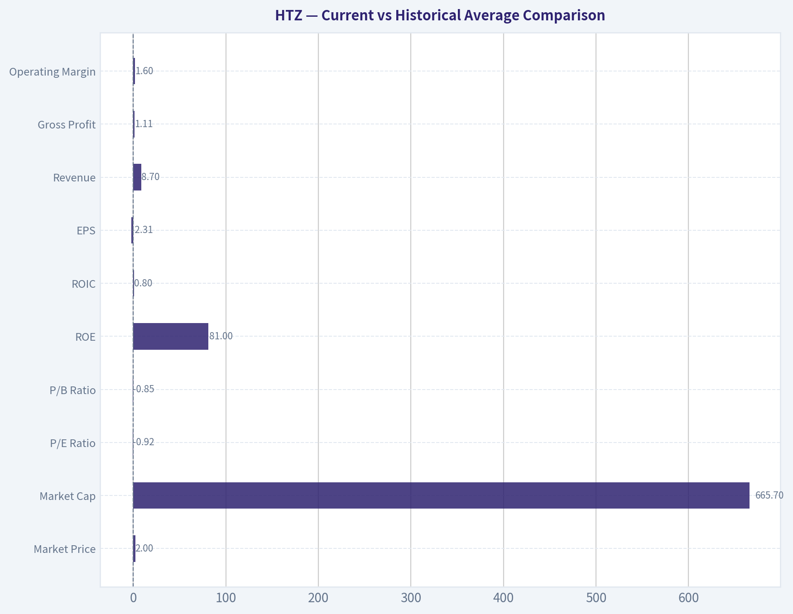

This comparison chart from *Balance Sheet Analysis* stacks current figures against historical benchmarks for **HTZ**, making it easy to see where the company trades relative to its own averages.

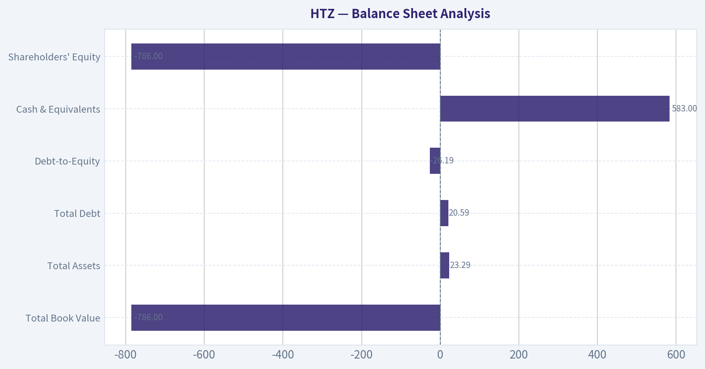

This comparison chart from *Cash Flow Analysis* stacks current figures against historical benchmarks for **HTZ**, making it easy to see where the company trades relative to its own averages.

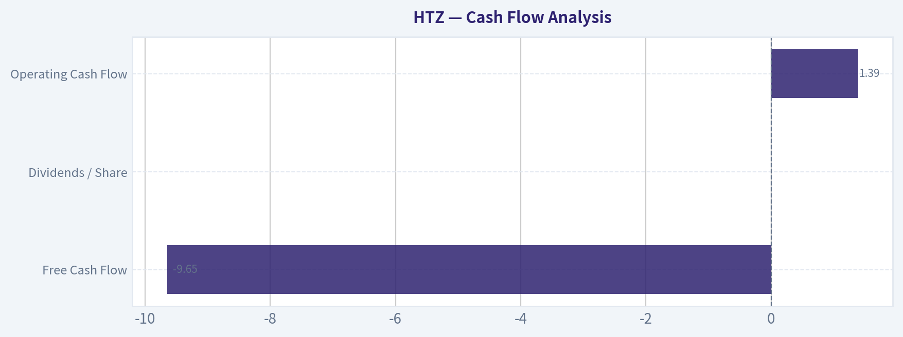

---

### Trend & Growth Analysis (Lynch/Druckenmiller/Fisher)

> *Following Peter Lynch's GARP, Stanley Druckenmiller's macro-aware approach, and Philip Fisher's scuttlebutt methodology.*

ANALYST STANCE: **AVOID**

#### 1. Lynch Classification

| Item | Assessment |
|---|---|
| Lynch category | **Cyclical / Turnaround hybrid** |
| Why | Auto rental demand, used-car residuals, fleet depreciation, and financing costs drive results more than durable organic growth |
| Growth fit? | **Poor fit for Lynch-style fast grower investing** |
| Revenue growth snapshot | **-6.0% YoY** from shared pack |

Key Takeaways: Hertz is not a fast grower; it is a cyclical, leveraged asset-heavy business with turnaround elements. That puts it outside the sweet spot for Lynch, Fisher, and Druckenmiller-style growth investing. The negative revenue growth already starts from a weak base for a growth thesis.

---

#### 2. The Story in 3 Bullets

- Hertz rents cars through Hertz, Dollar, and Thrifty, with results heavily tied to travel demand, fleet utilization, and used-car values.
- The equity case depends less on innovation-led growth and more on fixing depreciation, stabilizing financing, and surviving dilution/refinancing risk.
- At $2/share and ~$669M market cap, the stock looks optically cheap, but that is typical for stressed cyclicals and does **not** equal ten-bagger quality.

#### 3. TAM Analysis with 10x Test

| Metric | Assessment |
|---|---|
| Current revenue base | Large, mature legacy business |
| TAM type | Global car rental / mobility market |
| TAM growth | Low-to-moderate, not a hypergrowth market |
| 10x test | **Fails for practical purposes** |
| Why 10x fails | A 10x revenue outcome would imply implausible share gains in a mature, competitive market |

Key Takeaways: Hertz operates in a large market, but it is not the kind of rapidly expanding TAM that supports venture-like compounding. The issue is not whether the market exists, but whether Hertz can take enough share and sustain attractive economics to grow tenfold. That looks highly unrealistic.

---

#### 4. Revenue Growth Trend

| Metric | Data / View |
|---|---|
| YoY revenue growth | **-6.0%** |
| Pattern | **Decelerating / negative** |
| Interpretation | Not an inflection toward growth; points to pressure in pricing, volume, or both |
| Lynch read-through | Automatic caution |
| Druckenmiller read-through | No evidence of upside earnings inflection |

Key Takeaways: The top line is shrinking, which is a major red flag for any growth framework. Instead of acceleration, Hertz is showing deterioration. That makes it very hard to argue the market is missing a positive inflection.

---

#### 5. Unit Economics

| Metric | Status |
|---|---|
| LTV/CAC | Not relevant / not disclosed in a useful way for rental-car model |
| NRR | Not relevant |
| Rule of 40 | Not relevant |
| Better lens | Fleet utilization, depreciation per unit, pricing per day, interest burden, liquidity |

Key Takeaways: Traditional SaaS-style unit economics do not apply here. For Hertz, the real unit economics are fleet depreciation, residual values, utilization, and funding costs. On those dimensions, the recent setup appears pressured rather than improving.

---

#### 6. Inflection Point Assessment

| Inflection Type | Assessment |
|---|---|
| Product cycle inflection | **No** |
| Market share inflection | **No evidence** |
| Margin inflection | **Unclear to negative** |
| TAM inflection | **No** |
| Competitive inflection | **No clear catalyst** |
| Capital structure inflection | **Negative** due to note offering / dilution concerns |

Key Takeaways: I do not see a classic positive inflection point. The recent news flow points more toward financial engineering and balance-sheet management than accelerating demand or operating leverage. That usually signals defense, not offense.

---

#### 7. Macro Setup Evaluation

| Factor | Assessment |
|---|---|
| Secular trend support | Weak |
| Interest-rate sensitivity | High negative sensitivity |
| Consumer/travel cyclicality | High |
| Used-car residual exposure | High |
| Capital market dependence | Elevated |
| Druckenmiller macro verdict | **Headwind, not tailwind** |

Key Takeaways: This is not a business riding a major secular growth wave like AI, cloud, or healthcare innovation. Hertz is very sensitive to rates, financing conditions, and used-vehicle pricing. That macro mix is unfavorable for a leveraged cyclical equity.

---

#### 8. Fisher 15 Points Score

| Fisher Area | Score (1-5) | Comment |
|---|---:|---|
| Market potential | 2 | Mature market |
| New products | 1 | Limited innovation edge |
| R&D effectiveness | 1 | Not a core differentiator |
| Sales organization | 3 | Established brand/distribution |
| Profit margin | 2 | Structurally volatile |
| Margin improvement | 2 | No clear evidence |
| Labor relations | 3 | Neutral/unknown |
| Executive relations | 2 | Neutral to cautious |
| Management depth | 2 | Turnaround burden high |
| Cost/accounting controls | 2 | Complex fleet accounting risk |
| Outstanding aspects | 2 | Scale exists, moat weak |
| Long-range profit outlook | 2 | Cyclical, low visibility |
| Dilution risk | 1 | Elevated, explicit concern |
| Candor | 2 | Mixed / not enough proof |
| Integrity | 3 | Neutral absent stronger evidence |

| Total | **30 / 75** | **AVOID** |

Key Takeaways: Fisher's framework heavily penalizes Hertz because it lacks innovation, pricing power, and durable long-term compounding characteristics. The dilution and capital-structure issues are especially damaging. This is far from the profile of an outstanding growth company.

---

#### 9. Valuation Analysis

| Metric | Value / View |
|---|---|
| Share price | **$2** |
| Market cap | **$669.4M** |
| P/E | **N/A** |
| PEG | **N/A / not usable** |
| FCF yield | **228.3%** |
| FCF yield quality | Likely distorted by working capital / fleet timing / asset sales; **not reliable as a cheapness signal** |
| P/S | Not provided; likely low, but low multiple is normal for stressed cyclicals |
| Street signal | Morgan Stanley Equal-Weight, PT cut to **$3.5** |
| Recent financing | **$350M exchangeable notes offering**; negative for equity holders |

Key Takeaways: Hertz looks statistically cheap, but the headline cheapness is low quality. The huge FCF yield is almost certainly not something I would capitalize as durable owner earnings. In stressed cyclicals, low valuation often reflects real balance-sheet and earnings risk rather than hidden value.

#### Scenario View

| Scenario | Description | Equity View |
|---|---|---|
| Bear | Residual values stay weak, dilution/refinancing persists, revenue stays soft | Significant downside / value trap |
| Base | Business stabilizes, but no real growth and capital structure remains a drag | Range-bound, speculative |
| Bull | Used-car market improves, travel holds, leverage manageable | Sharp rebound possible, but still not a quality growth case |

Key Takeaways: There is rebound optionality, but it is trading optionality, not high-quality compounding. The bull case depends on several external variables improving at once. That is not the kind of edge we want for a disciplined growth portfolio.

---

#### 10. Growth Investor Scorecard

| Criterion | Weight | Score (1-5) | Weighted Score |
|---|---:|---:|---:|
| The Story | 10% | 2.0 | 0.20 |
| TAM & Runway | 20% | 1.5 | 0.30 |
| Revenue Growth | 20% | 1.0 | 0.20 |
| Unit Economics | 15% | 1.5 | 0.23 |
| Competitive Position | 10% | 2.0 | 0.20 |
| Management Quality | 10% | 2.0 | 0.20 |
| Macro Setup | 5% | 1.5 | 0.08 |
| Profitability Path | 5% | 1.5 | 0.08 |
| Valuation | 5% | 2.5 | 0.13 |

| Total Score |  |  | **1.62 / 5.00** |

Key Takeaways: Hertz scores far below the threshold for a growth-oriented buy. The weak score is driven by declining revenue, limited runway, poor business quality, and fragile economics. Even though valuation is low, it is nowhere near enough to offset the fundamental weaknesses.

---

#### 11. Position Size Stance

| Style | Stance |
|---|---|
| Core growth portfolio | **0% position** |
| Special situations / trading book | Only for specialists |
| Suggested action | **Avoid initiating as a growth investment** |

Key Takeaways: This should not be owned in a core growth portfolio. If someone wants exposure, it belongs in a small, explicitly speculative special-situations bucket. That is a very different mandate from growth compounding.

---

#### 12. Key Risks and Catalysts

| Risks | Catalysts |
|---|---|
| Revenue decline continues | Stabilization in travel demand |
| Residual value / depreciation pressure | Better used-car pricing |
| Exchangeable notes / dilution | Successful refinancing on better terms |
| High financing sensitivity | Lower rates / tighter spreads |
| Weak moat and commodity pricing | Fleet optimization execution |
| Balance-sheet fragility | Strategic asset sales / capital injection |

Key Takeaways: The upside catalysts are mostly macro and balance-sheet dependent, not product-driven or moat-driven. The risks are immediate and fundamental, especially dilution, residual values, and financing costs. That asymmetry makes this unattractive for growth investors.

---

#### Bottom Line

HTZ is **not** a Lynch fast grower, **not** a Fisher quality innovator, and **not** a Druckenmiller-style positive inflection setup. It is a leveraged cyclical with restructuring-like characteristics, shrinking revenue, and active capital-structure stress signals.

For a growth mandate, the right call is **AVOID**. If you want, I can next do a **deep special-situations version of HTZ** focused purely on balance sheet, liquidation value, dilution risk, and rebound trading setup.

#### Growth & Scorecard Visuals

This comparison chart from *Growth Metrics Analysis* stacks current figures against historical benchmarks for **HTZ**, making it easy to see where the company trades relative to its own averages.

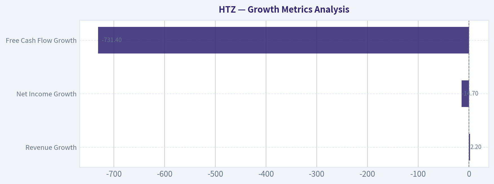

---

### Market Technical Analysis

#### HTZ Technical Analysis Report

HTZ is in a **decisively weak technical condition**, and the most relevant indicators for the current market context are:

| Selected Indicator | Why it matters now |
|---|---|
| close_10_ema | Best for tracking the speed of the recent collapse and whether price can regain short-term control. |
| close_50_sma | Defines the medium-term trend, which has clearly rolled over. |
| close_200_sma | Confirms the longer-term bearish structure and shows how far price has broken below strategic support. |
| macd | Measures momentum deterioration and helps assess whether downside pressure is still accelerating. |
| rsi | Useful now because HTZ is in deeply oversold territory, which matters for bounce risk even inside a bearish trend. |
| boll_ub | Helps frame the upper boundary of any reflex rally and the extent of volatility expansion. |
| boll_lb | Shows how aggressively price has broken toward the lower edge of its volatility envelope. |
| atr | Essential for risk control because HTZ's recent move has sharply increased realized trading risk. |

Key Takeaways: HTZ does not need more indicators right now; it needs the right ones. These eight tools cover trend, momentum, oversold conditions, volatility structure, and risk management without unnecessary overlap. The picture they paint is not just bearish, but bearish with elevated rebound risk because the decline has become stretched.

---

#### Price Structure and Trend Context

Over the past year, HTZ has moved from the **$7 area in July 2025** to roughly **$2.12 by July 2, 2026**, which represents a severe destruction of price structure rather than a routine pullback. The decline was not linear. There were several distinct phases:

1. **Summer 2025 breakdown:** price fell from the low-$7s into the mid-$5s.
2. **Autumn 2025 failed recovery:** rallies into the high-$6s and low-$7s repeatedly failed.
3. **Q1 2026 capitulation drift:** the stock compressed lower into the $4s.
4. **April 2026 squeeze/rebound:** a sharp rally carried HTZ back toward the high-$7s.
5. **May-June 2026 distribution and collapse:** the rebound failed, price lost the $5 area, then broke violently under $3 in late June.

The April rally is especially important. It shows that HTZ can still stage **violent countertrend advances**, but because that rally fully failed and was followed by a much steeper breakdown, the market is signaling that sellers remain structurally dominant. In practical terms, this means traders should treat upside moves as **potential bear-market rallies until proven otherwise**.

---

#### Indicator Snapshot

| Indicator | Latest Reading / Condition | Interpretation |
|---|---:|---|
| Close | 2.12 (2026-07-02) | Price has fallen into a new low zone after a sharp late-June break. |
| close_10_ema | 3.02 | Price is far below short-term trend, showing extreme downside extension. |
| close_50_sma | 5.06 | Medium-term trend is strongly bearish; current price is massively under this level. |
| close_200_sma | 5.31 | Long-term structure is bearish; price is trading far beneath strategic average support. |
| macd | -0.84 | Momentum is deeply negative and still reflective of strong downside pressure. |
| rsi | 17.17 | Extremely oversold; bounce conditions exist, but not yet trend repair. |
| boll_ub | 6.74 | Upper volatility boundary is far above price, reflecting huge dislocation. |
| boll_lb | 1.57 | Price is hovering closer to the lower band, consistent with panic-style selling. |
| atr | 0.37 | Daily trading risk is very high relative to a ~$2 stock. |

Key Takeaways: The table shows a market that is deeply damaged across every major lens. Trend indicators are far above current price, momentum is strongly negative, and RSI is extremely oversold. The main message is that HTZ may be ripe for a reflex bounce, but it is not showing evidence of a durable trend reversal yet.

---

#### Moving Average Analysis

The **10 EMA at 3.02** is the most immediate marker of short-term control. With price at **2.12**, HTZ is trading roughly **30% below** this fast average. That is not normal trend weakness; it is a sign of **washout conditions**. In healthy downtrends, price often oscillates around the 10 EMA. Here, price has fallen far below it, which means the move may be temporarily overextended even if the primary trend remains down.

The **50 SMA at 5.06** has rolled over and is now declining sharply. Through mid-May and early June, this average was still near the mid-$5s and acted as a reference line for deteriorating price action. Once HTZ broke decisively away from that zone, the stock shifted from "weak but tradable" into "trend failure."

The **200 SMA at 5.31** is especially important because long-term participants often use it as a dividing line between structurally healthy and structurally impaired stocks. HTZ is now trading at less than half of that level. That degree of separation tells us this is not just a tactical bearish setup; it is a **strategic breakdown**.

A subtle but important point: the 50 SMA has fallen **below** the 200 SMA, or is effectively behaving in a clear death-cross regime. Even if the exact crossover timing occurred earlier, the current spacing confirms that **both medium-term and long-term trend layers are aligned to the downside**.

---

#### Momentum Analysis: MACD and RSI

The **MACD at -0.84** is deeply negative. More importantly, the sequence into late June shows momentum did not merely turn negative; it **accelerated lower rapidly** after June 24. Before the breakdown, MACD was already below zero, which meant the stock was weak. The late-June plunge pushed it into a much more severe negative regime, suggesting a transition from ordinary selling to **forced liquidation or panic-driven repricing**.

The **RSI at 17.17** confirms that the move is now extremely stretched. An RSI under 30 is oversold; an RSI near 17 is severe. However, traders should interpret that carefully:

- In stable markets, RSI this low can precede sharp rebounds.
- In crisis-style declines, RSI can remain oversold longer than expected.
- Therefore, low RSI is **not a buy signal by itself**; it is a warning that downside may be crowded and highly reactive.

The combination of **deeply negative MACD + RSI near 17** is important. It says:
- the prevailing trend is still bearish,
- but the move is becoming **asymmetric**,
- so short sellers face increasing snapback risk,
- while dip buyers still need confirmation before assuming a bottom is in.

This is the kind of setup where the first bounce can be strong, but the first bounce is often **technical relief, not trend repair**.

---

#### Volatility and Bollinger Band Analysis

The Bollinger structure is unusually informative here.

With **boll_ub at 6.74** and **boll_lb at 1.57**, the band width is enormous relative to price. That tells us realized volatility has exploded. HTZ is no longer trading in a stable equilibrium; it is trading in a **high-dispersion environment** where emotional and forced moves can dominate.

Price at **2.12** sits much closer to the lower band than the upper band, which is consistent with continued downside pressure. But what matters more is the speed of the band expansion. In June, the lower band fell sharply while the upper band stayed elevated, indicating that volatility was not simply increasing symmetrically; it was increasing because of a **downside shock**.

That has two practical consequences:

1. **Support is less reliable than usual.**
   When bands expand rapidly after a breakdown, price can continue "walking the lower band" longer than traders expect.

2. **Any rebound can be violent.**
   As the bands widen, mean-reversion rallies can become very sharp, especially in heavily shorted or distressed names.

So the Bollinger picture is not merely "oversold." It is saying the stock is in a regime where **oversold conditions coexist with elevated gap and whipsaw risk**.

---

#### ATR and Risk Management

The **ATR at 0.37** is extremely high for a stock trading near **$2.12**. That means average daily movement is a very large percentage of the share price. Roughly speaking, ATR is around **17% of price**, which is exceptionally high for routine positioning.

This matters because many traders make a correct directional call and still lose money through poor sizing. In HTZ's current state:

- stops that are too tight can be easily hit by normal noise,
- stops that are wide enough require much smaller position sizes,
- swing trades need to assume gap risk,
- intraday reversals can be large even without changing the primary bearish trend.

The falling ATR trend from May into mid-June had briefly suggested volatility compression. That changed abruptly after the late-June collapse, when ATR re-expanded. This re-expansion tells us the market has **re-entered a danger regime**, where exposure should be reduced unless the trader specifically specializes in high-volatility situations.

---

#### Fine-Grained Trading Interpretation

| Market Layer | What it is saying now | Trading implication |
|---|---|---|
| Short-term trend | Price is far below the 10 EMA | Very stretched; rebound risk is high, but still below trend control. |
| Medium-term trend | 50 SMA is falling and far above price | Any rally into this area would likely face heavy overhead supply. |
| Long-term trend | 200 SMA is declining and far above price | Strategic investors still see a broken chart unless price can reclaim much higher levels. |
| Momentum | MACD deeply negative | Sellers still control the tape. |
| Exhaustion | RSI near 17 | Downside is crowded; watch for reflex bounce, not automatic bottom. |
| Volatility envelope | Bands widened sharply | Expect unstable trading and large swings. |
| Risk | ATR elevated relative to price | Position sizing matters more than entry precision. |

Key Takeaways: HTZ is not simply weak; it is weak across short, medium, and long-term timeframes at once. The stock is stretched enough to bounce sharply, but any rally begins life as a countertrend move unless it can recover key moving averages. Traders should think in terms of scenario planning and risk control, not simple "cheap vs expensive" judgment.

---

#### What Traders Should Watch Next

The most important near-term question is **whether HTZ can stabilize above the post-breakdown zone** and begin reclaiming the 10 EMA. A move back above the fast average would not fix the chart, but it would be the first sign that downside momentum is no longer one-directional.

After that, the next challenge would be whether price can build a base instead of simply producing a one- or two-day short-covering bounce. In broken charts, many rallies fail because they do not develop into consolidation. They spike, stall, and roll over under overhead resistance.

For HTZ specifically:

- **Bullish tactical signal:** stabilization, then reclaim of the 10 EMA with improving momentum.
- **More meaningful recovery signal:** higher low forms after the first rebound.
- **Bearish continuation signal:** failure to stabilize and renewed selling under the recent lows.
- **Major resistance context:** the large gap between price and the 50/200 SMAs means even a sizable rally could still leave the broader trend bearish.

So the likely path, if a bounce occurs, is not immediate recovery to health. More likely it would be a **high-volatility relief rally into layered resistance**.

---

#### Bottom Line

HTZ is in a **high-risk bearish trend with capitulation-like characteristics**. The combination of price far below the 10 EMA, 50 SMA, and 200 SMA; MACD deeply negative; and RSI near 17 indicates a stock that is both **structurally broken and tactically oversold**.

That distinction matters. Structurally broken means trend followers should stay cautious. Tactically oversold means aggressive traders should respect the possibility of a sharp rebound. The best current framework is:

- **trend:** bearish,
- **momentum:** strongly negative,
- **stretch:** extreme,
- **volatility:** elevated,
- **trading bias:** cautious, reactive, and size-disciplined.

#### Summary Table

| Area | Signal | Conclusion |
|---|---|---|
| Long-term trend | Price far below close_200_sma | Strategic trend remains bearish |
| Medium-term trend | Price far below close_50_sma | Recovery attempts face strong overhead resistance |
| Short-term trend | Price far below close_10_ema | Move is highly extended and vulnerable to snapback |
| Momentum | MACD deeply negative | Downside pressure remains dominant |
| Exhaustion | RSI at 17.17 | Extreme oversold conditions raise bounce probability |
| Volatility | Wide Bollinger spread | Market is unstable and prone to large swings |
| Risk | ATR high vs price | Smaller size and wider risk parameters are necessary |
| Trading stance | Bearish but stretched | Favor caution; treat rallies as countertrend until proven otherwise |

Key Takeaways: HTZ's chart is broken on every major trend timeframe, but the stock is also so oversold that a sharp rebound could occur at any time. That makes this a poor environment for complacent directional bets and a strong environment for disciplined risk management. The clearest message from the indicators is that the downtrend is still intact, while the probability of a volatile relief move is rising.

---

### Options Market Analysis

> *Reading options flow - put/call ratios, IV skew, and unusual activity - to gauge institutional positioning and event-driven risk.*

#### HTZ Options Positioning Report
*Data as of 2026-07-05*

HTZ's options tape is sending a **clear bearish near-term signal**. The biggest driver is an extreme burst of put activity in the 2026-07-17 expiration, especially the **$9 put** where volume massively exceeded existing open interest, pointing to **fresh downside positioning or aggressive hedging** rather than routine closing flow.

#### 1. Put/Call Ratio Analysis

| Expiry | Call OI | Put OI | Put/Call OI Ratio | Call Vol | Put Vol | Put/Call Vol Ratio |
|---|---:|---:|---:|---:|---:|---:|
| 2026-07-10 | 5,928 | 7,292 | 1.23 | 3,016 | 710 | 0.24 |
| 2026-07-17 | 75,317 | 48,262 | 0.64 | 3,165 | 101,991 | 32.22 |
| 2026-07-24 | 4,996 | 2,003 | 0.40 | 1,018 | 190 | 0.19 |
| **Near-term total** | **86,241** | **57,557** | **0.67** | **7,199** | **102,891** | **14.29** |

**Key Takeaways:** Open interest looks roughly neutral-to-slightly bullish at first glance, with a total put/call OI ratio of **0.67**, basically in line with the usual neutral baseline near **0.7**. But volume tells a very different story: the near-term put/call volume ratio is an extreme **14.29**, driven almost entirely by one expiration. That means the market is **adding fresh downside exposure right now**, even though the existing OI stockpile had previously looked more balanced.

**Interpretation**
- **OI ratio = 0.67:** close to neutral baseline, so legacy positioning was not heavily bearish before this session.
- **Volume ratio = 14.29:** extremely elevated and decisively bearish/hedging-heavy.
- **Most important shift:** the market moved from a roughly neutral standing inventory to **very heavy incremental put demand**.

#### 2. Implied Volatility Assessment

The tool output did **not provide ATM IV for calls and puts** across the listed expirations, so precise ATM IV comparison is unavailable. However, the unusual flow itself included an implied volatility reading for the standout contract.

| IV Metric | Observation |
|---|---|
| Near-term ATM call IV | N/A from source |
| Near-term ATM put IV | N/A from source |
| OTM put IV evidence | Very elevated in unusual flow |
| Highlighted contract IV | 2026-07-17 $9 put at **565.6% IV** |
| Skew inference | Strong **put demand / downside fear** |

**Key Takeaways:** Even though full ATM IV data is missing, the available volatility signal is still very informative. A **565.6% IV** print in the most active put contract is exceptionally high and strongly suggests **event-driven or distress-style downside pricing**, not normal background hedging.

**Interpretation**
- Full ATM IV term structure cannot be verified from the source data.
- Still, the **observed put IV is extremely elevated**, which strongly implies **steep downside skew**.
- When puts trade at such inflated volatility, it usually reflects:
  - acute downside fear,
  - tail-risk hedging,
  - or traders paying up aggressively for protection/speculation.
- Since no catalyst was provided in the dataset, I would flag this as **likely catalyst-sensitive or balance-sheet/news-sensitive pricing**, but not assign a specific event without confirmation.

#### 3. Unusual Options Activity

| Expiry | Type | Strike | Volume | OI | Vol/OI | IV | Moneyness / Read |
|---|---|---:|---:|---:|---:|---:|---|
| 2026-07-17 | Put | 9.0 | 100,002 | 5,003 | 20.0x | 565.6% | Likely near-the-money to downside hedge/speculation zone; fresh bearish positioning |

**Key Takeaways:** This is the entire story in HTZ right now. The **July 17 $9 put** traded **100k+ contracts** against just **5k OI**, which is a textbook sign of **new position initiation**, not simple turnover in old positions. That scale strongly leans institutional rather than retail.

**What it implies**
- **Put or call?** Put.
- **Fresh or closing?** Fresh, because volume is **20x OI**.
- **Expiry horizon:** about **12 days to expiration** from 2026-07-05, so this is a **very near-term bet**.
- **Likely interpretation:** traders are positioning for a material downside move into mid-July.
- **Smart money vs. retail:** a 100k-contract burst in a single near-dated strike is far more consistent with **institutional hedging or directional downside speculation** than ordinary retail activity.
- Because the strike is **$9**, it likely marks an important market-implied stress threshold.

#### 4. Open Interest Concentration

Based on aggregate chain totals, the greatest concentration of near-term OI sits in **2026-07-17**, which dominates all nearby expirations.

| Expiration | Total Call OI | Total Put OI | Positioning Significance |
|---|---:|---:|---|
| 2026-07-10 | 5,928 | 7,292 | Smaller weekly positioning; limited pin influence vs. July 17 |
| 2026-07-17 | 75,317 | 48,262 | Primary gravity point; most likely gamma/pinning expiry |
| 2026-07-24 | 4,996 | 2,003 | Light follow-on positioning |

**Key Takeaways:** Nearly all relevant near-term positioning sits in the **July 17 expiration**, so that is the contract month most likely to influence spot behavior. If HTZ trades near heavily owned strikes into that date, dealer hedging could intensify price reactions rather than dampen them.

**Gamma / pinning read**
- With so much OI and especially such massive fresh put activity in **7/17**, this expiry is the most likely **gamma wall zone**.
- The standout **$9 put** likely acts as a **downside magnet / pressure point**.
- If spot weakens toward that area:
  - dealer hedging may accelerate downside,
  - volatility may stay elevated,
  - and price may become more sensitive to incremental negative news.
- Because strike-by-strike OI distribution beyond the unusual contract is not provided, I cannot calculate a full max-pain map. But **$9 on 7/17** is clearly the key tactical level from the available data.

#### 5. Overall Options Sentiment Signal

| Signal | Conviction | Primary Driver |
|---|---|---|
| **BEARISH** | **Moderate-High** | Massive fresh buying of near-dated July 17 $9 puts and extreme put volume ratio |

**Key Takeaways:** HTZ options are not showing casual caution; they are showing **urgent downside demand**. The strongest evidence is the mismatch between a roughly neutral OI backdrop and a **sudden explosion in put volume**, which usually marks a new information shock, hedge program, or bearish tactical campaign.

**Synthesis**
- **Legacy positioning:** roughly neutral.
- **New positioning:** heavily bearish.
- **Volatility tone:** stressed, especially in puts.
- **Open interest gravity:** concentrated in 7/17, with **$9** as the key downside reference point.
- **Conclusion:** **BEARISH**.

This does **not** guarantee HTZ falls, but the options market is pricing and expressing **material near-term downside concern**. If underlying stock liquidity is normal but options activity is dominated by one strike, confidence should be tempered slightly; however, the sheer size of the **100k put print** is too large to ignore.

#### Summary Table

| Metric | Read |
|---|---|
| Put/Call Ratio | **OI: 0.67** near neutral; **Volume: 14.29** extremely bearish shift |
| IV Level | ATM IV unavailable; observed put IV **very elevated** |
| Skew Direction | **Put skew / downside fear** |
| Unusual Activity | **2026-07-17 $9 put**, 100,002 volume vs 5,003 OI, **20x**, likely fresh institutional downside positioning |
| Overall Signal | **BEARISH** |

**Key Takeaways:** The summary is straightforward: HTZ's options market is being driven by **aggressive near-term put demand**, not broad-based call speculation. The strongest actionable takeaway is that **July 17 and the $9 strike** are the critical near-term reference points for sentiment and potential price gravity.

---

## Research Team Commentary

> *The Research Manager synthesizes the Bull vs Bear debate into action-free commentary. This is a pre-risk view, not the final stance.*

The strongest bull argument is that Hertz is being priced like an equity stub with little chance of normalization, while the actual business likely has more value than the market is crediting. The bull case says this is not a "great business" story but a distressed-value setup: recognizable brands, airport presence, fleet scale, and enduring rental demand could allow the company to stabilize if depreciation, utilization, and financing conditions improve even modestly. At a roughly $669 million market cap, a partial recovery in operating economics could produce large percentage upside for equity holders.

The strongest bear argument is that this is exactly the type of business Buffett would avoid: weak moat, commodity service, poor and unpredictable earnings, heavy capital intensity, and a fragile capital structure where common equity can be impaired even if the enterprise survives. The reported numbers support that caution: revenue is down, ROA is negative, and the extreme ROE likely reflects a distorted, depleted equity base rather than economic strength. The key issue is not whether Hertz can keep renting cars, but whether current shareholders will retain meaningful value after refinancing, dilution, and ongoing operating volatility.

My takeaway is that the bear side is more compelling for a value-investing portfolio. The bull case depends on several things going right at once: better residual values, better financing, better execution, and no severe balance-sheet damage to equity. That is not the kind of intrinsic value gap Buffett-style investing relies on. It is speculative optionality, not a durable margin of safety.

I want to be careful not to repeat past mistakes. In prior cases, I was too static and missed tactical rebounds in beaten-down names because I overweighted long-term quality concerns. That lesson matters here too: HTZ could absolutely rally sharply from oversold levels, and a short-term squeeze or distressed rebound would not surprise me. But the mistake to avoid in this case is the opposite one: confusing rebound potential with value-investing merit. For a Buffett-style portfolio, those are not the same thing.

Core takeaway: Hertz may have trading optionality, but it does not meet the standard for a value investment because the business quality is weak, normalized earnings are too hard to underwrite, and the balance sheet risk undermines any claimed margin of safety. The stock may be cheap-looking, but cheap-looking equity in a leveraged cyclical is often not actually cheap.

Rationale: Business quality comes first, and Hertz fails that test. It lacks clear pricing power, operates in a highly competitive and transparent market, and requires constant capital to maintain the fleet. Predictable earnings are absent because returns depend on used-car values, travel demand, financing costs, and management's fleet decisions. Financial strength is the biggest problem: when equity sits beneath a stressed capital structure, intrinsic value can migrate away from shareholders even if operations stabilize. That makes valuation less reliable and reduces confidence in any "normalized earnings" estimate. In Buffett terms, this is not a wonderful business at a fair price, nor even a good business at a bargain price. It is a mediocre business with real solvency and dilution risk.

Monitoring plan over the next 1 to 4 quarters: I would watch three things closely. First, fleet economics: depreciation trends, vehicle disposition gains or losses, and utilization/pricing discipline. If these improve materially and sustainably, the normalization argument gets stronger. Second, financing and liquidity: any refinancing terms, debt maturity management, covenant flexibility, and whether the company can avoid highly dilutive actions. This is the single most important area. Third, operating cash flow quality: not just adjusted metrics, but whether the business is generating real cash after fleet and financing realities. If Hertz can show cleaner cash generation, stabilizing revenue trends, and lower balance-sheet stress, it might move from AVOID to WATCH. If instead losses persist, asset returns stay weak, or equity dilution/refinancing worsens, the bear case is confirmed.

Final stance: AVOID.

---

## Value Investing Team Commentary

> *The Investor translates the research view into an investment thesis before risk review. This is still not the final stance.*

Hertz is the kind of situation that can look enticing precisely because the stock price is so low and the market cap appears tiny relative to a recognizable operating business. A contrarian should at least ask whether the market is extrapolating peak pessimism. That is the right question. But Buffett-style investing requires a second question that matters more: even if the business survives, will common shareholders reliably participate in that survival? With HTZ, that answer is too uncertain.

The business itself is understandable, but not attractive in the sense value investors usually want. Car rental is a highly competitive, capital-intensive, economically sensitive business with limited differentiation. Hertz has brands, airport locations, and scale, but those are not the same as a durable moat. Pricing power is weak, customer switching costs are low, and returns are heavily influenced by variables management cannot fully control: used-vehicle prices, utilization, travel demand, borrowing costs, and fleet procurement timing. That is a poor recipe for predictable long-term owner earnings.

The headline ROE of 162.7% is exactly the kind of figure that should make a value investor more cautious, not more excited. In distressed or highly levered businesses, extreme ROE often reflects a shrunken or impaired equity base rather than true economic excellence. The more useful signal here is negative ROA, declining revenue, and the broader instability of the capital structure. In plain English: the business is not earning strong returns on the assets required to operate it, and the equity sits on top of a fragile foundation.

The real issue is not whether Hertz can keep renting cars over the next several years. It probably can. The issue is whether the current equity offers a genuine margin of safety. That is much harder to defend. In leveraged cyclicals, enterprise survival and equity value preservation are two very different things. If refinancing comes at punitive terms, if dilution is required, or if fleet economics remain unfavorable, value can accrue to creditors, lessors, or new capital providers rather than to today's shareholders.

Now, the selective contrarian angle: what is the market potentially missing? The market may be too negative on the possibility of operational stabilization. If residual values improve, depreciation normalizes, travel demand remains healthy, and management executes better on fleet mix and utilization, the equity could rebound sharply. That is not far-fetched. In fact, deeply distressed stocks often stage violent rallies on even modestly better news. So the crowd may be underestimating short-term optionality.

But that does not automatically create a sound value investment. This is where many investors get trapped. They confuse "priced for disaster" with "cheap." Sometimes the market is not missing hidden value; it is correctly discounting a very wide range of bad outcomes. With HTZ, the bull case requires several external and internal variables to improve at once. That is not a classic margin-of-safety setup. It is a multi-variable turnaround speculation.

What do recent sentiment and price action really imply? The market appears to be treating HTZ as an equity stub, and that usually means confidence in the capital structure is low. That skepticism may look excessive emotionally, but financially it can be rational. In weak businesses with debt pressure, small changes in assumptions can have enormous effects on equity value. That asymmetry cuts both ways: yes, there can be huge upside if things improve, but there can also be permanent impairment even if the company avoids collapse. Buffett generally avoids that game because the outcome depends less on business excellence and more on balance-sheet negotiation and cyclical luck.

If I were monitoring for a change in stance, I would focus on three things. First, proof that fleet economics are improving in a durable way, not just quarter-to-quarter noise. Second, evidence that financing risk is being reduced without badly harming common shareholders. Third, genuine cash generation after accounting for the true economic cost of running and refreshing the fleet. Without those, any rally is more likely to be a trade than an investment.

So the contrarian conclusion is nuanced: the bearish sentiment may indeed create rebound opportunities, and the stock could rise materially on better-than-feared developments. But for a long-term value portfolio, that is not enough. Buffett-style investing is about owning durable businesses at sensible prices with confidence in long-term earning power. Hertz does not clear that bar today.

**ANALYST STANCE: AVOID**
HTZ may offer distressed-trading upside if sentiment or operations improve, but it lacks the business quality, balance-sheet safety, and earnings predictability required for a Buffett-style long-term investment. The market may be overly pessimistic on short-term rebound potential, yet that is not the same as having a durable margin of safety for equity holders.

---

## Deep Values Commentary

> *The Risk Management Team debates and the Risk Judge provides the final action-free verdict. This section determines the final ADVOCATE / WATCH / AVOID stance.*

#### Final Stance Scorecard

This scorecard converts the final research view into a weighted decision frame. It does not replace the narrative judgement, but it makes the main drivers of the verdict easier to scan.

| Criterion | Score | Weight | Commentary |
| --- | ---: | ---: | --- |
| Business Quality | 3.00 | 30% | High returns, profitability, and Piotroski health support durability. |
| Valuation Support | 4.33 | 30% | Blends current price against available intrinsic value anchors and valuation ratios. |
| Financial Strength | 3.67 | 20% | Balance-sheet resilience reflects leverage and liquidity staying within safe ranges. |
| Growth Durability | 2.33 | 20% | Recent revenue, earnings, and free cash flow growth indicate how durable expansion looks. |
| TOTAL / FINAL STANCE | 3.40 | 100% | AVOID |

#### Key Takeaways

The weighted score lands at **3.40 / 5.0**, while the final stance remains **AVOID**. This is useful as a quick calibration aid rather than a mechanical signal.

#### Risk Summary

Higher scores indicate more risk pressure. The watch threshold is a simple guardrail: above it, the position needs tighter monitoring or a wider margin of safety.

| Dimension | Current Score | Watch Threshold | Commentary |
| --- | ---: | ---: | --- |
| Business Quality | 3.00 | 3.00 | High returns, profitability, and Piotroski health support durability. |
| Valuation Support | 1.67 | 3.00 | Blends current price against available intrinsic value anchors and valuation ratios. |
| Financial Strength | 2.33 | 3.00 | Balance-sheet resilience reflects leverage and liquidity staying within safe ranges. |
| Growth Durability | 3.67 | 3.00 | Recent revenue, earnings, and free cash flow growth indicate how durable expansion looks. |

#### Key Takeaways

This view helps readers separate *where* the risk sits: valuation, business quality, balance sheet, or growth durability. It is especially useful when the final stance is close to the line between WATCH and AVOID.
