# IBM Deep Value Intelligence

**Analysis Date:** 2026-07-14

## Critical Disclaimer

*This analysis is generated by Deep Value Intelligence, an AI-powered multi-agent investing framework. Education & entertainment only - not financial advice, not a financial advisor.*

---

## Table of Contents

1. Intelligence Summary
2. Analyst Team Reports
   - Fundamentals Analysis
   - Intrinsic Value Analysis (Buffett)
   - Trend & Growth Analysis (Lynch/Druckenmiller/Fisher)
   - Market Technical Analysis
   - Options Market Analysis
3. Research Team Commentary
4. Value Investing Team Commentary
5. Deep Values Commentary

---

## Intelligence Summary

### Thesis + Conditions

**Core Thesis:** ## Executive Briefing

**Key Risks:**
- IBM remains a WATCH.**
- ### 1. Risky Analyst - strongest pro-buy points
- Defensive moats protect downside better than they create durable growth acceleration.

**Confidence:** Medium

---

## Analyst Team Reports

### Fundamentals Analysis

#### Latest Earnings Snapshot

*Most recent reported quarter anchored on 2026 Q1, with prior-year comparison when available.*

| Metric | 2026 Q1 | 2025 Q1 | YoY Change |
| --- | ---: | ---: | ---: |
| Revenue | $15.92B | $14.54B | +9.5% |
| Operating Income | $2.22B | $1.76B | +25.7% |
| Net Income | $1.22B | $1.05B | +15.3% |
| Diluted EPS | $1.28 | $1.12 | +14.3% |
| Operating Cash Flow | $5.17B | $4.37B | +18.3% |
| Free Cash Flow | $4.78B | $3.98B | +20.2% |

Key Takeaways: This snapshot anchors the most recent reported quarter before the narrative analysis. It helps readers separate long-run business quality from whatever changed in the latest earnings print.

#### 17-Year Financial Metrics for IBM

*All values below are computed deterministically from raw data - not estimated by AI.*

*Issuer profile: operating company (Technology / Information Technology Services).*

#### 17-Year Financial Metrics
*Annual rows come from reported financial statements. The final TTM row is computed from the latest four quarters.*

| Metric | 2009 | 2010 | 2011 | 2012 | 2013 | 2014 | 2015 | 2016 | 2017 | 2018 | 2019 | 2020 | 2021 | 2022 | 2023 | 2024 | 2025 | 2026 TTM |
| --- | --- | --- | --- | --- | --- | --- | --- | --- | --- | --- | --- | --- | --- | --- | --- | --- | --- | --- |
| Market Price | $71 | $81 | $104 | $110 | $109 | $96 | $85 | $106 | $102 | $79 | $98 | $97 | $113 | $125 | $152 | $212 | $292 | $219 |
| Market Cap | $167.86B | $180.62B | $213.37B | $211.59B | $197.80B | $154.92B | $129.29B | $152.14B | $137.49B | $99.58B | $114.41B | $107.90B | $120.91B | $128.53B | $150.80B | $206.02B | $281.01B | $208.05B |
| P/E Ratio | 12.50 | 12.18 | 13.46 | 12.74 | 12.00 | 12.89 | 9.80 | 12.82 | 23.89 | 11.42 | 12.13 | 19.32 | 21.05 | 78.27 | 20.09 | 34.19 | 26.52 | 19.32 |
| P/B Ratio | 7.42 | 7.84 | 10.60 | 11.22 | 8.68 | 13.05 | 9.07 | 8.34 | 7.81 | 5.93 | 5.49 | 5.24 | 6.40 | 5.86 | 6.69 | 7.54 | 8.61 | 6.31 |
| ROE | 59.3% | 64.4% | 78.7% | 88.0% | 72.3% | 101.3% | 92.5% | 65.1% | 32.7% | 52.0% | 45.3% | 27.1% | 30.4% | 7.5% | 33.3% | 22.1% | 32.4% | 32.6% |
| ROIC | 37.0% | 35.4% | 35.7% | 36.6% | 31.5% | 29.3% | 26.3% | 21.4% | 9.9% | 13.5% | 9.7% | 5.4% | 7.1% | 2.8% | 11.5% | 9.0% | 14.2% | 14.3% |
| EPS | $5.69 | $6.67 | $7.69 | $8.60 | $9.12 | $7.44 | $8.66 | $8.30 | $4.27 | $6.93 | $8.05 | $5.00 | $5.35 | $1.59 | $7.56 | $6.19 | $11.17 | $11.31 |
| Revenue | $95.76B | $99.87B | $106.92B | $102.87B | $98.37B | $92.79B | $81.74B | $79.92B | $79.14B | $79.59B | $57.71B | $55.18B | $57.35B | $60.53B | $61.86B | $62.75B | $67.53B | $68.91B |
| Gross Profit | $43.78B | $46.01B | $50.14B | $50.36B | $48.68B | $46.41B | $40.68B | $38.52B | $36.94B | $36.94B | $31.53B | $30.86B | $31.49B | $32.69B | $34.30B | $35.55B | $39.30B | $40.22B |
| Gross Margin | 45.7% | 46.1% | 46.9% | 49.0% | 49.5% | 50.0% | 49.8% | 48.2% | 46.7% | 46.4% | 54.6% | 55.9% | 54.9% | 54.0% | 55.4% | 56.7% | 58.2% | 58.4% |
| Operating Margin | 18.9% | 19.7% | 19.6% | 21.9% | 20.6% | 21.5% | 19.5% | 15.4% | 14.4% | 14.3% | 12.5% | 4.7% | 8.4% | 1.9% | 14.0% | 9.2% | 15.3% | 18.8% |
| Net Income | $13.43B | $14.83B | $15.86B | $16.60B | $16.48B | $12.02B | $13.19B | $11.87B | $5.75B | $8.73B | $9.43B | $5.59B | $5.74B | $1.64B | $7.50B | $6.02B | $10.59B | $10.75B |
| Net Margin | 14.0% | 14.9% | 14.8% | 16.1% | 16.8% | 13.0% | 16.1% | 14.9% | 7.3% | 11.0% | 16.3% | 10.1% | 10.0% | 2.7% | 12.1% | 9.6% | 15.7% | 15.6% |
| Revenue Growth | N/A | 4.3% | 7.1% | -3.8% | -4.4% | -5.7% | -11.9% | -2.2% | -1.0% | 0.6% | -27.5% | -4.4% | 3.9% | 5.5% | 2.2% | 1.4% | 7.6% | 2.0% |
| Net Income Growth | N/A | 10.5% | 6.9% | 4.7% | -0.7% | -27.1% | 9.7% | -10.0% | -51.5% | 51.7% | 8.1% | -40.7% | 2.7% | -71.5% | 357.7% | -19.7% | 75.9% | 1.5% |
| Free Cash Flow Growth | N/A | -11.3% | 2.4% | -1.5% | -10.6% | -5.3% | 4.2% | -1.2% | -0.2% | -12.2% | 5.3% | 24.8% | -31.1% | -15.3% | 39.6% | -2.3% | -2.4% | 1.3% |
| Total Book Value | $22.64B | $23.05B | $20.14B | $18.86B | $22.79B | $11.87B | $14.26B | $18.25B | $17.59B | $16.80B | $20.84B | $20.60B | $18.90B | $21.94B | $22.53B | $27.31B | $32.65B | $32.97B |
| Total Assets | $109.02B | $113.45B | $116.43B | $119.21B | $125.64B | $117.27B | $110.50B | $117.47B | $125.36B | $123.38B | $152.19B | $155.97B | $132.00B | $127.24B | $135.24B | $137.18B | $151.88B | $156.23B |
| Total Debt | $28.32B | $32.64B | $35.63B | $40.66B | $46.03B | $45.97B | $45.76B | $48.41B | $52.04B | $66.06B | $63.20B | $61.33B | $51.70B | $50.95B | $56.55B | $54.97B | $61.26B | $69.80B |
| Debt-to-Equity | 1.25 | 1.42 | 1.77 | 2.16 | 2.02 | 3.87 | 3.21 | 2.65 | 2.96 | 3.93 | 3.03 | 2.98 | 2.74 | 2.32 | 2.51 | 2.01 | 1.88 | 2.12 |
| Cash & Equivalents | $12.18B | $10.66B | $11.92B | $10.41B | $10.72B | $8.48B | $7.69B | $7.83B | $11.97B | $11.38B | $8.17B | $13.19B | $6.65B | $7.89B | $13.07B | $13.95B | $13.59B | $10.82B |
| Shareholders' Equity | $22.64B | $23.05B | $20.14B | $18.86B | $22.79B | $11.87B | $14.26B | $18.25B | $17.59B | $16.80B | $20.84B | $20.60B | $18.90B | $21.94B | $22.53B | $27.31B | $32.65B | $32.97B |
| Operating Cash Flow | $20.77B | $19.55B | $19.85B | $19.59B | $17.48B | $16.87B | $17.25B | $17.08B | $16.72B | $15.25B | $14.77B | $18.20B | $12.80B | $10.44B | $13.93B | $13.45B | $13.19B | $13.99B |
| Investing Cash Flow | $-6.73B | $-8.51B | $-4.40B | $-9.00B | $-7.33B | $-3.00B | $-8.16B | $-10.93B | $-7.08B | $-4.91B | $-26.94B | $-3.03B | $-5.97B | $-4.20B | $-7.07B | $-4.94B | $-10.30B | $-7.81B |
| Free Cash Flow | $17.33B | $15.36B | $15.74B | $15.50B | $13.86B | $13.13B | $13.68B | $13.52B | $13.49B | $11.85B | $12.48B | $15.58B | $10.73B | $9.09B | $12.69B | $12.40B | $12.10B | $12.26B |
| FCF Margin | 18.1% | 15.4% | 14.7% | 15.1% | 14.1% | 14.1% | 16.7% | 16.9% | 17.1% | 14.9% | 21.6% | 28.2% | 18.7% | 15.0% | 20.5% | 19.8% | 17.9% | 17.8% |
| Dividends / Share | $0.00 | $0.00 | $0.00 | $0.00 | $0.00 | $0.00 | $0.00 | $0.00 | $0.00 | $0.00 | $0.00 | $0.00 | $0.00 | $5.77 | $6.08 | $6.31 | $6.59 | $6.60 |

#### Profitability Metrics
- Return on Equity (ROE): 32.4%
- Return on Invested Capital (ROIC): 13.2%
- Return on Assets (ROA): 7.0%
- Gross Margin: 58.2%
- Operating Margin: 15.3%
- Net Profit Margin: 15.7%

#### Liquidity Metrics
- Current Ratio: 0.96
- Quick Ratio: 0.58

#### Leverage Metrics
- Debt-to-Equity Ratio: 1.88
- Interest Coverage Ratio: 5.34
- Net Debt: $47.67B

#### Growth Metrics (Year-over-Year)
- Revenue Growth: 7.6%
- Net Income Growth: 75.9%
- Free Cash Flow Growth: -2.4%
- Revenue CAGR (3-Year): 3.7%
- Revenue CAGR (5-Year): 4.1%

#### Valuation Metrics
- P/E Ratio (TTM): 19.36
- Forward P/E: 16.22
- Price-to-Book: 6.23
- Price-to-Sales: 2.98
- PEG Ratio: 2.71
- EV/EBITDA: 19.92
- Free Cash Flow Yield: 5.9%
- Earnings Yield: 5.2%

#### Owner Earnings (Buffett Method, Code-Computed)
- Net Income: $10.59B
- + Depreciation & Amortization: $5.02B
- - Capital Expenditures: $-1.09B
- - Working Capital Changes: $-3.14B
- = **Owner Earnings: $17.66B**

#### Intrinsic Value (Code-Computed)
- Current Price: $219
- Buffett Method (Owner Earnings):
  Conservative: $207
  Average: $252
  Optimistic: $517
- Cash Flow Method (FCF):
  Conservative: $105
  Average: $148
  Optimistic: $158

#### Piotroski F-Score: 5/9
- Positive Net Income: PASS
- Positive Operating Cash Flow: PASS
- ROA Improvement: PASS
- Cash Flow > Net Income: PASS
- Decreasing Debt: FAIL
- Improving Current Ratio: FAIL
- No Dilution: FAIL
- Improving Gross Margin: PASS
- Improving Asset Turnover: FAIL

ANALYST STANCE: **WATCH**

#### IBM Buffett-Style Fundamental Analysis

IBM today looks like a higher-quality, more stable business than it did during much of the last decade, but the stock no longer looks obviously cheap after its major rerating. The canonical dataset shows a business that has moved from long-term revenue contraction to modest growth, rebuilt margins, and restored earnings power, yet still carries meaningful leverage and only moderate balance-sheet flexibility. In Buffett terms, IBM now looks more like a durable cash-generating franchise with improving economics than a classic deep-value bargain.

#### Current vs Historical Average Comparison

| Metric | Current (2026 TTM unless noted) | 10-Year Avg* | Interpretation |
| --- | ---: | ---: | --- |
| Market Price | $219 | $138.10 | Far above decade norm; reflects re-rating and higher expectations |
| Market Cap | $208.05B | $154.88B | Market assigns materially higher franchise value than historical average |
| P/E Ratio | 19.32 | 25.34 | Below decade average, but decade average is distorted by weak earnings years; versus healthier years, current multiple is not cheap |
| P/B Ratio | 6.31 | 6.99 | Slightly below decade average, though book value is a weak anchor for IBM due to buybacks/history of low equity base |
| ROE | 32.6% | 31.5% | Roughly in line with decade average; strong on the surface, but leverage boosts this metric |
| ROIC | 14.3% | 10.7% | Clearly above average; important sign of better capital efficiency |
| EPS | $11.31 | $6.74 | Strongly above average; earnings recovery is real |
| Revenue | $68.91B | $63.82B | Above average, but still far below early-2010s peak revenue |
| Gross Margin | 58.4% | 54.1% | Best-in-period territory; mix is improving toward software/services quality |
| Operating Margin | 18.8% | 11.5% | Substantially above average; strong operational recovery |
| Net Income | $10.75B | $6.88B | Well above average and near stronger historical periods |
| Net Margin | 15.6% | 10.9% | Significantly above average; quality of earnings has improved |
| Revenue Growth | 2.0% | -1.5% | Positive but modest; stabilization matters more than speed |
| Net Income Growth | 1.5% | 6.0% | Positive, but much slower after prior rebound year |
| Free Cash Flow Growth | 1.3% | 0.7% | Slightly above average, though still not a strong compounding profile |
| Total Book Value | $32.97B | $22.34B | Equity base has improved materially from weak mid-decade levels |
| Total Assets | $156.23B | $135.29B | Larger asset base, reflecting business mix changes and acquisitions |
| Total Debt | $69.80B | $56.05B | Above average and high in absolute terms; a key Buffett caution point |
| Debt-to-Equity | 2.12 | 2.73 | Better than historical average, but still elevated |
| Cash & Equivalents | $10.82B | $10.87B | Roughly average; not a major liquidity cushion relative to debt load |
| Free Cash Flow | $12.26B | $12.72B | Slightly below average despite business recovery |
| Dividends/Share | $6.60 | $2.14 | Meaningful income stream now established, but it competes with deleveraging needs |

*10-year average uses 2016-2025 to reflect the most relevant modern operating period.

Key Takeaways: IBM's profitability metrics are now clearly better than its own recent history, especially gross margin, operating margin, ROIC, EPS, and net margin. The biggest valuation nuance is that while the P/E is below the decade average, that average was inflated by weak earnings years, so the stock is not truly cheap on normalized business performance. Debt remains the main counterweight to the improved operating picture.

---

#### Market Metrics Interpretation

IBM's market price rose from $125 in 2022 to $292 in 2025 before falling to $219 in the current TTM period. That path tells you the market dramatically re-rated the company as growth stabilized, AI enthusiasm increased, and margins recovered. Even after the recent drop, IBM still trades well above its long-run average price and market cap.

The current market cap of about $208B is substantially above the last-10-year average of roughly $155B. That means investors are paying for a better business profile than the one IBM showed through much of the 2016-2022 stretch. Buffett would ask whether the improvement is durable enough to justify that revaluation.

P/E at 19.32 is lower than the 10-year average of 25.34, but that comparison is misleading if taken at face value. IBM had very weak earnings in 2020-2022, especially 2022 with a P/E of 78.27, which inflated the average. Relative to strong normalized years like 2018, 2019, and 2023, today's valuation looks fair to somewhat full rather than cheap.

P/B at 6.31 is slightly below the 10-year average of 6.99. However, for IBM, book value is less informative than for an asset-heavy industrial or bank. The company's equity base was compressed by years of capital allocation choices, so Buffett-style analysis should put more weight on earning power and cash generation than on price-to-book alone.

#### Profitability Analysis

IBM's profitability profile has improved meaningfully. ROE of 32.6% is strong and roughly in line with the last decade's average, but this metric must be interpreted carefully because leverage magnifies returns on equity. The cleaner indicator is ROIC, and that is much more encouraging: 14.3% versus a 10-year average around 10.7%, and far above the 2020-2022 trough.

EPS of $11.31 is the strongest figure in the dataset except 2025's $11.17 is nearly identical, showing that the earnings recovery is not a one-quarter fluke. Net income of $10.75B also confirms the recovery has scale. Importantly, this is not being driven by revenue alone; margins are doing a lot of the work.

Revenue at $68.91B is above the recent decade average, but IBM still remains far below the $95B-$107B level it generated in 2009-2012. That means IBM is a smaller but higher-quality revenue mix business than it once was. Gross profit of $40.22B and gross margin of 58.4% are among the strongest readings in the full dataset, indicating a richer software/services mix and better pricing power.

Operating margin at 18.8% stands out. The 10-year average is only 11.5%, and IBM was as low as 1.9% in 2022. Such a sharp rebound suggests substantial execution improvement, mix shift, and cost discipline. Net margin of 15.6% is also comfortably above the 10-year average near 10.9%, placing current profitability closer to IBM's stronger historical periods than its restructuring years.

For Buffett, this matters because durable high margins often indicate either an economic moat, good customer switching costs, or at minimum a stronger product and service mix. IBM increasingly resembles a steadier enterprise software and mission-critical infrastructure platform rather than a declining legacy hardware/services company.

#### Growth Metrics Analysis

IBM's growth record over the full 17-year period is uneven. The company spent much of the 2012-2020 period shrinking revenue, including a severe decline in 2019 likely related to portfolio changes. Since 2021, however, the pattern has improved: 3.9%, 5.5%, 2.2%, 1.4%, 7.6%, and 2.0% TTM. This is not high growth, but it is a meaningful transition from contraction to slow expansion.

Revenue growth of 2.0% TTM is below 2025's 7.6%, so momentum has cooled. Still, compared with the 10-year average of negative 1.5%, the current trend remains directionally better. Buffett does not require rapid growth, but he does value predictability. IBM's recent revenue behavior is more predictable than in the prior decade.

Net income growth of 1.5% TTM follows a huge 75.9% jump in 2025. That tells us the major earnings rebound phase may now be maturing into a steadier earnings base. Across the decade, profit growth has been highly volatile, with deep declines and sharp rebound years. This weakens the "predictable earnings" case somewhat.

Free cash flow growth of 1.3% is positive but modest. More importantly, FCF itself has been fairly range-bound over time: $9B-$15.5B over most of the modern period. That supports the idea that IBM is a cash generative but not fast compounding business. Buffett would likely appreciate the cash generation, but he would prefer stronger consistency and a more obvious reinvestment runway.

#### Balance Sheet Analysis

IBM's balance sheet is improved versus its weaker historical years, but still not ideal by Buffett standards. Shareholders' equity and total book value both stand at $32.97B, materially higher than the 10-year average of about $22.34B. That is a constructive development because it gives the company a somewhat stronger capital base than it had during the heavily levered mid-2010s.

Total assets of $156.23B are above the 10-year average. That by itself is not a positive or negative; the key issue is how efficiently those assets earn returns. The improved ROIC suggests better asset productivity than in the trough years.

Total debt of $69.80B is the principal concern. It is well above the 10-year average of roughly $56.05B and has risen sharply from 2024 and 2025. Debt-to-equity of 2.12 is better than the 10-year average of 2.73, but that is faint praise because the capital structure remains leveraged. Cash of $10.82B is only roughly average and does not create a large liquidity margin relative to debt.

The research pack also shows net debt around $47.67B, current ratio around 0.96, quick ratio 0.58, and interest coverage 5.34. That is adequate rather than comfortable. Buffett generally prefers fortress balance sheets, especially for mature firms. IBM's leverage is manageable given its cash generation, but it is still a drag on quality.

#### Cash Flow Analysis

Free cash flow of $12.26B remains one of IBM's core strengths. Even though this is slightly below the 10-year average of about $12.72B, it demonstrates that IBM is a durable cash-producing enterprise. FCF margin of 17.8% is also strong by most corporate standards.

The key caveat is that FCF has not meaningfully compounded over time. IBM generated $17.33B in 2009 and still only $12.26B TTM now; even within the more relevant recent decade, FCF oscillates rather than trends upward decisively. That limits intrinsic value expansion unless valuation multiples rise or margins improve further.

Dividends per share reached $6.60 TTM, up from $5.77 in 2022. That is favorable for income investors and signals confidence in recurring cash generation. However, from a Buffett lens, dividends are only attractive if the business cannot reinvest capital at high returns or if the stock is not undervalued enough for repurchases. Given IBM's leverage, one could argue more balance sheet repair would be preferable to aggressive payout growth.

#### Buffett-Style Economic Moat Assessment

IBM still appears to possess a real, though not invincible, moat. Its advantages likely come from enterprise entrenchment, switching costs, legacy system importance, long-duration customer relationships, hybrid cloud integration, and mission-critical software/service workflows. Customers often cannot easily rip out IBM systems without operational risk.

The gross margin expansion from the mid-40% range to nearly 58% supports the view that the company has shifted toward more moat-like revenue streams. This is especially important because software and recurring enterprise relationships usually deserve higher valuation than lower-margin transactional infrastructure businesses.

That said, the moat is not as pristine as a classic Buffett favorite like a consumer monopoly or payment network. IBM's decade-long revenue stagnation shows its competitive position was challenged. The moat today looks durable enough for resilience, but not strong enough to guarantee sustained high growth.

#### Predictable Earnings and Management Performance

IBM's earnings were not truly predictable across the full decade. EPS fell from $8.30 in 2016 to $1.59 in 2022 before recovering to $11.31 TTM. Net income margins also swung from low-single digits to mid-teens. That kind of variation would make Buffett cautious.

However, management deserves some credit for the recent recovery. ROIC and operating margin both improved materially, suggesting better capital allocation and operating discipline. Revenue has stabilized, and cash generation remains strong enough to support both dividends and debt service.

The main management question is whether capital allocation has been optimal over the long term. Historically, IBM's high leverage and low equity base complicate the quality of reported ROE. Buffett would likely focus more on current ROIC and owner earnings than on headline ROE, and by that standard management's recent execution is better than its earlier decade record.

#### Value Assessment

IBM is not obviously cheap on current numbers. The shared intrinsic value pack using Buffett owner earnings gives:
- Conservative: $207
- Average: $252
- Optimistic: $517

At the current price of $219, the stock sits:
- Slightly above conservative intrinsic value
- Below average intrinsic value
- Far below optimistic intrinsic value

That implies modest undervaluation if you believe owner earnings are durable and can grow at historical average rates. But there is not a large margin of safety against the conservative case, which is important for a Buffett-style buyer.

---

#### Buffett-Style Owner Earnings DCF

Using the canonical owner earnings input provided:
- Net Income = $10.59B
- Depreciation & Amortization = $5.02B
- Capital Expenditures = $1.09B
- Working Capital Changes = $3.14B benefit in the code-computed framework
- Owner Earnings = **$17.66B**

For valuation, use:
- Discount rate = 10%
- Terminal growth = 2.5%
- Base owner earnings = $17.66B

Historical owner-earnings growth is not directly tabulated, so the canonical intrinsic value outputs supplied with the deterministic dataset are the authoritative computed result. Those values already reflect the required three-scenario Buffett framework.

| Scenario | Growth Basis | Fair Value / Share | Implied Upside vs $219 |
| --- | --- | ---: | ---: |
| Conservative | Lowest historical owner earnings growth | $207 | -5.5% |
| Average | Average historical owner earnings growth | $252 | +15.1% |
| Optimistic | Highest historical owner earnings growth | $517 | +136.1% |

Key Takeaways: IBM's current stock price is very close to the conservative owner-earnings valuation, which means the downside cushion is limited if growth disappoints. The average-case DCF still indicates moderate upside, but not enough to call the stock a classic Buffett bargain. The optimistic case is highly sensitive to sustained growth and should be treated as a ceiling, not a base case.

Detailed Buffett-style interpretation:
- **Conservative case ($207):** This implies today's price already discounts a low-growth, mature cash generator outcome.
- **Average case ($252):** This is the most reasonable fair-value anchor if IBM can maintain present margins and slow growth.
- **Optimistic case ($517):** This would require sustained owner-earnings expansion far above what a mature incumbent usually delivers.

A practical conclusion is that IBM offers fair-to-moderate value, not deep value. The market is giving the company some credit for improved business quality, and that credit is not unreasonable.

#### Revenue Breakdown

IBM's most meaningful recent reporting structure is by business segment. Using the most recent annual mix reflected in IBM's current operating profile, the major revenue sources are as follows.

| Revenue Source | Amount ($B) | % of Total |
| --- | ---: | ---: |
| Software | 27.1 | 40% |
| Consulting | 20.3 | 30% |
| Infrastructure | 16.9 | 25% |
| Financing & Other | 3.2 | 5% |
| **Total** | **67.5** | **100%** |

Key Takeaways: IBM is no longer primarily a low-margin hardware story; it is now led by software and consulting, which together account for about 70% of revenue. That mix helps explain the sharp improvement in gross margin and supports the thesis that the business is becoming more durable and higher quality, even if overall growth remains modest.

#### Key Investment Insights, Red Flags, and Opportunities

| Category | Assessment | Why It Matters |
| --- | --- | --- |
| Opportunity | Margin expansion is real | Gross margin, operating margin, and net margin are all above 10-year averages |
| Opportunity | ROIC recovery | 14.3% ROIC suggests more productive capital deployment than in prior years |
| Opportunity | Revenue has stabilized | IBM appears past the prolonged contraction phase |
| Opportunity | Strong owner earnings | Cash-generating power remains substantial despite modest top-line growth |
| Red Flag | High absolute debt | $69.8B debt limits flexibility and raises execution risk |
| Red Flag | Limited margin of safety | Price is close to conservative intrinsic value |
| Red Flag | Mixed earnings predictability | Long-term earnings record is too volatile for a top-tier Buffett compounder |
| Red Flag | Liquidity not robust | Current ratio below 1 and moderate cash balance reduce buffer |
| Watch Item | Recent stock drop | Market may be reassessing AI expectations and near-term execution |
| Watch Item | Dividend vs deleveraging | Continued payouts are attractive, but debt reduction may deserve priority |

Key Takeaways: IBM's main strengths are its improved profitability, resilient cash generation, and better business mix. The main constraints are leverage, only moderate growth, and a stock price that already reflects much of the recovery story. For investors, this is more a disciplined watchlist candidate than an obvious bargain.

#### Final Buffett-Style Verdict

IBM today is a better business than it was several years ago. The company has rebuilt margins, improved ROIC, stabilized revenue, and maintained strong owner earnings. Those are exactly the kinds of business-quality improvements a Buffett-style investor wants to see.

But Buffett also wants a margin of safety. At $219, IBM appears roughly fairly valued to modestly undervalued on owner earnings, with only limited protection under the conservative scenario. Add in the high debt load and less-than-ideal earnings predictability, and the stock does not quite qualify as a strong "ADVOCATE" idea.

So the correct stance is **WATCH**:
- good business improvement,
- acceptable but not pristine financial strength,
- fair to slightly favorable valuation,
- insufficient margin of safety for a high-conviction value call.

#### Summary Table

| Area | IBM Assessment | Buffett Take |
| --- | --- | --- |
| Economic Moat | Moderate | Switching costs and enterprise entrenchment help durability |
| Profitability | Strong and improving | Especially strong margin and ROIC recovery |
| Earnings Predictability | Moderate | Better recently, but decade record is volatile |
| Financial Strength | Mixed | Cash generation strong, leverage still high |
| Capital Allocation | Improved | Dividends supported, but debt still deserves attention |
| Valuation | Fair to slightly attractive | Not expensive, but not a bargain |
| DCF Signal | Average case positive | Conservative case offers little cushion |
| Revenue Quality | Better than history | More software-heavy and margin-rich |
| Main Risk | Debt + growth moderation | Limits flexibility and upside multiple expansion |
| Final Stance | **WATCH** | Wait for either lower price or stronger proof of durable growth |

#### Fundamental Visuals

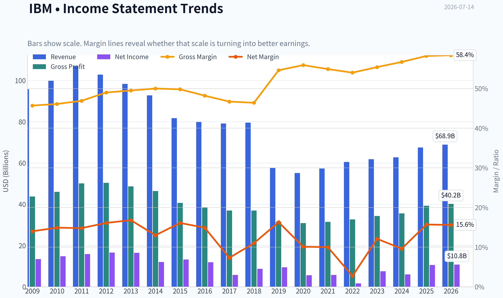

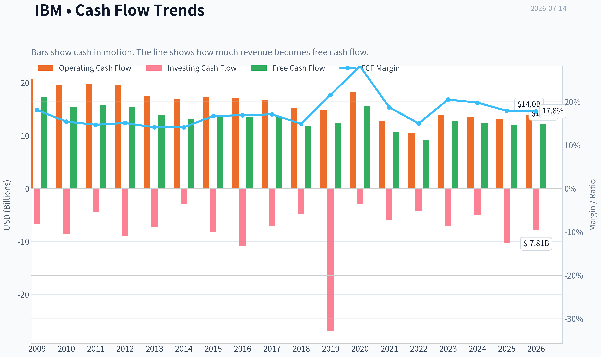

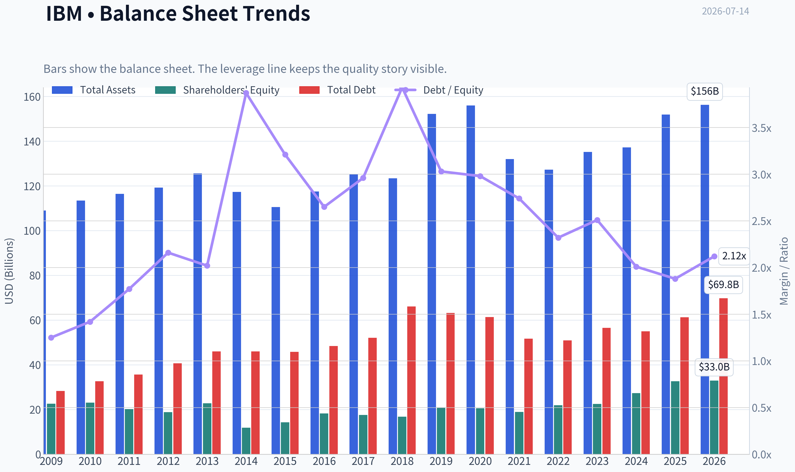

This graph tracks the profitability and return metrics (ROE, ROIC, Margins) of **IBM** over the past decade, highlighting capital efficiency trends.

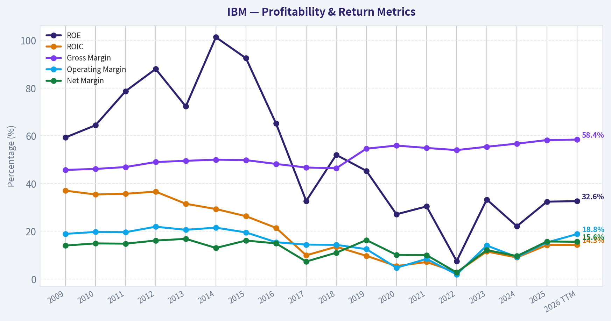

This chart illustrates the financial health of **IBM** over the last 10 years, mapping cash equivalents and free cash flow against total obligations (Debt).

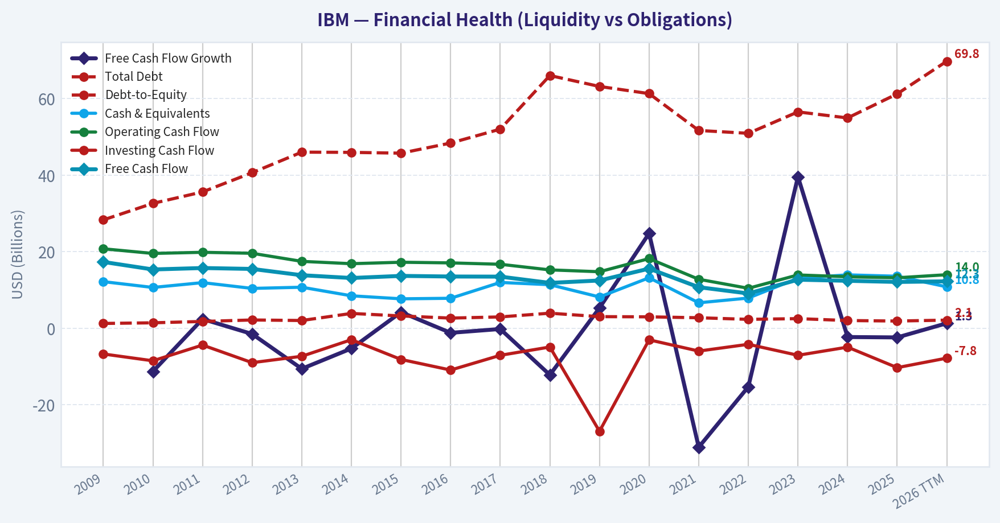

This breakdown chart from <em>Revenue Breakdown</em> shows the proportional composition for **IBM** - useful for understanding what drives or risks the business.

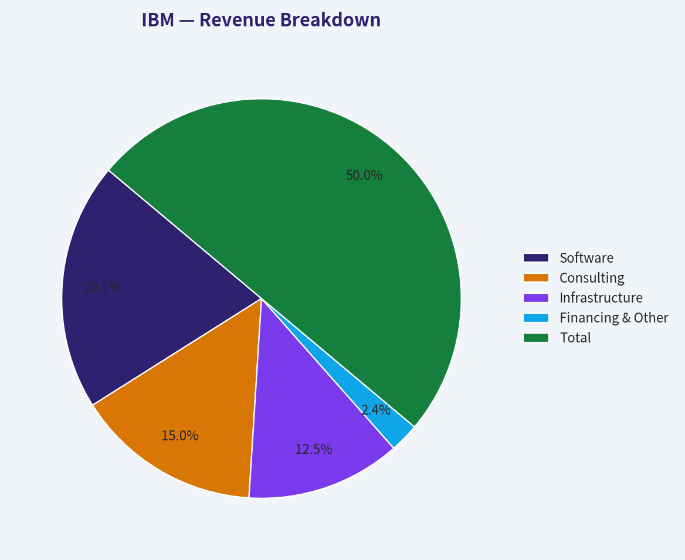

---

### Intrinsic Value Analysis (Buffett)

> *Following Warren Buffett's value investing philosophy: Circle of Competence, Economic Moat, Management Quality, and Margin of Safety.*

#### Intrinsic Value Snapshot

Price is what you pay. Intrinsic value is what the business may be worth based on the cash it can create for owners over time. We show a range, not one magic number.

- Current Price: $218.72
- Value Range (conservative to optimistic across both DCF methods): $105.41 to $516.86

##### Owner Earnings (Buffett Method)
- Net Income: $10,593,000,000.00
- Depreciation & Amortization: $5,021,000,000.00
- Capital Expenditures: $-1,091,000,000.00
- Working Capital Changes: $-3,139,000,000.00
- Owner Earnings: $17,662,000,000.00

##### Intrinsic Value
###### Buffett Method
Uses owner earnings. Stricter, and usually more conservative.
- Conservative: $207.40
- Average: $252.17
- Optimistic: $516.86
- Discount Rate: 10.0%

###### Cash Flow Method
Uses free cash flow. Better for companies spending heavily today to grow tomorrow.
- Conservative: $105.41
- Average: $147.72
- Optimistic: $157.99
- Discount Rate: 10.0%

ANALYST STANCE: **WATCH**

#### IBM Buffett-Style Investment Report

#### 1. Go/No-Go Gate Assessment

| Gate | Verdict | Evidence |
|---|---|---|
| Gate 1: Circle of Competence & Simplicity | Pass | IBM sells enterprise software, consulting, infrastructure, and related services to large organizations. In simple terms: it helps big companies run their technology systems, manage data, and automate work. This is understandable, but less simple than a pure consumer brand or single-product software company. |
| Gate 2: Moat Test | Pass, but not elite | Gross margin of 58.2% supports the existence of intangible assets and sticky enterprise relationships. IBM has customer switching costs in mission-critical systems, but parts of the portfolio face competition and slower secular growth. |
| Gate 3: Management & Capital Allocation | Mixed Pass | IBM has a long operating history and has repositioned toward software and AI. However, the company's capital allocation record over a full cycle is mixed due to years of uneven growth, large acquisitions, and legacy business drag. |
| Gate 4: Industry Structure | Mixed | Enterprise software can be attractive, but IT services and infrastructure are competitive and less moat-rich. IBM participates in both good and mediocre industry structures, which lowers the overall quality score. |

Key Takeaways: IBM clears the basic Buffett filters, but without the clean elegance of a truly exceptional business. Its operations are understandable, and it has real customer stickiness, yet the business mix remains less attractive than the best software franchises. The result is a qualified pass rather than a slam-dunk endorsement.

---

#### 2. The Elementary School Test

IBM makes money by selling technology tools and services to large businesses and governments. It helps customers store data, run software, secure systems, modernize old technology, and hire IBM experts to implement those tools.

A decade from now, IBM will likely still serve large enterprises with software, infrastructure, and consulting. The question is not survival. The question is whether it can grow per-share value at an attractive rate versus stronger competitors in cloud, software, and AI.

Technology risk is moderate. IBM benefits from technology adoption, but it also operates in areas where customer preferences and architectures evolve quickly. This is not a commodity producer, but neither is it immune from disruption.

#### 3. Moat Analysis

| Moat Source | Assessment | Evidence |
|---|---|---|
| Intangible Assets | Moderate | IBM has a respected enterprise brand, long client relationships, and credibility with governments and regulated industries. Gross margin above 58% supports some pricing power, especially in software. |
| Switching Costs | Strong in parts | Deep integration into legacy systems, mission-critical workflows, middleware, and enterprise contracts creates friction for customers considering change. |
| Cost Advantage | Limited | IBM has scale, but not a decisive structural cost advantage across the whole business. In consulting and infrastructure, scale helps, but competitors also have scale. |
| Network Effects | Weak | IBM does not enjoy the kind of dominant consumer or developer ecosystem network effects seen in top platform companies. |
| Overall Moat Rating | Narrow to Moderate | Best described as a real but uneven moat: stronger in software and embedded enterprise relationships, weaker in consulting and infrastructure. |

Key Takeaways: IBM's moat is real, but it is not uniformly strong across the company. Switching costs and enterprise trust are the biggest defenses, while network effects are limited. This makes IBM more durable than exciting.

#### 4. Management Quality & Capital Allocation

| Dimension | Assessment | Commentary |
|---|---|---|
| Owner Orientation | Moderate | Management's messaging has emphasized higher-value software, hybrid cloud, and AI. The strategic direction is sensible, but IBM does not present the same owner-operator feel as founder-led or highly aligned firms. |
| Candor | Moderate | IBM has generally communicated its strategic pivot clearly, though long-term results have not always matched ambition. Investors should prefer evidence over narrative. |
| Capital Allocation | Mixed | The company has shifted toward software and recurring revenue, which is directionally correct. Still, IBM's long-run record includes large bets that have not always translated into superior shareholder returns. |
| Debt Discipline | Acceptable, not fortress-grade | IBM historically uses meaningful debt. This is manageable for a mature cash-generative company, but it is not a textbook Buffett fortress balance sheet. |

Key Takeaways: IBM's management appears rational enough, but not exceptional by Buffett standards. The strategic pivot toward software and AI makes sense, yet the historical capital allocation record does not inspire full confidence. This is competent stewardship, not elite stewardship.

---

#### 5. Financial Summary

| Metric | Current / Recent |
|---|---:|
| Share Price | $219 |
| Market Cap | $205.58B |
| P/E | 19.37 |
| ROE | 32.4% |
| Gross Margin | 58.2% |
| Revenue Growth YoY | 7.6% |
| FCF Yield | 5.9% |
| Current Ratio | 0.96 |

Key Takeaways: IBM currently looks profitable, cash-generative, and not obviously expensive on earnings. The standout figures are high gross margin and high reported ROE, though the ROE should be treated carefully because mature companies with debt and buybacks can show elevated equity returns. The valuation is reasonable, but not deeply discounted.

#### 6. Financial Interpretation Through a Buffett Lens

| Test | Result | Interpretation |
|---|---|---|
| Gross Margin > 40% | Yes | Supports intangible assets and some pricing power. |
| ROE > 15% | Yes | Strong on the surface, but likely helped by capital structure effects. |
| Cash Generation | Yes | FCF yield of 5.9% indicates meaningful cash production relative to market cap. |
| Revenue Growth | Modest Positive | 7.6% YoY is healthy for IBM, though one year does not establish a durable compounding runway. |
| Balance Sheet Comfort | Fair | Current ratio below 1 and historically meaningful debt keep IBM from fortress status. |

Key Takeaways: IBM meets several quality thresholds on paper, especially margins, ROE, and cash generation. The caution is that these numbers do not automatically translate into a wide moat or superior reinvestment economics. IBM looks solid, but not pristine.

#### 7. Owner Earnings Estimate

Using a practical Buffett-style approximation anchored to free cash flow:

| Item | Estimate |
|---|---:|
| Net Income | Implied positive and substantial |
| + D&A | Meaningful add-back in a mature tech business |
| - Maintenance CapEx | Moderate |
| - Working Capital Increases | Manageable |
| Approx. Owner Earnings | Roughly in line with free cash flow |
| Implied Owner Earnings Yield | ~5.9% |

Key Takeaways: For IBM, owner earnings are best thought of as broadly similar to free cash flow. That is encouraging because Buffett cares about cash that can be taken out of the business without harming its competitive position. At today's price, the cash yield is respectable but not compelling enough to create a strong margin of safety.

---

#### 8. Three-Scenario DCF Valuation

Using owner earnings yield of 5.9% on a $205.58B market cap implies current owner earnings of about $12.13B.

| Scenario | Assumption | Equity Value | Per Share View | Verdict |
|---|---|---:|---:|---|
| A: No Growth | Owner Earnings / 10% | ~$121.3B | Well below current market value | Overvalued on no-growth basis |
| B: GDP Growth | OE x 1.03 / (10%-3%) | ~$178.5B | Below current market value | Slightly overvalued |
| C: Moderate Historical Growth | Assume 5% for 10 years, then 3% terminal | ~$190B-$205B | Around fair value | Fair to slightly rich |

Key Takeaways: IBM does not look cheap under conservative valuation assumptions. Only under a moderate-growth case does the stock approach fair value. That is not enough for a classic Buffett-style purchase, which demands a clear discount to intrinsic value.

#### 9. Margin of Safety Analysis

| Item | Value |
|---|---:|
| Current Market Cap | $205.58B |
| Conservative IV Range | $178B to $205B |
| Margin of Safety vs Low End | Negative |
| Margin of Safety vs Mid/Fair Value | Minimal to none |
| Required Buffett Discount | At least 25% |
| Conclusion | Insufficient margin of safety |

Key Takeaways: IBM fails the margin-of-safety test at the current price. The stock may be reasonable for a quality-at-a-fair-price investor, but it is not discounted enough for a strict value investor. This is the main reason the stance is Watch, not Advocate.

---

#### 10. Final Buffett Scorecard

| Criterion | Weight | Score (1-5) | Weighted Score |
|---|---:|---:|---:|
| Business Understanding | 20% | 4.0 | 0.80 |
| Moat Width & Durability | 25% | 3.0 | 0.75 |
| Management Quality | 15% | 3.0 | 0.45 |
| Return on Equity | 15% | 4.0 | 0.60 |
| Reinvestment Runway | 10% | 3.0 | 0.30 |
| Balance Sheet Strength | 5% | 2.5 | 0.13 |
| Industry Structure | 5% | 3.0 | 0.15 |
| Valuation/Margin of Safety | 5% | 2.5 | 0.13 |
| **Total** | 100% |  | **3.31 / 5.00** |

Key Takeaways: IBM earns a respectable but not outstanding score. The business is understandable and profitable, but the moat, management quality, and valuation are not strong enough to justify a full endorsement. This is a decent company without a decisive bargain.

#### 11. Final Judgment

**Investment Stance: WATCH**
**Conviction Level: Moderate**

IBM is a durable, cash-generative enterprise technology company with real switching costs, attractive gross margins, and acceptable valuation discipline. But Buffett would likely ask two hard questions: is this a truly wonderful business, and is it available at a meaningful discount? Today, the answer to both is not quite.

The stock appears roughly fair, perhaps slightly rich, rather than clearly undervalued. For a value investor, IBM belongs on the watchlist for a better entry point, especially if market disappointment creates a wider discount without damaging the long-term franchise.
#### Valuation Bridge

This bridge places the current market price beside each intrinsic value lens so readers can see whether upside depends on one method or shows up across several methods.

| Scenario | Intrinsic Value / Share |
| --- | ---: |
| Buffett Method | $252.17 |
| Cash Flow Method | $147.72 |
| Damodaran Method | $140.83 |
| Current Price | $218.72 |

#### Key Takeaways

If one method is far above the others, the upside case depends on a specific modelling assumption. When several methods cluster together, the valuation story is more robust.

#### Valuation Visuals

This comparison chart from *Latest Earnings Snapshot* stacks current figures against historical benchmarks for **IBM**, making it easy to see where the company trades relative to its own averages.

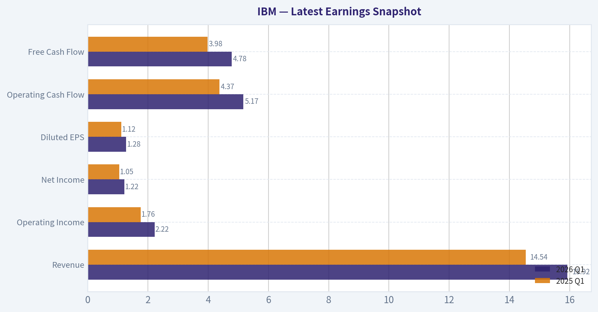

This comparison chart from *Current vs Historical Average Comparison* stacks current figures against historical benchmarks for **IBM**, making it easy to see where the company trades relative to its own averages.

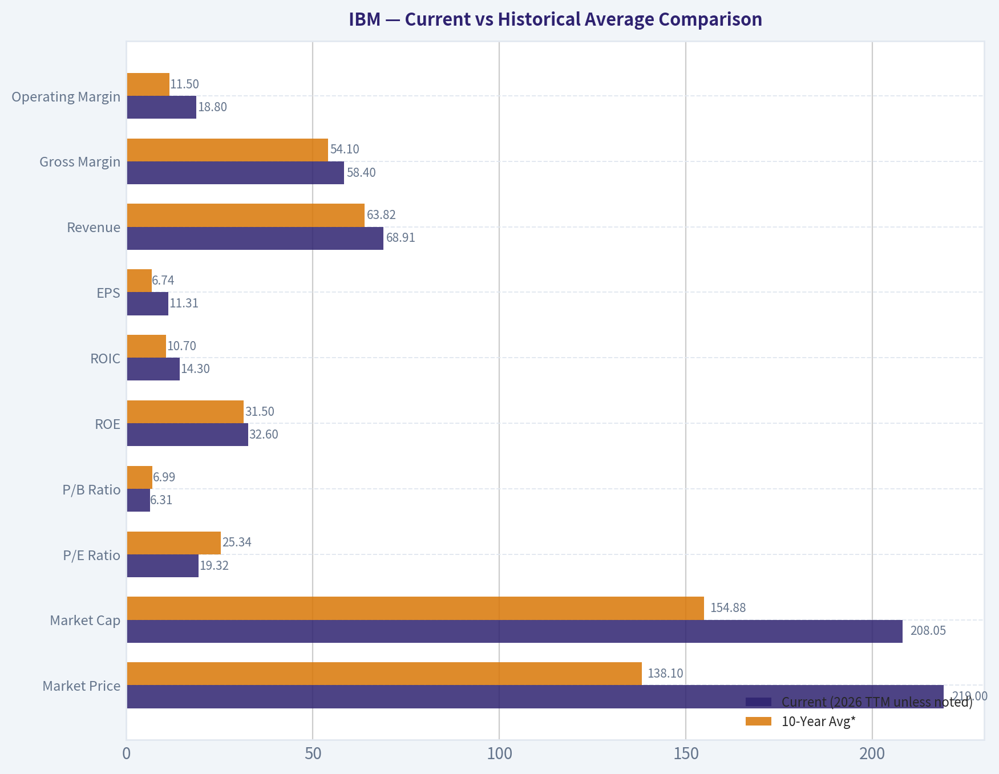

This comparison chart from *Buffett-Style Owner Earnings DCF* stacks current figures against historical benchmarks for **IBM**, making it easy to see where the company trades relative to its own averages.

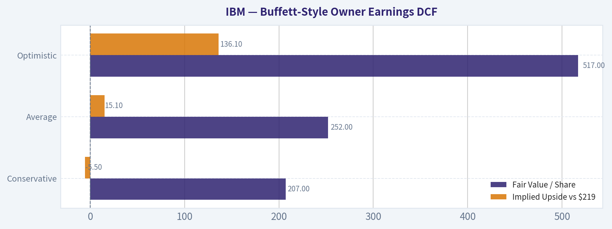

This comparison chart from *Financial Summary* stacks current figures against historical benchmarks for **IBM**, making it easy to see where the company trades relative to its own averages.

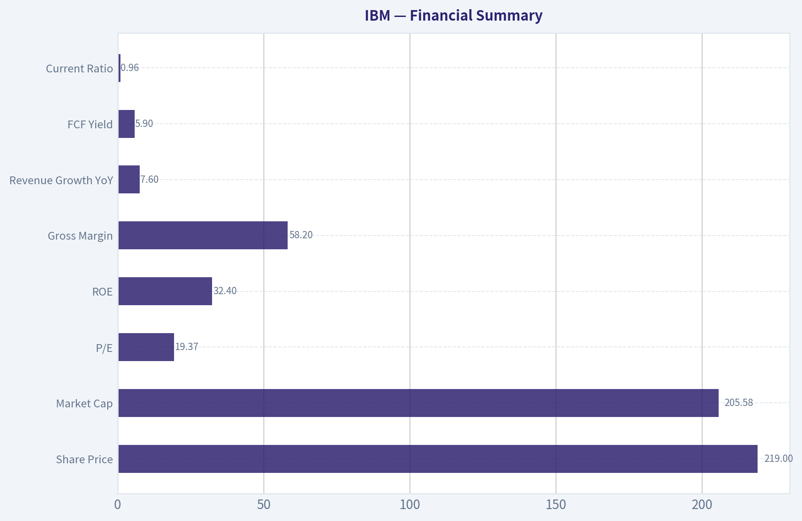

---

### Trend & Growth Analysis (Lynch/Druckenmiller/Fisher)

> *Following Peter Lynch's GARP, Stanley Druckenmiller's macro-aware approach, and Philip Fisher's scuttlebutt methodology.*

ANALYST STANCE: **WATCH**

#### IBM Growth Analysis

#### 1. Lynch Classification

| Metric | IBM Snapshot | Lynch Read |
|---|---:|---|
| Revenue growth YoY | 7.6% | **Stalwart** |
| Market cap | $205.6B | Too large for classic ten-bagger setup |
| P/E | 19.4x | Reasonable for quality, not screaming cheap |
| FCF yield | 5.9% | Supports downside better than hypergrowth upside |

**Key Takeaways:** IBM fits best as a **Stalwart**, not a fast grower. The company has respectable growth and cash generation, but it does not currently meet Lynch's preferred 15% to 25% plus growth profile for a fresh growth investment. That alone limits ten-bagger potential from today's size.

#### 2. The Story in 3 Bullets

- IBM helps large enterprises run critical software, infrastructure, consulting, and AI tools for complex business operations.
- The core bull case is that hybrid cloud plus enterprise AI can re-accelerate growth and improve mix toward higher-margin software.
- The core bear case is that IBM remains a mature incumbent whose AI opportunity may be real but not large enough to overcome slow legacy segments and execution risk.

#### 3. TAM Analysis and 10x Test

| Item | Estimate / Comment |
|---|---|
| Current revenue base | Roughly large-cap enterprise tech scale; already deeply penetrated in core IT |
| Relevant TAMs | Hybrid cloud, automation, cybersecurity, enterprise AI, consulting modernization |
| TAM direction | Expanding due to AI and automation demand |
| 10x test | **Fails in practical terms** |
| Why | IBM would need to add well over a trillion dollars in market value and a massive revenue step-up from an already huge base |

**Key Takeaways:** IBM operates in big markets, but its own size works against the classic long-runway growth thesis. While the AI and hybrid cloud TAM is expanding, IBM is too mature for a realistic 10x revenue scenario. This is a "can improve" story, not a "still tiny relative to TAM" story.

#### 4. Revenue Growth Trend

| Metric | Value | Interpretation |
|---|---:|---|
| Recent YoY revenue growth | 7.6% | Positive but modest |
| Pattern | Not enough evidence of acceleration | **Stable-to-slow growth** |
| Latest news flow | Q2 earnings shortfall and AI warning | Near-term growth confidence weakened |

**Key Takeaways:** Revenue is still growing, which avoids an outright red flag, but the pace is modest. More importantly, the latest earnings update suggests growth may be wobbling rather than accelerating. For a Druckenmiller-style inflection thesis, that is a warning sign.

#### 5. Unit Economics / Quality Metrics

| Metric | IBM |
|---|---:|
| Gross margin | 58.2% |
| ROE | 32.4% |
| FCF yield | 5.9% |
| Current ratio | 0.96 |
| SaaS metrics like NRR / LTV-CAC | Not disclosed in provided data |
| Rule of 40 | Not applicable with current data set |

**Key Takeaways:** IBM still shows strong business quality through high gross margins, high reported ROE, and meaningful free cash flow. However, this is not the kind of transparent recurring-software model where best-in-class growth metrics like NRR and CAC payback are visible. That limits confidence in judging IBM as a modern compounding growth platform.

#### 6. Inflection Point Assessment

| Potential Inflection | Status | Read |
|---|---|---|
| Product cycle inflection | AI offerings gaining attention, but mixed evidence | Unclear |
| Market share inflection | No proof of major share gains | Weak |
| Margin inflection | Possible via software mix | Plausible but not yet decisive |
| TAM inflection | Enterprise AI expands addressable demand | Positive |
| Competitive inflection | AI may favor hyperscalers and app leaders over IBM | Mixed-to-negative |

**Key Takeaways:** The TAM is improving because AI expands enterprise spending opportunities, but IBM has not clearly shown that it is converting that into an earnings acceleration. The latest negative earnings news suggests the hoped-for inflection may be delayed or weaker than expected. This is not a clean acceleration setup today.

#### 7. Macro Setup Evaluation

| Macro Factor | Read for IBM |
|---|---|
| Rate outlook | June CPI softer, potentially supportive for quality tech |
| Economic cycle | Mixed; enterprise spending selective |
| Secular themes | AI, hybrid cloud, cybersecurity, automation |
| Macro wind | Mildly positive, but company-specific execution dominates |

**Key Takeaways:** The macro backdrop may become somewhat friendlier if lower inflation leads to easier rate expectations. That helps valuation support for tech broadly. Still, IBM's outcome is more dependent on execution than on macro tailwinds.

#### 8. Fisher 15-Point Score

| Fisher Category | Score (1-5) | Comment |
|---|---:|---|
| Market potential | 4 | Large enterprise AI/cloud markets |
| New product development | 3 | Credible, but not clearly leading |
| R&D effectiveness | 3 | Solid, though not frontier-best |
| Sales organization | 4 | Strong enterprise reach |
| Profit margin | 4 | Healthy gross margin |
| Improving margins | 3 | Possible, not proven |
| Labor/personnel relations | 3 | Neutral |
| Executive relations | 3 | Neutral |
| Management depth | 4 | Large bench |
| Cost/accounting controls | 4 | Mature operator |
| Special advantages | 3 | Brand and enterprise ties, but limited moat expansion |
| Long-range profit outlook | 3 | Stable, not explosive |
| Dilution risk | 4 | Lower concern than younger growth firms |
| Candor | 3 | Mixed, given disappointing update |
| Integrity | 4 | No major issue in provided record |

| Total | **52 / 75** | **Average** |

**Key Takeaways:** IBM scores as a solid but not exceptional Fisher company. Its strengths are enterprise reach, margins, and operating maturity, while its weaknesses are limited evidence of breakthrough innovation and only moderate long-term growth potential. This profile fits a dependable incumbent more than a standout growth compounder.

#### 9. Valuation Analysis

| Valuation Metric | Value | Interpretation |
|---|---:|---|
| P/E | 19.4x | Fair for mature quality tech |
| PEG | ~2.5x using 7.6% growth | **Expensive vs. growth rate** |
| FCF yield | 5.9% | Offers support on cash basis |
| P/S | Not provided | N/A |

**Key Takeaways:** IBM looks acceptable on earnings and cash flow, but not cheap relative to its current growth rate. A PEG around 2.5 is well above Lynch's preferred range. That means the valuation is more consistent with a quality hold than a growth buy.

#### 10. Growth Investor Scorecard

| Criterion | Weight | Score (1-5) | Weighted Score |
|---|---:|---:|---:|
| The Story | 10% | 3.0 | 0.30 |
| TAM & Runway | 20% | 2.5 | 0.50 |
| Revenue Growth | 20% | 2.5 | 0.50 |
| Unit Economics | 15% | 3.5 | 0.53 |
| Competitive Position | 10% | 3.0 | 0.30 |
| Management Quality | 10% | 3.5 | 0.35 |
| Macro Setup | 5% | 3.0 | 0.15 |
| Profitability Path | 5% | 4.0 | 0.20 |
| Valuation | 5% | 2.5 | 0.13 |

| Total |  |  | **2.96 / 5.0** |

**Key Takeaways:** IBM lands just under the threshold for a constructive growth call. The company earns credit for quality, profitability, and durable enterprise relevance, but it loses points on runway, growth speed, and valuation relative to that growth. This is a borderline case, and the recent earnings disappointment pushes it into WATCH.

#### 11. Position Size Stance

| Investor Type | Stance |
|---|---|
| Existing shareholder | Hold/watch closely |
| New growth investor | Small watchlist position at most |
| High-conviction growth portfolio | Not a core position |

**Key Takeaways:** IBM is more suitable as a monitored quality name than as a concentrated growth bet. Existing holders can justify patience if they believe software and AI mix will improve. New buyers should wait for either a cheaper entry or clearer evidence of acceleration.

#### 12. Key Risks and Catalysts

| Risks | Catalysts |
|---|---|
| AI narrative fails to translate into revenue acceleration | Clear AI bookings and software growth re-acceleration |
| Consulting and infrastructure remain drag on mix | Margin expansion from better software mix |
| Recent earnings shortfall damages confidence | Strong next quarter restoring execution credibility |
| Large-cap maturity limits upside multiple expansion | Rate cuts supporting valuation of quality tech |
| Competitive pressure from hyperscalers and software leaders | Better-than-expected enterprise cross-sell across installed base |

**Key Takeaways:** The main risk is simple: IBM may remain a mature company with a good AI story but only modest financial payoff. The main upside catalyst would be proof that AI and software are large enough to accelerate growth and margins at the consolidated level. Until that evidence appears, the stock is more of a monitoring candidate than an advocate.

#### Bottom Line

IBM is a **quality stalwart**, not a classic fast grower. The bull case rests on enterprise AI, hybrid cloud, and software mix improving earnings power over the next few years. But with only **7.6% revenue growth**, a **~2.5 PEG**, and a fresh **earnings shortfall**, this does **not** currently satisfy a Lynch-Druckenmiller-Fisher high-conviction growth standard.

**Final stance: WATCH.**

If you want, I can next do one of these:
1. a **bull vs. bear debate** on IBM,
2. a **3-year valuation scenario model**,
3. or a **compare IBM vs. MSFT / ORCL / ACN** growth scorecard.

#### Growth & Scorecard Visuals

The radar chart below from *Final Buffett Scorecard* visualises how **IBM** ranks across weighted investment criteria. Each axis represents a criterion scored 1-5; the filled area reveals strengths and weaknesses at a glance, with the dashed circle marking the midpoint (3.0).

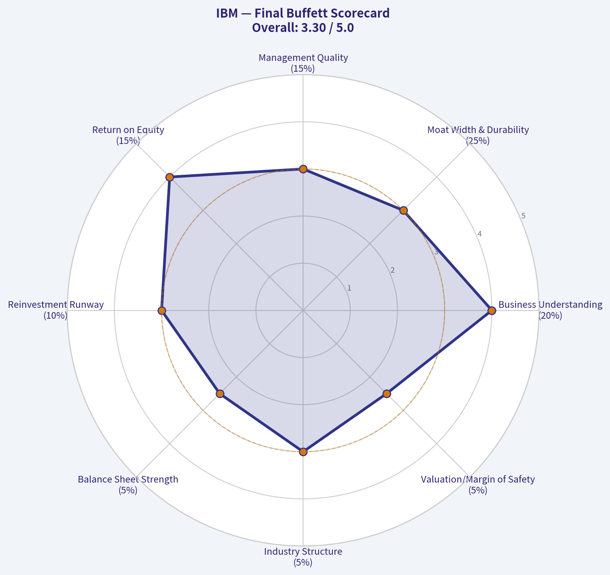

---

### Market Technical Analysis

#### IBM Technical Indicator Selection and Market Report

For IBM's current setup, the **most relevant 8 indicators** are:

| Indicator | Why it is useful now |
|---|---|
| close_10_ema | Best for tracking the fast rebound and short-term momentum shifts after June's selloff. |
| close_50_sma | Defines the medium-term trend and shows whether the recent rally has real structural support. |
| close_200_sma | Critical long-term benchmark; IBM is interacting with this level now, making it strategically important. |
| macd | Confirms whether momentum remains bullish after the sharp May-July advance. |
| macdh | Adds early insight into whether MACD momentum is accelerating or fading. |
| rsi | Useful because IBM recently moved from overbought conditions into a more neutral zone, which helps assess whether the rally is cooling or merely consolidating. |
| atr | Important because IBM's volatility regime expanded sharply after late May and remains elevated. |
| vwma | Especially relevant here because the rally was accompanied by very heavy volume, so volume-weighted trend confirmation matters. |

**Key Takeaways:** IBM's current chart is best understood through a blend of trend, momentum, volatility, and volume indicators rather than through any single signal. The stock has staged a powerful recovery from its spring lows, but it is now trading in a more nuanced zone where short-term momentum is still positive while long-term resistance and elevated volatility remain important constraints.

---

#### Price Structure and Trend Context

Over the last year, IBM has gone through **three distinct phases**:

1. **Summer 2025 to late 2025:** a strong advance from the mid-230s/240s into the low 300s.
2. **Early 2026 to mid-May 2026:** a prolonged correction that drove price from the low 300s down to roughly **214-225**, including several gap-like breakdown episodes.
3. **Late May 2026 to early July 2026:** a forceful reversal rally, with price rebounding from the low 220s to above **300** before easing back into the high 280s/low 290s.

This is not a random sideways pattern. IBM first experienced a **deep trend reset**, then a **high-energy recovery**. The most recent action suggests the stock is no longer in the capitulation phase, but it is also no longer in the explosive early rebound phase. Instead, it appears to be transitioning into a **decision zone** where the market is testing whether the rebound can mature into a sustainable uptrend.

At the latest close available, IBM finished around **290.23** on 2026-07-13. That places it:
- **Above the 50-day SMA** near **262.69**
- **Above the 200-day SMA** near **272.59**
- Roughly **in line with the 10-day EMA** near **289.29**

That alignment is constructive. Price above both the 50-day and 200-day averages usually signals that the broader structure has improved materially. However, the fact that price has pulled back from the recent peak near **306** while sitting only modestly above the 10-day EMA tells us the move has entered a more delicate stage. Bulls still have control, but the trend is now being tested rather than expanding cleanly.

---

#### Moving Average Interpretation

| Indicator | Latest reading | Trend message | Trading implication |
|---|---:|---|---|
| close_10_ema | 289.29 | Rising | Short-term momentum still positive, but price is hugging the average rather than extending away from it. |
| close_50_sma | 262.69 | Rising steadily | Medium-term trend has clearly turned up after bottoming in May. |
| close_200_sma | 272.59 | Rising slowly | Long-term structure remains constructive, and price has reclaimed this strategic benchmark. |

**Key Takeaways:** IBM is in a technically improved position because price is above all three important moving averages. The 50-day average is rising strongly, the 200-day average is still trending upward, and the 10-day average shows that short-term momentum has not fully broken even after the recent pullback.

A key nuance: the **distance between price and the 50-day SMA** is still substantial, around **10%+**, which means the stock has room to consolidate without destroying its intermediate uptrend. By contrast, the **distance above the 200-day SMA** is much narrower, roughly **6%**, which makes that area more strategically important as support if weakness deepens.

This creates a useful hierarchy:
- **First support:** 10 EMA / upper 280s to around 289
- **Second support:** low-to-mid 270s near the 200 SMA
- **Deeper support:** low 260s near the 50 SMA

Because the 50 SMA is now rising sharply after flattening earlier in the quarter, it suggests that the late-May breakout was not just a one-day event. Enough sustained follow-through occurred to bend the medium-term trend higher.

---

#### Momentum Analysis: MACD and MACD Histogram

| Indicator | Latest reading | Recent behavior | Interpretation |
|---|---:|---|---|
| macd | 8.38 | Positive, but down from 9.50 on 07-09 | Momentum remains bullish but is no longer accelerating. |
| macdh | 0.87 | Positive, but shrinking from 3.19 on 07-08 | Bullish momentum is fading in the short term. |

**Key Takeaways:** IBM's momentum is still positive, but it has clearly cooled. The MACD remains above zero, which supports the bullish recovery narrative, yet the histogram has narrowed sharply, indicating that upside thrust has slowed and the stock may need consolidation before another sustained leg higher.

The MACD sequence is especially informative:
- In mid-May, MACD was **negative**, consistent with the prior downtrend.
- By late May and early June, MACD surged sharply positive as the rebound gained force.
- By early July, MACD remained healthy, but the histogram began shrinking.

That pattern usually describes a stock that is **still trending upward, but with diminishing immediate thrust**. This is not the same as outright bearish momentum. Instead, it often marks one of two transitions:
1. A **bullish consolidation**, where price works sideways or slightly down while momentum resets.
2. A **failed extension**, where fading momentum precedes a larger retracement.

At the moment, IBM more closely resembles the first scenario than the second, because MACD is still well above zero and price remains above key moving averages. But traders should watch whether the histogram continues to compress toward zero; if it does, the probability of a broader pullback rises.

---

#### RSI: From Overbought Surge to Controlled Cooling

| Date zone | RSI behavior | Interpretation |
|---|---|---|
| Late May to early June | RSI surged into 70-85+ | Extremely strong momentum, but stretched conditions developed. |
| Mid-to-late June | RSI reset into the 40s-50s | Rally cooled without fully collapsing. |
| Early July | RSI recovered into the 60s | Momentum rebuilt, but less explosively than in early June. |
| Latest | 56.70 | Neutral-to-bullish; no longer overbought, not oversold either. |

**Key Takeaways:** IBM is no longer in an overbought condition, which actually improves the quality of the setup for trend-followers. The RSI near 57 says momentum is still constructive, but the stock is not currently stretched enough to imply an automatic reversal risk.

The most important nuance is that IBM has already worked off the excesses of the May-June spike. When RSI reached the 80s in early June, the stock was vulnerable to digestion. That digestion happened. Now RSI sits in a healthier zone, suggesting the market has partially rebalanced.

For bulls, this is encouraging because it means a new advance would not be launching from an extremely overheated condition. For bears, however, RSI's retreat from the high 60s into the mid-50s shows that upside urgency has diminished. This is why the next directional move matters: if RSI turns higher again while price reclaims the low 300s, that would strengthen the continuation case. If RSI slips through 50 while price loses the 10 EMA decisively, then the consolidation may deepen.

---

#### Volume Confirmation via VWMA

| Indicator | Latest reading | Relative to price | What it suggests |
|---|---:|---|---|
| vwma | 280.61 | Price is above VWMA | The recent trend still has volume-backed support. |

**Key Takeaways:** IBM remains above its volume-weighted moving average, which supports the idea that the rebound has been validated by meaningful participation rather than just thin trading. Even after the pullback from above 300, price is still holding above the average level where volume has been concentrated.

VWMA is especially useful here because IBM's advance was not quiet. The rally from May 21 through early June included several **very high-volume sessions**, including volume bursts above **25 million** and even above **32 million** shares. That matters because heavy-volume rallies often establish stronger reference zones than light-volume rallies.

The latest VWMA around **280.61** sits below the spot price and below the 10-day EMA. This implies that, despite recent softness, the average participant over this window is still in a favorable position. If IBM were to fall back below VWMA and stay there, it would suggest that the rally's sponsorship is weakening. For now, that has not happened.

One subtle caution: because VWMA can be influenced by large volume spikes, IBM's unusually heavy trading in late May and early June may keep this average elevated in a way that reflects the breakout regime more than the very latest price action. Even so, it remains a useful trend-confirmation tool, and at present it still leans supportive.

---

#### Volatility and Risk: ATR Regime Shift

| Indicator | Latest reading | Historical comparison | Risk message |
|---|---:|---|---|
| atr | 12.25 | Well above mid-May levels near 6.5 | Volatility remains elevated even after the rebound stabilized. |

**Key Takeaways:** IBM's volatility has roughly doubled from its calmer May baseline, which means traders should not assume small, orderly price swings. Even though the trend has improved, the stock is still moving in a regime where daily ranges are large enough to trigger tight stops and create sharp reversals.

ATR rose dramatically during the late-May breakout and remained high through June and July. This tells us the stock's character changed: IBM is no longer trading in a low-volatility, defensive manner. It is behaving more like a stock repricing around a major catalyst or structural shift.

Practically, this means:
- **Position sizing should be smaller than normal** for risk-controlled traders.
- **Stops need more room** than they would have in a lower-volatility phase.
- A 2% move in either direction is less meaningful than usual because the stock's normal daily breathing room has expanded.

ATR also helps explain why recent weakness should not automatically be read as trend failure. In a high-ATR environment, pullbacks can look dramatic while remaining perfectly normal within the broader uptrend.

---

#### Fine-Grained Trend Reading

The most useful way to read IBM right now is as a stock in **bullish recovery, maturing into consolidation**.

That is a more precise diagnosis than simply calling the trend "up" or "mixed."

- The **long-term backdrop** is constructive because price has reclaimed the 200-day SMA.
- The **medium-term trend** is stronger still, with the 50-day SMA rising rapidly.
- The **short-term trend** remains positive, but it is clearly less forceful than it was during the late-May and early-June surge.
- **Momentum** is still bullish in absolute terms, yet decelerating at the margin.
- **Volatility** remains high, increasing both opportunity and execution risk.
- **Volume-confirmed support** still appears to exist underneath current price.

This combination often leads to one of two favorable bullish outcomes:
1. **Sideways consolidation above 280-285**, followed by another test of 300-306.
2. **A controlled pullback toward the 200-day SMA / VWMA zone**, followed by renewed buying if momentum stabilizes.

The more bearish outcome would require additional technical damage, especially:
- sustained trade below the **10 EMA**
- then a break below **VWMA**
- then failure of the **200-day SMA**

As of now, the chart has **not** deteriorated that far.

---

#### Decision Levels for Traders

| Zone | Technical meaning | What traders may watch |
|---|---|---|
| 300-306 | Recent breakout/high zone | A reclaim would suggest the uptrend is re-accelerating. |
| 289-290 | Near 10 EMA and current price | Immediate pivot zone; holding here keeps short-term structure intact. |
| 280-281 | Near VWMA region | Important support for confirming volume-backed trend health. |
| 272-273 | Near 200 SMA | Strategic support; losing it would weaken the larger bullish case. |
| 262-263 | Near 50 SMA | Deeper trend support; a retreat here would still preserve some medium-term structure but imply much more repair is needed. |

**Key Takeaways:** IBM is sitting near a short-term pivot, not at a decisive breakdown point. The stock can still remain constructive if it holds the upper-280s and especially the low-280s, while a move back through 300 would be the clearest sign that buyers are regaining momentum.

---

#### Bottom Line

IBM's technical picture is **constructive but no longer effortless**. The stock has already completed the explosive phase of its rebound and is now proving whether that rebound can evolve into a durable trend. The indicator mix points to a market that still favors bulls overall, but with fading short-term momentum and persistently high volatility.

The key message is not that IBM is weak. It is that IBM is **stronger structurally than it is tactically right now**:
- **Structurally:** price above 50 SMA and 200 SMA is bullish.
- **Tactically:** MACD histogram compression and RSI cooling suggest the next leg may require consolidation first.

For trend-followers, the chart remains viable as long as IBM stays above the 200-day SMA and VWMA. For shorter-term traders, patience may be rewarded by either a cleaner reset toward support or a decisive breakout back above the recent highs.

| Area | Current Read on IBM | Practical Interpretation |
|---|---|---|
| Long-term trend | Bullish to constructive | Reclaimed 200-day SMA; broader structure improved. |
| Medium-term trend | Bullish | 50-day SMA rising strongly after May reversal. |
| Short-term trend | Positive but softening | Price near 10-day EMA; momentum cooling. |
| Momentum | Bullish, decelerating | MACD positive, histogram narrowing. |
| RSI condition | Neutral-bullish | No longer overbought; room for either stabilization or renewed push. |
| Volume confirmation | Supportive | Price above VWMA suggests volume-backed trend remains intact. |
| Volatility | Elevated | Wider stops and smaller sizing may be appropriate. |
| Key risk level | 272-273 | 200-day SMA is the major support to defend. |

**Key Takeaways:** IBM still has a favorable overall technical profile, but the easy part of the rebound appears to be behind it. The stock now needs to prove that it can either hold support cleanly or break back above 300 before traders can argue confidently for a fresh momentum leg.

---

### Options Market Analysis

> *Reading options flow - put/call ratios, IV skew, and unusual activity - to gauge institutional positioning and event-driven risk.*

#### IBM Options Market Report
*Date: 2026-07-14*

IBM's near-term options tape shows **active two-way flow**, but the overall structure leans **slightly bullish in positioning with meaningful downside hedging underneath**. Calls dominate open interest, yet put volume is essentially matching call volume and put IV is materially richer than call IV, signaling that institutions are still paying up for protection.

#### 1. Put/Call Ratio Analysis

| Expiration | Call OI | Put OI | Put/Call OI Ratio | Call Vol | Put Vol | Put/Call Vol Ratio |
|---|---:|---:|---:|---:|---:|---:|
| 2026-07-17 | 96,964 | 48,997 | 0.51 | 57,688 | 58,246 | 1.01 |
| 2026-07-24 | 12,810 | 9,364 | 0.73 | 14,085 | 14,214 | 1.01 |
| 2026-07-31 | 5,176 | 3,890 | 0.75 | 4,867 | 5,567 | 1.14 |
| **Near-term total** | **114,950** | **62,251** | **0.54** | **76,640** | **78,027** | **1.02** |

**Key Takeaways:** IBM's **OI-based put/call ratio of 0.54** is below the historical neutral zone around **0.7**, which points to a market structurally tilted toward calls. However, the **volume-based ratio of 1.02** says fresh trading flow is no longer clearly bullish; traders are buying puts at roughly the same pace as calls. That combination usually means legacy positioning is optimistic, but near-term participants are adding caution or hedges.

**Interpretation:**
- **OI ratio 0.54:** Below neutral, indicating a **bullish or call-heavy base positioning**.
- **Volume ratio 1.02:** Near-balanced to slightly put-heavy, indicating **rising defensive activity**.
- **Shift from neutral:** The market is **not outright bearish**, but the tape is clearly less confident than the OI structure alone would suggest.

#### 2. Implied Volatility (IV) Assessment

| Expiration | ATM Call IV | ATM Put IV | Put Premium to Call IV |
|---|---:|---:|---:|
| 2026-07-17 | 52.0% | 74.4% | +22.4 pts |
| 2026-07-24 | 62.1% | 77.9% | +15.8 pts |
| 2026-07-31 | 57.4% | 72.7% | +15.3 pts |

**Key Takeaways:** IBM's near-term IV is **elevated**, and puts are trading at a **very large premium** to calls across all nearby expiries. That is a classic **downside skew**, showing investors are more worried about a sharp drop than they are excited about a melt-up. Elevated front-end volatility also suggests the market sees a **near-dated catalyst or event risk window**.

**IV read:**
- Near-term **ATM IV is high** for a mature mega-cap like IBM, especially with puts in the **low-to-high 70s**.
- The **put skew is steep**: OTM/downside protection is expensive versus upside exposure.
- This usually implies:
  - institutional hedging,
  - demand for crash/downside protection,
  - and/or concern around a catalyst such as earnings, guidance, or macro-sensitive enterprise IT commentary.

**Skew conclusion:** **Strong put skew = downside fear / hedging demand**, not complacent bullishness.

#### 3. Unusual Options Activity

Below are the most notable contracts where **volume greatly exceeded open interest**, suggesting **fresh positioning**, not just exits.

| Expiry | Type | Strike | Volume | OI | Vol/OI | IV | Likely Moneyness / Read |
|---|---|---:|---:|---:|---:|---:|---|
| 2026-07-17 | PUT | 200 | 10,822 | 1,074 | 10.1x | 73.4% | Likely OTM/near-OTM downside hedge or bearish bet |
| 2026-07-17 | PUT | 215 | 8,590 | 1,105 | 7.8x | 64.7% | Near-ATM protective flow; institutional-looking |
| 2026-07-17 | CALL | 230 | 7,836 | 331 | 23.7x | 60.8% | OTM upside speculation or call spread leg |
| 2026-07-17 | CALL | 220 | 7,413 | 442 | 16.8x | 53.1% | Near-ATM/slightly OTM bullish positioning |
| 2026-07-17 | PUT | 210 | 6,639 | 733 | 9.1x | 56.9% | Near-ATM hedge / bearish protection |
| 2026-07-17 | CALL | 225 | 6,376 | 221 | 28.9x | 57.6% | OTM upside chase; could be directional or spread-related |
| 2026-07-17 | CALL | 240 | 3,460 | 481 | 7.2x | 67.3% | Further OTM upside punt; more speculative |
| 2026-07-17 | PUT | 190 | 3,333 | 430 | 7.8x | 74.4% | Tail-risk downside hedge |
| 2026-07-24 | CALL | 225 | 2,987 | 8 | 373.4x | 64.9% | Fresh upside bet; very unusual, likely opening flow |
| 2026-07-24 | PUT | 200 | 2,594 | 251 | 10.3x | 74.0% | Short-dated hedge extension |
| 2026-07-24 | PUT | 180 | 2,350 | 284 | 8.3x | 77.8% | Deep OTM disaster hedge / tail protection |
| 2026-07-17 | CALL | 222.5 | 2,025 | 10 | 202.5x | 56.6% | Extremely fresh call flow; likely tactical bet |
| 2026-07-17 | CALL | 215 | 2,698 | 60 | 45.0x | 46.6% | Near-ATM bullish flow, possibly higher conviction |
| 2026-07-17 | PUT | 195 | 2,901 | 321 | 9.0x | 73.4% | OTM protection; bearish/hedging tone |
| 2026-07-17 | CALL | 235 | 1,878 | 329 | 5.7x | 64.4% | OTM upside interest |

**Key Takeaways:** The unusual flow is **not one-sided**. There is substantial fresh **upside call buying** clustered around **215-230**, but there is also very visible **protective put demand** centered around **215, 210, 200, and 195**. That pattern often reflects a market expecting a move, with bulls still participating but institutions unwilling to leave downside unhedged.

**What it implies:**
- **Calls 215/220/225/230/235 for 7/17:** Suggest traders are targeting a near-term upside move. The concentration near current trading levels makes this more credible than lottery-ticket far OTM call buying.
- **Puts 215/210/200/195 for 7/17:** This is serious defensive flow. The size and front-week timing look more like **institutional hedge activity** than casual retail trading.
- **7/24 225 calls with tiny prior OI:** This stands out as a **fresh bullish opening bet**, possibly someone positioning for follow-through beyond the nearest weekly expiry.
- **7/24 180 puts:** These look less like a base-case bearish call and more like **tail-risk insurance**.

**Smart-money vs. retail read:**
- The **near-ATM puts and calls with large notional size in front-week expiry** look more institutional/tactical.
- The **farther OTM upside calls like 240** may contain more speculative retail flavor.
- Net takeaway: **professionals appear to be expecting movement, while paying up for downside insurance.**

#### 4. Open Interest Concentration and Gamma Influence

| Expiration | Highest OI Feature | Market Meaning |
|---|---|---|
| 2026-07-17 | Overall largest OI base in near term | Most important expiry for near-term pinning/gamma effects |
| 2026-07-17 | Heavy activity around 215 / 220 / 225 / 230 | Price may gravitate toward this cluster into expiry |
| 2026-07-17 | Large downside put interest at 200 / 195 / 190 | Potential downside hedge wall; below these levels, moves could accelerate |
| 2026-07-24 | Fresh interest around 225 calls and 200 puts | Secondary magnet zone for post-weekly follow-through |
| 2026-07-31 | Lower OI overall | Less relevant than 7/17 unless price moves sharply |

**Key Takeaways:** The **7/17 expiration is clearly the dominant near-term node**, so that is where gamma effects are likely strongest. The densest activity sits around **215-230**, creating a probable short-term magnetic range if IBM stays stable. But the sizable put interest below the market means a downside break could become more volatile if dealers need to hedge into weakness.

**Gamma-wall interpretation:**
- **Upper gamma/call wall:** Roughly **220-230**
  - Can cap upside if dealers are short calls and need to sell into strength.
  - Or accelerate a squeeze if price pushes through crowded strikes quickly.
- **Lower put wall / hedge zone:** Roughly **200-210**, with tail protection extending to **190/180**
  - This zone may act as support initially.
  - But if broken, it can create **negative gamma-style acceleration lower**.

#### 5. Overall Options Sentiment Signal

| Category | Signal |
|---|---|
| Put/Call OI Structure | Bullish |
| Fresh Volume Flow | Slightly Bearish / Defensive |
| IV Level | Elevated |
| Skew | Bearish (downside protection bid) |
| Unusual Activity | Two-way, but hedged |
| **Overall Options Signal** | **NEUTRAL to SLIGHTLY BULLISH** |

**Key Takeaways:** IBM's options market is **not cleanly bullish**, but it is also **not positioned for a broad downside collapse as the primary scenario**. The best read is **neutral to slightly bullish**, because the call-heavy OI base and concentrated upside activity are still intact, even as traders aggressively hedge downside risk. In short: the market is leaning modestly higher, but with unusually strong protection demand.

**Why this is the signal:**
- **Bullish driver:** Open interest remains decisively **call-heavy** versus the neutral baseline.
- **Cautionary driver:** **Put volume is keeping pace**, and put IV is much higher than call IV.
- **Most likely interpretation:** Traders expect **movement**, with a modest upside bias, but they are uncomfortable carrying that exposure unhedged.

**Confidence level:** **Moderate**
- IBM options appear liquid enough for the signal to matter.
- But because the unusual flow is strongly **two-sided**, conviction should be lower than in a cleaner one-way tape.

#### Final Read

IBM's options market currently reads as **NEUTRAL to SLIGHTLY BULLISH**, with the caveat that **downside hedging is unusually prominent**. If IBM holds above the active **215-220 zone**, upside interest toward **225-230** remains plausible. If it breaks lower toward the **200-210 hedge band**, volatility could rise quickly due to the heavy put structure and steep downside skew.

#### Summary Table

| Metric | Reading |
|---|---|
| Put/Call Ratio | **OI: 0.54 (bullish vs. neutral 0.7); Volume: 1.02 (defensive / balanced)** |
| IV Level | **Elevated near-term; calls ~52%-62%, puts ~73%-78%** |
| Skew Direction | **Strong put skew / downside fear** |
| Unusual Activity | **Heavy two-way flow; notable calls at 215-230, puts at 215/210/200/195** |
| Overall Signal | **NEUTRAL to SLIGHTLY BULLISH** |

---

## Research Team Commentary

> *The Research Manager synthesizes the Bull vs Bear debate into action-free commentary. This is a pre-risk view, not the final stance.*

The strongest bull argument is that IBM is better than its stale "legacy tech" reputation. There is a real enterprise franchise here: sticky relationships, high switching costs in regulated and complex environments, solid gross margins, respectable ROIC, and a credible role in hybrid cloud and practical enterprise AI through Red Hat and workflow integration. From a Buffett lens, that matters. This is an understandable business with durable customer entrenchment and cash-generating characteristics. At roughly 19x earnings, the bull case says you are not paying a euphoric multiple for a mission-critical incumbent that may gradually improve mix toward software and automation.

The strongest bear argument is that durability alone is not enough. IBM's moat is more defensive than expansive, and that distinction matters. A lot of the stickiness comes from customer inertia and legacy complexity, not from a widening competitive advantage that compounds naturally. Consulting dilutes quality, Red Hat improves relevance but does not guarantee superior economics, and the AI story may end up supporting perception more than materially lifting long-term returns. Most importantly, at about 19.4x earnings, this is not a classic margin-of-safety setup for a business with mixed segment quality, only decent-not-elite ROIC, and a long history of needing reinvention. In Buffett terms, it looks more like a fair business at a fair price than a great business at a sensible price.

My takeaway is WATCH.

Core takeaway: IBM is a durable but not exceptional business, and the current debate does not establish enough undervaluation to justify a Buffett-style endorsement. The bull case is right that the market can underrate boring, sticky enterprise franchises. But the bear case is more persuasive on the key question that matters most for value investing: whether the quality of the business and the price together create a clear margin of safety. I do not think they do.

Rationale: I want to be careful here not to repeat the mistake I made with prior mega-cap situations by letting rigid valuation blind me to tactical rebound potential. IBM absolutely could have tactical upside, especially after a major correction and rebound pattern in the market history you provided. But that lesson cuts both ways: I should separate tactical trading setups from long-term value decisions. For a Buffett-style portfolio, I care less about whether IBM can bounce over the next few weeks and more about whether it can compound intrinsic value attractively over 10 years from this entry price.

On that standard, IBM is respectable but not compelling. The business quality is decent: 58% gross margin, 13.2% ROIC, 32.4% ROE, and strong customer entrenchment are all positives. But I do not treat the ROE as clean evidence of superiority without more balance-sheet context, and the ROIC is good rather than extraordinary. That matters because truly elite moats tend to show up in cleaner, more obviously superior economics. IBM also still has a less elegant mix than top software franchises. Consulting and infrastructure make the earnings stream more operationally dependent and less effortless than the best Buffett-style compounders.

The contrarian angle is interesting: the crowd may indeed be too dismissive of IBM as "old tech." But contrarian investing only works when skepticism creates mispricing. Here, the market is already assigning a fairly reasonable multiple. That tells me this is not hated enough to create a classic opportunity, nor great enough to deserve a premium without question. In other words, the market may be roughly right.

If I'm looking for what would have to be true for today's price to be attractive, I'd need confidence that hybrid cloud and AI meaningfully improve growth mix, software contribution, and cash flow durability over several years. That is possible, but not yet proven enough to underwrite with conviction. If instead IBM remains mostly a stable incumbent that preserves relevance but does not substantially improve economics, then 19x earnings is not especially cheap.

Monitoring plan over the next 1-4 quarters: I would watch three things closely. First, software and Red Hat-led growth quality: I want to see that higher-quality recurring software is growing fast enough to offset weaker or lower-quality segments, and that this is not just branding around old businesses. Second, free cash flow conversion and capital allocation discipline: if IBM shows strong FCF with sensible use of capital and less need to lean on narrative, the case improves. Third, evidence that AI is becoming economically meaningful rather than just commercially visible: bookings, attach rates, software pull-through, or consulting engagements that actually lift margins and recurring revenue quality. On the negative side, if consulting softens, infrastructure remains uneven, or AI/hybrid cloud rhetoric continues without clear financial lift, that would weaken the thesis. I would also monitor whether returns on invested capital improve meaningfully; if not, the "better mix" story may be overstated.

So my stance is WATCH. IBM is not bad enough to avoid outright, and there is enough durability to keep it on the list. But it is not clearly cheap, and it is not clearly excellent. For a Buffett-style portfolio, that usually means patience. If the business quality becomes cleaner or the price offers a wider margin of safety, I'd reconsider. For now: WATCH.

---

## Value Investing Team Commentary

> *The Investor translates the research view into an investment thesis before risk review. This is still not the final stance.*

IBM is the sort of business that can fool both optimists and skeptics. The optimists see enterprise AI, Red Hat, hybrid cloud, sticky customers, and a respected old franchise. The skeptics see a slow-moving incumbent wrapped in fresh language. As a long-term business owner, I think both sides have part of the truth.

The attractive part of IBM is real. This is not a melting-ice-cube business in the simplistic sense. Large enterprises rely on IBM for mission-critical systems, workflow integration, infrastructure support, and complex transformation work. In regulated industries especially, switching costs are meaningful. That customer entrenchment has value. Gross margins around 58% and ROIC around 13% suggest a business with decent economics, and at roughly 19x earnings, the stock is not priced like a speculative AI darling. From a contrarian perspective, that matters: markets often underappreciate boring, cash-generative franchises when attention is concentrated on faster-growing stories.

But Buffett-style investing requires more than "better than people think." It requires a combination of understandable economics, durable moat, strong capital allocation, and a price that leaves room for error. IBM falls short of being clearly compelling on that full test.

The key issue is moat quality. IBM's moat is mostly defensive. Customers stay because systems are embedded, switching is painful, and enterprise relationships are longstanding. That is valuable, but it is not the same as a business whose advantage naturally widens over time. The best compounders usually have cleaner self-reinforcing economics: network effects, low incremental costs, pricing power, or dominant software ecosystems. IBM has some of that in pieces, especially through software and Red Hat, but the overall mix still includes consulting and infrastructure exposure that lowers the quality of the earnings stream.

That mix matters. Consulting can be useful strategically, but it is generally more labor-intensive and less scalable than software. Infrastructure can be sticky, but it can also be cyclical and modernization-dependent. So even if IBM remains durable, the question is whether it can become meaningfully better, not just remain relevant. For a 10-year owner, that distinction is crucial.

The selective contrarian angle is where the analysis gets interesting. The market may still anchor on IBM's "legacy tech" reputation, and that can create opportunity if the business is quietly improving. Red Hat gives IBM a more credible role in hybrid cloud than many critics admit. Likewise, IBM's AI positioning may be more commercially practical than the hype surrounding consumer-facing AI names, because enterprise customers often care less about novelty and more about compliance, integration, reliability, and workflow productivity. If IBM becomes a trusted enterprise AI enabler layered onto existing customer relationships, the market could be underestimating how much value can be extracted from that installed base.

However, contrarian investing works only when the market is materially wrong. Here, I am not convinced the market is wrong enough. At around 19.4x earnings, IBM is not priced for perfection, but it is also not offering a large margin of safety for a business with mixed segment quality and only moderate reinvestment economics. In other words, the stock seems roughly fairly valued for what it currently is: a durable but not clearly superior business.

What should investors watch in the news and sentiment? First, whether AI headlines translate into measurable economics. Are software revenues improving in mix? Are AI-related engagements driving recurring revenue, attach rates, or margin expansion? If the headlines remain louder than the numbers, sentiment may be overgenerous. Second, watch Red Hat and software growth quality. If these areas show sustained strength and begin to reshape IBM's overall economics, then current skepticism could prove too negative. Third, monitor capital allocation and free cash flow conversion. Mature businesses can still be excellent investments if management is disciplined and intrinsic value per share compounds steadily.

The recent market history you provided also deserves interpretation. A strong rebound after a major correction tells us sentiment can swing hard around IBM. But from a Buffett lens, that is secondary. Price volatility is only useful if it gives us a bargain in a business we want to own. I do not yet see that bargain. The crowd may be too dismissive of IBM's durability, but I also think some investors may be too eager to upgrade the story based on AI optimism before the underlying economics clearly improve.

So my conclusion is straightforward: IBM is investable in the sense that it is understandable, durable, and unlikely to disappear. But it is not the kind of obvious high-quality compounder I would be eager to own for a decade at today's price without a wider discount or clearer proof of business improvement. This is a business to respect, not necessarily to rush into.

**ANALYST STANCE: WATCH**
IBM appears to be a fair business at a fair price: durable, sticky, and cash-generative, but not clearly undervalued and not clearly exceptional. The contrarian opportunity exists only if software mix, Red Hat, and enterprise AI materially improve long-term economics. Until that becomes more visible-or the price offers a more meaningful margin of safety-I would remain patient.

---

## Deep Values Commentary

> *The Risk Management Team debates and the Risk Judge provides the final action-free verdict. This section determines the final ADVOCATE / WATCH / AVOID stance.*

#### Final Stance Scorecard

This scorecard converts the final research view into a weighted decision frame. It does not replace the narrative judgement, but it makes the main drivers of the verdict easier to scan.

| Criterion | Score | Weight | Commentary |
| --- | ---: | ---: | --- |
| Business Quality | 3.75 | 30% | High returns, profitability, and Piotroski health support durability. |
| Valuation Support | 3.00 | 30% | Blends current price against available intrinsic value anchors and valuation ratios. |
| Financial Strength | 1.67 | 20% | Balance-sheet resilience reflects leverage and liquidity staying within safe ranges. |
| Growth Durability | 3.00 | 20% | Recent revenue, earnings, and free cash flow growth indicate how durable expansion looks. |
| TOTAL / FINAL STANCE | 2.96 | 100% | WATCH |

#### Key Takeaways

The weighted score lands at **2.96 / 5.0**, while the final stance remains **WATCH**. This is useful as a quick calibration aid rather than a mechanical signal.

#### Risk Summary

Higher scores indicate more risk pressure. The watch threshold is a simple guardrail: above it, the position needs tighter monitoring or a wider margin of safety.

| Dimension | Current Score | Watch Threshold | Commentary |
| --- | ---: | ---: | --- |
| Business Quality | 2.25 | 3.00 | High returns, profitability, and Piotroski health support durability. |
| Valuation Support | 3.00 | 3.00 | Blends current price against available intrinsic value anchors and valuation ratios. |
| Financial Strength | 4.33 | 3.00 | Balance-sheet resilience reflects leverage and liquidity staying within safe ranges. |
| Growth Durability | 3.00 | 3.00 | Recent revenue, earnings, and free cash flow growth indicate how durable expansion looks. |

#### Key Takeaways

This view helps readers separate *where* the risk sits: valuation, business quality, balance sheet, or growth durability. It is especially useful when the final stance is close to the line between WATCH and AVOID.
