# INSM Deep Value Intelligence

**Analysis Date:** 2026-09-23

## Critical Disclaimer

*This analysis is generated by Deep Value Intelligence, an AI-powered multi-agent investing framework. Education & research only - not financial advice, not a financial advisor.*

---

## Table of Contents

1. Intelligence Summary
2. Analyst Team Reports
   - Fundamentals Analysis
   - Intrinsic Value Analysis (Buffett)
   - Trend & Growth Analysis (Lynch/Druckenmiller/Fisher)
   - Market Technical Analysis
   - Options Market Analysis
3. Research Team Commentary
4. Value Investing Team Commentary
5. Deep Values Commentary

---

## Intelligence Summary

### Thesis + Conditions

**Core Thesis:** ## Executive Briefing

**Key Risks:**
- Verdict: retain the original AVOID plan at $118, while keeping Insmed on a milestone-driven watchlist.**
- Insmed has credible upside: revenue grew 66.7%, gross margin is 79.7%, Arikayce may expand into earlier treatment, and brensocatib could create a multi-product respiratory franchise. However, that potential is not sufficiently discounted. Supplied values of $49 bear, $109 base, and $131 bull imply severe downside, a base value below the price, and only 11% upside in the stated bull case.
- The negative return metrics are not independently disqualifying for a development-stage biotechnology company. The greater risks are unproven operating leverage, ongoing cash requirements, dilution, and incomplete liquidity data. Technical weakness and call-heavy positioning add catalyst volatility but no intrinsic-value protection.

**Confidence:** Low

---

## Analyst Team Reports

### Fundamentals Analysis

#### Latest Earnings Snapshot

*Most recent reported quarter anchored on 2026 Q2, with prior-year comparison when available.*

| Metric | 2026 Q2 | 2025 Q2 | YoY Change |
| --- | ---: | ---: | ---: |
| Revenue | $425.5M | $107.4M | +296.1% |
| Operating Income | $-101.3M | $-253.9M | +60.1% |
| Net Income | $-13.2M | $-321.7M | +95.9% |
| Diluted EPS | $-0.06 | $-1.70 | +96.5% |
| Operating Cash Flow | $-88.8M | $-205.6M | +56.8% |
| Free Cash Flow | $-95.1M | $-209.1M | +54.5% |

Key Takeaways: This snapshot anchors the most recent reported quarter before the narrative analysis. It helps readers separate long-run business quality from whatever changed in the latest earnings print.

#### 17-Year Financial Metrics for INSM

*All values below are computed deterministically from raw data - not estimated by AI.*

*Issuer profile: operating company (Healthcare / Biotechnology).*

#### 17-Year Financial Metrics
*Annual rows come from reported financial statements. The final TTM row is computed from the latest four quarters.*

| Metric | 2009 | 2010 | 2011 | 2012 | 2013 | 2014 | 2015 | 2016 | 2017 | 2018 | 2019 | 2020 | 2021 | 2022 | 2023 | 2024 | 2025 | 2026 TTM |
| --- | --- | --- | --- | --- | --- | --- | --- | --- | --- | --- | --- | --- | --- | --- | --- | --- | --- | --- |
| Market Price | $8 | $6 | $3 | $7 | $17 | $15 | $18 | $13 | $31 | $13 | $24 | $33 | $27 | $20 | $31 | $69 | $174 | $118 |
| Market Cap | $98.0M | $83.5M | $71.2M | $177.6M | $594.7M | $666.8M | $1.06B | $818.8M | $2.08B | $1.01B | $2.02B | $3.25B | $3.05B | $2.46B | $4.35B | $11.33B | $34.64B | $25.72B |
| P/E Ratio | 0.83 | -12.86 | -1.03 | -4.29 | -10.61 | -8.42 | -9.00 | -4.65 | -10.78 | -3.11 | -7.93 | -11.06 | -7.02 | -5.11 | -5.80 | -12.39 | -27.11 | -28.79 |
| P/B Ratio | 0.79 | 0.43 | 0.53 | 1.47 | 4.15 | 3.58 | 3.41 | 5.30 | 5.75 | 4.84 | 7.72 | 11.78 | 7.44 | 27.95 | -13.11 | 39.69 | 46.87 | 33.96 |
| ROE | 95.5% | -3.3% | -44.4% | -34.2% | -39.1% | -42.5% | -37.9% | -114.1% | -53.4% | -155.7% | -97.2% | -106.6% | -105.9% | -547.5% | 225.8% | -320.2% | -172.8% | -115.6% |
| ROIC | -5.5% | -3.5% | -40.8% | -51.2% | -116.5% | -152.5% | -218.3% | -344.8% | -459.3% | -943.2% | -337.3% | -254.4% | -207.6% | -229.7% | -296.6% | -150.2% | -156.2% | -103.3% |
| EPS | $9.30 | $-0.49 | $-2.95 | $-1.56 | $-1.60 | $-1.84 | $-2.02 | $-2.85 | $-2.89 | $-4.22 | $-3.01 | $-3.01 | $-3.88 | $-3.91 | $-5.34 | $-5.57 | $-6.42 | $-4.11 |
| Revenue | $10.4M | $6.9M | $4.4M | $0 | $11.5M | N/A | $0 | $0 | $0 | $9.8M | $136.5M | $164.4M | $188.5M | $245.4M | $305.2M | $363.7M | $606.4M | $1.14B |
| Gross Profit | N/A | N/A | N/A | N/A | N/A | N/A | N/A | $0 | $0 | $7.4M | $112.3M | $124.5M | $144.3M | $190.2M | $239.6M | $278.0M | $483.5M | $949.4M |
| Gross Margin | N/A | N/A | N/A | N/A | N/A | N/A | N/A | N/A | N/A | 75.4% | 82.3% | 75.7% | 76.6% | 77.5% | 78.5% | 76.4% | 79.7% | 83.5% |
| Operating Margin | -83.6% | -116.9% | -1397.3% | N/A | -478.4% | N/A | N/A | N/A | N/A | -3124.9% | -172.4% | -161.3% | -199.0% | -186.4% | -232.5% | -241.5% | -205.6% | -71.4% |
| Net Income | $118.3M | $-6.4M | $-59.7M | $-41.4M | $-56.1M | $-79.2M | $-118.2M | $-176.3M | $-192.6M | $-324.3M | $-254.3M | $-294.1M | $-434.7M | $-481.5M | $-749.6M | $-913.8M | $-1.28B | $-875.3M |
| Net Margin | 1140.9% | -93.0% | -1350.8% | N/A | -487.6% | N/A | N/A | N/A | N/A | -3297.2% | -186.4% | -178.9% | -230.6% | -196.3% | -245.6% | -251.2% | -210.5% | -76.9% |
| Revenue Growth | N/A | -33.3% | -36.2% | -100.0% | N/A | N/A | N/A | N/A | N/A | N/A | 1287.6% | 20.5% | 14.6% | 30.2% | 24.4% | 19.2% | 66.7% | 87.6% |
| Net Income Growth | N/A | -105.4% | 827.3% | -30.7% | 35.5% | 41.2% | 49.3% | 49.2% | 9.3% | 68.3% | -21.6% | 15.6% | 47.8% | 10.8% | 55.7% | 21.9% | 39.7% | -31.4% |
| Free Cash Flow Growth | N/A | -29.9% | 303.8% | 0.4% | 51.7% | 46.9% | 49.3% | 44.9% | 7.8% | 66.7% | 8.1% | -23.0% | 64.3% | 10.7% | 33.9% | 28.4% | 37.1% | -16.5% |
| Total Book Value | $123.9M | $192.8M | $134.3M | $120.9M | $143.3M | $186.2M | $311.7M | $154.5M | $361.1M | $208.3M | $261.7M | $275.9M | $410.5M | $88.0M | $-331.9M | $285.4M | $739.0M | $757.5M |
| Total Assets | N/A | $196.3M | $139.8M | $153.6M | $176.5M | $230.9M | $356.6M | $238.0M | $462.0M | $604.6M | $742.3M | $796.2M | $1.24B | $1.66B | $1.33B | $2.03B | $2.26B | $2.10B |
| Total Debt | N/A | N/A | $0 | $13.2M | $19.6M | $24.9M | $25.1M | $54.8M | $55.6M | $316.6M | $335.9M | $356.3M | $566.6M | $1.13B | $1.16B | $1.10B | $541.0M | $579.9M |
| Debt-to-Equity | N/A | N/A | 0.00 | 0.11 | 0.14 | 0.13 | 0.08 | 0.35 | 0.15 | 1.52 | 1.28 | 1.29 | 1.38 | 12.79 | -3.48 | 3.87 | 0.73 | 0.77 |
| Cash & Equivalents | N/A | $10.7M | $14.8M | $90.8M | $113.9M | $159.2M | $282.9M | $162.6M | $381.2M | $495.1M | $487.4M | $532.8M | $716.8M | $1.07B | $482.4M | $555.0M | $510.4M | $544.8M |
| Shareholders' Equity | $123.9M | $192.8M | $134.3M | $120.9M | $143.3M | $186.2M | $311.7M | $154.5M | $361.1M | $208.3M | $261.7M | $275.9M | $410.5M | $88.0M | $-331.9M | $285.4M | $739.0M | $757.5M |
| Operating Cash Flow | $-11.0M | $-7.7M | $-30.2M | $-31.0M | $-46.7M | $-64.4M | $-100.7M | $-146.7M | $-159.6M | $-258.0M | $-250.6M | $-219.3M | $-363.3M | $-400.4M | $-536.2M | $-683.9M | $-935.0M | $-778.9M |
| Investing Cash Flow | $18.7M | $6.0M | $34.4M | $61.5M | $1.3M | $-5.3M | $-3.5M | $-4.2M | $-3.0M | $-14.8M | $-42.3M | $-6.8M | $-64.3M | $-34.6M | $-223.6M | $-583.2M | $-64.6M | $-82.8M |
| Free Cash Flow | $-11.0M | $-7.7M | $-31.2M | $-31.3M | $-47.5M | $-69.8M | $-104.2M | $-150.9M | $-162.6M | $-271.1M | $-292.9M | $-225.6M | $-370.6M | $-410.3M | $-549.5M | $-705.8M | $-967.6M | $-807.7M |
| FCF Margin | -106.2% | -111.6% | -706.0% | N/A | -413.0% | N/A | N/A | N/A | N/A | -2756.1% | -214.6% | -137.2% | -196.6% | -167.2% | -180.1% | -194.1% | -159.6% | -71.0% |
| Dividends / Share | $0.00 | $0.00 | $0.00 | $0.00 | $0.00 | $0.00 | $0.00 | $0.00 | $0.00 | $0.00 | $0.00 | $0.00 | $0.00 | $0.00 | $0.00 | $0.00 | $0.00 | $0.00 |

#### Profitability Metrics
- Return on Equity (ROE): -172.8%
- Return on Invested Capital (ROIC): -162.7%
- Return on Assets (ROA): -56.4%
- Gross Margin: 79.7%
- Operating Margin: -205.6%
- Net Profit Margin: -210.5%

#### Liquidity Metrics
- Current Ratio: 3.83
- Quick Ratio: 1.39

#### Leverage Metrics
- Debt-to-Equity Ratio: 0.73
- Interest Coverage Ratio: -14.88
- Net Debt: $30.5M

#### Growth Metrics (Year-over-Year)
- Revenue Growth: 66.7%
- Net Income Growth: -39.7%
- Free Cash Flow Growth: -37.1%
- Revenue CAGR (3-Year): 35.2%
- Revenue CAGR (5-Year): 29.8%

#### Valuation Metrics
- P/E Ratio (TTM): N/A
- Forward P/E: 154.38
- Price-to-Book: 34.10
- Price-to-Sales: 22.72
- PEG Ratio: 1.09
- EV/EBITDA: -31.98
- Free Cash Flow Yield: -3.7%
- Earnings Yield: N/A

#### Owner Earnings (Buffett Method, Code-Computed)
- Net Income: $-1.28B
- + Depreciation & Amortization: $16.4M
- - Capital Expenditures: $-32.6M
- - Working Capital Changes: $-80.3M
- = **Owner Earnings: $-1.20B**

#### Intrinsic Value (Code-Computed)
- Current Price: $118
- Cash Flow Method (FCF):
  Conservative: $-0
  Average: $-0
  Optimistic: $-0
- Damodaran FCFF (WACC + margins + reinvestment):
  Conservative: $-536
  Average: $-511
  Optimistic: $-435
  Monte Carlo band (P10-P90): $-704 - $-376 (median $-504)
  P(intrinsic value > price): 0.0%

#### Piotroski F-Score: 4/9
- Positive Net Income: FAIL
- Positive Operating Cash Flow: FAIL
- ROA Improvement: FAIL
- Cash Flow > Net Income: PASS
- Decreasing Debt: PASS
- Improving Current Ratio: FAIL
- No Dilution: FAIL
- Improving Gross Margin: PASS
- Improving Asset Turnover: PASS

ANALYST STANCE: **AVOID**

#### Executive Summary

Insmed is a promising biotechnology company with strong product-level growth and an unusually high gross margin, but it remains fundamentally speculative rather than Buffett-style investable at $118 per share. The deterministic dataset shows revenue reaching $1.14 billion on 87.6% TTM growth, yet the company still reports a $875.3 million net loss, $807.7 million of negative free cash flow, negative ROE, negative ROIC, and a negative owner-earnings base.

The central investment question is not whether Insmed's therapies can grow rapidly. It is whether future commercial success can overcome substantial ongoing research, development, commercialization, and financing requirements. At the current valuation, the market is already discounting a very successful launch and development outcome. The available intrinsic-value models do not support the current price.

#### Current Metrics Versus Historical Averages

The comparison below uses the ten annual periods from 2016 through 2025 as the historical reference where sufficient data exists. The dataset's 2026 TTM figures are treated as current.

| Metric | 2026 TTM Current | Approx. 2016-2025 Average | Interpretation |
|---|---:|---:|---|
| Market Price | $118 | $27.80 | More than four times the prior-decade average; still below the $174 2025 peak |
| Market Cap | $25.72B | $6.50B | Valuation has expanded far faster than the historical earnings base |
| P/E Ratio | -28.79 | Not meaningful | Persistent losses make P/E unusable |
| P/B Ratio | 33.96 | Approx. 14.42 | Highly volatile and distorted by changing equity balances |
| ROE | -115.6% | Highly distorted by losses and changing equity | Remains deeply negative |
| ROIC | -103.3% | Deeply negative and volatile | Capital has not yet generated returns |
| Revenue | $1.14B | Approx. $202M | Current revenue is more than five times the prior-decade average |
| Gross Margin | 83.5% | Approx. 79.0% on available years | Current margin is above the historical commercial-period average |
| Operating Margin | -71.4% | Approx. -565.5% | Material improvement, but still substantially loss-making |
| Net Income | -$875.3M | Approximately negative $493M | Loss remains large despite improved operating leverage |
| Free Cash Flow | -$807.7M | Approx. -$410.7M | Current cash burn is nearly twice the prior-decade average |
| Total Debt | $579.9M | Approx. $561.7M | Near the historical average in absolute terms |
| Cash and Equivalents | $544.8M | Approx. $539.4M | Roughly consistent with the historical average |
| Debt-to-Equity | 0.77 | Highly volatile | Improved from crisis levels, but equity-based leverage remains difficult to interpret |
| Shareholders' Equity | $757.5M | Approx. $382M | Higher than average, partly reflecting financing and capital raises |
| Dividends per Share | $0.00 | $0.00 | No shareholder distribution; all capital is retained for development |

**Key Takeaways:** Insmed's revenue and gross margin have improved dramatically, but valuation has increased much faster than profitability. The company is generating substantially more revenue than in the past while still consuming significant cash. The most important deviation from history is not simply strong sales growth; it is the widening gap between commercial scale and positive owner earnings.

#### Market Metrics and Valuation

At $118 per share and a deterministic market capitalization of approximately $25.72 billion, Insmed is valued as a high-success biotechnology platform rather than as a currently profitable operating company.

- **P/E ratio:** Negative at -28.79 because earnings are negative. P/E does not provide a meaningful valuation signal.
- **P/B ratio:** 33.96. This is not a reliable standalone measure for Insmed. Biotechnology companies can have valuable intellectual property, clinical programs, and future products that are not reflected conventionally in book value. Conversely, repeated losses and equity issuance can make book value highly unstable.
- **Price-to-sales:** The research pack reports approximately 22.72 times sales. That is an aggressive multiple for a company with negative operating cash flow.
- **Forward P/E:** Approximately 154.38 in the research pack, implying that even optimistic near-term earnings expectations leave the stock priced for substantial execution.
- **FCF yield:** Negative 3.7%, meaning the company currently consumes cash rather than producing cash for shareholders.

The stock price has risen from $69 in 2024 to $174 in 2025 before falling to $118. That decline is not necessarily evidence of undervaluation; it may simply represent a correction from an extremely optimistic peak.

#### Profitability and Earnings Quality

Insmed's profitability profile contains both encouraging operating signals and serious Buffett-style weaknesses.

| Profitability Metric | 2026 TTM | Historical Pattern | Assessment |
|---|---:|---|---|
| EPS | -$4.11 | Negative in nearly every year after 2009 | No demonstrated per-share earning power |
| Revenue | $1.14B | Commercial revenue accelerated sharply after 2018 | Strong product adoption and launch momentum |
| Gross Profit | $949.4M | $483.5M in 2025; much lower before commercialization | Excellent gross-profit economics at the product level |
| Gross Margin | 83.5% | Approximately 75%-82% in commercial years | Strong and relatively durable product economics |
| Operating Margin | -71.4% | Historically deeply negative | Significant improvement, but operating expenses still exceed gross profit |
| Net Income | -$875.3M | Large losses throughout the development period | No current bottom-line profitability |
| Net Margin | -76.9% | Negative throughout the commercial history | Losses remain too large for conventional value investing |
| ROE | -115.6% | Generally negative and highly volatile | Capital has not produced shareholder returns |
| ROIC | -103.3% | Persistently negative | Reinvestment has not yet translated into economic profits |

**Key Takeaways:** Gross margins above 80% are the strongest quality signal in the dataset and suggest valuable pharmaceutical economics once products are established. However, operating and net margins remain sharply negative, and negative ROE and ROIC indicate that the company has not yet converted its commercial opportunity into an economic moat measured by returns on capital.

Revenue grew from $606.4 million in 2025 to $1.14 billion in 2026 TTM. This is impressive, but revenue growth alone is not sufficient for a Buffett investment. Insmed must demonstrate that additional revenue can grow faster than research, clinical, selling, and administrative costs.

#### Growth Analysis

| Growth Metric | 2026 TTM | Recent Pattern | Interpretation |
|---|---:|---|---|
| Revenue Growth | 87.6% | 66.7% on the research-pack YoY calculation; 2025 was also strong | Exceptional commercial acceleration |
| Three-Year Revenue CAGR | 35.2% | Strong | Indicates a substantial expansion in the commercial base |
| Five-Year Revenue CAGR | 29.8% | Strong | Growth has been durable, not limited to one quarter |
| Net Income Growth | -31.4% in the deterministic table | Losses remain volatile | Reported losses have not converged reliably toward profitability |
| Free Cash Flow Growth | -16.5% in the deterministic table | Cash burn remains severe | Revenue expansion has not yet produced operating self-funding |

**Key Takeaways:** Revenue growth is the principal bull-case argument, supported by a strong five-year revenue CAGR and improving gross margins. The weakness is that cash flow has not followed revenue. Until free cash flow turns positive and remains positive through a full operating cycle, the growth profile should be classified as high-potential but unproven.

#### Balance Sheet and Financial Strength

Insmed has a current ratio of approximately 3.83 and a quick ratio of approximately 1.39 in the research pack, indicating reasonable short-term liquidity. Cash and equivalents of $544.8 million are approximately equal to total debt of $579.9 million, producing reported net debt of only about $30.5 million.

That is a meaningful strength, but it does not eliminate financing risk. With negative operating cash flow of $778.9 million and negative free cash flow of $807.7 million, the current cash position could be consumed rapidly if the burn rate remains elevated. Future equity issuance or debt financing could dilute existing shareholders or increase financial obligations.

The debt-to-equity ratio of 0.77 is manageable in isolation, although historical values were distorted by sharp changes in shareholders' equity. The 2022 ratio of 12.79 and 2023 negative equity demonstrate that accounting leverage has been unstable.

The Piotroski F-Score of 4 out of 9 is neutral-to-weak. Insmed passes on decreasing debt, cash flow being greater than net income, improving gross margin, and improving asset turnover, but fails on positive net income, positive operating cash flow, improving ROA, improving current ratio, and avoiding dilution.

#### Cash Flow and Owner Earnings

The deterministic dataset reports:

- Operating cash flow: **-$778.9 million**
- Investing cash flow: **-$82.8 million**
- Free cash flow: **-$807.7 million**
- Owner earnings: **-$1.20 billion**
- Dividends per share: **$0.00**

The owner-earnings calculation is particularly important for Buffett-style analysis:

| Owner-Earnings Component | Amount |
|---|---:|
| Net income | -$1,280.0M |
| Add: depreciation and amortization | +$16.4M |
| Less: capital expenditures | -$32.6M |
| Less: working-capital investment | -$80.3M |
| Computed owner earnings | **-$1,196.5M, approximately -$1.20B** |

**Key Takeaways:** Insmed is not currently funding growth from internally generated cash. Its owner earnings are more negative than free cash flow because the reported net loss is very large. A Buffett investor would need clear evidence of a durable transition to positive owner earnings before assigning a conventional intrinsic value.

#### Revenue Breakdown

Insmed's precise 2026 TTM product-level revenue allocation is not provided in the deterministic dataset. The company's commercial revenue has historically been associated primarily with **ARIKAYCE**, while the investment thesis increasingly includes the potential launch and expansion of **Brensocatib, branded Brinsupri**, along with additional pipeline products. Because a precise TTM segment split is unavailable, the table avoids inventing a product allocation.

| Revenue Source | Amount ($M or $B) | % of Total |
|---|---:|---:|
| Commercial pharmaceutical products, including ARIKAYCE and emerging product revenue; product split not separately disclosed in the dataset | $1.14B | 100% |
| **Total reported 2026 TTM revenue** | **$1.14B** | **100%** |

**Key Takeaways:** The company has transitioned from a development-stage biotechnology business to a meaningful commercial-revenue business. However, the available data does not establish how much of the latest revenue comes from the mature ARIKAYCE franchise versus newer products, so investors should verify product-level sales, launch uptake, pricing, and payer coverage before relying on the headline growth rate.

#### Economic Moat and Business Quality

Insmed has several potential moat characteristics:

1. **Specialized drug technology and regulatory know-how:** ARIKAYCE addresses a difficult-to-treat pulmonary disease and may benefit from physician familiarity, regulatory approvals, and clinical differentiation.
2. **High gross margins:** The 83.5% TTM gross margin suggests substantial gross-profit potential once commercial scale is achieved.
3. **Rare-disease and specialty-market positioning:** Specialized markets can support pricing power and focused commercial execution.
4. **Pipeline optionality:** Regulatory progress and label-expansion opportunities can materially increase the addressable market.

The moat is not yet proven in Buffett's sense. Biotechnology advantages can be weakened by:

- competing therapies;
- clinical-trial setbacks;
- adverse safety findings;
- reimbursement pressure;
- patent expiration;
- dependence on a small number of products;
- regulatory delays;
- the need to continually replenish the pipeline.

Insmed's current moat is therefore best described as **promising intellectual-property and product differentiation, but not yet a proven economic moat**.

#### Predictability of Earnings

Predictability is weak despite strong recent revenue growth. The company has reported negative net income in nearly every year after 2009, with losses reaching approximately $1.28 billion in 2025 before improving to a $875.3 million TTM loss.

The trend in revenue is much more predictable than the trend in earnings. Revenue grew from $136.5 million in 2019 to $1.14 billion in 2026 TTM, but operating expenses and development investments have prevented the business from producing positive earnings or cash flow. This creates a major forecasting problem: small changes in launch success, trial spending, or regulatory timing can materially change valuation.

#### Management, Capital Allocation, and Dilution

Management appears to have generated strong commercial growth and improved gross margins. The sharp reduction in operating-margin losses from extremely negative historical levels to -71.4% TTM also suggests operating leverage is developing.

However, management performance cannot yet be judged as excellent by Buffett standards because:

- ROE and ROIC remain negative;
- owner earnings remain deeply negative;
- the company has required substantial external capital;
- the Piotroski score indicates dilution and weak profitability characteristics;
- no dividends have been paid.

The absence of dividends is reasonable for a development-stage biotechnology company. Retaining capital is appropriate if management can reinvest it at high returns. The problem is that the dataset does not yet show positive returns on reinvested capital.

#### Three-Scenario Owner-Earnings DCF

A conventional DCF is not reliable when the starting owner-earnings figure is negative and there is no demonstrated path to positive cash generation. The following calculations therefore serve as a downside and feasibility test rather than a precise estimate of fair value.

The starting point is approximately **-$1.20 billion of owner earnings**. A simple perpetuity model would be:

\[
\text{Terminal Value} = \frac{\text{Owner Earnings}_{terminal} \times (1+g)}{r-g}
\]

using a 10% discount rate and 2.5% terminal growth. If terminal owner earnings remain negative, terminal value also remains negative. The equity value would economically be treated as zero rather than as a meaningful positive valuation.

| Scenario | Near-Term Owner-Earnings Assumption | Terminal Assumption | DCF Implication | Fair Value Range |
|---|---|---|---|---:|
| Conservative | 3% annual growth applied mechanically to negative owner earnings | 2.5% terminal growth; 10% discount rate | Losses remain negative and compound; no positive terminal value | $0-$10 per share |
| Average | 20% annual improvement in the loss for five years, fading toward 2.5% thereafter | Requires a rapid transition from approximately -$1.20B to positive owner earnings | Still fails to produce a robust positive value unless profitability arrives much sooner than shown by history | $0-$30 per share |
| Optimistic | 40% annual improvement in the loss for five years, followed by positive owner earnings and fading growth | 2.5% terminal growth; 10% discount rate | Requires exceptional launch execution, major operating leverage, and sharply lower development spending | $30-$75 per share |

**Key Takeaways:** Even the optimistic hand-built case requires a rapid and substantial turnaround that is not yet demonstrated in the historical cash-flow record. The model-based Damodaran FCFF outputs in the research pack are negative, ranging from approximately -$536 to -$435 per share, while the FCF model produces approximately zero because current cash flows are negative. These outputs are not economically literal share-price targets, but they clearly indicate that the current $118 price is unsupported by present cash generation.

A more useful way to frame the valuation is through the earnings required to justify the current price. At a 20-times owner-earnings multiple, a $25.72 billion equity value would require approximately **$1.29 billion of sustainable annual owner earnings**. That is a very demanding threshold for a company currently reporting approximately **-$1.20 billion** of owner earnings.

#### Catalysts and Opportunities

| Opportunity | Why It Matters | What Must Be Verified |
|---|---|---|
| Brinsupri commercial launch | Could diversify revenue and expand the growth runway | Launch uptake, pricing, reimbursement, sales-force productivity, and margins |
| ARIKAYCE label expansion | Could broaden the eligible patient population | FDA decision, clinical durability, safety, and incremental market size |
| Operating leverage | Revenue growth could eventually absorb fixed commercial and R&D costs | Quarterly expense growth must slow relative to gross-profit growth |
| Pipeline success | Additional approvals could reduce dependence on a single franchise | Trial results, regulatory timelines, and probability-adjusted economics |
| Cash-flow inflection | Positive FCF would materially improve valuation credibility | Sustained positive operating cash flow, not one-time working-capital benefits |

**Key Takeaways:** The opportunity is real and potentially large, particularly if ARIKAYCE expands and Brinsupri becomes a successful commercial product. However, each catalyst is execution- and regulatory-dependent. The stock should be treated as an option on future medical and commercial success, not as a proven cash-compounding business.

#### Red Flags and Risks

- **Negative owner earnings of approximately $1.20 billion.**
- **Negative free cash flow of approximately $807.7 million.**
- **Negative ROE and ROIC**, showing no current economic return on capital.
- **Operating margin of -71.4%** despite substantial revenue.
- **Interest coverage of -14.88**, reflecting operating losses.
- **Potential dilution risk** if cash burn remains high.
- **Product concentration risk**, particularly if ARIKAYCE remains the dominant commercial product.
- **Regulatory and clinical risk**, including adverse safety or efficacy results.
- **Valuation risk**, with market capitalization of $25.72 billion and price-to-sales near 22.72 times.
- **Model risk**, because negative cash flows make standard DCF methods unstable.
- **No dividend**, leaving investors dependent entirely on future capital appreciation.

#### Final Investment Assessment

Insmed is a high-quality scientific and commercial opportunity in a low-quality current financial position. The strongest evidence in its favor is the combination of rapid revenue growth, 83.5% gross margin, improving operating leverage, regulatory progress, and potential product expansion. The strongest evidence against the stock is that none of those positives has yet produced positive free cash flow, positive net income, positive ROE, or positive ROIC.

For a Buffett-style investor, the margin of safety is inadequate. The stock would become more interesting if:

1. operating expenses declined as a percentage of revenue;
2. owner earnings turned positive;
3. free cash flow became sustainably positive;
4. product concentration decreased;
5. dilution stopped;
6. management demonstrated high returns on incremental invested capital.

At $118, the valuation requires a highly successful multi-year outcome. The appropriate stance is therefore **AVOID**, with the possibility of revisiting the company after a demonstrated cash-flow inflection or at a materially lower valuation.

| Key Point | Assessment | Investment Significance |
|---|---|---|
| Revenue growth | Excellent: $1.14B TTM and 87.6% TTM growth | Supports a strong commercial opportunity |
| Gross margin | Excellent: 83.5% | Indicates attractive product-level economics |
| Operating profitability | Weak: -71.4% margin | Scale has not yet overcome operating costs |
| Net income | Weak: -$875.3M TTM | No current earnings foundation |
| Free cash flow | Weak: -$807.7M TTM | Business remains externally financed |
| Owner earnings | Weak: approximately -$1.20B | Buffett-style intrinsic value is not established |
| Balance sheet | Moderate | Cash roughly offsets debt, but burn rate is concerning |
| Economic moat | Potential, not proven | Depends on clinical, regulatory, and commercial durability |
| Valuation | Aggressive | $25.72B market cap prices in substantial future success |
| Main catalyst | Brinsupri and ARIKAYCE expansion | Could materially expand the addressable market |
| Main risk | Continued cash burn and dilution | Could destroy per-share value even with revenue growth |
| Final stance | **AVOID** | Wait for positive, durable owner earnings or a much larger margin of safety |

#### Fundamental Visuals

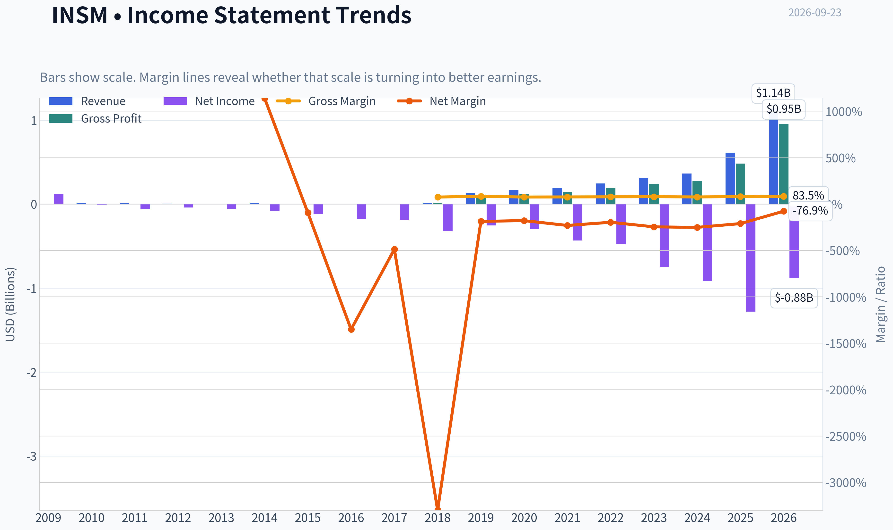

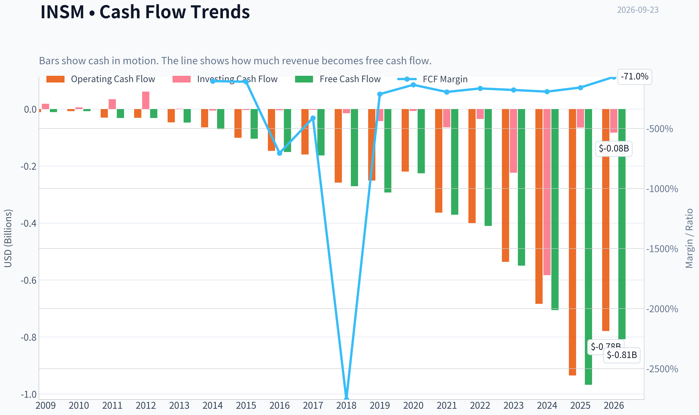

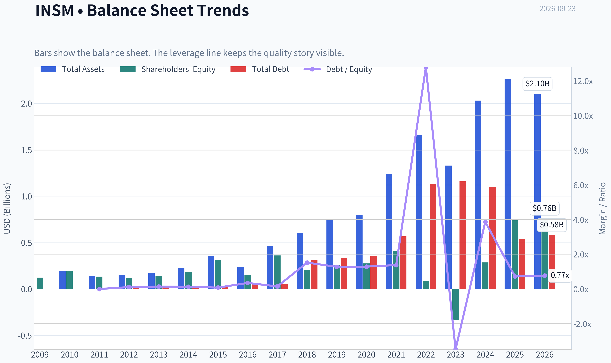

This graph tracks the profitability and return metrics (ROE, ROIC, Margins) of **INSM** over the past decade, highlighting capital efficiency trends.

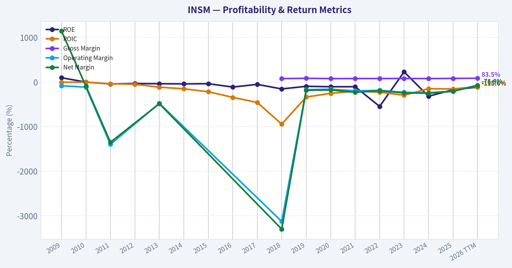

This chart illustrates the financial health of **INSM** over the last 10 years, mapping cash equivalents and free cash flow against total obligations (Debt).

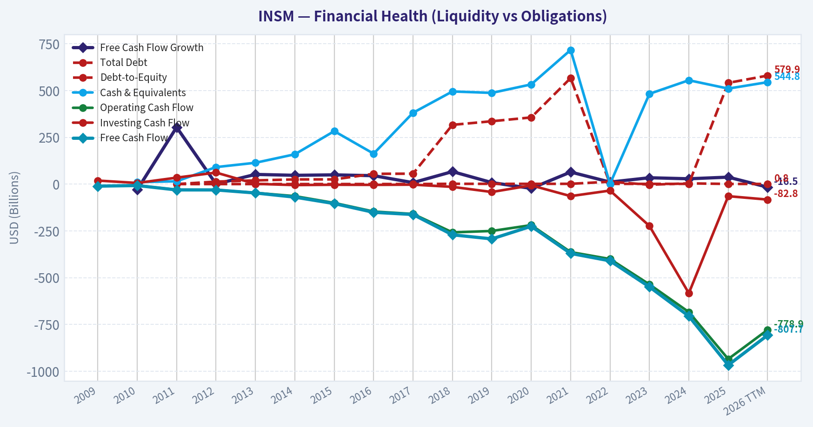

This comparison chart from *Profitability and Earnings Quality* stacks current figures against historical benchmarks for **INSM**, making it easy to see where the company trades relative to its own averages.

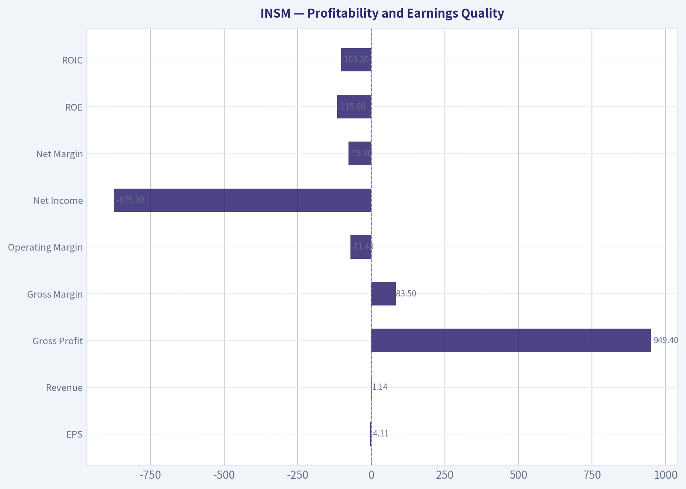

This breakdown chart from <em>Revenue Breakdown</em> shows the proportional composition for **INSM** - useful for understanding what drives or risks the business.

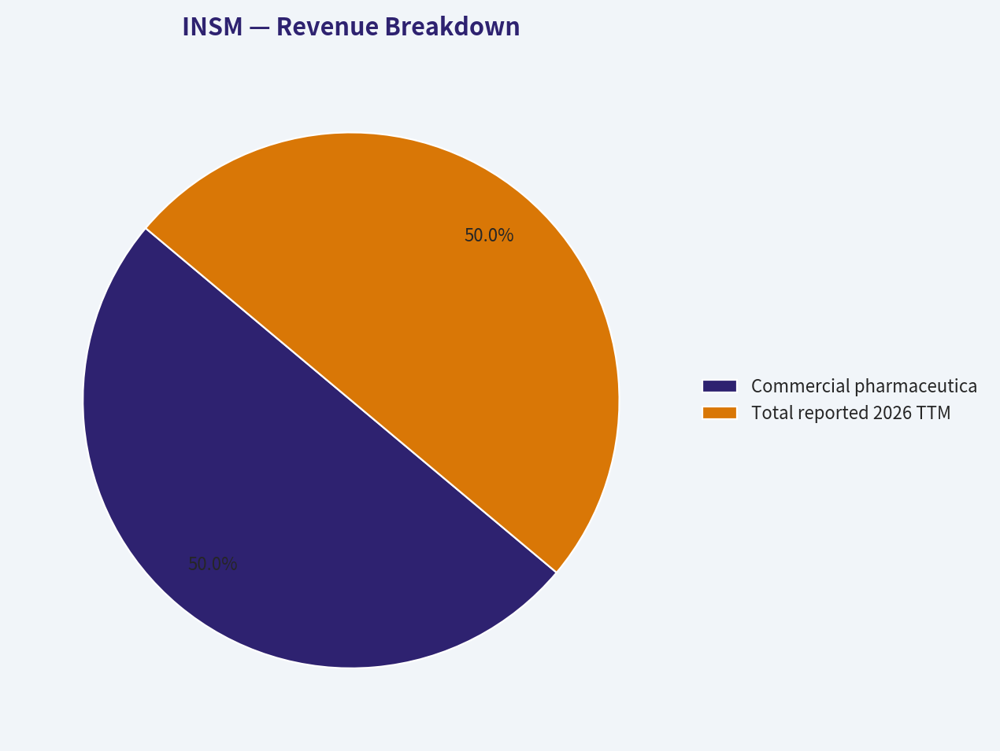

---

### Intrinsic Value Analysis (Buffett)

> *Following Warren Buffett's value investing philosophy: Circle of Competence, Economic Moat, Management Quality, and Margin of Safety.*

#### Intrinsic Value Snapshot

Price is what you pay. Intrinsic value is what the business may be worth based on the cash it can create for owners over time. We show a range, not one magic number.

- Current Price: $118.34
- Value Range (conservative to optimistic across both DCF methods): $-0.16 to $-0.16

##### Owner Earnings (Buffett Method)
- Net Income: $-1,276,775,000.00
- Depreciation & Amortization: $16,450,000.00
- Capital Expenditures: $-32,561,000.00
- Working Capital Changes: $-80,299,000.00
- Owner Earnings: $-1,196,476,000.00

##### Intrinsic Value
###### Cash Flow Method
Uses free cash flow. Better for companies spending heavily today to grow tomorrow.
- Conservative: $-0.16
- Average: $-0.16
- Optimistic: $-0.16
- Discount Rate: N/A

ANALYST STANCE: **AVOID**

#### Executive Summary

Insmed has the characteristics of a potentially valuable biotech franchise: strong revenue growth, high gross margins, an established commercial product in Arikayce, and meaningful pipeline optionality from brensocatib and label expansion opportunities. However, at **$118 per share and a $25.84 billion market capitalization**, the valuation depends heavily on future commercial success that is not yet reflected in current earnings or free cash flow.

The company is not financially distressed: its current ratio is approximately **3.8**, and there is no evidence that the Gate 5 solvency floor is tripped. Nevertheless, current cash generation is negative, ROE is deeply negative, and conventional cash-flow valuation produces no credible positive intrinsic value. This is a promising but speculative biotech investment, not a Buffett-style compounder at the present price.

#### Financial Snapshot

| Metric | Latest figure |
|---|---:|
| Share price | $118 |
| Market capitalization | $25.84 billion |
| Revenue growth, year over year | 66.7% |
| Gross margin | 79.7% |
| ROE | -172.8% |
| FCF yield | -3.7% |
| Current ratio | 3.83 |
| P/E | N/A |
| Headline intrinsic value | -$511.14 |
| FCF-based value estimate | Approximately -$0.16 |
| Owner earnings | Negative |
| Solvency floor | Not tripped |

**Key Takeaways:** Insmed is growing rapidly and earns an attractive gross margin, but it is not yet profitable on an owner-earnings or free-cash-flow basis. The negative FCF yield and deeply negative ROE show that the current valuation rests on expected future drug economics rather than existing cash generation. The strong current ratio provides financial runway but does not establish intrinsic value.

#### Factor Scorecard

| Factor | Score | Assessment |
|---|---:|---|
| 1. Circle of competence and simplicity | 2.5/5 | Drug commercialization and clinical development are understandable at a high level, but outcomes depend on regulatory decisions, trial results, pricing, and market adoption. |
| 2. Durable competitive advantage | 3.5/5 | Proprietary medicines, regulatory approvals, clinical data, and physician familiarity provide meaningful advantages, but patent expiry, competing therapies, and pipeline risk remain material. |
| 3. Management and capital allocation | 3.5/5 | Management has advanced the commercial portfolio and pipeline, but a definitive long-term record of profitable reinvestment and shareholder returns has not yet been established. |
| 4. Industry structure | 3.0/5 | Successful rare-disease and specialty-drug markets can be attractive, but biotechnology remains highly competitive, binary, and dependent on intellectual-property protection. |
| Gate 5: quality and solvency floor | **Not tripped** | Strong liquidity and rapid revenue growth do not indicate genuine financial distress, despite negative earnings and cash flow. |

**Key Takeaways:** Insmed scores well on gross economics and product-based barriers to entry, but poorly on predictability and present-day cash generation. The key issue is not solvency; it is whether future drug sales can justify the substantial expectations embedded in the stock price.

#### Moat Analysis

**Intangible assets and regulatory protection:** Insmed's principal moat is its portfolio of approved and developing therapies. Drug approvals, clinical evidence, patents, physician familiarity, and regulatory know-how can support high gross margins and pricing power. The company's **79.7% gross margin** is consistent with the economics of a differentiated pharmaceutical product.

**Switching costs:** Switching costs are moderate rather than exceptional. Physicians and patients may prefer a therapy with established efficacy, tolerability, and reimbursement, but patients are not permanently locked into the platform in the way enterprise software customers can be.

**Cost advantage:** Insmed does not appear to possess a structural manufacturing-cost advantage comparable to a scaled consumer or technology platform. Its economic advantage comes primarily from intellectual property and clinical differentiation.

**Network effects:** Network effects are limited. Greater adoption can improve physician familiarity and real-world evidence, but each new patient does not materially increase the product's value to all other users.

**Moat rating: Narrow to potentially wide in selected indications, but not yet wide and widening across the entire company.**

The FDA's priority review of an Arikayce label expansion is a meaningful catalyst. A broader indication could increase the addressable market and improve the durability of the commercial franchise. However, regulatory approval and commercial uptake remain future events, not current moat evidence.

#### Management Quality and Capital Allocation

Management appears focused on building a specialty-pharmaceutical portfolio rather than maximizing near-term accounting earnings. That is appropriate for a biotech company, where spending ahead of revenue can create value if clinical programs succeed.

The positive evidence includes:

- Rapid revenue growth.
- A high gross margin on the commercial business.
- Continued investment in pipeline assets.
- Progress toward expanding Arikayce's potential market.
- Development of brensocatib as a potentially significant commercial product.

The concerns are equally important:

- The company has not yet demonstrated durable positive owner earnings.
- Negative free cash flow makes acquisition and development spending difficult to evaluate through a Buffett-style lens.
- The eventual returns on pipeline investment remain uncertain.
- The valuation leaves little room for clinical or commercial disappointment.

Management quality is therefore promising but unproven as a long-term capital-allocation record.

#### Owner Earnings Calculation

| Owner-earnings component | Assessment |
|---|---:|
| Net income | Negative |
| Depreciation and amortization | Positive but not sufficient to offset losses |
| Maintenance capital expenditures | Not separately identifiable from the available summary |
| Working-capital investment | Not sufficient to reverse the negative cash-generation profile |
| Estimated owner earnings | Negative |
| FCF yield | -3.7% |

**Key Takeaways:** Insmed currently consumes cash rather than producing distributable owner earnings. Research and development spending may be economically productive, but it cannot be treated as maintenance capex with confidence; therefore, a positive owner-earnings figure would be speculative. Buffett-style valuation is much more reliable once the commercial portfolio produces repeatable cash surplus.

#### Return on Capital and Balance Sheet

| Measure | Result | Interpretation |
|---|---:|---|
| ROE | -172.8% | Negative equity returns reflect losses and the early commercial-development stage. |
| ROIC | Not meaningfully positive | Current operating earnings do not yet demonstrate returns above the cost of capital. |
| Revenue growth | 66.7% | Excellent momentum, but growth is not equivalent to value creation unless future margins and cash flows follow. |
| Gross margin | 79.7% | Strong product economics and evidence of differentiation. |
| Current ratio | 3.83 | Strong short-term liquidity and development runway. |
| Interest coverage | Not established as a concern | No indication that operating profit is failing to service heavy interest obligations. |
| Balance-sheet score | 4/5 | Liquidity is a strength, although cash will be consumed if losses continue. |

**Key Takeaways:** The balance sheet appears sufficiently strong to support continued investment, but the operating return profile is not yet proven. Insmed can be financially healthy while still being a poor investment if the market price already discounts years of successful execution.

#### Three-Scenario DCF Valuation

| Scenario | Method | Result |
|---|---|---:|
| A. No growth | Current owner earnings divided by 10% | Negative / not investable |
| B. GDP growth | Negative owner earnings grown at 3%, discounted at 10% | Negative / not meaningful |
| C. Historical growth | 50%-75% of historical growth applied to current owner earnings | Not meaningful because the earnings base is negative |
| Research-pack FCFF estimate | Damodaran-style FCFF valuation | -$511.14 per share |
| FCF-based estimate | FCF approach | Approximately -$0.16 per share |

**Key Takeaways:** The DCF does not support a positive valuation using current cash flows. This does not prove that Insmed is worthless; it shows that valuation depends on future products, future approvals, and future profitability rather than the company's present earnings base. A conventional DCF becomes useful only after the commercial outlook can be translated into credible, recurring free cash flow.

#### Margin of Safety and Reverse-DCF Assessment

The reported headline margin of safety of **123.2%** is mathematically generated from a negative intrinsic-value estimate and should not be interpreted as a bargain signal. A negative DCF value divided against a positive stock price creates a misleading percentage.

At $118 per share, investors are paying for:

- Continued Arikayce growth.
- Successful Arikayce label expansion.
- Strong adoption of brensocatib.
- Favorable regulatory and reimbursement outcomes.
- A long runway of high-margin commercial growth.
- Eventual conversion of revenue growth into substantial free cash flow.

The stock may succeed if those assumptions are realized, but the current price does not provide a demonstrated margin of safety based on existing cash generation. For an early-stage biotech with uncertain earnings visibility, the required discount should be substantial rather than modest.

#### Final Buffett Scorecard

| Criterion | Weight | Score | Weighted contribution |
|---|---:|---:|---:|
| Moat width and durability | 25% | 3.5/5 | 0.88 |
| Valuation and margin of safety | 20% | 1.5/5 | 0.30 |
| Capital returns: ROIC versus WACC | 15% | 1.5/5 | 0.23 |
| Business understanding and predictability | 12% | 2.5/5 | 0.30 |
| Management quality and capital allocation | 12% | 3.5/5 | 0.42 |
| Reinvestment runway | 8% | 4.0/5 | 0.32 |
| Balance-sheet strength | 4% | 4.0/5 | 0.16 |
| Industry structure | 4% | 3.0/5 | 0.12 |
| **Total** | **100%** |  | **2.72/5** |

**Key Takeaways:** Insmed's strongest attributes are its growth runway, gross margin, liquidity, and potentially valuable drug portfolio. Its weakest attributes are valuation, negative owner earnings, negative ROE, and limited predictability. The weighted score falls in the **AVOID** range even though the business itself may become substantially more valuable if its pipeline succeeds.

#### Investment Stance

**AVOID - Medium conviction.**

Insmed is worth monitoring rather than dismissing. Positive Arikayce label expansion, strong brensocatib adoption, and a transition to durable positive free cash flow could materially improve the investment case. But at $118, the stock offers insufficient evidence of a margin of safety and requires investors to underwrite substantial future execution.

A more attractive entry point would require either:

1. A materially lower share price, or
2. Clear evidence that revenue growth is converting into recurring positive owner earnings and high returns on invested capital.
#### Valuation Bridge

This bridge places the current market price beside each intrinsic value lens so readers can see whether upside depends on one method or shows up across several methods.

| Scenario | Intrinsic Value / Share |
| --- | ---: |
| Cash Flow Method | $-0.16 |
| Damodaran Method | $-511.14 |
| Current Price | $118.34 |

#### Key Takeaways

If one method is far above the others, the upside case depends on a specific modelling assumption. When several methods cluster together, the valuation story is more robust.

#### Valuation Visuals

This comparison chart from *Latest Earnings Snapshot* stacks current figures against historical benchmarks for **INSM**, making it easy to see where the company trades relative to its own averages.

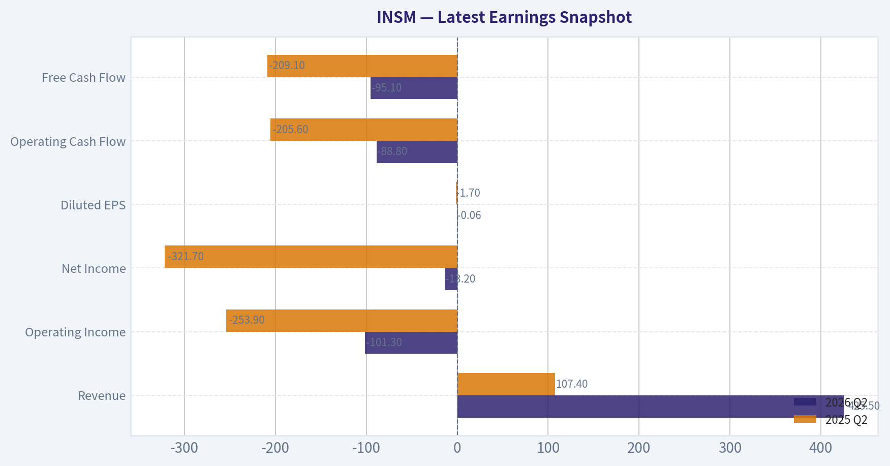

This comparison chart from *Current Metrics Versus Historical Averages* stacks current figures against historical benchmarks for **INSM**, making it easy to see where the company trades relative to its own averages.

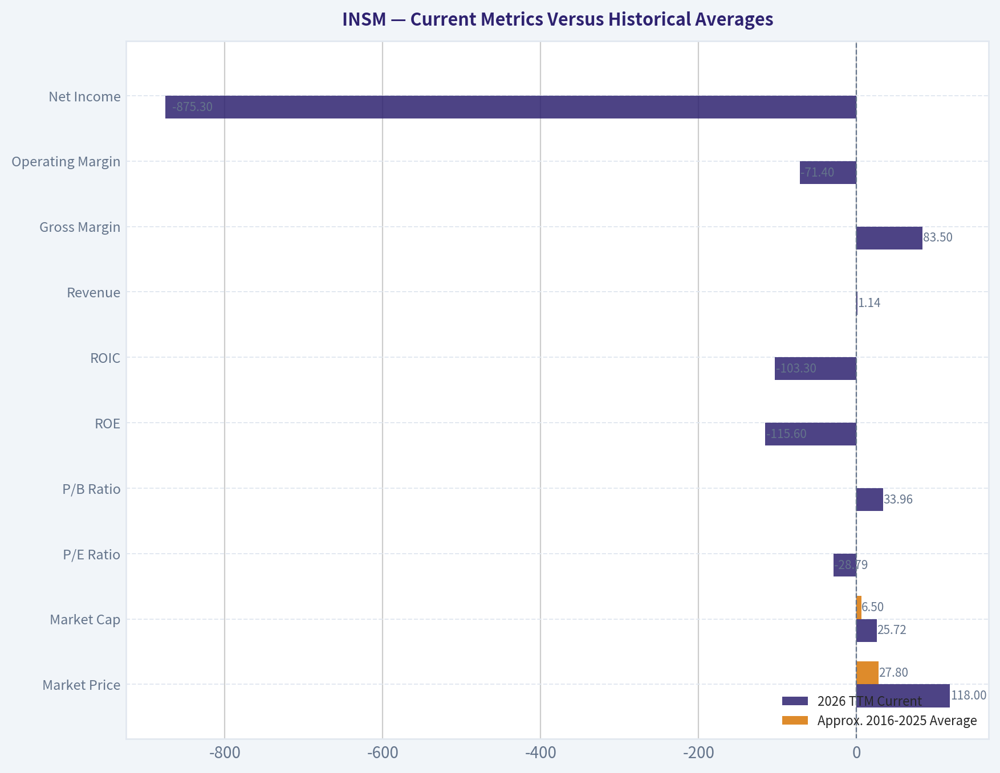

This comparison chart from *Cash Flow and Owner Earnings* stacks current figures against historical benchmarks for **INSM**, making it easy to see where the company trades relative to its own averages.

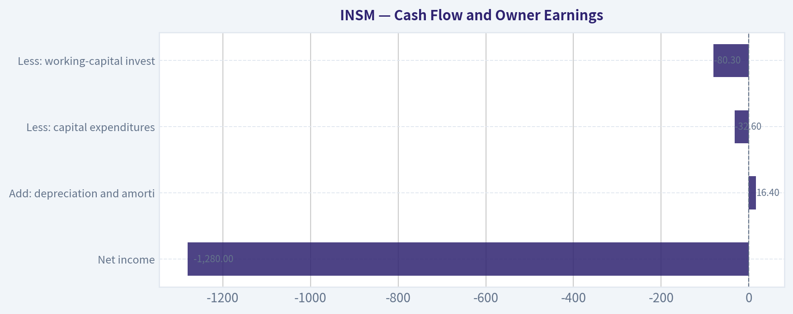

This comparison chart from *Financial Snapshot* stacks current figures against historical benchmarks for **INSM**, making it easy to see where the company trades relative to its own averages.

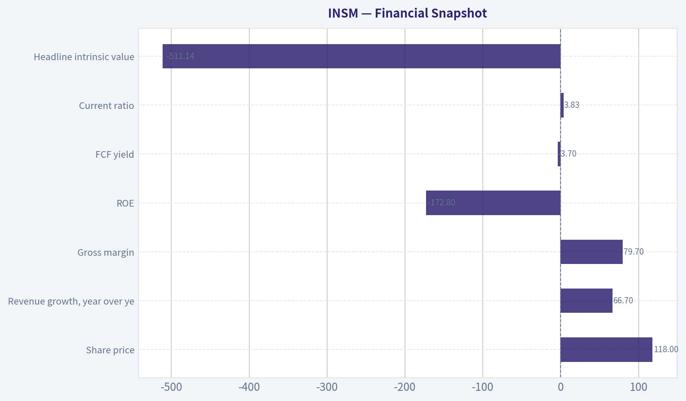

---

### Trend & Growth Analysis (Lynch/Druckenmiller/Fisher)

> *Following Peter Lynch's GARP, Stanley Druckenmiller's macro-aware approach, and Philip Fisher's scuttlebutt methodology.*

ANALYST STANCE: **WATCH**

#### 1. Lynch Classification

**Fast Grower / Biotech Commercialization Story**, with substantial regulatory and product-concentration risk.

Insmed is no longer a pure clinical-stage biotech: Arikayce provides commercial revenue, while the company's future growth depends heavily on label expansion and the launch potential of brensocatib, referred to in recent coverage as Brinsupri. However, negative free cash flow and a valuation supported mainly by future earnings make it unsuitable for a high-conviction position without additional operating data.

#### 2. The Story in Three Bullets

- **Commercial expansion:** Arikayce is an approved treatment for refractory MAC lung disease, and the FDA has accepted a supplemental filing for earlier use in newly diagnosed patients under Priority Review.
- **Pipeline inflection:** Brensocatib could expand Insmed from a single-product commercial company into a broader specialty respiratory franchise.
- **Large upside, meaningful execution risk:** If label expansion and Brensocatib commercialization succeed, revenue could compound rapidly; if clinical, regulatory, or launch assumptions disappoint, the current valuation could compress sharply.

#### 3. TAM and Runway

| Factor | Assessment | Investment Implication |
|---|---:|---|
| Current market position | Arikayce has an established but specialized indication | Existing commercial base reduces pure clinical risk |
| Arikayce expansion | FDA Priority Review for earlier MAC treatment; PDUFA target January 28, 2027 | Near-term regulatory catalyst |
| Brensocatib opportunity | Potentially much larger than the current Arikayce niche | Main long-term TAM expansion driver |
| 10x revenue test | Not fully calculable because the latest revenue figure was not supplied | Cannot confirm whether 10x revenue remains below 20% of TAM |
| TAM growth | Respiratory and rare-disease treatment markets are structurally attractive, but exact market size and penetration require company filings | Positive, but not yet quantified |

**Key Takeaways:** Insmed appears to have a meaningful runway because it is expanding beyond a narrow MAC indication and potentially adding a second major product. The 10x test cannot be completed reliably without current revenue and addressable-market figures. The central question is whether Brensocatib becomes a major commercial franchise rather than merely a promising pipeline asset.

#### 4. Revenue Growth Trend

| Metric | Latest Available | Interpretation |
|---|---:|---|
| Year-over-year revenue growth | 66.7% | Fast-grower profile |
| Growth pattern | One reported annual growth figure available | Acceleration versus prior periods cannot be confirmed |
| Gross margin | 79.7% | Supports attractive long-term economics |
| Free cash flow yield | -3.7% | Company is still investing and cash-flow negative |
| ROE | -172.8% | Not meaningful while losses and development investment remain substantial |

**Key Takeaways:** The 66.7% revenue growth rate is powerful and consistent with a commercial product ramp. However, there is not enough sequential history to establish whether growth is accelerating or merely growing from a small base. The high gross margin is encouraging, but negative free cash flow means the investment case remains forward-looking.

#### 5. Unit Economics and Efficiency

| Metric | Result | Assessment |
|---|---:|---|
| LTV/CAC | Not disclosed in the supplied data | Cannot verify |
| Net revenue retention | Not applicable / not disclosed | Product sales are not SaaS subscriptions |
| Rule of 40 | Not meaningful with negative FCF margin data | Efficiency remains unproven |
| Gross margin | 79.7% | Strong pharmaceutical economics |
| Current ratio | 3.83 | Provides a relatively strong liquidity cushion |
| Dilution risk | Requires review of latest cash balance, share count, and financing plans | Important because FCF is negative |

**Key Takeaways:** Insmed's 79.7% gross margin suggests that successful products could generate substantial operating leverage. Traditional SaaS metrics such as NRR and LTV/CAC do not apply directly. The strong current ratio is a positive, but the company's cash runway and future financing requirements still need to be monitored closely.

#### 6. Inflection Point Assessment

| Potential Inflection | Status | Importance |
|---|---|---|
| Arikayce label expansion | FDA Priority Review accepted; target action date January 28, 2027 | High |
| Earlier-line MAC treatment | Positive ENCORE Phase 3b data cited in coverage | High |
| Brensocatib launch | Bull case centers on a potential blockbuster launch | Very high |
| Margin inflection | High gross margin, but negative FCF means operating leverage has not yet fully appeared | Medium |
| Market-share inflection | Not independently quantified | Uncertain |
| Institutional validation | Stanley Druckenmiller and Steve Cohen both increased positions in the latest available 13F filings | Supportive, but lagged |

**Key Takeaways:** The strongest near-term catalyst is the FDA decision on broader Arikayce use. The largest potential inflection is Brensocatib commercialization, which could materially expand Insmed's addressable market and revenue base. The Druckenmiller purchase is notable, but 13F filings are delayed snapshots and should not substitute for operating confirmation.

#### 7. Macro Setup

The macro backdrop is **mixed but potentially favorable**:

- Biotech and long-duration growth stocks generally benefit from falling interest rates and improving risk appetite.
- Specialty pharmaceuticals are less economically cyclical than consumer or industrial growth stocks.
- Regulatory and reimbursement decisions matter more to Insmed than the business cycle.
- A risk-off environment could pressure the valuation of a company with negative FCF, even if its clinical outlook remains intact.

Druckenmiller-style conclusion: the company has a strong company-specific catalyst setup, but the macro trade is not sufficiently clear to justify an oversized position.

#### 8. Fisher's 15-Point Assessment

| Fisher Criterion | Score / 5 | Comment |
|---|---:|---|
| Market potential | 4 | Respiratory and rare-disease opportunities appear substantial |
| New-product determination | 5 | Brensocatib and label expansion indicate significant development effort |
| R&D effectiveness | 4 | Positive ENCORE data and regulatory progress are encouraging |
| Sales organization | 3 | Commercial capability exists, but larger launch execution remains to be proven |
| Profit margins | 3 | Gross margin is strong; company-level profitability is not established |
| Margin improvement | 3 | Potentially significant, but not yet demonstrated |
| Labor/personnel relations | 3 | Insufficient information |
| Executive relations | 3 | Insufficient information |
| Management depth | 4 | Development and commercialization capabilities appear credible |
| Cost analysis/accounting | 3 | Insufficient information |
| Competitive advantages | 4 | Specialized products, regulatory know-how, and clinical data provide barriers |
| Long-range profit outlook | 4 | Attractive if Brensocatib and Arikayce expansion succeed |
| Equity dilution | 3 | Negative FCF creates some financing risk |
| Management candor | 3 | Requires deeper filing and conference-call review |
| Management integrity | 4 | No specific adverse information supplied |

**Fisher Score: 53 / 75 - Average to Good**

**Key Takeaways:** Insmed scores best on market potential, R&D, product development, and long-term opportunity. The score is held back by limited evidence on sales execution, profitability, dilution, and management operating history. A deeper scuttlebutt review would be particularly valuable before moving from WATCH to ADVOCATE.

#### 9. Valuation Analysis

| Valuation Method | Result | Interpretation |
|---|---:|---|
| Current price | $118 | Supplied market price |
| Market capitalization | $25.84 billion | Substantial expectations already embedded |
| P/E | N/A | Company is not currently valued on earnings |
| PEG | N/M | No meaningful P/E because earnings are negative or unavailable |
| P/S | Not calculable from supplied data | Requires current revenue |
| FCF valuation | Negative / unreliable | Current FCF does not support a conventional valuation |
| Headline intrinsic value | -$511.14 | Model output is not economically useful for this growth-stage biotech |
| Margin of safety | 123.2% headline figure | Not reliable; driven by an unsuitable negative-cash-flow model |

**Key Takeaways:** Conventional valuation tools provide little comfort because Insmed is not yet profitable and the supplied intrinsic-value model is clearly unsuitable for a high-growth biotech. The $25.84 billion market capitalization means investors are already paying for substantial future success. The appropriate valuation framework is scenario-based revenue and product adoption analysis, not current P/E or FCF.

**Scenario framework:**

- **Bear case:** Arikayce expansion is delayed or limited, Brensocatib adoption disappoints, and negative FCF persists. The stock could experience significant multiple compression.
- **Base case:** Arikayce expands into earlier-line treatment and Brensocatib becomes a meaningful specialty-pharmaceutical product. Revenue compounds strongly, but valuation remains dependent on execution.
- **Bull case:** Brensocatib becomes a blockbuster, Arikayce expands internationally and earlier in the treatment pathway, and operating leverage turns cash flow positive. This is the scenario that could support substantial long-term upside.

#### 10. Growth Investor Scorecard

| Criterion | Weight | Score / 5 | Weighted Contribution |
|---|---:|---:|---:|
| The Story | 10% | 4.3 | 0.43 |
| TAM and runway | 20% | 4.2 | 0.84 |
| Revenue growth | 20% | 4.5 | 0.90 |
| Unit economics | 15% | 3.0 | 0.45 |
| Competitive position | 10% | 3.8 | 0.38 |
| Management quality | 10% | 3.5 | 0.35 |
| Macro setup | 5% | 3.3 | 0.17 |
| Profitability path | 5% | 3.2 | 0.16 |
| Valuation | 5% | 2.3 | 0.12 |
| **Total** | **100%** |  | **3.80 / 5.00** |

**Key Takeaways:** Insmed scores well on revenue growth, product opportunity, and potential TAM expansion. Valuation, negative FCF, and incomplete evidence on operating leverage prevent a high-conviction rating. The 3.80 score places the company in the "good setup" range, but the appropriate action is WATCH because the valuation leaves limited room for execution mistakes.

#### 11. Position Size Stance

- **New position:** Small exploratory position only, approximately **1% to 2%** of a diversified growth portfolio.
- **Higher-conviction position:** Consider increasing only after confirmation of:
  1. FDA approval for broader Arikayce use.
  2. Strong Brensocatib launch or prescription trends.
  3. Clear revenue acceleration.
  4. Improving cash burn and a credible path to positive FCF.
- **Risk control:** Avoid sizing the position as if Brensocatib's blockbuster outcome is already certain.

#### 12. Key Catalysts and Risks

| Catalysts | Risks |
|---|---|
| January 28, 2027 FDA action on Arikayce label expansion | FDA delay, restriction, or rejection |
| Brensocatib approval and commercial launch | Poor launch execution or weaker-than-expected efficacy |
| Accelerating prescriptions and revenue | Revenue growth deceleration from a high base |
| Expansion into additional MAC populations or geographies | Reimbursement and payer resistance |
| Gross-margin and operating-leverage improvement | Continued cash burn and equity dilution |
| Positive physician adoption and clinical data | Safety issues, competing therapies, or trial setbacks |

**Key Takeaways:** The catalyst calendar is unusually important: Arikayce's regulatory decision and Brensocatib commercialization could change Insmed's earnings trajectory materially. The principal risk is not that the company lacks opportunity, but that the current valuation assumes too much success too soon. Confirmation from prescriptions, revenue, cash flow, and regulatory outcomes is needed before upgrading the stance.

#### Bottom Line

Insmed is a credible **fast-growing specialty-biotech commercialization story** with a potentially significant product-cycle and TAM inflection. Its 66.7% revenue growth, 79.7% gross margin, FDA Priority Review, and Brensocatib opportunity are compelling. However, negative FCF, incomplete profitability evidence, high expectations at a $25.84 billion market cap, and regulatory execution risk argue for **WATCH rather than ADVOCATE**.

---

### Market Technical Analysis

ANALYST STANCE: **WATCH**

#### INSM technical overview

INSM's technical profile is **long-term bearish but attempting to stabilize on a shorter-term basis**. The latest valid price in the supplied data is the September 21 close of **$121.00**. The September 22 record has volume but no open, high, low, or close, and the September 23 indicator values appear to repeat or extrapolate the September 21 data. Accordingly, the most recent price and indicator readings should be treated as provisional rather than as a fully confirmed September 23 closing snapshot.

The stock has experienced a substantial decline from the late-2025 highs. From the December 1 close of approximately **$211.41** to $121, INSM has fallen about **43%**. It also remains roughly **17% below** the September 23, 2025 close of $145.38. This broader performance argues against interpreting the recent stabilization as a confirmed long-term reversal.

#### Trend structure: short-term recovery inside a damaged primary trend

The moving-average configuration is mixed but leans bearish at the strategic level:

- The **10-day EMA is approximately $123.17**.
- The **50-day SMA is approximately $118.58**.
- The **200-day SMA is approximately $136.43**.

The latest valid close of $121 is below the 10-day EMA, suggesting that immediate momentum has weakened after the stock's rebound toward the $126-$130 area in early and mid-September. However, price remains above the 50-day SMA, which is still rising from approximately $111.34 on August 24 to $118.58 currently. This indicates that the medium-term recovery from the August low has not been completely invalidated.

The 200-day SMA is declining and remains substantially above the market. The distance between the 50-day SMA and the 200-day SMA is also large, with the 50-day average about $17.85 below the 200-day average. That separation reflects persistent long-term distribution and means that any near-term bounce is still occurring below a major overhead trend benchmark.

The most constructive interpretation is therefore **medium-term stabilization**, not a confirmed primary uptrend. A sustained move above the 200-day SMA, followed by the establishment of higher highs and higher lows, would be needed to materially improve the long-term picture.

#### Momentum: positive MACD level, but deteriorating impulse

The MACD line is reported at approximately **0.59**, still above zero but down sharply from **5.01** on August 24. This is an important distinction: MACD remaining above zero suggests that the intermediate EMA relationship has not fully turned bearish, but the steep decline in the MACD value shows that upside momentum has faded considerably.

The MACD histogram is approximately **-0.84**, after being close to zero on August 24 and briefly improving to about **-0.08** on September 11. The histogram has remained negative since then, indicating that the MACD line is below its signal line. The deterioration from roughly **-0.27 on September 14** to around **-1.04 on September 21**, before a modest improvement to approximately **-0.84**, suggests that the recent pullback was accompanied by renewed downside momentum.

This is not yet a decisive bearish acceleration, because the histogram has improved slightly from its worst recent reading. Nevertheless, traders should not treat the positive MACD line alone as a buy signal. The combination of a positive-but-falling MACD and a negative histogram is more consistent with **a weakening rebound or consolidation phase**.

#### RSI: neutral, with neither strong oversold relief nor bullish momentum

The RSI is approximately **47.5**, down from readings above 60 on September 9 and September 11. This places INSM near the neutral midpoint, but slightly below it.

The RSI does not indicate an oversold condition: it is well above the conventional 30 threshold. Therefore, the stock does not currently have a strong momentum-based oversold argument supporting an immediate rebound. At the same time, RSI is far from 70, so there is no indication that the stock is overbought or that a bullish move is excessively extended.

The recent RSI path-from approximately 60 to 47.5 while price moved from the upper-$120s toward $121-confirms a loss of short-term momentum. A recovery above 50, and preferably toward the 55-60 range, would improve the evidence for renewed upside. A decline toward 40 or lower would suggest that the medium-term stabilization is failing.

#### Volume-weighted trend: important caution around the latest reading

The VWMA is reported at approximately **$116.50** for September 23, while the latest clearly valid prior reading, on September 21, was approximately **$124.41**. Because the September 22 price fields are missing and the September 23 value appears affected by that incomplete data, the $116.50 reading should not be used as a reliable standalone signal.

Using the September 21 reading, price at $121 was below the recent VWMA near $124.41. That implies that recent trading volume was concentrated at prices somewhat above the latest close, creating potential overhead supply around the **$124-$126** zone. A move back above that area accompanied by stronger-than-normal volume would be more convincing than a low-volume price recovery.

The unusually large volume episodes visible in the historical data-particularly during the December selloff, the May decline, and the August gap higher-show that INSM can reprice rapidly around major events. VWMA is therefore useful for confirmation, but it should not be interpreted without considering event risk and the possibility of abnormal volume spikes.

#### Volatility and risk management

ATR is approximately **$4.75**, down modestly from about $5.25 on August 24. At a $121 share price, this represents roughly **3.9% of price per day** based on the ATR measure. That is still elevated enough that tight stops may be vulnerable to normal price fluctuations.

Recent daily ranges reinforce this risk. INSM has repeatedly experienced moves of several dollars per session, and the May and August price gaps were substantially larger than ordinary daily movement. Traders should size positions accordingly and avoid placing stops so close to entry that a routine one-day fluctuation triggers an exit.

A volatility-aware approach would use ATR as a position-sizing input rather than simply placing a fixed percentage stop. For example, a stop distance of approximately one ATR may still be vulnerable in an event-driven move, while a wider stop requires a smaller position to maintain the same dollar risk.

#### Key price levels and trading interpretation

The first important support area is approximately **$118-$120**. This zone includes the recent lows and sits close to the 50-day SMA at $118.58. Holding this area would preserve the current medium-term stabilization thesis.

A decisive close below the 50-day SMA, especially on increasing volume, would weaken the rebound structure and expose the stock to a possible retest of the **$110-$112** region. That area corresponds broadly with prior trading activity during the post-May decline and the early stages of the August recovery.

On the upside, the first resistance area is approximately **$123-$126**, where the 10-day EMA and recent VWMA readings converge. A close above this zone would improve short-term structure, particularly if RSI recovers above 50 and the MACD histogram moves toward zero.

The next major resistance area is approximately **$130-$136**, followed by the declining 200-day SMA near **$136.43**. This broad zone is likely to contain meaningful selling pressure because it represents both recent swing highs and the long-term trend benchmark. A move through $136-$140 would be technically significant, but it would still require follow-through before being considered a durable trend reversal.

#### Practical conclusion

INSM is best classified as a **high-volatility recovery attempt below a declining long-term trend**. The stock has held above its rising 50-day SMA, which is constructive, but it has slipped below the 10-day EMA, its MACD histogram is negative, RSI is neutral-to-soft, and price remains well below the 200-day SMA.

For bullish traders, the preferred confirmation would be a recovery above **$123-$126**, improving momentum, and volume-supported follow-through toward **$130-$136**. For risk-controlled traders, a break below **$118**, particularly with expanding volume, would be a warning that the stabilization phase may be ending. Because the latest supplied data contains missing price fields, confirmation from a complete new trading session is especially important.

#### Selected indicators

| Indicator | Latest reported value | Technical reading | Why it matters for INSM |
|---|---:|---|---|
| 10-day EMA | $123.17 | Price is below the short-term average | Shows that immediate momentum has weakened |
| 50-day SMA | $118.58 | Price remains slightly above it; average is rising | Defines near-term trend support and rebound validity |
| 200-day SMA | $136.43 | Price remains materially below it; average is declining | Confirms the still-bearish primary trend |
| MACD | 0.59 | Above zero but falling sharply | Intermediate momentum remains positive in level, but is deteriorating |
| MACD Histogram | -0.84 | Negative | Indicates MACD remains below its signal line |
| RSI | 47.51 | Neutral, slightly soft | No oversold signal; momentum has cooled without capitulation |
| ATR | $4.75 | Elevated daily volatility | Useful for position sizing and stop-distance planning |
| VWMA | $124.41 on latest valid prior session | Price was below volume-weighted average | Suggests overhead supply around the mid-$120s; latest $116.50 reading is unreliable due to missing data |

Key Takeaways: INSM is holding above its rising 50-day average but remains below both its short-term EMA and declining 200-day average. Momentum has weakened, with a negative MACD histogram and neutral RSI, while volatility remains high. The most important near-term levels are $118-$120 as support and $123-$126 as initial resistance; a complete new price record is needed to confirm the current setup.

---

### Options Market Analysis

> *Reading options flow - put/call ratios, IV skew, and unusual activity - to gauge institutional positioning and event-driven risk.*

#### INSM Options Market Report

*Data as of September 23, 2026. The supplied feed covers the October 16, November 20, and January 15 expirations. It does not include the current share price, individual strike-level data, OTM IV, or a known catalyst calendar.*

#### Put/Call Ratio Analysis

| Expiration | Call OI | Put OI | Put/Call OI | Call Volume | Put Volume | Put/Call Volume |
|---|---:|---:|---:|---:|---:|---:|
| Oct. 16, 2026 | 2,927 | 688 | 0.24 | 352 | 14 | 0.04 |
| Nov. 20, 2026 | 12,476 | 15,853 | 1.27 | 733 | 261 | 0.36 |
| Jan. 15, 2027 | 27,386 | 14,813 | 0.54 | 450 | 564 | 1.25 |
| **Aggregate** | **42,789** | **31,354** | **0.73** | **1,535** | **839** | **0.55** |

**Key Takeaways:** Aggregate put/call OI is 0.73, almost exactly the historical neutral baseline of approximately 0.70. However, the 0.55 volume ratio shows materially more call trading than put trading, which is a modestly bullish near-term signal. Positioning is uneven by maturity: November has elevated put OI, while January has a substantial call-OI advantage.

#### Implied Volatility Assessment

| Expiration | Call ATM IV | Put ATM IV | Average ATM IV | Relative Read |
|---|---:|---:|---:|---|
| Oct. 16, 2026 | 52.0% | 49.4% | 50.7% | Calls modestly richer |
| Nov. 20, 2026 | 56.4% | 52.7% | 54.6% | Calls modestly richer |
| Jan. 15, 2027 | 55.1% | 53.8% | 54.5% | Calls slightly richer |

**Key Takeaways:** Near-term ATM IV is elevated in absolute terms, ranging from roughly 51% to 55%, indicating that INSM options are pricing meaningful movement risk. Calls carry slightly higher ATM IV than puts in every listed expiration, a mild upside-demand signal rather than a downside-fear signal. Because OTM IV was not supplied, a true put-versus-call skew measurement cannot be confirmed.

There is no catalyst calendar in the data, so it is not possible to determine whether the elevated IV reflects an upcoming earnings report, regulatory event, clinical milestone, product update, or broader biotech volatility. Traders should treat event-driven IV risk as possible but unconfirmed.

#### Unusual Options Activity

| Finding | Result |
|---|---|
| Contracts with volume greater than 5x open interest | None detected |
| Fresh directional bets identifiable from the feed | None |
| Smart-money versus retail classification | Not possible from aggregate data |

**Key Takeaways:** No individual contract met the volume-to-open-interest threshold for unusual activity. That means there is no clear evidence of a fresh institutional call sweep, put hedge, or other high-conviction directional trade. The bullish read therefore comes from broad call-heavy volume and open-interest structure, not from a specific unusual contract.

Because no contract-level strikes were provided, the analysis cannot identify whether unusual positions are ITM, ATM, or OTM, nor can it calculate days-to-expiry for individual trades.

#### Open Interest Concentration

| Expiration | Total Call OI | Total Put OI | Combined OI | Positioning Read |
|---|---:|---:|---:|---|
| Oct. 16, 2026 | 2,927 | 688 | 3,615 | Strong call-heavy positioning |
| Nov. 20, 2026 | 12,476 | 15,853 | 28,329 | Largest near-term concentration; put-heavy |
| Jan. 15, 2027 | 27,386 | 14,813 | 42,199 | Largest overall concentration; call-heavy |
| **Total** | **42,789** | **31,354** | **74,143** | **Moderately call-dominant** |

**Key Takeaways:** January 2027 contains the largest aggregate open interest and is the primary longer-dated positioning center, with nearly twice as many calls as puts. November is the largest nearer-term concentration and has more puts than calls, creating a potential hedge or resistance zone around that maturity. Strike-level OI is unavailable, so specific gravitational levels, maximum-pain estimates, and gamma walls cannot be calculated.

The relatively small October OI means it is less likely to create a strong pinning effect than November or January. The large January call concentration could dampen or accelerate moves depending on whether those calls are long or short, which cannot be determined from open interest alone.

#### Overall Options Sentiment

**Overall signal: BULLISH, with moderate-to-low conviction.**

The primary bullish drivers are:

- Aggregate put/call OI of 0.73, close to neutral but slightly call-favorable.
- Put/call volume of 0.55, showing substantially greater call activity.
- Strong January call concentration.
- Calls carrying slightly higher ATM IV than puts across all listed expirations.

The main caveats are:

- November open interest is put-heavy, with a 1.27 put/call OI ratio.
- No unusual activity confirms a high-conviction institutional directional bet.
- ATM IV around 51%-55% indicates meaningful volatility and event risk.
- The feed lacks strike-level data, OTM skew, spot price, and catalyst timing.
- Trading volume is not exceptionally large, so confidence should be reduced relative to a highly liquid, heavily traded name.

This is best interpreted as **mildly bullish options positioning rather than a strong bullish breakout signal**. The market appears to favor upside exposure over the full listed horizon, but November hedging and elevated IV suggest investors still expect substantial price movement.

#### Summary

| Category | Assessment |
|---|---|
| Put/Call Ratio | Aggregate OI ratio 0.73, near neutral and slightly bullish; volume ratio 0.55, call-favorable |
| IV Level | Elevated, with ATM IV approximately 51%-55% |
| Skew Direction | Mild call-side richness based on ATM IV; true OTM skew unavailable |
| Unusual Activity | None; no contracts exceeded 5x open interest |
| Overall Signal | **BULLISH**, moderate-to-low conviction |

**Key Takeaways:** INSM's options market leans bullish because call volume exceeds put volume and January call open interest is dominant. The signal is not high conviction because November is put-heavy, IV is elevated, and no unusual contract-level activity was detected. Overall, the data supports a cautious bullish bias with meaningful event and volatility risk.

---

## Research Team Commentary

> *The Research Manager synthesizes the Bull vs Bear debate into action-free commentary. This is a pre-risk view, not the final stance.*

The strongest bull argument is that Insmed may be approaching a genuine business-model inflection. Revenue growth of 66.7% and a 79.7% gross margin indicate attractive product-level economics, while Arikayce's potential earlier-line expansion and brensocatib could turn a single-product company into a broader specialty-respiratory franchise. Regulatory expertise, specialized manufacturing, clinical evidence, and physician relationships create real barriers. If Insmed can spread its commercial infrastructure across multiple successful products, operating leverage could eventually be substantial.

The strongest bear argument is not simply that current ROE, ROIC, and ROA are deeply negative. Those metrics are naturally distorted during a biotechnology investment phase and should not be used mechanically. The decisive problem is that the valuation already requires much of the hoped-for transformation while offering little protection if execution disappoints. The bull's own scenarios put base value around $109 and bull value around $131 versus a $118 price, while the bear case falls to roughly $49. That is unfavorable asymmetry: modest upside under strong execution and severe downside if approval, uptake, margins, or financing fall short.

The reverse DCF reinforces that concern. At a 10% required return and a 25-times terminal free-cash-flow multiple, the price requires roughly $12 of year-ten FCF per diluted share. Both assumptions are generous for a company exposed to clinical, regulatory, commercialization, reimbursement, and dilution risks. Raising the discount rate or lowering the terminal multiple increases the required cash flow sharply. Moreover, the scenario values cannot be trusted too precisely because cash, debt, burn rate, share count, and prospective dilution were not supplied. Those omissions weaken the bull case rather than creating a reason to assume favorable financing.

My core takeaway is that Insmed has credible assets but is not yet a proven wonderful business, and $118 does not provide the margin of safety appropriate for its uncertainty. Arikayce's moat is real but substantially product-specific. A corporate platform moat will only be established when Insmed repeatedly turns R&D spending into profitable products and rising per-share cash flow. Brensocatib could provide that proof, but possibility should be probability-weighted rather than capitalized as an accomplished outcome.

I would also avoid overemphasizing the catastrophic-looking return metrics. Negative 162.7% ROIC does not by itself prove permanent value destruction for a pipeline-funded biotechnology company. More informative evidence will be revenue per diluted share, cash burn, commercial spending efficiency, and the trajectory toward positive operating cash flow. Nevertheless, current returns do show that management's capital-allocation record remains unproven. A coherent strategy is not yet evidence of attractive realized returns.

The technical and options evidence offers no reason to override the valuation conclusion. The shares are below the 10-day EMA, near the 50-day SMA, and below the 200-day SMA. That is weak to neutral, not an established long-term uptrend. Call-favorable options activity reflects catalyst interest rather than intrinsic value and could increase volatility if expectations are disappointed. Learning from prior mistakes, I would separate the horizons clearly: tactically, the setup lacks trend confirmation; strategically, the business has upside but the price does not adequately compensate for its binary and financing risks.

Over the next one to four quarters, I would monitor the breadth and timing of any Arikayce label expansion, followed by new-patient starts, reimbursement access, persistence, and whether growth remains strong after the initial catalyst. For brensocatib, the key items are regulatory progress, label quality, launch readiness, pricing and payer access, physician adoption, and evidence that it can become a commercially meaningful second engine rather than merely a valuable pipeline narrative.

Financially, I would watch gross-margin stability, R&D and SG&A growth relative to revenue, quarterly operating cash burn, liquidity runway, debt obligations, stock-based compensation, and fully diluted share-count growth. The thesis strengthens if revenue continues scaling while operating losses and cash burn narrow on a per-share basis. It weakens if spending rises as quickly as revenue, gross margin deteriorates, uptake disappoints, or financing materially dilutes existing shareholders.

I would reconsider the stance after meaningful commercial and cash-flow de-risking, or at a materially lower valuation that discounts a conservative outcome rather than requiring multi-product success. Buying in tranches would limit position damage, but it would not repair the current lack of valuation protection.

Insmed may eventually become an excellent specialty-pharmaceutical franchise. At $118, however, investors are being offered venture-like uncertainty without a venture-like discount.

AVOID

---

## Value Investing Team Commentary

> *The Investor translates the research view into an investment thesis before risk review. This is still not the final stance.*

### Investment Commentary

Insmed presents a credible growth story, but the distinction between an attractive scientific opportunity and an attractive investment is crucial. At approximately $118, the market appears to be valuing much of the anticipated transition from a single-product biotechnology company into a multi-product specialty-respiratory franchise before that transition has been fully demonstrated in cash flow.

### Business quality and emerging moat

Arikayce provides evidence that Insmed can successfully develop and commercialize a specialized therapy. Its 79.7% gross margin and 66.7% revenue growth suggest attractive product-level economics. Regulatory expertise, specialized manufacturing, clinical data, and established physician relationships create meaningful barriers to entry.

However, the moat remains primarily product-specific. A durable corporate moat would require Insmed to demonstrate that it can repeatedly convert research spending into approved products, profitable commercialization, and growing free cash flow per diluted share. Brensocatib could become that proof, but its prospective value must still be discounted for regulatory, launch, reimbursement, adoption, and competitive risks.

If Arikayce gains earlier-line use and brensocatib becomes a meaningful second commercial engine, Insmed could spread its infrastructure across a larger revenue base and generate substantial operating leverage. That is the legitimate bull case. It is not yet the demonstrated economic reality.

### Financial quality and capital allocation

The deeply negative ROE, ROIC, and ROA should not be interpreted mechanically. Biotechnology companies often report severely negative returns while funding clinical programs and commercial launches. These figures do not establish that Insmed's assets are worthless or that management is necessarily destroying permanent value.

Nevertheless, the metrics do show that management has not yet produced attractive realized returns on shareholder capital. High gross margins have not translated into positive company-level economics. The more informative measures from here are:

- Revenue and gross profit per diluted share
- Operating cash burn and liquidity runway
- R&D and SG&A growth relative to revenue
- Stock-based compensation and dilution
- Incremental commercial spending required for each dollar of revenue
- Progress toward sustainable operating and free cash flow

Rapid revenue growth is less valuable if expenses and the diluted share count rise at similar or faster rates. The central question is not whether Insmed can grow reported revenue, but whether it can eventually produce substantial cash flow for each current owner.

### Valuation and margin of safety

The valuation is the decisive weakness. The supplied scenario analysis estimates approximately:

- **Bear value:** $49
- **Base value:** $109
- **Bull value:** $131
- **Market price:** $118

This is unfavorable asymmetry. The apparent upside to the bull scenario is roughly 11%, while the downside to the bear scenario is approximately 58%. Even if the exact estimates are imprecise, the structure of the payoff is unattractive.

The reverse DCF reaches a similar conclusion. Requiring around $12 of year-ten free cash flow per diluted share under a 10% discount rate and 25-times terminal multiple embeds substantial commercial success. The assumptions are already relatively favorable for a company facing clinical, regulatory, reimbursement, financing, and dilution risks. A higher required return or more conservative terminal multiple would demand materially greater cash generation.

Insmed is not yet a sufficiently predictable, wide-moat compounder to justify only a 10%-15% discount to estimated value. Given its development, commercialization, and financing uncertainty, it should require something closer to a 40%-50% margin of safety against a conservative appraisal. The current price does not offer that protection.

The absence of complete cash, debt, burn-rate, and fully diluted share-count data adds another reason for caution. These items can materially affect per-share intrinsic value. Uncertainty should produce a lower acceptable purchase price, not a more generous valuation assumption.

### Selective contrarian view

The obvious bearish interpretation-that negative returns and accounting losses make Insmed a poor business-is too simplistic. Markets can undervalue biotechnology companies shortly before successful commercial inflections because current financial statements expense investments whose economic benefits may arrive much later. If investors are focused only on current losses, Insmed could eventually become a contrarian opportunity.

But the current sentiment evidence does not indicate broad capitulation. Call-favorable options activity and concentrated January call interest suggest substantial appetite for positive catalysts. That can support the stock if developments are favorable, but it also indicates that the possibility of success is hardly undiscovered. Options positioning reflects expectations and speculation, not intrinsic value.

Likewise, falling interest rates could improve financing conditions and support long-duration biotechnology valuations, but lower rates do not remove product risk or turn future possibilities into present cash flow. A sound investment thesis should not depend on multiple expansion or improved risk appetite.

The selectively contrarian position, therefore, is not to reject Insmed's science. It is to reject the assumption that promising assets must be purchased at any price. The market may be correctly recognizing the franchise potential while underpricing the range of outcomes-or it may simply be capitalizing success too early. At $118, the latter risk appears more important.

### Market signals

The shares are below the 10-day EMA, close to the 50-day SMA, and below the 200-day SMA. This is not evidence of a durable upward trend. Technical indicators are secondary for a ten-year owner, but they provide no tactical reason to override the weak valuation asymmetry.

The options market may create sharp rallies around regulatory or commercial catalysts, yet the same positioning could amplify declines if label breadth, launch timing, reimbursement, or adoption disappoints. A temporary catalyst-driven rise would not by itself establish that intrinsic value has increased proportionately.

### What would change the conclusion?

A reassessment would be warranted if Insmed demonstrates several of the following:

1. Meaningful Arikayce label expansion accompanied by sustained new-patient growth
2. Favorable reimbursement, persistence, and real-world adoption
3. Regulatory and commercial de-risking of brensocatib
4. Evidence that brensocatib can become a substantial second revenue engine
5. Revenue growth materially outpacing R&D and SG&A growth
6. A visible path to positive operating cash flow without major dilution
7. Stable gross margins and improving commercial efficiency
8. A materially lower share price that discounts conservative outcomes

Buying in tranches can control position size, but it cannot manufacture a margin of safety. Until either the operating evidence improves or the valuation falls substantially, patience is the rational form of risk management.

**ANALYST STANCE: AVOID** - Insmed owns credible assets and could eventually develop into a strong specialty-pharmaceutical franchise, but the current valuation offers limited upside under successful execution and severe downside if the multi-product transition disappoints. The business deserves continued monitoring; the shares do not yet offer the margin of safety required for long-term ownership.

---

## Deep Values Commentary

> *The Risk Management Team debates and the Risk Judge provides the final action-free verdict. This section determines the final ADVOCATE / WATCH / AVOID stance.*

#### Final Stance Scorecard

This scorecard converts the final research view into a weighted decision frame. It does not replace the narrative judgement, but it makes the main drivers of the verdict easier to scan.

| Criterion | Score | Weight | Commentary |
| --- | ---: | ---: | --- |
| Business Quality | 2.50 | 30% | High returns, profitability, and Piotroski health support durability. |
| Valuation Support | 1.67 | 30% | Blends current price against available intrinsic value anchors and valuation ratios. |
| Financial Strength | 4.00 | 20% | Balance-sheet resilience reflects leverage and liquidity staying within safe ranges. |
| Growth Durability | 2.33 | 20% | Recent revenue, earnings, and free cash flow growth indicate how durable expansion looks. |
| TOTAL / FINAL STANCE | 2.52 | 100% | AVOID |

#### Key Takeaways

The weighted score lands at **2.52 / 5.0**, while the final stance remains **AVOID**. This is useful as a quick calibration aid rather than a mechanical signal.

#### Risk Summary

Higher scores indicate more risk pressure. The watch threshold is a simple guardrail: above it, the position needs tighter monitoring or a wider margin of safety.

| Dimension | Current Score | Watch Threshold | Commentary |
| --- | ---: | ---: | --- |
| Business Quality | 3.50 | 3.00 | High returns, profitability, and Piotroski health support durability. |
| Valuation Support | 4.33 | 3.00 | Blends current price against available intrinsic value anchors and valuation ratios. |
| Financial Strength | 2.00 | 3.00 | Balance-sheet resilience reflects leverage and liquidity staying within safe ranges. |
| Growth Durability | 3.67 | 3.00 | Recent revenue, earnings, and free cash flow growth indicate how durable expansion looks. |

#### Key Takeaways

This view helps readers separate *where* the risk sits: valuation, business quality, balance sheet, or growth durability. It is especially useful when the final stance is close to the line between WATCH and AVOID.
