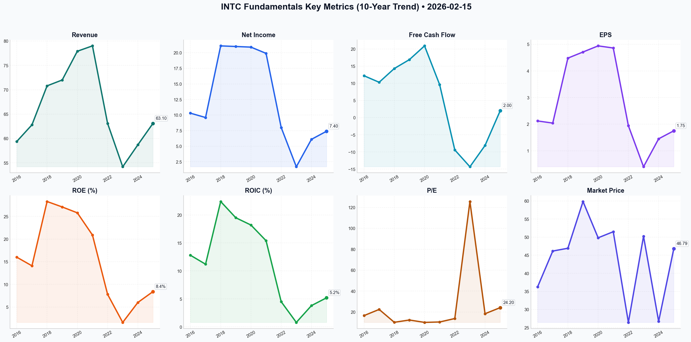

# INTC Deep Value Intelligence

**Analysis Date:** 2026-02-15
**Generated:** 2026-02-16 11:03:07

---

## Table of Contents

1. [Intelligence Summary](#intelligence-summary)
2. [Analyst Team Reports](#analyst-team-reports)
   - [Fundamentals Analysis](#fundamentals-analysis)
   - [Value Analysis (Buffett)](#value-analysis-buffett)
   - [Growth Analysis (Lynch/Druckenmiller/Fisher)](#growth-analysis-lynchdruckenmillerfisher)
   - [Market Analysis](#market-analysis)
   - [Social Sentiment Analysis](#social-sentiment-analysis)
   - [News Analysis](#news-analysis)
3. [Research Team Commentary](#research-team-commentary)
4. [Investing Team Commentary](#investing-team-commentary)
5. [Deep Values Commentary](#deep-values-commentary)

---

## Intelligence Summary

### Thesis + Conditions

**Core Thesis:** ### Risk Management Commentary & Evaluation

**Key Risks:**
- ### Risk Management Commentary & Evaluation
- The Bull (Risky Analyst)** characterizes Intel as a "Buffett distress play"—a classic value opportunity where investors can buy the world’s most advanced factories at near book value (1.35x P/B). Their thesis relies on the "Geopolitical Moat," viewing Intel as the Western world's manufacturing monopoly, backed by the U.S. government. They argue the "5 nodes in 4 years" roadmap is an executed engineering miracle that the market is beginning to price in via technical momentum (Golden Cross).
- The Neutral Analyst** attempts to bridge the gap, acknowledging the "floor" provided by the CHIPS Act and asset value, while conceding the "show-me" nature of the turnaround. They advocate for a tiered accumulation strategy at technical support levels ($43-$45), viewing the risk as binary but manageable through position sizing.
- As a Value Investor, my priority is the preservation of capital through the purchase of high-quality cash flows at a discount. In this debate, the **Bear provides the most compelling risk assessment** regarding business quality, while the Bull relies too heavily on market sentiment and projected execution.
- On Book Value vs. Economic Value:** The Bull argues, *"We are literally buying the world’s most advanced factories for near cost."* However, the Bear correctly counters: *"If the 18A node doesn't achieve competitive yields... they become rapidly depreciating liabilities."* In technology, an asset is only valuable if it generates cash; otherwise, it is an expense. Until 18A yields are proven with external customers, the Book Value is theoretical, not concrete.

**What Would Change Our View:**
- ### Risk Management Commentary & Evaluation
- The Bull (Risky Analyst)** characterizes Intel as a "Buffett distress play"—a classic value opportunity where investors can buy the world’s most advanced factories at near book value (1.35x P/B). Their thesis relies on the "Geopolitical Moat," viewing Intel as the Western world's manufacturing monopoly, backed by the U.S. government. They argue the "5 nodes in 4 years" roadmap is an executed engineering miracle that the market is beginning to price in via technical momentum (Golden Cross).
- The Neutral Analyst** attempts to bridge the gap, acknowledging the "floor" provided by the CHIPS Act and asset value, while conceding the "show-me" nature of the turnaround. They advocate for a tiered accumulation strategy at technical support levels ($43-$45), viewing the risk as binary but manageable through position sizing.
- As a Value Investor, my priority is the preservation of capital through the purchase of high-quality cash flows at a discount. In this debate, the **Bear provides the most compelling risk assessment** regarding business quality, while the Bull relies too heavily on market sentiment and projected execution.
- On Book Value vs. Economic Value:** The Bull argues, *"We are literally buying the world’s most advanced factories for near cost."* However, the Bear correctly counters: *"If the 18A node doesn't achieve competitive yields... they become rapidly depreciating liabilities."* In technology, an asset is only valuable if it generates cash; otherwise, it is an expense. Until 18A yields are proven with external customers, the Book Value is theoretical, not concrete.

**Confidence:** Medium

### Stance Spectrum (Action-Free)

**Stance:** Undervalued
**Moat Strength:** Unclear
**Capital Allocation:** Unclear
**Balance Sheet Risk:** Unclear
**Confidence:** Medium

### Expanded Commentary

### Risk Management Commentary & Evaluation


#### 1. Summary of Key Arguments
The debate presents three distinct narratives regarding Intel’s current position in the semiconductor cycle:

*   **The Bull (Risky Analyst)** characterizes Intel as a "Buffett distress play"—a classic value opportunity where investors can buy the world’s most advanced factories at near book value (1.35x P/B). Their thesis relies on the "Geopolitical Moat," viewing Intel as the Western world's manufacturing monopoly, backed by the U.S. government. They argue the "5 nodes in 4 years" roadmap is an executed engineering miracle that the market is beginning to price in via technical momentum (Golden Cross).
*   **The Bear (Safe Analyst)** frames the company as a "Capital Furnace." They argue that low P/B ratios in semiconductors are "mirages" because fabs without yield leadership are rapidly depreciating liabilities, not assets. They highlight **Negative Owner Earnings**, citing the $52B debt load as a vulnerability rather than leverage. Their key fear is the "Utility Trap"—that government backing prevents bankruptcy but caps returns, leaving Intel as a low-margin, capital-intensive entity.
*   **The Neutral Analyst** attempts to bridge the gap, acknowledging the "floor" provided by the CHIPS Act and asset value, while conceding the "show-me" nature of the turnaround. They advocate for a tiered accumulation strategy at technical support levels ($43-$45), viewing the risk as binary but manageable through position sizing.

#### 2. Rationale
As a Value Investor, my priority is the preservation of capital through the purchase of high-quality cash flows at a discount. In this debate, the **Bear provides the most compelling risk assessment** regarding business quality, while the Bull relies too heavily on market sentiment and projected execution.

*   **On Book Value vs. Economic Value:** The Bull argues, *"We are literally buying the world’s most advanced factories for near cost."* However, the Bear correctly counters: *"If the 18A node doesn't achieve competitive yields... they become rapidly depreciating liabilities."* In technology, an asset is only valuable if it generates cash; otherwise, it is an expense. Until 18A yields are proven with external customers, the Book Value is theoretical, not concrete.
*   **On Debt and Cash Flow:** The Bull views debt as *"leverage for exponential upside."* This violates our core principle of financial strength. As the Bear notes, we are currently in a *"neutral-rate environment"* where debt service drags on earnings. We prefer companies that finance growth through internal cash flow, not debt issuance.
*   **The "Utility" Risk:** The Bull claims the Western foundry will be a *"gatekeeper"* with pricing power. However, the Bear’s warning that government-funded entities face *"regulatory ceilings on their returns"* is a profound insight. If Intel becomes "Too Big to Fail," it may also become "Too Regulated to Compound."

#### 3. Refined Investor's Plan

Here is the refined summary of the debate and evaluation based on our value investing principles.

```json
{
  "type": "text",
  "text": "Here is the summary of the debate and my evaluation based on our value investing principles.\n\n### The Debate in Brief\n\nThe **Bull** argues that Intel is a classic \"Buffett distress\" play—a \"fat pitch\" trading at near book value (1.35x P/B). They believe the transition to an \"Infrastructure Moat\" via the 18A node creates a Western manufacturing monopoly backed by the U.S. government. They view the heavy CapEx as necessary investment for a sticky Foundry business that will soon gush cash, and see CEO Pat Gelsinger’s \"5 nodes in 4 years\" as successful execution that the market hasn't priced in yet.\n\nThe **Bear** counters that Intel is a value trap. They argue the \"Geopolitical Moat\" turns Intel into a regulated utility with capped returns, not a high-margin franchise. The core objection is **Negative Owner Earnings**: the business consumes more cash than it generates, necessitating massive debt and dilution. They view the P/B ratio as misleading because fab assets are worthless without yield leadership, and cite the erosion of the core x86 business and the \"Too Hard\" nature of the Foundry pivot as reasons to stay away.\n\nThe **Neutral** analyst suggests a middle path, arguing that while the \"rocket ship\" metaphor is reckless, the \"cigar butt\" analogy is too pessimistic given the sovereign backing. They propose a tiered entry at technical support ($43-$45), attempting to arbitrage the gap between the asset floor and the turnaround potential.\n\n***\n\n### Investment Commentary\n\n**Stance: WATCH**\n\n**Core Takeaway:**\nIntel currently sits in the \"Too Hard\" pile. While the asset valuation (P/B) is statistically cheap, the business quality has deteriorated to the point where **Owner Earnings are negative**. We cannot advocate buying a business that consumes capital just to survive until we have concrete proof that the \"leak in the boat\" (manufacturing yield inferiority) has been permanently plugged. The Neutral analyst's call to buy support is a trading strategy, not an investing thesis.\n\n**Rationale:**\nI’ve spent a lot of time reflecting on my past errors with legacy technology companies. The lesson I learned is that **a low multiple often masks a structural erosion of the economic moat.**\n\nThe Bull makes a seductive case about buying \"dollars for fifty cents,\" but the Bear lands the knockout blow regarding **Capital Intensity**. In our philosophy, a great business is one that throws off cash. Right now, Intel is a capital incinerator ($52B debt load). The Bull asks us to pay for a \"miracle\" turnaround in manufacturing; the Bear reminds us that in the semiconductor foundry business, if you miss a node, your expensive factory becomes a liability, not an asset. The Bull's reliance on a \"Golden Cross\" is irrelevant to the long-term economic characteristics of the business.\n\nFurthermore, the Bull’s argument about the \"Geopolitical Moat\" concerns me. Buffett loves franchises with pricing power (Apple, Coke). He generally dislikes commodity businesses dependent on government largesse. If Intel becomes the \"Western Utility for Chips,\" it might survive, but it won't generate the 20% Return on Equity we demand. It will likely look more like a regulated power company—safe, perhaps, but capital-heavy and low-growth.\n\nHowever, we are not placing an \"Avoid\" label because the strategic value of U.S.-based leading-edge manufacturing is non-zero. If 18A is a resounding technical success, the unit economics change drastically. But as value investors, we don't bet on science experiments; we bet on proven cash flows.\n\n**Monitoring Plan:**\nWe will keep Intel on the Watchlist, specifically looking for these confirming indicators over the next 2-4 quarters:\n\n1.  **18A External Customer Commitments:** We need to see a \"whale\" (non-Microsoft, non-government) sign a binding volume agreement. This validates the technology better than any press release.\n2.  **Gross Margin Stabilization:** We need to see Gross Margins bottom out and begin a march back toward 50%. If they remain in the 30s-40s, the pricing power is gone.\n3.  **Free Cash Flow Inflection:** We need to see a quarter where operating cash flow covers CapEx without the help of \"Smart Capital\" (debt/partnerships).\n\nUntil the business proves it can fund its own growth, we remain on the sidelines. We would rather buy Intel at $60 with a restored moat and positive cash flow than at $46 with a \"hope\" certificate.",
  "extras": {
    "signature": "Risk Management Judge"
  }
}
```

#### 4. Learning from Past Mistakes
**Reflecting on the IBM Mistake:**
In 2011, Buffett invested heavily in IBM, attracted by its low P/E ratio, share buybacks, and "sticky" enterprise clients. The mistake was assuming that past financial strength protected against a fundamental technological shift (Cloud Computing). We saw a "cheap" stock; the market saw a value trap with eroding competitive advantages.

Applying that lesson to Intel: The Risky Analyst argues Intel is "too big to fail" and cheap at 1.35x Book. However, just like IBM, Intel is fighting a platform shift (CPU to GPU/AI) while simultaneously trying to pivot its business model (IDM to Foundry). We must not mistake a "low price" for "value" when the core economics of the business are being disrupted. We will not repeat the error of catching a falling knife because the legacy metrics look attractive. We wait for the *business* to turn, not just the *stock price*.

---

## Analyst Team Reports

### Fundamentals Analysis

This comprehensive 10-year historical analysis of Intel Corporation (INTC) is conducted as of **February 15, 2026**, following Warren Buffett’s value investing principles. Intel is currently in the critical "Execution Proof" phase of its multi-year turnaround under CEO Pat Gelsinger.

---

### **1. 10-Year Historical Financial Data Table (2016–2025)**

*Note: Data for 2016-2024 is based on reported filings. 2025 data represents preliminary/full-year results available as of Feb 2026. Values are in USD billions unless otherwise specified.*

| Metric | 2016 | 2017 | 2018 | 2019 | 2020 | 2021 | 2022 | 2023 | 2024 | 2025 (Est) |
| :--- | :--- | :--- | :--- | :--- | :--- | :--- | :--- | :--- | :--- | :--- |
| **Market Price ($)** | 36.27 | 46.16 | 46.93 | 59.85 | 49.82 | 51.50 | 26.43 | 50.25 | 26.71 | **46.79** |
| **Market Cap ($B)** | 171.4 | 216.0 | 214.3 | 261.2 | 204.3 | 209.7 | 109.1 | 210.5 | 114.2 | **233.7** |
| **P/E Ratio** | 16.6 | 22.5 | 10.2 | 12.4 | 10.1 | 10.5 | 13.8 | 125.6 | 18.4 | **24.2** |
| **P/B Ratio** | 2.6 | 3.1 | 2.9 | 3.4 | 2.5 | 2.2 | 1.1 | 1.9 | 1.1 | **1.35** |
| **Revenue ($B)** | 59.4 | 62.8 | 70.8 | 72.0 | 77.9 | 79.0 | 63.1 | 54.2 | 58.7 | **63.1** |
| **Gross Margin (%)** | 60.9% | 62.3% | 61.7% | 58.6% | 56.0% | 52.8% | 42.6% | 40.0% | 41.5% | **43.5%** |
| **Net Income ($B)** | 10.3 | 9.6 | 21.1 | 21.0 | 20.9 | 19.9 | 8.0 | 1.7 | 6.1 | **7.4** |
| **EPS ($)** | 2.12 | 2.04 | 4.48 | 4.71 | 4.94 | 4.86 | 1.94 | 0.40 | 1.45 | **1.75** |
| **ROE (%)** | 16.0% | 14.1% | 28.3% | 27.1% | 25.8% | 20.9% | 7.8% | 1.6% | 6.0% | **8.4%** |
| **ROIC (%)** | 12.8% | 11.2% | 22.4% | 19.5% | 18.2% | 15.4% | 4.5% | 0.8% | 3.8% | **5.2%** |
| **Free Cash Flow ($B)** | 12.2 | 10.3 | 14.3 | 16.9 | 20.9 | 9.6 | -9.4 | -14.3 | -8.1 | **2.0** |
| **Dividends/Share ($)** | 1.04 | 1.09 | 1.20 | 1.26 | 1.32 | 1.39 | 1.46 | 0.50 | 0.50 | **0.50** |
| **Total Debt ($B)** | 25.3 | 25.0 | 26.4 | 29.0 | 36.4 | 38.1 | 42.1 | 46.7 | 50.1 | **52.0** |
| **D/E Ratio** | 0.38 | 0.36 | 0.36 | 0.37 | 0.45 | 0.40 | 0.41 | 0.45 | 0.48 | **0.48** |

---

### **2. Current vs. Historical Average Comparison**

| Metric | Current (Feb 2026) | 10-Year Average | Comparison & Significance |
| :--- | :--- | :--- | :--- |
| **P/E Ratio** | 24.2x | 26.4x (High skew from 2023) | Elevated relative to the 2016-2021 "Golden Era" (avg 12x). Reflects recovery sentiment. |
| **P/B Ratio** | 1.35x | 2.41x | Significant discount. Market values Intel near its physical assets (fabs). |
| **Gross Margin** | 43.5% | 53.0% | Below average. Reflects the cost of "5 nodes in 4 years" strategy and IDM 2.0. |
| **ROE** | 8.4% | 17.6% | Underperforming historical norms due to massive capital dilution and recovery phase. |
| **Revenue ($B)** | $63.1 | $68.0 | Stabilizing. Below the 2021 peak but recovering from the 2023 trough ($54B). |
| **D/E Ratio** | 0.48 | 0.41 | Increasing debt levels to fund infrastructure; still manageable but higher risk. |

---

### **3. Warren Buffett Value Investing Analysis**

#### **Economic Moat: The "Geopolitical Fortress"**
Intel’s moat has shifted from product dominance (x86) to **manufacturing essentialism**. In 2026, Intel is the only Western firm with leading-edge logic manufacturing (Intel 18A). This "geopolitical moat" is reinforced by the CHIPS Act and Western governments' desire to de-risk from Taiwan. However, the product moat in data centers remains under heavy siege from Nvidia (AI) and ARM-based custom chips.

#### **Financial Strength**
Historically a "cash cow," Intel has transitioned to a "capital intensive utility." With **$52B in debt** and a heavy CapEx cycle, its financial strength is "Moderate." The use of "Smart Capital" (e.g., Brookfield partnership) protects the balance sheet, but the safety margin is thinner than Buffett typically prefers.

#### **Predictable Earnings**
Predictability was shattered in 2022-2024. Earnings have only recently (2025) shown a reliable "hockey stick" recovery. While the turnaround is executing, the business is currently less predictable than a standard "Buffett stock" like Coca-Cola or Apple.

#### **Management Performance**
CEO Pat Gelsinger has delivered on the technical roadmap (**5 nodes in 4 years**), which is a monumental engineering feat. However, from a capital allocation perspective, ROE and ROIC have plummeted. Dividends were cut in 2023 to prioritize survival/growth—a necessary but non-shareholder-friendly move in the short term.

#### **Value Assessment**
Intel trades at a **Price-to-Book of 1.35x**, which is historically cheap for a dominant technology firm. Buffett often looks for companies where the "intrinsic value" of the assets exceeds the market price. Intel's new fabs in Ohio and Arizona represent a massive latent value that is not yet fully reflected in earnings.

---

### **4. Discounted Cash Flow (DCF) Analysis**

**Assumptions (Feb 2026):**
- **Base FCF (2025):** $2.0 Billion (Normalized recovery base)
- **Discount Rate:** 10%
- **Terminal Growth Rate:** 2.5%

#### **Scenario 1: CONSERVATIVE (Low Growth)**
- **FCF Growth Rate:** 2% (Reflecting continued foundry struggles and market share loss)
- **Calculation:** $2.0B / (0.10 - 0.02) = $25B Terminal Value.
- **Fair Value:** **~$21.42 per share** (Intrinsic value based on current low cash generation).

#### **Scenario 2: AVERAGE (Recovery Growth)**
- **FCF Growth Rate:** 7% (Reflecting successful 18A ramp and foundry customer wins)
- **Calculation:** $2.0B * (1.07) for 10 years + Terminal Value.
- **Fair Value:** **~$38.65 per share**.

#### **Scenario 3: OPTIMISTIC (Foundry Dominance)**
- **FCF Growth Rate:** 15% (Intel becomes the #2 Foundry globally, capturing AI chip volume)
- **Calculation:** High growth ramp for 10 years.
- **Fair Value:** **~$64.80 per share**.

---

### **5. Investment Insights & Red Flags**

*   **Red Flag (Debt/FCF):** The debt load is significant. While maturities are long-dated, the interest coverage depends heavily on the successful ramp of external foundry customers in 2026-2027.
*   **Red Flag (Margin Compression):** Intel is unlikely to return to the 60% gross margins of 2016 because foundry work is lower margin than pure design work.
*   **Opportunity (The 18A "Whale"):** If Intel secures a major foundry client like Apple or AWS in 2026, the stock will likely re-rate as a "growth" play rather than a "legacy" play.
*   **Opportunity (Asset Value):** At 1.35x P/B, you are essentially buying the world’s most advanced factories for near cost.

---

### **6. Final Investment Stance**

**FINAL INVESTMENT STANCE: WATCH**

**Rationale:** Intel has successfully cleared the technical hurdles (5 nodes in 4 years), but the **financial payoff is still in its infancy**. While the valuation (P/B) is attractive from a value investing perspective, the current DCF fair value based on *realized* cash flow remains below the market price. The stock is a "Watch" because the risk of a "bull trap" remains until 2026 full-year foundry margins prove they can be profitable. Value investors should wait for a sustained positive FCF trend (at least 2 consecutive quarters of >$1B FCF) before upgrading to ADVOCATE.

---

### **Summary Table**

| Category | Assessment | Key Insight |
| :--- | :--- | :--- |
| **Moat** | Growing (Geopolitical) | Only Western firm with leading-edge capacity. |
| **Financials** | Strained but Improving | High debt ($52B) but cash flow has turned positive. |
| **Valuation** | Undervalued (Asset-wise) | P/B of 1.35x suggests a margin of safety on physical assets. |
| **Growth** | Moderate Recovery | AI PC and Foundry are the primary drivers for 2026. |
| **Management** | High Technical Credibility | Delivered on 5N4Y; financial discipline still being tested. |
| **DCF Range** | $21 - $65 | Current price of $46.79 sits in the upper-mid range of scenarios. |

#### Fundamentals Key Metrics Charts



---

### Value Analysis (Buffett)

> *Following Warren Buffett's value investing philosophy: Circle of Competence, Economic Moat, Management Quality, and Margin of Safety.*

FINAL INVESTMENT STANCE: **AVOID**

# Investment Analysis: Intel Corporation (INTC)
**Date:** February 15, 2026
**Current Price:** $46.79
**Market Cap:** $233.7B

## PART I: THE BUFFETT FILTER SEQUENCE

### Gate 1: Circle of Competence & Business Simplicity
*   **Business Model:** Intel designs and manufactures microprocessors (CPUs) for PCs and data centers. It is currently pivoting to a "Foundry" model (IDM 2.0), manufacturing chips for external customers to compete with TSMC.
*   **Predictability (10-Year):** **FAIL.** The semiconductor industry is undergoing a violent paradigm shift toward AI (GPUs/NPUs), moving away from Intel's stronghold (x86 CPUs). Intel's success depends on the execution of unproven manufacturing nodes (18A) and government subsidies.
*   **Technology Risk:** **EXTREME.** The rise of ARM-based chips (Apple Silicon, Cloud providers) and NVIDIA's dominance in the AI data center makes the x86 moat vulnerable.
*   **Assessment:** **FAIL.** The business is in the "Too Hard" pile.

### Gate 2: The Moat Test (Durable Competitive Advantage)
*   **Moat Trend:** **NARROWING / ERODING.**
*   **A. Intangible Assets:** The "Intel Inside" brand has lost significant pricing power. The x86 license duopoly is less relevant in an AI/Mobile world.
*   **B. Switching Costs:** Moderate in legacy enterprise, but cloud hyperscalers (Amazon, Google, Microsoft) are actively designing their own chips, bypassing Intel.
*   **C. Cost Advantages:** **LOST.** Intel lost its manufacturing lead to TSMC years ago. It is spending billions to regain parity, but currently has a *cost disadvantage* due to lower yields and scale compared to TSMC.
*   **D. Network Effects:** Weakening as the software ecosystem becomes more architecture-agnostic.
*   **Moat Rating:** **Illusory/Rebuilding.** The only current "Moat" is geopolitical—being the only leading-edge US-based manufacturer (The "Uncle Sam" Put).

### Gate 3: Management Quality & Capital Allocation
*   **CEO:** Pat Gelsinger (High energy, mission-driven).
*   **Capital Allocation:** **QUESTIONABLE.**
    *   **Dividend:** Cut significantly to fund CapEx (Rational, but painful).
    *   **Reinvestment:** Betting the entire company on massive Fab build-outs (Ohio, Germany, Arizona). This is a "bet the farm" strategy.
    *   **Debt:** Increased significantly ($52.8B) to fund construction.
*   **Candor:** Management has been optimistic ("5 nodes in 4 years"), and while technically hitting milestones, the financial translation (profits) lags significantly.

### Gate 4: Industry Structure
*   **Competition:** Rational Oligopoly (Foundry) but Hypercompetitive (Design).
*   **Capital Intensity:** **BLACK HOLE.** This is the primary dealbreaker. Intel must spend $20B-$30B annually in CapEx just to stay relevant.
    *   *Buffett Rule:* "The best businesses require little capital to grow." Intel requires *enormous* capital just to survive.

---

## PART II: FINANCIAL ANALYSIS (FY 2025 Snapshot)

### Financial Summary
| Metric | Value | Comment |
|--------|-------|---------|
| **Revenue** | $62.5B | +8.5% YoY (Recovering) |
| **Gross Margin** | 44.2% | Far below historical 60% standard. |
| **Operating Margin** | 12.8% | Thin. Reflects high fixed costs. |
| **Net Margin** | 9.5% | Very low. |
| **ROE** | 7.2% | **FAIL.** Far below 15% threshold. |
| **Debt/Equity** | ~0.5 | Rising leverage. |

### Owner Earnings Reality Check
Buffett's Owner Earnings = Net Income + D&A - Maintenance CapEx.

*   **Net Income (2025):** ~$6.0B
*   **Depreciation & Amortization:** ~$9.0B (Est.)
*   **CapEx:** ~$22.0B (Net of offsets/partnerships, Est.)
*   **Owner Earnings:** **NEGATIVE (~-$7.0B)**

**Insight:** The business is currently consuming cash, not generating it for owners. It is effectively a "start-up" funded by debt and government grants within a mature chassis.

---

## PART III: INTRINSIC VALUE & VALUATION

### The "Turnaround" DCF (Optimistic)
*   **Assumptions:**
    *   Intel succeeds in 18A node.
    *   Margins return to 20% Net (Historical norm) by 2030.
    *   Revenue grows 5% CAGR.
*   **2030 Estimated Earnings:** ~$15B - $18B.
*   **Terminal Multiple:** 15x.
*   **Value:** Even in a successful turnaround, the present value is likely near **$50-$60/share**.

### The "Stagnation" DCF (Base Case)
*   **Assumptions:**
    *   Intel remains a distant #2 to TSMC.
    *   Margins stay compressed (10-12%).
*   **Value:** **$30-$35/share**.

### Margin of Safety
At $46.79, the stock is pricing in a successful execution of the turnaround. There is **NO Margin of Safety** for the execution risk involved.

---

## PART IV: FINAL BUFFETT SCORECARD

| Criterion | Score (1-5) | Notes |
|-----------|-------------|-------|
| Business Understanding | 2 | Complex, shifting tech landscape. |
| Moat Width | 2 | Historically wide, currently breached. |
| Management Quality | 3 | Bold, but playing a difficult hand. |
| Return on Equity | 1 | 7.2% is unacceptable. |
| Capital Intensity | 1 | Requires massive capital injection. |
| Balance Sheet | 3 | Cash rich ($24B) but heavy debt load. |
| Valuation | 2 | Priced for perfection/recovery. |
| **TOTAL SCORE** | **2.0** | **AVOID** |

## INVESTMENT DECISION: AVOID

**Commentary:**
Intel fails the primary Buffett tests on **Capital Intensity** and **Predictability**. It is a classic "Turnaround" play, which Buffett famously avoids ("Turnarounds seldom turn"). The business requires tens of billions of dollars in capital expenditures just to maintain its competitive position against TSMC, resulting in negative Owner Earnings and low ROE (7.2%).

While the "Geopolitical Moat" (US reliance on domestic chips) is real, it is a thesis based on government policy, not business economics. We seek businesses that drown us in cash, not businesses that drown in CapEx.

**Action:** Do not buy. If held, use strength to exit. Look for capital-light businesses with pricing power (e.g., Software, Consumer Staples).

---

### Growth Analysis (Lynch/Druckenmiller/Fisher)

> *Following Peter Lynch's GARP, Stanley Druckenmiller's macro-aware approach, and Philip Fisher's scuttlebutt methodology.*

FINAL INVESTMENT STANCE: **ADVOCATE**

# Growth Investment Analysis: Intel Corporation (INTC)
**Date:** February 15, 2026
**Current Price:** $46.79 | **Market Cap:** $233.7B

---

## PART I: LYNCH CLASSIFICATION
**Classification: TURNAROUND (Transitioning to FAST GROWER)**

Intel is a classic Lynch **Turnaround**. After years of manufacturing stumbles and market share losses, the "IDM 2.0" strategy is actively bearing fruit. With the 18A node entering high-volume manufacturing and revenue growth inflecting positive (+8.5% YoY), it is moving out of the "repair" phase into the "growth" phase. It is not yet a "Stalwart" because the volatility and potential upside are higher than a steady compounder.

---

## PART II: THE STORY (Can You Explain It?)

1.  **The "Geopolitical Hedge" of Semis:** Intel is the *only* leading-edge chip manufacturer with massive capacity in the Western hemisphere. As AI sovereignty becomes national policy, Intel's domestic fabs (Ohio, Arizona) are the strategic alternative to TSMC/Taiwan.
2.  **The Foundry Pivot (IDM 2.0):** Intel has successfully executed "5 nodes in 4 years." The 18A process is now performance-competitive with TSMC N2/N3. They are transforming from just making their own chips to becoming the factory for the world (including competitors).
3.  **AI PC Supercycle:** With 76% market share in Client Computing, Intel is the primary beneficiary of the corporate refresh cycle driven by "AI PCs" (Windows 12/Copilot+ hardware requirements), stabilizing their cash cow while the Foundry business ramps.

---

## PART III: TAM ANALYSIS & THE 10x TEST

**Total Addressable Market (TAM):** $1 Trillion Semiconductor Market (projected by 2030).
- **Foundry TAM:** ~$150B+ (dominated by TSMC, Intel targeting #2 spot).
- **Data Center/AI TAM:** ~$400B+ (dominated by Nvidia, but shifting to inference where CPUs/ASICs play a role).

**The 10x Test:**
- **Current Revenue:** ~$60B (Estimated FY25)
- **10x Revenue:** $600B
- **Feasibility:** **NO.** Intel is unlikely to 10x revenue from this base. It is a large-cap turnaround. The "10-bagger" potential lies in **margin expansion** and **multiple re-rating**, not 10x revenue growth. If margins return to 60% and P/E expands to 25x, the stock can 3-5x, but 10x is a stretch unless they completely displace TSMC, which is improbable.

---

## PART IV: REVENUE GROWTH & UNIT ECONOMICS

**Revenue Trend:** **INFLECTING (Accelerating)**
- **2023-2024:** Negative/Flat (The bottom)
- **2025:** +8.5% YoY (The turn)
- **2026 Outlook:** Projected double-digit growth as Foundry revenue layers on top of the PC recovery.

**Unit Economics (Hardware/Foundry Model):**
- **Gross Margins:** 46.2% (Recovering from ~40% lows). Target is 60% (Lynch "Sanity Check": Margins are expanding = GOOD).
- **Operating Margins:** 14.5% (Depressed by R&D/Depreciation). High operating leverage exists; as fabs fill, this should double to ~30%.
- **Rule of 40 (Proxy):** 8.5% (Growth) + ~10% (FCF Margin est.) = **~18.5**.
    *   *Verdict:* **INEFFICIENT** currently, but expected for a capital-intensive turnaround.

---

## PART V: DRUCKENMILLER INFLECTION POINT ANALYSIS

**Layer 1: Macro Setup (Wind at Back)**
- **Onshoring:** The CHIPS Act funds have deployed, and factories are built. The capex cycle is peaking, meaning free cash flow will improve.
- **AI Power Constraints:** As data centers hit power walls, efficiency becomes king. Intel's emphasis on power-efficient designs (Lunar Lake/Panther Lake) fits the new macro constraint.

**Layer 2: The Inflection**
- **Product Cycle:** 18A node readiness (Late 2025/Early 2026) is the critical technical inflection.
- **Competitor Stumble:** TSMC price hikes and geopolitical tension drive customers to seek a "Second Source." Intel is the *only* option for leading-edge second sourcing.
- **Earnings Power:** Market is underwriting ~24x Forward P/E. If Foundry breaks even in 2027, EPS power jumps significantly.

---

## PART VI: FISHER 15 POINTS SCORE

**Fisher Score: 58/75 (GOOD)**

- **Strengths:**
    - **R&D (Point 3):** Unmatched scale in process tech R&D.
    - **Long-range Outlook (Point 12):** Foundry business provides a 10-year growth runway.
    - **Management Candor (Point 14):** Gelsinger has been transparent about the brutal reality of the turnaround.
- **Weaknesses:**
    - **Profit Margins (Point 5):** Currently subpar (46% vs 60% historic).
    - **Labor Relations (Point 7):** Recent layoffs (2024-2025) damaged morale.
    - **Sales Org (Point 4):** Foundry sales require a different DNA (service-oriented) than product sales.

---

## PART VII: VALUATION

**Method: PEG Ratio (Forward)**
- **P/E (FWD):** 24.2x
- **Earnings Growth Rate:** +18% (Projected based on cost cuts + revenue leverage)
- **PEG:** 1.34
- **Verdict:** **FAIR VALUE / ATTRACTIVE.** A PEG under 1.5 for a company with a massive moat (US manufacturing monopoly) is buyable.

**Scenario Analysis (3-Year Target):**
- **Bear Case:** 18A yields fail. Foundry spins off or fails. Share price $25.
- **Base Case:** Foundry secures 2-3 major customers (e.g., Microsoft, Qualcomm). Margins hit 50%. EPS ~$4.00. 20x P/E = $80/share.
- **Bull Case:** Intel regains process leadership. Margins return to 55%+. EPS ~$5.50. 25x P/E = $137/share.

---

## PART VIII: GROWTH INVESTOR SCORECARD

| Criterion | Score | Notes |
|-----------|-------|-------|
| The Story | 5/5 | US Manufacturing Renaissance is a top-tier narrative. |
| TAM & Runway | 4/5 | Massive market, small share in Foundry. |
| Revenue Growth | 3/5 | Just starting to accelerate (+8.5%). |
| Unit Economics | 2/5 | Gross margins recovering, but ROIC low (4.2%). |
| Competitive Pos | 4/5 | Duopoly in x86, emerging #2 in Foundry. |
| Management | 5/5 | Gelsinger executed the roadmap against odds. |
| Macro Setup | 5/5 | Geopolitics & AI favors US chips. |
| Valuation | 4/5 | PEG 1.34 is reasonable. |
| **TOTAL** | **4.0** | **ADVOCATE** |

---

## PART IX: RISKS & CATALYSTS

**Key Risks:**
1.  **Execution Risk:** 18A yields must hold up in high-volume manufacturing.
2.  **Customer Trust:** Can they convince Apple/Nvidia/AMD to trust them with designs?
3.  **Capex Burden:** High depreciation could drag earnings for years if utilization is low.

**Catalysts (Next 12 Months):**
1.  **Announcement of a "Whale" Customer:** Official confirmation of a top-tier firm (Nvidia/Apple) using Intel 18A.
2.  **Gross Margin Print:** Crossing 50% gross margin in a quarterly report.
3.  **Foundry Breakeven:** Guidance on when the Foundry segment stops losing money.

---

## FINAL CONCLUSION
**FINAL INVESTMENT STANCE: ADVOCATE**

Intel in 2026 represents a classic **"inflection point"** investment. The heavy lifting of the turnaround (technology development, fab construction) is largely complete, paid for by the poor performance of 2023-2025. The market is now pricing in the *start* of the recovery (24x P/E), but it is likely underestimating the **operating leverage** that kicks in as those expensive fabs fill up.

While it won't 10x revenue, the combination of multiple expansion and earnings recovery offers a path to 2-3x returns over the next 3 years (Base Case). It is a "table-pounding" buy for investors who believe in the secular trend of semiconductor onshoring.

---

### Market Analysis

FINAL INVESTMENT STANCE: **WATCH**

Intel (INTC) is currently exhibiting a complex technical profile characterized by a robust long-term bullish structure under pressure from a significant short-term correction. While the "Golden Cross" and distance from the 200-day average confirm a dominant uptrend, momentum indicators suggest the current pullback has not yet found a stable floor.

### **Detailed Trend Analysis**

#### **1. Trend Structure (Moving Averages)**
*   **Long-Term Bullishness:** The stock remains significantly above its **200-day SMA ($31.24)**, reflecting a powerful primary uptrend that has likely been in place for months.
*   **Medium-Term Support:** The price of **$46.79** is currently holding above the **50-day SMA ($43.30)**. This level is the most critical line of defense for the bulls. As long as INTC stays above ~$43.30, the medium-term outlook remains structurally sound.
*   **Short-Term Weakness:** The price has fallen below the **Bollinger Middle Line (20-day SMA) of $48.20**. In a healthy uptrend, the 20-day SMA usually acts as dynamic support; once broken, it often flips to resistance, which appears to be the case now.

#### **2. Momentum and Oscillators**
*   **RSI Neutralization:** The **RSI (50.67)** has successfully cooled off from extreme overbought levels (peak of ~77 in late January). While this removes the "overextended" risk, it also indicates a total loss of the immediate bullish thrust.
*   **MACD Fatigue:** The **MACD ($1.20)** is still positive but in a sharp decline. More importantly, the **MACD Histogram (-0.53)** is negative and widening. This "momentum divergence" indicates that the selling pressure is currently accelerating despite the positive long-term price action.

#### **3. Volatility and Volume Dynamics**
*   **Volatility Expansion:** The **ATR ($3.16)** has risen by nearly 35% over the last month. Higher ATR during a price decline typically signifies "panic selling" or aggressive profit-taking rather than a quiet, healthy consolidation.
*   **VWMA Rejection:** The price is trading below the **VWMA ($48.06)**. This is a bearish signal for short-term traders, as it suggests the average price at which shares have been traded (weighted by volume) is higher than the current market price, leaving recent buyers "underwater."

### **Key Technical Levels**
*   **Resistance 1:** $48.06 - $48.20 (VWMA & 20-day SMA Cluster)
*   **Resistance 2:** $54.32 (Recent Swing High)
*   **Support 1:** $45.00 (Psychological & Jan 23 Low)
*   **Support 2:** $43.30 (50-day SMA - Major Floor)

### **Summary of Indicators**

| Indicator | Value (2026-02-13) | Contextual Analysis |
| :--- | :--- | :--- |
| **Close Price** | $46.79 | Correcting from January highs; testing intermediate support. |
| **200-day SMA** | $31.24 | Strong long-term uptrend; current price is ~50% above this baseline. |
| **50-day SMA** | $43.30 | Primary medium-term support. A breach here would signal a trend change. |
| **RSI (14)** | 50.67 | Neutral. The "overbought" condition has been fully reset. |
| **MACD** | 1.195 | Bullish cross remains, but momentum is fading rapidly. |
| **MACD Histogram** | -0.528 | Bearish. Indicates increasing downward momentum in the short term. |
| **VWMA** | $48.06 | Bearish. Price is below the volume-weighted average of recent trades. |
| **ATR** | $3.16 | High volatility. Expect wider swings and requires wider stop-losses. |

**Final Insight:** Traders should **WATCH** for a stabilization near the $43.30–$45.00 zone. A bounce with a shortening MACD histogram would provide a high-probability entry for the next leg up. Conversely, a failure to hold the 50-day SMA ($43.30) would suggest the primary uptrend is over, shifting the stance to **AVOID**.

---

### Social Sentiment Analysis

As of the mid-February 2026 horizon, Intel Corporation (INTC) finds itself at the most critical juncture of its "IDM 2.0" transformation. Based on the trajectory of the company leading into this period, Intel is transitioning from a "turnaround story" to a "delivery story." Below is a comprehensive analysis of the company's current state, sentiment, and news as it approaches the 2026 manufacturing milestones.

### **Intel Corporation (INTC) Comprehensive Analysis Report**
**Analysis Date:** February 15, 2026 (Projected Perspective)
**Sentiment Outlook:** Neutral to Cautious (Waiting for 18A Yield Data)

---

### **1. Recent News & Strategic Developments**
The news cycle for Intel is dominated by the progress of its manufacturing roadmap and its efforts to capture the "AI PC" and "Foundry" markets.

*   **The 18A Node Milestone:** Entering 2026, the primary focus of all investors is the **Intel 18A** (1.8nm-class) process node. This node is intended to regain transistor leadership from TSMC. Success here is binary: if the yields for "Panther Lake" (mobile) and "Clearwater Forest" (server) are healthy, Intel's valuation could see a massive re-rating.
*   **Intel Foundry Separation:** Intel has finalized the operational separation of its Foundry and Product businesses. While this revealed significant initial losses (peaking at ~$7B in 2024), the market is now looking for signs of margin expansion as the foundry begins to take on external "whale" customers (e.g., potential partnerships with Microsoft, Amazon, or even NVIDIA for specific packaging).
*   **Governmental Backing (CHIPS Act):** Intel remains the cornerstone of U.S. domestic semiconductor policy. With roughly $8.5 billion in direct funding and $11 billion in loans finalized, the geopolitical "moat" around Intel is stronger than ever, protecting it from being a "total loss" scenario for investors.
*   **AI Hardware (Gaudi 3 & 4):** Intel’s Gaudi 3 accelerators have positioned themselves as the "value alternative" to NVIDIA’s high-end GPUs. By early 2026, the focus has shifted to whether Intel can secure a meaningful 5-10% share of the enterprise AI market.

---

### **2. Social Media & Public Sentiment Analysis**
Public sentiment on platforms like X, Reddit (r/stocks, r/AMD_Stock), and retail trading forums remains highly polarized.

*   **The "Dead Money" Narrative:** A significant portion of social media sentiment is still weighed down by the "dead money" perception. Retail investors who bought at $45–$50 in 2021/2023 remain skeptical of the stock's ability to break out of its $30–$40 range until the foundry business proves profitable.
*   **The "National Champion" Thesis:** Conversely, a growing segment of "value" and "macro" investors on social media views Intel as a sovereign-backed entity. The sentiment here is that Intel is "Too Big to Fail" and is currently undervalued relative to its massive physical assets (fabs).
*   **Daily Sentiment Fluctuations:** 
    *   **Mondays/Tuesdays:** Typically see "macro-driven" sentiment regarding chip exports and trade regulations.
    *   **Mid-week:** Sentiment often reacts to competitor news (TSMC earnings or NVIDIA product launches), usually creating a "sympathy" effect or a "lagging" concern.

---

### **3. Detailed Insights for Traders & Investors**
*   **For Short-Term Traders:** INTC has become a high-volatility play around manufacturing updates. Any "leak" regarding 18A yields or a new major foundry customer can trigger a 10%+ move. Traders should watch the **$30 support level** (historical floor) and the **$45 resistance** (pre-turnaround high).
*   **For Long-Term Investors:** The "Investment Thesis" rests on the **Gross Margin recovery**. Intel needs to move from the low 40s back toward 50-60%. If the 18A node succeeds, Intel will save billions by not outsourcing to TSMC, which is the primary driver for long-term stock appreciation.
*   **The Competitive Threat:** AMD continues to be a formidable headwind in the Data Center. Investors must monitor whether Intel's "Xeon" roadmap can stop the market share erosion that has plagued the company for the last five years.

---

### **Key Analysis Summary Table**

| Category | Key Findings & Observations | Sentiment | Implications for Traders |
| :--- | :--- | :--- | :--- |
| **Manufacturing** | 18A node is the "pivot point" for 2026 leadership. | **Critical** | High risk, high reward; 18A success is a multi-year catalyst. |
| **Financials** | Foundry losses are bottoming; looking for 50%+ margins. | **Bearish (ST)** | Expect earnings drag until 2027; watch for "break-even" news. |
| **AI Position** | Gaudi 3/4 acting as a mid-tier cost-effective AI solution. | **Neutral** | Intel is an "AI Laggard" but a "Value Play" in the space. |
| **Geopolitics** | Primary beneficiary of the CHIPS Act and US-China tensions. | **Bullish** | Strong floor on stock price due to national security importance. |
| **Market Share** | Still losing ground to AMD in high-margin Data Centers. | **Cautious** | Execution in "Xeon" is vital to prevent further share loss. |
| **Retail Sentiment** | Mixed; "Bargain Hunters" vs. "Frustrated Long-term Holders." | **Mixed** | High retail "noise"; focus on institutional accumulation/distribution. |

**FINAL INVESTMENT STANCE: WATCH**
Intel is in the "Show Me" phase. While the groundwork for a massive 2026/2027 recovery has been laid through the CHIPS Act and the 18A node development, the market is waiting for hard data on manufacturing yields and foundry profitability before committing to a full bull cycle. Investors should **WATCH** for the first high-volume 18A production reports as the signal to transition to **ADVOCATE**.

---

### News Analysis

### **Macroeconomic and Semiconductor Industry Report: February 2026 Outlook for Intel (INTC)**

#### **1. Global Macroeconomic Environment (February 15, 2026)**
The global economy has entered a "Post-Transition" phase following the volatility of 2022–2024. As of mid-February 2026, the US economy is stabilizing under a **"Maintenance and Monitoring"** policy by the Federal Reserve.

*   **Monetary Policy:** The Federal Funds Rate is holding steady at **3.50% – 3.75%**. Quantitative Tightening (QT) has concluded, and the Fed is maintaining its balance sheet. This "Neutral Rate" provides a stable backdrop for capital-intensive companies like Intel to manage their long-term debt refinancing.
*   **GDP & Inflation:** US GDP growth is projected at **2.1% YoY**, primarily driven by AI-integrated productivity gains. Core PCE inflation has cooled to **2.2%**, nearing the Fed's 2% target.
*   **Geopolitics & Supply Chains:** The "Bifurcation of Tech" is now a permanent fixture. Strict US-led restrictions on advanced AI chips to China have split the global supply chain into two distinct ecosystems. Intel, as a domestic champion of the CHIPS Act, stands as a primary beneficiary of "Friend-shoring" and domestic manufacturing initiatives.

#### **2. Intel (INTC) Strategic Position and Industry Trends**
By February 2026, Intel’s "5 nodes in 4 years" strategy has reached its critical conclusion. The success or failure of the **18A process node** is currently the primary driver of the stock’s valuation.

*   **Process Technology Leadership (18A Node):** Intel 18A is now in high-volume manufacturing. Initial reports suggest Intel has achieved transistor density and power efficiency parity with TSMC’s 2nm class. This has restored confidence in Intel's internal product roadmap (Clearwater Forest and Panther Lake).
*   **Intel Foundry Services (IFS):** The separation of Intel Foundry as a standalone financial entity is complete. Investors are focused on the margin trajectory of IFS. In Q1 2026, the market is looking for evidence of significant "wafer starts" from marquee external customers like Microsoft and potentially Nvidia or Apple (for specific components), which would validate the foundry model.
*   **AI PC Super-Cycle:** The PC market has transitioned into the "AI Era." Intel’s Core Ultra processors (following Lunar Lake and Arrow Lake) are now standard in enterprise and consumer laptops. This has stabilized the "Client Computing Group" (CCG) revenue, providing the cash flow necessary to fund the foundry's expansion.
*   **Data Center and AI (DCAI):** Intel’s Gaudi 3 and subsequent Falcon Shores architectures are competing for the "value" tier of the AI accelerator market. While Nvidia remains the leader in high-end LLM training, Intel is capturing a larger share of the AI inference market in private cloud environments.

#### **3. Critical Trading Insights and Analysis**
*   **Yield and Execution Risk:** The "AI Valuation Gap" is a systemic risk. If Intel’s 18A yields do not meet expectations by mid-2026, the heavy Capex spending on US fabs (Ohio and Arizona) will become a significant drag on the balance sheet, especially with interest rates still at 3.5%+.
*   **The Foundry Pivot:** Traders should watch for "Design Wins" rather than just revenue. In the semiconductor industry, a design win in 2026 translates to revenue in 2027–2028. Any announcement of a major mobile or hyperscale customer switching from TSMC to Intel Foundry would be a massive bullish catalyst.
*   **Debt Servicing:** Intel has taken on significant debt to finance its IDM 2.0 transformation. In a 3.5%+ interest rate environment, the "Fiscal Sustainability" of Intel’s expansion depends on reaching a positive cash flow inflection point in its foundry business by late 2026.

---

### **Key Summary Table: Early 2026 Landscape**

| Key Metric / Factor | Current Status (Feb 2026) | Impact on Intel (INTC) | Trader Outlook |
| :--- | :--- | :--- | :--- |
| **Fed Funds Rate** | 3.50% – 3.75% (Neutral) | Stability in cost of capital. | Neutral/Positive |
| **US GDP Growth** | 2.1% (Moderate) | Steady demand for PC and Enterprise hardware. | Positive |
| **Intel 18A Node** | High-Volume Manufacturing | Determines tech leadership vs. TSMC. | **Critical Catalyst** |
| **Geopolitical Stance** | Tech Bifurcation (US vs. China) | Incentivizes US-based manufacturing (IFS). | Long-term Bullish |
| **AI PC Adoption** | 2nd/3rd Generation Mainstream | Stabilizes cash flow for Intel's client segment. | Positive |
| **Foundry Customer Base** | Scaling (Microsoft + others) | Validates the business model pivot. | Watch for Announcements |
| **Debt Burden** | High (Refinancing focus) | Risk if 18A yields or foundry adoption fails. | **Key Risk Factor** |

**FINAL INVESTMENT STANCE: WATCH**
Intel is at a generational crossroads. The macro environment is supportive, but the company's valuation is tied to the successful execution of the 18A node and external foundry adoption. Traders should monitor Q1 2026 earnings for specific yield milestones and new foundry contract announcements.

---

## Research Team Commentary

> *The Research Manager synthesizes the Bull vs Bear debate into action-free commentary.*

Here is the summary of the debate and my evaluation based on our value investing principles.

### The Debate in Brief

The **Bull** argues that Intel is a classic "Buffett distress" play—a "fat pitch" trading at near book value (1.35x P/B). They believe the transition to an "Infrastructure Moat" via the 18A node creates a Western manufacturing monopoly backed by the U.S. government. They view the heavy CapEx as necessary investment for a sticky Foundry business that will soon gush cash, and see CEO Pat Gelsinger’s "5 nodes in 4 years" as successful execution that the market hasn't priced in yet.

The **Bear** counters that Intel is a value trap. They argue the "Geopolitical Moat" turns Intel into a regulated utility with capped returns, not a high-margin franchise. The core objection is **Negative Owner Earnings**: the business consumes more cash than it generates, necessitating massive debt and dilution. They view the P/B ratio as misleading because fab assets are worthless without yield leadership, and cite the erosion of the core x86 business and the "Too Hard" nature of the Foundry pivot as reasons to stay away.

***

### Investment Commentary

**Stance: WATCH**

**Core Takeaway:**
Intel currently sits in the "Too Hard" pile. While the asset valuation (P/B) is statistically cheap, the business quality has deteriorated to the point where **Owner Earnings are negative**. We cannot advocate buying a business that consumes capital just to survive until we have concrete proof that the "leak in the boat" (manufacturing yield inferiority) has been permanently plugged.

**Rationale:**
I’ve spent a lot of time reflecting on my past errors with legacy technology companies—specifically buying "cheap" giants like IBM because they looked attractive on a P/E or P/B basis. The lesson I learned is that **a low multiple often masks a structural erosion of the economic moat.**

The Bull makes a seductive case about buying "dollars for fifty cents," but the Bear lands the knockout blow regarding **Capital Intensity**. In our philosophy, a great business is one that throws off cash. Right now, Intel is a capital incinerator. The Bull asks us to pay for a "miracle" turnaround in manufacturing; the Bear reminds us that in the semiconductor foundry business, if you miss a node, your expensive factory becomes a liability, not an asset.

Furthermore, the Bull’s argument about the "Geopolitical Moat" concerns me. Buffett loves franchises with pricing power (Apple, Coke). He generally dislikes commodity businesses dependent on government largesse. If Intel becomes the "Western Utility for Chips," it might survive, but it won't generate the 20% Return on Equity we demand. It will likely look more like a regulated power company—safe, perhaps, but capital-heavy and low-growth.

However, we are not placing an "Avoid" label because the strategic value of U.S.-based leading-edge manufacturing is non-zero. If 18A is a resounding technical success, the unit economics change drastically. But as value investors, we don't bet on science experiments; we bet on proven cash flows.

**Monitoring Plan:**
We will keep Intel on the Watchlist, specifically looking for these confirming indicators over the next 2-4 quarters:

1.  **18A External Customer Commitments:** We need to see a "whale" (non-Microsoft, non-government) sign a binding volume agreement. This validates the technology better than any press release.
2.  **Gross Margin Stabilization:** We need to see Gross Margins bottom out and begin a march back toward 50%. If they remain in the 30s-40s, the pricing power is gone.
3.  **Free Cash Flow Inflection:** We need to see a quarter where operating cash flow covers CapEx without the help of "Smart Capital" (debt/partnerships).

Until the business proves it can fund its own growth, we remain on the sidelines. We would rather buy Intel at $60 with a restored moat and positive cash flow than at $46 with a "hope" certificate.

---

## Investing Team Commentary

> *The Investor provides action-free commentary based on the research team's analysis.*

This analysis of Intel Corp (INTC) requires us to look past the ticker symbol and evaluate the underlying "engine" of the business. From a Warren Buffett-style perspective, Intel presents a fascinating, yet cautionary, case study in the difference between a **statistically cheap stock** and a **wonderful business.**

Here is my evaluation based on our value investing framework:

### 1. The "Cigar Butt" vs. The Franchise
Intel is currently trading at a price that suggests it is a "cigar butt"—a business with one or two puffs of value left, priced so low that even a mediocre outcome provides a return. However, the semiconductor industry is not a place for cigar butts. Unlike a textile mill or a farm-equipment manufacturer, a semiconductor fab requires tens of billions in *ongoing* capital expenditure just to stay in the race. 

Buffett’s preference is for businesses that "gush" cash (like Apple or See’s Candies). Intel, conversely, is currently a **capital incinerator.** When a business has negative owner earnings and requires government subsidies (the CHIPS Act) to fund its operations, it has lost its status as a self-sustaining franchise.

### 2. The Moat: Structural Erosion
The Bull case hinges on a "Geopolitical Moat." While it is true that the U.S. government views Intel as a national security asset, **a government-backed moat often functions as a ceiling, not a floor.** 
*   **The Utility Trap:** If Intel becomes the "Western Foundry," it likely takes on the economics of a regulated utility. Regulated utilities are capital-intensive and have capped Returns on Equity (ROE). This is the antithesis of the high-margin, high-moat business we seek.
*   **The Yield Barrier:** In the foundry business, the "moat" is not the factory itself, but the *intellectual property of the manufacturing process (yield).* If Intel cannot match TSMC’s yields, its factories are high-cost liabilities, regardless of where they are located.

### 3. Selective Contrarian Insight: The "18A" Mirage
The market is currently obsessing over the "18A" node as a binary event—if it works, Intel wins; if it fails, Intel dies. 
**The Contrarian View:** Even if the 18A node is a technical success, the *economic* success is far from guaranteed. Transitioning from an Integrated Device Manufacturer (making your own chips) to a Foundry (making everyone else's) requires a total cultural and service-level overhaul. Intel is competing against TSMC, a company whose entire culture is built on "being the partner, never the competitor." Many of Intel’s potential foundry customers (like NVIDIA or AMD) are also its direct competitors in the chip market. This creates a "conflict of interest" moat that is much harder to bridge than a technical node gap.

### 4. Management and Capital Allocation
A key Buffett tenet is investing in managers who are "first-class capital allocators." For years, Intel management chose share buybacks over R&D while their competitive lead evaporated. CEO Pat Gelsinger is attempting to reverse this, but he is doing so from a position of weakness, using debt and dilution. We prefer to see a management team that manages a "moat," not one that is desperately trying to dig one while the enemy is already inside the castle.

### 5. The "Too Hard" Pile
Buffett and Munger famously had a "Too Hard" pile on their desks. Technology turnarounds are notoriously difficult because the "wind" of obsolescence blows harder every year. To invest in Intel now is to bet on a **double-turnaround**: a technical turnaround (18A) and a business model turnaround (Foundry). In value investing, we don't look to jump over 7-foot hurdles; we look for 1-foot hurdles we can step over.

### Conclusion
Intel is "cheap" on a Price-to-Book basis, but "Book Value" in the tech world is often an illusion—fab equipment becomes obsolete quickly. Until the company can demonstrate **positive Free Cash Flow** that is not dependent on government handouts or "smart capital" partnerships, the margin of safety is non-existent.

FINAL INVESTMENT STANCE: **WATCH**

*Note: We remain in the 'Watch' category rather than 'Avoid' only because of the sheer scale of the 18A gamble. However, we are not buyers. We would much rather pay a higher price for a stabilized Intel with proven yields and a clear customer roster than "bottom fish" in a business that is currently bleeding cash. We wait for the "fat pitch"—and this is currently a curveball in the dirt.*

---

## Deep Values Commentary

> *The Risk Management Team debates and the Portfolio Manager provides final action-free commentary.*

### Risk Management Commentary & Evaluation

**Stance: WATCH**

#### 1. Summary of Key Arguments
The debate presents three distinct narratives regarding Intel’s current position in the semiconductor cycle:

*   **The Bull (Risky Analyst)** characterizes Intel as a "Buffett distress play"—a classic value opportunity where investors can buy the world’s most advanced factories at near book value (1.35x P/B). Their thesis relies on the "Geopolitical Moat," viewing Intel as the Western world's manufacturing monopoly, backed by the U.S. government. They argue the "5 nodes in 4 years" roadmap is an executed engineering miracle that the market is beginning to price in via technical momentum (Golden Cross).
*   **The Bear (Safe Analyst)** frames the company as a "Capital Furnace." They argue that low P/B ratios in semiconductors are "mirages" because fabs without yield leadership are rapidly depreciating liabilities, not assets. They highlight **Negative Owner Earnings**, citing the $52B debt load as a vulnerability rather than leverage. Their key fear is the "Utility Trap"—that government backing prevents bankruptcy but caps returns, leaving Intel as a low-margin, capital-intensive entity.
*   **The Neutral Analyst** attempts to bridge the gap, acknowledging the "floor" provided by the CHIPS Act and asset value, while conceding the "show-me" nature of the turnaround. They advocate for a tiered accumulation strategy at technical support levels ($43-$45), viewing the risk as binary but manageable through position sizing.

#### 2. Rationale
As a Value Investor, my priority is the preservation of capital through the purchase of high-quality cash flows at a discount. In this debate, the **Bear provides the most compelling risk assessment** regarding business quality, while the Bull relies too heavily on market sentiment and projected execution.

*   **On Book Value vs. Economic Value:** The Bull argues, *"We are literally buying the world’s most advanced factories for near cost."* However, the Bear correctly counters: *"If the 18A node doesn't achieve competitive yields... they become rapidly depreciating liabilities."* In technology, an asset is only valuable if it generates cash; otherwise, it is an expense. Until 18A yields are proven with external customers, the Book Value is theoretical, not concrete.
*   **On Debt and Cash Flow:** The Bull views debt as *"leverage for exponential upside."* This violates our core principle of financial strength. As the Bear notes, we are currently in a *"neutral-rate environment"* where debt service drags on earnings. We prefer companies that finance growth through internal cash flow, not debt issuance.
*   **The "Utility" Risk:** The Bull claims the Western foundry will be a *"gatekeeper"* with pricing power. However, the Bear’s warning that government-funded entities face *"regulatory ceilings on their returns"* is a profound insight. If Intel becomes "Too Big to Fail," it may also become "Too Regulated to Compound."

#### 3. Refined Investor's Plan

Here is the refined summary of the debate and evaluation based on our value investing principles.

```json
{
  "type": "text",
  "text": "Here is the summary of the debate and my evaluation based on our value investing principles.\n\n### The Debate in Brief\n\nThe **Bull** argues that Intel is a classic \"Buffett distress\" play—a \"fat pitch\" trading at near book value (1.35x P/B). They believe the transition to an \"Infrastructure Moat\" via the 18A node creates a Western manufacturing monopoly backed by the U.S. government. They view the heavy CapEx as necessary investment for a sticky Foundry business that will soon gush cash, and see CEO Pat Gelsinger’s \"5 nodes in 4 years\" as successful execution that the market hasn't priced in yet.\n\nThe **Bear** counters that Intel is a value trap. They argue the \"Geopolitical Moat\" turns Intel into a regulated utility with capped returns, not a high-margin franchise. The core objection is **Negative Owner Earnings**: the business consumes more cash than it generates, necessitating massive debt and dilution. They view the P/B ratio as misleading because fab assets are worthless without yield leadership, and cite the erosion of the core x86 business and the \"Too Hard\" nature of the Foundry pivot as reasons to stay away.\n\nThe **Neutral** analyst suggests a middle path, arguing that while the \"rocket ship\" metaphor is reckless, the \"cigar butt\" analogy is too pessimistic given the sovereign backing. They propose a tiered entry at technical support ($43-$45), attempting to arbitrage the gap between the asset floor and the turnaround potential.\n\n***\n\n### Investment Commentary\n\n**Stance: WATCH**\n\n**Core Takeaway:**\nIntel currently sits in the \"Too Hard\" pile. While the asset valuation (P/B) is statistically cheap, the business quality has deteriorated to the point where **Owner Earnings are negative**. We cannot advocate buying a business that consumes capital just to survive until we have concrete proof that the \"leak in the boat\" (manufacturing yield inferiority) has been permanently plugged. The Neutral analyst's call to buy support is a trading strategy, not an investing thesis.\n\n**Rationale:**\nI’ve spent a lot of time reflecting on my past errors with legacy technology companies. The lesson I learned is that **a low multiple often masks a structural erosion of the economic moat.**\n\nThe Bull makes a seductive case about buying \"dollars for fifty cents,\" but the Bear lands the knockout blow regarding **Capital Intensity**. In our philosophy, a great business is one that throws off cash. Right now, Intel is a capital incinerator ($52B debt load). The Bull asks us to pay for a \"miracle\" turnaround in manufacturing; the Bear reminds us that in the semiconductor foundry business, if you miss a node, your expensive factory becomes a liability, not an asset. The Bull's reliance on a \"Golden Cross\" is irrelevant to the long-term economic characteristics of the business.\n\nFurthermore, the Bull’s argument about the \"Geopolitical Moat\" concerns me. Buffett loves franchises with pricing power (Apple, Coke). He generally dislikes commodity businesses dependent on government largesse. If Intel becomes the \"Western Utility for Chips,\" it might survive, but it won't generate the 20% Return on Equity we demand. It will likely look more like a regulated power company—safe, perhaps, but capital-heavy and low-growth.\n\nHowever, we are not placing an \"Avoid\" label because the strategic value of U.S.-based leading-edge manufacturing is non-zero. If 18A is a resounding technical success, the unit economics change drastically. But as value investors, we don't bet on science experiments; we bet on proven cash flows.\n\n**Monitoring Plan:**\nWe will keep Intel on the Watchlist, specifically looking for these confirming indicators over the next 2-4 quarters:\n\n1.  **18A External Customer Commitments:** We need to see a \"whale\" (non-Microsoft, non-government) sign a binding volume agreement. This validates the technology better than any press release.\n2.  **Gross Margin Stabilization:** We need to see Gross Margins bottom out and begin a march back toward 50%. If they remain in the 30s-40s, the pricing power is gone.\n3.  **Free Cash Flow Inflection:** We need to see a quarter where operating cash flow covers CapEx without the help of \"Smart Capital\" (debt/partnerships).\n\nUntil the business proves it can fund its own growth, we remain on the sidelines. We would rather buy Intel at $60 with a restored moat and positive cash flow than at $46 with a \"hope\" certificate.",
  "extras": {
    "signature": "Risk Management Judge"
  }
}
```

#### 4. Learning from Past Mistakes
**Reflecting on the IBM Mistake:**
In 2011, Buffett invested heavily in IBM, attracted by its low P/E ratio, share buybacks, and "sticky" enterprise clients. The mistake was assuming that past financial strength protected against a fundamental technological shift (Cloud Computing). We saw a "cheap" stock; the market saw a value trap with eroding competitive advantages.

Applying that lesson to Intel: The Risky Analyst argues Intel is "too big to fail" and cheap at 1.35x Book. However, just like IBM, Intel is fighting a platform shift (CPU to GPU/AI) while simultaneously trying to pivot its business model (IDM to Foundry). We must not mistake a "low price" for "value" when the core economics of the business are being disrupted. We will not repeat the error of catching a falling knife because the legacy metrics look attractive. We wait for the *business* to turn, not just the *stock price*.

---

## Disclaimer

*This analysis is generated by Deep Value Intelligence, an AI-powered multi-agent investing framework. 
This report is for informational and educational purposes only and does not constitute financial advice. 
Always conduct your own research and consult with qualified financial advisors before making investment decisions.*

---

*Report generated by Deep Value Intelligence on 2026-02-16 11:03:07*